# Samuel Krauss, Talmudische Archäologie (Leipzig 1910–1912)

Transcription; see README. Footnotes as Markdown footnotes, numbered as printed within each section.

## § 1

**I. Wohnung und Hausgerät.**

Literatur: Biblische Archäologien von H. E. WARNEKROS (Entwurf der hebr. Altertümer, Weimar 1794), C. IKENIUS (Antiquitates Hebraicae, Bremae 1764), J. JAHN (Bibl. Arch., Wien 1796—1805), J. L. SAALSCHÜTZ (Arch. der Hebr., Königsberg 1855, 1856), I. BENZINGER (Hebr. Arch., Freib. i. Br. und Leipz. 1894, 2. Aufl. Tübingen 1907), W. NOWACK (Lehrb. d. hebr. Arch., Freib. i. Br. und Leipz. 1894) in den betreffenden Abschnitten. Die biblischen Realwörterbücher von WINER, 3. Aufl., *Dach, Häuser, Städte, Tempel* usw., ferner J. HAMBURGER (RE des Judentums, Abt. II: Talmud u. Midrasch, verschiedene Artikel, z. B. *Laubhütte, Schamir, Tempel* usw.), Jewish Encyclopedia (= JE z. B. *brick, caves, corner-stone, gallery, gate, house, palace*). HORA, Die hebr. Bauweise im A. T., Karlsbad 1903. S. ARJE, Das bürgerl. Wohnhaus in Palästina, lag mir 8 Tage in Ms. vor. A. ROSENZWEIG, Das Wohnhaus in der Mišnah, Berlin 1907. J. KRENGEL, Das Hausgerät in der Mišnah, Frankf. a. M. 1899. — Allgemein: FR. HELLWALD, Haus und Hof in ihrer Entwickelung mit Bezug auf die Wohnsitten der Völker, Leipz. 1888. ZUMPT, Über die bauliche Einrichtung des römischen Wohnhauses, Berlin 1844. J. DURM, Die Baukunst der Etrusker und Römer, 2. Aufl., Stuttgart 1905 (Handbuch der Architektur, II. Teil, 2. Bd.). C. MERCKEL, Die Ingenieurtechnik im Altertum, Berlin 1899. FR. BLÜMNER, Technologie und Terminologie der Gewerbe und Künste der Griechen und Römer, Leipz. 1875—1887, III. J. MARQUARDT, Das Privatleben der Römer, 2. Aufl., Leipz. 1886. M. VOIGT, Die röm. Altertümer. Privataltertümer und Kulturgeschichte, in I. Müllers Handb. der klass. Altertumswissenschaft, IV. Bd., 2. Abteilung, München 1893. W. A. BECKER, Gallus oder röm. Szenen aus der Zeit Augusts, neu bearbeitet von H. GÖLL, Berlin 1880. A. RICH, Illustriertes Wörterbuch der röm. Altertümer, übersetzt von C. MÜLLER, Paris und Leipzig 1862. R. FORRER, Reallexikon der prähistor., klass. und frühchristl. Altertümer, Berlin und Stuttgart 1907.

1. Höhle. 2. Hütte. 3. Flechthütten. 4. Zelt. 5. Wächterhütten. 6. Steinbruch. 7. Polieren. 8. Steinarten. 9. Ziegel. 10. Bauholz. 11. Sonstiges Baumaterial. 12. Baugrund. 13. Bauleute, Baumeister und ihren Werkzeuge. 14. Gerüst. 15. Das Fundament. 16. Die Mauer. 17. Der Bewurf. 18. Das Gebälke und die Decke. 19. Wölbung. 20. Der Estrich und der Söller. 21. Stockwerk. 22. Dach. 23. Stiege, Galerie. 24. Fußboden und Pflaster. 25. Die Türe. 26. Verschluß. 27. Fenster. 28. Das Haus und seine Einteilung. 29. Der Hof und dessen Wirtschaftsgebäude. 30. Abzugskanäle. 31. Der Abtritt. 32. Lage des ganzen Hausgrundes. 33. Die Terrasse an der Stadtmauer. 34. Der Hausgarten. 35. Luxusbauten und Ausschmückung der Häuser. 36. Tünchen und Malen. 37. Neue und alte Häuser. 38. Verkauf und Miete.

39. Tische. 40. Stühle. 41. Betten (Konstruktion, Material, Aufputz, Bettypen). 42. Schränke und Truhen. 43. Spiegel. 44. Beleuchtungsgeräte (Fackel, Öllampe, Hängelampe, Untersatz oder Leuchter, Armleuchter, Kandelaber, פוקְטי, נברשת, שישא, Laternen, Kerzen). 45. Feuer- und Wasserbecken. 46. Küchenmöbel. 47. Allgemeines. 48. Scheuern und Putzen. 49. Spritzen und Fegen des Hauses.

**A. Höhle, Hütte, Zelt.**

**1.** **Höhle**[^1.1]. In talmudischer Zeit hatten zwar Palästina und Babylonien eine in festen Wohnungen seßhafte Bevölkerung, dennoch waren primitive Wohnungen, wie Höhlen, Hütten und Zelte, nicht ganz außer Gebrauch gekommen, ja, zu gewissen Zeiten und Anlässen kehrte man absichtlich zu solchen Wohnungen zurück, wie das heute noch geschieht. So kennt denn eine rabbinische Quelle, wenn man neben dem theoretischen Interesse auch Tatsachen des wirklichen Lebens in derselben suchen darf, mindestens zehn solche Bauten, die wir zu der Gattung der primitiven Wohnungen zählen dürfen[^1.2].

Die **Höhlen**, halachisch unter einen anderen Gesichtspunkt fallend, figurieren darunter nicht, aber gerade die Höhle (מערה, aram. מערתא)[^1.3] ist in den zerklüfteten Gebirgen Palästinas von den Zeiten der Horiter[^1.4] an bis fast auf unsere Zeit herab als eine stets bewährte Wohnstätte anzusehen. Das merkwürdige Kloster Mar-Sābā im Ḳidrontale besteht eigentlich aus Grotten[^1.5], und sowohl diese wie auch die Einsiedlerhöhlen des Ġebel Ḳaranṭal[^1.6], wahre Troglodytenwohnungen, gehen auf alte Zeiten zurück. Bekannt sind auch die Höhlen im Haurân[^1.7], und wir dürfen annehmen, dass das Wohnen in Höhlen in ganz Palästina bekannt war[^1.8], in Übereinstimmung mit einem Zug, den das ganze semitische Altertum[^1.9], ja überhaupt die ganze primitive Menschheit aufweist.

Neben Gebirgshöhlen gab es in flachen Gegenden wohl Erdhöhlen, wie sie in der Bibel erwähnt werden[^1.10], und in Babylonien wird es überhaupt nur solche gegeben haben[^1.11].

Solche Höhlen, oft schwerer einzunehmen als Festungen, dienten nicht nur räuberischem und aufständischem Volk als Schlupfwinkel[^1.12], sondern in Zeiten der Gefahr auch der friedliebenden Bevölkerung als Zufluchtsstätte[^1.13]. Eine Höhle, die glatt war wie ein Nagel und deren Vertiefung voll war von menschlichen Gebeinen[^1.14], konnte es nur sein, wenn sie lange Zeit und von vielen Menschen bewohnt wurde. Die wilde Gebirgsgegend von Bēth-Ḥōrōn[^1.15], der Schauplatz mehrerer Kämpfe, barg ebenfalls eine solche Höhle, die man einfach „den Felsen“ (סלע) nannte[^1.16]. Jene Höhle zu Bēth-Ḥōrōn wußte man mit einer biblischen Örtlichkeit zu identifizieren[^1.17], und so kannte man auch die Höhle des Königs Zidkijahu[^1.18], die sehr groß gewesen sein soll. Die Machpela-Höhle jedoch, die Patriarchengräber, kannte man schwerlich aus Autopsie; der eine stellt sie sich als zwei kommunizierende Höhlen, der andere als zwei übereinander gelegene Höhlen vor[^1.19]. Beides ist natürlich leicht möglich und kam gewiß häufig vor[^1.20]. Die Höhle der Sidonier erwähnt bereits die Bibel (Jos. 13,4)[^1.21], und so berichten auch die Rabbinen, daß zwischen Tyrus und Sidon die Höhlen und andere Bauten eine fortlaufende Verbindung herstellten[^1.22]. Das gleiche war der Fall zwischen Tiberias und Sepphoris[^1.23]. Um Tiberias herum hat es noch außerdem Grotten gegeben[^1.24].

In der Höhle, wie an jedem Wohnraume, unterschied man den Eingang (Öffnung, Tor)[^1.25] von den Wänden (כותלות, דופנות), diese von der Wölbung (שקוף)[^1.26]. Vor dem Eingang dürfte nicht selten, da doch die Höhle adaptiert werden und verschließbar gemacht werden mußte, ein Vorbau sich befunden haben[^1.27]; auch konnten Stufen (מעלות) hinunterführen[^1.28]. Entsprechend dem starken Gebrauche, den man von den Höhlen machte, und der Wahrnehmung, daß manche Höhlen voller Menschengebeine waren, hören wir ausdrücklich von Höhlen vieler (מערות של רבים)[^1.29]; in solchen Fällen war die Höhle gewiß von Natur oder künstlich in mehrere Abteilungen geteilt. Dies mußte schon mit Rücksicht auf das Vieh, das man gleichfalls in der Höhle hielt, geschehen (w. u.)[^1.30]. Eine Vertiefung (מכתשת) und eine Grube (בור) werden hierbei ausdrücklich erwähnt[^1.31]. Die Höhlen standen in Reih und Glied mitunter unter sich, mitunter mit den gebauten Häusern eines Ortes[^1.32]. Manche Höhle bildete eine besondere Ortschaft[^1.33].

Ein „Zelt“, d. i. eine Überdachung, bildeten auch Riffe und Felsenvorsprünge (שקיפים)[^1.34], in der Sonnenglut gern aufgesuchte Plätze *(abris-sous-roches)*[^1.35].

[^1.1]: Ob die Architektur aus der Höhle oder der Hütte sich ausgebildet, ist strittig, s. Literatur bei J. ANDREAS ROMBERG u. FRIEDR. STEGER, Gesch. der Baukunst bei den Assyrern, Medern, Babyloniern, Persern, Phöniziern, Israeliten u. Indern, Leipz. 1844, S. 7; sie selbst halten den Hüttenbau für das *prius*. Hebräisch חרש, wie lat. *faber*, bedeutet den Arbeiter sowohl in Stein u. Metall als in Holz, beweist also für das Entstehen der Fertigkeiten und deren Reihenfolge nichts. Phön. חרשם CIS 86 s. LANDAU, Phönizien S. 35; ib. 27 laut CIS 51 möglich, daß מחק = Steinmetz.
[^1.2]: TʾOhal 18,12. 617₃ f. Davon gehören סוכות צרופין, משיכות und אוהלין in dieses Kapitel, s. w. u. — משיכות ed. Z. u. RŠ zu MʾOhal 18,10 gibt keinen Sinn; Agg. auch משוכות (J 850 מְשׂוּכוֹת √שכך = סכך Gehege). Richtig wohl משונית ed. Zolkiew = משוניתא u. שונית √שנן, שן = Zahn, nicht Felsengrotte, Bergschlucht (L 3,269), da man dafür מערה gesagt hätte, sondern wie Raši bʿErub 100ᵃ שן סלע = Felszahn, also ein Riff, s. auch K 5,279 [s. OLZ XI (1908) 416 m. Rec. von Hoffmann, Midrasch Tannaïm]. Der Riff spendet Schatten wie die Hütte. Vgl. w. u. Anm. 34.
[^1.3]: ܡܥܪܬܐ, مغارة, مغرة, letztere Form nicht von ערר, sondern von עור, s. NÖLDEKE ZDMG 32,404. ROBERTS. SMITH, Semit. 1,183, (deutsch 119.150) sagt, die Höhlen seien die älteste Form des phönizischen Tempels. Griechisch μέγαρον leiten einige von מערה ab, s. H. LEWY, Die sem. Fremdwörter im Griechischen S. 94. Vgl. جبجب der Araber (WELLHAUSEN, Reste d. arab. Heident.² 103).
[^1.4]: Gen 14,6; 36,20 (s. DILLMANN⁵ z. St., Ges. Hwb.¹⁴ u. Oxf. Ges., die Neueren geben freilich diese Deutung auf und erklären *Ḥori* für *Charu* der Ägypter); vgl. Hiob 30,6. Man sieht diese Höhlen zu Hunderten in der Gegend von Petra (RITTER, Erdk. 14,113; RAUMER Pal.⁴ 474 aus Hieronymus zu Obadja Vers 5 u. 6; NOWACK 1,136). In Idumaea, zu Ed-Dhaharijeh z. B. wohnen die Leute noch heute in Höhlen, und eine derselben dient sogar zum Kaffeehause (PALMER, The desert of the Exodus 2,394; in der deutschen Ausgabe, Gotha 1876, S. 305. 306). Noch die *Notitia dignitatum* verzeichnet in Arabia einen Ort namens *Spelunca* (RELAND, Pal. 1,231); MUSIL (Anzeiger der kais. Akademie Wien 1904, S. 12) vgl. damit *El-Moghara*; auch bei El-Ḳaṭrane findet sich ein El-Moghar, s. BRUNNOW u. DOMASZEWSKI, Die Provincia Arabia 2,85, 335; ZDPV 29,126. WETZSTEIN u. OLIPHANT fanden im Golan ganze Troglodytenstädte, ZDPV 4,152. Bei Jabrûd am Libanon RITTER, Ek. 14,207; ZDPV 8,36. In Moab ib. 2,11. Eine מערה genannte Station zwischen Ḥaleb und Seruġ erwähnt der Dichter Ḥarizi; s. dazu die reichen Zitate und lebhaften Schilderungen bei K. ALBRECHT, Über Ḥarizis Leben usw., Göttingen 1890 S. 24 f.
[^1.5]: HELLWALD 55. BAEDEKER Pal. u. Syrien⁶ 122.
[^1.6]: Ib. Auch Autopsie.
[^1.7]: WETZSTEIN, Reisebericht 22. 44.
[^1.8]: Das Troglodytendorf *Anab* in Gilead s. SCHENKEL BL 2,471; NOWACK 1,136. Vgl. im heutigen Palästina die vielen Ortsnamen mit Muṛâret مغارة. Erdhüttendorf Helbān u. Muṛâret Merzeh, wie auch das „Bienenkorbdorf“ bei Kefr ʿAbīd, sämtlich im Orontestal, s. bei G. L. BELL (eine Frau), Durch die Wüsten u. Kulturstätten Syriens, Leipz. 1908, S. 250. 251.
[^1.9]: סכיים II. Chr 12,3, Name eines im Heere Sisaks vertretenen Volkes, wird in LXX Τρωγλοδύται übersetzt, offenbar von סכה; s. SPIEGELBERG, Ägyptolog. Randglossen zum A. T. S. 30. In „Illustrated London News“ vom 16. Dez. 1905 „Twentieth-Century troglodites in Cappadocia,“ über Höhlen, die nach SAYCE von Hittiten, 1900 v. Chr., erbaut wurden. Die Beduinen in der südarabischen Landschaft Hadramaut sind noch heute Troglodyten (Globus 16,350), und es fügt sich gut, daß Benjamin von Tudela (12. Jh.) von den trauernden Juden in Jemen berichtet, daß sie in Höhlen (מערות) u. in unterirdischen Häusern (בתים גנוזים, so lies, s. JQR 17,763, vgl. ed. Grünhut S. 66, wo im Texte בתים גרועים) wohnten. Andre arabische Juden wohnten natürlich in Zelten (ib.). Auf dem Südabhange des Ġebel Ghorian südlich von Tripolis fand man vor nicht langer Zeit unterirdische, von Juden bewohnte Dörfer, aus Steinhütten bestehend. D. BRUUN, The cave dwellers of southern Tunisia. From the Danish. London 1898. — Über die Nachrichten der klassischen Autoren (Pomponius Mela, Plinius usw.) und die neueren Funde in dieser Gegend s. E. T. HAMY in Anthropologie 1891, II, 529—536; auch in englischer Übersetzung.
[^1.10]: Hiob 30,6 חרי עפר neben כפים, in Jes 2,19 entspricht dem מערות צרים u. מחלות עפר. Solche Höhlungen gab es unter dem Tempel (TKel bḳ. 1,11,570₉ Bar bPesach 86ᵃ, vgl. bTamid 27ᵇ), also auf felsigem Grunde, sonst aber nennt man מחילות die unterirdischen Gänge, die man von Babylonien u. Ägypten, also von flachem Boden, nach Palästina gezogen wähnte (bKethub111ᵃ); wieder anders מחילים מחילים „lauter unterirdische Gänge“ in Pesiḳta R c. 31 p. 147ᵃ. Andre Bedeutungen s. L 3,76, J 761. — Zu Hiob 30,6 setzt Trg נקירתא דעפרא, √נקר, ebenso durchsichtig, wie °מְחִלָּה, √חלל, vgl. schon bh. נקרת הצור Exod 33,22, arab. نُقْرَة, freilich Gebirgshöhle; darum eben spricht man von dem Standorte Mosis als von einer Höhle (מערה שעמד בו משה Bar bPesach 54ᵃ vgl. MʾAboth 5,6), unter der man gewöhnlich die Gebirgshöhle versteht. So auch נקריא דטנריא Berghöhlen (Trg Ps-Jon Num 24,11). Ähnlich bBerakh 54ᵇ ob. נקירתא. Dagegen = unterirdischer Gang bAz 10ᵇ נקרתא; der Gang lief vom Hause des Antoninus zum Hause des Rabbi (d. i. R. Juda I). — Wie in Pal. viele Ortsnamen mit מערה zusammengesetzt sind, so hat man deren welche in Bab. mit חרתא (= Loch, fem. von חורא, z. B. bNedar 50ᵇ חורתא Agg. חרתא), in חרתא דארגיז d. i. Höhle im Orte Argez (bSabb 19ᵇ, wo Raši eine eigentümliche Tradition mitteilt, s. auch bʿErub 63ᵃ), vgl. Rapoport EM 192, Neub. Géogr. 348 u. K 1,271.
[^1.11]: Siehe vorige A.
[^1.12]: Josephus Antt. 15,10.1 § 344; BJ 1,16.4 § 309 σπηλαῖον, ib. 2 § 304. II. Makk 10,6. Hebräerbrief 11,38 ἐρημία Wüste, ὄρος Berg, σπηλαῖον Höhle, ὄπαι τῆς γῆς Öffnungen der Erde (entspricht den מחלות s. o.).
[^1.13]: bSabb 60ᵃ. R. Šimeon b. Jochai u. sein Sohn wohnen 13 Jahre in einer Höhle (ib. 33ᵇ) aus Furcht vor den Römern. Juda aus Ḥuzi zieht sich zum ungestörten Nachdenken 3 Tage in eine Höhle zurück (jŠebiʿith 8,5, 38ᵇ₁₀ מערתא, vgl. bNedar 81ᵃ). Hexen in der H. von Askalon: jSanh 6,9, 23ᶜ₅₇ jChag 2,78ᵃ₁.
[^1.14]: TNidda 8,6. 650₁, b61ᵃ.
[^1.15]: JE 3,120.
[^1.16]: TNidda 8,6,650₃, b61ᵃ. In b מפני שהיתה מרובה verfehlt für מ׳ ש׳ מדרון in T: weil sie abschüssig, unzugänglich war. Vgl. bʿErub 22ᵇ מעלות בית מרון, wo RCh בית חורון hat: die Abhänge von Beth-Ḥoron.
[^1.17]: Mit בור des Ismael Jerem 41,7.
[^1.18]: TʾErub 4,13, 142₃₀, b61ᵇ, Tanch *Bemidbar* 9. Vielleicht ist es die in ZDPV 28,168 beschriebene Höhle. Von den noch sonst berühmten biblischen Höhlen (Samsons-H., Elia-H. auf dem Karmel) wird nicht gesprochen („die H. in der Moses u. Elia stand,“ bPesach 54ᵃ, s. Anm. 10, ist die in der Wüste!).
[^1.19]: bʾErub 53ᵃ, vgl. bBb 58ᵃ; s. Lwr s. v. דיוטרין u. was hierüber in MGWJ 49,669 ausgeführt wurde. jSabb 7,10ᵃ₅₇ סיקורה (nach dem Kommentar = Baumrinden), die man in אנטרין (= ἄντρον = *antrum* Höhle, Lwr 2,72) einbettet (שִׁקַּע), ergibt die Arbeit des Bauens (בנה).
[^1.20]: Zweistöckige alte Höhlen in Jerus. ZDPV 8,44, am Karmel ZDPV 31,17. „Zwei Höhlen übereinander“ TʾOhal 7,10, 604₃₂; in M 6,6 jedoch die Rede von „Wand zwischen zwei Höhlen“, also kommunizierende Höhlen.
[^1.21]: RITTER, Erdk. 17,99 identifiziert sie mit dem Höhlenbezirke *mugār gazzîn*, s. auch GESENIUS Hwb. s. v. מערה 13. u. 14. Aufl.
[^1.22]: TʾErub 6(5)8, 145₇ j 5,1, 22ᵇ₆₂ (neben מערות sind genannt בורגנין in j, מגדלות in T also jedenfalls militärische Befestigungen). Autor ist R. Šimeon bJochai, der in kriegerischen Zeiten lebte (A. 13).
[^1.23]: Ib. Höhlen am Genesareth-See Jos. BJ 2, 20. 6 § 573.
[^1.24]: Gen R 31,11 בטימא (Lwr 2,148).
[^1.25]: Höhle R. Šim. b. Jochais bSabb 33ᵇ פתחא, jŠebiʿith 9,1, 38ᵈ₂₇ פומא, Pesiḳta 88ᵇ תרע (vgl. jChag 2,78ᵃ₁, Höhle in Askalon: תרעא), Esth R 1,9 und Ḳoh R 10,8 פילי (πύλη). TʿErub 6,7, 145₄.₅ פתח u. גג Dach.
[^1.26]: TʾOhal 7,10, 604₃₇. Vgl. כותל מערה opp. כותל בנין bChull 16ᵃ.
[^1.27]: bʿErub 55ᵇ.
[^1.28]: MMiḳw 4,4, wo freilich die Höhle zum Bade dient.
[^1.29]: Bar bMḳ 5ᵃ opp. של יחיד.
[^1.30]: Verwendung der Höhlen zu Grabstätten und Bädern s. weiter u.
[^1.31]: TNidda 8,6, 7,650₂.₅. Vgl. מכתש Zefanja 1,11.
[^1.32]: Folgt aus TBḳ 2,6, 348₂₄ והגורפין מערותיהן ברשות הרבים.
[^1.33]: z. B. מערת טלימון bei Caesarea, jDemai 2,1, 22ᶜ₄₀.
[^1.34]: MʾOhal 3 Ende: בשקיפים ובסלעים (Agg. u. ed. Lowe, in ed. Neapel, d. i. ed. princ., בשקפים, vgl. שקף bh. I Kön 7,5 u. RDḲ im Wb.), T 5,4, 602₁₁. Maim. im Mišna-Komm. hält ש׳ für Vorsprünge, die aus Bauten, Balken u. Bergen hervorragen, ס׳ für Steine, die aus der geraden Wand oder dem Berge hinausstehen: in beiden Fällen nur so weit richtig, daß sie aus den Bergen, richtiger Felsen, hervorragen; nur mögen ש׳ dachartig, ס׳ als bloße Felswände hinausragen und Schatten spenden. Richtig verweist Maim. auf Trg Jes 2,21: שקיפי סלעיא (in Agg. ש׳ כיפא), jedenfalls etwas, was den Menschen bergen kann; vgl. Trg ib. vorher מערת טינריא. So sucht auch der Hase Schutz vor dem Raubvogel unter dem Felsenvorsprung (תחות שקפא Gen R 12,9). Vgl. במערות ובסלעים Exod R 15,15. RN u. Ašeri (s. K 8,151) erklären ש׳ u. ס׳ für Löcher, wovon die einen durch Regen, die andern von selbst entstanden wären — unrichtig. RN zieht übrigens MʾOhal 3 u. Bar bSukka 21ᵃ in einem Atem an, aber nur in Bar steht ובנקיקי הסלעים, wo נק׳ bereits eine Art Erklärung darstellt, in Wirklichkeit unnötig, denn בס׳ allein gibt den Sinn: unter Felsen, d. h. unter Felsenvorsprüngen, wie in Exod R, oder das biblische בהר, בכפים, בסלעים (I Sam 13,6). שקיפא in Trg s. L Trg Wb 2,513, syr. ܫܩܝܦܐ PSm. 4296, Brockelm. 386. Aber שקיפין als *n. pr.*, wie L angibt, existiert nicht, denn Trg Ps-Jon Num 33,32. 33 für חר ist ש׳ appellativ wie gewöhnlich. Derselbe Ort dürfte gemeint sein bʿErub 22ᵇ שבילי בית גלגול RCh (s. auch RN 2,287) גדגד; in MTohar 6,6 freilich in allen Texten גלגול. — Eine ganze Reihe bilden die Felsenformationen in MʾOhal 8,2: שקיפים Felsvorsprünge, סלעים Felswände (Maim. ש׳ hier richtig עטפאת אלגבאל = عطفات الجبال, zu ס׳ aber wiederum: Steine, die aus der Wand hervorragen), גחרים od. Lowe גהירים, Maim. gleichfalls u. z. „statt גהירים“ indem er I Kön 18,42 vergleicht, jedoch „Krümmung der Wand“ unrichtig, da nur von natürlichen Felsen die Rede; Hai hat גחורין, RN גחרים eine Art Löcher, von denen Licht kommt, arab. الجحار, s. K. 2,272, aus demselben Grunde unrichtig, vielmehr verwandt mit jenem גהר I Kön 18,42 = ܓܚܢ, sich krümmen, wovon auch גחון Bauch, demnach גחרים = Felsriffe), שננים (ed. Lowe שננות) √שנן, שן סלע, Felszacken. Dazu kommt noch משונית oben Anm. 2. Eine stattliche Reihe von Ausdrücken, verständlich in einem Gebirgslande wie Palästina.
[^1.35]: R. FORRERs Reallexikon der prähist., klass. u. frühchristlichen Altertümer, s. o., Berlin u. Stuttgart [1907]. Abbildungen ib. S. 367 Tafel 98.

## § 2

**2.** **Hütte**. Ebenso wie die Höhle bietet sich dem schlichten Landmann auch die Hütte leicht dar. Busch- und Laubwerk ist selbst in Ländern mit spärlicher Vegetation reichlich vorhanden; ist es nicht gerade dort, wo man es braucht, trägt der Landmann die Zweige selber zusammen und verflicht sie zur Laube. In Palästina ist natürliches Laubwerk etwas Allgemeines[^2.36], und ganze Täler waren wie von Laub überdeckt[^2.37]. Doch sind es zumeist künstlich erbaute Hütten, von denen hier gesprochen werden kann. Solche Bauten sind wieder ebensoleicht abgebrochen, und es ist begreiflich, daß, im Gegensatze zur Höhle, Beispiele dieser Bauten *in natura* uns fehlen[^2.38]. Der Umstand jedoch, daß die Laubhütte des Herbstfestes im jüdischen Leben eine wichtige Rolle spielt[^2.39], verschafft uns die Beschreibung Philos[^2.40] und die minutiösen Bestimmungen im Talmud. Diese „Festhütte“ (סֻכַּת הֶחָג)[^2.41] nun durfte nicht über 20 Ellen (8.8 m) hoch und unter 10 Tefachim (74 cm) niedrig sein; als Grund hierfür wird angegeben, daß sie bei einem höheren Bau den Charakter einer provisorischen Konstruktion verlöre[^2.42], während bei weniger als 10 T. Höhe der Aufenthalt in ihr unmöglich wäre, da die Bestimmung galt, daß sie Raum für den Kopf, den größeren Teil des Körpers und den Tisch des Inwohners bieten müsse[^2.43]. Es gehören noch in die Hütte Trink- und Speisegeräte und Leuchter[^2.44], wie auch allerlei beliebiger von dem Dache herunterhängender[^2.45] Schmuck. Das Dach oder die Decke ist nämlich das Wesentliche an der Laubhütte; die Wände sind ziemlich belanglos, doch soll es deren wenigstens drei geben, in der Weise, daß von der dritten wenigstens ein Ansatz da ist[^2.46]. Man fordert eine Festigkeit, die beim Windsturme standhält[^2.47]; in einem konkreten Falle, bei einer Hütte, die auf dem Schiffe im brausenden Meere erbaut war, war das nicht zu erreichen[^2.48]. Die Widerstandsfähigkeit gegen den Wind muß in der Tat die erste Sorge des Hüttenbewohners bilden. Nächstdem kam es hauptsächlich darauf an, daß die Hütte vor der Sonne Schatten biete, und so sollte die Decke mindestens so dicht sein, daß der Schatten den Sonnenschein überwiege[^2.49]; rührt doch der hebräische Name **Sukka** eben von der schützenden, bergenden und schattenspendenden Bestimmung der Decke her[^2.50]. Damit hängt zusammen, daß als Bedachung zunächst nur Laub, für alle Fälle aber vom Boden losgelöste Pflanzenstoffe verwendet werden[^2.51]; für profane Zwecke wird man gerade lebende Pflanzen, Weinstock, Kürbis, Hedera und sonstige rankende Pflanzen bevorzugt haben[^2.52]. Zu Nehemias Zeiten holte sich das Volk zu diesem Zwecke Oelbaum-, Myrten-, Palm- und sonstiges Laub vom Gebirge[^2.53]. Diese Hütten errichtete jeder auf seinem Dache und auf seinem Hofe und auf freien Plätzen in der Stadt[^2.54]. Ähnlich war es wohl in der Makkabäerzeit[^2.55], und bei der Heiligkeit des Brauches und dem konstanten Charakter des Landes dürfen wir all diese Gebräuche als Norm ansehen, die sich auch in profaner Beziehung bewährte. Geschäftsleute, die auch während des Festes an ihre Läden gebunden waren, schlugen ihre Hütten am Eingange ihrer Buden auf[^2.56], und da wird der enge Raum die größere Entfaltung des Hüttenbaues gewiß verhindert haben. Reiche Leute werden aber, noch mehr als ihr Wohnhaus, dieses ihr Festhaus verschiedentlich ausgestaltet haben, wie denn die Königin Helene von Adiabene eine Festhütte in Jerusalem hatte, in der sich besondere Frauengemächer befanden[^2.57].

Hütten zu profanen Zwecken waren natürlich viel einfacher. Vier Spitzpfähle mit einem Laubdach darüber bildeten die Hütte[^2.58]. Namentlich in Weinbergen, von denen wahrscheinlich das Wohnen in der Hütte und das Hüttenfest der Israeliten überhaupt ausging[^2.59], wurden solche leichte Bauten häufig aufgeführt[^2.60]. Sie konnten aus vier Rohrstangen bestehen, die in den vier Ecken des Weingartens staken, über die irgendein Schlinggewächs[^2.61] geleitet war[^2.62]; doch konnten es auch veritable Säulen mit Epistylen darüber sein[^2.63].

Der Bestimmung nach unterschied man: 1. gewöhnliche Hütten, wie sie die Heiden hatten und die jahraus jahrein zu Wohnungen dienten. 2. solche für Frauen[^2.64]. 3. solche fürs Vieh[^2.65].

4. solche der Samaritaner, wobei wohl ihre Festhütten gemeint sind. 5. Hütten der Hirten. 6. Hütten der Öbstler (w. u.). 7. Hütten der Wachmannschaft[^2.66]. 8. Hütten der Getreide- und Obsthüter[^2.67]. 9. Hütten der Töpfer (w. u.). Nach Ortschaften benannt sind: 1. die Hütten am Genesarethsee[^2.68a], 2. die Hütten von Sodom[^2.68b].

Das hebräische סכה scheint manchmal den Sinn von „Zelt“ zu haben; nicht zwar I. Kön. 20,12. 16, II. Sam. 11,11 (in Stade-Siegfrieds Wb ), wohl aber Ps. 76,3 סוכו verglichen mit II. Sam. 7,2 אהל[^2.69], und dieser Sprachgebrauch setzt sich im Nhb. fort, da z. B. bei der „Hütte der Töpfer“ nicht gerade an eine Laube, sondern an irgendein Zelt gedacht werden muß.

[^2.36]: ואילנות מסככות על ראשי „und Bäume beschatten meinen Kopf“ Thr R 1,17.
[^2.37]: Zu עמק סכות „Hüttental“: שהוא מסוכך באילנות „das nämlich überdacht war von Bäumen“ Gen R 42,5; als solche Bäume, u. z. in der Gegend von Sodom, werden ib. genannt: Weinstock, Feigen-, Granat-, Nuß-, Mandel-, Apfel- u. Pfirsichbaum, also lauter Fruchtbäume.
[^2.38]: Als Ersatz können dienen die zahlreichen Abbildungen von ägyptischen Hütten; s. A. MARIETTE, Monuments divers pl. 60; Mémoires de la Mission Archéol., Caire VIII, ib. pl. IV. MASPERO, Histoire anc. 1895 p. 201. WILKINSON, Manners 1,385 (= A. ERMAN, Ägypten u. ägypt. Leben S. 278). PERROT-PIETSCHMANN S. 240 Fig. 159. Mehr noch bei O. PUCHSTEIN, Die jonische Säule, Lpz. 1907 S. 20f. No. 22—24, 22 im Berliner Museum, 23—24 aus Zschr. für ägypt. Sprache u. Altertumsk. 33, 1895, Tafel 1, vgl. S. 18. — Sanchoniathon sagt, Hypuranios erfand in Tyros die Kunst, Hütten aus Rohr, Binsen und Papyrus zu bauen; Chrysor oder Hyphaestos erfand die Manier, aus Backsteinen Mauern zu erbauen. Dann kam die Entdeckung, Stoppeln mit dem zu Backsteinen bestimmten Lehm zu vermischen und sie an der Sonne zu trocknen; später erfand man auch die Ziegeldecken. Wir bemerkten jedoch bereits oben, daß nicht die Hütte, sondern die Höhle den ältesten Typus der phön. Tempel darstelle. Immerhin hatten die Phönizier demnach auch im Hüttenbau eine große Fertigkeit, die mit zu ihrem Ruhm beitrug.
[^2.39]: FORRER, Reallexikon s. o. Wohnhaus S. 903 läßt in der jüdischen Laubhütte die prähistorische Hütte fortleben.
[^2.40]: II, 534 Mangey.
[^2.41]: MMaʿas 3,7. Abbildung bei SURENHUS Mischna II, 260. B. DACHS, Talm. Babyl. Cod. Succa, Utrecht 1726. JE *Tabernacles.*
[^2.42]: Raba in bSukka 2ᵃ.
[^2.43]: bSukka 3ᵃ, vgl. M. 2,7.
[^2.44]: bSukka 29ᵃ.
[^2.45]: TSukka 1,7, 192₂₂ b 10ᵃ, bSabb 22ᵃ, bBeza 30ᵇ, u. oft); man hängt daran Nüsse, Granaten, Brötchen, Weintrauben, Ährengewinde; j 1,3, 52ᵇ₄₆ קיטיות Teppiche.
[^2.46]: bSukka 6ᵇ, Trg Ps-Jon Lev 23,42 jʿErub 11,18ᵇ₃₇.
[^2.47]: MSukka 2,2.
[^2.48]: bSukka 23ᵃ.
[^2.49]: צלתה מרובה מחמתה MSukka 1,1, Trg Ps-Jon Lev 23,42 u. oft.
[^2.50]: Der Schatten, für den die Hütte da ist, kommt noch besser zum Ausdruck in der aram. Benennung מטלא, מטללא, מטלתא, מטללתא, Formen, die im Syrischen wiederkehren: ܡܛܠܬܐ, ܡܛܠܠܬܐ PSm 1470, BROCKELM. 133 ܛܠܠܐ usw., hebr. √צלל, arab. ظلّ. Siehe auch D. H. MULLER, Epigr. Denkm. aus Arabien, Wien 1889, p. 26. Gr. σκηνή hält man für ein Fremdwort, und es fragt sich, ob nicht hebr. שכן ihm zugrunde liege, also drückt es bloß den Begriff „wohnen“ aus. Für die Festhütte ist fast ausschließlich nur סכה im Gebrauche (im Trg allerdings auch חגא דמטליא), während מטלא usw. mehr die profane Hütte bedeutet. Bh. טלל Neh 3,15 = bälken, überdachen, ist ein Aramaismns, s. KAUTZSCH, Aram. 34.
[^2.51]: MSukka 1,4 b 11ᵃ f.; jSabb 2,3, 4ᵈ₅₁, b 26ᵃ = T 2,4, 112₄ mit allem, was von Holz herrührt, darf man die Hütte bedecken, ausgenommen mit Flachs (ist nämlich kein Holz).
[^2.52]: MSukka 1,4; zu קיסום s. Lwr. 2,535. Vgl. Jonas Ḳiḳajon (Jona 4,6) u. die Sodomshütte (w. u. Anm. 68). Kürbis als Schlingpflanze auch jKilaʾim 2 Ende 28ᵇ₃₅ שאין כלן מסככין בדלעת יונית.
[^2.53]: Neh 8,15. Zu עץ שמן vgl. Jes 41,19 u. meinen Komm. z. St. (Gitomir 1905), I. Löw, Pflanzenn. S. 138. Die heutigen Samaritaner in Sichem bauen ihre Laubhütten aus Arbutuszweigen (ROBINSON, Pal. 3,328, WINER, BRwb³ 2,7 A. 3). Es werden noch ausdrücklich genannt: 1) Stroh-, Holz- und Rohrbündel, rituell nur geeignet, wenn sie lose sind (MSukka 1,5, vgl. איסורייתא „Bündel“ von Sura, bSukka 13ᵇ, die nach Raši Rohr sind); 2) Holzspäne (ib. 6), worüber eine historische Reminiszenz: R. Juda [b. ʿIllai] sagte: Es geschah zur Zeit der Gefahr, da richteten wir Leitern auf und dachten darauf Holzspäne und schliefen darunter (T 1,7, 192₂₀), etwas Derartiges auch שלביות (שלבין׳) j 1,52ᵇᶜ; 3) Rohrmatten (M 1,11); 4) dürre Palmenzweige (Gen R 41,4 Num R 3 Anf.), Wohnungen aus Palmzweigen in Skythopolis, wo es deren viele gab, s. Sozomen. H. E. 8,13; 5) Abfall von Tenne und Kelter (j 1,5, 52ᵇ₅₈); 6) Flachsstengel (ib. Z. 55, T 1,5, 192₁₆, Flachsbündel jedoch unerlaubt (ib. 6); 7) Ähren (ib. 6). — Eine Art Matten, בודיא, s. L 1,198, und Rohr (bBerakh 19ᵃ ob. קניא, in profaner Beziehung), werden auch sonst erwähnt; Balken (ib., doch ist מללא nach Raši = Dach, nicht Hütte) sind wohl nur kasuistisch; Senfstengel (קלח של חרדל Sifre Dt 317 p. 136ᵃ, בדי ח׳ bKethub 111ᵇ) aber wird häufig gewesen sein und man spricht davon wie von Holz (עצין), anders als von Flachsstengeln.
[^2.54]: Neh 8,16. Auf der Straße (jSukka 3,1, 53ᶜ₃₂ מטלא גו שוקא).
[^2.55]: II. Makk 1,9 σκηνοπηγία, ib. 18 direkte Berufung auf Nehemias. Vgl. REJ 29,28.
[^2.56]: TBḳ 6,28, 357₈, j 6 Ende, 5ᶜ₆₁.
[^2.57]: bSukka 3ᵃ. Vgl. ib. 29ᵃ „große Sukka“. Die Reichen machten die Wände dünn (קליל), damit kühle Luft eindringe, jSukka 1,1, 51ᵈ₃₁. Im allgemeinen hielt man viel auf eine „schöne Sukka“ (סוכה נאה) Mekh zu Exod. 15,2 p. 37ᵃ, Mekh RSbJ p. 60, bSabb 133ᵇ, bSukka 11ᵇ und sonst. Halachisches s. HAMBURGER, RE 2,666 „Laubhütte“.
[^2.58]: דוקרן (s. Lwr 2,193), jʿErub 1,1, 18ᵇ₃₁ דוקרנין כשרין בסוכה, ib. Barajtha: man bringt vier Spitzpfähle und gibt Laub darüber. Bar. b 4ᵇ „er steckt vier Stangen (קונדסין = κοντός Stange, Pfahl, Lwr 2,512) in die Erde und gibt Laub darüber“ (סכך).
[^2.59]: BENZ. Arch. 472; GRAF, Gesch. Bücher, 36 ff.; WELLHAUSEN, Prolegom. 84 ff.; STADE, Gesch. d. V. Isr. 1,506.
[^2.60]: In der heillos verderbten Stelle Semachoth c. 11 מטללתא דכרמא, cfr. Trg Jes 1,8 u. Luzzatto z. St. N. BRÜLL, Jahrbr. 1,54 hält מט׳ דכר׳ in Semach. für ein altes Glossem zu האודייני ib., was nicht einleuchtet, denn מט׳ דכ׳ gibt für אודייני keine Erklärung ab. מט׳ דכרמא ist nur an unrichtiger Stelle; lies הישן על גבי ספסל (= על גבי כסא Bar. bMḳ 27ᵃ), או על גבי האודייני (= על גבי א׳ גדולה Mḳ), [או על גבי] מט׳ דכרמא (= על גבי קרקע Mḳ); diese drei Dinge an beiden Orten, also müssen sie einander korrespondieren. Im dritten Falle ist gemeint ein Übernachten auf offenem Felde. Jenes מטללתא דכרמא nun ist nicht eine Hütte im Weinberge, denn dann müßte es heißen תחות מט׳ דכ׳ „unter“ und nicht על גבי „auf“. Vielmehr hat Trg zu Jes 1,8 das סכה בכרם aus den Verhältnissen seiner Zeit heraus als eine Art Hängematte aufgefaßt (danach L Trg Wb 2,28 zu berichtigen), wie es das daneben stehende מלונה במקשה als ערסל מבתותא Matte, worauf man übernachtet, deutet (s. L ib. 246). Der Gebrauch von Hängematten seitens der Feldwächter ist daraus jedenfalls erwiesen. Es fügt sich nun gut, daß in dieser Reihe das אודייני figuriert, welches nun einer Erklärung zugeführt werden kann. Es wird dieses אודייני in bBb 144ᵃ o. von RSbM als Brunnen und Deckel (wie kann **ein** Wort beides bedeuten?) erklärt, R. Tam jedoch (Tosafoth ib.) sehr sachgemäß: „Ein hohes Gerät, auf das sich die Feld- und Weinberghüter stellen, um in die Ferne zu sehen; auch ist es geeignet, darauf zu schlafen, s. bMḳ 27ᵃ; in manchen Agg. steht אידווני″ usw. Dieses Postament vermietete man, bBb ib. und דלנטירותא הוא דעבידא. Noch hat man nicht beachtet, daß das Wort auch in der Form עדיינה vorkommt: Sifra zu Lev 15,4 p. 75ᶜ Weiß (mit der pers. Ableitung stehts dann allerdings schlimm), danach schläft man auf עדיינה und auf der Türe (דלת, dies spräche für Brunnendeckel, wie die Glosse in Weiß’ Ag. richtig sagt), doch schließt משכב des Textes diese beiden Schlafstätten aus. Auch nach TKel bm 8,6, 587₂₂ schläft man auf אודניא ארוכה, und zwar ist es dort ein Bestandteil des Bettes; mit der Angabe, daß man dieses Ding manchmal an die Seite der Krippe gibt und darauf schläft, kommen wir wieder einigermaßen in das Bauernleben. Die Tradition R. Tams als Feldgerät aufnehmend, stellen wir אוּדְנָא (so zu lesen) zu syr. ܐܒܙܢܐ „e p. âbĕzân (Lag GA. 10,12) 1. pelvis baptismalis . . . 2. sarcophagus ZDMG 36,165“. BROCKELM., Lex. Syr. p. 4, vgl. PSm 57. Andere Erklärungsversuche s. Lwr 2,15. Damit ist auch erklärt bBerakh 22ᵃ und bSabb 157ᵇ אודנא דמיא RN, אדנא RCh, gleich diesem ein backtrogartiges Gerät; RN Var. אוונא l. אוזנא ganz dem Syr. entsprechend! Danach mein „Bad und Badewesen im Talmud“, Haḳedem 1,189, SA (vgl. S. 55) S. 41 zu berichtigen.
[^2.61]: גמי I. Löw, Pflanzenn., S. 55.
[^2.62]: jʿErub 1,19ᶜ₁₆.
[^2.63]: ib. Z. 41, in beiden Fällen als eine Art Gehege behandelt, doch ist es offenbar, daß auf diese Weise Lauben entstehen mußten.
[^2.64]: Sämtlich zwei Barajthas in bSukka 8ᵇ. Nach L 3,524 sind das „Toilettenzimmer“, richtiger Frauenabteilung, als alleinstehende Hütte neben der größeren Männerhütte, oder auch nur ein Nebenraum derselben, gleich den קיטוניות (κοιτών, Lwr 2,528) der Königin Helene (bSukka 3ᵃ). In einem Falle war die Hütte (מטלתא) zu klein, um alle Gäste zu fassen (jMḳ 3,2, 82ᵃ₄₀).
[^2.65]: Eine Art Stallungen. Vgl. Gen 33,17.
[^2.66]: סוכת בורגנין. Das Wort *בורגן s. w. u. § 210.
[^2.67]: Vgl. das soeben besprochene מטלתא דכרמא und אודייני (A. 60).
[^2.68a]: MMaʿas 3,7, vgl. bSukka 8ᵇ.
[^2.68b]: Jalḳ Lev 653. Die sieben Bäume in Gen R 42,5 (oben Anm. 37) figurieren hier in der Weise, daß ein Baum über den andern gelehnt die Laube von Sodom bildet.
[^2.69]: Vgl. Exod 16,16, Num 19,14, Hosea 12,10 mit Lev 23,42.

## § 3

**3.** Die **Flechthütten** (צריפין) stehen der Laubhütte am nächsten. So heißt es: „Eine Festhütte, die wie eine Flechthütte gemacht oder an die Wand gelehnt ist“[^3.70]; dies und die aus gaonäischer Zeit stammende Erklärung zu צריף[^3.71] läßt dieses Bauwerk als eine Art „Jurte“ erscheinen, wie man sie als Feldhütten der Feldwächter und als „Kathen“ der Jäger (vgl. כוכי דציידי w. u.) und Köhler auch in den europäischen Ländern sieht; ähnlich sind auch die Feldhütten der Soldaten, weshalb denn die Rabbinen die „Flechthütten“ oft mit den militärischen *burganin* (w. u.) zusammen nennen. Die *zeriphin* baute man gewöhnlich aus einer Binsenart[^3.72], was natürlich anderes Material nicht ausschließt; die Technik dieser Bauten besteht darin, daß man das Dachmaterial, wahrscheinlich an bereits niedergesteckten Pfosten oder Pfählen, an ihren oberen Enden zusammenband[^3.73], und es noch durch wiederholte Querverbände an dem Gerüste befestigte[^3.74]. Die Bestimmung für Vogler und Feldhüter, die man in den Kommentaren findet, ist nicht ganz richtig, denn auch die Hütte des Remus und Romulus in Rom wird als *zeriph* bezeichnet[^3.75], und das will doch nur eine Hirten- oder Fischerhütte besagen[^3.76]. Auch in der Wüste sollen die Israeliten Flechthütten in ihrem Lager gehabt haben[^3.77]; die Vorstellung rührt offenbar vom römischen Militärlager her. Solche leichte Bauten befanden sich in nächster Nähe anderer festgebauter Häuser[^3.78], offenbar als Wirtschaftsgebäude, wie es noch heute auf dem Lande vorkommt. Nur so ist es verständlich, daß von Flechthütten als von einer verbreiteten, allerdings für elend erklärten[^3.79] Wohnart gesprochen wird. Aus solchen Hütten konnten mit der Zeit ganze Dörfer entstehen, die dann freilich größer und fester gebaut waren, die aber in ihrem Namen die Erinnerung an ihren ursprünglichen Charakter noch bewahrten[^3.80].

[^3.70]: MSukka 1,11, T 1,10, 193₄. Zu צריף wurde Lwr 2,497 σάρπος gestellt, wogegen I. LÖW צריף für semitisch hält, was ich nun anerkenne (ZATW 28,264, was M. MAINZER MGWJ 53,186 nicht beachtet). Gewiß Wurzel צרף = verbinden, زرف. Vgl. *jugumentantes* bei Vitruv 2,1, vom Zusammenfügen der Wände; *jugumentum* oder *jugamentum* = Pforte, Cato r. r. 14,1. 4. Zur Etymologie s. noch FRAENKEL, S. 185 und in ZDMG 52,292. Arabisch *zureife* زريفة.
[^3.71]: RCh zitiert von RN (7,48): „צריפין ist etwas, das man mit Bachweidenruten deckt, deren Spitzen man oben zusammenbindet und sie als Dach herunterlaufen läßt, doch müssen sie noch in Abständen gebunden werden, damit sie sich unten nicht lösen.“ Und zu einer andern Stelle: „צריף wird mit Weidenruten gebälkt, ist oben eng und unten weit, so daß das Regenwasser an diesen Ruten abfließen kann (manchmal natürlich auch in den Hof des Nachbars).“ Richtig sagt auch Raši (zu bSukka 7ᵇ): Dach und Wände sind nicht zu unterscheiden. An andern Stellen (ib. 19ᵇ, 13ᵇ (hier stellt es sich Raši als eine Erdvertiefung vor: כמין בוך עגול ככובע), bBm 42ᵃ) hält Raši diese Bauten für die Hütten der Vogler, gleichfalls richtig, RN ebenso richtig für diejenigen der Feldhüter, im allgemeinen bekannt auch als Hütten der Dorfleute, s. RG zu bBb 6ᵃ. All dies erinnert lebhaft an die Lagerhütten unserer Soldaten: zwei Windschirme werden mit den oberen Enden gegeneinander gelehnt, eine Giebelseite zugesetzt, die andere offen gelassen oder mit einer Türe versehen. Kleinere Hütten werden aus frischen biegsamen Stangen oder Ruten dadurch hergestellt, daß man je zwei derselben mit den Kopfenden zusammendreht, dann gebogen mit den Stammenden in den Boden steckt und durch Querruten verbindet (Meyers Konvers.-Lex., 6. Aufl., 9,678). Kurz, ein Giebeldach; s. die Zeichnung Maimûnis zu MMaʿas 3,7 ed. Neapel. Die Jurte der Ostjaken, die freilich kegelförmig, nicht giebelartig ist, entsteht auf dieselbe Weise: „Es werden zuerst vier oben mit Stricken befestigte Stangen . . . im Viereck auseinandergespreizt, und an diese dann im Kreise die übrigen Stangen gelehnt. Das luftige Gerüst wird dann mit großen aus Birkenrinden zusammengenähten Matten bedeckt“ (HELLWALD, S. 16). Hütten aus Zweigen im heutigen Pal. s. ZDPV 1,158.
[^3.72]: צריפא דאורבני bBm 42ᵃ, bBb 6ᵃ, bSukka 13ᵇ. אורבנא ist nach I. LÖW Pfl. S. 54 eine Binsenart; die zweite Ansicht des RCh bei RN (7,48) nennt מין גמי. Wenn nun RCh konstant von Weidenruten spricht (auch Raši bSukka 13ᵇ), so ist das aus den Verhältnissen seines Landes und seiner Zeit heraus. Auch lat. *juncus* Binse hängt irgendwie mit *jungo*, also auch mit dem oben erwähnten *jugamentum* (= צריף) zusammen. יונקש Raši bSukka 13ᵇ *joncs.*
[^3.73]: bSukka 13ᵇ ראשי מעדנים (Raši vgl. richtig מעדנות Hiob 38,31), RN hat kontrahiert מדנין, s. L 2,31 u. 183, wo noch mehrere Ausdrücke von קשר binden und התיר lösen von מעדנים „Knoten“ vorkommen, besonders MKelim 20,7. Aram. אגד s. nächste Anm. Vgl. bei חופה (w. u.) י״ג חופות קשר לו Lev R 20,2.
[^3.74]: bSukka ib. אגידי מתתאי, Raši לצד פיו הוא קלוע „gegen das Stammende zu ist die Rute verflochten“.
[^3.75]: jAz 1,39ᶜ₄₂, Cant R 1,6, Exod R 1,9, vgl. bSabb 56ᵇ.
[^3.76]: Vgl. Hütte des Faustulus (SITTL, Arch. d. Kunst S. 282). Hirten ausdrücklich Exod R 20,1: Die צריפין eines Hirten werden abgerissen (הרס).
[^3.77]: jʿErub 5,1, 22ᶜ₁₈ Rab sagte: „Eine Stadt, die aus Zelten (אהלים) gebaut ist: so mißt ein jeder (bei der Absteckung der Sabbatgrenze) von seinem Zelte aus; wenn dort drei „*zeriphin* u. drei *burganin* waren, so mißt er von dem äußersten aus.“ Es wird nun gefragt: „Wie konnte man (am Sabbat) in das Lehrhaus Mosis gehen?“ „Da doch Moses ihnen drei z. und drei b. gemacht hat“, also ist doch etwas Festes, Bleibendes da. Der Satz, Moses habe ihnen drei z. und drei b. gemacht, erscheint ib. noch einmal im Munde R. Abins. Das ist offenbar im Hinblick auf das römische Lager gesagt. In Thr R zu 1,4 „Zions Straßen trauern“ wird bemerkt: nicht weil etwa *zeriphin*, etwa *burganin*, etwa *buljatin* (Ratsherren) fehlen, sondern weil Festpilger fehlen.
[^3.78]: Geht hervor aus der Erzählung jŠeḳal 5,1, 48ᵈ₂₁ von dem Stummen, der die eine Hand auf Dächer, die andre auf *zeriphin* legte, um etwas damit anzudeuten; s. bMenach 64ᵇ, wo aram. איגרא u. צריפא.
[^3.79]: bʿErub 55ᵇ יושבי צריפין, wo Raši „Wohnung aus Gesträuch (הוצין) u. Weide“ (ערבה); RCh: sie sind wie Wüstenwanderer. In der Tat sind die beiden Kategorien von Menschen zusammengefaßt (ib.) יושבי צריפין והולכי מדברות, und in dem Satze: „Die Flechthüttenbewohner sind Grabbewohnern gleich“ (ib.) u. z. wenn ein Fluß an dem Hause vorbeifließt (ib.), denkt Raši richtig an Hirten.
[^3.80]: גגות צריפין an den bereits genannten Stellen jŠeḳal 5,1, 48ᵈ₂₂ u. bMenach 64ᵇ (M 10,2). Ebenso בית צריפה MʿEduj 8,7 wenn nicht בני צריפה jḲidd 4,65ᵈ₄₄ (Name einer Familie) das richtige ist. In Babylonien kommt in Betracht צריפא bBm 68ᵃ. — Zu der Entstehung aus Hütten vgl. auch die vielen biblischen Ortsnamen mit סכת, ferner in moderner Zeit die Städtenamen mit „Dorf“, z. B. Düsseldorf.

## § 4

**4.** **Zelt**. Unter den eingangs erwähnten zehn uneigentlichen Wohnungen, die wir wenigstens den Namen nach erwähnen wollen: 1. Hütten (סכות); 2. Flechthütten (צריפין); 3. Burgen (בירגנין); 4. Schuppen (אלקטיות)[^4.81]; 5. Torgebäude (בית שער); 6. der offene Hofraum (אוירה של חצר); 7. das Bad (מרחץ); 8. Pfeildepôt (מקום החצים); 9. das Lager der Legionen (מקום הלגיונות); die zum Teil bereits erörtert wurden, zum Teil an den passenden Orten erst erörtert werden sollen — unter allen diesen Bauten wird 10. das Zelt an erster Stelle genannt[^4.82], u. z. in charakteristischer Weise als „Zelte der Araber“ (אהלי הערביים). Nun erst befinden wir uns auf völlig sicherem Boden, denn biblische, talmudische, griechisch-römische und sonstige Nachrichten über das „arabische“ Zelt fließen so reichlich, und die im wesentlichen noch heute unveränderte Lebensweise der Beduinen gewährt eine solch lebendige Anschauung, daß der Begriff „Zelt“, wie er im Talmud gebraucht wird, sich ohne weiteres den analogen Berichten anreiht[^4.83]. Wie im Biblischen das Zelt im Sinne von Wohnung überhaupt sich in vielen Redensarten erhalten hat, so trägt auch in der Mišna derjenige Traktat, der das Rein und Unrein von Wohnungen behandelt, den Namen **Ohaloth** = Zelte, und immer ist es das Zelt, an dem der Charakter einer Wohnung bestimmt wird[^4.84].

Die Zeltdecke oder das Zelttuch (יריעה), wie in alter Zeit so noch heute aus schwarzem Ziegenhaar gewebt[^4.85], seltener aus Lederstoffen[^4.86], aus Leinen[^4.87], aus Matten[^4.88] oder aus Palmzweigen[^4.89] verfertigt, wurde mittels Pflöcken (יתד)[^4.90] an dem Boden befestigt und mittels langer starker Seile (bh. יתר nh. מיתרים)[^4.91], die nicht am Zelttuch unmittelbar, sondern an angenähten Holzösen (gr. קורקס = κίρκος oder κρίκος) befestigt waren, ausgespannt (נטה)[^4.91]. Das Zelt wird durch Stangen (עמודים) gestützt[^4.91], und die Zeltstangen können, weil sie mit Widerhaken (אונקלאות pl. von ἀγκύλη) versehen sind[^4.91], auch dazu dienen, allerlei Hausgerät, wie Kleider, Körbe, Sättel und Kriegszeug aufzuhängen, wie es die Araber noch heute tun. So hängt Holofernes sein Schwert auf seine Zeltstangen (Judith 13,16)[^4.92]. In Ausnahmefällen dienten vier Spieße oder vier Rohrpfähle statt der Zeltstangen[^4.93]. Trotz der bewundernswerten Geschicklichkeit, mit der solche Zelte errichtet werden, bleiben sie doch nur leichte Bauten, und ein starker Wind dreht die ganze Zeltdecke um[^4.94]. Man unterscheidet an ihnen die Wände (דפנות)[^4.95] und die schiefe Ebene (שפוע) des Daches[^4.96]. Im Inneren konnte man durch quer angebrachte Teppiche (יריעות) oder Latten (נסרים) abgetrennte Gemächer bilden[^4.96]; heute entsteht die Abtrennung von selbst durch die in gewissen Zwischenräumen angebrachten Stützstangen[^4.97].

Die seßhaften Israeliten kannten diese Zelte, wie bemerkt, als solche der Araber, und fanden sie durchaus nicht schön. Zu den Worten „Wie die Zelte Ḳedars, wie die Teppiche Salomos“, mit denen sich die schwarze und dennoch schöne Sulamith schildert (Hohel. 1,5), bemerkt ein Rabbi: Die Zelte der Israeliten sind häßlich von außen und schön von innen; jene Zelte werden von Ort zu Ort getragen, im Gegensatze zu dem Himmelszelte, das, einmal ausgespannt, ewig an seiner Stelle verweilt; auch gibt es für jene Zelte kein Waschen, während die feinen Teppiche, wenn schmutzig geworden, immer wieder rein gewaschen werden[^4.98]. Dagegen halten die modernen Reisenden, die sich nach einem Stück Poesie sehnen, die arabischen Zelte für ausnehmend anmutig und schön[^4.99]. Zu bemerken ist, daß die Juden auch die Zelte (*papiliones*) der Römer kannten[^4.100].

[^4.81]: MMaʿas 3,7 u. MʾOhal 18,10 והאלקטיות (Ms Kfm והאליקטיות — ה nachträglich eingeschoben — וְהַלִּיקְטִיּוֹת, ed. Neapel והאלקטיות, והאילקוטיות), TʾOhal 14,3 611₂₆ איקלטאות l. אילקטאות, Traktat Mezuzza 1 הלקטיות (sonstige Varr. verzeichnet I. LÖW in Lwr 2,226) sind nach Maim. zu ʾOhal (ed. DERENBOURG) wändelose Bauten, deren Dach auf Säulen (Pfeilern) ruht, und da der Wind von allen Seiten durchziehen kann, so sitzt man des Sommers darinnen, „Sommer“ heiße nämlich (aram.) קייטא. Die ganze Auffassung beruht wohl nur auf dieser Scheinetymologie. In Wirklichkeit bedeutet es jedenfalls ein Wirtschaftsgebäude, denn in TʾOhal ist es neben אוצרות „Magazinen“ genannt, und auch in TʾOhal 18,12, einer Stelle, die der MʾOhal 18,10 entspricht, beginnt die Reihe mit האלוריאות (d. i. = אוריות ὡρρεῖον Scheuer, s. Lwr 2,26) u. אוצרות Magazinen. Die Übersetzung „Schoppen“ dürfte von der Wahrheit nicht weit stehen. Die Ableitung von εἱρκτή (Lwr 2,226), darin hat I. LÖW recht, befriedigt nicht. So viel scheint jedoch sicher, daß es ein gr. Fremdwort ist, wie es auch Hai zu MʾOhal 13,1 in der zweiten Erklärung (die erste ist unverständlich, weil die arabischen Worte schlecht überliefert sind) ausspricht, freilich nur zugunsten der Sommerwohnung. Vielleicht darf man ὄρχατοι umzäunte, eingefriedigte Plätze (vgl. HEHN, Kulturpfl.⁷ 127), konjizieren. Wir erfahren, daß die Fenstergitter der Magazine סריגות, die der אילקטאות aber רפפות hießen (oder umgekehrt, denn die LA in TʾOhal 14,3 steht nicht sicher; vgl. auch VOGELSTEIN, Landwirtsch. S. 72 A. 16). In Midr. Tannaïm zu Dt 19,9 p. 114 ed. Hoffm. ist מאלכיות offenbar = אלכטיות (vom Herausgeber verkannt).
[^4.82]: Sämtlich MʾOhal 18,10; in T 18,12 kommen außer den bereits erwähnten „Magazinen“ und „Scheuern“ noch hinzu: „Pissoir“ בית המים s. w. u.); es steht ferner der Doppelausdruck הבורגנין והבורדנין; RŠ zitiert המרגנין והבורגנין, dasselbe verzeichnet Zuckermandel aus alten Agg. (ed. Wien?), aber nur ed. Zolkiew scheint annähernd das Richtige bewahrt zu haben: המגולין, l. mit Veränderung eines einzigen Buchstaben: *המפולין, das sind die *mapalia* (ein punisches Wort, wie das ebenfalls aufgenommene מפה Tischtuch!), die kleinen backofenartig zugewölbten Hütten, welche die afrikanischen Nomaden auf Wagen mit sich führten. Die *mapalia* sind allen alten Schriftstellern bekannt und auch von den Neueren oft behandelt worden. Sie mögen den Juden durch das römische Militär bekannt worden sein und passen vorzüglich in diese Reihe, wo noch die Burgen (בורגנין), die *castra* (קסטראות), die Legionslager (גליונות l. לגיונות und ergänze מקום wie in der Mišna; es mag auch urspr. קסטראות הלגיונות = Lager der Legionen als einziger Begriff gestanden sein, denn in der ganzen Liste in M u. T schwankt in den Agg. das verbindende ו׳) und das Pfeildepôt (in T בית החיצין l. mit M מקום החיצין, danach meine Bemerkung in „Badewesen“ S. 35 A. 1 hinfällig; vgl. ebenda S. 65) vorkommen. In T ferner Weinkammer (בית היינות) u. Säulenhalle (איסטווניות); bezüglich משיכות s. o. A. 2.
[^4.83]: Biblisches: JAHN, 1,1. 212 ff., WARNEKROS, 1. Abschnitt, BENZ., Arch. § 17 S. 111 f., NOWACK, Arch. 1,136 (in beiden ist ein assyrisches Zelt abgebildet), SAALSCHÜTZ, 1,60 f., WINER, BRwb³ 2,724.Klassiker: Plinius H. N. 6,32. Sallust. Iug. 18. Strabo p. 777. Oft σκηνῖται βάρβαροι, s. auch STARK, Gaza S. 564. Ammian. Marc. 14,4.Allgemein: Shaws Reisen² 193 f. HELLWALD, „Das Beduinenzelt“ S. 39—50. S. FRAENKEL 1—4. „Wenn wir in Zelten wohnten, wie die Ḳedarer, wäre מעקה und מזוזה nicht nötig“. A. Ezra kurz. Komm. zu Exod 3,20 p. 71 Prag 1840.
[^4.84]: Das Wort אהל fehlt dem Arabischen, dafür aber heißen „Leute“ أهل d. i. „Zelter“.
[^4.85]: BENZ. 112, NOWACK 1,136. Κιλίκιον *cilicium* (Solin 33,3 von den Arabern: *ipsa autem tentoria cilicea sunt.* Orig. des Isidorus 19,26. 10. Marq. Privatl.² 480 A. 1) lebt als Fremdw. bei den Juden (Lwr 2,531 קילקי 2)
[^4.86]: עורות אהלים Sifra zu Lev 11,32 p. 53ᵇ ed. Weiß; MKel 27,1 העור שהוא מטמא משום אהלים „das Leder, indem es unrein wird infolge seiner Verwendung zu Zelten“; MʾOhal 8,3 סקורטיה = *scortea* (Lwr 2,410), ib. קטבליא καταβολή (Lwr 2,523) sind wohl nur Formen des dort vorher genannten יריעה = Teppich, u. z. aus Leder, aufgezählt, daß sie in halachischer Beziehung keine אהלים = Zelte abgeben, an und für sich jedoch zu Zelten verwendbar.
[^4.87]: סדין MʾOhal 8,3, TKel bm 1,14, 579₂₂.₂₉ וסדינין לאוהלין. — In diese Kategorie gehören die vom Baue der Stiftshütte wohlbekannten קלעים Umhänge, nh. auch sing. קלע und z. Segeltuch, doch wie es scheint auch Zelttuch. Der häufige Ausdruck לפנים מן הקלעים „innerhalb der Vorhänge“ bezeichnet archaistisch den Tempelbezirk, auch wenn der Tempel schon längst fest aus Steinen gebaut war. Nach einer Tradition fanden jedoch die Vorhänge auch im (herodianischen?) Tempel Verwendung, als es beim Bauen galt, den inneren Tempelbezirk den Blicken der Maurer und Arbeiter zu verhüllen. R. Eliezer sagte: „Ich habe gehört, daß, als man den Tempel (היכל) baute, man Vorhänge (קלעים) für den Tempel und Vorhänge für die Vorhöfe machte; nur baute man an dem Tempel von außen (d. i. außerhalb der Vorhänge), und an den Vorhöfen von innen.“ MʿEdujj 8, 6. Die damit gemeinten Vorhänge bilden also eine tüchtige Scheidewand, und so konnte dasselbe Zeug auch zu Zelten verwendet werden. So wird nun das Zelt aram. auch קלעא und weiterhin übertragen mit קלעא auch das Haus benannt. Z. B. „im Zelte des RʾOšaja“ bBerakh 22ᵇ (nach Raši freilich *porticus*). Vgl. bNedar 22ᵇ, bʿErub 63ᵇ (Ms München u. Jalḳ. Mikha 551 כילה), bJebam 48ᵇ, bMḳ 20ᵃ, bChag 26ᵇ. „Wer da schläft in dem Zelte (בקלעא), in welchem Mann und Frau wohnen“ usw. Einigemal an „dem Zelt des Reš Galutha“, z. B. bMḳ 24ᵇ, bJebam 48ᵇ „an dem Zelte des R. Isaak Nappacha“ geschah das oder jenes, was nur heißen kann, an dem Palast, an dem Haus des N. N. קלעא = Zelt scheint nur in babylonischen Texten vorzukommen. — Man gelangt zu demselben Resultat, wenn man von קלע „Flechten“ ausgeht, weil das Zelt aus **geflochtenem** Ziegenhaar gemacht ist. Dies dürfte der Sinn des Satzes sein: „Denn in den Küstenstädten nennt man das Geflecht (קלעיתה, auch = Zelt!) ein Gebäu (בנייתא),“ bBerakh 61ᵃ, bNidda 45ᵇ, Gen R 18,1.
[^4.88]: MʾOhal 8,3 מפץ u. מחצלת (w. u.), T 8,3, 605₂₈ מחצלת אהל, TKel bm 1,14, 579₂₆.₂₉ ומחצלות לאוהלין.
[^4.89]: חריות jSabb. 4,2, 7ᵃ₁₆, Gen R 41,1.
[^4.90]: bh יתד; MKel 14,3 יתדות אהלים „Zeltpflöcke“.
[^4.91]: Das Firmament, als Zelt betrachtet, war mittels Ösen (aus denen Schleifen ausgehen), an das Wasser des Ozeans gespannt (קורקוסי השמים במימי אוקיינוס הם אחוזים Pirḳe RE c. 3 p. 2ᶜ ed. Prag). Die Baldachine (חפות), die Gott dem Adam im Paradiese bereitete, hatten nach einer Ansicht goldene Ösen oder Spangen (Gen R 18,1 = קורקוסים שלזהב, Parallel. s. Theodor S. 162). Rein hebr. wäre die Öse mit טבעת auszudrücken; so bei der Schilderung des Vorhofes der Stiftshütte: in die ehernen Basen kam je eine Säule (Pfeiler), und es gab dort Stangen (קונטיסין = κοντός), in deren Mitte ein Ring (Öse טבעת) angebracht war, und so gab man die Stangen in die Seilen (מיתרים, Barajtha von der Stiftshütte, ed. H. FLESCH c. 4 p. 8 = c. 5 p. 33 ed. FRIEDMANN). Der Ring wurde in Haken (אונקלאות = ἀγκύλη Lwr 2,23) des Pfeilers eingehängt, und darauf hängte man das Tuchzeug (קלע) wie ein Schiffssegel (ib.). Auch für den heiligen Vorhang (פרכת) gab es תוברין (c. 4 p. 28 ed. Fr.), die nicht wohl anderes als „Schleifen“ sein können, und Widerhaken (אונקלאות, ib. c. 4 p. 27.) Bei Schilderung des Gartenpalastes in Esth 1,6 mit גלילי כסף wird bemerkt (Esth R z. St. c. 2,7), daß sie aufzurollen waren (נגללין), wie der Vorhang (וילון) der Lade; nach einem anderen gefaltet (נקפלין), wie das Segeltuch eines Schiffes. — Statt der genannten מיתרים dienten hier und da auch andere Stricke, z. B. die Meßschnur, zum Ausspannen (מתח) des Zeltes (TKel bm 2,3 579₃₈ שלשלת . . . של מושיחות l. משוחות „Strick der Feldmesser“; kann levitisch unrein werden, „weil man damit die Zelte anspannt“; MKel 14,3 dasselbe ohne Begründung).
[^4.92]: Vgl. Jes 22,23. 24. Die Judith-Stelle ist berufen, ein mißverstandenes talmudisches Sprichwort zu illustrieren. Das Wort קולב, zu welchem RN (7,95) drei Erklärungen gibt, immer den Begriff des Hineinsteckens, Einschlagens zugrunde legend, bedeutet allem Anscheine nach eine Vorrichtung zum Aufhängen, eine Art Rechen. Es birgt sich unerkannt in folgendem Satze: Dort spricht man: באתר דמרי תלא ליה זיינא קולבאי רעיא קולתה תלא (so zitiert RN aus bBm 84ᵇ, so auch Ms München, s. D. S., in Agg. כולבא רעיא; aus bSanh 103ᵃ u. Lev R 4,1 זייניה הנדי תלא מרא קולבאי קולתיה [תלא] l. zunächst הן די ת׳ ז׳, wie die Agg. bieten, doch haben die auch hier כולבא רעיא, was man nun als „hündischer“ (d. i. gemeiner) Hirt“ auffaßt, L 4,260. 305 u. K. 7,96 (J 1327 hält ק׳ für eine Glosse von זייניה), wogegen schon der Kommentar מתנות כהונה sich auflehnt, indem er קולבא für das richtige hält. „Dort, wo der Herr seine **Waffen** aufhängt, nämlich auf dem Zeltrechen, hängt der Hirt seinen **Krug** auf“, d. h. es ist ein anderes Ding, ob der Herr des Zeltes ein kriegerischer, ritterlicher Mann ist, und ein anderes, wenn er ein Hirt ist, in letzterem Falle hängt er an den Pfeiler seines Zeltes eben den Milch- oder Wasserkrug, dieses unvermeidliche Rüstzeug des Beduinen. Selbst das W. קולתא hat Fl. zu L Trg Wb 2, 575 direkt als das arab. قلة = Wasserkrug erkannt. Vgl. Shaws Reisen² 194. In einem Bilde des vorderasiatischen Lagerlebens, z. B. bei C. BEZOLD, Ninive und Babylon, Bielef. u. Lpz. 1903, Abbildung 11, sieht man auf dem Mittelpflock des Zeltes in der Tat einen Krug und etwas, was wie eine Waffe aussieht, hängen. Die Judith-Stelle schildert assyrisches Lagerleben! So hing der Wasserkrug (כוזא דמיא) auch an der Hausschwelle (בסיפא דביתא) bTaʿan 20ᵇ u.
[^4.93]: TʾOhal 8,2, 605₂₃ f. קנים דוקרנין u. שפודין; hier auch der Ausdruck „Zelt, das gespannt war (נטוי)“ usw., ferner נטיית האהל. Vgl. M 7,2.
[^4.94]: Sifre Num 123 p. 42ᵇ.
[^4.95]: MʾOhal 5,5. 6, T 6,1. 2, 603₁₁.₁₅.
[^4.96]: MKel 8,1 שכן חולקים אהלים, TKel bḳ 6,3. 4, 575₁₉.
[^4.97]: BENZ. 112.
[^4.98]: Exod R 23,10, weiter ausgeführt in Cant R z. St. (1,5), so am Beginne: Die arabischen Zelte (קדר in Ex R ישמעאלים) scheinen von außen häßlich, **schwarz** und fetzenartig (סמרטוטין) zu sein, wo sie doch im Innern voller Edelsteine und Perlen sind. Eine wertvolle Bemerkung folgt noch aus einem andern Munde: Auf den Zelten Ḳedars lastet das Joch keines Menschen! Man hatte also Sinn für die Beduinenfreiheit.
[^4.99]: Shaws Reisen 193: „Denn nichts kann einen anmutigern Anblick verschaffen als eine weitläufige Ebene, sie mag nun grünen, oder von den Sonnenstrahlen verbrannt sein, als diese beweglichen Wohnplätze in Kreisen auf derselben gestellt zu sehen.“
[^4.100]: Stellen s. in Lwr 2,474 פפליון.

## § 5

**5.** **Wächterhütten**. Einen Übergang zwischen losen und festen Bauten bilden die Feldhüterhäuschen (שׁוֹמֵרָה)[^5.101], deren aus Rohr, Stroh und Zweigen gemachten Wände[^5.102] sowohl aus diesem bloßen Gerüste als auch mit Lehmverdichtung ausgestattet dastehen können. Auch am Boden müssen sie nicht befestigt, sondern nur irgendwie angelehnt sein[^5.103]. Hauptsächlich waren sie in Weingärten im Gebrauch[^5.104], und dann wohl auf erhöhten Punkten[^5.105], damit der Wächter einen weiten Ausblick habe. — Wirtschaftsgebäude, wie Speicher, Magazine, Stallungen und dergleichen behandeln wir weiter unten.

[^5.101]: MBb 4,8 ms. Kfm. השוֹמרה שאינה עשויה בטיט, doch ist שאינה nachträglich gestrichen, entsprechend der LA RChs in Tos Bb 69ᵃ oben; falsch, denn im zweiten Falle ist עשויה בטיט stehen geblieben. Auch ed. Neap. u. Lowe haben שומרה, Maim. שומרת; manchmal שומירה mit Jod, s. MKil 5,3, bʿErub 23ᵇ. Zur Sache vgl. Jes 1,8 u. oben A. 60 מטלתא דכרמא, ferner منظرة der Araber.
[^5.102]: RN s. v. שמר (8,106).
[^5.103]: bBb 69ᵃ. Es ist klar, daß ואע״ג דלא קביעא בארעא nur zur LA עשויה בטיט paßt, und die zweite Bemerkung: דמחברא בארעא (RSbM auch hier דקביעא, ms M. an erster Stelle ואע״ג דלא מחברא בטיט; s. D. S., wo aus Zitaten erhellt, daß die bejahende Form schon von Alten gefordert wurde), nur zu אינה עשויה בטיט paßt.
[^5.104]: MKil 5,3.
[^5.105]: RŠ u. JSiponte zu MKil 5,3 fassen שומירה überh. nur als hohen Felsen auf.

## § 6

**B. Haus und Hof; Baumaterial.**

**6.** **Steinbruch**. Der zum Bauen nötige Stein ist zumeist **Werkstein** und wird in Steinbrüchen gewonnen. Wahrscheinlich gibt es heute noch Stellen auf palästinischem Boden, die man für alte Steinbrüche halten kann. Palästina und die umliegenden Gebiete sind die klassischen Länder großartiger Quaderbauten. Kein Volk hat je Steinblöcke in Abmessungen aufgeschichtet, wie die Phöniker an der Tempelterrasse zu Baalbek[^6.106]. Ein noch in Bruch befindlicher Quader in Baalbek gibt interessanten Aufschluß über die Art der Gewinnung und Bearbeitung[^6.107]. Drei Seiten sind fertig gearbeitet; die vierte hängt noch mit dem natürlichen Felsen zusammen. Jene bildeten Stirn- und Lagerflächen, die mit dem Felsen zusammenhängende wurde einfach abgesprengt und kam ohne weitere Bearbeitung in das Innere der Mauer zu liegen. Auf der Oberfläche sind runde und viereckige Löcher in größerer Anzahl und in unregelmäßigen Abständen voneinander zu sehen, welche von der Prüfung des Steines durch den Bohrer herrühren. Die großen versetzten Quadern in der Mauer zeigen die gleichen kleinen Bohrlöcher. Kleinere Stücke wurden aus aufrecht stehenden Pfeilern gewonnen. Für die Verbindung dieser Schnittsteine kannten die Phöniker nur eine sachgemäße Verbandschichtung neben Verdübelung mit Eisen in Bleiverguß[^6.108].

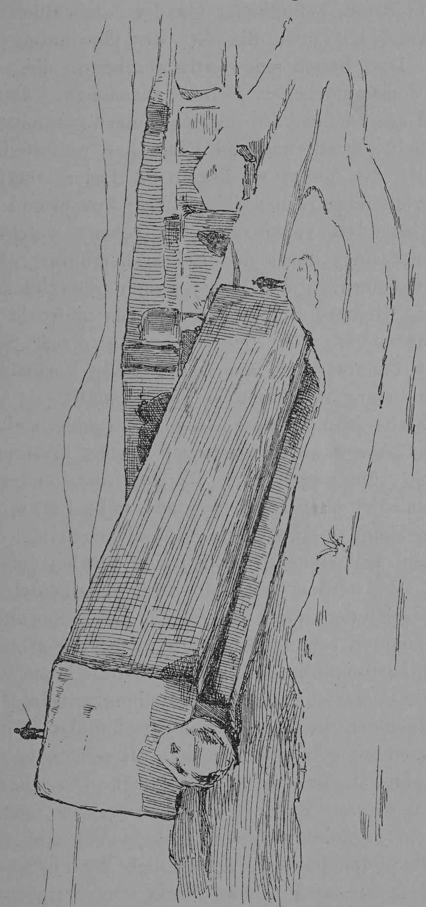

*Fig. 1. Steinblock in Arbeit.*

Gleichfalls in halb bearbeitetem Zustande sieht man auf dem freien Platze vor der russischen Kirche in Jerusalem eine riesige Säule, die wegen eines Bruches unvollendet geblieben ist. Die Säule ist über 12 m lang und mißt 1.60 m im Durchmesser; sie hängt mit dem unteren Teile noch mit dem natürlichen Felsen zusammen[^6.109]. Die freien Flächen sind ziemlich rauh, denn sie werden erst mit dem Spitzmeißel bearbeitet, worauf die Glättung noch zu folgen hat. Sowohl Quadern als Säulen konnten schon nach Vollbringung der gröbsten Arbeit in die ihnen bestimmte Lage kommen, und die letzte Hand wurde erst nach der Versetzung resp. Aufstellung angelegt[^6.110].

Die Rabbinen kennen sowohl gewöhnliche Steinbrüche[^6.111], in denen Bausteine gebrochen wurden, als solche zur Gewinnung von Edelsteinen[^6.112] (beides מחצב). Auch von abgebrochenen Gebäuden und von Ruinen werden Bausteine genommen[^6.113]. Der heute so berüchtigte Vandalismus nahm also früh seinen Anfang. Die Juden beuteten selber diese Steinbrüche aus, war doch der Hohepriester Pinechas direkt vom Steinbruch weg zu seiner hohen Würde berufen worden[^6.114]; daneben aber gab es Brüche, die nur von den Römern ausgebeutet wurden[^6.115]. Von der eingesessenen griechischen Bevölkerung und von den Römern, die im Orient griechisch sprachen, lernten die Juden den griechischen Ausdruck לטימיא = λατομία = Steinbruch kennen[^6.116]. Sonst aber wird der ganze auf den Steinbruch und auf die Steinmetzarbeit bezügliche Vorgang in gut hebräischen Ausdrücken berichtet, ein Beweis, daß die Juden selber die Steinwerke betrieben.

Josephus nennt das Werkzeug der Steinarbeiter, die in den letzten Tagen Jerusalems einen Schacht (ὄρυγμα) zu bauen hatten, Eisen (σίδηρος)[^6.117]. Das wird eine Art Hammer (מקבת) sein, den die Mišna erwähnt[^6.118]. Der Ausdruck **bohren** jedoch, der bei diesen Arbeiten angewandt wird[^6.119], und der Umstand, daß die Arbeit tatsächlich mit einer Art des Bohrens beginnt, läßt als Werkzeug einen Bohrer voraussetzen. Eines dieser Werkzeuge heißt צִפּוֹרֶן, etwa Spitzhaue[^6.120], verwandt mit der eisernen Stange (מגריפה) und dem Eisenspitz (מריצה). „Unter allen Geräten des Steinmetzen“ (סַתָּת) figuriert auch die Hacke (*עַרְעֵר pl. ערערין)[^6.121]. Der Bohrer (קשטנית, מקדח) und der Hammer (פסיל), Werkzeuge des Zimmermanns (w. u.), dürften auch vom Steinmetzen benutzt worden sein, ebenso wie auch die in der Bibel genannte Axt (גרזן) des Holzhauers in der Siloa-Inschrift (Z. 2) ein Werkzeug des Steindurchbruches ist.

Wir besitzen eine anschauliche Schilderung der ganzen Arbeit an folgender Stelle: „Ein Steinmetz (סַתָּת) sitzt am Abhange des Berges, und auf die Frage, was machst du da? sagt er: ich will ihn entwurzeln. Und kannst du das? Ja! Er brach zuerst kleine Steine heraus und warf sie in den Jordan. Dann sah er einen größeren Stein, setzte die eiserne Spitzhaue darunter und warf ihn in den Jordan. Dasselbe tat er mit einem noch größeren Stein, indem er sprach: Jordan, hier hast du ihn, nicht das ist dein Ort, denn es heißt (Hiob 28,9): „An den Kiesel legt man die Hand, wühlt von Grund aus die Berge um.“[^6.122]

Mit diesen Werkzeugen wurde der Stein zunächst ausgehauen (חצב)[^6.123], eine Arbeit, die wohl von Anfang an von geschulten Steinmetzen verrichtet wurde[^6.124], obzwar eine eigene Kunstfertigkeit dazu nicht nötig war. Erst das Behauen oder Meißeln (סִתֵּת) der Steine ist eine Kunstfertigkeit, weshalb denn die Mišna dieses mit dem Bauen gleichstellt[^6.125]. Mit dem Behauen der Steine stehen diese fertig da[^6.126]. Das Behauen geschah nicht an Ort und Stelle, d. h. im Steinbruch, sondern auf dem Baugrund oder in seiner Nähe, und zu dieser langwierigen Arbeit richtete sich der Steinmetz einen Sitz, wohl aus Holz, zurecht[^6.127]. Was beim Behauen abfällt, wird gewöhnlich liegen gelassen und verschmäht[^6.128], doch kann der Abfall als Füllsel sehr gut verwendet werden und wird wohl darum auch zum Bau weggeschafft[^6.129].

Die behauenen Steine, 3 Ellen (etwa 1¹/₂ m) dick, bei je 1 Elle Länge und Breite, wurden, je 9 in einer Lage, nach Bedarf in mehreren Lagen (מורביות)[^6.130] aufgeschichtet, und 3 solcher Lagen, zusammen also 27 Quadern, geben dem Felde den Charakter eines Steinbruches[^6.131].

An den Arbeiten eines Steinbruches sind beteiligt vor allem 1. der Steinbrecher (חַצָּב, חוֹצֵב)[^6.132], 2. der Kameltreiber[^6.133], der die Steine vom Schachte wegschafft, wenn man es nicht vorzieht, dieselben auf schweren Wagen wegzuschaffen, 3. der Steinmetz[^6.134], 4. der Lastträger[^6.135], der die behauenen Steine auf die Steinschichte[^6.136] zu tragen hat. Dann erst kommen der Baumeister und der Maurer an die Reihe.

[^6.106]: DURM, Baukunst der Römer², S. 9. R. ADAMY, Architektur des oriental. Altertums, Hannover s. a., S. 306, rühmt die gewaltigen Ufer- und Dammbauten der Phönizier.
[^6.107]: Hier wiedergegebene Figur bei DURM a. a. O., auch bei BELL, Syrien, S. 177.
[^6.108]: Alles nach DURM, S. 10. Ägypt. Steinbrüche auf der sinaitischen Halbinsel schildert PALMER, Wüstenwanderung, 275 f.
[^6.109]: BAEDEKER, 6. Aufl., 61. Auch Autopsie.
[^6.110]: Über den modernen Steinbruch in Pal. s. BAUER, Volksleben im Lande der Bibel², 41 ff. Alte Steinbrüche um Jerusalem herum s. H. GUTHE, ZDPV 5,37.
[^6.111]: √ bh. חצב, synonym mit חטב, das Nomen in אבני מַחְצֵב (II Kön 12,13; 22,6; II Chr 34,11), was nicht ein Werkzeug ist (ZATW 16,91), sondern Bruchsteine, opp. אבני גזית behauene Steine. Phön. מחצב. MŠebiʿith 3,5, 6 מחצב, aram. *מחצבא pl. מחצביא Trg Richt 3,19, 26 für הפסילים. „Einer sieht eine schöne Säule, so spricht er: Gepriesen sei der Schacht (מחצב), aus welchem sie gehauen (חצב) wurde“; demgemäß, weil die Welt schön, heißt es auch von der Weltschöpfung, daß er sie ausgehauen und erschaffen hat durchs Wort (Exod R 15,22). Einen Schacht eröffnen (פתח) jŠebiʿith 3,5, 34ᶜ₇₂. — גיזרה oder גזירה in Thr R zu 4,7 und Pesiḳta 135ᵇ, Wortspiel zu גזרתם Thr 4,7 (K 2,270), hat kein eigentliches Leben.
[^6.112]: מחצב של אבנים טובות ומרגליות jŠekal 5,49ᵃ₄₈, wo מרגליות „Perlen“ nur infolge der beliebten Zusammenstellung mit „Edelsteinen“. Vgl. Ḳoh R 10,20 מ׳ של סנפרינון, Jalḳ ib. (§ 989); Pirḳe RE 46, Ḳoh R 9,11.
[^6.113]: Die von Beth Šeʿan (Skythopolis) fragten, ob man von der einen Synagoge Steine nehmen dürfe zum Baue der andern? jMeg 3,1, 73ᵈ₂₃. Ib. die Magdaläer fragen dasselbe bezüglich der Verwertung von Steinen einer andern Stadt für die ihrige. Fälle, daß einer widerrechtlich sich in den Besitz der Ruine (חורבה) eines andern setzt und sie aufbaut, werden oft verhandelt: jBḳ 9,1, 6ᵈ₃₀ f., bBm 101ᵃ, TKethub 8,9. 10, 271₁. ₂.
[^6.114]: Lev R 26,9 פנחס חתנה, der Schacht heißt auch hier מחצב. In TJoma 1,6, 180₂₄ und Sifra zu Lev 21,10 (94ᶜ) heißt er איש חבתא (חבתה), d. i. vom Dorfe Aphthia (Josephus BJ 4,3. 8 § 155 s. JE 10,21). Die Einwendung eines andern Tradenten: „War er denn ein Steinmetz (חתם), . . . man hat ihn doch ackernd gefunden?“ läßt vermuten, daß auch die erste Tradition mit מחצב jenen nach MŠebiʿith 3,5. 6 im Ackerfelde liegenden מ׳ genannten Felsen meine.
[^6.115]: Esth R c. 2,7 zu 1,6 „Dieser Schacht ist keinem Menschen sonst, als nur diesem frevelhaften Reich (Rom) bekannt geworden“; es handelt sich um Marmorbrüche. Achašveroš soll zu seinen Säulen den Marmor aus פרק אונסין (l. פרקונסין), d. i. Προκόννησος (Lwr 2,495) gebracht haben (ib.).
[^6.116]: MʾOhal 17,3, T 17,3, 615₁₃. Ed. Neapel החורש מלטימיא l. לטו׳, Maim. z. St. לאטימיא wie Ms Kfm mit א׳, ed. Derenb. להטמיא. Jüdische λιθοτόμοι in Jerusalem: Joseph. BJ 7,2. 2 § 26. Über die *lapicidinae* der Römer s. Vitruv 2,7. 1.
[^6.117]: Jos. BJ 7,2. 2 § 26. Vgl. σιδήριον als Werkzeug. Ohne Eisenwerkzeug behauene Orthosthaten werden oft in Pal. gefunden, s. ZDPV 31,48. 49. — Eine Felsenplatte auf der Sinaihalbinsel enthält ein ägyptisches Gemälde, welches arbeitende Bergleute darstellt; ihre Werkzeuge sind ein Meißel der gewöhnlichen Art und ein Schwunghammer, letzterer wahrscheinlich aus Grünstein, s. PALMER, Wüstenwanderung, S. 156. Die jüdische Sage kennt auch den Šamir (שמיר, bh. = Diamant) als Steinbrecher. „Seit der Zerstörung des Tempels hat der Šamir aufgehört“ (MSota 9,10, T 15,1, 321₅). „R Juda sagt (dieser Autor in T ib. u. j 9,14, 24ᵇ₄₁ — doch ist die Stelle in j unterbrochen — in b 48ᵇ anonym): Der Šamir ist ein Geschöpf (so groß wie ein Gerstenkorn, b), das von der Schöpfung an geschaffen wurde (ʾAboth 5,6 und Maim.), und wenn man ihn auf Steine gibt (T, in j „den Steinen zeigt!“ fehlt in b, doch ib. vorher von den Edelsteinen des Efod: „man zeigte ihnen den Š. von außen“), öffnen sie sich vor ihm wie die Tafeln der Pinax (fehlt in b), auch das Eisen spaltete sich vor ihm, und nichts konnte ihm widerstehen. Wie verfährt man mit ihm [um ihn zu bewahren] (להעמידו j, משמרין אתו b)? Man wickelt ihn in Werg von Wolle (מוכין של צמר T j, ספוגין usw. b), gibt ihn in ein Futteral von Blei (אוטני של עפרת T, טני של אבר j, איטני של אבר b), das mit Gerstenkleien gefüllt ist. Damit nun hat Salomo das Heiligtum gebaut“ usw. Die Sage wird ausführlich behandelt von L. LÖW, Graph. Requisiten 1,181 ff., M. GRÜNBAUM, Ges. Aufsätze z. Sprach- und Sagenkunde, S. 31 und 175, wo auch die Ansichten von BOCHART und S. CASSEL mitgeteilt werden. H. LEWY, Sem. Frwr. im Gr., S. 59 σμύρις, σμίρις beruft sich auf Bochart nicht! Für uns ist es von Interesse, daß שמיר שמירא in Trg den Diamant resp. einen harten Stein bedeutet (L Trg Wb 2,495) und daß dasselbe Mittel auch zur Zeit Mosis zum Schleifen der Edelsteine des Efod und des Chošen angewendet sein soll (Bar bSota 48ᵇ, vgl. bGitt 68ᵃ). Möglicherweise sollte zu diesen und zu Salomos Arbeiten bloß Eisen nicht verwendet werden, wohl aber ein steinerner Meißel (Werkzeug der Steinzeit und darum zu hieratischen Zwecken noch immer verwendet, vgl. צ״ר als Werkzeug der Beschneidung!), und so können wir in שמיר immerhin ein Werkzeug des Steinbruches erblicken, ähnlich dem צפורן, womit ihn L. LÖW zusammenstellt. מקבות של אבן MPara 3,11. Steinerne Hämmer befinden sich noch im Heiligtum. „Zum Abschleifen, sowie auch zum letzten Zurichten der Statuen benutzten die Ägypter zweifellos Steinwerkzeuge,“ MERCKEL, Ingenieurtechnik, S. 25. Außerdem nennt Merckel ib. als Werkzeuge der Steinmetzen den Meißel und den Spitzhammer.
[^6.118]: MKelim 27,7 יד מקבת של סתתין „Stiel des Hammers der Steinmetze“ bh. מקבת Richter 4,21. In Jes 51,1 ist מקבת der Schacht selber, s. meinen Komm. z. St. Über den Namen „Makkabäer“ = מקבת? s. SCHÜRER, Gesch. d. j. V. im Zeitalter J. Chr.³ 1,204.
[^6.119]: Oft bildlich יקוב הדין את ההר „das Recht soll den Berg durchbohren“ (dagegen nt „der Glaube versetzt Berge“, Stellen s. in BÜCHMANN, Geflüg. Worte²¹, S. 83). TSanh 1,2, 415₉, j 1,1, 18ᵇ₁₃, b 6ᵇ, bJebam 92ᵃ. Wurzel נקב bh., aram., syr. ܢܩܒ, arab. نقب, wovon מקבת s. oben, Šiloah-Inschr. Z. 1 הנקבה der Durchstich. Vgl. noch die Redensart מקרא זה נוקב ויורד עד תהום bSanh 97ᵇ. Verwandt ist נקר (s. A. 10), Jes 51,1 parallel zu חצב. MSota 9,6 ומנקר שם אבנים (Agg. in ed. Wilmersd. ולנקר, in Jeruš., Neap., Lowe, ms Kfm ולנקות); Bar b 46ᵇ ולנקור ש׳ א׳, ib. ניקור אבנים Piel, auch Sifre Dt 207 p. 112ᵃ, nicht „meißeln“ (L 3,441), sondern „Steine herausbrechen“. Die Stelle jSabb 12,1, 13ᶜ₁₅ ההן דנקר כיפין übersetzt auch L (3,603) „aushöhlen“; all das fällt, wie dort gesagt ist, in die Kategorie des Meißelns (מכתת der M).
[^6.120]: צפורן גדולה TSabb 14,1. 130₂₈, j 17,1, 16ᵃ₃₉ nur צפרין l. צפורן = Spitzhaue. Mit dieser durchstach man Wände: Exod R 37,2, Lev R 10,3 (RN, Agg סיף) oder trennte eine Statue von ihrer Basis: Jelamdenu (Tanch Pekude 7). Der hier angewandte Ausdruck: והיה מכניס התחתיו (vgl. w. u. AbRN β 12 נתן התחתיה) läßt ebensogut an ein Stemmeisen denken. RN (7,39) it. מובלוני (?), scharf wie der menschliche Nagel, wie auch bezüglich der Finger gesagt wird, sie wären zugespitzt wie Pflöcke (bKethub 5ᵇ). Zu MŠeḳal 8,2 כל ומגריפה Werkzeuge der Totenbestattung (מריצה steht nicht in ed. Ven. und Krot., wohl aber in ed. Lowe, und ist vermöge der Gemara des j in der Tat überflüssig) wird in j z. St. (51ᵃ₅₈) bemerkt: Abba Šaul nannte es (die מגריפה) צפורן. Wer es צ׳ nennt, tut es darum, weil es der Spitzhacke (צ׳ muß auch hier nicht „Nagel“ sein!) ähnlich sieht; wer es מריצה nennt, der tut es darum, weil es den Stein in den Bestattungsraum schafft (מריצה), demnach eine Art Haken. Die in den jüngsten assyrischen Ausgrabungen gefundenen Bronzehacken sind nicht Spitz-, sondern Breithacken, vorn mit einer Schärfe und sonst gleichbleibender Klingenbreite; s. Abbildung bei WALTER ANDRAE, Der Anu-Adad-Tempel in Assur, Lpz. 1909, S. 62.
[^6.121]: TKel bm 4,6, 582₂₈ כל כלי השתת l. הסתת, ib. הערעין l. mit [Haj] u. RŠ zu MKel 21,2 ערערין, RN und Hai: Steinmetzwerkzeug; vgl. VOGELSTEIN, Landwirtschaft, S. 28 A. 19. √ערר (GES. Hwb.¹⁴ ערר II, mit den Derivaten ערער ערוער?) L 3,699. Der Zerstörer (als Werkzeug), die Hacke. Damit mag zusammenhängen, trotz des א׳, mit Ausfall des zweiten ע׳, ארדן bSanh 30ᵇ (Lwr 2,134) und אולר (MKel 12,8, T bb 7,12, 598₁ אולר, auch noch Dissimilation in ל׳) Hacke, Messer (mit Aufgabe der Etymologie in Lwr). So wie צפורן ein graphisches Werkzeug (L. LÖW, Graph. Requ. 1,173), aber auch ein schweres Werkzeug der Steinarbeiter ist, so auch *ערער = Hacke, ארדן oder *ארר (auf Grund von אולר = אורר) = Messer zum Schnitzen beim Schreiben.
[^6.122]: AbRN β 12 p. 29.
[^6.123]: bh. פסל lebt nur in den aram. Dialekten (aram. s. L Trg Wb, syr., nabat., s. GES.¹⁴) fort, nicht nh. Dagegen חצב bh. und nh., z. B. jMḳ 1,6, 80ᵈ₃₀ (L 2,96 zitiert Šeḳal und K 3,473 schreibt es ihm nach!) „er soll ihm nicht Steine aushauen (חצב), wenn sie aber bereits gehauen waren (חצובות)“ usw.
[^6.124]: Wie in AbRN β 12 p. 29 gleich der Beginn der Arbeit מסתת אבנים קטנים heißt; doch wird nach andern Berichten dieser Teil der Arbeit von dem Steinbrecher (חָצָב, חוֹצֵב, w. u.) verrichtet.
[^6.125]: MŠabb 12,1 המסתת. Vgl. T Bḳ 11,18, 371₁₀, Bar b 119ᵇ. Aus Ḳoh R Anf. ושבבה ומסתתה ומירקה geht hervor, daß סתת bereits die zweite Stufe der Arbeit ist; erste Stufe gewöhnlich חצב, hier שבב; vgl. dazu Ezech 38,14 ושובבתיך und RDḲ z. St. = brechen, arab. سبّ = schneiden, שִׁבָּא Holzsplitter (L 4,493), bh. שבבים; die Parallelstelle Cant R Anf. hat סירקה (färben gibt keinen Sinn l. סדקה spalten), סתתה und כרכמה l. מרקה.
[^6.126]: jSabb 9,1, 91ᵈ₅₁ סיתותין של אבנים usw. (auch jAz 3,9, 43ᵇ₁₄ סתיתן l. *סְתָתוֹת).
[^6.127]: ישיבת הסתת MKel 22,8, T bb 1,13, 591₂₁. „Holz“, weil mit שִׂדָּה zusammen genannt. Die Abbildung bei RICH s. v. *lapidarius* zeigt jedoch die Arbeiter auf dem zu bearbeitenden Steine sitzend.
[^6.128]: In der Phrase כאבן שאין לה הופכים „wie ein Stein, den Niemand umdreht“, bSanh 14ᵃ, bAz 8ᵇ.
[^6.129]: „Wenn es der Bauherr mit den Steinmetzen genau nimmt, so wird [das Aneignen des Abfalles] als Raub qualifiziert“ T Bḳ 11,18, 371₁₀; in den meisten Fällen wird sich jedoch der Bauherr auf den Abfall nicht umgesehen haben. Der Abfall heißt סִתוֹת jBm 10,7, 12ᶜ₅₀, TBm 11,5, 395₆ סיתית l. סתות, jSabb 9,11ᵈ₅₂, jAz 3,43ᵇ₁₄, jŠebiʿith 3,34ᵈ₉, vielleicht auch פסילה Ḳoh R 9,11. Dieses Wort ist etwas anders geartet als פסולת, welches in demselben Zusammenhange vorkommt: jŠeḳal 5,3, 49ᵃ₄₈ bNedar 38ᵃ (von den Bruchstücken der Bundestafeln). Der staubartige Abfall heißt נקרת פיסולין bChull 88ᵇ, denn פִּסֹּל schließt es aus, mit Raši gerade an den von Mühlsteinen abgekratzten Staub zu denken. Damit erhalten wir einen Unterschied von שחיקת אבנים (ib.), s. Tosafoth, was einen Staub bedeutet, der von zwei einander sich reibenden Steinen stammt. Dem Abfall gegenüber heißen die Werkstücke aram. *חציבא חציבן s. Wörterbücher.
[^6.130]: Etym. von מורביות (nach RŠ dasselbe, was sonst „Zweig“, weil sie lang sind, was aber unrichtig, denn die Steine messen im Gegenteil eine Elle im Gevierte) mit L. Heller jedenfalls רבה: Aufgeschichtetes.
[^6.131]: MŠebiʿith 3,5, kürzer T 3,1, 64₈.
[^6.132]: חוצב jBm 10,6, 12ᶜ₄₇, T 11,5, 395₄ ms Wien und Agg (fehlt in Ms Erf.) und Bar b 118ᵇ richtiger חצב, doch auch jŠeḳal 6,48ᵃ חוצבין. *Lapicida* (Varro 8,62).
[^6.133]: גַּמָּל T und j, חַמָּר b. Noch heute schafft man schwere Steinblöcke auf Kamelsrücken fort, ein Vorgehen, das den Europäern als Tierquälerei gilt. Von dem Wegschaffen auf Walzen s. unten bei אבן גלל. Befördern auf Wagen, natürlich erst auf fahrbarem Terrain, folgt aus MKel 24,1, MBb 3,8 (12) = jBḳ 5,7, 5ᵃ₃₃, jBikk 1,1, 63ᵈ₁₅. — Der Transport der ungeheuren Steinblöcke der Assyrer wurde von den Forschern eifrig untersucht, vgl. LAYARD, Niniveh, deutsche Übers., Lpz. 1850, S. 352, MERCKEL, Ingenieurtechnik, S. 26. Der kleine Midraš Šemchazai und Azael, d. i. die gefallenen Engel, die in der Urzeit gedacht sind, erwähnt den ermunternden Zuruf (הייא הייא), den man sich bei der schweren Arbeit der Steinfuhr und im Schiffrudern gegenseitig gibt: Beth-ha-M. ed. Jell. 4,128, Jalḳ. 1,44.
[^6.134]: סתת = λιθουργός, λιθοξόος, λιθοτόμος, *lapidarius*.
[^6.135]: סַבָּל T und j, כַּתָּף b. Beim Tempelbau des Herodes waren 1000 Wagen zu Steinfuhren und 10000 Werkmeister da; 1000 Priester wurden in Steinhauer- und in Zimmermannsarbeit unterrichtet, Josephus, Ant. 15,11. 2 § 390.
[^6.136]: דיימוס, T j b ib. Siehe w. u.

## § 7

**7.** Das **Polieren** der Steine war in vielen Fällen notwendig. Es gibt zwar auch von Natur glatte Steine, besonders wenn sie dauernd im Wasser lagen[^7.137], wir haben jedoch hier künstlich geglättete Steine vor Augen, und die erhält man durch Schleifen[^7.138] und **Polieren**[^7.139]. Diese Arbeit wird nicht nur an kleineren Ziersteinen, sondern auch an Bausteinen verrichtet, wenn ein stattlicher Bau aufgeführt werden soll. Auf dem Tempelberg zu Jerusalem, während der letzten Arbeiten an dem herodianischen Tempel, der eigentlich nicht ganz fertig geworden ist, saßen die Werkleute auf Balkenköpfen[^7.140] und polierten (שוף) die Steine[^7.141]. Das Polieren verleiht natürlich dem Stein einen höheren Wert[^7.142]. Der biblische Ausdruck גזית bedeutet nach dem Talmud einen polierten Stein[^7.143], wogegen der unpolierte Stein גזיל[^7.144] heißt, d. i. Werkstück und Bruchstein. Namentlich Säulen können ohne dieses Polieren gar nicht gedacht werden[^7.145].

Bibel (I. Kön. 7,9) und Talmud[^7.146] sprechen in gleicher Weise von der Bearbeitung des (frischgebrochenen) Steines mittels einer Säge (מְגֵרָה nh. מַסֹּר); die Steine waren also so weich, daß sie geschnitten werden konnten; die Mišna hat hierfür geradezu den Ausdruck **schneiden** (נמס)[^7.147]. Auch die Römer hatten Steine, die sie gleich Holz mit der Säge schnitten[^7.148]. Gewiß wurde diese Technik auch bei härterem Gestein geübt. Jene Steine des biblischen Tempelbaues waren von beiden Flächenseiten mit der Säge geschnitten. Nach den Rabbinen jedoch ist unter גזית ein Stein zu verstehen, der nur von einer Seite, d. i. von der Ansichtfläche behauen ist, während die Lagerflächen und die Stoßflächen roh bleiben. Davon unterscheidet sich der Eckstein (אֶבֶן פִּנָּה), der seiner Bestimmung gemäß an zwei Flächen behauen sein muß; dann gibt es noch den Werkstein (אבן פסיפס), der von allen vier Seiten behauen ist[^7.149]. Dagegen mußten die zum Altar gebrauchten „ganzen“ Steine (Exod. 20,25, Dt. 27,6), die man aus Biḳʿath-Beth-Kerem nahm, indem man bis zur „jungfräulichen“ Erde grub[^7.150], wirklich in „fertigem“ Zustande, d. i. ohne jede Bearbeitung, nach ihrem Bestimmungsort gebracht werden; im Tempel selbst durften sie etwa mit der Hand oder mit einem weichen Gerät mit Kalk übertüncht werden, nicht aber mittels einer eisernen Kelle; vom Opferblut reinigte man sie mittels eines Tuches[^7.151].

Die meiste Bearbeitung erforderte, wie wir sahen, der Mosaikstein (פסיפס = ψῆφος). Das griechische Wort selbst hat sich bei den Juden in mannigfachen Formen und Bedeutungen festgesetzt und ist im Arabischen noch weiter verstümmelt worden, so daß es als *fess* den Ringstein bedeutet[^7.152]. Die Griechen selbst bezeichneten mit ψῆφος ebenso den kunstvoll geschliffenen Stein, der die herrlichen Mosaikböden ergab, zu welchem natürlich ganz kleine Steine gehören, als auch den natürlichen Kiesel, der von der Natur seine Rundung und Glätte hat. Diese unscheinbaren, in steinigen Gegenden überall anzutreffenden und mit den Füßen getretenen Steinchen finden ebenso eine Verwendung[^7.153], wie die kunstvollen Mosaiksteine, mit denen sich, wie es scheint, eigene Arbeiter (פיסון) abgaben, und die im Bau oft verwendet wurden[^7.154]. Zu den Losen am großen Versöhnungstage (Lev. 16,8) wurden durchaus zwei natürliche Kiesel (צרורות. צרור) genommen, ein schwarzer und ein weißer[^7.155]. Man fand solche Kiesel überall im Sand vermischt und auch im ausgedroschenen Getreide[^7.156]; man kannte deren im Mindestgewicht von 10 Denaren und verarbeitete sie zu Mosaik (ψῆφος)[^7.157]. Da sie auf offenem Felde leicht anzutreffen waren, so dienten sie beim Abtritt zur Reinigung des Körpers[^7.158].

[^7.137]: Zu בחלקי נחל Jes 57,6 s. meinen Komm. z. St., wonach (s. Koppe und Knobel) arab. خلق zugrunde liegt und behauene Götzenbilder gemeint sind. Anders חלקי אבנים I Sam 17,40: fünf vor andern glatte Steine; so etwa auch חַלְקֵי אבנים jSabb 4,7ᵃ₃₂ zu lesen: glatte Steine aus dem Badebassin in Gadara; vgl. bZebach 54ᵃ RN חלקי א׳ Agg חלוקי. Trg z. St.: שעיעי אבניא, √שעע ܫܥܐ, darum שיעא Trg Prov 30,19 = צור Fels. ܫܥܝܐ *lapis laevis.*
[^7.138]: קרדם (nach L 4,372 Grundw. קד, קדד) jSabb 4,7ᵃ₃₃, lies jedoch קרטם (K 7,191, J 1412) = קרטם Lwr 2,567 von *creta*, mit Kreide abreiben.
[^7.139]: Oft שפשף, Intensivbildung von שוף ܫܘܦ (L 4,522), arab. سفا شاف abreiben. In bSabb 125ᵇ soll ein נדבך של אבנים, also Bausteine, s. w. u., entweder **geglättet** (למד, nach L 2,509 aneinanderreihen, aber das ist bereits in נדבך enthalten, vielmehr nach der Grundbedeutung von למד in מלמד „Stachel“: stechen, von Steinen also Entfernen der rauhen Stellen, glätten, damit die Steine zu sitzen geeignet seien, vgl. لمد ZDMG 40,727) oder **poliert** (שפשף) werden.
[^7.140]: ראשי כלונסאות (T in nächster Anm.), von *columna -as* (Lwr 2,288, vgl. noch RDḲ Wb s. v. שקף, wo כלונסות mit בדים Stangen erklärt wird. Zu der Art des Sitzens s. A. 127.
[^7.141]: R Eleazar b R Zadoḳ sagte: Balkenköpfe gab es auf dem Tempelberge, auf denen die Werkleute saßen und die Steine polierten (שָׁפִין TKel bb 2,2, 591₃₈). Vgl. TBḳ 10,2, 366₂₅ גזל . . . אבנים ושיפן wenn Einer Steine raubt und sie poliert.
[^7.142]: Folgt aus TBḳ 10,2, wie eben angeführt.
[^7.143]: bBb 3ᵃ אבני דמשפיא, RN אבני דמשפיין כדכתיב מגוררות במגרה, also an I Kön 7,9 angelehnt, so auch ed. Lublin, Alfassi, Ašeri (D. S.); das Werkzeug wäre also eine Säge; in der Tat גזית √גזה = גזז schneiden, vgl. גז in der Schafschur. Es stimmt das überein mit der im Gegensatze zu R Judas שמיר (A. 117) vorgetragenen Ansicht R Nechemjas, wonach die Steine beim salomonischen Tempelbau außen, d. i. wohl an der Stätte des Steinbruches, gesägt (גרר von מגרה) wurden und fertig (תקן, also מתוקנות) auf den Tempelplatz kamen. TSota 15,1, 321₁₀, j 9,14, 24ᵇ₄₅, b 48ᵇ. Vgl. Joseph. Ant. 8,2, 9 § 60 προστετάχει δὲ λίθους μὲν αὐτοῖς τέμνειν μεγάλους εἰς τοὺς τοῦ ναοῦ θεμελίους, ἁρμόσαντας δὲ πρῶτον καὶ συνδήσαντας ἐν τῷ ὄρει κατακομίζειν οὕτως εἰς τὴν πόλιν.
[^7.144]: bBb 3ᵃ, RG שאין משופות וממוחקות (die von K 2,257 im Namen RGs angeführte Erklärung von גויל: אבנים שנחצבו מן ההר דעדין אינן משופין finde ich in ed. Romm nicht). גויל MBb 1,1 Bar bBm 117ᵇ. L 1,310 und J 221 setzen als Wurzel גול, L unter Vergleichung von جال umgeben; nun heißt aber جال geradezu polieren! Im Namen D. KAUFMANNs führt K die Ableitung von גלל in אבן גלל an; wie das deutsche Rollziegel; Bildung גויל von גלל wie עויל von עול = עלל. Nun ist aber jenes גלל (Ezra 5,8; 6,4, nh. גלל, גללא = Stein, Steinchen, L 1,335) nicht Rollziegel, sondern große Blöcke, die vom Steinbruch auf Walzen (*scutula*, σκυτάλη RICH 554ᵇ) weggerollt werden. Palmyr. גללא (= στήλη λιθίνη, LIDZBARSKI, Hb. d. nordsem. Epigraphik 1,250, vgl. ZDMG 42,399); LXX גלל = ἐξ ἐκλεκτῶν λίθων, s. dazu PEF Qu. Statem. 1907, 146; nh. גויל (w. u.) s. A. GEIGER, ZDMG 26,800, Jüd. Zschr. 11,179. F. PERLES, Babylonisch-j. Glossen (in Orientalist. Ltrztg. 1905, 8,335, Sonderabdruck S. 19) meint, גויל = גמל (weil bChull 95ᵇ גמלי Var. גוילי) sei gleich babyl. *gamâlu* „vollkommen erhalten“, d. i. unbehauen, vgl. jedoch CHAJES, Z f H B 10,77. K a. a. O. streift mit seinem جبل = Berg das Richtige, doch ist das Wort גויל (Ms Kfm und ed. Lowe bieten in MBb 1,1 גבל! MGWJ 51,162, eine Var., die nirgends verzeichnet ist) noch weiter auf die phön. Stadt גְּבַל = Berytus (das wieder seinerseits bei den Phöniziern גבל geschrieben wird!) zurückzuführen, ein Name, der allerdings mit Ǧebl = Berg zusammenhängt. Von den phön. Baumeistern, den גבלים der Bibel, kam das Wort גויל, als Ware der Stadt Berytus, zu den Juden, S. KRAUSS, ZATW 28,257. Phönizisches in der Baukunst der späteren Juden werden wir noch einigemal finden, wie ich es anderswo ausführe. Ähnlich, jedoch auf dem Umwege von גויל Pergament, auch SACHS, Beitr. 2,188, s. L Trg Wb 1,130.
[^7.145]: השף בין העמודים bSabb 75ᵇ, RN (aus RCh): er tut es um zu glätten; nach anderer Erklärung jedoch wird der Boden zwischen den Säulen (בין העמודים) geglättet; auch ist es nicht das gewöhnl. Polieren des Steinmetzen, sondern mit Leder abreiben.
[^7.146]: S. drittnächste vorherige Anm.
[^7.147]: מחצב וגומזין MŠebiʿith 3,6 (s. RN גמז bei K 2,303 von Holz und Fleisch, also „schneiden“); RŠ und Bert. denken mit Recht an den natürlichen Felsen, denn ein solcher bildet zumeist die Abgrenzung des Feldes; auch handelt es sich um große Steine (אבנים של משאוי), und so ist גמם neben חצב eine Arbeit an natürlichen Felsen.
[^7.148]: Vitruv 2,7. 1 *qui etiam serra dentata uti lignum secatur.* Das Schneiden in dünne Platten ist nach Plin. H. N. 36,6 in Carien um 350 v. Chr. erfunden worden. Das Schneiden geschah (wie noch heute) mittels Säge und Sand (DURM² 181). Bei Edelsteinen und Perlen findet sich נסר (vgl. מסור die Säge) bBb 75ᵃ und bSanh 100ᵃ קא מנסרי אבנים טובות ומרגליות, allerdings von Engeln gesagt.
[^7.149]: AbRN α 28 p. 86 „Drei Qualitäten gibt es unter den Schriftgelehrten: Behauener Stein, Eckstein, Werkstein“, daselbst wird nun der Vergleich durchgeführt (übersetzt bei BÜCHLER, התיכה ופסיפס Expression désignant les Docteurs de la Loi, in REJ 42,211—219, auch bei A. ROSENZWEIG, Das Wohnhaus S. 4 A. 1). Mit Unrecht emendiert Schechter אבן פינה שאין לה אלא שתי פיות בלבד, wo doch das Ms und auch Midr ha-Gadol (Einleitung) שיש לה שתי פיות (positiv ausgedrückt) haben, und so auch bei פסיפס א׳. Der Ausdruck פה variiert ib. mit פנים Flächen, doch kann פה selbständig die Bedeutung Schärfe, Kante, haben, wie חרב של שתי פיות bBerakh 5ᵃ; die Kante entsteht eben durch die Bearbeitung. — In dieser Fassung wäre גזית, entgegen dem Bibeltexte, nur von einer Fläche bearbeitet; so scheint denn richtiger zu sein die Fassung der Rezension β c. 46 p. 65ᵃ: „Vier Qualitäten gibt es unter den Lernbeflissenen (מיושבים): Eckstein, behauener Stein, Viereck, ψῆφος“, ohne weitere Ausführung und schon wegen dieser Kürze sich altertümlich präsentierend. Nach der Reihenfolge ist „Eckstein“, seiner Natur nach, an zwei Flächen bearbeitet; גזית an drei, מרובעת an vier, endlich פסיפס sogar an sechs, vielleicht gar acht Seiten. Man gewinnt damit, daß גזית, nach der Bibel „von innen und von außen“ bearbeitet, auch hier an der Bild-, der Lager- und Stoßfläche behauen ist, nur nicht an der Oberfläche; dagegen פסיפס außer an den vier Seiten noch an den zwei Stirnseiten, wenn er nicht gar achteckig ist. Jedenfalls dürfte פסיפס in diesem Zusammenhange, und nur deshalb, ein Werkstück bedeuten, nicht Mosaik, wie gewöhnlich, und nicht wegen אבן פ׳, wie BÜCHLER a. a. O., S. 215 A. 1 annimmt, denn אבן ist nur Erläuterung des Fremdwortes. So ist I. Kön 5,30 אבני גזית in Trg אבן פסיפס (RN, Agg פסילן). — Die von BÜCHLER für so schwer gefundene Stelle ThrR zu 2,1 p. 98 Buber zu Ezech 9,4 habe ich bereits in Lwr 2,470 sinngemäß übersetzt: Der Buchstabe תו war ihr Verhängnis (nach RNs LA: התיכה פספסן) d. i. bestimmt ihr Schicksal zum Leben. Vgl. jSota 7,5, 21ᵈ₄₇ מסיר נטלו איפופסין שלהן למיתה, b 35ᵇ. Der für B. völlig unverständliche Satz der „Rabbinen“ ib. besagt nun (auf die Gelehrten und auf פסיפס in den vorangehenden Sätzen zurückblickend): Den, der (wie der פסיפס) von allen Seiten geschmückt ist (l. st. נהנה, dem Kopisten geläufig, נתנאה und siehe Beispiele bei L 3,321). Auch hier gilt also der פסיפס als von allen Seiten behauen. Midr ha-G zu Dt 5,4 ms: לחתיכה של פספס שהיא מראה פנים מכל צד ist התיכה ebenso rein konventionell, wie אבן, welches dabeizustehen pflegt. Lies demnach ib. zu Num 11,16 כחתיכה פסיפס, ib. zu Dt 1,13 (Midraš Tannaim ed. Hoffm. p. 7) ebenso. In unserem Sifre Num 92 p. 25ᵇ und Dt 13 p. 67ᵇ כפיופים entschieden aus פסיפס korrumpiert. Für התיכה hat man übrigens das aram. מקטע פסיפס jSabb 12,1, 13ᶜ₁₅. Der behauene Stein, einmal Sinnbild des Gelehrten geworden, steht an allen diesen Stellen bildlich, wie auch עמוד הימיני, פטיש החזק, בעלי תריסין Bezeichnungen für Gelehrte sind. — Ein „Verzeichnis von Mosaiken aus Mesopotamien, Syrien, Palästina und dem Sinai“ wird gegeben in ZDPV 1909, 32,113—150.
[^7.150]: Daß man das so genau wußte und auch den Schacht angeben konnte, beweist, daß wir es mit den letzten herodianischen Bauten zu tun haben, wie oben. בקעת besagt bereits, daß sich dort ein Schacht befunden; mehrere Orte mit בקעת s. Neub. Géogr. Index, doch fehlt gerade בקעת בית הכרם.
[^7.151]: MMidd 3,4 (Tamid 36ᵃ), ms Kfm und ed. Neapel כפים, so auch Maim., der es passend für ein Werkzeug des Maurers hält, und zwar eines, das zum Glätten dient; RN jedoch und manche Agg (s. K 4,283) lesen כפים, כפין, pl. von כף, das hier ebenfalls eine Art „Kelle“ bedeuten muß. — Mekh zu Exod 20,25 p. 74ᵃ hat einiges mit der Mišna gemein, einige Details mehr in Mekh RSbJ p. 116 ed. Hoffm. 1. Die Steine des Altars sollen nicht gesägt werden mit der Säge (מגירה) und der kleineren Handsäge (? מסו״ר); 2. man hat sie zu bringen מבתולת הקרקע, d. h. man gräbt so tief, daß man sieht, es sei ein Grund, auf dem weder Saat noch Bau sich befunden, oder aber holt man sie aus dem großen Meer; 3. Mekh אין גזית אלא גזוזה, Mekh RSbJ noch נתגזזו בחרב. Zu 2 vgl. WALTER ANDRAE, Der Anu-Adad-Tempel in Assur, Lpz. 1909, S. 16 f.: „Die ganze Hoffläche ist mit grobem und feinem Kies, Flußsand und Sandfelsschotter hochgefüllt; unreiner Schutt . . . nicht zu finden. Das zeigt vielleicht das Streben, im Tempel nur reine, von der Natur dargebotene Stoffe zu dulden, und alles im menschlichen Gebrauch Entheiligte von ihm fernzuhalten.“
[^7.152]: Lwr 1,290 ff., 2,431 ff. Über das Mosaik bei den Arabern s. SPRENGER, ZDMG 15,409, vgl. REJ 42,218; auch ZDMG 51,299.
[^7.153]: So erkläre ich פיסא in bSabb 73ᵇ; nicht eine Erdscholle (Raši), sondern ein Kieselstein, denn nach Tosafoth z. St. hören wir, daß ein Wurf damit die Schalen der Datteln löse, was doch eine Erdscholle, wenn noch so fest, nicht gut tut. Derartige kleine Steine gab es auch in Babylonien; vgl. bMakk 8ᵃ und w. u. In bSanh 64ᵃ muß es sich ohnedies um Steinchen handeln, da von Merkur-Dienst die Rede ist, s. I. LÖW in Lwr 2,354, s. v. מרקולים, vgl. TAz 6,15, 471, für צרור setzt man אבן, und schon Vulgata Prov. 26,8; WELLH., Reste² 111. CLERMONT-GANNEAU, La Palestine inconnue, Paris 1876 p. 54 arab. *méchahîd*. „A dolmen in the Talmud“, PEF Qu. Stat. 1885 10—12 (1882, 84). — Verwendung als Los, s. Lwr 2,432.
[^7.154]: *פיסון erkläre ich jetzt mit L als Maurer (nicht Steinarbeit, Lwr 2,432), עריבה פיסונות also (MKel 20,2, Tbm 11,3, 589₁₇) = Trog der Mosaikarbeiter. Die ganz kleinen Steine bilden einen Haufen, den man am besten in einem Trog hielt.
[^7.155]: jJoma 4,1, 41ᵇ₅₈. In Sifra zu Lev 16,8 p. 80ᵈ wird das Losen mit Gold und Silber, mit Marmor (שיש) und Buxbaumholz (אשכרוע) wenigstens als möglich hingestellt.
[^7.156]: jʿErub 5,1, 22ᶜ₁₁; vgl. die kosmogonische Vorstellung in Exod R 13,1: Gott nahm Erde hervor von unter seinem Thron, warf sie auf das Wasser und so bildete sich das Festland, die kleinen Kiesel (צרורות) aber, die die Erde enthielt, wurden zu Bergen und Hügeln. צררה am Meeresufer jBerakh 2,3, 4ᶜ₅₃, so noch in aram. Form צררא: der Kiesel stützt die Zypresse jPeʾah 7,4, 20ᵈ₆₇. Jaḳum (= Eljakim?), der Held einer rätselhaften Anekdote, wird als איש צרורות bezeichnet (Gen R 65,22, Midr ψ 11,7 p. נב ed. Buber, wo B. איש צרידה konjiziert: aus Zereda); wenn das soviel als „Mosaikarbeiter“ sein soll, wird ihm vielleicht die heidnische Art seines Gewerbes vorgehalten. — צרור in Getreide, das man davon reinigt (ברר), jSabb 7,2, 10ᵇ₈, vgl. Amos 9,9.
[^7.157]: TSabb 8,22, 121₁ צרור אבן und מפוסות l. mit ms Wien und Agg מפיסם = פסיפס (Lwr 2,347, zu ergänzen חניים במספסין Mekh RSbJ 13,18 p. 38, מספסין Jalḳ Exod 422, beides dunkel). In MSabb 8,6 und j 11ᶜ₂ Maß des Kiesels: daß man nach einem Vogel, resp. nach einem Vieh damit wirft.
[^7.158]: TSabb 13,17, 130₂₃ (j 8,6, 11ᶜ₂₃ b 81ᵃ 43ᵃ usw.) צרור ein Kiesel, der zugerichtet ist (מקורזל) wie eine Olive, eine Nuß, ein Ei usw. Zur Etymologie vgl. Fl zu L 3,315 = قزل „zusammengedrückt, gerundet“, syr. ܩܘܪܙܠ = *glomus*. RN „zugerichtet ohne stechende Spitzen“; wogegen die anderen Erklärungen bei RN (spitz, weich) nicht aus dem Worte fließen. L (4,374ᵃ) ist im Unrechte, wenn er hier u. sonst צרור mit Erdscholle übersetzt, an den Parallelstellen steht ja אבנים מקורזלות, also Steine. — Einen Bearbeiter haben wir viell. in Abba b. Acha כרסלא aus Kafri, bSanh 5ᵃ, noch dazu vornehmen; vgl. איש צרורות u. פנחס הסתת oben.

## § 8

**8.** **Steinarten**. Sowenig wie die Kieselsteine mußten in zahlreichen Fällen die Feldsteine gebrochen werden, vielmehr lagen sie auf dem steinigen Boden Palästinas so frei da, daß sie schon von der Pflugschar aufgerüttelt und aufgedeckt wurden[^8.159]. Nebst den glatten Steinen (s. o.) und den Kieseln aus den Flüssen und dem Meere kennen wir noch die aus dem Meeresschlamm hervorgezogenen Steine (אבנים מפולמות)[^8.160], und wir wissen ferner, daß eine Quelle die Steine am Altare aus dem Meeresgrund zu holen wünscht[^8.161].

In Palästina herrscht der weiche Kalkstein und der kreidige Felsen vor, aber es finden sich auch Massen von Letten, Sand- und Feuerstein; im Norden, in dem alten Basan, im Haurân, herrscht der Basalt vor[^8.162]. Josephus[^8.163] erwähnt einen schwarzen Stein, mit dem die nach Jerusalem führenden Straßen noch von Salomo gepflastert wurden. An edlerem Stein (אבן טובה)[^8.164] wird nur der Marmor (שיש, מרמרא) genannt, von dem man mehrere Sorten, den weißen, den schwarzen, den roten usw. kannte[^8.165].

[^8.159]: MŠebiʿith 3,7. Man nennt sie liegende Steine (אבנים תושבות T 3,4 64₁₃), nach L 1,12ᵇ heißen sie so, weil sie von der Fremde gebracht wurden, aber das Wort besagt das nicht.
[^8.160]: bChag 12ᵃ, Trg Hiob 38,3, s. Lwr 2,445.
[^8.161]: S. oben Anm. 151 Mekh RSbJ p. 116 או מביאין אותן מן הים הגדול.
[^8.162]: MUNK, Palestine, Paris 1881 S. 17; RAUMER Pal.⁴ 472 in dem Exkurs über den Kalkstein des westlichen Palästina. Über die heute verwendeten Steinarten s. KLEIN ZDPV 3,108, der als besonders geeignet den *malaki* nennt und u. a. auch den *jehûdi* Judenstein; s. auch L. BAUER Volksleben² 40. Mukadassi erwähnt roten Sandstein in Syrien; Kreide, womit Plafonds geweißt und Dächer bestrichen werden; Brüche von weißen Steinen; Marmorbrüche; gebröckeltes Salz aus dem Toten Meere (ZDPV 7,221). Abulfeda (Tab. Syr. p. 99, zitiert auch von RAUMER Pal.⁴ 244) sagt: *Bosra urbs praefecturae Hauran antiquissima et constructa sano nigro et contecta.*
[^8.163]: Ant. 8,7,4 § 187 λίθῳ κατέστρωσε μέλανι. Josephus pflegt die Bausteine in Pal. Marmor zu nennen (des Absalom-Denkmals Ant. 7, 10,3 § 243, der herod. Türme BJ 5,4,4 § 174). Auch heute noch gibt es Dörfer aus schwarzen Basaltsteinen (ZDPV 3,109).
[^8.164]: Nicht hierher gehört אבנים יקרות I Kön 7,9—11, wohl aber אבן יקרה I Kön 10,2, I Chr 20,2; Ezech 27,22; vgl. noch אבני נזר Zach 9,16. Nhb אבן טובה bBb 10ᵇ, Gen R 16,2.
[^8.165]: באבני שישא ומרמרא bSukka 51ᵇ, bBb 4ᵃ; RG z. St. versteht unter שיש (bh. s. Wbr) den weißen, Raši den grünen Marmor; unter מרמרא (μάρμαρος Lwr 2,353) versteht RG gefleckten (von נמר), Raši weißen Marmor; unrichtig, denn bh. שיש steht nur pleonastisch neben dem Fremdwort מרמר nach Lwr 1 Einl. p. XXVII; vgl. oben zu אבן פסיפס. Hinsichtlich אבני כוחלא ib. (RG schwarzer M., Raši gefärbter M., wie Schminke, in bKidd 12ᵃ sagt Raši: schwarzer M.) ist maßgebend פוך Jes 54,11 = כוחלא. Roter M.: I. Trg Esth 1,6. M. aus Prokonnesos: Esth R 1,6 s. v. בהט Esth 1,6 in LXX σμαραγδίτης, nach Winer BRwb³ 2,59 eine Art grünen Marmors (*m. laconicum*); nach Abulwalid Wb (ed. Bacher 58) ist בהט arab. بلاط, eine Art Marmor. Dunkel ist die Deutung bMeg 12ᵃ בהט, אבנים שמתחוטטות על בעליהן; nach Raši Pflaster aus exquisiten Steinen, RN חט 1 (3,366) eine Art Genuß (?), RG bringen ihn nahe (?), RCh machen die Eigentümer sündhaft; בירא דשישא bBm 83ᵇ, bSanh 77ᵃ; auch עליתא דשישא bSabb 29ᵇ. In Midr Tehillim 78,11 p. 350 u. 105,9 p. 452 בתי השיש u. בתי הסיפים l. für letzteres mit Jalḳ Ps. 620 u. 663, wie auch in Exod R 10,3 steht, פסיפס (s. K 6,99), d. i. wohl die Wände aus Marmor, höchstens geziert mit Mosaik, dieses jedoch als Material des Fußbodens zu denken. An allen diesen Stellen wird auch gesagt, daß der Frosch, ein Weichtier, das harte Material durchbricht; ähnlich die Schlange jTerum 8,5, 45ᵈ₆₂ (gegen L 3,254). Reichtum an Marmorarten in Rom, s. FRIEDLÄNDER Sitteng. 3⁵,85 (volkstümliche Ausgabe 2⁷,198).

## § 9

**9.** **Ziegel**. Nach Vitruv (2, 3, 1.2) streicht man die Ziegel weder aus sandigem, noch steinigem (*calculosus*), noch griesigem (*sabulosus*) Lehm, sondern aus weißlicher, kreidiger oder roter Erde. Vitruv spricht von Luftziegeln, und um solche handelt es sich auch in Palästina und Ägypten[^9.166], wogegen wir freilich in Babylonien frühzeitig von gebrannten Ziegeln oder Backsteinen hören[^9.167], doch baute man auch hier auch mit solchen, die an der Sonne getrocknet wurden[^9.168]. Palästina ist reich genug an Ton[^9.169], und der Boden Babyloniens besteht durchgängig aus einem mit Sand vermischten Ton, welcher eine Unterlage von Gips hat und reichlich mit Erdharz durchzogen ist; von Steinen dagegen ist er angeblich völlig entblößt[^9.170].

Als Material der Ziegelfabrikation in Babylonien nennt der Talmud Erde (עפר, עפרא)[^9.171]; das ist schwerlich etwas anderes als der Ton (טיט)[^9.172] oder Lehm (טינא)[^9.173]. Für gewöhnlich wird als Material eben nur der Ton genannt[^9.174].

Die Ziegelfabrikation ist eine schwere Arbeit[^9.175]. Die Darstellungen der alten Ägypter geben uns ein treues Bild davon[^9.176], und eben an die unvergessene Arbeit der Israeliten in Ägypten knüpfen zunächst auch unsere Quellen an. Den Ton, in Massen aufgehäuft, schleppte man auf der Schulter[^9.177] mittels Schaufel (מגריפה) und Korb (סל)[^9.178] auf einen geeigneten Platz, wo er im Wasser geweicht (שרה) und geknetet (גבל) wurde, ein Prozeß, der lange dauerte und wohl auch nicht ohne Schmutz abging, und darum auf offener Straße nicht verrichtet werden durfte[^9.179]. Ebensowenig durften die Ziegel auf offener Straße gestrichen werden[^9.180]. Das Ziegelstreichen (πλινθουλκεῖν), in der Mišna ganz so wie bh. ausgedrückt[^9.181], geschah auf die Weise, daß man eine offene rechteckige Kiste oder einen rechteckigen Rahmen (מלבן) in die weiche, auf ebener Fläche liegende Masse drückte[^9.182]; wurde der Rahmen herausgehoben, war auch schon der Ziegel geformt. Da bei jedesmaliger Fabrikation gemeiniglich derselbe Rahmen gebraucht wurde, so fielen natürlich die Ziegel in derselben Größe aus, und darum finden wir Ziegeltypen von genau bestimmter Größe.

Schon in dem alten Ägypten, in welchem man aus dem Nilschlamm bereitete gebrannte oder ungebrannte Ziegel hatte, die man, wie noch heute, „Tub“ nannte, waren die Ziegel mit dem Regierungsstempel bezeichnet[^9.183]; im alten Babylon ließ der König mit einem Holzstempel seinen Namen auf die Ziegel drücken, und zwar findet sich der Stempel immer nach der unteren Seite hin[^9.184]; in Rom tragen die Ziegel die Namen der Ziegeleibesitzer oder besondere Ziegelmarken und Legionszeichen, und Originalstempel von Holz, Ton, Gips, weichem Stein und Metall sind noch erhalten[^9.185]. Die Juden in Palästina, die freilich mehr in Stein bauten, dürften den nämlichen Vorgang von den Römern, ihren damaligen Zwingherren, gelernt haben; ihr Stempel bestand aus einem eingedrückten Ring (טבעת), und darum ist die Rede von einem Ziegel, der den Ring verschlungen[^9.186], d. h. die weiche Tonmasse birgt den verlorenen Siegelring in sich, oder aber der Ring haftet an dem Ziegel[^9.187].

Die gebrannten Ziegel (לִבֵּן = brennen) werden von den Luftziegeln durch kein besonderes Wort unterschieden, denn die allenfalls genannten Backsteine (רעפים)[^9.188] dienten nicht zum Bauen, sondern zur Bereitung von Feuerstätten. Oft werden die flachen Dachziegel mit dem griechischen Namen קרמיד (κεραμίδιον)[^9.189] erwähnt; ebensooft und zum Teil zusammen mit jenen werden die Hohlziegel (סילונות pl. von σωλήν) genannt[^9.190], die, was ihre Verwendung beim Bau anbelangt, die Zwischenräume zwischen den Dachziegeln ausfüllen sollten. Der Form und Größe nach unterscheidet man ferner den ganzen Ziegel (לבנה schlechthin), der in einem gewiß verbreiteten Typus 3 Tefachim (22,2 cm) groß war, von dem Halbziegel (כְּפִים pl. כפיסין), der halb so groß war und der infolge seiner Schmalheit passend auch „Latte“ (אריח) hieß[^9.191], und der nur dazu diente, den richtigen Mauerverband herzustellen[^9.192].

[^9.166]: G. HOFFMANN in ZATW 2,66. BLÜMNER Technol. 2,14.
[^9.167]: Gen 11,3. Sachgemäß heißt es nun in Pirḳe RE 24: Sie hatten keine Steine, die Stadt und den Turm zu bauen, was taten sie also? sie strichen Ziegel (היו מלבנים לבנים) und brannten sie (שרף), wie es der Töpfer tut. Der Palast des Königs von Ninive bestand aus geraubten Ziegeln: Jalḳ Jona 3,8 no. 550.
[^9.168]: HELLWALD S. 147. MERCKEL Ingenieurtechnik S. 42.
[^9.169]: חֹמֶר, כלי חמר s. NOWACK, Arch. 1,59. טיט = חומר Exod R 24,1; ib. טיט בים Schlamm, im Schilfrohr, ib. Materie der Ziegel טיט.
[^9.170]: וכי יש אבנים בבבל Midr ψ 24,10 p. 208, ib. 64,1 p. 156ᵃ, Cant R c. 1,5, Num R 14,3, Jalḳ ψ 787; Buber verweist bereits richtig auf Thr R 5,13, wonach es in Babylonien auch keine Mühlsteine gegeben. S. noch JE 2,406ᵇ, MERCKEL a. a. O., der die Bezugsquellen der Steinarten in B. angibt, denn an grobem Alabaster u. Gips ist das Land reich, s. LAYARD Niniveh 322.350. Doch wurden in neuerer Zeit bei parthischen Bauten neben Ziegel- auch Bruchsteinausführung beobachtet; s. E. HERZFELD, Untersuchungen über die histor. Topogr. der Landschaft am Tigris usw., in Memnon, Lpz. 1907, 1,106.
[^9.171]: bBḳ 96ᵇ עפרא; L 2,470 übersetzt „Sand“, „Backstein“, beides unrichtig. Dieses עפרא wechselt mit טיט Ton, s. bSanh 90ᵇ 91ᵃ. Noch war bei Babel der Ort zu sehen, woher man die Erde (עפר) zum Turmbau genommen (nicht allgemein! wie es in Monum. Jud. 2. Heft S. 6, s. ib. 21, heißt) jBerakh 9,1, 12ᵈ₄₀. Das עפר in Lev 14,42 veranlaßt Sifra z. St. (73ᶜ) zu bemerken: עפר אפילו לבנים אפ׳ מדר אפ׳ חרסית.
[^9.172]: bh טיט s. Wbr. Zu achten auf den Ausdruck לבינה של טיט TMikw 7 Anf., (ed. Zuckerm. 6,12. 658₃₂). טיט היון ψ 40,3 wird Mikw 9,1, als Töpferlehm unterschieden und mit טיט הבורות erklärt; vgl. T ib. zweimal. Man kennt den flüssigen (טיט הנרוק MMikw 7,1) und den dicken Lehm (טיט העבה) ib. 7,7. Freilich ist es gar nicht sicher, ob טיט gerade den Ton bedeutet. טיט חוצות Zach 9,3; 10,5 wäre ja gewöhnliche Erde. Das eben erwähnte טיט הבורות „Grubenkot“ ist etwas ähnliches wie der Gassenkot; letzteres führt auch den Namen יתדות דרכים TMikw ib., und es entsteht zur Regenzeit. Dann gibt es einen מרקה (ed. Lowe מדקה M ib. 9,1(2), T 6,13, 658₃₄ מריקה) genannten Ton, „mit dem man die Spalten der Geräte verschmiert“ (T), also jedenfalls dick und unserem **Kitt** entsprechend, vgl. RN s. v. מרוקא (K 5,261), von J (839) für *pumen* Bimsstein erklärt. גץ יוני M ib. ist schwerlich zu trennen von גצא ܓܨܐ جصّ, das jedenfalls Gips ist (PSm 766, S. FRAENKEL 10, bei BROCKELM. Lex. Syr. 61 aus assyr. *gaṣṣu* u. Kalk); das יוני ist nicht „griechisch“, sondern Weiterbildung aus יון, also etwa **Schlamm, Meerschaum?** In demselben Zusammenhange wird noch der Maurerlehm ([טיט] של בנאין Tib. 699₃) erwähnt. Der Satz in T ist mir übrigens unverständlich; auf die Erklärung Hais (K 2,110) kommen wir noch zurück.
[^9.173]: jKilaim 2,3, 27ᵈ₂₃ מקום הטינא. Den Ausdruck findet man oft bei der Schilderung der Bodenverhältnisse Palästinas (w. u.), der Lehmboden war also etwas gewöhnliches. Ausführlich Maim. zu MKelim 2,1. טינא = ܛܝܢܐ = طين.
[^9.174]: Die Ziegelarbeit der Israeliten in Egypten wird מלאכת הטיט genannt Exod R 1,27. Ib. 3,6 בטיט ולבנים הן עומדים s. רד״ל. Von שעבוד טיט ולבנים (Kohel R 3,11) sehen die Arbeiter schlecht aus und bedürfen der Erholung. Der Arbeiter macht sich an dem Lehm schmutzig (Num R 10,1 פועל . . . מנבל עצמו בטיט).
[^9.175]: Exod R ib. „Es gibt keine schwerere Arbeit als die Tonarbeit.“ Von der erniedrigenden Arbeit des Schleppens der Erde wollen Manche den Trauergebrauch des Erdstreuens auf den Kopf herleiten.
[^9.176]: Darstellung nach ROSELLINI bei BLÜMNER 2,22. WILKINSON, Manners and Customs, 2,99.
[^9.177]: Exod R 1,27 „[Moses] hielt die Schulter (כתיפיו) hin und half“.
[^9.178]: Pharao demonstrierte mittels סל ומגריפה, wie man arbeiten soll (Num R 15,20). Dieselben zwei Werkzeuge in MŠeḳal 8,2 (s. A. 120), vielleicht weil man das Grab damit grub.
[^9.179]: MBm 9,7, deutlicher T 11,6, 395₈ (hier עפר, das aber zu טיט bestimmt ist). Das Tätigkeitswort ist שרה, anderswo גבל (w. u.). In jBm 10,7 12ᶜ₅₃ לשהותו l. לשרותו (von שרה), dann erst Gegensatz לשהותו „damit zögern“. Vgl. beim Steinbau MŠebiʿith 9,10: מה יעשה בעפר צוברו ברשות הרבים ומתקנו.
[^9.180]: M ib. ואין לובנין לבינים. T ib. „Er soll nicht [den Mörtel] rühren (מגבל) hier, wenn er wo anders baut, sondern er rühre (מגבל) dort, wo er baut“. In j ib. Z. 55 גובל. M ib. וגובלין טיט בר״ה אבל לא ללבנים, vorher שרה. Offenbar wird שרה von der Ziegelfabrikation, גבל von dem Mörtel beim Bau gebraucht.
[^9.181]: Exod 5,7 ללבן הלבנים, MBm 9,7 ואין לובנין לבנים; TKel bḳ 3,7. 57₂ הלובן לבינים.
[^9.182]: מלבן bh. Nah 3,14 (Symmach. πλινθεῖον, LXX weniger gut πλίνθον), II. Sam 12,31 Kre; in dieser ursprünglichen Bedeutung nh. höchstens in מלבנא רווחא bBm 116ᵇ, denn מלבן לבינה bSabb 104ᵃ ist Verbalform (gegen A. ROSENZWEIG, Wohnhaus, S. 5 A. 5). In jSabb 12,1, 13ᶜ₁₇ בנוטל מלבן ונותנו על גבי לבינים כו׳, nach G. HOFFMANN, ZATW 2,71, Einsetzung des Türrahmens in die Öffnung der Ziegelmauer, ist richtiger zwar die Ziegelform (L und A. ROSENZWEIG), aber es kann dort nur die Rede sein, daß man die Form auf **fertige Ziegel** setzt. — An andern Stellen ist מלבן in uneigentlicher Bedeutung verwendet, so schon Jer 43,9 = vierseitiger Platz (nach andern Erklärern = Ziegelsteinpflaster), *carré, square*, und so in zahlreichen Fällen bei den Rabbinen. πλινθίον = Häuserviertel in Papyrus Rainer 49,11. LXX für לבנת Exod 24,10: ἔργον πλίνθου σαπφείρου, also לִבְנַת = לְבֵנַת, aber in übertragenem Sinne, s. ZATW 2,72. Derselbe Vers wird von den Rabbinen ähnlich gedeutet; Levi b. Sosi: wo früher ein Ziegel (לבנה) als Symbol der Knechtschaft Israels sichtbar war, dort erstrahlt jetzt der Himmel klar und heiter (s. BACHER, Tann. 2,537); Berekhja: Der Ziegel und dessen Werkzeuge (ארגליה = ἐργαλεῖα) waren daselbst sichtbar (jSukka 4,3, 54ᶜ₁₂₋₁₇, in Lev R 23,8 und Cant R zu 4,8 sind als Werkzeuge סל ומגריפה genannt, s. A. 178, vgl. noch Tanch B. Bešallach 11). Phantastisch ist die lange Legende in Trg Ps-Jon Exod 24,10: die Israeliten arbeiteten in Ton und Ziegel (בטינא ובליבנין) und die Frauen arbeiteten mit den Männern mit (ein Zug, der aus dem Leben gegriffen sein mag), das eingemauerte Kind eines Weibes wurde von dem Engel Gabriel zu einem Ziegel geformt, in den Himmel versetzt und zur *lectica* (גלוגדק) unter dem Schemel (אפיפודין) des Weltherrn bestimmt. Auch griech. πλινθίον bedeutet zunächst das Holz, mit welchem die Ziegel geformt werden, und Barhebräus gibt es richtig mit ܠܒܢܐ, ܡܠܒܢܐ wieder, arab. ملبن (G. HOFFMANN ib.) Raši in Bm 118ᵇ drückt die Tätigkeit durch חורץ חריצות בו aus: er macht in den Ton Einschnitte. Den Rahmen trug man, wie es scheint, am Halse auf den erforderlichen Ort: Exod R 1,10 ותלו בצואריו.
[^9.183]: HELLWALD S. 138. „Kästchen“ assyr. *nalbantu* s. MEISSNER, Bauinschriften des Sanherib, 57 A. 7; in Ägypten s. MASPERO-STEINDORFF, Ägypt. Kunstgesch., S. 3 nebst Abbildung (Fig. 1), Stempel und Marke ib. 4; Größe der Ziegel durchschnittlich 0.22 m, die größten 0.38, kleinere 0.14 m, doch gab es auch allerlei andere Typen. Für Assyrien s. FR. REBER, ZA 1,146, für Rom s. DURM² 184.
[^9.184]: HELLW., S. 147; in Assyrien (Ninive) wurde der Königsname mit der Hand eingegraben (ib. 150).
[^9.185]: DURM² 190. MERCKEL, Ingenieurtechnik, S. 43.
[^9.186]: MKelim 9,6; die Kommentatoren erkennen den Vorgang nicht.
[^9.187]: TMikw 6,12, 658₃₂ טבעת שנתונה בלבינה של טיט טופח, ib. וחיבורו. — Es verdient hier angemerkt zu werden, daß nach dem Talmud (bSanh 107ᵇ, bSota 47ᵃ) **Jesus** einen Ziegel (לבינתא) aufgerichtet und angebetet habe; s. mein: Leben Jesu nach j. Quellen, S. 9 und 189. Nach ויכוח רבינו יחיאל (ed. Thorn 1873, p. 5) hätte jener Ziegel Kreuzesgestalt gehabt. Es steht freilich fest, daß Heiden selbst ein Stück Holz (קיסם) oder einen Stein (צרור) angebetet haben (bSanh ib., j 7,13, 25ᶜ₅). So machte Dama b. Nethina den Stein, auf welchem sein Vater gesessen war, zu seinem Abgott (יראה jPeʾah 1,15ᶜ₂₂, jḲidd 1,61ᵇ₅).
[^9.188]: MBeza 4,7 מלבנין את הרעפים, j ib. 62ᵈ₁₁ und b 34ᵃ unterscheiden mehrere Arten des Brennens.
[^9.189]: Stellen und Varianten s. Lwr 2,569, in der Anm. syr. ܩܪܡܝܕܐ, s. auch ܩܪܡܝܕܣ, bei SCHULTHESS, Lex. Syropal. 185); der Kommentator קרבן העדה zu jTaʿan 1,64ᵇ₁ קירמידס meint türk. *keremit* ZDMG 51,301 (s. I. LÖW in Lwr); ihre Verwendung in Palästina bezeugt noch Musafia.
[^9.190]: Lwr 2,383. A. ROSENTHAL, Wohnhaus, S. 7. BLÜMNER, Technol., 2,31 A. 3.
[^9.191]: In MBb 1,1 bilden גויל גזית (Steinarten) eine Gruppe, כפיסין ולבינים (Ziegelarten?) die andere. Dieselben Gattungen bBm 117ᵇ. In TʿErub 9 (6),15, 149₁₆ מיעטה באבנים ובכפתים, ib. 16 Z. 20 ובכפסים (RN s. v. כפס, 4,307, l. כפיתים, nach ihm eines Stammes mit כפות Holzstamm, von aram. כפת binden), ib. 10 (7),10, 151₂₉ f und 11 (8),2, 152₂₄ בכפיסים, immer opp. אבנים, woraus nicht folgt, daß כ׳ ein Ziegel ist, denn es kann eine Holzvorrichtung sein. Tatsächlich כפיס in Habakuk 2,11 ein Holz, LXX κάνθαρος ἐκ ξύλου (wo κ׳ gewiß = Sparren, wie κανθός = Reifen um das Rad, κάνθαρος in andrer Bedeutung s. JE 2,222ᵃ; *cantherius* oft bei Vitruv, z. B. 4,2,1. 3. 5 = Dachsparren, französ. *chevrons*, s. RICH s. v. *canterius* und *materiatio*. Hieronym. z. St. anders: *lignum, quod ad continendos parietes in medio structurae ponitur, vulgo* ἱμάντωσις (GES. Hwb¹³ vgl. Sirach 12,18 l. 22,18). Es ist nun unrichtig zu sagen: „Ebenso Symm. σύνδεσμος οἰκοδομῆς, Querbalken, Sparren; dagegen Theod. Quinta ἔνδεσμος ξύλου Balkenverband“, denn Hieronym. meint ja einen Verband **inmitten der Mauer!** Auch ist es unrichtig bei GES. „Im Mišn. ist כפיס ein Baustein, s. ZATW 2,71“, denn כ׳ ist höchstens Ziegel, aber jene Toseftha-Stellen „er nimmt weg von den Steinen und den כפתים“ bekunden, daß כ׳ Holzmaterial ist, das man in die Steinlagen der Mauern gibt, ganz so wie Hieronymos, womit auch RNs Erklärung stimmt. Vgl. Hais Erklärung zu כפות MKel 20,5, wie es auch A. ROSENZWEIG S. 22 A. 2 registriert, ohne die Bedeutung der Sache zu erkennen. Bezüglich Ägyptens bemerkt man dasselbe, s. MASPERO-STEINDORFF, Kunstg. S. 6. Verwendung von Holzlagen bei einer in Athen gefundenen Mauer: DUMONT, Revue Arch. 1867, 2,227; DURM, Baukunst der Gr.² 345 A. 322. Zuerst bei den Ausgrabungen in Olympia bemerkt worden, s. A. MICHAELIS, Arch. Entdeckungen im 19. Jh., Lpz. 1906 S. 107. 282. Fachbau auch in den neuesten Ausgrabungen in Jericho: Mitteilungen d. deutsch. Orient-Gesellschaft No. 39 S. 7. Die Neueren, die כפיס „Sparren“ übersetzen (Bunsen und Kautzsch Bibelwerk, Stade-Siegfr. Wb. usw.), folgen hierin LXX und nicht Hieronym. Der Etymologie nach verträgt כפיס beides, denn targ. כפס (L Trg Wb 1,381), ܟܦܣ, identisch mit כפת (ib. 383), ܟܦܬ, **binden** liegt jedesmal zugrunde; die Orthographie כפיתין will das nur deutlicher machen. Dies will auch Ibn Ezra mit seinem קשר und RDḲ mit seinem **Riegel** (s. auch RDḲ Wb), während SParchon bh. כפיס geradezu für kleine Ziegel erklärt (עשוין בכבש heißt wohl: durch Stampfen), nach der noch zu behandelnden rabbinischen Tradition; Abulwalid arab. אגר = آجر unter Vergleichung mit dem Mišnischen. Die Zusammenstellung hat schon Saadja (EWALD-DUKES, Beitr. zur Gesch. der ältesten Auslegung und Spracherklärung des ATs, Stuttg. 1844, 2,11 (als Fundort Hiob 30,7 unrichtig), vgl. JE 6,229), ohne nähere Erklärung. Infolge derselben Zusammenstellung finden es die Tosafisten bBb 2ᵃ unbegreiflich, daß das, was in der Bibel Holz, in der Mišna Ziegel sei. Distinguieren wir: T und Mišna (Bb 1,1) gebrauchen כפיסין im Sinne von schweren Balken. Die MBb 1,1 hätte, wenn כ׳ eine Unterart von Ziegeln wäre, zuerst לבינים, dann כ׳ nennen sollen, nicht umgekehrt, es sei denn, das mindere Material (kleineres Format) wäre, wie גויל bei Stein, zuerst genannt, oder daß die dickere Mauer vorangestellt ist. Einfacher ist es aber, wenn die M, wie T in ʿErub, eine Mauer aus schweren Querbalken meint; in bBb 8ᵃ wird sogar die Frage aufgeworfen, ob sie mit כ׳ nicht Steine meine? Die Wortbedeutung ging also verloren, und daß die Gemara ib. כ׳ für אריחי ausgibt, bezeichnet sie ausdrücklich als Tradition. Damit wäre aber noch nicht entschieden, daß כ׳ Ziegel sein müsse, denn אריחא wird in dem Trg (L Trg Wb 1,62) gerade für מוט und בדים „Stangen“ gesetzt, also etwas Holzartiges. So wird in jʿErub 1,2, 18ᵈ₅₅ von קורה ואריחיה „Balken und dessen Sparren“ gesprochen; ib. 19ᵃ₁₀ דומים von Sparren in der Länge und in der Breite. אריח ist also dem Sinne nach = כפיס in Hab., und zwar entweder = Sparren oder = in die Mauer gelegtes Bindeholz. Eine etymologische Erklärung fehlt für אריח (Ks χάραξ taugt nichts), es dürfte assyrisch sein, in der Form zu בריח = Riegel ähnlich. Den Übergang zwischen כפיס bh. = Balken und כ׳ nh. = Halbziegel denkt sich Musafia so, daß dort ein Stück Holz, hier ein Stück Ziegel mit dem Worte gesagt sei. Nach G. HOFFMANN (ZATW 2,71) liege vor die „Übertragung des Namens eines oblongen Holzstückes auf einen Baustein, wahrscheinlich (nur das ist richtig!) einen Ziegel“. Dies stimmt, mit der Ergänzung jedoch, daß wohl die Termini des alten Holzbaues auf den jüngeren Stein- und Ziegelbau übertragen wurden. So hatten wir o. מורביות eigentlich „Zweige“, dann „Steinlagen“. Zur größeren Festigkeit der Mauer fordert auch Vitruv (1,5. 3) eine Einlage von ein wenig angebrannten Balken; das ist nun כפיס in des Hieronym. Sinne und כפיסין der TʿErub 9,15 usw. und MBb 1,1, ursprünglich auch אריח. Allein MʿErub 1,3 sagt אריח חצי לבנה של ג׳ טפחים „der א׳ ist ein Halbes von einem drei Handbreiten großen Ziegel“; so nun אריחי auch bBb 3ᵃ und Rašis Erklärung zu bBm 117ᵇ. Wertvoll ist der Nachweis bei G. HOFFMANN, daß ארחא bei BB als ܐܪܚܐ vorkomme, die Bedeutung ist ܦܠܓܐ ܕܐܓܘܪܐ (l. ܐܓܘܪܐ, s. PSm 25, Brockelm. 3 ܐܓܘܪܐ, assyr. *agurru, later coctus*), pers. آگور, woher arab. اجر اجور (s. oben Abulwalid). Das wäre nach K 2,346 גר des RN in Trg Jerem 51,37 und Hosea 12,12 für גלים, Micha 1,6 für עי, aber die LA der Agg. יגר (vgl. Gen 31,47) ist sinngemäßer. PSm 375 ܐܪܚܐ ist ganz auf falscher Fährte; die arab. Glosse hat zu lauten: قطعة من اجورة, Stück eines Ziegels. Der kleinere Ziegel, den der Talmud in אריח sieht, ist nicht der τετράδωρος Z. im Gegensatz zu τρίδωρος (G. HOFFMANN a. a. O.), sondern das ἡμιπλινθίον des Herodot (1,50) und der *semilater* des Vitruv (2,3,4). Demnach übersetzen wir das damit erklärte כפיס, כפיסין „Halbziegel“, אריח selbst, seiner ursprünglichen Bedeutung entsprechend, „Latte“ (so auch L und K). — Zu bemerken der Ortsname גובתא (oder גופתא) von אריח (Neub. Géogr. 216), ein Name, der „Ziegelpflaster“ (גובתא = Pflaster, w. u.) bedeutet; s. ZATW 28,244.
[^9.192]: A. ROSENZWEIG, Wohnhaus S. 6, meint, der כפיס genannte „Stein“ („Stein“ wird ja nirgends gesagt!) habe eine größere Form als לבנה gehabt, da er für einen festen Bau für geeigneter als jener galt, s. bBm 117ᵇ. Aber das kommt daher, weil man die כפיסין, je 1½ Tefach breit, in die Außenseiten der Mauer legte, dazwischen aber ein Gefüllse von Stein und Mörtel gab, so daß die Dicke der Mauer allerdings nicht drei, sondern vier Tefachim betrug (s. Raši z. St.) und die **Dicke** der Mauer wertvoller schien als eine dünnere Mauer mit besserem Material.

## § 10

**10.** **Bauholz**. In Babylonien war man, was die alte Zeit anlangt, auf die Dattelpalme und die Pappel beschränkt, beide von geringem Holzwerte[^10.193]. Daß Zedern vom Libanon verwendet wurden, ist vor der Epoche Nebukadnezars II. weder nachzuweisen, noch wahrscheinlich; man ging also auch für die Deckenbildung der Holzkonstruktion möglichst aus dem Wege. Besser war man in Rom daran. Vitruv (2, 9,5) empfiehlt nebst vielen anderen Holzarten besonders die Steineiche (*robur*), die Ulme (*ulmus*), die Pappel (*populus*), die Zypresse (*cupressus*) und die Tanne (*abies*); das Lärchenholz gilt ihm geradezu für unverwüstlich. Plinius (16,74 f.) rühmt den Eibenbaum, die Zypresse und die Zeder; beide verweisen auf die Decke des Dianentempels zu Ephesus, die aus Zedern sei[^10.194]. In Palästina hatte man eine solche Auswahl nicht, allein die so gerühmte Zeder und Zypresse war gerade hier leicht zu beschaffen[^10.195], neben der billigeren Sykomore[^10.196], die das eigentliche Material der Hausdecke zu bilden scheint. Ziemlich gebraucht ist auch die Esche[^10.197] und die Palme[^10.198].

[^10.193]: LAYARD, Niniveh S. 325; F. REBER, ZA 1,148. Schon Strabo 16,5.
[^10.194]: Alphabetische Aufzählung der wichtigsten Nutzhölzer der Alten, s. BLÜMNER 2,245 ff. Speziell für Hausbau ib. 311: Akazie, Buche, Buchsbaum, Eibe, Eiche, Erle, Esche, Feige, Fichte, Holunder, Kiefer, Lärche, Linde, Olive, Palme, Pappel, Pinie, Tanne, Ulme, Wacholder, Walnuß, Weinstock, Weißbuche, Zeder, Zypresse.
[^10.195]: Biblische Zeit I Kön 7,2 f., Jerem 22,14 ארז, I K 4,24 ארזים und ברושים, überall freilich als Wandvertäfelung. — Talmudische Zeit: ארז TBm 8,32, 391₁, MMidd 3,8, bBm 117ᵇ, Cant R 1,17, AbRN α 41 p. 131, bSota 48ᵃ, bSabb 157ᵃ, bBeza 30ᵃ ארזי ואשוחי s. Raši. bSukka 8ᵇ בית המסוכך בארזים.
[^10.196]: שקמים שקמה Jes 9,9, I K 10,27. — MBm 9,9 קורת שקמה, jSabb 7,10ᵃ₄₀, TŠebiʿith 3,14, 65₁ TBm 8,32, 391₁ b 117ᵇ. Oft בתולת שקמה (= eine Sykomore, die nie gefällt wurde), z. B. TŠebiʿith 3,11, 65₅, jNidda 1,49ᵃ₄₉. Einiges zur Bewertung der Baumarten s. M und bBb 27ᵇ. Ausführlich ANDERLIND, ZDPV 11,100 f.
[^10.197]: Vitruv 2,9, 11 spricht von der *ulmus* und der *fraxinus* nicht gerade im Tone der Bewunderung, aber er gibt zu, daß, wenn vor Alter verdorrt, oder wenn ihnen die Feuchtigkeit, ehe sie gefällt wurden, abgezogen wurde, sie äußerst hart werden und sehr feste Pflöcke geben. Im Heiligtum nun wurde das Tor der Halle (אולם) von fünf Lagen von Eschenholz (מילה μελία Lwr 2,335) gebildet, und da die Esche in Palästina verbreitet war (I. LÖW, Pfl. S. 248), so war sie gewiß auch zu privaten Zwecken verwendet worden.
[^10.198]: Gen R 41,1 und die Parall., s. w. u.

## § 11

**11.** **Sonstiges Baumaterial**. (Kalk, Mörtel.) Als Material für den Häuserbau figurieren Holz, Stein und Erde[^11.199]. Mit der Erde ist der Lehmmörtel, vielleicht auch der Estrich des Stockwerkes (w. u.), gemeint[^11.200]. Genauer heißt es: „Wer da baut, hat sechserlei Sachen nötig: Wasser, Erde, Holz, Steine, Rohr (zum besseren Hausbau braucht man wenigstens ein Meßrohr) und Eisen“[^11.201]. Mit dem Wasser wird die Erde (עפר = Lehm s. o.) angemacht und es entsteht der Lehmmörtel.

Bauten von großen Quadersteinen waren durch ihre Masse bereits so fest gefügt, daß es keines besonderen Bindemittels bedurfte, zumal die Alten ihre Quadern so sorgfältig bearbeiteten, daß die Lagerflächen genau aneinander paßten[^11.202a]. Bei Bauten aus Bruchsteinen jedoch und ebenso bei Ziegelbauten war ein Bindemittel unerläßlich. Das Baumaterial war bedingt teils durch die Vermögensverhältnisse des Bauherrn, da die Reichen z. B. in Marmor und Werkstein bauten[^11.202b], teils durch die Beschaffenheit des Landes. Der Stein ist härter als der Ziegel[^11.203], das wußten die Alten sehr gut, und wenn es anging, baute man, wenigstens in Palästina, lieber aus Stein[^11.204]. Aber nicht immer konnte dieses Material beschafft werden. In der Ebene Saron z. B. hatte man Lehmhäuser[^11.205]. So spricht die Mišna bezüglich des Bauens mit Bruchstein, Quadern, Halb- und Ganzziegeln ausdrücklich von der Gepflogenheit des betreffenden Ortes[^11.206]. Die Häuser von Saron, aus gebrechlichem Ton erbaut, konnten den Windstürmen und Regengüssen nicht standhalten, weshalb sie leicht über den Köpfen ihrer Bewohner zusammenstürzten; wenn schon ein Haus aus gemischtem Material, d. i. aus Stein und Ziegel, erbaut wurde, so empfahl es sich, die unteren Lagen aus Stein, die oberen aus Ziegeln zu bauen, weil es so dem Wasser standhielt, nicht aber umgekehrt[^11.207] — ein System, das noch heute befolgt wird.

Beim Turmbau zu Babel diente der Asphalt (ἄσφαλτος, *bitumen*, hebr. חֵמָר Gen. 11,3 = حُمَر) oder Bergpech als Mörtel. An Ort und Stelle sieht man noch heute das Erdpech, welches die Ziegel verband[^11.208]; als Fundstätte gilt der im Talmud erwähnte Ort ʿIhi Daḳira[^11.209], der davon seinen Namen hatte (קירא = Wachs, Pech). Wahrscheinlich bauten die babylonischen Juden gleichfalls mit Erdpech[^11.210], doch verwendeten sie wohl auch den Mörtel. Es wäre noch ein anderes Bindemittel denkbar: der Schlamm der Flüsse Euphrates und Tigris, wie die Ägypter noch heute die Umfassungsmauern ihrer kleinen Häuser mit Nilschlamm als Bindemittel aufbauen[^11.211]. Nun ist aber Asphalt auch in Palästina sehr zu Hause, ja Plinius und Dioskorides gaben diesem Asphalt vor allen übrigen den Vorzug[^11.212], doch fehlen Nachrichten über seine Verwendung bei den Juden.

Das gebräuchlichste Bindemittel war Ton oder Lehm (טיט, טינא)[^11.213], den man mit Wasser rührte (גָּבַל)[^11.214]. Je mehr Wasser, desto besser konnte der Ton geknetet sein, und in Palästina, dem wasserarmen Lande, reichte das Wasser zum richtigen Rühren nicht immer aus[^11.215]. Die Erde oder der Ton lag zu diesem Zwecke einige Zeit vorher aufgehäuft (צבר) auf dem privaten Baugrunde[^11.216], während das Wasser erst im Bedarfsfalle gebracht wurde. Auch mit Stroh[^11.217] und Haar[^11.218] wurde der Ton ausgeknetet. Mit dieser Arbeit beschäftigte sich ein eigener Arbeiter (גַּבָּל)[^11.219]. Eine Art Mörtel kommt in der Bibel unter dem Namen *melet* (מלט Jerem. 43,9) vor[^11.220], hier allerdings auf Ägypten bezüglich, und es ist fraglich, ob derselbe Stoff unter derselben Bezeichnung auch im Talmud vorkommt[^11.221].

Zu dem Mörtel nahm man auch **Kalk** (סיד)[^11.222] und Sand. Der Kalk ist an und für sich ein guter Kitt und verbindet (חבר) Sprünge und Spalten von Geräten[^11.223]; zu Mörtel wurde er jedoch mit Sand und Stroh gemischt[^11.224]. Das Gewöhnliche ist der Steinkalk, doch liefert die Natur auch einen erdigen Mergelkalk, und dieser wurde, wie noch heute, meist eingesumpft und in Formen gestrichen (ביצת הסיד)[^11.225]. Der Steinkalk wurde, wie noch jetzt, in eigenen Öfen (כבשן) gebrannt[^11.226]; in den aus Steinen erbauten, also ziemlich festen Ofen schob man den Kalk mittels Schaufel (מגריפה)[^11.227], trug ihn dann, wahrscheinlich in Trögen (עריבה)[^11.228], auf den Bauplatz, wo er in einem Holzfaß, das in einer Grube stand, aufbewahrt wurde[^11.229]. Von da wurde er mittels Kelle (כף)[^11.230] herausgeholt und dem Sand zugeführt.

Bei dem Sande (bh. u. nh. חול) unterscheidet man den gröberen und den feineren; letzterer war gewiß bevorzugt[^11.231]. Am feinsten dürfte sein der Flußsand (חולסית)[^11.232], den auch die Römer gerne nahmen, doch auch Ziegelsand (חרסית), d. i. pulverisierte Ziegel und Scherben[^11.233]. Der gröbere Sand entspricht ungefähr dem Schotter (צרור), der neben dem Sand oft erwähnt wird[^11.234]. Sand, Lehm, Ton, Ziegelsand, Kalk, Gips, Schotter und Stein sind die gewöhnlichen Behelfe, Spalten und Risse zu verkleben[^11.235]. Die Kalkarbeiten versah ein eigener Handwerker, (סַיָּד), der, um sich an dem Kalk nicht zu verbrennen, eigene Holzschuhe trug[^11.236]. Auch hatten die Kalkarbeiter ein eigenes Senkblei[^11.237].

Gleichartig mit dem Kalk ist der Gips (גיפסוס = γύψος)[^11.238]; auch wissen wir, daß Kalk (סיד) mit גיר wechselt; letzteres bedeutet wahrscheinlich den feineren Bewurf, den Stuck, auf den erst der Kalk kommt[^11.239]. Demgemäß ist es richtig, wenn גיר gegenüber dem סיד als schwärzere Farbe gilt[^11.240]; das entsprechende arabische Wort aber heißt nur „Kalk“[^11.241]. Eine scheinbar mit Gips gemengte Unterart dieses Kalkes (גירגבסין), richtiger Zement, kam ebenfalls zur Verwendung, und die Manipulation bestand darin, daß man es siebte und mit Wasser rührte[^11.242]. Von gleicher Art erscheint eine mit Kreidestoff gemengte Substanz (גירקרדין)[^11.243]. Eine dritte Zusammensetzung wäre טרכסיד[^11.244], doch stellt sich bei näherem Zusehen heraus, daß in allen drei Fällen getrennte Wörter zu lesen und Stuck, Gips, Kreide und feiner Kalk gemeint sind, und somit gilt die Manipulation des Siebens und des Rührens für alle; auch konnten alle diese Substanzen in Feuer gelöscht werden[^11.245].

Bei einem primitiven Bau, z. B. bei den als Einhegung der Fruchtfelder aufgeführten Steinmauern, genügte es, die Mauer von der Außenseite mit einer Erdkruste zu überziehen, damit der Verfall aufgehalten werde[^11.246]; auch an vielen Stellen, wo von „Erde“ (עפר) zwischen den Steinen die Rede ist, dürfte unbeschadet der Erkenntnis, daß „Erde“ gleich „Ton“ sein kann, die bloße angeweichte Erde oder der Lehm als Bindemittel gedient haben[^11.247]; der regelrechte Mörtel (טיט), d. i. mit Wasser und Kalk gerührter Sand, wurde wahrscheinlich nur zu größeren Bauten gefordert.

[^11.199]: MBm 9,1; MNegʿaim 12,2; 13,3, T 7,2, 626₁₉ (ib. 5,13, 624₃₁, 6,6, 625₂₇), vgl. Polybius 4,52, 7 τὰ ξύλα καὶ τὴν λιθείαν καὶ τὸν κέραμον. — Nach dem ersten Satze in MNeg 12,2 kann die eine Seite eines Hauses mit Marmor, die andere mit Felsen (סלע = in den Felsen gebaut? oder eine Steinart?), die dritte mit Ziegeln, die vierte mit Erde (עפר) belegt sein (מחופה). Nach Maim. z. St. ist ein Haus nur dann dem Gesetze des Aussatzes (נגעים) unterworfen, wenn es aus Stein und Erde besteht; ein Ziegelhaus wird durch Aussatz nicht unrein. Das ist die allzu wörtliche Auslegung von Lev 14,45: Steine, Holz, Erde. In Sifra z. St. (74ᵃ) liest man nur: in dem Hause müssen **seine** Steine, Hölzer und Erde vorhanden sein; ib. die Steine, die mitgebaut wurden, die Hölzer, die mitgebaut wurden, nicht aber Steine des Oberstockes (עלייה) und nicht Hölzer des Oberstockes und nicht Erde des Oberstockes. — In MBm 9,1 steht „Holz“ vor Steinen, wohl weil Holz leichter zu teilen ist.
[^11.200]: Nur halachisch (s. vorige Anm.) zählt der Söller (עלייה) nicht mit.
[^11.201]: Gen R 1,8 (fehlt in ms London bei Theodor p. 7), Midr ha-G Gen 1,1 p. 11 ed. Schechter. Deutung von בראשית „er schuf sechs“.
[^11.202a]: אבן בלא טיט בנין jSabb 7,4, 10ᵈ₁₇; 12, 13ᶜ₉. Josephus (BJ 6,9,1; 5,4,4) rühmt die ἀκρίβεια τῆς ἁρμονιάς in den Bauwerken des Herodes. BLÜMNER 3,140. A. ROSENZWEIG, Wohnhaus S. 13. Auf dem Tempelplatze, d. i. beim herod. Tempelbau, gab es in der Tat keinen Mörtel: TSabb 11 (14),3, 128₂₇.
[^11.202b]: Exod R 10,4 בתיהם של גדולים שהיו עשוים בשיש ובפספסים. Vgl. „Marmor“ MNeg 12,2. Oben S. 288.
[^11.203]: jSukka 4,3, 54ᶜ₁₇.
[^11.204]: בית אבן MPara 1,1 hat den Sinn: die in dieser Kammer des Heiligtums befindlichen Geräte waren alle aus Stein, Erde oder Exkrement (*a potiori fit denominatio*), z. B. der steinerne Hammer (s. o.). L 1,12 unrichtig. Zu „Stein“ als Material s. A. 199.
[^11.205]: MSota 8,7, j ib. 23ᵃ₁₀ b 44ᵃ; nach T 7,18, 308₂₂ u. b ib. mußte man sie zweimal in der Jahrwoche (שבוע) erneuern; Lev R 20,4, jJoma 5,3, 42ᶜ₂₁, s. NEUB., Géogr. 40 f. Ähnlich in bezug Babyloniens Bar bTaʿan 22ᵇ, w. u.
[^11.206]: MBb 1,1.
[^11.207]: AbRN α 24 p. 39ᵃ אבנים תחלה ואחר כך לבנים usw. Ib. wird auch gesagt, daß der auf Steine gestrichene Kalk vom Regen nicht abgewischt werde, während der auf Ziegel von wenig Regen schon weggewischt werde. Mit Kalk übertünchte beschriebene Steine Dt 27,2. 4. Die Reisenden, z. B. E. H. PALMER, erzählen von den sinaitischen Inschriften, daß die betreffenden Felsplatten mit Kalk übertüncht sind und darum die Schrift unvergänglich scheint. — Der fernere Vergleich in AbRN ib. לכוס שיש לו פספס usw. ist durch § 201 verständlich.
[^11.208]: LAYARD, Niniveh S. 216. HELLWALD S. 147.
[^11.209]: Strabo XVI, 1,3. Curtius V, 2. Niebuhr, Reisebeschreibung 2,335. Alles Nötige hat RAPPAPORT, E. M. ערך אירי. BERLINER, Beitr. z. Geogr. Babyl. usw. S. 62.
[^11.210]: Unsicher ist ἀσφάλτου δὲ πλίνθους (Asphaltziegel? Ziegel aus dem Toten Meere?), frgm. 33 der Paradoxogr. S. 188 ed. Westermann, zitiert von HÖLSCHER Pal. 48 A. 2. RITTER, Erdk. X, 556. Zu des Theodorets Zeiten baute man noch in Babylonien mit Asphalt (s. WINER BRwb 1³,100). Legende vom Baue Roms(!) Cant R zu 1,6: Wasser aus dem Euphratstrome, mit dem man den Lehm (טינא) knetete (גבל).
[^11.211]: DURM² 192. Vitruv 1,5,8. Dio Cassius 68,27.
[^11.212]: WINER a. a. O. GUTHE Lex. s. u. Asphalt. MERCKEL, Ingenieurtechnik S. 46 läßt den Asphalt auch in Syrien verwendet sein. Eine Kamelladung Asphalt (حمر, حمرة, *humarre*) vom Toten Meere wurde vor einigen Jahren in Jerus. um 500 Piaster (etwa 100 Fr.) gekauft, ZDPV 2,127.
[^11.213]: עפר s. o. A. 199. TNeg 6,5, 625₂₄ עפר כדי ליתן בין פצים לחבירו ובין אבן לחברתה, ib. Z. 36.
[^11.214]: s. o. A. 179.180.
[^11.215]: bTaʿan 19ᵇ, wo Rašis LA (מימי מרובין אינן כלין) einen ziemlich harten Satz ergibt; die LA der Agg. ist besser. Ms. München hat nur einen ganzen Satz mehr: Hat er Wasser auf einmal, so geht [das Wasser] nicht aus (wozu das bemerken?) und der Ton wird gut gerührt usw. Ausdrücke מְגַבֵּל, מִגְבַּל, מתגבל, oben Anm. 180 גובל u. מגביל, also allerlei Formen von גבל. — Andere Flüssigkeiten (שופכין) bSabb 79ᵃ.
[^11.216]: TBm 11,6, 395₈ מביא אדם עפר וצוברו על פתח ביתו בר״ה לשרותו לטיט.
[^11.217]: Folgt daraus, daß man Šebiʿith-Stroh nicht zum Kissen und zum Ton (טיט, im Kafthor wa-Pherach ed. Luncz c. 47 p. 642 wird טנא dafür zitiert, s. Anm. dazu) verwenden darf (TŠebiʿith 5,18, 68₂₆ j 9,39ᵃ₃₈). Selbst verfaultes Stroh ist dazu geeignet (חזי לטינא bBeza 30ᵃ unten, Raši denkt an Ziegelbereitung), doch sollen keine Dornen darin sein (ib.), weil man beim Kneten die Hände und Füße beschädigen würde.
[^11.218]: TSabb 8,15, 120₁₉ b 80ᵇ. Die T entscheidet für die LA der Agg gegen diejenige, die in Tosafoth z. St. angeführt wird. [Die Rabitzarbeiter mengen noch heute Kuhhaare in ihre Masse.] Vitruv 5,10.
[^11.219]: Jalḳ Hiob 28 (§ 916) lies: הגבל הוה שהוא גובל הטיט לבנין. Der darauffolgende Satz besagt etwa: Tut er es gut (d. h. gibt er viel Wasser darauf), ist er (der Ton) gut; gibt er wenig Wasser, ist er (der Ton) trocken.
[^11.220]: מלט ܡܠܛܐ ملاط, verwandt mit gr. μίλτος Rötel, das von den Phöniziern zu den Griechen gekommen sein mag. Plin. H. N. 33,7 (38), 115. Von den Angaben bei PSm 2137 (vgl. BROCKELM. 187) ist zu entnehmen, daß ܡ׳ sowohl den Ton (ܛܝܢܐ) als den Kalk (كلس) bedeutet, dann wohl auch den Mörtel, von beiden zusammengesetzt. Die Bedeutung *induit* bei PSm 2136 u. ملطاة „Obergewand“ läßt ferner an Verwandtschaft von מלט mit מרט, wozu מרטוט, מ׳ (ܡܪܛܘܛܐ PSm 2244) denken, und da dürfte Raši zu Jer 43,9 mit seinem טיט am Ende recht haben. So ist auch שפץ (bJebam 63ᵃ, w. u.) = mit Mörtel bewerfen, ähnlich dem שבץ, das in משבצות, תשבץ usw. ein Kleid bedeutet.
[^11.221]: bBb 6ᵃ דעבד ליה הימלטי, Raši דמחנת, RN דמנח ביה המלטה, in der 3. Erklärung = μάλθα, *maltha*, ein Kitt oder Mörtel; so auch RDḲ s. v. מלט, ausführlicher s. v. עב, während zwei Erklärungen bei Raši, RN u. RG das Wort anders auffassen (RG hat המלטה pl. המלטות). Ms. München חמלוט׳ schwerlich richtig. S. FRAENKEL S. 11 geht allzu sicher, trotzdem er Hai zu ʾOhal 6,4 beibringt. Hai läßt nämlich die מעזיבה (w. u.) bestrichen sein mit טיט, חרסית und צרורות, wobei er טיט so definiert: „er heißt aram. הימליטא von מלט Jerem 43,9“.
[^11.222]: bh. שִׂיד, Verb שׂוּד, nh. סיד, Verb סָיַד, aram. סידא, ܣܝܕܐ, شاد.
[^11.223]: MPara 5,6. jSabb 2,1, 5ᵃ₁₅ אם חִבְּרָה בסיד או בגיפסוס; in TʿUḳzin Ende p. 690 wird von טיט ebenfalls חבר gebraucht (חבר in diesem Sinne fehlt bei L, K, J).
[^11.224]: TSota 15,9, 322₇, bBb 60ᵇ (nach RSbM dämpft Stroh die blendende Weiße des Kalkes, doch wurde Stroh auch in die Tonerde gemischt s. o.), bSabb 80ᵇ s. Raši.
[^11.225]: bSabb 80ᵇ, wo aber RCh ביצת הגיר hat. גיר Jes 27,9 ist nach LAGARDE Mitt. 4,364 Stuck (w. u.).
[^11.226]: bh כבשן Gen 19,28; Exod 9,8. 10; 19,18 kann Ziegelbrennerei sein, daher der Ofen der Kalkbrenner deutlich unterschieden wird: כבשן של סיידין MKel 8,9. Mekh RSbJ zu Exod 22,5 p. 141 כבשונות של סיד opp. כבש׳ של יוצרין. In Mekh s. St. p. 90ᵇ das Feuer verzehrt מדבך של אבנים ושל צרורות שהתקינו לסיד; offenbar sind es nicht gewöhnliche Steine, sondern Kalksteine, die also im Haufen (מדבך = נדבך) gebrannt zu werden bereit lagen; in Mekh des RSbJ ib. מציבות של שיש Marmorquadern (ein ms. מעיבות), denn das Feuer richtet natürlich an der Marmorsäule Schaden an, wenn es sie auch nicht verzehrt; dann ib. אבנים שמתוקנות לו לכבשונו „Steine, die er vorbereitet liegen hat für einen Kalkofen“, d. i. Kalksteine. In bBḳ 60ᵃ j 6,5, 5ᶜ₁₆ (b סכסכה אבניו, j u. MRSbJ מספסה) ist gekürzt worden, so daß nur „Steine“ schlechthin stehen, man meint aber entweder Marmorstein oder Kalkstein. — Der Kalkofen muß sehr stark geheizt werden, u. so spricht man von „Feuer, das aus der Ofenöffnung hinausschlägt (bChag 13ᵇ, wo Raši כבשן richtig als Kalkofen auffaßt), ib. כאור היוצא מבין החרסים Raši fein. In bSanh 92ᵇ צף הכבשן וניממ (הומרק) סורו, ist mit Raši 2. u. RN (6,125) 3. Erklärung סיד zu lesen; danach löste sich der Kalk vor großer Hitze auf; sogenannter „totgebrannter“ Kalk. bSota 35ᵇ מה סיד אין לו תקנה אלא שריפה כו׳.
[^11.227]: MKel 29,8, T bb 7,4. 6, 597; in jBm 2,7, 8ᵈ₁₅ dient מגריפה als Kelle zum Mörtel.
[^11.228]: Vgl. עריבה של טיט TSabb 13,3, 128₂₆. s. o. עריבה של פיסונות A. 154.
[^11.229]: MMikw 2,8 הסייד ששכח עציץ בבור. Vgl. *lacus* 5 bei RICH 338, nebst Abbildung, die die מגריפה oder כף zeigt. Von einem Löschen ist nicht die Rede, und in der Tat wissen wir von den Römern, daß sie kein Wasser dazu benutzten, sondern nur den Kalk in dünnen Lagen ausbreiteten und ihn so etwa nach einem Jahre benutzten (MERCKEL, Ingenieurtechnik S. 47). סיד רותח bChull 8ᵃ, das A. ROSENZWEIG S. 12 fürs Löschen anführt, hat keinen Bezug zum Bau; auch der siedende Gips nicht ib. 13.
[^11.230]: TSabb 8,20, 120₂₅; b 80ᵇ (zu M 8,5) inkorrekt: der Sand wird auf den Kalk gegeben, vgl. ib. חול מעל ליה לסיד, nach T wird Kalk auf den Sand gegeben. Jedenfalls war die Mischung derart, daß Sand mehr war als Kalk; heute nimmt man in Pal. einen Teil Kalk auf zwei Teile Sand, ZDPV 3,109; ebenso die Römer, Merckel a. a. O. Zu כף s. Midd 3,4 oben A. 151.
[^11.231]: גס und דק MSabb 8,5, T 8,20,120₂₅ b 80ᵇ; nach RCh z. St. heißt der feine Sand arab. אלמרתית und entsteht, wenn man ihn mit dem Stocke schlägt. Als feiner Sand wird derjenige bezeichnet, den der Töpfer nicht stoßen (כתש) muß; mancher zerreibt sich schon in der Hand (מפריך אפרוכי bChull 88ᵃ). Vgl. Vitruv 2,4, 1 *de arena.*
[^11.232]: חולסית s. bei Glasbereitung. Flußsand von den Römern bevorzugt, MERCKEL a. a. O. Ziegelsand ib. u. FORRER Reallex. s. v. **Kalkmauerung.**
[^11.233]: חרסית (חרסין) MKel 3,7, neben חמר Mörtel; M u. bChull 88ᵃ. Mit dem Sammeln und Bereiten von Ziegelsand und Schotter beschäftigten sich eigene Arbeiter: TTohar 8,3, 668₃₆, doch auch die Landbauer selbst TŠebiʿith 3,9, 64₂₄. Heute tun es in Pal. ganz arme Leute und Weiber und Kinder, wie ich es selbst gesehen habe. Vgl. ZDPV 1,1, 38. Nach MSabb 8,5 konnte man mit חרסית Öffnungen von kleineren Öfen und Dreifüße (w. u.) verschmieden. Sifra zu Lev 14,42 (73ᶜ) לעפר lies ועפר; darunter ist zu verstehen auch לבנים Ziegel (indem diese aus Erde sind), auch מדר (w. u.), auch חרסית. Es können nicht ganze, sondern zerstückelte Ziegel sein, somit dürfte zu vergleichen sein עפר לבינתא bSabb 50ᵇ s. Raši, doch hat RCh eine Erklärung, wonach לבינתא mit לבונה „Weihrauch“ zusammengestellt ist. — An anderen Stellen steht חרס in demselben Sinne, z. B. MSabb 6,6 חרס כדי ליתן בין הפצים, MChull 2,7, Kel 3,7; 10,2; Bar bBb 20ᵇ, Bar bBeza 39ᵃ (חרש).
[^11.234]: חול או צרור MKel 5,8, T bḳ 4,10, 573₂₂. In jŠebiʿith 3,2, 34ᶜ₄₉ u. jMḳ 1,2, 80ᵇ₅₂ Kalk, Schotter, Stein, Gips.
[^11.235]: Siehe A. 223: Kalk, Gips, Lehm; TKel bḳ 4,11, 573₂₄ Lehm, Ziegelsand, Erde (אדמה), Kalk, Gips; anders geartet Pech, Schwefel, Wachs, Hefe, Teig, Viehkot ib.
[^11.236]: Kohel R zu 9,8 סייד neben anderen Arbeitern (Jalḳ z. St. gekürzt); ܓܦܣܐ PSm 2608 = الجصّاص BA, auch = الكلّاس. — Häufig, wie z. B. TSota 8,7, 311₂ כִּיר neben סִיד, s. jBḳ 1,2ᶜ₁₅, wovon weiter u. — Schuhe bSabb 66ᵃ, s. RCh. Maim. zu MʿEduj 2,8 „Schuh, den man arab. קבקאב nennt“. TʿEduj 1,13, 456₁₀.
[^11.237]: TKel bb 7,2, 597₃ חוט המסמר של בנאין ושל סיידין.
[^11.238]: Lwr 2,173, dazu noch Sifra zu Lev 14,42 (p. 73ᶜ) neben חרסית. A. ROSENZWEIG a. a. O. S. 12 f.
[^11.239]: Folgt aus Thr R 4,11 גיירה וסיידה וכיירה RN (Agg. וסיידה וכיירה וציירה).
[^11.240]: bBeza 15ᵃ (vgl. T 1,23, 203₂). RN (2,346) hält גיר für etwas, womit man Leder schwärzt, obzwar ihn andere Stellen zwingen zu sehen, daß גיר gleicher Art sei mit סיד. Wenn aber Trg O zu Exod 16,14 das Manna, ohne hierfür ein Textwort zu haben, mit גיר vergleicht (ed. Sabionetta-Berliner, Ven. 1617 Bragadin und Nachmanides z. St. haben zwar דגיר, l. jedoch mit Raši כגיר), so muß dieses גיר etwas Steinigtes, Schollenartiges sein, wie Raši bemerkt, und wie es eigentlich auch aus Jes 27,9 folgt. Raši sieht darin eine schwarze Farbe und zitiert dabei הגיר והזרניך bChull 88ᵇ, doch fehlt גיר in unseren Agg. Die Versicherung des Nachmanides, daß gute LAA in Trg דגיר haben und dies bedeute, „aufgehäuft wie der Reif auf der Erde“, ist skeptisch aufzunehmen.
[^11.241]: جيّار S. FRAENKEL S. 9. Vgl. Fl zu L 1,433.
[^11.242]: jSabb 7,2, 10ᵇ₄₉ ההן דחשר גירגבסין opp. מוץ Spreu, חול Sand, עפר Erde; ib. ההן דגבל ג׳. Zur Erklärung des Wortes s. L 1,327, K 2,350. *Ein* Wort auch in ed. Venedig. Dennoch dürfte J 241 recht haben, daß getrennt zu lesen ist, als Aufzählung: גיר, Gips usw., wie ich auch Lwr 2,173 tue, vgl. ib. גירקרדין.
[^11.243]: jSabb 7,2, 10ᵇ₅₆ גירקרדין, der Kommentator D. Fraenkel (קרבן העדה) liest getrennt: גיר קרדין „kurdischer Kalk“, s. Lwr 2,174. „Kreidestoff“ wegen קרטיקון (Lwr 2,587), s. K 2,377, also zwei Dinge: גיר und Kreide, vgl. גירגבסין. Das Tätigkeitswort ist in ed. Krot. ההן דאגין, das macht L 1,21 zu ἀγνύω zermalmen, das W. selbst übersetzt er Glasstück! K 1,24 ebenfalls ἄγνυμι, J 12 denom. von אגן „Kuchen formen“. Ed. Zitomir steht דאין, richtig nur ed. pr. (Venedig) דאזין l. דאזי part. Peʿal, oder דאזא perf. Peʿal von אזא (bibl. aram. in Dan 3,19. 22 s. Wbr; trg. L 1,17, talmudisch L NhWb 1,50 besonders vom Heizen des Bades; J 37 erklärt daraus auch אזן Trg Jes 33,4, was wegen אזין wichtig wäre), in Feuer lösen. Der ganze Satz: „Wer da löscht גיר (Stuck), Kreide, Öl (Fette), Glaspaste (כילום l. בולוס Lwr 2,141), wer da löst (שרי) Pech, wer da löst (שרי) Moschus“ (מוסרין finde ich in keinem Wb, lies מוסכין), dann fügt einer hinzu המתיך אבר „wer Blei schmelzt“, was von derselben Art ist, d. i. Arten von Kochen. Hauptsache ist, daß גיר und קרדין im Feuer gelöst wurden, wie die ähnlichen Substanzen סיד רותח und גיפסוס רותח Sifra zu Lev 13,24 (65ᵃ), bPesach 75ᵃᵇ, bChull 8ᵃ, s. Anm. 229. Theophr. *de lap.* 64 ἐν Φοινίκῃ δὲ καὶ ἐν τῇ Συρίᾳ καίοντες τοὺς λίθους ποιοῦσιν (BLÜMNER 3,103) kann sich kaum auf Kalk und Gips beziehen, sondern etwa auf Verdübelung mit glühendem Eisen.
[^11.244]: Als Ausfluß der Trauer um Jerusalem (w. u.) lehrten die Rabbinen: „Man soll nicht sein Haus mit Kalk tünchen; wenn man aber Sand oder Stroh hineingemengt hat (wodurch die Weiße des Kalkes gedämpft wird), ist es gestattet; R Juda sagt: Wenn er Sand hineingemengt hat, so ist es טרכסיד und verboten, mit Stroh gestattet“ (Bar bBb 60ᵇ, ähnlich bSabb 80ᵇ). In TSota 15,9, 322₈ lautet R Judas Satz: עירב בו חול טרכין סיד הוא ואסור תבן מותר (ms Erf.; ms Wien הרי זה טרכי סיד, das הרי זה offenbar aus Bb genommen, demnach auch טרכי סיד und טרכסיד der anderen Agg. in T nach dem Babli gemodelt), ursprünglich also **zwei** Worte, wie oben גירגבסין und גירקרדין. Die Gaonen haben allerdings טרכסיד als einheitliches Wort (RN bei K 4,82 „eine Kalkart, nur besser als Kalk, und man tüncht damit oberhalb des Kalks, arab. אספידאג“ = اسفيداج, dasselbe Wort hat RCh zu bSabb 80ᵇ ביצת הגיר — die Fortsetzung des Satzes ist korrupt — und nach A. ROSENZWEIG 12 A. 8 auch Hai zu MPara 5,9 — vgl. Maim. z. St. —), ohne daß sie אספידכא bGitt 69ᵇ (K 1,186) erwähnten. Den Gaonen war es wohl darum zu tun, für טרכסיד eine Vorstellung zu gewinnen, was sie sich mit اسفيداج leisteten; keineswegs ist damit das **Wort** טרכסיד erklärt. L 2,192 τραχύ + סיד steiniger Kalk, ebenso K 4,82; J 555 „Bindezement“ von טרך + סיד, aber טרך kommt in diesem Sinne nicht vor. Ich lese טרכין in T טרכין = aram. טרכונא = Palast (L Trg Wb 1,320, w. u.). R Juda sagt: Sand in Kalk gemischt, das ist gerade Palastkalk und verboten (טרכין סיד הוא כו׳ zur Hervorhebung, sonst würde man sagen סיד טרכין הוא, vgl. סיד ההיכל MNeg 1,1; 7,2, Sifra zu Lev 13,2 (61ᵃ). Im Wesen der Sache stimmen Raši zu Sabb, RSbM zu Bb, RN und A. überein, wenn sie sagen, ט׳ sei ein besseres Ding als gewöhnlicher Kalk; RSbM sagt geradezu, ט׳ ist ein starker und guter Bau, doch kann er auch das Bauen meinen. — Wie ms. O Bb טרכסאו hat, so lesen wir auch in Semach. 8 טרכסיות in einem dunklen Satze (s. N. BRÜLL, Jahrb. 1,41, Lwr 2,275), der, indem man טרכניות = Paläste liest, etwa folgendes besagt: שאננות אלו בולאות שביהודה unter ש׳ meint man die Munizipien von Juda, בוטחות אלו טרכניות unter ב׳ meint man die Paläste (das Übrige ist fehlerhaft und zu streichen). Die Salomonsteiche zeigen Mörtel auf der Felswand, und in diesen oder in die gemauerte Innenseite wurden kleine Steine eingedrückt, wodurch eine rauhe Fläche als guter Haftgrund für den eigentlichen Zementguß hergestellt wurde (ZDPV 1,175).
[^11.245]: Der heutige Mörtel der Araber besteht aus Kalk mit gesiebter Erde gemischt, ZDPV 3,109.
[^11.246]: MŠebiʿith 3,8 ולא יסמוך בעפר (RN und RŠ, wie auch j. z. St. f. 34ᵈ₃₀ יסמך l. יסבך lesen יסבך, das wäre Verdichten der Mauern, nach Maim. das Niveau ebnen, aber auch T 3,4, 64₁₅ hat סמך u. z. לחן, und das kann nur heißen: die Mauer oder Terrasse mit Erde stützen, d. h. vor Verfall sichern, was auch durch die Ausdrücke בונה und חוץ gefordert wird); s. jedoch VOGELSTEIN Landw. 9 A. 1. Solche Mauern aus alter Zeit sieht man heute noch im Tal. Die Mauern des Herodeion (= Frankenberg) sind von außen mit Erde eingehüllt, SCHICK ZDPV 3,98.
[^11.247]: Z. B. TNegʿaim 6,8, 625₃₆ (s. o.), wo biblische Zustände nachwirken.

## § 12

**C. Der Bau.**

**12.** **Baugrund**. Ging es ans Bauen, galt es zu allererst einen geeigneten Baugrund (מקום)[^12.248] zu finden, denn nur auf festem Grunde konnte ein dauerhafter Bau aufgeführt werden. In Palästina war durch die Bodenbeschaffenheit in den meisten Fällen das Richtige gegeben: man suchte bis zum natürlichen Felsen oder der jungfräulichen Erde vorzudringen[^12.249] und darauf das Fundament zu stellen. Unter „jungfräulich“ verstand man eine Erdschichte, die keinerlei Spuren menschlicher Tätigkeit und keine Zerbröckelung der Erde zeigt, wohl auch eine Tiefe, aus der bereits Wasser kommt; fand man jedoch Scherben, so faßte man es als bearbeiteten Boden auf, ein Merkmal, das sich bei Ausgrabungen noch heute bewährt[^12.250]. Es hat sich noch die Nachricht erhalten, daß es in Jerusalem Höfe gab, die auf dem natürlichen Felsen gebaut waren; darunter war es hohl, denn es befanden sich darin tief im Abgrunde (תהום) von niemand gesehene und von niemand gekannte Gräber; in diesen Räumen konnten die Frauen ihre Entbindung abwarten und ihre Kinder sogar bis zu ihrem 18. Jahre pflegen und erziehen; diese unterirdischen Gänge führten bis zur Quelle Siloa, lagen also auf einem Niveau mit der Stelle, an der das Wasser dem Felsen entspringt[^12.251]. Das heraufsickernde oder gar hervorquellende Grundwasser ließ manchmal ein Fundament gar nicht legen, bis man auf einen großen Felsen geriet, der den Bau tragen konnte[^12.252]. Unmöglich ist es freilich nicht, selbst auf einem mit Kloaken, Dünger und Mist durchzogenen Platze zu bauen[^12.253], aber dann mußte der Platz adaptiert werden, was ohne beträchtliche Opfer nicht geschehen konnte; doch gab es Plätze, die für einen Bau überhaupt untauglich waren[^12.254].

[^12.248]: MBb 1,1.2, TBm 11,6, 395₁₀; Gen R 3,1, bSanh 9ᵃ.
[^12.249]: MʾOhal 16,4 (5), T 16,4, 614₁₂, TŠebiʿith 3,15, 65₅, Bar bNidda 8ᵇ, j 1,1, 49ᵃ₄₈, vgl. syr. ܒܬܘܠܬܐ, VOGELSTEIN, Landw. S. 48 A. 4 und s. A. 151. Vitruv 1,3, 2 *fundamentum ad solidum depressio*, ib. 1,5, 1. Beim Bau eines Hauses, vorzüglich eines Gewölbbaues, kommt es vor allem darauf an, daß man die Fundamente auf festen gesunden „Fels“ (*sachr*, ʿ*erâḳ**Beides unmöglich. Löw.* legt, und man gräbt oft, wo man diesen nicht bald findet, eben so tief hinab, als man in die Höhe baut, und ist nicht eher beruhigt, als bis man festen Fels gefunden hat (A. KLEIN, ZDPV 3,109; L. BAUER, Volksleben² 45 unter Vergleichung von Luk 6,48 [Matt. 7,24 f.]. Zu صخر vgl. auch صخّر fouiller jusqu'au roc (Belot); ib. عرق, اعرق. Darum wird gesprochen von dem Fels, der von der Mauer herausragt (היה צור יוצא מן הכותל bChull 15ᵇ, 16ᵇ). Auch die Schlange dringt bis zum Felsen oder zur „Jungfrau“ (לבתולה) durch, wo sie Erdadern findet, die sie frißt (Gen R 20,5 p. 186 Th.).
[^12.250]: TʾOhal 16,5, 614₁₃, statt רושם ms. Erf. haben Agg. רששים, Bar bNidda 8ᵇ RN רשושין Agg. רשושין, aber dort ist das gerade der Charakter der בתולת קרקע, so daß Tos. „was ist בתולה? wenn keine Spur (רושם) darin ist“, das רושם von רששים getrennt werden muß. Am Schlusse der T-Stelle בבתולה lese ich בעבודה, den natürlichen Gegensatz zu בתולה, entsprechend dem נעבדה in bN. Dieser Ausdruck legt nahe, in בתולת קרקע der Rabbinen dasselbe zu finden, was bh איתן ist Dt 21,4, wie auch bN 8ᵇ angedeutet ist; in j 1,4,49ᵃ₄₉. ₅₀ wird בתולת הארץ definiert als ein Fels, das noch nie aufgeritzt (נחרץ) wurde; nach einem anderen, worin sich kein Riß oder Ritz (חרץ) befindet; נחרץ = נעבד, חרץ = רושם. Von diesem בתולה aus fällt ein Streiflicht auch auf den Ausdruck ערלה „junger ungepflückter Baum“. In bNidda ist gegen T ein Plus: צונמא d. i. Fels wird als jungfräuliche Erde angesehen. Auch TBb 1,4 (ed. Z. 398₁₂ צנון lies mit j 2,1,13ᵇ₂₉ צונם, j ib. Synagoge so im Felsen gebaut) wird vorausgesetzt, das ein Haus in den Granitfelsen hineingebaut ist. Die אבנים תושבות (A. 159) bilden den Gegensatz zu dem unbeweglichen סלע und צונם. √צנם ist enthalten in bh צנמות Gen 41,23, auch wohl in צן מדבר √צנן III bei GES Hwb. Aram. צונמא ܨܘܢܡܐ, s. L 4,203. Selbst die Umfassungsmauer des Hofes (גדר) ging zuweilen bis zum Felsen MŠebiʿith 3,10. Vgl. die Beschaffung der Bausteine des Altars (A. 151).
[^12.251]: MPara 3,2, T 3,2, 631₃₁, bSukka 21a. Vgl. mein „Badewesen“ S. 11. S. Maim. zu MNazir 9,2. „Grundwasser“ מים עולים מן התהום Exod R 15,8.
[^12.252]: Exod R 15,7.
[^12.253]: Gen R 1,5, bChag 16a, j 2,1, 77c₆₅.
[^12.254]: jBḳ 9,1, 6d₃₇ במקום שאין ראוי ליבנות.

## § 13

**13.** **Bauleute, Baumeister und ihre Werkzeuge**. War der Bauplatz ausgesucht, begann bei leichterem Bau der Bauherr selbst zu arbeiten; bei kompliziertem Bau jedoch wurde die Arbeit einem Unternehmer (קַבְּלָן *conductor*) in Akkord gegeben[^13.255], der wieder seinerseits die nötigen Handwerker (אומנים *fabri*), speziell die Maurer (בַּנָּאִים), beistellte[^13.256]. Die Schar der Arbeiter machte eine Oberaufsicht nötig, die ein Bauleiter (ארדיכל)[^13.257] oder Architekt (ארכיטקטון)[^13.258] führte. Die Arbeit der Zimmerleute geht mit der Maurerarbeit mit[^13.259]. Zwischen Bauherrn und Bauunternehmer, bezw. Bauleuten, bestanden schriftliche oder mündliche Abmachungen, und die Verantwortlichkeit eines jeden Arbeiters wurde auch gesetzlich geregelt[^13.260]. Die höchste Verantwortlichkeit trägt natürlich der Bauleiter. Daß trotz aller Kautelen auch der Bauherr leicht zu Schaden kam, folgt aus der Natur der Sache; das und die beträchtlichen Kosten (pers. אוזינקא) rechtfertigen den Spruch: „Wer sich aufs Bauen einläßt, wird arm.“[^13.261] Auch mit dem Niederreißen von Bauwerken wurde ein Maurer betraut; dabei kam es vor, daß er Steine zerbrach, oder sonst Schaden an Menschen und Sachen anrichtete, oder es riß sein Schlag auch die andere Seite der Mauer ein[^13.262], die zu schonen gewesen wäre. Sonst können Schäden schon durch den auf offener Straße liegenden Steinhaufen, beim Tragen zur Baustelle, beim Hinaufschaffen auf die entstehende Mauer usw. entstehen; im Kodex Hammurabi ist sogar die Rede davon, daß der Bauherr oder sein Sohn erschlagen werden[^13.263]. Jede Arbeitskraft mußte natürlich bezahlt werden[^13.264].

Ein größerer Bau, z. B. ein Palast, konnte nur auf Grund von Bauplänen, die der Architekt auf Pergament oder auf Schreibtafeln entwarf, mitunter wohl auch in den Sand zeichnete (חרט), unter genauer Angabe von Räumlichkeiten, Türen, Fenstern usw., ausgeführt werden[^13.265]. Er arbeitete mit Zirkel (פרגל = περίγρα)[^13.266] und Lineal (כן)[^13.267], d. i. einer mit Kreide bestrichenen Schnur, womit auf dem Brette oder dem flachen Steine ein gerader Strich angegeben werden kann; dieselben Werkzeuge benutzte er auch zur Ausführung des Baues. Auf dem Bauplatze herrschte ein reges Treiben. Ein Teil der Arbeiter brachte die Steine direkt vom Steinbruch, oder nachdem sie vom Wagen (o. S. 12) abgeladen waren (פרק), in der Hand oder auf der Schulter auf den Bauplatz — von letzterem Umstande erhielt eine gewisse Kategorie von Steinen den Namen Schultersteine (אבני כתף)[^13.268]. Zum Wälzen der schweren Balken diente ein eigenes Rad[^13.269]. Der Lastträger (כַּתָּף, סַבָּל)[^13.270] lud ab (פרק) oder häufte auf (צבר), worauf andere Arbeiter kamen, die die Steine oder die Ziegel, auch das Bauholz und das Rohr, zu regelrechten Stößen oder Schichten (דומוס = δόμος, שרגא, אוירא, מרבך, סואר) reihten[^13.271]. Da das Baumaterial einige Zeit vor dem Bau[^13.272] und während des Baues auf diese Weise aufgeschichtet lag, so mußten die Steine und besonders die Ziegel, die leicht Schaden nehmen konnten, vor Sonne und Regen mit einer Matte zugedeckt werden[^13.273]. Andere Arbeiter rührten Lehm und Kalk und machten Mörtel, den sie in einem Trog (עריבה)[^13.274] an die Baustelle trugen. Die Maurer (בַּנָּאִים) arbeiteten mit der Meßrute (קנה המדה, אמת המדה)[^13.275], womit sie Länge, Breite und Höhe des Baues bestimmten, während sie mit dem an der Setzwage (משקלת *libra, libella*) hängenden Senkblei oder Lot (מטוטלת κάθετος *perpendiculum*), das Maurer, Kalkarbeiter und Zimmermann gleichmäßig brauchten[^13.276], untersuchten, ob die Mauer senkrecht sei. Sie hatten ferner Hammer (קולב)[^13.277], Schaufel (מגריפה)[^13.278] und Kelle (כפים, כף)[^13.279], und schützten sich vor dem Schmutz ihrer Arbeit mit besonderen Kleidern[^13.280].

[^13.255]: MŠebiʿith 3,9 קבלן s. RŠ (anders Maim.), ed. Lowe קובלן. Griech. ἐργολαβός BLÜMNER 3,88, ein Wort, das man früher in ארגובלא (Trg I Kön 5,32, II Kön 12,13) sah, syr. ܐܪܓܒܠܐ PSm 367; Lwr 2,126, s. jedoch I. Löw ib., der es mit Recht für assyrisch *bargulu* ansieht. *Conductor* und *fabri* bei Cato *de agri cultura* c. 17, vgl. GUMMERUS, Der röm. Gutsbetrieb, S. 37 und 90.
[^13.256]: אומן MBerakh 2,8, Bar ib. 16a und zwar בראש הנדבך, also Maurer (T 2,8, 4₈ nur פועלים); MMidd 4,5 „die Handwerker (אומנים, ed. Lowe אמנים) ließ man in Kisten hinunter, damit sie ihre Augen nicht speisen am Heiligtum“: sind offenbar Bauleute. — בנאי sehr oft, s. L 1,241, K 2,110, Piʿel-Bildung, wie auch sonst die nomina agentis. „Im Althebräischen ist בַּנַּי durch בְּנוּי gesichert“, LAGARDE, Symmicta 88,40; Semitica 1,8 (1, S. 4). Ein אבא יוסף der Baumeister wird genannt Exod R 13,1; vgl. auch den Eigennamen ר׳ בנייה oder בנאה Z. FRANKEL, Mebo S. 69a. ܒܰܢܳܝܳܐ, البنّاء. Doch auch בונה, בונין in hebräischen Texten. Metaphorisch werden gern die Gelehrten, die Rabbinen, als Baumeister hingestellt (MMiḳw 9,6; L 1,241 בני und 242 בנייה). So wird Jes 54,13 (nicht Jes 49,17, LAGARDE, Semitica 1,4) gedeutet: אל תקרי בניך אלא בוניך bBerakh 64a; Lagarde will statt בָּנַיִךְ lesen בֹּנַיִךְ. Dieses ist allerdings gemeint in jBerakh 9,1, 13a₄, wo drei Synonyma: אומנין בניין ארכטקט׳. Dem אומן entspricht τεχνίτης, dem אומנות ܐܘܡܢܘܬܐ entspricht τέχνη, von Lag. a. a. O. mehrfach aus Titus von Bostra belegt; ܒܢܐ κατασκευάσας Hebr 3,3 und davon ܒܢܝܘܬܐ οἰκοδομία Titus von Bostra. Vgl. τεχνίτης in einer Inschrift aus dem Haurân, CLERMONT-GANNEAU, Recuil 1,22 No. 44. Nebenform *בנויא = ܒܢܘܝܐ aus bJoma 10a bei L 1,242. Unter dem אומנות jChag 2,1, 77b₁₅ ist בנאי an erster Stelle.
[^13.257]: אדרי׳ אדרכל (L 1,160, K 1,275, Fl zu L 1,283, J 115 key-stonetter? woher? ܐܕܪܝܟܠܐ PSm 370, nach BROCKELM. 26 fragend assyr. *arad êkal?* A. ROSENZWEIG, Wohnhaus S. 15 A. 4. Von ἀρχιτέκτων nicht verschieden.
[^13.258]: ארכיטקטנין jBerakh 9,1, 13a₄ l. ארכיטקטין. Gen R 24,1 ארכיטקטום nach L 2,130 in ין oder ארכיטקטונים gen. zu emendieren, ist möglicherweise lat. *architectus* (GEORGES, DAREMBERG-SAGLIO, Dictionnaire des Antiquités 1,374) ܐܪܟܝܛܩܛܘܢ PSm 386.
[^13.259]: Der an erster Stelle genannte אומן (ed. Lowe אמן) in MʿArakh 6,3 ist wahrscheinlich der Baumeister, dann folgt חרש Zimmermann.
[^13.260]: Die Römer setzen einen Kontrakt auf, GUMMERUS, Gutsbetrieb S. 37. Der Unternehmer hatte nicht nur die betreffenden Baukonstruktionen aus Stein und Holz auszuführen, sondern teilweise auch die Einrichtung zu liefern: Bänke, Stühle, Webstühle, Walkmühlen usw. Der Bauherr hatte für die Arbeit alles Baumaterial zu stellen: Bauholz, Steine, Kalk, Mauersand, Wasser, Lehm usw.; außerdem sollte er eine Säge und eine Richtschnur, *linea*, geben. „Es scheint diese Sitte — sagt Gummerus — ein Überrest aus älterer Zeit zu sein, wo der Handwerker vom Arbeitgeber nicht nur das Material, sondern auch Werkzeuge, wie hier die schwer transportable große Säge, erhielt.“ In MʿArakh 6,3 werden zwei Werkzeuge von jeder Gattung dem Handwerker gegeben, dem Zimmermann z. B. zwei Beile (מַעֲצָדִים) und zwei Sägen (מְגֵרוֹת). — TBm 11,5,395₂f. gehört ganz hierher: „Man darf die Steine bringen und sie abladen (מפרקן, also Transport mittels Wagens s. A. 133) am Eingange seines Hauses auf offener Straße, um sie dann auf die Schichte (דימוס) hinaufzuschaffen; will er sie dort lange liegen lassen, ist es verboten (vgl. analog beim Ziegelwerk); schädigt sich nun einer daran, so muß er für den Schaden aufkommen. Hat er sie (die Steine) dem Kameltreiber übergeben (מסרן לגמל), so ist dieser verantwortlich; dem Steinmetzen (סתת), ist dieser verantwortlich; der Steinmetz dem Lastträger (סַבָּל), ist dieser verantwortlich; hat sie dieser bereits auf die Schichte hinaufgeschafft und (die Steine) sind heruntergefallen, sind sie alle verantwortlich. Wenn der Kameltreiber sie bereits dem Steinmetzen übergeben hat und dieser beschädigt jemand damit, sowohl durch den Stein als durch den Abfall (s. o.), ist der Steinmetz verantwortlich; der Steinmetz dem Lastträger und dieser beschädigt mit dem Abfall, ist der Steinmetz verantwortlich, mit dem Stein, ist der Lastträger verantwortlich; saß der Stein bereits auf der Schichte oder man rüttelte daran und er stürzte herunter, ist der Bauleiter (ארדיכל) verantwortlich.“ — Kürzer und mit einigen Abweichungen lautet der Text in Bar bBm 118b (j 10,6, 12c₅₅ff) החצב שמסר לסתת הס׳ חייב; הסתת שמסר לחמר (מסר החוצב לגמל j) הח׳ חייב; החמר שמסר לכתף (סתת לסבל j) הכ׳ חייב; הכתף שמסר לבנאי (j fehlt) הב׳ חייב; הבנאי שמסר לארדיכל א׳ חייב; ואם הניח אבן על הדימוס והזיקה כולן חייבין לשלם; והתניא אחרון חייב (dem entspricht in j vgl. T העלה על גבי (ב)[ד]ימוס . . . הארדכל חיב) וכולן פטורין כאן בשבירות כאן בקבלנות. Abba Jose bezeichnet sich als שכיר, w. u. Exod R 13,1, Midr ha-G zu Gen 1,2 p. 20 Schechter. Gleiche detaillierte Bestimmungen im Kodex Hammurabi §§ 228—233, s. D. H. MÜLLER, Das Gesetz Hammurabis und die mos. Gesetzgebung, im Abschnitt „Der Baumeister“ S. 158 ff.
[^13.261]: bJebam 63a, Exod R 1,10 שכל העוסק בבנין מתמסכן. Ein ähnlicher Spruch Plut. *Cupid. divitiar.* c. 2. So rät auch Cato dem jungen Landwirt, sich nicht sogleich auf Neubauten zu verlegen (*de agri cultura* c. 3,1). Bei den Römern mußten die Baumeister detaillierte Kostenvoranschläge machen; bei Überschreitung um mehr als 25 % wurden in Ephesus die Techniker mit ihrem Vermögen haftbar gemacht (DURM² 367). אוזינקא bBb 6b nach RN (1,53) Kosten des Mauerbaues. Angewendet auch in Šeʾeltoth c. 4, vgl. ed. Kaminka (Probeheft p. 16).
[^13.262]: MBḳ 9,4.
[^13.263]: S. die Stellen in A. 260.
[^13.264]: In Ḳoh R Anf. heißt es, daß für die Beförderung eines Steines nach Jerusalem die Arbeiter fünf סלעים fordern, allerdings ist der Ausgangspunkt und auch die Größe der Last nicht angegeben. Vgl. die Komm. zu MŠebiʿith 3,9.
[^13.265]: Vorlage bh. תבנית; Gen R 1,1 פינקסאות und דפתראות, Tanna di be Elijahu c. 29, Pirke RE c. 3 מחריט בארץ; auch in einer späteren Midraš-Kompilation dasselbe in Harkavy-Festschrift, hebr. T., S. 391 (vgl. bh. חרט). Vgl. Vitruv 1,2, 1. 2; nach Vitruv 6,8, 9 bewirkt der *officinator* (etwa Werkmeister, vielleicht soll dem der ארדיכל entsprechen) die Genauigkeit das Baues, der Architekt dagegen die *venustas*, *proportio* und Symmetrie des Baues. DURM² 368 nimmt als Pläne eher Modelle als Zeichnungen an; sollte das nicht nach den rabbinischen Berichten zu entscheiden sein?
[^13.266]: MKel 29,5 יד הפרגל RN, Agg הפרגול, vgl. jBb 5, 15a₃₄ טרגול l. פ׳, Lwr 2,269. 478. ܦܪܓܪܐ PSm 3236, Hai zu MKel arab. فرجار oder فرجال, pers. Form bei Vullers s. A. ROSENZWEIG, Wohnhaus S. 16 A. 2, sämtlich = gr. περίγρα. Ein spitzer Stift (קנטר κέντρον MKel 14,3 קנתור T bm 4,5, 582₂₇; in jMeg 3,8, 74b₇₄ ist die Schreibung der „Zehn Söhne Hamans“ dem mit zwei Schenkeln versehenen קינטרה verglichen; nicht „Senkblei“ Lwr 2,553, sondern wie hier), eine besondere Art Zirkel, gehört zu den Werkzeugen des Maurers, etwa = *circinus* (wovon bei RICH 150 drei Abbildungen) = διαβήτης = דיופטין Lwr 2,201.
[^13.267]: כן MKel 12,8 והכן והכנה (RN s. K 4,253 und Mišnajjoth כנא). Eine feste Erklärung gibt es für die beiden Wörter nicht. Hai gibt zu כן 1. Basis (wie doch bh.), 2. כן und כנה zusammen arab. תכת ושאהין nach K pers. تخته ein Brett, worauf die Silberarbeiter (oder Geldwechsler) wiegen, und die Wage ist pers. شاهين eigentlich Wagebalken, 3. כנה allein, gleich אמת הבנין (s. w. u.), der bei den Rabbinen חפא (l. דפא = Brett) heiße; Bücher werden mit solchen liniiert. Nur in letzterem Sinne Maim.: והכן הו אלמסטר אלדי תכט בה אלסטור וכנה אלמסטרה; ganz so RN in Erkl. 1 zu כן und כנא, dann 2 = RHai 2 mit Fortlassung der Fremdwörter; RŠ bringt Erkl. 1 zu MKel 7,6, s. auch Bert., Erkl. 2 bringt er zu 12,8. Nun können כן und כנה doch nur Zwillingsbegriffe sein und neben מטוטלת und משקלות, obzwar Begriffe der Wage, doch auch der Baukunst, gut zur Baukunst gehören. Syr. ܡܒܢܓܢܐ ist = Lineal (L 2,348) = כנה, dem entspricht כן als Brett, worauf man die Linien zieht, gewissermaßen also = Basis = Hai 1. Da nun *linea* (s. A. 260) des Architekten nicht gut fehlen kann, so sehen wir es in כן. Vitruv 1,1, 4: *graphis*, *euthygrammus*, *circinus*, *norma*, *libra*, *linea*; letzteres gr. στάθμη s. RICH 358. Zu gr. κανών = Richtschnur s. HEHN, Kulturpfl.⁷ 304.
[^13.268]: MŠebiʿith 3,8 אבני כתף, T 3,4, 64₁₄, vgl. VOGELSTEIN, Landw. 9 A. 3. Steine, die zwei Menschen tragen müssen (של משאוי שנים) ib. 6; vgl. TNeg 6,5, 625₂₅ משוי שנים. Die אבני דאכפא (bBb 69a), die man auf die Garben legte, „Beschwerer“, sind dem Worte nach nicht verschieden. jSota 7,5, 21d₅₀ אבני חמלון, die Steine unter den Füßen der Priester im Jordan, und אסטליות στῆλαι; im Jordan soll je ein Stein 40 סאה Last repräsentiert haben, vgl. b 35b.
[^13.269]: bZebach 21b Raši und Tosafoth = ein Rad, so wird auch גלגל der Mišna erklärt mit חומרתא bBb 67b (s. bei „Kelter“). Nach RN (K 2,286) ein ringförmiger, durchlöcherter Stein; von dem Zweck sagt er nichts. Die LA RNs s. v. גלגל 4 und חמר 9 (K 3,436) חומרתא דמריש dürfte richtig sein, obzwar an der betreffenden Stelle, bMḳ 12b, nur ein Schmuck gemeint ist, s. Lexx. s. v. מורשא. Die Vorrichtung konnte auch beim Bauen Anwendung finden. Entspricht wohl dem *scutula* = σκυτάλη der Römer (RICH 554b), vgl. zu אבן גלל A. 144.
[^13.270]: bBm 118b, j 10,6, 12c₅₅f., T 11,5, 395₂f., s. A. 260. Die Ausdrücke פרק (von Steinen) צבר (von Erde) ib. ib. ib.
[^13.271]: דומוס = Schichte Thr R Einl. No. 23 p. 22 Buber (דימוס geschrieben), zitiert von RN (3,87). An andern Stellen, s. Lwr 2,205, ist דומוס eine Schichte auf der bereits in Bau befindlichen Mauer (w. u.); z. B. דומוס של אבנים bSabb 102b. Von Latten: דומוס של ארחין jʿErub 1,19a₉. Mehr gebraucht ist aram. שִׁרְגָּא pl. שרגי, D. S. שירגי, Verb שרג (s. auch gaon. Responsum JQR 16,652): bSanh 64b, bBb 3b, bSabb 124b, bBeza 31b, richtig punktiert und abgeleitet bei J 1628 = סרג. — Dann אוירא דלבני (LAA und Stellen s. K 146; Lwr 2,18), nur von Ziegeln. — MʾOhal 3,7 ms Kfm, ed. Neapel und Lowe מרבג של אבנים, so auch RN, doch auch Var. מרבך = bSukka 20b, bedeutet einen Haufen von Steinen (von Ziegeln kein einziges Mal); im letzten Ende wohl mit רבע, רבץ „lagern“ zusammenhängend. Maim. denkt an רבך Lev 6,14; 7,12, und daraus wird die LA מרבך überhaupt entstanden sein. מורביות (s. A. 130) wird in jŠebiʿith 3,4, 34d oben, wie es scheint, נדבך gleichgesetzt; man könnte an Erweichung von מורבעות, מורבאות, מורביות denken. — Zusammen mit מרבג liest man MʾOhal 3,7 (ms Kfm und ed. Lowe צבר) und bSukka 20b סואר של קורות, s. noch bBeza 31b, bSabb 125b usw. סואר = צוור = צבר, vgl. bh. צבר, syr. ܨܒܪ aufhäufen. Noch steht צבר של קורות jSabb 4,1, 7a₁₂ und RN und Maim. lesen ebenso (in bedauerlicher Weise verkennt RN den Tatbestand und trennt סוור — so liest er — „Reihe“ von צבר Var. = „Haufen“ voneinander, s. K 6,29). Verbalform סוורות „aufgehäuft“ von Holz und Stein TBb 3,6, 402₂₁. Mekh zu Exod 22,5 p. 90b bilden eine Reihe „Haufen (סואר) von Rohr (קנים s. als Baumaterial ob.), von Balken (קורות) und מדבך של אבנים ושל צרורות“ usw. Schichten von Wandplatten in Assyrien s. LAYARD, Niniveh S. 209. Möglich wäre auch גל אבנים L 1.328. Andrer Art ist חגירה TMš 5,13. — TJebam 10,3,251₂₉ ראש הגזית an und für sich nicht unmöglich, doch haben ms Wien und Agg הזית.
[^13.272]: Über diesfällige Polizeiordnungen s. A. 216 u. MBm 10,5.
[^13.273]: MMakhš 5,8 ms Kfm שיפה שללבנים, ed. Neapel, Lowe u. Maim. השיפה, Agg. השיפא, Hai חשיפה = talm. חיטאני, (s. I. LÖW, Pfl. S. 47.55) unter Binsen und Riedgräsern genannt; s. auch KRENGEL, Hausgerät S. 23 A. 4. Nach jSabb 4,1, 6d₇₂ käme eine מחצלת = Matte über שייפות von Ziegeln; dieses ש׳ sieht nicht wie שיפה aus, sondern als ob „Haufen“ „Reihe“ damit gesagt wäre; in b 43a nur פורסין מחצלת על גבי לבנים; jMḳ 2,5, 81b₆₀ מחצלת על גבי שיפוף (ohne לבנים), dieses emendiert J 1565 in שיפה, richtiger שיפות = שייפות jSabb. J verweist richtig auf ܫܝܦܘܬܐ PSm 4102 vgl. Brockelm. 383. — A. ROSENZWEIG *l. c.* 5 f. bezieht das Zudecken auf die Zeit der Ziegelbreitung; dies dürfte in Ansehung dessen, daß man die Reihen der frischen Ziegel durch eine Rohrschicht voneinander isolierte (altbabyl. *bârije*, neuarab. *buwerije*, SACHAU, Am Euphrat u. Tigris S. 61 N.; vgl. בוריא bSukka 20b, bBm 67b, ms München immer בודיא, vgl. A. 53, s. Perles Et. St. S. 28, L 1,198 = ܒܘܪܝܐ), richtig sein, aber in Bar bSabb 43a werden Steine ebenso durch מחצלת geschützt wie Ziegel, und was letztere anlangt, so heißt es ib. ausdrücklich, daß es Ziegel seien, die vom Bauen übriggeblieben sind, vgl. ib. 124b (beidemal למיזגא עלייהו, so auch bBeza 31b, sie sind geeignet, einen Sitz daraus zu machen), also sind es Ziegel, die auf dem Bauplatze liegen.
[^13.274]: MKel 20,2; Hai בקיר l. נקיר نقير Dozy, Suppl. 2,710: planche, sur laquelle on transporte le mortier. ZDPV 3,109 *inkir*. Zu עריבת הפיסונות s. A. 154.
[^13.275]: קנה המדה bh. Ezech 40,3. 5. MMiḳw 2,10 (wo auch משקלות), T 3,4, 655₁₇ ואלו הן קני המדה הסלול (Hai zu MNeg 11,9 u. RN s. v. סליל 6,56 lesen סליל, nach L 3,532 „Schaft“). T ist so unverständlich, da nach Pl. אלו u. קני zumindest noch ein Gegenstand zu erwarten wäre. Ohne gaon. Überlieferung würde ich in T zunächst ergänzen nach M: „was für Lehm“ [בטיט שהקנה יורד מאליו], dann והוא קנה המדה הסלול (סלול = צלול sinken, vgl. ירדו במצלות כמו אבן) „aber nur, wenn die Meßrute in den Schlamm einsinkt“, vgl. J 994. — אמת המדה bSabb 31a in der Hand Schammais, der augenblicklich offenbar einen Bau vorhatte oder bloß zu einer Meßrute griff; wenn die Bezeichnung בנאים der Gesetzeslehrer (s. A. 256) nicht berechtigt, ihnen die Meßrute als Symbol zuzuschreiben. MKel 17,10 אמת הבנין. Vgl. אמתא דרחא bBerakh 18b unten, s. Raši u. K 1,110.130b. Möglich auch, daß כן u. כנה (s. A. 267) hierher gehört. Die *norma* Vitruv 1,1, 4 = κανών s. RICH 417 kommt nicht vor.
[^13.276]: משקלת II Kön 21,13, vgl. אנך Amos 7,7. So auch אבן הבדיל Zach 4,10, אבן העופרה ib. 5,8 (gegen STADE-SIEGFRIED Wb S. 5). MKel 12,8 המטולת והמשקלת (ed. Lowe משקלות), T bb 7 Ende 598₂ המטלטלות והמשקלות, Hai מטוטלית Var. מטוטלת, so auch RN 5,118, משקלות pl. Hai, משקולת RN. Hai: Manche erklären, daß die Maurer, indem sie die Mauer nicht krumm haben wollen, eine Schnur mit daran hängendem Eisen bringen und das obere Ende der Schnur in dem Holz (= Setzwage) festmachen; dieses nimmt nun der Maurer in die Hand und mißt damit die Mauer; das Eisen nun heißt מטוטלת (nach RN von נטל Prov 27,3 abzuleiten). Hai für sich gibt eine mehr die Wage berücksichtigende Erklärung. MKelim 29,3 dreierlei משקלת: schlechthin, der Zimmerleute und der Maurer, unterschieden in der Länge der Schnur (חוט), an der das Gewicht, resp. das Senkblei hängt. Ebenso T bb 7,2, 597₂: Die Schnur der Wagen 12, die der Zimmerleute (חרשים) 18 (es folgen die unverständlichen Worte ואם לאו עובי כליונים Var כלינם), die Schnur der Setzwage (מסמר, also ein eigener Name, eigentlich Nagel), der Maurer (בנאין) und der Kalkarbeiter (סיידין) 50 [Tefachim?], was nämlich unbedingt dazu gehörig ist. Von der Schnur der Wage der Kalkarbeiter heißt es jedoch in M ib. כל שהן wie groß immer. Die spezielle Benennung מסמר T ib. 5 Z. 14 noch einmal. Diese Benennung setzt etwa diejenige Form des Meßinstruments voraus, die bei OVERBECK-MAU Pompeji⁴ S. 461 rechts abgebildet ist: Tasterzirkel, mit nach innen gekehrten Spitzen, die wie ein Nagel aussehen, und der zum Messen von krummen Flächen diente. Ein Spalt (סדק) in einer Fensteröffnung wird an der Schnur der Wage gemessen (מלא חוט המשקלת TʾOhal 12,1, 609₂₉. ₃₂). Genau genommen sind an dem Meßinstrument zu unterscheiden: die משקלת (*libra* oder *libella*, RICH 351), d. i. ein Dreieck ohne Basis aus zwei Schenkeln, die nach oben zu mit einem Querholz verbunden sind, über das eine Schnur (חוט) mit einem Bleilot als Pendel (מטוטלת, RN ib. פנדלוני *pendolone*) herabfällt. חוט המשקולת auch bʿErub 58ab. Oft ist aber משקלת soviel als die Pendel, s. in MMiḳw 2,10 מקום שהמשקלות יורדות (die Pendel und nicht die Wage drückt sich in den Schlamm ein, vgl. A. 275), Maim. z. S. 2 רצאצ֗ה אלבנאין = صاصة البنّاء (dagegen صاص loten FRAENKEL S. 152).
[^13.277]: קולב Gen R 38,10 beim babylonischen Turmbau; Ps. Raši קרדום, was „Hacke“ wäre; RN liest כולב und erklärt es für Zange; auch כולף (K 4,241), was mit כילפות Ps 74,6 zusammenhängen mag, und das ist ein Werkzeug zum Zerschlagen von Bauteilen. W. u. bei „Eisengerät“.
[^13.278]: Gen R 38,10 aram. מגרופי, Ps. Raši רודיבלא *radula?* MKehunna *pala* Grabscheit, Spaten. Vielleicht Werkzeug der Mörtelmacher, s. A. 227. Mit מגריפה של טיט Exod R 1,29 tötet auch Moses den Ägypter.
[^13.279]: s. A. 229.
[^13.280]: Vgl. den Schuh des Kalkarbeiters A. 236. In MMiḳw 9,6 של בנאים opp. של בור kann unmöglich die figürliche Bedeutung „Gelehrte“ resp. „Ungelehrte“ haben, wie homiletisch bereits R. Jochanan bSabb 114a sagt (RŠ u. Maim.), sondern ergänze [טיט] של בנאים und [טיט] של בור: der Mörtel der Maurer ist intensiv und schon von einer Seite des Kleides חוצץ, der Kot der Zisterne ist ein fremder Körper erst dann, wenn er an beiden Seiten des Kleides haftet. Schon Hai, freilich um es als Irrtum abzuweisen, wo es doch nach TMiḳw 6,14, 659₁ unumgänglich notwendig ist; lies ואלו הן יתדות הדרכים אלו שמהלכין עליהן בימות הגשמים והן (מתמעטין) [מתפשטין] (Agg. מתמעכין, מתמעטין) על הבגדים, מצד אחד (אינו אחד zu streichen) אינו חוצץ משני צדדין חוצץ . . . של בנאין (אף כשל) ושל בור גדולה [אף] מצד אחד ו(ה)קטנה (s. Hai) משני צדדין ולמה מפני שהגדול לו טיט הרבה ו(ה)עבה [ושל] קטנה טיט Hai; המועט והוא דקיק. Vgl. MMiḳw 9,2 u. oben. Ich bezweifle es, daß von dem im Brunnenboden liegenden Schlamm die Rede wäre, sondern von dem künstlichen Mörtel, der beim Hausbau (של בנאין) intensiv ist, beim Zisternenbau (של בור) schwach ist; Zisternen werden zementiert. Für unsere Zwecke ist nur der Zug von Interesse, daß sich der Maurermörtel an die Kleider heftet, weshalb denn ein besonderes Arbeitskleid vorausgesetzt werden darf.

## § 14

**14.** Ein **Gerüst** wird in vielen Fällen, da die Mauern des einfachen Bauernhauses nicht hoch waren (w. u.), nicht notwendig gewesen sein; doch hatten viele Häuser einen Oberstock (w. u.), und da mußten die Bauleute hoch hinauf. Demzufolge wurden in der Bauschicht (נדבך) Balken (כופה) eingelassen (קבע)[^14.281], die mit Brettern überdeckt sein mußten, damit die Arbeiter stehend oder sitzend[^14.282] darauf arbeiten konnten. Das Gerüst hatte manchmal einen Verschlag (מחיצה)[^14.283].

[^14.281]: MKelim 20,5 כופת שקבעו בנדבך . . . בנה עליו כו׳. Die letzten Worte besagen: die Vorrichtung hat dem beabsichtigten Zweck gedient, indem man darauf stehend faktisch gebaut hat. Maim. jedoch scheint בנה עליו wörtlich aufgefaßt zu haben; man baute auf die Vorrichtung, d. h. fügte sie in die Mauer ein. Demnach denkt er sich das Vorgehen so: Die Maurer benutzen zwei parallel im Abstande der Mauerdicke gelegene Bretter, die sie mittels mehrerer Hölzer miteinander befestigen und verbinden; zwischen diese Kistenform nun rammt man die Erde ein, die die Mauer erhöht. Jedes der zwei Bretter heiße נדבך (MZab 5,2 אצבעו של זב תחת הנדבך), der dicke Balken darunter (von כפת = binden, indem die Teile der Mauer dadurch verbunden werden, vgl. oben) heiße כופת und habe zwei hervorragende Enden, auf denen die Maurer wie auf einem Stuhl säßen (Maim. zielt damit auf TKel bm 11,6, 589₂₅ כסא שנתנו בבנין ובנה עליו כדרך ישיבה), und die ganze Bauart heiße טאפיה (= طابية span. *tapia* s. FLEISCHER, Beitr. 3,716, DOZY, Suppl. 2,65, A. ROSENZWEIG 21 A. 3; *paries formaceus* des Plinius H. N. 34,48, s. RICH 445: Solche Mauern sieht man noch häufig in Frankreich, so wie sie ehemals in Afrika, Spanien und in dem südlichen Italien sehr gewöhnlich waren, jetzt unter dem Namen *pisé* bekannt, s. auch BLÜMNER, Techn. 3,150). Demnach hat Maim. Verhältnisse seines Landes und seiner Zeit auf Palästina übertragen. In Wirklichkeit ist jenes כופת nur ein an die Mauer befestigter als Gerüst dienender Balken, der je nach Bedarf niedriger oder höher gestellt wurde. — Als Gerüst ist vielleicht aufzufassen קוּרְיָא in dem schönen Satze, wo Abba Jose der Maurer (s. o.), der auf dem ק׳ stand, wegen einer metaphysischen Frage angegangen, sagt, er könne nicht herunterkommen, denn als Mietling (שכיר) dürfe er keine Zeit verlieren (Exod R 13,11 Midr ha-G zu Gen 1,2 p. 20 Schechter קוריא, vgl. שפעת קורייה Ḳohel R 3,11). Schwerlich ist dieses ק׳ soviel wie קירוי = Gebälke K 7,184; auch wäre Abba Jose, wenn er das Gebälke gemacht hätte, eher חרש als בנאי bezeichnet worden. Nach K 6,292 bedeutet auch פגום = πῆγμα in erster Bedeutung: Gerüst der Maurer, s. Lwr 2,439.
[^14.282]: Siehe vorige A.
[^14.283]: מחיצת ארדבלין bʿErub 26a, nach Raši gegen die Sonne, aber לצניעותא ib. läßt eher an einen Abtritt denken; s. RCh.

## § 15

**15.** **Das Fundament.** In Palästina fundierte man, wo es nur anging, die Häuser auf den natürlichen Felsen (S. 19)[^15.284]. In Babylonien baute man mit Vorliebe am Wasser[^15.285]. Das Fundamentlegen (נתן את היסוד, kurz יסד)[^15.286], als die wichtigste Handlung im ganzen Bau, ist mit Bauen äquivalent[^15.287]. Man wählte für den Sockel passende Steine, und zwar hatte hierin der Bruchstein (גויל) vor dem behauenen (גזית) den Vorteil, daß er breitere Unterlagen schuf[^15.288], denn selbstverständlich hielt man darauf, unten breit, oben etwas schmäler zu bauen[^15.289]. Die speziellen Zwecke des Altares, dessen Fundamentierung und Aufbau genau angegeben werden[^15.290], erheischten geradezu einen terrassenförmigen Bau, wie in anderen Proportionen auch die berühmten babylonischen Tempel gebaut waren, doch hatte der Altar das eigene, daß er aus Beton gegossen war, während sonst in den ausgegrabenen Grund große Steine in die Erde eingebettet wurden (צדד)[^15.291], wobei der Eckstein (אבן פנה), der zwei Seiten diente, durch Größe und Stärke noch besonders hervorzuheben ist[^15.292].

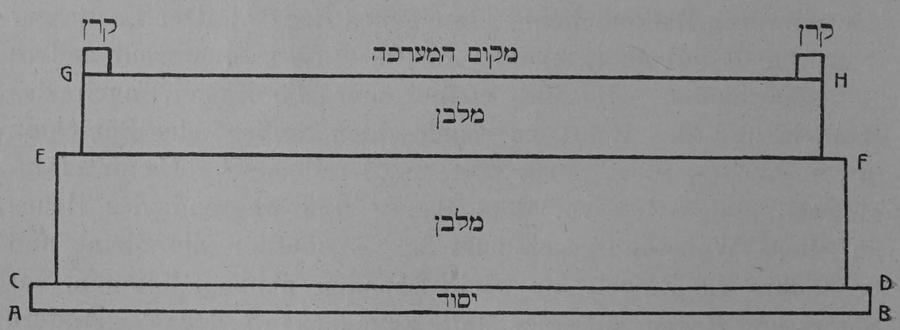

*Fig. 2. Riß des Altars.*

Zwei nebeneinander gebaute Häuser konnten den Eckstein gemeinsam haben[^15.293]. Gemeinsame Steine konnten an den Ecken durch alle Schichten gehen (ראשים), oder ein rechteckig geformter Stein (פָּתִין) konnte mit einem Arm in die Mauer des Nachbars übergreifen[^15.294].

Sonst aber stand jedes Haus als ein Bau für sich da und hatte mit den anderen höchstens die Umfriedung des Hofes (w. u.) gemeinsam[^15.295]. Der Bau ist in den meisten Fällen viereckig (מרבע)[^15.296], doch werden auch Häuser in Form eines Taubenschlages (Turmform), wie auch runde, zwei-, drei- und fünfwinklige, letztere wohl nach griechischem Muster, erwähnt[^15.297]. Die runde und die unregelmäßig polygonale Form des Baues, die immerhin zugegeben werden, zusammengehalten mit der geringen Höhe, die wir noch beobachten werden, macht es wahrscheinlich, daß der Typus des jüdisch-palästinischen Hauses die Höhle, und nicht etwa das Zelt sei. Alte Formen wurden gerne beibehalten; so baute man z. B. auf der Grundmauer eines alten Gebäudes[^15.298], wodurch man die alten festen Grundlagen verwertete; auch wurden Ruinen (חורבה) immer wieder aufgebaut[^15.299].

[^15.284]: Siehe o. TNegʿaim 6,4, 625₂₀ מלמטה סלע מלמעלה בנין. TʾOhal 7,6, 604₁₇ כותל שחציו סלע וחציו בנין. Die alten Überreste liefern für beides Beispiele genug. „Ich habe einen Felsen (πέτρα) gefunden לבנות עליה ולייסד את העולם“ Jalḳ Num 766 (mein „Leben Jesu“ 270).
[^15.285]: ברקתא דנהרא bBm 108a. להנהו בתי דפתיחי לנהרא bʿErub 60a. Über Synagogen am Wasser s. L. LÖW, Ges. Schr. 4,24 und sonstige Literatur. In einem regenreichen Jahre war in Bab. Einsturz der Häuser zu befürchten: Bar bTaʿan 22b.
[^15.286]: Exod R 15,17 בא ליתן היסוד, vgl. יהב אשיא Ezra 5,16; mit gr. תימליוס θεμέλιος (Lwr 2,587) in dem Satze: er zündete Lichter und Lampen (φανός) an, zu wissen, wo er den Grund festlegen soll (קובע תימליוסים Gen R 3,1, Jalḳ § 4 Agg., lies mit ed. Theodor תימיליאום, RN תמליים, nicht Nachtarbeit, wie A. ROSENZWEIG *l. c.* 17 meint, sondern, wie im Texte ausdrücklich, weil der Ort finster war; man denke an tiefe Täler, zumal der Grund an und für sich tief liegt), auch θεμελίωσις. L 2,284, Trg Wb 1,339. Bild der Festigkeit: ליביה מתייסד היך אבנא Trg Hiob 41,15. הרני מייסד עמו TBm 11,4, 395₁ j 10,1, 12c₁₉, bBb 6b. *Nomen actionis* יסוד L 2,248, vgl. oben בַּנַּי. Rechtsfragen bezüglich des Fundaments in Theḳoʿa und Beth-Šeʾan (Skythopolis): jBm 10,1, 12c; die in Beth-Šeʾan hatten ihre Häuser wahrscheinlich an Bergabhängen, so daß es heißt, der untere Besitzer konnte so lange nicht bauen, solange der obere Besitzer nicht fundiert hat (ib.), d. i. wohl eine Terrasse gemacht hat. Ib. auch ein Ausspruch der Maurer (בנאי) in diesen Fragen. Ib. wenn die Mauer über Gruben und Höhlen gebaut war. *suffondare* in Rom, s. Varro bei Nonius s. v. *suffundatum*.
[^15.287]: In dem Satze Cant R Anf.: David baute die יסודות des Tempels, Salomo die oberen Teile (עליונות).
[^15.288]: bBm 117b.
[^15.289]: Gen R 1,13 מרחיב מלמטה ומיצר למעלה. Allerdings ist dort die Sache so dargestellt, daß nur im Falle des Nichtgelingens man allmählich im Bau gewissermaßen aus Ärger spart.
[^15.290]: „Wie baut man den Altar? Man nimmt einen Formkasten (מלבן, s. o.) von 32 Ellen im Gevierte und 1 Elle (zirka ½ m) in der Höhe; dann bringt man Kieselsteine (חלקי אבנים RN, Agg חלוקי, s. A. 137), und zwar מפולמות (s. o. „Meeresgrund“, also gleichsam aus dem Schlamm; Raši jedoch und danach L 3,122, A. ROSENZWEIG, *l. c.* 18 A. 2 „angefeuchtet“, auch I. Löw), große und kleine, und bringt Kalk (סיד), Kalkstaub (קוניא = κονία Lwr 2,513) und Pech (זפת), die man zerrührt und aufgießt (RN ממהא ושופך, Agg ממחה, vgl. MMš 5,1 und w. u.); das bildet den Grund des Altares (יסוד). Dann nimmt man einen Formkasten von 30 Ellen im Gevierte und 5 Ellen in der Höhe und bringt Kieselsteine usw. Dann bringt man einen Formkasten von 28 Ellen im Gevierte und 3 Ellen in der Höhe und bringt Kieselsteine usw.; das bildet die Anrichtplatte (מקום המערכה) des Altares. Dann bringt man einen Formkasten von 1 Elle im Gevierte (und 1 Elle in der Höhe, s. ms München) und bringt Kieselsteine usw. (in dem hier vollständig ausgeführten Satze nur זפת וקוניא, doch ms M. auch סיד, wie in ms M. überhaupt alle dreimal ausgeschrieben) und das bildet die Ecke (קרן = Horn) des Altares, und so an allen [vier] Ecken.“ bZebach 54a. Gewiß eine Reminiszenz aus den letzten Tempelbauten (s. schon o.), vgl. A. BÜCHLER JQR 16,199. Abbildung auf Grund dieser Daten; anders bei R. KITTEL, Studien zur Hebr. Arch. u. Religionsgesch., Leipzig 1908, S. 81. Vgl. auch bSukka 45a עלה אמה וכנס אמה זהו יסוד. Charakteristisch ist die Terrassenform und der Betonbau, vgl. TNeg 7,2, 626₂₀ מלבן הבנוי על גביו und o. *pisé*-Bau. A. ROSENZWEIG 18 A. 3 denkt sich auch die Fundamentierung größerer Häuser in gleicher Weise; unrichtig, wie die Ausgrabungen lehren, die nur große Quadern bieten. מסמכתא oder מסמתא aram. = מלבן, L 3,172.
[^15.291]: bSabb 102b Samuel: die unterste Lage braucht צדודי ועפרא, die mittlere Lehm (טינא), die oberste wird bloß hingelegt (בהנחה בעלמא), RCh zum ersten Punkte שכן דרך הבנאים באבני היסוד מצדדין האבנים כו׳, s. RN s. v. צדד 7,7, der richtig ומיישבין (nicht ומושיבין) für צדד hat. Dieses יישב w. u. in höheren Lagen, während צדד unten. Vgl. מותר לצדדן bBeza 32b, לא ליצדד איניש כובא בארעא bSabb 141a. Eine alte Mauer in Jerusalem beschreibt H. GUTHE, ZDPV 5,285 f., wonach sie teils auf dem natürlichen Gestein, teils auf einem im Schutt aufgeführten Fundament ruht. Die von SELLIN ausgegrabene Stadtmauer von Jericho zeigt, daß zwischen der untersten Bruchsteinlage und dem Felsboden überall eine künstliche Schicht aus Lehm und Klarschlag eingeschoben wurde (Mitteilungen d. deutsch. Orient-Gesellsch. 1908 No. 39 S. 15).
[^15.292]: bh. Hiob 38,6, Vulgata *lapis angularis*; I Petr 2,6, Eph 2,20 nach Jes 28,16 ἀκρογωνιαῖος [λίθος]; dasselbe auch ראש פנה Ps 118,22, Matth 21,42 und Mark 12,10 κεφαλὴ γωνίας. Vgl. A. 149 zu AbRN α c. 28. Eine eigene Zeremonie bei der Grundsteinlegung, wie heute, gab es wohl nicht, aber nach Apokal. 21,14, wo die zwölf Fundamente (θεμέλιοι) zwölf Namen von Aposteln tragen, ist vielleicht anzunehmen, daß der Grundstein irgendwelche Symbole trug. Zu erinnern ferner an die Ausführungen von NAVILLE (PSBA 29,232—242, vgl. GRIMME OLZ 1907, 610—615, Haḳedem 1,312), wonach man in Ägypten in die Grundmauern von Tempeln heilige Texte einzufügen pflegte, ähnlich dem Fund II Kön 23,2. 21.
[^15.293]: MNeg 13,2 אבן שבזוית (ed. Lowe, Agg שבזויות), T 6,10, 626₄ אבן שבזוית, in beiden את שלו, also gemeinsam, s. Maim.
[^15.294]: MNeg 13,2 בית הבנוי ראש ופתין (ms Kfm פתים), dann נראה בראשים (so auch ed. Neapel, nicht ראש; in ed. Lowe und ms Kfm crr. ראשון l. ראשין) und בפתין (auch ms Kfm פְּתִין). Maim. allgemein: אלנטאקאת und אלעקוד, d. i. קרסים und קשורים, die die Mauern verbinden. Spezieller Hai (zu berichtigen nach RN 6,466 s. RŠ): der Stein oder das Holz, der (oder das) die Schichte des einen westwärts mit der Schichte des andern ostwärts zusammenhält (תפס), heißt ראש (das wäre ein Querbalken); Steine und Holz jedoch (שבנדבך זה במערב אחד ובנ׳ אחר במזרח אחד gibt keinen Sinn, „ein Ost“ „ein West“ ist unmöglich, und scheint in ʿAruch entstanden zu sein aus Hai, der da, von ראש und פתין sprechend, sagt, der eine heiße ר׳, der andre פ׳) . . . heißt פתין. Nach L 4,159 ר׳ = hölzerner Pfahl oder Steinsäule in dem Zwischenraum zwischen zwei Häusern, פ׳ die darüber angebrachten Querbalken. J 1254 crossbeam und kingbeam. In ראש stimme ich mit A. ROSENZWEIG 19 f. überein: Eckstein, der gemeinsam ist durch alle Schichten (dort Fig. 1), zu erinnern an ראש פנה Ps 118,22; in פתין (Form wie גזית) sehe ich √פתן in מפתן vgl. GES. Hwb., einen Stein, der wie eine Schwelle über zwei Häuser gelegt ist, am besten zu erklären in der Form eines griechischen Γ oder eines Rechtecks, so daß je ein Besitzer einen Arm für den seinen hält. Vgl. die Karniese (fr. *corniche*) der modernen Baumeister, mit einfacheren Profilen und freihändig gezeichnet in der Antike als *cymatium* = κυμάτιον und *sima* (RICH s. v.) = Hohlkehle. Dunkel ist מכתש של פתין שיש בו בית קבלת אבר TKel bm 7,8, 586₂₁ nach J 1253 Mörser der Narren!
[^15.295]: Vgl. das *dār* (دار) der Araber, L. BAUER, Volksl.² 44.
[^15.296]: MNeg 12,1 מרובע, Bar bBb 164b gr. טטריגון = τετράγωνον Lwr 2,260. Die viereckige Form ist nach M ib. charakteristisch für den Begriff „Haus“, denn bei viereckiger Form ist ein auf vier Säulen ruhendes Haus (ohne Wände) bereits ein Haus. Ib. Haus auf einem Schiff oder σχεδία (Lwr 2,86) auf vier Stangen (קירות l. קורות ed. Lowe und TNeg 6,4, 625₁₉). Der Satz jʿErub 6, 23b₇₂ הכן דרייא דארץ ישראל מרבען geht auf den ganzen Fundus, den Hof.
[^15.297]: בית עגול MNeg 12,1, T 6,3, 625₁₈ noch העשוי כשובך, w. u. werden wir finden, daß der Taubenschlag auch Turm genannt wird; sie müssen darum nicht rund, sondern können polygonal sein. — M ib. טריגון, T 6,3 auch דיגון und פנטיגון Lwr 2,197. 272. 429. Zu טריגון = Dreieck bBb 164b bemerkt RS bM דעבוד כחוצבאי l. mit יעב"ץ: כחצובה, gemeint sind die Dreieckformen, wie sie in ʿAruch s. v. חצב 1 (3,470) primitiv abgebildet sind.
[^15.298]: MSota 8,3 הבונה בית על מכנה, vgl. Ezra 3,3. Nicht sehr haltbar: bBb 7a.
[^15.299]: S. o. A. 113.

## § 16

**16.** **Die Mauer oder Wand** (כּוֹתֶל bh. Hohel. 2,9)[^16.300] war von verschiedener Dicke und Höhe. Im allgemeinen dürften die in Mišna Bb. 1,1 von der zwischen zwei Höfen gezogenen Scheidemauer[^16.301] gegebenen Maße für die Mauer des bürgerlichen Hauses in Palästina überhaupt typisch sein. Danach hatte die Mauer von Bruchstein (גויל) 6, die von Quadern (גזית) 5, die von Halbziegeln 4 und die von Ganzziegeln 3 Tefachim (Handbreiten; 1 T. = 74 mm) Dicke. Diese minimale Dicke genügt wohl für eine Scheidemauer, nicht aber für eine Hausmauer, die wir nach alten Überresten uns eher dick als dünn vorstellen müssen. Nach jenen Angaben lag jegliches Material nur einfach in der Mauer, und noch dazu unebenmäßig, denn die Dicke der Bruchsteinmauer gegenüber der aus anderem Material soll davon herrühren, daß die Bruchsteine mit ihren Spitzen und Kanten auf beiden Seiten zusammen um einen Tefach aus der ebnen Mauer hervorragen[^16.302], doch wird bei dieser Gelegenheit auch davon gesprochen, daß jene Steine bloß die äußere Verkleidung (אורבי aram. pl.) der Mauer bilden, so daß zwischen den beiden Außenlagen eine Füllung von kleinen Steinen und Lehm zu liegen kommt (aram. רכסא), und zwar in der Dicke von 1 Tefach[^16.303]. Der minderwertige Kern muß den Bau beträchtlich billiger gemacht haben, und recht passend wird die Brockenfüllung (*fartura*) nur mit einem Bau aus rohen Steinen in Beziehung gebracht. Da ferner die Quadern nicht in zwei Sorten geteilt werden, scheinen die Juden die Technik, Längsquadern mit Querquadern zu binden[^16.304], nicht geübt zu haben. Beim Ziegelbau aber wurde die Technik geübt, über je eine Schichte Ziegel mit dazwischen liegendem Füllsel (לבינה) eine Ziegelplatte (אריח) von gleicher Breite mit der Mauer überzulegen, so daß die Außenflächen der Mauer miteinander verbunden werden (διάτονοι = *diatoni* der Griechen und Römer)[^16.305]. Die in jener Hofmauer angenommene Dicke von 3 Tefachim (0,22 m, wie auch die normalen ägyptischen Ziegel, o. S. 16) wird weit überschritten von der Angabe, ein Haus sei aus 7 Ganz- und 1 Halbziegel gebaut gewesen[^16.306], das also, den nämlichen Ziegeltypus vorausgesetzt, 22¹/₂ T. (d. i. 166,5 cm) dick war.

Die Höhe einer Steinschicht (נדבך, דימוס = δόμος)[^16.307] betrug in der Regel 4 Tefachim (2,96 cm)[^16.308], vorausgesetzt freilich, daß die Quadern bei der Versetzung nichts verloren hatten; doch verlor sich einiges, indem man die Lagerflächen einander anpaßte; bei bloß abgeglichenen Bruchsteinen konnte der Abfall ¹/₂ Tefach auf jeder Fläche des Steines betragen, so daß bei 3 Lagen statt 12 T. die Höhe von 10 T. herauskam[^16.309]. Leider mangelt es an Angaben, wie viele solcher Lagen die Zimmerwand ausmachten. Aus MOhal 14,1 folgt bloß, daß ein Gesimse — also war es ein stattliches Haus — um 3 solcher Lagen höher als die Türe zu stehen kommen kann; nehmen wir für die Türe, die im allgemeinen, wie noch heute in Palästina, recht niedrig war, ein Mindestmaß von 10 Tefachim an[^16.310] und rechnen wir jene angedeuteten 12 T. noch hinzu, so hat das palästinische Haus bis zur Decke die Höhe von 22 T. (1,63 m), also fast gleich der Normalhöhe eines Menschen (§ 96); noch immer beträchtlich zu nennen, wenn man die „Zimmer“ im jüngst ausgegrabenen alten Jericho und auch manches ganz neue Fellachenhaus damit vergleicht[^16.311]. Doch muß sich die Mauer durch die Mörtellagen um etwas erhöht haben, so daß wir etwa die Höhe von 1,70 m annehmen können; nicht hoch, aber doch ansehnlich.

Die Technik der Maueraufführung blieb nicht in der ganzen Höhe dieselbe; unten, d. i. im Fundament, hatte man darauf zu sehen, den Stein in Erde zu versetzen, weiter oben kam Mörtel dazu, die oberste Schichte wurde ohne Mörtel gelegt[^16.312]. Zu der Wanddicke von 3, 4, 5, 6 T. (letzteres = 44,4 cm) gehalten (diejenige von 166,5 cm bildet eine Ausnahme), können wir das palästinische Haus für massiv und niedrig halten, was den Landesverhältnissen und dem heutigen Befund entspricht.

[^16.300]: nh. כותל, aram. כותלא, assyr. *kutallu*, GES. Hwb.¹⁴ vgl. arab. كَتَلَ fest zusammenkleben.
[^16.301]: Vgl. כותל שבן שני בתים MʾOhal 6,4, T 7,8, 604₂₅.
[^16.302]: מורשא דקרנתא bBb 3a (מורשא von ראש, ריש L 3,264 und J 751: Spitze, Kante; vielleicht aber von רשש syr. ܪܫ mit dem Hammer schlagen: das Zerbröckelte an den Ecken; vgl. רששין Erdschollen L 4,476, s. A. 250; °מרשותא Sägemühle L 3,264, K 5,263; ܡܪܫܬܐ *mortarium*, ܡܪܫܐ ὕπερον *pistillum* PSm 3981, BROCKELM. 360). L übersetzt unrichtig: die Spitze der Ecksteine eines Gebäudes, denn קרנתא sind Ecken, und מורשא ist damit ungefähr so verbunden wie קרן זוית. Vgl. מ׳ דק׳ bʿErub 57a. 76b, bSukka 8a.
[^16.303]: לביני אורבי bBb 3a (var. ירכי, viele Var. zu ביני אורבי bSabb 50b; RN ארבי allein richtig, von K 1,268 zugunsten einer Etym. אורכי oder אדבי, s. jedoch L 1,157 (ohne Etym.), J 33 von ארב, ערב etwa Maschen; vgl. MANDELKERN, Konkordanz zu ארבות. Ich stelle ארבי, אורבי zu ארבות ידיו Jes 25,11, nach der geläufigsten Erklärung: Gelenke, ارب = Glied; zwei Außenseiten, wie die Hände die Außenseiten des Körpers sind; vgl. übertragen vom Körper פי המערה o. und lat. *alae*, *fauces*. — Die Möglichkeit der Bauart mit Brockenfüllung (*fartura* Vitruv 2,8, 4; die äußere Fläche der Mauer heißt ὀρθοστάτης, Abbildung bei RICH s. v. *orthostata* = אורבי) obwaltet natürlich nicht nur, wenn גויל die Hälfte des גזית ist (bBb ib.), womit der Talmud גויל und גזית in ein Verhältnis bringen will wie das von כפיסין und לבינין, sondern überhaupt. Auch der vom Talmud angenommene Unterschied zwischen ביני אורבי und רכסא resp. טינא ist unberechtigt. רכסא desselben Stammes wie bh. רכסים Jes 40,4, ganz ähnlich in bautechnischem Sinne Exod R 15,22 „Er baute die Söller nicht aus Steinen, nicht aus Quadern, sondern aus einer Wasserfüllung“ (רכסים של מים), s. L 4,452: רכס ركس verbinden, befestigen. Schon für die Mauern des alten Babylon nimmt LAYARD (Niniveh S. 333) die Bauart an, daß die innere Erdmauer mit Steinen oder Platten eingefaßt war; in Athen s. DURM, Baukunst der Gr.² 345; ἔμπλεκτον BLÜMNER, Techn. 3,144 f., und keineswegs sind die Römer die Erfinder des „Gußmauerwerkes“, s. MERCKEL, Ingenieurtechnik S. 44. Eusebius (Präp. Ev. 9,36) teilt von einem syrischen Schreiber mit, daß die Mauern Jerusalems gebaut sind teils ἀπὸ λίθου ξεστοῦ τὰ δὲ πλείονα ἀπὸ χάλικος, s. ZDPV 5,285; s. auch ib. 17,2.
[^16.304]: Wechsel in den Stoßfugen in der Bautechnik der Etrusker DURM² 27. Binder- und Läuferschichten wechseln der Höhe nach ab; ein Läufer ist in der Regel doppelt so lang als ein Binder (dies stimmt mit den Maßen von לבנים = Läufer im Verhältnis zu כפיסין = Binder überein!), selten dreimal so lang (Durm ib.).
[^16.305]: Indem unten jedenfalls eine Steinlage (= 0) anzunehmen ist, konstruiere ich folgendes Bild der gedachten Ziegelmauer: An den beiden Außenflächen in der ersten Schichte (= 1) liegt je eine Ziegellage (= ל) mit dazwischenliegendem Gefüllse (schattiert), darüber (Schichte 2) eine über der ganzen Breite der Mauer liegende Latte oder Platte (= א), die die Außenflächen verbindet, und das ist die eigentliche Verwendung des אריח = כפים = Binder (s. o.), nur muß hier אריח nicht in der mišnischen Definition = Halbziegel, sondern in der ersten Bedeutung gefaßt werden. In den höheren Schichten, 3, 4 usw., ist dieselbe Anordnung, die oberste Lage bildet naturgemäß der Tragbalken, wie noch unten zu sehen sein wird. Der hier geschilderte Bau paßt für Babylonien mit seinen Erdmauern mit der Verbrämung an den Außenflächen, und man vergesse nicht, daß es **Rab** ist, der sich darüber ausspricht, also ein Babylonier. Diese Bauart diente nämlich den Rabbinen zur Verdeutlichung der Schreibart gewisser Partien der H. Schrift, und so lesen wir in jMeg 3,8, 74b₆₇ (vgl. Soferim 12,10): „Es sagte RZeʿira, RJirmija im Namen Rabs: Das Meereslied (Exod 15) und das Deboralied (Richter 5) werden geschrieben Latte (אריח) über Ziegel (לבינה) und Ziegel über Latte; die Zehn Söhne Hamans aber (Esth 9,7 f.) und die Könige Kanaans (Jos 12,9) werden geschrieben Latte über Latte und Ziegel über Ziegel.“ In bMeg 16b dasselbe, nur im Munde des RChanina bPapa, daß es so vortrug RŠela aus Kefar-Thamritha (ein Ort, der wenigstens nicht unbedingt palästinisch sein muß, vgl. NEUB. Géogr. 280). Man muß sich vergegenwärtigen, daß die Schrift naturgemäß von oben nach unten läuft (1—4 hier links der Figur), während der Bau von unten nach oben fortschreitet (1—4 hier rechts von der Figur).[Abbildung: zwei Schemata einer Mauer, A und B, Schichten links 1–4, 0 und rechts 4–1, 0 beziffert. A: Schichten 1 und 3 (links gezählt) je ein durchgehendes א; Schichten 2 und 4 je ל – schraffierte Füllung – ל; unterste Schicht 0 leer. B: linke Spalte durchgehend ל, mittlere Spalte schraffiert, rechte Spalte durchgehend א, in allen Schichten 1–4 und 0.]Mit dieser Schreibung wird es bekanntlich heute noch so gehalten, s. FRENSDORFF, Massora Magna S. 385 A. 1; JE 11,130 *Scroll of the Law*. Die Erklärer haben in technischer Hinsicht, trotz der halachischen Wichtigkeit der Sache, den Tatbestand verkannt. Nach Raši zu bMeg ist אריח die Schrift, לבינה das Blanke, dieses zweimal soviel als die Schrift, denn א׳ sei die Hälfte der ל׳, so auch L 1,163, mit einer ungeschickten Zeichnung. Nun kann aber das Blanke nicht לבינה heißen! Nach K 1,279 und J 118 (der übrigens der einzige ist, der sieht, daß אריח ein *bond-timber* ist) ist א׳ die lange Zeile, ל׳ die breite Zeile (gerade umgekehrt!); das „Blanke“ berühren sie nicht. A. ROSENZWEIG, Wohnhaus S. 21, konstruiert in Fig. *a* eine ganz vernünftige Ziegelmauer, und zwar auf Grund der Angaben des RNissim zu Ḳidd Abschnitt 3, aber in betreff der Schreibart begnügt er sich mit einer vagen „Ähnlichkeit“, denn „Latte auf Ziegel“ et vice versa kann er nicht ausweisen; seine Fig. *b* kommt dem allerdings nach, aber für die mittlere Lage hat er keinen Namen. Diese mittlere Lage nun hat im Talmud keinen Namen, weil es zu Zwecken der Deutung nicht notwendig ist, aber in der Mauerkonstruktion muß man damit rechnen, denn das ist die Füllung (רכסי oben), und diese wird im Meereslied und Deboralied teils mit Worten ausgefüllt, teils ganz leer gelassen, während in „Söhnen Hamans“ und „Königen“ der Platz des chaotischen Gefüllse einfach leer bleibt. Vgl. in Machsor Vitry p. 662 die ersten paar Zeilen des Meeresliedes:[Schema, Zeilen 1–5; eingerahmte Wörter in eckigen Klammern, Lücken durch „ | “ markiert:]1 אז ישיר משה ובני ישראל את השירה הזאת לי״י ויאמרו2 [לאמר] | אשירה לי״י כי גאה גאה | [סוס]3 ורכבו רמה בים | עזי וזמרת יה ויהי לי4 [לישועה] | זה אלי ואנוהו | [אלהי]5 אבי וארוממנהו | י״י איש מלחמה י״י1 = אריח, über die ganze Breite gehend, liegt in 2 auf den in ein Karree geschlossenen Ecken, die in der Mauer die Außenflächen bilden: = לבינה, zwischen beiden in der Mitte liegt die in diesem Betracht namenlose Füllung, mit Worten markiert, die der Verdeutlichung wegen von den Ziegeln durch ein Spatium getrennt sind. Nun liegt wieder 2 = לבינה seinerseits auf auf 3 = אריח (in der Mauer ist es eine durchgehende Lage), 3 = א׳ liegt auf über den zwei Ziegeln in 4, diese wieder über den א׳ in 5 usw., ganz wie es der Talmud will. Bezüglich der „Söhne Hamans“ stellt sich die Sache so dar:[Schema: rechts, mit Klammer zusammengefaßt, untereinander איש / פרשנדתא / דלפון, daneben senkrecht „אריח liegt über אריח“; in der Mitte senkrecht „Füllung“; links, mit Klammer zusammengefaßt, 1 ואת / 2 ואת / 3 ואת, daneben senkrecht „לבינה liegt über לבינה“.]Von der letzteren Bauart heißt es in j ib. דכל בניין דכן לא קאים „ein derartiger Bau kann nicht stehen“, in b symbolisch bezüglich der Söhne Hamans resp. der Könige: „über ihren Sturz gibt es kein Auferstehen“. Offenbar entspricht der אריח hier den *diatoni* in der antiken Bauart (RICH s. v.), und die sind nur bei dem *emplecton* (s. o.) genannten Bauart angewendet worden; allerdings in Stein, aber wir bemerkten bereits, daß der Babylonier Rab spricht, der in seinem Lande derartige Ziegelbauten kannte. Auch die Schreibart der Mezuzza wird bautechnisch ausgedrückt: לא יעשנה כקובה bMenach 31b, s. L 4,234. Zu גובתא דאריח s. ZATW 28,244.
[^16.306]: bSabb 129a. A. ROSENZWEIG S. 22 A. 3 setzt 1 Tefach = 9,336 cm, die fragliche Mauer von 22,5 Tefach hätte dann 2 m 10 cm Dicke gehabt, was doch zuviel ist; nach unserer Berechnung hatte sie 165,5 cm. Die Ägypter hatten bei einem niedrigen Hause die Mauerstärke von etwa 0,40 m, bei einem mehrstöckigen Hause etwa bis 1,25 m, s. MASPERO-STEINDORFF, Kunstg. S. 6. In Rom durften auf einem Gemeinorte Mauern, welche dicker als 1½ Fuß sind, nicht stehen: Vitruv 2,18, 17; Plin. 35,49.
[^16.307]: *נדבך, Ezra 6,4 נדבכין, s. zur Etym. GES¹³ 925, wo verwiesen ist auf ZA 2,111 ff., Del. Prol. 150 und dazu NÖLDEKE ZDMG 40,733; E. MEYER, Entst d. Judent. 46, vgl. Aufl.¹⁴ und Oxford Gesenius. Oft nh.: MBerakh 4,8, MKel 20,5, MʾOhal 14,1, MZab 5,5, TSabb 13,2, 128₂₅, TʾOhal 14,8, 612₃, jŠebiʿith 3,5, 34c₇₆; in bSukka 20b מדבך אבנים, bSabb 125b נדבך של אבנים (RN מרבג, nach Hai zu ʾOhal 3,7 mit Verb רבג zusammenhängend, s. L 4,412, der richtig רבע (= רבץ o. und in technischem Sinne Jes 54,11 הנני מרביץ בפוך אבניך). — D. H. MÜLLER, Ezechiel-Studien, Wien 1894 S. 57 hält מדבך (L 3,23) für ursprünglicher als נדבך, obwohl assyr. *nadbaku* = Wand. Arab. Lehnw. مدماك wird mit الساف = Bauschichte erklärt S. Fraenkel S. 12. (MʿOhal 6,1 richtige LA נדור. T 7,1, 603₃₂ ebenso zu lesen: Totenbahre, s. w. u.). — RN bemerkt bereits, נדבך sei = דּוֹמוֹס, so δόμος bereits LXX Ezra 6,4 (24), s. TBm 11,5, 395₇. TSabb 11,1, 125₁ j 7, 10d₁₉, immer von Steinschichten, wie auch נדבך (s. o.) und מרבג (s. o.), doch auch דומוס (zumeist דימוס geschrieben, s. Lwr 2,205) von ארחין Latten; Herodot 1,199 u. Polybios 10,24,1 von Ziegelschichten.
[^16.308]: Die Etrusker bauten in der Schichtenhöhe von durchschnittlich 50—60 cm (Durm 26), allerdings an alten Stadtmauern gemessen; demnach ist bei einem Privathause die Schichtenhöhe von zirka 30 cm, wie es aus MʾOhal 14,1, T 14,8, 612₃ (hier der fem. Plural נדבכות) folgt, noch respektabel. Die Steinlagen des Davidturmes (Phasael) zu Jerusalem messen ungefähr 2½ j. Ellen (etwas über 1 m) C. SCHICK, ZDPV 1,234 nebst Abbildung. Des Josephus (BJ 5,4,4 § 175) Masse (Stücke von 20 Ellen Breite und 5 Ellen Höhe) findet SCHICK unglaublich. Die Quadern des Turmes, der vielleicht Psephinus war, beschreibt SCHICK ib. S. 19.
[^16.309]: jŠebiʿith 3,5, 34d₉ כתות (s. A. 129). Solcher Abfall wurde von C. SCHICK im Davidsturm noch *in situ* gefunden ZDPV 1,212.
[^16.310]: Siehe w. u. und besonders Bar bʿErub 11b und bJoma 11b. Man denke an die als Typus hingestellte Höhle. Ein als Getreidespeicher erkannter Raum in der Tempelarea von Assur war nur durch „ein kanalartiges Loch von 0,47 m unterer Breite und ca. 1 m Höhe“ zugänglich, s. W. ANDRAE, Der Anu-Adad-Tempel in Assur, Lpz. 1900, S. 88 f.
[^16.311]: Im alten Ägypten war die von Palmzweigen konstruierte Decke des einfachen Hauses so niedrig, daß man sich hüten mußte, sie mit dem Kopfe nicht einzustoßen (MASPERO-STEINDORFF, Kunstg. S. 2). Man hatte zu fürchten, daß die brennende Lampe die Decke des Hauses ergreifen könnte MSabb 16,8, u. z. nach b 43a בביתי גחיני bei niedrigen Häusern, es gab also auch höhere. Vom Ofen bis zum Gebälke mußte die Höhe noch 4 Ellen betragen MBb 2,3. Es können im Zimmer Gerätschaften 4 Ellen hoch aufgehäuft sein, ohne daß sie zum Balken gereichen MNegʿaim 13,1. Mit all diesen Daten kommt man nicht viel über unsere Anssetzung von 1,70 m hinaus. Nach der Kleinheit der Räume in vielen bei den Ausgrabungen von Jericho sichtbar gewordenen Häusern scheint es, als seien die Städte oft mehr Vorrats- als Wohnstätten gewesen, wie die Vorratsdörfer der heutigen Halbbeduinen. G. DALMAN im Palästinajahrbuch, Berlin 1908, 4,24.
[^16.312]: bSabb 102b, s. A. 291. Die Steinlage der Mauer heißt auch כפא bBb 5b (s. K 6,95) Agg. שפא ساف S. Fraenkel S. 12; jSabb 12,1, 13c₁₃ pl. כפיין neben דפין, u. z. entstanden durch Tätigkeiten des Bauens, doch läßt sich deren genaue Technik nicht ausmachen.

## § 17

**17.** **Der Bewurf.** Die fertige Wand wurde, wie schon in biblischer Zeit, wenigstens von innen, mit Mörtel beworfen (הִטּוֹחַ, שָׁטַח, טָפַל, חִפָּה, aram. שעע)[^17.313], um eine gefällige Fläche herzustellen. Der Anwurf hält sich auf einer Steinmauer besser als auf einer Ziegelmauer[^17.314]. Nur leichtere Mauern, wie z. B. die eines Gartens, wurden unverklebt gelassen, aber die Wand eines Hauses war nur mit Bewurf regelrecht gebaut[^17.315]. Wir hören, wenn auch nur bei einem außerordentlichen Falle, wenn nämlich irdene Töpfe eine Art Scheidewand im Hause bildeten (w. u.) und mit Mörtel beworfen waren, dass der Bewurf eventuell auch für sich bestehen kann[^17.316]. Die mehr luxuriösen und künstlerischen Arten der Bemalung behandeln wir weiter unten.

[^17.313]: הטח Lev 14,43. 48, s. DILLMANN z. St. BENZ. Arch. 118, NOWACK Arch. 1,139. Nh. טוח Ḳal, Nifʿal u. Hifʿil, L 2,144; s. auch טיח u. טיחה ib. 153. שטח s. nächste A. Trg Ps-Jon Gen 6,14 ותישוע יתה . . . בהימרא. — טפלה u. טפילה u. z. mit dem Verb גרר „den Bewurf abschaben“, von einem Ofen: MKel 5,7 (T 4,18, 574₄ von ehernen Öfen anders), vgl. תפל Ezech 13,10 f., 22,28; טפיל Trg Jerem 43,9 für מלט. — מחופה בעפר MNeg 12,2. Vgl. κόσμος ψαμμωτὸς τοίχου ξυστοῦ Sir 22,15.
[^17.314]: AbRN α 14 p. לט Elišaʿ bAbuja: לסיד שטוח על גבי אבנים, dann לסיד שניטוח על גבי לבנים אפילו יורדין עליו גשמים קימעה מיד נימוק כו׳.
[^17.315]: bMḳ 7a.
[^17.316]: MʾOhal 6,2, T 7,4, 604₁₀ wo הִטֵּהָן „ihr Bewurf“ ein eigenes Wort, in M nur טיט. bʿErub 25a טח בטיט ויכול לעמוד בפני עצמו. Zur Sache s. w. u. und ROSENZWEIG S. 23 A. 1.

## § 18

**18.** **Das Gebälke und die Decke.** Nächst den Wänden ist es wohl die Decke, die das Haus zum Bewohnen geeignet macht, ist sie es doch, die den Schatten spendet, und so bezeichnet „Schatten des Gebälkes“ (Gen. 19,8) das Haus überhaupt, eine Metapher, die sich bei den Rabbinen fortsetzt[^18.317]. Die züchtige Frau rühmt sich daher wie folgt: Nie haben die Balken meines Hauses mein Haupthaar (resp. mein Hemd) gesehen[^18.318]. Das Gebälke (תקרה)[^18.319], der Plafond des Zimmers, heißt sehr passend der Balkenhimmel (שמי קורה = lat. *coelum* = οὐρανός)[^18.320].

Die Decke bestand zunächst aus Balken (קורה)[^18.321], d. h. langgestreckten Baumstämmen, und zwar zumeist aus Sykomoren- und Zedernholz (s. o. § 10), die man in vielen Fällen unverändert, also rund, in anderen Fällen jedoch viereckig bearbeitet, verwendete[^18.322]. Vermöge ihrer natürlichen Beschaffenheit waren diese Balken an dem einen Ende etwas dicker als dem anderen, und so legte man sie so, daß die dicke Seite des einen Balkens neben der dünnen des anderen lag[^18.323]. Zum Behufe des darüber gelegten Estrichs (w. u.) wurde eine doppelte Reihe von Balken gelegt, und so unterschied man untere und obere Balken; sie waren entweder übereinandergelegt (מכוונות), oder wechselten miteinander ab[^18.324].

Die ganze Decke (bh. ספון, nh. תקרה)[^18.325] ruhte nicht unmittelbar auf der Stein- oder Ziegelwand, weil die Mauerfeuchtigkeit dem Holze geschadet hätte, sondern ringsherum auf den vier Wänden wurde erst eine Rostschließe (מריש)[^18.326] aufgesetzt, gleichsam die oberste Schichte der Mauer bildend, und in diese ließ sich das Holzwerk leichter einfügen. Die so gelegten Balken bildeten einen Rahmen (מלבן)[^18.327]. Gewisse Anzeichen sprechen dafür, daß dieses Vorgehen nur bei größeren Bauten, bei Tempeln und Palästen, beobachtet wurde[^18.328], während kleinere und gewöhnliche Bauten die Decke erhielten, indem man den Balken quer über von Wand zu Wand legte[^18.329]; hierbei mußte ihm, da er auf der bloßen Mauer auflag, gewissermaßen eine Lagerstätte (אקבעתא דכשורי)[^18.330] zurecht gemacht werden, in die er, um vor der Feuchtigkeit des Mauerwerks geschützt zu sein, zwischen Brettern und Hobelspänen eingebettet wurde[^18.331]. Die Baumstämme mußten über den ganzen Raum reichen, eine Stückelung hätte gewiß üble Folgen gehabt[^18.331a]. Den kräftigsten Balken legte man als Unterzug[^18.331b] in die Mitte des Gemaches, damit er die schwächeren Balken in der Mitte stütze[^18.331c]. Es mag sein, daß die ganze Decke aus Balken bestand, doch werden auch Bohlen und Bretter (אמלתראות) erwähnt, mit denen die Zwischenfelder ausgefüllt wurden; durch diese Anordnung ergaben sich von selbst zierliche Umrisse (בתי קוריות)[^18.331d], die kunstvoll verschönert eine gefällige Kassettierung (שמי קורה = *coelum*, φάτνωμα, *lacunar*) ergaben[^18.331e]. Dieses Zierats wegen und auch an und für sich gab es Balken der verschiedensten Bearbeitung, wie die Verschiedenheit der Namen (כשורין, שריתא, אפריזא, מלטיסין, כופת, רהיט, הדרי) beweisen[^18.331f]. Auch Fenster[^18.331g] und Türsturze[^18.331h] wurden mit Holz verkleidet und verziert. Von dieser Pracht sticht sehr ab die primitive Decke, die man bei eintretendem Raummangel dadurch herstellte, daß man die Höhe des Zimmers durch ein quer gelegtes Brett in zwei teilte und so eine Art Stockwerk erhielt[^18.331i].

[^18.317]: צל הקורה Exod R 24,3, Num R 23,2, allerdings von dem Obdach der Schafherden. Vgl. סכות Hütten A. 50. Häufig מטללתא.
[^18.318]: Lev R 20,11. Der Grieche sagte: nicht unter demselben ὄροφος mit einem sein: Plato, Rep. 3,417a. Deutsch: Unter einem „Dach“ mit einem leben.
[^18.319]: MBm 10,2, in MʾOhal 13,3 תקרה in der Fensterhöhlung. L 4,666.
[^18.320]: שמי קורה bBm 42a, bPesach 8b, bJoma 53a und oft. ܫܡܝܐ = *tectum* I Kön 6,16, PSm 4208 und BROCKELM. 379; ib. vom Gaumen. Lat. *coelum* s. RICH s. v., wo man sieht, daß das bereits eine getäfelte Decke ist. Auch שמי טללא der Schattenhimmel, bBerakh 48a. Dieser Balkenhimmel war manchmal weder fest noch hoch, denn es wird davon gesprochen, daß, wenn er am Sabbat geborsten ist, man ihn mit einer Bank oder mit den Leisten des Bettes stützen darf, bSabb 43a; es sollen das freilich **neue** Balken sein, die zu springen pflegen. הטפחות I Kön 7,9 sollen nach Raši z. St. = שמי קורה sein, richtiger RDḲ z. St., Kragsteine, auf denen die Balken ruhen; Trg שוכפיא.
[^18.321]: bh. und nh. קורה, assyr. *ḳarîtu*, aram. ܩܘܪܝܬܐ, arab. قَرِيَّة L 4,275, K 7,184, J 1342. Nomen Verbale קרוי (s. o.) von קרה קרי Ḳal u. Piʿel (L 4,378).
[^18.322]: MʾOhal 12,6 עגולה und מרובעת, und zwar drei resp. vier Tefachim im Durchmesser. Ib. נתן את הקורה, MBm 10,2 und T 11,3, 394₂₈ נתן את התקרה = Balken legen. jŠebiʿith 4,5, 35b₆₁ הקוצץ בקורות לא יהא מחליק ומדריג . . . ומהביק die zimmermännische Bearbeitung des Balkens, s. bei „Schreinerei“. Gut geglättet waren die Balken nicht, denn es ist sehr oft vom Spane des Balkens die Rede (s. Wbr s. v. שיבא). An der Seite von Stein steht auch bei Balken der Begriff „behauen“ (TMeg 3,5, 224₂₅ אבנים וקורות שנפסלו).
[^18.323]: jSota 7,4, 21d₂₈ התקרה הזו עובייה דהן גבי קוטנה דההן, vgl. Exod R 1,6: „Derjenige, der das Gebälk gehörig machen will (זה שמתקן תקרה כראוי), legt die Dicke des einen Balkens (תקרה) zum Ende des ungleichen andern (unter Vergleich, daß Israel das Gebälke der Welt darstellt, anspielend an Jes 48,12 וישראל מקוראי = מקורה, קורה gebälkt)“, Tanch Šemoth 3. Die dicke Seite des Balkens vgl. im Sprichwort Gen R 42,6; bBerakh 64a.
[^18.324]: MʾOhal 12,5, T 13,7, 610₃₅.
[^18.325]: ספון I Kön 6,15, vielleicht auch שקף (vgl. سَقْف, Dach, Decke) ib. 7,5, verglichen mit שְׁקֻפִים und dieses mit ספון ib. V. 3. 4. Nh. תקרה L 4,666 Phön. מספנתה LANDAU, Phön. S. 1, משפן ib. S. 46 Z. 7.
[^18.326]: MGitt 5,5, MʿEduj 7,9, MZabim 4,2 (Maim. מריש = المشف). Die Bedeutung des Wortes geht hervor aus Trg I Kön 6,36; 7,12: Drei Reihen (סדרין) Stein und eine Reihe מריש aus Zedernholz, also ganz wie beim zweiten Tempelbau Ezra 6,4: Steinschichten drei, Holzschichte eine, vgl. ZDPV 30,95 (dagegen עצים in Lev 14,45 Bindehölzer inmitten der Mauer s. A. 191). In Trg II Chr 3,7 ed. Lagarde מרישיא, Tw הקרות. Weil der מריש in der Mauer selbst zu liegen kommt, heißt es von ihm שבנאו resp. שקבעו, man hat ihn eingefügt in den Palast (בירה): MGitt 5,5, MʿEduj 7,9, bGittin 55a, j 47a₆₇, TBḳ 10,5, 367₃, j 9,1, 6d₂₈, bTaʿan 16a, ferner מקעקע כל הבירה; mit dessen Herausnehmen demoliert man den ganzen Palast. Auch für המרישות bBḳ 66b für העבים Ezech 41,25 (s. Hai zu Zab 4,2) paßt nur diese Bedeutung, und so auch Hab 2,11 Trg für עץ, dieses parallel mit קיר! Gebildet ist מריש wie כפיס, im letzten Ende wie dieses wohl assyrisch. L 3,263 مارس, dagegen Fl 319; K 5,263 ganz verfehlt (ib. Etymologien von J. PERLES und N. BRÜLL), J 843 vergleicht Targum zu מורשי Hiob 17,11 לוחי.
[^18.327]: MZabim 4,2 neben מריש, s. Maim. Anders מלבן הבנוי על גביו MNeg 13,3, T 7,2, 626₂₀ (gegen A. ROSENZWEIG 31, s. A. 281). — Die assyrischen Paläste zu Nimrud und Kujundschik fand man außerordentlich schmal; LAYARD, Niniveh S. 325 hat überall Überreste von Balken gefunden, und meint, daß sie etwa von hölzernen Säulen oder Ständern getragen wurden, oder Balken, die von den einander gegenüberstehenden Mauern getragen wurden, mögen im Mittelpunkte des Täfelwerks zusammengetroffen haben, denn an Holz waren die Assyrer bekanntlich sehr arm. Nach F. REBER (ZA 1,148) ging man der Holzkonstruktion selbst in der Deckenbildung möglichst aus dem Wege. Aus dem Umstande, daß die länglichen schmalen Säle keinerlei Spur einer Licht- oder Luftöffnung aufweisen, schließt er (ib. 170 f.), daß bei holzgedeckten Räumen die Wände unter der Decke in Pfeiler auslaufen konnten, deren metopenartige Zwischenräume dem Licht und der Luft Zugang gewährten. Assyrische Reliefbilder zeigen in der Tat solchen Bau, s. auch LAYARD a. a. O. So sind noch heute die Loggien der ländlichen Häuser in Italien. Solche Luft- und Licht-Luken hatten auch die Juden, w. u.
[^18.328]: Tempel und בירה s. zweitvorhergehende A. In Ḳoh R 3,11 wird ein טריקלין *triclinium* (w. u.) mit קורה bedeckt.
[^18.329]: קורה שהיא נתונה מכותל לכותל MʾOhal 12,6, ib. 5,7, T 6,5, 603₂₄.
[^18.330]: bBb 6a s. Raši, auch RDḲ s. v. עב und das Zitat bei K 5,153 s. v. מלטם. Dasselbe scheint zu sein קביותא דדשי bMḳ 11a Agg, aber ms M דרישא l. דמרישא, und קבוותא l. קבעתא (ע kann übrigens auch verflüchtigt sein), anders L 4,234, K 7,55. Die Erklärer z. St. denken an Nägel; das könnten etwa die sogenannten „Schwalbenschwänze“ sein, die schon in den Palästen der Assyrer figurieren, indem sie die Mauerplatten miteinander verbanden, s. LAYARD, Niniveh S. 323. Vgl. דף של נחתומים שקבעו במסמר שחיבר במריש או בקירה TʿEduj 2,1, 457₅, nicht ganz so ib. 3,1, 459₁₂. Nach BLÜMNER 2,306 geschah die Verbindung 1. durch Nägel, Klammern, Bänder, 2. Verzapfung oder Verkämmung, 3. Leimen.
[^18.331]: Raši bBb 6a.
[^18.331a]: Zu kurze Balken bTaʿan 25a; durch ein Wunder auf Fürsprache des RChanina bDosa lang geworden, ragten sie auf beiden Seiten noch um eine Elle vor; also waren es die auf die Längswände gelegten Tragbalken. Nach einer Meinung wurden sie durch Anstücklung verlängert, doch ist der Sinn von סניפין unbestimmt, s. RN (6,87). Sprichwort: כשרותא בעיא מוליי סבא דקיסא מיניה „wenn der Balken einer Ergänzung bedarf, nimm von ihm selbst einen Span“: jMš 5,5, 56c₃, jBeza 2,4, 61c₂₃, jChag 2,2, 78a₅₈. Vgl. שיבא מכשורא bSanh 7b. Anstücklung wäre allenfalls möglich, wenn von innen balkentragende Säulen angebracht wären, was vielleicht daraus zu erschließen wäre, daß כלונסות *columnae* = קורות s. Wbr., vgl. Sifre Num 160 p. 61b כלונסות של ארז, bChull 90b; Lwr 2,289.
[^18.331b]: In Ungarn heißt der dicke Querbalken *mestergerenda* = Meisterbalken. Man legte die Balken aus Aberglauben in ungerader Zahl, wie aus bPesach 110a רמא מני כשורי hervorgeht.
[^18.331c]: קורה שופעת Gen R 14,6 richtiger als שפעת קורייה Ḳoh R 3,11; hier der eigentümliche Ausdruck בתוך דירתו וביתו (L 4,276 und K 7,185 zitieren קוריים). Den kräftigen Balken lieferte der Palmbaum: Gen R 41,1, Num 3,1 שפעת קורות, Jalḳ Psalm 845 ש׳ קוריה (fehlt in Midr Ps 92,11); J 1619 falsch: glatt geschnittener Balken. Von der Stärke der Balken zeugt auch der Umstand, daß manchmal כלונסות gesagt wird, s. zweitvorhergehende A. Eine unhaltbare Erklärung von קורה שופעת versucht L. LÖW, Graph. Requisiten 1,217 A. 325, und auch I. LÖW, Pfl. S. 115, findet den Ausdruck dunkel. Natürlich zu unterscheiden von סואר של קורות A. 271. — In den etruskischen Tempeln war der Hauptbalken stets von Holz, weil Stein oder Marmor in weiter Spannung die Last des Daches nicht tragen konnte (RICH s. v. *trabs*).
[^18.331d]: בתי קריות (l. קוריות und s. קוריה ob.) opp. כתלים, diese aus Gold, jene aus Edelsteinen, sind offenbar Felder im Gebälke; MKehunna richtig תקרה.
[^18.331e]: MMidd 3,7 אמלתראות (pl. von μέλαθρον Lwr 2,61. 342) in bʿErub 3a erklärt 1. durch קיני (an und für sich gut verständlich: Nester = Zellen, wie קִנִּים Gen 6,14, vgl. *lacunar* von *lacus* = Loch) nach RN (1,118) a) Balken mit nestartigen Höhlungen, oder b) Tafeln (Bretter) unter den Balken, mit nestartigen Verzierungen, 2. durch פסקי דארזא Zedernbohlen, nach RN a) vier Tefachim breite Bretter (woher das genaue Maß?), b) bis zur Türe hervorragende Balken (vgl. o. den Fall bTaʿan 25a), wodurch die Höhe (wie durch jeden Querbalken) gemäßigt erscheint. Vgl. in der Antike φάτνωμα, φατνωτός, *lacunar*, *laquear*, *laqueatus*. Aus φάτνη dürfte sein אפוטניותא Trg Ps-Jon Gen 6,14, אפוטניות Pirḳe di RE 23 (Lwr 2,100). LAYARD (Niniveh S. 327) fand, daß das Täfelwerk der assyr. Paläste in Gevierte geteilt war, auf welche Blumen oder Tierfiguren gemalt waren; sie hatten elegante Ränder und Eckzieraten.
[^18.331f]: Außer 1. קורה, 2. כלונסות, 3. מריש, hatten wir bereits 4. כשורי in אקבעתא דכשורי und sonst. Im Papyrus von Elephantine (E. SACHAU, Drei aramäische Papyrusurk., Berlin 1908), s. in E. SCHÜRERs Theol. Ltrztg. 1907 Sp. 658 Fraenkel und Sp. 708 Smend ein מטלל aus Zedern. Einerlei mit מריש, das hernach, nach dem Bau, טללא (= Schatten, hier = Decke) genannt sei, bBḳ 66b. Trg Ps 104,3 דטליל היך בנינא דכשורי במיא אכסדרוי Gott wölbt seine Hallen mit Wasser, wie der Mensch das Gebäude mit Balken wölbt (zimmert). Der כ׳ kostete draußen auf dem Felde gerade so einen זוז wie drinn in der Stadt (bBḳ 11a). Aus großen כ׳ konnte man kleine machen (ib. 96a). Sie wurden zu Türsturzen gebraucht (ib. 98b, w. u.), und das sieht man auch bei PSm 1848 ܟܫܘܪܐ (Var. ܓ׳, wie auch RN Var. גשורי, vgl. S. FRAENKEL S. 285 und ܟܫܘܪܐ[?] nach BERNSTEINs Konjektur ZDMG 6,357, GEIGER ib. 17,725, BROCKELM. 379; Etymol. danach = גשר = Brücke, aus Brettern oder Balken zusammengefügt, s. L 1,367). Der כ׳ sinkt im Wasser nicht unter (bSabb 108b), er ist überhaupt Bild des Flachen (bKethub 17a), vgl. unsere „Hopfenstange“; Bild der Schlange mehr infolge seiner Länge (Trg Ps-Jon Dt 1,19, vgl. MNedar 3,3 eine Schlange, wie der Preßbaum, קורה, der Kelter). Er ist schwer zu tragen: bGitt 67b; es gehören viel Männer dazu, die bei Nacht bei Fackeln arbeiten müßten (bMḳ 12b); zehn Männer beschließen, einen Balken zu stehlen (bḲidd 80b). Also dürften כשורין wie מריש ebenfalls die schweren Tragbalken sein; bTaʿan 25a אמה לכאן א׳ לכ׳ doch nur ein Balkenpaar, also legte man sie auf die Längswände, nicht auf alle vier Seiten. — 5. שריתא √שרי Geradliegendes, arab. سَارِيَة Pfeiler. Auch diesen heben gerade zehn Menschen, werfen ihn an die Türe und erhalten damit eine Art Riegel (bʿErub 102b, RN l. שיתא 8,181). Der Pfahl, den die Verurteilten, wie Jesus, auf den Richtplatz tragen, heißt שריין aram. pl. (jBerakh 2,8, 5c₆₈, vgl. in ähnlicher Verwendung קורות של ברזל Pesikta R c. 36 p. 162a). Einer Frau träumt, der Balken ihres Hauses wäre geborsten (Gen R 89,8 שריתא דביתי תבירא, so auch Thr R 1,1; RN bei K 8,258 und Ps-Raši zu Gen R תנייתא דביתי, ferner RN פקעה, Raši פוקעת), jMš 4,9, 55c₁₉ תינייתא דבייתא מיתברא, dennoch dürfte ת׳ nicht ein eigenes Wort, sondern nur Erweichung von ש׳ sein. Des ferneren s. L 4,611, K 8,158b, J 1631. — 6. תפלא bʿErub 53b nach RCh und Raši = קורה; im verdorbenen galiläischen Dialekt für טבלא *tabula* Tafel, Brett. — 7. Auch אמלתרא (s. o.) ist Fremdwort und 8. דקייא = δόκοι in dem Worte קפודקיא s. Lwr 2,559. In Gen R 68,12 dabei der Ausdruck כרסא = Bauch (d. i. Mitte) des Hauses. — 9. אפריזא bBb 6a nach RCh (RN s. v. לפתא 5,54) 1. Erklärung und Raši z. St. (vgl. auch RG) Tragbalken, d. h. der dicke lange Balken, den man längs der Wand legt, die Enden der Balken darauf ruhen zu lassen, und zwar geschieht das nach Raši darum, damit die Mauerfeuchtigkeit das Holz des Gebälkes nicht faulen mache. Demnach = מריש resp. מלבן. Nach RChs 2. Erkl. גדודי Umzäunungen, die man an die Wand macht, um darauf weiterzubauen. Letztere Erklärung ist im Wesen das, was die Griechen ζωοφόρος nannten (s. RICH s. v. *zophorus*, deutsch **Fries**, das zufällig in אפריזא anklingt) u. so hat DOZY 2,252 arab. أفريز mit Recht für ζωφόρος erklärt, von S. FRAENKEL 22 freilich bestritten. Syr. ܣܪܓܠܐ[?] PSm 1205, BROCKELM. 104 ist ähnlich. Die auch schon bisher von den j. Erklärern besprochenen Fälle des Hervorragens der Tragbalken ist der Friesbildung ähnlich. RG hat מורפטא, I. LÖW richtig = Mauerfette. — 10. Zu אפריזא bemerkt Raši: in der Sprache der Mišna heißt es מלטמין; s. Bar bBḳ 67a oben. RN (bei K 5,153) läßt מ׳ wiederum die Tragbalken sein, Mussafia stellt es zu המלטה, J 789 akzeptiert die LA מלטם von מלט s. o., in Lwr 2,342 wurde es zu מלתרא gestellt, doch scheint ein eigenes Wort vorzuliegen. Nach RDḲ s. v. עב entspricht es dem אקבעת׳ דכשורי o. S. Fraenkel ZA 9,5 no. 11 bringt samaritanisch מלטופין (für קנים Gen 6,14) bei und emendiert dieses in מלטוסין. Dieses dürfte μίλτος sein (s. A. 220) Rötel, doch auch rotgefärbtes Seil, das einen Kreis bildet (s. PAPE Wb.), hier ein umzäunter Bauteil, Fries. — הנתוכין bloß einmal Trg I Kön 6,9, nach L Trg Wb 1,203 kanalartige Balken, weil er meint, der Übersetzer habe Tw גֵּבִים = Kanal urgiert, richtiger ausgedrückt von J 359 pannelled-ceiling, während K 3,226 הנתובין mit *b* liest und geradezu „Kanal“ übersetzt. Der Übersetzer hat ג׳ vielmehr גַּבִּים gelesen oder so aufgefaßt, nach I Kön 7,33 und Ezech 1,18 (oft im Nh.) = Rücken, und so kam er zu der Bedeutung, daß ein Balken gemeint sei, in dem sich die Teile des Dachstuhles treffen, wie die Rippen im Rückgrat. Sein הנתוכין ist korrumpiert aus מנתוסין (ס ist verdorben auch in מלטופין o., מ׳ statt ה׳, in נ׳ Verwandlung der Liquida) = מלטוסין, und so geht er fort: סידרא דריכפת ריש שריית ארזייא die Reihe des Zusammenfügens der Enden der Zedernbalken, d. i. מלטוסין die Dachstuhlfette, der First des Daches, in welchem die Dachstuhlsäulen (*canterii*) zusammentreffen. — 11. דיוטונא Thr R c. 1,18 p. כח ed. Buber (also nicht bloß in Aruch, I. Löw Lwr 2,203) = διάτονος Querbalken, also auch תינייתא keinesfalls = der zweite Balken (I. Löw), eher auch ת׳ aus דיוטונא korrumpiert. — 12. כּוּפַּת d. i. der Binder (nicht כּוֹפֶת L 2,392, K 4,307. J 624 l. כּוֹפֶּת, das wäre wie כּוֹתֶל oben). Über Verwendung s. zu כפים A. 191 und besonders MKelim 20,5 כופת שקבעו בנדבך; TʾOhal 12,2, 609₃₃ „zwei Binder (כפיתין der Plural metaplastisch von *כפית gebildet, vgl. נזק aber נזיקין) übereinander und ein Stein über den Bindern, die leiten die Unreinheit hin“ (bilden eine Art „Zelt“). Ib. „Zwei Steine übereinander und ein Binder (כיפת l. כופת) über dem Stein, die leiten die Unreinheit nicht her“. Vgl. M 11,3 כופת עבה und RŠ z. St. Stufen hineingebaut: jʿErub 7,1, 24b₄₅. כופת חלק „ein glatter Baumstamm“ usw. TKel bb 2,1, 591₃₀. — 13. Spärlich *רביע Pl. רביעִן u. z. von Zedern MMidd 3,5 RN (K 7,249), Agg. רביצים, was dasselbe ist, denn רבע ist unstreitig = רבץ, vgl. A. 307. MTamid 3,5 Agg. רביעית! l. mit ed. Lowe רביעין שלארז Zedernbalken lagen (im Heiligtum) auf zwerghaften Säulen. Das Wort steht etymologisch שריתא nahe. — 14. *רהיט (bh. *רהיט Cant 1,17 LXX φάτνωμα, Vulg. *laquearia*, s. Ges Hwb¹⁴, syr. ܪܗܛܐ) bChag 16a אבני ביתו ורהיטי ביתו Ms München und RN (Agg. וקורות vgl. L. LÖW, Ges. Schr. 3,414, 1), bTaʿan 11a, nach Fl zu L 4,486 Quer- oder Bindebalken, gewiß √רהט durchlaufen, also der Form und Bedeutung nach mit בריח verwandt. רהט u. דרומוש = δρόμος s. ZUNZ Ltg. d. syn. Poesie 24. — 15. הדרי (LAA s. bei K 3,240) steht bBb 6a neben כשורי; ein notwendiger Bestandteil des Hauses ib. 3b והדרי הדרי, wo Raši רהיטי u. *chevrons* setzt (RG unrichtig זיזין). Ib. 7a דמי ליבני כשורי והודרי allem Anscheine nach Balken kleinerer Sorte, u. z. ליבני Ziegel, כשורי Tragbalken, הדרי etwa Dachsparren = *chevrons*. J 337 sieht darin die Wurzel הדר und das wäre ein Baumstamm zum Ornament. Aber nicht von bh. הדר, sondern von aram. הדר muß man ausgehen: wiederkehren, also eine Bewegung wie in *רהיט: ringsherum gehen, was für die Dachsparren, die um den First herumgehen, passende Bezeichnung ist. — 15 Ausdrücke, ein wahrer Reichtum, allerdings sechs Fremdwörter.
[^18.331g]: MʾOhal 13,3 תקרה im Fenster, s. A. 319.
[^18.331h]: כשורא לצלמי bBḳ 98b, bKethub 86a nach RCh bei RN (K 4,354) mit Bildern und Figuren.
[^18.331i]: bBb 60a מאי עלייה אפתא RN (Agg. אפתאי pl.); was RN noch sagt: וטחין אותו, folgt nicht aus dem Worte; dieses dürfte = אופתא sein bChull 47b = ein Scheit Holz, hier Brett; im wesentlichen so auch RCh, während RSbM nach bBb 61a מאי יציע . . . אפתא an eine Terrasse oder Plattform denkt. — Uneigentlich ist auch מקרין את המשכן („Stiftshütte“ c. 1 ed. Flesch p. 4), denn als „Gebälke“ gibt man dort Teppiche.

## § 19

**19.** **Wölbung.** Statt der Holzdecke hatten viele Häuser gewiß eine Steindecke, wie man sie im Haurân an den alten Überresten und selbst in modernen Bauten in Palästina noch heute sieht. Es kann demnach kaum fraglich sein, ob die Juden Gewölbe und Gewölbebauten kannten. Die Bibel bietet keinen Anlaß, darüber zu entscheiden, aber von vornherein ist es klar, daß Gräber, besonders solche in natürlichen Felsen, ebenso Keller und in den Felsen oder in die Erde gelegte Wasserleitungen, ferner Tür- und Fensterstürze gewölbte Gurten hatten, lauter Bauten, bei denen bloß ein kleiner Raum zu überspannen war, und selbst die Steindecke des Zimmers macht weiter keine Schwierigkeiten, wohl aber die Decke von Sälen, Hallen und Tempel. Selbst bei den Römern berichtet Vitruv, abgesehen von Kellerräumen und Bädern, äußerst selten von Wölbungen, und es steht fest, daß die Römer bis zur Kaiserzeit größere Wölbungen nicht konstruierten. Die hernach berühmt gewordenen Kaiserpaläste, Bäder, Tempel, vornehmlich aber die ungeheure Kuppel des Pantheon, waren nach dem Urteil von Fachmännern nur durch Verwendung von Puzzolanerde ausführbar, während in Ländern, wo diese fehlte, also auch in Syrien, wohl größere Steingewölbe vorkommen, wie in Palmyra und Baalbek, aber eine Festigkeit von langer Dauer nicht erreichten, so daß selbst jene großartigen Ruinen keine Wölbungen mehr aufweisen[^19.331k].

Tatsächlich finden wir bei den Juden die Wölbung (כִּפָּה) zunächst als Oberteil von Türen und Toren[^19.331l], von Brücken[^19.331m], von Zisternen[^19.332], von Wasserleitungen und Kanälen[^19.333], vom Gefängnis, das überhaupt schlechthin „Wölbung“ (כפה) heißt[^19.334], und, wie es scheint, nur in zweiter Reihe bei wirklichen Kunstbauten, als da sind Bäder[^19.335], Kaufhallen[^19.336], Tempelhallen[^19.337], und besonders Arkaden in Städten hellenistischen Charakters[^19.338]. Der Bogen mußte ein festes Widerlager haben, das man „Fuß“[^19.339] oder das „Massive“ (אוטם)[^19.340] nannte; lockert sich nur **ein** Stein im Gewölbe, so sagte man, lockern sich alsbald alle[^19.341]. Die Juden kannten die Wölbungen hauptsächlich als Prachtbauten in den hellenistischen Städten, und so hatten sie dafür auch den griechischen Namen (קמרוטין = καμαρωτόν)[^19.342]; ihre eigenen einfachen Behausungen nannten sie קֻבָּה[^19.343], das eben nichts als „Wölbung“ ist und an die Höhle erinnert.

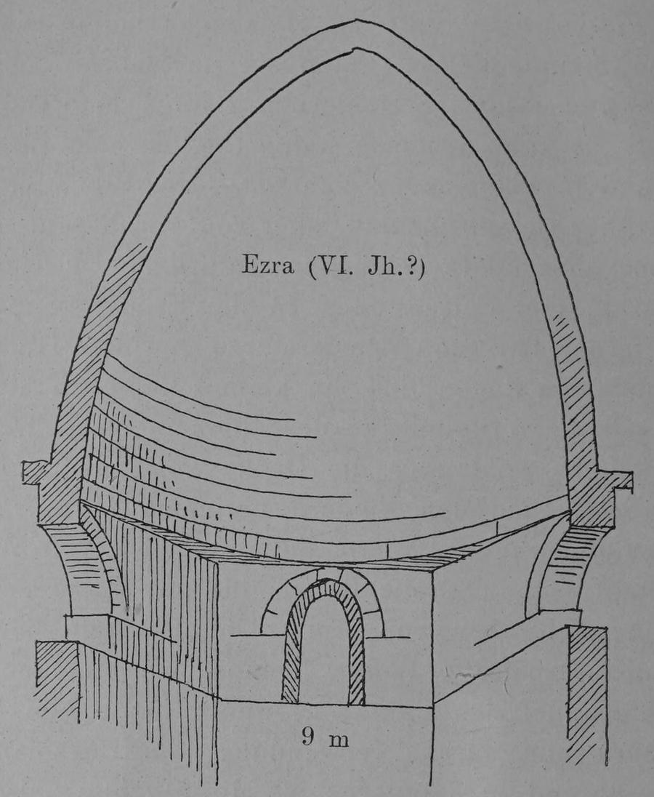

*Fig. 3. Kuppelgewölbe im Haurân.*

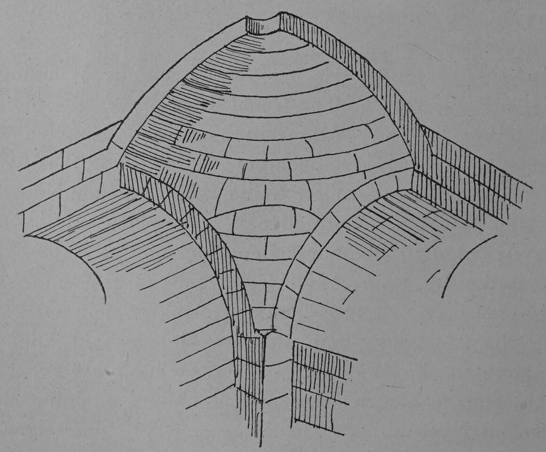

*Fig. 4. Kuppelgewölbe mit Pendentifs in Gerasa.*

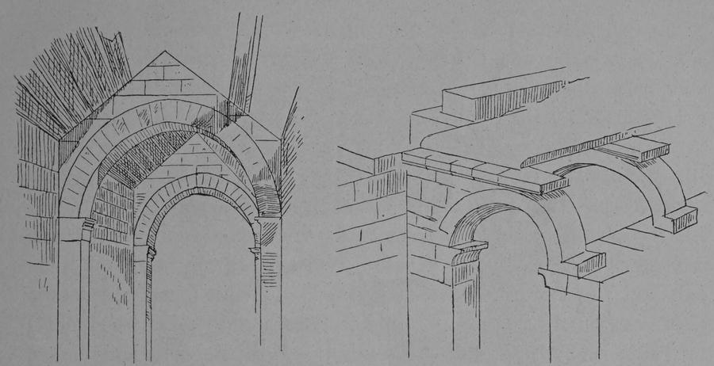

*Fig. 5. Steinbalkendecken aus dem Haurân.*

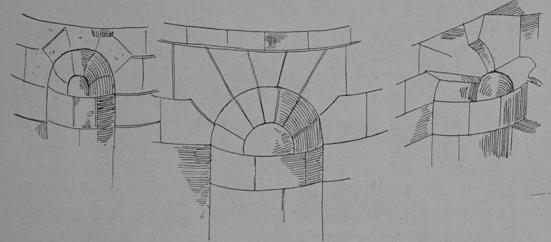

*Fig. 6. Nischengewölbe in Gerasa.*

[^19.331k]: S. über die Frage ANDERSON-SPIERS, The Architecture of Greece and Rome, London 1902, „Vaulting“ p. 136—141. In Gaza war das Marneion ein Rundbau in Pantheonform mit Kuppeldach, und es wird mit Recht auf die im christlichen Orient alsbald entstandenen Kuppelkirchen verwiesen (STARK, Gaza S. 599 f.). Der Bogen erscheint in Ägypten erst zu Anfang der 18. Dynastie (WILKINSON, Manners 2,117), die Assyrer sollen den Bogenbau früher geübt haben (LAYARD Niniveh S. 325). In Palästina soll diese Kunst erst durch die Römer eingeführt worden sein, Spitzbogen erst von den Sarazenen und Kreuzfahrern, so daß H. GUTHE, der in Jerusalem behauene Gewölbsteine von Zisternen gefunden, sich genötigt sieht, diese Wölbungen in den Anfang des Mittelalters herabzudrücken, ZDPV 5,337 — ein Schluß, der bei Zisternen gewiß nicht berechtigt ist; anderseits von den Grabkammern auszugehen und daraufhin frühzeitig Gewölbebau anzunehmen (bei BENZ. Arch. 232, NOWACK 1,255) ist ebenfalls unberechtigt, denn zwischen Zisternen und Grabkammern einerseits und Hallenwölbungen anderseits ist ein großer Weg.
[^19.331l]: Bar bʿErub 11b, bJoma 11b כיפה, von RN (K 2,289) richtig mit כפופה wiedergegeben, von Wurzel כפף (assyr., aram., arab., s. GES. Hwb), Hai zu MPara 3,6 قنطرة, welches lat. *cintrum* sein soll (VOLLERS ZA 8,100), S. FRAENKEL S. 285 unentschieden; Maim. قُبَّة, Bert. it. ארקוולטו *arcovolto*, vgl. Raši in bZabach 58a. Hai zu MPara auch طاق, vielleicht ist damit verwandt דק in הנטה כדק שמים Jes 40,22, wie in der Tat כִּפָּה = Firmament = Welt bMeg 11a.
[^19.331m]: MPara 3,5 „Und eine Rampe (כבש) hat man verfertigt vom Tempelberge aus zum Ölberge, Gewölbe über Gewölbe (כיפין על גבי כיפין, d. i. stockartig doppeltes Gewölbe) u. z. stand jede Wölbung (כיפה) über dem Massiven (אוטם, vgl. I Kön 6,4, Ezech 40,16 usw. חלונות אטומות, das danach zu erklären sein wird)“, d. i. Spannung befand sich nicht über Spannung, Unterbau über Unterbau, sondern Spannung des oberen Gewölbes über Unterbau des unteren Gewölbes, s. Maim. Der **Xystos** (s. JE) dürfte ähnlich gebaut gewesen sein.
[^19.332]: Das בור גדול in MJebam 16,4 wird in b 121b erklärt, daß es eine Zisterne war, die aus Reihen von Gewölben (כיפין ע״ג כ׳, vgl. MPara 3,5) bestand, so daß der hereingefallene Mensch sich stützen konnte; Raši: אולמות = Hallen. Die fernere Bemerkung ib. דשישא הוו (Raši: glatt und aufrecht) kann sich nur auf die Pfeiler oder Stützsäulen beziehen: דשיש √דשש getreten, geglättet ist also eine Säule des Gewölbes. Danach erklärt sich I Trg Esth 1,6 p. 202 Lagarde: ודשרין סגלגלין דכסף כפיסן עלוי עמודי כו׳ „runde silberne Walzen (= גלילים s. A. 91) waren auf den Säulen befestigt“, wo דשרין (L Trg Wb 1,189 vermutet כשרין Balken, J 326 = דשא Rolltüre) zu lesen sein wird דששין Pfeiler. Diese als Pfosten des Gewölbes heißen auch רגלים „Füße“ (w. u.), und so fügt es sich gut, dass Trg Ezech 1,7 ריגלין סגלגלן die Füße der „Chajjoth“ mit demselben Epitheton versieht wie in Esth 1,6.
[^19.333]: ביב קמור folgt aus MʿErub 8,10; Verb קמר u. קמרוטון καμαρωτόν Lwr 2,551.
[^19.334]: MSanh 9,5, T 12,8, 433₂₄, s. L 2,322 (vgl. mein: The Mishnah Treatise Sanhedrin, Leiden 1909, p. 49); ib. 392 (schon vorher Trg Wb 1,383 und K 4,490) κύφων ist zu verwerfen, denn כיפתה = כיפה. Vgl. τὸ ἀναγκαῖον = Gefängnis mit כופין אותו usw.
[^19.335]: MAz 1,7 mit Götzenstatue (s. mein: Badewesen S. 34), vgl. 3,4 Aphrodite, deren Statue über dem Kanal (ביב) aufgestellt ist. Nach jAz 1,7, 40a₄₃ ist die Statue zuletzt mit dem ganzen Gebäude zu verbinden (חייד von אחד s. J 430 und vgl. b 19a מכוש אחרון). Bauten über Kloaken s. o., Höfe in Jerusalem über hohlen Felsen A. 251. Der Altar durfte nicht über Erdhöhlen und auf Gewölben gebaut werden, bZebach 58a (כיפין Raši: אילמים l. אולמות wie oben). Über der Kelter baut man כפין (MBm 10,4, ed. Lowe cor. כיפוס l. כיפים), wo dann darüber gepflügt werden kann.
[^19.336]: כפה של השבונות Pesiḳta R c. 41 p. 173a, s. bei „Handel“.
[^19.337]: MTamid 1,1, MMidd 1,8.
[^19.338]: כיפתא in Akko jŠebiʿith 4,35c₁₈, ib. 6,36c₂₁; in Sepphoris jSanh 7 Ende 25d₆₂ גופתא l. כיפתא oder גיפתא; in Caesarea jNazir 7,1, 56a₂₀. ₂₂ כיפתא und כיפה, ein Beweis mehr, daß all diese hellenistischen Städte die gleiche Bauart hatten: JQR 14,749; MGWJ 53,747. In Tiberias, und zwar nach Chamtha zu: TʿErub 7,2, 146₆ ms Erf. הקופא l. הקיפה (die LA mit ק׳ ist nicht zu verwerfen, s. w. u., doch haben Agg und ms Wien wie auch j 5,22d₆₉ הכיפה). Parallelstellen haben פילי πύλη Tor, was an der Sache nichts ändert, denn die Arkaden enden naturgemäß in einem Tor.
[^19.339]: bʿErub 11b, bJoma 11b (s. A. 332).
[^19.340]: MPara 3,6 (s. A. 331m); vgl. עומד opp. פרוץ.
[^19.341]: jSanh 10,1, 27d₆₇, jMḳ 3,7, 83c₂₄, נתערער gelockert sein; in Gen R 100,8 noch Fortsetzung: setzest du aber einen Stein ein, so steht das Ganze.
[^19.342]: Lwr 2,551, JQR 14,749. Die Arche war nach einer Ansicht קמרוטון, technischer Ausdruck: והיה משקיף בה ועולה כו׳ Gen R 31,11. In Assyrien mußte man aus Mangel an Bauholz (s. A. 327) Tonnengewölbe konstruieren, und so erklärt sich auch die Aufführung der erhalten gebliebenen ungeheuer dicken Zwischenwände, s. ZA 1,166 f. Schon Strabo 16,1, 5 οἱ οἶκοι καμαρωτοὶ πάντες διὰ τὴν ἀξυλίαν; und zwar Babylonien von Nebukadnezar II. an.
[^19.343]: bBb 25b קובה, die eine כיפה hat; bTaʿan 8b כמין קובה יש ברקיע, wie כיפה = Himmel A. 331l. Sonst ist קובה = قُبَّة *lupinar*, s. L 4,234, ZATW 27,287. Die arabische Bauart *ḳubbe* pl. *ḳubab* s. E. SACHAU, Reisen in Syrien S. 52. 64. L. BAUER, Volksleben² S. 48. Arab. قُبَّة ist nach FRAENKEL S. 288 erst aus ܩܘܒܐ (PSm) entlehnt; zu pers. *gunbed* s. VOLLERS in ZDMG 50,646.

## § 20

**20.** **Der Estrich und der Söller.** Mit der Decke des unteren Geschosses war das jüdische Haus in Palästina und Babylonien noch nicht abgeschlossen, denn in den allermeisten Fällen war, wie schon in biblischer Zeit[^20.344] und noch heute in Palästina[^20.345], über dem Erdgeschoß, schlechthin בית genannt, noch ein Obergeschoß, עלייה genannt, aufgesetzt[^20.346]. Das Obergeschoß wurde in der Regel noch von derselben Familie bewohnt[^20.347], da das Stockwerk eine notwendige Ergänzung des Hauses war; nicht selten jedoch hatte das Stockwerk einen anderen Besitzer[^20.348] oder aber war an einen anderen vermietet, und daraus entstanden zivilrechtliche Fragen, welchem Umstande wir es zu danken haben, daß wir über diesen Bau ziemlich gut unterrichtet sind. Ein zweites Stockwerk[^20.349] dürfte eine Seltenheit gewesen sein.

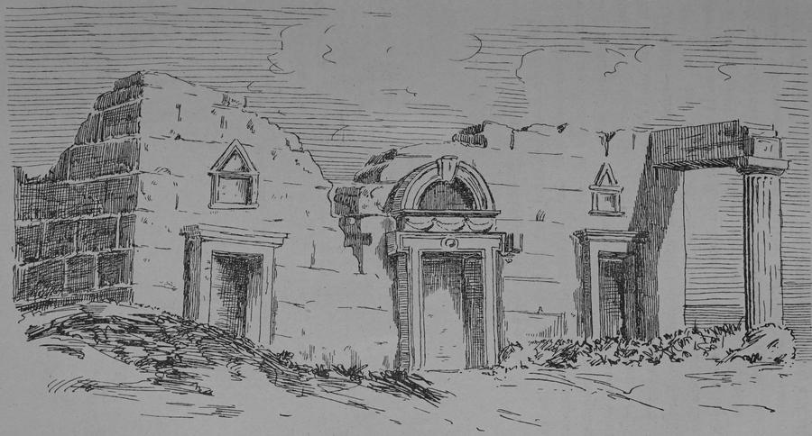

*Fig. 7. Altes Wohnhaus im Haurân.*

In biblischer Zeit bestand, wie oft heute noch, das Obergemach aus einer Laubhütte am flachen Dache oder aus einem Bretterverschlag[^20.350], und das gemauerte Obergemach wird ausdrücklich davon unterschieden[^20.351]. In talmudischer Zeit jedoch haben wir es wahrscheinlich mit einem steinernen Stockwerk zu tun (= ὑπερῷον, *coenaculum*)[^20.352], und so war es notwendig, die Decke des Untergeschosses tragfähig zu machen. Das Gemäuer des Untergeschosses trägt zwar auch die obere Mauer[^20.353], die sich auf ihm direkt fortsetzt, aber der Söller ist häufig nur einem kleinen Teile des Untergeschosses aufgesetzt[^20.354], so daß Zwischenwände, wenn auch leichte, auch außerhalb der Erdgeschoßmauern zu stehen kommen. Der Fußboden nun des Obergeschosses ist ein besonderer Estrich[^20.355], מעזיבה[^20.356].

In Anbetracht des Estrichs legte man wohl schon die Balken der Decke doppelreihig (o. S. 26), worauf der Estrich kam, ein aus Schilf, Dornzweigen und Lehm festgestampfter Boden[^20.357], wofür man aber in einigen Gegenden Palästinas einen Fußboden aus Brettern oder Dielen nahm[^20.358]; das ganze Gefüge wurde mittels Nägel an den Balken befestigt (קבע), auch gut gespannt (מתח). Wennnun Erdgeschoß und Söller zwei Besitzern gehören[^20.359], so lehrt die Mišna[^20.360], und der Söller hat einen Riß bekommen, und der Besitzer des Erdgeschosses lehnt das Bauen ab, so hat der Besitzer des Söllers das Recht, sich unten einzulogieren, solange der andere den Söller nicht herrichten läßt (dem ja die Decke, die eingerissen ist, gehört); ein Lehrer meint, der Besitzer des Erdgeschosses habe das Gebälke (תקרה), der des Stockwerkes den Estrich (מעזיבה) zu geben; die Toseftha verdeutlicht das an einem konkreten Falle: z. B. die in eine Säulenhalle (Stoa) mündenden Geschäftsläden, wo der unten Wohnende das Gebälke, der andere den Estrich beistellt[^20.361]. Ein anderer Text findet es notwendig zu sagen, daß zu dem Gebälke auch die Dielen gehören, nicht bloß die dicken Balken[^20.362].

Die Folgen eines Risses des Estrichs veranschaulicht der Fall, daß bei schadhaftem Estrich das von der oberen Wohnung ausgeschüttete Wasser in die untere Wohnung drang, trotzdem das Gebälke an sich unversehrt war. Da entsteht nun die Frage, wer die schadhafte Stelle reparieren müsse, der Urheber des Schadens, um den Geschädigten nicht mehr zu behelligen, oder der Geschädigte selbst, aus Vorsicht, um sich fernere Übel fernzuhalten. Eine andere Erwägung ist die, daß der Estrich zur Befestigung des Gebälkes diene, folglich es im Interesse der unteren Partei liege, ihre Wohnung instand zu setzen; doch steht dem gegenüber, daß die Befestigung schon mittels Nägel und Dübel geschehen kann, während der eigentliche Zweck des Estrichs der ist, die Unebenheiten des Bodens zu verdecken, und das liegt ja im Interesse der oberen Partei[^20.363].

Je dicker der Estrich, desto fester der ganze Bau; bei gehöriger Dicke z. B. wäre ein Riß nicht von so üblen Folgen[^20.364]. Dennoch aber ist für den Estrich keine bestimmte Dicke vorgeschrieben, außer in dem Falle, daß im Obergeschosse ein Ofen aufgestellt würde, da mußte der Estrich 3 Tefachim (22,2 cm) dick sein, und 1 Tefach, wenn ein Herd aufgestellt wurde[^20.365]; es scheint jedoch, daß Ofen und Herd tiefer gestellt werden konnten, so daß der obere Besitzer sozusagen in den Besitz des unteren eindrang; dennoch konnte dieser fordern, sein Nachbar in der Höhe möge sein Obergemach auf dem Wege einer außen angebrachten Leiter (סולם) betreten, nicht etwa, indem er durch das Erdgeschoß aus- und eingeht[^20.366]. Die Leiter ist als der gewöhnliche Weg zum Obergemach anzusehen. Man unterschied einen gewöhnlichen oder mittelmäßigen (מעזיבה בינונית), einen dicken oder starken (מ׳ רבה und עבה) und einen leichten (מ׳ רכה) Estrich[^20.367]. Ein mittelmäßiger Estrich ließ zwar, wenn oben Geräte gespült wurden, das Wasser nicht durch, wenn aber Wäsche gewaschen wurde, wurde das Wasser nur durch einen dicken Estrich aufgehalten[^20.368]. In Sepphoris, lehrt ein Rabbi, müssen beide Besitzer sich in den Bau sowohl des Gebälkes als des Estrichs teilen, weil dort die Leute ihren Wein und ihre Früchte hinaufzuführen pflegten[^20.369]. Der Obere konnte böswillig den Unteren in Lebensgefahr bringen, wenn er den Estrich aufriß (פרע) oder das Gebälke entfernend (העביר) ihn den Regengüssen aussetzte[^20.370]. Diese Art nachbarlichen Wohnens muß in Palästina sehr verbreitet gewesen sein, wenn soviel minutiöse Rechtsfragen darüber erörtert werden. Wir begreifen nun, daß der Richter Bescheid wissen mußte über „Haus und Söller“ und den Fall „Ofen und Herd“[^20.371].

[^20.344]: Schriftstellen s. Wbr; Realia bei WINER BRwb³ 1,466, SAALSCHÜTZ 1,65, BENZ. Arch. 121 (S. 122 Modell eines ägyptischen Hauses, das auch den Söller veranschaulicht), NOWACK 1,140; Ägypten s. MASPERO-STEINDORFF, Kunstg. S. 9, nebst Abbildung (Fig. 7). Auch das Heiligtum zu Jerusalem hatte eine עלייה und demgemäß auch תקרה und מעזיבה MMidd 4,6, bBb 3ᵇ; man hatte sie in Intervallen von einigen Jahren zu untersuchen, ob nicht schadhaft geworden TKel bk 1,7, 569₃₀.
[^20.345]: NIEBUHR, Reisebeschreibung 1,380. 400; SHAWs Reisen² 188 f. F. BOVET, Voyage en terre-sainte p. 122. J. KLEIN, ZDPV 3,107; BAUER, Volksleben² 49. Schreibung und Aussprache von عِلِّيَّة (aus aram. עליתא, ܥܠܝܬܐ) s. S. FRAENKEL 20 f., ZDPV 28,165. Bauart des Dorfes Ašitha in Kurdistan s. LAYARD, Niniveh S. 97.
[^20.346]: הבית והעלייה oft nebeneinander: MBm 9,1 f., MBb 2,1; MNedar 7,4: Wer sich mittels Gelübde das Haus versagt, dem ist die ע׳ gestattet, so lehrt RMeir; die Weisen sagen aber, ע׳ ist in בית inbegriffen; versagt sich einer die ע׳, so ist ב׳ allenfalls gestattet. TʿErub 9,20, 150₁. Äußerlich geschieden, denn nur ein סכי שמש, ein Schielauge, sieht ב׳ und ע׳ für eins an: TBekhor 5,3, 539₃₃.
[^20.347]: Vgl. Raši MBm 9,3 Haus und Söller sind den Zweien als Erbschaft nach ihrem Vater zugefallen.
[^20.348]: So war es auch in Rom, s. BECKER-GÖLL, Gallus 2,220 f. So was kommt in Städten noch heute vor. Zwei Besitzer: MBm 9,1. 3; Mieter ib. 9,2 usw.
[^20.349]: bBm 117ᵃ שתי עליות זו על גב זו. Eine andere Bauart ist עלייה על שני בתים bʿErub 59ᵃ, d. i. der Söller ruht auf Fundamenten zweier Häuser.
[^20.350]: Judit (8,5) macht sich σκηνὴν ἐπὶ τοῦ δώματος τοῦ οἴκου αὐτῆς. Die obligaten Laubhütten s. Neh 8,16 und o. Vgl. MʾOhal 7,3 אהל שהוא נטוי לעלייה. Man errichtete auch in derselben Art ein κωνωπεῖον = Himmelbett auf dem Dache (= Zelt Trg II Sam 16,22, vgl. AbRN α c. 25 p. 80, Lwr 2,532).
[^20.351]: II Kön 4,10 עליית קיר. Unbegründet bBerakh 10ᵇ, daß ע׳ keine Mauer habe.
[^20.352]: Vgl. WINER³ 1,242, doch verwechselt W. Dach mit עלייה, s. w. u.
[^20.353]: משבונה הבית בונה העלייה Exod R 15,22, vgl. Mekh zu Exod 15,11 p. 41ᵇ und Mekh RŠbJ p. 67 ed. Hoffmann, wo עליון und תחתון.
[^20.354]: Das Verhältnis wird klar durch TBm 11,2, 394₂₃: Wenn sich die zwei Besitzer darin teilen, erhält der untere ²/₃, der obere ¹/₃.
[^20.355]: אסטריך Raši bBm 116ᵇ und MBb 20ᵇ (aus mlat. *astricus*, *astracus* Pflaster, it. *lastrico*, KLUGE, Et. Wb.⁵). Der Zusatz במקרא bei Raši muß auf מעזיבה resp. auf dessen Ableitung aus Ezra (Raši zitiert auch Neh [3,8] als Buch Ezra) gehen.
[^20.356]: Schon von Abulwalid (Wb ed. Bacher 363) im Namen des „Gaon“ ist mišnisch מעזיבה mit עזב Neh 3,8. 34 „befestigen“ zusammengestellt worden, so auch Raši bBm 116ᵇ, RN (K 5,202), S. Parchon und RDḲ s. v. עזב, beide, ohne sich auf Vorgänger zu berufen. Nun ist freilich in Neh selbst der Sinn „befestigen“, „pflastern“ nicht anerkannt (STADE-SIEGFRIED erwähnen diesen Sinn gar nicht, MANDELKERN läßt die Frage offen, bei GES-BUHL wird die Analogie von مَعْزَب [Quadersteine!] beigebracht, unter Verweisung auf KREMER, Beitr. 2,14 und ZDPV 8,282, s. auch A. ROSENZWEIG S. 31 A. 4).
[^20.357]: bBm 117ᵃ מאי מעזיבה (so l. mit RN, Agg verfehlt תקרה, vgl. D. S.) „Was ist מ׳? RJose bChakina: קנים וסנאין וטינא“ (Agg קינים und st. טינא ein Eigenname ו[י]וסטיני), s. Mussafia bei RNs ʿAruch s. v. מעזב und קן (7,184). Hai zu MʾOhal 6,4 erläutert den Mörtel mit הימליטא (s. A. 220) und mit חרסית und צרורות, RN חרסית, vgl. bMḳ 7ᵃ צר בצרור ואינו טח בטיט. Loser Estrich entsteht durch die Lorbeer- und Dornarten הוצא ודפנא (דפנא s. Lwr 2,215; הוצא I. LÖW, Pfl. S. 116) bMḳ 7ᵃ. Über den Dielen wurde nach BLÜMNER 2,314 Farrenkraut und Spreu geschichtet; vgl. מפץ eine Spreu oder Matte aus Holzrinde, Riedgras oder Schilfrohr: MKel 20,5 s. Maim., T 11,7, 589₂₉; ib. ib. mit Nägeln zusammengefügt (T יבקענה l. יקבענה), und das konnte sowohl oben als unten geschehen; eine andere Methode ist anbinden (חבל) oder anheften (חבר) oder beides zusammen (T ib.). מתח Exod R 15,22. Nach Vitruv 7,1, 2 ist gute Nägelung nötig und es sollte das Holzwerk vor der Ätze des Kalkes durch Spreu (*palea*) geschützt werden. — Palmenzweige als Decke s. o. bei Hütte und L. LÖW, Graph. Requ. 1,217; I. LÖW, Pfl. S. 115.
[^20.358]: Reš Laḳiš bBm 117ᵃ לוחאי RN, לווחים Agg. Genau dieselbe Alternative bei BLÜMNER 2,314. Da nach beiden Arten ein hölzerner Kern da war, so ist die Angabe RNs, מעזיבה sei = מליטה von bh. מלט, das nur Mörtel bedeutet, nicht richtig; Hai erwähnt הימליטה nur zur Erklärung von טיט. Das Obergemach des Sepphorensers RAbin war mit Marmorquadern gepflastert (bSabb 29ᵇ), gewiß der Kühlung wegen. Terrassenestrich in Susiana erwähnt Strabo 15,3, 10, und zwar waren die Holzdecken zwei Ellen dick mit Erde bedeckt, um die Hitze abzuhalten.
[^20.359]: Das Synagogenhaupt von Bozra besaß eine עלייה, während unten ein anderer wohnte, bSabb 29ᵇ.
[^20.360]: MBm 9,2 הבית והעלייה [של שנים], so, mit der Ergänzung, ed. Neapel und Lowe, ms Kfm, ms München, viele Agg. und Autoren (s. D. S.) und T 11,3, 394₂₇, wie auch die Mišna vorher und nachher; Raši jedoch (und wie es scheint auch RN) streicht של שנים, weil seiner Ansicht nach vom Mietsverhältnis die Rede ist, wogegen s. Tosafoth z. St. In Tosefta RJose im Namen des Sohnes; ib. Schreibart תיקרא auch ms Kfm, מעזבה ohne *Jod* in ed. Lowe und Abulwalîd.
[^20.361]: Vgl. MBb 2,3.
[^20.362]: jBm 10,2, 12ᶜ₂₆ Reš Laḳiš: תקרא ולווחים opp. מעזיבה. — MSukka 1,7 תקרה שאין עליה מעזיבה, vgl. MʾOhal 12,4, in T 13,7, 610 fehlt מ׳. Anschaulich TʾOhal 5,5, 602₁₇ מ׳ verhält sich in gleicher Art zu der darunter befindlichen Mauer (כותל) wie zu den ebenfalls darunter befindlichen Balken (קורות). Ib. 7,6, 604₂₁ חצי מ׳ die Hälfte des Estrichs (in der Dicke), M 6,4, ib. RJuda: כל המ׳ לעלייה, T 7,10, 604₃₁ כל המ׳ השמיש לבית ob Estrich genau genommen zum Söller gehört, oder dem Hause (dem unteren Teile) diene; ib. Vergleich mit einer Doppelhöhle sehr instruktiv.
[^20.363]: bBm 117ᵃ, vgl. vorige A.
[^20.364]: Eine beträchtliche Dicke folgt aus dem Ausdruck חצי מעזיבה o.
[^20.365]: MBb 2,2, wegen Feuergefahr (Raši).
[^20.366]: jBm 10,2, 12ᶜ₂₄. Zu „Leiter“ s. w. u.
[^20.367]: jBm ib. מ׳ עבה und בינונית; רבה und בינונית TʾOhal 9,4, 606₁₈. ₁₉; רבה und בינונית MʾOhal 8,2 ed. Lowe, in Agg. רכה zweimal. Es ist schwer zu entscheiden, ob רבה oder רכה als Ausdruck existiert; im Wesen existiert „leicht“ infolge von בינונית und עבה.
[^20.368]: jBm ib.
[^20.369]: Ib., s. w. u.
[^20.370]: bSanh 77ᵃ או שפרע עליו מעזיבה, die Lebensgefahr besteht nach Raši in der Kälte, doch ist ib. vorher auch von Hitze die Rede; j 9,2, 27ᵃ₂₉ העביר את התקרה מעליו.
[^20.371]: bSanh 7ᵇ unten: אפי׳ בין בית לעלייה s. RCh; ib. בין תנור לכיריים, s. RCh.

## § 21

**21.** **Stockwerk.** Außer dem landläufigen Obergeschoß namens עלייה, dem noch allgemeiner „Oberes“ (עליונים) im Gegensatz zu „Unteres“ (תחתונים)[^21.372] und auch das neutestamentliche ἀνώγεον[^21.373] entspricht, hat man das fremdländische דיוטא = δίαιτα, das Gemach und Stockwerk zugleich bedeutet, und zwar wohl ein Stockwerk, das über den ganzen Unterbau sich ausbreitet[^21.374]. In diesem Falle hat das Stockwerk, und natürlich noch mehr das Untergeschoß, mehrere Wohnräume (דירין), und es ist dann richtiger von Palästen zu sprechen, wie es auch geschieht[^21.375]. Die Wohnungen des Stockwerkes waren durch einen gemeinsamen Korridor (מרפסת) verbunden[^21.375a], der ihnen das ist, was den unteren Wohnungen der Hof. Weniger deutlich ist der Name eines Gebäudes (ברקא), das ebenfalls Stockwerke haben soll[^21.376].

[^21.372]: Gen R 1,9 למלך שבנה פלטין משבנה את התחתונים אחר כך בנה את העליונים. Vgl. ähnlich gebildet תַּחְתִּיִּם usw. Gen 6,16; תחתנה und תיכנה I Kön 6,6. 8, Ezech 41,7.
[^21.373]: ἀνάγαιον u. z. „bedeckt“ (mit Matten) Vulg. *coenaculum* Mark 14,15, Luk 22,12 (dor. Form für ἀνώγεων) als Speiseraum benützt.
[^21.374]: MSabb 11,2, MʿErub 8,11; andere Stellen s. Lwr 2,199. Die Stelle TBm 11,2, 394₂₆: „Dort, wo man zwei דיוטאות zu verfertigen pflegt, macht er zwei ד׳, wo drei, macht er drei, und man weicht von dem Ortsgebrauch nicht ab“, ist nicht von 2 resp. 3 „Stockwerken“ die Rede (A. ROSENZWEIG, Wohnhaus S. 67), denn unmöglich kann der untere Besitzer gezwungen werden zu erlauben, daß sein oberer Nachbar zwei oder drei Stockwerke aufsetze, sondern der Sinn ist, daß dieser zu der עלייה, die nur ein Gemach ist, noch 2—3 Gemächer, aber in demselben Niveau, anfügen will. Die T vorher (Z. 21) spricht ausdrücklich davon, daß בית und עלייה entweder gleich oder ungleich (unten groß, oben klein) sein können; in der Regel war eben die ע׳ ungleich kleiner als das Untergeschoß, und somit entsteht der Unterschied zwischen ע׳ und דיוטא, welch letzteres wohl über den ganzen Unterbau ging. Vgl. den Plan des ägyptischen Hauses in Mitteil. d. deutsch. Orient-Ges. 1907 no. 34 S. 26. In bSabb 38ᵇ (die Erzählung hat wohl Sepphoris zum Schauplatze) ist דיוטא התחתונה = parterre, דיוטא העליונה = beletage; die Worte: „Einst standen wir לעילא מר׳ חייא רבה“ wollen nicht sagen, daß sie höher als R. Chijja wohnten, denn das paßt zur Erzählung nicht, sondern = עמד על = bedienen, = משרת jSabb 3,1, 5ᵈ₅₂; 4 Ende 7ᵃ₄₂. In TʿErub 8,9, 148₅ hingegen שלש דיוטאות זו על גבי זו „drei ד׳ übereinander“, aber ib. Z. 8 חמש ד׳ הפתוחות לאילקטי können sie nur nebeneinander sein. Ib. 9,21, 150₁ „eine δίαιτα, die 100 Ellen hoch ist“ wohl übertrieben. — Daß ein Stockwerk über den ganzen Bau geht, sieht man an einem pompejanischen Hause bei RICH s. v. *domus*.
[^21.375]: Gen R 7,3 (דיורין auch 5,1), Midr ha-G ed. Schechter p. 44 deutlicher העליונות והתחתונות בדיוטאות.
[^21.375a]: מרפסת von רפס treten Trittstelle. Richtige Sacherklärung bei O. Bert. zu MMḳ 1,10 הלוך שרפני עלייה שבני העלייה הולכים בו ויורדים דרך סולם לחצר. Ein Geländer war notwendig (ib.). Raši z. St. vergleicht den Korridor mit den Säulengängen der Häuser am Rhein. Raši zu bBb 11ᵇ אלויר, zu bMenach 33ᵇ אלואוירא, das ist fr. *allure* oder *gallerie*, vgl. K 5,258. Die Bewohner des Hauses teilen sich demnach in אנשי חצר ואנשי מרפסת (MʿErub 8,3) Hofbewohner und Korridorbewohner, letztere gleich בני עלייה (b 84ᵃ, was allein richtig, während הדרים במרפסת ib. Ergebnis der subtilen Diskussion ist; dies auch gegen L. Heller z. St.). Vgl. היו חמשה בתים פתוחים למ׳ bBb 11ᵇ (ganz so wie beim Hofe w. u.). Der Korridor ist über dem Hofgrund mindestens 10 Tefachim hoch; hohe Gegenstände im Hofe, z. B. Säulen, ein Brunnenschaft oder ein Felsen, die mit dem Korridor ungefähr dieselbe Höhe haben und sich daran anlehnen, werden zum Korridor gerechnet (MʿErub 8,3). Es gehören zusammen Dach und Korridor einerseits und Hof mit Exedra anderseits, nicht aber Hof und Dach einerseits und Wohnhaus und Söller (= Korridor) anderseits (T 9,19, 149₃₀ ib. 20,150₁ j 8 Ende, 25ᵇ₄₃ f.). Für sich allein ist מ׳ keine דירה: jSota 8,4, 22ᵈ₃₈ vgl. bei Exedra § 35. Vom Hofe konnte die מ׳ mittels Türe getrennt sein, s. RN s. v. מרפסת u. RG zu bBb 11ᵇ.
[^21.376]: ברקא Var בדק׳ bBb 61ᵃ, bʿErub 15ᵃ, dort noch ב׳ חלילה, was also nicht die Regel ist. L 1,270 Balkon, K 2,200 Stockwerk, J 197 offene Piazza, wegen חלילה mit Fenstern versehen. Am sichersten geht man, wenn man in ב׳ einen Vorbau, eine Galerie oder dgl. sieht.

## § 22

**22.** Ob nun im Erdgeschoß oder im Stock — das Haus hatte seinen Abschluß nach oben im **Dach** (bh. u. nh. גַּג)[^22.377]. Der Orient kennt nur flache Dächer[^22.378], und erst die jüngste Zeit ließ unter europäischem Einfluß hier und da auch das schiefe Dach aufkommen. Das Dach mußte wasserdicht verklebt (טוח) sein[^22.379], was man mit bloßer Hand oder dem Stampfen der Füße erreichen konnte[^22.380]; doch hatte man eine eigene Walze (מעגילה) dazu[^22.381], mit der der Estrich eingebettet und wohl auch eine den Abfluß des Regenwassers ermöglichende kleine Neigung erreicht wurde[^22.382], wonach der Maurer mit seinem Reibbrett (מחליץ)[^22.383] dem Boden den letzten Strich gab. Die fortwährend der brennenden Sonne[^22.384] und den Regengüssen ausgesetzte Dachfläche — wir verstehen darunter sowohl die um den Söller herum übriggebliebene freie Terrasse als auch das obere flache Dach — mußte gleichwohl Risse und Spalten bekommen, die immer von neuem verstrichen (שפה) werden mußten[^22.385], und zwar geschah das in der Regel zu Beginn der Regenzeit[^22.386].

Wie man unten im Wohnzimmer den Fußboden mit Wasser bespritzte und scheuerte (w. u.), so geschah auch die Reinigung des Dachraumes durch Wasser, das dann natürlich längs der Wand herunterrann[^22.387]. Die Mauer schützte man vor dem Regen, indem man eine Schüssel, ein Becken u. dergl. darüber stürzte (כפה)[^22.388] oder das Wasser von einem wollenen Tuch (מיזרן)[^22.389] aufsaugen ließ. Nützlicher war es, an dem Hause eine Traufe (דלף)[^22.390] anzubringen; sie bestand aus der eingemauerten steinernen Rinne (מזחילה)[^22.391], die das Wasser auffing, und der Traufröhre (מרזב, צינור)[^22.392], die, frei stehend und aus Holz gemacht, das Wasser in den Hof ableitete, wo es sich in ein irdenes Faß oder in einen Trog ergoß[^22.393], oder doch in einiger Entfernung von der Mauer auslief[^22.394]. Viele Häuser werden ohne diese schützende Dachrinne geblieben sein, und da mochte das Dachwasser auch das Nachbardach oft beschädigen, besonders wenn die beiden Häuser am Abhange des Berges so lagen, daß das obere Dach sein Wasser gerade auf das untere Dach ergoß[^22.395].

Nächstdem erlitt das Dach Schaden durch das viele Unkraut, das aus dem Lehmboden aufkeimt[^22.396].

[^22.377]: Aram. איגר syr. ܐܓܪܐ; gr. στέγη Matt 8,8, Mark 2,4 (στέγη in anderem Sinne Lwr 2,77); δῶμα Matt 10,27, Apostelg 10,9. Oft ראש הגג (opp. ראש הבירה) z. B. bBk 90ᵇ. Oft ein Abstürzen (נפל) von Menschen und Tieren vom Dache: MGitt 6,6 (b 66ᵃ), MChull 3,1 (b 42ᵃ), b 56ᵇ u., 87ᵃ, bTaʿan 29ᵃ.
[^22.378]: Auch der Tempel zu Jerusalem hatte nicht ein erhabenes Dach, wie l’Empereur zu MMidd 4,6 annimmt, denn die מעקה war auch auf flachem Dache nötig (die Tempel der Römer hatten erhabene Dächer: Cic. *Orat.* 3,26, Suet. *Claud.* 17). Vgl. Hieronymus, Epist. 106 *ad Sunniam* et *Fretellam* (1,661 ed. Ver., 1,859 ed. Migne): *in Palästina enim et Aegypto . . . non habent in tectis culmina, sed* δώματα, *quae Romae vel solaria, vel maeniana vocant, id est plana tecta, quae transversis trabibus sustentantur* (WINER BRwb³ 1,242). In Ägypten war das Dach platt und wahrscheinlich wie heute aus Palmzweigen gemacht, welche gegeneinander gepreßt und mit einer Erdschicht bedeckt waren (Maspero-Steind. Kunstg. S. 9). MMidd ib. ואמה כולה עורב, bMḳ 9ᵃ u. Parall. באמה כליא עורב s. Raši u. ב״ח in ed. Romm. Vgl. die Spieße auf dem Tempeldache zu Jerusalem zur Abwehr der Vögel nach Josephus B. J. 5,5,6 und s. LEWYSOHN, Zool. d. Talm. S. 173; WINER Rwb³ 2,585.
[^22.379]: MMḳ 1,10 שפין את הסדקין. Sifre Dt 42 p. 80ᵃ ולהטיח ג(נ)[ו]תיהם, Bar bTaʿan 6ᵃ. Oft להטיח גגו הוא צריך, z. B. bBeza 9ᵃ.
[^22.380]: MMḳ 1,10 ביד וברגל, andere Erklärung w. u. Vielleicht meint ביד nicht die bloße Hand, sondern mit einem Schlegel (*vectis* des Vitruv 7,1, 3, die Tätigkeit: *pinsere* rammen).
[^22.381]: MMḳ 1,10. Nach Raši handelt es sich um Reparierung eines Ofens, wie in der Mišna vorher, aber in MMakk 2,1, wo Raši überhaupt deutlicher ist, sagt auch Raši, es handle sich um Stampfung des Daches, s. auch Maim. u. Bert. z. St. ferner RN (K 5,200). RN hat hier das Detail, daß die Walze etwa 2 Ellen lang sei, doch aber von Menschen getragen werden könne, letzteres notwendig wegen MMakk 2,1: er handhabt die Walze, diese fällt auf jemand und erschlägt ihn. Raši bemerkt noch, die Walze habe zwei Griffe. Dadurch erklärt sich in der Mišna der Unterschied zwischen מְעַגֵּל במע׳ und מושך במע׳; ersteres fällt in die Kategorie von ירידה, letzteres in die von עלייה. Nach jMakk 2,1, 31ᶜ₄₇ (vgl. T 2,3, 439₂₄) ist möglich der Fall, daß jemand von innen den Kopf hinaussteckt und jener fährt mit der Walze über ihn, oder ein Kind steckt die Hand hinaus und die Walze zerschmettert sie. — Recht plausibel wird im Jahrb. „Jerusalem“ 7,339 behauptet, daß מעגל = Straße so genannt sei, weil man sie mit der Walze rammt, vgl. מסלול u. כבישה (w. u.). In dem Namen חוני המעגל (MTaʿan 3,8) dürfte der Begriff „Dachdecker“ enthalten sein (A. SCHWARZ). מכבש את הגגות TSota 6,6, 304₁₀ meint die Situation in II Sam 16,22. Die Dachwalze heißt heute مِحْدَلة DOZY 1,260 KLEIN, ZDPV 3,104, A. ROSENZWEIG 32 A. 1. SACHAU (Reisen in Syrien S. 63) sah auf Dächern in Höms (Emesa) antike Säulenstücke liegen, die als Walze dienten.
[^22.382]: Raši zu MMakk 2,1; WINER³ 1,242 belegt das aus Plinius 36,62 und BURCKHARDT, Arab. 152. A. ROSENZWEIG S. 57 wollte diesen Punkt aus TMakhš 1,5, 673₃₁ beweisen, aber גג ist dort ein Fehler für זג Hülsen.
[^22.383]: מחלציים (Mḳ ib. in j u. ms Kfm mit 2 Jod, um den Dual zu sichern, in ed. Neapel u. Lowe u. RN (K 5,110) מחלצים mit 1 Jod, dasselbe; ms München und einige alte Autoren מחצלים, auch bMakk 9ᵇ מחצלן (singular), aber nur חלץ gibt guten Sinn, wie וחלץ את האבנים Lev 14,40. 43; hier ein Gerät, womit Unebenes, Unnötiges herausgerissen wird. Raši Makk 9ᵇ טרואילה = *truelle*, RN קצולה *cazzuola*. Das Handhaben der Walze konnte wer immer verrichten, mit dem מחלץ jedoch arbeitete der אומן (s. o.), d. i. Baumeister (Mḳ ib., Maim. = מקציע unrichtig).
[^22.384]: Der Kalk (des Mörtels) des Daches war so heiß, daß man daran ein Ei sieden konnte: TSabb 2,12, 113₁₆, wo mit alten Agg. u. j 3,3, 6ᵃ₁₈ על גבי גג של כיד רותח zu lesen ist; b 29ᵃ hat גג רותח u. כיד רותח separat.
[^22.385]: MMḳ 1,10, j ib. 81ᵃ₇ R. Chijja lehrt: Verkleben mit dem Fuß, Walzen mit der Hand; daraufhin wird der Unterschied statuiert: eine kleine Walze kann auch mittels des Fußes gewälzt werden, eine große Walze jedoch nur mit der Hand. Es scheint somit die Mišna so aufgefaßt werden zu müssen: Man wälzt sie mit einer Walze sowohl mittels Hand als mittels Fuß. Aber Raši faßt ביד וברגל für eine Tätigkeit an sich auf, ohne מעגילה
[^22.386]: Sifre Dt 42 p. 80ᵃ, Bar bTaʿan 6ᵃ, aggadische Deutung von מורה oder יורה Herbstregen = ein solcher, der da lehrt, daß man die Dächer verschmieren müsse.
[^22.387]: MMakhš 2,4 הטורף את גגו (Ašeri u. Bert. lesen המטהר, doch auch T 1,8, 674₁ הטורף; zu טרף in ähnlichem Sinne s. L 2,194 abspülen), Maim. „Wer sein Dach (سطح) wäscht“ usw.
[^22.388]: MMakhš 4,3, vgl. bChull 16ᵃ.
[^22.389]: Hai zu MKelim 19,2 מיזרן הוא כמעשה אלו שנותנין בגד צמר או של שער בשפת גגותיהן למנוע המטר מן הקירות. KRENGEL vgl. מיזרן mit assyr. *mizru*, *mazru* Tierpelze; richtiger wohl ist מ׳ zusammenzustellen mit bh. זור **pressen, ausringen** (das Stück Zeug rang man dann aus), زَرَّ beim Waschen, זִירָא Presse (s. GES. Hwb.¹⁴). מיזרן im anderen Sinne s. KRENGEL, Hausgerät S. 25.
[^22.390]: bh. und nh. דֶּלֶף s. GES. Hwb.¹⁴ mit Verweisung auf ZDPV 14,5, LANDBERG, Proverbes et dictons 35, Journal Asiatique 1887, II, 170; وكف, ذلف. Luther setzt „Dachrinne“ für צנור II Sam 5,8, unrichtig, aber MMakhš 3,6 kann es nur Dachröhre sein: אם פקק את הצינור או אם חלחל לתוכן, s. w. u. Im Tempel zu Jerusalem gab es ein בית דלפה (MMidd 4,6, ed. Lowe דילפה), nach RNs zweiter Erklärung (K 3,72) Rillen zwischen den oberen und unteren Dielen, um das Gebälk trocken zu halten.
[^22.391]: √ זחל fließen. MʿErub 10,6 מזחילה und צינור; T 9,2, 150₂ „Man macht ihm (dem Stockwerke) keine Traufröhre (צינור), wohl aber Traufrinne (מזחילה), damit man nicht sage, die Traufröhre des N. N. ergießt (מקלח) Wasser am Sabbat“. Raši קנאלא = *canale.* MBb 2,5. Ib. 3,8 (58ᵇ) gut erklärt von RSbM. TBb 2,13, 400₃₃ צינור בחצר, ib. מקום קילוחו. b 59ᵃ מזחילה של בנין d. i. eingemauert, hingegen צינור frei und aus Holz.
[^22.392]: צינור s. o. מרזב MBb 3,8 s. vorhergehende A. ܡܪܙܒܐ PSm 2221; arab. *mizrâb* dimin. *mezerîb* Wasserfall, Traufe, Rinnsal. Auch שפכי bBb 3ᵇ (RN שפוכאי) ist nach Raši = מרזבין; vgl. מקום קילוחו.
[^22.393]: MBeza 4,1 כלי תחת הדלף. Speziell חבית und עריבה folgt aus MMakhš 4,4. 5, dort mit Frucht gefüllt, aber sie dienen nur darum als Beispiel, weil sie sonst dem Zwecke der Aufnahme des Wassers dienten.
[^22.394]: MBb 2,5, T 1,6, 398₂₃.
[^22.395]: Spruch Ben-Siras nach bKethub 110ᵇ, bSanh 100ᵇ בשפל גגים גגו ••• ממטר גגים לגגו. Vgl. MMakhš 4,4. 5.
[^22.396]: Vgl. Ps 129,6; Jes 37,27, Bild der Vergänglichkeit, s. dazu WINER² 1,242; BAUER, Volksleben² 45. Zwiebeln (בצלים), die, wie gewöhnlich allerlei Früchte, auf dem Dache ausgebreitet wurden, konnten in dem Estrich Wurzel fassen: TMr 3,9, 85₅. Derartige Wucherung schien mir zu sein העלואין שבגג im allgemeinen: Gewächs auf dem Dache (von עלה) TŠebiʿith 1,12, 62₆, das man im Siebentjahr belassen darf, aber nicht begießen. I. LÖW, Pfl. S. 295 hat sich jedoch infolge der Schreibung אלוי j 4,4, 35ᵇ₅₂ dahin erklärt, daß das Ding Aloë sei, so auch Lwr 2,51, weil der Standort der gemeinen Aloë wirklich auf Dächern sei, und Löw hat Recht. Dagegen sehr klar T 3,6, 64₁₈ ספחים nur Wucherungen.

## § 23

**23.** **Stiege, Galerie.** Die Dächer eines Ortes standen so dicht nebeneinander, daß man, von Dach zu Dach schreitend, die Dächer völlig als obere Passage benutzen konnte[^23.397]. Sowohl bei ebenem Terrain als an Bergabhängen[^23.398] ist diese Bauart sehr gut denkbar. Im Bedarfsfalle konnte man ein Brett (נסר) über die einzelnen Dächer spannen (מתח), doch wurde eine solche Passage für gefährlich gehalten[^23.398]. Von hier aus ist zu erklären der Ausdruck „Dachnachbar“[^23.399], was der Nachbarschaft im „Söller“ (עלייה) ganz analog ist; oder wenn in bezug auf die Dächer von Kompagnons oder zwei Inwohnern gesprochen wird[^23.400].

Dachraum und Söller wurden von den Inwohnern des Hauses vielfach benutzt, und namentlich in der Abendkühle wurde dieser luftige Raum gern aufgesucht[^23.401]. Man aß[^23.402], schlief[^23.403], las[^23.404] und hielt Zusammenkünfte[^23.405] im Söller, und gebrauchte den Dachraum zum Trocknen der Feldfrüchte[^23.406] und als Magazin[^23.407] zu ihrer Aufbewahrung. Deshalb mußte das Dach nach mosaischem Gesetze mit einer Brustwehr (מעקה)[^23.408] versehen sein; diese konnte die beträchtliche Höhe von 10 Tefachim (74 cm) und einen türartigen Eingang haben[^23.409]; mit dem Nachbardache konnte man durch eine Öffnung verbunden sein[^23.410], wodurch jene bereits erwähnte obere Passage über den Dächern begreiflich wird. Allem Anscheine nach war die Brustwehr aus Stein oder Ziegel gemauert[^23.411], je nach der Bauart des Hauses selbst, und zwar war sie zur Sicherheit der Inwohner so notwendig, daß die Rabbinen auch an Halbfeiertagen wenigstens ihren primitiven Aufbau gestatteten[^23.412].

Den Zugang zu dem Obergeschoß und zum Dache vermittelten Leitern oder Stiegen (סולם)[^23.413] und Treppen (aram. דרגא)[^23.414]. In der ersteren Art unterscheidet man die tyrische (סולם צורי)[^23.415] von der ägyptischen (ס׳ מצרי)[^23.416] Leiter. Die tyrische Leiter stand unbeweglich an das Haus gelehnt[^23.417], hatte dicht gelegte und breite Stufen, sah also mehr einer Treppe ähnlich, als die bewegliche ägyptische Leiter, deren Stufen weit voneinander abstanden und von geringer Breite waren[^23.418]. Auch diejenige Art, die man „Treppen“ (דרגא) nannte, war beweglich[^23.419]. Die Leiter besteht aus Wangenstücken (עמודים oder עומדים) und aus Sprossen oder Stufen (שליבה, חווק)[^23.420], und sah, wie auch die bei den Römern übliche[^23.421], der unsrigen gewiß ähnlich. Im Tempel zu Jerusalem gab es steinerne Treppen, deren Stufen (מעלה) je ¹/₂ Elle hoch war mit ebenfalls ¹/₂ Elle breiter Fläche (שלח)[^23.422]; in vornehmen Häusern wird es ebenfalls steinerne Treppen gegeben haben, wie sehr natürlich in Felsenwohnungen, Höhlen, Gräbern und Bädern (o. S. 3). Höchst primitiv ist aber ein im Heiligtum erwähnter Aufstieg auf eingefurchten Zederbalken[^23.423]. Hart daneben figuriert der לול genannte Treppenaufgang[^23.424], der auch in Privathäusern vorkommt, und der, entsprechend den *scalae graecae*[^23.425], in einer vom Hofraum gänzlich abgeschlossenen Mauerverkleidung durch sämtliche Stockwerke lief.

Nur diese **Hohltreppe** befand sich im Inneren des Hauses[^23.426], während die Leiter — deren es im Hause mehrere geben konnte[^23.427] — von der Straße oder vom Hofe her[^23.428] zu dem Dache führte. Man konnte aber auf das Dach auch vom Inneren kommen, wenn man ein Feld aus dem Gebälke des Hauses herausnahm (פתח) und sich den Weg in die Höhe fast gewaltsam frei machte, ein Vorgehen, das zu bestimmten Zwecken geübt wurde[^23.429].

[^23.397]: So war es auch in Antiochien, wo die Juden kämpfend von Dach zu Dach schritten (Josephus Ant 13,5, 3 § 137). Zur Zeit der Gefahr hat man einst (wahrscheinlich in Sepphoris) eine Thorarolle vom Hof aufs Dach und von da auf ein anderes Dach gebracht, wo man darin las (TʿErub 8,6, 147₂₇, j 9,1, 25ᶜ₃₄). Die Art des Bringens vom Hof auf das Dach ist nicht angegeben; vielleicht mittels Leiter, vielleicht jedoch reichte die Hand hinauf, was nach TTohar 9,11, 670₃₀ als möglich bezeichnet werden muß; nach MGitt 8,3 (79ᵃ) muß man allerdings den Scheidebrief, wenn die Frau auf dem Dache (ראש הגג) steht, ihr zuwerfen (זרק). In diesem Falle ist es wohl ein Dach eines stockhohen Hauses. So auch in den Fällen, wo der Sturz vom Dache (A. 377), wie häufig erzählt wird (ein Beispiel auch bei Josephus BJ 1,30, 5 § 593, das aber glimpflich verlief), den Tod herbeiführt, z. B. MGitt 6,6; Tod der Mariamne bBb 3ᵇ.
[^23.398]: Beispiele hierfür gibt es genug sowohl in Palästina, als in andern Ländern. Bei Katastrophen (Erdbeben usw.) entstehen dann grausige Verwüstungen. RAUMER, Pal.⁴ 406 f. schöne Beispiele.[398a] jSabb 2,3, 5ᵇ₂₃.
[^23.399]: Mekh Exod 12,4 p. 4ᵇ שכנו שבגגו, richtiger Mekh RSbJ p. 9 H: שבגגות, opp. שכנו שבשדה (Jalk שבצדו, Parallele s. in ed. WEISS p. 5ᵃ); das wäre Nachbarschaft vermöge der Häuser, deren Dächer aneinander stoßen, im Gegensatze zu der Nachbarschaft vermöge der Besitzungen auf dem Felde; doch dürfte שכנו שבגגות das Zusammenwohnen buchstäblich auf den Dächern ebenfalls bedeuten..
[^23.400]: TMr 2,20, 84₇ שני שותפין ••• בגגות heißt nicht, beide wohnen auf einem Dach (das wäre בגג אחד), sondern zwei Dächer nebeneinander werden von Zweien bezogen; sodann kann es sich treffen, daß der eine schließt, der andere öffnet. Etwas anders jMaʿas 3,6, 50ᵈ₁₇.
[^23.401]: Biblische Daten s. SHAWs Reisen² 185 f., WINER BRwb³ s. v. *Dach*, BENZ. 120 (92), NOWACK 1,140. Die עלייה resp. ὑπερῷον ist ein Gastzimmer (II Kön 4,10), ein Krankenzimmer (I Kön 17,19), ein Totenzimmer (Acta 9,37. 39), und da wird auch gebetet (ib. 1,13. 14; 20,8).
[^23.402]: MMaʿas 3,6 גגות, TMr 2,10, 83₁₀ er bringt Feigen vom Felde, sie auf seinem Dache (בראש גגו) zu verzehren, jMaʿas 3,2, 50ᶜ₃. Das Pascha aß man vielfach auf dem Dache (TPesach 6,11, 166₃ אוכלין בהצרותיהן ועל גגותיהן); bPesach 86ᵃ oben דאכלי באיגרא allerdings theoretisch, ib. בשגגותיהן שוין לקרקע העזרה, j 7,10, 35ᵇ₄₂ jedoch Sprichwort und etwas Reales: Kaum hat man nur ein olivengroßes Stück des Pascha gegessen, und schon zerbrach der Lobgesang die Dächer (והללא מתבר אגרייא). Der Überrest des Pascha wurde an Ort und Stelle, d. i. auf den Dächern, verbrannt, MPesach 7,8.
[^23.403]: Vgl. II Sam 11,2; 16,22. Das kleine Kind schläft in der Wiege auf dem Söller; es passierte hier und da der Fall, daß es ein wildes Tier von dort herausnahm und tötete (bTaʿan 22ᵃ).
[^23.404]: TʿErub 8,6, 147₂₇, j 9,1, 25ᶜ₃₄ s. o. M 10,3 היה קורא בראש הגג, j ib. 26ᶜ mehreres, bSabb 5ᵇ.
[^23.405]: עלייה als Zusammenkunftsort der Rabbinen, z. B. MSabb 1,3, T 1,16, 111₂ die עלייה des Chananja bChizkija bGurjon (l. גוריון), s. M. Zs. Szemle 10,461. Das Lehrhaus kommt in Verbindung mit עליתא vor: jSanh 6,6, 23ᶜ₄. Die עלייה des RGamliel MRh 2,8, des Joch. bBathyra bMenach 41ᵇ, mehrmals in Lydda: TSabb 2,5, 112₇, bSanh 74ᵃ, jSanh 3,21ᵇ₁₁, ebenda עליית בית ארום jPesach 3,30ᵇ₅₅ (in Cant R 2,31 steht עליית ערא).
[^23.406]: Flachs Jos 2,6. Feigen und Rosinen auf dem Dache werden im Talmud oft erwähnt. „Hatte er einen Haufen (ערימה) von Zwiebeln, von getrockneten Feigen (גרוגרות) und von Johannisbrot (חרובין) auf seinem Dache“: TMr 2,19, 84₂. Vgl. meine Ausführungen in ZDPV 32,155.
[^23.407]: Wein und Früchte (Obst oder Getreide) jBm 10,2, 11ᶜ₃₂; Fässer Wein: Lev R 20,3. Weizen oft in dem Schulbeispiel נשרפו חטיך בעלייה „dein Weizen ist verbrannt im Söller“ z. B. jBm 4,1, 9ᵈ₇. Vgl. TMš 5,4. 5, 95 מעשר שני ••• בעלייה opp. בבית. Datteln und Granaten: bBb 20ᵇ.
[^23.408]: Dt 22,8 מעקה dürfte assyrisch sein, s. DELITZSCH, Assyr. Wb. 423. 461; GES. Hwb.¹⁴ vergleicht عَاقَ zurückhalten. LXX στεφάνη, Vulgata *murus tecti*, richtiger wäre *lorica*. Als gleichwertig mit מעקה galt nh. מחיצה, wogegen גודריתא affektiert erscheint (bḲidd 70ᵃ, RN bei K 2,319 krrpt. גונדריתא, nach K und auch L 1,346 persisch, richtiger J 224 von גדר, der auch richtig גודלית vergleicht).
[^23.409]: MBb 4,1. Nach Sifre Dt 229 p. 116ᵃ mußte die מעקה sofort beim Baue des Hauses gemacht werden, und zwar auch schon für die Arbeit der Walze (s. o.) in der Höhe von drei, für den dort zu erwartenden Verkehr aber zehn Tefachim (מקום מעגילו und מקום דורסו). מעקה und קוסת TKel bm 8,2, 587₇ s. KRENGEL, Hausgerät S. 36. Auch Brunnen, Gruben, Höhlen und Schachte mußten ein Geländer haben (Sifre ib., s. in Ha-šiloach 20,23), dagegen brauchten keines ganz kleine Häuser von weniger als vier Tefachim im Gevierte (Sifre ib. A., jSota 8,4, 22ᵈ₄₁); gesetzlich auch מרפסת nicht (Sifre ib.), in der Praxis jedoch s. MMḳ 1,10 und w. u., j ib. 81ᵃ₆ gibt der מעקה des Daches die Höhe von drei, der des Korridors zehn Tefachim, das aber nur in bezug auf die Reparierung am Halbfeiertag.
[^23.410]: TʿErub 10,13, 152₅ חלון שבין שני גגות. SHAWs Reisen² 185: „Das Dach . . . ist gemeiniglich mit zwoen Mauern umgeben, wovon der meiste Teil auf die Straße zu gebaut ist, und zum Teile die Scheidung zwischen den nahe gelegenen Häusern macht; sie ist aber so niedrig, daß man sie leicht übersteigen kann. Die andere, welche ich die Brustwehrmauer nennen werde, geht nach dem Hofe zu, . . . und kömmt mit der מעקה oder *lorica* . . . überein“ . . .
[^23.411]: Maim. erklärt MMḳ 1,10 מעשה הדיוט als Bau in Steinen ohne Mörtelverbindung. Dies entspricht der Bar bMḳ 11ᵃ צר בצרור ואינו טח בטיט; eine aramäische Erklärung jedoch ib. sieht darin einen Verschlag aus Gezweige (הוצא) und Lorbeerbaum (דפנא) s. A. 357, jedenfalls also gab es Brustwehren in Stein und Holz. Einfach genommen ist מעשה הדיוט vom Hausherrn selbst getane Arbeit, im Gegensatze zu מ׳ אומן, derjenigen, die der Maurer kunstgerecht macht.
[^23.412]: M und bMḳ 11ᵃ.
[^23.413]: bh. und nh. סֻלָּם √ סלל, سُلَّم. MMakk 2,1 סולם nach dem Zusammenhange Dachleiter. Num R 12,8 כהדין בר נש דהוא נחית בסולמא הפוך לאחוריו.
[^23.414]: דרגא دَرَجَة. In bKethub 10ᵇ in aggadischer Manier mit דרך גג erklärt: Weg zum Dache. — כבש Schiffsleiter MZab 3,1; vgl. אסכלא Lwr 2,88.
[^23.415]: TʿErub 9,15. 16, 149₁₆.₂₀, TBm 11,14, 396₂, jʿErub 9,1, 25ᶜ₁₁. „Tyrische Leiter“ סולמה של צור in geographischem Sinne s. bei „Straßen“; aus der Bezeichnung folgt, daß סלם nicht notwendig beweglich sein müsse, wie es die tyrische Leiter in der Tat nicht ist.
[^23.416]: MZab 3,1, TBm 11,14, 396₂, jʿErub 9,1, 25ᶜ₁₁. Hai: סולם צורי פירוש בגזירות כדאמרינן (fehlt), ופירוש[ו] סולם רומי בטיית (er meint wohl Bekhor 49ᵇ, 50ᵇ) בגזירות, d. i. nach dem Kanon, daß צר, defektive geschrieben, Rom bedeutet (s. Jelamdenu bei RN s. v. צר 7,44 ed. K), ist statt tyr. Leiter auch röm. Leiter zu sagen. Die Leiter krachte beim Aufstieg, und das war eine Anmeldung resp. Warnung für die Insassen: TSabb 13,4, 129₁, vgl. jSabb 16,15ᶜ, wo aber סולם fehlt.
[^23.417]: MBb 3,6.
[^23.418]: jʿErub 7,1, 24ᵇ₄₀ f. wird für סולם מצרי bedingt, daß sie befestigt sei (קבע, zu verstehen nach MZab 3,1 בזמן שאינו קבוע במסמר; TBm 11,14, 396₂, bʿErub 74ᵇ), daß sie nur dazu diene (שייחדו לכן), daß zwischen einer Sprosse (שליבה) und der andern das Spatium weniger sei als drei Tefachim, und daß deren Breite vier Tefachim betragen soll, doch werden die Leiterbäume oder Pfosten (עמודים) mitgerechnet; für gewöhnlich ist also die ägyptische Leiter unangenagelt, beweglich, mit wenigen Sprossen, die noch dazu schmal sind, versehen. Nach einer Ansicht hatte sie immer weniger als vier Stufen, bBb 59ᵃ. Über die Zusammenfügung gibt Aufschluß die an den Namen סלמאי (סולי) הנטפתי geknüpfte Anekdote in Scholion zu Meg Taʿan c. 5, TTaʿan 4,8, 220₁₁, j 4,7, 68ᵇ₆₁, b 22ᵃ, wo man sieht, daß die Leiter zum Taubenschlag ganz so aussah.
[^23.419]: Folgt aus bSanh 26ᵃ סליקו לאיגרא שלפוה לדרגא מתותיה, bḲidd 81ᵃ שקולי דרגא מתותי כיבי, ib. אשקולו דרגא מקמייהו. Außen angebrachte „Hühnerstiegen“ führen, wie ehedem, so noch jetzt in Arabien zum oberen Stock; DOUGHTY, Reisen, wie in ZDMG 45,174 mitgeteilt.
[^23.420]: עמודין (auch ed. Ven. so) jʿErub 7,1, 24ᵇ₄₄, aber in TKel bm 3,13, 582₃ עומדין; ib. קולב l. nach bSabb 60ᵃ שליבותיו ••• מסמרותיו בסולם אחד הלך בקולב. jʿErub 7,1, 24ᵇ שליבה עבה. Unterste und oberste Sprosse b 77ᵇ. Ib. סולם שליבותיו פורחות (Raši = חווקין = שקלונש = *scalons*; antiquarische Bemerkung: Unsere גרדין (d. i. *grades*) genannten Stufen nennt der Talmud auch סולם), vgl. bMakk 7ᵇ נשמטה השליבה. Ib. 78ᵃ סולם זקוף. Eine Art Sprossen aus קשין Stroh (ib.). — שליבה jʿErub ib., in T ib. בסולם ••• אחד השלובים l. שלבים, s. L 4,556 f., vgl. bh. שלבים und Verb שלב, GES. Hwb s. v., wo auch ܫܠܒܐ = Sprossen; dieses für מדרגות Ezech 38,20 bei Symmachus s. ZA 10,118, A. ROSENZWEIG 56 A. 5. — חווקים bBb 59ᵃ; s. L 2,25 חֲוָק = ܚܘܩܐ und עוק L 3,629 (nicht von עוק = חוק, sondern = bh. חבק, vgl. ו in סואר für צבר A. 271 und vgl. חנגי חבלין), RN bei K 3,352.
[^23.421]: RICH s. v. *scalae.*
[^23.422]: MMidd 2,3; zu טרוטות und מוקפות s. MGWJ 49,680 f.
[^23.423]: MMidd 4,5. Vgl. כיפה שהדרגות jʿErub 7,1, 24ᶜ₄₅ u. A. 191.
[^23.424]: לול I Kön 6,8 (nach GES. Hwb von لَوْلَب Schraube, Wendeltreppe, anders STADE ZATW 3,136 f., etwa Falltüre; vgl. לולב von לבלב wie כבב von כבכב, wie es scheint unverändert vorhanden in dem Ortsnamen לבלב bei NEUBAUER, Géogr. 232 f., das also die Hohltreppe bedeuten würde, wie es auch einen Ort בית מעקה gibt jMš 4,2, 54ᵇ₅₄), nach L 2,486 לול = חלול oder von לוה (s. jedoch Fl zu L 2,533, der an dem Sinn ἑλικτὴ ἀνάβασις LXX und *cochlea* Vulg. mit Recht festhält). Die Bibelstelle mit dem Präfix ב׳ hat übrigens bewirkt, daß in MMidd 4,5 ed. LOWE בלולים steht, was man auch in RNs Wb (K 2,98) hineingestellt hat; richtig ist לולים (RN bei K 5,25): Hohltreppen waren (im Tempel) über den Söller geöffnet (als Weg) nach dem Allerheiligsten, durch welche man die Baumeister (אומנים) in Kisten (תיבות) herunterließ (שלשל), damit sie sich nicht an dem Allerheiligsten weiden sollten“ (יזונו את עיניהם s. A. 87). Ebenso bMenach 34ᵃ, s. auch TMeʿila 1,16, 558₁₀ u. bPesach 34ᵃ. In jʿErub 7,1, 24ᵇ₂₇ דרך לולים Verbindung der Parteien im Privathause auf dem Wege von Hohltreppen. Bildlich לול פתוח מן העלייה לפרוזדור bNidda 17ᵇ. Für הילקטי (Lwr 2,226) gibt S. FRAENKEL ZDMG 52,294 ἑλικτή sc. κλίμαξ; so nun auch A. ROSENZWEIG S. 55 A. 9; tauglich für die Stelle TʿErub 8,11, 148₈; ein anderes הילקטי s. A. 81.
[^23.425]: Eine genaue Vorschrift zum Bau von nicht zu steilen Treppen findet sich bei Vitruv 9,2,7. Über die *scalae Graeca* s. BECKER-GÖLL Gallus 2,223, wonach sie von der Rückseite verschalt gewesen sind; anders RICH s. v. *scalae*, dessen Beschreibung für das לול des Talmud gut paßt.
[^23.426]: Vgl. jBm 10,2, 12ᶜ₂₄ עביד לך סולם דלא תיהוי עליל לעליל ונפיק גו בית תה. Das Ein- und Ausgehen im Hause daselbst wäre möglich durch ein gewaltsames Loch in der Decke oder dem Plafond, und diesem entspricht ארובה, w. u. In bBm 117ᵃ דרך גגין (s. Raši) ist nur von der äußeren Leiter die Rede (gegen A. ROSENZWEIG S. 55), denn das man von der עלייה mittels Leiter wieder in das Haus steigt, ist eine besondere Situation.
[^23.427]: jʿErub 7,1, 24ᵇ₇₁ כותל שהקיפוהו סולמות.
[^23.428]: TʿErub 8,6, 147₂₃ ומן החצר לגג (ib. 8,8, 148₆ שדרך הפנימית לצאת usw. ist nicht klar), ib. 11,1, 152₁₃; jBeza 1,4, 60ᶜ₂ סולם של עלייה opp. של שובך, immer vom Hofe aus führend, allein TBb 1,4, 398₁₉ f. von der Straße aus und der Gegensatz hierzu ist לול. Vgl. RICH s. v. *scalae* und die zwei Häuserskizzen bei E. SACHAU, Reisen in Syrien S. 29.
[^23.429]: Zu dem gefangenen König Jechonjah wird nach der Aggadah (Lev R c. 19 Ende) die Frau nach einer Ansicht durch Gitter (קנקלין = κιγκλίς Lwr 2,533) herabgelassen (שלשל s. o.); nach einer andern Ansicht tat man das, indem man den Estrich (מעזיבה) durchbrach (פתחו l. פְּחָתוּ L u. K). Ähnlich lautet ein Satz in jʿErub 8,9, 25ᵇ₁ פחת המעזיבה ומשלשל. Es ist davon die Rede, daß man vom Balkon aus Wasser schöpft, u. z., wie b 87ᵇ ausdrücklich gesagt wird, spielt das am Tiberias-See (Mišna b למעלה מן המים, in j הים, also gleich der Tiberias-See). In derselben Gegend, nämlich in Kapernaum, spielt der Vorfall im Leben Jesu, daß einst so viel Volk sich um ihn befand, daß es unmöglich war, einen paralytischen Kranken zu ihm zu bringen, darum ἀπεστέγασαν τὴν στέγην ὅπου ἦν, καὶ ἐξορύξαντες χαλῶσιν τὸν κράβαττον (Mark 2,4, in F. Delitzsch hebr. Übersetzung ויסירו את הגג במקום אשר היה שם ויחתרו מחתרת ויורידו את המשכב אשר שכב עליו נכה האברים, richtiger wäre ויגלו את המעזיבה באשר היה שם ויפחתוה וישלשלו את המטה אשר שכב עליה האיש המוכה. Jener befand sich nämlich auf der עלייה, und so gingen nun die Leute (über ein fremdes Haus, s. o.) auf das Dach (δῶμα) des gewünschten Hauses, indem sie die Brustwehr überschritten (διὰ τῶν κεράμων besagt, daß die Brustwehr aus Ziegeln war, und diese mußte gar nicht niedergerissen werden, s. o.) und nun das Bett des Kranken vor aller Augen in die Mitte hinstellten (εἰς τὸ μέσον, indem der Söller ungefähr nur die Mitte des Daches einnimmt, so Luk 5,19). Die Stellen sind eingehend behandelt von SHAW, Reisen 186 f., mit Verweisen auf klassische Beispiele, aber doch mit Verkennung der palästinischen Tatsachen, während WINER 1,243 im wesentlichen das Richtige gibt. Er verweist auf Josephus Ant. 14, 15,12 § 459: καὶ τινων ἀναφευγόντων ἐπὶ τὰς στέγας κρατεῖ τούτων, καὶ τοὺς ὀρόφους τῶν οἴκων ἀνασκάπτων usw. Umgekehrt wie in Jesus’ Falle geschah es, daß R. Hunas Bahre durch die Türe nicht herausgeschafft werden konnte, und so ließ man sie (also von unten nach oben) über das Dach herunter (bMḳ 25ᵃ סבור לשלשולי דרך גגין), eine Stelle, die bereits LIGHTFOOT verglichen hat. Auch E. SACHAU (Reisen in Syrien S. 29) schreibt, daß eine Familie „über das Dach in das Nachbarhaus expediert“ wurde.

## § 24

**24.** **Fußboden und Pflaster.** Zum inneren Ausbau des Hauses übergehend, blicken wir zunächst nach dem Fußboden (ארץ[^24.430], קרקע[^24.431], *solum*). Wahrscheinlich tat man in Privathäusern sonst nichts, als den Boden aufschütten, ihn festrammen und einen ebenen Estrich herstellen[^24.432]. An vielen Stellen wird der natürliche Felsen einen erwünschten glatten Fußboden geliefert haben[^24.433]. Die Rauheit des Fußbodens milderte man mit daraufgebreiteten Decken, Tüchern und Matten, die man an den Boden mit Nägeln befestigen konnte[^24.434]. Daß man den Fußboden ebenerdig mit Dielen ausgelegt hätte, finden wir nicht[^24.435].

Ein billig zu beschaffendes Pflasterungsmaterial ergab der Mist des Kleinviehes (אפידרא)[^24.436]. Was von einem kunstvolleren Fußboden berichtet wird, hat zumeist auf den Tempel bezug[^24.437]. Der Tempelhof und die Vorhalle hatten ihre Pflasterung (רצפה bezw. רובד)[^24.438]. Die zum Altar führende Rampe (כבש) erweiterte sich stellenweise zu Terrassen, die mit Steinen ausgelegt waren[^24.439], und recht vernünftig war auch die Zelle, in der das Feuer gelegt wurde, die ohnedies gewölbt war, noch ringsum mit Steinen ausgelegt[^24.440]. In Ansehung des Zweckes waren das schwerlich edlere Steine; man kannte aber wohl auch besseres Pflaster, z. B. im Inneren des Tempels, das so fein war, daß man leicht darauf ausglitt, und dennoch hieß es nur λιθόστρωτον, das ein ganz allgemeines Wort für „gepflastert“ überhaupt ist[^24.441].

Die Kunst des Pflasterns (רִצֵּף) übte man auch in Privathäusern, und zwar hatte man Stein- und Ziegelpflaster[^24.442] und auch solches aus viereckigen Steinplatten (רבידים)[^24.443] und aus Marmor (שיש)[^24.444]. Außer der feineren Materie kommt es natürlich auf die Feinheit der Pflasterungsarbeit an[^24.445], und ein Stück Kulturgeschichte entrollt sich uns, wenn das feinere Pflaster von Marmor und Mosaik (פסיפס) gerade bei heidnischen Wohnungen figuriert[^24.446]; daß aber die Juden in ihren Grabkammern häufig genug Mosaik hatten, lehren sowohl literarische Berichte als Funde aus alter Zeit[^24.447]; dasselbe gilt von den Synagogen[^24.448]. Die Kunst des Mosaiks stammt übrigens aus dem Orient[^24.449].

[^24.430]: MʾOhal 14 Ende, ib. 15,5, TKel bm 11,10, 590₃, TʾOhal 5,5, 602₁₆.
[^24.431]: TNeg 7,15, 605₁₁, ib. 6,8, 625₃₇ קרקע הבית.
[^24.432]: So war es ursprünglich auch bei den Römern, die einen solchen Fußboden *pavimentum* nannten: *pavire* festschlagen; die Ramme oder der Schlegel, die dazu verwendet wurden, hieß *pavicula* oder *fistuca.*
[^24.433]: סלע MMakhš 3,4 s. RŠ u. Maim.
[^24.434]: TKel bm 11,10, 590₃ הסדינין והסגסין שנתנן בארץ להיות מהלך עליהן . . . קבעו במסמר. Auch Gesimse (זיזין), Säulen, Wände und Fenster konnten so behangen werden ib., ferner mit Matte (מחצלת) ib. Die Matten bilden noch heute die Ausstattung einer jeden arabischen Behausung s. w. u.
[^24.435]: Das folgt schon daraus, daß in bezug auf Sabbat und Festtag von dem Ritz gesprochen wird, den man möglicherweise im Boden macht, wenn man Bett, Stuhl, Bank und Kathedra zerren (גרר) würde, TBeza 2,18, 205₂, ebenso zerrt sich die Türe, die Matte und der Krug, ib., vgl. j 2 Ende 61ᵈ₂₃ u. b 23ᵇ. In Machuza machte aufgespritztes Wasser keine Löcher (גומות) im Hause: bSabb 95ᵃ, man hatte also guten Estrich oder Mosaik. „Der Fußboden, *solum*, war nicht gedielt“, so beginnt das Kapitel „Fußboden“ bei BECKER-GÖLL, Gallus 2,293.
[^24.436]: bNidda 28ᵃ אפידרא (wohl von פדר Mist, L 1,136), nach RN (K 6,299) im Namen Älterer: das Kleinvieh wirft in seiner Hürde während des Sommers Mist; von dem darauffallenden Regen- und Urinwasser fest geworden, macht die Sommerhitze eine dichte Masse daraus, die man mit Hacke und Axt bearbeiten muß; in Stücken von 2 Ellen im Gevierte bedeckt man damit Ofen und Herd und noch größere Flächen, ohne daß er im Wasser sich erweichen würde. Merkwürdige Parallele: TRUMBULL, Kadesh-Barnea, London 1884, p. 273 schreibt: Around the margin of this pool, as also around the stoved wells, camel and goat-dung was trodden down and commingled with the linestone dust so as to form a solid plaster-bed.
[^24.437]: Auch bh רצפה (√ רצף, aram. רצף, ܪܨܦ, arab. رَصَفَ) nur im Tempel: Ezech 40,17. 18; 42,3, II Chr 7,3: Pflasterung des Hofes; nur Esth 1,6 im königlichen Palast. Cant 3,10 ist anderer Art; da ist ein Bett gepolstert, und ist רצף dem Sinne nach identisch mit רפד = רבד, gleichfalls vom Ausstatten des Bettes, aber auch vom Pflaster gesagt, s. w. u. So setzt Trg II Chr. 7,3 רובדא für רצפה. Es ist demnach unerfindlich, warum L 4,412 Terrasse übersetzt; eine Terrasse wars am Tempelberge doch nur infolge des Terrains, nicht im Wesen.
[^24.438]: TSukka 4,4, 198₁₆, b 53ᵃ רצפה, MJoma 4,3 הרובד הרביעי s. Raši. Im אולם gibt es רובד TSukka 4,23, 200₉, TMenach 11,3, 530₂₆. Stehen auf dem Pflaster war geradezu Ausdruck für amtieren: Sifre Dt 169 p. 107ᵃ. Um nicht auszugleiten, zogen sich die Priester Filzsocken an: Meg Taʿan c. 3 Ende. Trotzdem heißt es, daß sie barfuß auf dem kalten Pflaster gingen und sich erkälteten: jŠeḳal 5,2, 48ᵈ₃₁. Der römische Offizier Julianus, mit Nägel beschlagene Schuhe tragend, gleitet am Pflaster (λιθόστρωτον) des Heiligtums aus und wird erschlagen (Josephus BJ 6,1, 8 § 85). רצפה s. noch MJoma 1,7, MZebach 2,1; 3,2; 11,3. Eine Stelle war in auffallender Weise gepflastert: jŠeḳal 8,1, 49ᶜ₂₉ s. M 6,2.
[^24.439]: MMidd 3,6, ib. 4,4 רובד; dieses dürfte = λιθόστρωτον sein.
[^24.440]: MTamid 1,1; MMidd 1,8. Da jene Zelle gewiß auch sonst aus Stein gebaut war, kann nur die Meinung sein, daß die innere Fläche nicht Mörtelüberzug, sondern Steintäfelung hatte; wohl auch der Fußboden.
[^24.441]: Daß *lithostrotum* ein künstliches Mosaik war, hat MARQUARDT Privatl. 2. Aufl. 627 nachgewiesen, aber keineswegs eine Komposition von Glas und edlen Steinen (BECKER-GÖLL, Gallus 2,295), sondern durchaus aus Steinen von verschiedenen natürlichen Farben; s. RICH s. v. *lithostrotum.* Es steht ferner fest, daß sowohl das Pflaster einer Straße, eines Forums u. dgl., als die feinen Mosaikboden der Gebäude *lithostrotum* hießen. Letzterer Art ist das λιθόστρωτον im Innern des Tempels: Jos. BJ 6,1, 8 § 85, ersterer Art das λιθόστρωτον auf dem freien Platz, auf welchem Pilatus Gericht hielt, und der hebr. (d. i. aram.) γαββαθᾶ hieß: Joh 19,13. Das ist גבתא = גבעתא, vgl. Josephus BJ 5 § 51 γαβάθ = λόφος u. die Ortsnamen Γαβαθά, Γαβὰθ Σαοὺλ, Γαβαθών (s. Jndex zu Josephus ed. Niese). Ähnlich schon SELDEN De Synedriis p. 949 f. Ein גבתא findet sich auch bei Sepphoris und in der Verbindung גבת שמאי (NEUB. Géogr. p. 193. 235), namentlich aber ist zu achten auf den Namen גבתא דאריח, dessen אריח „Ziegel“ (s. A. 191) selber Pflaster sein kann, also = Ziegelplateau. Vgl. auch חנן (oder חנין) גביתא jʿOrla 3, 63ᵇ₅₅. Andere Orte namens Gabatha s. BUHL Geogr. d. alt. Pal. S. 170. 215. Man will übrigens jenes Pilatuspflaster im Kloster der Zionsschwestern zu Jerusalem wiedergefunden haben, s. ZDPV 2,49; ib. 28,244.
[^24.442]: Bar bNidda 27ᵇ רצפה של אבנים und רצפה של לבנים, z. B. im Begräbnisorte; ib. ארון של שיש. In Alt-Babylonien waren Gemächer und Höfe mit gebrannten Ziegelplatten gepflastert (ZA 1,166). Ziegelmosaik bei den Römern s. Durm 340; in Palästina o. A. 149.
[^24.443]: בית הפרס שריצפו ברבידים ובאבנים שאין יכול להסיטן TʾOhal 17,8, 615₃₆; zu achten auf Verb רצף, ferner auf רבידים, das neben אבנים etwa Steinplatten bedeutet (vgl. RICH s. v. *lithostrotum*), und daß wiederum vom Begräbnisorte die Rede. T ib. Z. 37 בית הפרס שגבשו בגבושים eine Art Schotter.
[^24.444]: חנן יתבין בחד בית אזלין מרמרין (Pflaster, und darum wundert man sich, daß die Schlange dennoch hervorkommt) jTerum 8,45ᵈ₆₁.
[^24.445]: Ein Beispiel des feinen Mosaiks birgt sich in den Worten zu בהט ושש Esth 1,6 אבנים שמתחוטטות על בעליהן bMeg 12ᵃ (Raši: רצפה aus exquisiten Steinen; ganz unmögliche Erklärungen des RCh, RG u. RN (K 3,366) s. v. חט 1 s. o. A. 165). Das Verb ist aus חוט (wovon חוט = Faden), synon. mit חטט, abzuleiten: Steinmosaik, das sich fädelt (= schlingt, fortzieht) nach Figur ihrer Herren, d. i. *pavimentum vermiculatum*, nach des Plin. (35,2) Definition: *vermiculatisque ad effigiem rerum et animalium crustis*, s. BECKER-GÖLL, Gallus 2,295 f. u. RICH s. v. *pavimentum.* Vgl חטט von der sich schlängelnden Bewegung in bChull 74ᵇ גיד הנשה מחטט אחריו. S. „Phantasiemarmor“, d. i. von buntfarbenen fremden Marmoradern durchzogene Marmorwände FRIEDLÄNDER, Sitteng.⁵ 3,85 (volkstümlich⁷ 2,198); Stat. Silv. 1,3, 34 *picturata lucentia marmora vena* (zitiert ib.⁵ 3,93, resp.⁷ 2,204).
[^24.446]: TʾOhal 18,10, 616₃₈ רצוף בשי(ף)[ש] או בפשפש, A. ROSENZWEIG S. 36 A. 6 behält שיף bei und sieht den kleinen Fehler nicht. Ähnlich פיסים in Midr Tehillim 78,11 s. A. 165. פספס ψῆφος s. A. 149. Siehe Hai zu MNeg 11,7, der den ψῆφος nur als Hofpflaster zu kennen scheint, dort ist es aber ein קיטה = κοίτη = Tuch, Vorhang (TNeg 5,10, 624₁₈ קיט), das oder der mit farbigen und weißen Lappen nach Art des Mosaik ausgestattet ist, ein Muster, das eher vom Zimmermosaik genommen ist; der Ausdruck פשה ist sowohl dem Mauer- als dem Kleid-Aussatz eigen. Hofmosaik allerdings jNedar 5,1, 39ᵃ₄₂, wo der Hof durch eingelegtes Mosaik in Felder geteilt ist, vgl. die Stellen unter פסיפס Lwr 2,347 (unrichtig 470,4ᵃ Wände).
[^24.447]: Jüd. Grabanlage mit Mosaikboden in Tibne: DE SAULCY, Voyage 2,231; ZDPV 4,16. Weiter u. § 132.
[^24.448]: רצפה של אבנים in halach. Erörterung bMeg 22ᵇ und zwar in Babylonien; στρῶσις in der Krim CJGr 9897, LEVY, Jahrb. 1861, 2,298. Schönes Mosaik in der antiken Synagoge zu Hammâm-Lif in Nordafrika, REJ 13,45—61 nebst Abbildung; dort der Ausdruck *tessellare.*
[^24.449]: SEMPER, Der Stil 1,327; BECKER-GÖLL, Gallus 2,296.

## § 25

**25.** **Die Türe.** Die Türöffnung (bh. u. nh. פתח)[^25.450] befindet sich in der Mitte der Front, nicht etwa im Winkel[^25.451]. Die Türöffnung bestimmt die Zugehörigkeit der Häuser zu einem bestimmten Baukomplex, so z. B. ob die Wohnung zu diesem oder jenem Hofe gehöre; falls das Haus in der Stadtmauer gelegen, ob es innerhalb oder außerhalb der Stadt liege[^25.452], nicht anders, als wenn in unseren Städten die Zählung des Hauses vom Eingang ausgeht.

„Türe“ heißt eine Maueröffnung, durch welche man nicht nur aus- und eingehen, sondern auch aus- und einführen kann[^25.453]; ein einfacher Durchbruch der Mauer[^25.454] trägt diesen Charakter nicht, auch würde dabei die Türform (צורת הפתח) fehlen, ohne welche eine richtige Tür nicht entsteht[^25.455]. Türform ist in erster Reihe bedingt durch die in die Mauer gebrochenen Türränder (פצים pl. פצימין)[^25.456], deren es naturgemäß — von dem Kopfteil abgesehen — zwei gibt, es sei denn, daß man die Türe an einer Seite mit dem Mauerwinkel zusammentreffen läßt[^25.457]. In diese ausgesparte Stelle setzt man, wenn man es schön haben will, den Türstock (מלבנות של פתחים *antepagmenta*) ein[^25.458], den man mit der Mauer mit Lehm verbindet[^25.459]; das unterbleibt aber in vielen Fällen, und man setzt die beiden Türpfosten (מזוזות)[^25.460] und den darüber liegenden Türsturz (קורה, שקוף)[^25.461] oder die Oberschwelle (אסקופה עליונה)[^25.462], die gewöhnlich aus Holz[^25.463] und Stein[^25.464], selten aus Metall[^25.465] waren, direkt in die Maueröffnung ein. Fehlten selbst die Pfosten, so daß die Türe in die Mauer selbst eingehängt wurde, so nannte man solche Türen Rißtüren (פתחי שמאי)[^25.466]; noch primitiver waren die bloß angelehnten Türen, die also ohne Zapfen gingen und darum Witwentüren (דלת אלמנה)[^25.467] hießen. Die Türöffnungen konnten nach Bedarf wieder vermauert werden, ohne daß die Pfosten herausgenommen wurden[^25.468]; es entstanden also blinde oder Scheintüren[^25.469], wie sie besonders in den Grabkammern üblich waren. Eine Höhle, die wahrscheinlich durch bloßes Aushauen ihren Eingang erhielt, läßt aber immerhin Türränder und Oberschwelle erkennen[^25.470].

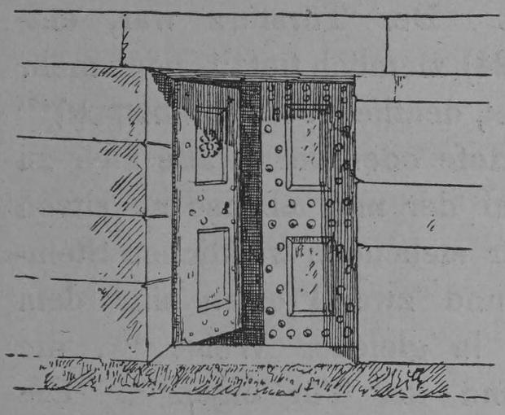

 

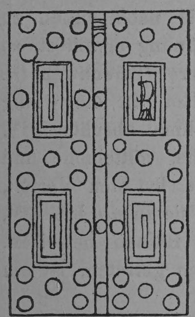

 

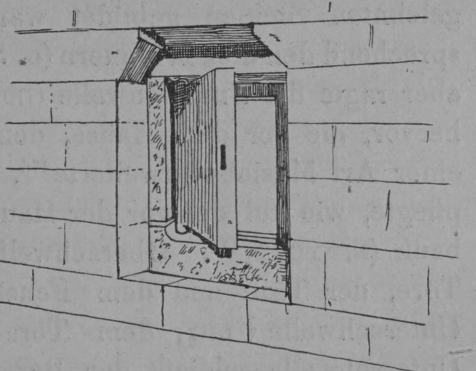

*Fig. 8. 9. Steintüren aus dem Haurân.*

*Zweiflügelige Steintür.*

Die Oberschwelle (*supercilium*, *ʿatabe* = عتبة der Araber), als ein Teil des Hauses, auf den der Blick besonders stark fällt, wurde sorgfältig gearbeitet; damit der Sturz auf dem Pfosten gerade aufliege, wurde mit etwas Holz nachgeholfen, während rücklings ein „Sandal“ genannter Querleisten, ebenfalls aus Holz, die zufallende Türe fest zum Sturze hielt[^25.471]. Man hat sich den Sturz wagerecht zu denken[^25.472], allein im jerusalemischen Heiligtum gab es ein Tor, das Taddi-Tor, das aus zwei aneinander gelehnten Steinen gebildet war[^25.473]. Der Türsturz war, entsprechend den dicken Mauern (o. S. 24), ziemlich tief[^25.474], noch mehr aber ragte die Unterschwelle (אסקופה, deutlicher אסקופה תחתונה)[^25.475] hervor, die vor dem Hause, dem Hofe oder der Straße sich zu einer Art Mastaba erweiterte[^25.476], auf der man ebenso zu sitzen pflegte, wie auf der vor der Haustür stehenden wirklichen Steinbank (מסטוביתא)[^25.477]. Oberschwelle und zwei Pfosten sind dem Tore, der Türe und dem Fenster in gleicher Weise[^25.478], die Unterschwelle nur dem Tore und der Tür eigen[^25.479]. Die Unterschwelle schließt den Bereich des Hauses nach außen ab, sie bildet die Grenze zwischen Privatem und Öffentlichem[^25.480]. Wenn die Türe geschlossen ist, kommt sie nach außen zu liegen; da sie sich aber noch über die Türöffnung erweitert, so spricht man von einer äußeren und einer inneren Türschwelle[^25.481]. Auch ist sie gegen die Straße oder den Hof zu ein wenig erhöht[^25.482]; von vieler Benutzung ist sie manchmal abschüssig[^25.483]. Im Punkte der Höhe unterschied man hohe, mittelhohe und niedrige Schwellen[^25.484]; die niedrige Schwelle hat den Vorteil, daß, wenn auch das ganze Gebäude einreißt, sie *in situ* bleibt[^25.485], eine sehr richtige Wahrnehmung, wie viele Ruinen beweisen. Die Unterschwelle, von jedermann mit Füßen getreten, ist ein beliebtes Bild für Ergebenheit und Demut[^25.486].

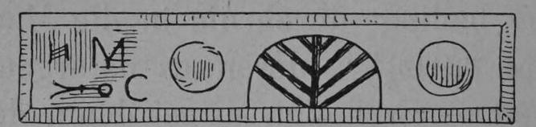

*Fig. 10. Türsturz einer Synagoge in Galilaea.*

Die Türe (דלת, אגף, דשא, גלא)[^25.487] bestand aus Stein[^25.488], Holz[^25.489], selten einem Strohgeflecht[^25.490] oder aus Metall[^25.491]; in vornehmen Häusern war sie wohl zweiflügelig[^25.492]. Die Türen hingen nicht, wie bei uns, in den Angeln, was auch in Griechenland und Rom nicht der Fall war, sondern an der beweglichen Türe selbst befanden sich zwei kegelförmige Zapfen (ציר)[^25.493], welche in je eine Höhlung oder Pfanne (פותה, צינור)[^25.494] der oberen und der unteren Schwelle (ציר עליון und ציר תחתון) eingelassen waren und sich darin drehten[^25.495]. Die Türe wurde mittels dieser Zapfen in das Gebäude eingestellt (הציב, העמיד)[^25.496], ein Verfahren, das gar nicht leicht war[^25.497], und das den Schluß des Baues des Hauses bedeutete. Infolge des andauernden Rollens entstand in beiden Schwellen eine sehr deutliche Rille (היכר ציר)[^25.498] und im Zimmerboden Reibspuren[^25.499]; auch das nächst angrenzende Stück der Mauer litt einigermaßen[^25.500]. Ein Übelstand war ferner, daß der Zapfen leicht aus der Pfanne sprang[^25.501], ferner das große Geräusch, das das Öffnen von besonders großen Türen verursachte[^25.502]. Eine technische Verbesserung scheinen zu repräsentieren diejenigen Türen, die in Teile zusammengelegt werden konnten[^25.503] (Spalettüren), während man das Scharren der Erde mit einem röhrenförmigen Belag (מינקת)[^25.504a] zu verhüten suchte.

Ein Nagel in der Haustüre, den der Hausherr einschlug, scheint ein Symbol seines Besitzrechtes gewesen zu sein[^25.504b].

Während gewisse Möbelstücke, wie Kisten, Kasten und Schränke, regelrechte Türen mit Zapfen haben, und selbst Brunnen, Schuppen und Gruben solche Türen haben können, lassen sich letztere, wie überhaupt Wirtschaftsgebäude, sehr gut mit einer primitiven Tür denken, die bloß angelehnt ist[^25.505] oder aus einem Gitter oder einer Matte[^25.506] besteht, letzteres besonders in Ladentüren, wobei das Innere bloß verhüllt, aber nicht verschlossen werden soll[^25.507]. Die inneren Räume werden, wie auch bei den Römern[^25.508], überhaupt nur Tücher und Vorhänge an der Türöffnung gehabt haben, und auch wo Türen vorhanden waren, waren linnene Vorhänge (מטפחות, וילון = *velum*) angebracht, die man je nach Wunsch zurückzog (קפל, פרק) oder herunterließ (פרם, נטה)[^25.509]; so konnte man auch bei offener Türe vor Blicken geschützt sein und dennoch kühlende Luft genießen. Ein besonders prachtvoller Vorhang (פרגוד = *paragauda*)[^25.510] diente mehr zur Dekoration, wie nebenbei auch die anderen Vorhänge.

[^25.450]: √ פתח auch aram. פתח, ܦܬܚ, فَتَحَ. Verschieden von דלתות: MMidd 2,3 כל הפתחים שהיו שם היו להן דלתות חוץ משל אולם. Die Phrase סבב על הפתחים (TPeʾa 4,8, 23₂₀) oder שאל usw. (MBb 9,1), חזר על הפתחים (oder מחזר) bMeg 15ᵇ, bKethub 108ᵇ, אהדור אפתחא bSabb 151ᵇ bedeutet „betteln“. Daraus erklärt sich die Situation in MSabb 1,1.
[^25.451]: „In der Winkelecke macht man keine Türe“ bʿErub 6ᵃ. 94ᵇ. Das wäre auch בית שאין לו אלא פצים א׳ Bar bMenach 34ᵃ. Die Arche jedoch hatte die Türe mehr an der Seite, d. h. im Winkel: Gen R 31,11, und es wird hinzugefügt, daß die Sitte es erfordert, daß man in einem Triklinium von zehn Ellen im Gevierte die Türe an der Seite (מן הצד) mache. Das ist offenbar etwas Spezielles, ebenso das Verbot, daß man in einem von mehreren Parteien bewohnten Hofe die Tür nicht vis-à-vis der andern anlege (MBb 3,7), offenbar, um den Einblick ins fremde Haus unmöglich zu machen, aber für gewöhnlich lag ein solcher Grund nicht vor, und mit Unrecht nimmt A. ROSENZWEIG S. 37 für die Türe den Platz an der „Seitenfront“ an.
[^25.452]: Folgt aus der Art, wie MMš 3,8 und T 2,13. 14. 15 p. 90 von den Zellen des Heiligtums gesprochen wird; T ib. Z. 5 ausdrücklich הכל הולך אחר פתחה, ferner ib. vom Hause der Stadtmauer.
[^25.453]: „Das Hineingeben“ heißt דריסת הרגל MMegilla 1,8. bSabb 146ᵃ unten עשוי להכניס ולהוציא. Vgl. das dem Pinechas bewiesene Wunder, daß er die beiden Leichen hinaustragen konnte, Sifre und Parallelstellen zu Num 25,8 (Sifre Num 131 p. 48ᵃ פתח שקוף l. שקוף פתח, jSanh 10,28ᵈ₇₅ שקוף, b 82ᵇ משקוף, ebenso Num R 20,25, Tanch *Balaḳ* 21 משקוף הבית, Trg Ps-Jon שקיפא).
[^25.454]: עשאו פתחים במחתרת bSabb 32ᵇ, Raši: was keine Pfosten hat.
[^25.455]: bʿErub 2ᵇ und oft. Die Definition von צורת הפתח ist: ein Rohr (Pfosten) von rechts und links und eines darüber, Bar bʿErub 11ᵇ; die Türform muß ferner eine „gesunde“ Türe aufnehmen können, ib.
[^25.456]: פצים, auch פסים, pl. פצימין, das aber manchmal sich in פצים birgt (L 4,86), √ פצם aufreißen, spalten (Ps 60,4, womit es schon von Saadja תפסיר אלפצעין bei EWALD-DUKES, Beitr. 2,115 verglichen wurde), arab. فَصَمَ, Trg Jerem 22,14 hat ופצים ליה חרכין für וקרע Tw. — Übertragen auf דלתות von Rollen und Büchern Trg Jerem 36,23; II Trg Esth 6,1. — Wenn man die Türränder abreißt, beginnt die Zerstörung des Hauses, die damit bereits markiert ist: jAz 3,9, 43ᵇ₃₄. Vgl. TBb 2,13, 400₃₄ פרץ את פצימי(ו)[ה], Bar bBb 12ᵃ oben.
[^25.457]: בית שאין לו אלא פצים אחד Bar bMenach 34ᵃ.
[^25.458]: bBb 69ᵃ, wo die Möglichkeit מחברי בטינא oder נקיטי בסיכי (RSbM: Nägel קבילש = *chevilles*). Der Gesichtspunkt לגוי בעלמא findet sich ib. zwar nur in bezug auf die Fensterrahmen, er ist jedoch offenbar auch auf den Türrahmen anwendbar. Vielleicht auch מלבנים MNeg 13,3. Vgl. auch מלבן של קנים Bar bMenach 33ᵇ. Saadja setzt مَلَابِن zu אמות הספים Jes 6,4.
[^25.459]: bBb 69ᵃ, vgl. MZabim 3,1 und 4,3, daß דלת = Tür עשוי בטיט mit Mörtel eingesetzt sein kann. Vielleicht ist dieselbe Handlung gemeint MʾOhal 13,4 הגיף ולא מרקה ;הגיפה w. u., מרק glätten?
[^25.460]: √ זוז sich bewegen, womit GES. سَيْسَاب (von ساب) Tür- oder Fensterpfosten vergleichen will; doch hat man jetzt assyr. *manzazu* ZDMG 52,136.
[^25.461]: In bezug auf עירוב entspricht לחי וקורה (MʿErub 1,2. 3 und oft) den מזוזות und קורה der Türen; קורה s. MKel 11,2 (von Metall), MZabim 3,1; 4,3. שקוף (Inschrift des Sturzes der Synagoge von Kefr-Bereim s. MGWJ 1865, 14,147; Mitteilungen der Deutsch. Orient-Gesellschaft No. 29, 1905 S. 15). שקוף steht in ed. Lowe auch in MʾOhal 9,10; 10,7; 11,7 in ed. Derenb., Agg. משקוף; 12,8. Bh. מַשְׁקוֹף (von aram. שקף ܫܩܦ schlagen, die Stelle, woran die Türe schlägt) im Nh. mehr poetisch (z. B. AbRN α c. 26 p. מב) oder in Stellen, wo auf die Bibel Bezug genommen wird (vgl. bSanh 82ᵇ), sonst שְׁקוֹף (so ms Kfm, L 4,605 und K 8,152 שְׁקִיף, J 1621 שקוף), in der Bedeutung einerlei mit משקוף (gegen Maim. zu MMidd 2,3 s. jedoch Maim. zu MʾOhal 10,7; s. K), aram. שקפא w. u. Gewölbte Türen (כפה) s. o.
[^25.462]: Natürlich Gegensatz zu „Unterschwelle“, s. w. u.
[^25.463]: „Holz“ folgt aus der Erklärung Hais zu MNeg 12,4 עפר כדי ליתן בין פצים לחבירו, vgl. bSabb 82ᵃ, aus Responsen (vgl. RN bei K 6.393): „Beim Verfertigen von Balken zu Türen, Brettern und Latten gibt man Scherben zwischen die Sägestücke, damit Luft eindringe und die Stücke trockne.“ RNs eigene Erklärung weicht hievon nicht erheblich ab; er stellt מזוזה, לחי und פצים zusammen, doch in demselben Atem für פצים richtig: die gerade abgeschnittenen Seiten der Mauer, die die Türöffnung bilden. Zu bSukka 18ᵃ führt RN den „Gaon“ an, der פצים wieder mit לחיים erklärt, nur *cum grano salis* richtig (allerdings MMaʿas 1,7 bei der Ölpresse eine Holzvorrichtung), vielmehr פצים als Mauerteil stets zu unterscheiden von מזוזה und לחי. In MZab 3,1 ist קורה unter Holzobjekten aufgeführt.
[^25.464]: Oft besonders im Haurân; s. unsere Figuren 8. 9; ZDPV 13,37.
[^25.465]: MKel 11,2 s. A. 458.
[^25.466]: bʿErub 11ᵃ פתחי שמאי, im Talmud selbst doppelt erklärt: 1. sie haben שקפי (nach Raši hier und in bMenach 33ᵇ bedeutet hier שקפי nicht die Oberschwelle, sondern Pfosten überhaupt, vgl. bSabb 146ᵃ); 2. sie haben keine תקרה (Raši in ʿErub = Sturz, in Menach = Oberschwelle; Tosafoth in Menach greifen merkwürdigerweise Raši in ʿErub an). Zur Worterklärung vgl. Raši זקן אשמאי bḲidd 32ᵇ = schadhaft, verdorben, also שמם, was auch richtig sein dürfte; vgl. o. A. 456. פרק resp. פרץ את פצימיו kommt der Zerstörung gleich. RCh, wahrscheinlich nach arab. Sprachgebrauch (شَأْم = Syrien): Türe in Palästina, d. i. im Lande der Semiten. In seinen Spuren gehend, könnte man an den Ort גובת שימאי (A. 441) denken, wo etwa solche Türen üblich waren.
[^25.467]: bʿErub 101ᵃ דלת אלמנה zweifach erklärt: 1. דחד שיפא aus einem Brett (s. Raši, RN bei K 3,74 לוח אחד) bestehend, 2. דלית ליה גושמה (Raši דיליש = *delais*) l. שיגמא (vgl. L 4,508, wo שגמין Türangeln belegt ist; אמנות II Kön 18,16 wird שיגמיא erklärt Kohel R zu 6,11), Raši: ohne feste Verbindung; RCh: ohne Pfanne in der Unterschwelle; noch richtiger etwa: ohne Zapfen, und ist es darum, daß die Türe eine „Witwe“ heißt. פתחו במלואו der Ausdehnung nach TʾOhal 5,1, 602₃, ib. 14,4, 611₃₀ vom Fenster, vgl. von אכסדרה jSukka 51ᵈ.
[^25.468]: Bar bBb 12ᵃ, Bas bBabb 146ᵇ.
[^25.469]: Scheintüren gibt es bekanntlich die Menge in den ägyptischen Grabkammern, s. MASPERO-STEINDORFF, Kunstg. S. 108. 116 usw.
[^25.470]: פצימין TʾOhal 16,14, 615₂ ein Felsengrab behandelnd; שקופה של מערה opp. דפנה T ib. 7,10, 604₃₇.
[^25.471]: Vermutlicher Sinn von MNeg 12,4 עצים כדי ליתן תחת השקוף . . . כדי לעשות סנדל לאחורי השקוף. Maim. gibt aber umgekehrt den עצים die verbindende, dem סנדל die ebnende Rolle, anders RŠ (A. ROSENZWEIG 39). Auch TNeg 6,5, 625₂₃. Eine ähnliche Bedeutung hat סנדל של עריסה MʾOhal 12,4 T 13,4, 610₂₀ (nicht „Schutzleiste“ A. ROSENZ. a. a. O.), sondern eine Pfanne, in der die Füße der Wiege stecken. Daraus ausgehend, könnte סנדל der Oberschwelle eine aus zwei Holzleisten gebildete Rille sein, in der die Türe beim Zuschlagen einfällt, um passend auf der Oberschwelle aufzuliegen.
[^25.472]: So die meisten Höhlen, die Typen des palästinischen Hauses (s. o.). Die von G. SCHUMACHER ZDPd 8,61 f. beschriebenen Felsengräber in Dschebata (Galiläa) haben jedoch Tonnengewölbe und in Bogen auslaufende Eingänge. Etwas Bogenförmiges dürfte gemeint sein mit והיה משקיף בה ועולה Gen R 31,11 (s. o.), wo √ שקף zugleich das spitz Auslaufende bezeichnen würde. Anders תרעא משקיף Lev R 5,8, wo es das zugeschlagene Tor bedeutet, u. z. in aramäischem Satze. Aram. שְׁקָפָא hat in unserm Texten den Pl. שקופיא, entsprechend dem hebr. שקופות, u. nicht שְׁקָפַיָּא שקפין, die beiden Idiome passen sich also einander an. S. auch NEUMARK, Lex. Untersuchungen zur Sprache der jer. Pentateuch-Targume I, Berlin 1905 S. 43.
[^25.473]: MMidd 2,3 כל הפתחים שהיו שם היו להם שקופות חוץ משער טדי שהיו שתי אבנים מוטות זו על זו (ed. Lowe). Was RN (K 8,152) bemerkt, muß sich auf das Taddi-Tor beziehen; er gibt die Form /\.
[^25.474]: Folgt aus jNazir 7,3, 56ᶜ₅₃ המת והנזיר . . . תחת מעי השקוף. J 1621 streicht מעי als Dittographie; vielleicht ist שמי השקוף (*ad normam* שמי קורה o.) zu lesen, woraus zugleich die zierliche Arbeit des Sturzes folgen würde.
[^25.475]: אסקופה assyr. *askuppu* und *askuppatu*; kann von שקף, wovon משקוף, nicht getrennt werden; syr. ܐܣܟܘܦܬܐ arab. أُسْكُفَّة. Nach S. Fraenkel S. 19 f. ist auch jüdisch stets אסכופה mit כ׳ (wie in jMeg 1,14, 72ᵈ₁₀, ib. 4 Ende 75ᶜ₇₃ אסכופתא ארעיתא „untere Schwelle“, in jJoma 1,1, 38ᶜ₄₀ jedoch אסק׳, dieser Pl. auch bJoma 53ᵃ מיתנון אסקופתא, sonst aber אסקופין jAz 3,1, 42ᶜ₁₃) das ursprüngliche, und ist אסק׳ erst unter Einfluß von משקוף emporgekommen, s. jedoch BARTH, Et. St. S. 35. אסקופא עלאה „Oberschwelle“ Trg Ps-Jon Exod 12,7. 22. 23.
[^25.476]: MSabb 10,2, Bert. אצטבא. SFraenkel S. 21 u. Lwr 2,345.
[^25.477]: jBeza 1,6, 60ᶜ₅₈ מסטוביתא ברייתא, Cant R 6,18, wo ein Schneider einen Arbeitsplatz daran hat. TBḳ 6,28, 357₅ אצטווה ed. Z. korrupt אצטוירא.
[^25.478]: Mekh RSbJ zu Exod 12,7 p. 10 H. על משקוף ומזוזות של הלונות.
[^25.479]: In Mekh ib. p. 6ᵃ u. jPesach 9,4, 36ᵈ unten und 37ᵃ ob. wird darüber debattiert., ob bh סף = אסקופה = Schwelle oder = כלי = Becken sei. Tatsächlich bedeutet es beides. GES. Hwb סף „Schwelle“ oder „Pforte“, aber שמרי הסף, Schwellenhüter. Bh. auch מפתן. אסכופייא דשלה Torschwellen von Schiloh jMeg 1,14, 72ᵈ₁₀, jPesach 6,3, 33ᶜ Schwellen Jerusalems, ib. 33ᵇ₇₁ Schwelle des Vorhofes, b 94ᵇ. Ähnlich Trg Prov 8,34 אסקופתי. bSabb 9ᵃ אסקופת מבוי.
[^25.480]: Ob רשות היחיד oder רשות הרבים wird bestimmt in TSabb 1,4, 110₇, j 1,3ᵃ₅, b 6ᵃ. Vgl. MSabb 1,1, MNeg 13,10, T 7,9, 627₂.
[^25.481]: MSabb 10,2 אסקופה zu ergänzen הפנימית, opp. אסק׳ החיצונה. Vgl. מסטוביתא ברייתא o. Dagegen דשא ברייתא bBerakh 56ᵃ Hoftüre im Gegensatze zur Zimmertüre.
[^25.482]: Ihre Höhe kann 10, die Breite 6 Tefachim (Bar bSabb 6ᵃ ausdrücklich טפחים, in TSabb 1,6 ist nur die Höhe auf 10 T angegeben, nicht die Breite). Schon 3 T. hoch hat sie den Charakter von כרמלית (= enge Gasse). T ib. כל זמן שהפתח פתוח הרי הוא כלפנים נעול הרי הוא כלחוץ.
[^25.483]: קטפרים s. Wbr.
[^25.484]: Vgl. Prov 17,19 מגביה פתחו כו׳. AbRN α c. 26 p. מב die Adjektiva עליונה, אמצעית, התחתונה sind nicht komparativ zu verstehen, sondern im *gradus positivus.* Die sehr hohe Schwelle „verschlingt die Personen“ (מבלעת פרצופות, wofür ein Ms שבוזה את יקרין, das aber nach Derekh ʾE zuta c. 1 die Eigenschaft einer kleinen Türe sein soll: שמנבל את היקרים, weil sie nämlich hochstehende Männer zwingt, sich bücken zu müssen, wogegen die hohe Tür — die „Schwelle“ ist *pars pro toto* = Tür — die Person gleichsam verschwinden macht). In Kalla R ed. Coronel p. 4ᵇ lies ולא כפתח [קצר] u. z. קצר = קטן, ausgefallen infolge der nun folgenden Glosse שלא יהא קצר הלב d. h. ungastlich, wogegen ביתך פתוח לרווחה ʾAboth 1,5 = gastlich; diese Tür ist 1. מבזה את היקרים, 2. מרחקא לך מן בני אנשא. Die mittelhohe Schwelle ist מנגפת הרגלים AbRN, d. i. man hat zu tun, sie zu erklimmen, und man schlägt sich buchstäblich die Füße an; in DE z. c. 3 Ende ist das von אסק׳ עליונה gesagt u. z. מונעת, Var. מנגפת, mit mehr Rechte, während es von der mittelhohen Schwelle heißt, daß wer hinter ihr wohnt (l. על ידה fem.) griesgrämig, gewissermaßen ein Misanthrop ist. Vgl. den Satz: *limen superum, quod mihi misero saepe confregit caput, inferum autem, ubi ego omnes digitos defregi meos*, Non. 4,278, angeführt von BECKER-GÖLL, Gallus 2,232. Vgl. ferner חזקה אין אדם מניח פתח גדול ונכנס בפתח קטן bʿErub 10ᵇ.
[^25.485]: Derekh ʾE z. c. 3.
[^25.486]: z. B. jSanh 6,32ᵇ₇₅ עשה אותי כאסקופה und die angeführten Stellen aus Derekh ʾE u. AbRN (s. meine ungarische Übersetzung: Talmudi Életszabályok S. 11 u. REJ 36,215). L 1,131 u. K 1,197 unrichtig σκόπος Zielscheibe.
[^25.487]: דלת assyr. *daltu*, syr. ܕܪܬܐ s. GES Hwb. Nh. oft. — אגף bh. Flügel, nh. Türflügel: MPesach 7,12 j 7,10, 35ᵇ₃₄ אגוף Stadttore (diese und die der Paläste hatten Doppelflügel, MBb 1,5), TʿErub 11,14, 153₂₁ בית אגיף (l. אגוף) scheint die Türhöhlung zu sein; TBḳ 6,28, 357₄ מן האגף ולחוץ ib. מן האגף ולפנים; TBm 2,13, 374₆, MNedar 7,5 ms Kfm אגַף. — דשא bereits in dem Papyrus von Elephantine ed. Sachau nach Lesung S. FRAENKELs in Theol. Literaturz. 1907 Spalte 658. Belege s. bei L 1,429 f., Grundbedeutung nicht durchbohren, wie פתח, sondern anschlagen, wie אגף = נגף, J 326 vgl. דוש dreschen; in erster Reihe von der Schwelle u. דשא bedeutet Schwelle noch in bMenach 33ᵃ, doch ist pl. דשי und תלי auffallend; dann Türe *pars pro toto.* Da samarit. דרשה, so kann man auch an Wurzel דרש, دَرَسَ BROCKELM. 79 *calcavit* usw. denken. In bKethub 10ᵇ, bSabb 77ᵇ aggadisch gedeutet: דרך שם der Weg dorthin. — גלא (גל, אגלא, L 1,328) wegen der rollenden Bewegung. Dagegen פשפש nicht Synonym von Türe, s. I. LÖW in Lwr 2,472, A. ROSENZWEIG 38 A. 5, sondern kleines Tor innerhalb des großen, besonders im Tempel, z. B. MŠeḳal 6,3. Vgl. OVERBECK-MAU, Pompeji⁴ 254. 378. In Bar. von der Stiftshütte c. 2 שני פספסין sowohl Türe als Fenster.
[^25.488]: Wie noch im Haurân zu sehen: BURCKHARDT 1,122, Winer³ 1,467. Maundrel, in SHAWs Reisen² 185. ZDPV 20,136. TSabb 15, 13,134₅ דלתות הבית . . . של אבן. Phantastisch Pesiḳta 136ᵇ.
[^25.489]: Cant 8,9. Neh 2,8.
[^25.490]: דלת של קשין bʿErub 11ᵇ .
[^25.491]: MKel 11,2. Eiserne Stadtore Acta 12,10. Im Tempel zu Jerusalem gab es goldene Tore u. das Nikanortor war aus korinthischem Erz; s. MMidd 2,3, GRAETZ Gesch. 3⁴ 226, Lwr 2,543, vgl. BLÜMNER Techn. 4,183.
[^25.492]: Vgl. I Kön 6,34 צלעים גלילים, ib. 7,50. Doppelte Flügeltür (d. i. an beiden Enden der Türöffnung) befand sich im Heiligtume: MMidd 4,1; ib. eine Ansicht, daß sie inmitten der Türöffnung standen. Beides Flügelpaar öffnete sich nach innen; die äußeren bedeckten somit die Mauerdicke, die inneren bedeckten einen Teil des Innenraumes, ib. In Rom durften nur die Türen von öffentlichen Gebäuden nach auswärts schlagen. BECKER-GÖLL, Gallus 2,233.
[^25.493]: ציר assyr. *sirru*, aram. צירתא ܨܝܪܐ, arab. صِير. Prov 26,14 הדלת תסוב על צירה. Oft im Nh. z. B. MKelim 11,2, wo Maim. es nur in Stadttoren und sonst großen Toren und aus Eisen sein läßt. Bei den Römern war der *cardo* vorzüglich aus Ulmenholz, doch mit Metall beschlagen: BECKER-GÖLL, Gallus 2,234; RICH S. 111. S. WINER³ 1,467, BENZ. Arch. 119, NOWACK 1,142. Trg O setzt ציר für יתד L Trg Wb 2,323. Sehr gut Raši MMḳ 1,10 (11ᵃ) = רגל הדלת. — Zu בלוט βαλανωτός ? s. Lwr 2,156. Der ציר ist ein wichtiger Bestandteil des Hauses, darum צירים u. דלתות Lev R 14,4, כשם שצירים לבית u. צירי בשר bBekhor 45ᵃ, שומרי צירים Bar jNazir 8,1, 57ᵃ₅₆ wie bh. שמרי הסף.
[^25.494]: bh. פֹּתֶה I Kön 7,50. Dasselbe Wort MKelim 11,2 והפותה שתחת הציר (ed. Neapel u. Lowe, ms Kfm, Hai u. RN bei K 6,461, in Agg der Schreibfehler פתח vgl. Num R, 12,4, wo zuerst פותות richtig: זה פותה שתחת הציר, dann פותחות אלו was sinnlos ist, l. mit Cant R 3,8 הפיפות d. i. חפי ושני הפתחות wie רד״ל bemerkt, s. w. u. Ob צינור, eigentlich Kanal, dasselbe (Raši zu MMḳ 1,10 RN bei K 7,43, L 4,206, K 7,30, J 1291), kann bezweifelt werden, denn in MKel 11,2 dient פתה dem ציר, während צינור etwas ist, was fest an der Erde haftet, nach Maim. z. St. = Rinne, also etwa eine Rille, die für die Türe gemacht ist. Ein größerer Raum wird auch gefordert, da wir hören, daß man Geld מתחות צנורא דדשא von unter der Türrille hervornimmt (bBerakh 18ᵇ, vgl. zum Ausdruck auch bPesach 94ᵇ), doch ist auch תחת ציר של היכל TSota 2,2, 294₁₈ trotz des Ausdruckes der ganze Raum unter der Türe gemeint. Das Wort אבקתא bʿErub 11ᵇ (l. אבקיתא von אבק = אפיק) ist dem Sinne nach gleichfalls Kanal, und auch dieses erklärt Hai für den eisernen „Becher“ (כוס), in welchem der die Türe bewegende Zapfen steckt, ähnlich Maim. Die Modernen gebrauchen dafür das Bild vom Schuh. Bronzepolschuh aus Balawat s. PERROT-CHIPIEZ, Histoire de l’Art, II, 254; auch in Assur, s. WALTER ANDRAE, Der Anu-Adad-Tempel in Assur, Lpz. 1909, S. 75 f. Aber RCh: והוא החלל החקוק על המשקוף להכניס בה ציר הדלת = Pfanne. Vielleicht ist פותה die steinerne oder metallene Pfanne (= כוס der j. Erklärer), die das Loch ausfüllt, während צינור u. אבקיתא das Loch oder die Höhlung in der Schwelle selbst sind, in die der Zapfen unmittelbar einläuft. Bei den Griechen ציר = στρόφιγξ, פתה = στροφεύς; die Römer hatten für beides nur den Ausdruck *cardo*, nur unterschieden sie *cardo masculus* u. c. *femina*, s. RICH s. v. *Cardo*, DURM² 347. Möglich auch, daß אבקיתא eine Rille ist, die der Riegel bei andauerndem Öffnen der Tür in die Schwelle eindrückt, vgl. OVERBECK-MAU, Pompeji⁴ 254.
[^25.495]: MʿErub 10,12.
[^25.496]: I Kön 16,34 הציב דלתיה nh. העמיד דלת z. B. bʿErub 11ᵇ , bMenach 33ᵃ, nach Nehem 3, wo es oft vorkommt.
[^25.497]: Geht hervor aus MʿErub 10,12; war der untere Zapfen aus der Pfanne gegangen, so hob man die Türe leicht zurück (החזיר); schwerer ging es, wenn der obere Zapfen aus dem Loch schlüpfte. Die Frage wird im Hinblick auf die Sabbatarbeit abgehandelt, so auch bei Kisten-, Kasten- und Schranktüren und bei den mehr liegenden Türen von Brunnen, von Schuppen (יציע) und Gruben, bei denen ebenfalls oberer und unterer Zapfen genannt werden (TʿErub 11,18, 154₇, dieser Unterschied fehlt in Bar bʿErub 102ᵇ, wo aber Unterschiede von דחק, תקע u. החזיר; letzteres Raši *effondrer*).
[^25.498]: bʿErub 11ᵇ, bMenach 33ᵃ.
[^25.499]: דלת הגוררת TBeza 2,19, 205₃, TʿErub 11,13, 153₁₈, vgl. o. A. 435. An beiden Stellen ib. u. in Bar bʿErub 101ᵃ, j 10,1, 26ᵇ₆₀ dasselbe Scharren auch von מחצלת und קנקין קנקן, l. קינקילין wie jSabb 5,1, 7ᵇ₂₇, d. i. Türe aus Matten u. Gitter = κιγκλίς Lwr 2,533, w. u. Raši zu bʿErub 101ᵃ faßt קנקן als Pflugschar auf, und so auch noch A. ROSENZWEIG S. 43 A. 3.
[^25.500]: Das Stück hinter den Türen war im Heiligtum ausnahmsweise nicht mit Gold überzogen (MMidd 4,1 טוח, Num R 12,4 נטוח).
[^25.501]: S. viertnächste, vorhergehende A.
[^25.502]: Im Heiligtum s. MTamid 3,7; gr. ψοφεῖν HERMANN, Gr. Privataltert. 149 A. 3; *sonitus* und *crepitus*, s. BECKER-GÖLL Charikles 1,92 u. Gallus 2,235. Vgl. den Ausdruck הגפת דלתות bJoma 18ᵃ ob. verglichen mit הגפת תריסין usw.
[^25.503]: Weil sie mehrfach sich drehten, hießen sie אסטרופומטא (LAA s. Lwr 2,82) στροφώματα: Gen R 66,5 (Jakob steht hinter einer solchen Türe und wird von Esau nicht gesehen), MMidd 4,1 (ed. Lowe איצרבמיטה), היו נקפלות לאחוריהם.
[^25.504a]: TKel bm 4,5, 582₂₈, weniger deutlich MKel 14,2 עשה בראשו [של מקל] מינקת וכן בדלת. Natürlich das untere Ende des Stockes: TKel bm 4,3 מקום הדייש u. שלא תהא הארץ אוכלתו ein Satz, der auch die Türe illustriert.
[^25.504b]: „Man kann den Nagel (מסמר) nicht von der Türe entfernen (פרש), ohne Holz mitzureißen“ (Sifre Num 131 p. 47ᵇ, jSanh 10, 28ᵈ₃₂), d. i. doch wohl: der Besitz läßt sich nicht unkenntlich machen. Eine Analogie bietet der Vorgang in Uša, wo jeder Teilnehmer der Versammlung zur ewigen Erinnerung in einen Marmorblock je einen Nagel einschlug (jChag 3,1, 78ᵈ₂₁), also hatte man eine Sitte des Nägeleinschlagens, die der unsrigen bei Fahnenweihen usw. ähnlich ist; damit dürfte nun bei der Türe der Besitz angedeutet gewesen sein. Vgl. das *Wasm* der heutigen Araber (WETZSTEIN in Globus 1877,32, 256). A. ROSENZWEIG S. 40 benutzt das Datum zum Beweise, daß die Türbretter mit Nägeln verbunden wurden, schwerlich richtig.
[^25.505]: MʿErub 10,8 הדלת שבמוקצה, ib. הדקים שבפרצה der zum Verschluß eines Mauerrisses dienende Zweigfleck, Bar b 101ᵃ סוכי קוצין וחבילין שהתקינן לפרצה שבחצר.
[^25.506]: מחצלות MʿErub 10,8; T 11,13, 193₁₉ מחצלת הגוררת ib. auch קנקנין d. i. Gittertüre, s. A. 499. Mehrere Eisen-, Bronze- und Marmorgitter sind abgebildet bei Durm² S. 348.
[^25.507]: TʿErub 11,12, 153₁₆ מחצלות פרוסות שבפתחי חנויות ברשות הרבים אם היו קשורות ותלויות (sie konnten also angebunden und eingehängt sein); ib. ואם לאו (d. h. bloß angelehnt). Ib. עשה להם ציר של קנים [ו]שובלין (sie konnten aus Schilf und Strohhalmen verfertigte Zapfen haben). bGitt 68ᵃ ציפתא דשדיא, RNissim zu bSabb 109ᵃ ציפתא דדשא (s. L 4, 209 = Matte).
[^25.508]: BECKER-GÖLL Gallus 2,310 f., MARQUARDT Privatleben² 236. 238. RICH s. v. *velum* = παραπέτασμα = modern *portière.* Auch in jüdischen Schriften häufig in Verbindung mit fremden Gebäuden, wie פלטין, טרקלין genannt, z. B. bBeza 14ᵇ, GenR 52,5.
[^25.509]: וילון (häufig, s. Lwr 2,235) aus linnenem Zeug s. MKelim 20,7; 24,13; 27,9, T bm 11,8, 589₃₅; 11,10, 590₁₀; vgl. MNeg 11,11; bSabb 138ᵃ. מטפחות und die sich daran knüpfende Sitte: TBerakh 4,9, 91₅, wo פרוסה, פורסין resp. נתלקה in bʿErub 102ᵃ נטה u. פרק, für Vorziehen auch מתח Lev R 5,1, wogegen קיפל את הוילון Gen R 52,5 nicht einerlei mit נטה und פרס ist, sondern vom Zurückschlagen der in der Mitte geteilten Vorhänge (*vela reducere*, s. RICH a. a. O.). Aram. וילון פריס z. B. Trg Ps.-Jon Exod 36,37.
[^25.510]: MKelim 29,1 Hai = פרגוד (wofür es im Trg oft steht, s. Lwr 2,477), arab. סתר (l. סתארה) חיגאן, d. i. حِجَاب سِتَارَة DOZY 1,249; auch Maim. z. St. gebraucht سِتَارَة, doch kann hier ganz gut auch „Mantel“ (s. § 81 No. 15) gemeint sein. Maim. beschreibt den Vorhang wie folgt: פרגוד ist die Decke, die man in zwei Flügeln auf die Türen gibt, indem man das eine Ende an die eine Türe, das andere Ende an die andere Türe aufrollt; will man nun im Zimmer kühl machen, läßt man die Decke herunter und die zwei Flügel vereinigen sich durch Spangen zu einer Decke und halten alles, was im Zimmer ist, kühl. Vgl. אין הפרגוד ננעל בפניהם bBm 59ᵃ. Die Phrase מאחורי הפרגוד bChag 15ᵃ, bJoma 77ᵃ erklärt sich aus der heidnischen Sitte, das Bild der Gottheit zu verhüllen und nur bei festlichen Gelegenheiten die Hülle wegzuziehen, wie noch heute in katholischen Kirchen.

## § 26

**26.** **Verschluß.** Es gehört zum Wesen der Türe, verschlossen werden (נעל) zu können[^26.511]. In Bauernhäusern bestand der Verschluß aus einem Vorlegebalken (קורה)[^26.512], der von innen die Türe verrammelte, von außen aber durch ein in der Türe angebrachtes Loch mittels eines krummen Hakens (מסמר) aus Holz oder Eisen weggeschoben oder gehoben wurde. Ein richtiger Verschluß entstand erst, wenn an der Innenseite der Türe ein quer vorgelegter Balken (מַנְעוּל *sera*), zu dessen Aufnahme rechts und links in die Pfosten eingehauene, mitunter mit Holz- oder Tonplatten bekleidete Löcher oder freie Klammern (bh. כפות המנעול, nh. בית מנעול resp. בית נגר) sich befanden, und eine schräge Stütze (נֶגֶר *vectis*), welche darüber von der Mitte der Türe bis zum Fußboden reichte, angebracht waren[^26.513]. Wenn die Türe nicht verschlossen war, lag der Schrägbalken entweder frei auf der Erde (נגר המונח) oder war an die Mauer angebunden und hing herunter (קשור ותלוי)[^26.514]. Querbalken und Schrägbalken konnten aus Metall sein[^26.515]. Aus Eisen oder, wenn aus Holz, zumindest mit Eisen beschlagen, war eine dritte Art Riegel, קלוסטרא = κλεῖστρα *claustra* genannt[^26.516], so im Plural, weil es zwei an den beiden Türflügeln von innen befestigte Riegel sind, die in einer Klappe zusammentreffen und von der entgegengesetzten Seite schließen. Der Riegel, der eine solche Klappe (קלוסטרא) an dem einen Ende trägt, sieht fast wie der Stößel eines Mörsers aus und kann zur Not als solcher verwendet werden; desgleichen, wenn er einen ringförmigen Handgriff (בית יד) trägt[^26.517].

Den äußeren Schrägbalken warf man (aram. שדא) an die Türe oder das Tor[^26.518], und das war das Schließen; beim Öffnen schob man ihn weg (העביר)[^26.519]. Von dem inneren Querbalken gilt dieselbe Manipulation; nur hatte man hier auch die kompliziertere Vorrichtung, daß der Riegel statt in ein einfaches Loch vielmehr in eine mit Bolzen, Stiften oder Zacken (פין) versehene Krampe (פותחת, auch פורנא = *φούρνα = *furna) fiel, und indem diese Zacken in die entsprechenden Löcher des Riegels eindrangen, wurde dieser festgehalten[^26.520]. Dieser komplizierte Verschluß konnte nunmehr nur durch geeignete Vorrichtungen geöffnet werden.

Ein primitives Mittel war, wie bereits bemerkt, ein zu diesem Zweck zugerichteter Nagel (מסמר), besonders wenn er gekrümmt wurde (עקם), um die Stifte der Krampe damit zum Öffnen oder zum Schließen zu stellen. Dasselbe erreichte man mit einer groben Nadel, mit einem Holzspan, mit Schilfrohr usw.[^26.521], die man ständig an der Tür hängen hatte.

Das geeignetste Mittel war der Schlüssel (bh. und nh. מפתח κλείς *clavis*)[^26.522]. Dieser hatte Bolzen (חפין), die in die entsprechenden Löcher der Riegelkrampe, und Löcher (נקבים), die in die entsprechenden Bolzen der Riegelkrampe paßten[^26.523], und indem man den Schlüssel hineinsteckte, konnte man die Bolzen des Riegels hinausstoßen und den Riegel zurückschieben[^26.524]. Ein und derselbe Schlüssel diente draußen zum Öffnen, innen zum Verschließen, wenn man von außen hineintrat, oder in umgekehrter Reihenfolge, wenn man von innen hinaustrat[^26.525]. Man nahm, wie aus diesem Verhalten ersichtlich, den Schlüssel mit sich, und zwar trug man ihn, wenn man ausging, am Finger[^26.526], so daß er nicht sehr groß sein konnte; da er außer aus Holz[^26.527] auch aus Metall und zwar auch aus Gold[^26.528] verfertigt wurde, so gab diese Art Tragen zugleich einen Schmuck ab. Doch wurde er in vielen Fällen auch in dem über der Türe befindlichen Fenster (w. u.) oder in dem Riegelloche niedergelegt[^26.529], was wohl mit Rücksicht auf die übrigen Familienglieder geschehen mußte. Nur in Metall ist diejenige Ausführung denkbar, die zwei Arten von Schlüsseln ergibt: eine mit langem Kniestück (מפתח של ארכובה), die andere mit einer dem griechischen Γ ähnlichen Krümmung (מפתח של גם)[^26.530]. War der langgebogene Schlüssel am Kniestück zerbrochen, konnte man ihn noch zum Öffnen von innen verwenden; der auf solche Weise zerbrochene kurzgebogeneSchlüssel war zu nichts zu gebrauchen[^26.531].

Des Nachts wurde die Haustüre gewiß stets verschlossen[^26.532], und auch bei Tage, wenn man jemand den Eintritt verwehren wollte[^26.533]. In anderen Fällen schlug man die Tür bloß zu (הגיף)[^26.534], ohne zu schließen. Wollte jemand eintreten, so verlangte es die gute Sitte, vorher anzuklopfen (דפק, טרף, תקע, רתק, κρούειν)[^26.535]; aber von einem Klopfer, der zu diesem Behufe an der Türe angebracht gewesen wäre, wie bei den Römern, verlautet nichts, es sei denn, man habe das mit dem gewöhnlich an der Türe hängenden (o.) oder daneben befindlichen (o.) Schlüssel getan; dagegen glichen sich beiderlei Häuser darin, daß, besonders in städtischen Häusern, eine Klingel (זוג) angebracht war[^26.536], durch die der Fremde — vielleicht auch nur der häufig genannte Türhüter (w. u.) — Einlaß begehrte.

[^26.511]: Zu achten auf Baruch 6,17: *circumseptae sunt januae . . . ita tutantur sacerdotes ostia clausuris et seris . . .* Wer ein Haus vermietet, muß eo ipso Türe und beiderlei Riegel beistellen MBm 8,7 (101ᵇ). Wenn einer sein Haus verkauft, gelangt der Käufer in dessen Besitz, sobald ihm der Schlüssel eingehändigt wurde, jBb 3,1, 13ᵈ₄₀, vgl. Bar bPesach 4ᵃ, bBḳ 22ᵃ. Die Tore der Städte, auch die von Jerusalem (bʿErub 101ᵃ), werden abends verschlossen, daher נעילת שערים eine Zeitbestimmung, w. u. Vgl. Exod R 15,20 ונועלין את הדלתות.
[^26.512]: MMḳ 1,7 קורה neben מנעול. Ein Balken, an welchem 10 Männer zu tragen hatten, wurde an die Türe geworfen (bʿErub 102ᵃ); ein andermal wurde ein großer Mörser an die Türe gelegt (ib.). Damit stimmt, daß בדים II Kön 5,8. 9 im Trg נגרייא heißt; also *vectis* = κλείς. Schwer zu öffnen: דלת הננעלת לא במהרה תפתח bBḳ 80ᵃ. Tropisch ist Jericho der Riegel Palästinas: Tanch *Behaʿalothkha* 18, NumR 15,15.
[^26.513]: Zunächst muß (gegen A. ROSENZWEIG S. 43) konstatiert werden, daß nicht Querriegel oder Vertikalriegel, sondern beide zusammen als Verschluß genannt werden: MBm 8,7 חייב בדלת ובנגר ובמנעול . . . מעשה אומן, TBb 3,1, 401₂₅, Bar b 65ᵇ, MKelim 11,2, MZabim 4,3; allerdings auch מנעול allein TʿErub 10,1, 150₂₉, ib. 11,4, 153₂₂, woraus nebenbei folgt, daß nicht נגר, sondern מנעול der Hauptteil des Verschlusses ist. Die Erklärung von מנעול und נגר folgt den Befunden in Pompeji, OVERBECK-MAU, Pomp.⁴ 253; „manche Türen waren sowohl durch die *sera* als durch den schrägen Balken gesichert.“ Für den schrägen Balken, den Overbeck nicht lateinisch nennt, existiert der Name *vectis*. In MMk 1,10 figurieren: ציר (weil in die obere und untere Schwelle gehend, s. o., gebrauchten die Lateiner den Plural *pessuli*, vgl. MARQUARDT, Privatl.² 230), צינור (s. o.), קורה (s. o.), hier das Zwillingspaar des folgenden מנעול, also was sonst נגר, demnach = *vectis*; *sera* und *vectis* sind wohl die *repagula*, im Pl., in denen sich RICH *h. v.* nicht gut auskennt; dann folgt מפתח = *clavis*. Vulg. zu Neh 3,3 ff. דלתות = *valvae*, מנעולים = *serae*, בריחים = *vectes*; da für ein Drittes kein Raum ist, so ist נגר nh. = bh. בריח; dasselbe auch בדים (o.). Im Sinne des מנעול des Nehemia finden wir an den Toren Jerusalems noch später die μοχλοί, die man mit Sägen durchschneidet: Josephus BJ 4,4,6 § 298; *מוגלס im Trg, Lwr 2,324, wenn auch unrichtig angewandt; ܡܘܟܠܣܐ, مخل. In MKelim 11,2, wo übrigens נגר **vor** מנעול steht (vgl. MZab 4,3), weil נגר bis zur Erde reicht und darum erst recht den Charakter des zum Boden Gehörigen (נעשה לקרקע) hat, erklärt darum Maim. mit Recht, נגר sei der Riegel, den man im Maghreb מעראץ = معرض nenne, und das sei der Balken, der an den Toren von einer Ecke zur andern laufe; מנעול hinwiederum seien die מגאלק = مغالق, die im Tore **stehen**, und sie hätten vielerlei Formen. Hai z. St. gebraucht für נגר das Wort רומניסי = ῥωμανίσιον und מתדם l. מתרס = مِتْرَس (von ϑύρεος s. Lwr 2,593 u. w. u.). S. FRAENKEL S. 19 bemerkt infolge dieser und anderer griechischer Ausdrücke, daß die Schlösser in Vorderasien nach griechischem Muster angefertigt wurden; in der Technik haben wieder Griechen und Römer bekanntlich die Ägypter zu Lehrmeistern. Da תריסין nach RN (auch مِتْرَس nach Gauh., siehe S. Fraenkel S. 17) Balken sind, mit denen man die Eingänge der Läden in der Nacht verschließt, so ist das damit gleichgesetzte נגר als äußerer Vorlegebalken völlig sicher; jenes maghrebische معراض erklärt DOZY ebenfalls als fléau de porte, barre. Nh. נגר, aram. נגרא, samar. נגרה, arab. نجران (in der Bedeutung „Unterschwelle“, s. Fraenkel S. 18, doch hat RN’s Erklärung damit nichts zu tun; dieser sagt bei K 5,310: „נגר ist, was man hinter der Türe in der Quere legt, und heißt eben darum נגר, weil es sich zieht (נגרר von נגר) von einem Ende der Türe bis zur anderen; manche erklären aber, נגר sei der Pflock, der hinter der Türe eingesteckt ist gleich dem Loche in der Unterschwelle“; damit ist nun keine besondere Art Riegel gemeint, sondern die nur etwas größere Festigkeit in der Anbringung, indem man das untere Ende des Schrägbalkens in einen dort bereit liegenden Stein, den man in Pompeji noch vielfach sieht, einlaufen läßt, und so wollen manche für נגר diesen Zug festhalten. RN’s Worte beziehen sich übrigens auf עשאה כמין נגר (ähnliche Worte in anderer Beziehung b Bb 101ª s. RSbM) bMenach 33ª, d. i. wenn man die obligate Mezuzza in der Form eines Riegels angebracht hat, so ist das ungültig. Auf die Einwendung daselbst, alle Mezuzzas im Hause Rabbis seien in dieser Weise angebracht gewesen, lautet die Antwort: כסיכתא (Raši: wie ein Pflock der Schreiner, vgl. RN bei K 6,50; Tosafoth zitieren Raši in anderem Wortlaut; RTam: lotrecht, wie die in die Erde gesteckten Pflöcke der Stiftshütte) ist die Mezuzza ungültig; כאיסתוירא (RN bei K 1,204 wie der Knöchel, d. h. halb gebogen, halb aufrecht), ist sie gültig; es ist übrigens nach jMeg 4,11, 75ᶜ₅₁ בית מזוזתו של רבי von der Kapsel der Mezuzza die Rede, vgl. MKelim 16,7 ובית המזוזה, Tbm 7,8, 586₂₂ שפופרת.Der Name עֲבָרָא (von עבר durchlaufen, wie בריח von ברח, vgl. ויעבר ברתוקות I Kön 6,21, eine Stelle, die von den Kritikern freilich angefochten wird), s. Trg O Exod 26,28f. (L Trg Wb 2,200, oft in babyl. Texten, in jerus. nur Trg Richter 16,3) paßt ebenfalls für den Schrägriegel und ist gleich נגר. Einigemal wird gemeldet, Leute hätten sich an diesen querab laufenden Riegel gestützt (bSukka 52ª תלא נפשא בעברא דדשא, bBeza 40ª, bChag 15ᵇ, bGitt 32ᵇ, bʿErub 102ª, bPesach 68ᵇ), was gut denkbar ist. Die Unterschrift von zwei Zeugen, die zwei גטין dienen soll, wird עברא einem Riegel verglichen (bGitt 88ª, vergleiche Bauwesen in der Schrift A. 305). Ein speziell von oben nach unten laufender Riegel heißt syr. ܣܘܡܟܐ PSm 905 u. 2016, = μάνδαλος S. Fraenkel S. 19 A. 1.Die beiden Enden des Querbalkens staken in Löchern der Mauer oder in entsprechenden Klammern, כפות המנעול Cant 5,5, s. Komm. z. St. u. zu Nehem 3,3 u. STADE-SIEGFRIED Wb. s. v. מנעול. Dasselbe auch סיכרא (s. Raši u. RN) bMenach 65ᵇ (Tosafoth bereits vgl. שכר Jes 19,10 = סכר, etwas Gegrabenes). Ob כפות nicht die freien, an der Türe selbst angebrachten Klammern, סיכרא hingegen nur das in der Mauer angebrachte Loch bedeute, läßt sich nicht ausmachen. Nach mehreren alten Autoren, die in Pachad Jizchak s. v. נגר angeführt sind (s. besonders RSbM in bBb 65ᵇ) heißt נגר der in der Mauer, מנעול der in der Türe befestigte Riegel. Für das Riegelloch hat man noch den Namen בית הנגר resp. בית המנעול MKelim 16,7 s. Maim., wonach das eine hölzerne Kapsel war; TʿErub 11,14, 153₂₂ (j 10,26ᵇ₆₉ nur מנעול), T ib 10,1, 150₂₈f.
[^26.514]: MʿErub 10,11 נגר הנגרר der an der Erde sich schleppende Riegel opp. המונח, der frei auf der Erde liegt; T 11,18, 154f. „Mit einem Schrägbalken (נגר), der angebunden ist und also hängt (קשור ותלוי), darf man (am Sabbat) öffnen und verschließen, wenn nicht, darf man damit nicht öffnen und schließen; RJuda sagt: angebunden, auch wenn er nicht hängt. Wenn der Schrägbalken (von dem als unteres Postament dienenden Steine) ganz abgerutscht ist (נשמט), ist (das Öffnen und Schließen) verboten (weil nunmehr der Balken gleichsam zum Bau hingefügt werden muß; ist er herausgesprungen (נקמז, von קמז = קפץ, vgl. קפז in קִפּוֹז Pfeilschlange, ܩܦܘܙܐ قفّاز, ferner قمص springen, wovon قمص קמצא eine Art Heuschrecken), ist es erlaubt (denn noch immer ruht es auf dem Postament und gehört zur Türe); RJuda (verbietet) hinausgesprungen auch wenn nicht hinausgerutscht.“ Im nun folgenden Satze איזה הוא נגר שאינו נגרר ist שאינו zu streichen nach Bar bʿErub 102ª u. jSabb 17 Ende, 16ᵇ₄₈ אי זהו נגר הנגרר, in jʿErub 10,26c₅ nur נגר; „was heißt der sich schleppende Balken? der angebunden ist und hängt, dessen eines Ende aber auf der Erde liegt“; ib. „weder angebunden, noch hängt er, sondern er nimmt ihn und wirft ihn in die Ecke“. Angebunden kann der Schrägbalken sein entweder an der Mauer oder an der Türe selbst (שקשור בדלת b ib.), u. z. fest, so daß er an dem Strick gezogen werden kann, ohne daß der Strick reißt (ניטל באגדו ib. u. 101ᵇ, in j an beiden Stellen entspricht dem בדבר שהוא יכול להעמידו angebunden mit einem Ding, womit man ihn, nämlich den Balken, aufrichten kann; die Technik bestand also in dem Aufrichten des Balkens mittels Strickes); Gegensatz hierzu ist גמי Binsenstrick (b u. j ib.). Ferner erfährt man aus j ib., daß im Hause Rabbis der Schrägbalken angebunden aber nicht hängend war. Auch der Querbalken konnte, anstatt in Löchern oder Klammern zu stecken, mittels Strickes angebunden sein (bʿErub 35ª במנעול וקטיר במתנא). Die Remedur für den Fall, daß der Schrägbalken aus dem Postament hinausgesprungen ist, ist ein Ruck mit den Fingern (j an beiden Stellen נקמז . . . מדדהו בראשי אצבעותיו). Die j-Stelle wird (etwas korrupt) zitiert in Tosafoth (zu bSabb 126ᵇ), und nur hier wird einigermaßen das נקמז richtig erklärt (מעין נשמט usw.), während das nicht recht verständliche arabische Responsum des RNissim im Namen Hais bei RN (K 5,381), das dieser Sache gewidmet ist, das Wesentliche kaum berührt. Ganz falsche Vorstellung darüber auch A. ROSENZWEIG S. 44.
[^26.515]: MKelim 11,2. נגרא דפרזלא bBerakh 41ª.
[^26.516]: קלוסטרא, oft גלוסטרא, s. Lwr 2,175. 543. Nur im Plural, so daß die Beschreibung bei RICH s. v. *repagula* nach einem Gemälde in Theben (ähnliche Abbildung auch bei DURM S. 341) auch von hier aus bestätigt wird. Maim., der in Ägypten lebte, muß diese Art Verschluß noch gesehen haben, so genau ist seine Beschreibung (zu MKelim 11,4): ק׳ ist ein Ding aus gehämmertem Eisen in Form eines Granatapfels (الرمانة, vgl. RCh zu MʿErub 10,10 רומנא) mit langem Halse; dieses Ende dringt ein in die zwei Ringe, die an den zwei Flügeln der Türe befestigt sind, je ein Ring an einem Flügel; wenn nun die zwei Flügel zusammentreffen, so klappt ein Ring auf den andern, und der ק׳-Riegel dringt dort ein und schließt die Türe. Daß aus Eisen, steht in der M ausdrücklich, ferner ib. מצופה, und die Handhabung שומטה מפתח זה ותולה בחבירו. Ursprünglich heißt wohl die Schließklappe (vgl. RICH s. v. *claustrum*, wo Krampe und Kappe gesagt wird) allein *claustrum*; daher MʿErub 10,10 (vgl. jŠeḳal 2,7, 47ª₂₃) נגר שיש בראשו קלוסטרא (oder ג׳): „der Riegel, der an seinem Ende eine Klappe hat“, wie tätsächlich in einer Synagoge es der Fall war. Raši mit seinem קבילייא *cheville* Pflock, Riegel, erklärt damit das Wort נגר, während Hai zu MKelim 11,4 das Wort קלוסטרא erklärt u. z. mit קופלא, d. i. ܩܘܦܠܐ, wovon قفل, schon talmudisch קופלי bSanh 110ª bei RN, Agg. קלפי (s. S. Fraenkel S. 16). Wenn die beiden Riegel zusammentreffen, ist es קלוסטרא הנעולה TKel bm 2,5, 580₆. Es ist möglich, die Klappe als Haupt-, den Riegel als Nebensache anzusehen oder umgekehrt: jʿErub 10,26ᶜ₃.
[^26.517]: MʿErub 10,10 u. b dazu 102ª.
[^26.518]: bʿErub 102ª ושדו ליה אדשא, ib. למשדייה אדשא.
[^26.519]: MTamid 3,7 העביר את הנגר.
[^26.520]: MTamid 4,7 im Heiligtume war (von außen) von dem Tore zu entfernen der Schrägbalken (נגר) u. die Krampe (פותחת, ed. Lowe פותחיות), auch letzteres, wie es scheint, ohne Schlüssel, da der Schlüssel ib. nur in dem vorangehenden Satze genannt ist. Nach einer Aggada waren die Zacken (hier בלוטין genannt, s. A. 493) der Krampen aus Gold (Pesikta R c. 6 p. 25ᵇ הבלוטין שבפותחות, in Cant R 3,8 הפיפות l. חפי פותחות, Num R 12,4 nur פותחות, auch die Tradenten verschieden). Aus M u. bSabb 81ª folgt, daß man die Zacken der Krampe (חפי פותחת) auch aus Knochen machte, gewöhnlich aber aus Metall, und daß dieselbe Vorrichtung auch an Türen von Kasten und Schränken, sonst aber an Türen (של גל) von Gebäuden vorhanden war, u. z. sowohl in der Mauer, als auch (z. B. im Falle der קלוסטרא s. o.) an dem Türflügel (דלת) selbst, in welchen sie entweder bloß hineingelegt (חִבֵּר) oder auch mit Nägeln befestigt (קָבַע) war. In bBb 7ᵇ wird ausdrücklich gesagt, daß es Türen mit und ohne פותחת (Raši שירודר l. שירור *serrure*) gibt, und daß das פותחת sowohl draußen als innen sein kann. פותחת am Brunnen oder an der Zisterne MBb 6,5. Das Vorhandensein des פותחת im Heiligtum wird (an den oben gegebenen Stellen) auf פתות gegründet (s. o.), und wie dieses auch vom weiblichen Gliede gesagt wird (vgl. oben ציר), so auch der Begriff Ofen, und unter diesem Namen, nämlich פורנה, kommt die Krampe gleichfalls vor in MKelim 11,4, vgl. Maim.: פורנה ist der פותחת (arab. القفل, s. o.) selbst. RCh zu bSabb 81ª gebraucht dafür בית נגר u. אל קפי׳ l. אלקפל, Hai zu MKel 11,4 setzt פרנא (RN פורני, s. Lwr 2,434, wo sowohl diese Stelle als auch פין ib. 449 schlecht aufgefaßt wurde) mit קלוסטרא gleich. — Nach MKelim 13,6 kann die Krampe (פותחת) aus Holz, die Zacken (חפין ed. Lowe; Maim., Agg. u. Hai חפין, in MSabb 8,6 Sing. חַף, also nur חפין richtig) aus Metall sein und umgekehrt: jene aus Metall, diese aus Holz; in der Regel aber wohl beide aus Metall. Dieses חף resp. diese חפין werden nun jSabb 8,6, 11ᵇ₇₁f. doppelt erklärt: 1. = בלוט (nicht כלוט, RCh zu bSabb 81ª בולט) s. o. 2. כרגיד (s. L 3,587, K 6,131, J 1023, ganz unsicher). Hai zu MKel 11,4 gibt den arabischen Namen für die Stifte: רוש l. ריש = رِيش = *penna* DOZY 1,575; Maim. zu MKel 11,4 رِيشة. RCh zu bSabb 81ª bemerkt, daß diese Art des Schlosses in Babylonien allgemein bekannt sei (vgl. Maim. zu MKel 13,6) u. heiße persisch דנאר אנגאת l. דנד אנגאז vgl. K 3,460 u. 6,131 = دند انگازة, s. A. ROSENZWEIG S. 45 A. 1. — Merkwürdig ist das Radschloß bei MARQUARDT, Privatl.² 235, DURM² 350. Dem entspricht MKelim 14,3 מגירה שעשה שניה בתוך החור, deutlicher T bm 3,10, 582₃₈ לחור הדלת, also eine Säge, die gebogen wurde, so daß ihre Zähne in das Türloch passen; auch hier קבע במסמר wie in bSabb 81ª. Siehe die Abbildungen bei BENZINGER Arch. 119, Nowack 1,142, MARQUARDT, Privatl.² S. 232, DURM² S. 350, A. ROSENZWEIG S. 45.
[^26.521]: MKelim 12,5 מסמר u. התקין, T bm 2,14, 580₃₅ עקם, M u. T ferner sprechen von dem Fall, daß der Nagel לשמירה zugerichtet wurde; dies ist nach Maim., um daran zu erkennen, daß kein Unbefugter eingetreten ist. Es scheint jedoch, daß man so einen Haken in das Schlüsselloch steckte, damit man nicht öffnen könne, wie man es zuweilen auch heute tut; vgl. den Vorgang und den Ausdruck MʾOhal 6,2 וסמכו במפתח er verwahrte die Türe mit dem Schlüssel. Demselben Zwecke diente viell. eine Platte (טס) in der Krampe, die mit Stiften versehen war, um das Öffnen zu ermöglichen MKelim 13,8. In T a. a. O. sieht man ferner, daß der Nagel selber der Schließer (מנעל) oder Verwehrer (מחרים) sein kann. Man öffnet ferner mit מחט של סקאין, mit קיסם (vgl. T 5,10, 116₂₄) mit קנה (vgl. T 14,3 131₇) MSabb 17,2, mit dem ausgebrochenen Zahn einer Säge, den man etwa noch an einen Pflock (מסמר) steckte (TKel bm 4,10, 582₃₉), und man pflegte diese Dinge an der Türe angebunden oder hängen zu haben, T Sabb 14,3, 131₇, b 126ª (קשור u. תלוי wie bezüglich des נגר o.). So hängt auch der Schlüssel an der Türe MPara 10,3. 4. אכפתי MʾOhal 13,4, T 14,4, 611₂₉, nach Hai u. Maim. zum Türverschluß dienend, gehört nicht hieher; s. Lwr 2,94 f. und RIEGER Technol. S. 35 A. 70.
[^26.522]: מפתח arab. مِفْتَح. Oft פתח דלת (z. B. TSabb 5,10, 116₂₄), נעל (oft in figürlicher Bedeutung, s. L 3,411) MBḳ 6,1. Gewaltsam ging man hinein, indem man die Türe zerbrach שבר MʿArakh 9,5 vgl. Gen 19,9). Als sich einmal die Türe vor einer Katze zuwarf (איתחיד דשא באפיה vgl. A. 533), zerschlug sie in Wut (סיחוף) die Türe (bChull 52ᵇ).
[^26.523]: MKelim 14,8. Nach O. Bertinoro z. St. ist diese Art Schlüssel in ganz Ägypten und Palästina bekannt. Aus ältester Zeit s. MARQUARDT, Privatl.² 232. Schäden an dem Schlüssel sind, wenn die Bolzen (חפין, in bSabb 89ᵇ aram. ככא = שן) fehlen, oder die Löcher verstopft sind, oder wenn Bolzen und Löcher durcheinander stehen (ib.). Die Griechen hatten dieselbe Art Schlüssel; dieser hob als βαλανάγρα mit seinen Stiften (γόμφοι) die Bolzen (βάλανοι) aus den Löchern des Riegels; BECKER-GÖLL, Charikles 2,147 f.
[^26.524]: Die Mechanik ist die, die von Hai zu פורנא in MKelim 11,4 gegeben wird: שהפין נכנסין בתוכה מצד אחד ויש לפורנא נקב שמכניסין בו המפתח ומדחים את הפין לחוץ ונפתח ואותה שעה פורש הפין מן הפורנה ויוצא ממנה.
[^26.525]: TʿErub 10,1, 150₂₇ f. j 10,26ᵇ₆₆ f. Man sieht hier, daß auch draußen ein Riegelbalken lag, und er heißt hier מנעול wie innen, sonst aber נגר (s. o.), wenn er nämlich weniger kompliziert ist. Auch im Heiligtum konnten dieselben Schlüssel von innen und von außen schließen: MMidd 1,9 ונעל הכהן מבפנים, er hätte also, wenn es die Situation erfordert hätte, auch von außen schließen können. Nach Maim. z. St. war das eine besondere Schlüsselart: أقفال اللولب span. *cadenas de torno*. Im Heiligtum gab es einen ganzen Bund von Schlüsseln (שלשלת המפתחות), der an einem Ring auf einer marmornen Tafel hing (ib.). In MPara 12,8 bSabb 48ᵇ ist der Schlüsselbund in privater Verwendung.
[^26.526]: TBeza 1,11, 202₄ יוצא אדם במפתח שבאצבעו כו׳, vgl. TSabb 4,11, 116₂ und j 6,1, 8ª₆. MTamid 1,1 ומפתחות העזרה בידם. Es ist nun begreiflich, daß man den Schlüssel verlieren kann: bSanh 113ª unten.
[^26.527]: מפתח דקביע (ed. Wilna דקביעתא) bBb 65ᵇ wird von RSbM als ein in Dörfern gebrauchter unbeweglicher Holzschlüssel erklärt. M und Bar ib. lehren als das Normale, mit dem Verkaufe des Hauses sei eo ipso Türe, Schrägriegel und Querriegel mitverkauft, weil diese fest zum Baue gehören, nicht aber der Schlüssel, der in der Regel portabel ist.
[^26.528]: MKelim 14,8 Metall; im Hause des Patriarchen RGamliel III. aus Gold und darum תכשיט: jSabb 6,1, 8ª₆. Vgl. Augustin. *de doctr. christ.* 4,11, 26: *Quid prodest clavis aurea, si aperire, quod volumus, non potest, aut quid obest lignea, si hoc potest?* (beigebracht von A. ROSENZWEIG S. 46 A. 6). Lederne Schlüssel auf Grund der ohnedies phantastischen Schilderung bSanh 110ª bPesach 119ª (L 1,331ᵇ 541) gab es wohl nicht; gemeint sind mit Rašis zweiter Erklärung: Schlüssel (אקלידי = κλείς Lwr 2,123) und Schließer (קולפי s. o.) zu ledernen Stücken (דגלידא).
[^26.529]: TʿErub 10,1, 151₄ ומניחו בחלון שעל גבי שקוף, ib. 11,14, 153₂₃, j 10,26ᵇ₇₅ בחור למעלה מן המשקוף, ib. vorher ומניחו במקומו ein anderer bestimmter Ort, wohl das Riegelloch.
[^26.530]: Bei Metallschlüsseln erwähnt MKelim 14,8 T bm 4,15, 583₁₃ מפתיח של רוכבה; der של גם ist in T nicht erwähnt. Hai jenes: „Ähnlich dem אסתורא (s. o.) d. i. Schenkel und Knie des Menschen, aussehend wie ein gebogenes ן, das von sich aus gebogen und gestreckt ist; so auch der Schlüssel, der sich beim Knie mit dem Schenkel zusammenlegt (מתכפל)“. Dieses: „Ein Schlüssel, der beim Fuß schief wird (משוקע l. משופע) und sich nicht zusammenlegt, . . . . in Form eines großen Gamma“ . . . Abbildungen nach WILKINSON, Manners and customs 2,103 reproduziert bei A. ROSENZWEIG S. 47.
[^26.531]: MKelim 14,8.
[^26.532]: Vgl. Luc 13,25. A. 511.
[^26.533]: bBerakh 28ª טרוקו גלי; vgl. טרק גליה באפיה bBḳ 112ª, bSanh 113ª, bAz 58ª, bBm 86ª, unser „vor der Nase zuschlagen.“ Siehe L 2,198; daher טריקא = Gefängnis L Trg Wb 1,322. Zu פתח opp. טרק jTaʿan 2,1, 65ᵇ₆₀.
[^26.534]: מגיפין MZabim 3,2, opp. פותחין. Von נגף نكف, schon Neh 7,3 יָגִיפוּ, nach FRAENKEL S. 20 יַגִּיפוּ zu lesen; s. jedoch das Richtige bei BARTH Et. St. S. 34 A. 1. Vgl. A. 487 בית אגף.
[^26.535]: דפק bh. u. nh. (aram. Lev R 5,8 תרעא פתיחא מדפק ליה). — טרף z. B. bʿErub 104ª טרף אבבא, RCh הכה הדלת (vgl. MZabim 4,3 הקיש על הדלת, andere Beispiele bei L 3,443), bPesach 112ª, bBerakh 28ᵇ. — רתק s. jBerakh 1,1, 2ᵈ₇₀ והרתיק על פתחו vgl. TZab 4,1, 678₃₁, wo bezüglich des Kleides רתק = leise klopfen, תקע = heftig klopfen), Lev R. 21,5, Exod R 33,3 (vgl. Machzor Vitry 13. 313. 314). Klopfen u. Klingel bei den Römern s. BECKER-GÖLL Gallus 2,235. Alte Türklopfer s. MuNddPV 1908, 84. Matth 6,7 κρούετε καὶ ἀνοιγήσεται ὑμῖν. Luc 13,25; 12,36. Der Ruf κύριε ἄνοιξον Luc 13,25, vgl. Acta 12,13. DerekhʾE z. 4 אל תכנס לבית חברך פתאום, vgl. bNidda 16ᵇ unten. Dieselbe Sitte bei Mohamedanern s. A ROSENZWEIG S. 48 A. 6.
[^26.536]: זוג של דלת TKel bm 1,13. 14,579₂₂₋₂₅, Bar bSabb 58ᵇ. In Städten T ib. Bei Römern s. vorige A. u. MARQUARDT, Privatl.² S. 236.

## § 27

**27.** **Fenster.** Während das griechische Haus selten mit einem Fenster versehen war[^27.537], und während die heutigen Orientalen, die das Haus nur zum Schutze und zur Nachtzeit aufsuchen, ein Fenster entbehren können[^27.538], konnten die Juden infolge ihrer Bauweise mit dem Söller über dem Untergeschoß, die ein Licht von oben nicht zuließ, Fenster nicht entbehren. Nach der häufigen Erwähnung der ganz finsteren Zimmer (בית האפל)[^27.539] zu schließen, muß es allerdings auch fensterlose Wohnräume gegeben haben, aber für gewöhnlich war über der Türe ein einfaches Loch, eine Luke oder ein Fenster (חור, מאור, חלון)[^27.540] angebracht, bei welcher Anordnung die Mauer bloß an einer Stelle durchbrochen sein mußte. Man wußte sehr wohl, daß das Fenster da ist, um Licht zu gewinnen[^27.541], in den Städten, um Luft zu erhalten[^27.542], aber auch das bloße Ausschauen, oder, wie man sagte, das Auge zu laben[^27.543], war ein zu erreichendes Ziel. Demgemäß finden wir oft die Angabe, dieser oder jener habe aus dem Fenster geguckt[^27.544]. Gegen mißliebige Blicke wurden entsprechende Vorkehrungen getroffen[^27.545] — lauter beachtenswerte Züge eines zivilisierten Lebens.

Ein Haus konnte mehrere Fenster haben[^27.546]. Sie waren gewöhnlich viereckig, hatten einen Stock (מלבן), also Pfosten, Unter- und Oberschwelle, doch gab es auch trapezoide und runde[^27.547] Fenster. Der Größe nach hatte man kleine und große (קטן und גדול) Fenster[^27.548]; die kleinen entsprechen wesentlich den ägyptischen (חלון מצרית), die großen den tyrischen (ח׳ צורית) Fenstern[^27.549].

Die Öffnung blieb gewöhnlich frei; da nun manchmal das Fenster so niedrig war, daß man es von der Straße erreichen konnte[^27.550], so wäre die Sicherheit der Inwohner gefährdet und auch Sturm und Wetter wären arge Feinde gewesen, wenn die Kleinheit der Öffnungen die Gefahr nicht paralysiert hätte; war die Öffnung größer, wie bei den mit einem Stock versehenen und den tyrischen Fenstern, so konnte man immerhin Querhölzer anbringen, wie bereits angedeutet wurde, ein Verfahren, das leicht zu Fenstergittern aus Holz und Stein (קנקלין, סריגות, רפפות)[^27.551] und zu tönernen Läden (אבטיח)[^27.552] hinüberleitete, von denen wir öfters hören, und wie wir sie noch aus alter Zeit besitzen[^27.553]. Vor der Ungunst der Witterung schützte man sich ferner, indem man das Fensterloch verstopfte (פקק)[^27.554]. So hatten auch die Alten in gewissem Sinne ein verschließbares Fenster[^27.555]. Außerdem wurden auch leinene und wollene Vorhänge und Stoffe und Matten[^27.556] auf die Fenster gehängt, um die Sonne abzuhalten. Alle diese Vorkehrungen, sowohl Gitter als Stoffe, hingen frei vom Fenster herab[^27.557] oder konnten geschoben werden[^27.558]. Auch eine Art Glasfenster aus Glimmer oder Marienglas (אספקלריא = *specularis*) werden erwähnt[^27.559]. Man kannte auch geschliffene Edelsteine, die einen Raum erleuchteten und als Fensterplatte verwendet wurden[^27.560]. Im Sommer hielt man das Fenster durchaus offen, und in größeren Fenstern, solchen, die 4 Ellen (etwa 2 m) im Gevierte hatten, saßen Sklaven und fächelten ihren Herren Luft zu[^27.561].

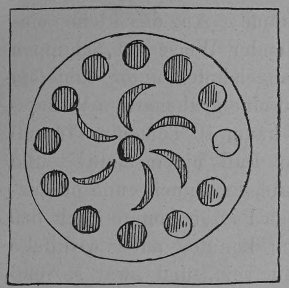

*Fig. 11. Fensterverschluß in Bosra.*

[^27.537]: Im alten Ägypten lassen „kein Fenster, keine Luken Luft und Licht eindringen“, MASPERO-STEINDORFF, Kunstg. S. 3. Griechenland s. DURM, Bauwesen d. Gr.² 347; nur im Stockwerk (ὑπερῷον) gebräuchlich: HERMANN, Gr. Privataltertümer 152 A. 2; BECKER-GÖLL, Charikles 2,149 f. Bei Römern auch fast nur im Stockwerke: Dieselben, Gallus 2,312.
[^27.538]: NIEBUHR, Reisebeschreibung von Arabien S. 61 erwähnt der Fenster gar nicht. „Wenn man ein kleines Gitterfenster oder Balkon ausnimmt, das zuweilen auf die Straße sieht, so gehen alle andern Fenster in ihre dazu gehörigen Höfe oder Vierecke“ Shaws Reisen² 182. Die heutigen Fellachen haben mehrere Luftlöcher in ihren Häusern (*taḳa*, طاق DOZY 2,70 PSm 1687); sie machen sie klein, um vor Wind und Wetter und auch Dieben geschützt zu sein ZDPV 3,106. Im Haurân hat das Erdgeschoß keine Fenster, s. WETZSTEIN, Reisebericht über den Haurân, S. 52.
[^27.539]: MNeg 2,3 „in einem dunklen Hause (בית האפל) bricht man kein Fenster aus“ usw., das ist wohl, daß man nicht ad hoc ein Fenster in die Mauer bricht. In T 1,8, 618₂₄ liegt die Sache so, daß das Haus nur darum dunkel ist, weil die Fenster eingestellt sind (מוגפות, vgl. הגיף von Türen), es wird aber hell, wenn man die Fenster öffnet (מפתחין). Die von Machuza wohnten in בית אפל bBerakh 59ᵇ, Midr ha-G zu Gen 2,14 ed. Schechter. Das Schlafen in einem solchen Hause ist gefährlich; jSabb 2,3, 5ᵇ₂₈, vgl. bBerakh 3ª. 5ᵇ RJochanan. Man soll in בית אפל nicht treten, ib. 31ª. An allen diesen Stellen dürfte das Erdgeschoß gemeint sein, das man nicht durchbrechen mochte (bBm 117ᵇ), denn im Obergeschoß konnte man ohne Bedenken zahlreiche Fenster anbringen.
[^27.540]: חור vgl. *rima* jʿErub 10,26ᵇ₇₅ in T 10,1,151₄ חלון. Dieses bh חלון √חלל خَلّ Loch bohren. Bh. vgl. noch Gen 6,16 צהר. Aram. כווא (schon Daniel 6,11 כַּוִּין), s. L Trg Wb 1,356, auch כותא ܟܘܬܐ; zu ܟܘܐ s. ZDMG 25,339. 361; كُوَّة s. FRAENKEL S. 13, heute *kuwwa*. Pl. כוי z. B. bʿErub 60ª. — מאור, Pl. מארות vgl. *lumen* u. s. *transenna* u. die Abbildung s. v. *prothyrum* bei RICH) MSabb 24,5, MʾOhal 13,1, T 14,1, 611₁₉ פתח שעשאו למאור (ib. zwei F. זו לפנים מזו, so dient das äußere למאור), das ist von vornherein als Fenster gemachtes Loch, jedoch gibt es auch von selbst entstandene Lichtlöcher M (מים, שרצים, מלתחת) u. T ib., die man nach T durch Einstellung (von Fenstergittern usw., הגיף) zu Fenstern macht. M ib. 4 חור שבדלת ein in der Türe durch einen Spalt entstandenes Loch. T ib. 8,4, 605₃₁ חלונות הרבה וכולן מגופות (entspricht dem נעולין ib. von Türen gesagt). Gr. ϑυρίς Act 20,9, Cor 11,33, Trg Prov 7,6 תורקין l. תורסין (Perles Et. St. S. 9, Lwr 2,593, Fraenkel jedoch in Berliner-Festschr. S. 99 l. תורידין ϑυρίδιον). *ἔμφωμα = ܐܡܦܘܡܛܐ PSm 240, אמפומטא Lwr 2,61, zuerst von Fraenkel Fremdwr S. 14 A. 1 ermittelt. — פומא דכובא Fensteröffnung: bKethub 61ª; gr. nur in Pal., כובא wohl nur in Babylonien. — Nach Pesiḳta 49ᵇ war ein Unterschied zwischen חלון und חרך (= Luke L 2,111, J 503), letzteres wohl die über der Türe angebrachte Luke, die man auf unserer Figur 7 deutlich sieht.
[^27.541]: Die Maurer (בנאי s. o.) sagen: Ein Fenster, das auf die Mastaba (o.) geht, ist nur für das Licht da (להכנים את האורה jBb 3,11, 14ᵇ₃₂). Das Triklinium (d. i. Palast überhaupt) baut man so, daß die Fenster einwärts sich verschmälern, auswärts sich erweitern, כדי להכנים אורה לתוכה; im Heiligtum jedoch war’s umgekehrt: מקטינות מבפנים ומרחיבות מבחוץ (Pesiḳta 146ᵇ vgl. NumR 15,1). Ib. חלונות כהות הוו אטומות הוו usw.
[^27.542]: TʾOhal 14,3, 611₂₆ להיות מכניסין בהן את הרוח, M 13,3 חלון שהוא לאויר; aus beiden Stellen geht hervor, daß die Luft bringenden Fenster größer sind als die Licht bringenden (מלא מקדח u. פותח טפח). Ferner sieht man an beiden Stellen, daß man die Fensteröffnung durch quergelegte Balken (נתן את התקרה באמצע) zu teilen wußte. Manchmal kam unangenehm viel Wind: כוי דבי זיקא bSanh 100ª.
[^27.543]: לזון את עיניו MʾOhal 13,5, T 14,4, 611₂₈; an letzterer Stelle folgende Kategorien in Fensteröffnungen: 1. לצאת wo man hinausgehen kann, 2. לשמירה (vgl. RŠbM zu MBb 58ᵇ) zur Bewachung des Hauses, 3. das Auge zu speisen, 4. Geräte aus- und einzuführen, 5. לתשמיש zu irgend einem Gebrauche (d. h. Sachen hinzulegen, speziell das Licht, das Rohr u. die Spatel der Spindel, wie auch M 13,5), 6. (in M) mit dem Mitmenschen zu reden (dann noch לתשמיש; als eine Verwendung hatten wir bereits o., daß man den Hausschlüssel hinlegt, vgl. MʿErub 10,7; ein ferneres Beispiel ist MʾOhal 6,2: Tonne von getrockneten Feigen und Korb mit Stroh im Fenster, ib. 13, 6. 7 Frucht, T 14,6, 611₃₅ abgerissenes Gras oder von selbst aufgeschossenes im Fenster, ib. interessant der Vogel, der im Fenster nistet; auch eine Torarolle kann im Fenster liegen: jBerakh 3,5, 6ᵈ₄₂). Zum Lesen an der Schwelle s. o. In Acta 20,9 sitzt Eutychus während des Vortrages des Paulus am Fenster und fällt herunter. Vgl. Hillel A. 551.
[^27.544]: Z. B. **Rab** jʿErub 1,18ᵈ₃₃; das war viell. in Sepphoris in Rabs früherer Periode, denn in Sepphoris heißt es von **Rabbi** אודיק רבי מן כוות׳ jJebam 4,12, 6ᵇ₄₇.
[^27.545]: Der lästige Nachbar מציץ עליו בעד החלון Gen R 65,10. Vgl. יציץ TBb 1,5, 398₂₂, bh. Cant 2,9. Auch bh השקיף wird gebraucht: MʾOhal 10,4 היה משקיף בעד החלון. Aram. אודיק. Rechtsvorschriften: MBb 2,4, T 1,5, 398₂₁, j 13ᶜ₃, b 22ᵇ. Demnach müssen die Fenster oben und unten und vis-à-vis vier Ellen von dem anstoßenden Hause entfernt sein; oben, damit er nicht zu seinem Nachbar hineinschauen könne; unten, damit er sich nicht auf seine Mauer stelle und so hineinschaue; vis-à-vis, damit er ihm nicht dunkel mache. In b der Standpunkt, daß ein enges Anbauen den Menschenverkehr einstellen würde, wodurch der Boden, in dem die Mauer steht, weniger fest wäre (משום דוושא). In j wird bei dieser Gelegenheit gesprochen von כותל אטום: Durchbrochene, auf Säulen (vgl. אוטם o.) ruhende Mauer, u. כותל סודמין: sodomitische Mauer, d. i. die trostlose Mauer ohne Ausblick auf die Straße. Vgl. TBb 2,14, 401₂f. R Meir sagte: Nicht öffne man eine Tür zum Schaden der Tür des Nächsten, noch ein Fenster über dem Fenster des Nächsten, nicht eine Tür über dem F. des Nächsten, noch ein F. über der Tür des Nächsten; die Weisen erlauben es, nur entferne man sie vier Ellen weit. Dagegen חלון שבין שני בתים TʾOhal 7,2, 604₃₈, ib. 14,2, 611₂₃.
[^27.546]: MBb 3,7.
[^27.547]: מלבן oder צורת הפתח TBb 2,14, 401₁ f., vgl. מלבן TʿErub 11,17, 153₂₉. משקוף und מזוזות s. o. Die in A. 479 angezogene Quelle erwähnt jedoch keine Unterschwelle der Fenster. שקוף TʾOhal 7,11, 605₃. חלון עגול bʿErub 76ª; trapezoid T 10,11, 152₁.
[^27.548]: MBb 3,11. Fenster von 4 Tefachim im Gevierte (29,6 × 29,6 cm) wurden in halachischer Beziehung bereits Türen gleichgesetzt: TToh 10,7, 671₂₃ MʿErub 7,1. Im Haurân sind die Fenster durchschnittlich 75 cm hoch, 65 cm breit: WETZSTEIN a. a. O. Interessant ist die Parallele von den zwei Arten Fenster in Konstantinopel bei A. ROSENZWEIG S. 51 A. 2. Nach TʾOhal 14,3, 611₂₆ gab es in Städten Fenster kleineren Kalibers, die nur der Luft wegen da sind.
[^27.549]: MBb 3,8, T 2,14, 401₁; das tyrische Fenster faßt den Kopf eines Menschen, das ägyptische nicht, ib.; beide Arten können und können auch nicht mit מלבן und צורת הפתח versehen sein, ib. Die Benennung „ägyptisch“ und „tyrisch“ bemüht sich A. ROSENZWEIG S. 52 ohne Erfolg zu erklären. Es ist zunächst an die ähnlichen Benennungen der Leiter (o.) und des Hofes (u.) zu erinnern. Die Lehrmeister der Juden im Bauen waren stets die Tyrier (s. ZATW 28,258), so vergleicht Josephus BJ 2,18, 9 § 504 die Pracht der Häuser in Galiläa mit derjenigen in Tyrus, Sidon und Berytus. Der ägyptische Einfluß kam wiederum über die Küstenstädte der philistäischen Ebene. Nur an diesen hellenistischen Städten konnten die Juden ihre Bauwerke messen, vgl. o. WINER Rwb s. v. *Fenster* bemerkt, daß heutzutage die Fenster (in großen Häusern!) im Morgenlande sehr groß sind und bis zu dem Fußboden hinunterreichen; diese möchte er in den tyr. Fenstern des Talmuds wiedererkennen, gewiß unrichtig.
[^27.550]: bBerakh 23ª. Nach MʿErub 7,1 vgl. T 10,10, 151₂₇ kann sich das Fenster sowohl innerhalb der 10 Tefachim zur Erde als auch höher befinden. Die archäologische Notiz TSukka 2,3, 193₂₃, die Leute von Jerusalem hätten ihre Betten beim Fenster (בחלונות, j 2,2, 52ᵈ₅₁ לפני חלונותיהן) hinausgefördert, und diese Fenster wären 10 Tefachim hoch gewesen (dann hätten sie über den Betten Laubhütten gemacht, worunter sie schliefen), — läßt die Fenster ziemlich hoch angebracht sein.
[^27.551]: קנקלין, s. Lwr 2,533 = κιγκλίς (A. ROSENZWEIG 53 A. 5 = *cancelli*), u. A. 499. Entspricht den *fenestrae clatratae* bei BECKER-GÖLL, Gallus 2,314, *clathri* RICH 158 mit Abbildung = κλῇϑρα. DAREMBERG et SAGLIO, Dict. 1,1236. Man sagte *per transennam adspicere* Cicero *de orat.* 1,35, 162 bei RICH 644ᵇ und in Gallus a. a. O. Ib. aus Varro *reticulatae*, vgl. Hieronymus zu Ezech 41,16 (3,419 Migne) *fenestrae quoque erant factae in modum retis instar cancellorum.*Zu bh. אֲרֻבָּה Gen 7,11 (vgl. Ḳoh 12,3) vergleicht GESEN im Hwb καταρράκται (vgl. RICH s. v. *cataracta*), von den Rabbinen als קטרקטון für die Arche angenommen (Lwr 2,527); eine derartige Falltüre war auch die *cochlea* κοχλίας (RICH S. 170); bh. noch אשנב, שבכה. Eine ארבה war zwischen Obergeschoß und Untergeschoß angebracht: א׳ שבין בית לעליה MʾOhal 5,2; 7,3, T 5,9, 602₃₄, 11,10, 609₂₀; M 10,4 ארובות זו על גב זו. Wenn man nun oben im Söller oder dem Dachraum (s. o.), wie bereits besprochen, Frucht hatte, und es kam ein plötzlicher Regen, so konnte die Frucht durch das Gitter hindurch heruntergelassen werden: MBeza 5,1, T 4,3, 207₁₁ (Raši nicht ganz sachgemäß; ihm folgt L 1,157). Man muß festhalten den Unterschied zwischen der zum Baue selbst gehörigen Falltüre (ארבה שהיא בתוך הבית MʾOhal 10,1) und dem Gitter an der Türe in Seitenanwendung (בדלת bJoma 76ª; mit der Frage כמה ארובות יש בדלת soll nach A. ROSENZWEIG S. 51 A. 6 das Größenverhältnis von א׳ und דלת gefragt sein; richtiger wohl die Gucklöcher in der Türe, die durch Querhölzer in vier Felder geteilt sind); jenes ist die א׳ העליונה TKel bḳ 6,17, 576₁₉ = Obergitter, d. i. im Obergeschoß. Von demselben ist die Rede TʾOhal 11,4, 608₃₀ היתה [הקדרה] נתונה תחת ארובה, ib. 5 א׳ וטומאה תחתיה; Details ib. 11,11, 609₂₆ f., wo ebenfalls ארובות זו על גב זו, d. i. Falltüre zwischen בית und עליה, und eine auf dem Dache. An dem פי ארובה des Daches sitzend hörte Hillel dem Vortrage im Lehrhause zu: Bar bJoma 35ᵇ. Das Material dieser Falltüren ist wohl Holz.Bh. שבכה (z. B. I Kön 7,17) gibt Trg Jon mit סריגא, סריגתא wieder, s. L Trg Wb 2,187, syrisch ܣܪܝܓܬܐ; nh. סריגות und סריגין ist ein Fenstergitter, nach Hai zu MʾOhal 8,4 aus eisernen Stäben (RN bei K 6,130 fügt hinzu: kreuzweise angebracht), nach Maim. zu MʾOhal 13,1 aus Rohr. Vgl. סורג MMidd 2,3. In MNeg 13,3 (ed. Lowe) steht שריגי החלונות (vgl. bh. שרג, שרק), MʾOhal 8,4 והסריגות שבחלונות, T 9,14, 606₂₁ סריגי חלונות, vgl. ib. 14,3, 611₂₅, bChull 125ᵇ; jʿErub 7,1, 24ᵇ₂₀ סריגים; hier und in T 10,12, 152₂ (סריגות) heißt es, daß ein Fenster von vier Ellen im Gevierte durch ס׳ als geschlossen angesehen wird und keinen besonderen Raum bildet. Verschließbar: TʿErub 11,17, 154₁.רפפות vgl. syrisch ܪܦ; wanken, رفّ, رفرف S. FRAENKEL S. 13. Maim. zu MʾOhal 13,2 نوع من التشبيك. Dadurch wird die Sache nicht klarer. Eine Erklärung läge vor in TʾOhal 14,3, 611₂₅, wenn der Text richtig wäre; lies (mit Hai, RŠ) סריגות אלו של אוצרות, d. i. ס׳ sind Gitter, die an Magazinen angebracht werden; רפפות sind solche, die an איקלטאות (leider unklar, s. A. 81) angebracht werden. In jAz 2,42ª₆₉ wird רפפות durch רעלות (so ed. Ven., Krot. und RN, nicht רעדות), wohl eine Art Schleier; auch MPara 11,2 רפפות neben רעדות, T 11,1, 639₂₆, wo es eine Art Gerät zu sein scheint. Der Stamm ist auch enthalten in ריפין TKilaim 4,5, 78₁₇, eine Art Stakengerüst, über das man eine Weinlaube zieht, L 4,448.
[^27.552]: MʾOhal 12,3 הבטה Agg. und ed. Lowe und RN (K 2,40ª), הבטא Hai mit der Var., die auch bei RN steht: אבטה, nach T 13,3, 610₂₀ אבטו l. אבטי׳, d. i. אבטיה; dieses erklärt Maim. von √ בטח sicher sein, wonach A. ROSENZWEIG S. 53 ein Fensterbrett, auf das man sich lehnt; aber Brett ist jedenfalls unrichtig, denn der Zusammenhang, wie auch Hai (כמין טיחת [טיט] בבנין), ebenso RN (wo aber noch andere zwei Erklärungen) u. Maim. (من الحائط), sprechen für einen organisch dem Bau angefügten Teil (L 1,211 Vorsprung eines Gebäudes, K 2,39 ebenso) und ist darum als ein aus Ton verfertigter Fensterladen, eine Art Ziegel, wie man sie besonders in den Katakomben als Verschluß sieht, aufzufassen. MSabb 24,5 טפיח (ed. Lowe טופיח) ist unbedingt dasselbe, und so dürfte auch hier [א]טביח zu lesen sein; auch גיגית ib. erklärt Maim. für Glas auf dem Fenster, s. L. Heller z. St. Jenes טפיח hängt offenbar mit טפח, הטפיח (L 2,176 f.) zusammen, das ein Verkleben mit Lehm bedeutet, s. o.
[^27.553]: Fenstergitter haben sich in Rom, Pola, Grado und Bostra erhalten, sämtlich abgebildet bei DURM² 349; s. auch RICH *locis citatis*.
[^27.554]: Oft פקק החלון, z. B. MSabb 17,7; 24,5, T 6,4, 117₁₀ mittels סירא Dornknäuel (L 3,520), j 17,1, 16ᵇ₁₈ קנה Schilf. Das Vermauern (vgl. bei Türe o.) kommt ebenfalls vor: MʾOhal 13,1 חלון שסתמה ולא הספיק לגומרה, T 14,1, 611₂₂ ולא היה (לה) [לו] טיט לגומרה.
[^27.555]: bBḳ 60ᵇ סכר כוי. Vgl. נשמטין TʿErub 11,17, 154₁.
[^27.556]: TKel bm 11,10, 590₃ f. הסדינין והסגסין ··· עשאן לחפות בהן ··· חלונות; ib. מחצלת. Hai zu MKel 29,1 glossiert סגוס (= σάγος Lwr 2,371): סקלביניקון (das soll *σκλαβηνικόν sein, vgl. Duc. 1392 σκλαβίνα, FRAENKEL, ZDMG 55,356), arab. בירנית l. בורנוס = بُرْنُس der Burnus. — bSabb 51ª סדין. bNidda 17ª מאפיל בכסותו.
[^27.557]: קשור ותלוי MSabb 17,7; s. bei Türe o. A. 514.
[^27.558]: נשמטין TʿErub 11,17, 154₁.
[^27.559]: TʿErub 11,17, 154₁ mit מלבן Rahmen; TʾOhal 14,1, 611₂₀ נוטל פקק אספקלריא. Das Marienglas bei Römern s. BECKER-GÖLL, Gallus 2,316, wo man unter *speculare* auch wirkliches Glas verstehen will. DURM² 182.
[^27.560]: „Es gibt einen Edelstein in den Seestädten (d. i. in den hellenist. Städten, vgl. A. 549), der heißt דרה (richtiger דורא, s. die Stellen bei L 1,387, ܕܘܪܐ, ܕܘܪܬܐ, arab. دُرّ دُرَّة = Perle, wie auch מרגלית = *margarita* jüdisch den Edelstein bedeutet), und man stellte ihn in die Mitte des Mahls und er leuchtete ihnen wie zu Mittag“ (bMeg 12ª); מרגלית als Leuchter Pirke RE c. 10 p. 6ª ed. Prag; in der Arche אבנים טובות ומרגליות jPesach 1,1, 27ᵇ₃, bSanh 108ᵇ. Auch Plinius kennt einen leuchtenden Stein, den man in Rom in den Palästen zum Leuchten verwendete, s. FRIEDLÄNDER, Sitteng. 3⁵, 88 (volkstümliche Ausg. 2⁷, 200).
[^27.561]: jMeg 4,75ᶜ₇₁, jJoma 1,1, 38ᶜ₃₈. Zu der Dimension vier Ellen im Gevierte s. A. 548. — Die Sitte des Fächelns ist zu vergleichen mit den Schirmträgern in der Umgebung der assyrischen Großkönige, s. LAYARD, Niniveh S. 357 und die Abbildung der „Gartenszene“ bei BEZOLD, Niniveh und Babylon S. 120.

## § 28

**28.** **Das Haus und seine Einteilung.** Nun ist das Haus fertig, und wir wollen nun dessen wohnliche Einrichtung betrachten. Das hebräische בית[^28.562], wie noch heute „beit“ des Fellachen, bedeutet ursprünglich nur einen einzigen, von vier Wänden umgrenzten Raum[^28.563], also nach unserer Bezeichnung ein Zimmer. Auch in talmudischer Zeit war es durchaus nicht anders, ist doch von einem „Hause“ die Rede, das nicht einmal 4 Tefachim (2,96 cm) im Gevierte mißt[^28.564], während eines, das 10 Ellen (zirka 5 m) groß ist, als das äußerste bezeichnet wird[^28.565]; aber in der Regel ist das palästinische und wohl auch babylonische Haus dieses Zeitalters viel geräumiger, nicht bloß wegen des darüber gesetzten Obergeschosses, sondern auch darum, weil es zumindest aus zwei Zimmern, einem äußeren und inneren (חיצון und פנימי)[^28.566], besteht, sehr begreiflich, da die weiblichen Glieder der Familie wohl separiert wohnten, wenn auch anderseits der Fall erwähnt wird, daß jene zwei Zimmer je einem anderen gehörten, so daß auf einen Besitzer, etwa einen Alleinstehenden, bloß ein Zimmer käme. An das kleine einzimmerige Haus waren aber in passender Weise ein Schuppen (יציע), d. i. ein an die Hausmauer angelehntes unter schiefem Dache stehendes Bauwerk (w. u.), und eine grubenartige Vorratskammer (חרות) angegliedert[^28.567], beide kaum 10 Tefachim (74 cm) hoch, so daß ein Mensch nie den Fuß hineinsetzte[^28.568] und die Frucht oder was sonst hineingehörte, nur hinein- und herausgeschoben werden konnte. Mit diesen Bauten konnte auch das primitivste Haus ergänzt sein. Doch konnten auch wirkliche Kammern (חדרים) zum Hause zugebaut sein, und zwar so, daß je eine Kammer in das Hauptzimmer mündete, oder ein Zimmer nach dem anderen folgte[^28.569]. Weniger symmetrisch war der Bau, wenn bloß eine Kammer in das Hauptzimmer mündete[^28.570].

Ein anderer Modus, den einzigen Raum in mehrere zu teilen, bestand darin, daß man mittels Bretter und Tücher, die man vertikal an den Seiten oder horizontal von der Decke herab bezw. über den Fußboden gespannt anbrachte, Abteilungen erzielte (S. 26)[^28.571]. Der Hohlraum (אויר, היקף) des Zimmers blieb auch nicht unbenutzt: man ließ von der Decke allerlei Zeug, namentlich Brot, herunterhängen[^28.572].

Der oberste Zweck des Hauses ist natürlich das Wohnen, weshalb es denn oft das Wohnhaus heißt (בית דירה, מגורה usw.)[^28.573]. Sollte es diesen Zweck erfüllen, so war bei den Anschauungen des Orients und besonders bei den zarten Rücksichten, die die Juden auf das weibliche Geschlecht nahmen, wenigstens eine Zweiteilung in Männer- und Frauenhaus unvermeidlich[^28.574]. Nach persischem Muster hieß das bessere Zimmer אנדרון[^28.575]. Spuren sind nur da von einem besonderen Schlaf- und Speisezimmer und der Küche[^28.576], beides wohl nur in größeren Häusern und in griechisch-heidnischen Kreisen vorhanden, wie auch das besondere Dienerzimmer[^28.577]. Die Lebensverhältnisse waren noch derart einfach, daß man den Bau leicht erweitern konnte, was besonders dann der Fall war, wenn der erwachsene Sohn eine Frau ins Haus brachte oder die verwitwete Tochter ins Elternhaus zurückkehrte[^28.578].

Es erklärt sich nun daraus, daß wir in einem Hause mehrere Türen finden[^28.579], besonders die innere und äußere Türe[^28.580], entweder die des eigentlichen Wohnraumes im Gegensatze zur Hoftüre oder dem Tore, oder die des Frauengemaches im Gegensatze zur Haupttüre, die in das äußere, d. i. in das Männergemach führt. Jede Tür war mit einem besondern Schlüssel versehen; nicht minder die Wirtschaftsgebäude[^28.581].

[^28.562]: בית assyr. *bitu*, aram. ביתא, ܒܝܬܐ (aram., syr. und im talm. Idiom oft in בי gekürzt), بَيْت, von unbekannter Etymologie, denn die Ableitung von בות بَاتَ weist GES. im Hb ab. Der Talmud gibt nach seiner Art בא ואיתיב בה (bSabb 77ᵇ). Wir sehen schon an diesem Beispiel, daß בית im Nh. oft fem. ist, wobei etwa der Begriff דירה hineinspielt. (Daß בנין Bau, bh. nicht belegt, nh. *masc.* ist, s. ZATW 28,144.) Der Hausherr heißt בעל הבית, aram. מרי דביתא (bSabb 63ᵇ), gr. οἰκοδεσπότης Matt 10,25. In gewissem Betracht steht בית im Gegensatz zu Höhle, Zelt und Hütte. „Ein Haus, das nicht sowohl für Sommer als Winter dienen kann, ist kein Haus“ bJoma 10ª. Oft דירת קבע ständige Wohnung, opp. דירת ארעי provisorische Wohnung, z. B. bSukka 2ª.
[^28.563]: Daß בית = Zimmer sieht man bBerakh 17ᵇ unten: מי שמתו מוטל לפניו אוכל בבית אחר etc. S. auch die Verlegenheit betreffs Unterbringung des ספר תורה, wenn לית ליה ביתא אחרינא ib. 26ª. Arab. *beit* s. L. BAUER Volksl.² 43. In Frankreich heißt die Küche *la maison*, in mehreren Teilen Deutschlands sowie bei den Siebenbürger Sachsen wird das Vorhaus, einst oder noch immer der Herdraum, schlechtweg „Haus“ genannt. Der Székler nennt seinen oft einzigen Wohnraum *ház*. Der Siebenbürger Sachse bezeichnet wohl auch sein ganzes Wohnhaus mit „Stube“, und im Norwegischen ist „Stube“ mit „Haus“ gleichbedeutend (A. DACHLER in Zschr. des österr. Ing. u. Archit.-Vereins Jg. 55, 1903, S. 293.)
[^28.564]: Sifre Deut 229 p. 116ª, dasselbe in einem Ms auch 194 p. 110ᵇ, Bar bSukka 3ª (s. Tosafoth, wonach j mehr Fälle hat, in denen dem *beit* der Charakter des Wohnhauses abgeht), und so auch die Laubhütte.
[^28.565]: TBerakh 2,16, 5₆, in Bar b 35ᵇ מאה אמה, wohl ein Fehler.
[^28.566]: TTohar 8,1, 668₂₃. TBb 3,1, 401₃₇ בתים הפנימיים ובתים החיצונים; an dieser Stelle kann die Benennung von der Gruppierung im Hofe (w. u.) herrühren.
[^28.567]: Ib. יציעין, sing. יציע; = bh. יצוע u. יציע, der Anbau an das Heiligtum, hier ein Anbau an das Haus, u. z. unter schiefem oder Giebeldache (Bar bPesach 8ª, s. Raši u. RSbM bBb 60ª, an letzterer Stelle = אפתא = Front, L 1,152). RŠ zu MTohar 7,1 zitiert יוצאין, das er für aus der Wand hervorstehende Söller und Steine hält, beides unrichtig. — Daneben steht in T הרוין, ib. Satz 6,669₈ בחדרין והרוין, Agg. בחדרין והדוין, RŠ für erstere Stelle חררין, das er für חורין erklärt. Aber חדרין dürfte richtig sein: = Kammern, und daneben חדויין mit Elia Wilna = חדות zu erklären, und von beiden gilt שאין בהן מקום רגלי הגנבים T, wie bezüglich בית in MTohar 7,6. Die ungewöhnliche Pluralform חדויין erklärt J 426 mit Hinweis auf ܚ̈ܕܘܝܢ PSm 1200 [dies ist Irrtum des Glossographen Karmsedinaja; richtig ist nur ܚ̈ܕܘܬܐ pl. von ܚܕܘܬܐ]. Der Pl. lautet in jBb 4,5, 14ᶜ₅₂ חדותין (so l. statt חרותין), in T 3,2, 402₆ jedoch richtig חדותיות.
[^28.568]: T ib. (vorige A.), vgl. TNeg 1,8, 618₂₅ נרא(ית) [ה]הנגע בחדרין או בסדקין אין נזקק לו.
[^28.569]: MʾOhal 8,6 חדרים שהן פתוחין לבית, wonach בית = Hauptzimmer, חדר = Kammer; in T 9,7, 606₂₉ שלשה בתים זה לפנים מזה, und das scheint verschieden zu sein von שני חדרים של בית oder שני חדרים הפתוחין לתוך הבית. In MBb 3,7 vgl. b 60ª ist חדר offenbar ein kleiner Raum, in einem größeren, der abgeteilt ist. Vgl. den Ausdruck בחדרי חדרים bBeza 9ª u. oft. In der Arche gab es קילין (κελλίον = κέλλα = *cella* Lwr 2,529) u. מדורין (Gen R 31,9). Bei Josephus (Ant. 7,9, 8 § 229) hat man den Ausdruck εἰς τὸ μυχαίτατον τῆς οἰκίας; ebenso BJ 2,21, 5 § 612, wo davon verschieden αὔλειον Vorzimmer.
[^28.570]: TʾOhal 8,6, 605₃₈ החדר שלפנים מן הבית מוגף; hier ist שלפנים im hinteren Teile des Hauses. jʿErub 6,6, 23ᶜ₇₆ מקצתן שרויין בחדרים או בעליות.
[^28.571]: MʾOhal 15,4 בית שחצצו בנסרים או ביריעות מן הצדדים או מן הקורות, T 15,4, 612₂₇. Vgl. TNeg 6,9, 626₂ בין נסר לכותל ובין יריעה לקורות, wo vorher חצצו, also von derselben Sache die Rede ist, und nicht vom Bedecken der Wand mit Brettern usw., wie A. ROSENZWEIG S. 27 A. 8 will. Bar bBerakh 17ᵇ unten ואם אין לו דבר לעשות מחיצה עושה מחיצה, j 3,1, 6ª₁₁. Lev R 5,1 כדיין הזה שהוא מותח את הוילון מבפנים ואינו רואה מה בחוץ „wie ein Richter, der das *velum* von innen vorzieht und nicht sieht, was draußen geschieht“, vgl. o., ist ein Beweis, daß man durch Teppiche usw. völlig verschlossene Räume herstellen konnte. In den פרוכות des Heiligtums macht man einen Unterschied zwischen solchen, die an den Türen (בדבבי) hängen, und selchen, die konstruktiv zum Baue gehören: bKethub 106ª. Die Möglichkeit des Teilens bestand auch in der Höhe, wie man MBb 3,7 vgl. b 60ª sieht: מאי חדר שחלקו בשנים ומאי עלייה אפתאי.
[^28.572]: Zu אויר = Raum s. Lwr 2,17 No. 3. Die Definition darüber lautet: וכל דירה שתשמישה לאויר opp. כל אויר שתשמישה לבית דירה TʿErub 3,9, 141₁, b 15ª, 22ª. Laib Brot hängt darin herunter: Lev R 19,2, Cant R 5,11, Dt R 8,3, Midr Sam 5,3 (p. 58 Buber). Hieraus ersichtlich, daß das Zimmer eine beträchtliche Höhe haben konnte, so daß das Brot mittels zusammengekoppelten Schilfs oder mittels Leiter heruntergeholt werden mußte. Die Höhe geht auch aus אפתא v. A. hervor. Zu achten auf den Ausdruck (fehlt in Lex.) הקפת הבית מבפנים TZabim 1,10, 677₁₃ (= היקף).
[^28.573]: Die Wertschätzung des Wohnhauses drückt sich aus in dem Satze: „Die Frau hat bunte Häuser (בתים מצויירין) und bunte Kleider lieber als fette Kälber“ (Esth R 1,10 Ende; ib. בתים מרווחין). Vgl. den Ausdruck: „Jeder wohnt (שרוי) nach seinem Range“ (Lev R 18,1). „Spare an Speise und Trank und füge es deiner Wohnung zu“ bPesach 114ª. „Drei Dinge machen den Menschen wohlgemut: eine schöne Wohnung (דירה נאה), eine schöne Frau und schöne Hausgeräte“ bBerakh 57ᵇ. Pirḳe DE c. 1 p. 3 ed. Friedm. — בית דירה MʿErub 5,1, T 6,4, 144₂₃, Bar j 2 g. Ende 19ᵇ₅₀ כבית דירה; jSota 9,2, 23ᶜ₆₀ b 43ᵇ; MBb 1,5 MAz 1,9; TMr 2,20, 84₈; Sifre Dt 36 p. 75ᵇ מקום כבוד ובית דירה, ib. 194 p. 110ᵇ, 229 p. 116ª. — דירה bBerakh 57ᵇ, bPesach 114ª, bSabb 102ᵇ, Pirḳe DE ed. Friedm. 3; aram. pl. דירתא; s. noch L 1,403, wo die abgeleiteten Formen דיירא דייר Einwohner, דיירתא Einwohnerin, desgleichen דיור pl. דיורין Einwohner, aram. דיורא, דיוראי. Vgl. דיר Schafhürde w. u. Auch בי דיירא bRh 9ᵇ. — מדור MKethub 12,3, MʾOhal 18,9. 10, מדורות הגוים ib. 18,7, T 18,10, 616₃₇. Gr. μάνδρα wird davon abgeleitet. — *מגורה מגורות Gen R 18,2. — בירה witzig = Haus: bSabb 102ᵇ; my house is my castle; nach A. ROSENZWEIG ein größerer Gebäudekomplex, s. jedoch w. u. — מדור als gewöhnliche Behausung opp. zu פלטרין Exod R 10,2 (von dem Palaste Pharaos wird richtig vorausgesetzt, daß er auf ebenem Boden, במקום מישור, lag). Vgl. עומקא, טורא bezüglich Sodom (הנוה הרעה Gen R 50,11).
[^28.574]: בי גברי opp. בי נשי bʿErub 68ª, bMenach 33ª; בי נשי auch bBeza 29ᵇ, בתי גואי u. בתי בראי im Himmel bChag 5ᵇ, 13ª.
[^28.575]: אינדרונא L 1,106, ib. 33 = pers. *enderun*, syr. ܐܢܕܪܘܢܐ, mehr in Babylonien als in Palästina. Dagegen קיטון (u.) in Pal. zu Hause. אנדרונא מעליתא bMenach 33ᵇ.
[^28.576]: Bh. חדר = Schlafzimmer, weil einwärts gelegen, vgl. והיה ישן בתוך חדרו Ab RN α c. 25 p. 80. קיטון κοιτών (Lwr 2,528), I Trg Esth 1,9. Trg Ps-Jon Num 31,50 (ed. Ginsb. p. 59) unbedingt richtiger als טרקלין in Trg j z. St. In Trg Ps-Jon Gen 43,30 (p. 82 G.) ועל לקיטונא דבי מדמכא, Onkelos לאדרון בית משכבא, Tw. החדרה. Sifre Dt 29 p. 72ª קיטון = בית לינה. — Speisezimmer ist gemeint in MBeza 2,7 (22ᵇ) בית המטות eigentlich Sofazimmer, sonst טריקלין, unter fremdem Namen, wie es auch קיטון ist. So auch die Küche: מגיריון = μαγειρεῖον Lwr 2,323.
[^28.577]: Bar bʿErub 55ᵇ ובית עכו״ם שיש בה בית דירה למשרתים, ib. אין לה. Die Einteilung des Hauses bei den Römern s. RICH *s. v. domus*; MARQUARDT, Privatl. 224 ff.; BECKER-GÖLL Gallus 2,224 ff.; ANDERSON and SPIERS, The Architecture of Greece & Rome p. 264 ff.
[^28.578]: בית חתנות לבנו ובית אלמנות לבתו MBb 6,3.
[^28.579]: MʾOhal 7,4 פתחים הרבה, T 8,4, 605₃₀. Ib. פתח קטון בתוך פתח גדול (vgl. פשפש o.), ib. היו שניהן מתאימין sie standen sich vis-à-vis, u. z. לדרום, לצפון. — Dasselbe Gemach hat mehrere Türen: jBerakh 7,6,11ᶜ₆₅ תרעא מציעא דבי מדרשא. Vgl. in der Technik der Bucheinteilung (s. bereits o.) בבא קמא, ב׳ מציעא, ב׳ בתרא. Oft in Synagogen, z. B. Lev R 22,4, Ḳoh R 5,8, bestätigt durch die Ruinen in Galiläa.
[^28.580]: bBerakh 56ª דשא ברייתא.
[^28.581]: bSabb 31ᵇ מפתחות פנימיות, מ׳ היצוניות. TTohar 8,1, 668₂₃. In Sifre Dt 40 p. 79ª מפתח של אוצר.

## § 29

**29.** **Der Hof und seine Wirtschaftsgebäude.** Das altjüdische Haus in Palästina und Babylonien lag in einem Hofe (חצר)[^29.582], und von dieser Lage war seine ganze Physiognomie bedingt. Stadt und Land bildeten hierin keinen Unterschied. In von Mauern umgebenen Städten hatte jeder Hof mindestens zwei Häuser[^29.583]; in freien Landorten war die Zahl der Höfe (*fundi*) geringer als in Städten, aber dennoch hatte jeder Hof mindestens zwei Häuser[^29.584], in der Regel aber gewiss mehr[^29.585]. Demgemäß ist „Hof“ oft äquivalent mit „Haus“, wobei es für selbstverständlich gilt, daß sich in dem Hofe ein Haus befindet, denn ein Hof ohne Haus führt gar nicht den Namen Hof, sondern den der Terrasse[^29.586]. Die Situation ist folgende: Von dem Gäßchen (מבוי) kommt man in den Hof, vom Hofe in das Haus oder die einzelnen Häuser, vom Hause aus — bei besonderen Anlässen — auf das Dach (o. S. 34), von hier aus auf die Terrasse[^29.587]. Die einzelnen Häuser hatten in der Regel mehrere Besitzer[^29.587a]; vgl. o. S. 31.

Als besonders gut verwahrte Höfe bezeichnet man den „tyrischen“ Hof, der dadurch charakterisiert ist, daß Gerätschaften in ihm gut verwahrt sind, ferner den, welchen nur einer das Recht hat zu schließen, und den, in welchem man ungeniert essen kann, endlich den, in den man, weil Privatbesitz[^29.588], ohne Widerrede hineingehen kann. All das setzt eine ziemlich starke Umfassungsmauer voraus; diese hatte den Zweck, den Hof sowohl gegen die Straße als gegen einen anderen Hof abzusondern. Sie hatte mindestens die Höhe von 4 Ellen (etwa 2 m), wodurch das unbefugte Hineinschauen (היזק ראיה) verhütet wurde[^29.589]; aber schon 10 Tefachim (74 cm) hoch und 4 Tefachim (29,6 cm) dick bildet eine Zwischenwand, insofern es sich um die Frage handelt, ob in bezug auf Sabbat eine Vereinigung (עירוב) der beiden Höfe statthaft sei[^29.590], eine rituelle Bestimmung, von der auf die Normalhöhe und Normalbreite der Hofmauer nicht gefolgert werden kann, und als das Normale sind andere Maße anzunehmen. An die Umfassungsmauer wurden nun die Wände der Wohnhäuser und Wirtschaftsgebäude „an gelehnt“[^29.591].

Die Wohnhäuser haben wir uns im Fonde des Hofes zu denken, während an den der Straße zugewandten[^29.592] und am Hofeingang gelegenen Seiten Wirtschaftsgebäude lagen, und zwar, wie es scheint, in der Form von Anbauten (יציעין): Strohscheune (בית התבן)[^29.593], Holzschuppen (בית העצים)[^29.594], Frucht- und Obstkammern (בית האוצרות)[^29.595]. Die Stallungen für Zugvieh (רפת und בית הבקר)[^29.596] befanden sich, wie es scheint, ganz hinter dem Wohnhause oder dort, wo es einen solchen gab, im zweiten Hofe, mit Ausnahme des Geflügelsteiges (לול)[^29.597] und des Taubenschlages (שובך)[^29.598], die, den Inwohnern zur Kurzweil dienend, vorn, sozusagen vor den Augen, angebracht waren.

Es befanden sich noch im Hofe eine oder mehrere Zisternen (בור) oder Brunnen (באר), Teiche (שיחין) und Korngruben (חרותיות)[^29.599]; ein Keller (מרתף)[^29.600] hat auch selten gefehlt. Viele dieser Baulichkeiten wurden gewiß von allen Bewohnern des Hofes gemeinsam benutzt; von einer derselben, der Strohscheune, hören wir sogar, daß sie zwei Höfen diente. Man wird in ihnen, wie man es in unseren städtischen Hausböden tut, Abteilungen gemacht haben; einige, wie Teiche und Korngruben, werden übrigens gewöhnlich in der Mehrzahl genannt. Der ganze Hof mit den um die Umfassungsmauer sich lagernden Gebäudegruppen und der zahlreichen Bevölkerung mußte etwas Pittoreskes haben und war wohl einer kleinen Festung nicht unähnlich.

Der Hof war mitunter umgegraben und mit Zier- und Fruchtbäumen und mit Schlingpflanzen verziert[^29.601]. Man lustwandelte[^29.602], aß[^29.603], wusch die Wäsche[^29.604] und besorgte überhaupt alle zum Leben nötigen Geschäfte im Hofe. Die Area des Hofes (אויר החצר)[^29.605] muß demnach beträchtlich gewesen sein. Aber es existierten auch kleine Höfe, solche, die nicht mehr als 10, 8, ja 4 Ellen im Quadrat faßten[^29.606]. Die gemeinsame Benutzung des Hofes und der karg zugemessene Raum machten verschiedene zivilrechtliche Bestimmungen notwendig[^29.607].

[^29.582]: בית בלא חצר לא עבידי אינשי דדיירי „in einem Hause ohne Hof pflegen die Leute nicht zu wohnen“ bʿErub 26ᵇ. 68ᵇ. Raši bBeza 21ª „alle Höfe im Talmud sind solche, die **vor** den Häusern liegen, und durch den Hof gelangt man auf die Straße oder in das Gäßchen (מבוי).“ Ebenso Machsor Vitry p. 401 l. Z. Dagegen schreibt A. ROSENZWEIG noch anno 1907 „Wohnräume, hinter denen der Hof (חצר) lag“ (S. 59)! — חצר bh. u. nh. vgl. حَضَر feste Niederlassung. Darum viele alte Städtenamen mit חצר s. ZATW 28,261, darunter auch Adramytis in Lykien und Hadrumetum in Nordafrika. Gr. αὐλή lat. *aula*, aber eigentlich *cohors (cors)* verwandt mit χόρτος Gehege. Für das gr. u. röm. Haus ist charakteristisch, daß es den Hof einschloß, denn *atrium* und *peristylium* sind modifizierte Höfe. Anders bei den Orientalen. Der ägyptische Fellah baut sich eine Kammer, und vor sie hin baut er dann noch eine etwa mannshohe Lehmwand, die einen Hof umfriedigt. In die Hofwand sind gerne von Strecke zu Strecke zylinderförmige hohle Räume *(sumaa)* eingelassen; sie dienen zur Aufbewahrung des Getreides (die אוצרות der Juden), als Taubenhaus (לול oder שובך), Hühnerstall, Backofen, Wandkasten (מגדלות), oder es erheben sich dergleichen Gebilde in säulen- und kuppelförmigen Formen frei aus der Mitte des Hofraumes (KLUNZINGER, Bilder aus Oberägypten, der Wüste und dem Roten Meere, Stuttg. 1877 S. 116—117; ähnlich HELLWALD S. 136). Nicht nur hat man ausdrücklich חצר הצורית, wozu nach Analogie von o. der ägyptische Hof der Gegensatz sein dürfte, sondern auch die Wirtschaftsverhältnisse im allgemeinen lassen an das Beispiel Ägyptens denken.
[^29.583]: MʿArakh 9,6.
[^29.584]: Ib. 9,8. jʿErub 6,8, 23ᵈ₆₉ חצר אין פחות משתי בתים. Nach der übertriebenen Schilderung in Thr R 1,1 hatte in Jerusalem jeder Hof 24 Häuser.
[^29.585]: MBb 4,4 המוכר את החצר מכר בתים.
[^29.586]: MPara 3,2 חצרות היו בנויות בירושלים (s. o. A. 251). MBm 5,2 לא ידור בחצרו חנם, ib. 3. TʿErub 7,7, 146₁₆ wenn einer fünf „Höfe“ in der Stadt hat; ib. R Isaak Nappacha hatte fünf „Höfe“ in Uša. TKethub 4,4, 264₁₂. ₁₄. bSabb 130ᵇ חצר אית לה דיורין. Ohne Häuser ist es ein קרפיף bʿArakh 33ᵇ unten, s. u.
[^29.587]: TʿErub 8,6, 147₂₁; im normalen Verkehr ist natürlich בית zu ergänzen. Manchmal mündet das Wohnhaus dicht in den מבוי: bʿErub 74ᵇ.
[^29.587a]: TSabb 1,5, 110₁₀ חצר של רבים. Bar b 6ª חצרות usw. TMš 2,20, 84₆ שני שותפין ושני דיורין בגגות . . . אעפ״י שהן של חצר א׳.
[^29.588]: Ansichten der Tannaim MMaʿas 3,5, von denen die des R Akiba und die des R Jose ziemlich auf eins hinausgehen. Vgl. R Akiba in TMr 2,20, 84₆. In j z. St. (50ᵈ₁₀) wird der Begriff des (tyrischen) Hofes in der Schule R Ismaels dadurch definiert, daß es heißt, ein Wächter sitze im Eingange, vgl. bNidda 47ᵇ שכן בצור מושיבין שומר על פתח החצר. jMaʿas 3,1, 50ᶜ₁₉ חצר בית השמירה.
[^29.589]: MBb 1,2. Vgl. TʿErub 9,13, 149₁₂ כותל חצר שנפרץ מד׳ טפחים ועד עשר אמות.
[^29.590]: TʿErub 9,16, 149₂₀.
[^29.591]: MBb 1,2 סמך לו כותל אחר.
[^29.592]: Auf die Straße hinaus befanden sich, wie am römischen Hause, Tavernen oder Kaufläden (חנויות): TBb 3,1. 4,401₂₅ ff. המוכר את הבית . . . לא מכר לא את הבאר ולא את השיח ולא את היציעין ולא את הדותיות ולא את המערות שבתוכו . . . כל שאינו מכור בבית מכור בחצר כו׳ „wer das Haus verkauft, hat damit noch nicht verkauft den Brunnen (in M 4,2 בור Zisterne), nicht die Grube und nicht die Anbauten und nicht die Fruchtlöcher und nicht die Höhlen, die etwa dort sind; was aber nicht der Fall ist beim Hause, ist der Fall beim Hofe“ (d. h. wenn er ihm den Hof verkauft hat), da hat er nämlich sowohl die inneren als die äußeren Häuser mitverkauft (s. o.), so auch Bar bBb 67ª המוכר את החצר מכר בתים החיצונים ובתים הפנימיים d. i. die auf die Straße gehenden und einwärts im Hofe liegenden Häuser. In b folgt darauf: ובית החולסאות, d. i., nach RCh zitiert von RSbM (vgl. RNs 2. Erklärung bei K 3,407), ein Hügel, aus dem man zur Glasbereitung Sand nimmt (vgl. Sifre Dt 39 p. 78ª בית החולות ms. בית החולסית; die gr. Ableitung Lwr 2,249 ist aufzugeben); dieses birgt sich auch in חולסית ומצולה b ib., und zwar ist מצולה wie es scheint ein Fischteich = *piscina* der Römer, s. RSbMs 2. Erklärung. Dasselbe birgt sich auch in הויסלאות in T ib. (nicht *villas* Lwr 2,236ª, sondern) l. החולסאות. In T heißt es davon, daß es nicht mitverkauft sei, weil es innerhalb des Hofes liegt, während b den Fall vor Augen hat, daß es auf die Straße geht. In T steht noch vorher הוילאות, offenbar = בית הוילאות in Bar bBb 67ᵇ = הבלניות ed. Neapel, הבילניות ed. Lowe, nicht wie Agg. Var הוילאות, in MBb 4,8, d. i. b ib., und das ist der Raum für die Badewäsche (s. „Badewesen“ S. 42); T dann: und nicht die Bäder (המרחצאות), mit dem auf alle genannten Dinge bezüglichen Zusatz: שלפנים הימנו, die einwärts vom Hause sind. Vgl. ib. u. Bar bBb 67ª חנויות Gewölbe, die in den Hof münden, sind mit dem Hof mitverkauft; die auf die Straße münden, sind nicht mitverkauft; münden sie hierher und dorthin, so sind sie mitverkauft. Die Kaufläden figurieren auch jʿErub 6,9, 23ᵈ₆₈: eine Sackgasse wird möglicherweise gebildet von einem Hof auf der einen, einem Hause auf der andern, einem Gewölbe (חנות) auf der dritten Seite. — Zu יציע s. A. 567. Die יציעין in T a. a. O. und יציע in MBb 4,1 scheinen den ganzen Komplex der Wirtschaftsgebäude zu bedeuten, die dann anderwärts spezialisiert werden; j. z. St. (14ᶜ₂₁) betrachtet den יציע nur dann als besondern Bau neben בית, wenn er, nämlich der Anbau, bei einer Höhe von 10 [Tefachim] 4 [T.] im Gevierte mißt, gebälkt und mit Türen (מגופף s. o.) versehen ist; es gab also Anbauten, die viel leichter aufgeführt worden sind.Für die Wirtschaftsgebäude hat Varro 1,13 folgende Anordnung: 1. *ovilia, bubilia.* 2. Magazine für Wein und Öl ebenerdig, für Wicken (*faba*) und Heu auf dem Dachboden. 3. Wohnung des Gesindes, zu denen auch der *vilicus*, hier, im Landhause, an Stelle des *ostiarius*, gehört. 4. Wagenschoppen. 5. Zwei Höfe mit je einem *lacus* (= שיח). 6. *sterquilinium.* 7. Abtritt (*sellae familiaricae*). 8. Scheune auf der *area* (Tenne).In unsern Quellen finden wir folgende stehende Reihen (MʿErub 8,4, Sifre Dt 194 p. 110ᵇ, Bar bJoma 11ª, Bar bSota 43ª, j 8,4, 22ᵈ₃₆, jPesach 1,1, 27ᵇ₂₀): 1. בית התבן, 2. בית הבקר, 3. בית העצים, 4. בית האוצרות (resp. בית האוצר), außerdem noch בית שער, אכסדרה, מרפסת in MʿErub, Sifre, bSota, jSota ib. In Sifre Dt 36 p. 36ᵇ 1. 2. 4. 3. Ib. jPesach ib. und TPesach 1,3, 155₄ (wo 1. 2. 3. 4. in derselben Reihenfolge, jedoch האוצרות ohne בית) werden als Spezialisierung von אוצרות genannt: Wein-, Öl- und Fruchtmagazine; Wein- und Ölmagazine auch in einer Bar bPesach 8ª und bJoma 11ª l. Z. unten (sodann בית שער, אכסדרה und מרפסת). T und jPesach ib. vorher: (יציע, הדות (חדות), גג הבית (j corr גג הבד), גג המגדל, in Bar bPesach 8ª גג היציע, גג המגדל, nach Raši *mestier*, ein Holzbau, der mitunter als Speiseraum dient.
[^29.593]: בית התבן s. vorige A., (Bar bPesach 8ª, bJoma 11ª unten מתבן, in Sifre Dt 36 auffallenderweise מתבן und בית התבן wie zwei Dinge), Bar bʿErub 79ª גוב של תבן (s. RN bei K 2,223), ib. 60ª בי תבנא. Vgl. Num R 18,17 לבית שהוא מלא תבן. Dieser Stroh(Heu)-Schoppen kann gemeinsam sein für zwei Höfe, und dann läßt ein jeder durch die in seinem Hofe gelegene Schoppentüre sein Vieh heran und läßt es fressen: MʿErub 7,5, T 9,17, 149₂₄, j 7, 24ᶜ₂₃, b 79ª; auch konnte er verschlossen werden, T und b ib.
[^29.594]: בית העצים s. A. 592, aram. בי ציבי bPesach 8ª. Ein אוד (= verkohltes Stück Holz) darin bSabb 143ª.
[^29.595]: בית האוצרות oder nur אוצרות oder בית אוצר s. A. 592, wo auch die Spezialisierung in Wein-, Öl- und Getreidemagazine. Unter תיסברין ϑησαυρός (Lwr 2,587) sind mehr Schatzkammern zu verstehen. In Babylonien waren auch die Bierdepôts allgemein: bPesach 8ª. Dort wird noch genannt die Fischkammer (בי דגים, vgl. מצולה A. 592), Salzkammer (בי מלחי), Wachskammer (בי קירי), Dattelnkammer (בי תמרי).
[^29.596]: בית הבקר s. A. 592. In Sifre Dt 36 p. 36ᵇ רפת und בית הבקר getrennt, dann ist ersteres wohl Pferdestall. Bar bJoma 11ª unten רפת; Bar bPesach 8ª רפת בקר. Dafür auch אצטבלא *stabulum* (Lwr 2,118) und ארוות s. L 1,164. Dagegen אצטבלאות bʿErub 24ª von Baumpflanzungen, s. RCh: man pflanzt Bäume nebeneinander, wie die Pferde in ihren Ställen stehen, so auch איצטולין TBb 3,1, 401₂₄.
[^29.597]: לולים Sifre Dt 36 p. 36ᵇ, Bar bJoma 11ª unten, Bar bPesach 8ª.
[^29.598]: Weiter u. § 154.
[^29.599]: Sämtlich o. A. 567. Eine feinere Art des Teiches war die gleichfalls im Hause befindliche בריכה, die zwar dem Hofe Kühlung gab, aber auch die Mauern „schwitzen“ machte (MMakhš 2,2). Vgl. WETZSTEIN, Reise im Haurân S. 63.
[^29.600]: מרתף MPesach 1,1, unterschieden von אוצרות יין, in denen die zum Verkaufe eingelagerten Weine (in אוצרות שמן die Öle) aufbewahrt wurden, während in מרתף der Wein und das Öl des Hausgebrauches gehalten wurden; s. L 3,264, mit der Ableitung von رَتَب in Reihen aufstellen, weil die Fässer in Reihen standen. Vgl. TBḳ 10,33, 369₂₄, wo man ein und mehrere Fässer aus dem Keller stiehlt. — קיל s. § 172.
[^29.601]: חצר הנעדרת TMr 2,20, 84₁₀. jMaʿaseroth 3,9, 50ᵈ₇₆, ib. 51ª₂. ₃ נטע רובה, זרע רובה, שנטעה לנויה של חצר, vgl. איצטולין o. A. 596. MMaʿas 3,7 תאנה, גפן, רמון, אבטיח, כסבר. Ib. 10 התאנה . . . עומדת בחצר ונוטה לגינה. Ib. 4 הסיאה והאיזוב והקורנית שבחצר, jDemai 1,1, 21ᶜ₆₃, bNidda 51ᵇ.
[^29.602]: jSabb 6,1, 8ª₆, ירד לטייל בתוך חצרו; die Mutter des R Tarfon jPeʾa 1,1, 15ᶜ₃₅, jḲidd 1,5, 61ᵇ₁₉. Unterricht der Kinder im Hof TBb 1,4, 398₁₈.
[^29.603]: Vgl. Definition von חצר צורית o. TMr 2,8, 83₇ לאוכלה בחצר, jMaʿas 3,1, 50ᵇ₇₅, jʿErub 6,9, 24ª₁₉ מסובין באויר חצר. TPesach 6,1, 166₃ אוכלין בחצרותיהם.
[^29.604]: jBb 2,7, 13ª₈ „Alles können die Bewohner des gemeinsamen Hofes einander verbieten, ausgenommen das Waschen, zur Wahrung der Ehre der isr. Frauen“. Doch sieht man ib., daß auch Männer wuschen.
[^29.605]: אוירה של חצר MBb 4,7, nach Bar ib. b 67ª drückt das R Eliezer auch mit מילוסא של חצר aus (in T 3,1, 401₃₂ ist der bezügliche Satz anonym). Vgl. *מילוי (von מילואה resp. מילואו) bei Türen und Fenstern o. = der Umfang. Die Form auf ס sehen wir in חולסית, s. Lwr 2,249, wo I. LÖW auf ܚܘܠܣܐ Bär verweist. S. noch jʿErub 6,9, 24ª₁₉.
[^29.606]: TʿErub 10,9, 151₂₄ חצר קטנה opp. vorher ח׳ גדולה. Wenn sich bisherige Kompagnons separieren wollten, so konnte das nur geschehen, wenn auf jeden ein Hof von mindestens 4 Ellen entfällt: MBb 1,7 (Bar b 11ª, j 13ª), TBm 11,11, 395₂₆.
[^29.607]: Eine סוכה oder מחצה vor der Tür eines jeden: TTohar 9,1, 670₂. Sonst s. vorige A.

## § 30

**30.** **Abzugskanäle.** Der Abfall und Unrat des gemeinsamen Hofes dürfte nicht unbeträchtlich gewesen sein. Es mußte darum für den zum Dünger bestimmten Mist irgendein Winkel im Hofe bestimmt werden (מזבל, אשפה)[^30.608]. Die Mistgrube soll nach Varro sowohl von der Seite als von oben durch Sträucher und Buschwerk vor der Sonne geschützt sein, damit die Jauche (*succus*) nicht ausgezogen werde. Die Landwirte leiten deshalb, wenn sie es nur irgendwie können, Wasser in die Mistgrube — das ist der überwölbte Kanal oder die Rinne (ביב)[^30.609] im Hofe, die von unseren Quellen so häufig genannt werden. Ein eben solcher Kanal scheint auch für reines Wasser vorhanden gewesen zu sein[^30.610]. Der Abzugskanal wurde nach Möglichkeit von der Haustüre entfernt[^30.611], von Zeit zu Zeit gereinigt (גרף)[^30.612] und repariert[^30.613]; hatte er Risse und Löcher, wurde er mit Fetzen und Strauchwerk verstopft (פקק), damit das herausströmende Wasser die Geräte und Lebensmittel im Hofe nicht überschwemme[^30.614].

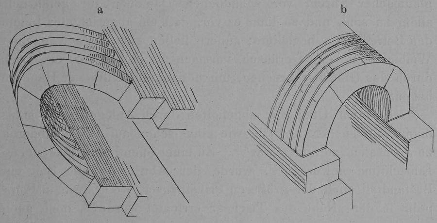

*Fig. 12. Kanalkonstruktion a) assyrisch b) römisch.*

Gespeist wurde der Kanal von Quell- oder Regenwasser, wohl auch von dem im Hofe ausfließenden benutzten Zisternenwasser, das inmitten des Hofes in eine Art Grube (עוקה)[^30.615] — vgl. das *impluvium*[^30.616] der Römer — geleitet und von da dem Kanal zugeführt wurde; die Römer stellten auch den Abtritt auf den Kanal, damit auch dessen Inhalt durch den Kanal abgeführt und in die Mistgrube geleitet werde. Die Einrichtung des Abtrittes bei den Juden ist einer der bestbekannten Punkte.

[^30.608]: S. bei „Landwirtschaft“. Varro 1,13 empfiehlt beim Landhaus zwei Mistgruben *(sterquilinium)* oder einen mit zwei Abteilungen; in den einen trägt man den frischen Mist aus dem Hofe, aus dem andern holt man ihn auf das Feld. Unterschied zwischen אשפה שבבית und אשפה שבשוק, ob man in die Hausmistgrube das Aas von Haustieren, z. B. ein verendetes Huhn, zu werfen pflege oder nicht, ist kontrovers (bChull 12ª u.).
[^30.609]: ביב von נבב = בוב, wovon auch בבא Türe. Vollere Form בוביא (L 1,198) = syr. ܒܝܒܐ PSm 462, arab. الجوى, الجاوى. Die von BB gebrauchten Erklärungen ܐܓܘܓܐ und ܣܝܠܘܢܐ entsprechen jüd. אגוגא (Lwr 2,8, חוגגוס 249) und סילון (383). Vgl. ܒܝܒܐ, ܒܝܒܐ PSm 516. Maim MʾOhal 3,7 באלועה, RN (K 2,5) *cloaca.* — MʾOhal 3,7 ביב שהוא קמור תחת הבית (zu קמר s. A. 342), T 5,3, 602₇; nach MʿErub 8,10 befindet sich die Ableitung teilweise auf der Straße (רשות הרבים); die Öffnung heißt פותח (kann wohl durch Gitter — סריגות — s. o. verschlossen werden TʾOhal 18,9, 616₃₇), die Mündung יציאה; während jedoch M von der Weite bloß 1 Tefach handelt, spricht T von der Weite von 4 Tefachim, auch handelt T von der Möglichkeit, daß der Kanal einwärts breit, nach außen (zur Straße d. i. der Mündung zu?) eng sei. Manchmal oder stellenweise war der Kanal offen, denn wir hören, daß ein Kind die Hand hineinstreckt (Ḳohel R Anf.), und auch, daß man hineinfällt (Exod R 36,3). So weit, daß Hunde hineingehen, nach Mekh RSbJ zu Exod 12,30 p. 24 oben וכלבים נכנסין דרך ביבין ומחטטין, in Mekh z. St. p. 13ᵇ weniger richtig מתוך כוכיהן, wozu מחטטין nicht paßt. Tief (ביבים עמוקים MʾOhal 18,7, neben מים סרוחים und אשפתות). Auch vom Stockwerke fließt das Wasser hinein: TʿErub 9,21, 150₂; vom Hofe aus gießt man es direkt hinein (ib. 9,18, 149₂₇ und j 8 Ende 25ᵇ₅₂ ביב שקמור ··· שופכין לתוכה מים). Bedeckte Rinnen s. OVERBECK-MAU, Pompeji⁴ 270 f. Die Abzugskanäle im alten Palaste zu Nimrud s. LAYARD, Niniveh S. 232. 326.
[^30.610]: Das scheint festgestellt werden zu müssen. Fast poetisch lautet der Ausdruck TʿErub 9,26, 150₁₉ תחת הבתים ותחת החצירות (ed. Z. המקשטין) בביבין המקשקשין „plätschern“, was ein bedeutendes Wasserquantum voraussetzt; übrigens ib. neben אמת המים genannt. In TBm 11,20, 396₂₀, wo fünf Höfe eines ביב sich bedienen, kann nur eine Art Wasserleitung gemeint sein; ib. wird erwähnt העשוי לכביסה aus dem man Waschwasser erhält, und לגשמים in welchem man Regenwasser auffängt. Dieser Kanal gehört zur guten Anlage eines Hauses (Gen R 12,1, Ḳohel R 2,14) und einer Stadt (Gen R 26,1). „Der Palast steht über ביבין“ (j Chag 2,1, 77ᶜ₆₄ neben אשפות und סריות), wie auch die Statue der Aphrodite im Bade (MAz 3,4), will allerdimgs sagen, daß ביב etwas Unreines ist, also ein Abzugskanal.
[^30.611]: MʿErub 8,10.
[^30.612]: Der גורף ביבין (Exod R 6,1); in Aggad Bereš c. 2 p. 4 ed. Buber stehen beisammen 1. der לנטין zu ergänzen [איש] לנטין u. drgl., der Diener der die Badewäsche reicht, 2. der einen Korb in der Hand u. eine Schaufel auf der Schulter hat, d. i. der Ziegelarbeiter, s. A. 178, u. 3. der גורף ביבין, der einen verächtlichen Beruf hat. TBḳ 2,6, 348₂₄ הפותקין ביביהן והגורפין מערותיהן (L 4,159 פתק öffnen, loslassen), Bar bBḳ 6ª.
[^30.613]: נתקלקל הביב Bar bBm 108ª, T 11,20, 396₂₀.
[^30.614]: TʿErub 11,10, 153₁₀ (vgl. ib. die Reparierung des צינור, auf welchem Gestrüpp und Geröll sich angesetzt). Heute verstopft man mit Lumpen, Gras und Schlamm, ZDPV 5,63.
[^30.615]: עוקה synonym mit עוגה √ חוג = עוג einen Kreis ziehen; L 3,629. Wesentlich dasselbe ist שיח A. 592 und *lacus* Varro 1,13, sowohl im inneren als äußeren Hof. MʿErub 8,10 sagt, daß, wenn der Hof nicht vier Ellen im Quadrat faßte (die Forderung Rašis bʿErub 88ᵇ, es müsse auch das Breitenmaß angegeben werden, ist erfüllt durch Bar ib. חצר שאין בה ארבע אמות על א׳ א׳, also Quadrat), durfte am Sabbat kein Wasser darin ausgegossen werden (denn es würde auf die Straße fließen), es sei denn, man mache darin eine Grube (עוקה), die vom Loche an bestimmt, 2 Saʾah faßt; es ist nun einerlei, ob sich die Grube im Hofe oder draußen, jedoch an der Umfassungsmauer, befindet, nur muß sie draußen gewölbt (zugedeckt) sein (damit sie den Charakter des Privatbesitzes habe), innen im Hofe muß sie nicht gewölbt sein. Die Gemara daselbst begründet das zweifach: 1. Der Mensch konsumiert 2 סאה Wasser jeden Tag; ist nun der Hof mindestens 4² E. weit, so dient das ausgeschüttete Wasser zum Aufspritzen — im Sommer — und fließt nicht auf die Straße, was bei einer kleineren Area der Fall wäre, es sei denn, es wäre eine Grube, die das Wasser aufnimmt, vorhanden. 2. Ein Hof von 4² E. saugt jenes Wasserquantum ein, nicht ein kleinerer Hof, und es würde das ausgeschüttete Wasser auf die Straße gehen. In T 9,18, 149₂₈ befindet sich der Zusatz, daß die Grube, sofern sie 2 Saʾah faßt, selbst wenn sie vor Sabbat voll war, den Ausguß aufnehmen dürfe (obzwar dann das W. auf die Straße fließt). Als Wassersammler gelten ib. noch ein in die Erde gesenktes Gerät (גיסטרא) oder ein Trog (עריבה); Bar bʿErub 88ᵇ erwähnt eine בריכה (o.). „Die Röhren in den Städten“ (T ib. סילונות שבכרכין) dienten denselben Zwecken, doch mußten sie, da sie unbedingt das Wasser hinausführen würden, in Anbetracht des Sabbat, nach einer Meinung verstopft (פקק) sein; vgl. j 8 Ende 25ᵇ₅₁, b 88ᵇ, jKilʾaim 9,1, 32ª₃₀. MʿErub 8,10 spricht ferner von dem separaten oder gemeinsamen עוקה von zwei einander gegenüber liegenden Stockwerken (דיוטאות). — Das sich im Hofe in der Sammelgrube (עוקה) ansammelnde Ausguß- und Regenwasser kann die Stufen einer Höhle erreichen und in der Höhle ein Bassin bilden: MMiḳw 4,4. — Nach MChull 2,13 (41ª) T 2,5, 503₈ pflegte man zur Aufnahme des Blutes geschlachteter Tiere im Hofe eine Grube (גומא, ed. Lowe גומה, ib. vorher עוגה) zu machen, vgl. jKilʾaim 9,1, 32ª₂₅, weil man den Hof stets rein halten wollte; vgl. לנקר חצירו הוא צריך bBeza 9ᵇ. גומא verwandt mit bh. גומץ Ḳohel 10,8 = ܓܘܡܨܐ s. GES. Hwb. Vom Regen- und Ausgußwasser, durch Gewürm (Ratten u. dgl.) und Salzfraß (מלחת) konnte ein Loch im Hofe von selbst entstehen: MʾOhal 3,7. In Babylonien hatte man im Hofe eine Grube, aus der das Vieh die Dattelkörner fraß (פירא דסופלי bBb 11ª unten). Ein חריץ (= Grube), in welcher Stoppeln, Stroh, Erde, Steinchen gehalten wurden kommt ebenfalls vor: MʿErub 7,3.
[^30.616]: s. RICH s. v., MARQUARDT, Privatl.² 217.

## § 31

**31.** **Der Abtritt.** Die Notdurft verrichtete man, wie in vielen Fällen nicht anders möglich, auf freiem Felde, wo man sich eben befand. Natürlich war man bestrebt, sich hinter einer Feldmauer oder einem Zaun zu ducken[^31.617], was niemand verwehren konnte, selbst wenn man zur Reinigung ein Stückchen Mauer herausriß[^31.618]. Nicht ohne Grund wird hierbei von Schlangen- und Skorpionengefahr gesprochen[^31.619]. Man lobte diejenigen, die auch bei Nacht den verborgenen Ort hinter der Mauer aufsuchten, und selbst da hielt man darauf, daß kein anderer Mensch zugegen sei[^31.620]. Anderseits hielt man es aus abergläubischer Furcht vor schädlichen Dämonen für gefährlich, allein zu sein, und so kam es vor, daß ein abgerichtetes Lamm den Betreffenden begleitete; andere ließen sich, sogar von einer Weibsperson, ein Geräusch vormachen, ja, eigens ein Loch durch das Gemäuer brechen, um nötigenfalls Hilfe zur Hand zu haben[^31.621].

All dem Übel war abgeholfen durch Anlegung von ständigen Stühlen (בית הכסא)[^31.622], wie einer schon auf der Tempelarea zu Jerusalem zu finden war[^31.623]. Zu einer öffentlichen städtischen Einrichtung geworden[^31.624], wurde der Abtritt mit der Zeit ein Bestandteil auch der größeren Privathäuser, wo er, wie in Pompeji, in der „Nähe des Tisches“ errichtet wurde[^31.625], doch auch zur Straße zu, wohin ein Loch oder ein Fenster mündete[^31.626]. Das war besonders im Untergeschoß der Fall[^31.627]. Nach einer Andeutung war der von Wasseradern durchzogene Boden Babyloniens zur Anlage von Abtritten nicht gut geeignet[^31.628]. Anderseits aber wird gerade von den Persern rühmlichst hervorgehoben, daß sie in ihren Stuhlhäusern überaus züchtig gewesen wären; auch wissen wir, daß in ihren Abtritten, die einen tiefen Schacht hatten, der Unrat verborgen blieb[^31.629]. Für die Züchtigkeit der jüdischen Frauen im Abtrittsraum sorgten eigene Verfügungen[^31.630]. Der Anstand bei der Notdurft galt als unterschiedlicher Zug zwischen Juden und Heiden[^31.631].

[^31.617]: Bar bBḳ 81ª נפנין לאחורי הגדר, mit dem bemerkenswerten Zusatze: ואפי׳ בשדה מלאה כרכום „selbst in einem Saffranfelde“. MTohar 10,2 die Weinkelterer פונים לאחורי הגדר. bBerakh 62ª. Rabbinen in Machuza hatten die zarte Rücksicht, auf gewisse Feldwege gar nicht zu blicken, um die Leute nicht bei der Notdurft zu überraschen (ib. 62ᵇ).
[^31.618]: ליטול הימנו צרור bBḳ 81ᵇ. Rechtschaffene Leute setzten den Stein zurück und ließen die Stelle sogar verkleben (ib. שרקיה). Es war auch bei Griechen und Arabern der Stein das Reinigungsmittel; s. J. PREUSS, Die Organe der Bauchhöhle nach Bibel und Talmud S. 10 (SA aus Allg. Med. Zentral-Ztg. 1898 No. 39 ff.).
[^31.619]: bBerakh 62ª. Bar Daroma kommt dabei durch einen Drachen um: bGitt 57ª. Gegen Schlangen im Hause räucherte man mit Widderhorn (Midr. Tehillim 22,14 p. 94ª). Schädlinge des Hauses (מזיקי בית) sind auch Fliegen, Mücken und Flöhe (Pesiḳta 80ᵇ). Ähnliches dürfte sein חולה (Raši: croûte Kruste?), das am Fuße der Hausmauern (עקרי בתים) haust (bPesach 118ᵇ, bChull 20ᵇ).
[^31.620]: bBerakh 62ª חזי מאן דאיכא אחורי בית הבריא דבעינא למפנא.
[^31.621]: Ib. 62ᵇ.
[^31.622]: בית הכסא Bar bSabb 62ª, bBerakh 23ª, 62ª und oft, s. die nächstfolgenden Stellen. בית המים = Pissoir MMeg 3,2, b 27ᵇ, jBerakh 2,3, 4ᶜ₆₀, TSanh 4,8, 422₁₀. Auch syr. ܒܝܬܐ, ܒܝܬܐ usw. ZDMG 40,439; ib. 60,96, vgl. ZATW 27,288; im Bade s. Haḳedem 1,194. *Sella familiarica* Varro 1,13, 4 (RICH 559 „Nachtstuhl“, aber auch gebauter Abtritt hieß so, vgl. BECKER- GÖLL, Gallus 2,280, und die *sellae Patroclianae* sollen gar öffentliche Latrinen gewesen sein, ib. 281.
[^31.623]: MTamid 1,1 בית הכסא של כבוד; war es geschlossen, wußte man, daß es okkupiert ist, war es offen, wußte man, daß es frei ist. Vgl. bAz 16ᵇ 17ª und die Literatur bei A. BÜCHLER, Der gal. Am ha-ʾAreṣ S. 314 A. 1. Bei den Essenern s. SCHÜRER 2³, 567.
[^31.624]: Man kennt öffentliche Latrinen in Puteoli, Timgad, Pompeji (s. OVERBECK-MAU Pomp.⁴ im Index s. v. Abtritte); *amphorae in angiportis* BECKER-GÖLL, Gallus 2,280; FRIEDL., Sitteng.⁵ 3,151 den Exkurs „Das Latrinenwesen in Rom“, wo auch angeführt ist Galen. 16,360, wonach die Gärten vor dem Beschmutzen zu schützen seien, wie oben אחורי גדר; LIEBENAM, Städteverwaltung S. 153. Die Anlage s. bei RICH s. v. *latrina*, DURM² 481. Bei den Juden ברחובה של מתא bBerakh 62ª, in Tiberias ib. So auch כורסון לרבים Ḳohel R 1,8. Der König baut mit dem Gelde des ταμεῖον Bäder בימס׳ l. דימסאות neben מרחצאות s. dazu mein „Badewesen“ S. 61 f. und בתי כסאות Abtritte zum Nutzen der Armen: Exod R 31,11. Die hier genannten „Orte des Schmutzes“ (מקום הטנפת s. L 2,169): Bad, Gerberwerkstätte und Pissoir bilden eine stehende Reihe; s. z. B. Sifre Deut 258 p. 120ᵇ, TSanh 5,8, 422, MMeg 3,3, jBerakh 2,3, 4ᶜ₆₀. Vgl. bSabb 10ª, 10ᵇ דמאים, auch wenn kein Unrat darin war. Jede Art heiliger Handlung, des heiligen Gespräches (הימנותא ib.), auch nur mit Tora, Tefillin usw. hineinzugehen, war verpönt (s. die bereits zitierten Stellen und bBerakh 23ª, 26ª usw., j 2,3, 4ᶜ₅₃).
[^31.625]: סמוך לשולחנו bSabb 25ᵇ. In Pompeji nahe zur Küche.
[^31.626]: bBerakh 23ª חורין, ib. חלונות, j 2,3, 4ᶜ₅₃ dem Bade gleichgestellt und öffentlich.
[^31.627]: bSabb 81ᵇ קובע מקום לבית הכסא s. Raši; bBerakh 23ª בה״כ עראי opp. קבוע, j 2,3, 4ᶜ₅₃ בית הכסא מטולטל.
[^31.628]: bBerakh 8ª לעת מצוא usw., במערבא usw., s. Raši.
[^31.629]: bBerakh 8ᵇ וצנועין בבית הכסא; ib. 26ª s. Raši. Vgl. BHišam 733: Wir hatten als echte Araber kein heimliches Gemach im Hause wie die **Perser**, denn davor ekelte uns; wir gingen auf einen freien Platz, und die Frauen taten das nachts (WELLHAUSEN Reste arab. Heident.² S. 173). Die besondere Züchtigkeit des Patriarchen R Juda s. bSabb 118ᵇ u. s. dazu das Responsum Hais bei RN (K 1,111) u. Juchasin ed. London 48ᵇ. Doch hören wir gerade von Rabbi, daß er infolge seines Magenleidens auf dem Stuhle ein weithin hörbares Gestöhn vollführte: bBm 85ª. Ein anderer, R Juda (bʿIllai) hatte vom Hause bis zum Lehrhause 24 Abtritte, die er alle besuchte: bNedar 49ᵇ, bBerakh 55ª; ib. der Ausdruck המאריך בבה״כ u. התולה עצמו בבה״כ.
[^31.630]: Sie sollen im Abtritt miteinander reden, damit sich kein Mann zu ihnen geselle, nach Verfügung Ezras jMeg 4,1, 75ª₂₈, des R Jose in Sepphoris bSanh 19ª. Raši meint, es handle sich um einen Abtritt auf dem Felde. Sie vertrauen einander alles im בה״כ an: bGitt 45ª. Sie schmücken sich darin: bMeg 11ª. Wohlriechende Spezereien im Abtritt (בשמים של בה״כ bBerakh 53ª) rühren entweder von der Kosmetik der Frauen her, oder wurden absichtlich gegen den üblen Geruch gebraucht.
[^31.631]: bSanh 104ᵇ (vgl. RŠ zu MTohar 4,5) גוי נפנה לדרך וישראל נפנה לצדדין, Thr R 1,1 unter den Athenae-Anekdoten (p. 50 ed. Buber) דגוי משתין באורחא ולית יהודי משתין באורחא.

## § 32

**D. Umgebung.**

**32.** **Lage des ganzen Hausgrundes.** Die „inneren“ und „äußeren“ Häuser haben uns bereits (o. S. 46) zwei Höfe erkennen lassen, wie auch Varro (1,13) zwei *cohortes* wünscht[^32.632]. Der innere kleinere Hof ging auf einen freien Raum aus, „Platte“ (רחבה) genannt[^32.633]. Da der Hof stark bevölkert war, so war es zweckmäßig, auch den hinteren Trakt mit einer Pforte zu versehen, die der vorderen gegenüber lag[^32.634]. Zwei und auch mehr nebeneinander gelegene Höfe konnten miteinander kommunizieren[^32.635]. Gewisse Bauteile (Mauer, Fenster, Grube) hatten dann die Höfe gemeinsam[^32.636]; das war besonders leicht, wenn die Höfe alle einen Besitzer hatten (o. S. 31). In den erwähnten Fällen ist die Lage der Höfe ein Nebeneinander; da jedoch die Baugründe in der Gasse verschieden situiert sind, so kommt es auch vor, daß die Höfe einander den Rücken kehren, d. h. sie hatten den Eingang von einer anderen Gasse aus, und die eigentlichen Wohnhäuser lehnten sich aneinander; hierbei war es leicht möglich, daß die beiderlei Dächer von gleicher Höhe waren[^32.637]. Da die Straße oder Sackgasse von zwei Häuserreihen gebildet wird und der Hof immer **vor** dem Hause liegt, so lagen sich auch die Höfe oft gegenüber; da man nun auf der dazwischen liegenden Straße am Sabbat nicht hätte tragen dürfen, so half man sich — wozu sich die Insassen des Hofes gegenseitig verpflichten konnten — damit, die Straße mittels Pfahl und Balken (לחי וקורה) gleichsam in einen Hof zu verwandeln[^32.638]. Ebenso mußte ein jeder, auch wenn er anderswo wohnte, aber hier seinen Anteil hatte, zu den Kosten der Türe mit Schräg- und Querbalken des Hofes beitragen[^32.639].

Die Dimensionen der einzelnen Wohnhäuser variieren wie folgt: Ein kleines Haus ist dasjenige, welches 6 Ellen (ca. 3 m) Länge neben 8 Ellen Breite mißt[^32.640]; ein großes Haus dasjenige, welches 8 Ellen Länge bei 10 Ellen Breite (also 80□ Ellen) mißt; das als besonderes Gebäude gedachte Triklinium (טרקלין) hat 10 Ellen Länge bei 10 Ellen Breite (ist also quadratisch, und das wurde sicherlich schön befunden) und bei einer Höhe, die von beiden Dimensionen die Hälfte (also wieder 10 Ellen) beträgt, und zwar wird dabei bemerkt, daß das Verhältnis der Höhe zur Länge und Breite auch im Heiligtum dasselbe war[^32.641]. Die Juden stellten sich unter dem Triklinium, das in jedem besseren römischen Hause als Speisesaal vorhanden war, etwas besonders Stattliches vor, nannten dessen Vorraum פרוזדור[^32.642] und liessen es den Mittelpunkt des Hauses sein[^32.643].

Wenn man dem babylonischen Talmud trauen darf in einem Punkte, der ein Stück palästinischen Lebens berührt, so kämen wir mit dem Triklinium bereits in die Nähe des Hausgartens, denn das Triklinium wird als ein Raum erklärt, der eine Rosenanlage trug (קובתא בי וורדי)[^32.644], jedoch schwerlich in der Weise, wie bei den Römern ein Vorraum des Triklinium, der Peristyl, tatsächlich Fontänen und Blumenbeete beherbergte, sondern mehr in der persischen Art des *chwarnak* (אכוורנקי כוורנק)[^32.645], einer Plantage, die man mehr im Garten anlegte, und deren man sich bei freudigen Anlässen, ähnlich dem Triklinium, dem Schauplatz des Hochzeitschmauses, gern als Speiseort bediente.

Noch weiter im Anschluß daran erwähnen die Quellen den inneren Hofraum (קנטר = χορτάριον)[^32.646], der 12 Ellen im Quadrat mißt, also größer ist als das Triklinium. Aus der Erklärung nun, die wiederum hier folgt, ist die Existenz eines תרביץ genannten Hofes ersichtlich, der wohl nur im babylonischen Hause so genannt wurde[^32.647]. Man ersieht zugleich aus diesen Benennungen, daß dem Hofe neben dem eigentlichen Wohnhause eine selbständige Geltung zuerkannt wurde[^32.648]. In einem konkreten Falle hatten sich zwei Brüder in die Erbschaft so geteilt, daß einer das Hauptgemach (hier אספלידא = ψαλίδιον genannt)[^32.649], der andere den inneren Hofraum (תרביצא) erhielt; da spielte letzterer ersterem den Possen, an die Öffnung des Hauptgemaches, freilich auf eigenem Grund und Boden, eine Mauer zu ziehen, wodurch er jenem das Gemach verdunkelte. Da sich in dem Wirtschaftshofe allerlei Haustiere herumtummelten, so wird man auch darauf geachtet haben, einen von allen Seiten verschlossenen Raum zu erhalten; das erreichte jener durch eine Mauer, ein anderer begnügte sich, eine leichte Bretterwand aufzuführen[^32.650].

[^32.632]: Matth 26,29 nur ein Hof, s. jedoch Marc 14,68, Luc 22,25. MMaʿas 3,5 zwei Höfe ineinander; der innere und der äußere. MʿErub 6.9 (75ª); der Ausgang ist einer (אחדא דשא b 75ᵇ).
[^32.633]: רחבה fehlt in diesem Sinne in den Wbrn. bʿErub 24ª רחבה שאחורי הבתים; konnte vom Hause aus durch eine Türe erreicht werden (ib.) und umzäunt sein (ib.). Genaue Lage einer רחבה in Pum-Nahara (Babylonien): Von der einen Seite mündete sie in die Stadt, von der anderen zu einem Weinbergsteg; dieser endete beim Flußufer (ib. 24ᵇ). Es konnte die Tenne darauf stehen (24ª בי דרי), darum frißt das Vieh dort Frucht MBk 2,2, ib. צדי הרחבה, T 1,7, 346₂₈.
[^32.634]: MʿTohar 6,10 חצר שהרבים נכנסים בזו ויוצאים בזו, vgl. T 7,14, 668₁₄ den Begriff von שני פתחים מכוונין זה כנגד זה; als negatives Beispiel dienen der Hof von בית גדי (so lies) und חממה; da war die eine Türe in der Mitte, eine zur Seite der Basilika, wovon dort die Rede. (Mit Namen werden auch sonst Höfe genannt, z. B. in Jerusalem der des בית יעזק MRh 2,5 s. dazu b 23ᵇ. חצר בית גלודה in Lydda: TʿErub 9,2, 148₁₄; der Hof des Banias: b 85ᵇ). Die zwei Türen des Hofes in jʿErub 6,1, 23ᵇ₄₆ liegen aber wohl auf derselben Front.
[^32.635]: MʿErub 4,6 (45ᵇ) drei Höfe münden ineinander und münden in die Straße (רה״ר); b 46ᵇ ist ersichtlich, daß die drei Höfe nicht umeinander gruppiert sind, sondern in der Längsrichtung nebeneinander liegen, so daß der mittlere Hof (*b*) mit den äußeren (*a* u. *c*) kommuniziert. M 6,8 (73ªᵇ) fünf Höfe münden ineinander und münden in die Sackgasse (מבוי), s. Abbildung in den Talmud-Agg.; ib. שהמבוי לחצרות כחצר לבתים, j 6,9, 23ᵈ₄₁ mit dem Zusatz: denn sie münden ineinander und münden auch in die Sackgasse; b 74ª.
[^32.636]: MʿErub 7,1. 2. 3 חלון, כותל, vgl. T 10,13, 152₅. Die Grube war in der Regel gewiß mit einem Brett (נסר) überdeckt, M ib. 4. Über die Mauer geht man mit beiderseits angelehnten Leitern: j 7,1, 24ᵇ₇₁, b 59ᵇ.
[^32.637]: TʿErub 11,2, 152₂₂ שתי חצירות אחת פתוחה לצפון ואחת פתוחה לדרום וגגותיהן שוה. Vgl. o. A. 397.
[^32.638]: TʿErub 10,13, 152₇.
[^32.639]: TBm 11,17. 18, 396₁₁ f. MBb 1,6 nur בית שער ודלת.
[^32.640]: So, nicht etwa umgekehrt sechs Ellen breit, acht Ellen lang, denn erstens wird Länge gewöhnlich zuerst angegeben; zweitens erfordert das die Situation im Hofe.
[^32.641]: MBb 6,3 (98ᵇ). SCHICK in der Baugesch. Jerusalems (ZDPV 16,241) sagt, die Zimmer seien sehr klein gewesen, durchschnittlich etwa 3¹/₄ m nach jeder Richtung; dasselbe behauptet FRIEDL., Sitteng. 3⁵, 82, von der älteren Zeit in Rom. Das Verhältnis der Höhe zu den andern Dimensionen bestimmt ebenso Vitruv 6,3, 8; 4,1, 2, DURM² 492. Dies fordern unsere Quellen, wohlgemerkt, nur bei dem Triklinium. Die Juden stellten sich das T. besonders prächtig vor, wie es schon mit Fremdlingen zu geschehen pflegt; in Wirklichkeit war es für gewöhnlich gar nicht so pompös (RICH s. v.). bChag 14ᵇ טרקלין גדולים. Da es groß war, konnte der Gedanke kommen, es aufzuteilen, daher MBb 1,7 lehrt, אין חולקין ··· את הט׳, ferner ולא את המורן (etwa קמרון zu lesen: κάμαρα, Lwr 2,352), vgl. MKel 16,7 והקמרון, JQR 14,748 f.
[^32.642]: MʾAb 4,16 פרוזדור, RN Var. פרוסדור, ms Kfm פרוזדר, so auch zahlreiche mss bei TAYLOR, Sayings² App. p. 161; ib. p. 120 Erklärung פורקא l. פורטא, *porta*, vgl. פורטתא in Lwr 2,468 s. v. פנדתא, TBerakh 7,21, 17₁₀ פרוצדר = πρόθυρον, nach Vitruv 6,10, 5 *prothyra* graece dicuntur quae sunt ante januas vestibula, nos autem appellamus *prothyra* quae graece dicuntur διάθυρα; arab. דהלין (רחלין) bei Hai zu MNidda 2,5 emendiert in Beth Talmud V, 215 in דהליז = دِهْلِيز, DOZY 1,467 vestibula, antichambre. I. LÖW in Lwr ib. akzeptiert die LA פרסדור und das ist προστάς -τάδα, aber dieses war nur bei griechischen Häusern vorhanden, und nach dem Plane bei RICH s. v. *domus* am Ende des Hauses, von wo aus man nur hinaus-, nicht hineintritt. — In Lwr ib. Stellen, wo פ׳ tropisch = weibl. Schamglied. Daran schließen wir die Bemerkung, daß das Haus und seine Teile sehr oft in ähnlichem Sinne tropisch verwendet werden: bh. ציר, קֵבָה, פֶּתַח, nh. בית בשת, בית השינים, בית התורפה, בית החיצון, בית הסתר, דלת, פתח, שקוף (jNidda 2,2, 49ᵈ₆₁, in b 12ª משקוף), דשא (o.), עברא (bKethub 10ª), חדר, פרוזדור, עלייה (MNidda 2,5, O. Bert. auch לול, T 3,9, j 2,4, 50ª₂₅) usw. Vgl. REJ 59,36 f.
[^32.643]: MMidd 1,6. bJoma 15ᵇ קטוניות הפתוחות לטרקלין, vgl. Midr ha-G zu Gen p. 75 ed. Schechter. AbRN β c. 13 p. 30: Ein König reist, und da trifft er auf freie חדרים (= Schlafzimmer, s. A. 576, wie soeben קיטון) und טרקל (l. טרקלין), ging hinein und wohnte in ihnen. Auch TʿErub 7,8, 146₁₉ ט׳ opp. חדר und zwar ט׳ mehreren Parteien gehörig, offenbar = בית. „Ihr Triklinium ist wie der Hof zu den Häusern“ ib. Vgl ט׳ neben חצר TNidda 8,4, 649₃₂. Man findet folgendes Arrangement: In dem Hause gibt es Trikl. und κοιτών, aber so, daß חופה und κοιτών mit dem Trikl. kommunizieren: jKethub 4,7, 28ᵈ₃₁, jSanh Ende 30ᶜ₅₅. Bar bBerakh 16ᵇ עלייה, אנפילין, טרקלין. Nach Sifre Num 134 p. 50ᵇ 1. נכנס לשער (= פתח פלטרין), [2. Raši zu Num 27,12 לחצר], 3. לטרקלים, 4. לקיטון. Das Trikl. konnte geheizt werden: TSabb 16,18, 136₃, TBeza 2,10, 204₆, vgl. Varro 6,7, 4 *triclinium hibernum*, und war bemalt: TTerum 7,16, 38₂₁.
[^32.644]: bBb 98ᵇ מאי טרקלין קובתא בי וורדי, RG (cf. RN bei K 4,96): So wie man Zelte ausspannt; es ist oben rund wie eine Wölbung (קובה, vgl. o.), von allen Seiten eingeschlossen, und man streut dort Rosen (שושנים) aus, deren Duft ausströmt, und es schlafen dort Fürsten. Ziemlich phantastisch. Vgl. indessen die Ruhebetten und Eßtische des Äl. Varus aus Rosen und Lilien, bei FRIEDLÄNDER, Sitteng. 3⁵, 99, HEHN⁷ 254. Der Talmud kann Rosen als Rosenlaube, aber auch als ein Motiv des Ornaments meinen. Raši (im Namen der Gaonen) zu bʿErub 25ᵇ „wie eine Exedra oder קובה im Garten“ spricht damit nicht nur die Lage im Garten aus, sondern auch ein gegenseitiges Merkmal (קובה) zwischen diesem Punkte und dem אבורנקי.
[^32.645]: אבוורנקי RN (Agg. überall korr. אבורנקי), „arab. خُورْنَق, nach Angabe der Araber selbst vom pers. *chorungah*, d. h. Speiseort“ Fl in L Trg Wb 1,26, L 1,73; RN (bei K 1,74, neuestens s. auch J. HALÉVY in Revue Semitique 15 vom Schlosse Chawarnak in arabischen Legenden) = נטיעה, wie ausdrücklich in bTaʿan 14ᵇ, bMeg 5ᵇ, woraus man sieht, daß es mehr eine Pflanzung als ein Bau ist; hier übrigens auch dem Rabbi zugeschrieben, wo es doch gewiß babylonisch ist: bʿErub 25ᵇ ההוא אבורנקא דהוה ליה בבוסתנא.
[^32.646]: jBb 6,3, 15ᶜ₂₀ קנטר, T 6,24, 407₃ קנטינר, b 98ᵇ Agg. קנתיר, RN קנתינר, ms M קונתר, s. die LAA bei K 7,142 (in Lwr 2,553 unerklärt gelassen), ist etymologisch unsicher (J 1389 *centenarium*; zu L 4,336 s. Fl 483). PERLES, Et. St. S. 43 = תרקן *darchâneh*. Es dürfte aber mit קורטור L Trg Wb 2,387 zusammenzustellen sein: Schatzkammer, Verwahrungsort, dem Laute nach = χορτάριον = χόρτος, der innere Hofraum, chors der Römer. Das ist der Wirtschaftshof (vgl. אלקטיות A. 81), ebenso der zweite neben חצר wie *triclinium* samt *perystylium* der zweite neben *atrium*. Es ist somit richtig, daß dafür ein größerer Raum gefordert wird, und auch, daß es mit תרבץ, und zwar im vornehmen Bau, erklärt wird.
[^32.647]: bBb 98ᵇ תרבץ אפדניה, RG גינת ביתן שאחורי אפדנים, RSbM חצר גדול, zugleich die Etymologie: weil man den Hof beständig mit Wasser aufspritzt (רבץ), den Staub zu binden (nach Raši bMk 6ᵇ genügt freilich השקאה פורתא, s. Tosafoth), ähnlich auch RN (bei K 8,272), und in der Tat steht ja bMk 6ᵇ תרבוצי das Aufspritzen dabei. Doch gibt RN noch andere zwei Erklärungen, wovon 1. = חצרות mit dem hier gegebenen Sinn gut vereinbar ist; vgl. TʾOhal 18,12, 617₄ = M 18,10 אוירה של חצר (s. o.) nach RN (K 1,46) = תרביצא = מילוסא. Aber No. 3 = בתי מדרשות ist doch nur figürlich gemeint, wie z. B. bh. חצרות = Heiligtum zu Jerusalem. (Die Schülerkategorie תרביצאי bMenach 82ᵇ, s. A. GEIGER, ZDMG 19,618.) L 4,667 übersetzt תרבץ „Vorhof, eig. Lagerplatz“; er dachte also an רבץ lagern, nicht unmöglich, weil sich auch das Hausvieh in תרבץ aufhält. Wer im Traume eine Henne sieht, der kann auf schönen Vorhof und auf Freude rechnen (bBerakh 57ª, s. Raši, wonach in תרנגולת der Begriff תרביצא נאה וגילה gefunden wurde). תורבץ החושש bChull 43ᵇ ist übertragen. Das Sprichwort bTaʿan 6ᵇ טבא שתא דטבת ארמלתא (Wetterkunde!) „gut ist das Jahr, wenn Tebeth eine Witwe)“, d. h., wenn Monat Tebeth ohne Regen, „denn dann bleiben die תרביצי nicht leer“, scheint anzudeuten, daß im Winter die Haustiere im Hofe gehalten wurden. So kann man am Ende in רבץ = lagern noch den Nebensinn רבד pflastern finden, d. i. der Hof wurde mit Stroh als Streu belegt, worauf das Vieh lagerte und Mist machte.
[^32.648]: Vgl. bBb 67ª Unterschied von דרתא (= חצר, wie in Trg) und דירה.
[^32.649]: bBb 7ª. Zu אספלידא s. Lwr 2,90. RG *camera*, RN **Höhle**, wogegen Tosafoth z. St. und zu bMenach 33ᵇ, die ihrerseits אכסדרא geben, wie auch Raši טרקלין יפה. Da aber ψαλίδιον an und für sich „Grotte“ bedeutet, so ist RNs **Höhle** richtig, und die Situation ist dieselbe, wie in MBb 6,8 (vgl. T 6,23, 407₁) ועושה חצר על פי המערה, dort zwar von der Grabkammer, jedoch der Wohnung der Lebenden nachgebildet.
[^32.650]: bʿErub 89ᵇ unten, wo דקה nicht = kleine Türe (Raši), sondern eine Scheidewand (Tosafoth), und zwar läßt sich diese (vgl. ib. 61ª das Beispiel von גדר) als leichte Mauer, aber auch als Bretterwand denken, vgl. ib. 60ª. Ib. 59ᵇ דקה nach RCh freilich כגון אצטבא בפני המבוי, ein Beispiel, aber nicht alleinige Form.

## § 33

**33.** **Die Terrasse an der Stadtmauer.** Das Grundstück eines Hauses grenzte in vielen Fällen — selbst in Dörfern, insofern in alter Zeit die meisten bewohnten Orte einen Wall hatten — an den Wall, den man קרפיף nannte und der gewissermaßen die Terrasse oder das Glacis des betreffenden Hauses bildete[^33.651]. Damit Garten und Terrasse einen geschlossenen Raum und demgemäß den Charakter eines Hofes darstellen, ist nötig, daß sie die Area von 2 Sa’a (ca. 35 m) nicht überschreiten[^33.652], weil sonst der Hof in ein offenes Feld übergeht. 2 Sa’a ist nur um weniges mehr als 70 Ellen und ein Rest im Quadrat[^33.653], auf welches ein anderer die Area des Gartens und der Terrasse beschränken möchte; nur verlangt dieser — alles in bezug auf die Benützbarkeit am Sabbat — daß sie zumindest von einer 10 Tefachim hohen Steinmauer eingefaßt seien[^33.654], und die Terrasse außerdem eine Feldhüterhütte (שומירה) oder ein Wohnhaus enthalte oder der Stadt nahe sei[^33.655]; wieder ein anderer begnügt sich in diesem Punkte damit, daß sie nur eine Zisterne, eine Grube (שיח) und eine Höhle (nach einer Ansicht nur eines von diesen) enthalte, doch wird die Beschränkung auf 70 Ellen und Rest im Quadrat beibehalten; wieder ein anderer will sie quadratisch haben, ihr aber den Charakter des Hofes absprechen, wenn die Länge auch nur um 1 Elle größer als die Breite, was jedoch wieder ein anderer für unnötig hält.

Letztere Variation, daß die Länge weit größer als die Breite, muß besonders in Ansehung der sich um die Stadt hinziehenden Terrasse sich eingestellt haben. Der *karpiph* ist nämlich = bh. מגרש nach der bei den Alten zu findenden Auffassung dieses Begriffes[^33.656]. Es wurde jeder Stadt ein *karpiph* zugeteilt[^33.657], und es scheint, daß sie den Wall erhielt, auch wenn sie nicht in eigentlichem Sinne des Wortes befestigt war. Doch konnte ja der Wall zur nachherigen Aufführung von Festungsmauern die Vorstufe bilden[^33.658]. Diejenigen Privatbesitzer nun, deren Haus an die Umwallung stieß, betrachteten das betreffende Stück des Walles als ihnen gehörig (so erhalten die Baunachrichten in Neh. 3 ein besonderes Licht), und so ist sehr oft von *karpiph* in bezug auf das Privateigentum die Rede, und namentlich ist beliebt die Zusammenstellung: Dach, Hof und Terrasse[^33.659]. So mancher wird den seinem Grundstück gegenüber gelegenen Teil des Walls umzäumt und als Wohnung benutzt haben[^33.660]; d. h. man eignete sich, wie auch jetzt in Bergabhängen und Festungswällen, öffentliches Gut an. Vom Hofe des Hauses aus gelangte man mittels Türe auf den Wall[^33.661]. Etwas Gehölz wuchs von selbst auf dem Wall, und darum ist die Rede davon, daß man im Notfall von dort den spärlichen Holzbedarf deckt[^33.662]; er kann aber auch absichtlich von Bäumen gekrönt sein[^33.663]. Seine eigentliche Bestimmung ist freilich, mit Brustwehren und Palisaden ausgestattet zu werden[^33.664]. Daran Holzwände anzulehnen, diese eventuell zu überdachen, ist eine leichte Arbeit[^33.665].

Von anderer Art sind die Dämme, die um Seen und Flüsse als Schutz gegen Überschwemmung aufgeführt wurden, und die namentlich um den Tiberiassee herum bekannt waren[^33.666]. Auch Karawanen mochten zu ihrer Sicherheit einen Wall um ihr Lager ziehen, wie ihn der Talmud in eigenartiger Konstruktion kennt[^33.667], ähnlich dem der römischen Soldaten, wenn sie ein Lager bezogen.

[^33.651]: Der Wall wurde allem Anscheine nach vom natürlichen Felsen oder künstlichem Gemäuer gebildet, die sich stellenweise zu einer Terrasse erweiterten. Es ist der *agger* (χῶμα) der Alten, s. RICH s. v. Von den daselbst angeführten Arten gehören hierher No. 2 *agger murorum* und No. 5 ein Deich an den Ufern eines Stromes. Dem entspricht die Wortbedeutung von קרפיף, von גפף = כפף = קפף mit eingeschobenem ר׳, wie in שרביט von שבט, דרמשק von דמשק, כרבל von כבל (vgl. STRACK-SIEGFRIED, Lehrb. d. neuhebr. Spr. § 18ᶜ), J 1424; fest fügen, wölben.
[^33.652]: MʿErub 2,3 לא אמרו בית כאתים אלא לגנה ולקרפף.
[^33.653]: שבעים אמה ושיריים על ש׳ אמה ושיריים MʿErub 2,5. Die schwierige Berechnung, vom Wüstenheiligtum ausgehend, s. b 23ᵇ, Kommentare z. St., Maim. und Bert. z. Mišna; die Zahl häufig, z. B. T 6,6, 144₂₈, ib. 6,9 alte Agg.
[^33.654]: Wir bemerkten bereits (o.), daß der Garten nicht überall eingefaßt zu sein pflegte: MBb 1,1.
[^33.655]: Das kommt wohl auf das hinaus, als wenn gesagt wäre, sie sollen die Fortsetzung des Hauses bilden.
[^33.656]: Nicht Weideplatz, wie die Neueren alle (GES. Hwb. und STADE-SIEGFR. führen eine andere Auffassung gar nicht an), obwohl Vulg. *suburbana* doch mehr als Weideplatz ist und überhaupt das Verhältnis zur Stadt besser ausdrückt. Trg O רְוַח, Trg Ps-Jon פרויל (s. bei „Stadt“) nicht zu trennen von mišnisch פרור, trg פרורא, bh. פרבר I Chr 26,18, פרורים II Kön 23,11 (persisch!), dieses nicht „Anbau“ zum Tempel (GES. Hwb.), sondern Vorstadt, vgl. HORA, Hebr. Bauw. S. 62. קרפיף ist nun der Weideplatz, insofern in Friedenszeiten der Wall zum Weideplatz dienen konnte. Bis auf den einen RCh (zu bʿErub 22ª ק׳ הוא כעין כתלים בלא קירוי והיא נקראת אילוסא של חצר, er meint מילוסא o. aus bBb 67ª, vgl. bʿErub 56ª הני מוליתא דבי בירי ודבי נרש, l. מוליסא, L 1,548 richtig „Wälle“; Tosafoth zu Chull 127ª lesen מעלות ומורדות), der eine adäquate Vorstellung von קרפיף hat, sind die andern Erklärer alle ratlos; die knappe Notiz bei RN (K 7,211) sagt die Hauptsache nicht, nämlich „Wall“, während שמוקף מחיצות (wohl aus bʿErub 25ª ועשה מחיצה, was aber ein Bau auf dem Wall ist) nur cum grano salis wahr ist, nämlich als Palisaden des Agger. Ungefähr dasselbe in den Lexicis; L 4,387: ein von Reisern und Gesträuchen (gr. κάρφος) umzäunter Platz, K 7,211, J 1424. L's κάρφος findet sich noch in einer franz. Übersetzung des Briefes von Scharrira (Anvers 1904 Note 517). Ganz verfehlt Raši (auch O. Bert., MʿErub 2,3) b 18ª: היקף גדול חוץ לעיר להכניס שם עצים לאוצר, also ein Gebäude, wahrscheinlich aus MBeza 4,2 gefolgert.
[^33.657]: TʿErub 6,9, 145₈ המודד מודד חוץ לקרפיפה של עיר כל עיירות נתנו [להן] קרפיף, so lehrt RMeir (wie auch natürlich); die andern Rabbinen halten aber ק׳ nur zwischen zwei Städten für zur Stadt gehörig, worauf erst das freie Feld anfängt: M 5,2. b z. St. (57ª) leitet das von מקיר העיר וחוצה (Num 35,4) ab, also ק׳ das, was außerhalb oder hinter der Stadtmauer (s. Raši), d. i. Agger. An allen diesen Stellen ist freilich ק׳ nur der entsprechende Raum, aber man kam zu diesem Ausdruck, weil eben um die Stadt herum ein ק׳ war; auch MBeza 4,2 bringt ק׳ in Beziehung zur Stadt. MʿErub 5,3 וכן ג׳ כפרים המשולשין. also hatten auch Dörfer Wälle.
[^33.658]: Folgt aus der Art, wie T 6,9 auf den ק׳ gleich von מגדלין die Rede.
[^33.659]: גגו חצירו וקרפיפו bGitt 70ᵇ, Bm 10ª, 26ª, Bk 65ª, Sifre Dt 269 p. 122ᵇ, TʿErub 8,6, 147₂₃, j 25ᶜ, bSabb 147ᵇ. Plural MʿErub 9,1 קרפיפות usw., bSabb 130ᵇ, bPesach 92ª usw. bBerakh 35ᵇ דרך גגות ··· דרך קרפיפות (in bGitt 81ª fehlt דרך חצרות). Vgl. das Vorgehen der Heiden bʿErub 67ªᵇ. Zu טרוקסימון bBerakh 35ᵇ, bGitt 81ª s. Lwr 2,271. Völlig als Eigentum ist ק׳ behandelt TBk 10,27, 369₆ ein Schwarm von Bienen geht in „seinen“ ק׳. Drei teilen sich in ihn: jBm 2,3, 8ᶜ₁ (L 3,206 „ein von drei Menschen eingeschlossener Raum“!). jKidd 2,1, 62ª₆₂ der ק׳ seines Genossen.
[^33.660]: bʿErub 67ᵇ, bSabb 7ª קרפף יותר מבית סאתים שלא הוקף לדירה (s. Kontroverse von Raši und Tosafoth bezüglich הוקף לתוכו); aus dem Negativum לא הוקף folgt das Positivum הוקף. Bar bBb 24ᵇ ק׳ ··· שהוקף לדירה.
[^33.661]: bʿErub 67ªᵇ פתוח לקרפף. MBeza 2,4 wenn נכנסין לה בפותחת muß nach einer Ansicht der ק׳ nicht gerade in der Nähe der Stadt liegen; da ist der ursprüngliche Begriff von ק׳ verdunkelt!
[^33.662]: MBeza 4,2, vgl. j 62ᶜ₁₅, T 3,10, 216₇; das Holz liegt dort zerstreut oder tags vorher gesammelt. Davon stammt der Irrtum, daß ק׳ ein אוצר!
[^33.663]: bʿErub 25ª מיעטו באילנות s. Raši. Terrasse mit Gärten bei den alten Griechen: DURM, Gr.² 345. Berühmt die „hängenden“ Gärten der Semiramis.
[^33.664]: bʿErub 25ª תל.
[^33.665]: Ib. וקירה בו.
[^33.666]: Bar bʿErub 87ᵇ בימה של טבריא הואיל ויש לה אוגנים ועירות וקרפיפות מקיפות אותה, T 10,13, 152₉ במעשה שבגנוסר שזה פותח דרך קרפיפו וסותם רה״ר
[^33.667]: bʿErub 93ª mit Abbildungen.

## § 34

**34.** **Der Hausgarten.** Jene Rosenlaube, ferner die Bäume und sonstigen Pflanzen im Hofe (o. S. 50) sind nicht die einzigen Anzeichen von dem edlen Hange zur Pflanzenwelt, sondern wir erfahren in ganz positiver Form, daß sich dem altjüdischen Hause, wenigstens in vielen Fällen, ein Garten anschloß. In Städten, besonders solchen, die mit einer Mauer umgeben waren, — und derart waren die meisten Städte — und obenan in Jerusalem, von dem dies ausdrücklich berichtet wird[^34.668], ist freilich für den Luxus eines Gartens kein Raum da; allein in freien Landstädten und Dörfern wird der Garten (גנה, בוסתן) nicht gefehlt haben. Der Hof grenzte oft an den Garten[^34.669], ja, dieselbe Mauer konnte zum Teil das Haus, zum Teil den Garten umfassen[^34.670], und der im Garten stehende Feigenbaum konnte das Fenster beschatten[^34.671]. Zuweilen stieg man vom Hause auf Treppen in den Garten hinunter[^34.672]. Der Hausgarten war in einigen Gegenden mit einer Mauer eingefaßt, in anderen nicht[^34.673]; in letzterem Falle geht der Garten in die weitgestreckten Fruchtfelder über.

[^34.668]: Bar bBk 82ᵇ שאין עושין בה גנות ופרדסות (mehr s. in REJ 53,34 f.). Den Unterschied zwischen גנה und פרדס s. § 175. Die Gärten waren außerhalb der Städte, s. § 175. Garten neben dem Lehrhaus (גינתא דבי רב bBb 54ª).
[^34.669]: Vgl. Mekh RSbJ zu Exod 12,46 p. 29 (fehlt in Mekh p. 17ᵇ) חצר גנה וסוכה. MBb 1,6. MTerum 8,3 ונכנס מן הגנה לחצר, jMaʿas 3,9, 50ᵈ₆₉. Der Garten durch einen Wasserarm (אמה) gespeist: TBm 11,21, 396₂₃. Ex R 31,7 גלגל שבגנה.
[^34.670]: TʾOhal 6,5, 603₂₄ ib. Z. 30. Der Baum dürfte auch zum Schutz des Hausdaches gegen Anschlagen des Regens gedient haben, vgl. Plinius H. N. 13,7.
[^34.671]: TMr 2,22, 84₁₂.
[^34.672]: bSabb 30ᵇ בוסתנא אחורי ביתא, ib. דרגא. Vom Hause aus betrat man den Garten durch eine Tür; manchmal war jedoch der Eingang von der Straße aus, ein anderes Mal sowohl da als dort (so dürfte aufzufassen sein TʿErub 10,11, 150₂₆). Bar bMenach 33ᵇ בית שער הפתוח לגינה ולקיטונית, ib. ביאה דבית, ib. פיתחא דגינה.
[^34.673]: MBb 1,2 וכן בגנה מקום שנהגו לגדור. bMk 7ª כותל הגינה. Ib. בהוצא ודפנא s. Raši in ב״ח ed. Romm.

## § 35

**35.** **Luxusbauten und Ausschmückung der Häuser.**

a) Das Torgebäude (בית שער). Am Eingange des Hofes saß der Türhüter (שומר), der wohl hier sein Stübchen hatte. In besser gebauten Häusern stand aber hier ein eigenes Torgebäude[^35.674], das zum Teil wohl dem Wächter eingeräumt war.

b) Die Exedra (אכסדרא). Bei größeren Bauten befand sich vor dem Eingange nach griechischer Sitte[^35.675] eine Exedra, d. i. Säulenhalle, mit apsisartigen halbrunden Erweiterungen, in welchen unter freiem Himmel auf den daselbst angebrachten Bänken gesellschaftliche Zusammenkünfte und Gespräche stattfanden. Die Exedra bildete einen stattlichen Schmuck des Hauses, besonders wenn sie um den ganzen Hof herumlief; manche hielten es nämlich für zweckmäßiger, die Exedra in den inneren Hofraum zu verlegen, und erhielten so einen Raum, der dem Peristyl der Griechen entspricht, und es ist möglich, daß die Rabbinen das Ding nur fälschlich Exedra nannten[^35.676]. So wird im Heiligtum zu Jerusalem die auf der Ost- und Westseite gelegene Exedra erwähnt[^35.677].

c) **Freitreppen und Rampen.** Da man auf das Stockwerk mittels loser Leiter oder in einem לול stieg (o. S. 35), hat man wenig Gelegenheit, von Freitreppen zu sprechen. Solche werden erwähnt hauptsächlich in Anlehnung an die Stufen des Altares (מעלות Exod. 20,26); diese sind verboten, dagegen ein schiefer Anbau, eine Rampe (כבש), erlaubt und war am Südrande des Altares tatsächlich vorhanden[^35.678]. Anderseits gab es im Tempel Stufen genug, natürlich Steintreppen[^35.679]. Mit demselben Namen (מעלות) werden auch die in den natürlichen Felsen gehauenen Stufen bezeichnet, die von der Davidstadt herunterführten (Neh. 3,15; 12,37); solcher Stufen gab es in den palästinischen Städten viele[^35.680]. Zahlreich mußten auch sein die Treppenflure, die in die Höhlen führten[^35.681].

d) **Säulen** (עמודים). Man spricht von ihnen als vom gewöhnlichen Zubehör des Hauses[^35.682], dennoch aber haben wir sie bloß in schöneren Bauten zu suchen. Man haute sie in einem Block aus dem Steinbruch[^35.683], oder setzte sie aus Gliedern (Plinthen חליות)[^35.684] zusammen. Man unterschied den Schaft (דופן) in beträchtlichem Umfange (היקף)[^35.685] von der Basis (בסים) und dem Kapitell (כותרת, auch קיפלום = κεφαλίς)[^35.686], letzteres mit Blumen geschmückt (פרחי העמודים)[^35.687] und weit den Schaft überragend, so daß es eine Art Hot bildete[^35.698]. Man stellte sie symmetrisch rechts und links[^35.689] auf, so daß von einem Intercolumnium (מסוסטולא = μεσόστυλον)[^35.690] gesprochen werden konnte. Da die Säule aus edlem Gestein, gewöhnlich aus Marmor, gearbeitet ward[^35.691], so schützte man sie vor Schmutz, Beschädigung und Unwetter, indem man sie mit Teppichen, Tüchern und Matten bedeckte[^35.692].

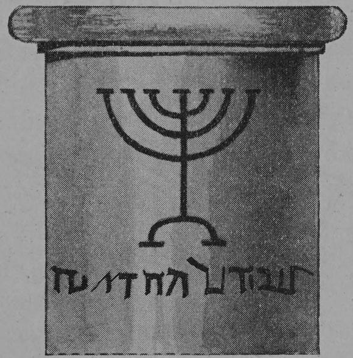

*Fig. 13. Säulenschaft einer galiläischen Synagoge.*

e) **Gebälk, Erker, Gesimse.** Am Tore der Tempelhalle befand sich ein Gebälk, gebildet aus fünf hölzernen Trämen, die je um 1 Elle vorragten; zwischen den Trämen gab es ein Feld (Metopon),das mit einer Steinplatte ausgefüllt war[^35.693]. Es sindwohl dieselben Balken gemeint, von denen es heißt, goldene Ketten wären daran befestigt gewesen, vielleicht stufenartig, auf denen die Priesterjünglinge aufsteigen und die Fensterverzierungen (עטרות) sehen konnten[^35.694]. Der Name עטרה[^35.695] entspricht ganz dem in demselben architektonischen Sinne angewandten *corona*[^35.696]. Hart daneben finden wir das Motiv der Triglyphen (פתוחים)[^35.697]. Während aber lat. *corona* das ganze Karnies oder Gesimse bedeutet, unterscheidet die Mišna das Gesimse, d. i. den ganzen Mauervorsprung,der dieEinförmigkeit der Mauer unterbrach und dieselbe gefällig gestaltete, als זיז[^35.698], und zwar ist dieser gitterartige Mauerschmuck derart eine selbständige Wand zu nennen, daß er, wenn er nur ein klein wenig hinausragt, bereits den darunter befindlichen Erdboden zum Hause einbezieht[^35.699], während der Balkon (hebr. גזרה[^35.700], gr. גזוזטרא = ἐξώστρα)[^35.701] und ein etwas verschieden gestalteter Erker (גבלית)[^35.702] von der Mauer 1 Tefach weit abstehen. Das Karnies (זיז), lehrt ferner die Mišna, ist etwas, das sich nach unten wölbt, d. h. die Offnung nach unten hat, während der Balkon, wie doch natürlich, die Ausbuchtung nach oben hat. Ein Karnies über der Türe, deren Rahmen ohnedies von der Fläche der Wand hervorragt, hat etwas weiter auszuladen; ein solches über dem Fenster soll von diesem mindestens zwei Finger hoch abstehen[^35.703]. Sowohl nach der Straße als nach dem Hofe hin gebaut[^35.704], befanden sich auch zwei Balkons in demselben Geschoß[^35.705] oder in zwei Geschossen übereinander[^35.706]; ebenso das Gesimse in mehreren Reihen[^35.707], über das ganze Haus laufend[^35.708], und zwar so fest gebaut, daß es auch für sich, ohne die Wand, stehen konnte[^35.709]. Balkons und Gesimse waren mit einem Estrich versehen[^35.710], auch war über der Türe eine Rinne (קנה) angebracht[^35.711], wohl zum Abfluß des Regenwassers dienend. In den Hof des Nachbars durften Gesimse und Balkons nur 1 Tefach weit hineinragen, mehr konnte auf Einspruch des Nachbars stoßen; aber ein schon bestehendes Gesimse von 1 Tefach konnte nicht beanstandet werden[^35.712]. In Jerusalem durften Gesimse und Balkons nicht auf die Straße hinausgeführt werden[^35.713]. In der babylonischen Stadt Machuza traf es sich einmal, daß ein in der engen Gasse getragenes irdenes Weinfaß sich an dem Gesimse zerschlug[^35.714]. Mit stillschweigender Genehmigung sämtlicher Passanten des betreffenden Gäßchens (מבוי) konnten füglich Gesimse und Balkons hinausgeführt werden, nicht aber auf die eigentliche Straße[^35.715]. Eine Art Balkon auf der Scheidemauer von Höfen, etwa in Form eines Vorsprungs, hieß חוות, d. i. Ausblick, die Stelle, von welcher man, wenn das Haus im Fonde des Hofes liegt, doch auf die Straße blicken konnte[^35.716].

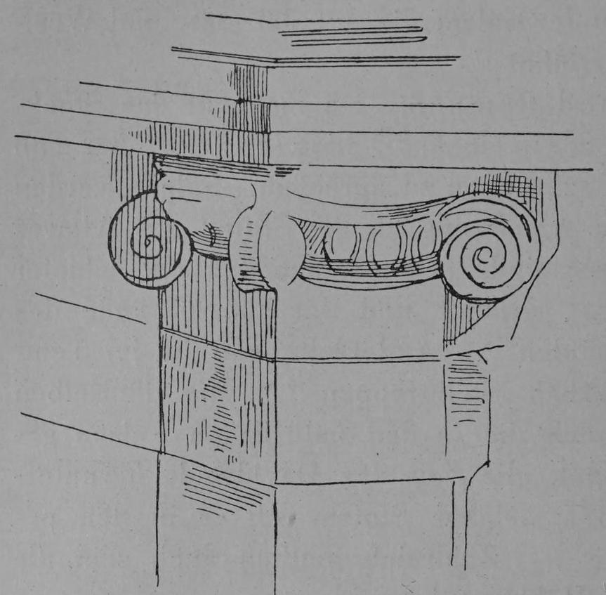

*Fig. 14. Antenkapitell in Nebi-Soffa. (Libanon).*

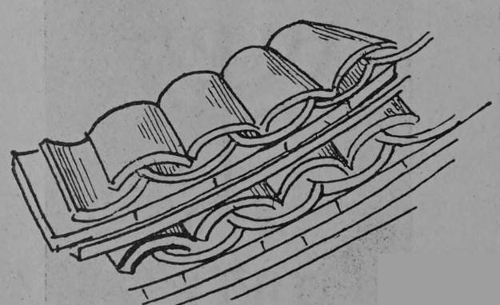

 

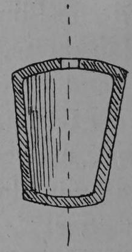

*Fig. 15. Gewölbtöpfe. Athos. Syrien.*

f) Gewölbbauten (כִּפָּה) s. o. S. 27.

g) Triklinium s. o. S. 49.

h) **Burg** (בירה)[^35.717], ein großer starker Bau, mit mehreren Wohnhäusern und einem besonderen Hauptmann. In Rom soll es 365 solche Burgen (בירניות) gegeben haben und zwar jede Burg mit 365 Stufen[^35.717].

i) Das persische אפדן[^35.718] (**Palast**) hat im Leben der Juden für bei weitem mindere Bauten den Namen hergeben müssen und bezeichnete wahrscheinlich mehr einen Zeltbau[^35.719]. Dagegen ist טרכונא ein wirkliches Schloß[^35.720].

k) Der griechisch-römische Palastbau (פלטין = παλάτιον = *palatium* und פלטורין = πραιτώριον = *praetorium*) wurde von den Juden immer als etwas Fremdes empfunden, und man spricht darüber in dem Bewußtsein, daß er nur den Königen und Fürsten eigne[^35.721].

l) Festung s. bei „Handel“.

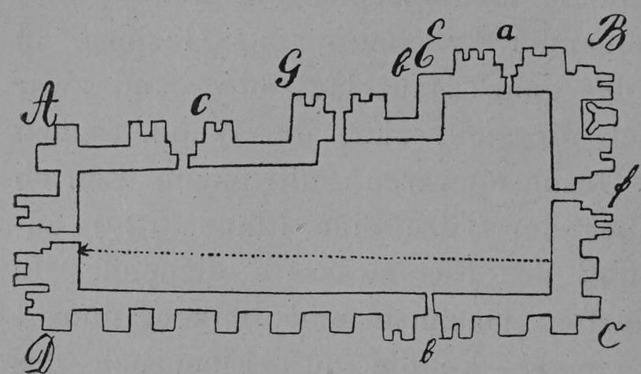

*Fig. 16. Grundriß einer assyr. Festung.*

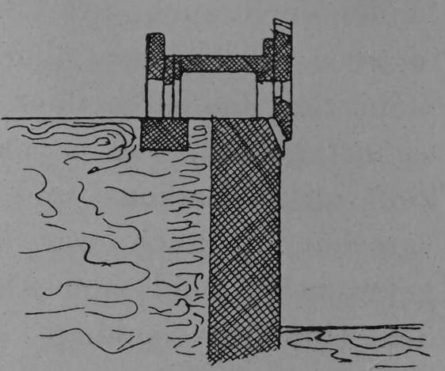

*Fig. 17. Zinnenplattform.*

[^35.674]: Vgl. die Definition des „verwahrten“ Hofes (S. 45) jMaʿas 3,6, 50ᵈ₁₀ R Ismael: כל שהשומר יושב על פתחו ומשמר. Der θυρωρός oder *ostiarius*, auch *janitor* der Griechen und Römer saß ebenfalls in der *cella ostiaria* beim Tore; in Landhöfen der *vilicus* (Varro 1,13); *banwâb* der Araber. Erwähnt wird auch der שומר הפתח des Lehrhauses bBerakh 28ª; bJoma 35ᵇ. Etwa derart ist das בית שער des R Josua, in welchem vier andere Rabbinen sitzen und debattieren, TBerakh 4,16, 11₂₀, doch kann auch ein Privathaus gemeint sein. MBb 1,5 (7ᵇ) בית שער ודלת notwendig für den Hof; nach Raši sitzt der Wächter darum darin, um das neugierige Hineinschauen der Passanten zu verhindern; richtiger das Hineingehen. Die Gemara daselbst zwingt sich, mehrere Hoftore zu unterscheiden: ob einwärts oder auswärts, ob mit oder ohne Türe, diese mit פותחת (o.) oder nicht — kaum zur Sache gehörig. R Sim. b Gaml. in M ib. לא כל החצירות ראויות לבית שער nicht alle Höfe eignen sich, einen Torbau zu erhalten; dies wird ib. dahin erklärt, daß nur die der Straße zugewendeten Höfe ein Torgebäude erhalten; die andern Rabbinen meinen jedoch, daß bei großem Gedränge auch ein der Straße abgewendeter Hof als Passage dient und darum ein Torgebäude nötig hat. Es besteht der Unterschied des בית שער של יחיד und des בית שער של רבים jʿErub 8,1, 25ª₄₂ b 75ᵇ. — L 1,228ª hält das בית שער für einen Platz vor dem inneren Tore, wohl vom Stadttore ausgehend, aber es kann nur der Innenraum in dem Torgebäude selbst sein. Das ניצוץ-Tor des Tempels wird so geschildert: „Es bestand aus einer Art Exedra (wir sehen hier schon die Verbindung der Exedra mit dem Torgebäude, wie gleich zu erörtern sein wird), darüber mit einem Obergeschoß (עלייה), indem die Priester oben, die Leviten unten Wache hielten“ (MMidd 1,5), wo das Moment des Wachens sehr anschaulich ist. Vgl. αὔλειος θύρα; das θυρωρεῖον definiert Vitruv 6,7, 10 als den *locus inter duas januas*. Es pflegen in einer Reihe zu stehen בית שער, אכסדרא und מרפסת: MʿErub 8,4, MMaʿas 3,6, Sifre Dt 194 p. 110ᵇ, ib. 229 p. 116ª, MSota 8,3 (43ª) usw., immer als Typus von Baulichkeiten, die zum Wohnen untauglich sind. In MʾOhal 18,9 (10) בית שער ist nicht מדור גוי mit dessen Folgen; vgl. T 8,5, 608₃₇: Häuser, die in eine Exedra münden, und in einem der Häuser (= Zimmer) befindet sich eine Leiche; wenn man nun die Leiche über den Hof hinausführt, so sind das Torgebäude und die Häuser rein; wo aber nicht (d. h. sie wird über das Torgebäude hinausgeführt), ist das Torgebäude unrein und die Häuser sind rein. Aus dieser Beschreibung sieht man, daß בית שער und אכסדרא zusammengehören, u. z. so, daß sich das Torgebäude zur Straße zu in der Exedra fortsetzt, so daß die Exedra noch zum Portal gerechnet werden kann (w. u.). Vgl. RDK zu I Kön 6,3 bh. אולם ist dasselbe, was die Rabbinen בית שער nennen. Daß מרפסת zu diesen vornehmen Bauten zählt (abgesehen von der Gleichheit, daß es wie jene keine Wohnung ist), rührt daher, daß es nur im Stockwerke (o. דיוטא) notwendig war, also fremden Ursprungs ist. Vgl. אנפילין *ἐμπυλεών Lwr 2,74.
[^35.675]: s. Pape-Benseler Wb³ s. v. ἐξέδρα, wo genau zwischen der gr. ἐξέδρα (ein bedeckter Gang **vor dem Hause**, dasselbe wie παστάς) und der röm. *exedra* (ein Gesellschaftszimmer, Gemach überhaupt), unterschieden wird. Ersteres in Ägypten (s. MASPERO-STEINDORFF Kunstg. S. 10; C. WESSELY, Karanis und Soknopaiou-Nesos S. 3) und bei den Juden in all den Fällen, wo אכסדרא mit בית שער zusammensteht (s. die Stellen A. 674), besonders TʿErub 8,5 147₁₉ א׳ על פתחו (ib. l. שמגופפת s. o.), ferner א׳ שיש לה פצימין bʿErub 93ª, 95ª s. o. und Trg Jud 3,23, wo LXX προστάς hat (vgl. Lwr 2,484 und A. ROSENZWEIG S. 60 A. 10). Sehr gut Maim. zu MʾOhal 6,2 إمام البيوت span. *portal*. Demnach מסדרונה Jud 3,23 in Gen R 98,3 richtig erklärt ערפלא טורא, natürlich תרע פלטורין zu lesen (PERLES Et. St. S. 13; BACHER, Ag. d. pal. Am. 3,256). Auf einer palmyr. Inschrift bezeichnet א׳ die Vorhalle einer Grabkammer (ZA 9,264 f., SCHÜRER, Gesch. d. j. Volkes im Zeitalter J. Chr. 2³, 48). So auch bMenach 29ᵇ א׳ תבנית אולם. — Die Römer jedoch dehnten den Begriff Exedra überhaupt auf jedes Gemach, auch auf ein bedecktes, aus, wenn es nur im Punkte der halbrunden Sitze jenen andern gleich war. Vgl. BECKER-GÖLL, Gallus 2,272; MARQUARDT, Privatleben S. 249 A. 6. In diesem Sinne א׳ רומיתא, א׳ דבי רב bBb 11ᵇ, wie schon Lwr 2,45 bemerkt ist; doch ist dort nicht alles richtig. bBerakh 10ᵇ מעולה שבבתים! Die Gruppe 5 Lwr ib., א׳ בבקעה bSukka 18ᵇ, אכסדראות של עץ opp. של בנין bTamid 28ᵇ usw. fügt sich nicht gut in den bekannten Begriff von Exedra.
[^35.676]: MʿErub 8,10 החצר והא׳. TʾOhal 8,5, 605₃₇ בתים הפתוחין לאכסדרה. In dem Satze עולם לא׳ הוא דומה (bBb 25ᵇ) bemerkt Raši, sie habe keine vierte Wand; nämlich zwei Längswände, und eine, womit sie mit dem Hofe zusammenhängt. bPesach 8ª die א׳ hat eigenes Licht. Unterbrochene Wände: folgt aus TʾOhal 15,5, 612₃₄. Besonders aber חצר גדולה שמוקפת עמודים TSukka 1,8, 192₂₄, M 1,11, MʾOhaloth 14,4, offenbar ein mit Exedra umgebener Hof. Eine solche Exedra in בית שריי (?בית שערים) hatte 6, nach andern 8 Säulen (jʿErub 1,1, 18ᶜ₁₂; die Differenz rührt daher, daß außen (בריית) zwei Säulen standen, die man zuzählen kann und auch nicht). Ib. רבים בוקעין בה. Ib. א׳ שנפרצה למלואה. MʾOhal 11,1. 2. Deutlich TBm 11,13, 395₃₄ מי שיש לו א׳ לפנים מביתו. jBb 1,7, 13ª₂₄ בא׳ [מתחלקת] לפי אדם Aufteilung auf die gemeinsamen Besitzer im Hofe. Raši zu bSukka 17ª (auch in Machzor Vitry 402): „Vergleichbar ist das **Kloster** der Christen, wo es einen mit Gras bewachsenen Hofraum gibt mit Einrahmung einer Exedra“.
[^35.677]: MTamid 1,3. Die Einwendung der Gemara (28ᵇ) wegen לא תטע לך אשרה Deut 16,21 (vgl. Sifre Dt 145 p. 103ᵇ) ist nicht recht verständlich, da die Mišna offenbar von vornherein אכסדראות של בנין meint, wie jede Exedra. Es scheint jedoch, daß die Gemara davon ausging, daß die E. oben ein Gebälke trägt, wie in der Tat das Atrium und der Peristyl der Römer und Griechen, und das sei wegen jenes Verbotes nicht statthaft (vgl. Sifre לנוטע אילן ובונה כו׳), vgl. E. mit Gebälke bBerakh 10ᵇ. Darauf Antwort בא׳ של בנין (nota bene: nicht של אבן opp. zu של עץ), d. i. diese E. gehört zum Bau selbst, steht nicht frei. Das ist freilich nur erraten; Tatsache wird sein, daß der herodianische Tempel auch in diesem Detail griechischen Musters war und sich nicht an die Halakha kehrte.
[^35.678]: Mekh zu Exod 20,26 עשה כבש למזבח, in Mekh RSbJ p. 116 gut beschrieben: שלא יעשה לו מעלות אלא בונין כבש כמו תל בדרומו של מזבח מתמעט ויורד מראש המזבח עד הארץ. MMidd 5,1 (2). Ib. 3,4 אבני הכבש. bZebach 62ªᵇ, ib. 63ª der Bau, jʿErub 7,1, 24ᵇ₇₃ כיבושו של מזבח. Man läuft darauf: MJoma 2,1, T 1,12, 181₁₈; Bar bJoma 23ª מעלות האולם. Ohne מעקה: Sifre Dt 229 p. 116ª, gefährlich ib. 279 p. 123ᵇ. Das Ausgleiten wurde verhütet, indem man Salzkörner ausstreute MʿErub 10,12. Auch die Schiffsbrücke heißt כבש (MSabb 16,8, vgl. schon II Chr 9,18 Fußschemel des Thrones, √כבש niedertreten, daneben מעלות), d. i. ein schiefes Brett, vgl. MZabim 3,3 neben קורה und דלת. Der כבש für das Befördern der Roten Kuh hatte eine eigene Konstruktion: MPara 3,5, bestritten T 3,7, 632₁₅, vgl. jŠekal 4,1, 48ª.[678] Mekh ed. H. ib. bestimmt ferner, daß für היכל und עזרות Stufen (מעלות) erlaubt waren. Vgl. Ezech 40,22. 34, besonders 43,17 Stufen des Vorhofes. Auch die 15 שיר המעלות-Psalmen sollen darauf weisen (FR. DELITZSCH, Gesch. d. j. Poesie S. 193 f., Komm. ü. d. Ps.⁴ 780 ff., JACOB ZATW 16,169, folgt aber nicht aus MMidd 2,5, weil dort die Stufen das posterius, die Pss. das prius). Aus dem Vorhofe der Frauen stieg man auf 15 Stufen in die עזרת ישראל, MMidd 2,5 (zu תרומות usw. s. o.), in Form des Durchschnitts einer Tenne, d. i. amphitheatralisch (ib.). Von einer Wand eingefaßt: TPara 3,4, 632₁ זיזין וכתלין jŠekal 4,3, 48ª₄₈. Auch eine Wendeltreppe wird erwähnt (מסבה Stellen s. bei L 3,163 u. K 5,183); nach STADE soll es im Orient keine Wendeltreppen geben; s. jedoch HORA, Die hebr. Bauweise S. 46. Der Aufstieg auf die babyl. Terrassentürme geschah entweder durch Rampen oder Treppen, s. FR. H. WEISSBACH, Das Stadtbild von Babylon (Der Alte Orient 5. Jg. Heft 4, Lpz. 1904, S. 23 f.).
[^35.679]: S. bibl. Wtrbr. s. v. מעלה. ZDPV 3,204; 5,295. Eine niedrige Treppe (מעלה), bestehend aus drei in einen Stein gehauenen Stufen, vor der Lampe im Tempel: Sifre Num 59. 60 p. 16ª, bMenach 29ª. Zu anderen Lampen stieg man mittels Leitern (סולמות) hinauf: MSukka 5,2, j 55ᵇ₄₈ mit einem Gesetze der Statik.
[^35.680]: bʿErub 22ᵇ מעלות ומורדות שבא״י. Zu סולמה של צור (NEUB, Géogr. 39) סולמא דפרת bSukka 53ᵇ vgl. § 210.
[^35.681]: Oben S. 35. Die Treppen zur Höhle in Taanek beschreibt SELLIN (Nachlese Tell Taanek, Denkschriften Akad. Wien 1906, Bd. 52, S. 10).
[^35.682]: עמוד שהוא עומד בתוך הבית TʾOhal 5,5, 602₁₉, ib. 7,12, 605₅, vgl. jSabb 5,1, 7ᵇ₃₀. T ib. 13,9, 611₃ עמוד שהוא מוטל באויר, M 12,7 לאויר, d. i. eine zu Boden geworfene Säule, s. RŠ. Säulen in Jerusalem: Pesikta R c. 26 p. 130ᵇ, כלונסות = *columnas* s. Lwr 2,288.
[^35.683]: Exod R 15,22 אדם רואה עמוד נאה אומר ברוך המחצב שנחצב ממנו.
[^35.684]: שתי חליות של ע׳ TKel bk 5,3, 574₂₄. jSukka 1,1, 51ᵈ₃₂.
[^35.685]: MʾOhal 12,7 T 13,9, 611₄.
[^35.686]: Cant R 5,15 לעמוד זה שיש לו בסיס מלמטן וקיפלורסים מלמעלן; das Fremdwort (= κεφαλίδος od. κεφαλίδας acc. pl.) lautet קיפלוס = κεφαλίς Lev R 25,8, s. noch Num R 10,1, Tanch Behar 1, Tanch B. ib. 2 (Lwr 2,538). Hohe Säulen, Wände, Balken im Palaste s. Gen R 12,1.
[^35.687]: פרחי העמודים bMenach 28ᵇ, s. D. HOFFMANN in Magazin 20,147; פרח auch in Esth R 2,7; MʾOhal 6,7, T 7,12, 605₇. Die Teile wurden nachträglich aufgesetzt. An einer in Jerusalem gefundenen Säule sieht man noch das Loch für viereckige eiserne Bindedollen ZDPV 10,50.
[^35.698]: Vgl. MʾOhal 6,7, T 7,12 und והצר שלו T ib. 13,9,611₉.
[^35.689]: Folgt aus der Metapher עמוד הימיני bBerakh 28ᵇ.
[^35.690]: Lwr 2,345. Auch die Architrave auf den Säulen haben den gr. Namen פיסטולוות τὰ ἐπιστύλια, Lwr 2,450.
[^35.691]: Vgl. מציבות של שיש Mekh RSbJ zu Exod 22,5 p. 141, vgl. Mekh ed. Friedm. p. 90ᵇ u. s. A. 226. Zu עמודי שיש Esth 2,7 bemerkt ein Lehrer (Esth R z. St.), daß es dem Achašveroš leichter fiel, goldene und silberne Säulen zu errichten, als prokonnesischen (פרקאונסין Lwr 2,495ᵇ) Marmor nach Medien zu bringen. Vgl. A. 165.
[^35.692]: Gen R 33,11 עמודים מוזהבין בפס(י)[ט]ין; jSabb 5,1, 7ᵇ₂₉ מתלה, TKel bm 11,10, 590₄ סדינין und כסנין, bʿErub 86ᵇ פרס סדין על העמודים in Pesikta 74ª ist nicht פרס, sondern כרך gebraucht: עמודים של שיש מכורכין בקיטיות (s. Lwr 2,528 קיטא = κοιτή). So wahrscheinlich zu verstehen auch TKel bm 2,3, 579₃₉ שלשת דוסיקאות ... של קופלאות, wenn ק׳ = κεφαλίς, also große Packsäcke, die man mittels Stricken über die Kapitäle zog.
[^35.693]: MMidd 3,7 ה׳ מלתראות של מילה (o.); der untere Architrav ragte an der Breitseite der Türe um eine Elle vor; der nun folgende überragte diesen von beiden Seiten um eine Elle, und so alle fünf, so daß der oberste Architrav (da die Türe zehn Ellen breit war — so in Ms Kfm, ed. Neapel und ed. Lowe, während Agg. Höhe 20, Breite 40 —) 30 Ellen breit war. Zu מלתראות = μέλαθρον s. Lwr 2,342; Maim. מקרנין, zu MʿErub 1,1 מקרנץ, nach K 1,118 = [?]. Die Höhe des Frieses war wohl die der Tempelmauer überhaupt. So vom Fries ist מ׳ zu verstehen auch jNazir 7,3, 56ᶜ₅₃, wo die Dicke in Betracht kommt. — Hier sei erwähnt die מוקסין (מרקסין) genannte Baulichkeit im Tempel, worüber nichts Sicheres gesagt werden kann, s. Lwr 2,274 f., ROSENZWEIG S. 29 A. 1.
[^35.694]: MMidd 3,8 עטרות. Tosafoth Gitt 7ª zitieren die gaon. Erklärung: כעין כיפות מוזהבות שעושין בחלונות.
[^35.695]: MʾOhal 14,1; T 14,10, 617₉ s. Hai u. Maim.
[^35.696]: Abbildung des ganzen Karniesses oder Gesimses s. bei RICH s. v. *corona*, darüber liegt die *sima* (= *recta*), darunter das *cymatium* d. i. Kehlleisten. Vitruv 2,8, 17 *projectura coronarum*.
[^35.697]: MʾOhal 14,1, T 14,10, 612₉ הפתוחין l. הפתחין, ib. noch ציורין Ornamente überhaupt. Maim. bemerkt richtig, daß man diese Zierstücke zumeist in Stein- u. Gipsbauten anwende. פתוחים schon Ps. 74,7. Es entspricht selbst im Worte den gr. Triglyphen, d. i. Hohlkehlen auf dem Fries, parallel zu der *corona*, mit Einschnitten oder sogenannten *guttae*, Tropfen. פתוחים jAz 3,11, 43ᵇ₅₁.
[^35.698]: Ursprüngliche Form חיזין (vgl. חות aus חוות A. 567), zusammenhängend mit חיזין קלים, das aber nicht von חזא sehen, schimmern, abzuleiten ist, sondern die zerrissene, gespaltene Wolke bedeutet (vgl. חצץ, חציצה), s. die Stellen bei L Trg Wb 1,247. Von gleicher Art ist חזיתא u. חזית (ib.) = Flechte an der Haut. Die alte Form חיזין ist noch erhalten in TʾOhal 13,11, 611₁₄. Trg setzt זיזא unrichtig für יציע I Kön 6,5. 6. Vgl. Raši ib. 7,5 für מחזה. Hauptsächlich an großen Gebäuden angebracht, wie an בירה גדולה bBb 6ᵇ oben, vgl. MʾOhal 14,4.
[^35.699]: MʾOhal 14,1 הזיז מביא את הטומאה כל שהוא, dagegen הגזרה והגבלית בפותח טפח.
[^35.700]: גזרה wie הגזרה והבנין Ezech 41,13, s. RN bei K 2,264 und Maim. zu MʾOhal 8,2 הזיזין והגזריות (ed. Neap. וגדריות, vgl. L 1,304 גדר = גזר), Varr. גזוזריות, גזיזריות bei K 2,270, Sing. הגזרה MʾOhal 14,1 (jŠebiʿith 3,5, 34ᶜ₇₃).
[^35.701]: Angesichts der Varr. ist doch immer fraglich, ob גזרה existiert, und nicht Verdolmetschung von גזוזריות, גזוזטריות, כסוסראות, כסוסטראות, כציצטראות usw. (Lwr 2,170. 293) = ἐξώστρα vorliegt? s. RN. Hai zu MZabim 4,1 arab. רושן; Maim. MMidd 2,8 דראבזין = درابزين = τραπέζιον = *balustrade, balcon*, DOZY 1,420; s. noch A. ROSENZWEIG S. 28 A. 2. Berühmt ist die casa del balcone pensile in Pompeji bei OVERBECK-MAU, Pomp.⁴ S. 267.
[^35.702]: גבלית (ms Kfm גיבלית) MʾOhal 14,1 (jŠebiʿith 3,5, 34ᶜ₇₄ גובלית l. גיבלית) TʾOhal 14,9, 612₈: Was ist גבלית (vorher steht גבלת)? Das, was von jeder Seite abgebogen ist (שמעקם l. mit Hai und RN המעוקם), aber belassen (משוייר) in der Mitte. Also eine erkerartige Böschung, wo nur der Boden in der Mitte plan und eben ist. Eben jener Umstand des Gebogenseins dürfte den Namen erklären: √גבל = bh. גבל in הגבלים I Kön 5,32, wofür THEN. und KLOSTERM. וַיַּגְבְּלוּם lesen: Fugenränder an den Steinen machen; vgl. bh. גבן buckelig, גבנונים usw. Doch kann man bei gutem Sinn für das Altertum an die Stadt גבל = Byblos denken, deren baulicher Charakter einem Detail des Ornaments den Namen gegeben haben kann, vgl. o. tyr. Fenster, tyr. Hof, tyr. Leiter usw.
[^35.703]: MʾOhal 14,4 זיז ··· ואוכל בפתח ג׳ אצבעות, dagegen beim Fenster ib. 14,2, T 14,7, 611₃₈, um nicht das Licht zu verstellen. MʿErub 10,4 זיז שלפני החלון, j 25ᵇ₃₄, T 11,5, 152₃₀.
[^35.704]: MʿErub 8,8.
[^35.705]: MSabb 11,2 שני גזוזטראות בדיוטי אחת
[^35.706]: MʿErub 7,4, j 25ᵇ₂₈ (hier זו על גב זו deutlicher als זו כנגד זו in M und T 11,3, 152₂₆).
[^35.707]: MʾOhal 14,5, T 13,11, 611₁₄, ib. 14,2, 612₂.
[^35.708]: MʾOhal 14,4 סובב כל הבית.
[^35.709]: TKel bk 5,3, 574₂₈.
[^35.710]: מעזיבה MʾOhal 8,2.
[^35.711]: MʾOhal 14,3 קנה, T 14,10, 612₁₀ שהקנה מטלטל, während זיז unbeweglich.
[^35.712]: MBb 3,8; T 2,17, 401₁₈ לקח חצר ובה זיזין וגזוזטראות ונפלו הרי זה בונה את מקומן (in j 3,10, 14ᵇ₃₈ ist es Ansicht des Reš Lakiš); b 59ᵇ gibt zu verstehen, daß das Gesimse erstens den Zweck hatte, darauf zu stehen (so erklärt sich der Estrich), zweitens Sachen darauf zu hängen, z. B. קדירה של בשר TʿErub 11,5, 152₃₀, da ist das זיז 4 T. bereit in der Höhe von 10 T. (über der Erde?), j 8 g. E., 25ᵇ₃₄ erwähnt ein Fenster zwischen Gesimse und Erde. Der Balkon dient zum Ausschauen (שהציצו עליו מתוך גזוזטרא Mekh RSbJ zu Exod 12,30 p. 24; fehlt in dem gewöhnl. Mekh.). Auch der Ofen hatte ein זיז MʾOhal 12,3.
[^35.713]: Bar bBk 82ᵇ אין מוציאין בה זיזין וגזוזטראות (in AbRN α 35 p. 104 noch ציורות vgl. קנה), als Grund gilt משום אהל טומאה, (so auch in TNeg 6,2, 625₁₆) doch auch (RNs LA bei K 3,286), damit die Festwallfahrer sich daran nicht anstoßen, also wegen Verhinderung der Passage. Nach MBb 3,8 in jeder Stadt verboten.
[^35.714]: bBm 83ª.
[^35.715]: bBb 60ª [תשובות הגאונים ed. J. MÜLLER No. 95].
[^35.716]: MBb 1,2: Ein ebenes Grundstück, das zweien gehört, an einem Orte, wo man keine Steinmauer zu ziehen pflegt: kann man ihn (den einen von beiden, wenn nämlich der eine will) nicht dazu verpflichten, aber jener kann die Mauer einwärts (auf dem ihm gehörigen Grund) aufführen, und den Ausblick (חזית) kann er nach außen (gegen des Nachbars Grundstück hin) anbringen. In T 1,22, 396₂₈ spricht man zuerst vom Dache des Hofes (d. i. wohl der Hofmauer) und dann: „Wenn einer dagegen protestiert, muß der betreffende den Ausblick zu sich wenden“ (הופך את החזית אצלו), dann, wie auch in M, „darum, wenn die Mauer einstürzt, gehören Holz und Steine ihm allein“. Man hatte also den חזית auf Feld- (M) und Hofmauern (T). Den Zweck ergibt das Wort selbst: auf dem Felde guckte man davon zur Überwachung des Grundstückes aus, vielleicht auch saß man zu bloßem Vergnügen darauf; im Hofe war dieser Vorsprung erst recht eine Ausblickstelle auf die Straße. Ich denke mir diese Sitzstelle in Form einer Zinnenplatte, die im Texte S. 56 abgebildet ist. Vgl. מחזה I Kön 7,5, das RN (K 3,355) schon heranzieht, jedoch ist sein פנים = Vorderseite nicht adäquat; חזית von חזה wie שבות, שבית von שבה, vgl. קרן חזות Dan 8,5, dort allerdings mit dem Nebenbegriff des Schönen, des Ansehnlichen (HOFFMANN, ZATW 3,95 f. liest חָזוּת = syr. ܚܙܬܐ) s. PSm 1236. L 2,29 (ebenso K) arab. حُزَّة Rand, J 444 חז = גז und zwar gerade die rauhe unschöne Seite — treffen kaum das Richtige.
[^35.717]: Bh. besonders in שושן הבירה (zur Etym. s. GES. Hwb.), in Jerusalem besonders von der Burg des Tempels oder vom Tempel selbst = βᾶρις des Josephus (s. H. LEWY, Sem. Frwr. im Gr. S. 96 f.). Auch in der Traditionsliteratur in erster Reihe vom Tempel selbst oder nach einer Ansicht von einem gewissen Bau im Tempel (jPesach 7,7, 35ª₅). Stellen bei L 1,222, K 2,57, J 165. Sonst hat das Wort nur ein kümmerliches Dasein: bBb 61ᵇ „wer seinem Genossen ein Wohnzimmer verkauft in einer großen Burg (בירה גדולה; es ist durchaus nicht nötig, בירה mit A. ROSENZWEIG S. 1 A. 1 für einen Gebäudekomplex zu erklären)“. Ib. „Manche nennen das Haus Haus und die Birah Birah, manche jedoch nennen auch die Birah ein Haus“. TSanh 10,3, 433₆ שדחאו מראש הבירה. Eine brennende Birah Gen R 39,1, wo ein מנהיג resp. בעל הבירה genannt wird. Ein איש הבירה im jer. Tempel MʾOrla 2,12. RAcha שר הבירה bJebam 45ª, s. M Zs Szemle 7,337 A. 5, wo das verglichen wird mit Hieronym. in Daniel. 8,2 *custos* sive *aedituus* ac *sacerdos* eiusdem loci Judaeus est. „Die Birah, auch wenn sie einstürzt, heißt noch immer Birah“ Pesikta 117ª, Jalk Jerem § 264. In Rom gab es Paläste, die ganzen Städten und Landgütern verglichen wurden, FRIEDL., Sitteng. 3⁵, 83. Rom s. ferner bPesach 118ᵇ. Des Scaurus Bühne hatte in der Tat gerade 360 Säulen, FRIEDL., Sitteng. 3⁵, 80. בירנית ist Weiterbildung von בירה, Trg בירנתא. Vgl. ברגין § 4. Die Ableitung von φρούριον (Lwr 2,146) ist nicht stichhaltig.
[^35.718]: Dan 11,45; pers. s. NÖLDEKE, ZDMG 29,433; FRAENKEL S. 27, GES. Hwb., mit zahlreichen Belegen im Syrischen und Arabischen. S. auch DIEULAFOY bei S. JAMPEL, Das Buch Esther, 1907, S. 143 f.
[^35.719]: Er stürzt zusammen bBerakh 56ª, von Ziegeln gebaut ib., wie in Babylonien nicht anders zu erwarten; er kommt in Bewegung schon durch eine Ölpresse! bBb 25ᵇ. Dennoch wurde er durch מקבלי קיבולת, d. i. durch Unternehmer (o.) gebaut, und zwar mit Verwendung von Stroh bMk 12ª. Der Verkauf wird erwähnt bKethub 97ª. תרבץ אפדני s. A. 647. Die *padanim* von Pumbeditha werden dem Miste von Matha Mĕchasja ebenso gegenübergestellt (bHoraj 12ª), wie בירה ebenfalls dem Miste (Pesikta 117ª).
[^35.720]: Siehe die pers. Ableitung bei Fl zu L Trg Wb 1,427ª. Abzuweisen טרבנא = *tribunal* P. CASSEL zu „Zweit. Targum“ S. 23.
[^35.721]: פלטין und פלטורין fallen im Jüdischen zusammen, s. Lwr 2,457. 455. Man ließ es sich etwas kosten, solche glänzende Gebäude zu sehen (jBerakh 1,1, 2ᵈ₇₀). Der Palast hat eine Türe (פתח Sifre Num 134, Dt 29, s. o.), MSanh 2,3; ein Tor (Exod R 15,22 שער פלטרין של אפרכוס, vielleicht תרע in Gen R 39,3, s. Lwr 2,456ᵇ u. o.). Auch פילון = πυλών Lwr 2,446. Wächter (נטרי פלטין Trg II Chr 34,9), vgl. שר הבירה. Lichter und Lampen (עטרה בנרות ופנסין Gen R 3,1).

## § 36

**36.** **Tünchen und Malen.** Nebst dem Mörtelbewurf hat man wohl in den meisten Fällen auch das Tünchen mit Kalk (סִיֵּד) angewendet[^36.722]. Es wurde dadurch den Innenwänden eine angenehme Glätte und schöne weiße Farbe gegeben, die jedoch durch Rauch sich allmählich verlor[^36.723], bis man die Tünche nicht erneuerte[^36.724]. Bei feinerer Ausführung wurde ein etwas dunklerer Stuck aufgetragen (כייר)[^36.725], worauf noch Malereien kamen (צִיֵּר)[^36.726]. Auch beim jerusalemischen Tempel, wo der Verputz klarer beschrieben wird, läßt er sich nicht als einfacher Kalk[^36.727], sondern nur als Stuck denken. Der Arbeiter für diese Arten Putz ist entweder der Kalkarbeiter (סַיָּד) oder der Maler (צַיָּר)[^36.728]. Davon unterscheidet sich eine Bemalung in schwarzen Farben (פִּיֵּחַ)[^36.729].

Ein rabbinisches Verbot untersagt „in dieser Zeit“, d. i. nach der Zerstörung des Tempels, all diese Arten von Verputz; also das Weißen (mit Kalk), Bekleiden mit Stuck und das Schwarzfärben; es sei denn, man habe den Hof (d. i. das Haus o. S. 45) bereits geweißt, gestuckt und schwarzgefärbt gekauft, wodann man es so belassen darf[^36.730]. Es ist bezeichnend, daß die Rabbinen selbst dieses Verbot für unausführbar hielten und in dem Sinne mäßigten, daß der Türe gegenüber auf der geweißten Wand eine kleine Stelle (eine Elle im Quadrat) zur Erinnerung an die Zerstörung des Tempels unverputzt gelassen werde[^36.731]. Man spricht aber dennoch, wie wir gesehen haben, viel von bemalten Häusern, entweder weil sich das Leben über diese Skrupel hinwegsetzte oder aber sie besseren Zeiten angehören. Man kannte auch Häuser, in denen die Wände mit Marmor oder sonstigem Stein verkleidet waren[^36.732].

[^36.722]: Ezech 13,10, Deut 27,4, s. dazu MSota 7,5 וסדוהו בסיד, b 35ᵇ, 36ª, j 21ᵈ. In T 8,7, 311₃ steht noch כייר vor סייד, doch sollte סייד als früher zu geschehende Handlung dem כייר vorangehen, wie in den übrigen weiter registrierten Stellen. bJebam 66ᵇ לסוד את ביתו (Haus eines ממזר) wird von HERFORD, The Christianity in Talmud and Midrash p. 46, falsch übersetzt: לסוד = founding, vgl. T 3,4, 243₂₈, wo auch לסוד את קברו. — Auch die Römer bekleideten Decken und Innenräume mit Putz (Vitruv 7,2—5), und zwar wandten sie außer dem Rauhbewurf noch einen Putz an, der aus drei Schichten feinaderigem Mörtel und aus drei Marmorstuckschichten (grobgestoßenem, mittelfeinem und feinem) bis zu einer Dicke von 7 bis 8 cm bestand (DURM² 222, vgl. BLÜMNER 2,147 ff.). Im Orient war nur das Tünchen oder Weißen gebräuchlich; der feinere Putz entstand unter griech.-röm. Einfluß. Weißen der Wände behufs Anbringen von Mauerinschriften (A. 207), s. BLÜMNER 3,180. Mennig (ששר) Jer 22,14, s. BENZ. 118, NOWACK 1,139.
[^36.723]: z. B. im Hause des R Josua ben Chananja bBerakh 28ª.
[^36.724]: Folgt aus TBb 1,6, 398₂₄. Das Heiligtum wurde einmal im Jahre, die Steine des Altars zweimal im Jahre frisch getüncht MMidd 3,4. Tünchen der Steine der Gräber MMk 1,1, MŠekal 1,1 s. § 133; vgl. Matth 23,27 τάφοι κεκονιασμένοι. Die Tätigkeit ממחה ושופך MMš 5,1; vgl. כשהסיד שפוך על ראשיהן ומרודה bMk 6ª.
[^36.725]: כייר wird von GES. Thes. mit כיר, כיריים Herd in Zusammenhang gebracht, s. auch L 2,323 von כור rund sein, was ganz abseits liegt. J. PERLES, Et. St. S. 59 von pers. *nigâridan* malen; N. BRÜLL, Jahrb. 1,214, aus zend. *âkar* zimmern, vgl. K 4,218. Aber כיר dürfte nur Erhärtung von גיר sein, wovon גיר Dan 5,5, nach LAGARDE (o. A. 225) = Stuck. Dieses גיר wird zu جار aufkochen, aufwallen, gestellt (s. FRAENKEL S. 9, GES. Hwb.), was nicht nur zum Löschen des Kalkes paßt, sondern auch zu dem mit Kalk angemachten Mörtel, der auf entsprechender Unterlage den Stuck bildet. Also (גייר von גור) כייר von כור, wie סייד von סוד (doch das Verb סוד auch im Kal, bh. und nh.). Agg. oft crr. כייד z. B. TBk 6,9, 354₃₄, s. jedoch RN aus bBk 51ª. RN bringt zu bBb 53ᵇ וסד בהן סיד א׳ או כייר אחד eine Erklärung, die des RG, wonach mit כייר ein Bemalen gemeint wäre, und so auch andere Erklärer, was unrichtig ist, da die Malerei erst auf den Stuck als weiterer Schmuck hinzukommt; doch ist beachtenswert, daß jene Erklärung den Stuck auch auf שמי קורה, d. i. auf der Decke sein läßt, und damit ist erklärlich, daß כייר, wenn auch in Holzvertäfelung, auch von der Decke gebraucht wird (Trg II Sam 7,2 כיורי ארזים, Trg Jerem 22,14, Haggai 1,4, Tw ספן). In diesem Sinne heißt es in Midr Tannaim zu Dt 3,26 p. 18 ed. Hoffm. אין ספן אלא מצוייר mit Hinweis auf Jerem 22,14. Das salomonische Heiligtum war mit Kalk geweißt, das serubabelsche soll selbst dieses Schmuckes entbehrt haben: bRh 4ª איהו לא כדייה בסידא.
[^36.726]: Thr R 4,11 betreffs des בית חופה Brautgemach: וכיירה (Agg. וסיידה) וסיידה וציירה, Gen R 28,6. Gedankenlos sind die dreierlei Verzierungen, und zwar in schlechter Reihenfolge, auch von einer Grube ausgesagt Mekh zu Exod 21,33 p. 88ª, in TBk 6,9, 354₃₄, Bar b 51ª, j 1,2, 2ᶜ₁₅ nur סייד und כייר. Diese beiden auch vom Götzentempel MAz 3,7 (47ᵇ), bBk 51ª. Substantiv סיד אחד או כיור א׳ bBb 53ᵇ. Num R 9,43 im Hause eines arabischen Königs.
[^36.727]: In den Quellen nämlich סיד ההיכל (und zwar an Weiße nächst dem Schnee, R Akiba gebraucht דיהא „blasser“ als Schnee) Sifra Lev 13,24 p. 61ᵇ, MNeg 1,1 (Terminus המהוך שבסיד Mischung im Kalke), ib. 7,2. Jedoch כיור MMidd 4,6. Vgl. דיהה מכאן ואפי׳ כבותל TNidda 3,11, 644₅.
[^36.728]: Der סייד (o.) entspricht in diesem Falle dem *albarius tector*, der auch die Stukkatur besorgte. In MKel 29,2 משקולת של ציירים Senkblei der Maler, doch nur möglich, wenn dieser auch Stuckarbeit tat, denn nur dann hat er das Senkblei nötig. Vgl. ib. 29,3 und TBb 2,9, 592₂₂ ציירות; sie hatten ihre Farben in einem Trog (עריבה). M ib. 24,13 סדין של צורות Mustertuch; so lies TKel bm 1,14, 579₂₇, st. סדינין לצורות. Infolge von gewissen traurigen Ereignissen, so scheint es, hat man sich (in Tiberias) eine Zeit hindurch vom Bemalen der Häuser zurückgehalten, bis es in RJochanans Tagen wieder aufkam jAz 3,3, 42ᵈ₃₅. בתים צבועים MNeg 11,3; T 5,2. 3, 623 צבועין בידי שמים wegen der andern Kategorien (בגדים, עורות) angenommen. BLÜMNER 4,439.
[^36.729]: פייח ist von פיח Ruß abzuleiten (K 6,306, J 1140); Bildung wie סייד u. כייר. Danach kann mit פייח nur schwarz malen gemeint sein. Varr. geradezu מפחמין von פחם Kohlen [Verballharnungen]. Zu erinnern an die lebhaften schwarzen Farben, mit denen besonders die unteren Felder der Wände in Pompeji (eigene Erfahrung) bemalt sind, eine Idee, worauf I. LÖW meine Aufmerksamkeit lenkte. — Bar bBb 69ᵇ מפייחין (ms M מפחמין, D. S. noch מפיחמין, המפייחמת), T 2,17, 401₁₈ מפייחין Var מפיחין. Vgl. TTerum 7,16, 38₂₁ von Triklinium (o.) מסוייד מפוי(ה)[ח] אפ׳, crr. מפית. — Gebäude des Götzenkultus sollen mit Ruß geschwärzt werden: מפחמין בפחמין jMš 5,1, 55ᵈ₄₀ T 5,13, 96₅, wo פחם unbedingt richtig; vgl. § 92.
[^36.730]: Bar bBb 60ᵇ, TBb 2,17, 401₁₈ (hier die richtigere Reihenfolge מסיידת, מפויחת, מכוירת).
[^36.731]: Ib. ib. TSota 15,12, 322₂₄. Noch heute vielfach befolgt.
[^36.732]: MNeg 12,2 שיש und סלע (kann hier nicht der natürliche Felsen sein); vgl. BLÜMNER 4,433 f. u. o. S. 36, wo bemerkt wurde, daß namentlich Grabkammern so geziert wurden. Die Malerei der alten Zeit in natura können wir heute nur in Gräbern sehen; außer den prachtvollen in Mareša (J. P. PETERS and H. THIERSCH Painted Tombs in the necropolis of Marissa, publ. by the Pal. Expl. Fund, London 1905) kennt man jedoch bis jetzt nur 3—4 bemalte Grabkammern (aufgezählt ib. p. 6), wobei es immer fraglich ist, ob es jüdische und nicht vielmehr heidnische Kunst sei. BLÜMNER 4,439.

## § 37

**37.** **Neue und alte Häuser.** Das Vollenden (שכלל)[^37.733] eines Baues war ebenso wie heute ein glückliches Ereignis, das man mit Dankspruch[^37.734] und Gastereien feierte. Das neue Haus (בית חדש)[^37.735] oder die neue Wohnung (דיור חדש) hat gegenüber dem alten Hause (בית ישן) oder der alten Wohnung (דיור ישן)[^37.736] manche Vorteile[^37.737]. Die Wände des alten Hauses spalten sich (סדק), neigen sich zur Seite (קיר נטוי, כותל משופע), ein Stein fällt nach dem anderen aus, so daß das ganze Haus schadhaft wird (בית מרוע) und schließlich einstürzt (נפל)[^37.738]. In einem Lande wie Palästina, wo man zum Teil in Felsen baute, ist es begreiflich, daß die Mauern Nässe ausließen[^37.739]. Erwähnenswert ist, daß nach rabbinischer Versicherung der in der Bibel stark erwähnte Häuseraussatz in Wirklichkeit nicht vorkam[^37.740].

[^37.733]: bSanh 38ª unten בנה פלטרין ושיכללן והתקין סעודה כו׳, T 8,9, 428₇ steht וחינכה והתקין ס׳, zum Mahle lädt er Gäste. Vgl. חנך Deut 20,5. Šeʾeltoth no. 1 Anfang des Werkes.
[^37.734]: MBerakh 9,3 (54ª) שהחיינו. Vgl. ZDPV 3,109 f.
[^37.735]: MBerakh 9,3.
[^37.736]: jʿErub 6,23ᵈ₃₉ בית ישן wird als דיור ישן restringiert. מפולת = Einsturz oft (z. B. M und bTaʿan 20ᵇ). bTaʿan 20ᵇ starke (בריאות) und schwache oder baufällige (רעועות) Häuser. Die Häuser stürzen ein, bald weil sie hoch sind, bald weil sie am Wasser stehen (ib.). Ein starker Wind setzt einmal den Häusern einer ganzen Stadt in Babylonien stark zu (ib.). Vgl. גודא רעיעא schadhafte Mauer (ib. 21ª). Vom Zelte wird gesagt, daß es durch Alter immer schwächer (רפי) werde (Gen R 12,13).
[^37.737]: Von neuen Häusern gilt der Nachteil, daß sie den Regen durchlassen (bSabb 43ª בתי חדתי דשכיחי דדלפי). Der Übelstand des Windzuges (דבריך זיקא ib. 129ª) wird in vielen Häusern gewesen sein.
[^37.738]: כותל שנסדק TʾOhal 7,5, 604₁₁. קיר נטוי (bh.) bRh 16ᵇ. כותל משופע bSabb 5ª. גודא jMakk 2,3, 31ᶜ₅₈. כותל הנוטה לרשות הרבים bMk 7ª. בית מרוע jSabb 2,3, 5ᵇ₂₅. Man sucht zu reparieren טמם ולא תשפיץ שפיץ ולא תיבני bJebam 63ª (Raši hat mehr, vgl. bMeg 4ª und s. K 8,139 und o. A. 261). bʿArakh 30ᵇ אידחה אבן אחר הנופל. bTaʿan 20ᵇ כל אשיתא דהות רעיעתא הוה סתר לה. Niederreißen auch קרקר? jMeg 1,70ᶜ₂₀ s. L 4,391ᵇ. Sprichwörtliche Redensart נפל ביתא אבל לכוותא Mekh zu Exod 17,3 p. 52ª (אבל = חבל in Mekh RSbJ z. St. p. 80, dieser = חבל Exod R 26, in Jalk וי לה dem Sinne nach) „ist das Haus im Stürzen, weh dem Fenster“! Es scheint, daß man bei Hauseinsturz wie bei Schiffsbruch die alte Trauersitte des Glatzescherens beobachtete: Midr Tannaim zu Dt 14,1 p. 72 Hoffmann יצא הקורה על ... [ביתו] שנפל ועל ספינתו שטבעה.
[^37.739]: MMakhš 2,1 זיעת בתים בורות שיחין ומערות. Der „Schweiß“ kommt manchmal vom Teiche (בריכה ib. 2, Haus und Teich konnten nämlich eine Felswand gemeinsam haben). Vgl. jBb 1,1, 13ᵇ₂₆ סלעים מרתיחין. Sifra zu Lev 16,1 p. 79ᵈ: Trinke nicht Kaltes und schlafe nicht in טחב, zitiert auch von Raši z. St. (L 2,149 Feuchtigkeit); S. D. Luzzatto z. St. zitiert aus Raši ms: כל מקום מיקר ומוציא זיעה כגון מחילה שתחת הקרקע מוקפת גדר של אבנים הוא נקרא תחב (so תחב, vorher טחב).
[^37.740]: TNeg 6,1, 625₄ בית המנוגע לא היה ולא עתיד להיות, bSanh 71ª. Ausnahmen wären im Gebiete von Gaza ein Ort namens חורבתה סגירתא (s. Trg zu צרעת), und in Galiläa wäre ein Ort besonders gekennzeichnet worden (מציינין wie bei Gräbern), weil davon die Meinung ging, er sei von Aussatzsteinen erbaut (T ib.). Theoretisch freilich TBk 10,3, 366₂₈ ib. Z. 31 גזל ... בית ונתנגע. Vgl. bBerakh 5ᵇ הא לן והא לחו.

## § 38

**38.** **Verkauf und Miete.** Schon in der Bibel (Lev. 25,29 usw.) ist die Rede vom Hausverkauf, zugleich mit den Unterschieden, die aus der Lage des Verkaufsobjekts in mit Mauern umgebenen Städten oder in offenen Städten resultieren. In späterer Zeit, bei zunehmender Bevölkerung und komplizierten Lebensverhältnissen, müssen Kauf, Verkauf, Mieten und Vermieten von Wohnhäusern nur noch mehr überhand genommen haben. Die Rechtsformen, die hierbei beobachtet wurden, entsprechen denen, die auch sonst im Leben derselben Menschen herrschend waren, und so lassen wir die rechtliche Seite der Sache außer acht und weisen nur auf diejenigen Gepflogenheiten hin, die auf die Wohnungsverhältnisse ein Licht werfen[^38.741].

Kaufobjekte waren sowohl Bauplätze und ganze Grundstücke mit den darauf befindlichen Gebäuden und Immobilien[^38.742], als auch einzelne Teile des Hauses, und wir haben namentlich gesehen, daß Ober- und Unterstock Eigentum verschiedener Parteien und der Hof einer ganzen Anzahl von Personen gehören konnte (o. S. 45). Beim Aufbau solcher Häuser mußten alle Besitzer zu der Beschaffung der Materialien beisteuern[^38.743], größere Veränderungen an bereits vorhandenen Gebäuden konnten nur mit Bewilligung aller Besitzer vorgenommen werden[^38.744]. Auf Wunsch sämtlicher Besitzer konnten auch lästige Bewohner, wie Schneider und Gerber, deren Gewerbe die anderen stören mochte, entfernt werden[^38.745].

Man mietete in rabbinischer Zeit[^38.746] ein Haus oder den einzelnen Wohnraum auf Monate oder auf ein Jahr[^38.747], und zwar ziemlich teuer[^38.748]. Man achtete auf klaren Vertrag[^38.749]; wenn nichts abgemacht war, dauerte die Miete über die ganze Regenzeit, d. i. von Sukkoth bis Pesach, und nur im Sommer konnte gegenseitig 30 Tage vorher gekündigt (הודיע) werden[^38.750]; in Städten mußte 12 Monate vorher gekündigt werden. Das Mietsverhältnis (שכירות) begann zumeist am 1. Nisan, d. i. am Anfange des jüdischen bürgerlichen Jahres, und dauerte demzufolge ein Jahr; man mietete aber auch auf ein halbes Jahr und, wie gesagt, auf Monate[^38.751]. Die Zahlung erfolgte nachträglich[^38.752]. Der Vermieter (משכיר) mußte vor der Übergabe die sich etwa als notwendig erweisenden Reparaturen vornehmen[^38.753]; dagegen mußte auch der Mieter (שוכר) die Wohnung schonen und durfte darin nichts unternehmen, was das Haus gefährdete[^38.754]. Den Umzug hielt man mit Recht für materiell und physisch nachteilig; man sagte: Der Umzug von Haus zu Haus ruiniert einen bis aufs Hemd, der Umzug von Ort zu Ort kostet das Leben[^38.755].

[^38.741]: Die Rechtsverhältnisse s. in der Kodizes: Maimûni ה׳ שכירות Abschnitt 5 f. Tur Chošen Mišpat, § 312—317, Šulchau ʿAruch desgleichen s. Komm. Ferner MICHAELIS Mosaisches Recht 2 § 73 f. SAALSCHÜTZ, Das Mos. Recht Kap. 110 S. 839—841. Mehreres auch bei A. ROSENZWEIG, Wohnhaus S. 70 ff.
[^38.742]: Deren Aufzählung s. o. Trotz des aufgesetzten Kaufbriefes, worin die Worte עומקא ורומא vorkamen (MBb 4,2, T 3,1, 401₃₀, b 63ᵇ, j 4,2, 14ᶜ₂₈), mußte manches doch strittig sein; interessant ist auch die Kontroverse der Rabbinen, ob der Käufer sich zu seinem Wohnungsteil einen separaten Zugang kaufen müsse (M ib.). Kompagnons und Frau als Besitzer: TNeg 6,3, 625₁₇ (dieses בית האשה wurde von A. ROSENZWEIG S. 65 A. mißverstanden). Bei von Heiden gekauften Häusern wurde der Kaufbrief im öffentlichen Archiv (ἀρχεῖον) niedergelegt: TAz 1,8, 461₄, Bar bMk 11ª, Bar bGitt 44ª, s. § 218. Aus Zeiten, wo es als Errungenschaft galt, wenn ein Jude sich den Besitz eines Hauses sicherte, mag stammen der befremdliche Satz הלוקח בית בארץ ישראל כותבין עליו אונו אפי׳ בשבת bBk 80ᵇ. Nach einer allerdings nur theoretischen Bestimmung durften in Jerusalem nur die Häuser, nicht die Grundstücke, auf denen sie standen, verkauft werden (dies dürfte der Sinn sein von אין מוכרין בה בתים אלא מן הקרקעות ולמעלה AbRN α c. 35 p. 104).
[^38.743]: MBm 10,1.
[^38.744]: TBm 11,2, 394₂₅, b 117ᵇ.
[^38.745]: TBm 11,16, 396₉ (vgl. TBb 1,4, 398₁₄) כופין בני מבוי usw. Bewohner desselben Gäßchens, in welchem mehrere Höfe liegen; die in demselben Hof Wohnenden konnten wahrscheinlich denselben Boykott üben.
[^38.746]: Daß es in biblischer Zeit keine Hausmieter gab, wie NOWACK 1,138 apodiktisch sagt (vgl. auch A. ROSENZWEIG S. 71 A. 9), liegt gewiß an der Einfachheit der damaligen Lebensverhältnisse; doch kann das Schweigen der Quellen ein zufälliges sein. In Jerusalem sollten keine Häuser vermietet werden im Hinblick auf die den Festwallfahrern zu gewährende Unterkunft TMš 1,12, 87₉ (vgl. bJoma 12ª); interessant ist ib. der Zusatz אף לא המטות, demnach wurden schon damals einzelne Lagerstätten vermietet! Von Heiden wurden anstandslos Häuser gemietet: TAz 2,8, 462 f., bʿErub 62ª. Kauf und Miete von Häusern in Ägypten s. C. WESSELY, Karanis und Soknop.-Nesos S. 19 Alinea 2.
[^38.747]: MBm 8,10 המשכיר לשבת, ib. לחדשים.
[^38.748]: MBm 5,3 als Beispiel, das wohl dem Leben entnommen ist, בעשר סלעים לשנה um 10 Golddenare das Jahr; in T 8,31, 390₂₈ sind 12 זהובים angenommen.
[^38.749]: שכירות בריאה opp. ש׳ רעועה bʿErub 62ª.
[^38.750]: MBm 8,8; ib. von Städten (כרכין), Bar b 101ᵇ, T 8,27, 390₉ (wo der Ausdruck ידיענו und das Räumen לפנות, u. z. ausdrücklich als Pflicht resp. Recht beider, d. i. des שוכר u. משכיר). M u. T bestimmen ferner die Miete von Läden, Bäckereien und Färbereien; MBm 8,10 die des Bades, T auch der Kelter, der Presse usw., s. in den betreffenden Abschnitten.
[^38.751]: TRh 1,1 208₂₇ ויש אומרים אף לשכר בתים, ib. 5, 209₇ מונה שנים עשר חדש מיום ליום. In Mekh zu Exod 12,2 p. 2 sind es R Natan und R Isaak, nach denen Nisan der Jahresbeginn ist אף לשכירות בתים; in Mekh RSbJ p. 7 ist das als gültige Regel hingestellt. — Halbes Jahr s. MŠebiʿith 9,7 u. vgl. MBm 8,8, T 8,27, j 11ᵈ.
[^38.752]: jBm 8,10, 11ᵈ₃₂ implicite.
[^38.753]: MBm 8,9 „der Vermieter stellt bei die Türe, Schrägbalken und Querbalken und jede Sache, die die Arbeit eines Professionisten ist (sonstige Arbeiten soll der Mieter selber besorgen); Bar b 101ᵇ erwähnt die Türen, die Fenster, Ausbesserung des Gebälkes (Raši: wenn nämlich die Bretter wurmstichig geworden), Stützung des Tragbalkens; dagegen obliegt es dem Vermieter zu sorgen für die Leiter (auf der man vom Hofe in das Obergeschoß steigt), für die Galerie (מעקה, s. o., u. z. auf dem Obergeschoß und auf dem Korridor), für die Dachrinne und für das Verkleben des Daches (o.). M. ib. T 8,29 wem der angesammelte Dünger gehört.
[^38.754]: TBm 8,30, 390₂₅. Anders ist es, wenn das Gebäude von Anfang an zu irgendeinem Laden, einer Industrie oder zur Ökonomie eingerichtet ist (ib.).
[^38.755]: Gen R 39,15. Vgl. MKethub 13,10, wonach der Gatte von der Frau nicht fordern könne, daß sie ihm aus der Stadt in das Dorf folge, während nach einer Ansicht selbst der Umzug in eine bessere Wohnung unstatthaft sei, mit der Begründung (bKethub 110ᵇ), Veränderung in der Lebensweise sei der Beginn von Unterleibleiden.

## § 39

**E. Hausgerät.**

**39.** **Tische.** In dem primitiven Haushalt des zeltbewohnenden Nomaden dient ein rundes Stück Leder, das man auf den Boden, im besten Fall auf einen Stein oder einen Schemel breitet, als Eßtisch[^39.1], wie es noch die ursprüngliche Bedeutung von bh. und nh. שלחן[^39.2] verrät, das dann freilich auch der Name von regelrechten Tischen geworden ist. Zu jenem einfachen Stück Leder griff man aber auch noch in talmudischer Zeit immer zurück[^39.3], und man kannte diese Eßgelegenheit unter dem Namen שטיח (d. i. Lederstück)[^39.4] und סקורטיא = *scortea*[^39.5], dasselbe Ding, nur lateinisch bezeichnet. Durch eiserne Ringe (טבעות) am Rande wird ein Strick gezogen, so daß es beim Marsch wie ein Beutel an ein Kamel gehängt werden kann[^39.6]; dasselbe erreicht man, wenn man aus ihm selbst Lederstreifen (ציצית) schneidet und diese verknüpft[^39.7].

Im Grunde genommen ist das Speisebrett (טבלא = *tabula*)[^39.8] von derselben Art, denn da auch dieses entweder überhaupt kein Untergestell hatte oder doch mit demselben nicht organisch verbunden war[^39.9], wurde es beim Essen auf den Boden oder höchstens auf irgendein improvisiertes Postament gesetzt, nur war es freilich aus ganz anderer mitunter recht kostbarer Materie, als da sind: Holz, Ton, Marmor, Glas und Metall[^39.10]. Des Speisebrettes bediente man sich zum Auftragen der Speisen[^39.11]. Um das Herabfallen der darauf befindlichen Gegenstände zu verhüten, hatte das Speisebrett einen erhöhten Rand (ליזביז)[^39.12]. Manchmal enthielt es auch die Schüsseln, d. h. in ihm selbst waren Höhlungen, die die Speisen aufnahmen[^39.13].

Der Umstand, daß mit טבלא ein anderes Gerät namens טרכוס[^39.14] zusammengestellt wird, läßt vermuten, daß auch dieses eine Art Eßtisch aus Leder war, und die Einbürgerung von lat. *scortea* läßt ferner seine Ableitung von lat. *tergus-oris* zu: ursprünglich Fell, Haut, dann auch Schild, bei den Juden = lederne Platte. Genaues darüber wissen wir nicht. Dagegen ist ein anderes, gleichfalls mit טבלא verglichenes Gerät, רחוינית pl. רחויניות, das, im Speisesal stehend, hier und da als Eßtisch diente, wohl von ganz anderem Material, nämlich aus Holz gemacht, und zwar wie es scheint, ein Flechtwerk, das eigentlich einen Schirm darstellen soll[^39.15]. All das sind nur gelegentliche Behelfe; im allgemeinen aber hatte man schon längst regelrechte Tische mit Fußgestell und Platte.

Diese, unter dem alten Namen שולחן (aram. פתורא, תכא und תכתקא), hatten gewöhnlich ein dreifüßiges[^39.16], viereckiges[^39.17] Gestell, während die Platte von unbestimmter Form war[^39.18]. Ihr Material ist gewöhnlich Holz, aber auch Ton und Marmor, ferner Metall und selbst Gold[^39.19]; sie waren kunstvoll gearbeitet, wohl nach griechischer Manier, weshalb sie auch die fremden Namen טרפיזין = τραπέζιον, דיסקוס = δίσκος und דיסקרין = δισκάριον[^39.20] führen, letztere nicht eigentliche Tische, sondern Scheiben, rein lateinisch *orbes*. Ein Prunktisch war ferner die häufig erwähnte דלפקי = δελφική *delphica*[^39.21], eigentlich ein Dreifuß[^39.22] mit zierlichen Skulpturen und stilisierten Tiergestalten[^39.23], auf dessen Platte feines Gold- und Silberzeug zur Schau gestellt wurde, also nur selten zum Essen dienend[^39.24]. Die bei der Delphica genannte Basis (בסיס) läßt erkennen, daß dieser Tisch statt auf drei Füßen mitunter nach Art des *monopodium* der Römer oder auch unserer Konsolentische auf einem einzigen massiven Untersatze ruhte. Daß man auch auf Bildsäulen (אנדרטין) Becher und Schüsseln stellte, wird mit Recht mit dem gleichen Gebrauche der Delphica verglichen, deren Fuß mitunter gleichfalls wie eine Bildsäule, wie ein Idol, aussah[^39.26]. Die Platten des gewöhnlichen Tisches und der Delphica konnten furniert sein,indem in das Holzmaterial Marmor eingelegt wurde; in diesem Falle pflegte man zum Abstellen von Gefäßen, die doch nicht ganz rein waren, einen eigenen Raum auf der Platte aufzusparen[^39.27].

Ähnlich sind die Tische mit Doppelplatten (שולחן הכפול)[^39.28]; man kannte ferner zerlegbare Tische (שולחן של פרקים)[^39.29], deren Glieder durch Haken (אונקלי) zusammengehalten wurden[^39.30]. Man machte den Tisch ziemlich groß, weil, besonders wenn Gäste dabei saßen, recht viel Tafelzeug darauf kam[^39.31]; damit er mehr fassen könne, hatte er entweder an der Außen- oder an der Innenseite, von der Zimmerwand gerechnet, einen Reif (טבעת)[^39.32], an dem man mit den Henkeln die Eßgeschirre anbrachte. Außer dem Speisetische gab es eine Art Anrichttisch, auf dem man die aufzutragenden Speisen zurecht machte[^39.33]. Statt solcher recht plumpen Tische hatte man kleinere, die einzelnen Personen vorgesetzt wurden[^39.34]; nur von diesen leicht transportablen Eßtischen konnte sich für Aufhebung der Mahlzeit die Redensart עקירת שולחן[^39.35], „Wegrücken“ der Tische bilden.

Die Prunktische wurden in dem sorgsamen Haushalte mit einem Futteral (תיק)[^39.36] überzogen, und vielleicht ist auch eine Schutzdecke (קסיא) darauf zu beziehen[^39.37].

[^39.1]: ^*) Arab. سُفْرَة, was Hai MKel 24,12 קפרה l. ס׳ meint; s. KRENGEL S. 8 A. 4. Auch نطع s. WELLH., Skizzen 4,157.
[^39.2]: שלח aram. שלח ܫܠܚܐ, arab. سلخ, s. GES. Hwb. SACHS Beitr. 2,175 f.
[^39.3]: TKel bb 6,4, 596₁₂ עור שעשאו לשולחן להיות אוכל עליו, was aber auch so gemeint sein kann, daß man das Leder über den Tisch breitet. Beweiskräftiger ist חזי למזגי עליה bBeza 11ª ob., auch 10ª, von Leder gesagt, wo Raši richtig vom Sitzen mit unterschlagenen Beinen spricht, mit Verweisung auf bPesach 108ª, doch fehlt das Moment des Essens. Vgl. bSabb 49ᵇ und Sachs a. a. O. Zwischen bloßem Sitzen auf dem Leder und dem Essen dabei ist wohl kein strenger Unterschied zu machen; so versteht MKel 24,12 Hai vom Leder zum Essen, RN und auch Maim. zum Sitzen. Dasselbe gilt vom Gebrauch des שטיח, s. MKel 26,5; bNedar 40ᵇ Raši: ein Leder, darauf zu essen, während Thr R c. 1,22 שטיח לישיבה וישן עליה = Jalk Ezech § 351, s. jedoch ed. Buber p. 58, wonach richtige LA שטיח לישן בו וישן עליו), MChull 9,3. Nach Raši zu bBk 66ª ist auch עצבא resp. aram. אברזין, was eine Lederdecke ist, etwas Tischartiges, wobei Raši דולבקי (unten) vergleicht.
[^39.4]: MKel 24,12; 28,5; 25,5; MChull 9,3. Zusammengebogen, konnte das Stück Leder einen Schlauch (חמת) abgeben, wie an den angeführten Stellen zu ersehen ist; سطيحة heißt in der Tat der für die Reise taugliche Schlauch. Es ist demzufolge nicht sicher, daß שטיח auf שטח (L 4,541) zurückgeht = ausbreiten, wenn auch andere Ableitung fehlt. Auch *scortea* bedeutet u. a. Lederschlauch.
[^39.5]: Lwr 2,410. *Scortea* hat verschiedene Bedeutungen, s. Lwr und KRENGEL S. 9 A. 5, darunter wohl die des zum Essen gebrauchten Leders, wie es Maim. zu MKel 16,4 auffaßt سفرة التي يؤكل عليها (anders Hai und nach ihm RN und RŠ). Der von KRENGEL S. 8 gemachte Unterschied zwischen שטיח und סקורטיא „rundes Leder“ läßt sich nicht beweisen.
[^39.6]: Der Satz ist aus BENZ. Arch.² 89 nach NIEBUHR, Reisen 1,212. טבעית MKel 16,4.
[^39.7]: MKel ib. סקורטיא משיחסום ויקצב ויעשה את ציצתה (ed. Lowe ציציתה) „*scortea* ist fertig, sobald man es einsäumt (חסם), die Streifen abschneidet (קצב, in TKel bm 6,1, 584₃₄ entspricht dem שימרוט von מרט abreißen; die Lederzipfel und Fransen werden nämlich abgeschnitten, um ein gefälliges Stück zu erhalten) und den Bandstreifen macht“ (bezüglich ציצית, wie auch RN liest, ist Maim.s Erklärung: ein in der Mitte zum Schmuck aufgesetztes rundes Stück Leder — abzuweisen, vielmehr ist ציצית gleich קיווה od. קיוות in derselben Mišna, s. KRENGEL S. 9 A. 1).
[^39.8]: MSabb 21,3, T 16,6, 135₁₀, MMikw 9,5, TKel bm 4,1, 582₁₂; ib. 6,7, 585₁₃, Sifra zu Lev 11,32 p. 52ᵈ u. oft, s. Lwr 2,254 No. 3. Gewöhnlich viereckig, wie aus קרן טבלא „Winkel des Speisebrettes“ (MʾOhal 15,2, T 15,2, 612₂₀) folgt.
[^39.9]: Zu טבלא wird nie ein Untergestell erwähnt. Doch hat es ein solches heute bei der Stadtbevölkerung des Orients (Nachweise s. KRENGEL, S. 6 A. 2).
[^39.10]: Holz: MKel 27,1, MʾOhal 15,2, Sifra a. a. O. — Ton: MKel 2,3. 7; ib. 27,1. — Marmor: MʾOhal 15,2, T 15,1, 612₁₃, jBerakh 8,3, 12ª₆₄. — Glas: MKel 30,1. — Metall: TKel bm 4,1, 582₁₂. Mitunter bedeckte man das Speisebrett mit Holz und Spänen (TKel bb 1,9, 591₁₀), wohl zum Schutze vor den Speiseabfällen. Ein andermal hatte es ein Futteral (תיק) oder eine Lederdecke (סקורטיא) MKel 16,8 (nur so ist die Stelle aufzufassen, wie zum Schlusse auch KRENGEL S. 9 A. 5 sieht). In einem konkreten Falle in Palästina, allerdings im Hause eines Heiden, war die טבלא, auf der man speiste, sechs Goldtalente wert (Pesikta R c. 16 p. 82ᵇ, Num R 21,20). Mit Edelsteinen besetzt (לט׳ המקובעת באבני׳ טובות Jalk Jes 309).
[^39.11]: MMk 3,7.
[^39.12]: MKel 2,3. 7, ib. 27,1 u. oft, s. Lwr 2,303 = λαβίς nach Vorgange des Mussafia. LAA s. ib.; zu vermerken לווחין in ed. Lowe. Die Ableitung von λαβίς bezweifelt KRENGEL S. 7 A. 1. — Bh. מגבעת, wobei gesprochen wird von oben resp. unten befindlichem Rande und daß der Rand schräg herabfiel (bMenach 96ᵇ פרקידי הוה מפרקא).
[^39.13]: טבלא שהיא מלאה קערות MKel 3,7 s. Maim.
[^39.14]: TKel bb 3,3, 593₃₆: ein glatter טרטש (offenbar was sonst תרבוס) und eine glatte טבלה. Glatt, d. i. ohne Vertiefungen, wie soeben die קערות der tabula waren. Die ferneren Bemerkungen in T beziehen sich auf טרטש, nicht auf טבלה (denn dieses ist fem.); demnach hatte die Lederplatte ein תוך und אחוריים, d. i. Innen- und Außenseite, bei einem Schilde, wozu das dicke und mehrfach gezogene Leder gut verarbeitet werden kann, besonders gut zu unterscheiden; sie hatte ferner eine breite Seite (הרחב), d. h., wieder die Schildform zugrunde legend, die mittlere Erweiterung des Ovals gegenüber den schmalen Endseiten. Die Gleichsetzung mit *tergus*, von MUSSAFIA herrührend, hat also etwas für sich; ihr neigt sich auch I. LÖW zu Lwr 2,593, und es sind nun die gleichartigen Stellen wie folgt zusammenzustellen: MKel 24,5 תרבסין l. mit ed. Lowe תרבוסין (RN bei K 8,279 und RŠ: ein Kasten aus Holz, nach andern aus Leder, it. מאלו; nach Maim. ein Kasten aus Leder, s. auch Hilkh. Kelim 27,5 mit der Lesung תרבוסים; Hai nur כמין עור): dreierlei solche Leder gibt es: das der Barbiere, das auf dem man ißt, und das von Oliven (d. h. worauf man beim Abklopfen die Ölbeeren fallen läßt). — TKel bb 1,12, 591₁₆ טרקש, das man mit einem spießartigen Holze (s. L 2,193 und 4,616) zum Eßtisch adoptierte; ib. עץ רחב לצרכיו ein breites Holz dem Leder selbst untergelegt, um es handhaben zu können.
[^39.15]: TKel bm 5,3, 583₂₇ (in etwas ungelenkem Satze): „הרחיינות (l. im Pl. הרחייניות, alte Agg. הרחוניות), die in den Triklinien sind (vielleicht als eine Art Schirmwand gegen die Sonne, vgl. unsere geflochtenen Schirmkörbe) [und] die Hausherren essen darauf, obzwar sie glatt sind wie ein Fingernagel (d. h. ohne בית קבול), so nehmen sie dennoch Unreinheit an, weil sie so betrachtet werden wie die *tabula*; in der Tat traf es sich, daß ein Hausherr, der Weidenruten (נצרים) im Hause hatte, diese auf Verlangen in ein Trauerhaus und Hochzeitshaus (wo viele Menschen speisen und Tische improvisiert werden müssen) herlieh . . .“ Über Verarbeitung von נצרין und כלי נצרים opp. כלי פפיר s. T ib. 5 Ende p. 584₂₈ f., MKel 16,5 und w. unten. Der Etymologie nach dürfte הרחיינות mit רחת bh. und nh. = Worfschaufel zusammenzustellen sein; freilich auch רחת „unsicherer Etymologie“ (GES. Hwb.), allein Zusammenhang mit רוח Wind, Seite, wohl möglich; hier also der gegen die Sonnenseite (רוח חמה) zu stellende Schirmkorb, der zu Zeiten als Eßtisch dient. — DKimchi im Wb. g. E. bei Erklärung von דחון (Dan 6,19, s. Raši z. St. aus Dunaš), das er als Tisch auffaßt, beruft sich auf eine Tosefthastelle, mit der er nur die unsrige gemeint haben kann, mit den Worten דחונות של בה״ב (so zitiert KRENGEL S. 7 A. 4, in ed. Neapel 1491 steht הדחיינות של בעלי בתים), für dessen Etymologie erst recht nichts feststeht.
[^39.16]: Folgt aus MKel 22,2: wenn eines, zwei, drei der Füße (רגלים) fehlt, usw. Vgl. bTaʿan 25ª פתורא דדהבא דאית ליה תלת כרעי, s. jedoch D. S. z. St., wonach in Jalk ד׳ כרעי vier „Schenkel“, was J. PERLES (Rabb. Sprach- und Sagenk. S. 55 f.) mit Unrecht vorzieht. Es ist die *mensa tripes* der Römer, einer der gewöhnlichsten Tische, s. RICH 388 und BLÜMNER, Arch. Ztg. 12 (1884) 179 f., bei KRENGEL S. 1 A. 3. כרעים של שלחן auch TKel bm 8,4, 587₁₃.
[^39.17]: Das Viereck (רבוע) des Tisches wird ohne weiteres vorweggenommen in MʾOhal 15,2 (s. RŠ), T 15,2, 612₁₇ f. usw., was aber erst der Tischrahmen ist, wogegen die Platte anders geformt sein kann; die *mensa tripes* bei RICH a. a. O. hat eine ovale Platte.
[^39.18]: Im Orient gibt es heute vierseitige Untergestelle mit darauf ruhender runder Platte (Nachweise bei KRENGEL S. 1 A. 5).
[^39.19]: Holz: MKel 12,2, ib. 16,1. — Ton: MKel 2,3. — Marmor: jBerakh 8,1, 12ª₆₄; im Tempel zu Jerusalem MTamid 4,2, MMenach 11,7. — Metall: TKel bm 4,1, 582₁₂. Gold im Tempel MMenach 11,7, bTaʿan 25ª, vgl. bSabb 119ª: ein goldener Tisch, woran 16 Mann zu tragen hatten, und es waren darauf befestigt 16 silberne Ketten und ebenfalls darauf befestigt Schüsseln, Becher, Krüge und Flaschen (in Pesikta R c. 23 p. 119ᵇ steht מחמי של כסף, s. w. u., mit Ringen und Sofas von Silber, zusammen die Last von 24 Mann, und der Schauplatz ist Laodicea, also eine hellenistische Gegend, was nicht unwesentlich ist; Laodicea auch in Gen R 11,4 p. 91 Th, wiederum mit anderm Ausdrucke: an 16 Stangen getragenes טרפיזין (d. i. τραπέζιον) resp. in alten Agg. und RN Var. דיסקוס (d. i. δίσκος s. Lwr 2,209 s. v. דיסקוס und 210 s. v. דיסקרין = δισκάριον und vgl. RICH 227, ein Mittelding zwischen Tisch und einem allerdings großartigen Teller, auf dem man Speisen aufsetzte, wobei die fremden Namen wiederum auf hellenistisches Gebiet führen). Als Material jenes מחמי und vielleicht auch des δίσκος ist poliertes Blech anzunehmen, denn nach TKel bb 7,7, 597₂₅ kann man aus מחמי einen Spiegel (אספקלריא) machen.
[^39.20]: S. vorige A. und טרפיזא Lwr 2,278. — פתורא, ܦܬܘܪܐ wird bei BROCKELM. Lex. Syr. 298 auf assyr. *paššuru* zurückgeführt nach JENSEN und J. HALÉVY. In bSabb 129ª פת׳ [?] RCH [?] . . . פ׳ אבנוס aus Ebenholz; nach Raši aus Zedernholz, und ein von ihm zitierter Autor setzt dafür fr. [?]. Ib. [?] דאשוחא, Raši richtig = bh תדהר, also wieder eine Zedernart, s. I. LÖW Pfl. S. 59 und 64 ܫܓܐ ساج entweder *Tectonia grandis* oder eine *Juniperus*-(Wacholder-)Art. Idem in Lwr 2,46 f. und in „Berichten der Deutsch. Bot. Gesellsch.“ Jg. 1901, 19 S. 127 f., wonach *šâgâ* = Teakbaum und Teakholz = σαγάλινα des Periplus, אשכרועים im Talmud. Zu תכא (bBerakh 42ª, bBm 86ª, bPesach 110ᵇ, bSabb 116ᵇ, bJebam 63ᵇ u. o.) setzt L (4,641) nach Vorgange Mussafias und De Laras = θᾶκος, gewiß unrichtig, aber auch تكأة von K 8,224 = Lehnpolster und assyr. *tukku* = Schild von J 1667 sind nicht Vertrauen erregend. Non liquet. תכתקא oder תכטקא, mitunter = Tisch, sonst = Stuhl (s. d.), hängt damit zusammen. Die *mensa citrea* der Alten wird dahin gedeutet, daß ihr Material die *Thuia articulata* war (BECKER-GÖLL, Gallus 2,351).
[^39.21]: Stellen s. Lwr 2,214 und ib. I. LÖWs Bemerkung; neben דלפקי (so immer ed. Lowe, z. B. MKel 22,1, MAz 5,5, wie auch ed. Strack und RN) Agg. auch דלבקי, דולבקי, דלפקי, דולפקי. Zuerst in Delphi verfertigt, daher der Name, s. Procop zitiert in BECKER-GÖLL, Gallus 2,354.
[^39.22]: „Die *Delphica* ist aber stets ein Dreifuß“ Gallus ib. und Procop, *de bell. Vand.* 1,21: Δέλφικα δὲ τὸν τρίποδα καλοῦσι Ῥωμαῖοι. Abbildungen bei OVERBECK, Pomp.⁴ 429 und RICH s. v. (der es aber als Sessel dienen läßt). Drei Füße MKelim 22,2, wie der Tisch (שלחן), mit dem es auch das Material von Holz (MKel 22,1, Sifra zu Lev 11,35 p. 52ᵈ) und Metall (TKel bm 4,1, 582₁₂) gemeinsam hat.
[^39.23]: Darum jDemai 6,7, 25ᵈ₃₂ שני צלמין אחד עשוי כמין דלפק; jAz 3,2, 42ᶜ₇₄ die meisten Bruchstücke von Geräten stammen von den דלפקיות (sehr wahr, vgl. Pompeji!).
[^39.24]: Sifra a. a. O. השולחן והדולפקי שהם משמשים את האדם ואת משמשי האדם also zum Essen und zum Tragen von Geräten dienend, dagegen jSabb 17,1, 16ᵇ₉ die Delphica zu den Geräten gezählt, die nicht als Eßtafel (טבלה) dienen, dennoch ib. Z. 6: der Diener ißt darauf (wohl verstohlen, wenn er nämlich das Silberzeug holt oder reinigt). Siehe Maim. zu MAz 5,5, wonach דלפקי ein Schautisch, dagegen zu MKel 22,1 ein Trinktisch, arab. מנקלה = منقلة.[25] MKel 24,6; jSabb 6,1, 16ᵇ₇ der Diener stellt sich auf die Basis der Delphica. Falsch KRENGEL S. 5: „diese Tische standen nicht auf bloßer Diele, sondern wurden von einem Untersatze (בסיס βάσις) getragen“, auch als Satz unrichtig, da der Untersatz die Diele nicht ausschließt. Der Sinn ist die breite massive Basis des *monopodium* (Abbildung bei RICH s. v.), auch wird oft von dem *trapezophoron* gesprochen, wie man ursprünglich den Untersatz des *abacus* nannte, s. Gallus a. a. O. und OVERBECK a. a. O. Konsolentische sind gemeint in TKel bm 10,6, 589₂ שלחנות שבכרכין שאוכלין עליהן אף על פי שקבען במסמר טמאין. Dunkel ist דפן שחובקין עליו את השלחן TKel bb 1,14, 591₂₅.
[^39.26]: TKel bm 4,8, 582₃₄ f. Zu אנדרטא = ἀνδριάς -άντος s. Lwr 2,65.
[^39.27]: MKel 22,1. Zum Fournieren mit kostbarerem Material s. Gallus 2,352. Das מקום הנחת הכוסות rechtfertigt die Bemerkung von Overbeck a. a. O. S. 430, daß der Geschmack der Alten reiner war als der moderne, indem sie allen Schmuck auf die Füße und auf die Kante des Blattes verwendeten, nicht aber auf die Fläche, welche zum Bestellen oder Belegen bestimmt ist. Die Marmorfournierung machte eine breite Kante (עץ רחב) notwendig, damit die Marmorplatte nicht entweiche, TKel bb 1,10, 591₁₁. Da nun diese Technik dadurch sicher steht, ist es nicht nötig, jenes מקום usw. in der M, wie es KRENGEL S. 2 A. 8 mit einigen Kommentatoren für wahrscheinlicher findet, auf ein Brett **unterhalb** der Tischplatte zu beziehen. מקום הנחת התיכות in derselben M. heißt, wo man die Fleischstücke (חתיכה κατ᾽ ἐξοχήν = Fleisch, vgl. חתיכה הראויה להתכבד) hinlegt, offenbar ein wesentlicherer Teil der Tischplatte als die Stelle der Becher. Ausziehtische hat man im Altertum allerdings gehabt.
[^39.28]: MKel 16,1.
[^39.29]: jBerakh 8,3, 12ª₆₄, jSabb 12,1, 13ᶜ₁₈, bPesach 109ᵇ.
[^39.30]: MKel 12,2 [אנקלי] של שלחן. ἀγκύλη Lwr 2,23. Vgl. die Bänder und Querstangen der Tische bei BLÜMNER, Kunstgew. im Alert. 2,55 f., KRENGEL S. 3 A. 2.
[^39.31]: bSabb 119ª oben. Bar bBb 57ᵇ f. ועליו קערות, ib. וקדרות מקיפות אותה.
[^39.32]: Bar bBb 57ᵇ am Tische des Gelehrten שבעתו מבחוץ, ib. mehrere Möglichkeiten. Man sieht ferner ib., daß der Tisch großen Raum einnahm, so daß es im Saale eng wird.
[^39.33]: MChull 8,1, T 8,3, 509₂₂ (was in M שולחן שהוא סודר עליו את התבשיל ist in T שלחן שאינו של מאכל opp. שלחן של מאכל).
[^39.34]: bBerakh 46ᵇ, vgl. Tosafoth bSabb 119ᵇ, bPesach 100ᵇ und 115ᵇ.
[^39.35]: bPesach 100ᵇ, ib. 115ᵇ קא מעקרי תכא. Viell. ist תכא gerade so ein kleiner Tisch. Vgl. αἴρειν τὰς τραπέζας, belegt bei BECKER, Charikles³ 2,323.
[^39.36]: MKelim 16,8, s. A. 10 תיק = θήκη Lwr 2,588.
[^39.37]: קסיא של שולחנות s. Maim. und RŠ, Hai jedoch und RN (K 7,146) halten קסיא mit mehr Recht zu קשותיו Exod 25,29, und es wären Schüsseln resp. Flaschen auf den Tischen gemeint.

## § 40

**40.** **Stühle.** In alter Zeit und wann immer, wenn man es gerade nicht anders haben konnte, setzte man sich auf den ersten besten Stein (אבן)[^40.38], auf einen Baumstamm (קורה)[^40.39], auf ein Brett (נסר)[^40.39a] oder auch auf irgend ein zu diesem Zweck zurechtgelegtes Hausgerät[^40.40]. Als regelrechtes Sitzmöbel nennen unsere Quellen die drei Arten כסא Stuhl, ספסל = *subsellium* Bank und קתדרא = καθέδρα Lehnstuhl[^40.41].

Der einfache Stuhl (כסא, aram. כורסא, ܟܘܪܣܝܐ, arab. كُرْسِىّ, assyr. *kussû*) gehörte, im Unterschiede vom heutigen Orient, zum notwendigen Mobiliar (II. Kön. 4,10), da man in alter Zeit bei Tische saß[^40.42]. Er hatte ein vierseitiges Gestell (מלבן) mit vier, selten mit drei Füßen (רגלים), die oben und unten durch breite Querleisten (חפוים) aneinander befestigt waren; legte man den Stuhl auf die Seite, so konnte man auch auf den breiten Querleisten sitzen[^40.43]; Rücken- und Seitenlehnen fehlten[^40.44]. Ein nur das Sitzbrett umfassender Rand heißt, wie beim Tische (o. S. 59), ליזביז[^40.45]. Es ist dabei davon die Rede, daß man den Stuhl an dem Tisch befestigt. Eine andere Spezialität besteht darin, daß die zum (heidnischen) Altar (במה) zugehörigen Stühle (כיסיות) an der Erde befestigt sind[^40.46]; der Sitzstuhl der Weber (גרדין) desgleichen. Dieser ist ein unbequemer Sitz[^40.47]; der Kinderstuhl (כסא של קטן) ist niedrig[^40.48]; der Brautstuhl (כסא של כלה), der Gebärstuhl (w. u.) und Waschstuhl (§ 77) sind uneigentliche Sitzgeräte[^40.48a].

Den Stuhl machte man aus Holz, aber auch aus Ton, Erde, Stein, Glas, Leder und Tierexkrementen[^40.49]. Aus Holz macht ihn der Zimmermann, aber auch sonst wird der Handwerker (אומן) dabei genannt, so daß dieses Hausgerät nicht mehr im Hause, sondern gewerbsmäßig angefertigt wurde. Es sind schwere Stücke, die nicht so sehr getragen als geschleppt werden (גורר)[^40.50]. Dagegen gab es Strohstühle, wie auch Strohbetten, die leicht zusammenlegbar waren und deshalb, und auch wegen der leichten Materie, an die jeweilige Bedarfstelle getragen und dort aufgestellt wurden[^40.51]. Ein Faltstuhl ist zwar auch der טרסקל = τρισκελής, d. i. dreischenkelig, ist aber fest gefügt und steht sicher[^40.52].

Sehr allgemein in den Haushaltungen ist auch die Bank ספסל = συμψέλλιον = *subsellium*[^40.53], ein Sitzgerät für mehrere Personen[^40.54], das darum vorzüglich an Orten im Gebrauch war, wo sich mehrere Leute zusammenfanden, also in Synagogen und Schulen[^40.55], in öffentlichen Bädern[^40.56] und in Wirtshäusern[^40.57]. Ihr Material ist dasselbe wie das des Stuhles: Holz, Stein, Ton, Glas, Leder[^40.58]. Sie war ebenfalls ohne Rücken- und Seitenlehne, hatte jedoch an den beiden Schmalseiten eine Art Kopflehne (ראש)[^40.59]. Die Mitte zwischen Stuhl und Bank nimmt das בסיליון = *bisellium* ein, ein Sitzgerät für zwei Personen[^40.60], von den Quellen jedoch als ausschließlicher Sitz des Königs genannt. Auch der Thron selbst (תרונוס = θρόνος) wird genannt[^40.61], hat aber begreiflicherweise keinen Boden im jüdischen Leben.

Häufig aber ist trotz des fremden Namens die Kathedra (קתדרא = καθέδρα)[^40.62] oder der Lehnstuhl. Daß dieser Stuhl Seitenlehnen (bh. ידות I. Kön. 10,19, II. Chr. 9,18) und Rückenlehne (bh. ראש עגול I. Kön. 10,19) hatte, folgt aus den antiken Mustern, wird aber auch ausdrücklich bezeugt[^40.63]. Die Rücklehne lief wahrscheinlich in einer halbkugelförmigen Böschung aus[^40.64]; wer darin saß, schien den Fernestehenden zu stehen und nicht zu sitzen[^40.65]. Dieser Lehnstuhl war nicht gepolstert, sondern vor der jedesmaligen Benutzung wurde der Sitz mit Kissen oder Matten, die Lehne mit Decken belegt[^40.66]. Er wurde willkommenen Gästen beim Mahle[^40.67] und angesehenen Leuten, besonders Gelehrten[^40.68], zum Sitzen angeboten; in der Basilika von Alexandrien waren für 71 Älteste ebenso viele goldene Kathedras aufgestellt[^40.69]. Das Holzmaterial des Brautstuhles (s. w. u.), der aber stets nur כסא, nicht „Kathedra“ genannt wird, soll mit Elfenbein und Ebenholz ausgelegt gewesen sein[^40.70]. An solche eingelegte Arbeit und Reliefbekleidung ist auch überall zu denken, wo als Material von Tischen, Stühlen und Betten Gold, Silber, Elfenbein, Glas und dergl. genannt wird, und nur selten dürften sie massiv aus Erde gewesen sein[^40.71].

Zu dem hohen Lehnstuhle gehörte auch eine Fußbank[^40.72], und ebenso stand vor dem Thronsessel ein Schemel (bh. הדום, nh. שרפרף, gr. אפיפודין = ὑποπόδιον = *scabellum*)[^40.73]; von letzteren gab es eine Art, die zum Auf- und Zuklappen eingerichtet gewesen ist[^40.74].

Ein Sitzgerät ist auch der Stuhl des Abtrittes (אסלא = *sella*); er bestand aus einem eisernen Gestell, das zusammenlegbar war; darüber war ein in der Mitte mit weiter Öffnung (חלל) versehenes Leder (עור) gespannt, die eigentliche Sitzstelle, die eine unten befindliche Grube verdeckte[^40.75]. Außerdem hatte man verschiedene bewegliche Nachttöpfe[^40.76].

[^40.38]: Der Vater des vornehmen Dama b. Nethina jPeʾa 1,1, 15ᶜ₂₁, jḲidd 1,7, 61ᵇ₄; allerdings ist hier ein Steinstuhl nicht ausgeschlossen. In jBeza 1,6, 60ᶜ₅₆ sagen Rabbinen, אבנים שישבנו עליהן בנעורותינו כו׳. Ib. Sitzen auf der Mastaba (מסטוביתא) vor dem Hause s. S. 38; ib. טבלה ברייתא des Lehrhauses nicht zu empfehlen, weil kalt. TNazir 6,2, 292₁₆ תחת אבן שישבת(ו) עליה, ib. Z. 19. 21. Dem R Eliezer war in seinem Lehrhause ein Steinsitz zubereitet (Cant R zu 1,2 ואבן אחת היתה שם והיתה מיוחדת לו לישיבה). Nach einem Toldoth-Ješu-Texte saß Šimeon Kefa auf dem Steine, auf dem Ezechiel prophezeit hatte (KRAUSS, Leben Jesu S. 86). Die disputierenden Juden bei Justin Martyr, Dial. c. Tryph. c. 9 p. 227 A, sitzen auf Steinen und Baumstämmen. Beides ebenso in Sifra zu Lev 15,4 p. 75ᵈ ישב על האבן ועל הקורה, wo davon כסא של אבנים ausdrücklich unterschieden wird. Die Schüler Rabbis sitzen auf נדבך של אבנים, nach Anderen auf סואר של קורות, wieder nach anderen auf גשוש של ספינה bSabb 125ᵇ, vgl. j 4,7ª. Man sitzt auf אבן מסמא MKel 1,3, bNidda 69ᵇ, Sifra 76ᵇ (DALMAN WB. erklärt es aus שום, wie schon die Alten, s. jedoch RAPOPORT E. M. S. 4).
[^40.39]: Sifra 75ᵈ, bSabb 125ᵇ, Justin (s. vorige A.). bBerakh 62ᵇ oben קורה. Palmenstämme TKelim bb 2,1, 591₃₃, ib. Z. 34 גרופית של זית; Z. 37 ראש כלונס; vgl. bSabb 125ᵇ הריות של דקל.
[^40.39a]: MZabim 3,1. 3, neben ספסל, גשיש של מטה und כלונס.
[^40.40]: Das Gewöhnliche ist, daß man ein Hohlmaß umstülpt und sich darauf setzt; Sifra 75ᵈ כפה סאה וישב עליה, ib. תרקב וישב עליה. Ebenso גולפא bNedar 49ᵇ (R Nissim mit Unrecht, daß es ein Sitzgerät sei); מדוכה Bar bJebam 16ª, j 1,1, 3ª₆₉ (es ist also nicht richtig, daß מדוכה „Sessel“ überhaupt bedeute, L 3,29ª, noch weniger, daß dieses מדוכה = דוכן sei, Luncz’ לוח Jerus. 5667 S. 107). MKel 27,5 בלויי נפה וכברה שהתקינן לישיבה.
[^40.41]: Häufig zusammen genannt, s. KRENGEL S. 10 A. 1.
[^40.42]: BENZ. Arch.² 96. Die Bedeutung „Thronsessel“, wie in der Bibel, kommt im Rabbinischen ebenfalls einigemal vor, KRENGEL S. 10.
[^40.43]: מלבן של כסא MKel 22,4, MʿEduj 1,11; als das Wesentliche am Stuhle wird dieses von Beth-Šammai als der Unreinheit fähig bezeichnet; darauf bezieht sich wohl die fragmentarische Stelle TKel bb 1,12, 591₂₁: R Jose sagt: Mir leuchten ein die Worte Beth-Šammais, denn ich sage (שאינו l. שאני), wenn der Rahmen (מלבן) auch erst vom Handwerker kommt (d. i. mit Füßen noch nicht versehen), kann er bereits unrein werden. Mit Unrecht bezweifelt KRENGEL S. 10 A. 6 diese Bedeutung des Wortes; s. G. HOFFMANN ZATW 2,61. — Der viereckige Rahmen setzt natürlicherweise vier Füße voraus, doch hören wir auch von כסא של שלש רגלים bBerakh 32ª, wenn auch nur bildlich. — Der Punkt der Querleisten (חפוים) ergibt sich aus den Abbildungen bei OVERBECK, Pomp.⁴ 426; s. auch den bronzenen Stuhl der röm. Kaiserzeit aus Syrien, bei FORRER, Reallexikon S. 788, hier reproduziert bei Eisenarbeiten (nicht so bei RICH s. v. *sella*), wo die, allerdings etwas prächtigeren Bronzestühle aus Pompeji oben und unten breite schön verzierte Querleisten haben. Dasselbe sieht man heute noch selbst an unseren primitiven Holzstühlen. Nur kennt man hier 3 Querleisten: 2 äußere und 1 mittlere (MKel 22,6 כסא שנטל חפויו האמצעי והחיצונים קיימים, ib. die Bemerkung: אם היה רחב טפח). Ib. 7: כסא שנטלו שנים מחפויו זה בצד זה כו׳. Ib. dasselbe, wenn die חפוים des Brautstuhles fehlen, wenn auch übriggeblieben sind (die zur Aufnahme der Leisten dienenden) Einschnitte (בית קבלה). Ib. 5 Ein Stuhl, vorausgesetzt, daß seine Querleisten (חפויו) nicht (über den Rahmen) hinausragten (weil sonst ein seitwärtiges Sitzen nicht gut möglich wäre), und sie fehlen, so kann es doch unrein werden, denn es pflegt zu sein, daß man ihn seitwärts biegt und darauf sitzt. Der Sinn ist wohl, daß man, wenn die breiten Leisten noch vorhanden waren, auch auf dem seitwärts gestellten Stuhl gut sitzen kann, und das ist in gewissem Sinne auch nach deren Fehlen möglich, wo dann nämlich die Füße des Stuhles als Gesäß dienen. חפוי kommt dann aus dem natürlichen Sinn nicht heraus: √חפה belegen, ein Belag, denn die breiten Querleisten machen den unteren Hohlraum des Stuhles gewissermaßen zum Kasten (בית קבלה MKel 22,7). Es sind die „solid sides“, die an ägypt. Stühlen und Tischen dargestellt werden bei WILKINSON, Anc. Egypt. 1,65 f. Unbestimmt bleibt die Sache bei KRENGEL S. 11, mit Recht weist jedoch K. die Meinung Maim.s zurück, wonach חפוי (wie oben) eine Art Fournierung wäre: ترصيع (vgl. it. *tarsia*). Auch Maim. sagt das übrigens nur zu כסא של כלה (MKel 22,4). Ib. etwas Spezielles: כסא שקבעו בעריבה.
[^40.44]: Folgt aus MZabim 4,4 (w. u.); OVERBECK a. a. O.
[^40.45]: Folgt aus der merkwürdigen Angabe TKel bm 10,6, 589₃: Er brachte (zum Tische) einen Stuhl und befestigte ihn daran von Rand zu Rand (ליזבז, d. i. den Rand des Stuhles an den Rand des Tisches).
[^40.46]: TKel bm 10,6, 589₄ הכוסיות שבבמה l. הכיס׳; *bama* im Sinne von βωμός Altar.
[^40.47]: T ib. ישיבת צער . . . והגרדין.
[^40.48]: MKel 27,5.
[^40.48a]: MKel 23,4.
[^40.49]: TBḳ 10,8, 367₁₂, b 101ª ob. הנותן עצים לחרש לעשות מהן כסא ועשה מהן ספסל, ib. כסא נאה und כסא כעור, ebenso ספסל. — Ton: MKel 2,3. Exkremente, Erde und Stein: Sifra zu Lev 11,4 p. 75ᵈ כסא של גללים ושל אדמה ושל אבנים (zu גלל s. § 200). Erde ist ungebrannter Ton (s. Maim. zu MKel 3,2, dagegen RŠ: eine minderwertige Erdart, während man zu חרס gute Erde nimmt; s. noch Raši bSabb 58ᵇ und Tosafoth bMenach 69ᵇ). — Glas: TKel bb 7,12, 597₃₉. Zu MZab 4,4 כסיות (ed. Lowe כיסאות) bemerkt Maim., ohne Nötigung im Texte, daß es Ledergeräte sind, ebenso ספסל ib., es folgt aber daraus nicht, daß er an כסוי „Decke“ dachte (KRENGEL S. 10 A. 5), denn es gab, besonders in Ägypten — und Maim. lebte in Ägypten — Lederstühle, vgl. καθέδραι δερμάτιναι in einem Papyrus bei C. WESSELY Karanis und SN S. 17. Auch Ton-, Stein-, Erd- und Marmorsessel sind nicht gerade Thronsessel, wie KRENGEL S. 11 meint. Zu *sedes pelliceae* Vulg I Sam 5,9, während Midr Teh 78,11 p. 350 B. הספסל של נחשת also aus Metall, s. REJ 54, 56 und 269 (ZATW 29, 242).
[^40.50]: Bar jSabb 3,3, 6ª₁ לא יגרר אדם את המיטה ואת הכסא ואת הספסל ואת הקתידרה מפני שהוא עושה חריץ, b 29ᵇ, 46ᵇ, bBeza 23ᵇ.
[^40.51]: Bar bSabb 138ª וכסא גלין, womit Raši מטה גללניתא ib. 47ᵇ vergleicht, u. z. wäre jenes גל׳ ein Ortsname, sicherlich ein babylonischer, wie ein Bett nach den Karmaniern (כדקרמנאי ib. 138ª, wozu Raši bemerkt: dasselbe wie גללניתא; RN und mss haben übrigens בדקרמנאי) in Persien benannt wird; doch gibt Raši zu קרמ׳ (dann von קמרא abzuleiten) auch die Erklärung, daß es Leinenhändler seien. Sowohl zu גלין als auch zu קרמ׳ bemerkt Raši noch außerdem, daß sie zerlegbar waren (was vom Kontext gefordert wird) und daß man sie mit sich trug. Ganz anderer Art ist die Erkl. des RN (bei K 2,276): כסא גלין u. מטה גיליתא (so liest RN) haben den Namen von גילי, was aram. Stoppeln, Stroh bedeutet; merkwürdigerweise nicht, weil Stroh deren Materie ist, sondern weil sie so lose und leicht gefügt sind wie Stroh, was unwahrscheinlich klingt. Gemacht ist der Stuhl nach RN (s. auch RCh) so, daß man über zwei dreifüßige Holzböcke ein Brett legt. Es ist zwar mißlich, von der gaon. Sacherklärung abzuweichen, aber es scheint hier ratsamer, deren Worterklärung zugleich als Sacherklärung zu benutzen. Mit aram. מטה גיליתא fällt jedenfalls zusammen hebr. מטה של גילה jSabb 12,1, 13ᶜ₁₄, u. z. auch dort ein zerlegbares Bett. Diese Stelle übers. G. HOFFMANN ZATW 2,16 f. mit „Kräuterlager“, vgl. BECKER, Charikles 2,122 χαμεύνιον (auch χαμευνή Bettgestell auf der Erde u. χαμουνίς), ganz im Sinne des RN. In Assuan Papyri ed. Sayce und Cowley, Pap. G-Z. 15 בגו שוי זי גמא wahrsch. Papyrus-Bett.
[^40.52]: Bar bSabb 138ª gewissermaßen opp. zu כסא גלין (so auch hier כסא טרסקל éin Begriff, nicht טרסקל zu lesen, da ein spezieller Stuhl gemeint sein muß). Raši gibt ihn mit „Faltstuhl“ (unser Fauteuil) wieder, und daß er zusammenstellbar ist, rühre daher, daß die Sitzstelle aus Leder (s. o.) sei, nur hat er irrtümlich die Angabe, daß er vierfüßig sei, wo doch das Wort selbst (τρισκελής, s. Lwr 2,277), wie bereits Mussafia einwendet, und die Stelle Num R 12,14 לטרסקל של שתי רגלים שאינו יכול לעמוד והוא רותת כיון שעשה לו רגל שלישי נתבסס כו׳, vgl. Tanch Nasōʾ 19, besagen, daß dieser Stuhl dreifüßig sei (in Tanch Tĕruma 9 u. Gen R 68,11 steht dafür טרונים resp. תרונים, viell. richtiger), vgl. auch bBerakh 32ª. Auch der טרסקל hat חפוים u. z. lederne MKel 22,10 (manche Komm. geben es für Tisch aus).
[^40.53]: Auch syr. ܣܦܣܠܐ s. Lwr 2,408 f. In der Haushaltung häufig, z. B. MSanh 2,1, TBerakh 3,17, 7₂₅ ib. 4,8 9₉, Bar bNedar 40ª. In geziertem Ausdruck sagte man קרפיטא = κράβατος = *grabatus*, eine Art Sofa, für das, was die Rabbinen gewöhnlich ספסל, die Leute אצטבא (s. o.) nennen: bḲidd 70ª, s. noch Lwr 2,570, wo *grabatus* syr., arab., türk., magyar. nachgewiesen. Ein Unterschied aber in der Konstruktion besteht zwischen ספסל u. קרפ׳ jedenfalls; auch קרפ׳ u. אצטבא werden reinlich unterschieden in bMḳ 10ᵇ. Die Zusammenstellung mit *grabatus* beweist, daß man auf ספסל auch liegt, vgl. MZabim 4,4 זב שהוא מוטל על חמשה ספסלים, ib. recht anschaulich, wie man auf sechs Stühlen (o.) liegt, darum fanden wir (o.) Zusammenstellung auch mit מטה dem Bette. ספסל als Schlafstelle Semach 11 (I A. 60). Natürlich kann man auf Bett, Stuhl u. Bank auch stehen TBerakh 3,17, 7₂₅, b 10ᵇ; Tanch Šelach 10 עמד על הספסל.
[^40.54]: MZab 3,1. 3, MNidda 9,3; Sifre Num 110 p. 52ᵇ והושיבו אצלו על הספסל. TBḳ 2,9, 349₃ חמשה שישבו על גבי ס׳ ונשבר. Die gewöhnliche Erscheinung, daß das freigewordene Ende des langen Sitzgerätes in die Höhe schnellt, wenn das andere Ende noch besetzt ist, nannte man מחגיר (MZab 3,1), d. i. lahm werden (nicht „lahm machen“ KRENGEL S. 13 A. 2).
[^40.55]: TKel bb 1,11, 591₁₃. jBerakh 4,1, 7ᵈ₁₃ u. jTaʿan 4,67ᵈ₃₂ 80 Bänke in dem Lehrhause. In Synagogen jMeg 3,1, 73ᵈ₆₁ ספסלה, ib. קלטירה, κλιντήρ Lehnstuhl, s. I. LÖW in Lwr 2,545. bBerakh 28ª; Num R 21,14 der Diener ordnet (מסדר) die Bänke u. breitet aus die Matten.
[^40.56]: MKel 22,10; s. Haḳedem 1,188.
[^40.57]: TKel bb 1,11, 591₁₃. Diese und diejenigen der Schulkinder hatten unten ein Loch zur Aufnahme des menschlichen Fußes; auch wurden sie in den meisten Fällen gewiß fest an die Erde genagelt (ib.). ספסל auf der Straße jSukka 2,3, 57ª₁.
[^40.58]: Holz: TBḳ 10,8, 367₁₂, b 101ª oben. — Stein: die in den Bädern (Haḳedem 1,188), s. auch MNidda 9,3. — Ton: MKel 10,3. — Glas: TKel bb 7,12, 597₃₉. — Metall: Midr Teh 78,11. — Leder: MZab 4,4, T 4,4, 679₆ s. A. 49.
[^40.59]: MKel 22,3 ספסל שניטל אחת מראשיו. Ein römisches *subsellium* mit zwei Lehnen nach Art unserer Divans sieht man im Österr. Gewerbemuseum zu Wien.
[^40.60]: jSanh 2,6, 20ᶜ₄₅, nach der trefflichen Erklärung von I. LÖW in Lwr 2,161, s. auch ib. 362 für ניסלא (TSanh 4,2, 420₂₆) l. ביסלא. Zu *bisellia* s. Nachweise bei BECKER-GÖLL, Gallus 2,350; doch waren sie trotz des Namens nur für eine Person bestimmt, wie RICH s. v. (ib. Abbildung) nachweist, und das ist für die rabbinischen Stellen notwendig, da sie des Königs Sitz so bezeichnen. S. auch OVERBECK, Pomp.⁴ 414. 417. 425 f.
[^40.61]: GenR 68,11, Tanch Teruma 9 (s. o.).
[^40.62]: Stellen s. in Lwr 2,572, auch Sifra zu Lev 11,4 p. 75ᵈ. Zu MKel 4,3 resp. 24,2 („Wagen, der wie eine K. gemacht ist“) bemerkt Hai (auch RN bei K 7,228), daß ק׳ = כורס = גוהרקא (so lies, nicht גוזרקא, s. § 215). Maim zu MKel 4,3 ק׳ arab. الهودج, d. i. die Sänfte, auf der die Frauen am Kamelsrücken reisen und heißt auch عمّارية. Offenbar allzu beschränkte Abgrenzung des Sinnes. Freilich ist ק׳ gerade der Sitz der selbstherrlichen Frau MKethub 5,5.
[^40.63]: Eben zu ראש עגול I Kön 10,19 bemerkt man כהדא קתדרא דמשה Pesiḳta 7ᵇ, in Esth R c. 1,12 f. 4ᵇ korrumpiert כהדא קדירתא דרגיש. Zweifel über die Richtigkeit beider Stellen s. bei KRENGEL S. 14 A. 5. Zur „Kathedra des Moses“ s. BACHER REJ 34,299, Ag. der pal. Am. 3,138, 2.
[^40.64]: Ein zur Seite geneigtes Halbgefäß (גסטרא s. § 198) wird nämlich mit der Kathedra verglichen MKel 4,3, Tbḳ 3,10, 572₁₄; demnach kann eventuell קדירתא in der vorigen Anm. richtig sein. Des ferneren wird ein gewisser Wagen mit K. verglichen MKel 24,2 (s. A. 62), etwa wie der Wagen auch קמרוטון (Lwr 2,551) = gewölbt heißt, vgl. auch אסקפסטי (ib. 2,96). Plin. 16,174 erwähnt *cathedrae* mit weit zurückgebogenen Lehnen, u. z. waren sie aus geschälter Weide geflochten.
[^40.65]: Exod R 43,4.
[^40.66]: מציעין לו קתדרה Thr R 1,1, ib. 2,10 No. 14. Genau so wie in Griechenland (BECKER-GÖLL, Charikles 1,221 und 3,83; Idem, Gallus 2,350). כרים וכסתות bMḳ 16ᵇ am Stuhle der Rabbinen (die Schüler freilich saßen auf bloßen Matten, und es wurde empfohlen, nicht auf neuen Matten (ציפתא) zu sitzen, weil sie die Kleider schädigen (bSabb 140ᵇ). כסת beim Essen MBerakh 8,3, T 6,3, 13₁₄; mehr s. § 41.
[^40.67]: TBerakh 4,8, 10₂ ויושבין על גבי ספסלים [ו]על גבי קתדראות. Thr R 1 p. 23ᵇ B. קתדרי. Stuhl des Königs jJoma 4,1, 41ᶜ₁₅.
[^40.68]: Thr R 1,1 (c. 1,4 f. 11ª₁), ib. 2,10 (f. 23ᵇ₁₄). Vgl. o. קתדרא דמשה.
[^40.69]: TSukka 4,6, 198₂₂, j 5,1, 55ª₇₅ (golden und mit Edelsteinen und Perlen ausgeschlagen), b 51ᵇ (golden und jedes 21 Myriaden Talenten Goldes schwer).
[^40.70]: Maim zu MKel 22,4. „Ebenholz“ vgl. auch o. A. 20.
[^40.71]: Vgl. BECKER-GÖLL, Gallus 2,332, wonach *aurei* [*lecti*] usw. anst. *inargentati* u. *inaurati* gleichwohl nur eingelegte Arbeit ist; OVERBECK, Pomp. ⁴424. „Glas“ s. TKelim 7,12, 598₁₁.
[^40.72]: כסא שלפני קתדרא MKel 22,3. Schon von RN (bei K 8,170) mit שרפרף verbunden. Bankform folgt aus ראש (M ib.) = Kopflehne wie bei ספסל. Was TBerakh 3,17, 8₁₀ ספסל, ist in b 10ᵇ שרפרף. Vgl. RICH s. v. *scamnum* No. 3.
[^40.73]: Bar bChag 12ª, 14ª (mit Bezug auf כרסון Dan 7,9): אחד לכסא ואחד להדום רגליו כסא לישב עליו שרפרף להדום רגליו. bSanh 38ᵇ. So auch zu Gottes Thron gehörig Pesiḳta R c. 20 p. 97ª poetisch מתגלגלים גלגלי כסאו ומתרעשים אדני שרפרף. In privatem Gebrauche MKel 22,3. Etymologisch wurde ש׳ von L 4,613 mit شرف hoch sein (gegen das Lautgesetz), von K 8,170 mit pers. شرف (?) zusammengestellt, richtig scheint nur J 1633: von רפרף √רפף schwankend sein, vgl. auch J. PERLES, Et. St. S. 28 فرف. Aram. שרשיפא (für שרפפא): bBb 59ª, bBerakh 24ª, bSabb 129ª, bPesach 27ᵇ. — Dem שרפרף in bChag 12ª entspricht אפיפירין (oft so korr., l. אפופודין) in Lev R 36,1. א׳ in Trg Ps-Jon Exod 24,10 zu Gottes Thron, jChag 2,77ᶜ₇₂ eines Königs Thron; privat MKel 26,1, ib. 22,3 u. sonst, s. Lwr 2,39. — So ist *scabellum* zu θρόνος = *solium* gehörig, BECKER-GÖLL, Gallus 2,348. Nicht zwischen ש׳ und איפופודין ist ein Unterschied zu suchen (KRENGEL S. 15 A. 9), denn dieses ist gr. Wiedergabe jenes, sondern zwischen jenem כסא vor der Kathedra, das wohl höher ist als ש׳ resp. א׳; vgl. das Verhältnis zwischen *scamnum* u. *scabellum* bei RICH 544.
[^40.74]: Maim zu MKel 16,1 u. 24,7 א׳ ist כסא של פרקים; Hai zu letzterer St. ist unverständlich. Die Bedeutung der letzteren Stelle: Rechenpult, wie Hai, RN (der hier die sehr korrekte LA איפופודין K 1,226 hat) u. ähnlich auch Maim. haben, möchte trotz L. LÖW Graph. Requ. 1,97, auf den sich KRENGEL S. 16 A. 1 beruft, nicht abzuweisen sein; vgl. unser „Podium“. Zusammenklappbares σκαμνίον beweist SACHS Beitr. 1,165 aus Const. Porphyrog. *de caerimon.* p. 465 Bonn. Die modifizierte Bedeutung des ὑποπόδιον erscheint noch an der Stelle Ḳohel R 3,19: Gott machte dem Menschen Schuhe und Fußwerk (= Schuhwerk) ist ihm aufgebunden (ואפופרין l. איפופודין), damit er nicht verächtlich sei wie ein Tier; ein andrer bemerkt: Gott machte ihm Kissen (כסתות) untenher (gemeint ist das weiche Fleisch des Afters), damit ihm das Sitzen nicht lästig werde. Vgl. Jalḳ Ḳoh § 970. So sollten die beiden Motive auch verteilt sein in Gen R 17,6 p. 157 Th. ואפיפודין כבוש עליו (während das noch folgende כדי שלא יהא מצטער כו׳ zu כסתות gehören soll). Danach hat J. FÜRST REJ 38,224 im Worte, wenn auch nicht in der Erklärung, recht; Lwr 2,106 אפיפין zu streichen. PAPE verzeichnet: ποδεῖον, auch πόδιον, eine Socke um den Fuß, = *pedale* = Schuhwerk. Es ist nun ὑποπ’ = πόδιον zu setzen.
[^40.75]: MKel 22,10 האסלה, ib. פרשה העור, ib. והברזל; besser verständlich TKel bb 1,14, 591₂₄ עור האסלא וחלל שלו; bʿErub 10ᵇ RN אסלא, Agg. עסלא (Hai, RN u. RŠ haben auch die Varr. הסלה, Alfasi איסקלא corr.), sehr gut beschrieben von RCh z. St., jedoch, daß unter der Öffnung sich ein Geschirr befindet, ist nicht notwendig, denn o. § 31 ist eher von darunter befindlicher Grube die Rede. Zusammenlegbar: Bar bSabb 138ª. Lwr 2,89: בית הכסא syr. = ܒܝܬ ܣܠܠܐ von σέλλαι, s. auch BROCKELM. Lex. Syr. 227.
[^40.76]: 1. בית הרעי MKel 17,2 Maim ראי (man hält dieses רעי zusammen mit ראי Nah 3,6, s. L 4,405, anders Ges¹⁴), Cant R 3,4. 2. גרף של רעי z. B. TBerakh 2,16, 5₂ (auch של מימי רגלים), b 25ᵇ, j 3,6ᵈ₂₅, TSabb 3,12, 114₁₀, b 47ª, 121ᵇ usw. 3. עביט של מי רגלים bBerakh 25ᵇ, bBb 89ᵇ (dieses עביט ist dem Ursprunge nach identisch mit עביט של ענבים, מעבט usw., s. die beiden Artikel in ʿAruch bei K 6,158, Höhlung, Grube, ein Gefäß). 4. עציץ MKeth 10,4, näher bezeichnet עציצא דבית הכסא bMeg 16ª (sonst ע׳ = Topf überhaupt. Syr. u. arab. Formen s. S. FRAENKEL S. 69). 5. ספל (bh. u. nh. = Topf, Schale) MNidda 9,2, T 7,8, 649₁₇. 6. גסטריות (od. גצריות) MMakhš 2,3. — 7. חרכן TTerum 10,13, 43₂₁, TTohar 5,3, 664₂₆. — 8. הרהון Lwr 2,233. — 9. עמידא Lwr 2,416. — 10. קנקן Gen R 19,11, in Num R 20,6 קרון. Bei den Römern *scaphia, matulae* u. *matellae, lasani*, BECKER-GÖLL, Gallus 2,280.

## § 41

**41.** **Betten.**

Arme Leute schlafen auf bloßer Erde[^41.77], indem sie sich bloß in ihre Mäntel einhüllen[^41.78]; an der Kopfstelle faltete und legte man die Kleider höher[^41.79]. In anderen Fällen diente irgendein Hausgerät, eine Bank (s. o.), eine Truhe[^41.80] als Lagerstätte. Doch war selten ein Haus ohne regelrechte Bettstelle (מטה)[^41.81]. Die Betten waren so groß, daß zwei und auch drei Personen darin schlafen konnten[^41.82]; auch waren sie so hoch, daß man auf Treppen und auf dem Schemel auf sie steigen mußte[^41.83]; kein Wunder, wenn wir hören, daß so ein Stück den ganzen Zimmerraum einnahm[^41.84] und es Fälle gab, daß es nicht durch die Eingangstüre ging (S. 38 A.). Sollte es getragen werden, so zerlegte man es wohl in seine Bestandteile (w. u.); vom Stockwerke ließ man es an Stricken herunter (משלשל)[^41.84a]. Es gab deren in den verschiedensten Ausführungen.

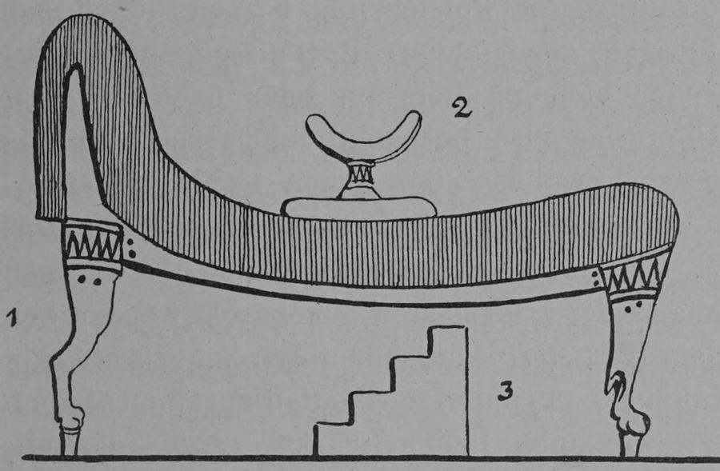

*Fig. 18. Ägyptisches Bett. 1. Bett. 2. Kopfstuhl. 3. Schemel.*

**a) Konstruktion des Bettes.**

Das Bett zerfällt in zwei grundverschiedene Bestandteile: das Gerüst und die Füllung. Das Gerüst baut sich auf aus 4 Pfosten (לשונות)[^41.85], die einen aus 4 Stangen (נשיש)[^41.86] gebildeten Bettrahmen (מלבן)[^41.87] zusammenhalten, und zwar je ein Stangenpaar bildet die Lang- und Kurzseite[^41.88] des Bettes. Das Gestell steht auf 4 Füßen (כרעים[^41.89] oder רגלים[^41.90], κλινόπους), die wieder ihrerseits in viereckigen Untersätzen, Klötzen oder in Schalen (מלבן, כַּפִּית oder סֵפֶל) staken[^41.91], damit ihnen die Erdfeuchtigkeit nicht schade. Möglicherweise wurde noch das Bettgestell von einem hölzernen Bock (חמור)[^41.92] gestützt. Wie bei Stühlen und Tischen (o. S. 61) wird auch hier ein Belag (חפוי)[^41.93] genannt. Jeder dieser Teile heißt ein Glied (אבר) des zerlegbaren Bettes, deren Zahl ausdrücklich auf 8 angegeben wird, d. i. der Rahmen mit den 4 Pfosten[^41.94]. — Die Füllung fängt damit an, daß man um die Stangen des Bettrahmens Stricke (חבלים)[^41.95] oder Gurten (מיזרן)[^41.96] spannt (מתח)[^41.97] (*fasciae, institae, lora*), so daß das Bett netzartig verdichtet (מסורג)[^41.98] erscheint. Die Stricke und Gurten wurden der Länge und Breite nach (שתי וערב) gezogen[^41.99], so daß Maschenvierecke (בתים) entstanden[^41.100]. An dem Rahmenholze waren diese Stricke mittels פיקות, d. i. einer Art metallener Röhren, befestigt, durch welche die Stricke wie durch Ringe gezogen wurden[^41.101]. Das Bett hatte, besonders wenn zwei Personen darin schlafen sollten, an der Kopfseite (מראשות), im Gegensatz zur Fußseite (מרגלות)[^41.102], eine hölzerne Rückenlehne (נקליטי המטה = ἀνάκλιτα = *pluteus*)[^41.103], welche die aufgelegten Polster und Kissen höher machte. Sie war, wie übrigens auch andere Bestandteile des Bettes, an dem Bette entweder bleibend befestigt oder nach Belieben entfernbar[^41.104]. Über das also bespannte und erhöhte Bett nun kam das Polsterzeug, welches bei armen Leuten[^41.105] etwa wie folgt beschaffen war: eine Matte (מחצלת) aus Rohr, Papyrusbast oder Riedgras[^41.106], die, in mehreren Knoten (מערן)[^41.107] endigend, leicht an den Stangen der Längsseiten angebracht werden konnte, oder eine Unterlage (מַפָּץ *storea*) derselben Art, jedoch etwas weicher[^41.108]. Bloßes Stroh (תבן, קש) oder mit Matten zusammen kommt gleichfalls vor[^41.109], wie auch Leder (קטבוליא, שטיח), das aber bereits eine gewisse Wohlhabenheit verrät[^41.110]. Viel weichere Unterlagen hatten die Reicheren an den Matratzen oder Polstern (כר *torus*) und Kopfkissen (כסת *culcita*, τύλη, στρωμνή), die, mit Heu, Stroh, Wollflocken und Werg gefüllt, lederne, wollene oder leinene Überzüge hatten[^41.111]. Das Polsterzeug, bezw. nur das Kopfkissen allein, heißt aramäisch auch בי סדיא[^41.112], etwa Stütze, Lehne, und besonders das Kopfkissen war auch unter dem griechischen Namen גלופקרין, קלוקרון = κερβικάριον = *cervicarium* gut bekannt[^41.112a]. Das Ganze war mit einem feinen Leintuch (סדין) überdeckt[^41.113]. Das Auflegen all dieses Bettzeuges ist zu verstehen, wenn von dem „Bereiten“ des Bettes (הציע את המטה) gesprochen wird[^41.114]. Weichlinge gefielen sich darin, auf mehreren — bis zu zehn — Unterlagen zu schlafen oder zu sitzen[^41.115]; das Bett diente nämlich auch zum Sitzen.

**b) Material.**

Das gewöhnliche Material des Bettes ist Holz, und zwar, wie man an einem Beispiele sieht, Zedern- und Sykomorenholz, wovon das eine beispielsweise zum Gestell, das andere zu den Füßen gebraucht sein konnte — das Holz wurde vor dem Fertigstellen mit einer gewissen Fischhaut geglättet[^41.116] — ferner Ton, Glas, Metall, selbst Gold, und auch Elfenbein[^41.117]. Es standen deren mehrere in einem Hause, sie und wurden mit der Zeit recht schadhaft[^41.118].

**c) Aufputz.**

An der Rückenlehne befanden sich Haken (אונקליאות)[^41.119], mittels deren man über dem Bette zierliche Tücher anbrachte, so daß eine Art Himmelbett (כילה) entstand[^41.120], dessen ausgespanntes Dach mittels Schnüren (כסכסים)[^41.121] an den Haken befestigt war. Ein vollständiger „Himmel“ entstand, wenn das Bett zwei Lehnen, zur Kopf- und Fußseite, hatte (שני נקליטין), wobei eine Querstange den Aufbau vervollständigte[^41.122]; sind vier Dachstangen angebracht, entsteht ein קינוף = κωνωπεῖον[^41.123], und zwar ist dann das Dach flach, während im Falle der einen Lehne ein schiefes Dach entsteht, wie es auch nicht die ganze Fläche des Bettes, sondern nur einen Teil überdeckt[^41.124]. Gleichwohl wird das Himmelbett (כילה) als Bild der Welt gebraucht[^41.125]. Das Dachzeug war wohl Linnen, und es ist bezeichnend, daß es manchmal zur Umhüllung des Menschen gebraucht wurde[^41.126], doch nahm man auch schöne bunte Stoffe dazu[^41.127]; auch kommen noch Schleifen (אקונבאות) und sonstiger Zierat dazu[^41.128].

**d) Bettypen.**

1. Nächst dem Bett (מטה) schlechthin gibt es 2. die Wiege (עריסה)[^41.129], in der das Kind am Tage ruht (in der Nacht liegt es neben der Mutter)[^41.130], sie unterschied sich im wesentlichen nur darin von dem gewöhnlichen Bette, daß man sie mit einem Räderwerk (עגלה) zu versehen pflegte[^41.131]. Sonst werden auch da der Rahmen (מלבן s. o.), die Füße (רגלים s. o.), die jedoch hier, wohl der schaukelnden Bewegung wegen, in „Sandalen“ (סנדל)[^41.132] staken, und das Verdichten mittels Strickes (מסורג בחבלין) genannt, und die Stricke gingen auch hier durch Metallösen (פיקות)[^41.133]; als Unterlage diente ein Leder[^41.134], wie es die Natur des Kindes verlangt, und man entbehrte auch der Schelle (זוג)[^41.134a] nicht, die das Kind in den Schlaf singen sollte. — 3. דַּרְגֵּשׁ[^41.135] ist bald Bezeichnung für Bett[^41.136], bald für Sopha[^41.137], abgesehen davon, daß es auch Sänfte und Bahre[^41.138] bedeutet, alles, wie das mehr generelle מטה[^41.139]. Die Bedeutung von דרגש war bereits in talmudischer Zeit strittig. Die einen sehen darin „das Bett des Glückes“ (ערסא דגדא)[^41.140], wohl soviel, wie Bett des Hausgenius; wichtiger ist die Unterschiedsangabe zwischen מטה und דרגש, daß nämlich bei ersterem die Gurten um die Bettstangen gespannt waren, während sie bei letzterem durch Löcher gingen, die an der Innenseite des Bettes sich befanden[^41.141]; demnach weist דרגש die feinere Bearbeitung auf. Nach anderen ist dieses ein ledernes Bett (ערסא דצלא)[^41.142], d. h. wohl, daß der Rahmen statt mit Riemen und Stricken mit Leder überspannt ist. Dieses Verdichtungswerk scheint nun mittels lederner Streifen (קלמנטרין = κραββατάριον) an die Bettstelle geheftet worden zu sein, und da es, trotz Abweichungen im einzelnen, nach allen Angaben feststeht, daß das Verdichtungswerk (סירוג) des דרגש nur im Innern des Bettes angebracht war, so mußten jene Streifen nur gelöst werden, und die Schlafgelegenheit fiel in sich zusammen[^41.143]. Da nun die Beziehung zu κράββατος = *grabbatus* sicher ist, und anderseits דרגש mehr als Ruhebett, Sopha und Sänfte erscheint, so ist in דרגש dasjenige Hausmöbel zu erblicken, welches von Griechen und Römern σκιμπόδιον = *scimpodium* genannt wurde, d. i. eine Art *chaise-longue*[^41.144]. — 4. Im Zusammenhange damit werden die caesariensischen Betten (ערסתא קסרייתא) genannt. — 5. Tarserbetten (מטה של טרסיים) w. u. Abschn. VII. — 6. Kräuterlager (מטה של גילה) s. § 40. — 7. Eine Art Feldbett אודייני (o. zu § 2)[^41.145]. — 8. Hängematte (aram. ערסלא)[^41.146], d. i. eine an Bäumen befestigte Matte, die dem Feldwächter am Tag Schatten, in der Nacht eine Ruhestätte gewährte. Dasselbe ist מטללא דכרמא „der Schattenspender im Weingarten“[^41.147]. — 9., 10., 11., 12. Speisesophas, u. z. oft nur מטה genannt, ferner אקוביטון = *accubitum*[^41.148], סטיבס = στιβάς, סגמטין = σιγμάτιον[^41.149]. — 13. Tragbahren s. Abschn. VIII. — 14. Sänften ebenda; פוריא = φορεῖον ist sowohl Bett als Sänfte. Es wurde bereits erwähnt, daß in den Städten die Betten als solche vermietet zu werden pflegten[^41.150].

[^41.77]: Thr R c. 1,4 f. 11ᵇ לית אנא דמיך אלא ארעא, bildlich. Guter Rat des Ben ʿAzzai: Auf jedem Lager schlafe, nur nicht auf der Erde (הקרקע bBerakh 62ᵇ oben). MʾAboth 6,4 על הארץ תישן. Spott der Mimen über die Juden, daß sie als Feuerung ihr Bett hernehmen und demzufolge genötigt sind, auf der Erde zu schlafen, Thr R Einl. No. 17, s. REJ 46,83. Hier sei erwähnt die Notiz גני אפרקיד bBerakh 13ᵇ u. bNidda 24ª, auch bBb 74ª, nach RN von אפוריא קדי hingestreckt auf das Bett, oder אפו בקידה auf dem Gesichte liegend; nach L 1,151 auf dem Rücken liegend; vgl. PERLES JQR 16,355.
[^41.78]: BENZ. Arch.² 95.
[^41.79]: Von den Priestern heißt es: לא היו ישנים בבגדי קדש, jedoch פושטין ומקפלין ומניחין תחת ראשיהם Bar bJoma 68ᵇ, 69ª; vgl. Tosafoth bBeza 15ª.
[^41.80]: תיבותא (allerdings nur für die Füße) jPeʾa 1,1, 15ᶜ₂₆, jḲidd 1,1, 61ᵇ₁₀ für den Tagesschlaf. אודייני I A. 60. Sifra zu Lev 11,4 p. 75ᶜ ועריבה גדולה שהנידות שוכבות בתוכה großer Trog, in welchem die menstruierenden Frauen schlafen (oder liegen).
[^41.81]: bh. u. nh. מטה √נטה wie κλίνη √κλίνω. Auch ערש resp. ערס, assyr. *eršu*, aram. ערסא, ܥܪܣܐ, arab. عرش hölzernes Gestell. MKel 24,8: Dreierlei Betten (מטות) gibt es: das für das Lager, das der Glasarbeiter und das der Netzarbeiter. Außerdem heißt auch das Speisesofa מטה (Stellen s. KRENGEL, S. 18 A. 2, s. § 28) u. die Totenbahre (§ 128). Auch lat. *lcctus* ist Schlafbett, Speisesofa, Totenbahre usw.
[^41.82]: bBerakh 24ª שנים שישנים במטה א׳, ib. אשתו עמו u. oft, ib. בניו ובני ביתו בצדו. Drei Personen MNidda 9,4. Dasselbe folgert man aus der Breite des Bettkopfes der Funde von Pompeji, s. OVERBECK, Pomp.⁴ 424. Man sieht die breiten Betten auch hierzulande aus älterer Zeit, und sie sind noch in vielen Ländern gebräuchlich.
[^41.83]: Darum der Ausdruck עלה על המטה. Vgl. MNidda 9,3 (61ª) עברו דרך עלייה in ed. Lowe für עבר beidemal עלה. Der Bettschemel hieß כן s. Sifre Zuta bei RŠ zu MKel 11,2 u. Jalḳut Num § 785 f. 278ª. שרשיפא bBerakh 24ª scheint der Schemel des Bettes zu sein. Manche wollen דרגש (w. u.) als Stufe zu dem hohen Bett erklären. Auch lateinisch sagte man *scandere lectum*, daher gebrauchten auch die Römer *scamnum*, *scabellum* u. *gradus* zum Aufstieg auf das Bett; s. RICH s. v. Antoninus gibt für Rabbi den Schemel ab bAz 10ᵇ.
[^41.84]: Man orientierte das Bett (Ehebett) zwischen Nord und Süd (bBerakh 5ᵇ). Sehr großes Bett folgt aus Bar bPesach 8ª מטה החולקת בתוך הבית „das Bett teilt das Zimmer in zwei“, darum eben räumte man Holz und Steine darunter (ib. mit dem Ausdruck דמידליא u. דמתתאי), Bar jPesach 1,1, 27ᵇ₃₂. Der Gelehrte gibt im Sommer seine Sandale, im Winter seine Schuhe darunter; der Mann des Volkes hat sogar, wie man spottend bemerkte, ein ganzes Magazin darunter (Bar bBb 57ᵇ). MSukka 2,1 הישן תחת המטה ib. b במטה עשרה, ib. 21ᵇ das Bett schützt Schuhe und Sandalen. Die Kiste voll heiliger Schriften soll man zumindest unter die Kopfseite stellen, auch soll das Bett ziemlich hoch sein, damit die Bettstricke (u.) die Kiste nicht berührten: jBerakh 3,5, 6ᵈ₃₆. Totes Kind unter dem Bette bBerakh 8ᵇ.
[^41.84a]: MKel 19,1 המפרק, ib. 2 ומשלשלין.
[^41.85]: לשונות (wie bildlich viele langgestreckte Gegenstände heißen s. L 2,529 No. 3 u. K 5,61, wo bemerkt wird, das RN, gewiß irrtümlich, שלחנות hat, s. v. לכסן) heißen die Pfosten. MKel 18,4. 5 (Maim. قوائم = נציבים), T bm 8,5. 6, 587₁₇. ₁₉, sind die Pfosten des Bettes; KRENGEL S. 19 „Holzpflöcke“, unrichtig RŠ = חבלים, L Querleisten, G. HOFFMANN ZATW 2,57 Zapfen. Die לשונות konnten מלווחין gemacht sein, d. h. wohl: aus Stücken zusammengesetzt, also schwache Arbeit; war das an einer Seite der Fall, konnte man noch das Bett benutzen, war es an allen vier Seiten, war das Bett unbrauchbar (TKel bm 8,6, 587₁₉. ₂₀).
[^41.86]: גשיש (auch sonst als „Stange“ bekannt) ist = *sponda* (ἐνήλατον) „einer von den vier Balken an einem Sofa oder einer Bettstelle (*lectus*), an denen die Gurten befestigt sind“ . . . (RICH): TKel bm 8,3, 587₈ (s. zu קיטליאקי Lwr 2,529, wonach es am ehesten λεκτίκιον ist; für *lectica* spricht auch manches); man unterscheidet die dem Gemache zugekehrte Bettstange als äußere (גשיש החיצון) von der der Wand zugewendeten als inneren (ג׳ הפנימי) TMiḳw 6,17, 659₁₂, ebenso Esth R c. 2,7, u. z. die innere Stange von Gold, die äußere von Silber, jedoch an dem Speisesofa des Ahasveros, wobei zu erinnern, daß מטה in gleicherweise Bett und Speisesofa heißt (o.), und beide gleich konstruiert waren. In MZab 3,1. 3 u. T 4,4, 679₈ heißt גשיש (wie auch *sponda*) der ganze Bettrahmen. RN u. RŠ halten גשיש für dasjenige, welches wir in לשונות sehen, nämlich Pfosten. Unter סמוכות המטה (MKel 16,7) „Stützen des Bettes“ ist wohl ג׳ zu verstehen.
[^41.87]: MKel 18,4 מלבן שנתנו על לשונות „der Rahmen, den er auf Pfosten gestützt hat“ (man sieht, daß es nicht unbedingt so sein mußte, und so konnte der Rahmen auch durch sich selbst auf den Füßen stehen). TKel bm 8,4, 587₁₂ מלבן של מטה ושל עריסה (ib. ולווחין של סטיכס TSabb 13,15, 130₁₃ יסטיכס l. סטיבס s. Lwr 2,410 στιβάς eig. eine Streu, hier ein Bettgestell, und es entspricht לווחין den דפין in Z. 8). MPara 12,8 המלבן אינו חבור. Hai und Maim. zu MKel 18,3 sehen in מלבן ein einzelnes verziertes Brett an der Längsseite des Bettes nach außen; dies ist nicht ausgeschlossen, da der Rahmen, wie auch bei uns, nicht eine schmale Stange allein, sondern etwas breitere Seiten umfaßte, nur muß man diese an beiden Längsseiten annehmen. מלבני לוי MKel 18,3 u. T bb 2,9, 592₂₁ (vgl. Maim. הל׳ כלים 4,2) scheinen nun solche gezierte Seiten zu sein, die aber über das Bettgestell hinausgingen (wo man noch eine rote Schnur anbrachte Hai, RN u. RŠ) und wo die Leviten ihre Musikinstrumente aufhingen oder wohl nur anlehnten oder befestigten; so hängt auch die Dienerin des Telemach dessen Kleid auf das Bett (Odysseia Ende des I. Gesanges). RN (K 5,148) hat noch eine unverständliche Erklärung.
[^41.88]: MKel 18,5. 6; ib. 19,6; MSabb 23,5; MSukka 1,8; TKel bm 8,6, 587₂₀ ארוכה (resp. ארוכות) u. קצרה (קצרות). Sie waren mittels Fugen (נקבים) in die Pfosten eingelassen MKel 19,6. Sifra p. 63ᵇ.
[^41.89]: MKel 18,5. 7, T bm 8,5, 587₁₆, ib. 9,5, 588₁₄ שירים שבכרעי המטה. Haustiere (Schaf, Mekh RSim bJochai zu Exod 12,6 p. 10 H.; Katzen bSabb 110ª; Huhn TSabb 6 resp. 7,4 p. 117, bBerakh 7ª) band man an den Bettfuß, mehr s. in REJ 53,40. Das Bett kann nur auf vier Füßen stehen MZabim 4,7. Einer, der sich abergläubisch vor Schlangen fürchtete, stellte sein Bett auf vier Gefäßen (?מרושין) von Wasser auf (jTerum 8,45ᵈ₆₄). TSabb 13 (14), 15, 130₁₃ in einer Reihe מלבין של מיטה ושל עריסה ונקליטי המיטה ולווחין של יסטיכס וכרע של שלחן ויד של סכין, also כרע auch am Tische; in TKel bm 5,4, 587₁₃ וכרעים של שלחן A. 16.
[^41.90]: TKel bm 8,3, 587₁₀.
[^41.91]: מלבנות של כרעי המטה bBb 69ª s. RŠbM, bSabb 47ª s. Raši, ferner RN s. v. מלבן (K 5,148) in der 2. Erklärung. G. HOFFMANN ZATW 2,62 weist ein πλινθεῖον in diesem Sinne aus. Andere Namen, nämlich ספל und כפות (HOFFMANN ib. 63 syr. ܟܦܠܢ = Untersatz) TKel bm 8,3, 587₁₀ חמור שתחת המלבן כפותין שתחת הרגלים . . . והספילין שתחת הרגלים. Zu ܟܦܠܢ s. PSm 1793 *fornix, opus concameratum* قبّة; ܟܘܦܠܢ *urceus aquae ore angusto* BROCKELM. Lex. Syr. 155. Als hohles Gerät כופתא auch bSabb 77ᵇ, s. mehrere Erklärungen in Raši, besonders, daß es ein Holzklotz sei. So ein מלבן konnte man abwechselnd auch zu andern Betten gebrauchen, TKel bm 5,9, 584₁₃. ארבע טליות unter den vier Bettfüßen MZabim 4,7. Die Schalen (ספלין), in denen die Bettfüße staken, enthielten zuweilen Wasser (bTaʿan 21ª), ungewiß, zu welchem Zwecke; s. jedoch A. 89.
[^41.92]: MKel 18,3, T bm 8,3, 587₁₁ (s. vor. Anm.). Hai: Jedes Ding, das etwas anderes auf seinem Rücken trägt, z. B. חמור של נפחים, oder das der Schreiner, heißt arab. حمار, ähnl. Maim. Den Zusammenhang mit חמור = Esel muß man bezweifeln, denn Trg Ps.-Jon. setzt חומרא für bh. אדן (L Trg Wb 1,268), offenbar dasselbe Wort, in einer Bedeutung, die hier gut paßt: Träger, Fußgestell. HOFFMANN a. a. O. S. 60 denkt an einen Holzbock (fr. *âne*), doch dünkt ihm wahrscheinlicher eine Fußbank (Hutsche), auf der man in das hohe Bett stieg (o.); „unter“ dem Bette dann in dem Sinne, wie man tagsüber auch andere Sachen unter dem Bette hält (o.).
[^41.93]: MKel 18,3 neben חמור. Auch hier wie oben als solide Seiten des Bettes aufzufassen, nicht „Hüllen“ (RŠ).
[^41.94]: TKel bm 5,11, 584₁₉ מטה שנתפרקה כל אבר ואבר טמא בפני עצמו. Ib. 8,7, 587₂₃ f. Darum המפרק את המטה MKel 19,1. Vgl. ib. 18,9 חציה, ib. חלקוה usw., T bm 5,8, 587. Zusammengefügtes, einseitiges Bett bSukka 16ª o.
[^41.95]: TKel bm 5,11, 584₂₀ שאין חיבור למטה עד שיסרוג בה ג׳ בתים לכל רוח, M 16,1. MʾOhal 8,4 u. T 9,4, 606₂₁ חבילי המטה, jBerakh 3,5, 6ᵈ₃₉. Man sparte mit dem Strick nicht, sondern ließ ihn heraushängen (MKel 19,2 החבל היוצא מן המטה); dem entspricht שירי מזרן in der nächstf. A.
[^41.96]: MKel 19,6 מטה שכרך לה מיזרן; in T bm 9,6, 588₁₅ מזרן und מכרך, Z. 17 מזרין und מכריך, Z. 20 מיזרן. M ib. 3 מִיזְרָן היוצא מן המטה (ed. Derenb.), ed. Lowe המיזרן. Ib. שירי מ׳. Diesen entspricht wohl דבלולין TKel bm 9,2, 588₁, demnach ib. vorher מעיין l. מיזרן. Syr. ܡܝܙܪܢܐ Bar Ali 5842 u. Bar Bahlûl s. v. ܐܡܙܪܢ PSm 110; s. HOFFMANN a. a. O., der חבלים mit τόνοι, מיזרן mit κειρία εἶδος ζώνης ἐκ σχοινίων παρεοικὼς ἱμάντι (BECKER, Char. 1,117) vergleicht. Ableitung aus אזור hat auch Maim zu M 3, s. jedoch I, A. 389. Während ferner von חבלים die Tätigkeit סרג gesagt wird (TKel bm 9,4, 585₅), werden die breiten Gurten um die Bettstelle bloß herumgelegt (כרך). חבל und מיזרן gehören zur Integrität des Bettes MKel 19,3. 6. — Eine dritte Bezeichnung ist אשלא ܐܫܠܐ assyr. *ašlu* (s. BROCKELMANN, Lex. Syr. 29) = Strick (L 1,178): bGitt 69ª אשלא דפוריא עתיקא. bSukka 16ª משדא אשלי. Es werden genannt Stricke von Ḳimchona (Ḳimchonja) bKethub 67ª, also ein babylonisches Erzeugnis.
[^41.97]: MMḳ 1,8 ומסרגין את המטות, ib. אף ממתחין. Den Unterschied sucht man bMḳ 10ª u. j 80ᵈ₆₇ f. festzustellen; plausibel scheint מסרגין = שתי וערב; ממתחין = שאם היה רפוי ממתחו. Dem שתי וערב entspricht jSabb 7,2, 10ᶜ₂₅ ההן דעבד מלין ערסיין לאורך משום מסיך לרוחב משום אורג. Vgl. ib. קנקלטון משום עושה בתים, wo בתים wieder = Maschen.
[^41.98]: TKel bm 8,4, 587₁₅ מסירוג (l. מסורג) בחבלין. TʾOhal 13,5, 610₂₅ מסורג בחבלים.
[^41.99]: bMḳ 10ª, j 1,8, 80ᵈ₆₇.
[^41.100]: MKel 16,1 ib. 19,6; T bm 5,11, 584₂₀, ib. 9,4, 588₇. A. 97.
[^41.101]: TʾOhal 13,5, 610₂₄ מלבין שהוא מלביש (l. מלובש) בפיקות, in TKel bm 8,4 587₁₅ בפיקת. Zur Sprach- u. Sacherklärung s. HOFFMANN a. a. O. S. 57 f.
[^41.102]: jBerakh 3,5, 6ᵈ₃₇ מראשותי המטה u. מרגלות המטה. MNidda 9,3 (61ª) בזמן שעברו דרך מרגלות המטה (ed. Lowe שעלו).
[^41.103]: MKel 18,3, MSukka 1,4 (hier ed. Lowe ניקליטי המטה), Bar bSukka 10ᵇ usw. s. Lwr 2,367, u. z. ἀνάκλιτα nach der von HOFFMANN S. 59 ermittelten Bedeutung = *pluteus* (s. dessen Nachweise und Gallus 2,345 und RICH s. v.). Es ist das die hohe Rückenlehne sowohl des *lectus* als des Trikliniums, ähnlich dem hohen Ende eines Sofa. Vgl. auch die hier S. 63 reproduzierte Abbildung bei WILKINSON, Anc. Egypt. 1,69, wo jedoch noch ein besonderes Gestell (pillow or head stool) auf dem Bette zu sehen ist. Mit der Bezeichnung „Nackenschemel“ findet sich dasselbe Hausgerät nach einem Muster in British Museum bei FORRER, Reallexikon S. 419 Fig. 330. Die Bedeutung „Stangen“ bei KRENGEL S. 21 ist unrichtig.
[^41.104]: TKel bm 8,4, 587₁₂ מלבן של מטה ושל עריסה נקליטי המטה ולווחין של סטיכס כו׳ בזמן שהן קבועין, Gegensatz ib. נטלין וניתנין; vgl. יהזיר u. רפין TSabb 13,15, 130₁₃. Dasselbe ומיטה שניקליטיה עולין ויורדין בה שומטן כו׳ jBerakh 3,1, 5ᵈ₇₃, wofür יוצאין „verrückbar“ bMḳ 27ª, bNedar 56ᵇ, bSanh 50ᵇ.
[^41.105]: מטת עני MMiḳw 9,5, Bar bBm 113ᵇ. Vgl. MSabb 20,4 und j 17ᵈ₇ הדין דין לעני.
[^41.106]: MKel 17,17; ib. 20,7 u. ö. TKel bm 11,11, 590₆ מחצלת שעשה לאוהלין וחישב עליה לשכיבה et vice versa. Über die Fabrikation s. § 77.
[^41.107]: MKel 20,7 המתיר ראשי המעדנים, T bm 11,11, 590₈ משקישר ראשי המדנין, ib. Z. 11 מדין, ib. 7,11, 586₃₅ מדנין, jSukka 2,10, 52ᶜ₅₅ ראשי מעדנים. Siehe bibl. Wbr s. v. מעדנת u. L 3,183 von עדן = ענד = binden. Hai arab. עטאף l. אעטאף.
[^41.108]: MKel 24,10, ib. 27,2, MKethub 5,8 ונותן לה מטה מפץ ומחצלת (Raši: מפץ ist weicher als מחצלת, s. b 65ª u. Tosafoth; daß diese Unterlagen überhaupt nötig sind, wird von einem babyl. Amoräer damit begründet, daß dort, wo es Brauch ist, das Lager (פוריא) mit Stricken zu füllen, die Härte dieses Lagers die Frau vorzeitig altern machen würde), Bar bBm 113ᵇ.
[^41.109]: MSabb 20,4, j 17ᵈ₇, b 50ª, T 16,5, 135₇; man sieht dort, daß das Stroh, gerade so wie noch jetzt, vor der Benutzung frisch aufgerüttelt wurde (מנענע בידו). Stroh verbunden mit anderen Zeugen (Matten und Leder) erscheint an zwei parallelen Stellen, die bezüglich des ganzen Bettes höchst instruktiv sind und zum Teil für die Betteile neue Namen bieten, die aber witzig gehalten sein dürften (jMš 4,9, 55ᶜ u. Thr R c. 1,15 p. כו Buber): „Ich sah in meinem Traume vier Zedern, vier Sykomoren, מקניתא (fehlt in Thr R), אדרא (in Thr R חד מובלא דקיסין, was wohl = Matte ist, doch fehlt es mit Recht in den gewöhnlichen Drucken und ist in ed. B. nur Glosse, entsprechend ist nur חדא אתר דתבן l. mit B. חדא אדר דת׳, aber in j ist אדרא = Leder, s. RN bei K 1,38, u. z. mit Stroh ausgestopft, u. darum in der Erklärung ברא דתבנא l. דרא דת׳), einen Ochsen (תורתא) u. jener Mann (d. i. ich) ritt darauf. Da sagte er ihm: . . . Die vier Zedern sind die vier Seiten des Bettes (ארבעתי שמתיה דערסא), die vier Sykomoren sind die vier Füße (כורעת׳, Thr R כרעי s. A. 89) des Bettes; מקניתא ist der Fußschemel (מרגלתא s. A. 102), höchst unsinnig L 3,224 „das Gestell, das auf einer Strohunterlage ruht“, indem er das folgende irrig hierherzog), אדרא ist = ברא דתבנא (in Thr R ist an dieser Stelle מובלא דקיסין erklärt, u. z. als מחצלתא d. i. Matte, die auf dem Bette liegt), תורתא ist = אצבעתא (dieses W. muß etwa „Fell“ bedeuten, vgl. Thr R שטיחא, das auf dem Bette liegt), und daß jener Mann darauf reitet, besagt, daß er darin liegt“ . . . RN hat אדר דתבן וא׳ דעליה, also zwei Dinge, u. z. etwa die Strohschichte und das darauf liegende Fell. In bBerakh 56ª אידרא מבי סדיא נפיק „die Füllung geht aus dem Kissen heraus“ ist אדרא = אדרא דתבן. J 831 leitet מקניתא von קני, קנה Rohr ab und versteht darunter ein am Fußende (מרגלתא) liegendes Polster.
[^41.110]: MKel 16,4, ib. 26,5, MʾOhal 18,13; s. KRENGEL S. 24 A. 8; Lwr 2,523 = καταβολή; Hai gibt für קטבוליא arab. גמע l. נטע = نطع, dasselbe Wort meint die Glosse zu Mekh RSbJ 22,26 p. 152. שטיח s. vorige A. Mekh zu Exod 22,26 p. 96ᵇ עור מצע.
[^41.111]: כר im Bette: MNidda 8,4 T 3,6, 643₃₁, j 2 Ende 50ᵇ₄₃ s. L. Heller zu MNidda 2,3. MBm 9,13 (113ª). Weich (רכין) sind כרים u. כסתות bZebach 94ᵇ oben. MSabb 20,4 כר oberhalb vom Stroh, ebenso כדין Linnen, so daß KRENGEL S. 25 mit der Annahme, daß dieses über das Bett gebreitet wurde, wenn andere Unterlagen fehlten, nicht recht hat. מטה והכר enge verbunden Sifra zu Lev 11,4 p. 75ᶜ. TKethub 5,8, 267₅ von der Frau, die keine Matratze mitbekommt: „denn die Frauen der Armen schlafen nicht auf Matratzen“ (כר). Mekh RSbJ p. 152 (s. auch vorige A.) einige Schlafrequisiten: לערו, זה עור קטובליה שלו; במה ישכב, לרבות את הכר ואת הכסת ואת הסדין . . . מנין לרבות שאר הכלים כו׳. Daß כסת kleiner als כר, beweist KRENGEL S. 25 A. 9 mit Recht aus MKel 28,5 u. T bm 6,2, 584₃₆ gegen Maim. zu MSabb 4,2, der übrigens auch כר schlecht auffaßt. Natürlich dienen כר u. כסת auch zur Sitzbequemlichkeit, wie ja des öfteren gesagt wurde, daß hierin zwischen Stuhl und Bett enge Verwandschaft herrscht (jKil 9,32ª₃₂, bMḳ 16ᵇ, bNedar 65ª, MBerakh 8,3), bh. kommt כר הגמל vor. — Wie in MSabb 20,4 Stroh unter dem כר, so עירית (von I. LÖW Pfl. S. 289 unerklärt gelassen; nach L 3,644 eine Lauchart) TSchebiʿith 5,17, 68₂₅. Ib. Z. 26 als Füllung des כר Stroh (תבן); TʾOhal 12,2, 609₃₄ כר מלא תבן, ib. כסת מלאה מוכין. Daß letzteres feiner, ergibt sich deutlich Bar bḲidd 22ª „Du schläfst auf מוכין, und er (der Knecht) auf תבן“. מוך ist nach RN feiner gekämmter Flachs oder Wollflocken (s. auch RIEGER, Technol. S. 44 u. w. u. S. 140), nach L 3,45 „Werg, gehechelte Wolle, oder Flachs“, und dies ist die gewöhnlichste Füllung von Matratzen und Kissen, wie z. B. TNeg 5,4, 624₃₅ nur dies figuriert, vgl. Bar bBḳ 119ᵇ; in TSota 15,1, 321₈ מוכין של צמר. Von מוך kommt das Verb מימך Bettzeug unterlegen bBeza 14ᵇ, מייכי bBm 84ᵇ oben, wo als Stoff נמטי genannt ist, Raši לבדים, eine Art Filz. Sprichwort מוך שקך וגני bTaʿan 6ᵇ (RG קפל, RCh הצע) „leg dir deinen Sack unter und schlafe!“ Ib. 21ᵇ u. ומך לדו ביסתרקי בליליא. Das *tomentum* der Römer waren Wollenflocken (wie sie beim Kratzen und Scheren der Tücher abfielen), in alter Zeit jedoch hatte man bloße Strohmatratzen (BECKER-GÖLL, Gallus 2,334, *torus* u. *culcita* s. ib. u. S. 335, wonach *culcita* überh. Pfühl und Kissen, auch zum Sitzen, und daß Weichlinge nicht nur Wolle, sondern selbst Federn dazu nahmen; letzteres erwähnt auch Maim. zu MSabb 4,2. — כר u. כסת sind gewöhnlich ledern: MKel 16,4, ib. 26,5, MMiḳw 7,8, ib. 10,2, MSabb 21,2, TKel bm 10,3, 588₃₁, ib. bb 4,8, 594₁₄, aber auch wollene: MKilʾaim 9,2, MSabb 21,2, TNeg 5,14, 624₃₅, u. z. eventuell mit Linnen gemischt. Man frischte das Polster auf, indem man es wendete, d. h. die Innenseite zur Außenseite machte, TKel bb 3,1, 592₃₁ (כר שהפכו), ib. תפארות (wonach auch תוברות M 25,1 zu erklären, s. L Heller z. St.) Naht? oder = bh. פארות Schößlinge, Quasten? Vgl. תוברין I, A. 91.
[^41.112]: Syr. ܒܣܕܝܐ aus בית סדיא (NÖLDEKE, Syr. Gramm.² 141, BROCKELM. Lex. Syr. 40) *pulvinar*. L Trg Wb s. v. איסדי leitet es von יסד ab. Zu unterscheiden: אסדי allein = Kopfseite, vgl. bBerakh 56ª, בי ס׳ ib. = Kopfkissen. K 6,22 f. seiner Etym. zuliebe möchte בסדיא in einem Worte lesen, was nicht angeht. bSabb 146ᵇ בי סדיא, ib. 124ᵇ בי סדיותא l. mit RN סדוותא (die Polster waren auf der Sonne, weil man sie wahrscheinlich lüftete; der Betreffende hatte übrigens sowohl für sich als die Gäste — als Sitzgelegenheit — noch andere Polster); bKethub 61ª. פסדיות zitiert von RN (K 6,377) aus Jelamdenu zu Gen 28,11 ist bereits von RN mit ביסדיות erklärt worden, so auch I. LÖW in Lwr 2,468, J 957.
[^41.112a]: Mekh zu Exod 17,12 p. 55ᵇ „hatte denn Moses nicht ein Polster (כר) oder ein Kissen (כסת) oder ein קלוקרין, das er sich unterlegen könnte“? Mekh RSbJ z. St. p. 83 hat גלובקרין; andere Stellen s. Lwr 2,176 u. 544; s. auch Hai zu MKel 29,2 (unrichtig) u. A. ROSENZWEIG, Wohnhaus S. 54 A. 2.
[^41.113]: S. zweitletzte A., ferner bBerakh 10ᵇ סדין של פשתן הציעה על מטתו (jeder Fleck, auch die Pollution, mußte darauf gesehen werden können); vgl. dazu אין לך מטה שאין עליה מאכולת TNidda 7,5, 649₈ b 58ᵇ. TʾOhal 8,3, 605₂₇ סדין שתפרו ונתנו על גבי עריסה. MKel 24,13, MʾOhal 18,1. 3, MSabb 20,4; TSota 3,3, 295₂₅. *Plagae, grande linteum tegmen quod nunc torale vel lectuariam sindonem dicimus* Non. p. 537,20 in Gallus 2,336; σίνδων κοιταρία s. Lwr 2,528 s. v. קיטא.
[^41.114]: Vgl. מצע Jes 28,20, nh. Mekh zu Exod 22,26 p. 96ᵇ (s. o.), Bar bBm 113ᵇ, bChag 14ᵇ, bNidda 32ᵇ מצעות. Verb הציע MKethub 5,8, bBerakh 10ᵇ, Mekh RSbJ zu Exod 20,10 p. 108 H., הצעת המטה bKethub 61ª. Ib. 103ª im Testament Rabbis: מטה תהא מוצעת במקומה. Ein gestohlener טלית war gebreitet (מוצעת) über dem Bett, Pesiḳta 122ᵇ. Vgl. מצעת את הבימה Gen R 65,1. מציעין את המטות MSabb 15,3 ist von den Speisesofas die Rede, vgl. dabei den Ausdruck יסב TSabb 12,16, 128₁₇. Beth-ha-Midr 6,88 (aus Jelamdenu) הציע ובטפיטין (so l.) המטות בקיטאות. Eine besondere Form ist pl. צועות (= יצועות) jKethub 10,4, 33ᵈ₅₇, daneben נחושת = Unterlage, s. § 52.
[^41.115]: Oft משכב תחתון u. משכב עליון z. B. MKel 1,3, T bk 1,3, MNidda 4,1 (b 32ᵇ י׳ מצעות ויתיב עלייהו) T 5,1, 645₂₁. Sifre Num 116 p. 35ᵇ הציעה לו שבע מטות כו׳ (bMenach 44ª sechs Betten) übereinander, ist von dem Polsterzeug zu verstehen, denn „eins von Gold“ und „eins von Silber“ ist auf das eingestickte Gold und Silber zu beziehen, wonach man an die *plumata vestis* denken kann, in diesem Zusammenhange weitläufig erörtert in Gallus 2,337 ff. Vgl. die Notiz zu תלמיותא Lwr 2,589. Übrigens spielt die Geschichte in einer der Seestädte, aber bei Hellenen, und da ist an denselben Luxus der Römer zu erinnern, s. in Gallus 2,336. Gestützt auf diese Bedeutung des זהב, könnte man ferner die dunkle Stelle TKel bb 1,14, 591₂₅ (s. KRENGEL S. 26 A. 7) dahin erklären, daß הזהב ein goldgesticktes Zeug vor dem Bette, הפדר (in Alfasi ed. Wilna הפרד) etwa ein Fell (viell. vom Maultier?) bedeutet, die als Vorlegeteppiche dienten; die Römer hatten *lectuli Punicani haedinis pellibus strati* s. bei BECKER-GÖLL, Gallus 2,337. In Sifre ib. ersieht man abermals, daß das Bett auch zum Sitzen diente; vgl. MNedar 4,4 erst וישן עמו במטה, dann ומיסב עמו על המטה (interessant T 2,7, 277₂₇ im kleinen Bett des Sommers, wo das Zusammenschlafen qualvoll ist, ebenso im großen Bett des Winters, wo ein Körper den andern nicht wärmt). ואל תשב על מטה ארמית bPesach 112ᵇ, bBerakh 8ᵇ, ib. Vorfall mit RPapa, s. RNissim und Raši. Vgl. schon Amos 3,12 הישבים . . . בפאת מטה u. die Bemerkung in *Rivista Isr.* 2,124. MZabim 4,7 היה יושב על גבי המטה.
[^41.116]: MKel 16,1 כלי עץ . . . המטה והעריסה משישופם בעור הדג, vgl. dazu Plinius, H.N. 7,57; in 9,14 nennt er den Fisch *squatina*, mit dessen rauher Haut Holz und Elfenbein poliert werden. BLÜMNER, Technol. 2,329. Maim. nennt den Fisch سفن, s. dazu KRENGEL S. 18 A. 4. I. LÖW, Fischnamen, No. 22. Zedern u. Sykomoren jMš 4,9, 55ᶜ u. Thr R c. 1,15 s. A. 109. Ebenholz s. Jelamdenu Behaʿalothkha Anf. zitiert von RN (= Beth-ha-Midr 6,88) s. Lwr s. v. אבלונה = ἐβένινος.
[^41.117]: Ton: MKel 2,3. — Glas: TKel bb Ende. — Gold: Bar bJebam 16ª (hier mehr ein Sofa). — Zu מטות שן Amos 6,4, wird bemerkt: ערסין דפילי Elfenbeinbetten, Lev R 5,3. Ib. allgemein: Sie hatten קטיות משופעות d. i. luxuriöse Betten (= κοιτή Lwr 2,528). Zur Technik der Arbeit s. o. Eine prunkvolle, goldene mit Edelsteinen besetzte Totenbahre (κλίνη) schildert Josephus, Ant. 17,8, 3 § 197; B. J. 1,33, 9 § 671. Sehr phantastisch die Totenbahre Mosis Trg Ps-Jon zu Dt 34,6 p. 365 ed. Ginsburger.
[^41.118]: Folgt aus Thr R 1,4 f. 11ᵇ ed. Wilna. Die schadhaften Betten wurden eines durch das andere gestützt (ib.).
[^41.119]: MKel 12,2 אונקלי של דרגש . . . ושל נקליטין, ἀγκύλη Lwr 2,23, wo auch andere Stellen.
[^41.120]: כילה von כול = כלל umfassen. Bar bSukka 10ᵇ הישן בכילה, ib. vorher שיש לה גג, demnach hieß das ganze Bett כילה, an dem man das Dach unterschied; freilich ist das Dach das Wesentliche daran. Das כילת חתנים (s. § 122), wovon oft die Rede, hatte jedoch kein Dach, ib. 11ª, u. es müssen somit andere Bestandteile den Namen כילה verursacht haben. Ib. Unterschied zwischen „Bett“ und „Himmelbett“; man schläft auf dem Bett, aber in dem Himmelbett (לגבה u. לתוכה). In bʿErub 63ᵇ כל הלן בכילה שאיש ואשתו שרוין בה כו׳ ms. München (Agg. בקלעא). Der Vorhang diente zum Abhalten von Fliegen (בקי) bSukka 26ª (wo aram. כילתא, andere Stellen s. L 2,318 f.; Maim. zu MKel 18,3); syr. ܟܠܬܐ, arab. كلّة. כילתא auch bBerakh 24ª. זגי דכילתא (Schellen?) bNidda 17ª. Zeugen halten sich versteckt in dem Himmelbett, bSanh 29ᵇ.
[^41.121]: בכילה וכבכיה bSabb 139ᵇ, s. auch ib. 138ᵇ הגוד בכבכיו RN (Agg. בכיסנא, ms Oxf. בכבכיו, wie auch 139ᵇ in Agg. ובכבכיה, irrig), nach L 2,365 = Riemen, bei כילה paßt aber besser „Schnüre“.
[^41.122]: Bar bSukka 10ᵇ נקליטין שנים . . . פירס על גבי נקל׳; vgl. Maim. zu MKel 18,3; vgl. die Bemerkung zu MSukka 1,3 in j 52ᵇ₄₈ שכן הוא עושה חלל באצילי ידיו, auch in gewöhnlichem Linnenzeug macht man eine Höhlung (eine Art Zelt) mit den im Schlafe ausgestreckten Armen; s. auch Hai zu MKel 18,3. 4; die Querstange (Querseil) erwähnt RN s. v. נקלט (5,380), s. auch Raši bSanh 20ᵇ, bʿErub 102ᵇ; in Machzor Vitry p. 403 Z. 5 קלונסא genannt. Zu bSukka 10ᵇ bemerkt Raši, daß auf נקליטין ein schiefes Dach stehe, während כילה u. קינופות (w. u.) flaches Dach haben.
[^41.123]: Bar bSukka 10ᵇ וקינופות ארבעה, vgl. M 1,3; s. Lwr 2,532 u. o. S. 31. Es scheint, daß die Rabbinen in קינוף eine Dachstange erblickten.
[^41.124]: Bar bSabb 138ª (Raši u. RCh lesen שיש בגגה טפח, s. jedoch Margo mit LA des Alfassi u. RSbM), bʿErub 102ª. In bSabb 138ª ferner: „die Himmelbetten des R Huna (in Babylonien), die des Nachts aufgerichtet, des Morgens aber übereinandergeworfen wurden“ s. RCh: נטיות היו מע״ש ונמשכות למעלה כמין כפולות (?) ומבקר היו משפיעין ומשרבבין אותן למטה.
[^41.125]: Num R 12,13 זה העולם שהוא עשוי כמין כילה.
[^41.126]: bSabb 139ᵇ מתעטף אדם בכילה כו׳.
[^41.127]: Num R 13,2 מה הכילה הזאת מצויירת במיני צבעונין.
[^41.128]: TKel bm 2,8, 580₁₄ אק׳ nach FRAENKEL κόμβος Schleife, s. Lwr 2,123 (zu bBb 73ᵇ ib. s. jedoch FRAENKEL in ZDMG 55,356). Ib. סובין u. סיטיון, von unbekannter Bedeutung; ersteres könnte כבכין sein, s. A. 121, סיטיון hingegen etwa סטגיון zu lesen, s. אסטגי Lwr 2,77. כפאתין Bänder am Sofa s. L 2,392ª.
[^41.129]: TMakk 2,4, 439₂₆, Gen R 61 Anf. Dagegen עריסה של בנות TKel bm 9,1, 586₃₆ ib. bb 2,9, 592₂₁ wahrsch. = Puppenwiege. Sonst ערס = Bett s. A. 140. Speziell Krankenbett (bh. ערש דוי) z. B. bSabb 129ª.
[^41.130]: jMakk 2,4, 31ᶜ₆₂ f.
[^41.131]: TKel bm 5,12, 584₂₁.
[^41.132]: MʾOhal 12,4 סנדל של עריסה (Maim. erinnert an סנדל als Zubehör der Türe s. o.), T 13,4, 610₂₀. Nach RN ist hier ס׳ ein Stück Holz zur Aushilfe, um die Füße der Wiege gleich zu machen.
[^41.133]: TʾOhal 13,5, 610₂₄ מלבין שהוא מלביש (l. מלובש) בפיקות; TKel bm 8,4, 587₁₄ מלבן של עריסה שהוא מלובש בפיקת ויש לו הרגלים . . . מסירוג (l. מסורג) בחבלים כו׳. MPara 12,8.
[^41.134]: עור העריסה MKel 26,5, T bb 4,8, 594₁₂. Vgl. JOMARD, E., Observations sur les Arabes de l’Egypte moyenne p. 21, Paris 1811 (aus den Jahren 1799—1801). Mit עור העריסה bezeichnet man auch eine mit Leder überzogene Matratze, TKel bm 6,2, 584₃₅.
[^41.134a]: TKel bm 1,13, 579₂₁, bSabb 58ᵇ, j 6,17ᵈ₂₉. Vgl. A. 120.
[^41.135]: MNedar 7,5 ms Kfm דַּרְגֵּשׁ, ed. Lowe דרגיש (demnach דרָגש L 1,423, besonders דרגש K 3,142 unrichtig, s. J 321 דרגֵש). Maim. z. St. hält ד׳ für das kleine Bett, auf dem man in das hohe große Bett steigt, was unrichtig ist, aber für die Etymologie insoweit zu verwerten, als man am besten √דרג mit angehängtem ש annimmt (vgl. חרמש, חלמיש, in denen freilich ש- als Bildungssilbe gleichfalls unsicher), aber nicht in der Bedeutung „Stufe“, sondern wie הדריג bei L 1,422 = הדריך darüber schreiten, denn das Wesen des ד׳ ist, daß man Beine und Füße bequem darauf legen konnte, wie noch gezeigt werden wird. Aram. דרגשא (vereinzelt דרגושה) s. L Trg Wb 1,187; syr. ܕܘܓܫܬܐ PSm 946: *cunae* u. *lectica*. [Nach dem syr. ܕܘܓܫܬܐ ist *u* besser bezeugt. Übrigens nach HÜBSCHMANN ZDMG 46, 235: **nicht** semitisch]. דרגושה kann höchstens als aram. Form gelten.
[^41.136]: Trg Ps-Jon Gen 47,31; ib. 48,2; Trg Ps. 6,7.
[^41.137]: MSanh 2,3. Auch in MMiḳw 9,5 הדרגש neben מטות בעל הבית. I. Trg Esth 1,6.
[^41.138]: TNidda 9,16, 651₃₂, bMḳ 27ª, in dieser Bedeutung auch im Armenischen, s. HÜBSCHMANN ZDMG 46,235 no. 25. Zur Sache s. A. BÜCHLER REJ 46,82.
[^41.139]: Nach MNedar 7,5 behauptet RMeïr, מטה schlechthin fasse ד׳ nicht in sich; die Chăkhamim jedoch: הדרגש בכלל המטה; ersterer denkt an ד׳ als *chaise-longue* (w. u.), letztere fassen es als Bett ins Auge.
[^41.140]: bSanh 20ª, bMḳ 27ª. Vgl. BUXTORF Lex. f. 387; Kommentare und besonders GES. zu Jes 65,11; J. HALÉVY: Cet autel domestique était appelé ערסא דגדא „cubiculus du dieu fortune“ (REJ 3,191, s. L. G. LÉVY, La famille Israélite p. 36). Da in der Bibel gerade die Geburt eines Kindes mit גד „Glück“ bezeichnet wird (Gen 30,11), so dürfte ערסא דגדא der *lectus genialis* sein, d. h. das Hochzeitsbett, das bei den Römern zuerst in der *cella* stand und dann erst als *lectus jugalis* in das *cubiculum* gebracht wurde (s. M. VOIGT, Privataltertümer u. Kulturgesch. (in I. Müller Hb. 2. Aufl. 4,2, 313).
[^41.141]: jBerakh 3,5ᵈ₇₄ אי זו היא מיטה ואי זה הוא דרגש . . ., כל שמסרגין על גופה זו היא מ׳ וכל שאין מסרגין על גופה זהו דרגש (vgl. bSanh 20ᵇ). Dann wird gefragt aus MKel 16,1 (s. o.): wenn die Bettstelle selbst umschlungen wird, wozu das Glätten? Antwort: „Beziehe das auf die cäsariensischen Betten (ערסתא קסרייתא), welche mit Löchern versehen sind“, ib. 6ª₁. Statt Löcher (נקבים) werden längliche Ritze (בזיונא, hebr. בזעים) genannt (bSanh 20ª). Nur etwas verschieden davon dürfte sein אבקתא (ib.), von אביק = אפיק Rinne (o. A. 494, nicht von אבק = חבק umschlingen, KRENGEL S. 29 A. 4). Vgl. bNedarim 56ᵇ.
[^41.142]: bSanh ib., wo RCh מטה של עורות erklärt. Daß sich ערסא דצלא auf das Verdichtungswerk bezieht, beweist die ähnliche Bezeichnung מטה של חבלים Bar bPesach 56ª, jNedar 6,40ª₇₄, bSanh 47ª, bBerakh 10ᵇ.
[^41.143]: bMḳ 27ª דרגש מתיר את קרביטיו והוא נופל מאיליו, ebenso jBerakh 3,1, 5ᵈ₇₁ שומט קלבינטרין שלה ודיו (vgl. Semachoth 11), in ed. Lehm. und auch Maim. הל׳ אבל 5,18 קרביטין, jNedar 7,40ᶜ₂₁ קלונטרין, richtiger jMḳ 3,83ª₁₄ קלמנטרין = κραββατάριον, s. FRAENKEL und I. LÖW in Lwr 2,545, auch KRENGEL S. 30 und A. BÜCHLER REJ 46,82, wie früher schon A. Brüll in Kobaks Ješurun 8,35; vgl. syr. ܩܪܒܛܪܝܢ. Im NT wird κράββατος (Mark 2,4; 6,55; Acta 5,15) syr. ܕܘܓܫܬܐ übersetzt; vgl. auch WINER, BRwb s. v. **Betten**. Nur muß gesagt werden, daß jüdisch קרביטין usw. ein Bestandteil des Bettes ist, u. z. nach Analogie von קיחות usw. (§ 194) aus dem Lederzeug selbst geschnittene Streifen.
[^41.144]: RICH s. v. *scimpodium*, BECKER-GÖLL, Gallus 2,346 f. PAPE Wb s. v. σκίμπους bemerkt, daß dieses von den Attizisten dem Worte κράββατον vorgezogen wird, also sind die beiden Worte identisch.
[^41.145]: Semachoth 11. TKel bm 8,6, 587₂₂.
[^41.146]: Trg Jes 24,20 ותהי אזלא ואתיא כערסלא (RN u. Levita, Agg. ארזלא), Textwort כמלונה. Ib. 1,8 כערסל מבתותא. Zu dieser Stelle s. LUZZATTO in Jes.-Kommentar, wonach der Stamm ערסל = ערזאל, Parʿel von ܥܪܙܠ PSm 2851 = verstricken, verweben. bʿErub 25ᵇ דעביד כי ערסלא (Tosafoth, Agg. אורזילא), s. L 1,162 u. 3,703; oben I A. 60.
[^41.147]: Samachoth 11, s. o. I A. 60.
[^41.148]: Lwr 2,122.
[^41.149]: Lwr 2,372; σιγμάτιον gegen I. Löws σάγματα aufrechtzuhalten. [Nein.]
[^41.150]: AbRNα 35 p. 104, Bar bMeg 26ª. S. oben I A. 746.

## § 42

**42.** **Schränke und Truhen.**

Ganz allgemein im Haushalte sind der Kasten (תבה oder תיבה)[^42.151], die Kiste (שִׁדָּה)[^42.151a] und der Schrank (מגדל pl. מגדלין)[^42.151b], in welchen man Kleider, Gefäße, Geld und andere Sachen aufbewahrte[^42.152]. Sie waren aus Holz, Glas, Bein, Metall und Leder[^42.152]. Sie stehen auf Füßen (רגלים) oder auf verlängerten Rändern (שולים)[^42.153], haben einen abnehmbaren Deckel (כסוי)[^42.154], der über dem Leisten (ליזביז)[^42.154a] manchmal in einem gewölbten Aufsatz (קמרון)[^42.155] endet; das Innere war häufig in Fächer (מגירה)[^42.156] geteilt. In den Quellen bilden שִׁדָּה Kiste[^42.157], תבה Kasten und מגדל Schrank[^42.158] eine stehende, aufsteigende Reihe, in welcher מגדל das kunstvollere Stück ist, während das Material und die Konstruktion immer dieselben bleiben, mit dem Unterschiede, daß der Schrank und die Kiste infolge ihrer Größe mitunter mit einem Radwerk (מוכני)[^42.159] versehen waren, um sie fortbewegen zu können. Auch ist der Schrank so groß, daß die Fächer (מגורות), die auch bei der Kiste figurieren[^42.160], bei ihm geradezu תיבות „Kasten“ heißen[^42.161]; er hat ferner eine Kuppel (קוסת)[^42.162] und eine Galerie (מעקה)[^42.163]. Die Verwendung der Kiste ist nur noch umfassender als die des Kastens[^42.164]. War der Schrank nicht in die Wand eingemauert[^42.165], so konnte er doch mit Nägeln daran befestigt sein[^42.166]; es scheint, daß man ihn nicht gerne frei stehen ließ, weil im Falle des Stürzens das große Stück Gefahr bringen konnte. Alle drei Gattungen, Kiste, Kasten und Schrank, haben verschließbare Türen (פתח, דלת), die wie die gewöhnlichen Haustüren auf Türzapfen (ציר) gehen[^42.167]. Größe und Höhe waren mitunter recht beträchtlich[^42.168].

Eine Anzahl Kisten figuriert unter fremden Namen; so תיקי = θήκη Behältnis überhaupt, speziell Kiste[^42.169], קמטרא = κάμτρα = κάμπτρα Kiste[^42.170], und zwar für Kleider und Bücher[^42.171], dasselbe was aramäisch ספטא[^42.172], ferner קופסא = κάψα = *capsa*, ein Kleider- und Geldkasten[^42.173], der, mit Deckel versehen, die Wertsachen besonders gut verwahrte. Eine Art Kutschkasten heißt קוסטות המלכים d. i. *cistae* der Könige[^42.174], gewiß von Vornehmen auf Reisen gebraucht. Auch דלוסקום und גלוסקום = γλωσσόκομον bedeutet einen Kasten zumeist jedoch einen Sarg[^42.175], und das alte ארון Lade, Kasten, überhaupt, wird fast ausschließlich nur als Sarg gebraucht[^42.176], wie auch das seltene ארנו[^42.177].

[^42.151]: bh. תבה s. GES. Wb., früher für ägypt. Lehnw. gehalten, jetzt babylonisch. Die Arche Noas heißt in LXX κιβωτός, die Kiste Mosis Exod 2,3. 5 θίβη, s. dazu H. LEWY, Sem. Fremdw. im Gr. S. 100. Der Schrank in der Synagoge zur Aufbewahrung der Tora und anderer Bücher hieß gleichfalls תיבה (nicht „Pult“ KRENGEL S. 32 A. 4), gr. κιβωτός, SCHÜRER 2³,449 (2⁴,524). Zur Phrase עבר לפני התיבה s. J. ELBOGEN, Stud. z. Gesch. d. j. Gottesdienstes Berlin 1907 S. 38 f. Hieronymus nennt das Gerät, worin die Juden ihre Schriften aufbewahren, *archivum*, *arca* und *armarium*, S. KRAUSS in JQR 6,232, auch BLAU, Das althebr. Buchwesen S. 96 A. 1. תיבה = Buchstabe s. L 4,623; aram. תיבותא L ib. תיבת הבלנין s. Haḳedem deutsch. Teil 1,191, ferner תיבה, auf der im Bade Öl verkauft wurde ib. 2,9. תיבות in denen Menschen in das Heiligtum eingelassen wurden TKel bḳ 1,11, 570₇. Vgl. הנכנס לארץ העמים בשדה תיבה ומגדל Bar bʿErub 30ᵇ, Chag 25ª, Gitt 8ᵇ, Nazir 55ª.
[^42.151a]: Es unterliegt kaum einem Zweifel, daß שדה, womit G. HOFFMANN Lit. Ctbl. 1882, 321 شدّة zusammenstellt (KRENGEL S. 34 A. 3 vgl. auch assyr. *śadittu* Ziehstuhl) ursprünglich einen Wagenkasten bedeutet, in welchem Frauen sitzen, s. Raši zu Ḳoh 2,8 (aber *sedes*, σέδα, GRAETZ, Kohel. S. 183 u. K 8,32 ist verfehlt), bBḳ 98ᵇ u. bSabb 44ᵇ, dasselbe zu שידתא bGitt 68ª, wobei sich Raši wiederholt des Wortes ארגז = Kasten bedient, vgl. auch bKethub 65ª. Aber ebenso haben recht Hai zu MKel 22,8 u. RN, wonach שדה mit תיבה gleichartig ist, weil wohl mit der Zeit ש׳ Kasten überh. geworden ist, dennoch, weil ursprünglich zum Sitzen bestimmt, dürfte es geraten sein, „Kiste“ dafür zu setzen. Nicht klar ist die Stelle שמנים שידות של מתכת jTaʿan 4,69ª₆₂, wofür bGitt 68ª „300 Arten שדים“ steht, ferner ושידה עצמה עיני יודע. Ein Haken (אונקלי s. o.) der Kiste MKel 12,2 T bm 2,8.
[^42.151b]: מגדל eigentl. Turm ist nach FRAENKEL (bei KRENGEL S. 35 A. 3) Übersetzung des gr. Wortes πυργισκός, vgl. zu Lwr 2,479, wo פרדסקין so gedeutet wird, während ῥίσκος aufzugeben ist; פ׳ nach I. LÖW Wandschrank, wovon דסטקאות TʿOhal 5,5, 602₂₂ die Fächer sind (dafür gilt ῥίσκος weiter). S. auch MGWJ 43,383 u. J 1215. מגדלין Wandschränke im Badehause s. Haḳedem deutsch. T., 1,189. Doch ist es plausibler, den Namen מגדל = Turm von der Höhe und Form zu erklären; s. Abbildung in Maim. zu MʿOhal 4,2. Zum Ausdrucke מגדל הפורח באויר bChag 15ᵇ unten, bSanh 106ᵇ s. Resp. der Gaonen ed. Lyck No. 19; ZNTW 6,190. Es ist möglich, daß man aram. im Sinne von מגדל gleichbedeutend אבורגני (s. בורגן o. S. 7) sagte; demnach bʿErub 62ª מוהרקי ואבורגני Verzeichnisse (s. L 3,41) u. Kasten, d. i. die Verzeichnisse in Kasten aufbewahrt; vgl. bBm 73ᵇ, wo dem ספטא = سفط = Kasten entspricht; anders freilich RCh, Raši u. Tosafoth zu bʿErub 62ª.[152] MToh 8,2 Kleidungsstücke (vgl. Maim. MKel 16,7), u. z. רוצצת gedrückt voll. MKel 20,5 Schüssel darin, TTerum 7,16, 38₁₉ לגין שהניחן בשדה בתיבה ובפלסגר; letzteres Wort darf nicht als Glosse erklärt werden, die nur מגדל ersetzt, I. LÖW Lwr 2,461, sondern als פרגיס׳ = פרדסקין (vor. A.) zu erklären. J 1183 auf Grund der Konjektur פלאסגה φλάσγα Flasche; eher, da ms. Wien אלפסנה hat, = אלפס Lwr 2,57 Krüge. [Das Wort אלפס׳ fehlt in den Agg. (auch Wilna, Romm) u. Minchath Bikkurim und im Zitate des **jer**; auch Ginzberg hat keine Var. zu jer. Es ist doch nur Glosse.] Speisen in מגדל MʿErub 3,3. TMš 2,11, 89₁₅ Geld. Allgemein כלים (Gefäße oder Kleider) TKel bm 10,1, 588₂₃, MʾOhal 4,1 TʾOhal 10,5, 606₂₅, TNeg 7,12, 627₁₈.
[^42.152]: Holz: MBḳ 9,3, MSabb 16,5, jʿErub 3,21ª₃₉. — Glas: TKel bb 7,7, 597₂₂. — Bein (עצם) u. Leder: TKel bb 4,10, 594₂₁. — Metall: TKel bm 4,1, 582₁₁. — Stein: jʿErub. ib.
[^42.153]: MKel 18,3 השדה והתיבה והמגדל שנטלה אחת מרגליהן, RŠ spricht merkwürdigerweise von drei Füßen, s. o. bei Bett. Ib. 18,1. Ib. 15,1 השידה והתיבה והמגדל . . . שיש להם שולים; שולים ist nicht = Boden allein, denn אין להם ש׳ hätte dann keinen Sinn, sondern der verlängerte Rand, darum Maim.: في أصل صنعتها von der Verfertigung an. Dagegen שולים bei Gefäßen = der Boden, s. § 199. Bei מגדל wird noch בסים Basis erwähnt MKel 24,6.
[^42.154]: כסוי תיבה MKel 16,7; Tbm 10,1, 588₂₃ וקבע לה כסוי. Bei der Lade der Stiftshütte, die als שלש תיבות beschrieben wird, entspricht dem der כפרת, s. Bar. von Stiftshütte c. 6. In M ib. והכסא שתחת התיבה, ein Untersatz.
[^42.154a]: Bei תיבה MKel 19,9 Agg. לבזבז, ed. Lowe לזווין. Bei שידה TKel bm 8,1, 587₆ הליזביזין, M 18,1.
[^42.155]: Von תיבה MKel 16,7; von שידה ib. 18,2; קמרון καμάριον s. Lwr 2,551. Bei מגדל entspricht קוסת.
[^42.156]: MKel 19,7, Maim. المخابي. Raši beschreibt solche in Abteilungen gesonderte große Schränke in der Erklärung von אוצר בלום bGitt 67ª und nennt sie fr. קלישייא.
[^42.157]: „Kiste“ s. A. 151ª.
[^42.158]: Zur Form s. A. 151ᵇ.
[^42.159]: MʾOhal 4,3 u. T 5,7, 602₂₅ מוכני des מגדל, MKel 18,2 מכני (in TKel bm 8,1, 587₄ מוכני) des שידה (μηχανή s. Lwr 2,324); Maim. المجرّ, vgl. Raši bSabb 44ᵇ u. RN, so anzunehmen schon wegen גלגלא bJoma 37ª, womit גורין MKel ib. übereinstimmt.
[^42.160]: מגירות TKel bm 8,1, 587₃.
[^42.161]: MʾOhal 4,2 תיבת המגדל.
[^42.162]: מעקה שבמגדל והקוסת שבו TKel bm 8,2, 587₇. Dieses קוסת ist offenbar das, was קמרון bei תיבה MKel 18,2. RŠ u. RE Wilna lesen קופה, KRENGEL S. 36 A. 9 schlägt קובה vor, alles unnötig, denn קוסת gehört zu bh. *קשוה, pl. קְשׂוֹת resp. קשותיו Exod 25,29 (s. Ibn Ezra z. St.), phön. קסם Becher, s. GES. s. v. קשה, CIS 45, LANDAU, Phönizien S. 24. Vgl. zu קסטא. K 7,150 vgl. כוס = קוס, das übrige jedoch unbrauchbar. Andere Verzierungen s. TKel bm 2,8, 580₁₄ u. vgl. o. I A. 409.
[^42.163]: s. vorige A.
[^42.164]: In die שידה gibt man z. B. die auseinandergelegten Teile des מכבש (s. RIEGER Technologie S. 45) TSabb 16,5, 135₉; Reste von Speisen ib. 17,4, 136₂₆. Vgl. jTaʿan 2,65ᵇ₄₀ מה שהיה בשידה תיבה ומגדל. Geld in שידה (nicht in deren מוכני, wie KRENGEL S. 34 A. 13 sagt) MKel 18,2.
[^42.165]: S. oben A. 582.
[^42.166]: bʿErub 34ª מגדל מסומר. Ib. כוותא, nach Raši חלון oder ארובה, also eine Öffnung am Dache des Schrankes. גג המגדל Bar bPesach 8ª. MKel 12,3 Türe (s. nächstfolg. A.) des מגדל von Privatleuten und des von Ärzten.
[^42.167]: MKel 19,7 תיבה שפתחה מלמעלן, ib. 9 שפתחה מצדה, vgl. ib. 24,4, es scheint jedoch nicht פתח, sondern פחת „abnehmen“ gelesen werden zu müssen (gleich daneben נפחת passiv), wie in der Tat Sifra zu Lev 11,4 p. 75ᵈ Z. 8 דלת שידה תיבה ותיבה שפחתה מצידיה (Z. 12 freilich שפתחה). TSabb 14 (15),1, 130₃₀ דלת שידה תיבה ומגדל, TʿErub 11,18, 154₆ ציר התחתון של דלת כו׳. Vgl. die דלתות bei Geräten MSabb 17,1. Schlüssel (מפתח) des מגדל MʿErub 3,3 (34ᵇ).
[^42.168]: Der Ausdruck lautet הבאה במדה, d. i. 40 סאה enthaltend, z. B. MKelim 24,4, T bm 4,1, 582₁₁, ib. bb 7,5, 579₂₂, vgl. MKel 15,1, MʾOhal 8,1. 3. Diese Kapazität entspricht bekanntlich der Höhe von אמה על אמה ברום שלש אמות TKel bm 5,1, 583₂₂. Vom מגדל heißt es אפי׳ גבוה מאה TTerum 7,16, 38₂₁.
[^42.169]: TTerum 7,16, 38₂₀ לגין בתיקי (nicht ביתיקי), vorher לגין שהניחן בשידה כו׳. Diese Bedeutung fehlt in Lwr 2,588 s. v. תיק.
[^42.170]: Lwr 2,550, wo arab. قمطر (Maim. zu MKel 16,7 in Ägypten القمطرة. Hai zu MKel 16,7 ק׳ arab., gr., römisch und edomitisch, d. i. syrisch, Sprache der babyl. Christen) u. syr. ܩܡܛܪܝܐ = קמטריא Kistenverfertiger; κάνπτραι ξυλίναι C. WESSELY, Karanis u. SN p. 17. Erwähnt wird כסוי ק׳ MKel 16,7; in T bḳ 7,4, 577₁₃ אבסי קמטרא l. כסוי.
[^42.171]: Diese beiden Bestimmungen gibt an Hai zu MʾOhal 9,15, u. z. folgt Kleider aus Trg II Kön 10,22 קומטריא für מלתחה s. RDḲ s. v. לתח u. Trg Ezech 27,24; Bücher bMeg 26ᵇ Raši *iscrinio*, s. auch bBerakh 26ª oben in Raši.
[^42.172]: ספטא oder סיפטא, syr. ܣܦܛܐ, auch ܣܦܛܐ, von FRAENKEL S. 79 für persisch erklärt (s. oben A. 151ᵇ); Hai gebraucht ספטא zur Erklärung von קמטרא MʾOhal 9,15. bSanh 82ª ספטא setzt Raši = ארגז, ib. 104ª steht סיפתא, ib. 109ª zweimal. In bBm 73ᵇ RN ספטא, aber RHai [Haj ms hat ספטא] a. a. O. und Agg. טספא, L 3,566.
[^42.173]: MKel 16,7 כסוי של קופסא Agg., RN קפסא, ed. Lowe קפסה, Maim. קְפְצָה, wie in jNidda 2,1, 49ᵈ₅₇ קפצה של זכוכית. Zweck s. bMenach 41ª, bSabb 152ᵇ, Midr Teh 12,1 usw., s. KRENGEL S. 37 u. Lwr 2,517; zu bemerken die Redensart כמונח בק׳ von etwas Wohlverwahrtem.
[^42.174]: MKel 15,1 ed. Lowe קסתות (pl. von קסת = קוסת oben?), Maim. קוסטת. Siehe dazu KRENGEL S. 37 u. Lwr 2,514. Vgl. I. LÖWS Ermittelung zu גוספנין Lwr 2,518ª u. שדה in ursprünglicher Bedeutung o. A. 151ª.
[^42.175]: Lwr 2,175 u. 213.
[^42.176]: Die von KRENGEL S. 38 beigebrachten drei Stellen, wo ארון ein tönernes Hausgerät sein soll: TChull 1,22, 501₂₄, TKel bḳ 3,6, 571₃₅, TʾOhal 17,7, 615₂₆ המביא ארונות ותנורין וספלין וכלי חרש מחוצה לארץ, beweisen das nicht, denn es können Särge gemeint sein, wie KRENGEL bezüglich MKel 16,1 (?) selber zugibt; anderes wäre ארונים (anderer Plural!) TKel bm 5,13, 584₂₅, doch ist der Sinn der Stelle nicht klar. — Als ארון הקדש haben wir das Wort sehr oft.
[^42.177]: bSanh 46ᵇ, s. L 1,159 und A. 151ª.

## § 43

**43.** **Spiegel.**

Der Spiegel (מראה) war gewöhnlich aus Metall, das aber leicht brach (נשבר) oder blind wurde (נטשטש)[^43.178], weshalb denn bekanntlich die Römer sich lieber silberne Spiegel hielten, und zwar aus dickeren Platten[^43.179]. Man hatte deren von verschiedener Größe[^43.180], bewegliche[^43.181] und solche, die in die Wand eingelassen wurden[^43.182], so daß aus dem Toilettestück ein Zimmermöbel ward. Am Sabbat war der Gebrauch des Spiegels verboten, weil man mit dem Metallgerät lose gewordenes Haar ausreißen könnte, oder, wie bezeichnenderweise gesagt wurde, die Frau einzelne ergraute Härchen ausreißen[^43.183] könnte; demnach wurde der Spiegel vorzüglich beim Kämmen gebraucht. Ein Mann sollte sich seiner überhaupt nicht bedienen, mit Ausnahme der Angehörigen des vornehmen Hauses des Rabbi (R. Juda I.), bei denen gerade sich eine sorgsamere Haarpflege[^43.184] findet. Ein Spiegel der Vornehmen heißt auch מחזית[^43.185], gleicher Bildung mit מראה, doch verlautet darüber nichts Näheres.

Nach der häufigen Erwähnung zu urteilen, war auch der aus Marienglas (אספקלריא [*lapis*] *specularis*) verfertigte Spiegel sehr gewöhnlich[^43.186]; dasselbe Glas diente auch als **Fenster** (§ 27). Das Altertum kannte auch Spiegel aus wirklichem Glas, ja ganze Zimmerwände waren mit Spiegelglas überzogen, und es gab selbst dicke Säulen aus Glas (כולום)[^43.187]. Eine spiegelnde Platte nannte man עששית[^43.188].

[^43.178]: MKel 14,6 כסוי טני של מתכת שעשה בו מראה, ib. מראה שנשברה usw. „wenn der Spiegel zerbrochen ist, so daß das Stück den Hauptteil des Gesichts nicht mehr wiedergibt“ usw. — bezeichnend dafür, daß selbst das Fragment noch verwendet wurde, wie auch heute. In TKel bm 4,12, 583₆ f. ist מראה zuerst *masc.* konstruiert, dann fem., ferner neben נשברה auch נטשטשה.
[^43.179]: RICH s. v. *speculum*; BECKER-GÖLL, Gallus 2,355, OVERBECK, Pomp.⁴, 453. Die Möglichkeit von Silber- und Goldspiegeln ist gegeben in jSabb 6,1, 7ᵈ₄₇ תכשיטין של זהב usw.
[^43.180]: Gen R 4,4 מראות גדולות zeigen das Bild (בבואה) groß, מראות קטנות zeigen es klein.
[^43.181]: In TSabb 13,6, 130₁₆ u. j 6,1, 7ᵈ₄₂ dient der Spiegel etwas damit zuzudecken, also beweglich.
[^43.182]: T u. j ib. u. bSabb 149ª במראה הקבוע בכותל. Dasselbe von אספקלריא, mit Nägeln befestigt, TKel bb 7,7, 597₂₇. Bei den Römern s. RICH und Gallus a. a. O.
[^43.183]: bSabb 149ª מפני שאדם עשוי להשיר בה נימין המדולדלין, in j ib. Z. 55 שהיא רואה נימא אחת לבנה והיא תולשתה.
[^43.184]: jSabb ib., TAz 3,5, 463₁₈, j 2,2, 41ª₇, b 29ª. Zu תספורת בן אלעשה (Ben ʾElʿasa ist der Schwiegersohn Rabbis) s. bei Haarpflege § 86. Jore Dea § 156; L. LÖW, Ges. Schr. 4,58.
[^43.185]: Mekh zu Exod 18,21 p. 60ª במחזית זו שחוזין בה המלכים, Mekh RSbJ p. 90, Jalḳ Exod 270. Aram. מחזיתא L Trg Wb 2,23; syr. ܡܚܙܝܬܐ BROCKELM., Lex. Syr. 108.
[^43.186]: Mekh u. Jalḳ (s. vorige A.); MKel 30,2 (Hai arab. נמאת l. מראת [ms zweim. ג׳ mit *gimel*, wodurch Emendation in מ׳ sehr zweifelhaft], vgl. Maim zu MKel 14,6 مرآة), TKel bb 7,7, 597₂₅, sonst s. Lwr 2,93 u. o. S. 43. Bemerkenswert ist die Stelle Mekh RSbJ zu Exod 20,21 p. 114 H. כל הנביאים כולן לא נתנבאו אלא מאחורי ספקלרייאות שאינן מאירות ומשה רבינו usw. Sonst in den verwandten Aussprüchen ohne מאחורי.
[^43.187]: MARQUARDT, Privatl. S. 758 spricht von Spiegeln aus Glas. Verzierungen der Wände s. LÜBKER, Reallexikon 7. Aufl. s. v. *vitrum*. Das ist gemeint in Midr ha-Gadol zu Dt 5,4 לבית שהוא מחופה במראה, s. REJ 42,214. Dicke Säulen aus Glas sah man in einem Tempel zu Aradus (MARQ. a. a. O.), so ist die Meinung in Mekh zu Exod 14,16 p. 30ª בולוס של זכוכית nach RN bei K 2,101: מראה Spiegel aus Glas, vgl. MGWJ 49,677. RN vgl. auch תרקיא (s. Lwr s. v. טרקיא), welches nach einer Erkl. arab. جوهر Türkis? sein soll. Leuchter von Edelsteinen s. I A. 560. Das Wort מצהר bGitt 86ª soll nach dem Persischen, wie Z. KAHN, Die Sklaverei S. 57 A. 3 im Namen J. Derenbourgs mitteilt, Spiegel bedeuten; in Wirklichkeit sagt J. DERENBOURG, Journal Asiatique Jan. 1867 p. 95, daß es *visage* = Gesicht sei, der Übersetzer des Kahnschen Werkes hat es also mißverstanden [s. FLEISCHER zu L 2,210ᵇ].
[^43.188]: Zur Etym. von עששית s. § 205. Bar bRh 24ª ראינוהו בעששית wir sahen ihn (den Mond) in einem Metalldiskos (?). Vgl. bBerakh 25ᵇ.

## § 44

**44.** **Beleuchtungsgeräte.**

a) Das zum Wärmen angezündete Feuer spendet auch Licht[^44.189]; das einfachste und primitivste Mittel nun, Licht zu erhalten, ist ein brennender Span (קיסם)[^44.190], was leicht zur Verfertigung von Fackeln (אבוקה)[^44.191] überführt. Diese brennende[^44.192] Fackel galt gegenüber der Gestellampe (w. u.) für sehr hell[^44.193], hatte aber eine flackernde Flamme, die noch überdies vom Luftzuge beeinträchtigt wurde[^44.194]. Schon die letztere Wahrnehmung lehrt, daß man sich ihrer nicht so sehr im Zimmer, als beim Herumgehen im Hause[^44.195] oder geradezu auf der Wanderung zur Nachtzeit bediente[^44.196]; sprichwörtlich sagte man: „Die Fackel hat für den Wanderer den Wert von zwei Personen, der Mond den von drei Personen“[^44.197]. Erwähnenswert ist der Fackeltanz[^44.198]. Ganz derselben Art ist לפיד, jedoch scheint man nur diejenige Fackel so benannt zu haben, die aus einem Schafte oder einer Röhre mit daraufliegender Schutzpfanne bestand[^44.199], also dasselbe, was למפד = λάμπας[^44.200].

b) Völlig anderer Art ist die Öllampe (נר λύχνος *lucerna*)[^44.201], seit alters her im Orient und daselbst wie auch sonst bis auf den heutigen Tag verbreitet und uns durch unzählige Exemplare aus der griechisch-römischen Welt aufs beste bekannt[^44.202]. Sie ist ein unentbehrliches Erfordernis des ärmlichsten Hauses[^44.203], und begleitet den Menschen bis in den Tod hinein (Abschn. V). Sie ist in der älteren Zeit eine flache offene, in späterer Zeit eine gedeckte Tonschale[^44.204] — doch gibt es welche auch aus Metall[^44.205] — in der Mitte mit einem großen Loch zum Eingießen des Öls (פי הנר)[^44.206], an einem Ende zu einer Schnauze oder Tülle zusammengedrückt (gleichfalls פה)[^44.207], in die man durch ein Loch den Docht hineinzieht. Zur Erzielung von mehr Licht hatte man auch Lampen von zwei und mehreren Tüllen (gr. δίμυξος und πολύμυξος)[^44.208]; einfacher ist es, mehrere Lampen aufzustellen[^44.208a]. Das gewöhnlichste Brennmaterial ist das Olivenöl, doch gibt es eine Reihe anderer Brennstoffe (Abschn. VI). Die neue ungebrannte Lampe saugt viel Öl auf, das also verloren geht[^44.209]; umgekehrt muß der neue Docht, damit er gut brenne, in Öl eigens eingetaucht werden[^44.210]. In primitiver Weise und im Notfalle diente als Docht (פתילה)[^44.211] das erste beste Stück Zeug (בגד)[^44.212], das man bei der Hand hatte; gewöhnlich jedoch drehte man ihn aus Flachs (פשתן), aus Flachswerg (נעורת של פשתן) und aus den Fasern und Blättern anderer Pflanzen[^44.213]. Aus einem großen Docht machte man zwei, wenn man ihn über das Licht haltend in zwei teilte[^44.214]. Den bereits abgebrannten Docht warf man nicht immer weg, vielmehr war die verkohlte Stelle zum ferneren Anzünden nur noch geeigneter[^44.215]. Den bereits abgebrannten Dochtteil (Schnuppe, *putres fungi*) kniff man ab (קנב, מוחטין)[^44.216], damit der Docht besser brenne, auch war es nötig, den Docht mittels eines Hakens (מסמר) oder einer Nadel (צינורא) heraufzuziehen[^44.217]. Mit einer ebensolchen Nadel reinigte man auch die Tülle von dem sich beim Brennen ansetzenden Ruß[^44.218]. Andere Mittel führten beim Öle den gewünschten Erfolg herbei; wollte man nämlich eine klare Flamme erzielen, so warf man einen Klumpen Salz in das Öl; wollte man das Brennen länger andauern lassen, so warf man Lehm oder Tonscherben hinein[^44.219]. Einfacher wars, weiteres Ol hinzuzuschütten (הוסיף)[^44.220]. Auf diese Möglichkeit war man so sehr bedacht, daß der Töpfer von vornherein mit der Lampe ein in der Form eines Eis gehaltenes irdenes Gefäß organisch verband, aus welchem in das zum Eingießen des Öles bestimmte Loch im Bauche der Lampe allmählich neues Öl zufloß; eine unten gelöcherte Eierschale tat denselben Dienst[^44.221]; ein anderer Weg bestand darin, daß man das eine Ende des Dochtes statt aus der kleinen Lampe aus einer größeren mit Öl gefüllten Schüssel, die nebenan stand, Öl aufsaugen (שאב) ließ[^44.222]. Solch lange andauerndes Licht hatte man nötig z. B. an Sabbatabenden, wo man es nicht neu anzünden durfte, ferner, wenn man die ganze Nacht einen Gast erwartete oder einen Kranken betreute[^44.223]. Anderenteils mußte man des Kranken wegen — wenn man das Licht nicht unter den Scheffel setzt[^44.223a] — die Lampe auch verlöschen (כָּבָה)[^44.224]. Man löscht die Lampe absichtlich aus oder sie erlischt von selbst (כבה מאיליו)[^44.225]. Eine bereits gebrauchte Lampe bot infolge der Ölflecken und des angesetzten Rußes keinen schönen Anblick dar[^44.226], ehe man sie, wie bereits angedeutet, wieder reinigte; ein anderer Übelstand war der sich entwickelnde Rauch, ja, die Feuersgefahr im Zimmer (§ 16), denn es sprühten Funken (ניצוצות) umher, die man unschädlich machte, indem man die Lampe in ein größeres mit Wasser gefülltes Becken setzte; dasselbe oder ein anderes Gefäß konnte auch das herabträufelnde Öl, das den Tisch beschmutzt hätte, auffangen[^44.227].

c) Die Öllampen standen gewöhnlich auf dem Tische oder einem sonstigen Möbelstück im Zimmer, doch hatte man auch Hängelampen (*lychnuchi pensiles*), da die bei den Lampen erwähnte Kette (שלשלת)[^44.228] doch nur den Sinn hat, die Lampe zu tragen.

d) Man erhöhte die Wirkung der unscheinbaren Lampe, indem man sie auf einen Untersatz stellte; in diesem Falle scheint sie aram. שרגא[^44.229] oder בוצינא[^44.230] genannt worden zu sein[^44.231]. Des ferneren kommt auch der Name צפיתא[^44.232] für die Lampe vor. Der Untersatz scheint בסיס Basis zu heißen[^44.233], doch kommt die Lampe erst zur Geltung auf einem hohen Schaft oder Leuchter, gr. λυχνία, nach dem berühmt gewordenen Spruch: „Man zündet auch nicht ein Licht an und setzt es unter einen Scheffel, sondern auf einen Leuchter, so leuchtet es denen allen, die im Hause sind“ (Matt. 5,15, vgl. Luk. 11,33), während die Juden פמוט[^44.234] dafür sagten. Dieser organisch zur Lampe gehörige Untersatz, der aber weggenommen werden konnte, war in den meisten Fällen aus Metall[^44.235]; andere beliebige Untersätze, z. B. eine Tafel (טבלא)[^44.236], ein Brett (אנחותא), waren auch aus Holz oder Stein.

e) Zum Tragen mehrerer Lampen hatte man den Armleuchter, *lychnuchus*, (bh. und nh. מנורה)[^44.237], an welchem zu unterscheiden sind die Basis (בסיס), der Schaft (מנורה schlechthin, auch קנה, lat. *scapus*), der sich in Arme teilen konnte (קני מנורה), und der Knauf oder Aufsatz (פרח) — wenn in Arme geteilt, mehrere Aufsätze — mit einer Vertiefung zur Aufnahme der eigentlichen Lampe (נר)[^44.238]. Der Schaft erhielt seine Verzierung durch Kannelierung (חידקי)[^44.239], während die schmucke Arbeit des Knaufes im Worte פרח (= Blume) selbst liegt. Im wesentlichen dasselbe sind die Leuchter mit zerlegbarem Schaft (מנורה של פרקים[^44.240], מנורה של חוליות)[^44.241], bei denen mittels einer einfachen und sinnigen Vorrichtung man den Leuchter nach Wunsch höher und niedriger stellen konnte, so daß er bald groß, bald klein (מנורה גדולה, מ׳ קטנה)[^44.242] war. Der Schaft bestand nämlich aus zwei ineinander steckenden Teilen (פרקים oder חוליות), von denen der obere emporgehoben und durch einen an einem Kettchen hangenden, durch einen gelöcherten Stiel gesteckten Nagel (מסמר) beliebig hoch oder tief gestellt werden konnte[^44.243], indem nämlich der Pflock einen Riegel oder Haken (קולב)[^44.244], der aus Holz war, in Bewegung setzte. Der Nagel stak entweder fest oder lose an dem Leuchter[^44.245]; außerdem war der Leuchter mit einem anderen Nagel (מסמר) versehen, der die ölgießenden Kannen (משפכים) trug[^44.246], und so waren wahrscheinlich auch die Lichtputzer und die Lichtscheren (wieder מסמר s. o. und מלקחים resp. מלקטאות von לקט) an dem Leuchter selbst angebracht; die an den Lampen von Pompeji angebrachten Figuren halten diese Instrumente in der Hand. Es ist klar, daß diese Anhängsel nicht geeignet sind, die Schönheit des Leuchters zu heben, dafür sind sie um so praktischer. Die Leuchtkraft des Leuchters hing von der Zahl seiner Arme bezw. der auf denselben angebrachten Lampen ab[^44.247]. Der Leuchter war entweder aus Ton, Holz oder Metall, auch Gold gearbeitet[^44.248]. Es gab große und kleine Leuchter, solche die mit einer Hand, und solche, die mit zwei Händen getragen wurden[^44.249], aber immer sind es sogenannte Leuchterkandelaber, d. i. Leuchter, die auf Tische und sonstige Möbel im Zimmer gestellt werden[^44.250], während wir nun zu den im Zimmer frei stehenden Kandelabern übergehen.

f) Auch der freistehende Kandelaber heißt מנורה, und kenntlich ist er nur daran, daß er nicht der Träger einer Öllampe ist, sondern selbst in einem Ölbecken (בית קבול שמן) ausläuft[^44.251]. Solcher Art waren die Goldkandelaber des Tempels zu Jerusalem, die je 4 Becken (ספל) trugen, deren jedes 120 Log (ca. 66 Liter) faßte, und die so hoch und dementsprechend gewiß auch so massiv waren, daß man die Lampen mit Leitern (סולמות) auf sie setzte[^44.252]. Solche gab es auch in den Synagogen[^44.253] und auf den Straßen[^44.254].

g) Die פוקטי[^44.255] genannte Art vereinigte in sich die Typen e) und f), indem sie sowohl eine Stelle zur Aufnahme der Lampe, als auch direkt den Ölhälter aufweisen konnte. Da sie, wie das schon in der römischen Kunst üblich, baumartig gestaltet war, heißen ihre Arme, die mitunter weder Öl- noch Lampenträger waren, **Zweige** (תמירות)[^44.256]. Ihr Material war außer Metall noch Holz, Glas oder Knochen[^44.257].

h) נברשת, welches aus der Bibel herübergenommen ist (Dan. 5,5 נברשתא), ist nach Auffassung der Rabbinen entweder ein Leuchter (= מנורה = מנרתא) oder eine Muschelschale (קונכי = קונכיתא, d. i. κόγχη *concha*), auch letzteres möglicherweise als Ölbecken, in welchem ein Docht brennt, gedacht[^44.258].

i) Das soeben erwähnte Ölbecken eröffnet die Reihe derjenigen Leuchtgeräte, die, da die Öllampe gewöhnlich klein ist, mit ihrer größeren Fassungskraft eine hellere Beleuchtung bezwecken, indem man an den Rand Dochte in beliebiger Zahl anlegen konnte. Es werden genannt der Becher (כוס) und die Schüssel (קערה), die als Leuchtgeräte mit einem Deckel versehen sein konnten[^44.259]. Demselben Zwecke diente auch ein Gerät namens (aram.) שישא[^44.260].

k) Die Alten hatten auch **Laternen**, d. i. Gefäße von zylindrischem Gestell aus Bronze, dessen Wände von durchsichtigem dünnen Horn (besonders bekannt als *laterna punica*), von Blase oder geölter Leinwand das Licht der darin befindlichen Öllampe durchschimmern ließen[^44.261]. Die Juden nannten eine solche Laterne עששית[^44.262], noch häufiger gr. פנס = φανός[^44.263]. Dieses letztere wird, gewiß ausnahmsweise, auch als aus Glas gemacht bezeichnet[^44.264]; im Inneren hatte es entweder selbst eine Stelle für das Öl oder es stak in der Stelle erst eine Lampe[^44.265]. Als leicht bewegliches Gerät dient die Laterne zur Erhellung von inneren Räumen des Hauses, die mit den teuren Kandelabern wahrscheinlich nicht ausgestattet waren[^44.266]; in der Nacht ließ man sie sich vorantragen[^44.267], zu welchem Zwecke man in den reichen Häusern einen eigenen Sklaven (*laternarius*) hielt[^44.268].

l) Lange Zeit glaubte man, das klassische Altertum kenne nur Fackeln und Lampen, so sehr werden andere Beleuchtungsarten zurückgedrängt, und besonders bei den Juden leben andere Beleuchtungsarten nur scheinbar, wie schon ihr fremder Name zeigt. So die קנדילא = κάνδηλα = *candela* (woher das ganz anders geartete Gerät *candelabrum*)[^44.269], eine Pech-, Wachs- oder Talgkerze, zu der man das Mark einer Binsenart als Docht nahm[^44.270]; und zwar hießen die Talglichter סבקין = *sebacei*[^44.271], die Wachskerzen קרינין Pl. von *κηρίνη, lat. *cerei*[^44.272].

[^44.189]: Das am Ausgange des Sabbat gespendete Feuer (s. § 51) wird mit מאור האש resp. מאורי האש d. i. **Licht** des Feuers, begrüßt, MBerakh 8,1 (51ᵇ), vgl. b 52ᵇ, wonach Beth-Šammai meinen: ein Licht gibt es im Feuer, Beth-Hillel jedoch: mehrere Lichter (Raši: rote, weiße und grünliche Flamme) gibt es im Feuer; Bar ib. הרבה מאורות יש באור. Zu אור Licht und Feuer (aram. נורא ib.) s. GES., Hwb. u. Thes., arab. أوّر anzünden; zu אור, אורתא, נגהי = Abend (L 1,45) s. Neue Bibl. Zschr. 2.
[^44.190]: Vgl. קיסם ודולקת bBerakh 53ᵇ. Sonst s. L 4,298. Vgl. den λαμπτήρ der homerischen Zeit bei RICH s. v. *candelabrum* No. 3 u. *taedae* der Römer. דדינון δᾳδίον Lwr 2,186.
[^44.191]: Die Etym. von אבק „zusammenbinden“, die SACHS Beitr. 1,62 (vgl. auch L 1,14), unter Verweisung auf Nachmani zu Gen 32,25 u. Vergleichung von *fax* βάσκειν binden, annimmt, ist sachlich unrichtig, denn die Fackel besteht gerade umgekehrt aus einem Stück Holz, das mit Öl oder Pech bestrichen wurde; sie wurde zwar auch aus einem Bündel zusammengebundener Stäbe (*faculae* s. RICH 260 u. BLÜMNER 2,354 f., s. auch קנבא bBeza 22ª nach RNs 2. Erkl. w. unten A. 216), in den man mit Wachs, Talg, Pech, Harz und anderen brennbaren Stoffen getränkten Werg einschloß, gemacht, aber das bildet nicht die Regel. BARTH, Et. St. S. 25 anerkennt in der Tat jene Etym. nicht. אבוקה wird sogar im Sinne von אוד = Brennscheit gebraucht (bPesach 27ᵇ, 37ᵇ), und das ist éin Stück. Was KRENGEL S. 56 (nach Vorgange von SACHS) aus MRh 2,3 beibringt, gehört nicht hierher, denn dort sind wirkliche Signalfeuer (s. § 233), nicht Fackeln gemeint. Vielleicht ist אבוקה abzuleiten von bh. בהק glänzen, leuchten, u. z. mit Vorsatz-Alif *אבהוקה, אבוקה (vgl. aram. נורא = נהורא); vgl. בהר, בהיר. — Zum Eigennamen אבוקה בן נבתי s. GRAETZ, Gesch. 3³, 533 A. 6.
[^44.192]: אבוקה של אור MSukka 5,4 in Mišnajjoth u. b, in j u. ed. Lowe nur אבוקות, so auch T 4,2, 198₉, so daß של אור eine Glosse zu sein scheint. Bar bSota 21ª אבוקה של אור, die Parallelstelle bMeg 24ᵇ nur אבוקה. MMidd 1,2 ואבוקות דולקים לפניו (*masc.!*); RN hat als Schlagwort אבוק!
[^44.193]: bPesach 7ᵇ אבוקה דנפיש נהורא טובא אלא בנהורא דשרגא דזוטר נהורא טפי, ib. 103ᵇ.
[^44.194]: bPesach 8ª כנר בפני האבוקה האי משך נהורא והאי מקטף קא׳. Das Flackern der Fackelflamme heißt מבליח (= מבריח) jPesach 1,1, 27ª₆₀.
[^44.195]: So beim Suchen des חמץ b u. jPesach a. a. O., im Heiligtum MMidd 1,2. Fackelträger bei nächtlicher Arbeit bMḳ 12ᵇ מדבורא (RN u. ms. M., Agg. מדוכרי).
[^44.196]: Bar bSota 21ª, bMeg 24ᵇ. Vgl. auch das Schulbeispiel Bar bBerakh 53ª היה מהלך חוץ לכרך וראה תינוק ואבוקה בידו כו׳.
[^44.197]: bBerakh 43ᵇ אבוקה כשנים וירח כשלשה.
[^44.198]: MSukka 5,4, T 4,2, 198₉, Bar b 53ª, j 5,4, 55ᶜ₃ (hier אבוקות של זהב, was nicht in של אור der Parall. zu emendieren ist: L, K, KRENGEL, sondern gleich der Metallröhre bei RICH s. v. *fax* zu verstehen; der sie hantierte, war ja Fürst, und es soll ja sein Reichtum ebenso wie seine Geschicklichkeit betont werden!). Vgl. nebenan לפיד.
[^44.199]: bh. u. nh. לפיד, syr. ܠܡܦܐܕܐ (aus לפיד u. λαμπάς gemischt), s. GES Hwb. MKel 2,8 הלפיד . . . ובית שקעו של נר; nach Maim aus éinem Stück, nach RN u. RŠ Schaft oder Röhre u. Pfanne zwei Stücke, ferner die Pfanne nach Maim u. RŠ aus Ton, nach RN aus Metall. RN (5,51) sagt: „Im Lande Ismael (= Arabien) besteht die Sitte, daß man die Braut vom väterlichen Hause in das Haus des Mannes, ehe sie in das Brautgemach tritt, zur Nachtzeit mit zehn aus Holzstangen, an deren Spitze eine kupferne Pfanne ist, bestehenden Fackel begleitet, und in der Pfanne wird ein mit Öl und Harz getränktes Tuch angezündet; auch vor den Stadtwächtern trägt man solche.“ Zwei Signallampen in Jerusalem s. Bar jPesach 1,27ᵈ₂₁ b 14ª.
[^44.200]: RICH s. v. *lampas* . . . „gleicht einem Leuchter, unten mit einem Griff und oben mit einer großen Scheibe (d. i. בית שקעו של נר!), um die Hand vor dem herabtröpfelnden Pech oder dem sonstigen harzigen Stoffe zu schützen, aus dem die Fackel bestand.“ Stellen s. Lwr s. v. למפד u. למפדס = λάμπας -αδος.
[^44.201]: bh. נר ist auch das Lämpchen an der Lampe (מנורה), hier jedoch נר immer ein selbständiges Gerät. Vgl. jedoch Gen R 20,16 u. w. u. Jüdische Lampen haben sich erhalten, s. Rhein. Jahrbücher 22,74, SITTL, Arch. d. Kunst S. 266; Röm. Quartalschrift 4,145.
[^44.202]: BENZ. Arch.² 96, NOWACK 1,137. 144. GUTHE, Pal. 2,62. BAUER, Volksleben² 51.
[^44.203]: Gehört zur Einrichtung, die man der Frau schuldet: TKethub 5,8, 267₅, jKethub 5,12, 30ᵇ₆₀ כר (o. S. 64), נר, פתילה, כוס, חבית, קדירה. bNedar 41ª: בחסר כל בלא נר. Zu כלי גולה (Ezech 12,3) gehört נר, קערה, שטיח (s. o.); קערה entspricht dem קדירה, das man der Frau gibt.
[^44.204]: Ton folgt aus MKel 3,2 נר שעורו בשמן von der zerbrochenen Lampe so viel übrig, daß das Öl aufgenommen werden kann; T bḳ 2,9, 571₁₄ נר שעורו במשקין, beides zwischen Tongeräten aufgeführt. MSabb 2,4, bBeza 32ª, vgl. Raši zu bSabb 23ᵇ oben. „Bedeckt“ s. BENZ. a. a. O., eine Spur hiervon bSabb 67ᵇ האי מאן דמכבי שרגא דמשחא, in diesem Falle brennt die Öllampe besser, während die Naphta-Lampe offen besser brennt (ib.).
[^44.205]: נרות של מתכת bSabb 44ª, bChull 15ª, bPesach 14ª. Es sei hier auf die sehr eingehende Beschreibung der antiken Lampen bei OVERBECK, Pomp.⁴ 430 ff. verwiesen; ib. 432 Abbildungen von Lampen von Ton und Bronze.
[^44.206]: MSabb 2,4, T 2,5, 113₆. Vgl. MBeza 4,4 (in b. Agg. פוחתין) אין פותהין את הנר מפני שהוא עושה כלי.
[^44.207]: MKel 3,2 נר שניטל פיו, Maim. الشرف die Schnauze, die aus der Lampe herausragt, in welcher sich der Docht ausstreckt. bSabb 23ᵇ, s. Rašis gute Beschreibung.
[^44.208]: bSabb 23ᵇ. Vgl. אסקריטוון Trg Zecharja 4,12 für צנתרות, etwa zu lesen מקסוטירון = LXX μυξωτήρων, s. Lwr 2,97.
[^44.208a]: מדליק כמה נרות כמה פתילות Cant R c. 1,9 „mehrere Lampen, mehrere Dochte“, letzteres wohl soviel wie Lampen mit mehreren Dochten.
[^44.209]: TDemai 8,10, 59₂₂ לא יטיף אדם שמן לא לתוך נר חדש . . . ולא לתוך דבר המאבד; zu beachten der Ausdruck הטיף = tropfenweise einschütten. Ebenso jSabb 2,1 4ᵈ₂₃ חלב מטיף לתוכו שמן כל שהוא ומדליק.
[^44.210]: Bar bBeza 32ᵇ ושורה בשמן, T 3,21, 207₆, am besten zu verstehen vom neuen Docht, was nicht gesagt werden muß, da der Docht, als etwas Geringes, öfter neu war. Aramäisch צבע פתילתא jSabb 2,1, 4ᵈ₁₂, jTerum 11, 43ᵇ₂₂ = טובל לו הפתילה בשמן כו׳ TTerum 10,9, 43₉.
[^44.211]: פתילה (vgl. bh. פתיל Faden, Schnur) √פתל, schon assyr. vorhanden; syr. ܦܬܝܠܬܐ (BROCKELM., Lex. Syr. 297), arab. فتيلة (s. Maim MKel 3,2, aber auch مفتول). Die Tätigkeit heißt freilich nicht פתל, sondern גדל drehen, Bar bBeza 32ᵇ opp. ממעכה ביד mit der Hand platt drücken (in T 3,21, 207₅ f. עושין opp. ממעכין); TSabb 2,4, 112₆ כורכין. Wegen בוצינא s. A. 230. Bei Gr. u. Römern s. BECKER-GÖLL, Charikles 3,87; Gallus 2,397.
[^44.212]: MSabb 2,3 פתילת הבגד שקפלה ולא הבהבה. Einen solchen uneigentlichen Docht mußte man erst ansengen (הבהב), Bar bBeza 32ᵇ u. T 3,21, 207₅ מהבהבין באור. Dem entspricht פתילה המחורכת der angebrannte Docht (von früherem Brennen), opp. סמרטוטין bloßer Lappen (= פתילת הבגד שלא הבהבה) TSabb 2,1, 111₂₂. Von solchen Fetzen und Lappen ist wohl die Rede, wenn T ib. Z. 25 ein Feuer anmachen (מדורה), an dem man sich wärmt, erwähnt (vgl. מדורה nach dem Zusammenhange in TDemai 8,10), denn regelrechte Dochte könnten schwerlich so viel Feuer ergeben. Doch wird davon gesprochen, daß man den Docht an sich braucht und daher ihn schont (jSabb 2,5, 5ª₂₇ צורך בגופה של פתילה). Von den beiden Tätigkeiten beim Lappen: קפל u. הבהב, wird behauptet, daß geübte Bediente (שמשי אומנין) sie gut zu verrichten verstehen, j ib. 2,3, 4ᵈ₇₅ u. 2,5, 5ª₂₉. Auch jSabb 2,1, 4ᵈ₁₂ und jTerum 11,48ᵇ₂₂ hantiert mit der Lampe אדא שמשא, Adda, der Diener. Vgl. A. 199.
[^44.213]: פשתן MSabb 2,3 (vgl. Jes 42,3, ib. 43,17); נעורת T 9,5, 121₂₆. In MSabb 2,1 werden als Docht am Sabbat nicht zugelassen: לכש, חוסן, כלך, פתילת האידן, פ׳ המדבר und ירוקה שעל פני המים (s. darüber KRENGEL S. 58 f. nach I. Löw, Pfl. u. hier w. u. § 76; s. auch „Mischnatractat „Sabbat“ von G. BEER in „Ausgew. Mischnatractate“, herausg. von P. FIEBIG No. 5, Tübingen 1908 S. 47: Zedernfasern, grober Flachs, Rohseide, Bastdocht, Wüstenkerze, Wasserlinse; doch ist es verfehlt, wenn G. Beer hierbei von Pflanzenaberglauben spricht, auch, daß unruhiges Licht am Sabbat „gescheut“ wird). Als Grund wird angegeben, daß das Licht in diesen Dochten flackert (מסכסכת bSabb 21ª). Möglich wären auch Dochte aus Schafwolle (צמר) und Tierhaaren (שער), doch schrumpft jene zusammen, während diese sofort versengt werden (Bar u. bSabb 20ª). — Die Materie und die damit zu verrichtende Arbeit des Drehens und Windens bringt es mit sich, daß die Dochte von Frauen gemacht werden, s. bMeg 14ª verglichen mit Jalḳ zu Jud 4,4 u. Tanna di-be-Elijahu c. 9 p. 48 ed. Friedmann.
[^44.214]: Vgl. in bezug auf Feiertag חותכה באור בפי שתי נרות Bar bBeza 32ᵇ, ib. ואין חותכין אותה לשנים, T 3,21, 207₅), eine Prozedur, die an Werktagen gewiß vorkam.
[^44.215]: Folgt aus MSabb 2,5 כחס על הפתילה . . . שהוא עושה פחם; der verkohlte Docht bedarf des Ansengens (הבהב, חרך s. A. 212) nicht mehr, s. Kommentare.
[^44.216]: Bar bBeza 32ᵇ מוחטין (so zu lesen auch bSabb 90ª, bMenach 107ª austatt מחטטין) mit der Erklärung מאי מוחטין . . . לעדויי חושכא was ist מ׳? das Verkohlte abnehmen. [מוחטין Licht schneuzen ܡܚܛ [?] GEIGER ZDMG 25,523 u. Fl zu L 3,307. Außer den angeführten Stellen noch jBeza 4,3, 62ᶜ₇₃.] Man sagte auch קנב, vgl. קנבא bBeza 22ª, wo Raši למחוט ראש הפתילה, fr. *mouchir*, vgl. RN (eigentlich Hai) 7,130 קניבא (so liest er) heißt, das verkohlte Dochtende abschneiden; doch hat er auch die Erklärung, wonach קניבא heißt, von einer aus Holzstäben zusammengesetzten Fackel ein noch unberührtes Holz zu entfernen; vgl. RCh u. Alfassi.
[^44.217]: TKel bm 1,8, 579₆ מסמר שהוא מוציא בו את הפתילה ומלקחיים שהוא ממעך בו את הפתילה. Die מלקחיים (Lichtschere, vgl. Exod 25,38, I Kön 7,49) dienten vielleicht dazu, den abgebrannten Docht zuzuspitzen (מעך platt machen s. A. 211). „Stiftshütte“ c. 9 p. 61 FRIEDM. werden neben מלקחיים noch מלקטאות (dasselbe?) u. צבתים Zangen, Lichtputzer, genannt. מסמר auch MKel 13,10 „Ein Flachskamm, dessen Zähne bis auf einen abgebrochen sind, und den er nun zur Lampe hergerichtet hat“ usw. Maim.: den Docht damit auszuziehen. צינורא s. nebenan. Die Römer hatten Lampen, an denen zum Aufschieben des Dochtes noch eine dritte Öffnung neben dem Fülloche angebracht war, s. MARQUARDT, Privatl.² 643, OVERBECK a. a. O., RICH s. v. *acus* 4 mit Abbildung, GUHL u. KONER, Altert. Fig. 461ª, vgl. Gallus 2,398.
[^44.218]: bMenach 107ª, bSabb 90ª.
[^44.219]: Bar bSabb 67ᵇ בול של מלח (in T 2,8, 112₁₁ גרגר של מלח או גריס של פול), ib. טיט וחרסית (T Z. 9 טיט או חרסית). Der Zusammenhang zeigt, daß man in diesen Praktiken etwas wie Aberglauben sah, wenn auch keinen ausgesprochenen.
[^44.220]: jSabb 2,1, 4ᵈ₂₀ f., jTerum 11,48ᵇ₂₆ f., freilich vor dem Brennen, doch hinderte nichts dies auch beim Brennen zu tun, außer am Sabbat. TSabb 3,14, 114₁₄ נר המוכסף.
[^44.221]: MSabb 2,4 שפופרת של ביצה usw., של חרס usw., אם חברה היוצר מתחלה usw.; T 2,5. 6,112₆ f. als Faktum erzählt, wie man sich mit der Eierschale behalf, damit das Licht an den Sabbatabenden lange aushalte (statt des Töpfers Arbeit heißt es da: אם חיברה בסיד או בגובסם כו׳ wenn er selbst es, das Gefäß nämlich, mit Kalk oder Gips mit der Lampe ad hoc verbunden hat). Das Faktum spielt wohl in Zeiten der Gefahr; so auch das Faktum, welches R. Sim. b. Gaml. erzählt, in seines Vaters Hause habe man als Sabbatlicht einen Docht in der Nuß-Schale brennen lassen — ein ärmliches Licht im Hause des Patriarchen, es sei denn, daß man in der Zeit der Religionsverfolgung steht.
[^44.222]: MSabb 2,4 קערה של שמן usw.
[^44.223]: Folgt aus jSabb 2,1, 4ᵈ₆ u. jTerum 11,48ᵇ₁₇ Vorfall bei dem Sepphorenser R. Chijja, den man bis Morgen (שחר u. קרץ) erwartete; ib. חולא? Kranker. Als Samuel bei einem Perser zu Gaste war, erlosch das Licht (איטפי בוצינא jSabb 16 Ende f. 15ᵈ₆₃). אור של חיה ושל חולה bBerakh 53ª.
[^44.223a]: אפשר לכפות עליו את הכלי bBeza 22ª, vgl. Matt 5,15, Luk 11,33.
[^44.224]: MSabb 2,5 ואם בשביל החולה שישן. Danach und auch nach jenem vereinzelten Vorfall in der vorvorigen A. kann man bezweifeln, daß im j. Hause, wie heute bei den Fellachen in Palästina, die Lampe die ganze Nacht gebrannt habe.
[^44.225]: TTerum 10,9, 43₉ לכבותו u. כבה מאיליו, jTerum 11,48ᵇ₁₆ u. jSabb 2,1, 4ᵈ₆. Aram. Lev R 9,9 בוצינא טפי am Sabbatabend; vgl. jSabb 6,8ᶜ unten איטפי, יתטפי, מיטפי; ib. 16 Ende f. 15ᵈ₆₃; ib. 1,3ᵇ₇₂.
[^44.226]: MSabb 3,6 מטלטלין נר חדש אבל לא ישן, ib. הנר הדולק בשבת; vgl. den Begriff מוקצה מחמת מיאוס.
[^44.227]: MSabb 3,6 כלי . . . לקבל ניצוצות u. מים, vorher כלי . . . לקבל בו את השמן. Mit dem Rauch rechnet auch Vitruv 7,3, 4. Vgl. die Betrachtung bei BECKER-GÖLL, Gallus 2,389 u. bei OVERBECK a. a. O.
[^44.228]: TKel bm 4,9, 582₃₅. Vgl. MARQUARDT u. OVERBECK a. a. O. Es waren das gewiß bronzene Lampen. Die T-Stelle sagt etwa folgendes: Die Lampenkette (שלשלת הנר), die sich nämlich um den Lampenkörper wickelt, bildet ein Gefüge um den (sonst losen) Haken (מסרק s. o.); ist ein Haken nicht da, bildet sie ein Gefüge um den Ring (טבעת), auf dem nämlich die Lampe hängt.
[^44.229]: Untersätze s. in Abbildungen bei OVERBECK a. a. O. Der Tatbestand des Untersatzes scheint hervorzugehen aus dem Wörtchen זקף in bBeza 22ª, der Diener (vgl. A. 212) machte sich auf und stellte ihm (זקף) ein Licht (שרגא) hin“. שרגא, syr. ܫܪܓܐ (mit verwandten Begriffen s. BROCKELM., Lex. Syr. 388, geradezu *lampas*, *lychnuchus* übersetzt, also mehr als bloßes Öllämpchen) arab. سراج. Bekannt ist das Wort: „Was nützt das Licht (שרגא) zur Mittagszeit“? bChull 60ᵇ. (Daneben erfahren wir, daß man in einer finsteren Höhle am Flackern der Lampe wahrnahm, wann Tag und wann Nacht: Gen R 31,11). Daß solche Lichter die Nacht über die Stadt erhellen konnten (bGitt 57ª), setzt ebenfalls voraus, daß sie auf Postamenten stehen. Vgl. zur Illumination Cant R c. 1,9 oben A. 208ª; שרגא דחנוכתא bSabb 45ª. Ferner bSukka 29ª שרגא במטללתא, nach manchen außerhalb der Festhütte, also auf Postamenten. שרגא דדהבא „goldenes Licht“ bSabb 116ᵇ bezieht sich wahrscheinlich auf den Untersatz, darum ib. sprichwörtlich: „Es kam der Esel und stieß (בטש) das Licht um“, in Pesikta 122ᵇ u. 123ª מנורה אחת של כסף resp. מנרתא דכספא u. כפה umstürzen (Gegensatz wäre זקף) s. BUBERs Note, der auf jJoma 1,1, 38ᶜ, Sifre Num 131 p. 48ᵇ, Lev R 21,9 usw. für dasselbe Sprichwort verweist.
[^44.230]: בוצינא jTerum 11,48ᵇ₁₈ = jSabb 2,1, 4ᵈ₈ מלי [ליה] בוצינא שמן כו׳ beweist, daß ב׳ eine Öllampe ist; s. noch bSabb 30ª. In einem früheren Stadium bedeutete ܒܘܨܝܢ „Docht“ nach einer Glosse Bar Bahlûls (auch bei PSm 320) ܒܘܨܝܢܐ ܗܘ ܦܬܝܠܬܐ, vgl. die weitläufige Abhandlung bei LAGARDE Semitica 1 p. 52—56, syr. pal. für λύχνος der Evangelien, LAGARDE ib., auch SCHULTHESS, Lex. Syropal. 23. Vielleicht sagte man hebr. פתילות dafür, nach jener bereits genannten Stelle Cant R c. 1,9. Aber ܒܘܨܝܢ, wofür die Araber بوصين schreiben (pers. بوجين oder بوزين = Licht, s. arm. Formen bei LAGARDE), bedeutet auch eine Pflanze, u. z. φλόμος, *verbascum*, Königskerze, weil man nämlich die Blätter zu Dochten gebrauchte (I. LÖW, Pfl. No. 41 p. 66 f.). So auch ܫܒܪܐ erst wohl = Docht, dann Pflanze, u. bSabb 20ᵇ steht שברא für פתילת המדבר s. o. LAGARDE a. a. O. teilt mit, daß ܒܘܨܝܢܐ Paral α 28,15 neben ܡܢܪܬܐ (hebr. מנורה) und ܫܪܓܐ steht, somit dürfte jüd. בוצינא u. שרגא ungefähr gleich sein. Vgl. bNedar 66ᵇ w. u. בוצינא trop. = Leuchte, d. i. großer Gelehrter: bSanh 14ª, Gen R 85,4 (Raši jedoch אבגינוס s. רש"ש z. St.) vgl. سراج bei den Arabern. S. noch ZDMG 39,301 A. 5 u. BROCKELM., Lex. Syr. 34.
[^44.231]: Die aus Pal. gebürtige Frau bringt ihrem babyl. redenden Manne, der sie תרי בוצינין (= zwei Kürbisse) zu bringen hieß, תרי שרגי zwei Lichter, bNedar 66ᵇ; demnach scheint בוצינא im Sinne von Licht in Babyl. nicht gebraucht worden zu sein, wo es doch in babyl. Quellen in diesem Sinne vorkommt. — בוצינא ferner = Auge des Mühlsteins bPesach 94ᵇ, s. LAGARDE a. a. O.
[^44.232]: Gen R 63,13 zu Jes 21,5: אית אתרא דקרין למנרתא צפיתא, Cant R 3,4 ebenfalls zu צפה הצפית, doppelt gedeutet: אקימת מנרתא אדלקת בוצינא. Ob nicht צביתין „Stiftshütte“ c. 9 (siehe A. 217) hierher gehört, so daß *pars pro toto* obwalten würde? In ZATW 27,293 wurde versucht zu zeigen, daß צפיתא = Weinkrug ist; somit ist zu vergleichen, was von Becher und Schüssel als Lampe (nebenan) gesagt wird.
[^44.233]: TKel bm 1,8,579₈; s. w. u.
[^44.234]: bSabb 44ª erst פמוט שהדליקו בו (l. mit ms. München auch hier עליו), dann שהדליקו עליו; ib. 121ᵇ unten: פמוטות של בית רבי, nach Raši aus einem Stück und nicht zerlegbar (jedoch ist פ׳ nicht die Lampe selbst, wie Raši meint, sondern der Schaft oder Untersatz); bMenach 28ª. jSabb 3,4, 6ᶜ₁₅ פומט (l. פמוט) nahm man hervor von unter der Lampe; ib. Z. 18 נר מאוס פמוט אינו מאוס. Näher richtig KRENGEL S. 61, daß פמוט ein **Leuchter** ohne Arm sei, nach RN, während RNissim ויש לה קנה אחד sagt, also mit éinem Arm, es sei denn, sein קנה bedeute wie עמוד den Schaft. Zur Worterklärung s. Lwr 2,463: *pavimentum* (vgl. *fomentum* von fovimentum), von I. LÖW bestritten, und in der Tat ist „Gestell, Basis“ nicht ganz richtig, lies „Leuchter“. FRAENKEL, ZDMG 55,357 rät φιμωτόν. Noch eher φλομῖτις, eine Dochtpflanze (s. PAPE u. vgl. λυχνίς-ίδος und A. 270), dann der Leuchter selbst, wie umgekehrt בוצינא erst Licht, dann Dochtpflanze. [Damit man nicht פמת aeg. **Stock** (Nöldeke-Or. Stud. II, 1111) mit פמוט kombiniere, bemerke ich, daß diese Kombination von W. Spiegelberg und Ad. Erman einstimmig abgelehnt wird. Auch mit ܦܠܛܐ (ܦܠܛܐ) PSm 512. 533. BA. DBB 380 1 Z. 397₂ EN 39₈₀ Cardahi und Audo ist das Wort nicht zu kombinieren. Audo: ܦܠܛܐ: [?] und [?]. Das Wort ist ungelöst; aber φλομῖτις ist unmöglich. I. Löw.]
[^44.235]: Nach bSabb a. a. O.
[^44.236]: jSabb 3,4, 6ᶜ₁₈ נר שהוא מונח על גבי טבלה; daß ט׳ sowohl Holz als Stein sein kann, folgt aus dem Worte, doch s. auch § 39. Zu אנחותא s. A. 244.
[^44.237]: TSukka 4,12, 199₁₄, TKel bm 2,7, 580₁₂, Gen R 20,4. Aram. מנרתא, syr. ܡܢܪܬܐ, arab. منارة FRAENKEL 270. Unterschied zwischen dem gr. u. lat. Sinne des λυχνοῦχος s. RICH s. v.
[^44.238]: MKel 11,7 קני מנורה, ib. הפרח, ib. הבסיס. Die Arme auch bMenach 28ª. Daß מנורה schlechthin = Schaft, ersieht man aus Gen R 20,4 (p. 191 Th.): מנורה של זהב ונר של חרס על גבה, vgl. auch מנורה של פרקים usw. (nebenan). Bh. ירך Exod 25,31; 37,17. Weiter u. s. auch קנה. פרחה של מנורה auch Cant R zu 3,4 u. MʾOhal 11,8, T 12,4, 610₁, TSabb 10,7,123₂₇ j 1,2ᵈ₄. Zu בסיס bemerkt Hai: die drei Füße, auf denen der Leuchter steht; Maim. القاعدة der Untersatz, auf welchem die Füße angebracht sind. Nur letzteres ist richtig, denn בסיס ist nicht gleich mit Füßen, vielmehr ruht die Basis ihrerseits auf Füßen, und erst aus der Basis ragt der Schaft empor, s. OVERBECK a. a. O. Unsere Quellen nennen allerdings die Füße nicht deutlich (s. w. u.). Da der Knauf gar so zierlich war, so legte man gleichsam als innere Schale ein Gefäß hinein, und in diesem erst saß die Lampe: בית שקעו של נר MKel 2,8, nach Hai (auch RN bei K 2,87) wegen zwei Dingen, erstens damit der Knauf nicht schmutzig werde, zweitens damit jenes Gefäß das aus der Lampe heraustropfende Öl auffange. Vgl. Maim., der noch auf Grund des Kontextes bemerkt, daß jenes Gefäß irden sei, s. auch RŠ, u. vgl. Hai zu MKel 11,7, der dem nach ihm ehernen Gefäß den arab. Namen כבך? gibt. Den Namen dieses Gefäßes erblickt KRENGEL S. 62 A. 7 in dem Worte פילס (Sifre Zuta, zitiert von RŠ zu MKel 11,2: פילס של מנורה), welches φιάλη (d. i. wohl acc. pl. φιάλας) = Schale wäre. Allein Jalḳ Num § 785 g. Ende steht ופוט של מנורה, welches doch nur πούς ποδός sein kann: Fuß, (Lwr 2,423), so daß für jenes Wort etwa *פודס zu lesen ist = πόδας (Lwr 2,448 πόλος Achse weniger richtig), so daß dieser vermißte Teil des Leuchters in unseren Quellen doch figurieren würde. Gerade drei Füße sind übrigens durch die Antike bezeugt, s. Gallus 2,400.
[^44.239]: Die חידקי (Raši חיתוכין Einschnitte, Kerbe ringsherum, fr. קרנויש l. קנלש *canelles*) geben dem einfachen Schaft das Aussehen eines gegliederten Schaftes. Zu dem Eigennamen R. Chidḳa (חדקא) s. MZs Szemle 16,169.
[^44.240]: jBeza 2,61ᶜ₄₇.
[^44.241]: bBeza 22ª, bSabb 46ª (wo man sieht, daß sie äußerlich von dem einfachen Schaft nicht zu unterscheiden sind), jŠebuʿoth 6,7, 37ᵇ₄₁ (durch den Umstand der Gliederung kann der Leuchter sowohl groß als klein erscheinen; demnach geht die Bezeichnung של פרקים nur auf den Schaft, während es von der Zusammensetzung der Basis, der Arme und des Knaufes חבור heißt MKel 11,7, gegen Maim. z. St.). Den Schaft zusammenstellen heißt הרכיב: TSabb 12,14, 128₁ המרכיב קנה של מנורה חייב, ebenso jSabb 12,1, 13ᶜ₂₉, in b 47ª jedoch המחזיר (nach Raši geht das auf die Arme, s. jedoch Hai zu MKel 11,7, daß קנה der Schaft ist, hingegen versteht auch Maim. z. St. unter Teilen des Leuchters eben die Arme).
[^44.242]: jŠebuʿoth 6,7, 37ᵇ₄₀. Das Maßverhältnis der einzelnen Teile gelangt zum Ausdrucke in dem Schulbeispiel: Leuchter 10 Tefachim hoch, der Knauf an der Spitze 4 T. breit, beides auch weniger, TSabb 10,7, 123₂₇. In einer im Hause befindlichen Grube steht ein Leuchter und der Knauf ragt hinaus, MʾOhal 11,8, T 12,4, 610₁.
[^44.243]: Die Beschreibung rührt her von OVERBECK, Pomp.⁴ 439, s. Abbildung 234c und bei B.-G. Gallus 2,402. So ist zu verstehen TKel bm 1,8, 579₈ מסמר שהוא מעלה ומוריד בו קנה לבסיס, der Pflock, mit dem er den Schaft auf- und abzieht zur Basis; natürlich ist der Pflock (auch wenn der Leuchter eventuell aus Marmor ist) aus Metall, wovon ib. ein spezieller Fall: wenn er ihn gemacht hat aus Blei (בעץ) oder Zinn (קסטרון); ferner ib. die Möglichkeit: תקעו fest angebracht, oder ניטל וניתן wenn er jeweilig weggenommen wird. Es sieht aus, daß קנה hier = Schaft (wie auch wirklich w. u.), vgl. das Zitat aus Sifre Zuta bei RŠ zu MKel 11,2 קנה של מנורה, und so auch Jalḳ Num 785 f. 278ª, neben קנה של קרן; nun aber wird das in der Glosse des זית רענן ib. beanstandet, da der Schaft unmöglich als Anhängsel behandelt werden kann, und so wird קולב של מנורה vorgeschlagen (die Stellen in Sifre Z. u. Jalḳ sind in Unordnung geraten), demnach wohl auch TKel bm 1,8 קולב st. קנה zu lesen.
[^44.244]: קולב של מנורה Sifre Zuta ib., vgl. Sifra zu Lev 11,32 p. 52ᵈ כלי עץ, יכול הסולם והקולב והנחותא והמנורה; in TKel bm 3,13, 582₂ f. dieselben: בסולם ובקולב אחר השלובים, ferner בעדשה אחר המסמר (in RAbD zu Sifra השלבים u. בעדשה), ferner ובמשפך אחר הקערה, vgl. T ib. 6,7, 585₁₂, wo die Bestimmung der Geräte etwas deutlicher ist: Dasjenige, was zum Gebrauche des Menschen ist, z. B. die Leiter (הסולם), zum Gebrauche von Geräten, z. B. (וכגון l. כגון) der Haken (הקולב) zum Leuchter, ferner אנחותא. Bar bSabb 60ª oben בקולב הלך אחר מסמרותיו, ferner בסולם, ferner בערסא הלך אחר שלשלותיו, vgl. j 6,8ᵇ₃₈. Bis auf ערסא resp. עדשה (s. RN bei K 6,177), welches in j fehlt, scheint alles zum Leuchter zu gehören, u. z. סולם (w. u.), קולב, da doch in Sifre Z. ausdrücklich in Beziehung zum Leuchter, demnach auch הנחותא resp. אנחותא, was wie טבלא oben den Untersatz des Leuchters, u. z. wie es scheint, ein Holzbrett, auf das man den Leuchter stellte, bedeutet; endlich auch משפך, s. w. u.
[^44.245]: S. zweitletzte A.
[^44.246]: TKel bm 2,7, 580₁₃ ומסמר שהוא תולה בו את המשפכים; s. auch משפך in A. 244, an dem wohl der Hals (משפך in engerem Sinne) von dem Gerät (קערה) zu unterscheiden war. „Schiffartige, dünnhalsige Gefäße“ nennt sie BECKER-GÖLL, Gallus 2,397, doch ohne lat. Namen.
[^44.247]: Bekannt ist der siebenarmige Leuchter des Heiligtums. Verbot des Nachahmens bMenach 28ᵇ, s. L. LÖW, Ges. Schr. 4,105, KAUFMANN, REJ 13,53, S. POSNANSKI ib. 47,138; RIEHMS Hwb s. v. Leuchter, ferner ZDPV 8,64 A. u. 333, wo ein Stein mit fünfarmigem Leuchter abgebildet ist; ib. 16,8 Abbildung einer j. Tonlampe mit eingraviertem siebenarmigen Leuchter; ein neunarmiger wird beschrieben von HEUZEY in C. R. d. Acad. des Inscr. et Belles Lettres Mai-Juni 1905 p. 343, s. H. P. CHAJES in Rivista Isr. 2,213. Ein siebenarmiger Leuchter in der großen Moschee zu Gaza auf einer korinth. Säule mit hebr. u. gr. Inschrift s. MuNddPV 1901, 12. Das j. Museum des Louvre besitzt einen siebenarmigen Leuchter in gehauener Arbeit, und man meint, er stamme aus der Synagoge in Gadara; s. VIGOUROUX, La Bible et les découvertes modernes⁵ 1889 t. 3, p. 479 Fig. 108 No. 2; Idem, Le nouveau Test. et les déc. arch. modernes, 1890, p. 144. Theorien über den 1Leuchter s. S. KRAUSS in Berliner-Festschrift S. 208 f.
[^44.248]: Ton: MKel 2,3. — Holz: MKel 2,2, TʾOhal 12,4, 610₁, Sifra zu Lev 1,32 p. 52ᵈ. — Metall: MKel 11,7, TʾOhal ib. Gold: MSukka 5,2, Gen R 20,4. Silber: jMḳ 3,1, 81ᵈ₆₅.
[^44.249]: bSabb 45ᵇ מנורה נטלית בידו אחת . . . בשתי ידיו (vgl. ib. 121ᵇ unten), in j 3,6ᶜ₉ fürs erstere מנורה קטנה, vgl. מ׳ גדולה u. מ׳ קטנה jŠebuʿoth 6,7, 37ᵇ₄₀. In TŠebuʿoth 4,14, 452₂₃ nach der Schwere bezeichnet: ein Leuchter (מנורה) mit 10 Pfund (ליטרין) [Erz].
[^44.250]: Folgt aus den häufigen Abhandlungen bezüglich der Tragbarkeit am Sabbat, z. B. bSabb 45ᵇ, vgl. ib. 122ª oben von den Leuchten im Hause des Vaters des R. Zeʿira, die klein waren, aber die großen, bemerkt Raši, erhalten einen bestimmten Platz.
[^44.251]: TKel bm 2,7, 580₁₂, vgl. TSabb 2,2, 111₂₅ f. מדורה . . . על גבי מנורה.
[^44.252]: MSukka 5,2.
[^44.253]: Die von Antoninus geschenkte מנורה jMeg 3,74ª₂₈; eingravierte Namen der Stifter, ib. Vgl. שמנו של חזקיהו . . . בבתי כנסיות bSabb 94ᵇ.
[^44.254]: TSabb 10,7, 123₂₇ j 1,2ᵈ₄.
[^44.255]: TKel bm 2,6, 570₉ פוקטי (ed. Wilna פיקטו), [El Wilna conj. פנס] ein Wort, welches weder von KRENGEL S. 64 noch in Lwr 2,432 erklärt werden konnte. J 1145 l. פוניקי φοινική = φοινικική (sc. *lampas*) punische Lampe, nach Sm. Ant. s. v. Laterna (s. auch in Gallus 2,405). Aber das ist Laternentypus, während hier ein Leuchter notwendig ist, abgesehen von der ungenügenden Worterklärung. Das ähnliche Wort פיקטני (TBb 4,4, 404₃₁) erklärt J 1169 für *fictile* irdenes Geschirr. Noch eher könnte man bei פוקטי (l. פוטפי u. vgl. פוט של מנורה Jalḳ Num 785) an פטפוט (s. RN bei K 6,311 u. Lwr 2,438 πούς ποδός) denken; **Dreifuß**, **Gestell**. Die Lampen standen oft auf Dreifüßen (s. in Gallus 2,403); Abbildungen bei OVERBECK Pom.⁴ 429. [Alles ungenügend. I. Löw.]
[^44.256]: T ib. תמירות, sing. *תמירה, von תמר Palmbaum, vgl. das Baummotiv bei OVERBECK *l. c.* 435 f., *arborum modo* sagt Plinius 34,14, in Gallus 2,403. [El. Wilna conj. מנורות. Der **zweiglose** Palmbaum paßt nicht.]
[^44.257]: T ib. Holzkandelaber, was auffallen könnte, häufig in ärmeren Häusern, reich belegt in Gallus 2,398 f.
[^44.258]: נברשתא, syr. ܢܒܪܫܬܐ (BROCKELM., Lex. Syr. 198), s. bibl. Wbr; نبراس s. FRAENKEL S. 95; pers. Ursprungs? Erwähnt in MJoma 3,10, T 2,3, 183₁₇. In j z. St. 3,41ª₂₂ f. äußert sich einer, daß נ׳ gleich מנרתא sei, ein anderer, daß es קונכיתא (nicht קונכית׳) sei; letzteres in Jelamdenu Behaʿalothkha Anf. zitiert von RN (K 7,136) = Beth-ha-Midr 6,88: מנורה של ברזל eiserne Lampe und קונכי של נחשת eherne Muschelschale (d. i. ein Gefäß in Form einer Muschel, s. Lwr 2,513); in j ib. ferner im Namen des Akylas die Übersetzung für נ׳: למפדס λάμπας -αδος. So ist jedenfalls נ׳ = Leuchter sicher, aber ein rechtes Leben führt das Wort in dieser Zeit nicht. Aber קונכי ist trotz des Kontextes nicht gerade ein Leuchtgerät, obzwar die Möglichkeit zugegeben werden muß.
[^44.259]: bSabb 44ª נר דזוטא usw., opp. הני דנפישי, u. z. sind groß כוס, קערה u. עששית, ebenso j 3,6ᶜ₃₃ (wo man sieht, daß diese Geräte nur gelegentlich als Lampen dienen), T 3,13, 114₁₃ כוס עששית וקערה. Vgl. b 23ᵇ, wo erst נר שיש לה ב׳ פיות (= dimyxos s. o.), dann מילא קערה שמן והקיפה פתילות כפה עליה כלי usw.
[^44.260]: bSabb 141ª Raba (babyl.): לא ליהדוק איניש אודרא בפומיה דשישא דלמא אתי לידי סחיטה. Lies zunächst אודדא mit ms. München (D. S. z. St.), vgl. (ib.) zu bSabb 48ª, und so kennt auch RN (K 1,32), freilich an anderen Stellen, nur die LA אודדא. Vgl. was LAGARDE, Semitica 1,54 zu PSm 473 bemerkt: ܠܒܕܐ ist ein Filz, und eben als Docht genannt. Raši bSabb 141ª setzt dafür מוכין Werg (s. o.). Für שישא, das man versucht wäre als שיש = Marmorgerät zu deuten, hat ms. München אשישא, ebenso RCh, u. Maim. (הל׳ שבת 22,15) אשישה. Von hier aus fällt einiges Licht auf bh. u. nh. אשישה = Traubenkuchen, das etwa dem als Form dienenden Geräte seinen Namen verdankt. Das Wort פום zeigt an, daß dieses Gerät nicht einfach rund war, sondern einen Schnabel hatte wie geschaffen zur Aufnahme eines Dochtes. Raši erklärt es mit כד (nicht gut bezeugt s. D. S.), wofür Tosafoth zu bSabb 111ᵇ כד של שמן zitieren. Ein Zusammenhang mit עששית w. u. ist möglich.
[^44.261]: Nach BECKER-GÖLL, Gallus 2,404 f., s. Abbildung bei RICH s. v. *laterna*.
[^44.262]: עששית TSabb 3,13, 114₁₃, j 3,6ᶜ₃₃, b 44ª (s. A. 188 u. vgl. o.), TBerakh 6,7, 14₄, j 8,12ᵇ₅₂, b 53ª (hier u. 25ᵇ wie auch bSabb 23ᵇ setzt Raši *lanterne* dafür, anders in der Stelle bSabb 154ᵇ, die RN bei K 6,280 unrechtmäßig hierher zieht). Jelamdenu (bei RN u. Tanch Vaʾēra 14) כהדין עששיתא דמיא ומשחא מתערבא כחדא ונורא דליק מן גוויהון „wie jene Laterne, in welcher Wasser und Öl zusammengemengt sind und das Feuer daraus gleichwohl brennt“, ebenso Exod R 12,4; Cant R 3,11 עשאשיתא דקנדילה, Num R 12,8 שאשיתא דקנדילא, Pesikta 3ᵇ שאשתא דקנדילא; an diesen Stellen soll קנדילא (s. w. u.) nur den Charakter des ע׳ als Leuchtgerät angeben. Als Stamm von ע׳ ist wohl עשת anzusehen (§ 205): Eisenklumpen, wegen jenes Bronzegestelles, das das Rückgrat der Laterne ausmacht. Die Form שאשיתא usw. erinnert an שישא bSabb 141ª s. A. 260. RN u. mit ihm andere: כלי זכוכית ist ungenau, denn die Wände waren nicht eigentliches Glas. In jBerakh 8,12ᵇ₅₃ . . . נר בתוך ספקלריא ist ebenfalls eine Laterne u. z. diesmal in Marienglas (s. o.). TRh 2,2, 211₁ (j 2,58ª₅₀ אשש[ית]) ist es Glasstück, in bSabb 154ᵇ Glaspaste. — Merkwürdig ist es, daß die עששית oder Laterne oft als den ganzen Tag brennend erwähnt wird: TBerakh 6,7, TSabb 3,13 usw., wie schon eingangs angeführt.
[^44.263]: Die Identität von עששית mit פנס geht hervor 1) daß *laterna* = φανός, 2) aus den Stellen TBerakh 6,7, 14₂ היה לו נר טמון בחיקו או בתוך הפנס, j 8,12ᵇ₅₃, b 53ᵇ, überall vorher עששית, s. letzte A. Definiert wird es von Hai zu MKel 2,4 (פנס שיש בו בית קבול שמן) als „Gerät, in das man die Lampe gibt, damit sie der Wind nicht verlösche“; Maim. gibt ihm richtig die Gestalt eines Zeltes (s. RICH). Stellen s. Lwr 2,465. Mekh RSbJ Exod 13,21 p. 40 zweim. פונס l. פנס.
[^44.264]: TKel bb 7,11, 597₃₈. KRENGEL vermutet, das Gestell wäre Glas gewesen (S. 65 A. 4), demnach tönern, wie aus MKel 2,4 ersichtlich, ebenfalls das Gestell.
[^44.265]: בית קבול שמן TKel bb 7,11, 597₃₈, ib. auch u. ebenso MKel 2,4 בית קבול נר.
[^44.266]: Sifre Num 83 p. 22ª אפי׳ נכנס אדם חדר לפנים מן החדר כמו פנס נכנס עמו. Es ist unerfindlich, wie KRENGEL S. 65 aus dieser Stelle folgern konnte, der פנס dürfte auch eine Art „Fackelhülse“ bedeutet haben. Auch die andere Stelle, Bar bSukka 29ª, besagt das nicht: Ein König läßt vor seinen Gästen den פ׳ wegnehmen, auf daß sie im Finstern sitzen.
[^44.267]: Mekh zu Exod 13,21 p. 25ª, Mekh RSbJ p. 40. Zu der ganzen Sitte des Lichtvorantragens s. REJ 34,221.
[^44.268]: S. RICH s. v. *laternarius*.
[^44.269]: Stellen, wie auch syr. u. arab. Formen, s. Lwr 2,552.
[^44.270]: Eingehend behandelt in Gallus 2,390 f., RICH s. v. *candela*. Des Binsendochtes wegen nannte man sie auch *funiculi*; BLÜMNER 2,161.
[^44.271]: Lwr s. v. סבקין u. סומבק; hier bemerkenswert der Satz Midr Teh 90,5: מה בוצין טב קומוי סומבק „was ist ein brennender Docht Talglichtern gegenüber“! s. I. LÖW ib., dagegen J. FÜRST REJ 39,132. In Verbindung damit steht קסילופנוס Lwr 2,557 *ξυλοφανός, von I. LÖW bestritten. [H. VOGELSTEIN OLZ 1910, 30 βηξιλλόφανος.]
[^44.272]: Lwr 2,568 aus Exod R 36,3 קרינין (קרוינין) וסבקין.

## § 45

**45.** **Feuer- und Wasserbecken.**

Mit Sitzen, Tischen, Schränken, Leuchtern und Kandelabern nebst Lampen ist das ständige Hausgerät des jüdischen Hauses erschöpft; denn der Orientale kennt keine reiche Ausstattung der Wohnung, und aus griechisch-römischen Kreisen, in welchen nur die Stücke prachtvoller, aber nicht mannigfaltiger gehalten waren, war auch nicht viel eingedrungen[^45.273]. Prachtvasen (Abschn. VII) und Teppiche (ebenda) fehlten nicht ganz, dagegen war für Statuen und Gemälde, die dem Heim des vornehmen Römers das Gepräge gaben, im jüdischen Hause kein Raum (§ 39). Als Möbelstücke, die wenigstens zeitweilig das Wohnhaus des Juden füllten und bei schöner Arbeit wohl auch zierten, sind anzusprechen die verschiedenen Feuerbecken und Kohlenpfannen, von denen (aram.) כנונא[^45.274], ein tragbarer kleiner Ofen, und אנט[ר]יכי = ἀνθράκιον[^45.275], eine Kohlenpfanne, nur Typen sind; jedoch dienten sie nicht, wie etwa das biblische אח[^45.276], zur Erwärmung des Raumes, sondern ersteres als Feuerherd für das beliebte Räuchern des Zimmers (§ 91), letzteres zum Wärmen des Wassers, wie auch das gleichfalls fremdnamige מוליאר = μιλιάριον[^45.277], das aber richtiger zu den Kochgeschirren zählt. In der Badestube hatte man Kamine (§ 86). Als Gegenstück hierzu ist das gewöhnlich im Vorraume stehende, mitunter recht prächtige Wasserbecken zu nennen, welches als גורנא = *urna*[^45.278] wenigstens im Vorraume der Synagogen ausdrücklich genannt ist.

[^45.273]: Nach OVERBECK, Pomp.⁴ 439; FRIEDLAENDER, Sitteng.⁷ 2,210.
[^45.274]: כנונא bSabb 47ª, bBeza 21ᵇ, nach Mussafia = κανοῦν, was aber ein Korb wäre (= קנון), während כ׳ nach RN (K 2,455) eine Pfanne ist, in welcher das Räucherwerk (מוגמר) bereitet wird, arab. כאנון d. i. كانون FRAENKEL S. 26 f. Als Etymologie kommt כון, כנן in Betracht. VOLLERS ZDMG 50,634 möchte es mit κανών Stab (bes. auch Gitterstab am Käfig) zusammenstellen, insofern dies leicht auf den Rost übertragen werden konnte.
[^45.275]: So ist אנטיכי (MSabb 3,4, j 6ª₇₂, TBeza 3,20, 207₃, j 60ᶜ₄₇ b 34ª), gleichgültig ob mit oder ohne Einschub des R-Lautes — denn dieser kann reduziert sein — zu erklären, s. Lwr 2,69, während I. LÖW ib. ein „antiochenisches“ Gefäß darin sieht; andere geben ἀγγοθήκη dafür. Es kommt πυρεάζειν ἐν τῇ ἀνθρακιᾷ vor in einem Kodex bei Thilo, Cod. Apocryph. N. Test. p. CXXIX. Abbildungen bei OVERBECK Pomp.⁴ 440 f. Modern italjenisch *scaldini*. Nach OVERBECK S. 443 wärmte man in ihnen die *calda*, ein aus Wasser, Honig und Wein zusammengesetztes sehr beliebtes Getränk. Eine dort gegebene Abbildung, nach einen Original in Pompeji, lehrt uns jSabb 6ª und Bar bSabb 41ª verstehen. Es ist ein Gefäß mit zwei Henkeln, durch dessen Bauch von oben nach unten ein mäßiges Rohr von **Bronze** führt, welches, unten mit einem siebartigen Rost geschlossen, zur Aufnahme der glühenden Kohlen bestimmt war; den umgebenden, mit dem Getränke angefüllten Raum des Gefäßes verschließt ein abnehmbarer Deckel; eine an ihm angebrachte Röhre ermöglicht das allmählich abgezapfte Getränk nachzugießen; zum Abzapfen dient ein Hahn an der Vorderseite, usw. (s. das. mehr). Der Unterschied zwischen מוליאר u. אנטיכי ist nun der, daß מוליאר, im wesentlichen ein Ofen, aus zwei Bestandteilen zusammengefügt ist: aus dem Kohlenbecken unten und aus dem hineinhängenden Kessel mit Wasser (das sagt Bar b: מים מבפנים וגחלים מבחוץ); sobald nun die Kohlen entfernt sind (גרוף), so lehrt die Mišna, darf man (mittels jenes Hahns Wasser abzapfend) davon trinken, denn ein Feuer befindet sich nicht mehr darin, obzwar dessen Wärme in den Wänden des Geräts noch anhält. Wären die Kohlen nicht entfernt (אינו גרוף), so bestehen (nach j z. St.) folgende Möglichkeiten: 1. Die Kohlen berühren das Gefäß selbst. 2. Der Luftzug dringt ein (durch die von OVERBECK S. 441 zu Figur 237 ausdrücklich erwähnten Luftlöcher), facht also die Kohlen an. 3. Da das Gefäß aus Bestandteilen (פרקים פרקים) zusammengefügt ist, so besteht die Gefahr, daß (durch das Feuer) der Fug (דבוק) zerstört sein würde (נתאכל), was man verhütend neues Wasser (durch jene Röhre) hineingießen würde (מוסיף מים), also ein neues Wärmen, und so ist מוליאר שאינו גרוף am Sabbat verboten. — Anders אנטיכי; daraus darf man nicht trinken, auch wenn die Kohlen entfernt sind, denn dieses wird von der im Bauch selbst gezogenen Röhre aus **Bronze** gewärmt (Bar b מפני שנחושתה מחממתה, und so ist dieses נחושת nicht der Boden des Gefäßes, wie L 3,374 will, sondern nach dem Ausdruck in j מפני שהיא מתחממת מכתליה jene innere Röhre), eine Konstruktion, die das Gefäß als בי דודי (b) erscheinen läßt, d. h. eine Röhre in einem Kessel, nicht aber בי כירי (b), d. h. ein Topf unmittelbar auf dem Herde, also am Feuer, was eher der Typus מוליאר wäre. In j heißt es nun weiter: Wenn das אנטיכי von Kohlen gesäubert (גרופה) und mittels (jenes Deckels) geöffnet (פתוחה) war, so ist die Benutzung gestattet, denn die Wärme entschwindet. — Nach all dem haben die Lehrer Raši's, die von ihm zur Mišna angeführt aber bekämpft werden, mit ihrer Erklärung, die gewiß auch traditionell ist, recht: „Das מוליאר hat zwei Boden (Figur 237 bei OVERBECK), אנטיכי aber ist wie in einem Kessel darin (בי דודי) und bildet darin einen eigenen Raum (מחיצה בינתיים, Overbeck's Figur 240). Das in Taanek gefundene antike Kohlenbecken (Abbildung 19 in Jahrb. des kais. deutsch. arch. Inst. Bd. 22, 1907 S. 341) ist aber ein Heizapparat = כנונא.
[^45.276]: Jerem 36,22, s. BENZ Arch.² 97.
[^45.277]: מוליאר s. Lwr 2,325.
[^45.278]: Abbildung bei OVERBECK a. a. O. In den Atrien aufgestellt, s. FORRER, Reallexikon s. v. *Atrium*. In der Synagoge von Beth-Šean (= Skythopolis) jMeg 3,3, 74ª₆₉ גורנה (nicht גודנה) = ܓܘܪܢܐ, جرن ngr. γοῦρνα steinerne Mulde, L 1,361, K 2,369, J 227, PSm 692, Duc. 263. bAz 75ª גורני s. § 184, Semach c. 14 Anf. גרני s. § 132.

## § 46

**46.** **Küchenmöbel.**

Eßzeug und Kochgeschirre für einen anderen Zusammenhang aufsparend, erwähnen wir hier bloß einige Behälter, in denen kleinere Gegenstände aufbewahrt wurden, die in der Küche ihre Aufstellung gehabt haben mögen. Ihr gemeinsamer Name ist בית = Schrank, Lade. So בית קערות Schüsselkasten[^46.279], בית הלגינין Flaschenkasten[^46.280], בית הכוסות Becherkasten[^46.281] und בית תבלין Spezereikasten[^46.282]. Beim letzteren Stück erfahren wir, daß es mit seiner Rückseite (אחורים) entweder mit Nägeln angemauert (קבע), an einem Zapfen in die Wand bloß hineingestellt (תקע), oder frei beweglich (ניטל וניתן) war, während die Außenseite (שפתו החיצונה) dem Beschauer frei stand, und daß es ferner Fächer (מגורות) enthielt, die mit einem Randleisten (ליזביז) verbunden sein konnten[^46.283], und in derselben Art sind auch die übrigen Stücke zu denken. Eben die Aufteilung in Fächer charakterisiert das אפיקולין = *ferculum* genannte Gerät, ein Handbrett oder kleiner Tisch, auf welchem mehrere Gerichte auf einmal von der Küche in das Speisezimmer getragen wurden[^46.284]. Der Flaschenkasten und der Becherkasten, die zusammen genannt zu werden pflegen, sind übrigens mehr korbartig; sie sind aus Baumzweigen, bezw. Palmblättern, haben einen Deckel (חִפּוּי) und einen Henkel (תלוי), der entweder mitverflochten (תפור) oder bloß hineingeschlungen (ענוב) oder hineingebunden (קשור) ist[^46.285]. Daß es in der Küche auch Anrichtetische (§ 39) und Wasserbehälter (כוס, חבית § 50) gegeben, versteht sich von selbst; ebenso, daß der Koch (§ 62) und der Bäcker (§ 53) ihre eigenen Geräte hatten.

[^46.279]: MKel 17,2.
[^46.280]: MKel 16,2, Hai arab. גלאף = غلاف, Maim غلاف الفيّاشات, u. z. sei فيّاشات dasjenige, was man in Ägypten القفّاز nennt. לגין Hai arab. רטליא (= ܪܛܠܐ = رطل? FRAENKEL S. 202, s. Lwr ליטל), eigentlich λάγυνος Lwr 2,305. TKel bm 5,6, 584₃. Nach TTerum 7,16 jedoch werden לגין in einer תיקי (o. § 42) aufbewahrt.
[^46.281]: MKel 16,2, TKel bm 5,4, 584₃ ib. 6,8, 585₁₄.
[^46.282]: u. z. tönern: MKel 2,7 בית תבלין של חרס, aus Holz: TKel bḳ 2,7, 571₅.
[^46.283]: T ib. (mit leichten Verbesserungen: ליזבין l. ליזביו u. s. o. A. 12, wie auch מגורות o., ferner נוטל ונותן l. ניטל וניתן).
[^46.284]: אפיקורין bChull 104ᵇ (RN Var. אפקילא, Alfasi אפקולים), T 8,3, 509₂₁ אפיקולוס (in einem verdorbenen und darum mißverstandenen Satze, l.: Geflügelfleisch mit Käse darf zusammen aufgetragen werden in dem *ferculum* genannten Tische, nicht aber auf demselben verspeist werden; andere sagen . . . auch verspeist werden). A. SCHWARZ in seiner Ausg. von TChullin S. 62 bringt für א׳ nach den Alten מטלית bei, immerhin dem Sinne nahekommend, aber sein ἐπικάριον ist unbelegt. Richtig nur *ferculum*, zuerst MZs Szemle 9,569, dann Lwr 2,198 (אפיקולין st. אפרקולין wie o. אנטיכי Reduktion des R-Lautes); vgl. zur Sache RICH s. v. *ferculum* und in Gallus 3,327, wonach f. ursprünglich = *repositorium* und dann erst = *missus* Gang in der Mahlzeit.
[^46.285]: TKel bm 6,8, 585₁₃ של עץ u. z. ist hier עץ = Baumzweig, vgl. gleich daneben סלין u. MKel 16,2 הסלין של עץ. T ib. 5,13, 584₂₂ של תמרה. TKel bb 4,11, 594₂₅ חיפוי, ib. bm 5,6, 584₃ תלוי u. z. תפור, קשור u. ענוב, in MKel 16,2, wo gleich darauf בית לגינין ובית הכוסו׳ folgt, heißt der Henkel תלוייה, vgl. ib. 15,4 u. MSabb 8,2; syr. ܬܠܝܬܐ BROCKELM. S. 397.

## § 47

**47.** **Allgemeines.**

Der viel umfassende Name כלי „Gerät“[^47.286] wird, insofern er Hausrat (vgl. כלי בית Gen. 31,37) bedeutet, oft mit dem Namen desjenigen Stoffes verbunden, aus welchem das betreffende Hausgerät verfertigt ist, und so ist es uns vergönnt, die Beschaffenheit des jüdischen Hausrates von diesem Punkte aus zu überblicken. Einen guten Teil des Vermögens legte man in Gold- und Silbergeschirr an[^47.287], und besonders in silbernem Tafelgeschirr (ארגנטורין = ἀργεντάριον = *argentarium* „Silber“ s. Abschn. IX). Die Ärmeren begnügten sich mit ehernen Gefäßen[^47.288], und die כלי מתכות „Metallgeräte“ bilden eine sehr starke Gruppe. Einen starken Luxus bedeutet auch der Besitz von Glasgefäßen[^47.290], und dennoch spricht man in einem Atem von Holzgeräten (כלי עץ), Ledergeräten (כלי עור), Knochengeräten (כלי עצם) und Glasgeräten (כלי זכוכית)[^47.291] als von etwas ganz Gewöhnlichem. Noch reicher ist folgende Liste[^47.292a]: כלי גללים[^47.292b], Steingeräte (כלי אבנים)[^47.293], Erdgeräte (כלי אדמה)[^47.294], irdene Geräte (כלי חרס)[^47.295], Natrongeräte (כלי נתר)[^47.296], Knochen des Fisches (vgl. כלי עצם)[^47.297], dessen Haut (vgl. כלי עור)[^47.298], Knochen eines Seetieres und dessen Haut, endlich Holzgeräte[^47.299]. Dabei ist nicht zu vergessen, daß Schilf, Papyrus, Bast, Blätter und Zweige von Pflanzen, Haare und Gedärme von Tieren in unendlicher Mannigfaltigkeit, wie sich das im einzelnen noch zeigen wird, zu Geräten verarbeitet wurden. Überblickt man das Ganze, wird sich zeigen, daß dennoch nur drei bezw. vier Arten wirklich stark verbreitet waren, nämlich Leder-, Ton-, Holz- und in einem gewissen Sinne Metallwaren.

Die gefällige Form wird, da man über den primitiven Kulturzustand längst hinaus ist, bei den meisten Geräten vorauszusetzen sein. Man fordert ausdrücklich die dem betreffenden Gerät zukommende Form (תואר כלי)[^47.300]. Mehrfach hatten wir aus Gliedern (חליות, פרקים) zusammengesetzte Geräte[^47.301], die aufgebaut und zerlegt werden konnten (בונה וסותר oft). Manche ergaben in der Zusammensetzung eine bestimmte Figur (כלי צורה)[^47.302]. Auch Figuren (צורות) und Bilder (דיוקנאות) fehlten nicht ganz, und die Schrift, die unter den Figuren und Bildern läuft, sollte am Sabbat und selbst an Werktagen nicht in Augenschein genommen werden[^47.303]. Nur Statuen, wenn sie auch häufig erwähnt werden (אנדרטא o. S. 60), sind Gegenstände des heidnischen Lebens und aus dem jüdischen Hause verbannt. Bemerkenswert ist die Bezeichnung der Geräte mit Buchstaben und Namen, die nach den Funden eine Herstellungsmarke bedeuten, nach den Quellen jedoch entweder auf den Inhalt oder Zweck des Gerätes oder auf seinen Eigentümer hinweisen[^47.304]; bei Metallgeräten, z. B. Lampen, war der Name der Eigentümer eingraviert (חקק)[^47.305]. Dies mußte in den Fällen zustatten kommen, wenn Stücke des Hausrates an andere verliehen wurden, wie es namentlich unter benachbarten Frauen mit dem Küchengerät oft vorkam[^47.306]. Sowohl kleine als große, bezw. geringe wie wertvolle Geräte wurden verliehen, und man schämte sich völlig, wenn man sie nicht besaß und sie auf Verlangen nicht herleihen konnte[^47.307].

[^47.286]: Zur Etym. s. bibl. Wbr. u. FRAENKEL S. 204.
[^47.287]: Es gab eine Zeit, wo die Einrichtung herrschte, daß man für das Witwengeld der Frau (כתובה § 123) Becher (כוסות), Schüsseln (קערות, beides als notwendigen Hausrat der Frau s. A. 203) und große Schüsseln (תמחויים) kaufte; vgl. L. BLAU, MZs Szemle 25,250, der aus Assuan Papyri ed. Sayce usw. G. 12.13 תמחי כסן זלוע vgl. זלוע in L Trg Wb 1,223 in Parallele bringt. Nun steht aber in demselben Sinne, daß nämlich die Kethubba von den reichen Frauen so verwendet wurde, in Bar bKethub 82ᵇ קלתות של כסף ושל זהב silberne und goldene Spinnkörbe der Frauen (s. KRENGEL S. 43), während die Ärmeren עביט של מימי רגלים (Rašis LA, d. i. Urin-Nachttopf s. o.) resp. עביט של נחשת (LA der Tosafoth, d. i. ein eherner Topf) dafür kauften; so scheint es auch j zu meinen, und es scheint, daß der Unterschied zwischen Reichen und Armen in der Materie des Hausrates ausgedrückt werden soll: jene hatten Goldund Silbergerät, diese kupfernes. Gerade תמחוי של כסף hatten wir aus Pesiḳta R c. 23 p. 119ᵇ o. A. 19, wo auch auf die hellenistische Kunstliebe hingewiesen wurde. Gradatim heißt es vom Sinken des Reichen, er habe erst Gold-, dann Silber-, dann Kupfer-, zuletzt Glasgeräte im Haushalt gehabt (TPeʾa 4,11, 23₃₀, j 8,8, 21ª₅₈, bKethub 68ᵇ); ein herabgekommener Reicher konnte aus Irdengeschirr absolut nicht essen (j ib.).
[^47.288]: כלי מתכות in geschichtlicher Beziehung s. jKethub 8 Ende 32ᶜ₉, sonst s. L 3,296 (מתכות von נתך wie bh. מסכה von נסך) und in dem bisherigen oft. In den Assuan Papyri ed. Sayce usw. werden goldene, silberne, eherne (s. Index), eiserne (פרזל F 4) Geräte erwähnt, nebstdem נעבצן (G 15)-Geräte, was etwa בעץ (s. JE *Metal*) sein soll, vgl. בעץ u. קסטרון TKel bm 1,8 u. oft. דודא דאברא bleierner Kessel, bSanh 64ª.
[^47.290]: כלי זכוכית geschichtlich s. jKethub 8 Ende 32ᵇ₇, Bar bSabb 15ª. Technisch s. § 201. כלי זכוכית לבנה MŠebiʿith 4,2, jSukka 4,7, 54ᵈ₁₃, b 48ᵇ, ib. 12ª; זכוכית צבועה Tosafoth bSabb 72ᵇ, bSanh 61ᵇ, bMeg 24ᵇ. Besonders kunstvoll דיאטריטא s. Lwr 2,199. כלי זכוכית so zerbrechlich, daß sie brechen, wenn ein Hahn hineinkräht, bBḳ 18ᵇ. Luxus: Bar bMḳ 27ª; bBm 29ᵇ.
[^47.291]: MKel 2,1, ib. 15,1. In TKel bḳ 3,12, 572₁₉ כלי עץ u. כלי זכוכית.
[^47.292a]: Sämtlich in MKel 10,1.
[^47.292b]: S. o. A. 49. Auch jSabb 8,7, 11ᶜ₂₈.
[^47.293]: Steingeräte in Verwendung des Kultus, z. B. עריבה של אבן TPara 11,11, 640₃₂, vgl. o. S. 11. Dazu kommen die Marmorgeräte, vgl. o.
[^47.294]: Es wurde schon bemerkt (o.), daß ungebrannter Ton gemeint ist.
[^47.295]: Das ist gebrannter Ton. כלי חרש ist bereits biblische Redensart, ebenso כלי עור.
[^47.296]: Dieses mit einigen Unterarten der „Erdgeräte“ s. § 200.
[^47.297]: עצמות הדג. Vgl. תרוודות (§ 202) aus Menschenknochen MJad 4,6, vgl. auch MSabb 8,6 u. o. Als Beispiele von כלי עצם nennt man שופר u. קרן (TKel bm 6,3, 584₃₇), das wäre aber Horn. Vgl. bChull 25ᵇ.
[^47.298]: Vgl. החמת מעור הדג TKel bḳ 7,11, 577₃₃. MKel 17,13 spricht von dem Seehunde (כלב המים) und dann: Wer Geräte macht aus dem, was in der See wächst (oder lebt) und fügt etwas an von dem, was auf dem Festland wächst (oder lebt), auch nur einen geringfügigen Faden oder eine Schnur usw. Ähnlich wohl כלי הים Mekh RSbJ zu Exod 22,6 p. 142, s. Hoffm. z. St. Plinius H. N. 6,28 berichtet von einem arabischen Volke, den Chelonophagen (d. i. Schildkrötenessern), daß sie sich mit Fischhäuten kleiden. S. über die Materie der Lanterne o. In Papyri, die C. WESSELY mitteilt (Karanis und Soknopaiu Nesos, Denkschr. der k. Akad., Wien 1902, ph. hist. Kl., Bd. XLVII, S. 16 f.), kommen mehrere Hausgeräte von röm. Familien in Ägypten vor, darunter περικν(ε)ιμείδων δερματίνων ζεῦγος Ἀραβικῶ[ν] γλωσσοκομῖον.
[^47.299]: Vgl. hölzerne Becher, WELLHAUSEN, Reste ²37. שעם MKel 14,5 ist nach L 4,590 Kork oder Gummi.
[^47.300]: jSabb 8,7, 11ᶜ₃₁.
[^47.301]: Tische (S. 60), Stühle (S. 61), Betten (S. 63), Lampen (S. 71) usw.
[^47.302]: jSabb 7,4, 10ᵈ₂₅ „Wer da Figurgeräte (כלי צורה) flicht (גדל), Glasgeräte bläst und ein Gerät macht in dem Modell (דפוס s. § 191), ist (am Sabbat) des Bauens wegen (בונה) schuldig“.
[^47.303]: TSabb 17 (18), 1,136₁₈ כתב המהלך תחת הצורות ותחת הדיוקנאות, b 149ª, jAz 3,1, 42ᵇ unten. דיוקני s. Lwr 2,202; zu צורה vgl. § 204.
[^47.304]: MMš 4,11, j ib. 55ᶜ₂₇. ₃₂ (שותפין Teilbesitzer), ib. Z. 34 der Name an dem Deckel (מגופה). Vgl. die Bezeichnung, richtiger Numerierung der Geldkisten (קופות) im Heiligtum mit den Buchstaben א׳, ב׳, ג׳, die nach einer Ansicht griechische Lettern waren, MŠekal 2,2. In der judäischen Töpferei gibt es gestempelte Krughenkel, und Funde aus Saida zeigen, daß auch die phönizischen Kaufleute die von ihnen eingeführten griechischen Waren mit einer Marke (Buchstaben) zu versehen pflegten (BENZ, Arch.² 232). Gestempelte Ziegel s. o. S. 15.
[^47.305]: jMeg 3,3, 74ª₂₇ שם הבעלים חקוק עליהן, freilich Widmungen für die Synagoge (vgl. o. S. 36 A. 448), aber die Sitte wird auch sonst bestanden haben. TMeg 3,5, 224₂₀ ist selbst ein Balken, den man der Syn. widmet, mit der Inschrift „für Gott“ versehen.
[^47.306]: MŠebiʿith 5,9, MGitt 5,9, TKethub 7,4, 268₂₉. Vgl. Exod 3,22.
[^47.307]: bMeg 25ª שמבקשין הימנו כלי גדול usw., בכלי קטן usw. Bezeichnend für das Ehrgefühl der ärmeren Klasse ist die Meldung Bar bMḳ 27ª, daß man im Trauerhause durchgängig farbiges Glas gebrauchte, weil das weiße Glas, das sich nur die Reichen gönnen konnten (s. A. 291), die Armen beschämte.

## § 48

**48.** **Scheuern und Putzen.**

Das Hausgerät mußte natürlich eine gewisse Pflege haben. In Webestoffe nisten sich Motten ein, wenn sie nicht geklopft werden; Gold, Silber und Kupfer wetzen sich durch den Gebrauch ab (שחק) und bedürfen der Schonung; Holzgerät verfault (רקב)[^48.308], Metallgerät setzt Rost (חלודה) an[^48.309]. Silbergeschirr, in welchem warmes Wasser gehalten wird, schwärzt sich (שחר)[^48.310]. Gold- und Glasgerät ist besonders heikel[^48.311]. Alle diese Geräte mußten also geputzt und gescheuert werden. Die Behandlung, die einzelne dieser Geräte bei ihrer Fertigstellung erfuhren, also das Polieren (שוף) von Metallgeräten[^48.312], und daß man Holzgeräte wie Betten und Wiegen mit einer Fischhaut abrieb (שוף)[^48.313], können sie auch später bei ihrer Betreuung erfahren haben. Bei rußigen Kochgeschirren wäre ein Abreiben (שפשף)[^48.314] allzu oberflächlich; Bibel und Talmud verlangen gleichmäßig ein gründliches Reiben (מרק) und Spülen (שטף)[^48.315]; ein stärkerer Grad ist das Spülen mit heißem Wasser (הגעיל, הגעלה)[^48.316], was bei metallenen Gefäßen die eigentliche Reinigung ist. Eine Art Scheuerlappen (כפרא)[^48.316a] war dabei im Gebrauche. Aber das Waschen mit kaltem Wasser (הדיח, הדחה)[^48.317] ist bei weitem die gewöhnlichste Art der Reinigung vieler Geräte; für manche Stein- und Erdgeräte ist das sogar die rituelle Reinigung[^48.318], und auch das gebrannte irdene Geschirr, Becher, Teller, Schüsseln, möglicherweise auch, wenn sie aus Glas oder Metall waren, erhielt alltäglich die Reinigung in kaltem Wasser[^48.319], und da man besonders viel darauf hielt, aus reinem Glase zu trinken[^48.320], ebenso wie man nur aus reinen Schüsseln, Tellern und Becken essen wollte, so war solches Waschen in gewissen Grenzen auch am Sabbat[^48.321] und auch im Trauerhause[^48.322] freigegeben. Bei Körben und dergleichen und bei gewissen Holzmöbeln ist ohnedies das Waschen in Wasser die allein mögliche Reinigung[^48.323]. Aber nicht bloß reinigen, sondern auch verschönern (לְיַפּוֹת) wollte man durch jene Maßregeln den Hausrat; vorzüglich aber diesem Zwecke diente das Bestreichen (סוך) mit Öl[^48.324], wobei man das Trockenwerden (ניגב) abwarten mußte[^48.325]. Gästen und Festtagen zuliebe scheuerte man die Geräte so sehr, daß sie blank und glänzend (חדד) waren; als Mittel dieses stärkeren Reibens (חוף, auch שוף) gebrauchte man Kleien- und Salzwasser (oder beides zusammen), Natron (eigentlich Seife) und zum Silber Kreide (קרטיקון = κρητικόν), wovon ein eigenes Verfahren, das Reiben mit Kreide (קרטם), den Namen hat[^48.326].

[^48.308]: Sifre Dt 224 p. 115ª, s. MBm 2,8 (b 29ᵇ f.).
[^48.309]: „Im Lauf der Welt, da gießt der Mensch Metall (נוסך כלים vgl. o. zu מתכות, l. בולס), mit der Zeit aber bekommt es (הוא Metall) Rost“, jBerakh 1,1, 2ᵈ₃, vgl. Gen R 12,13 Agg מוצק כלים, aber ed. Th. p. 111 nach RN u. anderen Zeugen מוסך בולס, doch ist βῶλος hier nicht Glas- sondern Metallklumpen, aus dem eben der daneben genannte frisch gegossene Spiegel (ראי מוצק), der keinen Rost hat, gemacht ist (o. § 43); חלודה nur bei Metallgeräten (vgl. L 2,52 und besonders die Münzen § 230). Entfernen (העביר) des Rostes von Goldgeräten: Jalḳ Num § 785 f. 278ª (aus Sifre Zuta).
[^48.310]: Bar bBm 30ª, j 2,10, 8ᵈ₁₂, T 2,22, 374₂₈.
[^48.311]: M u. bBm 29ᵇ 30ª.
[^48.312]: MKel 14,5 הסיך . . . משישופנו. bAz 76ᵇ נועצה . . . בקרקע.
[^48.313]: MKel 16,1, zitiert in jNedar 7,5, 40ᶜ₂₉, s. o. A. 116.
[^48.314]: MMiḳw 9,2. Nach Maim. die Kohlen mit der Hand hinauswerfen, was aber für שפשף zuwenig ist.
[^48.315]: מרוק von Metallen (polieren) Jerem 46,4 II Chr 4,16. מרק ושטף Lev 6,21 Ps-Jon ומסתפן בגרגישתא usw.; daraus bei den Rabbinen korrelativ: Sifre z. St., Bar bZebach 94ᵇ מריקה ושטיפה בכלי נחשת; T 10,11, 495 oft, s. L 3,258 f.
[^48.316]: L 1,350 f. קדרה . . . מגעילה בחמין jTerum 11,48ª₂₀.
[^48.316a]: צפרא דודי Scheuerlappen der Kessel, bBḳ 100ᵇ Erklärung zu כלבוס (Lwr 2,288 K 4,231), s. auch Jalḳ Num § 785 f. 278ᵇ.
[^48.317]: bh. s. II Chr 4,6, sonst s. L 1,380. 453. Vgl. בית המדיחין MTamid 4,2. כלים מודחים MJadajim 1,4.
[^48.318]: TZebach 10,12, 495₁₄ כלי גללים וכלי אבנים וכלי אדמה אין טעונין מריקה ושטיפה אלא הדחה, b 93ᵇ.
[^48.319]: Alltäglich folgt aus der häufigen Behauptung, daß bis zum andern Tage von Speiseresten ungereinigte Geschirre üblen Geschmack entfalten (נותן טעם לפגם). Nach Gen R 87,10 war Josefs Dienst bei seinem Herrn allabendlich die Becher zu waschen, die Tische aufzustellen und die Sofas zu überdecken.
[^48.320]: אין אדם שותה בכוס אלא אם כן בדקו bKethub 75ᵇ. כאדם שהוא שותה בכוס נקי jJebam 8,3, 9ᵈ₆. דנפה בכסי לא צחי bSanh 100ᵇ. Der Gegensatz zu נקיים rein ist בלוכין schmutzig: MMiḳw 9,5, u. z. von Tisch (שלחן), Tafel (טבלה) u. Sofa (דרגש) ausgesagt. Vom Becher הדחה ושטיפה bBerakh 51ª.
[^48.321]: TSabb 12(13),16, 128₁₄ f. „Man darf die am Sabbat schmutzig gewordenen Geräte (כלים) für denselben Sabbat waschen (מדיחין); z. B. hat er sie zum Essen benutzt am Sabbatabend, wäscht er sie, um die Tagesmahlzeit darin zu verzehren; hat er sie zur Tagesmahlzeit gebraucht, wäscht er sie, um sie am Nachmittag zu gebrauchen; am Nachmittag, soll er sie nicht mehr waschen; Becher (כוסות) aber darf man den ganzen Tag waschen, denn das Trinken hat keine festgesetzte Zeit; auch darf man selbst 10 Becher auswaschen und dann trinkt man von welchem man will.“ In jSabb 15,3, 15ᶜ₇ werden hierbei ausdrücklich Becher, Teller und Schüsseln genannt. In b 118ᵇ קערות (= כלים in T), aber כוסות, קיתוניות u. צלוחיות dürfen den ganzen Tag gewaschen werden, vgl. nächstfolgende A. Vgl. jSabb 8,45ᵈ₁₅.
[^48.322]: Bar bMḳ 27ª ומדיחין קערות וכוסות וצלוחיות וקיתוניות, Semachoth 11. Becher und Flaschen figurieren auch TAz 8(9),2, 473₄ als Geräte, die man sicher benutzt. Es sind die ποτήρια und παροψίδαι (Matth 23,25, in Luk 11,99 für letzteres πίνακες), die die Pharisäer so sorgsam waschen.
[^48.323]: Vgl. wie man טבלא unter die Rinne stellt, um sie zu waschen, MMiḳw 4,2, in T 4,1, 656₁₁ auch andere Geräte so gewaschen. Oliven- u. Traubenkörbe im Bassin gewaschen, MMiḳw 7,3; ein Bett ib. 7.
[^48.324]: TSabb 16(17),14, 135₂₆ אין סכין את הכלים בשביל ליפותן ואם כדי לנאות בהן הרי זה מותר. Oft סכין von Geräten gesagt, z. B. MDemai 1,3, MŠebiʿith 8,8, j ib. 38ᵇ, TTerum 8,15, 40₇, MʾOrla 2,13.
[^48.325]: TTerum 8,15, 40₁₁.
[^48.326]: חוף u. שוף variiert in TBeza 4,10, 208₁₅, in j 4,2, 62ᶜ₄₉ u. bSabb 50ª שוף. Nur in T מחדדין את הכלים בתיר, wo חדד offenbar = glänzend machen, vgl. Prov. 27,17; תיר vielleicht נתר, obzwar dies gleich daneben korrekt steht. Zu קרטיקון j, גרתיקון (גרתקון) b, קירטון (קרקתין, קרתתון) T s. Lwr 2,567, wo auch קרטס aus MKel 30,1 usw. מורסן u. מלח nur T, u. z. מדיחין, also Wasserlösung, in b neben נתר auch חול Sand. Posidonius bei Strabo kennt eine Kreide, mit der man übersilberte Sachen putzte (Strabo 13,581).

## § 49

**49.** **Spritzen und Fegen des Hauses.**

In den Erörterungen bezüglich des Scheuerns der Geräte am Sabbat vernimmt man u. a. das interessante Wort: „Eine kluge Frau macht es so, daß sie da einen Becher, dort einen Teller, weiterab eine Schüssel abspült, und somit hat sie ihr Haus bereits aufgespritzt“[^49.327]. Man sieht daraus, welchen Wert man auf die Aufspritzung des Hauses legte. Es galt, das Haus damit zu kühlen. Das Wasser, das man dazu nahm, war allerdings nicht immer frisch, denn man spritzte (רִבֵּץ) auch auf mit dem Wasser, in dem man sich vorher Gesicht, Hände und Füße gewaschen hatte[^49.328], aber das über Nacht offen gebliebene Wasser war zu diesem Zwecke nicht verwendbar[^49.329], und so wird man in der Regel das Wasser frisch geschöpft haben. Ebenso spritzte man auch die Tenne auf[^49.330]. Die Reichen spritzten das Haus mit wohlriechendem Wein auf[^49.331], und gewiß auch mit anderen Substanzen. Das Besprengen mit Wohlgerüchen ist sonst unter dem Namen זִלּוּף bekannt[^49.332].

Wichtig ist das Fegen oder Auskehren (כִּבֵּד)[^49.333] des Hauses, da man es von den Abfällen der Speisen reinigen muß[^49.334]. Man hatte dazu einen größeren Besen (מַכְבֵּד) aus Palmzweig und einen kleineren Wisch aus Tuch, den Tisch abzukehren[^49.335]; ersterer hatte einen Griff (יד)[^49.336]. Reiche Leute, die Gäste empfingen, hatten es nicht nötig, zwischen den Speisesofas zu fegen, weil sie den Zwischenraum mit Teppichen bedeckten[^49.337]. Die Arbeit des Fegens besorgten die Frauen[^49.338]. Das sieht man auch aus dem Falle der Magd Rabbis, die übrigens noch ein dem bh. Ausdruck מטאטא ähnliches טאטיתא = Besen kannte, für welchen man sonst in jenem Kreise אלבינא sagte[^49.339]. Zum Abwischen (קִנַּח) bediente man sich der Schwämme (ספוג = σπόγγος)[^49.340].

[^49.327]: jSabb 3 Ende, 5ᶜ₆, ib. 15 Ende, 15ᵇ₁₀; jTerum 2,41ᶜ₂₇; bSabb 95ª kurz, jedoch vorher ein ähnliches Wort: „Wer sein Haus am Sabbat aufspritzen will, bringt einen Trog voll Wasser, wäscht sich das Gesicht in diesem Winkel, die Hände in dem andern Winkel, Füße wieder wo anders, und somit ist das Haus von selbst aufgespritzt“.
[^49.328]: Bar bSabb 95ª, s. letzte A. TTohar 5,15, 665₂₉ המרביץ את ביתו במים טמאים, ebenso TMakhš 2,3, 674₁₀, doch fehlt das Wort „unrein“ in M 3,4.
[^49.329]: TTerum 7,14, 38₁₁ מים מגולין . . . לא ירביץ בהן את הבית (hier הרביץ im Hifʿil wie auch sonst), j 8,45ᵈ₁₂, b Az 38ᵇ.
[^49.330]: MMakhš 3,5 T 2,3, 674₁₃.
[^49.331]: jBerakh 6,6, 10ᵈ₃₃, zu אלונתית οἰνάνθη s. Lwr 2,52.
[^49.332]: Bar bSukka 40ᵇ Wein, TTohar 5,17, 665₃₅ משקין. S. beim Brautzug und bei Feierlichkeiten § 128. Nach BÜCHLER, MGWJ 49,14 geht הרביץ auf Ausgießen von Wasser, זלף auf Bespritzen mit duftendem Wein.
[^49.333]: כבד nach L 2,284 eigentlich das Kehricht aufhäufen, wie aram. כנש (כנישתא in jŠebiʿith 2,33ᵈ₅₀ ist nach I. LÖW, Pfl. S. 115 dasselbe was sonst מכבד, nämlich Palmbesen, syr. ܡܟܢܫܬܐ arab. مكنسة), zur Begriffsentwicklung s. auch W. CASPARI, Die Bedeutung der Wortsippe כבד, Leipzig 1908 S. 106 A. 2.
[^49.334]: MBerakh 8,1 (b 51ᵇ), T 6,4, 13₁₇.
[^49.335]: bSabb 124ᵇ מכבדות של מילתא opp. של תמרה (Raši fr. éscopa, auch it. *scopa*). מכבד = Palmenzweig, auch מכבדת s. I. LÖW, Pfl. S. 78, aus TSabb 6 (7), 117₁₉ (ein Aberglaube, der sich daran knüpft), MʿUḳz 1,3, pl. מכבדות jPeʾa 4,1, 18ª₅₀, doch auch TPeʾa 2,12, 20₆, TMr 3,5, 84₂₃, TʿUḳz 1,4, 686₃₄ (מכבדת), s. auch L 3,110.
[^49.336]: TʿUḳz 1,4, 686₃₄, Sifra zu Lev 11,37 p. 56ᶜ.
[^49.337]: Zu MBeza 2,7 s. j 61ᶜ₅₄ ולא היו מכבדין בין המטות אלא סדינין היו פורשין על הארץ. Bezüglich des Estrichs, der leicht Grübchen bekam, s. o. 35. — Es heißt מכבד את הקרקע jSabb 3,6ª₄₅, weil der Boden bloß war, ungedielt und unbedeckt.
[^49.338]: ריבה . . . מכבדת את הבית bJebam 59ᵇ u. Parallelstellen; man sieht aus der Geschichte, daß sich das Mädchen beim Fegen stark bückte. In MMḳw 8,4 heißt es, daß die נדה vor dem Baden auskehren müsse.
[^49.339]: jMeg 2,73ª₄₈, nach L 1,79 אלבינא aus אל + בינא = Gerte, Weide; in Lwr 2,50 aus arab. ال u. באין = Palmzweig (= מכבד) erklärt, von I. LÖW jedoch bestritten. טאטיתא bRh 26ᵇ, bMeg 18ª; ib. ib. das Verb טא = arab. طأطأ hin- und hergehen, טאטא den Besen auf- und abführen, fegen. — Zwischen מכבד und אלבינא wird wohl irgendein Unterschied sein, ähnlich dem, wie die Römer ihre *scopae* teils aus Reisern (*scopae virgeae*) der wilden Myrte oder der Tamariske, teils — und das war in vornehmen Häusern der Fall — aus Palmzweigen machten. Doch diente dazu nur die Zwergpalme, *Chamaerops humilis*, s. HEHN⁷ 271, BECKER-GÖLL, Gallus 1,35 f., RICH s. v. *scopae* (= κάλλυντρον, σάρωθρον, vgl. Lwr 2,393 סירון etwa σάρον). Jener im Texte berührte (Borst-)Wisch entspricht etwa den *peniculi* (s. RICH s. v.) der Römer; in Gallus ib. wird freilich zu zeigen gesucht, daß *peniculi* nicht Borstwische, sondern Schwämme sind; מילתא, welches hier eventuell den Ausschlag geben würde, ist leider nicht genau festgestellt (s. § 76).
[^49.340]: Lwr 2,406, vgl. in Gallus a. a. O. TMakhš 3,5, 675₂₄ מפני שמקנחין אותו בספוג, hier allerdings vom Abwischen der Melonen, aber der Ausdruck קנח führt uns zur wahren Verwendung des Schwammes, und in der Tat heißt es davon: „Mit dem Schwamm, der einen ledernen Handgriff (בית אחיזה) hat, darf man (am Sabbat den Tisch) abwischen (מקנחין), wo nicht, darf man mit ihm nicht abwischen, MSabb 21,3 (b 143ª). In MKel 28,2 wird gesprochen von einem Lappen (ein bestimmter Name wird nicht gegeben), den man zum Abwischen (קנח) des Mühlsteines zugerichtet hat. L 4,335.

## § 50

**II. Nahrung und ihre Zubereitung.**

Literatur: Biblisch s. WINER Rwb. *Backen*, *Kochen*, *Kuchen* (hier wird angeführt RAU, *diss. de re cibari Hebr.*, Traj. ad. Rh. 1769); BENZ. Arch. § 15 „Die Nahrung“; NOWACK, Arch. § 19 „Die Nahrung“; ferner: JE *baker*, *baking*, *cookery*, *cooking-utensils*, *eggs*, *flesh*, *flour*, *food*, *milk*, *poultry* etc. — G. LÖWY, Die Technologie und Terminologie der Müller und Bäcker in den rabbinischen Quellen (Dissertation), Leipzig 1898. M. STARK, Der Wein im jüdischen Schrifttum und Kultus, Wien 1902. S. KRAUSS, מזונות היהודים ותבשיליהם (Speisen und Gerichte der Juden) in N. Sokolow-Festschrift, Warschau 1904, S. 488—499. Derselbe: מים לשתות (Trinkwasser), in der hebr. Zeitschrift Hašilōach, 1908, 20, 17—26 und 115 -122. I. Löw, Der Reis, in Zeitschrift für Assyrologie (= ZA), XXI, 206—215. IDEM, Aram. Fischnamen, in Orient. Studien, Theod. Nöldeke . . . gewidmet, Gießen 1906, 549—570 (daraus SA). — Griechisch-römisch vgl. BLÜMNER (Brot) 1, 1--88; MARQUARDT, Privatl.² 257 f. BENNDORF, Altgr. Brot (in *Eranos Vindobon.*, Wien 1893). — Das Brot [in Bibel und Talmud], eine arch. Studie von IGN. REICH in der Zeitschrift Ben Chananja, Szegedin 1865, 8. Jg. Sp. 252 f., 257 f., 301 f. — JAHN, Bibl. Arch., IX. Kapitel: Von Nahrungsmitteln und Mahlzeiten, I. Teil, Bd. 2, S. 167—211. BAUER, Volksleben im Lande der Bibel, 2. Aufl., 19: Nahrungsmittel und Speisen, Nationalgerichte und Nationalgebäck, S. 201—206. Verschiedenes bei A. ROSENZWEIG, Geselligkeit und Geselligkeitsfreuden in Bibel und Talmud, Berlin 1895, S. 33 ff. „Essen und Trinken“. — BECKER-GÖLL, Gallus³, Die Mahlzeiten, 3, 311—375. F. WEBER, Gastronomische Bilder, Leipzig 1891, 2. Aufl., S. 20—67. — Milch, Käse, Wein, Essig, Öl, Honig u. dgl. werden in anderem Zusammenhange erörtert.

50. Wasser. 51. Feuerung. 52. Ofen, Herd. 53. Häusliches und gewerbsmäßiges Brotbacken. 54. Der Mörser, die Graupenmühle, Graupen und Grützen. 55. Die Mühle. 56 Sieb und Reuter. 57. Die Brotbereitung. 58. Das Backen. 59. Das Brot. 60. Feines Brot und sonstiges Backwerk. 61. Gekochte Mehlspeisen. 62. Fleisch. 63. Fisch und Fischlake. 64. Heuschrecken. 65. Obst. 66. Hülsenfrüchte. 67. Gemüse und Salate. 68. Gewürze. 69. Salz. 70. Braten. 71. Kochen. 72. Dünsten oder Dämpfen. 73. Einlegen. 74. Das Ei, als Spezimen der Kochkunst.

**50.** **Wasser.**

a) Die Bevölkerung wird von der gemeinsamen „Stadtquelle“ mit Wasser versorgt[^50.1], wenn eine solche vorhanden ist; der bekannte Wassermangel des Orients[^50.2] brachte es mit sich, daß die Benutzung dieser Quelle aufs peinlichste geregelt wurde. Schon der Ausdruck „ein Tropfen kalten Wassers“ (טפת צונן)[^50.3] zeigt sowohl die Wertschätzung selbst der kleinsten Menge Wassers, als auch die Richtung, in der sich die Sehnsucht des Durstenden bewegt: man wünscht naturgemäß kaltes Wasser. Es wurde übrigens beobachtet, daß in Palästina des Tags die Quellen kaltes Wasser führen, und ebenso im Sommer[^50.3a], also gerade, wie es der Mensch braucht. Dem ist gleich hier der häufige Trinkgebrauch von heißem Wasser (חמין) an die Seite zu stellen (§ 88). Kaltes Wasser wurde in anderem Wasser eingekühlt, wobei man sich nicht scheute, gutes Wasser in schlechtes zu stellen; auch ließ man kaltes Wasser in siedendem Wasser warm werden[^50.4]. Das, was man hierbei „gutes“ Wasser (מים יפים) nennt, war gewiß auch rein und süß, Bedingungen, die das Quellwasser am besten erfüllte, wie auch das in Zisternen aufgefangene Regenwasser, im Gegensatze zu manchen Flüssen, deren Wasser trübe und übelriechend war, aus denen man aber, trotz des schlechten Wassers (מים רעים), dennoch trank[^50.5]. In Babylonien besonders trank man dennoch Flußwasser, und zwar das des Euphrat, das man sogar für die Ursache manchen frühen Todes hielt[^50.6], während die Leute von Machuza, die aus dem Tigris tranken, davon ihre berühmte Klugheit haben sollten[^50.7]. Aber auch in Palästina trank man Flußwasser, häufiger jedoch das der Rinnsale und Wasseradern, die von den Quellen ausgehen[^50.8]. In den Städten hatte man Wasserleitungen[^50.9].

b) Brunnen (בארות), Zisternen (בורות), Gruben (שיחין) und Höhlen (מערות) werden oft erwähnt, und letztere drei bilden eine stehende Reihe. Wie die Quellen, bieten auch die Brunnen Grundwasser, welches kalt blieb[^50.10], besonders wenn der Brunnen recht tief war[^50.11]. Solche Brunnen befanden sich namentlich an der Pilgerstraße, die von Babylonien nach Jerusalem führte (בור הגולה)[^50.12], und dieser Umstand ist es, dem wir einige Einzelheiten über die Brunnen verdanken. Aber es gab auch andere „öffentliche“, das ist der Gesamtheit gehörige Brunnen bezw. Zisternen (beide Arten sind nämlich möglich, weil die Lesearten zwischen באר und בור schwanken, und werden auch ausdrücklich genannt)[^50.13]. Das Brunnengraben (חפר)[^50.13a] erforderte einen eigenen Fachmann (בַּיָּר)[^50.14], der gewissermaßen als öffentlicher Beamter galt[^50.15]. Er mußte den geeigneten Platz ausfindig machen, wo er Wasser zu finden hoffte[^50.16], weshalb er denn auch tief graben mußte (s. o.), und so wird das Ausheben der Erde, zunächst bei Zisternen, zu folgendem Sprichworte benutzt: „Nicht sättigt den Löwen eine Handvoll, und nicht wird die Zisterne voll von dem ausgehobenen Erdreich“[^50.17]. Die ausgegrabene Erde diente zugleich als Einfassung (חוליא, חליה) — der Brunnen mußte zur Sicherheit der Personen naturgemäß umzäunt sein[^50.18] — aber nicht in Form von bloß aufgehäufter Erde, sondern als gegliederter Bau, wie schon das Wort an sich und andere Umstände beweisen[^50.19]. Durch seinen Rand (אוגן, הוגן)[^50.20] sah der Brunnen wie ein Trinkgerät aus. Gewöhnlich hatten die Brunnen eine achteckige Form, und darum war auch ihre Umfriedigung, die entweder aus dicken Holzbohlen (פסים, פצים) oder aus Mauerwerk oder gar Säulen hergestellt war, aus vier Ecksäulen (דיומדין) gebildet, die, einen achteckigen Platz einschließend, stark unterbrochen waren, so daß in den Zwischenräumen der Zutritt, besonders auch für das zu tränkende Vieh, von allen vier Seiten frei war, zumindest war es ein Steinhaufe (חגירה), der den Brunnen einfaßte, bei Privatbrunnen ein (Bretter-) Verschlag (מחיצה)[^50.21], so daß die Brunnen, wie noch heute, eine Art Brunnenhaus (*puteal* der Römer) erhielten. Dieses Brunnenhaus ist nach der schönen Sitte des Orients Zielpunkt und Zusammenkunftsort der wasserschöpfenden Mädchen des Ortes. Der öffentliche Brunnen stand naturgemäß auf der Straße oder auf einem freien Platze; private Brunnen und Zisternen standen auf dem Felde des Privaten oder in seinem Hofe[^50.22]. Wegen Sicherung des Wassers vor fremdem Eingriff bedeckte die Öffnung des Brunnens eine verschließbare Türe (דלת)[^50.23], ein Schutz, der auch der Reinheit des Wassers zugute kommen mußte.

Während man sich einfach zum Bach begab und daraus trank, bezw. bei wenigem Wasser sichs mit der Hand zuführte (ולף)[^50.23a], desgleichen sich zum Quell neigte (שחה) und daraus trank — wobei man allerdings übel zugerichtet wird, da das Wasser in Mund, Nase, aufs Haar und den Bart in gleicher Weise eindringt[^50.23b] — bezw. bei den städtischen Brunnen, deren Wasserspeier in einer Figur auslief, den Mund daran hielt und trank[^50.24], mußte aus dem tiefen Brunnen gewöhnlicher Art und aus der Zisterne, da man doch nicht jedesmal sich hinabschwingen (מטפס)[^50.24a] wollte, mittels Eimers (bh. und nh. דלי) geschöpft werden (דלה)[^50.25]. Der Eimer gehörte so sehr zum Brunnen, daß seine Übergabe an den Käufer den Kauf gültig machte[^50.26]. Wenn der Eimer nicht an einem Brunnenschwengel (קילון = κήλων)[^50.27] hing, wie es wohl bei den Feldbrunnen der Fall war, so funktionierte er an einem Stricke (חבל)[^50.28], oder, wenn er besonders groß war, an einer starken eisernen Kette (שלשלת), die wieder ihrerseits nach Bedarf mit einem Strick (חבל) oder Band (משיחה) ergänzt war[^50.29]. Diese Stricke oder Ketten machen sich am Brunnenrand fahrend ein Bett (חָקָק)[^50.30]. Nächstdem gab es einen langstieligen Haken (מְשׁלִית) am Brunnen, mit welchem der Eimer oder sonst ein in den Brunnen gefallenes Gerät herausgeholt werden konnten[^50.31]. Es war vielleicht eine Folge jenes Anstückelungsverfahrens, aber auch bei guter Kette unvermeidlich, daß der Strick riß und der Eimer in den Brunnen fiel; vielleicht auch nur, weil sich der Eimer vom Stricke loslöste. Viele Brunneneimer gingen auf einem Rad (גַּלְגַּל), besonders wenn es große Brunnen waren[^50.32]. Es gab solche Räderbrunnen z. B. in Machuza und in Sepphoris[^50.33].

Vom Eimer schüttete man (ערה)[^50.34] das Wasser in das bereit stehende oder mitgebrachte Gerät, in den meisten Fällen in ein Faß (חבית)[^50.34a], in eine große Butte oder einen Zuber (חצב)[^50.35], oder in eine Kanne (קיתון)[^50.36], in ein Becken (לקנא), in ein beckenartiges Gerät (כוז aram. כוזא)[^50.36a], in einen Krug (קנקן)[^50.37] oder in ein Schaff (שחיל)[^50.38]; aufs beste ist aus biblischer Zeit der Wasserkrug (כד)[^50.39] bekannt. Mit all diesen Geräten langte man wohl auch unmittelbar in den Quell oder den Fluß hinein und schöpfte daraus ohne Eimer; ausdrücklich wird das gesagt von einer mit Stein beschwerten Kürbisschale (קירויה) und einem irdenen Bottich (טפיח), die man zu diesem Zwecke mit einem Rebenstiel (זמורה) versah[^50.39a]. Von der Butte hatte man größere und kleinere Arten[^50.40] und so wohl auch von den anderen Brunnengefäßen[^50.41]; jene hatte einen Rand (אוגנא)[^50.42] und einen entweder losen oder angebundenen Deckel (נכתמא)[^50.43], wurde, besonders in den größeren Formen, ständig beim Wasser gehalten, so daß sie von Pilzen überwuchert wurde[^50.44] und darum mit Recht für häßlich galt, nicht geeignet, ein Tafelgeschirr abzugeben[^50.45], während die übrigen Brunnengeräte zugleich Trinkgeschirre sein konnten. Das Wassertragen, vornehmlich ein Geschäft der Frauen[^50.46], ist eine nicht unbeträchtliche Arbeit[^50.47], die sogar die Körperhaltung der Frauen beeinflußte[^50.48]. Zur Erleichterung der Last trug die Frau — in diesem Falle hat man jedoch ebensogut an Männer zu denken — ein Tragholz (*jugum*, *asilla* = אסל)[^50.49] auf den Schultern, das, mit einem Strick (חבל)[^50.50] angestückelt, so gemacht war, daß vorn und hinten je ein Brunnengerät darauf hängen konnte[^50.51]; doch diente derselbe Strick auch dazu, das Gerät in der Hand zu tragen[^50.52]. Sonst wurde das Gerät auf der bloßen Schulter (כתף) getragen[^50.53]. Auch für das Vieh, soweit es vom Brunnen getränkt wurde[^50.54], mußte Wasser geschöpft werden, und man hatte zu diesem Zwecke beim Brunnen eine Tränkrinne (bh. und nh. שוקת)[^50.55], die mitunter in den natürlichen Felsen eingearbeitet war[^50.56]. Doch gab es welche, die im Lehm lagen; wieder andere wurden aus zwei aneinander gerückten Steinen oder aus zwei Trogen gebildet; auch kam es vor, daß eine Tränkrinne sich entzweispaltete[^50.56a]; die zerbrochenen Krüge füllten die Tränkrinne mit der Zeit mit Scherben[^50.57]. Die Rinne wurde aber keineswegs vom Vieh allein benützt, vielmehr diente sie überhaupt zum Ausgießen des Wassers[^50.58].

c) Die neben den Zisternen genannten Gruben (שיחין) und Höhlen (מערות)[^50.59] sind mit wenigen Ausnahmen[^50.60] natürliche Wasseransammlungen, die nur wenig Arbeit von menschlicher Hand erfordern. Man stieg zu ihnen auf Stufen (מעלות) hinunter[^50.61], die ebenso leicht herzustellen waren; in ihrer wenig kunstvollen Art wiesen sie gewiß häufig Löcher (חורים) und Spalten (סדקים)[^50.62] auf, und so wurden sie inwendig mit Kalkmörtel verputzt (סוד)[^50.63] und geglättet (שוף)[^50.64]; ein gründliches Reinigen oder Kratzen (חטט)[^50.65] war von Zeit zu Zeit notwendig. Kein Wunder, wenn zu diesen Arbeiten ein eigener Mann notwendig war (der „Brunnengräber“ בייר oder חופר s. o.) und so auch zu den Kanalbauten[^50.66]. Man mußte mit einem Meßinstrument (רושם) Tiefe und Weite ausmessen (מדד)[^50.67].

d) Die Sammelbecken wurden vom Regen gespeist[^50.68]; blieb der Regen aus, so wich das Wasser zurück (בור שאפי׳ בור זינקא)[^50.69] oder der Brunnen leerte sich ganz (נצל)[^50.70]. Statt des erwarteten reinen Wassers erhielt man mitunter trübes Wasser (מים עכורים), was besonders dann der Fall war, wenn das Wasser durch Sturm aufgepeitscht wurde, oder wenn von außen unreines zufloß[^50.70a]. Ein anderer Übelstand bestand darin, daß das häufige Zerbrechen der Schöpfgeschirre, wie schon erwähnt, die Wasserbecken mit Scherben füllte, so daß nicht selten nichts als Scherben heraufgezogen wurden, ein Grund zur Entstehung des Sprichwortes: „Du tauchtest tief in mächtige Wasser und zogest Scherben empor“[^50.70b], wie auch des anderen: „Hätte ich dir nicht Scherben herausgeschöpft, du hättest keine Perle darunter gefunden“[^50.70c]. Man warf wohl auch damals, wie zu allen Zeiten, mutwillig Steine und Erdschollen in den Brunnen, wogegen sich das Sprichwort richtet: „In den Brunnen, aus dem du getrunken, wirf keinen Stein“[^50.70d]. Im Anhange dazu mag erwähnt werden, daß Vögel im Schöpfgefäß und im Brunnen nisteten[^50.70e], ein Umstand, der das landschaftliche Bild verschönert, dem Brunnen jedoch nicht zum Nutzen gereicht. Das größte Übel war jedoch die Dürre, darum wurden öffentliche Bittgänge zur Beschwörung des Notstandes veranstaltet[^50.71]. Es herrschte mitunter empfindlicher Wassermangel, so daß man Wasser um Geld kaufte[^50.72]. Es wurde empfohlen, Wasser laut Maß (משורה) zu trinken[^50.73].

[^50.1]: MBeza 5,5 (b 39ª). TBm 11,33, 397₂₅ מעיין של בני העיר׳ הן ואחרים כו׳ בהמתן כו׳ כבוכתן כו׳ בית השלחים שלהן (kürzer in jNedar 11,1, 42ᶜ und b 80ᵇ). Ib. 11,30 Gebrauch des Wassers seitens der Wollkrämpler, Färber, Bäcker, Gastwirte, des בייר (s. u.), des Bademeisters, des Rasierers; ferner ib. zum Einlegen von Obst und zum Waschen von Gemüse in Geschäften usw. Statt מעיינות מים Bar bTaʿan 19ᵇ gibt es eine Var מעלות, vgl. עליתא bSabb 119ª (nach Tosafoth: Wasserkrug), auch in Šeʾeltoth 1 p. 7₅ ed. Kaminka.
[^50.2]: „Die Wasserversorgung der Stadt Jerusalem“ s. SCHICK, ZDPV 1,132 bis 176. HORA, Hebr. Bauwesen S. 54. 60. A. BÜCHLER in Kaufmann-Gedenkbuch 17—30.
[^50.3]: MNedar 8 Ende. Vgl. zum Ausdruck 1) טיפה של חומץ u. טיפה של שכר לשתות Elia Zuta c. 16 = Pirḳe Derekh ʾErez c. 1 p. 3 ed. Friedmann; 2) דלי של צונן u. z. mit der Angabe שתה לצמאו: TBerakh 4,16, p. 10₁₁, s. auch j 6,8, 10ᵈ.
[^50.3a]: Bar bPesach 94ᵇ, vgl. Gen R 6,8. Ähnliches berichtet Josephus (B. J. 4,8, 3 § 472) von der ʾElišaʿ-Quelle in Jericho.
[^50.4]: Folgt aus MSabb 22,4 נותנין . . . המים היפים ברעים בשביל שיצנו ואת הצונן בחמה בשביל שיחמו.
[^50.5]: Thr R Einl. No. 19 מי השלח . . . שמימיו נקיים ומתוקים . . . מי פרת שמימיו עכורין וסרוחים, Pesiḳta R. c. 28 p. 135ª u. Jalḳ Teh 137,1 § 314 לא היו שותים אלא [מ]מי גשמים [וממי] נוזלים וממי מעינות וכיון שגלו לבבל שתו מים מפרת ומתו . . .; auch in Midr Teh 137,3 p. 261ᵇ ed. Buber; wohl aus des Palästinensers R. Jochanan Munde, etwa aus Animosität gegen Babylonien, aber gewiß auch dann nicht rein erfunden.
[^50.6]: Siehe vorige A.
[^50.7]: bBerakh 59ᵇ. Man trank noch aus dem בורניץ (bMḳ 4ᵇ), wahrscheinlich einer der vielen Kanäle von Babylonien (§ 164); das Brizana des Ptolemäus, das A. BERLINER (Geogr. Babyl. 28) dazu stellt, liegt an der Küste von Persis, paßt also nicht. Daß man in Babylonien das Trinkwasser dem Euphrat und Tigris und den von diesen Flüssen abzweigenden Kanälen entnahm, ist bekannt; s. MERCKEL, Ingenieurtechnik, S. 468. Der Satz (bSabb 145ᵇ, vgl. Raši) מדרי דבבל מהדרי מים לעין עיטם, ist nur Theorie.
[^50.8]: TBḳ 6,15, 355₁₇ הנהרות והמעיינות המושכין הרי הן של כל אדם. Oft אמת המים MʿErub 8,7, T 4,25, 150. מְחִלּוֹת (vgl. מחילים) gewöhnliche Erdklüfte (I, A. 10), führen auch Wasser, Mekh RŠbJ zu Exod 14,21 p. 50; in Pesiḳta R c. 26 p. 131ª scheint מחילה sogar durch מקום אמת המים glossiert zu sein.
[^50.9]: המעיינות המושכין s. vorige A. נמשכין Cant R 1,6, s. Haḳedem, deutsch. Teil, 1,183. נמשכין = geleitet und נמרצין (Nebenform von רוץ, vgl. מרוץ Ḳoh 9,11, wovon nh. der neue Stamm מרץ gebildet sein mag) = fließend gemachte Wasser, TPara 7(8),8, 638₂₂. Demnach ist wohl משך der genuine hebr. Ausdruck für „Wasser leiten“, u. z. Ḳal משך und Hifʿil המשיך, beides transitiv, vgl. MMḳ 1,3 מושכין את המים מאילן לאילן, wozu in der Kommentierung jŠebiʿith 2 g. E., 34ᵇ₁₂ f. stets המשיך gebraucht wird; so auch jMḳ 1,1, 80ᵇ. Dagegen in המעיינות המושכין der Ḳal משך intransitiv. Aquädukt auch הוגגוס = ἀγωγός und אגוג = ἀγωγός, auch syrisch, Lwr 2,249 u. 8. Wasserleitungen im Haushalte der antiken Städte s. LIEBENAM, Verwaltung S. 153 f.
[^50.10]: MʿErub 10,14, T 11,22, 154₁₂ באר הַקַּר, T Z. 13 u. j 2,1, 20ª₄ בארות הקר. Vgl. Jerem 6,7, in bʿErub 104ᵇ בורות הקרות, s. dazu K 2,170, mit zahlreichen Stellen. Die Kommentatoren leiten freilich קר nicht von קרר kühl sein, sondern von קור, מקור ab, und lassen den Brunnen so genannt sein, weil er Grundwasser, Quellenwasser (vgl. באר מים חיים) enthalte.
[^50.11]: Gen R 93,4 לבאר עמוקה מלאה צונן והיו מימיה צוננין ויפין. Der Jakobsbrunnen in der Nähe von Sichem (Joh 4,6 f.) hat trotz des Schuttes, der sich in ihm aufgehäuft hat, noch eine Tiefe von 23 m (Winer s. v. *Jacobsbrunnen*; MERCKEL, Ingenieurtechnik S. 474; Bädeker⁶ S. 189, sehr ausführlich RIX, Tent and Testament p. 26 f.).
[^50.12]: MMidd 5,4 בור הַגּוֹלָה (nach L 1,202 viell. גֻּלָּה) zu lesen. MʿErub 10,14 werden unterschieden 1. בור הגולה Exilszisterne, 2. בור הגדול große Zisterne, 3. באר הקר Kühlbrunnen. Der Sachverhalt wird erst verständlich durch jʿErub 10 g. E. 26ᵈ₁₄ (vgl. auch 2,1, 20ª₁): „Man darf Wasser schöpfen aus der mit einem Rad versehenen Exilszisterne am Sabbat, ebenso aus der großen Zisterne und aus dem Kühlbrunnen (בור הקר l. באר הקר wie in M u. T) am Feiertag. Warum darf man denn aus dem (selbst mit Rad versehenen) Kühlbrunnen am Feiertag schöpfen? Darum, weil als die Israeliten aus dem Exil hinaufzogen, da lagerten sie an demselben (= also beschaffenen) Brunnen (hier steht richtig באר!); so machten es die [damaligen] Propheten mit ihnen aus, daß sie aus dem (mit Rad versehenen) Kühlbrunnen am Feiertage schöpfen dürfen. Nun aber haben sie nicht im allgemeinen Kühlbrunnen überhaupt erlaubt, sondern nur den Brunnen, an dem sie gelagert waren, nach der gültigen Regel: „Was erlaubt wurde, bleibt erlaubt“ usw. Die Worte: mit Rad versehen (בגלגל), oben in Parenthese gesetzt, sind nach dem Schluß offenbar zu streichen; so heißt es auch in M nur באר הקר (ohne Rad), und in T ausdrücklich: אין ממלאין מבאר הקר בגלגל ביום טוב. Der Pilgerzug, von welchem hier die Rede, ist die Heimkehr aus dem babylonischen Exil, und die miterwähnten Propheten sind Ḥaggai, Secharja und Maleʾachi, die Exilspropheten κατ᾽ ἐξοχήν. Aber éin Brunnen und éine Rast, wenn es auch richtig sein mag, daß inzwischen nur éin Festtag fiel, sind für den langen Weg zu wenig. Die Meinung kann nur sein, daß sich éin Kühlbrunnen traf zwischen mehreren Zisternen, so daß der Ausdruck בור הגולה eben von hier aus seine Erklärung findet: Zisternen, die die babylonischen Jerusalem-Pilgerer antrafen. Der Singular bezeichnet bloß das genus, denn man kennt ja mehrere Exilszisternen (TBḳ 6,15, siehe w. u.). Eben darum muß בור הגולה nicht die eine bestimmte Heimkehr meinen, sondern die sich jährlich dreimal wiederholenden Pilgerzüge aus Babylonien. Nur das eine בור הגולה in MMidd 5,4 mag ein bestimmtes Wasserreservoir am Tempelberge bedeuten, vielleicht ein solches, das von babylonischen Pilgern oder für babylonische Pilger gestiftet wurde. So verlegen manche auch die „große“ Zisterne (בור הגדול) auf den Tempelberg, gewiß ohne Grund, denn auch dieses bezeichnet nur das genus des Brunnenbaues. (בור, in T 11,22, 154₁₂ באר u. z. ohne nähere Bezeichnung. באר „Brunnen“ dürfte richtiger sein als בור „Zisterne“). TBḳ 6,15, 355₁₄ „Eine Zisterne (בור) inmitten der Straße ist eine solche der babylonischen Pilger, es sei denn, man wisse bestimmt, sie gehöre der betreffenden Stadt; eine Zisterne am Marktplatze (רחבה) und in der Gasse (כרמלית s. § 210) gehört der betreffenden Stadt, es sei denn, man wisse bestimmt, sie gehöre den babylonischen Pilgern“.
[^50.13]: MʿErub 2,4 בור הרבים öffentliche Zisterne; es heißt von ihr, daß ihre Existenz allgemein bekannt ist (יש לו קול jʿErub 2,4, 20ᵇ₁₆) und das Wasser daraus leicht zu versiegen pflege (ib.), weil viele daraus schöpfen. M ib. nennt noch בור היחיד, באר הרבים u. באר היחיד. Diese reinliche Scheidung ist nicht überall der Fall, vielmehr weisen die kritiklosen Texte bald בור, bald באר auf; s. K 2,170. Auch ein Brunnen von Kompagnons kommt vor (בירא דשותפי bBeza 39ᵇ). bBekhor 8ᵇ אית לן בירא בדברא עיילא למתא.
[^50.13a]: Vgl. bBb 64ª שהבור בחפירה והדות בבנין.
[^50.14]: L 1,222 „denom. von בירא“, unrichtig, sondern Bildung aus √בור, wie דַּיָּג von דוג, קַיָּם von קום, vgl. auch Jerem 6,7 בַּיִר Ḳʾrē, בור Kʾthib. Etwas derartiges ist auch der ריש גרגיתא „der Kanalmeister“ bBerakh 58ª unten, doch handelt es sich nach Raši um die am Felde gezogenen Kanäle.
[^50.15]: MŠebiʿith 8,5 (nach Maim. ist בייר derjenige, der aus dem öffentlichen Brunnen schöpft und den Leuten zu trinken gibt); in TBm 11,30, 397 ist בייר selbst der Wasserkonsument; dennoch aber will die Stelle offenbar nur die Rechte dieses Funktionärs an dem von ihm gegrabenen und noch weiter verwalteten Brunnen angeben, ohne dessen Eigenschaft als Erzeuger des Brunnens tangieren zu wollen; ib. 9,14, 392₅ u. j 9,1, 12ª₂₉ heißt er חופר „Gräber“, doch auch בייר. חופר שיחין לרבים Dt R 3,3. Rabbinen halfen mitgraben bBm 106ᵇ. Als öffentliche Angelegenheit (צרכי רבים), ja als öffentliche Angelegenheit κατ᾽ ἐξοχήν werden Zisternen, Gruben und Höhlen ausdrücklich bezeichnet bBeza 29ª.
[^50.16]: Polizeiliche Vorschriften MBb 2,1: לא יחפור אדם בור סמוך לבורו של חבירו ולא שיח ולא מערה ולא אמת המים . . . אלא אם כן הרחיק מכותל חבירו ג׳ טפחים. Bar bBb 17ᵇ בשדה העשויה לבורות. Neuer Brunnen gibt vielleicht kein Wasser (דילמא לא מדויל bBm 106ᵇ). Dagegen שב בירי לשלמנא (bSanh 7ª) usw. = Grube (Sprichwort: Der Friedfertige stürzt selbst in sieben Gruben nicht; der Böse fällt schon in die erste hinein).
[^50.17]: bBerakh 3ᵇ, 59ª, bSanh 16ª; der zweite Teil des Sprichwortes auch in Midr Sam 27,3 p. 64ᵇ, Jalḳ Teh § 776. Zu אין הקומץ משביע את הארי (wo קומץ gewöhnlich = Handvoll, nach anderen = Heuschrecke s. K 7,125 A. 8). Im zweiten Teile des Sprichwortes bereitet חוליא einige Schwierigkeit (ואין הבור מתמלא מחוליתו); schon RCh zu bSanh 16ª kennt neben der gewöhnlichen Erklärung (חוליא = ausgegrabene Erde, also der Brunnen wird nicht voll von dem aus ihm gegrabenen Erdreich; vgl. Plinius H. N. 17,3), noch die, wonach חלייה (so) der vom Himmel gefallene Regen sei (der Sinn ist dann, daß die Zisterne nicht voll wird von Regenwasser, und muß noch von אמת המים, vom Bach, hineingeleitet werden; als Tatsache übrigens bezeugt durch TBm 11,15, 396₄, kürzer in jBb 1,7, 13ª₆), so ausdrücklich in Midr Sam (Glosse?), wonach RTam: ממקום נביעתו, vgl. RN bei K 3,402, wo die zweite Erklärung identisch ist mit der RCh resp. RT's, während die erste Erklärung gleich ist mit der in Tosafoth Sanh., anfangend מ״י „Manche erklären“. Beide Erklärungen halten wir für richtig: חוליא zunächst die ausgehobene Erde, dann die Einfassung, die daraus gemacht wird.
[^50.18]: Vgl. Sifre Dt 229 p. 116ª ועשית מעקה לגגך . . . מנין לרבות בורות שיחים ומערות ונעיצים; dieses מעקה = Geländer meint auch RN (s. vorige A.): כדי שיהא לו כמו מעקה. Vgl. Philo II, 324 ed. Mangey, Joseph. Ant. 4,8, 37 § 283.
[^50.19]: MSabb 11,2 (b 99ª), MʿErub 8,3 (b 83ᵇ), s. RN 3,403ª. Daß die Einfassung 10 Tefachim hoch und 4 T. breit (ib. ib.), ist nicht nur des Sabbats wegen so, sondern das Normale, vgl. TBḳ 6,6, 354₃₀ עשה לו חוליא כראוי גבוהה י׳ טפחים, wo auf כראוי „wie gebührlich“ zu achten. Die Gliederung folgt ferner aus עקר חוליא bJoma 84ᵇ, bBḳ 51ª und aus dem Plural חוליות הבור RN bSabb 99ª, aber sinngemäßer Agg. חוליית, jBb 1,7, 13ª₆, TBm 11,15, 396₃ חוליית הבאר. Vgl. ʾAboth RN β c. 12 p. 15ª.
[^50.20]: MʿErub 8,6(7) אוגן ed. Lowe הגנו (s. dazu L. Hellers Bemerkung zu Maim., wonach אוגן die Form der חוליא bezeichnet). Dasselbe bei Trinkgeräten s. § 199. Die antiken Zisternen in Syrien haben, wie man wahrgenommen hat, eine flaschenartige Gestalt; man erklärt das daraus, daß die obere Felsschicht hart und unter derselben eine weichere Kalksteinschicht lagert (MERCKEL, Ingenieurtechnik S. 475).
[^50.21]: MʿErub 2,1 (b 17ᵇ) עושין פסין לביראות (s. L 4,75 פסים u. 86 פצים; gemeint sind etwa dicke Bohlen; als Mauerbauwerk s. o. S. 37) u. z. ist ביראות, wie in b z. St. ausdrücklich angegeben wird, Plural von באר, nicht etwa von בור. Singular פס (L 4,67) auch jʿErub 2,1, 19ᵈ₇₂; Pl. פסים ib. 6,23ᵈ₇₁, TMr 1,7, 82₂. Ib. ארבעה דיומדין, letzteres Wort nach b z. St. und demzufolge auch nach der allgemeinen Ansicht aus די = δύο + עמודין entstanden, was aber schwerlich mehr als bloße Volksetymologie ist, vielmehr dürfte ein in diesem Sinne zugestutztes δίδυμον = doppelt, Doppelsäulen zugrunde liegen, wenn auch freilich δίδυμον in diesem technischen Sinn nicht nachgewiesen ist, wie I. LÖW bemerkt, s. Lwr 2,200; der Satz also: „vier דיומדין die aussehen wie acht“ (ib.), meint Ecksäulen, daneben die Möglichkeit אבן מרובעת T 2,1, 139₁₈, was in j 2,1, 20ª₂₇ (vgl. b 19ᵇ) erst auf dem Wege der Diskussion erschlossen wird; ib. u. in T vgl. auch aus alten Agg. die Möglichkeit, daß der Stein rund ist. Immerhin ist von Stein die Rede, und so ist für דיומדין der Sinn von steinernen Doppelsäulen anzunehmen, gegen I. LÖW a. a. O., der diese für Bretter oder Pfähle hält. Dann wäre man nicht darauf verfallen, in דיומדין den Begriff עמוד = Säule zu sehen, denn für Pfähle und Bretter findet sich die Bezeichnung עמוד nicht. Woher hätte man auch in dem holzarmen Palästina soviel Bohlen hernehmen sollen? Und warum den überall zu findenden Stein verschmähen? Anders ist es mit פסין: das sind Bohlen, und diese stellen eben das Primitive dar, indem es sich um Brunnen handelt, die für die Tränke des Viehes der babylonischen Jerusalempilger zum Sabbatgebrauche hergerichtet werden sollten (s. Raši zu bʿErub 18ª b ib. 20ᵇ, besonders aber j ib. 2,1, 19ᵈ₇₃: פסי ביראות wurden nur den Jerusalempilgern erlaubt, ja, nur zur Zeit der Pilgerung, und noch mehr, nur den Pilgern zuliebe, nicht aber etwa andern Personen), also Brunnen auf dem Wüstenweg, die ad hoc mit Pallisaden versehen worden sind. Von diesen Pallisaden nun, von einer Ausnahmseinrichtung, gibt die gesetzliche Bestimmung dadurch einen Begriff, daß sie dieselben mit dem stehenden Brunnenbild, mit den דיומדין, den gebauten Doppelsäulen, vergleicht. Aber auch im wirklichen Leben und abgesehen von der Beziehung zu Sabbat haben wir uns Brunnen teils mit Bohlen teils mit gebauten Doppelsäulen versehen zu denken. Warum mit Doppelsäulen? Offenbar stehen wir sehr alten Einrichtungen gegenüber, wie schon der Hinblick auf die Pilgerung beweist; jene doppelten Ecksäulen nun, „die aussehen wie acht,“ ergeben eine achteckige Einfassung, und das ist die althergebrachte Form der palästinischen Brunnen, die sich an phönizische Muster anlehnt, wie überhaupt das palästinische Bauwesen eine Kopie des phönizischen ist (o. S. 42). Das größte der noch heute erkennbaren Brunnenbassins bei Tyrus hat eine achteckige Form (MERCKEL, Ingenieurtechnik S. 472 mit Abbildung); ebenso hat das ʿAin Tâhigha (das Wort *Tâhigha* soll von *ʿEptapegon* stammen!) eine große achteckige Einfassung (octagonal enclosure, nach der Beschreibung und der Abbildung bei RIX, Tent and Testament p. 79). Außerdem s. die Abbildung bei RICH s. v. *puteal*; ZDPV 5,7—205 Tafel VII. MʿErub 2,4 lehrt: „Sowohl dem öffentlichen Brunnen, als der öffentlichen Zisterne, als auch dem privaten Brunnen macht man eine Bohlen-Umfriedigung (פסים, s. oben), aber der privaten Zisterne macht man einen Verschlag (מחיצה), nach RJuda bBaba macht man Umfriedigung dem öffentlichen Brunnen allein, allen andern macht man einen Steinhaufen von 10 Tefachim (vgl. zu dieser Höhe o.), T 2,5, 140₃ dasselbe. Ib. vorher Absatz 5 um den Brunnen herum Baum (אילן), Zaun (גדר, ungefähr = חגורה = Steinhaufe; der Ausdruck חגורה של אבנים auch TMš 5,13, 96₆), Schilfwand (מחיצת קנים). Im alten Ägypten hatte man Brunnen, deren Wände mit Palmholzstäben ausgekleidet waren (MERCKEL, Ingenieurtechnik S. 470.) — Anders באר חלקה MʾOhal 5,6, 'glatt (ohne Wände). In bBb 17ᵇ ist von einer drei Tefachim dicken Mauer (כותל) der Zisterne die Rede. — Berühmt sind die Arkadengänge um den Siloa-Teich (s. Hakedem deutscher Teil 1,98), und BLISS hat den Eckpfeiler noch stehend gefunden (MuNdDPV 1908, 63).
[^50.22]: TBk 6,15, 355₁₅ im Gegensatze zum Brunnen der עולי בבל, der auf der Straße stand, steht der Brunnen ברחבה auf dem freien Platze der Stadt, בפלטיות in einer Seitengasse, באמצע השדה inmitten des Feldes; vgl. bBb 17ᵇ בשדה העשויה לבורות o. A. 16. Im Hofe TʿErub 2,4, 140₁ und bereits o. S. 46. Ib. 9,24, 150₁₁ Brunnen vor dem Fenster.
[^50.23]: TʿErub 11,18, 154₇ ציר העליון של באר s. o. § 25. MBb 6,5 פותחת wahrscheinlich ein Schloß resp. Schlüssel (nach Maim. Zutritt, Eingang, s. L 4,155). MʾOhal 5,6 כפישה ein Deckel auf der Zisterne (בור) und auf dem Kornloch (דות).
[^50.23a]: TʿErub 10,4, 151₁₀ אמת המים . . . יורד לתוכה ושותה אם היו המים מועטין מזלף בידו ושותה (zu זלף s. § 49). Interessant folgender Behelf: Wenn es zwei waren (die bei wenigem Wasser trinken wollten), so macht erst der eine das Wasser stehen und der andere trinkt, dann tauschen sie die Rollen (ib.).
[^50.23b]: Nach MMakhš 4,1. Eigentlich eine lächerliche Situation.
[^50.24]: TAz 6,5, 469₂₇ לא יהיה שותה לפניו וישתה. Ib. 6 לא יניח פיו על פי פרצוף וישתה (städtische Brunnen hellenistischer Art s. § 204), ib. על פי הסילון. Der starke Wasserstrahl konnte dem Trinkenden gefährlich werden (ib. מפני סכנת נפשות). Vgl. TTerum 7,14, 38₁₆, wo man aus einer Pfütze (גבי) kauernd (שחה) trinkt.
[^50.24a]: Für den Menschen, im Unterschiede vom Vieh, das nur in jenen Brunnenhäusern (פסי ביראות) zum Brunnen zukannte, wäre es allerdings möglich, daß er sich hinab- und hinaufschwinge (מטפס ועולה מטפס ויורד bʿErub 21ª o., nach Raši: er hält sich mit Händen und Füßen an den Brunnenwänden an und geht hinein und hinaus, fr. *creper*; die Umstellung, anstatt klettert hinab und klettert herauf, s. Tosafoth zu bPesach 2ª); in j 9,1, 25ᶜ₁₅ vom Klettern auf der Leiter: מטרפס ועולה מטרפס ויורד; vgl. jḲidd 2,4, 62ᶜ₅₂ מטרפסא, L 2,182. Der Sinn des Wortes טפס beschränkt sich keineswegs auf das Klettern im schmalen engen Brunnenraum, sondern scheint das Wort gebraucht zu sein überhaupt bei allen engen und gewiß in Bergklüfte eingehauenen tiefen Pfaden, die zu den Wassern herunterführten; so die Pfade (שבילין, daß sie מפולשין „durchbrochen“ bezeichnet werden, ist nur der dort zu lehrenden Halakha wegen, im Grunde sind sie nichts weniger als durchbrochen), die zu den Zisternen, Gruben und Höhlen gehen (TTohar 7,9, 668₄); ib. (Z. 7) Gänge (מבואות), die zum Meere oder zum Flusse hinunterführen (ירד), von beiden Seiten eingefaßt sind (גדורין) und von vielen Leuten kletternd begangen (מטפסין) werden — also ebenfalls טפס. Es scheint übrigens, daß die bloße Möglichkeit des sich Hinabschwingens in den Brunnen zur Voraussetzung hat, daß die Brunnenwand in Absätzen gebaut war, wie man im Altertum es häufig tat.
[^50.25]: bh. (s. GES. Hwb¹⁴) u. nh. דלי aram. דולא L, 1,408, דְּלָיָה ib. 408ᵇ; auch דול, דולא ib. 383. Daraus דלי: jBb 3,1, 13ᵈ₄₃, jḲidd 1,4, 60ᵇ₂₀; דלי של מים MSukka 2,6, wo man zugleich sieht, daß der Mensch daraus trinkt; ersichtlich auch in TBerakh 4,16, p. 10₁₁ הביאו לפניו דלי של צונן. Vgl. MKel 14,1 דלי כדי למלאות בו, aber in T bm 4,1, 582₁₅ auch לשתות, vgl. TPara 5,4, 634₂₅. Aram. דולא bʿErub 20ᵇ. Beim Bade, s. § 94. Zu אנטל ἀντλίον ein Gerät zum Schöpfen aus dem Schiffsraum s. Lwr 2,71ᵃᵇ u. I. LÖW ib.
[^50.26]: bBk 51ᵇ, jBb 3,1, 13ᵈ₄₃, jḲidd 1,4, 60ᵇ₂₀.
[^50.27]: Lwr 2,530. Abbildung s. bei RICH s. v. *tolleno*. VOGELSTEIN, Landwirtschaft S. 16; vgl. § 164.
[^50.28]: חבל דלי bBk 17ᵇ. Diese Bedeutung fehlt bei L 2,5. Andere Verwendung: den Strick hinunterfahren lassen in die Zisterne, zu erproben, ob Wasser darin sei (TMakhš 2,15, 675₈), vgl. MMakhš 5,5 זרק את האבן לבור לידע כו׳.
[^50.29]: MKel 14,3 שלשלת דלי גדול; MMikw 10,5 u. TKel bm 4,9, 582₃₆ Länge 4 Tefachim, ib. של [דלי] קטן ושל עולי בבל ד׳ טפחים; ib. קשר בו חבל או משיחה בין מלמעלה ובין מלמטה אפי׳ מאה אמה. In MSabb 15,2 קושרין דלי בפסקיא אבל לא בחבל, also חבל ;ענב, T 12,16, 128₁₀ דלי שניפסק אין קושרין אותו אלא עונבין אותו also קשר; חבל, j 15,2, 15ª₅₈ חבל . . . משתלי d. i. ein an dem Rand lose herabhängender Strick. Sehr anschaulich Gen R 93,4 לבאר עמוקה . . . בא אחד וקשר חבל בחבל ונימה בנימה משיחה במשיחה ודלה הימנו ושתה כו׳. Reißen des Strickes: TPara 5,5, 634₂₇ שלשל דלי למלאות ונפסק החבל מידו כו׳; der Eimer fällt in den Brunnen: TTohar 9,12, 670₃₄. Der Eimer dürfte groß und manchmal voller Geräte gewesen sein: MMikw 6,2 דלי שהוא מלא כלים.
[^50.30]: AbRN β c. 12 p. 29ᵇ מי חקק את החוליא הזו ואמרו לו החבל.
[^50.31]: TSabb 14,3, 131₁₀ משלשלין את המשליה להעלות בה דלי או קיתון; auch in TMakhš 2,15, 675₉ המצליה l. המשליה. Gewiß verwandt mit משילא = Gabel (L 3,282), womit man das Fleisch aus dem Kessel holt, √שלה heraufholen. Zu כרומין אשקלונין (MKelim 13,9), Stangen, mit denen man die in den Brunnen gefallenen Eimer aus den eigenartigen Brunnen zu Askalon heraufholte, s. ZAW 28,243 A. 1, wo auch andere Erklärungen, doch ist Zusammenhang von כרומין mit כד (s. weiter u.) nicht ausgeschlossen.
[^50.32]: MʿErub 10,14 וממלאין מבור הגולה ומבור הגדול בגלגל בשבת; nach b dazu 104ª machte das Rad einen Lärm (קול, קלא). Vgl. das Geräusch der Maschinerie des כיור des Heiligtums, bTamid 28ᵇ u. bZebach 28ᵇ.
[^50.33]: bʿErub ib. אמימר שרי למימלא בגילגלא במחוזא, אמר מ"ט גזרו רבנן שמא ימלא לגינתו ולחורבתו, הכא לא גינה איכא ולא חורבה איכא, vgl. jʿErub 2,1, 20ª. VOGELSTEIN, Landwirtsch. S. 16 f. Sepphoris: Ḳohel R 12,6; Lev R 18,1.
[^50.34]: TPara 5,5, 634₂₇ מְעָרָה לְעָרוֹת. Davon עירוי L 3,698.
[^50.34a]: MMakhš 4,1. DtR 3,4 כבת חבית של מים שאתה ממלא לי. Über den Strick, der angebunden ist, s. weiter u.
[^50.35]: חצב aram. חצבא, syr. ܚܨܒܐ, ܚܨܘܒܐ, ܚܨܒܐ (s. PSm 564 s. v. ܚܨܒ u. BROCKELM., Lex. Syr. 108 u. 121, beidemal aus assyr. *ḫaṣbu* abgeleitet) soll nach FRAENKEL 169 von bibl. aram. חסף, davon arab. خَزَف, herrühren, s. auch KRENGEL, Hausgerät S. 51 A. 6, der auch assyr. ḫaṣbu beibringt; die Lautveränderungen s. bei BARTH, Et. Stud. S. 52 u. 54 u. in ZDMG 46,532. Doch geht KRENGEL fehl, wenn er חצב in erster Reihe für ein Weingefäß und nur nebenher auch zu anderen Flüssigkeiten dienend hält; das Umgekehrte ist richtig: חצב ist in erster Reihe dasjenige Gerät, in welches beim Brunnen das Wasser geschöpft wird und nur nebstbei auch Weingerät. Hier ausnahmsweise kann man die talmudische Etymologie für richtig halten: חצבא שחוצב מים מן הנהר (bSabb 77ᵇ) „ח׳ heißt es darum, weil es Wasser aus dem Strom schöpft“, u. z. Strom darum, weil das Wort in Babylonien gesprochen wurde, wo man Euphratwasser trank (s. o.); in Palästina stünde diese Butte am Quell oder an der Zisterne. חוצב braucht nicht „hauen“ zu sein (obzwar dem Talmud auch eine solche Etymologie zuzutrauen ist), sondern חצב = חשף schöpfen (z. B. Jes 30,14, Haggai 2,16, dort Wasser, hier Wein), חצבא חצב also = Schöpfgefäß. Darum das Sprichwort חצבי לנהרא גבגי ליא (bBerakh 58ª) „die Butten zum Strom, aber wohin die Scherben“? Am deutlichsten ersehen wir die wahre Beschaffenheit dieses Gerätes aus bBeza 30ª: die Frauen, die ihre Butten mit Wasser füllen (מלא) u. z. auch am Feiertag, ohne gegen Wochentag eine Änderung eintreten zu lassen, weil das unmöglich wäre, denn sollten sie es statt in einer großen Butte (חצבא רבא) in einer kleinen Butte (חצבא זוטא) tun, dann müßten sie, da sie nicht genug Wasser hätten, um so mehr gehen; sollten sie umgekehrt am Feiertage gerade große Butten nehmen, um weniger gehen zu müssen, so würde das eine Vermehrung der Last bedeuten; sollten sie — der Veränderung wegen — einen Deckel (נכתמא) darauf geben, so ist man dem ausgesetzt, daß dieser herabfällt und getragen wird, und sollte man ihn anbinden wollen, so reißt eventuell der Bund und man wird ihn frisch binden müssen; ein Tuch darauf breiten geht auch nicht gut an, weil dieses naß werden und ausgedrückt werden könnte (letztere Bemerkung ist bezeichnend für die Beschaffenheit des חצב, das also ein offenes Gerät war, während ein Faß (חבית) z. B. nur ein kleines offenes Loch hat, s. Tosafoth). Von richtigem Sprachgefühl geleitet, erklärt Raši zu חצבא (bSabb 108ª oben), daß es = כדי sei, wogegen allgemein = חבית, an sich berechtigt, Maim. הל׳ שבת 8,3; s. A. SCHWARZ Mischneh Thorah S. 83. Die Weinbutte wird davon ausdrücklich unterschieden: חצבא דחמרא bBb 24ª; ferner ח׳ חיורי דמליין קמחי bBerakh 28ª. Tanchum Jerušalmi (bei BACHER S. 10). Daß man die Asche auch in Gruben hielt, folgt aus עפר פיר bNedar 81ᵇ. In Babylonien hieß der öffentliche Brunnen, zu dessen Kosten alles beitragen mußte, כריא פתיא (bBb 8ª) nach dem Geschirr, daß zum Schöpfen diente; etwa „Bottenbrunnen“ (כריא bh. כרה „Gegrabenes“).
[^50.36]: Geht hervor aus dem angenommenen Beispiel TSabb 14,3, 131₁₁.
[^50.36a]: לקנא (mit מיא verbunden bSabb 143ª); כד u. כדא (s. § 203 u. ZDPV 3,114): bAz 29ª ein Araber füllte einen neuen כדא mit Wasser (מלא ist termin. techn. für schöpfen!). bSabb 33ᵇ כדא דמיא.
[^50.37]: Folgt aus der Anekdote bSabb 108ª תהי ליה אקנקניה „rieche zu seinem Krug“ (Rab fährt auf einem babylonischen Kanal zu Schiffe und das Wasser hüpft ihm gleichsam entgegen und wird trübe, da sagt Samuel zu Ḳarna, er möge zu seinem Kruge riechen, d. h. den Rab ausforschen — eine Redensart, die gleichwohl den קנקן in diesem Zusammenhange als Gerät des Wasserschöpfens erscheinen läßt).
[^50.38]: חצבא ושחול bSukka 29ª (Raši mit feinem Takt: ח׳ ein irdenes Geschirr zum Wasserschöpfen, ש׳ ein hölzerner Eimer).
[^50.39]: Bar bNidda 48ᵇ, T 6,8, 648₂. Noch heute nennt man in Gaza den flaschenartigen Brunnenkrug aus Ton *kādus* قادوس κάδος s. GATT in ZDPV 8,179 f.
[^50.39a]: MSabb 17,6 ומזירה שהיא קשורה בטפיח u. האבן שבקירויה, bBb 63ª s. RN s. v. כוז הגולה u. L 2,177. טפיח neben חבית Jalḳ Jes § 363.
[^50.40]: חצבים גדולים MKel 2,2, T bk 2,2, 570₃₀; Sifra zu Lev 11,33 p. 53ᵈ; חצבא רבא bSabb 148ª unten; opp. חצבא זוטא bBeza 30ª.
[^50.41]: Bei כד wenigstens wurde כדידית = kleiner Wasserkrug gebildet: TMenach 9,10, 526₁₅ כדידית (vorher חצבים גדולים, vgl. MMenach 8,7), danach Bar b 87ª כדיה l. כדידית u. s. KRENGEL S. 52 A. 3. קולתא s. A. 46. Wasser, Wein und Milch halten sich nur in ordinären Geräten (בפחות שבכלים bTaʿan 7ª; ib. die Anekdote des RJosua bChananja).
[^50.42]: bSabb 108ª oben.
[^50.43]: bBeza 30ª (s. A. 35), bSabb 148ᵇ, bPesach 112ª, bBb 26ª o. (in bSabb 105ᵇ ח׳ אגב חבר נכתמא kann wohl der Deckel, doch auch der Krug selbst gemeint sein, s. L 3,398). L erinnert an √כתם, K 5,343 stellt noch arab. كتم dazu.
[^50.44]: bSabb 108ª oben.
[^50.45]: bSukka 29ª von חצבא ושחול, daß sie außerhalb der Festhütte zu belassen sind. Dagegen דלי MSukka 2,5.
[^50.46]: bBeza 30ª, bSabb 148ª. Folgt auch aus מלויתא דנשיא Füllstätte der Frauen, wo ferner טלייתא Mädchen und קולתא Krug, Lev R 21,8. L 3,128.
[^50.47]: bBeza 30ª, bSabb 148ᵇ. Unterwegs ruhte die Frau aus (bBeza ib. ויתבן אפומא דמבואה).
[^50.48]: TNidda 6,9, 648₂, b 48ᵇ.
[^50.49]: אסל s. Lwr 2,88, vgl. RICH s. v. *asilla*.
[^50.50]: MPara 7,6. 7; T 7,4, 636₂₉ חבל.
[^50.51]: M ib. 7,5 לאחריו und לפניו.
[^50.52]: M ib. 7,7. Um das Faß (o. S. 81) war der Strick um dessen Hals gewunden (מכונן), und es hing nur so viel vom Strick lose herunter, was zum Tragen des Gefäßes nötig war (לצרכה), s. MMakhš 4,1 (RŠ gibt gute Erkl. dazu) und T 2,5, 674₁₇.
[^50.53]: על כתפו MPara 7,9, T 7,6. Von Wasser vielleicht auch jBerakh 2,5, 5ª₅₉ הכתף . . . ששיקל תרין חלקים לחורויי וחד לקומויי; ממלא בכתף MMikw 7,3, T 4,3, 656₁₆.
[^50.54]: MʿErub 2,1 f. handelt nur vom Tränken des Viehes und wie demzufolge in Anbetracht des Schöpfens am Sabbat das Brunnenhaus geartet sein soll. Vgl. MBb 6,5.
[^50.55]: Aus alter Zeit kannte man den שוקת יהוא MMikw 4,5 ed. Lowe; das Wort יהוא fehlt in einigen Agg. — In TPara 5,9, 635₅ שוקעת zeigt als Wurzel des Wortes שקע (ib. daneben מכתשת), vielleicht richtiger als Ableitung von שקה, die die allein gültige ist (GES.¹⁴), allerdings Pl. שקתות so noch weniger verständlich. [Nur √שקה möglich. I. Löw.]
[^50.56]: MMikw 4,5 השוקת שבסלע; ib. 5,1 nur השוקת; interessante Angabe: מעין שהעבירו על גבי השוקת. Ähnlich TPara a. a. O. מעין היורד למכתשת, dann וחוזר ומושך אמת המים. Ib. שוקעת שגממיות סובבות אותה. Wie es scheint, pflegte man das Wasser auch in die Futterkrippe (אבוס) zu schütten, bʿErub 20ᵇ.
[^50.56a]: Alles in TPara 5,9 und 10, p. 635₈ f.
[^50.57]: MPara 7,8.
[^50.58]: Das ersieht man z. B. MPara 7,8, ib. 8,1 שנים שהיו שומרים את השוקת.
[^50.59]: MBk 5,5 בור שיח ומערה, MBb 3,1 בורות שיחין ומערות, bBk 48ª, MʾOhal 5,6, MMikw 3,2 usw. Nach MBb 4,4 (b 67ª) befinden sich alle diese Reservoirs auch im Hofe, vgl. oben bei Brunnen. Darum in einer Reihe „Wasser, das in Zisternen, Gruben, Höhlen, Krug (כד), Becher (כוס), Faß (חבית) und Flasche (צלוחית) war“ Mekh zu Exod 14,21 p. 31ª (in Mekh RSbJ p. 50 auch die ersten drei Behälter Einzahl und statt בורות, wie oft, באר. So in derselben Reihe בארות, שיחין und מערות auch in TBb 1,10, 399₂, ib. 3,2, 402₆). שיח bh. שוחה, שיחה s. Hakedem, deutsch. Teil, 2,18; ib. all diese Reservoirs als Badegelegenheiten 1,13. בית שיחין (so lies! anstatt חבית in ed. pr., ed. Krot. und ed. Zitomir) jTerum 3,45ᵈ₇₆ ein Feld voller Gruben. Die שיחיא des Ortes ריפין Cant R 7,3. Andere Reservoirs חדות (דות) TBb 3,2, 402₆ (vorher ציעין, hier unpassend, lies נעיצים, vgl. w. unten). MʾOhal 5,6 בור ודות שבבית; נעיצים Sifre Dt 229 p. 116ª, in Jalḳ z. St. auch חריצין; עוקה MMikw 6,1 (= עוגה s. § 29, vgl. עוגל L 3,618 und אגן); גבא pl. גבאים MMikw 1,4 (in einer Reihe mit Zisternen, Gruben und Höhlen), גבי TTerum 7,14, 38₁₆; אשבורן MʾOhal 3,3, MMikw 1,7 usw., bPesach 42ª, bAz 72ª; גומא Pl. גממיות z. B. TMikw 5,1, 656₃₇, TPara 5,9, 635₆; s. L 1,339ᵇ. — Dagegen כירה RN bei K 2,169 nur biblische Reminiszenz. Mehr s. in Hakedem, deutsch. Teil 1,13. גרגיתא o. s. L 1,354 und K 2,351 und 353.
[^50.60]: Denn es ist dabei vom Verfertigen die Rede: העושה מערות לרבים (neben בור und שיח) TBm 11,31, 397₂₁. Darum נחוניא חופר בורות שיחין ומערות bBk 50ª, in TBk 6,5, 354₂₈ nur חופר שיחין, der Begriff „öffentlich“ auch dort: חופר ופותח ומוסר לרבים, vgl. oben ביר). Weniger öffentlich ist der „Fromme“, der für עוברים ושבים dieselben Dinge gräbt (jDemai 1,3, 22ª₅₁ und jŠeḳal 5,2, 48ᵈ₄₃), übrigens mit jenem Nechunja (ib. ib. vorher genannt) offenbar identisch (s. bBk 50ª).
[^50.61]: MMikw 7 Ende, MMakhš 3,1.
[^50.62]: MMikw 6,1 (ed. Lowe חורין).
[^50.63]: וסד בסיד MBb 2,1, bMk 51ª. Vgl. בור סוד MʾAboth 2,11.
[^50.64]: bMk 5ª שפין את סדקיהן.
[^50.65]: Es fällt nämlich Ziegelerde (חרסית) und Erde (אדמה) hinein MPara 8,11, darum מְנַקֵּר TKel bb 1,7, 591₂ (und zwar ist dort gesagt, daß man die Brunneneinfassung mit einem Stück der unbrauchbar gewordenen Pflugschar reinigt); bMk 5ª חטט.
[^50.66]: S. „Schiffahrt“ § 217. bSanh 39ª למברא נהרא דבא בטבריא (l. מוריא Rašis zweite Erklärung).
[^50.67]: MMakhš 5,4, T 2,14, 675₃.
[^50.68]: TPara 9,3, 638₂ בבאר שירד לתוכה שטף של גשמים.
[^50.69]: bSabb 77ᵇ (mit der Etymologie בור זה נקי, dieselben Worte RN 2,171, während Raši richtiger: ausgetrockneter Brunnen), vgl. bh. זנק „springen“. Zu בור שאפי bSanh 109ª s. RN 8,126 mit der Lesung שפה und J 1614, etwa „glatt“, d. i. ohne Wasser, vgl. נקי.
[^50.70]: MPara 8,11 ממתינין לה עד שתצל.
[^50.70a]: Folgt aus der Geschichte des Samuel und Ḳarna: חזו למיא דדלו ועכירי bSabb 108ª, s. dazu die Gaonen bei RN (K 3,63) und bereits oben A. 37 bezüglich קנקן.
[^50.70b]: צללת במים אדירים והעלית חרס בידך, bBk 91ª u.
[^50.70c]: bBm 17ᵇ: אי לאו דדלאי לך חספא לא משכחת מרגניתא תותה (Tosafoth z. St. suchen zu erklären, wie sich Perlen unterhalb, d. i. an Stelle der gehobenen Scherben, sich befinden können; jenes תותה dürfte aber wie deutsch „unter“ soviel wie „zwischen“ bedeuten; unter dem Wust findet sich auch eine Perle, die etwa in den Brunnen hineingefallen sein mag); ebenso bJebam 92ᵇ und bMakk 21ᵇ. In jMaʿas 5 Ende, 62ª₆₀ ist der Wortlaut מן דגליית לך חספא (ebenso jKethub 9,11, 33ᵇ l. Z., nur der Nachsatz lautet מן מרגליתא, d. h. ich habe dir die Perle aus der [Muschel-]Schale herausgeschält.
[^50.70d]: בירא דשתית מיניה לא תשדי ביה קלא bBk 92ᵇ (zu קלא = Scholle, Stein s. L 4,305).
[^50.70e]: bBeza 25ª וצפרים שקננו בטפיחים ובבורות (טפיח haben wir oben als Schöpfgefäß kennen gelernt; es handelt sich wohl um eins, das, wie oben gesagt wurde, ständig beim Brunnen blieb und von den Vögeln benutzt wurde). Einige setzen (ib.) בירה (statt בורות), was nur = בירא = Brunnen sein kann.
[^50.71]: מתריעין . . . על הבורות . . . השיחין . . . המערות bTaʿan 19ᵇ.
[^50.72]: Vgl. Thr 5,4. STARK, Gaza 321. MBekhor 4,9. TŠebiʿith 6,25 p. 70₁₉. Nach bʿErub 21ª keine פסי ביראות im Auslande, weil Wasser genug vorhanden (שכיחי מיא), in Palästina also wenig Wasser. Daß man warmes Wasser kaufte, und zwar auch in Rom, s. Hakedem, deutsch. Teil 2,16.
[^50.73]: Bar Ḳinjan ha-Thora (ʾAboth 6,4), vgl. bʿErub 21ᵇ מים במדה.

## § 51

**51.** **Feuerung[^51.74].**

Die Zubereitung der Nahrung, zu der in vielfacher Beziehung die Feuerung notwendig ist, gestaltet im Leben des Kulturmenschen die Feuerung zu einer wichtigen Angelegenheit. Die Erscheinung selbst wird im jüdischen Leben frühzeitig von Theorien begleitet. Das Feuer wurde nach einer Annahme am zweiten Schöpfungstage erschaffen[^51.75], nach anderen am Ausgange des Sabbat, als Adam zwei Ziegelstücke (רעפין) aneinanderschlug und Feuer machte[^51.76]; vgl. auch im apokryphischen Buche Adam und so auch in II. Makk. 10,3, wo man sieht, daß das Mittel, Funken aus dem Feuerstein (πυρίτης) zu schlagen, sehr gut bekannt war, nicht minder das aus zwei aneinandergeriebenen Holzstücken (עצים) erstehende Feuer[^51.77]. Die Mišna erwähnt in allem folgende Arten des Hervorbringens von Feuer: aus Holz[^51.78], aus Stein[^51.79], aus Erde[^51.80] und Wasser[^51.81], doch erwähnt man außerdem das Sprühen von Feuer aus Stahl[^51.82]. Die Erfindung des Feuers am Sabbatausgang hat — nach späterer Deutung — zu einem eigenen synagogalen Brauch geführt[^51.83]. Im praktischen Leben machte sich diese Theorie[^51.84] darin bemerkbar, daß man am Abend des Sabbatausganges Späne (vgl. unsere Kienspäne) schabte (סְלַת)[^51.85] und so für das Feuer der ganzen Woche vorsorgte.

Als gewöhnliches Zündholz kann gelten der von dem in Brand versetzten Holzscheit selbst zu gewinnende Splitter oder Span (קסם)[^51.86], mit dem man einen Stoß Holz oder eine Öllampe leicht anzünden konnte; sodann hatte man, vielleicht nur in Babylonien, die bereits vorhin erwähnten Zündspäne (aram. סלתי), das sind kleine Zündhölzchen aus Palmenholz, die, in einem Bund zusammengehalten, einzeln zur Verwendung kamen, wobei das Herausziehen des einen Spanes aus dem trockenen morschen Holze des Bundes notwendig etwas Holzstaub auslöste[^51.87]; endlich zweckdienlich zubereitete, wie es scheint ölige oder sonst fette Hölzchen aus Terebinthenholz (אליתות)[^51.88], die ein gutes Zündmittel abgaben; vgl. φρύγανον und *cremium* der Griechen und Römer.

Das Holzmaterial zur Feuerung gewann man, indem man Baumstämme abschlug (קצץ)[^51.89] oder Holzabfälle auf dem Felde und auf den Bergen sammelte (bh. קשש, nh. לקט) oder vertrocknete Gräser auflas, Abfälle, die in erster Reihe um das Haus herum oder doch auf eigenem Grund und Boden gesucht und gefunden, aber auch von fremden Feldern geholt wurden, ohne daß dagegen Einspruch erhoben werden konnte, selbst wenn die Abfälle aus größeren Stücken (גם), wie etwa aus Reisern (ציבי) bestanden[^51.90]. Um das Haus herum konnten Weib und Kinder das nötige Brennmaterial beschaffen (s. § 33), von dem weiter ab liegenden Felde pflegte allabendlich nach getaner Tagesarbeit der Landwirt selbst auf seinem Rücken ein Bündel Reisig nach Hause zu bringen[^51.91]. An Holzarten werden genannt: Zedern, Lorbeerbaum, Zypresse, Holz des „glatten“ Feigenbaumes[^51.92], Sykomore, Charrub, Dattel, Terebinthe, Oleaster, Nußbaum und andere Arten, die als vorzügliches Brennholz galten, ferner Weide[^51.93], Ölbaum, besonders tragunfähig gewordener alter Ölbaum[^51.94]: lauter Holzarten, die zu Zwecken des Altars unbrauchbar waren[^51.95], da der Altar besonders feines Holz erheischte[^51.96], aber privaten Zwecken sehr gut dienten. Natürlich brennen Zweige, Rinden, Bast usw. dieser Bäume leichter als der Stamm und das daraus gewonnene Holz. So werden Palmzweige (חריות)[^51.97], Olivenblätter (עלי זית)[^51.98], Zedernbast (o.) und die Hobelspäne des Zimmermanns[^51.99] noch besonders als Brennmaterial genannt, und ebenso allerlei Sträucher[^51.100] und Gräser[^51.101]. Still vornehm brennt das Holz, aufdringlich prasselnd flackert das Gesträuch[^51.101a]. Damit betreten wir ein gar großes Gebiet, denn eine Menge unscheinbarer und sonst fast wertloser Dinge wurde in dem sparsamen Haushalte zu Brennmaterial verwendet, also Stroh (תבן)[^51.102], Stoppeln (קש)[^51.103], Reisig (גבבא)[^51.104], die Stengel von allerlei Pflanzen[^51.104a], besonders von Hülsenfrüchten[^51.105], Kümmelstengel[^51.106] (קצח) — dies des guten Geruches wegen, wie man auch riechende Holzarten kannte und wertschätzte —, Werg (נעורת)[^51.107], Schilf (קנים)[^51.108], Fruchtschalen (קליפות)[^51.109], Dattelkerne (גרעינין)[^51.110], Hülsen (זגין) und Trester (גפת) der Weintrauben[^51.111] und nicht zu allerletzt der getrocknete Mist der Haustiere[^51.112], eine Sitte, die bereits Ezech. 4,15 bezeugt ist und sich im Orient und auch in anderen Ländern bis auf den heutigen Tag erhalten hat.

Trotz dieser fast unübersehbaren Mannigfaltigkeit an Brennstoffen scheint dennoch in den einzelnen Haushaltungen nicht selten augenblicklicher Mangel an Feuermaterial eingetreten zu sein, und nicht nur die Halacha sieht die Möglichkeit vor, daß man mit Geräten (כלים) und Gerätstücken (שברי כלים) feuert[^51.113], sondern auch Tatsachen werden berichtet, wo man Hausmöbel, (Betten, Stühle usw.) zerschlug, um Feuer anzumachen[^51.114]. Zu der gebräuchlichen Feuerung (מדורה) rechnet man übrigens auch die Verbrennung von Fett, Wachs und Pech[^51.115], und so mögen am Ende der Reihe auch Öl und Naphtha erwähnt werden[^51.116]. Dem Bäcker pflegte man als Entgelt oder als Beisteuer feines Backholz (ציבי) zu verabreichen[^51.117]. Sowohl des nicht leicht zu beschaffenden Materials als der Schwierigkeiten des Feuermachens wegen kam es oft vor, daß sich besonders Frauen in der Nachbarschaft gegenseitig aushalfen[^51.118]; nur Neidische versagten diesen Liebesdienst[^51.119]. In den größeren Wirtschaften gab es eine eigene Kammer zur Aufbewahrung des Holzes (בית העצים oder דיר עצים)[^51.120].

Das Holz wurde mittels der Hacke (קורדום, מגל), deren Eisen, wie schon die Bibel erwähnt, vom Schafte abspringen und dem Menschen Gefahr bringen konnte[^51.122], in Scheite (בקעת plur. גזרין) gespalten oder gehackt (בקע, קטע, פצע)[^51.123], und so konnte das Kleinholz auf die Feuerstatt (בית המוקד, מערכה, מדורה), die sich zumeist auf bloßer Erde befand[^51.124], geschichtet oder geordnet werden (ערך, סִדֵּר)[^51.125], und zwar so, daß man das Zündholz zu unterst, das Heizmaterial obenauf legte[^51.126]. In die obere Schicht macht man ein „Fenster“ (חלון)[^51.127], damit sie Luftzug habe, hilft freilich auch mit Anfachen (שייף) und Anblasen (נפח) nach und gebraucht wohl auch einen Blasebalg (מפוח) (s. Abschn. VII)[^51.127a], eine Röhre oder den Tubus (שפופרת)[^51.127b]. Hierauf entzündete man (הדליק, הסיק, הבעיר, העלה, הצית)[^51.128] den Holzstoß mit den oben erwähnten Zündern, suchte das Ganze anzustecken (האחיז)[^51.129] und konnte allenfalls Öl und andere fette Stoffe in den Brand gießen[^51.130]. Feuchtes und etwa wurmstichiges Holz[^51.131] ist schwerer zu handhaben. Alsbald stellt sich der unvermeidliche Rauch (עשן)[^51.132] ein, und es bildet sich die Flamme (שלהבת)[^51.133]. Je nach dem Zweck ist das Feuer größer oder kleiner; ein anderes ist das des Ofens, des Herdes, ein anderes das der Ziegelei (כבשן)[^51.134]. Bald entstehen angebrannte, halb verkohlte Scheite (אודים)[^51.135], fernerhin Kohlen (גחלים)[^51.136] verschiedenen Grades: lohende (לוחשות) und glimmende (עוממות)[^51.137]. Zu gewerblichen Zwecken, z. B. zur Schmiede, erzeugt man Holzkohle (פחם)[^51.138]. So lange das Feuer brennt, schürt (חתה) man es mit einer Scherbe[^51.139], doch hat man auch Schaufeln, Haken (צינורה) und andere Eisengeräte dazu[^51.140]. Der am Feuer beschäftigten Frau kann hierbei einiges Ungemach zustoßen: beim Scharren sticht sie ein Dorn, oder sie verbrennt sich den Finger usw.[^51.141].

Die Asche (אפר), speziell die durch Herd- oder Ofenfeuer entstandene Asche (אפר מקלה)[^51.142], die in dem Haushalt noch immer einen beträchtlichen Wert bewahrt (s. Abschnitt VI), hat mehrere Grade: רמץ glühende Asche, halbwegs noch Kohle (dasselbe, was aram. מללא)[^51.143]; קטם (aram. קטמא) die noch heiße Asche, aber auch Asche überhaupt[^51.144]; אפר die bereits kalte Asche, die, im Haushalte in gewissen Gefäßen (כנון, חצב)[^51.145] aufbewahrt, zu bestimmten Zwecken gesiebt[^51.146] wurde. Allmählich wird der Ofen oder Herd kalt (צנן)[^51.147]. Der Ofen, und wohl auch der Herd, mußte von der Asche einer früheren Feuerung gesäubert werden, da sonst beim Feuermachen die Asche das Feuer erstickt hätte[^51.147a].

Schließlich ist zusammenfassend zu erwähnen, daß das Feuer zum Kochen, Backen, Braten, nebstdem aber auch zum Wärmen des Körpers (להתחמם)[^51.148], ferner zum Bereiten des Heißbades (§ 86) und zu allerlei gewerblichen Zwecken (Abschnitt VII) diente. „Die Natur des Feuers ist, daß sich der Mensch an ihm verbrennt, wenn er ihm allzunahe geht; entfernt er sich, wird ihm kalt; er hat sich also nur an der Flamme zu wärmen.“ Dieses physische Gesetz wird noch dahin erweitert, daß diejenigen, deren Beschäftigung sie mit dem Feuer zusammenführt (z. B. Schmiede, Bäcker), die Spuren davon an ihrem Körper tragen[^51.148a]. Ein großes Feuer mit kunstvoll geschichtetem Holz (מדורתא, unterschieden von מדורה) scheint zur Zerstreuung gedient zu haben[^51.148b].

[^51.74]: Monographie: S. MÜHSAM, Das Feuer in Bibel u. Talmud, Wien 1869. GRÜNBAUM, Ges. Aufs. S. 138—143. JE 5,391 *fire*, ib. 525 *fuel*. Bei Griechen und Römern s. BLÜMNER, Techn. 2,355 f.
[^51.75]: Pirke RE c. 4. Vgl. bPesach 54ª, wo diese Ansicht mit der entgegenstehenden vereinigt wird.
[^51.76]: jBerakh 8,12ª₄₆; ob רעפין hier nicht Steine bedeutet? In der Tat in bPesach 54ª: Adam rieb (טחן) zwei **Steine** (אבנים) gegeneinander und brachte aus ihnen Feuer hervor. Ib. vorher: באור היוצא מן העצים ומן האבנים, so daß man auch von zwei aneinandergeriebenen Holzstücken Feuer hervorbrachte. Doch hat auch gerade die babylon. Rezension der MBeza 4,7, deren einzelne Punkte hier im Texte angeführt werden, noch die Worte ולא מן הרעפים, die in Mišnajoth, in j, in Alfasi, RAšer usw. fehlen, s. L. HELLER z. St., und da können רעפים nur Ziegel sein; Raši *tuiles*?
[^51.77]: bPesach 54ª (s. vorige A.), Gen R 11,12, ib. 12,6, ib. 82 Ende und Jalḳ Teh § 888.
[^51.78]: Man rieb (חכך) oder schlug (הכה) die Holzstücke aneinander, so Maim. הל׳ יום טוב 4,1. Oben hatten wir טחן (bPesach 54ª), הקיש (Gen R 82 Ende), jedoch bei רעפים.
[^51.79]: Statt אבנים hat man in MBb 2,1 סלעים („Felsen“) etwa Kiesel; bh. חלמיש wird diesbezüglich nicht genannt. Die Römer kannten Feuergewinnung aus Holz und Stein, speziell aus dem *silex* = Kiesel, s. GRÜNBAUM a. a. O. S. 138. Siehe die Artikel Feuer und Feuerkult, Feuerquirl, Feuerstein, Feuerzeug in FORRERs Reallexikon.
[^51.80]: „Es existiert eine Erde, die, wenn man sie ausgräbt, an der Grabstelle Feuer hervorbringt“ (O. Bertinoro); nach Raši ist es harte Erde „wie unser גרגישתא“. Das wäre Erdscholle und ist nicht signifikant.
[^51.81]: Nach den Kommentaren (Raši beruft sich hierbei auf einen „Pijjut“ [d. i. synagogales Gedicht] eines lombardischen Gelehrten) setzt man Wasser in weißem Glas sehr warmen Sonnenstrahlen aus, wo dann das Glas Funken sprüht, die sich an hinzugehaltenem Werg zu Feuer entzünden.
[^51.82]: bZebach 116ᵇ ואפיקו נורא ממרא חדתא (Pseudo?-Raši *acier* = Stahl; ib. auch פוישל? *fusil*, it. *fucile*).
[^51.83]: Die Benediktion בורא מאורי האש s. Kontroverse zwischen den Schulen Šammais und Hillels bBerakh 52ᵇ, s. auch bPesach 54ª und vgl. S. 210. Anders Pirke RE c. 20. Siehe *Habdalah* in JE 6,118.
[^51.84]: Andere Theorien: Sechs Arten von Feuer, Bar bJoma 21ᵇ, vgl. die Beziehung zum Parsismus REJ 1,186 f. Kohle (גחלת) und Flamme (שלהבת) M und bBeza 39ª. Farbe des Feuers, jSota 8,3, 22ᵈ₃₃, jŠeḳal 6,1, 49ᵈ₄₇, Dt R 3,12 und Parallelstellen (s. BACHER, Ag. d. pal. Am. 1,386): weißes und schwarzes Feuer.
[^51.85]: bSabb 150ᵇ die Aufeinanderfolge: המבדיל . . . ומסלתינן סילתי; LAA s. bei RN in K 2,385 s. v. גת. Erklärungen zu dieser Wurzel סלת s. RN ib. 6,65 und hier w. unten.
[^51.86]: bBeza 39ª קיסם, dann כגון דשייפיה מנא משחא ואתלי ביה נורא. Zu קיסם s. bereits § 10 und § 44. Siehe auch L 4,298, K 7,147. Erwähnt werden Span von Wacholderbaum (ריתמא = bh. רתם, bSaab 54ᵇ) und solcher von Maulbeerbaum (תות ib. 67ᵇ).
[^51.87]: bSabb 74ᵇ האי מאן דסלית סילתי חייב משום טוחן, wo Raši ungenügend, s. jedoch RCh: פי׳ עצי דקלים שעומדין שיבי שיבי כעין נימין וכשמפרק הנימין הללו יוצא ביניהן כמין קמח דק (zu שיבא = Span s. I, A. 191), eine Erklärung, die wegen טחן notwendig ist. S. auch K 6,65. סילתי noch ib. 150ᵇ und 20ᵇ; an letzterer Stelle sieht man, daß סילתי zu עצים של בבל gerechnet wird, das Vorgehen also babylonisch ist, wie Raši ausdrücklich sagt. Ib. „gut brennendes Holz von Babylonien“ insbesondere שיבא דארזא und זאזא, ersteres, eigentlich Zweig, L 4,519, hier etwa Bast von Zedern, letzteres nach Raši fr. מושלא *mousse*, Moos; RN = Zweig und zwar Astspitzen (vgl. כאכא = זאזא = Granne, I. Löw, Pfl. S. 159), doch hat er auch die LA גווא, das er 1. für trockenes Granatbaumholz, 2. für das Holz, das man (it.) *rida*? nennt, 3. für Härchen, die um den Baum wachsen, erklärt. Die dritte Erklärung kann Moos meinen und würde mit der Rašis übereinstimmen. — גוואזא trockene Hölzchen, סילתא Zündspäne und שרגא Licht stehen beisammen bBk 22ᵇ, ib. 59ᵇ, s. RN bei K 2,262 s. v. גז 12.
[^51.88]: אליתא pl. אליתות MTamid 2,4 שהיו מציתין את האליתא משם, Sifra zu Lev 1,6, p. 7ª, bJoma 45ª, j 2,1, 39ᶜ₆ הצתת האליתא, MPara 3,9 הצית את האש באליתות. L 2,84 stellt אליתא zu אליה Fettschwanz mit Hinweis auf זנבות האודים Jes 7,4, wie schon RN (K 1,108) und RŠ, aber Maim. erinnert richtig an bBeza 33ᵇ הוה מפשח ויהיב לן אלותא אלותא, bBb 73ª ומחינן ליה באלוותא (RN s. v. אלת Var. אלוותא), nach L selbst (1,80) von אֵלָה Terebinthe. In קופת הרוכלים (§ 100) soll nach einer gaon. Erklärung bei RN s. v. ארנס (K 1,295) feines Riechholz (עצי אלוותא) gelegen haben.
[^51.89]: bMk 12ᵇ קוצצין עצים מן המחובר למועד לצורך המועד (zu קצץ s. § 175). Vgl. das Abhauen der Bäume am 15. Ab w. unten.
[^51.90]: Bar bBk 80ᵇ ומלקטים עצים בשדותיהן, ib. ומלקטין עשבים בכל מקום. TŠebiʿith 3,8, 64₂₁ בראשונה היו אומרים מלקט אדם עצים ואבנים מתוך שלו . . . את הגס (A. Schwarz liest עצים) הגס . . . מן הקרוב ומן המבוי. Auf dem Berge: Mekh zu Exod 15,22 p. 45ª, Mekh RSbJ p. 72, Exod R 24,4, Tanch B. *Bešallach* 17. Vgl. מלקטים עצים Jerem 7,18, allerdings auch קשש Num 15,32. — ציבי bʿErub 82ᵇ, bTaʿan 23ᵇ, bBk 93ª; s. auch nächstfolgende A., und vgl. L 4,182, wo auch צבתא, ציבתא. Im Hause des Jägers (?) Tabuth führte man das Holz unmittelbar vor der Regenzeit ein (bTaʿan 10ª, s. RG).
[^51.91]: bTaʿan 23ᵇ o. הוה מנקט ציבי vom Enkel des Kreismachers Onias. RAkiba ernährte sich damit, daß er jeden Tag zwei Bündel (חבילות) Holz nach Hause trug, ʾAboth RN β c. 12 p. 30; vgl. Parall. Eine Tracht Holz heißt in jTaʿan 4,5, 68ᵇ₂₉ סוברא דקיסא (nicht סוכרא), in jDemai 3,2, 23ᵇ₇₄ חד מיכיל דקיסין (sonst s. in Vierteljahresschrift für Bibelkunde usw. von M. ALTSCHÜLER, 1907, 3,70). Zu קיסא s. L 4,298.
[^51.92]: עצי ארזים וארנים וברושים ועצי תאנה חלקה MPara 3,8 für den Altar, aber natürlich auch für den privaten Gebrauch belehrend. ארן bh. Jes 44,14 nach GES., Hwb. eine Zedern- oder Fichtenart, s. I. LÖW, Pfl. No. 241. ברוש Zypresse I. LÖW No. 59. „Hölzer des glatten Feigenbaumes“ will wohl besagen, daß nur diese besondere Feigenbaumart (חלקה kann nur Attribut zu תאנה sein, nicht zu עצים, in MTamid 2,4 allerdings עצי תאנה יפים, s. übrigens w. u.) derart gutes Holz ergibt, daß es nebst jenen auf den Altar kommen kann; Maim. jedoch scheint zu meinen, daß חלקה die Art der Anordnung des Stoßes von Feigenbaumholz bedeutet, und nur darauf bezöge sich in der Mišna: ועושין אותה כמין מגדל, diesen, nämlich den Feigenbaumstoß, macht man turmartig, während jene Zedernarten schon ohnedies turmartig gestaltet sind, indem man sie, wie sie gewachsen sind, in Zweigen mit Rinden nimmt. In Wirklichkeit bezieht sich ועושין אותה כמין מגדל wie auch der Satz ומפתחין בה חלונות und חזיתה usw. auf den Holzstoß des Altars überhaupt (מערכה fem.), er sei aus welchem Holz immer. Die andern Arten s. in A. 95.
[^51.93]: ערבה, ערבתא, אחוונא bSabb 20ᵃᵇ. Wenn אח Jerem 36,22 ib. mit אחוונא erklärt wird, so muß dies, wenigstens in Babylonien (wo Rab lebte), ein gebräuchliches Heizmaterial gewesen sein. Samuel sagt: עצים שנדלקו באחוונא, wonach Weide bloß Zündmittel war. Raši scheint übrigens אחוה = Gemeinschaft zu lesen, vgl. was oben von dem „Bund“ der Hölzchen gesagt wurde. Ib. „Einer rief aus: Wer will אחוונא kaufen? Es fand sich, daß das ערבתא ist“, also Gegenstand des öffentlichen Handels. Reisig davon wird in Babylonien zu schnellem Braten empfohlen (bʿErub 29ᵇ סוגייני דערבתא). Sonst s. I. LÖW No. 6, vgl. No. 14.
[^51.94]: MBm 8,5 (6), 7 המוכר זיתיו לעצים, alte Ölbäume und Weinstöcke MKethub 8,5 (Weinstöcke als Brennmaterial Ezech 15,4). Einen Palmbaum, der einen Ḳab Datteln trägt, darf man nicht umhauen (למקצצא, babylonisches Gesetz, bBk 91ᵇ). אילן העומד לקציצה ein Baum, der zum Fällen bestimmt ist (ib.). Sonst s. §§ 174. 175.
[^51.95]: TMenach 9,14, 526₂₃; ib. (vgl. bTamid 29ᵇ) noch nach R. Eleazar fünf andere zum Altar untaugliche Holzarten: שקמה Sykomore, חרוב Johannisbrotbaum, דקל Dattel (s. das Material der סילתי nach RCh), מייש, nach I. LÖW No. 189 = *celtis*, Zürgelbaum, Nesselbaum), אל[ו]ן Terebinthe, u. z. von wo immer geholt. Ib. „Aber folgendes pflegt man zu nehmen: מדבריות (l. מורביות, vgl. MTamid 2,3 und Sifra zu Lev 1,8, p. 7ᵇ) Zweige vom Feigenbaum (vielleicht ist das der „glatte“ Feigenbaum der Mišna, wegen der glatten Rinde der Zweige, im Unterschiede von der knorrigen des Stammes), vom Oleaster (עץ שמן s. Nehem 18,15 u. oben S. 5) und dem Nußbaume“ (אגוז). Im Testament Levi werden zwölf Holzarten als auf den Altar geeignet genannt, worüber einiges REJ 55,285 f.
[^51.96]: Vom 15. ʾAb an, wo die Wärme bereits abnimmt, hat man für das Heiligtum kein Holz mehr gefällt, und es hieß jener Tag יום תבר מגל bTaʿan 31ª, bPesach 37ª. Feuchtes und wurmstichiges Holz (עץ שנמצא בו תולעת jTaʿan 4,11, 69ᶜ₂₉, ib. vorher מאכולות, Thr R Einl. No. 33 p. 18ª ed. Buber מאכולת = Wurmfraß) wies man ab, und in der Holzkammer des Tempels wurde solches ausgeschieden, MMidd 2,5 (מתלעים בעצים ed. Lowe, Agg. מתליעים).
[^51.97]: RAkiba in MPara 3,9 läßt den Brand der „roten“ Kuh mit חריות und nicht mit אליתות angezündet sein. Zu חריות s. I, A. 53. Vgl. Sifre Num 126 p. 45ª חריות neben קש u. עצים; jSabb 3,1, 5ᶜ₆₇: שיזרי חריות Mark von Palmzweigen sind wie Trester (גפת) und Hölzer (עצים) zu beurteilen, aber nur, wenn sie erst feucht (לחין) und dann erst trocken (יבישין) wurden; waren sie aber von vornherein trocken, sind sie wie קש u. גבבה (w. u.).
[^51.98]: TNidda 7,3, 649₃, b 60ᵇ.
[^51.99]: נסורת של חרשין ונעורת של פרקים bSabb 49ª.
[^51.100]: סירים Kohel 7,6 (s. dazu Kommentar von ZAPLETAL S. 176), vgl. Ps 58,10 u. Matth 6,30. Sträucher in Nefud (Arabien) s. NOLDE, Reise nach Innerarabien, Kurd. u. Armenien, Braunschweig 1895, S. 23.
[^51.101]: Bar bBk 80ᵇ ומלקטין עשבים, s. A. 90. Derselbe Ausdruck MŠebiʿith 9,6.
[^51.101a]: Kohel R zu 7,6: „Denn wie das Prasseln des Gesträuchs unter dem Topf“ usw., alles übrige Holz (עצים), das da brennt, macht keinen Lärm; hingegen das Gestrüpp (סרייתא) — dessen Lärm (קול) geht weit, als ob es sagte: Auch ich bin Holz“. Jalḳ z. St. dass., nur קיסייא statt עצים.
[^51.102]: MBm 9,1 תבן, קש, זמורות (abgeschnittene Ranken von Reben) und קנים kann nicht gut anders als zu Brennmaterial dienen; s. auch b 103ᵇ. TŠebiʿith 5,19, 68₂₇ der Ofen geheizt mit Stroh (תבן) und Stoppeln (קש).
[^51.103]: MSabb 3,1, j 5ᶜ₆₈, M ib. 2. TŠebiʿith 5,19, 68₂₇.
[^51.104]: M u. TSabb 3,1, j 5ᶜ₆₈, M ib. 2. Raši setzt zu גבבא das Verb הנגבב מן השדה, fr. אישטובלא = *étouble*, sehr richtig, denn das Material ist keineswegs Holz allein (wie O. Bert. sagt), sondern allerlei auf dem Felde gesammeltes Graswerk, und wird das Verb מגבב in MŠebiʿith 9,6 gerade auf Gräser (עשבים), Schilf- und Weinstockblätter gesagt, wie auch MPara 4,3 קש u. גבבה neben עצים als besondere Kategorie figurieren, wenn auch wohl zugegeben werden muß, daß man unter גבבא in erster Reihe Reisig verstand. In MBeza 4,6 ist קיסם Holzspan der Gegenstand des Stoppelns; ib. sieht man auch, daß man im Hofe (חצר) stoppelt (MSabb 3,1 hingegen שדה). jJebam 8,1, 8ᵈ₄₆ מגבב מעל פני השדה läßt das Stoppeln auf dem Felde als das Gangbare erscheinen. MKel 17,1 ושל בלנין בגבבא definiert RN (bei K 2,221) dahin, daß es die oben behandelten Holzspäne (סילתי של עצים) wären. Kohuts pers. Ableitung ist wertlos, denn das Wort stammt von גבב = גב trocken sein; vgl. RN גב 1. Die Griechen drückten es mit φρυγανισμός aus; vgl. Josephus, B. J. 4,9, 8 § 541. Maim. zu MŠeb. definiert ganz richtig: feuchtes Gras sammeln heißt לקט, trocknes Gras sammeln heißt גבב; so hat Trg Onkelos Exod 5,12 לקושש קש = לגבבא גילי (zu גילי s. o. I* A. 51). In MŠebiʿith 9,6 (T 5,19, 68₂₇) scheint es sich nicht um das Essen des vertrockneten Grases und Schilfes zu handeln — es könnte höchstens das Fressen des Viehes gemeint sein — sondern um die Verwendung dieser Dinge als Heizmaterial. Vgl. ausdrücklich Bar bSukka 40ª עלי קנים ועלי גפנים שגבבן לחובה על פני השדה (חובה kommt von מחבא Bergung, s. Raši), mit der Unterscheidung לקטן לאכילה (Raši: Viehfutter) und לקטן לעצים (d. i. zum Verbrennen, vgl. ib. den Ausspruch כתם עצים להסקה הן עומדין „für gewöhnlich ist das Verbrennen die Bestimmung des Holzes“). Interessant: האשה מגבבה גבבה בחצר TTohar 3,6, 663₃. Man hielt den Reisig — so wollen wir גבבא nennen, weil a potiori parte fit denominatio — in Bündeln (כיפין) zusammen: jSabb 3,1, 5ᶜᵈ. Nächste A. bringt denselben Begriff in חבילין, s. ferner פתכא דאופי ein Gebund Hölzer, bChull 105ª, bBm 30ᵇ (L 4,158; zu אופי s. w. unten und I. Löw, Pfl. S. 115 A. 2).
[^51.104a]: הסיאה והאזוב והקורנית („stehende Reihe“ I. Löw, Pfl. S. 135 mit Belegen) MŠebiʿith 8,1, wo es von ihnen heißt, sie seien zu „Holz“ bestimmt worden (עצים = Brennholz, I. Löw, der bibl. ʾēzōb 9, wo in der Note auch חבילין. S. auch MBm 8,6. 7), T 5,15, 68₂₂ u. z. nach T כיאה u. קורנים (l. ־ית) in Bündeln חבילין, (vgl. כיפין o.), TPara 4(3),10, 633₃₇ חבילי אזוב, mit dem Vermerk, daß ihre Asche (אפר) gut und viel sei, so auch Sifre Num 124 p. 43ª. Arab. resp. it. Namen dieser drei Pflanzen gibt O. Bert. zu MŠebiʿith 8,1; אזוב s. I. Löw a. a. O. Die zur Verbrennung der „roten“ Kuh verwendeten Materien, nämlich Zeder, Ysop und Karmesinwolle wurden mit einer seidenen Schleife (בשירי לשון) umwickelt und so ins Feuer geworfen (MPara 3,13); die Bünden zu profanen Zwecken werden vom groben Strick hergestellt worden sein.
[^51.105]: Dies speziell עצה (L 3,678 „Gehölz“) genannt bʿErub 87ᵇ, nach Raši פסולת קטנית, also Abfall von Hülsenfrüchten, richtiger (als Definition von עצה in M 7,4 neben תבן) bSabb 76ª תבן של מיני קטניות d. i. Stroh oder Stengel von Hülsenfrüchten. MʾOhal 18,2 הקש u. העצה. In jSabb 3,1, 6ª₃₆, jʿErub 8,2, 25ᵇ₂₅ u. jSukka 1,9, 52ᶜ₃₂ wird עצה שבים (Stauden im Meere) erwähnt.
[^51.106]: כמון MTerum 10,4. Im Ofen verbrannt, kommt davon guter Geruch ins Gebäck. Vgl. מחתה Schüreisen mit קרטי׳ של בוסם jSabb 3,4, 6ᶜ₄₄. Vgl. bSabb 63ª oben עצי ירושלים של קינמון היו ובשעה שהיו מסיקין מהן ריחן נודף בכל א״י usw.
[^51.107]: bSabb 11ª, vgl. bTaʿan 12ᵇ und sonst sprichwörtlich יפה תענית לחלום כאש לנעורת das Fasten vernichtet (macht unwirksam) den Traum wie das Feuer das Werg. Das Werg als Zündmittel s. o. A. 81.
[^51.108]: Auch hier hat man die Tatsache des Gebundenseins, u. z. brennt das Schilf lose (aram. בדר) besser als gebunden (אגד, bSabb 20ª, vgl. von Fruchtkernen j 1,7, 4ᵇ₄₉ מכונסות u. מפוזרות, ferner ganz, בריאות, u. zerstoßen, כתושות).
[^51.109]: MʿOrla 3,5, T 1,7, 44₂₃, bSabb 29ª. Ib. auch Früchte selbst (Datteln und Nüsse), vgl. TŠebiʿith 6,16, 70₁ (Nüsse und Oliven, bei ersteren מדליקין unterzünden, die trocknen Nüsse konnten nämlich das Feuer unterhalten; die saftigen Oliven jedoch wurden zur Vermehrung von bereits bestehendem großen Feuer (מסיקין) gebraucht; vgl. w. u. den Begriff הסקה).
[^51.110]: jSabb 4ᵇ₄₈, b 20ª, auch 29ª, wo noch קשייתא „die Harten“, d. i. Kerne. Die Kerne (und wohl auch die vorhin genannten Früchte) brachte man in großen Palmenkörben (חותל, חותלות) zum Feuer, j ib., bSabb 20ª (und nicht, wie G. LÖWY, Müller und Bäcker S. 29 sagt, daß mit dem Korb selbst geheizt wurde). Zu חותל s. KRENGEL, Hausgerät S. 45. Auch unter dem spez. Namen סופלי (s. § 176) sind die Dattelkerne bekannt, bBeza 21ᵇ, wo gesagt wird, daß sie zum Heizen (הסקה) geeignet sind, besonders in trockenem Zustande (יבישתא), aber auch die feuchten (רטיבתא) lassen sich wenigstens in großem Feuer (היסק גדול) verwenden. פורצני bChull 110ª.
[^51.111]: זגין u. גפת (als Brennmaterial) oft zusammen genannt: TŠebiʿith 6,16, 69₂₆, MKelim 9,6, MMaʿaseroth 5,4, jedoch גפת neben עצים MSabb 3,1 (b 36ᵇ), T 3,1, 112₂₂, b 37ᵇ, s. noch MNegʿaim 9,1. Unterschied zwischen neuem und altem Trester MKel 9,5, T bk 6,18, 576₂₇. An dem naturwarmen Trester verbrennt man sich: MNeg 9,1, bChull 8ª. גפת γαφέτ s. SACHS, Beitr. 2,27, arab. *dšift* جفت ZDPV 4,72. 82, nach Raši zu MSabb 36ᵇ Abfall von Sesam, richtiger ib. 47ᵇ Abfall der Ölkelter, auch O. Bert. zu MŠebiʿith 5,4 Abfall von Oliven, noch deutlicher zu MKel 5,4 Abfall von ausgepreßten Oliven, während er zu Sabb 3,1 Abfall von Oliven und Sesam nennt, in Wirklichkeit ist aber auch an Weintrester zu denken, wie die Nachbarschaft von זגין = Hülsen beweist. S. auch G. LÖWY, Müller und Bäcker S. 29 und GOLDMANN, Ölbau S. 51 u. 72. Die festwerdende Trestermasse mußte auf dem Herd gelockert und ausgebreitet (בזק) werden, Gen R 50,1.
[^51.112]: גללי בהמה jSabb 3,1, 5ᶜ₆₈, babylonisch viell. סיכתא in bSabb 74ᵇ מאן דשדא סיכתא לאתונא nach RCh ein feuchter Pflock, den man trocknet, um in das Schiff gesteckt zu werden (vgl. סיכתא gewöhnlich „Pflock“ RN bei K 6,50), so auch Raši in 1. Erkl., aber in 2. Erkl. = dünner Viehmist; beide Erklärungen hat auch RN a. a. O. כבויי דרעיתא דניים bʿErub 29ᵇ. Mist als Brennstoff im Orient s. SHAWs Reisen² Vorrede S. 10; NIEBUHR, Reisebeschreibung 1,154. 212. BOVET, Voyage en Terre-Sainte p. 54. ZDPV 3,111. 112; ib. 4,72. 82. BENZ. Arch. S. 86, in der zweiten Aufl. S. 65. Auch in Südungarn feuert man mit Mistfladen.
[^51.113]: bSabb 29ª. MBeza 4,3 handelt davon, daß man Balken (קורות) zerbricht, um dabei zu kochen. bBeza 33ª שמסיקין בכלים [ביום טוב] ואין מסיקין בשברי כלים, in bezug auf ein zerbrochenes אוד (s. A. 87).
[^51.114]: Thr R Einl. No. 17 p. 7ᵇ ed. Buber: Spott über die Juden, die in Ermangelung von Brennholz Betten zerschlagen. Charakteristisch für den Holzmangel ist der Umstand, daß die meisten armen Leute (in Babylonien) ihr im Gefäße angeklebtes Gebäck (s. § 52) an einer von außen hingehaltenen Fackel backen ließen, bPesach 37ᵇ.
[^51.115]: Man zählt vier מדורות auf: Trester (גפת), Mist (זבל), Fett (חֵלֶב) und Kerne (גלעינים) jSabb 1 Ende fol. 4ᵇ, zum Teile anders bSabb 20ᵇ: Pech (זפת, wohl richtiger als גפת), Schwefel (גפרית), Käse (? גבינה), Fett (רבב, Raši: Fett und Wachs und alles, was da schmilzt, Alfasi liest ausdrücklich של קירה Wachs), ib. eine Bar. noch אף של קש ושל גבבא.
[^51.116]: מדורה von Öl s. I* A. 212, נפט Naphta daraus zu erschließen. Holz wurde des besseren Brennens wegen mit Öl getränkt (שבע) nach der konjekturalen LA in TŠebiʿith 6,15, 69₂₅ שמן . . . (צ)[ש]בע בו עצי עציץ, s. SCHWARZ z. St. p. 110ᵇ. Dieses עציץ (§ 196) ist zugleich ein ferneres Beispiel von Feuerung mit Geräten (כלים).
[^51.117]: bKethub 64ᵇ באתרא דיהבו ציבי.
[^51.118]: bTaʿan 21ᵇ משום ההיא אתתא דמחממת תנורא ומשיילי כו׳.
[^51.119]: Vgl. den Tadel bḲidd 71ᵇ unten: ואפי׳ נורא לא מושלי אהדדי. Das römische *igni et acqua interdicere*.
[^51.120]: Siehe S. 46. דיר עצים bBeza 33ª. Im Heiligtum MMidd 2,7.[121] (im Texte zu ergänzen) קרדום s. § 208. In MBeza 4,4 werden genannt קרדום, מגרה, מגל, קופיץ, und es konnten die genannten und noch andere Hackgeräte ebenfalls verwendet werden. b 31ᵇ זכרות u. נקבות = Stiel und Loch der Hacke (metaphorische Redensart wie oben I, A. 642 mehrere zusammengestellt wurden). יום תבר מגל bTaʿan 31ª („der Tag, an welchem die Axt gebrochen“, d. i. nicht mehr funktioniert) s. o. A. 96.
[^51.122]: MMakk 2,2 נשמט הברזל מקתו . . . מן העץ המתבקע, T 2,1, 439₂₀, 440₁, 440₁₆. Vgl. Num 35,16 כלי ברזל, Deut 19,5 גרזן u. ברזל.
[^51.123]: בקעת Sifra zu Lev 14,4 p. 70ᶜ von Zedernholz, zu jenem Zwecke nach einer Ansicht noch mit dem Blatt (טרף) darauf; bBeza 22ª, jBk 3,8, 3ᵈ₄₁, pl. בקעיות bChull 37ᵇ u. RG התיכות של עץ. גיזרין Sifra zu Lev 1,8 p. 7ᶜ, גזיר s. L 1,320. Auch אופי genannt u. z. אופי פרסייתא (bBerakh 44ᵇ) persische Holzscheite, nach Raši große Holzstücke. אודי bSanh 93ª. אוד bBeza 33ª. — בקע MMakk 2,2. MBk 3,8. jBm 2,10, 8ᵈ₁₅ קורדום מבקע בו עצים אבל לא צנים ועצי זית (in TBm 2,22 korr. צנון u. זית), demnach war Ölbaumholz hart und schwer zu spalten, so daß die Hacke daran Schaden erlitt. Dt R 3,4. — קטע s. jSabb 6,8ᶜ₆₁ מקטוע כיסין l. קיסין L 4,286. jSanh 2,6, 20ᶜ₇₆ מפצע קיסין, vgl. Gen R 93,6. — Auch צְלַח bBk 113ᵇ זבן דקלא . . . לצלחא, ib. Routine im Holzhacken. סלתי s. o. Trg O. Gen 22,3 נסק s. L Trg Wb 2,117 u. Nh Wb 3,410. פסק . . . גווזא bChull 8ᵇ (in ms Hamburg דלעת).
[^51.124]: MSabb 1,11 בית המוקד, ib. מדורות (oft = Feuer, Brand, u. z. scheint die מדורה auf bloßer Erde zu sein: bSabb 21ª, hier, um sich daran zu wärmen; vgl. שירגא דלבני u. משוורתא des Purim bSanh 64ᵇ u. s. dazu Gaon in JQR 16,652). מערכה der „roten“ Kuh MPara 3,9 und oft, wie auch in der Bibel.
[^51.125]: ערך folgt aus מערכה; סדר s. MPara 3,8 ועצים היו מסודרים שם. Errichtung eines Scheiterhaufens beschrieben in Gen R 65,22, Midr Tehillim 11,7 p. 52ᵇ B.
[^51.126]: jSabb 1 Ende f. 4ᵇ₅₁ חריות מלמטה ועצים מלמעלה. bTaʿan 7ª עץ קטן מדליק את הגדול.
[^51.127]: MPara 3,8. Ib. der Begriff חזית etwa „Front“, d. i. Vorderseite des Holzstoßes, worauf man aber in privater Beziehung schwerlich achtete.
[^51.127a]: bPesach 34ª, bBeza 34ª. נפח folgt schon aus מפוח. שייף bSabb 119ª, L 4,523. Lev R 33,1, auch Jalḳ Makhiri zu Prov 18,21 p. 2ᵇ ed. Grünhut, aus Ben Sira: Die Kohle bläst er (נפח) und zündet sie an (בעיר), aber er spuckt darauf (רקק, nach רד״ל zu lesen נשב) und sie verlischt (zur Illustration des Wortes: „Tod und Leben in der Macht der Zunge“ Prov 18,21).
[^51.127b]: Bar bBeza 34ª מפוח ist die Regel und sieht industriemäßig aus, שפופרת ist mehr häuslich. So lies auch mit alten Agg. in T 3,15, 206₁₉.
[^51.128]: Alle oft, הדליק besonders vom Anstecken des Lichtes, MSabb 2,1 f. MBeza 4,6 von קיסם; s. L 1,410 דָּלַק, דְּלֵק, דְּלֵיקָה. — הסיק von נסק (bh. נשק Ps. 139,8) oft, s. L 3,409. — הבעיר z. B. אתה מבעיר במדורת בית המוקד bSabb 20ª. — העלה folgt z. B. aus כיון שעלה האור בנתיים jSabb 1 Ende f. 4ᵇ₅₁. Auch bh. הצית (nie von häuslichem, sondern von Feldfeuer), L 2,259. — Aram. אתלי ביה נורא bBeza 39ª.
[^51.129]: MSabb 1,11 מאחיזין; ib. שתאחוז (vgl. Hifʿil u. Ḳal in העלה u. עלה); ib. 14,5. J 39 האחיז to distribute split wood (kindling chips) in the gaps of a large pile, to iquite with kindling wood. Nach M. H. SEGAL, Mišnaic Hebrew (aus JQR 1908) p. 29 cause the fire to take hold (of the wood); auch sei אוד nicht אור zu lesen.
[^51.130]: TŠebiʿith 6,15, 69₂₅ שמן . . . לתוך המדורה. Vgl. RICH s. v. *acapna*
[^51.131]: MMakhš 4,10, T 2,10. 11, 674₂₇ f. Anders ציבי חדתי bZebach 116ᵇ. Vgl. רטיבתא u. יבישתא von Fruchtkernen bBeza 21ᵇ o. Ib. 33ª derselbe Unterschied an חורא, d. i. ein stacheliges, spießartiges Stück Holz (s. Raši). Aus dem feuchten Holz sickert Wasser hervor (בוצצין משקין jPesach 7,1, 34ª₂₅). Sprichwort: Zwei trockene Scheite (אודי) und ein feuchter — stecken die trockenen den feuchten an (bSanh 93ª). — Wurmstichiges Holz s. o. A. 96.
[^51.132]: Nach Bar bBeza 22ª löscht man (כִּבָּה, vgl. o.) den brennenden Scheit (בקעת) ab, entweder um ihn zu schonen, weil man nämlich das Feuer nicht mehr braucht, oder damit das Haus oder der Topf nicht verraucht (יתעשן) werde. Rauch steigt zum Hühnerbrett bSabb 77ᵇ. Sifra 16,15 p. 81ᵇ מעלה עשן „eine Pflanze, die zum Räucherwerk genommen wurde und das Aufsteigen des Rauches beförderte“ (I. LÖW, Pfl. S. 251, wo auch Parallelstellen). Rauch des Altares s. bZebach 64ª.
[^51.133]: bSabb 20ª שלהבת עולה על ידי דבר אחר, „die Flamme schießt empor durch andere Sachen“, z. B. kleines Holz, das man nachlegt, opp. מאליה von selbst; s. Raši, wonach der Satz aus Torath Kōhānim (Sifra) stammt und ursprünglich von der Tempellampe gesagt war. Mehreres M u. bBeza 39ª. Die sich entwickelnde Hitze heißt הבל, z. B. jSabb 4,1, 6ᵈ₃₀ die Hitze des Herdes (כירה) ist viel oder wenig.
[^51.134]: bBerakh 53ª. Kleines Feuer ist das, welches ein „leichtes“ Ei siedet MSabb 8,5, MKel 5,2; s. § 74. Ein anderes Maß תנור . . . משהוסק כדי לאפות בו סופגנין TKel bk 4,2, 572₂₉, M 5,1.
[^51.135]: Oft ist אוד der zwar zum Brennen bestimmte (etwa nur getrocknete, vielleicht auch eigens halb verbrannt gelassene Scheit, wofür die Römer den eigenen Ausdruck *cocta, coctilia* hatten) aber noch nicht angebrannte Holzscheit, s. A. 123. Hingegen in MMakhš 5,7, T 2,16, 675₁₁ ein bereits brennender Scheit, den man im Regen ablöscht, u. z. entweder um ihn zu schonen, oder um Kohle (פחם) daraus zu machen. אוד ferner ein Schürholz, s. L 1,37 u. vgl. אודות של ברזל und darauf גחלי ריגיון Pesikta R c. 20 p. 97ᵇ.
[^51.136]: Einzahl bh. u. nh. גחלת (MNeg 9,1, TʿOrla 1,7, 44₂₄, s. L 1,321). Man zitiert aus Ben-Sira: ניצוץ מבעיר גחלת der Funke entzündet die Kohle (bSanh 100ᵇ, nach Raši ist פחם, die Holzkohle, d. i. das bereits angebrannte Holz gemeint). Erwähnt werden גחלים של רותם Kohlen des Ginsterstrauchs, bSabb 38ᵇ. TʿOrla 1,7, 44₂₄ „wenn er an Kohlen backt und kocht.“ Es gibt nämlich Dinge, die nur an Kohlen gut gekocht, gebacken und gebraten werden, z. B. חררה על גבי גחלים MSabb 1 Ende.
[^51.137]: bBerakh 53ª גחלים לוחשות und אוממות, in bPesach 75ᵇ עוממות geschrieben, nach L 1,321 erloschene Kohlen, richtiger 1,97 „verglimmende Kohlen“ (פשתה כהה Jes 43,3 in Trg עמי, vgl. דעמי קליה bChull 38ª nach Raši = כהה), der Gegensatz לוחשות also = lohende, flackernde Kohlen. (Daß die Flamme zuckt, heißt נקטפת jBerakh 8,6, 12ᵇ₆₁ und jBeza 5,4, 63ᵇ₄₈, eigentlich hingerissen sein; die Flamme bespült gleichsam die Kohlen. Ein starker Funke steckt die Kohlen wieder in Brand: כניצוץ מבעיר גחלת bJebam 63ᵇ, aus Ben-Sira, ein Bild der Leidenschaft.) Ein langsames Brennen (Glimmen) wird vielleicht mit מהה (מהא) bezeichnet, denn MTohar 9,9 hat מטלית המהוהא, s. Margo bNidda 4ª; RCh: „Gewandzeug, das von Feuer versengt ist (נחרך)“. L 3,37 freilich = schäbig machen. Da dort die LA המהוהם verzeichnet wird, so dürfte המהם anzusetzen sein und zwar = הבהב (belegt bei L 1,447, z. B. auch מהובהב jSanh 8, 26ª₆₃, vgl. Hos 8,13 und GES., Hwb. s. v. הבהבים).
[^51.138]: פחם s. bei „Schmiede“ § 205.
[^51.139]: MSabb 8,7 חרס . . . כדי לחתות בו את האור, mit Berufung auf Jes 30,14. bSabb 47ª אית בה קרטין מחתה באפרה; j 2,2, 5ª₅₁ החותה גחלים מתחת הקדרה „Kohlen hervorscharren von unter dem Topfe“, in diesem Sinne sonst גרף, s. G. LÖWY a. a. O. S. 27. b 34ᵇ יחתה בגחלים, ib. 18ᵇ usw. MJoma 4,3 פנה גחלים אילך ואילך und zwar חותה מן המעוכלות er scharrt von den bereits verzehrten Stücken.
[^51.140]: צינורא, צינורה MKel 9,6 (nach RCh = עצי נורא), ib. 13,5 צ׳ שפשטה geradgeschlagen, opp. כפפה krummgebogen; man sagte הפך בצ׳ mit dem Haken das Feuer wenden: bJoma 12ª. Andere Stellen und aram. צינורתא s. L 4,207 und w. unten bei מחט (§ 78). מגריפה s. G. LÖWY a. a. O. beim Ofen, doch auch für den Herd anzunehmen. MJoma 4,3. 4 מחתה und zwar im Heiligtum silberne und goldene Schürpfannen. MKel 2,3 מחתה פרוצה, ib. 7 מ׳ שלמה. — אוד s. o. A. 135. — σκάλευθρον, *rutabulum*, BLUMNER 1,68.
[^51.141]: MKel 8,11 האשה שנטף חלב מדדיה ונפל לאויר התנור (wenn sie Milch aus der Brust verliert, die in den Ofen fällt, so muß sie, wie am heißen Ofen natürlich, ziemlich entkleidet gewesen sein). Ib. היתה גורפתו והכתה הקוץ כו׳ (vgl. die Feuerung mit סירים o. S. 85 und חורא o. A. 131. Ib. או שנכוה ונתנה אצבעה לתוך פיה (daß sie den Finger im ersten Schmerz in den Mund steckt, ist überaus naturgetreu geschildert). Eine verbrannte sich den Fuß (קרעא s. RN), als sie den Ofen mit einem מתארא scharrte (Raši altfr. פרגוין weiter u.) bChag 4ᵇ, s. Tosafoth Bekhor 27ª. Manche Frau verliert Menstruationsblut beim Ofen: TNidda 7,3, 649₃, b 60ᵇ. Die Frau findet man besonders beim Backofen (אתתא דמחממת תנורא bTaʿan 21ᵇ), und da das Feuermachen schwer und Brennmaterial knapp war, liehen sich die Nachbarinnen voneinander Feuer aus (ib.; vgl. Sieb S. 98, Salz S. 120).
[^51.142]: MTaʿanith 2,1, MKel 9,3, TMŠ 5,13, 96₅, bBb 60ᵇ und oft. אפר allein TʿOrla 1,7, 44₂₄. Oft אפר כירה מוכן הוא MBeza 1,1 und sonst, d. h. die Asche des Herdes ist immer vorhanden und wird im Haushalte deren eventuelle Benutzung stets in Rechnung gehalten.
[^51.143]: רמץ neben גחלת MNeg 9,1, bChull 8ª, TKel bk 7,3, 577₁₀; man verbrennt sich an ihnen ebenso wie an heißem Kalk und heißem Gips (ib.). In der glühenden Asche ist manchmal noch Kohle, bSabb 34ᵇ oben. Man kocht noch dabei: bNidda 49ª שופתה על גבי הרמץ. Vgl. den Ausdruck דלעת רמוצה bNedar 51ª s. § 67. Aram. רמצא L 4,456. — מללא bAz 28ᵇ o. und bSabb 109ᵇ, beidemal mit נורא verbunden, s. L 3,134 und dazu Fl 312 = مَلَّة = glühende Kohle.
[^51.144]: Gen R 90,5 עפר וקטמיות (RN קוטמיות und רד״ל konjiziert חומטיות = חומטין bSabb 31ª), andere Stellen s. L 4,283 s. v. קטם und קטמא.
[^51.145]: bSabb 47ª מטלטלין כנונא אגב קטמא, zu כנון s. o. § 45. Eben da sieht man, daß כנון am Feuer steht, daß also קטמא die frische Asche ist. חצב s. o. A. 35.
[^51.146]: קטמא נהילא bChull 51ᵇ, bBerakh 6ª.
[^51.147]: יוצן TʿOrla 1,7, 44₂₃. Die Frösche in Agypten haben den Ofen kalt gemacht (Exod R c. 10,2); vgl. I. LÖW, Aram. Lurchnamen, in Florilegium Vogüé p. 405.
[^51.147a]: Folgt aus dem Vergleich הנצרך לנקביו ואכל דומה לתנור שהסיקוהו על גבי אפרו bSabb 41ª.
[^51.148]: z. B. bSabb 21ª. Den halb erfrorenen Hillel hielt man zum Feuer (והושיבוהו כנגד המדורה bJoma 35ᵇ). Semach c. 14 Anf. הנייה עצמו.
[^51.148a]: Der erste Satz wörtlich aus Mekh zu Exod 18,18 p. 65ª und Jalḳ z. St., dasselbe in Sifre Dt 343 p. 143ª mit der Erweiterung: מה האש בני אדם שעמלים בו ניכרים הם בין הבריות כו׳. Theorien s. auch Num R 14,12.
[^51.148b]: bBeza 32ᵇ unten, s. Raši und L 3,29.

## § 52

**52.** **Ofen, Herd[^52.149].**

a) Der Backofen (bh. u. nh. תנור) ist eigentlich ein irdener Topf, der, vom Töpfer gemacht, im Ofen gebrannt und dann seinem Ziele zugeführt wurde[^52.150], indem er, als unentbehrliches Stück der Haushaltung, im Hofraume, manchmal auch im Obergeschoß[^52.151] — je nachdem, wo die Familie wohnte — aufgestellt wurde. Hier wurde er in die Erde eingebettet[^52.152], und, damit er die Hitze besser halte, vielleicht auch um dem leicht beweglichen Gerät besseren Halt zu geben, mit Erde überzogen (טפל). Dieser Überzug (טְפֵלָה) ist gleichsam ein äußerer Ofen, den man nach Bedarf abkratzen (גרד) und erneuern kann[^52.153]. Nur nebenbei ist auch ein innerer Überzug erwähnt, der noch vom Handwerker besorgt wurde; vielleicht hatte er den für das innere Verschmieren (הטיח) recht passenden Namen Hemd (חלוק)[^52.154]. Vielleicht ist noch ein Unterbau anzunehmen: das Postament oder die Basis (כיליא), worauf der Ofen steht; doch wird das betreffende Wort auch anders gedeutet[^52.155]. Es gab große und kleine Öfen — das Normale ist wohl 4 Tefachim (29,6 cm) Höhe — der kleinste wird auf 1 Tefach angegeben[^52.156]. Die Öffnung, die mit einem Deckel (כִּסּוּי) verschließbar war[^52.157], befand sich oben, die Brotfladen wurden nicht hinabgelassen (שלשל)[^52.158], sondern nur das Pascha, das am Spieß war und nicht in die Glut fallen konnte; Brot wurde von außen aufgeklebt. Oben befand sich ein Ansatz (מוסף התנור) aus Lehm, womit der Ofen verlängert wurde und eine Art Kamin erhielt; zur Not, wenn nämlich der Ofen nicht ausreichte, konnte auch auf diesem Ansatz Brot aufgeklebt und gebacken werden[^52.159], auch der Bratspieß des Fleisches konnte hier gestützt werden, oder es hing vom Spieß ein Kessel in die Öffnung hinein, in welchem man kochte[^52.160]. Der Ofen wurde in der Regel inwendig geheizt[^52.161], war das nicht der Fall, so mußte er einen unterirdischen Bau, einen Bogen (טירת התנור)[^52.162] zum Heizen haben, an dessen Grunde sich eine wahrscheinlich vertiefte Stelle (מקום הנחת העצים)[^52.163] zur Aufnahme des Brennholzes befand, während an der Öffnung ein Vorbau, eine Art Schwelle, wo man zur Not ebenfalls backen konnte[^52.164], den Zugang erleichterte. Rings um den Ofen — und manchmal auch um den Herd — lief eine Art Randeinfriedigung (עטרה, auch טירה)[^52.165], nach außen hin eine Scheidemauer bildend, obzwar der Rand nur aus einer Vertiefung bestand.

b) Neben dem Topfofen hatte man einen künstlicheren, den man, weil er aus Gliedern zusammengefügt wurde, den gebauten Ofen nennen könnte. Die irdenen Glieder oder Kacheln (חוליות) kamen zum Teil aus des Künstlers Werkstätte gleich so einzeln, und ihre kunstgerechte Zusammensetzung erfolgte mittels Reifen (למודין), die wieder entfernt (סלק) werden konnten, in welchem Falle aber der Ofen sofort auseinanderfiel[^52.166]; diese Methode hatte den Nutzen, daß der Ofen ohne jeden Schaden auch anderswo aufgestellt werden konnte, jedenfalls leichter, als wenn die Kacheln durch einen inneren Lehmüberzug (בטיט מרח)[^52.167] zusammengehalten wurden. Wurde aber ein Topfofen — entweder weil er schadhaft geworden war oder weil seine levitische Unreinheit aufgehoben werden sollte — von dem Eigentümer in Stücke zerschnitten (חתכו חוליות)[^52.167a], so war eine Zusammensetzung mittels inneren Verschmierens (מרח) zwar ebenfalls möglich, wurde jedoch auch so geübt, daß man nur zwischen je zwei Kacheln verdichtenden Sand (חול) anbrachte, eine Verbindung, die den Ofen offenbar nur lose zusammenhielt. Ein solcher Ofen ist wegen einer sich daran knüpfenden halachischen Frage unter dem Namen ʿAkhnaiofen (תנורו של עכנאי)[^52.168] bekannt.

c) Eine bessere Sorte von Öfen stellen dar die Stein- und Metallöfen, die gleichfalls einen inneren Lehmüberzug (טפלה) und einen Ansatz (מוסף) des gleichen Stoffes erhalten konnten; der Übelstand, daß sie gelöchert, abgebrochen werden oder springen könnten, liegt bei ihnen nahe[^52.169]. Im Tempel zu Jerusalem durfte überhaupt nur ein metallener Backofen verwendet werden[^52.170], während im privaten Gebrauche nur irdene Backöfen bezeugt sind[^52.171], gewiß Erzeugnisse des heimischen Gewerbefleißes; doch brachte man welche auch aus dem Auslande[^52.172]. Nach dem fremden Namen zu urteilen, dürfte das Verfahren, aus einem mit Wachs überzogenen Faß (פיטוס = πίθος) einen Ofen zu machen, aus dem Auslande stammen[^52.173].

d) Nicht ein bloßer Topf, sondern ein vollkommener Backofen[^52.174] in unserem modernen Sinne ist die פורני = φούρνη[^52.175] genannte Art, die vielleicht ihre Öffnung an der Seite hatte; er hatte einen Rand oder Leisten (לזבז), den man auch אסטגי = στέγη Dach oder שפה Saum nannte[^52.176]; es war dies der Platz, auf den man den Kochtopf stellen konnte. Einen neuen derartigen Ofen mußte man zuerst recht ausheizen[^52.177]. Aus der Bezeichnung פת פורני „*furni*-Brot“ ergibt sich, daß man in den einzelnen Arten von Öfen je anders buk (in diesem Falle dickes oder Laibbrot, wie das unsrige) und an Form und Geschmack verschiedenes Brot (das gewöhnliche war der Brotfladen) erzeugte, s. w. u. Übrigens brauchte man den Ofen, wie wir bereits andeuteten, außer zum Backen auch zum Braten, zum Kochen (vgl. über die Anbringung des Kessels o.), zum Warmhalten der Speisen (oft in bezug auf die Sabbatspeisen), aber auch zum Dörren von Flachs[^52.178] und zum Trocknen von Wäsche[^52.179].

e) Die in dem Ofen vorzunehmenden Handlungen geschahen nur zu geringem Teile auf seinem Boden (נחושת, חרס, קרקע)[^52.180], der bei den einfachen Topföfen allerdings als Brandstätte gedient haben mag, aber das zu backende Brot lag nicht darauf, sondern war auf den Seiten angeklebt[^52.181]. Anders war es mit bloßen Steinen, Ziegeln (רעפים w. u.) oder einer etwas gehöhlten Ziegelscherbe (טפקא)[^52.182], die auf einem als Feuerherd dienenden Steine lose auflag, wo das Brot auf deren Platte gebacken wurde. Bei dem regelrecht gebauten Backofen bleibt nach dem Bau etwas Kehricht zurück, den man vor der Benutzung natürlich wegscharren (גרף)[^52.183] muß; auch fährt man mit einer Walze (מעגילה) darüber[^52.183a]. Einen neuen Backofen, einen neuen Herd, oder die erwähnten Stein- und Ziegelplatten glühte man vor dem Gebrauche, begoß sie mit Wasser oder bestrich sie mit Öl, um sie gewissermaßen zu stählen (חסם)[^52.184]. Findet man den Ofen beim Backen zu stark erhitzt, breitet man einen nassen Lappen darüber[^52.185]. Die Glut wurde mittels einer Schaufel (מגריפה) entfernt (גרף) und die Asche weggenommen (קטם)[^52.186a]. Letzterem Zwecke diente ein wagerecht angebrachtes Loch (עין התנור), das zugleich den Abzug des Rauches besorgte, wie noch heute in den Dörfern; doch mag es auch seitwärts eine Öffnung dieses Namens gegeben haben[^52.186b].

f) Den schadhaft gewordenen Ofen bessert man aus, und zwar gibt man in Spalten und Löcher Scherben (חרס), Sand (חול) oder Kiesel (צרורות); in gründlicherer Weise verschmiert (כִּפֵּר, מרח) man ihn mit Lehm, Ziegelstaub, Erde, Kalkmörtel, Gips, Pech, Schwefel, Wachs, Hefe, Teig, Mist usw.[^52.186]. Man hilft sich auch so, daß man einen irdenen Ofen in einen gesprungenen Metallofen stellt, den man also als äußere Verschalung des anderen benutzt, doch kann noch außerdem der übliche Lehmmantel (טפלה) um das Äußere gezogen werden, während der Binnenraum zwischen den beiden Öfen mit Sand und Kieseln ausgefüllt wird[^52.187]. Wie man aus einem verpichten Faß (פיטס), das man von außen wiederum mit dem Lehmmantel versieht, einen Ofen macht, haben wir bereits gesehen[^52.188]. Man kann den Ofen vom Platze rücken (הסיע) und wo anders aufstellen (החזיר)[^52.189].

g) Der Herd (כירה, bh. dual כיריים)[^52.190], eigentlich ein Gestell, ein Postament in runder Form[^52.191], das man der größeren Festigkeit wegen auf einen Steinunterbau[^52.192] stellt, ist eine zumeist bewegliche Feuerstelle aus gebranntem Ton, Metall oder Stein[^52.193], die man der größeren Wärmehaltigkeit oder der größeren Festigkeit wegen von innen und außen mit Lehm verschmieren (מרח בטיט) kann[^52.194]. Der Herd kommt, wie der Ofen (o.), aus der Töpferwerkstätte (der Metallherd aus der Schmiede)[^52.195], steht auf Füßen (ירכות)[^52.196], hat, wie der Ofen, einen vorspringenden Vorherd, der „Stein“ (אבן), wenn ein Erd- oder Steinherd, Griff (יד) heißt, wenn ein Metallherd in Rede steht[^52.197]. Gewöhnlich war der Herd an die Hausmauer angelehnt[^52.198] und hatte, der Feuersicherheit wegen, eine Scheidewand (מחיצה) um sich[^52.198a], die dem „Hofe“ des Ofens (o.) entspricht. Das Feuer brennt in (und nicht auf) dem Herde[^52.199], und das Kochgeschirr wird auf die Platte gestellt (bh. und nh. שפת)[^52.200]. Der Herd der Auskocher (טבחים) war in der Regel von Stein[^52.201]; in diesem Falle wird es nötig gewesen sein, unter dem Herde eine Feuerwölbung (טירה) zu bauen[^52.202].

h) Verschiedene primitive Vorrichtungen, die als Herd dienten: 1. אבן ein einziger Stein, an den Ofen, an den Herd, an den כופח (s. No. 4), an einen anderen Stein, an den Felsen, an die Hauswand, an das Gesimse, an die Säule oder sonstwie angelehnt; ferner zwei mit Lehm verbundene Steine, noch mehr drei Steine, die sogar zwei Herde (= zu zwei Töpfen) abgeben können[^52.203]. 2. דכון[^52.204], wörtlich ein Gestell, dem Wesen nach eine längliche Mastaba, d. i. eine niedrig gebaute Bank mit zwei Längsseiten (צדדין) und zwei Breitseiten (רחב), auf deren Oberfläche sich zwei bis drei Topfstellen befinden, während unten in der Höhlung das Feuer brennt[^52.205]. Man hatte sie auch aus Metall, und derart dürften diejenigen gewesen sein, deren sich die Gewerbetreibenden bedienten; ausdrücklich werden erwähnt die der Olearii (s. § 87) im Badehause[^52.206]. 3. כוורת, ein Bienenkorb, gewöhnlich aus Stroh oder Schilf verfertigt, hier jedoch, wo es sich darum handelt, unten zu feuern und auf den Boden des umgestürzten Korbes einen Kochtopf zu stellen, aus unverbrennbarem Stoffe, also aus Metall; schon darum ist es nicht ein gewöhnlicher Korb der Haushaltung, sondern ein wirklicher Herd, den man nur der Form halber „Bienenkorb“ nannte; er war mit Lehm verschmiert, stand auf Füßen, und es bedienten sich seiner, wie in dem vorigen Falle, sowohl Private als Gewerbetreibende[^52.207]. 4. כופח, ein Erdbuckel, oft als Sonderart neben כירה erwähnt, von dem es sich hauptsächlich durch die Kleinheit unterschied, da man bloß einen Topf daraufstellen konnte[^52.208]. Doch diente es auch zum Backen[^52.209], so daß man es sich mit einer Höhlung versehen denken muß, es sei denn, daß auf der Platte selbst, wie noch heute im Orient, gebacken wurde. 5. כור, ein Schmelzofen, der eine Topfstelle (בית שפיתה) hat[^52.210]. 6. מסמרין oder יתידות Nagelpflöcke, auch פטפוטין, die so oft erwähnten Füße oder Dreifüße, etwa = *vara* = Feuerböcke, in die Erde getrieben, miteinander durch Lehm verbunden, oben womöglich ein bischen sich einander nähernd, nebenbei auch in der Art, daß sie unten gemeinsam auf einem Stein gewissermaßen wie auf einem Sockel befestigt sind, nehmen ebenfalls den Kochtopf auf[^52.211]. 7. Zwei irdene Fässer (חביות), zwei Kasserolle (לפס = λοπάς), zwei Töpfe (קדרות), die man aneinander rückt (הקיף), bilden gleichfalls einen Herd, worüber man den Kochtopf stellen kann[^52.212]. 8. קלת, eine Wölbung oder ein gebauter Bogen, unten hohl als Feuerstelle, oben mit einem Loch als Topfstelle, in welches der Topf durch hingelegten Stein oder Kiesel fest eingestellt, während der Bauch mit Lehm verschmiert werden kann[^52.213]; vgl. כיליא o. und טירה o. 9. רעפים, Ziegelplatten (o. S. 89), dem Wesen nach = אבן (No. 1). 10. תְּפִי, תפיא bedeutet zwar „Herd“ im allgemeinen, doch dürfte es in der Konstruktion von כירה etwas verschieden sein[^52.214]. 11. Gleichbedeutend dürfte sein כוביא, der Wortbedeutung nach etwa Buckel, Hügel, s. כופח No. 4[^52.215]; es wurde im Gegensatz zu den meisten Topfherden von außen geheizt.

i) Die Gattung „Kamin“ (קמין) gehört zur Heizvorrichtung der Warmbäder (s. § 86)[^52.216]. Zu bemerken ist auch seine Verwendung als Werkzeug der martervollen Hinrichtung[^52.217].

k) Organisch mit dem Herde waren verbunden kleine Luken, in die man den Trink- oder Ölkrug, das Gewürzfaß oder die Lampe stellen konnte[^52.217], Dinge, die man gern zur Hand hatte; die Bestimmung der Lampe erforderte es, daß ihr Standort hervorragte[^52.218]. Kochgeschirr hing an großen Nägeln oder Haken (פַּרְכִּין), die über dem Herde eingetrieben waren[^52.219], vgl. Jes. 22,24 (כלי האגנות), eine Stelle, die erst deutlich wird, wenn wir annehmen, daß in diesen Kochgeschirren der Reichtum der Familie ausgeprägt ist[^52.220]. Im Rabbinischen bildete sich die Redensart heraus, wonach „Herd“ gleichsam der ganze Lebensunterhalt ist; man spricht vom „verschlossenen“ Herd, d. i. Reichtum an Lebensmitteln, vom „offenen“ Herd, d. i. Mangel an Lebensmitteln[^52.221].

[^52.149]: BENZ., Arch. 85 f., 2. Aufl. S. 65 f. BAUER, Volksleben² 50. ZDPV 3,111. G. LÖWY, Müller und Bäcker S. 26 f.
[^52.150]: MKel 5,1 איזהו גמר מלאכתו משיסיקנו usw. (allerdings ein Heizen, das zugleich zum Backen dient, doch aber den Ofen perfekt macht, hingegen ib. 5,4 heißt es ausdrücklich, daß der Ofen in בית האומן gebrannt wurde, vgl. w. u. bei den Kachelöfen), ib. חדש neu und ישן alt. TKel bk 4,17, 573₃₈ vgl. ib. 4,2, 572₂₉. Der alte Ofen braucht weniger Heizung und ist darum mehr wert als der neue (s. Maim. Kel 5,1), TʿOrla 1,7, 44₂₃. Der Ausdruck תנורי כפר סגנה MKel 5,4 und T bk 4,4, 572₃₉ läßt vermuten, daß in Kefar-Signa industriell Öfen verfertigt wurden. Es wird genannt ʾAmmi der Ofenmacher (תנורא[ה]), bMk 11ª; ib. der Ausdruck תנורי למגדל und גודלין תנור, vielleicht למגבל und גובלין (von גבל o. und ist es nur wegen des früheren Satzes so verschrieben).
[^52.151]: MBb 2,2 תנור בתוך הבית, ib. בעלייה, s. o. S. 32. MʾOhal 5,1.
[^52.152]: כיון דחבריה בארעא bSabb 125ª. Die „Töpfe der Araber“ (יורות הערביין) wurden überhaupt nur von Fall zu Fall dadurch zu Öfen verwandelt, daß man sie in die Erde eingrub und mit Lehm verschmierte (MKel 5,10 שהוא חופר בארץ וטח בטיט, vgl. Sifra zu Lev 2,4 p. 10ᶜ), wohl nur, um ihre nun einer größeren Hitze ausgesetzten Wände dicker und bestandfähiger zu machen. So konnte auch eine einfache Grube (בור) zum Zustellen von Kochtöpfen adaptiert werden (MKel 8,9, doch ist dort die LA כור, w. u., wohl richtiger).
[^52.153]: טפולו של תנור MKel 3,6; ib. 5,7. 8. 11, T bk 4,2. 3. 16. 18 p. 572 f. טפילה, gut erklärt in RNs ʿAruch bei K 4,64. Siehe Raši zu bChull 123ᵇ unten in der Erklärung von MKel 5,7 und RŠ zu MKel 5,1. Die טפלה übersetzt Raši fr. פלשטרא = Pflaster (im Mittelalter = Gips, s. KLUGE, Etym. Wb. d. deutsch. Spr., 5. Aufl.) = nfr. *plâtre*.
[^52.154]: TKel bk 4,17, 573 l. Z. הטיחו, ib. 574₂ l. חלוקו. Vgl., was von den „arabischen Töpfen“ gesagt wurde, A. 152. NIEBUHR, Beschreib. v. Arabien, S. 51, vom Ofen: „Dieser war ein umgekehrter großer Wassertopf, etwa drey Fuß hoch, ohne Boden, rundum dick mit Leimerde beschmieret, und auf einem beweglichen Fuß, wie die Figur F . . . anzeiget.“
[^52.155]: MBb 2,1 (was von כיליא drei Tefachim entfernt ist, ist von שפה vierTefachim entfernt). Da nämlich der Ofen Hitze ausströmt, muß er ihn vom Nachbarhause entfernt anbringen, damit dessen Mauer nicht leide. Demnach dürfte כליא (כן = כל) ein Postament bedeuten. Nach RG und RJ ibn Migaš (s. K 4,233ᵇ) jedoch wäre כ׳ identisch mit טפלה; nach RCh und dem ihm folgenden RN (s. auch Tosafoth Bb 17ª) ist כ׳ gr. (s. Lwr 2,289) und bedeutet die Erweiterung des Ofens, dessen Bauch („Höhlung“ in Lwr ist unrichtig).
[^52.156]: MKel 5,1, bChull 124ª שכן עושים תנורים בנות טפח; ib. welche zu sieben und neun Tefachim. Aber תנור של בנות „Ofen der Töchter“ scheint ein Spielofen zu sein TKel bk 4,1, 572₂₈, jedenfalls klein. Für die Größe bezeichnend bBm 85ª שגר תנורא סליק ויתיב בגויה, ein Mensch hat also darin Platz; vgl. bSabb 109ᵇ. ZDPV 3,112. MPesach 3,4 und Mekh RSbJ zu Exod 12,17 p. 17 „nicht alle Frauen, nicht alles Holz und nicht alle Öfen sind gleich“.
[^52.157]: bSabb 125ª כיסויי und zwar ohne בית יד, ib. כסויי דתנור דמתא מהסיא דאין להם בית אחיזה, s. Raši.
[^52.158]: z. B. משלשלין את הפסח MSabb 1,10 (b 19ᵇ), wo freilich bei Brot נתן steht. תנורי פסחים Bar bSanh 11ª.
[^52.159]: מוסף התנור MKel 5,5 mit der Notiz, daß man darin bäckt, wenn man es knapp hat, ib. 11, TKel bk 4,5, 573₁, ib. 18, 574₄.
[^52.160]: MKel 5,5 ושל נחתומין . . . מפני שהוא סומך עליו את השפוד, T bk 4,5, 573₂ dasselbe (מוסיף l. מוסף), und noch vollständiger שפוד שלצלי, ib. auch (so l., s. RŠ) מפני שהוא תולה יורה בשפוד ונותנה עליו. Daß נחתום auch = Auskocher s. w. u., unrichtig G. LÖWY S. 26.
[^52.161]: תנור שהוסק מאחוריו MKel 5,4 ist eine Ausnahme. Ib. 5: „wenn er ihn gibt auf die Öffnung eines Brunnens (באר) oder einer Korngrube (דות) und gibt einen Stein hin . . ., wenn er nun von unten heizt, so daß er (der Ofen), der oben ist, nun geheizt ist . . .“ Vgl. bSabb 125ª. Folgt auch aus MKel 5,11 כמה יהא בנקב כדי שיצא בו האור.
[^52.162]: S. drittnächste A. Allerdings läßt der Bogen den Ofen allzu künstlich erscheinen; aber die ihn haben, sind eben bessere Öfen. Vgl. ונתונה למטה מנחושתה של תנור MKel 8,3 (so lies auch T bk 7,2, 577₃ למטה [מ]נחושתו כו׳, wie ib. Z. 4), wozu L 3,374 richtig bemerkt: „Der Ofen stand nämlich oberhalb einer Erdvertiefung“ usw.
[^52.163]: MKel 8,8.
[^52.164]: דף של תנור TKel bk 4,9, 573₂₀, beweglich, was übrigens nicht immer der Fall sein mußte. Vgl. MKel 5,2 האבן היוצא מן התנור . . . מן הכירה, Sifra zu Lev 11,35 p. 55ᵈ; ib. derartiges bei כופה (w. u.): חיבור היוצא מן הכופה עשאו לאפייה שיעורו כתנור עשאו לבישול שיעורו ככירה.
[^52.165]: MKel 5,3 עטרת כירה und טירת התנור, letzteres etwa vier Tefachim aber auch weniger hoch. Da in T bk 4,3, 572₃₆ וטירת כירה steht, so bemerkt RŠ mit Recht, daß טירה = עטרת; Maim. jedoch (s. auch Bert.) erklärt עטרת für einen oberen Bau des Herdes, dessen Zweck die Erhaltung der Wärme, טירה hingegen sei ein abgesonderter Platz vor dem Ofen, wo das Brot nach dem Ausschießen hingelegt wird. In der Mišna heißt es weiter: חברה לו אפי׳ על שלש אבנים „wenn er ihn (nämlich den Bogen, טירה) mit ihm (nämlich dem Ofen) auch nur mit drei Steinen verbunden hat“, ohne organischen Bau. Etwas Derartiges auch in T, von drei Steinen, die einen primitiven Ofen bilden, erst חברן זו לזו ולא חברן לתנור הרי הן כטירה, was ein besonderer Fall ist, dann חפר בארץ ועשה להן טירה um jene drei Steine herum, die einen primitiven Ofen bilden, gräbt er in der Erde und macht ihnen einen Hof (vgl. bh. טירה Gen 25,16), woraus man den Charakter der טירה als Erdvertiefung ersieht. Auch die Mišna kann mit על ג׳ אבנים meinen, daß die טירה eventuell ein Zubehör ist zu etwas, das nur aus drei Steinen besteht, nämlich zu einem solchen primitiven Ofen. Gleichwohl dürfte טירה auch den unter dem Ofen befindlichen Bau, eine Wölbung, bedeuten, denn das ist zur Konstruktion des Ofens notwendig, s. RICH s. v. *furnus* und die Abbildung dazu, und hier A. 161. Es ist übrigens möglich, daß תנור hier in den Begriff von פורני übergegangen ist. Einen solchen Vorraum mit einem Tonnengewölbe darüber erwähnt OVERBECK, Pompeji⁴, 389 oben.
[^52.166]: MKel 5,9 תנור שבא מחותך מבית האומן ועשה בו למודין ונותנן עליו כו׳ נטמא וסילק את למודיו טהור, החזירן לו כו׳. Zu למודין setzt O. Bert. מסגרות und זירים, it. *circolas* „solche, die wir unseren Weinfässern machen“; heute *cerchio*, fr. *cerceau*, Reif. Maim. arab. רפאיד = رَفَائِد, vgl. رَافِدَة, رَوَافِد, pièce de bois qui soutient le toit (Belot). Shingles, frames (J 708). Das meint auch RN (K 5,43) mit שיפוץ in seiner zweiten Erklärung. In erster Erklärung meint er mit seinen עמודים eine Art Pfosten, nicht aber, daß das Wort למודין aus עמוד und ל zusammengesetzt wäre, wie ihm L 2,512 imputiert (Mussafia denkt an die Form des gr. Λ, Lambda, nicht unsinniger als Ks λάμπαδιον [sic]). למד ist eine gut hebr. Wurzel und bedeutet **verbinden**. למודין in diesem Sinne noch TKel bk 4,12, 573₂₇ und ib. 7,9, 577₂₈.
[^52.167]: MKel ib.
[^52.167a]: Ähnlich TKel bk 4,8, 573₁₇ תנור שחלקו לשנים, ib. ואפי׳ מבית האומן (vgl. A. 166); ib. 12, Z. 27; Sifra zu Lev 11,35 p. 55ᶜ.
[^52.168]: MKel 5,10 חתכו חוליות ונתן חול בין חוליא לחוליא כו׳ זהו תנורו של עכנאי. Die Verhandlung über diesen Ofen befindet sich bBm 59ª, s. auch TʿEduj 2,1, 457. Statt עכנאי haben j und andere Zeugen חכנאי, erinnernd an den Namen חנינא בן חכינאי, wonach etwa Ofen eines Mannes namens ʿAkhnai gemeint sein könnte (vgl. תנורו של בן דינאי in derselben Mišna). Aber schon b a. a. O. spielt an den Begriff עכנא = Schlange an, und so ist Lwr 2,251 versucht worden, das Wort mit ἔχιvος zusammenzustellen.
[^52.169]: MKel 5,11. Zu steinernen und metallenen Öfen beruft sich G. LÖWY, S. 26 A. 4 auf ARVIEUX 230.
[^52.170]: bZebach 95ª, 96ª, bBeza 22ᵇ.
[^52.171]: bPesach 37ª, bBeza 22ᵇ.
[^52.172]: TKel bk 3,6, 571₃₅, TʾOhal 17,7, 615₂₆.
[^52.173]: TKel bk 4,16, 573₃₇ שקירו לו ועשאו תנור (l. פיטום) פיטים; πίθος Lwr 2,440. Das Verb קירה dürfte von קירא (Lwr 2,538 *cera*) sein: mit Wachs überziehen, schwerlich von קרה etwa mit Boden versehen.
[^52.174]: RICH, s. v. *furnus* (gr. ἰπνός).
[^52.175]: Siehe Byz. Zschr. 2,524; Lwr 2,434; G. LÖWY, S. 27 A. 5. Unterschied zwischen *tannur* und *furn* s. WETZSTEIN in Verhandlungen der Berliner Gesellschaft für Anthropologie 1882, 467.
[^52.176]: MKel 8,9 s. RŠ u. O. Bert. לזבז, (s. o. S. 59), אסטגיות (s. Lwr 2,77) u. שפות ist alles eins; verschiedene Benennungen desselben Objekts, T bk 6,17, 576. Ib. wichtig שלא נעשית אלא לשמש עם הקרקע.
[^52.177]: Folgt aus TBeza 3,20, 207₃ = b 34ª פורני חדשה.
[^52.178]: אניצי (אונין) של פשתן MSabb 1,6, TKel bk 4,4, 572₃₇.
[^52.179]: jSabb 3,2, 5ᵈ₆₃ מיקל לנשייא דשטחן בגדיהון לאויר׳ דתנורא; ib. vorher אדירא דתנורא, so auch in ed. pr., ist nach dem Kommentator קרבן העדה soviel wie „Hof“ des Ofens, also etwa = טירה, s. o., doch kennt er die Var. אוירא, was richtig sein dürfte, wenn nicht gar ursprünglich אבירא (= אויר׳) gestanden hat.
[^52.180]: נחושתו של תנור MKel 8,3, ib. 9,1. 3, T bk 7,2, 577₃. Zu נחשת in diesem Sinne vergleicht schon Hai und nach ihm RN (K 5,332), sodann auch ausführlicher K ib. u. L 3,374 bh. נחשתך Ezech 16,36, bildlich die weibl. Scham, = שולים Thr 1,9 ebenfalls bildlich. Das *tertium comparationis* ist der Begriff „Unterteil, Unterlage“; s. auch נחושת = Matratze, Unterbett o. I* A. 114. Allein נחושת von אנטיכי bSabb 41ª, das L ebenfalls hierher zieht, ist anders aufzufassen, s. § 45. חרסו של תנור MPesach 7,2. קרקע bMk 11ª.
[^52.181]: Siehe bSabb 125ª מעומד opp. לאו מעומד = שכב, s. Raši. Ib. 20ª דגבי תנור s. Raši. G. LÖWY S. 28 A. 5 zitiert dazu NIEBUHR, Beschreibung von Arabien (1772) S. 51. 52. Heute ist das die im Norden des Landes (Libanon) übliche Ofenform (*tannur*, im Gegensatze zu *ṭâbûn*), BENZ., Arch.² 65 f.
[^52.182]: מעשה טפקא bSabb 125ª s. Raši; auch RCh: „Man gibt die Scherbe auf Steine, unter denen man heizt, wodurch also jene Scherbe siedend heiß wird, und darüber klebt man nun das Brot.“ Syr. ܛܓܢܐ (pers. LAG. GA 49₁₂₆) *patina, lanx*, EN bei PSm und BROCKELM. Lex. Syr. 129; ib. 139 ܛܓܢܝܐ *panis in patina coctus*.
[^52.183]: גריפת תנור וכיריים bBeza 28ᵇ. 32ᵇ nach Tosafoth’ Erklärung; nach Raši wäre es der aus dem schadhaft gewordenen Ofen abgefallene Mörtel. גרף opp. כבש jBeza 4,62ᶜ₇₆.
[^52.183a]: bMk 11ª מעגילה bezw. מחלצים (s. S. 33).
[^52.184]: TBeza 3,16, 206₂₂, b 34ª, TŠebiʿith 6,10, 69₂₀, j 8,8, 38ᵇ₆₁, TTerum 10,11, 43₁₅. Vgl. חסם MKel 20,2.
[^52.185]: TBeza 3,16, 206₂₂, b 24ª.
[^52.186a]: M u. bSabb 36ᵇ, M 3,4, b 41ª, ib. 122ᵇ. j 3,1, 5ᶜ₆₆ גריף תיפייא. Vgl. Sifra zu Lev 11,35 p. 55ᵈ. Zu מגריפה s. § 9. גרוף וקטום u. כירה קטומה bSabb 36ᵇ, ib. 41ª, j 1,5, 4ᵇ₁₇. Vgl. bh. דשן. Falsch G. LÖWY, S. 27: Asche darauf schütten, um die Kohlen zu löschen.
[^52.186b]: MKel 8,7, T bk 6,15, 576₁₅, M 9,8. Nach O. Bert. zu MʾOhal 5,1 (T 5,8, 602₃₁) diente das עין den Rauch abziehen zu lassen. עיני דתנורא pl. jMš 4,54ᵈ₆₄. Die Form dieses Loches ist ungefähr die einer Spalte (בקעה in TʾOhal 5,8, wie bereits angeführt).
[^52.186]: Sämtlich in TKel bk 4,9—11,573; ib. 4,19, 574₁₃, vgl. M 5,8. 11. Das bloße Verstopfen von Sprüngen heißt שוף bMk 11ª.
[^52.187]: MKel 5,8, T bm 4,15, 573₃₄. Der gesprungene Ofen (תנור של סדקים) ist natürlich ein metallener, opp. תנור של חרש. Nach T ib. Satz 9 gibt es auch die Methode, daß man die gesprungene Stelle an einen Winkel anlehnt (כלפי הזוית); ib. nach Satz 10, daß jedes Stück den Überzug besonders erhält, und der Sprung selbst unverdeckt bleibt.
[^52.188]: TKel bm 4,16, 573₃₇ s. o. A. 173.
[^52.189]: MKel 5,7, T bk 4,17, 574₂, Sifra zu Lev 11,35, p. 55ᵇ. Vgl. החזיר der Reifen MKel 5,9.
[^52.190]: Lev 11,35 LXX χυτρόποδες, was nur einen Topf (χύτρα) mit Füßen bedeutet, also ein transportables Geschirr; auch eine Art Kohlenpfanne (Pape). Zum Dual vgl. MKel 6,3, T bm 2,10, 580₂₄ (s. A. 219). GES., Hwb¹⁴ s. v. כיר verweist auf MKerithoth 3,5, wo nichts davon steht. כירה auf dem Scheidewege, worauf die des Weges Ziehenden ihre Töpfe stellen (שפת w. u.) Midr Tehill 22,25 p. 97ª.
[^52.191]: כור = rund sein, vgl. כור Schmelzofen und טירה u. מדורה.
[^52.192]: טיף של אבן TKel bk 5,4, 574₂₉ (entspricht der Basis, כיליא, des Ofens s. o. A. 155). L 2,176 stellt טיף zu arab. طفّ, wogegen s. Fl S. 210.
[^52.193]: Irden: MKel 5,2 usw., Metall: TKel bk 4,20, 574₁₆, Stein: MKel 6,2. Sifra zu Lev 11,35, p. 55ᶜ כירה של אבן ושל מתכת, ib. vorher; MKel 5,11, T bk 4,20.
[^52.194]: MKel 5,11, T bk 4,20, 574₁₆.
[^52.195]: Folgt auch aus איזהי גמר מלאכתה משיסיקנה כו׳ MKel 5,2, ist aber an sich sicher.
[^52.196]: ירכות bSabb 138ᵇ, sonst פטפוט (s. Lwr 2,438) genannt; s. Sifra zu Lev 11,35, p. 55ᶜ, MKel 5,11, ib. 7,4, T bk 4,20, 574₁₆ einem metallenen Herd macht man פטפוטים, ib. 5,9, 575₅ ארבעה פטפוטי כירה vier Füße des Herdes. bSabb 102ᵇ שכן עני עושה פטפוטי כירה קטנה לשפות עליה קדרה קטנה. Nach RN sind die ירכות aus Metall, aber MSabb 8,4 (b 78ᵇ) חרסית . . . כדי לעשות פטפוט Ziegelton . . . um „Fuß“ daraus zu machen, es sei denn, daß „machen“ heißt instand setzen, mittels Verschmieren ausbessern.
[^52.197]: MKel 5,2 האבן היוצא מן הכירה, Sifra zu Lev 11,35, p. 55ᵈ. יד Sifra ib., bChull 118ª, s. RŠ zu MKel 5,2.
[^52.198]: MKel 5,2 בין התנור ולכותל bezieht sich auch auf כירה vorher, vgl. ib. 6,1 עד שיסמוך לכותל, ib. 2 האבן שהיה שופת עליה . . . ועל הכירה, ib. der an den Felsen angelehnte Herd der Naziräer zu Jerusalem. Vgl. Sifra zu Lev 11,35, p. 55ᶜ. 55ᵈ.
[^52.198a]: MBb 3,5 מחיצה, in MKel 7,3 und T bk 5,5, 574₃₄ חצר „Hof“ genannt, s. Maim., während RŠ schief: כעין מחבת גדולה של חרס.
[^52.199]: MSabb 3,1 כירה שהסיקוה (nicht הסיקו עליה), vgl. משיסיקנה MKel 5,2.
[^52.200]: MKel 6,2, bSabb 102ᵇ und oft (L 4,600). Die Höhlung, in die der Topf gestellt wird, nennt man מגור, wenigstens beim Metallherd, TKel bk 4,20, 574₁₆.
[^52.201]: MKel 6,2.
[^52.202]: MKel 5,3 עטרת, T bk 4,3, 572₃₆ טירה, s. o. A. 162.
[^52.203]: MKel 6,1—2, in T bk 5,3, 574₂₄ שתי אבנים גדולות, ib. auch שתי חליות של עמוד שהתקינן להיות שופת עליהן usw.; ib. auch זיז, vgl. Sifra zu Lev 11,35, p. 55ᵈ₂. Zur Sache s. PALMER, Wüstenwanderung S. 199.
[^52.204]: Von דוך, wovon דוכן (RŠ und Maim.), دُكّان, doch die LA דכיין nicht ausgeschlossen: δοχεῖον, in T דכין, Maim. הל׳ כלים 15,19 דכיין.
[^52.205]: MKel 7,2, nach Hai eine Art hölzerner Mörser (auch bei RN in K 3,57ª 2. Erklärung, nur wegen Gleichklangs mit מדוכה angenommen), sachgemäßer RNs 1. Erklärung: Im Lande der Araber macht man ein Gestell (מצבה) nach Art einer Mastaba (אצטבה, denselben Vergleich hat auch Maim.) aus Irden, unten hohl, darauf macht man oben Stellen für die Töpfe, während das Feuer unten brennt; Maim. noch, daß das Gerät voller heißer Asche sei. Demnach wäre דכון ein selbständiger Herd. Nach RŠ jedoch, dem auch O. Bert. folgt, wäre ד׳ neben dem Herd ein hervorspringendes Postament, worauf man Töpfe stellt, wenn man sie vom Feuer wegnimmt. In TKel bḳ 5,7, 574 l. Z. steht geradezu כסא שעשאו דכין eine Bank, die man zum ד׳ gestaltet hat; ib. dieses דכין kann mit Nägeln festgemacht werden, d. h. an die Erde befestigt werden; ib. דכין של מתכת של בעלי בתים metallenes ד׳ der Privatleute (also gab es welche der Industriellen, z. B. der Goldarbeiter), und zwar wenn auch der Lehm (mit dem man es von innen verschmiert hat, s. o.) hineinsinkt; ferner ib. עשה לו פטפוטי[ן] wenn er ihm Füße gemacht hat (RŠ liest überall דכון). T ib. 575₄ Postament (דכין) der Olearii (s. § 93), ebenfalls mit פטפוטין versehen und mit dem Erdboden verbunden; es wird eine Vorrichtung sein im Badehause, worauf der Olearius das Öl wärmt.
[^52.206]: Siehe vorige A.
[^52.207]: כוורת sehr oft כוורת דבורים Bienenkorb (s. § 153), ist ohne diesen Zusatz nur = Korb (z. B. TTerum 5,11, 34₂), der gewöhnlich aus Stroh und Schilf verfertigt ist (bSabb 35ª); so heißt es in der Tat וכן הכופה את הסל ועושה על גביו כירה MKel 7,2, allein plausibler ist es, mit TKel bḳ 5,7, 575₂ (in ed. Z. ניארה Var. באורת, l. mit RŠ כוורת) ihn sich aus Metall zu denken, der nur gemacht ist wie ein Korb (עשויה ככפישה), und zwar der Privatleute, also gab es auch solche der Industriellen; ib. טיט und פטפוטין.
[^52.208]: כופה Etym. nach L 2,376 גבח = גבה. Vgl. Ortsnamen כופיה L ib. Heizen בקש ובגבבא MSabb 3,2. Unterschied von כירה: bSabb 38ᵇ כופה מקום שפיתת קדרה א׳ usw. Sifra zu Lev 11,35, p. 55ᶜ. Für gewöhnlich konnte man mindestens zwei Töpfe auf den Herd stellen: bSota 11ᵇ שופתות שתי קדרות כו׳.
[^52.209]: מאפה כופה bMenach 63ª; MKel 5,2 הכ׳ שעשאו לאפייה, ib. 6,2; 7,3. Sifra zu Lev 2,4 p. 10ᶜ מאפה תנור לא מאפה כופה לא מאפה רעפין ולא מאפה יורות הערביין. TMenach 7,20, 523₁₃ „Alle Speiseopfer sind nur dann rituell, wenn sie im Ofen (תנור) bereitet werden; wurden sie im כופה oder auf Steinen (רעפים) bereitet, sind sie ungeeignet; RJuda meint, כופה ist gleichartig mit Ofen.“
[^52.210]: MKel 8,9.
[^52.211]: פטפוטין und מסמרין MKel 6,1, in T bḳ 5,1, 574₁₉ פטפוטין, מסמרין und ג׳ יתידות als gleichartig behandelt. RŠ gut: wie ein טרפיד *tripus* aufgestellt, vgl. dasselbe Wort in Raši zu bBeza 33ª oben. S. RICH s. v. *vara* 3 und FORRER, Reallexikon s. v. Feuerböcke, wo altital: Feuerböcke abgebildet sind. שפתיו של אפטי TNidda 7,3, 649₃ kann nur = אפטוט sein, weil gleich daneben vom Heizen des Ofens gesprochen wird; demnach אמבטי an der Parallelstelle bNidda 60ᵇ fehlerhaft.
[^52.212]: TKel bḳ 5,3, 574₂₅, vgl. M und bBeza 32ᵇ ואין מקיפין שתי חביות לשפות עליהן את הקדרה, s. Gemara: דקא עביד אהלא. b ib. 33ª oben ביעתא wird nicht Eier sein, wie Raši annimmt, sondern das eiförmige und darum ביצה genannte irdene Gefäß, s. o. S. 69.
[^52.213]: MKel 7,1 הקלתות של בעלי הבתים, ib. שהוא מסיק מלמטן וקדרה בשלה מלמעלן, ib. תנור שנתנו על פי הבור ועל פי הדות, unter Vergleich mit מרחה בטיט, ib. נתן אבן או צרור. Dieses קלת ist nicht zu halten zu קלתות MBikk 3,8 und MKel 16,3 (קלתה Lwr 2,550), sondern zu קלת bei der Handmühle (s. Lwr 121 s. v. אצטרוביל); dieselbe Distinktion auch RŠ zu MKel 7,1 (T bḳ 5,5, 574₃₃), anders RAšer, s. RN = Hai bei K 7,116, wo K richtig erinnert an jThaʿanith 4, 69ᵇ₁₁ קלתותים של ביהמ״ק (doch *clota* unrichtig), die nur Bauten sein können, vielleicht so genannt wegen ihrer Form, die einer Tonne ähnlich war (vgl. unser „Tonnengewölbe“), also = κόλλαθος, ein syr. Maß = ½ סאה (σάτος), bei Epiphanius *De pond. et mens.* ed. Dindorf Ende p. 34. Wenn die Topfstelle stark beschädigt ist, geht die Feuerung verloren (vgl. פזור גחליה TKel bḳ 5,5), wodann die Vorrichtung aufhört ein Gerät zu sein. Das ist der Sinn der Mišna.
[^52.214]: Für שפות II Kön 4,38 steht im Trg תפי, als Nomen תפיא ܬܦܝܐ = Herd für hebr. מוקד oft in jer. Trg (L Trg Wb 2,548), auch in j (z. B. jSabb 3,1, 5ᶜ₆₄ גריף תיפייא, jBeza 4,2, 62ᶜ₃₂ תפייה), auch b (Berakh 39ª, Pesach 30ᵇ), Midraš (Lev R 34,14) s. L 4,658, gewiß mit bh. תֹפת u. תפתה zusammenhängend.
[^52.215]: כובייא steht in bZebach 95ᵇ, in bPesach 30ᵇ corr. בוביא s. Margo in ed. Romm, wo auf Šeʾeltoth מטות § 137 verwiesen wird, s. auch Raši; zu bSabb 29ª setzt Raši בוביא = רעפים fr. טיולש, RN liest בוביא (syr. ein Kochgeschirr, s. L 1,198, der die Parallelstelle jBeza 4,2, 62ᶜ₃₂ תפייה zitiert, wohl das allein richtige). Als Etymologie kommt כוב = גוב = גב in Betracht, vgl. כופה. RCh zu bPesach 30ᵇ freilich טגן של חרס, was für בוביא spricht. Es heißt daselbst, es habe הסיקו מבחוץ, doch auch מלייה גומרי usw. Ib. vorher קדרה של חרס, wo sowohl äußere als innere Feuerung möglich.
[^52.216]: S. Hakedem, deutscher Teil, 1,183.
[^52.217]: jSota 9,12, 24ᵇ₁₇ מסרו לשלטון והחזירו לקמין, ähnlich T 15,7, 322₃ והטילוהו בקמין. Darum in Lev R 14,3 (Parallelstellen s. bei K 7,121 und Lwr 2,551) die Frage: Wenn jemand im „Kamin“ eine Stunde verweilt, stirbt er nicht? (קמין RN, Agg. corr. חמין). Die gleiche Todesart fand statt in dem מולי = *μίλιον genannten Kessel (Lwr 2,325), dem Stammworte von מוליאר, das oben behandelt wurde; ausführlich s. in meinem Artikel „Die Legende des Königs Manasse“ in ZATW 1903, 23,326—336.[217] MKel 5,3 בית הפך ובית התבלין ובית הנר שבכירה, T bḳ 5,6, 574₃₆. פך vielleicht Wasserkrug, um sich bei der Hitze des Herdes zu laben; die Kommentatoren jedoch denken nur an den Ölkrug (פך κατ᾽ ἐξοχήν ist Ölkrug), um sich mit dem Öl die Hitze zu lindern.
[^52.218]: T ib.
[^52.219]: TKel bm 2,10, 580₂₄ הפרכין אלו הקבועין בקירות, l. בכיריים, wie Maim. und RŠ zu MKel 12,3 übereinstimmend lesen. L 4,115 „Roststäbe, eigentlich woran man die Kohlen zerschlägt“, aus der Etymologie des Wortes heraus, sachlich unrichtig.
[^52.220]: Vgl. was GES. Hwb.¹⁴ כיר von كير als *coin du café* usw. beibringt.
[^52.221]: bBeza 20ᵇ Abba Saul: ומה במקום שכירתך סתומה כירת רבך פתוחה כו׳ (nach Raši hat der Herd Topfstellen, und ist der Herd verschlossen, wenn Töpfe darauf stehen, offen, wenn nichts gekocht wird), gleichwertig mit dem Spruch ib. „Dein Tisch (שולחן) sei nicht voll, wenn der Tisch deines Herrn (d. i. Gottes) leer ist.“ Ebenso jBeza 2,4, 61ᶜ₄ und TChag 2,10, 236₂; vgl. Mekh RSbJ zu Exod 12,16 p. 17 בשעה שלא נפתחו כירי הדיוט נפתחו כירי שמים usw., wo nicht כירה, sondern כיריים vorliegt. T ib. כֵּרָה das Mahl, das Essen.

## § 53

**53.** **Häusliches und gewerbsmäßiges Brotbacken.**

Obzwar die Bereitung der unentbehrlichsten Nahrung des Menschen, des Brotes, wesentlich in der Haushaltung selbst vorgenommen wurde, eine Aufgabe, die, wie bei allen alten Völkern, der Hausfrau oder den Sklavinnen zufiel[^53.222], so war das gesellschaftliche Leben der Juden dennoch bereits derart mannigfaltig geworden, daß für den Brotbedarf nunmehr auch gewerbsmäßig gesorgt werden mußte[^53.223]. Es geschah dies durch den **Bäcker** (bh. אופה, nh. נחתום)[^53.224], dessen Werkstätte oder Laden nebst dem einheimischen Namen (נחתומר)[^53.225] auch die griechische Bezeichnung ארתוקופיון = ἀρτοκοπεῖον führt[^53.226]. Doch ist der so bezeichnete Geschäftsmann nicht Bäcker allein (טלמיא, *pistor*)[^53.227], sondern auch Auskocher, Gastwirt[^53.228], und die von ihm für den Verkauf bestimmten Eßwaren stehen in Gegensatz zu denen des Privatmannes (בעל הבית)[^53.229]. Man spricht also von dem Brot, dem Kuchen usw. des Bäckers im Unterschiede von denen des Hauses[^53.230], die in letzterem Falle immer die der Hausfrau sind, auch wenn sie von ihr in großer Menge und zum Marktverkauf verfertigt werden[^53.231]. Die städtischen Bäcker backen natürlich mehr als die in Dörfern[^53.231a]. Möglicherweise hat der Bäcker auch schon das Mahlen der Frucht übernommen, denn es findet sich, daß man Weizen zu ihm trug[^53.232]. Der Bäcker, der vorsichtig genug sein mußte, seinen Vorrat nicht ausgehen zu lassen, beeilte sich, das frische Getreide aufzukaufen[^53.233], und da er auch von seiten der Regierung manche Plackereien zu erdulden hatte[^53.234], mag er sich an dem Publikum schadlos gehalten haben, das ihm die Ware gewiß teuer bezahlen mußte. Darum hielt man es für eine schlimme Sache, fürs Brot auf den Händler (פלטר = πρατήρ) angewiesen zu sein[^53.235]. Der hierbei genannte Händler scheint einer zu sein, der, Gemischtwaren führend, seinen Brotvorrat zumeist von **einem** Bäcker, als dem Großproduzenten, bezog; neben ihm gab es einen anderen Händler, der, weil er nur Backwaren führte, ein Monopolist (מנפול = μονοπώλης) genannt wurde, und demzufolge die verschiedenen Gebäcksorten naturgemäß von mehreren Bäckern bezog[^53.236].

[^53.222]: In der Bibel s. Gen 18,6, Lev 26,26, I Sam 18,24, Jer 7,18; in der Mišna MChalla 2,7, T 1,8, Sifre Num 110 p. 31ᵇ. Bei den Römern: Plin. H.N. 18,107. Im modernen Orient: ARVIEUX 3,226; BURCKHARDT, Reisen 2,1003. BAUER, Volksleben² S. 120 (nach KLEIN in ZDPV 3,110 f.).
[^53.223]: Schon in der Bibel (Jerem 37,21) חוץ האפים Straße der Bäcker in Jerusalem. Bei den Römern jedoch kamen Bäckereien erst etwa nach 580 u. c. auf, während bis dahin es das Geschäft der Frauen war, Plin. H. N. 18,107 (BLÜMNER 1,2). Zur Zeit der Hungersnot hatte Herodes d. G. in Jerusalem durch ἀρτοποιοί backen lassen, Joseph. Ant. 15,9, 2 § 309. Zur Zeit einer Hungersnot spielt auch der lehrreiche Fall in Jalḳ Dt § 808 (auch bei L 3,377).
[^53.224]: נחתום, aram. נחתומא, Pl. נחתומייא (jʿErub 8,1, 25ª₁₆), syrisch ܢܚܬܘܡܐ. Zur Etymologie s. PERLES, Et. St. S. 22 und J. HALÉVY in Revue Sémitique 8,273; nach letzterem, der sich auf ZIMMERN beruft, ist das W. babylonisch von der Wurzel חתם siegeln; auch die Babylonier nämlich buken auf Ziegelplatten, deren Marken (s. § 9) sich naturgemäß im Backwerk abdrückten.
[^53.225]: jBb 2,3, 13ᵇ₅₄, etwa נחתום + -άριον (vgl. פלטר nebenan). Doch pflegen Worte mit der Endung *-ar nomina opificum* zu sein.
[^53.226]: Lwr 2,135 aus Midr Sam c. 19,2, corr. in Jalḳ Sam § 124. Vgl. BLÜMNER 1,84.
[^53.227]: שלח ואייתי לך מנחם טלמא jSanh 2, 20ᶜ₇₅, lies מנחם טלמיא „Menachem der Bäcker“, wie in Ḳohel R 5,10 steht. Der Ausdruck ist sicher abgeleitet von טלמא, טולמא, jüdisch-aram., syrisch und mandäisch = Brot oder wenigstens eine bestimmte Brotsorte; s. NÖLDEKE, Mand. Gramm. S. 105,9 u. FRAENKEL S. 35. Stellen s. in ʿArukh 4,34. טלמיא ist also der Brotmacher. Syr. ܛܠܡܐ (BROCKELM., Lex. Syr. 134) und aram. טלם (L Trg Wb 1,305) = unterdrücken, vielleicht heißt nun der geknetete Teig טלמא, vgl. עיסה √ עסס, syrisch ܥܡܣ PSm 2936 = عمّس. Eine Brotart nennt man noch heute *talami*, BAUER, Volksleben² 122. Mit Namen erwähnter Bäcker ist auch der Tanna RJuda הנחתום jChag 2, 77ᵇ₆₉ und sonst. Ein wie das lat. *pistor* (zu diesem Ausdruck s. BLÜMNER 1,40) lautendes פישטור, altfr. *pestor* gebraucht Raši zu Gen 40,1. Bäcker in Syrien TChalla 2,6, 99₁₀. Bäcker und Bäckerei im Tempel und in Alexandrien s. jŠeḳal 5,1, 48ᵇ₆₃ jJoma 3,9, 41ª₄₁ Num R c. 4,14, bJoma 38ª. Verächtlich בר מיחם תנורי bPesach 49ª u.
[^53.228]: Folgt aus bBb 20ᵇ כירת הנחתומין Herd der Bäcker, wie auch aus bBeza 29ª unten: והנחתום מודד תבלין ונותן לתוך קדרתו כדי שלא יקדיח תבשילו, wo eine Var. האופה hat, sicherlich in Verkennung der Tatsachen, während Raši richtig bemerkt: מבשל קדרות נמי קרוי נחתום. Persisch heißt der Koch מרדקי RNs LA bPesach 40ᵇ, Agg. בורדיקי, כורדקי, s. Raši dort und zu קפילא bChull 97ª. G. LÖWY S. 8 A. 1 bringt dazu bei Paulus Diaconus p. 58,14 ed. Müller: *cocum et pistorem apud antiquos eundem fuisse accepimus.* Plin. 18,108: *certumque fit, Atei Capitonis sententia, cocos tum panem lautioribus coquere solitos* (aus BLÜMNER 1,2 A. 1).
[^53.229]: TPesach (2 Anf.) 1,13, 156₉, jʿOrla 2,7, 62ᵇ₆₈, jAz 5,11, 45ª₅₀ של בעלי בתים opp. של נחתומים. TTebul Jom 1,2, 684₂₀. MChalla 2,7, T 1,7, 97₃₀. Sifre Num 110 p. 31ᵇ.
[^53.230]: ככרות TTebul Jom 1,2, 684₂₀. חלת נחתום bʿErub 81ª.
[^53.231]: MChalla 2,7 (j ib. 58ᵈ₁₉ allerdings vom Manne: בשעה שהוא עושה למכור בשוק עינו יפה בעיסתו, womit aber der Mann nicht Verfertiger, sondern Eigentümer sein soll); M ib. והעושה למשתה בנו ein Backen in großem Quantum anläßlich der Hochzeit des Sohnes, s. auch TPesach 1,13, 156₁₁ und Parallele (in A. 481) und s. § 121, vgl. auch TChalla 1,7. 8 und Sifre Num 110 p. 31ᵇ. Im Hause RGamliels (II.) wurden vierzig סאה auf einmal verbacken, Cant R 5,14. In einem Hause sechzig Bäckerinnen täglich bBerakh 58ᵇ oben.
[^53.231a]: TPesach 1,13 und Parallelen (s. A. 229), und zwar בכפרים עד שלשה ימים ובכרכים אחר ג׳ תנורים, s. Komm. zu jAz.
[^53.232]: סאה חיטין והוליכה לנחתום jSanh 1,1, 18ᵇ₁₆. Dasselbe folgt aus dem bereits berührten Falle in Jalḳ Dt § 808 עמדו שני נחתומין והיו טוחנין כל הלילה.
[^53.233]: הנחתומין רצין אחר החדש TDemai 4,14, 51₂₈. Die Bäcker verfügen über Vorrat, auch wenn sonst Mangel an Brot herrscht (Jalḳ Dt § 808).
[^53.234]: Der Satz der Mišna Demai 2,4, wonach die Bäcker (הנחתומים) von gewissen Abgaben befreit sind, wird in bJoma 9ª von ʿUlla damit erklärt, daß die πάρεδροι (פרהדרין s. Lwr 2,480), die ib. mit ἔφοροι (פורסי s. Lwr 2,435) erklärt werden, nachdem sie gewöhnlich nur zwölf Monate im Amte blieben, innerhalb dieser Zeit die Bäcker verfolgten, indem sie sie zum billigen Verkauf der Waren zwangen, s. § 222. Zu MDemai 5,1 berichten die Kommentatoren, daß manche Bäcker en gros, manche en detail verkaufen, und sind es letztere, von denen auch die Kinder gerne kaufen. Vielleicht hatten die Bäcker auch für das von dem durchziehenden Militär requirierte Mehl aufzukommen (קמחא דבני חילא bBeza 21ª). TŠebiʿith 6,21, 70₉ setzt voraus, daß der arme Schlucker, der von dem Bäcker einen Laib Brot um ein Dupondium kauft, das Geld nicht hat, sondern mit dem erst vom Felde zu holenden Gemüse zahlt (woraus nebenbei wieder die Auskocherei des Bäckers ersichtlich ist).
[^53.235]: Zu ולא תאמין בחייך Deut 28,66 bemerkt man: זה הסומך על הפלטר bMenach 103ᵇ.
[^53.236]: So dürfte MDemai 5,4, T 3,10, 50₆ zu erklären sein. Vorher steht הלוקח מן הנחתום, demnach dürfte הלוקח מן הפלטר und לוקח מן המנפול von den betreffenden Personen, πωλητήρ (Lwr 2,458) und μονοπώλης (Lwr 2,344), nicht von Geschäftsläden, zu verstehen sein. Ebenso Raši zu bAz 35ᵇ und 55ᵇ אבל מוליכין עמו פת לפלטר, daß פ׳ der Bäcker (richtiger der Brothändler, die Tosafisten wollen Händler überhaupt) ist. Vgl. jMš 3, 54ª₂₁. In TDemai 3,10, 50₆ מוכר בפלטר או בחנות ist aber פ׳ jedenfalls ein Laden. Die Erklärung von פלטר und מנפול in jDemai 5,24ᵈ₈, פ׳ kaufe von einem Bäcker, מ׳ von mehreren Bäckern, ist soweit richtig, nicht aber in dem daselbst angenommenen Verhältnis. S. noch J. PERLES in MGWJ 1892, 36, 64.

## § 54

**54.** **Der Mörser, die Graupenmühle, Graupen und Grützen.**

Der Mörser, dieses alte Gerät der Haushaltung, ist darum an dieser Stelle zu behandeln, weil das Zerstampfen im Mörser eine der ursprünglichen Arten ist, wie man sich das Getreidekorn zur Nahrung bereitet. Doch ist vorher das zu erwähnen, was ein noch einfacheres Verzehren von Fruchtkörnern ergibt. Es wurde nämlich das Getreide, namentlich Weizen, Gerste und Reis, so wie sie gehen und stehen, ganz roh gegessen, was man kauen (כסס)[^54.237] nannte, gewiß in ihrem nicht überreifen Zustande, wie sie vom Halm genommen wurden, wie es die Landleute vielfach noch heute tun (Milchkorn). Es sind das die „Reibähren“ (מלילות Dt. 23,26) der Bibel, aber gewöhnlicher ist es, die noch nicht ausgereiften Ähren geröstet (קלוי באש Lev. 2,14, vgl. קלי Lev. 23,14, nh. חרך) zu essen[^54.237a]; die Rabbinen wenigstens meinen mit demselben Worte (מלילות) geröstete Sangen[^54.238]. Man röstete sie auf einem gelöcherten Rost (אבוב)[^54.238a]. Es wird ausdrücklich gemeldet, daß der arme Mann sein „Brot“ ohne Zerstossen (כתישה) aß, d. h. er hatte nicht Muße, lange Verfahren mit dem Korn abzuwarten, sondern aß es in der möglichst einfachen Weise[^54.239]. Um so mehr Sorgfalt verwandte der Wohlhabende aufs Brot: was gutes Brot werden sollte, wurde als Korn, bevor es in den Mörser bezw. in die Mühle kam, vorher in Wasser, ja auch in Eiweiß geweicht (לתת)[^54.240].

Der Mörser (bh. und nh. מדוכה, aram. אסיתא, auch מכתשת)[^54.241], der freilich bei fortgeschrittener Kultur zu sonstigen Verrichtungen im Hause, z. B. zum Gewürzstoßen, verwendet wurde, ursprünglich aber sicherlich zum Zerstampfen des Getreidekornes diente[^54.242], wurde aus Holz und Metall gefertigt[^54.243]. Metall war geschätzter als Stein und Holz, und darum hatte man im Heiligtume metallene Mörser; solche aus Ton, die gleichfalls vorkommen, hatte man in Haushaltungen höchstens zu dem leicht zerstoßbaren Salz. Der Form nach ist es immer ein mäßig tiefes Hohlgerät, etwa einer Mulde ähnlich, im Wesen also von den sonst bekannten und den unsrigen kaum verschieden; wenn man den Mörser umstürzte, konnte man auf dem Boden sitzen (§ 40)[^54.244]. Es gab große und kleine Mörser, erstere sogar so groß, daß sie mitunter von zehn Menschen getragen werden mußten[^54.245]; die letzteren, vorzüglich zu feinen Gewürzen gebraucht, waren sehr klein[^54.246], die zu Kochgewürzen (darunter auch Zwiebeln) bestimmten Mörser dürften die Mitte gehalten, die Kornmörser den größten Umfang gehabt haben. Eben die letzteren dürften zur größeren Festigkeit in die Erde gebettet gewesen sein, während andere beweglich waren[^54.247]. Zum Mörser gehört notwendig der Stößel (מדוך, בוכנא, עלי)[^54.248], der gleich dem Mörser selbst aus Holz, Stein oder Metall war[^54.248a]. Mit dem Stößel zerschlug man die in den Mörser gelegten Körner, eine Tätigkeit, die einen weit vernehmbaren Lärm verursachte[^54.249], und vielleicht deshalb ist es geschehen, daß man an dem Mörser eine Schelle (זוג) anbrachte[^54.250], die den Rhythmus der Schläge melodisch machen sollte.

Das Stoßen im Mörser als Vorbereitung zum Kochen und Backen ist zwar Sache der Hausfrau, in vornehmen Häusern auch der Diener[^54.251], aber es gab auch gewerbsmäßige Stampfer (דשושות)[^54.252] und Gräupner (גרוסות)[^54.253], natürlich zu gewissen bereits gerösteten Getreidekörnern, die in Graupenmühlen (ריחים של גרוסות, χόνδρια oder χονδροκοπεῖα, lat. *alicaria* sc. *mola*)[^54.254] bearbeitet wurden, u. z. in solcher Menge, daß zum Hin- oder Wegtragen des Getreides eine Kiste (ארון), die auf einem Räderwerk (עגלה)[^54.255] ruhen konnte, in Bereitschaft stand; zum vorherigen Worfeln des Getreide und der Hülsenfrüchte hatten sie eine eigene Reuter (רחת)[^54.256].

Aus den Graupenmühlen nun gingen hervor: דייסא eine Art Weizen- und Gerstengrütze[^54.257], die Speltgraupe (חליקא = *halica*, *alica*, χόνδρος)[^54.258], die Weizengraupe (טרגיס = τράγος)[^54.259], die Gerstengraupe (טיסני = πτισάνη)[^54.260], die Dinkelgraupe (זריד)[^54.261], Wickengraupe (טחינין)[^54.262], Linsengraupe (רסיסין)[^54.263], die vielleicht sämtlich im Sammelnamen „Graupen“ (גריסין)[^54.264] inbegriffen sind, das aber doch hauptsächlich Weizengraupe ist, während die Grütze aus Gerste den verwandten Namen ערסן[^54.265] führt, eine Grütze, die man für nahrhaft und bei gewissen Krankheiten für heilkräftig hielt[^54.266]. Eine Klasse von zerstoßenen bezw. enthülsten Körnern, als da sind: Sesam (שומשמין), Saflorsame (aram. קורטמי), Traubenkerne (פורצני), führte den gemeinsamen Namen טריסא, d. i. Zerstoßenes oder חשליתא d. i. Geschältes[^54.267], und mit einem ähnlichen Verfahren zerquetschte man auch Obst, z. B. Datteln, und machte eine Art Mus daraus, ja man verstand auch noch die Obstkerne in der Handmühle zu bearbeiten und Speise daraus zu machen[^54.268]. Die gerösteten Sangen (קליות)[^54.269], zu denen wir nun zurückkehren, ergaben mit Bier aufgegossen die שתיתא genannte beliebte Grütze[^54.270]; dieselbe hatte man auch aus Linsengraupen[^54.270a].

[^54.237]: הכוסס את החטים TBerakh 4,6, 9₂₂ j 6,1, 10ᵇ₅, b 33ª, auch הכוסס את האורז, und das Korn wird in diesem Falle im Punkte der zu sprechenden Benediktion zu den Sämereien (זרעונים) gezählt. In TBerakh 4,10 wird ferner Reis (אורז) zusammen aufgezählt mit den gewiß roh verspeisten Dingen, als da sind: Rettich (צנון) und abgefallenes welkes Obst (נובלות); doch steht in MBerakh 6,3 Essig (חומץ) an Stelle von Reis. Bezüglich Weizens hat sich der Sprachgebrauch gebildet, daß חטה (nomen unitatis) das dem Mahlen zugeführte Korn, also Brot, bedeutet, während pl. חטים, d. i. Weizenkörner, die einzeln roh zu käuenden Körner bedeutet, MNedar 6,10 (wo auch die Rede davon, daß man den Weizen möglicherweise als Mehl קמח verspeist, und schön bemerkt j z. St.: Der Mensch, der schönes Brot sieht, bricht in den Ruf aus: Gelobt, der diesen Weizen geschaffen!), T 3,7, 279₉. Ähnlich aß man auch Gerste (אכסוה שערי bKethub 77ª, s. RN bei K 4,269), nur mußte natürlich das Korn von der Hülse befreit werden, wodann man entweder die Körner einzeln aß, oder auch eine Handvoll davon sich bereitete (MMaʿas. 4,5 המקליף שעורים usw.). כזית דגן TBerakh 5,21, 14₁ (Var. גרוגרת) ist דגן = Fruchtgetreide = Brot.
[^54.237a]: Diese sind noch heute eine beliebte Speise: BENZ, Arch.² 62; NOWACK 1,109. — חרך bPesach 40ª. הבהב באור bBm 89ª u. TMr 3,1, 84₁₆. המהבהב בשדה = jMaʿaser 4,1, 51ª₆₉ המהבהב שבולין באור. Mehr s. bei L 1,447.
[^54.238]: MMaʿas 4,5 המולל מלילות של חטים (Bert. „wer Sangen in Feuer röstet und sie mit der Hand zerdrückt, um die Schale abzuwerfen“; Maim. ferner: מלל heißt eben reiben; weiter ausgeführt von Fl zu L 3,312, mit dem Bemerken, daß מלילה schon von BUXT. als *fricatio, confricatio* erklärt wurde (dennoch GES.¹⁴ „zerriebene Ähre“ nicht ganz richtig, sondern zum Zerreiben bestimmte Ähren; bei SIEGFRIED-STADE, Wb. s. v., „milchige Ähren“, verständlicher). Wenn nun Fl des weiteren ausgeführt, arab. entspreche فَرَكَ, daher فريك, فريكيّة, مفروكة ein Gericht aus zerriebenen Weizenkörnern, so ist daran zu erinnern, daß für dieselbe Handlung, jedoch nur bei Hülsenfrüchten (קטנית), auch nh. פרך (im Piʿel, L 4,114) gebraucht wird (s. w. u.); in bBm 89ᵇ פרך vielleicht gerade von Kornfrucht. Den Verbrauch von Kichererbsen in ähnlicher Weise wie „Sangen“ erwähnt BAUER, Volksleben² S. 201. TMr 3,5. 6, p. 84. MTerum, 5,1. 2. 3. Vgl. TTerum 3,18, 30₉ הכנים שובלין לתוך ביתו לעשותם מלילות. Die Erklärung des RCh (s. K 5, 141 מל 2) מלילות הקמח בקדרה ist nur für die betreffende Stelle, Bar bPesach 40ᵇ geeignet: Zerreiben des Mehles im Topfe, das Substantiv מלילות aber bezeichnet bei den Rabbinen geröstete Ähren. S. auch bBeza 12ᵇ. 14ᵇ, j 1,60ᵈ. S. auch Ruth 2,14. 18 u. vgl. Plin. 18,73. — In MBeza 1,9 geht die Meinung eines Lehrers dahin, daß Frucht (תבואה) in irgendeiner Form am Festtag gegessen werden kann; mahlen darf man sie nicht, so denken die Kommentatoren an Zerstoßen im Mörser, vielleicht aber geht die Meinung, sie wirklich intakt und roh zu essen. Entsprechend heißt es in TBeza 1,23, 203₃ משלחין חיטין מפני שנאכל עסיסיות ופול מפני שמאכל לחיות (in j 61ª₄ entspricht נדיות, TVar לודיות, nach Lydda, nach J von ludi, gladiator’s food; doch dürfte לודיות die Lydierinnen bedeuten, wie denn לודים bei den Rabbinen vorkommen, und muß es dazumal bekannt gewesen sein, daß die Frauen, wahrscheinlich Arbeiterinnen dieses Volkes, Bohnen roh aßen), demnach עסיסיות (wobei שנאכל in T an und für sich unrichtig, da neben חיטין stehen müßte שנאכלו l. mit j שהן מאכל עסיסיות, wie im Parallelsatze) ebenfalls ein geographischer Begriff [?], etwa עססיות bGitt 4ᵇ, ein Ort, der etwas Fremdes an sich hatte und dem Namen nach wahrscheinlich gerade Bohnenpflanzort war, s. REJ 56,35. Vgl. schon in Sokolow-Fschr. S. 492 A. 2, wo aber für מאכל עסיסיות auch Verwandtschaft mit עסס = גסס = כסס vermutet wird; vgl. ערס u. גרס. Zu מאכל לעזים s. A. 580. Feine und grobe Speisen Ḳohel R zu 1,8.
[^54.238a]: MKel 2,3 אבוב של קלאים (Hai erkl. כלי חרס כמין טיגון), Sifra zu Lev 2,14 p. 12ᵈ u. Lev R 28,2, wo im Texte **selbst**: „ein siebartig gelöchertes Gerät, damit das Feuer überall wirksam sei“. Bei den Griechen hieß das Gerät, deren man sich zum Rösten der Körner im Ofen bediente, φρύγετρον oder φρυγεύς, κοδομεῖον, πατάλλιον, φώγανον BLÜMNER 1,13. BLÜMNER ib. führt aus, daß in Griechenland die Gerste vor dem Mahlen überhaupt geröstet wurde, damit sich die Hülsen leichter ablösten; Weizen aber wurde in der Regel nicht geröstet; nun ist aber in Pal. eben der Weizen die Brotfrucht κατ᾽ ἐξοχήν (w. unten), die also nur zu provisorischem Gebrauche geröstet worden sein dürfte. Dennoch bildeten Sangen einen Handelsgegenstand (w. u.), und es ist begreiflich, daß man ein eigenes Gerät dazu hatte. Im Heiligtum war es ehern (TMenach 10, 24, 528₃₅ אבוב של נחשת). Da Pl. von קלי קליות ist, so ist קַלָּאִים zu lesen und darin gewerbsmäßige Röster zu sehen. Daß man קמחא דאבשונא (jMeg 2,73ᶜ₄₀ b 7ᵇ s. Raši) aus Sangen machte, s. w. u.
[^54.239]: bSabb 73ᵇ Bar. הדש והמנפץ והמנפט; nach Raši u. Tosafoth sind נפץ u. נפט Tätigkeiten, die mit dem Flachs resp. der Baumwolle vorzunehmen sind, was aber keineswegs mit דש Dreschen gleichartig ist. Richtiger RN s. v. דש (1)2 (bei K 3,165) im Namen des „Gaon“ (Hai): מנפץ der von der Erde heraus (עפרורית) ißt; מנפס (so lesen sie) der Sangen zerreibt. Hierauf wird gefragt (ib. 74ª): Es soll auch כותש (Raši: wer Weizen im Mörser zerstößt) aufgezählt werden? Da sagt Abaji (in Babylonien, 4. Jh.): שכן עני אוכל פתו בלא כתישה „bekanntlich ißt ja der Arme sein Brot, ohne es zerstoßen zu haben“, d. i. nach Raši u. RCh (vgl. auch Tosafoth), daß sie kein feines Mehl (סלת) aus ihrem Korn machen, so daß sie עיסה בלוסה (RCh) essen, s. § 57. Bezeichnend ist nun, daß das Mahlen und Säubern des Mehles mit dem Worte „zerstoßen“ bezeichnet wird; in den Anfängen der Kultur war eben das Zerstoßen ungefähr alles, was mit dem Korn, das man essen wollte, getan wurde.
[^54.240]: לתת s. L 2,531 aus bPesach 36ª, bSanh 5ᵇ usw. jAz 4,44ᵇ₂₃ לא לא בוררין ולא לותתין ולא טוחנין ולא בוללין עמו (in jŠebiʿith 5,36ª₅₄ לא בוררין ולא טוחנין ולא מרקידין עמו, es fehlt also לתת). jŠebiʿith 5 Ende fol. 36ª₅₇ בלותת. Ib. 36ᵇᶜ פתה נקייה entsteht, indem man weicht (לתת) mit מי ביצים (wohl Eierweiß) resp. mit מי שלק של ביצים (Kochwasser nach Eiern), ebenso jGitt 1,2, 43ᶜ₂₆; vgl. bSanh 5ᵇ. Vielleicht לטש (M u. Bar bPesach 48ᵇ), רטש (jPesach 3,4, 30ᵇ₂₃ TMenach 7,13 522₂₂ רוטשין) dasselbe. Bezüglich Bohnengraupen steht der Ausdruck שרה, TMakhš 3,6, 675₂₅ (zur LA s. I. LÖW, Pfl. S. 245). Weichen vor dem Mahlen, bPesach 40ª; bei Griechen und Römern, BLUMNER 1,12. Wenn der Müller das Weichen (לתת) unterließ, so daß er aus dem Weizen grobe und Schrotkleie (מורסן u. סובין s. w. unten) gemacht hat, so kann er von der Partei zur Verantwortung gezogen werden (TBḳ 10,9, 367₁₅).
[^54.241]: BENZ., Arch.² 62; NOWACK 1,109; G. LÖWY S. 9 f. מוכתא L Trg Wb 2,10 nach FRAENKEL ZDMG 59,252 „eine ganz wertlose Variante“ zu מדוכה, ܡܕܘܟܬܐ, مداك. — אסיתא bMḳ 22ᵇ, bʿErub 102ª, bNidda 36ᵇ, syr. ܐܣܝܬܐ PSm 306, BROCKELM., Lex. Syr. 21. In bSabb 77ᵇ (wo Raši fr. *mortar* setzt), wird אסיתא für חסירתא d. i. mangelhafte Höhlung, erklärt. אסינתא bAz 8ᵇ = bKethub 8ª dürfte ebenfalls = אסיתא sein (nach RNs 1. Erkl. gibt man Gerste in den Mörser, damit sie geschält werde anläßlich des Hochzeitsfestes; nach der 2. Erkl. befeuchtet man die Gerste in jenem Gerät; ganz verschieden lautet die 3. Erklärung), vielleicht jedoch persisch, s. K 1, 185 u. ZDMG 32,751. — מכתשת (s. Prov. 27,22 מכתש, so auch מכתש של פתין TKel bm 7,8, 586₂₁), MBb 4,3, T 3,1, 401₂₅, im Heiligtum מכתשת של בית אבטינס, ein Gewürzmörser, AbRN α c. 41 p. 67ª. Wurzel כתש, sowie bei jenen דוך und אסי = stoßen.
[^54.242]: Plin. 18,97. BLÜMNER, Techn. 1,16 . . . „so ist doch nicht zu bezweifeln, daß es eine Zeit gab, wo man keinen andern Weg kannte, als die Körner in Mörsern zu zerstampfen“. Vgl. BURCKHARDT, Reisen, 2,1003. Immerhin ist es möglich, daß in unserer Epoche der Mörser nicht so sehr zum Zerstampfen, als zum Enthülsen des Kornes verwendet wurde, also zu einleitender Mahlarbeit; vgl. bei Ölbereitung § 179.
[^54.243]: MBeza 1,7, b 14ª hölzerner und steinerner Stößel, demzufolge wahrscheinlich, wenn auch nicht unbedingt notwendig, solche Mörser; ib. u. TSabb 14 Ende zu Salz, das sich leicht bricht, ein irdener Krug (פך) als Mörser. Metall: bNidda 36ᵇ; im Heiligtum waren nur Metallmörser in Verwendung MʿArakh 10,6, T 2,4, 544₂₂ מכתשת; bei dem im Tempel herrschenden Usus von Verwendung von Steingeräten (vgl. S. 11) ist es verwunderlich, daß der erzene Mörser angeblich aus Mosis Zeiten stammen soll (ib.), und daß er, einstens schadhaft geworden, durch alexandrinische Künstler hat repariert werden müssen, und erst, als man fand, daß er nicht in integrum hergestellt wurde, von jüdischen Künstlern saniert wurde (ib. im Vereine mit ähnlichen Vorkommnissen). Der zerbrochene Mörser in jener Anekdote von Tbr R zu 1,1 p. 25ª ed. B., der mit Sandfäden geflickt werden sollte, ist steinern zu denken.
[^54.244]: Es wird erwähnt die Oberseite des Mörsers (פני מ׳ jSabb 11ᵇ₁₀). Umstürzen im Hause der Trauer (כפי אסיתא bMḳ 22ᵇ). Man konnte ihn auch zur Seite gebogen benutzen (שחק על סיטרא דמדוכתא jBeza 1,9, 60ᵈ₁₈, b 14ª).
[^54.245]: אסיתא bʿErub 102ª.
[^54.246]: כהכרע מדוכה קטנה של בשמים bSabb 81ª. מכתשת גדולה u. מ׳ קטנה bBeza 14ᵃᵇ.
[^54.247]: MBb 4,3 (b 65ª): Mit dem Haus ist auch der befestigte Mörser (מכתשת קבועה), als immobil, verkauft, nicht aber der mobile (מיטלטלת). BLUMNER 1,17 erwähnt den Untersatz (ὑφόλμιον) des Mörsers (ὅλμος). Bar in b 65ᵇ u. T 3,1, 401₂₅ haben noch die fernere Modifikation des gleich in der Erde oder im Felsen ausgehöhlten Mörsers (המכתשת החקוקה), opp. מכתשת קבועה, vgl. auch j 14ᶜ₄₃. — מדוכה המדית MKel 23,2 u. Sifra zu Lev 15,9, p. 76ᶜ ist wahrscheinlich ein Sattel, s. § 150.
[^54.248]: מדוך MBeza 1,7, T 1,17, 202₂₀ f. — בוכנא (ܒܘܟܢܐ PSm 465 *pistillum* gr. ὕπερος), bNidda 36ᵇ, bʿErub 102ª, pl. בוכנאי bBḳ 93ᵇ wo die Herstellung שפה heißt, s. § 195. jSabb 17,16ᵇ₂ מבונה l. בוכנה, wie in jBeza 1,5, 60ᶜ₄₂ steht. Talmudisch geartete Etymologie bSabb 77ᵇ, בוא ואכנה, komm, ich will ihn (den Mörser) schlagen! In jBeza 1,5, 60ᶜ₄₃ bloß sachlich: בוכנה ist das, womit man stößt (כתת aram.). SACHS, Beitr. 2,71 בוכנא βυκάνη = Mörser, ist etymologisch und sachlich unrichtig. — עלי Prov 27,22 (vom Erheben so genannt), jPeʾa 1,3, 17ª₁₇ בעלה במכתש, so lies, doch vielleicht עלי zu lesen. Übrigens ist עלי eine Keule überhaupt, und diente z. B. dazu, Fleisch darauf zu hacken (M u. bBeza 11ª, s. Raši); demgemäß freilich eher ein Holzblock (L 3,652).
[^54.248a]: Der eiserne Schlägel (בוכנא דפרזלא) zerschlug den Mörser (bNidda 36ᵇ). — Bildlich בוכנא ואסיתא (bChull 52ª) der Rippenhöcker, der in der Gelenkgrube sitzt. Auch von dem Stil des Paradiesapfels, der sich hineinsenkt, wurde בוכנתו gesagt (bSukka 35ᵇ).
[^54.249]: bBeza 14ª שמע קל בוכנא; ib. ersieht man, daß, wenn man den Mörser seitwärts neigte, der Lärm gedämpft erschien; ebenso, daß Salzstoßen heller klang als Gewürzstoßen, welches dumpf klang; das Stoßen auf der Seite s. auch jBeza 1,9, 60ᵈ₁₈ (oben A. 244).
[^54.250]: TKel bm 1,13, 579₂₁, Bar bSabb 58ᵇ, allerdings erinnert Raši hierbei an einen anderen Grund, nämlich שהקול יפה לבשמים bKerith 6ª. Vielleicht ist in TʿArakh 2,4, 544₂₂ der Übelstand des schadhaft gewordenen Mörsers ebenfalls so gemeint, daß er keinen hellen Klang mehr gab.
[^54.251]: bBeza 14ᵇ oben דאיכא פריצותא דעבדי.
[^54.252]: דשושות MMḳ 2,5 (b 13ᵇ), j 81ᵇ₆₄. Erwähnt werden b ib. דשושי צפורי, ib. דשושי חילקא (Var. רשושי mit *r*; nach Mussafia las auch RN in MMḳ רשושות, also √ רסס, vgl. ʿAmos 6,11), jPesach 4,1, 30ᵈ₂₁ u. jMš 4,54ᵈ₄₇ דשושי עכו. Zur Wortbildung s. BARTH, Nominalbildung S. 176. רשש schwerlich richtig; für דשש ist aber zu bemerken, daß Ableitung von דוש, דשש dreschen (Mussafia bei K דש 3 u. דשוש 3,166 u. 168) nicht paßt und auch nirgends in den Texten beabsichtigt ist; zu lesen ist wohl mit *šin*, דסס, wie die auf dem Wege des Stoßens zustande gekommene Ware דייסא (w. u.) beweist. In der Tat erklärt Raši zu MMḳ 13ᵇ שדשין וכותשין חיטין לדייסא, u. wenn ein Zusammenhang mit دَشّ u. دشيشة besteht (L 1,430 u. K 3,168), so ist schon wegen der Lautgesetze דסוסות richtig. Möglich, daß עסיסיות o. A. 238 eben dieses דסוסות sein will, dann wäre dort von solchen die Rede, die infolge ihrer Tätigkeit eben die groben Graupen essen. [Nur *r* ist richtig; syr.: Gerste schälen [?] = [?] DBB 1921. 1863 und 1901: [?] = [?]; lies [?]. Vgl. PSm 3981. Audo und Cardahi. L.].
[^54.253]: גרוסות MMḳ 2,5 (b 13ᵇ), jPesach 4,1, 30ᵈ₂₁ u. jMḳ 2,81ᵇ₆₄ גרוסי צפורין. RJakob der Gräupner (גרוסה jBerakh 1,2ᵈ₅₄), vielleicht auch RJosua הגרסי, doch eher = aus Gerasa. jMš 4,54ᵈ₄₆ פנחס חווי פירין לגרוסה. √ גרס, offenbar = bh. גרש in גרש כרמל Lev 2,14 (s. GES.¹⁴, wo syr. ܓܪܝܣܐ, arab. جريش), in der Mišna in Sota 2,1, wo Raši bemerkt, daß bei Gerste גרש das ist, was סלת bei Weizen, nämlich sehr fein gereinigt, nach der Tradition „gesiebt mit 13 Sieben“ MMenach 6,6 vgl. Lev R 28,2. Aber גרוסות in unserem Falle beschränkt sich nicht auf Gerste, sondern sind es auch Bearbeiter von Bohnen, Linsen usw., und zu רחים של גרוסות (w. u.) bemerkt RN (K 2,370) geradezu, daß es eine Mühle sei, auf der Bohnen gemahlen werden; auch kommt גרים mehrfach mit פול verbunden vor (w. u.). Im biblischen ריפות vermutet man Weizenschrot und in עריסה das Mus daraus (NOWACK 1,110, BENZ.² 63).
[^54.254]: MMenach 10,4, Lev R c. 28,2. Siehe „Die Fabrikation der Graupen“ bei BLÜMNER 1,55 f.
[^54.255]: MKel 12,4 (nach RN ארן 1 wäre das eine Kiste der Bohnengraupenhändler; daß gerade Bohnen, s. A. 253).
[^54.256]: רחת של גרוסות MKel 15,5.
[^54.257]: bBeza 14ᵇ oben; die Körner der besonders feinen wurde im **großen** Mörser hergestellt, und war das lichtere Aussehen ein Zeichen der Frische (ib.). Ib. 16ª דייסא לא שביחי. bNedar 49ᵇ o. דייסא . . . דחיטי ודשערי Grütze von Weizen und Gersten. RN (K 3,51) setzt דייסא mit bibl. ריפות gleich; L 1,400 u. K übersetzen: Gegräupe.
[^54.258]: bMḳ 13ᵇ (s. L 2,250, u. z. ist חליקה (nicht חילקה) als richtige Form anzusehen, wie MMakhš 6,2 ed. Lowe u. ms Kfm. und wie auch jSabb 7,10ª₄₆ haben s. Lwr 2,223ª); RDimi ib. erklärt ח׳ als das Getreide, dessen Schale abgenommen wurde, wofür er auch das Wort כונתא hat, als ܟܘܢܬܐ nachgewiesen von I. LÖW, Pfl. S. 104: eine Graupe aus zweikörnigem Spelt. Zur Bereitung der *alica* (von *zea*) s. auch BLÜMNER 1,21.
[^54.259]: Lwr 2,269, u. A. in MMakhš 6,2 (טרגים l. טרגום).
[^54.260]: Lwr 2,264. In Bar bBerakh 37ª sind als מעשה קדרה aufgeführt: חילקא טרגים (Glosse סולת) זריד (nicht זריז) וערסן, alle als gleichartig mit אורז Reis; vgl. TNedar 2,3, 279₁₈ ומותר באורז ובחילקא ובטרגים u. jSabb 7,10ª₄₆ ההן דכתית אורז שערין חליקה חייב משום דש. Daß זריד nicht ζέα, s. Fl zu L 1,564ᵇ. Im Talmud hält man ח׳ für was in zwei, ט׳ was in drei, ז׳ was in vier, ע׳ was in fünf geteilt ist (nach Fl a. a. O. unmögliche Annahmen), und was in kleinere Teile geteilt ist, gilt nicht mehr für Graupe, sondern für Mehl (jSota 2,1, 17ᵈ₅₅). Der noch ungeschälte Reis heißt שעורה של אורז MPeʾah 8,3 s. RŠ, auch jTerum 1,40ᵈ₅, „doch scheint der Ausdruck eher auf die **Rispe** zu gehen“ (I. LÖW in ZA 30,212 A. 3).
[^54.261]: S. vorige A.
[^54.262]: Bar bChull 6ª (= TDemai 1,24, 46₂₅) כרשינין לעשות מהן טחינין, jDemai 1,3, 22ª₄₅ קטנית לעשותו (ס)[ט]חינין, nach letzterer Angabe überhaupt aus Hülsenfrüchten. טחינין jedenfalls aus √ טחן, also ähnlich der hier so oft hervortretenden Wurzel גרס; vgl. zu רסיסין (w. u.) die Wurzel רסס bei L 4,457.
[^54.263]: Bar bChull 6ª עדשים לעשות מהן רסיסין (fehlt in TDemai 1,24 und in j 1,3).
[^54.264]: Schon Raši erklärt Ps 119,20 גרסה aus גרש כרמל (Lev 2,14), u. z. soll es das Weizenkorn sein, das nicht fein gemahlen, sondern grob geschnitten wird; nach RN bezieht sich jedoch רחים של גרוסות (o.) u. demnach auch גריסין auf Graupen, die aus Bohnen gemacht sind; in MPeʾah 8,3 demnach פול die noch intakten Bohnen, גריסין die Graupen von Bohnen; im Endresultat beides richtig. Zu מקפה של גריסין s. § 71.
[^54.265]: Bar bBerakh 37ª bNedar 41ᵇ oben, hier mit der Erklärung, ע׳ sei alte geschälte Gerste, die (infolge ihrer Fettigkeit) am Boden des Siebes kleben bleibt (חושלא דשערי עתיקתא דריש נפיא). PSm 1056 ܚܘܫܠܐ = ܚܫܠܐ, I. LÖW, Pfl. S. 106 f. In b ib. eine andere Erklärung: סמידא דשערי עתיקתא דריש נפיא. Vgl. dazu LAGARDE, Gött. Nachrichten 1889, 301; L 3,702; NOWACK 1,110.
[^54.266]: bNedar ib. ערסן יפה לחולה, vgl. bJoma 47ª. G. LÖWY S. 12 A. 3 bringt dazu eine Parallele bei aus HARMAR, Beobachtungen über den Orient usw. (1772) 1,260. Auch דייסא gilt für heilkräftig (s. o.).
[^54.267]: חשילתא (Raši vergleicht ביעי חשילתא bChull 93ᵇ, vgl. auch חושלא דשערי in zweitvorhergehender A.) u. טרימא sind ungefähr gleichbedeutend, wie man in bBerakh 38ª sieht; ib. werden spezifiziert „Zerstoßenes“ 1. von Sesam (Raši, man preßt das Öl heraus), 2. von Safran (Raši = כרכום, s. I. LÖW, Pfl. S. 218, man zerstößt nämlich den Safransamen, der mit Wein aufgelassen ein gutes Getränk ergibt), 3. von Traubenkernen (mit Wasser aufgelassen ergibt es den תמד § 188). טרימא Lwr 2,273 = τρῖμμα, was sowohl Gebäck als Getränk sein kann.
[^54.268]: Aus Datteln macht man טרימא bBerakh ib. Ib. 56ª man mahlt Kerne (קשייתא s. o.) in Mühlen, bSanh 96ª.
[^54.269]: קליות MTerum 5,1. 2. 3 (Pl. von bh. קלי s. o. u. vgl. den Sinn von מלילות o. S. 94). Daneben an allen drei Stellen נקודים, nach RŠ u. O. Bert. = trocken, auf Grund von Jos 9,6, (auch I Kön 14,3), und in der Tat sind sowohl קליות, als מלילות, als auch עריסין Reminiscenzen oder vielleicht lebende Überbleibsel der Sprache der Bibel. Dennoch scheint die Erkl. Maim.’s plausibler: נקודים sind kleine Brötchen etwa in der Größe eines halben Eis, wie j z. St. andeutet: כהדין חציי ביצים והדין נקודין. Wurzel נקד für Kleines, Geringes ist häufig.
[^54.270]: bBerakh 38ª, s. Raši, ergänzt mit Raši zu bʿErub 29ᵇ. In bBerakh ib. u. bSabb 156ª ersieht man, daß man das שתיתא (auch in tannaitischen Texten in dieser aram. Form) beim Kochen gut aufzurühren (בחש) hatte, und daß es auch am Sabbat gegessen, also geschätzt wurde. Als Zubehör gilt auch Öl u. Salz, s. RN bei K 8,187, u. K ib., der sehr ausführlich ist; I. LÖW, Pfl. S. 240 verweist richtig auf Pešita ܫܬܝܬܐ Ruth 2,14 = ἄλφιτον *farina hordeacea*), die berühmte *polenta* der Römer und Italiener.
[^54.270a]: bGitt 70ª, s. K 8,187.

## § 55

**55.** **Die Mühle.**

In der Regel wurde die Frucht zu Mehl gemacht und so dem Backen zugeführt. Lange Zeit und zum Teile noch heute im Orient und anderen Ländern wurde und wird die schwere Arbeit des Mahlens von der Hausfrau[^55.271] besorgt, die sich in größeren Haushaltungen allerdings von Sklaven und Sklavinnen[^55.272] unterstützen oder gar ablösen ließ; die Säumigen wurden mit Schimpf und Prügeln bestraft[^55.273]. Weithin hörte man das Geräusch der Handmühlen aus den einzelnen Haushaltungen, besonders wo es galt, sich zu festlicher Mahlzeit zu rüsten[^55.274]. Aber schon wird das Mahlen auch gewerbsmäßig betrieben; der Müller (טוחן, טָחוֹן aram. טחונא)[^55.275] mahlt (טחן) in der Mühle auf eigene Faust zum Weiterverkauf oder übernimmt das Mahlen vom Landmanne in Akkord und wird deshalb von den Kunden häufig aufgesucht[^55.276], die ihm ihr Getreide in großen Butten (קופה)[^55.277] zuführen, in jenem oft erwähnten Korbgeräte, das auch im Hause als Getreidebehälter diente.

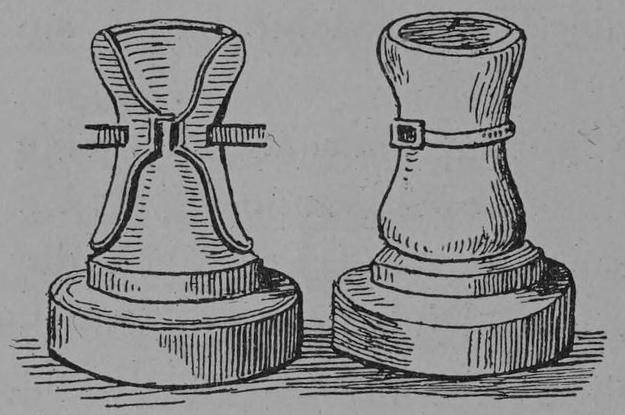

*Fig. 19. Mühlsteine.*

Im Hause arbeitete man auf der Handmühle (רחיים של יד)[^55.278], auch Menschenmühle (רחיים של אדם) genannt[^55.279], im Gegensatze zu der von Tieren getriebenen Mühle (w. u.). Sie stand in einer besonderen Kammer[^55.280], oder auch in einer Mauer- oder Fenstervertiefung[^55.281], in den meisten Fällen aber wurde sie wie ein echtes Hausgerät hin- und hergetragen, da die Handmühle hauptsächlich durch ihre Beweglichkeit charakterisiert ist. Wie schon der Dual des bh. und nh. Wortes רחיים andeutet, besteht die Handmühle, wie sie sich noch heute in Syrien ganz so erhalten hat[^55.282], im wesentlichen aus zwei Bestandteilen: 1. aus dem unteren breiteren und festeren Stein (vgl. פלח תחתית Hiob 41, 16), dem „Mühlstein“ (רחיים)[^55.282a] κατ᾽ ἐξοχήν, genauer שָׁכָב „der Liegende“ genannt, und 2. aus dem oberen schmäleren Stein, רֶכֶב „der Läufer“ oder „der Reiter“ genannt[^55.283]. Die etwas konkave Fläche des oberen Steines nahte sich der konvexen Fläche des unteren Steines, der in der Mitte einen kleinen runden Zapfen trug, um welchen der „Läufer“ mittels eines Griffes oder einer Kurbel (יד) gedreht wurde, wodurch das zwischen den Steinen liegende Getreide, das durch ein Loch (aram. בת עינא) des oberen Steines eingeschüttet wurde — das Einschütten kann durch einen oben angebrachten Trichter (אפרכס) leichter bewerkstelligt und geregelt werden — zerrieben und zermalmt wird[^55.284]. Hatten sich die beiden Steine durch das viele Mahlen glatt gelaufen, so mußten sie scharf gehauen werden[^55.285].

Die Eselsmühle (רחיים של חמור, *mola asinaria*)[^55.286] war bedeutend größer, so daß ihre rotierende Bewegung sogar eine nahe befindliche Mauer erschüttern konnte[^55.287], einerlei, ob sie wirklich vom Esel getrieben wurde, wie der Name besagt, oder durch menschliche Hand, in welchem Falle jener Name bloß die größeren Maßverhältnisse und die dementsprechende Konstruktion der Mühle angibt. In beiden Fällen nämlich wurde diese größere Mühle auf einer hölzernen Basis, „Bock“ (חמור) genannt, befestigt[^55.288], vielleicht gar in die Erde eingesenkt. Auf der Basis erhob sich ein spitzer Kegel, אצטרובל = στρόβιλος (lat. *meta*) genannt, darüber ein oberer Stein, der die Einschüttstelle mit dem vorhin genannten Trichter in einem Stück verband, indem er einen beträchtlichen Fassungsraum enthielt und darum קלת = κόλλαθος = Metzen genannt wurde; der Kegel und der Metzen sind die hauptsächlichen und charakteristischen Bestandteile der Eselsmühle. Diese größeren Mühlen hatten um den unteren Mühlstein herum in Form einer umlaufenden Rinne einen Behälter, „Meer“ (ים, Potting) genannt, das abfallende Mehl aufzunehmen[^55.289]. Gleich in der Mühle wird mit dem herauskommenden Mehle ein Reinigen, Sieben (הרקדה) vorgenommen[^55.290], denn es gilt, aus dem Mehle die Kleien (סובין) zu entfernen[^55.291], und vielleicht ist es gerade jene Rinne, die das Sieben mitbesorgt.

Wassermühlen (רחיים של מים) sind im Talmud ausdrücklich bezeugt[^55.291a], obzwar es in Palästina nur wenig solche gegeben haben mag[^55.292]. Andere Arten von Mühlen, wie die Ölmühle usw. siehe in dem betreffenden Zusammenhange. Windmühlen sind dem Altertum unbekannt.

[^55.271]: MKethub 5,5 טוחנת ואופה; im Talmud (b 59ᵇ) dahin abgeschwächt, daß die Frau nur mahlen läßt (מטחנת), d. h. für das Mahlen sorgt (nach Raši macht sie die leichteren Arbeiten des Mahlens: sie schüttet das Korn in den Trichter, fängt das Mehl auf [usw.]); nach einer anderen Meinung ib., die das Wesen der Sache besser trifft, mahlt die Hausfrau nur auf der Handmühle (רחים דידא w. u.). Siehe noch MTohar 7,4, Šebiʿith 5,9. Im heutigen Orient: BURCKHARDT, Reisen 2,187, BLÜMNER 1,32 A. 2; BAUER, Volksleben² S. 118. Zur Handmühle stellen sich auch zwei Frauen auf, eine einwärts, die andere auswärts, resp. beide inmitten (TNidda 7,3, 649₁, Bar b 60ᵇ); daß ib. abgehandelt wird, welcher von Beiden das gefundene Menstruationsblut angehört, beweist nebstbei, daß die Arbeit schwer ist und die Blutung beschleunigt. Auch nach Matt 24,41 mahlen zwei Frauen, und heute lösen sich immer zwei ab (BAUER a. a. O.).
[^55.272]: Vgl. Exod 11,5, Richter 17,21, Jes 47,2. ARVIEUX 3,201. BURCKHARDT a. a. O. Für Männer war das Mahlen auf der Handmühle bei den Arabern schimpflich, s. G. JACOB, Altarab. Beduinenleben S. 88; vgl. Richt 16,21. Den gefangenen j. Jünglingen wurden Mühlsteine aufgeladen (Thr R zu 5,13 בחורים טחון נשאו); daher die Redensart רחיים בצוארו bḲidd 29ᵇ (WZKM 19,107 A. 1). Vgl. o. beim Stoßen im Mörser. Griechen und Römer s. BLÜMNER 1,32; in den großen Betrieben wurden vermutlich Verbrecher verwendet, ib. 33, s. nächste A. Mancher Rabbi dreht die Mühle der eigenen Bewegung wegen (bGitt 67ᵇ).
[^55.273]: „Den Menschen an die Mühle spannen“ (כודנו ברחים) jPeʾah 1,1, 15ᶜ₅₉, jḲidd 1,7, 61ᵇ₄₃ (in bḲidd 31ª unten מטחינו ברחיים), j ib. an die Mahlenden kommt ein königlicher Befehl (der Sinn der Stelle ist dunkel), wobei es Schimpf und Prügel gibt. Die Handmühle wurde mitunter, eben der schwierigen Arbeit wegen, von zwei Menschen bedient: MZabim 3,2, T 4,2, 678₃₄; vgl. oben A. 271 und was G. LÖWY S. 14 A. 1 aus CLARK, Ann. des Voyages 22,237 dazu beibringt.
[^55.274]: TSabb 1,23, 111₂₁ von Wassermühlen משמיעות את הקול, j 4ª₅. Vgl. קלא bBb 20ᵇ nach Rašis zweiter Erklärung. Vgl. Jerem 25,10, Ḳohel 12,4. — קול רחיים בבורני Meg Taʿan c. 6, bSanh 32ᵇ; in jKethub 1,5, 25ᶜ₃₂ קול מגרום, und zwar hier nicht = Koch (Lwr 2,322), sondern Bäcker, denn μάγειρος und *coquus* bedeuteten ursprünglich auch den Bäcker (Blümner 1,83), vgl. umgekehrt נחתום auch Koch (o. S. 93) (die historische Würdigung der Sache s. in REJ 29,41 f.). Das starke gleichförmige Geräusch erwähnt auch BAUER, Volksleben S. 118; *mola crepax* bei Blümner 1,31 A. 2.
[^55.275]: MDemai 3,4 המוליך חטים לטוחן כותי . . . לטוחן עם הארץ . . . לטוחן גוי (ms Kfm טַחָון, so auch TBḳ 10,9, 367₁₅, was richtig sein dürfte, s. MGWJ 51,455 und auch FRANKEL Darke ha-Mišna S. 234, vgl. BARTH, Nominalbildung S. 176, verkannt von früheren Autoren, s. M. H. SEGAL, Mishnaic Hebrew (SA aus JQR 1908) p. 62). T 4,27, 52₂₇. In MSabb 7,2 ist הטוחן wirkliches Partizip. TŠebiʿith 6,27, 70₂₄ von Oliven טוחנו ברחים. Aram. טחונא pl. טחונייא jPeʾah 1,15ᵇ₄₆, jḲidd 1,7, 61ᵇ₃₁, jPesach 3,29ᵈ₇₆ und 30ª₁ (jMš 4,54ᵈ₄₄ חטונייא lies mit Pnē Mōše טחונייא). ܛܚܘܢܐ u. طاحون bespricht FRAENKEL S. 33. Zu vergleichen *גרום in גרוסי צפורי (A. 253). Sprichwort der Müller: jPeʾah 1,15ᶜ₄₆ יאות אילין טחונייא אמרין כל בר נש וכו׳ „Jedermann hat sein Recht [zu suchen] in seinem Bottich“ (קופה, Behälter der Frucht), jḲidd 1,61ᵇ₃₁. Sprichwörtlich klingt auch מן קמצא לרחייא Gen R 90,5; s. הלבנון 5,519. Verpachten der Mühlen bḲidd 82ª, bKethub 103ª.
[^55.276]: jPesach 3,29ᵈ₇₆ u. 30ª₁ ר׳ אבהו מפקד לטחוניי, ib. ר׳ חנינא בר פפא אזל ליה גבי טחוניי, ib. ר׳ אבון הורי לטחוניי. Pesiḳta 93ᵇ והוה מוליך ארבעים סאה אצל הנחתום.
[^55.277]: jDemai 3,4, 23ᶜ₃₅ קופה, jPesach 3,30ª₁ קופייא Plural; vgl. O. Bert. zu MDemai 3,4 u. o. A. 275. Wegen קופה s. KRENGEL, Hausgerät S. 40 u. § 197.
[^55.278]: רחים של יד MZabim 3,2, T 4,2, 678₃₄. רחיים דידא bPesach 11ª, bKethub 59ᵇ. Vgl. χειρομύλαι, *molae manuales* bei BLÜMNER 1,31; eine besondere Art stellen dar die *molae trusatiles* ib., und da sie unsicherer Bedeutung sind, darf wohl an דוחפין an zwei T-Stellen (s. nächste A.) erinnert werden.
[^55.279]: MʾOhal 8,3, T 9,2, 606₁₁ נדהק ברחיים (ר׳ etwas was fest ist, darum נדהק, und es folgt übrigens gleich die Definition: eine Mühle, die vom Platze nicht gerückt und nicht gestoßen wird), TTohar 6,11, 666₃₅. Die Klausel besagt jedenfalls, daß für gewöhnlich die Handmühle beweglich und so leicht hingestellt war, daß sie wegzustoßen war.
[^55.280]: Folgt aus bBeza 36ᵇ בי רחייא דאביי דלוף, und es ist ib. die Rede davon, daß man in dieselbe Kammer zur Not das Bett (פורייא) stellt. Raši freilich scheint das בי nicht als besondere Kammer aufzufassen.
[^55.281]: Maim. zu MʾOhal 8,3. Nach MNedar 5,1 standen רחיים u. תנור im Hofe. Vgl. BLÜMNER 1,37.
[^55.282]: WETZSTEIN in Verhandlungen der Berliner Gesellschaft für Anthrop. 1882 S. 465: „Die syr. Handmühle (*ĝârûsa*) ist noch ganz die des sem. Altertums, und bei den Nomaden hat sich ihr bibl. Name *reḥa* erhalten.“ BAUER, Volksleben² 118 gibt als arab. Namen der Mühle *ġarusche* pl. *ġauarisch* an, bei den Beduinen reḥa; WETZSTEIN selbst in ZDPV 14,4 A. 1 schreibt *dschāruschā*. Siehe noch NIEBUHR, Reisebeschreibung 1,150; Beschreib. von Arabien S. 51. Ḳohel 12,4 טחנה, vgl. מטחן Exod R 36,1 von der Ölmühle.
[^55.282a]: Auch gr. μύλη, allgemein **Mühle**, hat mitunter den speziellen Sinn: unterer Mühlstein (BLÜMNER 1,25 A. 1).
[^55.283]: MBb 2,1, T 1,3 (j. z. St. fol. 13ᵇ₃₂ unterscheidet zwischen babyl. u. pal. Mühlen). Vgl. פלח רכב Richter 9,53; II Sam 11,21. Bei den Griechen ὄνος = Esel oder ὄνος ἀλέτης; vgl. μύλος ὀνικός Matth 18,6 (in Mark 9,42 und Luk 17,2 etwas anders), LXX in Dt 24,6 ἐπιμύλιον; s. BLUMNER 1,30 A. 1.
[^55.284]: בת עינא bMḳ 10ª. אפרכס MKel 14,8 (aus Metall), ib. 30,4 (aus Glas). Sonst s. Lwr 2,116 πρόχοος. Neben gläsernem Trichter der Mühle mag die phantastische Angabe einer goldenen Mühle angemerkt werden (ברחייא דדהבא bBerakh 56ª). Der Zapfen scheint בוצינא (eigentlich = Docht, § 44) zu heißen, und dessen Bewegung gibt im Verhältnis zur ruhigen Lage des „Liegenden“ in gewissem Betracht das Bild der bewegten Sphären ab (bPesach 94ᵇ כבוצינא דריחיא s. Raši; nach RN im Namen RChs jedoch ist ב׳ soviel wie סדנא, also Untersatz). אצטרוביל der großen Mühle (w. u.) ist gleichfalls ein Zapfen zu nennen.
[^55.285]: bMḳ 10ª מכבש, מנקר; vgl. נקרת פסולין bChull 88ᵇ Raši: der von den Mühlsteinen abgeschabte Staub; danach Mühlsteine in gehobener Rede auch פסולין = Gehauenes. Nach RG ist der Staub von gewöhnlichen behauenen Steinen gemeint. Anekdote vom Vernähen eines zerbrochenen Mühlsteines bBekhor 8ᵇ; vgl. die Achikarsage ZDMG 48,195, Revue Sémitique 8,68 und 73. Von außen wurde die Mühle mit einem Lappen abgewischt (קנח) und gereinigt (MKel 28,2, T bb 6,8, 596₂₂). Zu demselben Zwecke hatten Griechen und Römer einen Besen, μυλήκορον, *molucrum*, BLÜMNER 1,38.
[^55.286]: bAz 16ᵇ דבי מר יוחני טחני רחים בערודי „im Hause des Mar Jochani mahlte man an der Mühle mit Wildeseln“. Die „Eselsmühle“ hieß nur wegen der Größe so, indem solche Mühlen mitunter von Eseln getrieben wurden, sie konnten aber auch mit der Hand getrieben werden; s. nächste A.
[^55.287]: MBb 2,1 lehrt: „Die Handmühle (רחיים) stellt man (von der Mauer eines andren Besitzers) entfernt auf, so daß sie von dem „Liegenden“ drei Tefachim zu stehen kommt, was gleich ist mit vier T. vom „Läufer aus“ (weil nämlich der „Läufer“ schmäler ist). Talmud ib. b 20ᵇ: Der Grund ist wegen Erschütterung (טיריא). Darauf wird eine Barajtha (s. gleich nebenan) zitiert, wonach eine solche Erschütterung nur bei der „Eselsmühle“ recht plausibel ist, bei der Handmühle besteht vielmehr das Unangenehme in dem Geräusch (קלא s. o.). Jene Bar und auch TBb 1,3, 398₈, die nun zwingt, die Mišna auf die Handmühle zu beziehen (in T steht ausdrücklich im ersten Falle רחיים של יד), lautet: ושל חמור שלשה מן האיסטרוביל (T איצט׳) שהן ארבעה מן הקלת. RG z. St. sieht in אצ׳ u. קלת der großen Mühle diejenigen zwei Teile, die bei der gewöhnlichen Mühle entsprechend שכב und רכב heißen, was durch den Kontext in der Tat erforderlich ist. Vgl. auch D. HOFFMANN in seiner Mišna-Übersetzung u. in Jahrb. der j. lit. Gesellschaft, Frankfurt a. M. 1904, 1,279. Raši sieht in אצ׳ die hölzerne Basis, in der der untere Stein sitzt, in קלת den Trichter. Im großen und ganzen alles richtig. Aber nicht die Basis selbst (obzwar eine solche vorhanden war), oder der „hölzerne Untersatz“ (G. LÖWY S. 14) hieß אצ׳, sondern der auf dieser runden oder viereckigen Basis sich erhebende steinerne Kegel oder Kreisel (אצ׳ στρόβιλος lat. *meta*, s. Lwr 2,121, wegen der Pinienzapfenform so genannt), über dem sich der etwas schmälere obere Stein in Form eines Fruchteimers oder Metzens (κόλλαθος s. A. 213, nicht κάλαθος, auch nicht *catillus*, wie die Römer den oberen Stein nannten, das freilich ähnlich klingt und von I. LÖW, mitgeteilt in Gen R 28,2 p. 261 ed. Theodor, für das Grundwort von קלת erklärt wird) erhebt. Dieser ist nicht schmäler als der Kegel im eigentlichen Sinne des Wortes (was mit G. LÖWY S. 15 A. 1 tatsächlich unmöglich erscheinen müßte), sondern schmäler als der ganze Untersatz, von dem hier nur der zur Mechanik der Mühle gehörende Kegel genannt wird. Nach RCh (zitiert von den Tosafisten zu bBb 20ᵇ) will die Bezeichnung רחיים של חמור (auch TKel bm 2,14, 580₃₈) übrigens nicht sagen, daß jene Mühle von einem Esel getrieben wurde (auch wir wollen das mit unserer „Eselsmühle“ nicht sagen, da damit bloß die größeren Maßverhältnisse ausgedrückt werden sollen, wie sie in den von Eseln getriebenen Mühlen tatsächlich bestanden, vgl. μύλος ὀνικός = großer Mühlstein), sondern heiße der hölzerne Untersatz „Esel“, wozu er Beispiele bringt (vgl. „Bock“ o.). Siehe noch BLUMNER, Techn. 1,27.
[^55.288]: MZabim 4,2 ist so aufzufassen, daß אצטרובל ebenso Bestandteil des רחים של יד ist, wie חמור, nicht daß חמור של ר׳ של יד als ganzes dem אצ׳ gegenüber stände. Ein anderer Ausdruck ist אמתא דריחיא bBerakh 18ᵇ unten, s. Raši.
[^55.289]: MZabim 4,2 Maim. u. O. Bert., und somit würde dieses ים dem entsprechen, was gleich daneben bei der Olivenquetschmühle סאה heißt (סאה של רחים של זיתים), im Grunde genommen auch mit קלת gleich, s. L. Heller z. St. und MZab 4,3 nach O. Bert., nach uns freilich zwar ein Gefäß, aber als oberer Stein der Mühle. Vgl. auch ארון der Graupenmühle o. § 54. Ähnlich wären auch die Rinnen (צינורות), welche den Mühlstein (רחיים κατ᾽ ἐξοχήν = unterer Stein) von oben (d. i. am oberen Rande) umfassen (תופסות, TKel bm 2,15, 580₃₈). Dennoch dürfte jenes ים, welches ohne nähere Bezeichnung steht, mit RŠ eher auf das „Meer“ der Ölpresse (§ 179) zu beziehen sein.
[^55.290]: bPesach 11ª טחינה והרקדה. TDemai 4,29, 52₃₀ טוחנין ומרקידין. MSabb 7,2 unter den Hauptarbeiten הטוחן והמרקד; j ib. 10ᵇ₄₀ המרקד קמח מלמטן וסלת מלמעלן (vgl. u. bei נפה). Ib. Z. 45 מרקידין לאחורי הנפה.
[^55.291]: Vgl. die Phrase bGitt 67ª טוחן הרבה ומוציא קמעא und die dort im Talmud gegebene Erklärung. AbRN β c. 4 p. 7ᵇ vom Ausfall der Küchlein aus den Eiern die gleiche Redensart.
[^55.291a]: TSabbat 1 Ende p. 111₂₁, j 1,1, 4ª₃. Es sind die ὑδραλέται oder ὑδρόμυλοι, die *molae aquariae* der Griechen und Römer, BLÜMNER 1,45. Bemerkenswert ist, daß unter den vielen Industrien, zu denen Wasser nötig war (TBm 11,30, 397₁₆), die Wassermühle nicht genannt ist, offenbar weil sie selten und für die Praxis von keiner Bedeutung war; hingegen kamen im römischen Reich, allerdings auch erst im 4. und 5. Jahr., Streitigkeiten zwischen den Wassermüllern und anderen Gewerbetreibenden in diesem Punkte vor (BLÜMNER S. 48).
[^55.292]: Nur Raši, im Geiste seiner Zeit, erwähnt sie auch in bKethub 59ᵇ u. bPesach 11ª, wo im Texte Handmühlen gemeint sind. Zur Sache s. MERCKEL, Ingenieurtechnik S. 37 und ARVIEUX 3,201. 227.[292a] MMenach 6,7: Das ʿOmer war gesiebt in dreizehn, die zwei Brote in zwölf, und das Schaubrot in elf Sieben (נפה); RŠimeʿon sagt: Das hatte kein Maß, sondern man brachte ein in erforderlicher Weise gesiebtes Feinmehl (סלת). Dazu Bar in b 76ᵇ (vgl. Tosafoth, die auf T 8,14, 524₁₁ hinweisen): בדקה בגסה בדקה בגסה, d. h. man siebte abwechselnd in zwei Sieben, wovon eines fein, das andere grob war (s. Raši ausführlich); RŠimeʿon bʾEleʿazar sagt [so war es]: Dreizehn Siebe waren im Heiligtum übereinander; das oberste enthielt die Kleien, das unterste enthielt das Feinmehl. Vgl. MʾAboth 5,18; Mekh zu Exod 16,31 p. 51ª, ZDPV 14,4: „Jede Mühle hat für die verschiedenen landesüblichen Mehlsorten sechs bis acht mehr oder weniger enge Haarsiebe im Gebrauche . . .“

## § 56

**56.** **Sieb und Reuter.**

Mit dem Mahlen war das Mehl noch nicht fertig, denn jetzt erst kamen die Verfeinerungsarbeiten. Je nachdem man die beiden Mühlsteine lose oder hart aneinander laufen ließ, entstand das gröbere oder feinere Mehl; das ganz feine Mehl wurde durch wiederholtes Mahlen gewonnen. Aber auch mehrmals wiederholtes Sieben (נָפָה) ergab feines Mehl, wie man es besonders zu Zwecken des Heiligtums brauchte[^56.292]. Ebenso siebten auch der Bäcker und die gute Hausfrau ihr Mehl mehrmals[^56.293]; die Hausfrau verrichtete beim Sieben etwa fünf Arbeiten[^56.294]. So sind denn die für diese Tätigkeit bestimmten Geräte, Sieb und Reuter, neben Herd und Ofen sehr notwendige Behelfe der Speisebereitung; besaß man sie nicht selbst, so lieh man sie von der Nachbarin oder nahm sie in Pacht[^56.295].

Die Reuter (כברה)[^56.296] ist eine größere Schwinge mit großen Löchern, die zwar vornehmlich in der Landwirtschaft verwendet wird[^56.297], aber auch in der Haushaltung mannigfache Dienste leistet; Wicken[^56.298] und Sangen[^56.399] z. B. werden darin von Spreu und sonstigem Abfall gereinigt.

Mehr Verwendung im Haushalte hatte eine kleinere Schwinge (נָפָה, aram. מהולתא, vielleicht auch ערבל oder ארבל, das aber mehr zur Scheidung von Obstarten gedient zu haben scheint)[^56.300], der Boden, d. i. die eigentliche Siebvorrichtung, gewöhnlich aus Haar geflochten (גדל)[^56.301], aber auch aus maschenartig gelegtem Leder und Schilf gemacht[^56.302], in einen hölzernen Rand („Meer“, ים genannt, s. o.)[^56.303] so eingespannt, daß eine tiefe Innenseite (תוך) und eine flache Außenseite (גב) entstand[^56.304]; der Rand konnte mit einem zum Aufhängen bestimmten Henkel (תלוי)[^56.305] versehen sein, Dinge, die übrigens fast ebenso auch für die Reuter gelten.

Auch wenn man den Weizen im Mörser stampft, und noch mehr, wenn man ihn in der Mühle mahlt, werden bereits die für den Mehlstoff unnützen Hülsen ausgesondert[^56.306], und die fernere Reinigung, das Sieben, besteht nun darin, daß man den Mehlstoff völlig frei von Kleien erhalten will. Zunächst fällt die erste Schale des Weizens ab, das sind die gemeinen Kleien (מורסן)[^56.307]; die zurückgebliebene zweite Schale des Körnchens muß gleichfalls entfernt werden, und sie dürfte die sein, die unsere Quellen סובין[^56.308] (auch פארי[^56.308a]) nennen, etwa Grieskleien. Indem man die Schalen des Weizens mahlte und siebte, wurde ein mit Kleie untermischtes Mehl gewonnen, welches קיבוריא hieß[^56.309]. Das bereits von Hülsen und Fasern befreite Korn (ἄμυλον, Amylon)[^56.310] wurde nun erst recht gemahlen und gesiebt; was das Sieb durchläßt (הוציא), ist das gewöhnliche Mehl, Mehlstaub (קמח), was im Siebe zurückbleibt, mit anderen Worten, was das Sieb auffängt (קלט), ist das Feinmehl, Semmelmehl (סֹלֶת)[^56.311], wovon אגורי = γῦρις nur sehr wenig verschieden ist[^56.312a]. Die häufig anzutreffende Mehrzahl קמחין und סלתות dürfte ohnedies auf mehrere Sorten der betreffenden Art hinweisen. Den Auszug dieses feinen Mehles (סֹלֶת) besorgt der Feinmüller (סַלְתָּן)[^56.312b]. Das Verhältnis der einzelnen Mehlprodukte zueinander wird ersichtlich aus folgender Klage über das Schwinden der guten alten Zeit: „Ein Metzen (סאה) Weizen von Arbela lieferte einen Metzen Feinmehl (סלת), einen Metzen gewöhnliches Mehl (קמח), einen Metzen Kleienmehl (קיבר), einen Metzen gemeiner Kleie (מורסן) und einen Metzen Hülsen (? גניינין)[^56.313]; jetzt aber ist keine dieser Sorten vollständig“[^56.314]. Ähnliche Berechnungen findet man bei Plinius (18, 4f.). Alle diese Mehlprodukte bildeten natürlich auch den Gegenstand des Handels, doch kommen hauptsächlich nur der Mehlstaub und das Feinmehl in Betracht[^56.315]; daß man auch Sangen (קלי) feilbot, in der Art, wie man etwa Obst verkaufte, ist bemerkenswert. Zu Hause hielt man das Mehl in einem Schlauche (נאד)[^56.316] oder einem Kübel (חצב)[^56.317a].

[^56.293]: bBeza 29ᵇ der Begriff שנה wiederholen.
[^56.294]: jSabb 7,2, 10ª₄₉ Arbeiten der Frau mit dem Weizen: 1. מערבא l. מערבלא, von ערבל = ארבל (L 1,157) grob sieben, vielleicht jedoch מערבא ein Denom. von ערבא = עריבה syr. ܥܪܒܐ *mactra* = Backtrog (w. u.); also wenn sie, die Frau, in den Trog Mehl gibt, was in dem stäubenden Mehl eine gewisse Scheidung herbeiführt), eine Unterart des הרקדה o. S. 97); 2. מפרכייא בראשייא sie zerreibt die Spitzen der Körner, d. h. sie enthülst sie (s. פרך o.), und das ist eine Art Dreschen (דוש); 3. מתברא בצדדיא (unklar); 4. מספייא (wohl von √ ספא, wovon bh. מספוא Futter), sie wirft das Korn (gleichsam zum Fraß) in den Trichter (o. S. 97), und das ist Mahlen (טחן); 5. Sieben (נפה) ist eine Art זרה Worfeln. Aus den vielen Arbeiten erklärt sich das Gleichnis in bTaʿan 19ᵇ, dessen Wesen darin liegt, daß das Backen Zeit braucht, sonst nicht gelingt (נאפת שלא כתיקנה).
[^56.295]: Als כלים שעושין בהן אוכל נפש gelten נפה, כברה, רחיים, תנור, MNedar 4,1; vgl. M und bMeg 8ª. MNedar ib. das Leihen (שאל) und Mieten (שכר) dieser Geräte; vgl. MŠebiʿith 5,9, MGitt 5,9, TKethub 7,4, 268₂₉. Nebenzwecke möglich: „Sieb“, darin Geld zu zählen; „Reuter“, darin Sand zu schütteln (vgl. ʿAmos 9,9), „Mühle“, um darin Spezerei zu mahlen, jŠebiʿith 7,36ª₄₄.
[^56.296]: Siehe bibl. Wbr.
[^56.297]: Maim. zu MKel 15,4, MŠebiʿith 5,9, MSabb 20,3 אין כוברין את התבן בכברה, vgl. ZDPV 14,7; VOGELSTEIN, Landwirtsch. S. 69; w. u. § 171.
[^56.298]: MSabb 20,3 הכרשינין . . . נותן לתוך הכברה או לתוך הכלכלה.
[^56.399]: Bar bBeza 12ᵇ המולל מלילות . . . למחר מנפה מיד ליד ואוכל אבל לא בקנון ולא בתמחוי „wer bereits vor Sabbat Sangen ausgerieben hat, der darf am Sabbat, sie von Hand zu Hand wendend, den Spreu wegblasen (in MMaʿaser 4,5 מְנַפֶּה und נִפָּה; j z. St. 51ᵇ₅₅ ebenso wie in b auch das Sieben mittels קנון und תמחוי genannt), nicht aber [das Reinigen vornehmen] im Korbe oder in der Schüssel (denn das ist bereits ein größeres Quantum und sieht werktagsmäßig aus). Ib. werden noch Methoden der Reinigung erwähnt auf einem Brett (טבלא), im Siebe (נפה) und in der Reuter (כברה). — Die Tätigkeit ist כבר (MSabb 20,3, vgl. שדרכו ליכבר TTerum 10,14; כברה = ארבלה bBm 26ᵇ.
[^56.300]: נפה MMenach 6,7 Pl. נפות, aram. נפיא Pl. נפן und נפוותא, oft, s. L 3,417. מהולתא, Verb נהל = הול, arab. هال, s. L 3,39 (wo auch מהולא der Siebende) u. 348. Zu מהולתך הרשה Gen R 81,2 s. RN bei K 4,98ᵇ und BACHER, pal. Am. 2,365. — זוסטא jMeg 1,71ᵇ₆ s. Lwr 2,245 = σῆστρον, nach L 1,525 ζωστήρ ein Gurt, der eventuell als Sieb verwendet wird, und dem stimmt auch I. LÖW zu. — ערבלא ܥܪܒܠܐ, غربال, = ארבלא, mit Denom. ערבל und ארבל s. L 3,696 und 1,157. Die Stellen, an denen ערבל vorkommt, lassen vermuten, daß es zu Obst verwendet wurde, etwa in der Art, wie WETZSTEIN in ZDPV 14,2 A. 1 die Fabrikation des *Kamardin* beschreibt, das nämlich reife Aprikosen im *Kirbal* zerquetscht, in die Kelter gelassen, getrocknet und zu Mus bereitet werden. Doch handelt es sich um **ganze** Früchte (bSanh 39ª), um Dattelkerne (bChull 49ª); in bSanh 89ᵇ und bMakk 20ᵇ ist ארבילא bloß als Gerät gedacht, in welchem die Datteln verwahrt werden. Vgl. Haḳedem, deutscher Teil, 2,71.
[^56.301]: RŠ zu MKelim 15,3 nach dem „Gaʾōn“ (Hai) und RN; nach RABD zu Maim. הל׳ כלים 5,1 jedoch aus Leder; s. jedoch L. Heller zu MKel a. a. O. Mindestens das Gewebtsein folgt auch aus bMḳ 11ª למגדל מהולתא, am besten von Haar, zur Not aber auch vom korbartigen Geflecht zu verstehen; eine Masche heißt בית (Sifra zu Lev 4,2 p. 16ª בית אחד בנפה ובכברה, ib. 16ᵇ und 83ª; zu בית = Masche vgl. § 77). Die Griechen unterschieden: κόσκινον Sieb aus Binsengeflecht; ἀλευρότησις solches von Leinwand; κρησέρα solches von Wolle, zugleich verschieden in der Feinheit des gesiebten Mehles, wie sich das bei den Römern im Namen ausdrückt: *cribrum encussorium* und *cribrum pollinare* (BLÜMNER 1,51), und so ist es möglich, daß die Verschiedenheit der j. Namen: נפה, מהולתא, ערבל usw. zugleich erkennen läßt, daß zu feinem und gröberem Mehl je ein anderes Sieb gebraucht wurde. WETZSTEIN in ZDPV 14,2 f. unterscheidet heute in Syrien 1. das Riemensieb, in zwei Gattungen, dem *kirbal* und *ghirbal* (s. zu ערבל), 2. das Haarsieb (*munchul*), beide Hauptarten in zahlreichen Modifikationen mit besonderen Namen, und jede Art hat nach Feinheit des zu gewinnenden Mehles eine besondere Verwendung.
[^56.302]: MKel 27,5 בלויי נפה וכברה שהתקינן לישיבה (man meint den Überzug am Sesselgestelle § 40), wo in erster Reihe Leder, aber auch Haar, Schilf und Binsen in Betracht kommen, s. O. Bert. מהולתך טרשא Jelamdenu (bei RN) zu Lev 27 und Num 21,1, oder חרשה Gen R 81 (A. 300) „dein Sieb wurde taub“ (s. L 2,199), es läßt das Mehl nicht mehr durch.
[^56.303]: MKel 15,3 ים נפה של סולתין (l. סַלְּתִין wie in ed. Lowe) „der Rand des Siebes der Feinmehlbereiter“, ein recht klarer Ausdruck, weil man sich denken kann, daß das Sieb dieser Professionellen recht groß sei und hierdurch der Ausdruck ים „Meer“ für den Behälter gerechtfertigt erscheint. Gegensatz hierzu ist das Sieb der Privaten ib. zweimal. In bezug auf כברה wird ib. der Unterschied gemacht zwischen der des Privatmannes (d. h. zum Hausgebrauche verwendeten, vgl. A. 287) und der der Tennen (כברת גרנות), d. h. der landwirtschaftlichen. TKel bm 5,5, 583₃₆. נפה של סולתין (l. סלתין) opp. das der Privaten. Ib. auch של גדלת Sieb der Friseurin? Zweck unbekannt und auch der Text verderbt. MKel 16,3 beweist übrigens, daß auch der Rand (ים) ein korbartiges mit Reifen (דור) befestigtes Flechtwerk (aus Ruten usw.) war.
[^56.304]: Folgt aus bBeza 29ᵇ: die Frau des RJosef siebte (נהל) Mehl auf der Außenseite (aram. גבא) des Siebes (מהולתא). Auch הרקדה (s. o.) wird das Sieben auf dem Sieb genannt, bPesach 11ª, jSabb 7,2, 10ᵇ₄₅ מרקידין לאחורי הנפה.
[^56.305]: MKel 15,4 תלוי נפה של סלתין und תלוי כברת גרנות, TKel bm 5,6, 584₄ תלוי נפה וכברה. MSabb 8,2.
[^56.306]: Vgl. bGitt 67ª und s. schon o.
[^56.307]: מורסן (etwa √ רסס in רסיסים Amos 16,11, oft im Trg, s. L Trg Wb. 2,429, nh. ממרס z. B. MJoma 4,3, von der Weiterbildung מרס rühren, mischen, מורסן die breiartige Masse, die nach dem Quetschen der Weizenkörner resultiert) wird von den meisten Kommentatoren als gröber wie סובין bezeichnet, z. B. MSabb 7,4 וסובן ומורסנן Maim., den auch O. Bert. anführt (während Raši umgekehrt סובין für das gröbere hält, anders bKeth 112ª), und zu MTerum 11,5 und zu MChalla 2,5 gibt O. Bert. nur die Ansicht, daß מ׳ das gröbere ist; s. auch RN bei K 5,257. — Nach RN ist auch צריד eine Art Kleie, nach RG und Raši bChull 36ª jedoch soviel wie zusammengeballte Mehlkügelchen, in die das Öl nicht eindringt.
[^56.308]: סובין, sing. *סוב (leicht zu erschließen aus סובן MSabb 7,4, s. vorige A.) hängt wohl mit סבב zusammen: das Umringende, Einhüllende. Möglich, daß eine Verwandtschaft mit זובן besteht (MBekhor 6,5), der Hülle des männlichen Gliedes der Tiere, und daß beide auch mit סיב aram. ציב = Faser zusammenhängen. Kleie von neuem Weizen konnte weniger gut gemahlen werden als die des trocknen alten Weizens, es war also Mehlverlust dabei.
[^56.308a]: Alles Nötige in Lwr 2,420, wohin es freilich nach I. LÖWs Ausführungen nicht gehört.
[^56.309]: bKethub 112ª, s. Raši altfr. שאנדיר. Eigentlich das zu קיבר = Brot (w. u.) verwendete Mehl. Der arme Mann bereitet seinen groben Teig (עיסה בלוסה s. A. 239) aus dem mit beiden Arten Kleien (סובין und מורסן) gemengten Mehl, bSabb 76ᵇ; der Ausspruch rührt von Abaji her wie der gleichartige o.
[^56.310]: עמילן Lwr 2,416. פת עמילה braucht, wie פת עבה, viel Kneten, Bar bPesach 37ª, bBeza 22ᵇ. Über die Fabrikation des Stärkemehles, welches ebenfalls ἄμυλον heißt, s. BLÜMNER 1,87 f.
[^56.311]: MʾAboth 5,15 ונפה שמוציאה את הקמח וקולטת את הסלת. Vgl. das von WETZSTEIN in ZDPV 14,5 aus FREYTAG, Arab. Proverbia 3,505, angeführte Sprichwort: „Er gleicht dem Siebe (منخل), das die Kleie behält (مسك) und das Mehl (دقيق) wegwirft“ (رمى). Zur Natur des סלת s. auch Mekh zu Exod 16,31 p. 51ª und Cant R 4,11 כסלת זה שצפה על גבי נפה. Sehr richtige antiquarische Bemerkung in Tosafoth bTaʿan 9ᵇ.
[^56.312a]: Lwr 2,10; vgl. BLÜMNER 1,53.
[^56.312b]: MTerum 11,5 המסלת קב או קבין לסאה. Als *nomen opificum* haben wir סַלְּתָן s. bei „Sieb“ und „Reuter“. — Mehr s. bei L 3,538, K 6,65, zu achten auf סולת, סולתא im Sinne von Speise aus feinem Mehl, w. u. — Aram. entspricht סמידא = σεμίδαλις Lwr 2,397, wo auch syr., arab. und armen. Formen nebst Literatur; s. auch ZDPV 14,4 und die interessante Bemerkung Ibn Ezras zu Exod 29,2. Lat. entspricht *simila* (unser Semmelmehl) oder *similago* (BLÜMNER 1,55). Wie nun סלת ein beliebtes Bild für den „feinen“ Menschen ist (s. schon MʾAboth 5,15 und mehr bei L und K a. a. O.), so haben wir auch סמידא in demselben Sinne in סמידך bei ZUNZ, Synag. Poesie S. 373. Im Gegensatz dazu עיסה w. u.
[^56.313]: *גניין, RN *גנין, גנינים, von ihm unerklärt gelassen, von K (2,322) mit einem verschieden lautenden pers. Worte zusammengestellt, bedeutet jedenfalls eine Art Kleie, s. auch L 1,348. Ein anderes *גנין, גנינים bei K ib. bedeutet beim Fötus den Ansatz von Fleischstücken (vgl. auch Jelamdenu, zitiert von RN, = Tanch Thězavve 13, wo allein noch גנינים vorkommt, nicht in Jalḳ Habaḳ § 565. Nach PREUSS, Die Pathologie der Geburt nach Bibel und Talmud, S. 8, sind גנונים = Fasern (der Gebärmutter); es können mithin der Ähnlichkeit wegen auch bei der Frucht „Fasern“ gemeint sein, und zwar ist die Frucht das prius, jene Fleischfasern das posterius).
[^56.314]: jPeʿah 7,3, 20ª₇₀ סאה ארבלית usw. (zu ʾArbela als gute Fruchtgegend s. § 168), מוציאה (zum Ausdrucke s. o.); Schluß: וכדון אפי׳ חדא בחדא לא קיימא, dessen Sinn im Texte so wiedergegeben wurde, daß gesagt ist, keine der genannten Sorten komme jetzt in jenem Maß aus einem Saʿah Arbela Weizen heraus. In jSota 1, 17ᵇ₂₆ sind genannt 1. סלת, 2. קמח, 3. קיבר, 4. סובין, 5. מורסן (סובין entspricht dem גניין der früheren Stelle, und zwar an vierter Stelle, während dort an vierter Stelle מורסן steht). In bKethub 112ª sagt RJose [bChalaftha aus Sepphoris]: „Ein Saʾah in Judäa (Gegensatz zu Galiläa; Verallgemeinerung von ʾArbela) trug (היתה עושה) 5 Metzen: 1 M. קמח, 1 M. סלת, 1 M. סבין, 1 M. מורסן und 1 M. קיבוריא, Reihenfolge unrichtig. Aus 3 סאה neuer Gerste (die Gerste hat viel Kleien!) wird bloß ¹/₁₀ אפה feines Mehl gezogen, bMenach 76ᵇ; vgl. G. LÖWY S. 33. Die unmittelbare Gewinnung des סלת aus Weizen besagt der Satz Sifre Dt 315 p. 135ᵇ o. שיהיו חטים שפות זו בזו ונושרות סולתן בארץ ואתה בא ונוטל כו׳; vgl. שיפה Ausdruck des Knetens w. u. S. 100.
[^56.315]: MMenach 10,5 (b 67ᵇ) (Raši und bPes 10ᵇ שוקי) משקרב העומר יוצאין ומוצאין שוק ירושלים מלא קמח וקלי (im Texte קמח קלי, was unsinnig wäre, Raši richtig Mehl und Sangen; doch auch TChalla 1,4, 97₂₀ קמח קלי, vgl. אבוב של קלאים o.). MMakhš 6,2 קמחין וסלתות של בית השוקים.
[^56.316]: bJoma 35ᵇ נאד של קמח auf der Reise, doch wohl auch zu Hause. Dieser Gebrauch von נאד fehlt bei KRENGEL, Hausgerät, S. 46. Ähnlich ist אבטא דטייעי bAz 34ᵇ oben (RCh und Raši, s. jedoch RN אכטא mit **kaf** und dessen Erklärung).
[^56.317a]: Folgt aus הצבא דאבישונא bPesach 40ª. Zu הצב s. o. S. 81; zu אביש׳ s. w. u. § 59.

## § 57

**57.** **Die Brotbereitung.**

a) Der Sauerteig. Die Juden aßen von alters her gesäuertes Brot (חמץ, aram. חמיעא)[^57.317] und wendeten zu diesem Zwecke ebenso frühzeitig den Sauerteig (שאור)[^57.318] als ein Zubehör an, das dem Brote einen besseren Geschmack gibt und es länger frisch erhält; mit Hefe[^57.319] erreichte man das weniger gut. Auch verschimmeltes Brot (§ 59) kann zerstoßen und als sehr wirksamer Sauerteig verwendet werden[^57.320]. Sauerteig wurde gewöhnlich zu Hause bereitet und in Privathäusern etwa 3 Wochen lang gehalten[^57.320a], aber man kaufte ihn auch beim Bäcker, und man konnte es auch so machen, daß die Frau dem Bäcker Mehl gab, damit er Sauerteig davon mache[^57.321]. Man hielt den Sauerteig in einem irdenen oder hölzernen Behältnis (בית שאור), das manchmal durch eine Zwischenwand (קרץ) in zwei Fächer geteilt war und auch mit einem Deckel versehen sein konnte[^57.322]; ein starker hölzerner Bottich (כופת)[^57.323] diente gleichfalls dazu. Der bereits eine Zeitlang stehende Sauerteig ist besser als der frisch gemachte[^57.324]. Die Menge des Sauerteiges muß proportionell sein mit der Menge des zu säuernden Teiges[^57.325]; auch verstreicht eine gewisse Zeit — ohne vorhergehendes Säuern der Zeitraum eines מיל[^57.325a] — bis zum Sauerwerden (החמיץ, ζυμοῦν, *fermentare*) des Teiges[^57.326]. Überhaupt kann nur der Teig der fünf folgenden Getreidearten (kurzweg „fünf Arten“ חמשת המינין genannt) zur wirklichen Gärung geführt werden: Weizen (חטה), Gerste (שעורה), Emmer (כוסמת, pl. כוסמין), Kolbenhirse (*Panicum italicum L.*, שבולת שועל) und Hafer (שיפון)[^57.327], mit anderen Worten: der Teig des Brotkornes, während Reis, Moorhirse, Rispenhirse und sämtliche Hülsenfrüchte selbst auf künstlichem Wege[^57.328] nicht wirklich gären, sondern nur in Fäulnis (סירחון) geraten[^57.329]. Der im Gären befindliche Teig heißt שיאור; der Teig ist zunächst blaß (הכסיפו פניו), dann zeigen sich kleine Spalten, welche die Schulsprache mit den [Fühl-]Hörnern der Heuschrecken (קרני חגבים) vergleicht, bis die Spalten (סדקים) durch und durch gehen, ein sicheres Zeichen der eingetretenen Säuerung[^57.330]. Ein Teig, der „stumm“ bleibt (בצק החרש)[^57.331], d. h., den eigentümlichen Klatschton nicht gibt, wenn man mit der flachen Hand darauf schlägt, ist nicht sicher gesäuert, während jener Ton allerdings die Säuerung bekunden würde.

b) Das Kneten. Die Frau (o. S. 92) knetet (bh. u. nh. לוש, *n. action.* לישה)[^57.332] den Teig, indem sie das Mehl mit Wasser[^57.333] zunächst vermischt oder rührt (ערם)[^57.334], die Masse mehrere Male übereinander wälzt (גלגל) und sie verdichtet (טמטם)[^57.335], bis je nach Wunsch ein weicherer oder härterer Teig (ersteres עיסה[^57.336], letzteres בצק)[^57.337] entsteht. Dickes Brot braucht viel Kneten und macht dementsprechend mehr Mühe[^57.338]. Das ganze Verfahren bezeichnete man auch mit dem Worte „mischen, kneten“ (גבל), und man hatte in großen Häusern, wo es viel zu backen gab und auf einmal viel Teig durchzukneten war, einen männlichen Kneter (גַּבָּל)[^57.339], wie ihn wohl auch die Bäcker hielten. Hatte der Teig nicht die gewünschte Festigkeit, so half man nach, indem man mehrere Teige zusammenlegte (צרף, נשך)[^57.340]. Feineres Gebäck knetete man mit Wein, Honig, Milch, Öl usw. an[^57.341]; aber auch zum gewöhnlichen Brote nahm man zumindest Salz (מלח)[^57.341a]. Zu einer gewissen Art feinen Gebäcks wurde der Teig schwammartig belassen (סופגנין)[^57.342], in einem anderen Falle hieß er Honigteig (דובשנין)[^57.343], und solche Teige buken sich auch leichter. Wir hören auch von einem mittelmäßig harten Teig (בצק הבינוני)[^57.344]. Das ganz leichte Rühren in Wasser, und zwar entweder so, daß man in siedendes Wasser Mehl hinzuschüttet (מְעִיסָה) oder mit siedendem Wasser das Mehl übergießt oder abbrüht (חליטה), schließt kein Backen, sondern ein Kochen in sich ein, und es entsteht die gekochte Mehlspeise[^57.345].

c) **Der Backtrog.** Als das Gefäß, in welchem geknetet wurde, wird zumeist ein in Form, Größe und Material (hölzern und irden) verschiedener Backtrog (bh. *משארת[^57.346], nh. עריבה[^57.347], auch מגים gr. μαγίς[^57.347a]), doch auch ein Becken (aram. אגנא)[^57.348] genannt, ferner waren in Verwendung ein hölzernes Brett oder eine eherne Tafel, auf welchem Teig geknetet oder gerollt oder das bereits geformte Brot bis zum Einschießen gehalten wurde (דף של נחתומים)[^57.349], die sogenannte „Garb“, auf welcher der Teig gärt, und ein Wassertopf zur Aushilfe (סרוד של נחתומים)[^57.350], aus welchem der Teig nach Bedarf mit Wasser benetzt wurde, damit die Rinde geglättet werde und einen Glanz bekomme. Zu demselben Zwecke wurde wohl auch der Teig selbst in Wasser getaucht[^57.351]. Feineres Gebäck bestrich man mit Wein, Öl, Honig und dergl. (קִטֵּף, החליק)[^57.352].

d) **Formung des Teiges.** Letztere Verrichtung geschah, wenn der Teig bereits in die zu formenden Stücke auseinandergerissen war. Man sagte dafür קצץ und קרץ, den Teigteil abschneiden oder auseinanderreißen, auch absondern (הפריש)[^57.353]. In der Nähe[^57.354] hatte die Frau oder der Bäcker einen flachen Korb (כפישה)[^57.355], einen Anrichtetisch (נחותא, אנחותא)[^57.356] oder Anrichtebretter (ארוכות)[^57.357] stehen, auf denen der Teig gedehnt oder gerollt wurde, was man mittels eines Roll-(Mangel-)Holzes (מערוך)[^57.358] tat. Geformt wurde nun der Teig mit bloßer Hand, doch hatte man zu dem feineren Gebäck auch ein bestimmtes Modell (דפוס = τύπος)[^57.359]. Das vom Bäcker hergestellte Gebäck war an Form und Gewicht nach einem gewissen Typus gleichartig, das zu Hause hergestellte von bunter Mannigfaltigkeit[^57.360]. Die dem Bäcker übergebenen Brote wurden mit Steinchen, Feigbohnen usw. gekennzeichnet, um sie vor Verwechselungen zu schützen; zu demselben Zwecke ließ man auch einen länglichen Streifen Teig (מסמר) am Gebäck herunterhängen[^57.361].

[^57.317]: Die Targumim gebrauchen חמירא nur im Sinne von שאור = Sauerteig, während sie חמץ mit חמיעא übersetzen; im Talmud aber (wie Isr. Isserlein in Terumath-ha-Dešen No. 134 aus bPesach 4ª, 5ᵇ, 30ª beweist, s. G. LÖWY S. 19 A. 6) ist חמירא „Gesäuertes“ überhaupt.
[^57.318]: Man nahm ihn gewöhnlich vom Teige ab (folgt aus MChalla 3,8). Eine spezielle Art Sauerteig ist חמירא ארכסא דשערי der harte Gerstensauerteig (bMenach 43ª oben, s. L 1,168), dessen ätzende Kraft selbst auf die Farbe des Blaupurpur (תכלת) einwirkt. — Die heutigen arabischen Beduinen wenden in der Regel keinen Sauerteig an, ARVIEUX 3,227. Die alten Griechen und Römer aßen zumeist gesäuertes Brot; BLÜMNER 1,58.
[^57.319]: שמרים Weinhefe Jes 25,6, Jerem 48,11 beweist das nicht, was G. LÖWY S. 18 darin findet, daß nämlich die Hefe als Gärungsmittel benutzt wurde; wohl aber säuert (חִמֵּץ) ein zerquetschter Apfel (MTerum 10,2, s. L. Heller, bMenach 53ᵇ und 54ª f., jChalla 1 Anf, fol. 57ª₆₆). Ib. (Z. 62 und jTerum 10,2, 47ª) מחמץ במימיו und מחמץ בגופו. BLÜMNER 1,59 beschreibt ein Gärungsmittel aus Trauben und solches aus „verdicktem Schaum“ von den aus Getreide bereiteten bierartigen Getränken.
[^57.320]: Bar bPesach 45ᵇ הפת שעיפשה . . . ראוי לשוחקה ולחמע בה כמה עיסות אחרות. Zu achten auf חַמֵּעַ hier = חִמֵּץ vorige A.
[^57.320a]: Folgt aus TPesach (2 Anf.) 1,13, 156₉, jʿOrla 2,7, 62ᵇ₆₈, jAz 5,1, 145ª₅₀.
[^57.321]: MChalla 1,7 נחתום שעשה שאור כו׳, ib. נשים שנתנו לנחתום . . . לעשות ש׳. Die Frau borgt von der Nachbarin Sauerteig (Gen R 19,10 p. 180 Th לשואלת חמץ usw., doch Var. חומץ Essig und auch חמין warmes Wasser).
[^57.322]: MKel 8,6, bPesach 30ᵇ s. RCh. Zur Benennung בית שאור vgl. בית תבלין usw. § 46; קרץ vgl. Hiob 33,6. Der Deckel war gut, um den Sauerteig nicht verdampfen zu lassen, vgl. bPesach ib. כיון דרויחא שליט בהו אוירא.
[^57.323]: Bar bPesach 45ᵇ u. bChull 129ª כופת שאור s. Raši u. vgl. § 41a. Daß man diesen „Holzklotz“ zum Sitzen bestimmte (שייחדה לישיבה ib.), soll wohl heißen, daß man ihn umstürzte, vgl. die Etymologie bSabb 77ᵇ כופתא כוף ותיב. Nach jPesach 3,1, 28ᵈ₄₈ בצק שעשאו כופת scheint der Sinn ein andrer zu sein: „Teig, aus dem man eine feste Masse machte“ (L 2,392), u. z. ist dieses Ding מאים (ib.) = ekelhaft (zu essen); sollte nun o. in b eben diese Teigmasse die Sitzgelegenheit abgeben? Das wäre allerdings nicht wunderlicher, als die Angabe in j (etwas vorher): הטח ביתו חמץ „wer sein Haus mit gegorenem Teig verschmiert“, d. i. die Wände belegt. Vielleicht ist der Sinn der Stelle: „Ein Teig, der mittels einer Stange gemacht wurde“, d. i. zur größeren Bequemlichkeit wird der Teig mitunter mit Stangen geknetet, wie die Darstellung u. Abbildung bei BLÜMNER 1,63 lehrt.
[^57.324]: MMenach 5,1 (b 52ᵇ) Meinungsverschiedenheit zwischen RMeïr und RJuda, aber in der Sache der Qualität des Sauerteiges verlautet kein Widerspruch. Zu achten auf den Ausdruck בדה (שאור בודה להן מתוכן ומחמצן) und מביא את השאור, d. i. fertiger Sauerteig.
[^57.325]: Folgt u. A. aus MʿOrla 2,6 שאור של חטים שנפל לתוך עיסת חטים ויש בו כדי לחמץ; ib. vorher der Sauerstoff מחמץ = Säuerndes. Ib. 8. 9. 11. 12. 14. In Griechenland nahm man gewöhnlich auf je zwei halbe Modius Mehl ²/₃ Pfund Sauerteig (Plin. 18,102, s. BLÜMNER 1,58).
[^57.325a]: bPesach 46ª. Zu מיל s. § 219.
[^57.326]: Interessante Notiz: „Die Frauen von Lydda kneteten ihren Teig, gingen hinauf und beteten [in Jerusalem] und waren schon zurück, ehe ihr Teig sauer wurde“ (jMš 5,2, 56ª₁₇).
[^57.327]: MChalla 1,2, M u. bPesach 35ª, vgl. Maim. הל׳ חמץ ומצה 5,1. Zu den Getreidearten s. I. LÖW, Pfl. No. 72. 81. 111. 222. Für שיפון setzen die Babylonier (bMenach 70ª) דִּשְׂרָא (I. LÖW No. 81), Raši = *seigle* Roggen, in Wirklichkeit = Ägilops, also das, was man gewöhnlich unter שבולת שועל (b ib. שבילי תעלא), d. i. Walch, versteht. Der Name שועל resp. תעלא = Fuchs, wie auch Ägilops = αἰγίλωψ = Ziegenhügel? u. Walch, gehört in die Kategorie der zuerst von GRIMM (Gesch. d. d. Sprache 66), dann von HEHN (Kulturpfl.⁷ 550) besprochenen Benennungen von entarteten Pflanzen, vom Unkraut, die von unfruchtbaren Tieren hergenommen sind. Im Texte auf Löws Wunsch: Kolbenhirse, was er anderwärts zu begründen hofft.
[^57.328]: Auch wenn man sie, wie das Brotkorn, mit Wasser durchrührt u. knetet, mit Kleidern, Polstern usw. zudeckt und dieselben scheinbar aufgehen, so ist es nur סירחון jPesach 2,29ᵇ₁₅, vgl. jChalla 1,1, 57ª₆₂, bPesach 35ª ס׳ (opp. חמוץ), Sifre Num 110 p. 31ª.
[^57.329]: Bei der Wichtigkeit des Begriffes „Gesäuertes“ in Ansehung des Pesachfestes ist es begreiflich, daß sich hierüber viele Details finden; s. die schon zitierten Talmudstellen u. die Dezisoren, auch G. LÖWY S. 20 f.
[^57.330]: MPesach 3,5 (statt שיאור auch כיאור geschrieben), Mekh zu Exod 12,17 p. 10ª.
[^57.331]: MPesach 3,2 (b 46ª) nach Maim. z. St. u. auch in הל׳ חמץ ומצה 5, (anders RAbD) u. auch Bert. in 1. Erkl., Andere jedoch ב׳ החרס „harter Teig wie Scherben“.
[^57.332]: לוש Nifʿal נילוש (z. B. MMenach 11,1, Sifre Num 110 p. 31ª). Stadien שיפה Reiben u. בעיטה Stoßen, RJose in MMenach 6,5 (76ª), vgl. Raši zu bPesach 37ª u. bBeza 22ᵇ. Nach dem Kneten blieben Teigreste unter den Fingernägeln, s. MMiḳw 9,2; viell. המלמולין ib. gleichfalls etwas Derartiges; vgl. המלאי TChalla 1,3, 97₁₈ Var בצק, welches nun für jenes Aufschluß geben muß, da מלאי = Ware (L 3,120) hier ebensowenig paßt, wie in TPesach (2) 1,17. 18 p. 156₁₉ f. מְלַאי, von √ מלל zerreiben (s. o.), bedeutet wohl den Teig in einem gewissen Stadium, wahrscheinlich im letzten, und eben darum dürfte מלמולין die Teigreste, etwa das Zusammengekratzte, bedeuten, auch zum כותח (w. u.) genommen. So ist auch bh. עריסה √ ערס = גרס stampfen, zerstoßen; vgl. ܡܥܨܪܬܐ = *torcular* (BROCKELM., Lex. Syr. 186), nicht von מלא voll sein, sondern מלל treten (wie דרך) abzuleiten, u. wohl auch bh. מלאה Exod 22,28; Num 18,27.
[^57.333]: MGitt 5,9 משתטיל המים; Sifre Num 110 p. 31ª כיון שנותנת מים. Der Bäcker (dessen Wasserbedarf auch in TBm 11,30, 397₁₇ u. Parall. hervortritt) brauchte natürlich ein ganzes Faß (חבית) Wasser ממלא נחתום חבית של מים אעפ״י שאינו צריך אלא לקיתון א׳ bBeza 17ª, bSabb 18ᵇ. Auch daraus sieht man, daß man zum Kneten frisch geschöpftes Wasser nahm, folgt aber auch daraus, daß man für die מצות genächtigtes Wasser (מים שלנו) verlangte (bPesach 42ª), also zu Gesäuertem besser das frisch geschöpfte. Am Feuer gewärmtes oder an der Sonne warm gewordenes Wasser befördert die Gährung (ib. die Frau soll nicht kneten בחמה . . . ולא במים הגרופין מן המולייר). Aus Gründen der levitischen Reinheit, die sich aber als irrtümlich erwiesen, ließen es sich die Einwohner eines gewissen pal. Ortes angelegen sein, ihren Teig in Sumpfwasser (מי בצעים) resp. im Wasser der Flüsse קרמיון u. פיגה (§ 90) zu kneten (Bar bSanh 5ᵇ). Auch קמח שנפל לתוכו דלף כו׳ (bPesach 39ᵇ, Maim. liest „Getreide“) dürfte demnach mehr als akademische Frage sein. קשקש במים jSabb 2,4, 5ᵇ₄₄ (L 4,398 klopfen, den Teig hin und her schütteln) ist der Beginn des Knetens. מים שלפני הנפה u. מים שלפני הספל in TJad 1,11, 681₂₅ f. sind ebenfalls Erscheinungen des Backens.
[^57.334]: ערם (nach L 3,702 synonym mit גרם u. רסס vgl. o.), Piʿel עירם eigentlich = zerschlagen, hier Mehl mit Wasser vermischen. Ist ein dem לוש = Kneten vorhergehendes Stadium: jPesach 3,3, 30ª₃₇ עירם לא אמר אלא לש; Sifre Num 110 p. 31ª folgende Stadien: ראשית עריסתכם משיתערס, מכאן אמרו אוכלים עראי מן העיסה עד שתתגלגל בחיטים ותטמטם בשעורים, גלגלה . . . טמטמה dann erst darf man von dem Challa-Teige nicht essen. An jenes biblische ראשית dürfte anklingen jChalla 1,1, 57ᵇ₄₀ עירם ראשי עיסות „wenn er begonnen hat, die Teige zu rühren“ (nicht „die Teigspitzen verbinden“, G. LÖWY S. 22 A. 6 nach L a. a. O.). In bMenach 75ᵇ und bBerakh 37ᵇ בשערסן ist die Rede vom Vermengen, Zusammenfassen von bereits gebackenen Stücken Brot. Durch Rühren des Mehls mit Wasser kommt das Gericht שתיתא zustande, bSanh 67ᵇ, s. Raši, s. jedoch o. A. 270.
[^57.335]: Sifre Num 110 p. 31ª s. vorige A., MChalla 3,1 f., T 1,11. 12, 98₁₃ f. גלגל u. טמטם, in jChalla 3,1, 59ª₁₄ גבלול Vermischen; bBeza 9ª oben גלגל עיסה.
[^57.336]: Ein derart großer Unterschied zwischen עיסה (= Teigmasse aus Mischung von Mehl und Wasser) u. בצק (= vollendeter Teig), wie ihn G. LÖWY S. 23 annimmt, besteht nicht. Vgl. MTerum 10,2 (der zerquetschte Apfel wird in den Teig, עיסה, gegeben und säuert ihn); TDemai 4, 31,53₅ עיסה לאפות; MChalla 2,3 לעשות עיסתו, ib. 4 העושה עיסתו, T 1,9, 98₅ u. 2,3 f., ib. 1,4 העושה עיסה לרבים, ib. העושה עיסה לאוכלה בבצק — an allen diesen und sonstigen Stellen durchaus das Resultat und nicht erst das Stadium einer Arbeit. Auch sieht man, daß עיסה einen selbständigen Wert hat, bevor es gebacken wird, vgl. besonders auch עיסת הארנונא als *annona* zu liefernder Teig TChalla 1,4; עיסת הכלבים MChalla 1,5 (ein aus etwas Mehl und Kleie gemachter Teig, von dem aber manchmal auch der Hirt ißt). In den letzten beiden Fällen dürfte עיסה dem μάζα der Griechen, dem *puls* der Römer entsprechen.
[^57.337]: בצק (eingentlich was anschwillt, s. bibl. Wbr), MPesach 3,2, MKel 9,1. — Für bḲidd 52ᵇ wurde in Lwr 2,452 φύραμα vorgeschlagen, ein bei Griechen häufiges Wort für Teig (BLÜMNER 1,64), doch hat bPesach 107ª פרזומא, weshalb mit I. LÖW jenes griechische Wort hier nicht zu figurieren hat.
[^57.338]: bBeza 22ᵇ, bPesach 37ª. S. oben A. 310 zu עמילן.
[^57.339]: מגבלין עיסותיהם bSanh 5ᵇ (Piʿel), jDemai 3,1, 23ᵇ₅₃ המגבלין בטהרה. TMr 3,13, 85₁₀ גובל עיסתו (Ḳal). Aram. גביל מרתח bBerakh 37ᵇ, גובלא בעלמא ib. 38ª. Abba Saul war der Kneter (גַּבָּל) im Hause Rabbis, bPesach 34ª (A. Büchler, Der gal. ʾAm ha-Areṣ 160,1). In bKethub 72ª redet sich die Frau dahin aus, daß ihr ein Kneter (גבל) den Teig (עיסה) bereitet (תקן) habe. מורסן (o.) ist zum Kneten (גיבול) nicht geeignet bSabb 155ᵇ. Nicht durchgeknetet (ששייר קמח בעיסתו TChalla 1,7, 97₂₇). Es ist jedoch möglich, daß גַּבָּל etwa der Künstler ist, der die feinen Backwerke füllt oder auch Pasteten u. dgl. macht, etwa = *fartor*, dessen Bedeutung freilich ebenso unsicher ist, s. in Gallus 3,369.
[^57.340]: MChalla 4,2 מצטרפות, ib. 4 שנשכו זו בזה, T. 2,2f. מצטרף. MTohar 1,7 מקרצות נושכות זו בזו, ib. 8 mehrmals השיך, T 1,2; vgl. MTebul Jom 1,1, T 1,1, 684₁₄ opp. הפריש.
[^57.341]: TʾOhal 13,5, 610₂₅ Brot (ככר), das mit Fruchtsaft (מי פירות) geknetet wurde. Bar bPesach 36ª ולָשִׁין להם עיסה ביין ושמן ודבש, ib. בחלבא, בדובשא. In bSanh 5ᵇ figuriert מי ביצים Eierweiß (s. o.), das zu dem Irrtum מי בצעים (o.) Anlaß gab. „Gewürz“, das man noch bei G. LÖWY S. 24 liest, ist zwar als Zubehör nicht unmöglich, folgt jedoch nicht aus MBeza 5,4, denn תבלין dort wird aufs Kochen (לקדרה) bezogen; s. allerdings Maim. zu MChalla 1,4, wohl nach TDemai 4,31, 53₅.
[^57.341a]: MBeza 5,4. Salz durfte bekanntlich bei den Speiseopfern (מנחות) nicht fehlen (Lev 2,13, vgl. bMenach 21ᵇ u. T 6,3, 519₂₈). BLÜMNER 1,60.
[^57.342]: MChalla 1,4. 5 סופגנין von σπόγγος Lwr 2,407. MʿUkzin 2,9 פת ספגניות. Gleichwohl wurden סופגנין gebacken (MKel 5,1. 8, T bḳ 4,2. 12. 17, 572f.) und nicht gekocht.
[^57.343]: MChalla 1,4.
[^57.344]: MKel 9,1.
[^57.345]: MChalla 1,6 המעיסה, s. Maim. u. ʿO. Bert. u. bPesach 37ᵇ. Ib. החליטה. In jChalla 1,58ª₇ u. T 1,1. 2, 97₁₆ umgekehrt definiert: אי זו המעיסה הנותן חמין לתוך קמח u. jenes: קמח לתוך חמין, ebenso jPesach 2,6, 29ᶜ₂₇. Schon in bezug auf die Teighebe gehen die Meinungen der Schulen Šammais und Hillels auseinander, ob diese Art Teig der Challa-Pflicht unterliege; T ib. wird ferner daneben gesagt הנעשין באילפס ובקדרה (opp. בתנור), sie stehen also der gekochten Mehlspeise nahe. חליטה jBerakh 6,1, 10ᵇ₃₁. jʿErub 3,1, 20ᵈ₃₁ אכל חליטין ··· לא טעמית מדי בההוא יומא: „er aß solch eingerührten Teig . . . (da sagte er): am heutigen Tage habe ich nichts genossen.“ „Der Mensch kommt mit חליטין zur Welt (d. h. das kleine Kind wird mit solch leichtem Teig genährt), und geht auch mit חליטין von dannen“ (d. h. alt geworden, muß er sich wieder so nähren), Gen R 42,2, Jalḳ Gen § 72, Ḳohel R 5,15. Sonst s. L 2,57 u. w. unten.
[^57.346]: bh. משארת s. GES. Hwb.¹⁴. Bar bPesach 53ᵇ . . . משארות מצויות אצל תנור בשעה שהתנור חם „Backtröge pflegen am Ofen zu stehen, wenn der Ofen warm ist“. „Unklar. Etym.“ (GES.) ist *משארת wohl nicht, sondern von שְׁאֵר Fleisch, dessen Gerät *משארת mit der Zeit das der späteren Nahrung κατ’ ἐξοχήν, des Brotes, geworden ist, mit derselben Logik, nach welcher לחם = Brot im arab. لحم „Fleisch“ geworden ist (FRAENKEL S. 30).
[^57.347]: MʾOhal 5,4 האשה שהיא לשה בעריבה, T 5,11, 603₁ מגבהת זו ומנחת זו. MPesach 3,2 בצק שבסדקי עריבה. MTebul Jom 4,3. Nach TʿErub 9,18, 149₂₉ steht der Trog gewöhnlich im Hof und nimmt Regenwasser auf. Hierdurch erklärt sich das Vorhandensein von zwei größern Gefäßen neben einer Bäckerei in Pompeji (s. OVERBECK Pompeji⁴ 389). Anders ist עריבה in Sifra zu Lev 11,4, 75ᶜ s. o. שלש עריבות Backtröge in drei Größen (MKel 24,3; ib. ersieht man, daß der durch Risse unbrauchbar gewordene Trog — שנסדקה geht auf Holzmaterial — mittels Umkippen als Sitzgelegenheit gebraucht wird, vgl. o.). Ib. 4,1 כמין שתי עריבות, T bḳ 3,5 עריבה גדולה של חרס ··· מטה על צדה ולש בה. MTohar 8,8 ein abschüssiger Backtrog und es befindet sich der Teig mehr oben. [?] PSm 2981, BROCKELM. 260. ארבי bPesach 40ᵇ o., nach Raši = עריבה, dürfte davon zu trennen sein und vielmehr gleich ארבא (gleich daneben) = Schiff (§ 216) bedeuten. Vgl. auch o. S. 18 zu jSabb 7,2, 10ª₄₉.
[^57.347a]: Lwr 2,321. Bei den Gr. μάκτρα, μαγίς, σκάφη, κάρδοπος BLÜMNER 1,61, während lat. *alveus*, zugleich ein Badegerät, stark an den ähnlichen Gebrauch von עריבה erinnert.
[^57.348]: bPesach 30ᵇ. 45ᵇ. bTaʿan 25ª אגנא מלא לישה. Syr. [?] PSm 28. PERLES, Et. St. S. 62. Von אגנא gilt das nämliche wie von עריבה; es ist auch ein Badegerät, s. Haḳedem, deutscher Teil, 1,188.
[^57.349]: MKel 15,2 (Hai: „Ein Brett, worauf der Teig gelegt wurde, bis er sauer geworden“; nach Bert. aus Metall, doch ist דף gewöhnlich Holz), Sifra zu Lev 11,4, p. 75ᶜ. Vielleicht derart auch TʾOhal 13,5, 610₂₅ דף של קנים שהוא מסורג בחבלים, denn es heißt dabei: ככר לושה במי פירות נתונה גביו; daß es ferner dabei heißt: ועשוי בטיט, ist nichts anderes als קבעו בכותל in MKel 15,2. Gemauerte Tische hat man auch in den Bäckereien zu Pompeji gefunden, „offenbar zum Formen des Teiges“ dienend, OVERBECK, Pomp.⁴ 389.
[^57.350]: MKel 15,2 nach Maim., s. L. Heller, wonach dieses סרוד zu trennen von סרידה w. u. (Ableitung von bibl. בגדי שרד: etwas zur Bedienung oder Aushilfe); nach RŠ und Bert. jedoch ist dieses סרוד ein kleiner Trog und verwandt mit סרידה. סרוד auch jSabb 10,1, 12ᶜ₅, Sifra zu Lev 11,4, p. 75ᶜ (nach RABD, wo irrtümlich סדור, dienen ס׳ u. דף beide, um Brot darauf zu legen, nur legt man es auf das eine **vor**, auf das andere **nach** dem Backen). In TKel bm 5,4, 583₃₃ erst סוור (lies סרוד vgl. u.), dann סרוד של צפורה etwa של זמורה; vgl. זמורה in MKel 10,6. Danach waren es zusammenrollbare Gebilde, und es passt die Eventualität פרוס (in T: מפני מה סוור של נחתומין הפרוס טמא, vgl. דף של קנים in der vorigen A.), wovon der Gegensatz etwa קווץ wäre; in T kann also nur eine Anrichtestelle gemeint sein.
[^57.351]: MJad 1,5 המים שהנחתום מטביל בהם את הגלוסקין ··· וכשהוא מדיח את ידיו בהן, T 1,10, 681₂₄ המים שלפני נחתום, mit dem Vermerk, daß möglicherweise נשתנו מראיהן; ib. ושהוא נוטל בידיו ונותן על גבי ככרות אם נשתנו מראיהן כו׳. Geräte zu demselben Zweck in Pompeji s. OVERBECK a. a. O.
[^57.352]: bPesach 36ª, j 2, 29ᶜ₄₀. MPesach 3,4 תפח תלטוש בצונן, nach Bar b ib. 48ᵇ = מקטפת. In TMenach 7,13, 522₂₄ vier Arbeiten nebeneinander: לוש, ערך (dies ist aus תירך = תערך zu entnehmen), קטף, אפה; gleich darauf לישה, עריכה, אפייה. bBm 89ª הלש והמקטף והאופה. jBm 7,4, 11ᵇ₆₇, jBerakh 9,13ᵇ₁₅. Bedeutung von קטף nicht **kerben**, auch nicht vom Teige **reißen** (L 4,287), sondern das abgerissene Stück **bestreichen**. Der Ausdruck החליק in המחליק בענבים MMaʿser 1,8, bSabb 145ª s. Raši.
[^57.353]: Vgl. קוצה חלתה MChalla 2,3 (ib. 5 המפריש ist weniger technisch, da es bloß das Absondern der **Hebe** bedeutet), MKethub 7,6 (b 72ª), MTebul Jom 4,2 (erst וקוצה לה חלה dann ומפרשתה), ib. 3. — קרץ folgt aus מקרץ s. o. und weiter u. Auch MKelim 15,2 להיות קורץ עליו u. z. auf dem vorhin genannten סרוד, das man dementsprechend adaptierte; T bm 4,5, 583₃₇ (s. A. 340) מפני שהוא קורץ ומוליך עליו מקרצות לתנור; ib. ושל בעלי בתים אם התקינו להיות קורץ כו׳.
[^57.354]: Folgt aus dem bei der Teighebe vorgeschriebenen Agende מקפת MTebul Jom 4,2. 3; T 2,14, 686₇.
[^57.355]: MTebul Jom 4,2 כפיש׳ מצרית (KRENGEL, Hausgerät S. 44 verzeichnet nur כפיפה, s. § 197; s. dieselbe Ausstellung schon MGWJ 43,384); daß sie flach waren, folgt aus dem Wesen der Sache u. aus der Halakha, s. RŠ u. Raši zu bNidda 7ª u. vgl. L Heller z. St. In TTj 2,14, 686₇ nur כפישה, TDemai 3,1, 49₆ ונותן לפי כפישא.
[^57.356]: MTebul Jom ib. נחותא (fehlt in manchen Agg., Hai ms. und bNidda 7ª אנחותא), TTj 2,14, 686₇, TKel bm 6,7, 585₁₂ s. o. Auch in dem Backtrog (עריבה s. o.) konnte geformt werden: TTohar 9,15, 671₂.
[^57.357]: MKel 15,2 RN u. Agg. ארובות, ebenso TKel bm 5,4, 583₃₁ u. MʿEdujoth 7,7, wo auch ms Kfm ארובות hat, jedoch ארוכות in ed. Lowe, noch besser RAbD Var ערוכות, von ערך, vgl. מערוך u. עורכת (Verwechslung mit ארוכות המטה § 41). Nach MKel ib. wurden diese Bretter übrigens mit roter und gelber Farbe verziert (סרקן או כרכמן). Nach T a. a. O. haben die Bäcker dieses Gerät ausschließlich zum Backgeschäfte, während in Privathäusern irgendein Hausrat dazu genommen wird; hierdurch versteht man besser das התקינו o. A. 353. Vgl. BLÜMNER 1,64 Anrichtebrett πλάθανος, formen πλάττειν, *fingere*.
[^57.358]: MKel 15,2 s. Maim. (Hai ms. מערוך); s. was G. LÖWY S. 22 A. 2 darüber beibringt. Die Frau heißt עורכת, wobei eine bestimmte Stellung vorausgesetzt wird, MNeg 2,4; MPesach 3,4 (b 48ᵇ), TTohar 9,15, 671₃, jSabb 7,10ᵇ₅₁ העורך. Vgl. fr. *tourner le pain*.
[^57.359]: Vgl. bPesach 37ª, MDemai 5, 3. 4, T 5,10, 54₁₆. Interessant die Ochsenform (כעין תורא bPesach 36ª). Vgl. Maim. הל׳ חמץ ומצה 5,15 u. die Kommentare dazu. דפוס bPesach 33ᵇ; MDemai 5,3 אפי׳ מדפוסים הרבה, T 5,10, j 5,4, 24ᵈ₇. Im Heiligtum MMenach 11,1; Bar bMenach 94ª, vgl. G. LÖWY S. 36f. Lwr 2,215. 258. BLÜMNER 1,64.
[^57.360]: Folgt aus M u. bBm 25ª u. 21ª. Vgl. den Begriff פלטר o. A. 235.
[^57.361]: MTebul Jom 1,4 הצרור שבככר וגרגר מלח גדול ותורמוס, ib. 3 מסמר שאחר הככר, vgl. RN bei K 5,190 u. Maim. (nach ihm bedeutet מס׳ die Risse am Brote, die durch die Hitze des Ofens entstehen). Die Münzen, die man mitunter in dem gebackenen Brote fand (jŠebuʿoth 6,6, 37ª₇₃, Lev R 6,3), werden demnach nicht immer zufällig gewesen sein.

## § 58

**58.** **Das Backen.** Der tüchtig geheizte Ofen (aram. אזא u. שגר = heizen[^58.362]) wurde zur Reinigung und zur Milderung der Hitze gescharrt (גרף o. S. 90) und gefegt, und trotz dieser Vorsicht erlitt das Gebäck manchen Brandschaden (חרחור)[^58.364]. Der Bäcker oder die Frau, die das Brot und sonstiges Gebäck einschießen, sitzen wahrscheinlich in jener oben (S. 88) erwähnten Vertiefung oder dem Hof vor dem Ofen[^58.365], kleben (הדביק)[^58.366] die Brote an die inneren Wände des Ofens, wobei der ganze Ofen, ja selbst dessen auslaufende Teile[^58.367], möglichst gleichmäßig mit Broten gefüllt wurden, weil der ganz gefüllte Ofen schöner bäckt[^58.368]. In der Wahl des Brennmaterials hatte man bereits für Wohlgerüche gesorgt (§ 51), außerdem beschmierte man wohl auch den Boden und die Wände des Ofens mit Fett (טוח, טוש)[^58.369], damit das Brot dessen Duft aufsauge. Um schnelle Abkühlung zu verhüten, verwahrte man die Ofenöffnung mit einem dünnen Brett (נסר)[^58.370] oder mit einem Gitterdeckel (סרידה)[^58.371], die mit ihren Rändern (גפים) in den Ofen eingriffen und ihn, wenn sie noch außerdem verschmiert waren (שרק)[^58.372], hermetisch verschlossen. Dasselbe tat man wohl auch mit der kleinen Ofenöffnung[^58.373].

Der Teig bekommt im heißen Ofen erst an der unteren, den Ofen unmittelbar berührenden Fläche, dann auch an der Oberfläche alsbald eine Art Kruste oder Rinde (הקרים)[^58.374], bis er völlig gebacken ist (אפה)[^58.375]. Das gebackene und natürlich warme Brot (פת חמה) wird nun „ausgeschossen“, d. h. von den Ofenwänden abgelöst (bh. u. nh. רדה, aram. נסה)[^58.376], wozu man sich eines Schiebers (מרדה) oder einer Schaufel (מסא) bedient[^58.377], und in einen bereitstehenden Korb (סל)[^58.378] gelegt. Dieser Korb hatte einen eigenen Deckel (כבכב)[^58.379], wahrscheinlich um das Brot warm zu halten, denn warmes Brot aß man gern (§ 59); vielleicht wollte man auch den Broten damit die schöne Form bewahren[^58.380].

[^58.362]: אזא Dan 3,9. 22; s. bei „Bad“ in Haḳedem, deutscher Teil 1,109 u. w. u. 92, ferner § 51 „Feuerung“. Das Wort wird mit wenigen Ausnahmen (I, A. 243) nur vom Heizen des Bades (L 1,50) und nur in Dan. von dem des Ofens gebraucht. — Die Bedeutung von שגר erhellt aus jTerum 10, 47ᵇ₆ משגר ליה בחרותא mit Dattelbaumzweig (vgl. I. Löw, Pfl. S. 78) heizen (§ 51). Demnach so zu verstehen auch bBm 85ª und bSabb 109ᵇ (Raši = heizen). bJoma 29ª תנורא שגירא. Bis auf Trg Ezech 39,9 (L Trg Wb 2,454) sämtliche Stellen vom Heizen des Ofens.
[^58.364]: MTebul Jom 1,4; חרחור √חרה u. חרר, vgl. חררה. L 2,109. Ein anderes Malheur ist das Nichtaufgehen, das Zusammensinken des Brotes, dem die abergläubische Frau durch Hineinschreien in den Ofen steuern wollte (TSabb 6(7),14, 117₂₇ המצווחת לתנור בשביל שלא תיפול הפת, in b 67ᵇ entpsricht המצווחת לגריסין). Zusammengesunkenes Brot heißt פת ניפולין TBḳ 10,9, 367₁₅, b 99ᵇ; anders L 3,421.
[^58.365]: Vgl. TNedar 3,2, 278₁₆ היורד לתנור was in den Ofen „hinunter“ kommt, was ib. auf Brot (פת) beschränkt wird, während sonstiges Gebäck ib. הנעשים בתנור heißt.
[^58.366]: bSabb 35ᵇ כדי להדביק פת בתנור; vgl. ib. 20ª דגבי תנור s. Raši, u. vgl. o. bPesach 37ᵇ הדביק מבפנים והרתיח מבחוץ, jTaʿan 3,5, 66ᵈ₁₅ לאשה הזאת שהיא מדבקת ג׳ ככרים זה אחר זה. Man sagte entweder כמלא תנור oder כמלא פי תנור, auch wurden die Brote in Reihen aufgeklebt (דרא דריפתא) bTaʿan 22ᵇ. NIEBUHR, Beschreibung von Arabien S. 51. 52.
[^58.367]: S. oben S. 88.
[^58.368]: bBeza 17ª ממלא אשה כל התנור פת מפני שהפת נאפת יפה בזמן שהתנור מלא. Vgl. den Ausdruck פת עבה = פת מרובה bPesach 33ᵇ, bBeza 22ᵇ.
[^58.369]: bPesach 30ª דטחו בי טיהיא, ib. 30ᵇ o. אין טשין את התנור באליה. bMḳ 17ª. טיהיא בתנורא (Sprichwort).
[^58.370]: MKel 10,6 נסר שהוא נתון על פי התנור; Arten der hermetischen Verschließung: Verschmieren (מרח) von den Seiten; wenn es zwei Bretter sind, so werden sie auch unter sich verschmiert, oder mit Reisern verstopft (עשאן בסינין, ib. auch שיגמן s. § 195), und es fehlt auch nicht das Hinschmieren zum Ofen (vgl. o.). Vgl. נסר חלק in MʾOhal 5,6, ib. 12,1. 3 u. T 13,1. 2. 3 p. 610 immer neben סרידה. Vgl. התנור שחצצו בנסרים או ביריעות MKel 8,1 (vgl. סגום, ריד u.)
[^58.371]: MKel 8,3 סרידה שהיא נתונה על פי התנור ושוקעת לתוכו ואין לה גפיים כו׳ nach Maim. ein irdenes gelöchertes, also netzartiges Brett; רשת ist nämlich im Trg mit סרדתא wiedergegeben (Exod 27,4); Bert. nach RŠ jedoch hält ס׳ für einen Backtrog und hält es zu בגדי שרד s. A. 350 zu MKel 2,15. Ib. 9,7 סרידה שהיא נתונה על פי התנור מוקף צמיד פתיל נסדק מן התנור לסרידה כו׳ נסדקה סרידה כו׳ („hermetisch verschlossen“, auch in TʾOhal 13,2, 610₁₅ mit demselben biblischen Ausdruck, jedoch von dem vorhin besprochenen נסר „Brett“ gesagt, setzt voraus, daß es verschmiert ist, s. Bert., und eben von dem Ton, mit welchem der Deckel verschmiert ist, heißt es zuerst, er wäre gerissen, dann wenn der Deckel selbst Risse hat). Ib. 10,7. MʾOhal 5,6 סרידה שאין לה גפים (dem hier ג׳ genannten Rand, auch in TKel bm 5,5, 583₃₅ gebraucht, s. o. S. 101, entspricht wahrscheinlich לימודין TKel bḳ 7,9, 577₂₈). MʾOhal 12,2; T 13,3, 610₁₇.
[^58.372]: bSabb 18ᵇ, bBeza 32ᵇ שרקין ליה תנורא s. Raši. Auch mit Kleidern und Fetzen (ריד, סגום TKel bḳ 6,6, 575₂₆) verstärkte man den Verschluß, etwa so, wie man es heute noch z. B. mit den Schaletöfen tut.
[^58.373]: MKel 8,7 עין של תנור, vgl. o. und achte auf den Zusammenhang.
[^58.374]: אחר הקרימה בתנור MChalla 3,6 (הַקְרִימָה inf. Hifʿil); T 1,12, 98₁₉ קרמו פניה (vgl. MSabb 1,10 u. b 20ª), ib. Ende; Sifre Num 110 p. 31ª קרימתה בתנור; MTebul Jom 1,1 קרמו בתנור; Sifra zu Lev 7,12, p. 35ª. In MSabb ib. erst bildet sich die untere, dann die obere Kruste. Beim Kochen מהיכא דקרים בישולא bSanh 102ᵇ. Das vorhin berührte Anfeuchten mit dem Wasser diente bereits der Erzielung einer schönen Kruste. Ebenso machten es die Griechen: χρῶμα ἑλκεῖν, BLÜMNER 1,67 A. 6.
[^58.375]: Als „gebacken“ gilt ein Ding, das, wenn gebrochen, nicht mehr „Fäden“ läßt, vgl. die Definition von מצה הינא bPesach 37ª unten, dagegen מצה נא „halbgebackene Mazza“, nur muß sie sich brechen lassen (תיפרש l. תיפרס) und darf nicht „Fäden“ (גידין) lassen (j 2,3, 29ᵇ₇₃).
[^58.376]: MMakhš 3,3 הרודה פת חמה. MChalla 2,4 הרודה ונותן לסל. TKel bm 3,7, 581₂₂ נטל הרודה, TSabb 13,8, 129₂₄. Zu רדה s. bBm 64ª (von Honigwaben § 153), s. Raši, u. vgl. GES., Hwb.¹⁴. Aram. נכס Cant R 5,14, in Pesikta 90ᵇ נשא.
[^58.377]: מרדה von רדה, Bestandteile: הרודה die Schaufel, צינורת? u. חרחור s. § 166 (TKel bm 3,7, 581₂₂). Bar bSabb 117ᵇ u. T 13,8, 129₂₄ (ib. zur Not סכין Messer). מסא bTaʿanith 25ª o. und bBekhor 27ª u. שלקה ליה בריש מסא ושדייא תנורא. (Raši setzt hier altfr. *fourgon* Ofenkrücke, so auch in bBeza 33ª zu אוד, in bTaʿan jedoch *pelle*, lat. *pala*, s. Fl zu L 3,313; auch zu מתארא bChag 4ᵇ setzt Raši *fourgon*.) Es sind wahrscheinlich dieselben Geräte, mit denen man, wenigstens in die tiefer liegenden Teile, das Gebäck auch einschießt.
[^58.378]: סל MChalla 2,4. כפישה s. o. A. 355.
[^58.379]: MKel 2,3 וכבכב שעשאו לסל הפת (RN bei K 4,134, ferner Tanchum bei Bacher, Tanch. Jer. S. 58 und Bert. Var. כפכף), T bḳ 2,5, 570₃₈ כסוי כבכב, ib. 8 corr. כנכב. Nach BLÜMNER 1,68 legte man die Brote gerade zum Kühlen auf ein Brett.
[^58.380]: Nach MMenach 11,1 וכשהוא רודן נותנן בטפוס כדי שלא יתקלקלו.

## § 59

**59.** **Das Brot.** Man hielt das Brot auch zu Hause in einem Korbe (סל), was zu dem sehr richtigen Spruch Anlaß gab: Besser hat’s der, der Brot in seinem Korbe hat, als der, der kein Brot in seinem Korbe hat[^59.381], d. h. wer nicht zugreifen kann, verspürt den Hunger nur um so mehr. In dem Korbe hatten mehrere Brote (ככרות, aram. עגולין)[^59.382] Platz[^59.383], ein deutliches Zeichen der häuslichen Fürsorge in diesem wichtigen Punkte. Ein anderer Brotkorb, סלגניתא[^59.384], scheint kleiner zu sein. Das Brot verwahrte man ferner in einem Tischtuch (מפה)[^59.385], möglicherweise überdeckte man es auch mit Papier (נייר)[^59.386]. Im Hause war dem Brote vielleicht der Balken der Zimmerdecke angewiesen[^59.387], wo auch ein kleinerer Brotkorb und ein Netz hängen konnten[^59.388]. Auf den Tisch kam das Brot (פת) entweder ganz (שלמה) oder angebrochen (פרוסה)[^59.389]; das Anbrechen heißt בצע, eigentlich „durchbrechen“[^59.390]. Man hatte auch gleich vom Backen her durchlöchertes Brot (ככר נקוב)[^59.391]. Hier und da, besonders zu rituellen Zwecken, heftete man mittels eines Spanes die gebrochenen Stücke wieder zu einem Ganzen zusammen[^59.392]. Da das Brot der Alten fladenartig war und aus dünnen Scheiben bestand, so legte man beim Essen mehrere Stücke übereinander (כרך)[^59.393].

Die zahlreichen Namen des Brotes: 1. לחם aram. לחמא und נהמא[^59.394], 2. פת, פיתא, פתתא[^59.395], 3. ריפתא[^59.396], 4. טולמא[^59.397] beweisen zwar zunächst nur die große Wichtigkeit des Brotes für das Leben[^59.397a], doch mag die Verschiedenheit der Namen auch von der uns nicht bekannten Verschiedenheit in Größe, Materie und Form mitbedingt sein. Selbst nach Ländern (babylonisches Brot[^59.398], indisches Brot[^59.399]) und auch nach der Bevölkerungsklasse, der es zur Nahrung dient[^59.399a], variiert dieses wichtige Nahrungsmittel. Sodann ist auch die Art der Herstellung (in den verschiedenen Öfen usw.)[^59.400] von Bedeutung. Um so mehr muß in den Namen und natürlich auch im Preise die Qualität des Brotes zum Ausdrucke kommen. Das gute weiße oder feine Brot (פת נקייה[^59.401]) kann naturgemäß nur aus Weizenmehl hergestellt werden. Doch wird unter „Brot“ (פת) schlechthin nicht bloß Weizen-, sondern auch Gerstenbrot verstanden[^59.402]. Es gibt überhaupt fünf Arten von Brotkorn (vgl. S. 100), und danach wie auch nach einigen Hülsenfrüchten, aus denen zur Not gleichfalls Brot bereitet werden kann (bekannt unter dem zusammenfassenden Namen פת קטנית)[^59.403], nennt man folgende Brote a) nach der Fruchtsorte: Weizen-, Gersten-, Spelt-(Emmer-), Reis-, Hirsen- und Linsenbrot[^59.404], wozu noch etwa „eine sonst unbekannte Grasart“ **Kümmel**- (nach anderen **Mohn**-) Brot kommt*), ein schlechtes Brot, das aber armen Leuten dennoch zur Speise diente[^59.405]; b) nach der Mehlsorte: ein mit etwas

Mehl verbessertes Kleienbrot (פת קיבר)[^59.406]; vielleicht ganz aus Kleien besteht ein anderes, das den für uns undurchsichtigen Namen פת הדראה[^59.407], und wieder eines, das den Namen גשקרא[^59.407a] (*panis furfureus*) führt; eines aus einem Mehl, das aus gerösteten Weizenkörnern gewonnen wurde und immer süß blieb (קמחא דאבשונא)[^59.408]; erst mit dem Kraftmehl (עמילה)[^59.409], das sowohl Weizen- als Gerstenmehl sein kann, gelangt man zum normalen Brotmehl, das sich dann zu feinem Weißmehl (חיורתא)[^59.410] und endlich zu Semmelmehl (סלת, סמידא)[^59.411] steigert; c) nach dem Teige: allgemein Teigbrot (פת עיסה)[^59.412], schmutziger Teig (עיסה בלוסה)[^59.412a], dann schwammartiges Brot (פת סופגנין)[^59.413] und ein Honig- und Ölkuchen (פת הבאה בכיסנין)[^59.414].

Die Natur der Sache erfordert es zwar nicht, daß man Brot, wie etwa eine Topfspeise, warm esse[^59.415], man aß aber, wie schon bemerkt (S. 102), und wie es die Araber noch heute tun, mit Vorliebe warmes Brot (פת חמה)[^59.416], besonders am Ausgange des Sabbat[^59.417], und man behauptet geradezu, der „König“ (d. h. der vornehme Römer) esse nur warmes Brot[^59.417a], und das römische Heer, dem man übrigens auch „Teig“ als *annona* liefern mußte[^59.418], requirierte einmal durchaus nur warmes Brot[^59.419]. Das kalte Brot (פת צוננת) mußte mit der Zeit hart werden (פת צנומה)[^59.420], bis es schließlich auch schimmlig (עָפֵשׁ) wurde[^59.421]. Das vertrocknete Brot machte man schmackhafter, indem man es in einer Schüssel weichen ließ; ein anderes Mittel scheint zu sein, daß man es zu Brosamen (פרורין) zerrieb[^59.422] — wie man es auch heute mit trocknen Semmeln macht — und diese mit irgendeiner Flüssigkeit zu einer Art Kuchen gestaltete. „Trocknes“ Brot (פת חריבה), d. i. Brot allein, ohne jede Zutat, ist allzuoft die Kost des armen Mannes, die er mit Salz würzt[^59.423]; in normalen Zeiten freilich, wenn keine Hungersnot herrscht, bieten Garten und Feld eine willkommene Zugabe; da gibt es frische Oliven, Trauben, Zwiebel usw., die mit Brot gegessen nebst einem Schluck Wasser den Feldarbeiter laben und sättigen[^59.424]. Schlimmer steht es schon, wenn selbst das Brot nur in kargen Rationen zu erlangen ist[^59.425]. Brot bildet den Hauptbestandteil der Mahlzeit[^59.426]; sie begann eigentlich mit dem Brechen des Brotes, über welches die Benediktion gesprochen wurde[^59.427]. Alles übrige, besonders Fleischspeisen (Rind- und Geflügelfleisch, Eier, Fische usw.) ist bloß Ergänzung (פרפרת) zum Brote[^59.428]. Nur wenn man nach Genuß von süßem Obst zur Paralysierung der Süßigkeit etwas Gesalzenes (מליח), d. i. gesalzene und gepökelte Fische, folgen läßt, ist das zum Gesalzenen gegessene Brot nicht Hauptsache (עיקר), sondern Nebensache (טפלה)[^59.429], weil in diesem Falle das Brot nur das Herbe des Salzes abschwächen soll. So sind auch sämtliche Pflanzengerichte nur „Zugemüse“ (לפת), d. i. etwas, worin man das Brot eintaucht (w. u.). Man hatte übrigens auch ein leichtes, nur an der Sonne getrocknetes Brot, das man in Milch einbrockte[^59.430]. Derart dürften auch gewisse dünn geschnittene Brote sein (מרקוע)[^59.431]. Das gewöhnliche Brot pflegte man in Wein zu tunken (שרה)[^59.432]. Dagegen sah man auf die babylonische Sitte, zu gewissen groben Mehlspeisen Brot zu essen, also, wie man spöttisch sagte, Brot zu Brot zu essen, als auf eine Dummheit herab[^59.433].

[^59.381]: Oft אינו דומה מי שיש לו פת בסלו למי שאין לו פת בסלו, z. B. bJoma 18ᵇ. 67ª. 74ᵇ, bJebam 37ª. Vgl. Bar und bChag 20ª הושיט ידו בסל ליטול פת חטין. Ib. 5ª und in einem Sprichwort תליתא s. Raši und Tosafoth u. vgl. bPesach 111ᵇ תלא סילתא usw. Es ist der *cophinus* der Römer, z. B. bei Juvenal 3,14. Vgl. KRENGEL, Hausgerät S. 42.
[^59.382]: G. LÖWY S. 44 hebt richtig hervor, daß ככר allein, ohne darauffolgendes לחם, wie im Bh, im Talmud gebraucht wird, z. B. MKel 17,11 משתי ידות לככר usw., ib. מככר בפונדיון, MʿErub 8,2 (b 82ᵇ). TDemai 2,20. 21. 22. Pl. ככרות s. nächste A. √כרכר = rund sein, vgl. BARTH, Nominalbildung § 138,1. Eben wegen der runden Gestalt auch עִגּוּלָא, jBerakh 6,1, 10ª₅₇, nach Z. Frankel z. St. jedoch פוגלא zu lesen, s. auch I. Löw, Pfl. S. 309; jBikk 3,3, 65ᵈ₂₉ עיגול. Gen R 22,6, p. 211. In jʿErub 8,1, 25ª₁₄ ist עגולא eine Eierspeise. Siehe L 3,617, wonach auch zusammengepreßte Feigen עגולא heißen.
[^59.383]: MSabb 16,3 סל מלא ככרות ואע״פ שיש בו מאה סעודות am Sabbat rettet man vor Feuer einen Korb voller Brote, selbst wenn dessen Inhalt auf hundert Mahlzeiten langen würde (Übertreibung). MKel 17,3 הסלין של פת שעורן בככרות של פת Brotkörbe gelten dann für zerbrochen, wenn der Defekt Brote durchläßt. TMenach 9,7, 526₇, TSota 1,2, 293₁₀. MʿOrla 3,7 ככרות של בעל הבית, größeres Quantum. Vgl. auch halakhisch הסל מצטרף jChalla 2,5, 58ᶜ₆₇.
[^59.384]: סולגיתא Gen R 65,13, סלקיתא jTerum 8,5, 45ᵈ₇₁, letzteres nach L 3,537 arab. شَلَّاق und bedeutet: einen Ranzen mit Speisevorrat. Wenn die Zusammenstellung richtig, dann wäre auch סולגיתא erklärt, und die Vermutungen in Lwr 2,374 hinfällig.
[^59.385]: כרוכה במפה Sifra zu Lev 15,24, p. 78ᶜ.
[^59.386]: ככר . . . והניח בנתיים MZab 5,5.
[^59.387]: ככר בשמי קורה bPesach 10ᵇ (aus dem Leben gegriffen, vgl. auch רקיק ··· בחלון bBb 19ᵇ, anders als die ib. noch aufgeworfenen Fragen), dort mittels Leiter, in Gen R 20,4 u. 70,5 mittels Rohrstab (קנה) herabgenommen (unerklärt gelassen von BACHER, Tann. 1², 166,4). Vgl. A. 381. Offenbar aber ist jene Redensart wie hier angegeben entstanden; der dabei gebrauchte Ausdruck הושיט ebenso auch bSota 4ª כדי שתושיט ידה לסל ליטול ככר, wo die Zeit, die ein Weib zur Untreue braucht, an dieser echt häuslichen Beschäftigung gemessen wird.
[^59.388]: bChag 5ª u. bPesach 111ᵇ, schon o. S. 44.
[^59.389]: bBerakh 39ᵇ. פרס bh. Jes 58,7, vgl. פרש Thr 4,4. Selbständig gebraucht פרוסה של חטין jBerakh 6,10ᵇ₅₄. MDemai 5,5 פרוסות פת, TTerum 8,21, 34₁₆. MʿOrla 3,8 נתפרסו הככרות, ebenso TTerum 5,10, 33₂₆. נפרס או נחסר Sifre Num 35 p. 11ª.
[^59.390]: bBerakh 39ᵇ und sonst oft. Ib. הוא בצע אכולא שירותא „machte den Segensspruch über den ganzen Brotvorrat“. Auch vom Zerbrechen des Johannisbrotes (אבצע חרובא bBb 91ᵇ), s. L 1,251.
[^59.391]: Midr Sam 5,3 (p. 58).
[^59.392]: תפרה בקיסם bʿErub 81ª.
[^59.393]: Siehe besonders jChalla 1,1, 5,7ᵇ₅₁ u. bPesach 115ª (daraus auch in der Pesach-Haggada). Aram. כרך, z. B. כריכו ריפתא bBerakh 22ᵇ. Wie לחם = Brot = Mahl, so כרך = speisen, z. B. bTaʿan 23ᵇ o. תו כריכו kommet, esset! Sehr geschraubt L 2,402ᵇ auf dem Umwege von כרך מפה, כרך סודר.
[^59.394]: לחמא oft, z. B. איכול לחמא bSanh 100ᵇ. Dasselbe ist auch נהמא (Perles, Et. St. S. 22 u. L 3,349 halten es für persisch, s. jedoch S. FRAENKEL S. 30 u. G. LÖWY S. 43 A. 2), wie es mit einer leichten Lautveränderung im babyl. Talmud heißt, z. B. bBerakh 35ᵇ, bBeza 16ª u., bKethub 39ᵇ נהמא אקושא. bSabb 140ᵇ נהמא דשערי Gerstenbrot. bBerakh 38ᵇ תוריתא דנהמא Form des Brotes. Andere Beispiele s. im Folgenden.
[^59.395]: √ bh. פתת, z. B. פתות אתה פתים Lev 2,6, eigentlich Bissen, Brocken, aber im Sprachgebrauch völlig gleich mit לחם; vgl. auch פרוסה selbständig o. Aram. פִּתָּא (z. B. bBerakh 40ᵇ), eigentlich = פתתא **Brocken**, wie in j, z. B. jDemai 1,3, 22ª₄₃ נפל פיתותא, jAz 2,41ª₇₄ פותתא תחות בי שיתיא (vgl. אתא von איתתא = Weib), syr. [?] pl. [?] PSm 3332 BROCKELM. 296. פתיתין ist gerade so Gegensatz zu שלמין wie פרוסה zu שלמה bBerakh 39ᵇ.
[^59.396]: ריפתא z. B. bTaʿan 23ªᵇ u. sonst oft, eigentlich = רעיפתא (s. Fl zu L 4,488 u. S. FRAENKEL S. 36), syr. [?], welches in GES., Wb¹⁴ zu רצף I Kön 19,6, arab. رضف, gestellt wird, vielleicht jedoch zu رغف, zu stellen: eine Teigmasse oder Lehm kneten. רעפים o. als Backherd spricht allerdings für ersteres. ריפתא דעירובא bBerakh 39ᵇ; תליסר ריפתא ib. 42ª.
[^59.397]: bMeg 15ᵇ o. עבדא דמזדבן בטולמי (Var. בטלמי), vgl. Trg טולמא oft, s. L Trg Wb 1,305. Zur Ableitung s. o. A. 227.
[^59.397a]: Das Brot ist מזוניתא דלבא Gen R 48,11, wo auch sonst Vieles zur Würdigung des Brotes.
[^59.398]: ריפתא דבבל jChalla 2,5, 58ᶜ₇₀. Vgl. *panis Particus*, dasselbe, was *panis aquaticus* des Plinius, bei BLÜMNER 1,80.
[^59.399]: נהמא דהנדקא bBerakh 37ᵇ (Raši: ein Teig, den man auf dem Spieße bäckt, während dessen er immer mit Öl, Eierweiß oder Fett bestrichen wird), als Wort nichts anderes als = indisch (vgl. Lwr 2,228). Es wird eigentlich als Erklärung von טריתא (w. u.) angeführt.
[^59.399a]: ריפתא איכרייתא bʿErub 82ᵇ „Brot der Landbauer“.
[^59.400]: פת פורני (s. o.) bPesach 31ᵇ s. Raši; syr. [?] *genus panis in furno cocti* EN bei PSm u. BROCKELM. S. 288; *panis furnaceus* Plin. 18,11, 105. — פת קלבאנטין Lwr 2,541 l. קליבניטין κλιβανίτης, im κλίβανος gebacken, BLÜMNER 1,67. 74. — פת פחמין (bHoraj 13ᵇ) auf Kohlen gebackenes Brot, wie bh. עגת רצפים s. S. 86. — טורמוס nicht mehr im Talmud, wohl aber in einer gaon. Erklärung in RN bei K 3,429 zu dem Spruch לא מחמסין ולא מטרמסין bSanh 14ª u. bKethub 17ª: „ein Kuchen, den man vom Teige genommen hat und so bäckt wie er ist, wird טורמוס genannt“, syr. [?] PSm 1521 BROCKELM. 141 *panis in cinere coctus* (s. S. FRAENKEL S. 34 u. G. LÖWY, S. 47). Ich halte jetzt dazu (gegen Lwr 2,260 טורקים = נוטריקון, wozu allerdings die LA des Jalḳ in der Note bei Friedm. verleitet) טורקים in Sifre Num 89 p. 24ᵇ, lies: כטעם לשד השמן לשד זהו טורמוס (dann erst kommt eine Notarikon-Erkl.). Gr. Äquivalent noch zu suchen.
[^59.401]: TSabb 13(14),6, b 117ᵇ, bPesach 42ª, ib. 33ᵇ, jBerakh 6,1, 10ᵇ₅₄ opp. פת קיבר; jGitt 1,2, 43ᶜ₂₆, jŠebiʿith 6,1, 36ᵇ₇₆, jChalla 4,1, 59ᵈ₂₁. Aus jŠekal 5,1, 48ᵈ₆₅, jJoma 3,9, 41ª₄₅, bJoma 38ª geht hervor, daß פת נקייה an Feinheit dem Schaubrote gleichkam. Zum Ausdruck נקייה eigentl. = rein vgl. καθαρός [sc. ἄρτος] bei Griechen n. *panis candidus* bei Römern, s. BLÜMNER 1,73. 79; *cena pura*, ein Ausdruck, womit die Juden Italiens den Freitag bezeichneten. Vermutungen s. E. SCHÜRER in ZNTW 1905, 8 u. W. BACHER ib. 453 f. Die פת נקייה, die man am Sabbat (Freitag-)Abend aß, hat dem Tag den Namen gegeben. So heißt Gründonnerstag *coena domini*.
[^59.402]: אין לך קרוי פת סתם אלא חטים ושעורים בלבד jChalla 1,57ᶜ₅₆; ib. Brot aus den חמשת המינים. Von Weizenbrot wird man klug nach dem spöttischen Sprichwort in Midr. ha-Gadol zu Gen 2,9 p. 76. „Wer Gerstenbrot (נהמי דשערי) essen kann und ißt solches von Weizen, übertritt das Verbot der Verschwendung“ (בל תשחית) bSabb 140ᵇ. Die Annehmlichkeit des Gerstenbrotes ist eine mindere als die des Weizenbrotes (bʿErub 81ª עריבה nach Raši von der schönen runden Form des Weizenbrotes zu verstehen). פת כוסמין (w. u.) wurde für besser gehalten als Gerstenbrot, dennoch gab man in Sachen der Benediktion letzterem den Vorzug, weil es zu den sieben Arten gehört, die den Preis Palästinas ausmachen: TBerakh 4,15, 10₁ u. j 6,1, 10ᵇ₅₀. Ein Brot oder Kuchen aus Gerste hieß *כרושא, כרושייתא RN nebst Var. ק׳, Agg. ב׳. bGitt 69ᵇ.
[^59.403]: פת קטנית bBm 87ª. Aus Linsenmehl (nächste A.) mit anderem Mehl gemischt machte man אשישים bNedar 52ᵇ o., doch sind diese nach RNissim z. St. (nach j?) mit Honig gemacht, also Kuchen.
[^59.404]: פת חטין ופת שעורין ופת כוסמין MŠebuʿoth 3,2; in MMakhš 3,3 פת חמה von Weizen und Gerste. פת עדשים, פת דוחן, פת אורז bʿErub 81ª. דחן, gewöhnlich für die gemeine **Hirse** gehalten, wird neuerlich als **Durra** erklärt. Mehr s. bei Landwirtschaft § 168. Zu כוסמין s. כסמת Jes 28,25 u. meinen hebr. Komm. dazu, ferner ZDMG 29,450; LAGARDE, Armen. Studien § 23,67. Es wurde bis jetzt für **Spelt** gehalten, in jüngster Zeit jedoch hat es I. Löw (Haḳedem, deutscher Teil 1, 48—54) für *triticum dicoccum* Schrk. (**Emmer**) erklärt. Nicht nur zufällig, sondern wohl auch absichtlich mischte man feines Mehl zu gröberem (הקמחין והסלתות TTerum 6,6, 35₂₄), wofür sehr bezeichnend ist die Praxis der Bäcker, die zur Zeit der Not damit das Volk täuschten, daß sie den Teig mischten (בללו את העיסה, ferner וראו את הפת מעורבת קיבר), d. i schlechtes Mehl zu gutem nahmen (Jalḳ Dt § 808); u. so mischen auch die arab. Bäcker Durra mit Weizenmehl (s. G. Löwy S. 45 A. 1), u. sogar Reis mischte man event. mit Weizen, und es kann im Teig entweder mehr Weizen- oder mehr Reismehl sein: MChalla 3,7, T 2,1,98₂₂ (l. ומן nicht או מן), j 3,59ª₁₃; פת אורז auch bBerakh 37ª; עיסת אורז Mekh RSbJ zu Exod 12,20, p. 19; man pflegte von Reis חלה zu geben, bPesach 50ᵇ; I. Löw, Pfl. S. 358 f. u. in ZA 21,213. — Hirsenbrot (פת דוחן) auch bBerakh 37ª, bRh 13ᵇ, I. Löw, Pfl. S. 101 f.
[^59.405]: קרומית TChalla 1,1, 97₁₅, TPesach 1,29, 157₁₆; קרמית bPesach 35ª (durch שיצניתא erklärt), jChalla 1,57ª₆₂, jPesach 2,3, 29ᵇ₁₅ (nach Rašis einer Erkl. Kümmel, nach andern eine Mohnart), vgl. I. Löw, Pfl. S. 201 f. JE 3,334ª.
[^59.406]: קיבר *cibarius*, Sachs 1,145, Lwr 2,527; *panis cibarius* Brot der röm. Soldaten u. niederen Beamten, s. MARQUARDT, Privatl.² 419. Blümner 1,78; Sokolow-Fschr. S. 489. L, K u. G. LÖWY vermuten mit Unrecht κυβήριον transponiert. Sachlich ist der Gegensatz, wie schon bemerkt, פת נקייה. In dankenswerter Weise heißt es einmal sehr präzise, daß פת קיבר aus Gerstenkleie (סובים של שעורים) bereitet sei und daß es nur außerhalb des Marktplatzes (פלטיא = πλατεῖα) verkauft verden dürfe (Cant R 1,6 g. E.), letzteres gewiß römische Ädilenvorschrift, doch folgt daraus keineswegs, daß jedes קיבר aus Gerstenkleie sei.
[^59.407]: פת הדראה TSabb 13(14),129₂₀, TPesach 1,29, 157₁₆ (nicht gut überliefert, denn יוצאין בהן hat keine Rektion, demnach auch ובהדראה שלהן nicht, es sei denn, daß man stillschweigend an das הדראה von Weizen u. Gerste, den gewöhnlichen Kornfrüchten, denkt); j 2,3, 29ᵇ₇₀ (die Sprache ist auch hier eigentümlich: יכול שאינו יוצא בפסח אלא בפת הדראה, wonach *hadraah*-Brot eben das Brot par excellence wäre!). RN liest הדרתא, während bei uns הדראה steht bPesach 36ᵇ u. bSabb 117ᵇ, beidemal Raši eigentümlich: פת קיבר שניטל הדרה „Kleienbrot, dessen Zierde (das beste) genommen ist.“ Gegen *hordeaceus* „Gerstenbrot“ s. I. Löw, Pfl. S. 278 u. LÖWY S. 44. Nur so viel ist gewiß, daß es ein minderwertiges Brot ist, denn opp. ist פת נקיה bPesach 37ᵇ, bSabb 117ᵇ, TSabb 13(14),7, 129₂₀; beides Weizenbrot, wie es sich bei פת נקיה von selbst versteht, nur scheint zu diesem סלת, zu הדראה hingegen קמח des Weizens genommen worden zu sein, und nach I. Löw a. a. O. ist آرد = [?] geradezu = קמחא.
[^59.407a]: גושקרא Var. גשקרא bGitt 56ª, syr. [?] (PSm 1844 u. BROCKELM. 168) *panis furfureus*, s. PERLES, Et. St. S. 17 A. 1, Fl. zu L Trg Wb 2,570ᵇ, I. Löw, Pfl. S. 278, LAGARDE Ges. Abh. 59,148 persischen Ursprungs. Nach G. LÖWY S. 45 Kleienmehl und im babyl. Talm. dasselbe, was im j. Talm. קיבר.
[^59.408]: bMeg 7ᵇ s. Raši, bPesach 39ᵇ u. (die einzigen Stellen). Anders RN (K 1,20): 1. Noch nicht zum Drittel gereifte gedörrte **Gersten**, die man mit der Hand zerreibt (also gar kein richtiges Mehl!) und als gekochte Mehlspeise genießt. 2. Ähren von feuchten (frischen?) Gersten (so auch RCh zu bPesach 40ª חצבא דאבישונא (s. o. A. 35). Ks pers. Etymologie: افسانيدن dürfte kaum zutreffen.
[^59.409]: פת עמילה oder עמלה bBeza 22ᵇ, bPesach 37ª, hauptsächlich von den Schaubroten gebraucht. Raši leitet das Wort von עמל ab, Brot, das mit viel Mühe bereitet wird. Es ist aber ἄμυλον, s. I. Löw, Pfl. S. 157; Lwr 2,416. Bildlich in dem Satze: „Die Leute Jerusalems waren hochmütige Leute; einer sagte dem andern: Was hast Du heute gespeist — Amylon-Brot (Raši: בעולה), oder Nicht-Amylon-Brot (Raši: Jungfrau), usw.“, bSabb 62ᵇ u. s. dazu P. HAUPT, Difficult Passages in the Song of Songs, in Journ. of Bibl. Liter. 1903, 54. Hier sei erinnert an die Bezeichnung עיסה für illegitime Abstammung in bḲidd 69ᵇ כל ארצות עיסה לארץ ישראל, s. Raši u. vgl. A. BERLINER, Beitr. zur Geogr. u. Ethnogr. Bab. im Talm. und Midr. (Jahresbericht des Rabbinerseminars Berlin 1882—1883) S. 16 f. Syr. [?] u. arab. [?] haben einen gleichen Sinn (*adulterium committere*); עיסה = Teig entsteht gleichfalls durch בלילה. Ähnliche Bilder mit סלת u. קמח s. o. A. 312ᵇ. Vgl. schon טחן Hiob 31,10 nach Auffassung von LXX u. Trg., wozu in GES.¹⁴ an μύλλειν, *molere* u. vulgärarab. طحن erinnert wird.
[^59.410]: bGitt 56ª חיורתא (vgl. syr. [?] PSm 1231). Ib. auch גושקרא und קמחא דשערי Gerstenmehl.
[^59.411]: bPesach 42ª u. פת נקייה דסמידא, bMḳ 28ª סמידא לכלבא varr. נהמא דסמידא, לחמא דס׳. bMenach 85ᵇ מזבין להו לחיטי לסמידא. bTaʿan 24ᵇ קמחא דס׳. Syr. [?], = σεμίδαλις, *simila* = Semmelmehl, s. Lwr 2,397 u. o. A. 311. — חיור und סמידא nicht ganz identisch (bGitt 56ª, nach Fraenkels richtiger Bemerkung S. 32 A. 2).
[^59.412]: MMakhš 2,8, s. G. LÖWY S. 45, der es für gutes Hausbrot erklärt, indem er Maim. folgt, s. auch Bert. פת נקייה; andere Erklärer (s. L Heller z. St.) sehen in פת עיסה nur Hausbrot im Gegensatz zu Bäckerbrot.
[^59.412a]: שכן עני אוכל פתו עיסה בלוסה bSabb 76ᵇ s. RN s. v. בלס 1 (K 2,100) u. o. A. 239. Aus MMakhš 2,8 (s. vorige A.) ersieht man, daß das Essen von פת עיסה resp. פת קיבר sich nach bestimmten Gesellschaftsklassen richtete.
[^59.413]: Oben S. 100. Die סופגנין wurden teils auf dem Feuer, teils auf der Sonne gar gemacht (TPesach 1(2),31, 157₁₉).
[^59.414]: Jedenfalls Süßigkeiten u. z. mehrere Arten, vgl. [?] PSm 1787 u. BROCKELM. 162 *cupedia*, RN (bei K 4,275) zitiert 1. Hai: Es sind כעכי (= كعك, d. i. *cakes*, vgl. I. Löw, Pfl. S. 211), resp. Brot, das in cakes-Form bereitet ist, einerlei, ob es gewürzt oder ungewürzt ist, u. z. **kaut** (כסס, auch für die Etymologie verwendbar) man es sowohl in Hochzeitsgelagen als auch sonst; 2. RCh: eine Art Säckchen (? כיסין) voller Zucker, Mandeln und Nüsse, eine Art כעכין, die man bei Hochzeitsgelagen kaut (לעס). RN hält des Gaons, d. i. Hais, Ansicht für erwiesen aus Trg Jos 9,5: יביש הוה כיסנין; auch für נקדים (o. A. 269) setzt Trg: כיסנין. מיני כסנין Sifre Num 131 p. 47ᵇ, jSanh 10,2, 28ᵈ₇, Jalḳ Ps. § 865. In jPesach 10,1, 37ᵇ₅₄ steht מיני כיסנית. TBerakh 4,4 p. 8₂₇ מיני כסאנין, bʿErub 29ᵇ כסאני (als gut empfohlen). Daß es brotartig war, ersieht man aus TBerakh 5,12, p. 21 Z. 13 פת הבאה בכיסנין אחר המזון, b 41ᵇ פת הבאה בכסנין (daß **nach** dem Essen, folgt aus dem Zusammenhang, s. Raši), was nicht heißt: Brot mit כסנין (nach Raši = Sangen, mit fr. *oublees* vergleichbar, s. auch Raši zu Gen 40,16), sondern: Brot, das als כ׳ gebracht wird, u. כ׳ war ein ihnen bekanntes Backwerk, das nach dem Mahl gegessen wurde (§ 60), s. bBerakh 42ª, wo Raši zu לחמניות ebenfalls *oublees* setzt.
[^59.415]: jSabb 1,6, 4ᵇ₃₁ „Die Frauen verwenden mehr Sorgfalt auf das Brot als auf das Gericht“, ferner: „Gericht (תבשיל) pflegt man siedend (רותח) zu essen, Brot (פת) pflegt man nicht siedend zu essen.“ Ib. babylonisches Sprichwort: פת חמה חמתה בצדה (vgl. bChag 5ª, bAz 28ᵇ u.): „warmes Brot — da ist Gift dabei“.
[^59.416]: MTerum 10,3, opp. ist פת צוננת in MDemai 5,3. 4. Die halakhische Frage in MTerum (הרודה פת חמה ונתנה על פי חבית של יין כו׳, vgl. בת תיהא bAz 66ᵇ) erklärt sich aus dem Umstande, daß man in Ermangelung der hierzu bestimmten Geräte (דף, סרוד s. S. 101) das Brot **gelegentlich** auch auf dem Faß kühlen ließ. Vgl. bSota 4ª u. חמימא opp. קרירא.
[^59.417]: פת חמה במוצאי שבת מלוגמא bSabb 119ᵇ (Pirḳe DE ed. Friedm. c. 1 p. 3 = Elia Zuta c. 16 פת נקייה), Šeʾeltoth § 1.
[^59.417a]: Lev R c. 32,3 דרכו של מלך לאכול פת חמה, ib. Vergleich mit dem לחם הפנים, der aber nicht zutrifft.
[^59.418]: עיסה ארנונא s. o. A. 336.
[^59.419]: פיתא חמימא jSanh 3,21ᵇ₂₂ (vgl. jŠebiʿith 4,2, 35ª₅₆) im Feldzuge des Ursicinius, vgl. GRAETZ, Gesch. 4³, 314. Vgl. folgendes Gleichnis aus dem römischen Soldatenleben: „Ein König und seine Truppen reisen in der Wüste; die Truppen fordern warme Wecken (גלוסקאות חמות), und der König sagt ihnen: Ja, ich werde euch geben! (Als er nicht gegeben hat), fordern sie (noch einmal) warme Wecken. Da sagt ihnen der Militärtribun: Das ist ganz unabhängig davon, ob er ein guter oder schlechter König ist; woher soll er in der Wüste Mühlen (ריחיים), woher Öfen (תנורים) nehmen?“ Offenbar meinen die Soldaten frisches Brot. Sifre Dt 3 p. 66ª (Jalḳ Dt § 808) s. Sokolow-Fschr. S. 490. Ähnlich wird hervorgehoben, wie schwer es ist, den Legionen in der Wüste Brot zu geben (Thr R Einl. No. 16 p. 7ª ed. Buber, u. z. statt לא בישוב lies לא במדבר).
[^59.420]: bBerakh 39ª u. פת צנומה בקערה das vertrocknete Brot (Raši vgl. צנומות Gen 41,23, vgl. auch צונמא = Felsen o. I, A. 250) weichte man in einer Schüssel. Hartes Brot leichteren Grades scheint zu sein נהמא אקושא bKethub 39ᵇ „hartes Brot“; נהמא דשערי אקושא „hartes Gerstenbrot“ bḲidd 62ª o., in bSota 4ᵇ o. אקושא opp. רכיכא.
[^59.421]: פת שעפשה TŠebiʿith 6,2, 69₁₀, TTerum 9,10, 42₃, TNidda 6,11, 648₆, bBerakh 40ᵇ, bPesach 15ᵇ, 45ᵇ u. oft, s. L 3,676. Aram. כי מיעפשא bMenach 23ᵇ. נהמא דעיפושא bPesach 40ª.
[^59.422]: Folgt aus TDemai 5,8, 54₁₂ שחק את הפת ועשאו פרורין גרוגרת ועשאן דבלה, beachte den Parallelismus. פת ··· שחוקה jBerakh 6,1, 10ª₃₀.
[^59.423]: Daß einer trockenes Brot ißt, wird quasi entschuldigt, daß eben Hungersnot war (TʿEdujjoth 2,2, 457₁₄ שאכל פתו חריבה שהיו שני בצורת כו׳, ib. איני אוכל זיתים). Bar bJebam 15ᵇ, TSukka 2,3, 193₂₇. (M) BAb 6,4 פת במלח תאכל, dabei Wasser. bBerakh 2ᵇ משעה שהעני נכנס לאכול פתו במלח („heimkehren“ heißt von der Feldarbeit am Abend), במלחא bPesach 30ª. bSanh 100ᵇ במאי איכול לחמא, לחמא בה מיניה. bSabb 33ᵇ ריפתא וכוזא דמיא וכרבי.
[^59.424]: זיתים, Wasser usw. s. vorige A. Vgl. MŠebiʿith 4,7 הפגים ··· אוכל בהם פתו בשדה, ib. 8 הבוסר. bḲidd 62ª . . . „grobes Salz (מלחא גלגליתא, vgl. bChull 113ª), mit Gerstenbrot (נהמא דשערי), das hart (אקושא) ist, und Zwiebeln; denn so lautet ein Ausspruch: Trockenes Ofenbrot (פת פורני) mit Salz und Zwiebeln sind dem Körper schmerzhaft wie Schwerter.“
[^59.425]: לשעורים bʿErub 81ª. Vgl. לחם צר usw. Jes 30,20. Der Lehrbeflissene (בר בי רב), der nicht viel Brot (ריפתא) hat (bSabb 140ᵇ, s. Margo, wonach jene Worte nicht in allen Exemplaren vorhanden), soll nicht Gemüse essen usw. Ib. noch außerdem dieselben Worte in gut verbürgter Art.
[^59.426]: לחם bh. bekanntlich = Mahl; vgl. dazu FRAENKEL S. 30.
[^59.427]: Halakhische Bestimmungen s. MBerakh 6,5 f. und beide Talmude dazu, wie auch die Dezisoren.
[^59.428]: MBerakh 6,5 ברך על הפת פטר את הפרפרת, s. Raši und Bert., T 4,8 p. 9₁₁; b 42ª. An diesen Stellen bewahrt das Wort פרפרת noch seine ursprüngliche Bedeutung (von פִּרְפֵּר, wogegen Mussafias περιφορά abzuweisen): Zerhacktes, Zerbrocktes (s. L 4,132), aber in MPesach 10,3 und sonst hat es den Sinn von „Zukost“; s. RN bei K 6,442. Sonst s. w. u.
[^59.429]: MBerakh 6,7; vgl. T 4,14 p. 9₂₄ פת הבא תחלה לפני מזון ופת הבא עם המליח לאחר המזון.
[^59.430]: לחם העשוי לכותח bBerakh 37ᵇ u., s. Raši und Tosafoth. כותח bestand sonst aus Molke, Salz und (verschimmeltem) Brot, bPesach 42ª, s. PERLES, Et. St. S. 85 A. und LANE, Sitten, 1,144; I. Löw in ZA 22,79 f., worüber w. u.
[^59.431]: מרקוע jTaʿan 4,7, 69ª₄₅, Thr R 2,2 „Brotplatten“, vgl. √ רקע bh. und רקיקין. Sonst מרקוע = Fetzen eines Kleides, L 3,262.
[^59.432]: שרה פתו ביין MNazir 6,1. שרה את פתו MJad 1,3. Vgl. אין מוסרין פירות שבעיר ··· למשרה Bar bSukka 40ª, s. Raši.
[^59.433]: בבלאי טפשאי דאכלי לחמא בלחמא bNedar 49ᵇ, bBeza 17ᵇ. Die נקדני דהוצל (d. i. entweder die besonders Reinlichen, oder die im Punkte des Speisens sehr Akkuraten des Ortes Huzal in Bab.) mochten, wenn sie דייסא, eine Art Graupen (w. u.) essen wollten, in ein Dilemma kommen, ob sie Weizengraupen mit Weizenbrot, Gerstengraupen mit Gerstenbrot, oder die Graupen je mit verschiedenem Brote essen sollten? (bNedar ib.). Raba (ein Babylonier), so heißt es daselbst weiter, aß sein Brot zusammen mit חסיסי d. i. nach Raši = קמחא דאבשונא s. o., nach RN = קמח של קליות Sangenmehl, was ungefähr dasselbe ist, nach Tosafoth = Linsenmehl, s. L 2,90 und w. u.

## § 60

**60.** **Feines Brot und sonstiges Backwerk.** Oft konnte schon in dem bisherigen darauf verwiesen werden, daß die Wohlhabenden feineres, die Ärmeren gröberes Brot aßen (o. S. 94); aber auch innerhalb derselben Gesellschaftsklasse gab es im Leben bestimmte Anlässe, in denen zu besserem oder auch zu schlechterem Brote gegriffen wurde. In dem „Brote des Elends“ kam passend die Trauer zum Ausdrucke, während ein Festgelage und ein Hochzeitsmahl gewiß besseres Brot auf den Tisch brachten[^60.434]. Ein Zeichen der Wohlfahrt war es, wenn man sich den Genuß von gewissen runden, schön geformten Wecken, גלוסקין = κόλλιξ genannt[^60.435], die, aus feinem Mehl gebacken, gewiß recht schmackhaft waren, gönnen konnte[^60.436]; vollends sind aber bessere Brote und richtiger etwa Kuchen zu nennen diejenigen Teige, die, wie erwähnt (S. 101), mit Öl, Eiern, Honig, Milch, Wein usw. geknetet oder gerührt wurden[^60.437a]. Doch ist festzuhalten, daß das hebräische Wort חלות[^60.437b], das man gewöhnlich mit „Kuchen“ wiedergibt, nicht die Qualität, sondern nur die Form des Teiges angibt. Nächstdem gibt es bereits in der Bibel mehrere Ausdrücke für allerlei Arten von Backwerken, die von den Rabbinen zum Teil weiter gebraucht werden, wie חלה selbst[^60.438], ferner רקיק, רקיקין Fladen[^60.439], חֲבִתִּים (vgl. I. Chr. 9,31) Pfannkuchen[^60.440]; letzteres nicht so sehr gebacken, als in einem Tiegel (טיגן = τήγανον) geschmort (טגן).

Es ist daher oft schwer zu sagen, ob die eine oder die andere Mehlspeise zu den Backwerken oder den gekochten Speisen gehört. Doch geben uns die Quellen folgenden Gesichtspunkt: Wenn das aus Weizenmehl bereitete Ding die Form von Brotstücken hat, so ist es Brot (לחם); hat es die Form von Brotstücken nicht, so ist es Speise (מזון)[^60.441]; dasselbe ist es, wenn gesagt wird, alles, was mehlartig (כעין סלת), irgendwie abgebrüht (כעין חליטה) und eines von den fünf Getreidearten (חמשת מינים o. S. 100) ist, gehört zur Kategorie der „Speisen“[^60.441a]. Hiernach zu urteilen dürften noch Brotsorten sein: חררה eine Art Aschenkuchen[^60.442], wie sie wohl auch חמיתה[^60.443] und טורמס[^60.443a] sind; derlei ist vielleicht auch חׄרִי, das dem Namen nach stark an חרי Gen. 40,16 anklingt, gleichwohl aber eher mit חררה verwandt sein dürfte[^60.444], nur ist es ein größerer Teig, wie es auch die „dicken“ Brote (פתין גריצין)[^60.445] sind, die neben ihm genannt werden. Noch sind die טרוקנין (richtiger טרקטה = *tracta*) zu nennen, eine Speise oder Brotart, die man in einem Erdloch bäckt[^60.446], und פכסמין = παξαμᾶς Zwieback[^60.446a].

[^60.434]: Speziell zum Hochzeitsmahl, vgl. bKethub 4ᵇ הרי שהיה פתו אפוי usw. S. noch A. 231 und 481.
[^60.435]: גלוסקין, קלוסקין, pl. גלוסקאות, s. Lwr 2,175 und Sokolow-Fschr. 489. Daß sie schön geformt waren, folgt aus קלוסקא יפיפיה bPesach 6ᵇ, auch aus שלמה של גלוסקין, das dem שלמה של בעל הבית vorgezogen wird (TBerakh 4,11, 10₂₂, j 6,1, 10ª), und zwar ist שלמה an dieser Stelle an und für sich opp. zu פרוסה (s. o.), in Wirklichkeit aber ist שלמה *epitheton ornans*, indem ג׳ dem Wesen nach rund und ganz ist, denn für ג׳ an einigen Orten (TPesach 1,27, 157₆, bʿErub 64ᵇ, jAz 1,9, 40ª₅₃) steht anderweitig (Lev R 37,3) ככר. Dasselbe folgt auch aus bPesach 37ª כמין גלוסקאות s. Raši. Verschiedene Arten nach TBerakh 7(6),2, 14₃₁ כמה מיני קלוסקאות; Cant R zu 1,1 c. 1,11 קלוסקיא קמח וסלת. Es ist dies ein Punkt, in welchem die talm. Arch. der ungenügend berichteten klass. Arch. zu Hilfe kommen kann, denn auch BLÜMNER 1,69 A. 8 (wonach sich wohl I. Löw in Lwr a. a. O. richtet) hält κόλλιξ für ein grobes Gerstenbrot, wofür, genau gesehen, kein Beweis vorliegt.
[^60.436]: Aus gutem Mehl: גלוסקא אחת יפה מנופה ומעולה (Tanch Thĕʾzavveh 5). Zeichen der Wohlfahrt, denn das glückliche Zeitalter der Zukunft wird charakterisiert: שיהיו חטים מוציאים גלוסקאות כמלא פיסת יד (Sifre Dt 315 p. 135ª u., vgl. bSabb 30ᵇ, bKethub 111ᵇ u. oft s. auch S-Festschr. S. 489). Zu MDemai 6,12 sagt Maim., גלוסקן (so lautet das Wort in M) sei ein mit Gewürz bereitetes Brot; auch Bert. „ein schöner Laib Brot“. Thr R 2,12 p. 59ª B. zu איה דגן ויין eine Bemerkung, das sei קלוסיקין וקונדיטון, eine andere: קלוסיקין וחמר עתיק.
[^60.437a]: Der Begriff „gewürzt“ (מתובל) beschränkt sich nicht, wie ausdrücklich versichert wird, auf Würzung mit flüssigen Dingen (משקין), sondern gehört dazu auch das Würzen (wir würden sagen Füllen) mit Sesam (שומשמין) und Nüssen (אגוזים), und ist manchmal der Mehlgeschmack (טעם דגן) ganz verloren (jPesach 2,3, 29ᵇ₆₇). An Zutaten zum Brot nennt BLÜMNER 1,76 Salz, Öl, Milch, Käse, Fett, auch Wachs, Pfeffer, Mohn, Sesam, etwas Wein und Essig. Ein besonders stark gemengter Teig erscheint in unseren Quellen unter dem Namen *קובטי, קובטיות = κοπτή Lwr 2,501, nach I. Löw ib. eine Art Marzipan. **Mohn** soll sich nach traditioneller Auffassung in פרגים (s. Lexica) bergen; nach I. Löw, Pfl. S. 103 ist es Hirse.
[^60.437b]: Siehe GES.¹⁴, wo auf chr. pal. [?] (SCHULTHESS, Lex. p. 64ª) verwiesen wird; also lebte das Wort auch außerbiblisch. Sonst s. L 2,54.
[^60.438]: חלות תודה und רקיקי נזיר (w. u.) wurden am Markte verkauft, MChalla 1,6. In antiquarischer Hinsicht sind zu erwähnen die beiden untauglich gewordenen Dankopferkuchen, welche im Tempel zu Jerusalem auf dem אצטבא (Mišnajjoth und bPesach 13ᵇ גג האי׳, Raši = סטיו, vgl. o.) lagen, aus welchen das Volk am 14. Nisan die Zeit des Chamez-Verbotes erkennen konnte, MPesach 1,5.
[^60.439]: רקיק im Sing. TPesach 1(2),31, 157₁₈ יוצאין ברקיק; vgl. כמין רקיקין bPesach 37ª. Die Targumim haben אספוג׳ für bh. רקיק, und auch in T a. a. O. folgt gleich סופגנין darauf. bBb 19ᵇ רקיק opp. עבה. Aus T ib. sieht man, daß man רקיק nicht nur buk (in welchem Falle man es in Wein geweicht, שרוי, aß), sondern auch kochte.
[^60.440]: Zu חבתים, nh. חבתין, s. GES., Hwb.¹⁴ und G. LÖWY S. 42. Das Wesen dieser Mehlspeise ist, daß sie ein weuig im Ofen gebacken, dann in einem Tiegel טיגן = τήγανον (s. Sachs Beitr. 2,7 und Lwr 2,261) leicht gesotten wurde, s. bMenach 104ᵇ und חמשה מיני טיגן usw. Das feine Backwerk bezeichnet bereits Josephus mit dem gleichen Ausdrucke: ἄρτους . . . τηγανιστούς in der Tamar-Geschichte Ant 7,8, 1 § 166. Es verschlägt nichts, wenn nach E. KÖNIG 2,81 bh. חבתים ursprünglich **Tiegel** wäre, denn auch טיגן blieb nicht bei der Bedeutung Gerät, sondern wurde ein Backwerk. Vgl. לפס A. 459.
[^60.441]: TBerakh 4,6 p. 9₂₃, Bar b 37ª, j 6,1, 10ᵇ₆, zwar von gebackenem, hernach gekochtem Brot ausgesagt, im Grunde jedoch auch absolut richtige Definition.
[^60.441a]: jBerakh 6,1, 10ᵇ₃₁.
[^60.442]: MSabb 1,10 (b 19ᵇ) אין נותנין פת לתנור עם חשיכה ולא חררה על גבי גחלים כו׳. Aus dem Nebeneinander von פת und חררה folgt erstens, daß auch ח׳ ein gewöhnliches Nahrungsmittel ist, mit dessen Bereitung, wenn der Sabbat drängt, sich die Halakhah befassen mußte; zweitens, daß nur פת im Ofen gebacken wird, während ח׳ nur auf Kohlen, allerdings in einem dazu passenden Orte, bereitet wurde. Das Gebäck erforderte ein rasches Umwenden auf den Kohlen (מהפך בחררה bḲidd 59ª), vgl. Hos 7,8 und auch bei Griechen ἀρτοστροφεῖν, BLÜMNER 1,67, besonders da man es auch ganz in Kohlen bettete (שטמנה בגחלים jPesach 3,3, 29ᵇ₂₆). Diese Art der Herstellung gelangt zum Ausdrucke auch in den griechischen Benennungen ἐγκρυφίας oder σποδίτης in Asche gebacken, ferner ἀποπυρίας oder ἐπανθρακίς auf Kohlen geröstet (BLÜMNER 1,75), und ist dieselbe, wie die Araber noch heute ihre Brotfladen backen (beschrieben von NIEBUHR, Beschr. v. Arabien S. 52, s. G. LÖWY S. 46 A. 10), und wie ich es in einem Dorfe bei Jerusalem selber gesehen habe. Das unmittelbare Auflegen auf Kohlen erinnert an die עגת רצפים in I Kön 19,6 (vgl. o. zu ריפתא). Auch חררה stammt von חרר „heiß sein“, ebenso syr. [?] PSm 1244 (aus [?] S. FRAENKEL S. 36); חררה also = der auf glühenden Kohlen zu backende Teig (nicht aber heißt die Feuerstelle חררה) = עגת רצפים. Daß עוגה zunächst Teig ist (vgl. عجن kneten, عجين Brotteig) und nicht aus עוג nh. עוגה = Kreis zu erklären, wie GES.¹⁴ lehrt, geht hervor aus bJoma 75ª zu Num 11,8: „Es steht geschrieben לחם, aber auch עוגות, und auch וטחנו, wie ist das zu verstehen? Die Frommen hatten daran gleich das Brot (לחם), die Mittleren hatten Kuchen (עוגות, d. i. Teig), die Frevler hatten erst auf Mühlen zu mahlen.“ Denselben Sinn hat auch קרץ (w. u.), s. S-Fschr. S. 490. Der Teig wurde mitunter auf einem Spieß (שפוד s. § 70) übers Feuer gehalten (jChag 3, 79ᵇ₄₃ תוחב את החררה משפוד); vgl. BLÜMNER 1,67. Überhaupt wurde der Spieß nicht nur zum Braten, sondern auch zum Backen gebraucht: MKel 5,5.
[^60.443]: RHai (zu MTebul Jom 1,1) kennt auch eine LA חמימה, das er für Aschenbrötchen, wohl von חמם, erklärt (in Lwr 2,252 mit ἄμης -τος zusammengestellt, nach I. Löw jedoch semitisch), doch liest man in unseren Texten immer nur חמיטה, ein Wort, das mit חמט (Lev 11,30 eine Art Schnecke) und חטם nh. = Nase verwandt sein dürfte, und das Gebäck hat etwa von der gewundenen Form diesen Namen. MTj ib. האופה חמיטה על גבי חמיטה (demnach wahrscheinlich dünn), ib. 2,4 (mit Öl bestrichen), ib. 8. Ebenso mit Öl in MMaʿas 1,7 (TMr 1,7. 9, 82₂.₆ crrup. לחם מיטה), jTerum 10,1, 47ª₇₁ חמטתנו על גבי קבוטין של מוריים man gab die Aschenbrötchen auf Kisten (κιβώτιον Lwr 2,499) von *muries* (den Geschmack zu erhöhen). Den noch nicht vollen Mond in einem gewissen Stadium verglich man mit der halben ח׳ (jBerakh 9,4, 13ᵈ₄₅ חצי חמטה l. חמיטה, wie es in einem alten Zitat heißt, s. Jahrb. „Jerusalem“ 7,271), wohl ein Halbkreis; vgl. כי יתירא „wie ein Bogen“ bSanh 42ª o. ebenfalls ein Halbkreis, opp. כי נפיא „wie ein Sieb“, was ein ganzer Kreis ist.
[^60.443a]: Siehe A. 400.
[^60.444]: MBeza 2,6 (b 21ᵇ und bPesach 37ª o.) und MʿEdujj 3,10, wo es Maim., gewiß nach jBeza 2,6, 61ᶜ₅₂, zu Gen 40,16 hält, und nur der Gedanke auf diese Stelle ermöglichte es auch RN (K 3,481), gerade an große, des Königs würdige Brote (חררות) zu denken, wovon nur „groß“ (weil bei פתין גריצין stehend) und חררה richtig sein dürfte, vgl. auch Bert. an beiden Stellen: großer Teig, der auf Kohlen gebacken wird. חרי hat übrigens nur j u. ed. Lowe, während b geradezu חררה hat.
[^60.445]: MBeza 2,6, MʿEdujj 3,10 (in bBeza 21ᵇ und bPesach 37ª o. als פת עבה resp. als פת מרובה [s. o.] erklärt), opp. רקיקין dünne Fladen, wonach גריצין dicke massive Brote sind, eine Deutung, die sich auf den Begriff „dick, grob“ des bh. גרס (gerade vom Essen Thr 3,16, vgl. גריסין o. S. 95) gründet (גרץ = גרס wie עלץ = עלס = עלז). Auch in der Form גריצות TAz 7,2 471₁₂; vgl. גריצתא Trg O Exod 29,23, syr. [?] PSm 789 = [?] 786, BROCKELM., Lex. Syr. p. 64, s. S. FRAENKEL S. 36 und K 2,377. Aber קרץ MKel 8,6 ist (trotz Hai z. St.) davon zu trennen (gegen S. FRAENKEL, G. LÖWY S. 47 A. 3), denn dieses קרץ (RN: rundes Brot heißt קרץ) ist der bereits geformte, aber noch nicht gebackene Teig von √ קרץ abreißen (s. o. und S-Fschr S. 490 und vgl. עוגה), wie auch TChalla 1,7 ק׳ opp. שאור, und daraus das Gebäck מקרצות, etwa = Wecken, MTohar 1,7. 8, T 1,2, 661₂; 11,2, 672₁₀; MTebul Jom 1,1, jChalla 3,1, 59ª₆ u. ₁₇.
[^60.446]: bBerakh 37ᵇ טרוקנין חייבין בחלה (Var. טרקנין חייבת בחלה sing.), ib. erklärt כובא דארעא, RN (K 4,219) כבא, auch (ib. 221) כבב (s. w. unten), was nicht Ofenboden, sondern Erdboden ist, wie einige richtig erklären. Ls τρώγλη taugt nichts, sondern lies mit Parallelstellen טרקטה (טריקטא) = *tracta*, Lwr 2,274, nach I. Löw **Teigklöße**.
[^60.446a]: Lwr 2,453 aus Num R 7,7, demnach ein spät eingebürgertes Wort.

## § 61

**61.** **Gekochte Mehlspeisen.** Von den mancherlei Arten, wie man das Getreidekorn aß: roh, geröstet, als Graupen, als Mehl[^61.447], gebacken (dieses zerbröckelt und neuerdings gebacken oder gekocht s. o. S. 104), hebt sich sein Verbrauch als gekochte Mehlspeise ab (מזונות s. o.)[^61.447a]. Doch ist vorher die Reihe der Graupengerichte ins Auge zu fassen. Alle Arten Graupen (חליקא, טרגום, זריד usw. s. o. S. 95), die Grütze (ערסן s. o.), wie auch der Reis (אורז) und einige andere Fruchtarten (דוחן Hirse oder Durra usw.) werden zu den gekochten Gerichten (מעשה קדרה) gezählt[^61.447b], — ihr allgemeiner Name ist „Brei“ (מקפה)[^61.448] — die man in einer Art Becken (עריבה, sonst Trog) kocht[^61.449], aber in einer Schüssel (פינך = πίναξ) aufträgt, wie übrigens auch den Mehlbrei (סלת)[^61.450]. Nicht nur verstand man die einzelnen Arten entsprechend zu mischen[^61.451], sondern die Gerichte wurden auch verfeinert und schmackhaft gemacht, indem man außer Salz auch sonstiges Gewürz (s. w. u.) und die uns bereits bekannten Zutaten von Öl, Honig, Eiern usw. hinzufügte, nicht zu vergessen des Knoblauchs (שום), der das eigentliche Mittel des Verdichtens (הקפה) gewesen zu sein scheint[^61.452]. Merkwürdiger ist es, daß auch fertige Mehlspeisen, wie das oben berührte חמיתה (חמיטה), in den Graupenbrei gegeben wurden[^61.453].

An andern gekochten Mehlspeisen (מזונות), die, weil vorzüglich mit Honig[^61.454], auch mit süßem Most[^61.455], angemacht, eben von der Süße charakterisiert werden und darum „Süßigkeiten“ (מיני מתיקה)[^61.456] heißen und am Schlusse der Mahlzeit gegessen wurden[^61.457], finden sich in den Quellen folgende Arten: אטרי (הטרי, טריתא), ἴτριον (auch syrisch und arabisch entlehnt), *vermicelli*, eine Art Eiergraupen, eine den babylonischen Lehrern nicht mehr genau bekannte palästinische Mehlspeise, von der ihnen nur soviel feststand, daß sie nicht brotartig war[^61.458]. אסקריטין, d. i. pl. von ἐσχαρίτης, auf dem Rost gebacken[^61.459]. ותיקא, dem Worte nach wohl nur „fest“ im allgemeinen, ein Mehlteig, der entweder in Wasser und Salz oder in Öl und Salz gekocht wurde[^61.460]. דייסא Graupen[^61.461], aber nicht in Breiform, sondern als Mehlspeise gegessen[^61.462], eine häufig verwendete Speise. Man bereitete sie entweder rein, d. i. im Mörser gestoßene Weizenkörner bloß in Wasser gekocht, oder nach Art des חביץ (w. u.) in Honig gekocht[^61.463]. חביץ (עביץ, aram. חביצא), d. i. etwas im Topfe Zerrührtes[^61.464], eine aus Brotbrocken, die in irgend einem Saft geweicht werden, bereitete Speise[^61.465]. חַלַּת הַמַּשְׂרֵת Pfannkuchen[^61.466]; ein anderes heißt חלת דבש Honigkuchen[^61.467]; טרוקטא oder טריקטא, wahrscheinlich *tracta* (o. S. 106 bei טרוקנין eine Brotart, hier) eine Art Teigklöße[^61.468]. כעכא, כוכא ein runder oder länglicher Kuchen, unser *cakes*[^61.469]. לודיות, nach einer Überlieferung ein mit Nüssen, Granatäpfeln [und anderen Früchten] gemengter Brei von ungestoßenen Weizenkörnern, wie viele dieser Mehlspeisen, zum Nachtisch gegessen[^61.470]. לחמניות, wörtlich „Brötchen“, sachlich eine Art Roulades[^61.471]. סריקין, Nudeln aus ungefülltem Teig, die mitunter gewisse Figuren darstellten[^61.472]. פסטילום = *pastillus* Brotkügelchen[^61.472a]. צפיחית Honigfladen[^61.473]. קנובקאות (ein Fremdwort), etwa κανωβικά, ein aus geröstetem Mehl bereiteter Teig, wohl mit Honig angemacht, und darum ein Kinderbrot; die Form muß auch brotartig gewesen sein[^61.474]. ריהטא (wörtlich: was glatt hinunterläuft), etwa Nudeln oder Makkaroni, grob — mehr Mehl — bereitet von den Dörflern, fein — mehr Honig — von den Städtern[^61.475]. Aram. שפויין (ששיין?), richtiger אששיין, bh. u. nh. אשישה, und zwar ein flacher Mehlkuchen[^61.476]. All das trägt den zusammenfassenden Namen מיני מתיקה Süßigkeiten, mit einem Fremdwort פנקריסין = πάγχρηστα, d. i. Zuckerbackwerk[^61.477]. Die Art des Kochens all dieser Mehlspeisen ist ein Rühren (גבל) des Mehles im Wasser, ein Mischen mit Honig (טגן o. S. 105) bezw. ein Bestreichen (טוח) mit ähnlichen Zutaten und ein Abbrühen (חלט) im Wasser[^61.478].

[^61.447]: קמחא דחיטי bBerakh 36ª (nach Raši Weizenmehl pur et simple, nach Tosafoth das אישקלאטי״ר genannte Mehl, oder Mehl von im Ofen getrockneten Hafer?), ib. ebenso קמחא דשערי. Man aß סלת w. u.
[^61.447a]: מזונות Mehlspeise wird bereitet aus „den fünf Arten“ (s. o.), die entweder rein oder gemischt sind (בעיניה u. ע״י תערובות bBerakh 36ᵇ u.), doch können auch אורז Reis u. דוחן Hirse (nach Neueren Durra) dazu gerechnet werden, u. z. auch diese sowohl rein als gemischt (ib. 37ª o.). Mischen der Mehlsorten s. auch o. A. 404.
[^61.447b]: bBerakh 37ª. Nach Beth-Šammai in MBerakh 6,5 bewahrt dieses מעשה קדרה gegenüber Brot (פת) eine eigene Wichtigkeit. Die in bBerakh ib. als „Brot“ aufgezählten Dinge dürften zu מעשה קדרה עבה (opp. רך) gehören, die in תבשיל nicht inbegriffen sind, MNedar 6,1.
[^61.448]: מקפה של גריסין MMakhš 5,9 (daß גריסין nach Einigen nicht gerade aus Bohnengerstl sind, wie Bert. nach Maim. hier sagt, s. o.), ib. ושל פול (nach Bert. im Unterschiede vom ersteren: ganze Bohnen, in Wirklichkeit jenes Graupen von Kornfrucht, dieses von Hülsenfrüchten, wovon פול bloß ein Beispiel). מקפה √קפא = קפה etwas aus flüssigem Zustande (die Bestandteile waren früher lose nebeneinander, im Kochen aber verdichten sie sich zu einem Brei), dicht, starr werden. Nach MNedar 6,10 (b 53ᵇ) ist גריסים allgemeiner als מקפה, wer also gelobt, sich der גריסים zu enthalten, dem ist auch מקפה (d. i. ג׳ in Form eines gekochten Gerichtes, mit Öl, Knoblauch usw. zugerichtet) verboten; wer jedoch sich die מקפה untersagt, dem sind גריסין gestattet; ferner wer sich מקפה untersagt, dem sind Knoblauch (שום) verboten, nicht so, wenn er sich Knoblauch versagt, wo ihm מקפה gestattet ist (RJose macht in allen drei Fällen keinen Unterschied zwischen Allgemeinem und Besonderem); ferner wer sich Linsen (עדשים) versagt, dem sind אשישים (w. u.) verboten, nach RJose gestattet, wer sich jedoch אשישים versagt, dem sind Linsen gestattet (hierin sind sich die Chakhamim u. RJose gleich); s. auch jNedar 6,40ª, bSukka 29ª; AbRN α 12 p. 56ª, β 27 p. 56ᵇ u. s. L 3,224. Bar bNedar ib. גריס kann nur gekochte Graupe sein, גריסין nach dem Sprachgebrauch auch roh, indem man sie käut (כסס s. o.); vgl. TNedar 3,6, 279₈. Während der Dauer des Kochens können Bohnen u. Linsen nicht gegessen werden, bBeza 26ᵇ u.
[^61.449]: bChull 14ᵇ שברי עריבה לצוק לתוכן מקפה.
[^61.450]: פנכא דגריסא jSabb 3,3, 6ᵇ₂₃, vgl. קערה דגריסין jSanh 2,6, 20ᶜ₄₆, ib. 7,11, 25ᵇ₁₄. Ebenso פנכא דאוריזא jSabb 3,3, 6ᵇ₂₃; פינך סלת (u. z. mit zehn Eiern gekocht) jBerakh 9,3, 13ᵈ₂₄, jSanh 11,7, 30ᶜ₃. טיסני bBeza 14ª.
[^61.451]: Siehe A. 404 u. vgl. MʿOrla 2,7 גריסין שנתבשלו עם עדשים.
[^61.452]: MTebul Jom 2,3 eine מקפה (als Beispiele nennen die Kommentatoren דייסא u. גריסין) mit den Zutaten von Knoblauch und Öl, wobei zu erwähnen, daß der Knoblauch die andern Ingredienzen überwiegen, ferner flüssig oder dicht (גוש) sein kann (ib.). Auch scheint der Knoblauch vorher in einem Mörser (מדוכה) gestoßen worden zu sein (ib.) Knoblauch s. auch MNedar 6,10 in A. 448. In zerdrückten und gekneteten Senf (חרדל) gab man gleichfalls eine Menge (שופתא = שפעתא) Knoblauch, bSabb 140ª, doch wurde diese Speise von manchen verschmäht (ib.). Nach derselben Stelle wird der Knoblauch nicht gestoßen, sondern zerquetscht (דָּקֵק), und da es heißt: er gibt hinein Bohnen u. Graupen (פול וגריסין), so sieht man wieder, daß der Knoblauch überwiegt. Bert. zu MNedar 6,10: Man pflegte in jedes Gericht (מקפה) Knoblauch zu geben, damit er seinen Geschmack hineingebe, und eben der Knoblauch ist der dicht machende Stoff.
[^61.453]: MTebul Jom 2,4 המקפה והחמיטה ··· והשמן ··· צף על גביהן כו׳; doch ist ח׳ vielleicht von מקפה zu trennen.
[^61.454]: Nach einer rabbinischen Anschauung bekommt den Jünglingen Brot, den Alten Öl, den Kindern Honig gut (bJoma 75ᵇ); darum die Vorstellung, daß die isr. Kinder in Ägypten an einem Öl- u. an einem Honigkuchen (עגולין s. o.) saugten (bSota 11ᵇ, AbRN α 33 p. 49ᵇ o.), und wurde zum Honig gewiß auch Milch (חלב) genommen (Cant R 4,11 דבש וחלב המעורבין זה בזה), s. S-Fschr. S. 490.
[^61.455]: TNedar 4,3, 279₁₅.
[^61.456]: מתיקה בתוך המזון TBerakh 5,11 p. 13₁₂, sonst **nach** dem Mahle (w. u.). לספק במתיקה MBm 7,1; hier ist die süße Mehlspeise das Mahl selbst (nach Raši: Zukost), s. S-Fschr. S. 491. Vgl. ib. den Nachweis, daß מטעמים Gen 27,4, nach dem Zusammenhang Fleischkost, im Buche der Jubiläen und bei Syncellus 197,1 auf die *collyrida*, ein Backwerk, bezogen werden. Vgl. κολλυράς, auch κολλυρίς genannt, bei Blümner 1,69. Collyrides wurden der Maria geopfert (Epiph. Haeres. 79, s. WELLHAUSEN, Reste des arab. Heidentums² S. 41). „Honig und alle Arten Süßigkeiten (מיני מתיקה) machen das menschliche Auge leuchtend“ bJoma 83ᵇ. Dieselben zwei Dinge sind für die Wunde schädlich, bBḳ 85ª.
[^61.457]: Vgl. oben zu כיסנין (S. 104) u. Jalḳ Ruth § 604 u. Jalḳ Makhiri zu Prov 18,22 p. 3ᵇ ed. Grünhut: שאכל מיני מתיקה אחר המזון שהיא מרגלת לשון תורה.
[^61.458]: bBerakh 37ᵇ טריתא פטורה מן החלה (also nicht brotartig), mit dreifacher Erklärung: 1. גביל מרתח (wörtlich: erhitzt gerührt, was auch im Topfe geschehen kann, Raši jedoch: Mehl und Wasser werden in einem Gefäße mittels Löffels gerührt (בחש w. u.) und auf den geheizten Herd gegossen); 2. נהמא דהנדקא (o. S. 103); 3. לחם העשוי לכותח (o. S. 105). אטרי jChalla 1,57ᵈ₇₄; אטריתא jBeza 1,9, 60ᵈ₃₃. *הטרית in TNedar 3,1, 278₁₃, j 39ᶜ₅₆, b 49ª von den beiden letzten Stellen (jChalla u. jBeza), wohl auch von bBerakh, zu trennen nach I. Löw in Lwr 2,225, weil dieses *הטריה Kürbis bedeute.
[^61.459]: Lwr 2,97. Mekh zu Exod 16,31 p. 51ª וטעמו כצפיחית בדבש ··· כלפס ובעין אסקריטי; Mekh RŠbJ p. 79ª כאידפס l. כאילפס, d. i. λοπάς s. Lwr 2,57 f. עם העיסקריטין (sic), demnach לפס, eigentlich ein Gerät, zugleich Name einer süßen Mehlspeise, wie אסקריטין. Möglich jedoch, daß לפס = מעשה לפס = מעשה אלפס (z. B. bPes 37ᵇ), vgl. מעשה קדרה. Der Umstand, daß dieses Gerät (in der Form לפדא λοπάς -άδος Lwr 2,318) für Mehlspeisen typisch gewesen sein wird, gab den Mehlspeisen an sich den Namen לפדא pl. לפדי. bBm 84ᵇ 60 Arten לפדי, s. auch bSabb 37ᵇ, bNedar 50ᵇ (wo sogar 1000 Arten). TPesach 1(2),32, 157₂₅. jChalla 1,57ᵈ₄₃.
[^61.460]: bPesach 39ᵇ u. L 1,506; K 3,259 mit gaonäischen Erklärungen, die aber sachlich kaum etwas beitragen. Von der Bedeutung von √ותק (z. B. in תלמיד ותיק) ausgehend, liegt im Worte der Begriff „fest“ „dauerhaft“, und es läßt sich damit טרוקטא = *tracta* vergleichen.
[^61.461]: bBerakh 36ᵇ u., bSabb 37ᵇ u., bBeza 16ª. 14ᵇ; s. o.
[^61.462]: Folgt daraus, daß die נקדני דהוצל (o. A.433) dieses Gericht mit Fingern essen: bNedar 49ᵇ.
[^61.463]: bBerakh 36ᵇ u.
[^61.464]: חֲבִיץ z. B. MTebul Jom 2,4. Verwandt mit חבט, L 2,7; s. bei Milch § 153. Syr. [?] PSm 1182, BROCKELM., Lex. Syr. p. 102 = *placenta*; خبيص FRAENKEL S. 36.
[^61.465]: bBerakh 37ᵇ, Raši שלנייקי״ק, s. jedoch Tosafoth, die das Zusammenstehen durch Saft oder Milch (wie חביצא דתמרי) betonen; s. ferner gaon. Erkl. in Haḳedem hebr. T 2,83. עביצין jChalla 1,58ª₅. jNedar 6,1, 39ᶜ. Gen R 48,12 beisammen 1. עוגות, 2. חביץ, 3. מלוטימיה (dieses auch sonst, s. Lwr 2,340 = μελίτωμα Honigkuchen). bBerakh 36ᵇ u. חביץ קדרה Agg., im ʿAruch jedoch אבריסך, nach Lagarde, zitiert von L 1,17 pers., jedenfalls eine Mehlspeise.
[^61.466]: MChalla 1,4 חלת המשרת Var. המסרת, wie auch bPesach 37ª und j 2,29ᵇ₇₀, nach Maim. von משריתא (ed. Berliner מסריתא), womit Trg Lev 2,5 מחבת übersetzt, also Kuchen der Pfanne. In jChalla 1,57ᵈ₄₃ wird erklärt, daß der ἐσχαρίτης mit Öl, der Pfannkuchen jedoch bloß mit heißem Wasser eingerührt wird. In jPesach 2,4, 29ᵇ₇₁ steht daneben סורסין, eine Art feineres Brot, s. L 3,595; nach J 970 syr. cakes wie סריקין; richtiger geht wohl K (6,142), der es für verderbt hält st. אסקריטין.
[^61.467]: MʿUkz 3,11, T 3,15. Honig in Mehlspeisen s. Mekh zu Exod 16,31 p. 15ª כסלת זו שצפה על [גבי] נפה ונלושה בדבש וחמאה (zu נלוש s. o. S. 100; in Mekh RSbJ p. 79ª לושה). Sifre Num 89 p. 24ᵇ כליש זה שערוך בשמן ומקוטף בדבש.
[^61.468]: jChalla 1,57ᵈ₃₇, mit סופגנין erklärt, was eher auf weichen, gekochten Teig, als auf gebackenen, schließen läßt. L 2,198 gibt τρωκτή oder τὰ τρωκτά eigentlich was benagt wird; Naschwerk, gewiß, wie wir bereits wissen, als Nachtisch gegessen. Nach I. Löw zu Lwr 2,270 ist jedoch *tracta* anzusetzen, s. oben bei טרוקנין A. 446.
[^61.469]: bPesach 48ᵇ pl. כעכין, korrumpiert כעבין in bBerakh 38ª o., wo opp. למודים, d. i. כעכין schlechthin sind einigermaßen brotförmig, man kann sie aber auch länglich wie Reifen (S. 88) machen; s. auch jChalla 1,8, 58ª₄₄. [?] PSm 1790 u. BROCKELM. 163 *placenta*, arab. كعك, s. S. FRAENKEL S. 35. In bBerakh ib. gleich daneben כובא דארעא (in Agg mit ב׳), mit der ausdrücklichen Angabe, daß es keineswegs Brot (נהמא) sei, sondern einfaches Eingerührtes (גובלא), also gekochte Mehlspeise; der Topf wird nicht am Herd, sondern in der Erde gestanden sein (vgl. o.) und darum כובא דארעא (vgl. schon o. zu טרוקנין), und somit steht nichts dagegen, in כובא (= כעובא) sing. von כעכין zu sehen, wie schon K (4,282) tut; auch RN macht darauf aufmerksam, daß כבי = כעכי. In הגרן 6,51 ist eine Äußerung des Gaons Dosa über כעכין.
[^61.470]: bBeza 14ª s. RN (K 5,17). Ein anderes לודיות s. o. A. 238.
[^61.471]: bBerakh 42ª (Raši *oublees* s. o. A. 227, das sind aber nicht Oblaten, K 5,34, sondern eine Art *roulade*, s. Berliner zu Raši Gen 40,16). Interessant ist das syr. Wort λαχμάν, von BOCHART (Phaleg et Can. 806), von BLÜMNER (1,76 A. 5) und von H. LEWY (Sem. Frdwr. im Gr. S. 78) herangezogen.
[^61.472]: bPesach 37ª o. j 2,4, 29ᶜ. T 1,31, 157₂₀ אין עושין סריקין המצויירין בפסח. Nach L 3,597 von סרק einschneiden, einkerben, insofern berechtigt, als das Altertum neben runden Broten auch in vier Teile gekerbte kennt (Blümner 1,80) und die Angabe in b u. T ib., daß die Frau lange damit zu tun hat, erklärlich wird (S. FRAENKEL S. 186 A. 2 hebt aus T als wesentlich hervor, daß es dünne Kuchen seien, aber T, j u. b reden auch von סריקין, die wie קלוסקאות geartet sind, also ziemlich dick), vielleicht richtiger von סרק (in אילן סרק) leer, ungefüllt, und da sie מצויירין, d. i. figurenförmig gestaltet sein können, so können sie etwa Nudeln bezeichnet werden. RN (K 6,144) scheint von סרק = שרק (rote Farbe) auszugehen, und darum bemerkt er: סריקין bedeutet eben „gefärbt“ (so faßt er מצויירין auf). Zum Ausgleich der LAA in T j b s. K a. a. O. Nach J 1027 wären סריקין syrische *cakes*.
[^61.472a]: Lwr 2,107. 468.
[^61.473]: MMakhš 5,9 (ed. Lowe צפחת wie in der Bibel; zur Herübernahme aus der Bibel s. o.).
[^61.474]: MChalla 1,5, j 57ᵈ₇₅. Maim. erklärt es als ein Brot aus geröstetem Mehl, nach O. Bert. jedoch wieder zu Mehl gemachtes Brot (und dann gebacken). Zur Ableitung s. Lwr 2,552, wo nach N. BRULL *caniceus*, nach berichtigter LA auch *buccellatum* gesetzt ist. S. FRAENKEL in ZDMG 55,357 verweist auf κανωβικόν, ein bei Athen. 14,647ᶜ genanntes Backwerk, vom Wortlaut begünstigt (קנובקאות), aber doch zu speziell.
[^61.475]: bBerakh 37ᵇ (vgl. S. 103).
[^61.476]: שפוין Mussafia, RN ששין (K 8,177, ib. 130 u. 133), aber nur אששין ist richtig, s. L Trg Wb 2,520 aus Ps-Jonathan zu Exod 16,31 (ed. Ginsburger וטעמיה כאשישין בדבש), nicht aber בשש. Daß אשישה nh. eine Mehlspeise ist, nicht zusammengepreßte Trauben wie bh., folgt aus Bar bPesach 36ᵇ und anderen Stellen, s. RN bei K 1,326.
[^61.477]: Stellen s. in Lwr 2,467. Was I. Löw ib. gegen die klare Gleichung פנקריסין = πάγχρηστα einzuwenden hat, erhellt aus seinen Worten nicht, und ich sehe nach wie vor die Gleichung für sicher an; s. 476 פקרוס (s. jedoch I. Löws Veto) u. ib. 495 die allerdings erst zu erschließende Form פרקנטרים = πλακηντάριος = *placentarius* Zuckerbäcker; vgl. BLUMNER 1,86.
[^61.478]: גבל z. B. גובלא בעלמא bBerakh 38ª und גביל מרתח ib. 37ᵇ, wie schon angeführt worden. מגן ist der ständige Ausdruck für Mengen mit Honig. Öl usw. מתאי Beschmieren bSabb 119ª o. und bChull 111ª. — חלט nach der bei L 2,56ᵇ s. v. חלט 2) entwickelten Bedeutung: in warme oder scharfe Flüssigkeit einlegen (z. B. חלטי ליה ברותחין bChull 111ª), חליטה speziell vom Teige im Unterschiede von המעסה s. o. S. 101.

## § 62

**62.** **Fleisch.** Das Fleisch gehörte nicht zur alltäglichen Nahrung der Juden im talmudischen Zeitalter, wie es auch sonst im Orient, sowohl früher als später, in der Ernährung der besser situierten Bevölkerung nicht die zentrale Wichtigkeit erlangt hat, die es im Abendlande hat. Zahlreiche Aussprüche und Erwägungen belehren uns, wie spärlich der Fleischgebrauch war. Bald heißt es, man soll sich das Wildpret selbst erjagen und nicht etwa wie Gänse und Hühner im Hause bereit halten; ferner, daß man Fleisch nur aus besonderem Begehr (לתאבון) essen soll, und auch nur aus eigenem Viehbestand, nicht aber am Markte kaufen (bezeichnenderweise trägt die Fleischhalle den römischen, also fremden Namen מקולין *macellum* s. Abschn. VIII, seltener aram. מסחתא eigentlich = Wage). Man soll Geld nur dann für Fleisch ausgeben, wenn man es etwas reichlicher hat, sonst soll man für das Geld etwas Gemüse, im besseren Falle etwas Fische kaufen, denn auf Grund von Spr. 27,27 wird als genügende Nahrung die Milch von Ziegen und Kühen bezeichnet, und in der Schrift selbst wurde gefunden, daß man den Sohn nicht an Fleisch und Weingenuß gewöhnen solle[^62.479]; bald wiederum, daß man nur abends Fleisch essen soll[^62.480]; und es steht sicher, daß unsere Alten sozusagen nur bei feierlichen Anlässen, wie es die religiösen Feiertage und die freudigen Familienfeste sind[^62.481], Fleisch aßen. Zu den Familienfesten zählt auch der Empfang und die Bewirtung von Festgästen (w. u.), während zu den Feiertagen in besonderem Sinne auch der Sabbat zählt, an welchem es unerläßlich schien, Fleisch, darunter das bevorzugte von Fischen, auf den Tisch zu bringen[^62.482]. Die sich hierbei kundgebenden Anschauungen sind, wie es scheint, Ausfluß einer Angewöhnung aus der Zeit des Opferkultus, wo das Fleischessen zugleich eine religiöse Feier und auch eine gesellige Vereinigung von Familien und Freunden bedeutete[^62.483].

Unter „Fleisch“ (בשר) schlechthin versteht man Fleisch vom Rind- und Kleinvieh[^62.484], von welchem das Geflügelfleisch (בשר עוף)[^62.485] als besondere Kategorie unterschieden wird. Mehr noch als das Fleisch von Mastvieh[^62.486] war beliebt und für vorzüglich gehalten das Fleisch von gemästetem Geflügel (פטומות)[^62.487], sowohl von Hühnern, Gänsen, Tauben und sonstigem zahmen Geflügel, als auch von Fasanen[^62.488]. Im Geschlechte der Rinder und des Geflügels werden einzelne Arten, die man etwa vorzugsweise auf die Tafel brachte, nicht namhaft gemacht, nur im allgemeinen heißt es: das vorzüglichste unter den Haustieren ist das Rind, das vorzüglichste unter den Vögeln ist das Huhn[^62.489]. Das Fleisch des jungen Tieres schätzte man höher als das des alten[^62.489a]; das Böcklein ist zarter als der große Ochs[^62.489b]. Das dreijährige Kalb galt als besonders vorzüglich[^62.490], und in Sachen der einzelnen Stücke gibt man bald den Nieren[^62.491], bald dem Schenkel[^62.492], bald auch dem Kopfe[^62.493] den Vorzug, genauer wohl dem im Kopfe befindlichen Hirn (מוח)[^62.494] und der Zunge[^62.494a], während man aus biblischer Zeit von besonderer Wertschätzung des Schulter- und des fetten Schwanzstückes hört[^62.495]. Überhaupt liebt der Orientale fettes Fleisch (בשר שמן) mehr als mageres (בשר כחוש)[^62.496], und das fette Stück ist in der Bezeichnung קופד = κοπάδιον[^62.497] ein stehender Begriff in der Gedankenwelt des Talmuds. Dem individuellen Geschmacke und der persönlichen Neigung kommt in diesen Dingen ein großer Spielraum zu; wir hören von einem, daß ihn das Fettstück (קופד) eines Schafes ekelt und er stirbt[^62.498]; ein anderer bringt keinen Bissen Leber (כבד) in den Mund[^62.499], wo doch die Leber sonst als guter Bissen gilt[^62.500], und von einigen wurde auch die Lunge (ראה) hochgeschätzt; man verstieg sich zu der Behauptung, die Gans wäre ein, die Lunge von ihr vier Goldstücke wert[^62.500a]. Auch die Euter (כחל), die in ritueller Beziehung freilich gewisse Manipulationen nötig machten, wurden gern gegessen[^62.500b]. Manche Teile — Knochen, harte Sehnen, Hörner, Klauen usw. — sind ungenießbar, so heißt es z. B. „Das Eingeweide ist kein Fleisch, und wer es ißt, kein Mensch“[^62.501]. Kopf und Füße jedoch wurden nicht verschmäht. Gewiß gab es Leute, die das „Allerschönste“ (שופרי שופרי)[^62.502] an sich rissen; wie man das anstellte, zeigt der Fall, daß einer für seine 13 Denare bei 13 Fleischern einkaufte, um von allem das Schönste zu erlangen[^62.503].

Wer wenig bemittelt war und selten zu Fleisch kam, der konnte sich ein Halsstück kaufen, ein Stück nämlich, das drei Sorten Fleisch (fettes, mageres und von Sehnen durchzogenes Fleisch) in sich vereinigte[^62.504]. Bevorzugte Leute bekamen in der Fleischbank stets ein gutes Stück (אומצא מעלייתא)[^62.504b].

Nach der bereits gemachten Andeutung kam man hier und da, allerdings in beschränktem Maße, da die jüdischen Speisegesetze hindernd in den Weg traten, auch zum Genuß von Wildpret, als welches unter den Vierfüßlern eigentlich nur der Hirsch oder das Reh (צבי aram. טביא)[^62.505], unter dem Geflügel nur die Fasane (in vielen Arten) und der Pfau (טוס)[^62.506] in Betracht kommen. Hirschfleisch und wohl auch anderes Wildpret erhielt man wie jedes andere Fleisch auch zu kaufen[^62.507]. Rare Bissen hat man sich, gerade wie in unseren Tagen, gegenseitig auch als Geschenk zugeschickt; natürlich sah man darauf, daß der Beschenkte etwas Wertvolles erhalte und auch darauf, daß er es sofort in Gebrauch nehmen könne[^62.508].

Das Fleisch aß man in allen möglichen Formen; also roh[^62.509], möglicherweise auch geräuchert (מעשן)[^62.510], eingesalzen oder gepökelt (letztere Zubereitung ist besonders die bei Fischen übliche)[^62.511]; ferner gebeizt (כבש, ein Verfahren, wie das Einlegen besonders von Früchten); das Richtige ist aber doch nur die Behandlung mit Feuer, also Braten, Kochen, Brühen, und über das Garwerden hinaus zuweilen noch das besondere Verfahren des Verwahrens in der Erde (כמן) und des Warmhaltens unter geeigneter Decke (טמן), wie es besonders für den Sabbat nötig ist, und welches, wenn auch bei jedem Gericht möglich, vorzugsweise doch nur Fleisch betraf[^62.512]. Fast sämtliche Methoden waren üblich beim Ei, das wir demzufolge später eingehend behandeln werden.

[^62.479]: Alles nach Aussprüchen in bChull 84ª, vgl. TʿArakh 4,26. 27. 28 p. 548 f. Ganz in derselben Weise urteilt über den Fleischgenuß der Ägypter K. SUDHOFF, Ärztliches aus gr. Papyrus-Urkunden, Lpz. 1909, S. 4: „Fleisch scheint im wesentlichen nur Festspeise gewesen zu sein“.
[^62.480]: bJoma 75ᵇ o.
[^62.481]: MChull 5,12 vier Zeiten im Jahre werden als solche bezeichnet, wo viel geschlachtet wird: die Rüsttage des letzten Feiertages des Herbstfestes, des Paschafestes, des Pfingstfestes und des Neujahrstages, nach einer Ansicht auch des Versöhnungstages in Galiläa (ortsüblich nämlich aß man vor dem großen Fasten viel Fleisch, vgl. לילי צום MNedar 8,6). Ib. sowohl im Hause des Bräutigams als der Braut wird viel geschlachtet (bezüglich des Backens s. o. S. 105). TChull 5,9, 507 dasselbe, b 91ᵇ. Vgl. zum Schlachten vor den Feiertagen, auf Familienfesten und zu Gastmählern: MŠebiʿith 7,7, Sifre Dt 107 p. 96ᵇ, MKerith 3,7, T Bḳ 8,11, 262₆ und siehe dazu REJ 53,46 f. Auch die alten Römer aßen Fleisch nur zu *convivia* und *epula*, nicht aber bei den täglichen Mahlzeiten (M. VOIGT, Privataltertümer in I. MÜLLERs Hb 4,2 S. 327); insbesondere war den Frauen der Genuß des Weines versagt (ib.). Über den Fleischgenuß der beduinischen Araber s. FRAENKEL S. 30 f.
[^62.482]: bChull 84ª „von Woche zu Woche“. Wenn Šammai der Alte schon anfangs der Woche ein schönes Rind sah, so sprach er: Dieses sei für Sabbat (Bar bBeza 16ª). Vgl. bChag 5ª. Mehreres vom Reichtum des Sabbatmahles s. bSabb 119ª und weiter u. S. 123. Bemerkt sei, daß man auch den Sabbatausgang mit reichlichem Fleischgenuß feierte (ib.). Fische am Sabbat s. weiter u. S. 110.
[^62.483]: Vgl. den Satz בזמן שבית המקדש קיים אין שמחה אלא בבשר bPesach 109ª u.
[^62.484]: bChull 84ª מבקרך ומצאנך. Im Gegensatz zu דייסא Grütze figuriert Rindfleisch (בשרא דתורא); dieses reicht für einen Marsch von drei Parasangen, jenes nur für eine Parasange (bNedar 49ᵇ). Halakhisch ist unter כל מיני בשר auch Geflügelfleisch verstanden, nicht aber das von Fischen und Heuschrecken: TNedar 2,5, 278₂₈. Summarisch freilich בשר בהמות חיות ועופות ודגים Bar bBerakh 40ᵇ.
[^62.485]: Dies zeigt sich besonders darin, daß בשר וחלב, d. h. Vermengung von Fleisch und Milch, nach den Rabbinen mosaisch verboten, sich nicht ohne weiteres auch auf Geflügelfleisch erstreckt, ja, wir hören, daß man in bestimmten Orten sich gestattete, Geflügelfleisch zusammen mit Milch zu essen (bChull 116ª). Vgl. bSabb 130ª.
[^62.486]: „Mästen“ s. § 151. Matth. 22,4.
[^62.487]: פטומות jPeʾah 1,1, 15ᶜ₅₄, ib. Z. 56 תרנגולין פטימין (Tosafoth zu bḲidd 31ª zitieren פיסיוני). Fasane und ראשי פטומות beisammen in Midr Tehillim 4,11, Jalḳ § 891. פטימין בני תורי jMeg 4,1, 74ᵈ₄₆. Wie schon in der Bibel בן בקר junges Rind, בני יונה junge Tauben usw. beliebt sind, so auch in letzterem Beispiel בני תורין. Junge Vögel, spez. junge Tauben nennt man oft גוזלות aram. גוזלייא (s. L 1,318), z. B. bSanh 94ᵇ (starke Übertreibung: 40 Seʾah גוזלות im Nachtische), bPesach 119ᵇ, bBerakh 47ª. Auch die junge Gans, vielleicht Ente (בר אווזא bSabb 128ª, bPesach 74ᵇ). Vgl. dazu S-Fschr. S. 499. Gemästetes Geflügel, Poulards (*altiles* [*aves*]) s. Juven. 5,115 und 168; auch *boves, cochleae, gallinae* usw.
[^62.488]: פסיוני φασιανοί s. Lwr 2,469 und vorige A. bḲidd 31ª unten יש מאכיל לאביו פיסיוני „Mancher gibt seinem Vater Fasane zu essen“, dieses also ein besonders leckerer Bissen. Im Mahle der Könige s. Midr Teh 4,11 (vorige A.). In אגרות שד״ל (Luzzattos Briefe ed. I. Gräber No. 414 p. 1022) naturgeschichtliche und rituelle Details.
[^62.489]: bBm 86ᵇ.
[^62.489a]: בר טביא (s. A. 505), בר אווזא (A. 487).
[^62.489b]: MPesach 7,11, gegenübergestellt שור הגדול u. גדי הרך. Vgl. w. u. A. 490.
[^62.490]: Vgl. עגל משולש Gen 15,9, das doch wohl „dreijähriges“ Kalb bedeutet (Ps-Jonathan z. St., wonach auch Bochart, Clericus, Rosenmüller und Luzzatto z. St., welch letzterer die Sache gut erörtert). Dem ist nun nachgebildet, und gewiß von derselben Bedeutung, aram. עיגלא תילתא bSabb 11ª, wo Raši: „Das zu dritt geworfene Kalb, welches das beste ist, weil nämlich die junge Kuh nicht in Vollkraft steht, und das erst und zweit geworfene Kalb nicht recht stark ist“; so auch RN u. RDḲ im Wb. In bSanh 65ᵇ (s. dort Margo mit zahlreichen Verweisen) gibt Raši an erster Stelle die Erklärung, daß ein Kalb gemeint sei, das den dritten Teil seiner Lebensjahre erlangt hat, unter Berufung auf bBm 68ª. Aber nur „dreijährig“ dürfte richtig sein, und das Fleisch von 1¹/₂—2jährigen Kalben wird auch in diesen Ländern für minderwertig gehalten. Es handelt sich in bSabb 11ª (s. auch bChull 133ª) um die Bewirtung eines lieben Gastes, ib. 119ᵇ um das Mahl am Sabbatausgang (s. oben), in bSanh 65ᵇ (in Verknüpfung mit einer Legende) um das Sabbatmahl.
[^62.491]: bSabb 119ᵇ כולייתא des dreijährigen Kalbes.
[^62.492]: bMeg 7ª unten אטמא des dreijährigen Kalbes. תרין אטמתא zwei Schenkel (einer Henne) Thr R 1,1 p. 24ª ed. B. Bezeichnend אטמי דקיימין לקורבנא bChull 8ª, denn zu Geschenken (§ 240) verwendete man nur ansehnliche Dinge.
[^62.493]: Bei königlichen Gastmählern verzehrt man Fasane, Köpfe von Mastgeflügel (פטומות s. A. 487) und Köpfe von Kälbern (עגלים, wohl ebenfalls dreijährig), Midr Teh 4,11, Jalḳ Teh § 891. Kopf eines Pfaues (w. u.) in Milch bSabb 130ª; zu dem dabei genannten Josef, dem Jäger (derselbe ist gemeint auch in Thr R 3,17, s. nächste A.) s. REJ 53,27. ארכובה הנמכרת עם הראש oft.
[^62.494]: „Achzig Gerichte aus Geflügelhirn“ (תמנין תבשילין דמוחין דעוף Thr R 3,17 p. 65ᵇ ed. Buber), Ḳohel R 1,8, bNedar 50ᵇ, s. BACHER, Ag. d. Tann. 2,465. Die Griechen aßen das Gehirn nicht, s. Zschr. für Völkerpsychologie 18,391 und Brülls Jahrbücher 10,106. 151 und meine Ausführungen in der ungar. Zschr. Ethnographia 10,277.
[^62.494a]: לשונות s. Lev R 33,1 und Jalḳ Makhiri zu Prov 18,21 p. 2ᵇ ed. Grünhut: Rabbi bereitete seinen Schülern ein Mahl, wobei weiche und harte Zungen aufgetragen wurden; man ersah sich die weichen und ließ die harten liegen. Ib. ib. vorher aram. לישן auf dem Markte gekauft, wahrscheinlich vom Wildbret. לישנא בחרדל bChull 133ª. Vgl. Gallus 3,346.
[^62.495]: I. Sam 9,24 (nach einer plausiblen Emendation, s. GES¹⁴ אליה). Noch heute erhalten beim arab. Hochzeitsmahl die Vornehmen das Schulterstück und die *lije* (= אליה), ZDPV 6,98. Mit dem Schwanzstück verschmiert man den Ofen, s. o. S. 102. Als das beste am Paschaopfer gilt die אליה, bPesach 3ᵇ.
[^62.496]: בשר שמן bKethub 61ª, Kohel R 1,8. בעיגא שמנינתא רטיבא Midr Tehill 23,3 p. 100ª. (בישרא שמינא bBb 22ª figürlich von der guten Lehre). גדי שמן opp. כחוש bPesach 42ª. 76ᵇ f. bChull 45ᵇ usw. דגים שמנים Gen R 66,3. L 4,575. — „Die heutige arab. Küche liebt außerordentlich fette Speisen; alles muß in Öl schwimmen“ (Benz. Arch.² 69).
[^62.497]: Gen R 63,10 קופדא טבא. jMš 2,7, 53ᶜ₄₅ קופדה שׁמינה. Einer tritt in einen Laden und sagt dem Händler (חנוני): Gib mir guten Wein, schönes Brot (פיתא נאה) und fettes Fleisch (קופד שמן, die Sprache ist auch hier aram. wie in den ersten zwei Stellen; Pesikta 164ᵇ, Kohel R 11,9, Jalḳ ib. § 989). Das Wort קופד an und für sich enthält den Begriff „fett“ nicht, in der Idee aber gehört er fast immer dazu. Andere Stellen s. in Lwr 2,516.
[^62.498]: jTerum 8,46ª₂₇, Gen R 19,1 p. 170 Th.: „Zwei Männer kehren in ein Gasthaus ein (פונדקין); einer spricht: Bring gebratenes κοπάδιον, weißes Brot und guten Wein; der andere: Bring Brot und Gartenmangold (תרדין); dieser ißt und kommt zu Schaden (מתנזק), jener ißt und kommt nicht zu Schaden.“
[^62.499]: jTerum 10, 47ᵇ₅₃. Vgl. זריק לה warf sie weg, resp. מטבל לה tauchte sie in Tunke (ein ms. ממציץ u. aß es, s. D. S.) bChull 46ª nach Rašis 2. Erkl.
[^62.500]: כבד aram. כבדא, ܟܒܕܐ, كبد s. L 2,286 f., s. auch W. CASPARI, Die Bedeutungen der Wortsippe כבד im Hebräischen, Lpz. 1908, passim. — bChull 109ᵇ Befriedigung darüber, daß, wenn schon Blut verboten, die Leber zu essen doch vergönnt ist (trotzdem sie nämlich blutartig ist). Ib. 110ª כבדא שליקא. TTerum 9,5, 41₁₁ מתובלת u. שלוקה.
[^62.500a]: bChull 49ª, wo ריאה gedeutet wird: שמאירה את העינים. Es wird hierbei die Frage aufgeworfen, ob die Lunge an und für sich oder ע״י סממנין, d. i., nach Raši, in Mischung mit Arzneien so vorteilhaft wirke, und der Bescheid fällt in letzterem Sinne aus. RG z. St. liest או לסממנין u. erklärt: man trocknet die Lunge und bereitet aus ihr eine Arznei; sie sei darum so teuer, weil dies zu tun auch der tausendste Mensch nicht verstünde.
[^62.500b]: M u. bChull 109ª f. Die Römer aßen gerne das Euter der Muttersau (Plinius H. N. 11,84) und auch deren *vulva*, wogegen sich vielleicht der scharfe Satz in A. 501 richtet.
[^62.501]: Ausführlich TNedar 3,5, 278₂₇ f. Nach erster Ansicht gehören auch Kopf, Füße, Eingeweide und Hörner zum Begriff Fleisch. bNedar 54ᵇ. Siehe jedoch Thr R 1,1 p. 24ª B., wonach חבוטנא (das soll etwas vom Eingeweide sein) u. בני מעיא Innenteile eines Huhns gegessen werden. Auch nach MAz 1,5 קיבה (Magen des Rindviehs) כל שדעתו יפה שורפה חיה. Das Euter (כחל) der Kuh wurde bekanntlich gegessen (s. oben). Bekannt ist die Vorliebe der Römer für die *vulva* (Gebärmutter) und *sumen* (Euter) der Sau, s. Gallus 3,350. „Was man vom großem Ochsen ißt“ so allgemein, ferner die Spitzen der „Flügel“ (d. i. von Gliedern) und die Knorpel (סחוסין) werden erwähnt MPesach 7,11 (etwas davon auch in jTerum 11,4, 47ᵈ₇₁ u. z. ראשי כנפים הסחוסין, wie auch Ms M zu bPesach 84ª, wonach auch Raši u. Bertinoro z. St. erklären, weshalb denn L 3,497 diese LA vorzieht und das Ganze als éinen Begriff auffaßt: „die **weichen** Spitzen an den Schultern“ usw., aber erstens „Schulter“ zu speziell aufgefaßt, denn es handelt sich um die Verbindungsstellen auch andrer Glieder, zweitens steht für „weich“ sonst רך, und so muß סחוס ein Begriff für sich sein, und die LA mit ו׳ ist vorzuziehen) und Mekh RŠbJ zu Exod 12,8 S. 11. Ib. „Die weichen Sehnen (גידים) sind in jeder Beziehung wie Fleisch anzusehn“; dagegen Knochen, [harte] Sehnen (גידין), Hörner und Klauen nicht als Fleisch betrachtet (ib. und dieser Satz auch in Mekh z. St. p. 6ª). סחוס ist übrigens in erster Reihe die Ohrknorpel, Raši und Bert. טנרום (so auch für bh. תנוך) = *tener, tendre*, s. I. LÖW REJ 27,243 u. BERLINER, Raši S. 444, Maim. dehnt jedoch das Wort auch auf andere Knorpel aus. In Juchasin ed. London p. 198ᵇ Z. 3 v. u. in der Polemik Maimunis mit Galen ist das Wort שחוסים geschrieben. Den Kopf reinigte man durch Versengen des Haares und bestimmte ihn selbst für Sabbat (bḲidd 41ª מחריך רישא); bSabb 119ª dass., vgl. auch bAz 38ª. Rindfüße werden gegessen; s. die Anekdote, wonach einer zwei Füße (טלפי) verlangte und statt dessen Linsen (טלופחי) erhielt, ib. 66ᵇ. Die Knochen (עצמות) warf man den Hunden vor, Bar bSabb 128ª u. Die Römer aßen Klauen und Magen, wie *ungellae quattuor et acqualiculus* in *Ed. Diocletiani* beweisen. [Knorpel heißt סחסוס = syr. ܣܚܣܘܣܐ].
[^62.502]: bPesach 3ᵇ, bChull 30ᵇ, 51ᵇ.
[^62.503]: bSabb 119ª זבן בתליסר אסתירי פשיטי בישרא מתליסר טבחי (zu der Goldsorte, die im Texte einfach mit „Denar“ wiedergegeben wurde, s. genauer § 229). Ib. ומשלים להו אצינורא דדשא s. § 230.
[^62.504]: bSabb 140ᵇ (אנקא = ענק), ib. noch mehrere Ratschläge. Vorliebe für das Halsstück drückt sich aus auch in dem Satze bChull 33ª, ib. 121ᵇ: הרוצה שיבריא חותך כזית בשר מבית שחיטתה של בהמה ומולחו יפה יפה ומדיחו כו׳ וממתין לה עד שתצא נפשה.
[^62.504b]: bChull 44ᵇ.
[^62.505]: Nach MBeza 3,1 holte man sich Fische, Feldtiere (חיה) und Vögel aus den Vivarien (s. § 156), aber jene Tiere bedeuten in Wirklichkeit nur den Hirsch, wie in MSabb 13,5 nur dieser als Gegenstand des Jagens (in uneigentlichem Sinne, denn man meint das Holen aus dem Wildpark) genannt wird. טביא bʿErub 39ᵇ, junges Reh (בר טביא) bChull 59ª.
[^62.506]: טוס = ταώς s. Lwr 2,257. Huhn, Pfau u. Fasan bilden untereinander כלאים, d. i. sie sind besondere Spezien, bBḳ 55ª. Danach sieht es allerdings so aus, daß diese Vögel gemeinsam im Hof gehalten wurden; vgl. vorige A. u. oben A. 493. Der Pfau war im röm. Hof allgewöhnlich, und obzwar an sich wenig schmackhaft, gewöhnte man sich doch, in ihm einen erlesenen Leckerbissen zu sehen, s. in Gallus 1,109; Fasane s. ib. 111.
[^62.507]: MBekhor 4,7. Aus der dortigen Bestimmung erhellt, daß man betrugsweise Kalbfleisch für Hirschenfleisch ausschrotete.
[^62.508]: Oft חתיכה הראויה להתכבד. Es war verpönt, der Frau am Rüsttage des Sabbat unzerschnittenes Fleisch בשר שאינו מחותך zu senden bChag 5ª u. Auch daraus sieht man, daß man für allgemein größere Stücke präsentierte, z. B. Schenkel, s. A. 492.
[^62.509]: אומצא = roh, z. B. bSabb 128ª u. בר אווזא דחזי לאומצא; bSanh 39ª, bBerakh 44ᵇ u. jedoch und sonst häufig ist אומצא = Fleisch schlechthin. Besonders die Babylonier aßen das Fleisch roh: jPeʾah 8,5, 21ª₂, u. z. sind jene „Babylonier“ wohl Nichtjuden, denn in bʿErub 29ᵇ unten heißt es von den „Persern“, daß sie Fleisch (טבהקי w. u.) ohne Brot essen; die ganze halakhische Abhandlung ib. beweist übrigens, daß rohes Fleisch vielfach als Speise gilt, und so auch noch andere rohe Sachen von Lebensmitteln; vgl. von ihnen bMenach 99ᵇ, wonach sie Leute waren, die vieles über sich brachten. Vgl. LEWYSOHN, Zoologie p. 57 A. Es ist die Rede davon, daß man an rohem Fleisch erstickt (bBerakh 45ª o.). Der בן סורר ומורא soll einer sein, der rohes Fleisch ißt, bSanh 70ª.
[^62.510]: מעשן jSabb 7,10ᵇ₅₈. Auch eine gewisse Manipulation von Trauben (§ 186), dennoch vielleicht mehr von Fleisch, daraus zu urteilen, daß man zum Räuchern, wie es scheint, einen Hänger oder Haken hatte, denn so wird zu erklären sein bSabb 140ᵇ o. תליא דבשרא (Var. תלא); nach Raši, der Hänger, an dem das gepökelte Fleisch zum Trocknen hängt; s. auch was Tosafoth aus RNs ʿArukh mitteilen. In bBeza 28ª o. ist תלא der Hänger im Fleischladen. L BLAU in M. Zs. Szemle 25,48 erklärt mit diesem תלא das תליהם im Papyrus Elephantine.
[^62.511]: בשר מליח MNedar 2,4; jPeʾah 8,5, 21ª₁ neben דג מליח. Der Athener Euthydemos hat über das Pökelfleisch mit Einschluß von gesalzenen Fischen ein eigenes Buch geschrieben.
[^62.512]: Fast sämtliche Gebrauchsarten in folgendem Gleichnis in bNedar 20ᵇ: Das Fleisch, das man sich vom Fleischer holt, kann man verzehren wie man will; in Salz (= gepökelt), gebraten (צלי), gekocht (מבושל), gebrüht (שלוק; über diesen Begriff s. w. u.); und so ist es auch mit dem Fisch, den man sich vom Fischhändler holt. Ib. בניתא (eine Art Fisch, nach I. LÖW, Aram. Fischnamen No. 3 eine Karpfenart) besagt dasselbe. Die Methoden כבש, שלק, מלח, כמן, טמן usw. kommen vor in MMaʿas 4.1. 2, allerdings von Grünzeug und Früchten, jedoch auch von Fleisch gültig, s. w. u. Eine Art der Aufbewahrung (oder Kühlhaltung?) des Gerichtes (תבשיל) besteht darin, daß man es in die Zisterne (בור) gibt (MSabb 22,4), ebenso, wie man hierzulande Fleisch, das frisch bleiben soll, in einem Topfe in den Brunnen senkt.

## § 63

**63.** **Fisch und Fischlake.** Die Juden waren große Liebhaber von Fischen, die ihnen zur ständigen Kost dienten, gerade so wie den Griechen, die mit ihrem Ausdruck ὀψώνιον, welcher die Kost überhaupt bezeichnet, ganz besonders den Fisch meinen[^63.513]. Besonders zeichnete man gern den Sabbatabend (d. i. das Mahl am Eingange des Sabbat am Freitagabend) mit einem Fischgericht aus, eine Sitte, die sich erhalten hat[^63.514] und auch von den Römern bemerkt wurde[^63.515], wie denn die Römer auch das Verhalten der Juden bezüglich der Fischlake kannten[^63.516]. Die naturgeschichtliche Seite der Sache und die Bezugsquellen schildern wir anderweitig (Abschn. V); hier fassen wir den Fisch nur als Speise ins Auge.

Der Sprachgebrauch unterschied große (דג) und kleine (דגה) Fische, und sowohl große als kleine Fische (דגים) wurden verzehrt[^63.517]. An einzelnen Arten, die zum regelmäßigen Verbrauch gehörten, werden genannt: Steinbutt (שבוטא)[^63.518]; gewisse kleine Fische (הרסנא)[^63.519]; der Thunfisch; die טרית = θρίσσα, eine Art Heringe[^63.520]. כלבית (כלכיד) = χαλκίς, ebenfalls eine Heringsart[^63.520a]; und zwar bekunden die letzteren drei Beispiele, daß ihr Gebrauch auf dem Wege der Einfuhr, oder sonstwie, erst in griechischer Zeit aufkam. Vgl. die ausdrückliche Nennung des ägyptischen Fisches (דג המצרי). Ein Stapelplatz für Fischhandel war die Küstenstadt Akko, so daß „Fische nach Akko bringen“ etwa denselben Sinn hatte, wie „Eulen nach Athen“[^63.520b]. Man legte sie, wie übrigens auch den Käse, schön geordnet auf Blätter und Schilf[^63.521], und dies ist wohl auch die Art, wie sie in den Handel kamen[^63.522]; doch verkaufte man die kleineren Arten in Scheffeln oder Körben[^63.522a]. Man aß sie gepökelt, gekocht und gebraten, mit einem Zubehör von Kressengemüse und Milch[^63.523]. Beliebt war eine Zubereitung mit Mehl, eine Art Fischpastete[^63.524]. Kein Wunder, wenn Fische mit gutem alten Wein als königliches Mahl erschienen[^63.525a]; der Exilarch von Babylonien bewirtete seinen vornehmen Gast mit Pökelfischen[^63.525], wie denn vielleicht in Babylonien der Fischgenuß verbreiteter war als in Palästina. Ebenda wurde einem vornehmen Gaste ein Fisch verehrt, der zum Drittel gekocht, zum Drittel gesalzen und zum Drittel gebraten war[^63.526]. Das Kochen von Fischen war sprichwörtlich leicht[^63.526a]; vgl. Ei (§ 73). Jener vorhin genannte heringsartige Fisch kam jedoch sowohl in den Handel als auf den Tisch in zerstückeltem Zustande (טרית טרופה)[^63.527].

Die Regel ist das Einbeizen oder Einlegen (כבש) des Fisches, d. i. ein tüchtiges Einsalzen, weshalb denn der Fisch oft מליח ‚Gesalzenes‘ schlechthin heißt, in welchem Zustande der Fisch auch in den Handel kam; man aß ihn jedoch nicht, ohne vorher das ätzende Salz abgespült zu haben[^63.528], während der noch ungesalzene Fisch ungenießbar war und darum חפל (טפל) hieß[^63.529]. Aus dem Einsalzen der Fische bildete sich eine mächtige Industrie heraus[^63.530], zu der noch Zweigindustrien kamen. Denn die tüchtige Salzbeize löst sich auf und bildet die Fischlake (ציר)[^63.531], eine, im Gegensatz zur Brühe (רוטב) und Gallerte (מקפה), die sich beim Kochen ergaben[^63.531a], nur als bloße Ausschwitzung (זיעה) bezeichnete Substanz[^63.531b], die gern gegessen und auch im Handel vertrieben wurde. Mit ihrer Erzeugung befaßte man sich auch in Palästina, doch wurde auch viel eingeführt[^63.531c] oder doch aus heidnischen Händen gekauft, und da in der Lake mitunter Fischstücke enthalten waren[^63.531d], und noch mehr, da der ganze Fisch mitunter darin zerquetscht wurde[^63.531e], so mußte die Zulässigkeit ihres Genusses erörtert werden. Die Lake sollte bei wenigem Wasser nur aus Salz sich bilden, aber die große Nachfrage brachte es mit sich, daß man sie mit 50°/₀ Wasser fälschte[^63.532]. Gewiß nahm man mehrere Arten Fische zusammen, so viel eben, als in einer Tonne (גרב) Platz hatten. und die Praktik der Händler wird auch darin bestanden haben, einen beträchtlichen Teil der Lake aus minderwertigen Fischsorten herzustellen[^63.533]. Nach einer Weile klärt sich (צלל) die Lake[^63.534], die also wohl getrunken wurde (שתה)[^63.535], doch wurde sie auch gegessen, indem man das Brot eintauchte oder die Lake mit dem Fleisch verkochte[^63.536]. Auch wurden (gebratene) Fische oder Fischstücke in die Lake getaucht und zusammen verspeist, wie folgender Spruch lehrt: ‚Den Fisch brate mit seinem Bruder (d. i. mit Salz), lege ihn in seinen Vater (d. i. in Wasser), iß ihn mit seinem Sohne (d. i. mit der Lake) und trinke dazu seinen Vater (d. i. Wasser)‘[^63.537]. Spezielle Arten der Fischbrühen bezw. Fischlaken sind אכסיגרון = ὀξύγαρον, eine Brühe von Essig und *garum*[^63.538], מוריים = *muries*[^63.539], חילק *allec*[^63.540], הלמי = ἅλμη Salzlake (§ 69), wie der fremde Name zeigt, Erzeugnisse der griechisch-römischen Industrie, der sich ein eigener Professionist (אומן) widmen mußte. Zerstückelte und durcheinander geworfene Fische, die man in Gärung übergehen ließ, ergaben einen Fischbrei (צחנה)[^63.541], der ebenfalls in den Handel kam[^63.541a].

[^63.513]: אנפקינין auch Lehnwort, s. Lwr 2,110.
[^63.514]: Viele Aggadas sprechen von der Verdienstlichkeit des Fischgenusses am Sabbatabend, und eben daraus sieht man, daß es ein Luxus und nicht so leicht zu erlangen war, wenigstens nicht in der feinen Sorte, die man aus religiösen Motiven verlangte. S. M. GRÜNBAUM, Ges. Aufs. zur Sprach- u. Sagenkunde S. 232 u. I. ABRAHAMS, Jewish Life in the middle ages, S. 150. Bei den Römern s. in Gallus 3,331 f. *Fische und Schaltiere.*
[^63.515]: Persius, Satyr. 5,183; s. Th. REINACH, Textes d’auteurs Grecs et Romains relatifs an Judaisme, 1,264. Der Römer nennt den *thynnus*-Fisch (ϑύννος = Thun s. auch Lwr 2,29 u. I. LÖW, Fischnamen No. 53).
[^63.516]: Plinius, Hist. Nat. 31,95 ein *castimonium . . . quod fit e piscibus squama carentibus*; s. Th. REINACH *l. c.* 1,282 f. Der Naturforscher hat sich freilich in der Qualität der Fische geirrt; er hätte gerade beschuppte Fische sagen sollen. Vgl. REJ 27,127; I. LÖW, Aram. Fischnamen SA. S. 14.
[^63.517]: TNedar 3,5, 279₃. Vgl. דגה MMakhš 6,3. הרגיל בדגים קטנים bBerakh 40ª. Als schrecklichste Aussicht heißt es, daß für den Kranken ein Fisch gesucht werden wird, aber vergebens (bSanh 98ª). Auch כוורא, oft im Talmud, ist nicht ein spezieller Fischname, sondern Fisch überhaupt (I. LÖW No. 15).
[^63.518]: מלח שבוטא bḲidd 41ª. bSabb 119ª. Sein Hirn schmeckt wie Schweinefleisch, bChull 109ᵇ. Man hat ihn für den Stör gehalten, nach I. LÖW, Fischnamen No. 35 irrig; er ist, da er traditionell mit der span. Makrele קוליס (Lwr 2,506, wo Thunfischart, κολίας) identifiziert wird, der Steinbutt, *turbot*. Eine Unterart davon ist פלמודא = πηλαμύς Lwr 2,459. פלמידי ist Name von Ašdōd bei Benjamin Tudela, in JQR 17,286 ohne Erklärung gelassen (in ed. Grünhut, Frankf. a. M. 1904 S. 40 פלמידה), aber wohl von dem Thunfisch genannt. Mehreres s. bei Plinius H. N. 9,18.
[^63.519]: In der Verbindung כסא דהרסנא, diese kleinen, einstweilen unidentifizierten Fische mit Mehl und Fischfett zubereitet: bSabb 37ᵇ. 108ª, bBeza 16ª, s. in Tosafoth die fr. Ausdrücke קנמניש, אובליש = *oublees*, פשטיץ = *pastes*, ניליש = *nielles?* bAz 38ª, bJoma 84ª, bBb 60ᵇ; s. I. LÖW No. 12. Hat schlechten Geruch: bʿErub 65ª.
[^63.520]: bBerakh 44ª: 600,000 Scheffel טרית! Nach A. BÜCHLER JQR 16,188 wäre dieses טרית ein Backwerk, s. auch הַגֹּרֶן 6,51; aber nichts hindert, den gewöhnl. ϑρίσσα-Fisch darin zu sehen, s. Lwr 2,275; I. LÖW No. 51. Die *sardae* oder *sardinae* der Alten (Plin. 32,151) sind keineswegs unsere Sardellen, sondern gleichfalls eine Art Thunfische, s. in Gallus 3,336.
[^63.520a]: Lwr 2,290. I. LÖW No. 67. 68.
[^63.520b]: Siehe Belegstellen in den unten folgenden Anmerkungen.
[^63.521]: TSabb 12(13),15, 128₅; ib. מפרק ואוכל ובלבד שלא יחזיר, also genießbar, entweder gesalzen oder gebraten.
[^63.522]: Vgl. מחרוזות דגים MBm 2,1 (§ 223).
[^63.522a]: ספלי טרית bBerakh 44ª (o. A. 520). Der ägyptische Fisch (דג המצרי u. z. בקופה MMakhš 6,2) war nach Maim. in Büchsen verpackt.
[^63.523]: bMḳ 11ª כוורא תחלי וחלבא; nach dem Genusse, so riet Adda, ein erfahrener Fischer, soll man Bewegung machen und sich nicht aufs Bett strecken; als Trunk dazu paßt Wasser, höchstens Bier, keineswegs Wein (ib.). Heute sagt man: der Fisch muß [in Wein] schwimmen! Vgl. in Molke (כמחה bChull 111ᵇ).
[^63.524]: Siehe כסא דהרסנא A. 519.
[^63.525a]: „Dein Vater hat dich mit Fischfleisch gespeist, mit altem Wein getränkt, und auch ich werde dich mit Fischfleisch speisen, mit altem Wein tränken“, also wirbt der königliche Freier um die Hand der Königstochter (Sifre Dt 37 p. 76ᵇ).
[^63.525]: bMḳ 11ª.
[^63.526]: bMḳ 11ª. Braten des Fisches auch bSabb 35ᵇ, bBeza 16ª unten ואם צלאן עכו״ם. Guter Rat bSanh 100ᵇ צלי יתיה בנורא. — טוא (S. 120) bGitt 69ᵇ u. bPesach 67ᵇ.
[^63.526a]: Es bildete sich nämlich das Sprichwort כמן ימא לטיגנא „wie vom Meer zum Tiegel“ (oder Napf), d. i. die kurze Zeit, die verstreicht, bis der soeben aus dem Meer geholte Fisch schon im Tiegel kocht: bḲidd 44ª, j 2,1, 62ᵇ₁₃, jBerakh 3,5, 6ᵈ₃₆, jGitt 6,2, 48ª₂₆, das ist genau nach dem gr. Sprichwort: ἀφύα ἐς τὸ πῦρ (Suidas) s. Lwr 2,261. Das rasche Kochen wurde vielleicht darum so gerühmt, weil es dem verwöhnten Geschmack entsprach, den Fisch sozusagen lebendig und vor den Augen der geladenen Gäste zu kochen; s. in Gallus 3,333.
[^63.527]: MNedar 6,4 טרית טרופה, opp. ט׳ שאינה טרופה MAz 2,7, T 4,11, 467₁₆. Auch den Fisch אלתית (I. LÖW No. 1 „unerklärt“; zur Form vgl. טרית u. כלבית) hielt man zerstückt im Handel (MMakhš 6,3).
[^63.528]: bMḳ 11ª wird כבשין und die Tätigkeit כבש der Mišna mit dem Pökeln des Fisches (כוורא) gleichgesetzt; ib. das Abspülen, in manchen Fällen selbst 60 mal (אצצא). Vgl. zum Ausdruck עציצא דהרסנא bBb 144ª u. איצצתא bSabb 144ᵇ. כבש ferner MTerum 10,8 T 9,1, 40₂₉.
[^63.529]: Wir hatten auch מליח von Fleisch (o. A. 511), aber gewöhnlich ist mit מליח schlechthin nur מליח של דג (so mit vollem Namen MNedar 6,3) gemeint; כל המלוחים (MNedar ib., ms. Kfm punktiert מָלִיחַ). Verhältnis des מליח zu Brot (MBerakh 6,7, u. z. מליח u. פת, in T 4,10 p. 10₁₈ מליח u. פרוסה) s. o. § 59. MNedar 6,4 דגים . . . בין מלוחין בין טפלין בין חיין בין מבושלין (ms Kfm u. ed. Lowe תפלין, wie bh. Hiob 6,6 היאכל תפל מבלי מלח, s. dazu STRACK-SIEGFRIED, Nh. Gramm. § 6); bSabb 128ª דג מליח u. דג תפל; TTer 9,2, 41₃.
[^63.530]: Siehe „Fischfang“ § 157 u. „Handel“ § 223.
[^63.531]: MNedar 6,4 ms Kfm punktiert צִר, ed. Lowe צִיר (L 4,187 צִיר), arab. freilich صير s. FRAENKEL S. 37.
[^63.531a]: Importiertes ציר, etwa (T) mit zerstückelten Fischen oder deren Eingeweide (b) darin, ist wohl dasjenige in Jerusalem, wovon in TMš 1,14 87₂₀ u. bʿErub 27ª gehandelt wird. Es hat sich mit dessen Verkauf der Vater des RJuda b. Gadiš (גדיש, Varr. גדוש, גרוש, גרוד) befaßt. Vgl. Nehem 13,16. Auch heute kommt als Fischmarkt nur Jerusalem in Betracht (BAUER, Volksleben² S. 205). Sifra zu Lev 11,10 p. 49ᵈ: לאסור את ציר ורוטבן ותקפה שלהן (vgl. ib. auch zu 11,11 p. 50ª), vgl. Bar bBekhor 6ᵇ (woselbst mehrere Tosafoth zu berücksichtigen) u. bChull 120ª (besonders ob קיפה, so steht dort für תקפה, wie auch in Sifra p. 50ª, = פרמא oder = תבלין sei, s. w. unten).
[^63.531b]: זיעא בעלמא bChull 99ᵇ (von Früchten dass. bPesach 24ᵇ).
[^63.531c]: TAz 4,11, 467 איזה ציר שיש בה דגה, ib. dahin definiert, daß ein oder zwei kleine Fische (כילבית) darin schwimmen, vgl. MAz 2,6, Bar b 39ᵇ u., doch ist T ib. auch davon die Rede, daß bloße Stücke (חתיכות) darin enthalten sind.
[^63.531d]: Vgl. vorige A.
[^63.531e]: bSabb 145ª סוחט . . . דג לצירו אפ׳ לתוך הקערה.
[^63.532]: Folgt aus bBekhor 22ª הלוקח ציר מעם הארץ משיקו במים וטהור u. z. ist vorausgesetzt sowohl daß Wasser mehr ist als Lake, als auch, daß die Lake mehr ist, denn gewiß kannte man beide Fälle aus dem Leben. Etwas Wasser wurde zu jeder Lake genommen, s. MMakhš 6,3.
[^63.533]: MTerum 10,8 דג טמא שכבשו עם דג טהור כל גרב . . . דג טמא צירן אסור; vgl. גרב auch in TTerum 9,1, 40₂₉, TAz 4,11, 467₁₉, Sifra zu Lev 11,10 p. 50ª. Es sind die *testae, cadi salsamentarii*, irdene Töpfe, aus denen die Salzfische verkauft wurden; s. in Gallus 3,336. — Als Gerät des Einlegens kann neben גרב vielleicht auch קופה gelten, nach MMakhš 6,3 ודג המצרי הבא בקופה, denn das Gerät, in welchem der betreffende Fisch in Handel kam, enthielt wohl auch dessen Lake. So ist umgekehrt auch גרב für ganze Stücke da (TAz 4,11, 467₁₉ גרבין של חתיכות ממין אחד בעכו מלא). Auch Salz wurde gefälscht u. z. mit dem [zerriebenen] Eingeweide von Fischen, bAz 39ᵇ, s. unten S. 119. Echtes und unechtes *garum* s. in Gallus 3,341.
[^63.534]: הדין צירא מורייסא עד שלא יצליל jTerum 8, 45ᵇ₇₀.
[^63.535]: Folgt aus TTerum 7,12, 38₁ נחש ששתה ציר בצירן.
[^63.536]: טבל בציר bBerakh 48ªᵇ; bAz 40ª; in bBekhor 22ª לטבול בהן פתן, ib. לקדרה (Raši liest? oder erklärt? לתקן את הקדרה, den Fleischtopf, d. i. das Fleischgericht, zu würzen); TBm 8,3, 387₂₇ u. Bar bBm 89ª u. die Arbeiter essen ihr Brot mit Lake, worauf sie — infolge des Durstes — um so mehr Trauben essen können.
[^63.537]: bMḳ 11ª u. von dem vorhin erwähnten Fischer Adda; er nennt den Fisch כוורא, wie oben, nennt das Salz, weil aus dem Seewasser gewonnen (w. u.), den Bruder des Fisches, wie er das Wasser recht treffend den Vater, die Lake das Kind des Fisches nennt (s. Raši).
[^63.538]: Lwr 2,45. Nach MARQUARDT, Privatl.¹ 2,50 sind die Namen *garum, muria* und *alec*, wenn auch für jede Fischsauce gebraucht, von einander verschieden, und wird dort ihre Herstellung eingehend behandelt. S. auch in Gallus 3,342.
[^63.539]: Lwr 2,329. TAz 4,11, 467₂₀ מורייס אומן, b 34ᵇ; ib. ארבא דמורייסא Schiffladung davon.
[^63.540]: Lwr 2,250. bAz 34ᵇ חילק אומן. Nach I. LÖW SA. 13 ist חלק, הילק der Bodensatz des *garum*, eben *alec*. Daß im Talmud unter ח׳ auch ein spezieller Fisch verstanden wurde, ist sowohl in Lwr als bei I. LÖW a. a. O. bemerkt.
[^63.541]: צחנה (bh = Gestank, darum für die Fische Gährung anzunehmen, wie übrigens jener Fischer Adda ausdrücklich bekundet, der כוורא sei am besten, wenn er nahe zur Fäulnis ist, bMḳ 11ª u. סמוך למסרחיה): MTerum 10,1 (Bert. unrichtig: kleine eingelegte Fische), MNedar 6,4 (wo Bert. richtig: ein Gemisch von zerstückelten Fischen, wozu er übrigens durch die von der Mišna gelehrte Gleichartigkeit mit טרית טרופה gezwungen war, so sehr, daß nach j 39ᵈ₉ dasjenige, was in Pal. טריתא heiße, in Bab. צחנה genannt werde; vgl. I. LÖW S. 13; aber RNissim z. St. auch hier: zum Teil zerstückte, zum größeren Teile jedoch ganze Fische, die miteinander gesalzen werden), bNedar 51ᵇ; s. bSanh 49ª מוניני וצחנתא. bAz 39ª RAbbahu ließ in Caesarea verkünden, daß das Eingeweide (Raši richtig: ihr Fett) der Fische und deren Eierstock von jedermann gekauft werden dürfen, denn gewiß importiert man sie aus Pelusium und Apamaea (oder Spanien?) (Raši: wo es nämlich unreine Fische nicht gibt); ebenso erlaubte Abaj (in Babylonien) den Fischbrei (צחנתא; Raši setzt dazu חילק) von Bab Nahăra usw., s. auch bSukka 18ª. Vgl. dazu A. BÜCHLER, Der gal. ʾAm ha-Areṣ S. 327. Worterklärungen, syr. u. arab. Formen s. bei FRAENKEL S. 37, L 4,181 f. (wo auch die Form ציחין), I. LÖW S. 13 („ein Haché aus kleinen Fischen“).
[^63.541a]: bAz 40ª ארבא דצחנתא eine Schiffsladung dieses Fischbreis. jNedar 6,7, 39ᵈ₉ זבן ליה צחנא. Das dort stehende ליטרי, ליטריתא, welches in gewissem Betracht identisch ist mit צ׳, kann nicht gut ליטרא = Pfund sein, sondern ל *nota accusativi* היטריתא היטרי* eine breiartige Mehlspeise (o. § 61), also mit צ׳ zu konfundieren möglich.

## § 64

**64.** **Heuschrecken.** Auch Heuschrecken (חגבים, גובי), insofern sie vom Gesetze gestattet waren, bildeten die Nahrung der ärmeren Bevölkerung, wie das Beispiel Johannes’ des Täufers beweist[^64.542]. Ganz so wie die Fische, wurden auch sie, nachdem ihnen die Flügel (כנפים) abgerissen waren[^64.542a], eingelegt (כבש), d. i. gesalzen, und zwar mehrere Arten zusammen, und auch von ihnen erzeugte man eine Lake (ציר)[^64.543], die gewiß ebenfalls in den Handel kam. Die ganzen Tiere hielt der Händler (חנוני) im Speicher (הפתק), wo sie frisch blieben; er verkaufte sie dann korbweise (סלילה), und da suchte er durch aufgegossenen Wein ihnen ein frisches Aussehen zu geben[^64.544]. Nach den im Talmud beliebten naturhistorischen Schilderungen, wonach es z. B. Vögelarten ohne Zahl und 700 Fischarten gibt, gibt es von Heuschrecken 800 Arten[^64.545].

[^64.542]: MBerakh 6,3 „Über Essig, über abgefallene Frucht (נובלות) und über Heuschrecken (גובאי) ist שהכל als Segensspruch zu sagen . . . RJuda sagt aber, was eine Art Fluch darstellt (wie das zu früh vom Baume gefallene Obst und die als Landplage auftretenden Heuschrecken) können nicht Gegenstand eines Segensspruches sein.“ Vgl. J. NACHT, מקור חיים, Drohobycz 1897, S. 12 (über מנהגי טרפת des RJuda ibn ʿAtar) Äußerungen über die von den maghrebinischen Juden noch heute gegessenen Heuschrecken. Mehr s. bei WINER, BRwb³ *Heuschrecken*; BAUER, Volksleben² S. 205.
[^64.542a]: TʿUḳz 2,16, 688₁₉; (vgl. JAHN 1,2, 194). Bei Fischen ist analog das Entfernen der Schuppen (ib.).
[^64.543]: MʿEduj 7,2 u. T 3,1, 459₁ ציר חגבים (im Unterschiede von ציר דגים, doch sagt man für letzteres immer nur ציר schlechthin); M ib. חגבים טמאים שנכבשו עם חגבים טהורים, ebenso in MTerum 10,9, vgl. T 9,1. 2 p. 41 bezüglich דג u. ib. דגים וחגבים בין חין בין מיתין. Ein gewisser Teil der Äthiopier lebte nach Plinius (H. N. 6,35) nur von Heuschrecken, welche sie gesalzen und geräuchert ein Jahr lang bewahrten (vgl. nächstfolgende A.); freilich sollen jene Menschen nicht älter als 40 Jahre geworden sein.
[^64.544]: MAz 2,7 החגבים הבאים מן הסלולה (l. הסלילה, wie in T, u. ist סלילה dimin. von סל = Korb) sind verboten (die Begründung gibt T 4,12, 467 ואם היו נמכרין בסלילה לפני חנוני . . . מפני שמרביצין עליהן יין שיהו יפין למראית העין. M dann: מן ההפתק מותרין; dieser Satz steht in T früher u. z. wie folgt: חגבים והקופדין מן ההפתק ומן האוצר ומן הספינה, somit für Speicher das gr. Wort הפתק ἀποϑήκη (Lwr 2,232), dann gleichsam erklärend: אוצר d. i. Magazin, u. zum dritten ספינה Schiff, wonach man Heuschrecken selbst auf Schiffen importierte. Möglich jedoch, daß „Schiff“ bloß wegen des miterwähnten קופדין, d. i. κοπάδιον, s. o., steht. Statt קופדין, welches als Fleisch gut neben Heuschrecken paßt, steht in Bar bAz 40ᵇ neben חגבין das unpassende קפריסין (A. 477) u. קפלוטות (S. 117); dann הנמכרין בקטלוזא לפני חנוני אסורין מפני שמזלף יין עליהן, offenbar identisch mit dem Satze von סלולה in M u. T, weshalb denn am Margo bereits darauf verwiesen wird, daß in T סלולם (sic) stehe u. daß Alfassi כלולה, Ašeri סלים lese; das erforderliche Wort סלולה steht in b in dem darauffolgenden Satze, offenbar an unrichtiger Stelle.
[^64.545]: bChull 63ᵇ, jTaʿan 4,69ᵇ₄₀.

## § 65

**65.** **Obst.** Das an Südfrüchten so sehr gesegnete Palästina, dem Babylonien in diesem Punkte nur wenig nachsteht, lieferte seinen Bewohnern auch in Form von Obst einen guten Teil ihres Lebensunterhaltes. Die auf dem Wege der Industrie gewonnenen Erzeugnisse: Öl[^65.546], Wein[^65.547], Honig[^65.548] usw. an anderer Stelle behandelnd (Abschn. VI), fassen wir bier bloß die frischen Früchte ins Auge. Vom Genusse des Obstes, so heißt es, werden einem die Augen glänzend[^65.549], und besonders sind es die Kinder, denen manche Früchte, wie Nüsse[^65.550] und Paradiesäpfel (Ethrog)[^65.551], große Freude machten und als Spielzeug dienten. Auf Reisen, wo es an ritueller Kost gebrach, behalf man sich ausschließlich mit Obst[^65.552]. Die Wertschätzung der Baumfrüchte brachte es mit sich, daß man sie den Freunden zum Geschenk schickte (vgl. § 62), wobei man natürlich mit etwas Besserem und Rarem aufwarten mochte[^65.553], besonders mit eingeführten Waren, als welche sich viele der Baumfrüchte durch ihre Namen bekunden[^65.554].

Die Rabbinen haben vielfach Veranlassung, von den Baumfrüchten zu sprechen, und manchmal finden sich ganze Gruppen davon in ihren Verhandlungen[^65.555]; allein zumeist geschieht das in ritueller Beziehung, und erst die spärlichen, das wirkliche Leben berührenden Notizen wie auch die sonstige Kenntnis des Landes ermöglichen es zu erkennen, welchen Früchten die Bedeutung der tatsächlichen Volksnahrung zukommt. Als solche können gelten: Oliven, Feigen, Datteln, Johannisbrot und Trauben, dieselben, die auch heute dazu dienen[^65.556].

Das Verspeisen frisch vom Felde weg, besonders von Oliven, die man zu Brot (o. S. 104) aß, ist in der Natur der Sache begründet; man biß nicht ohne weiteres in die herben Oliven, sondern zerquetschte sie (פצע), damit der ätzende Saft (שרף) abgehe[^65.557]; dieses Aufreißen der Frucht diente auch dazu, die Oliven mit Salz durchzutränken (ספת)[^65.558], ein Verfahren, das bei vielen Früchten, die man gleichfalls mit Salz aß[^65.559], angewendet werden mochte. Dasselbe war übrigens zu erreichen, wenn man die Oliven, etwa im Korbe, liegen lassend, von selbst aufbrechen ließ[^65.560]. Statt das Salz der Frucht beizubringen, verfuhr man einfacher auch so, daß man sie in das Salz eintunkte (טבל)[^65.561]. Von frischen Oliven und Datteln sog man auch den Saft des Kernes aus, nicht so, wenn sie schon trocken waren[^65.562]. Daß man Fruchtkerne (גרעינין) auch mahlte und in dieser Weise verspeiste, daß man sie ferner als Viehfutter benutzte, haben wir anderweitig zu beobachten (§ 54 und Abschn. V). Als unbrauchbare Fruchtteile unterschied man die Stengel oder Stiele (ידות האוכלין[^65.563], auch עוקץ)[^65.564] und die Hüllen (שומרים)[^65.565] oder Schalen (קליפים)[^65.566]. Die Schalen schälte man ab, doch sagte man für diese Tätigkeit nicht immer קלף, sondern bei dem Reichtum der landwirtschaftlichen Ausdrücke, den wir auf dem ganzen Gebiete wahrnehmen können, je nach der Frucht verschieden, z. B. פָּרֵד („abtrennen“) bei der dicken Schale der Granate [die Kerne einzeln herauslesen][^65.566a], פצע („aufbrechen“) bei der steinharten Schale der Nuß[^65.567]. Oft war es nötig, die Frucht aus dem Behältnis, z. B. die klebrige Dattel vom Korbe, die getrockneten Feigen von der Mulde, völlig abzureißen (מקרע)[^65.568]. Zum Aufbrechen der Nuß bediente man sich eines Hammers (קורנס s. Abschn. VII); einer Hacke (קורדום, מקצוע), die im Faß eingestampften Feigenkuchen (דבילה) zu lösen, wobei manchmal auch das Faß in die Brüche ging; einer Kelle (מגריפה), die getrockneten Feigen herauszuschälen; auch stach man (תחב) in die weiche Frucht eine Gabel (מזלג) oder sonst einen spitzen Gegenstand, wenn man sie zum Munde führte[^65.569]. Weiches Obst, z. B. Äpfel, schnitt man (חתך)[^65.570] und gebrauchte hierzu ein kleines Messer (סכין)[^65.571].

An sonstigen Methoden der Verspeisung sind zu erwähnen: 1. das Einlegen (כבש) der Oliven[^65.572], wozu man besonders die auch im Talmud genannten fetten *colymbades* (קולופס), eine besondere Sorte, nahm; 2. zusammengepreßte Datteln (aram. חביצא דתמרי)[^65.573]; 3. das Einlegen des Johannisbrotes (חרובין) in Wein[^65.574]. 4. In hohem Maße erregt unser Interesse der Umstand, daß man verschiedenes Obst auch kochte (בשל), bezw. als Zubehör zu gekochten Gerichten verwendete, wie es hauptsächlich mit Trauben geschah[^65.575].

[^65.546]: Siehe besonders F. GOLDMANN im Kapitel „Öl als Nahrungsmittel“ in MGWJ 51,39 f. (SA. 62).
[^65.547]: Einiges in S-Fschr. S. 495 f.
[^65.548]: Einige Artikel jüngst in MuN des deutsch. Pal. V. 1902, 73 f., 1907, 39 f. KRAUSS ZDPV 32,151—165.
[^65.549]: bSanh 17ᵇ מיני פירא מאירין את העינים.
[^65.550]: Man teilt ihnen Sangen (קליות o. S. 95) und Nüsse (אגוזין) für den Pesachabend aus, damit sie nicht einschlafen (bPesach 109ª o.). MBm 4,12. Nüsse, Mandeln, Pfirsiche, Granaten bTaʿan 23ª. I. LÖW, Pfl. S. 84.
[^65.551]: Am Hošaʿna Rabba gab man ihnen die Ethrogim (Lev R 37,2). Am Wochenfeste bekamen sie Äpfel (Trg Šeni Esther 3,8). Zu תפוח s. I. LÖW S. 155. In Jericho wächst *omne genus pomorum* (Descriptio orbis terrae § 31 im Archiv für lat. Lexikogr. 13,552).
[^65.552]: Josephus, Vita c. 3: Feigen und Nüsse.
[^65.553]: Dem Patriarchen R. Simeon b. Gamliel wurde in Sepphoris ein aus Cäsarea stammender Ethrog geschickt: TDemai 3,14, 50₁₉. — Zu אתרוג s. I. LÖW, Pfl. No. 17; HAMBURGER RE 2,178.
[^65.554]: Z. B. פרסקין (אפרסקין) περσικόν Pfirsich (I. LÖW S. 147, Lwr 2,493); דרמסקינא δαμασκηνά eine feine Pflaumenart (I. LÖW S. 105; Lwr 2,218; *Damascaena* auch in Ed. Diocl. 6,86); נקלבסין νικόλαος, *nicolaos* im Pl., eine Dattelart, zu Geschenken geeignet (I. LÖW S. 110 f., Lwr 2,367, Schürer 1³ 51); קורייטה *καρυωτή *caryota* eine Dattelart (I. LÖW S. 111, Lwr 2,520; anzuführen Strabo bei Th. REINACH, Textes 1,105); פסתקין πιστάκια Pistazien (I. LÖW S. 44, Lwr 2,474) usw. Im allgemeinen s. SCHÜRER 4. Aufl. 2,79; I. LÖW, *botany* in JE 3,333ᵇ.
[^65.555]: So z. B. beisammen in MʿUḳz 1,6 Feigen, getrocknete Feigen, eine Unterart derselben: כליסים (I. LÖW S. 393, Lwr 2,290), Johannisbrot (חרובים), Birne (אגס, auch עגס, I. LÖW No. 153), eine Unterart derselben: קרוסטמלין *crustuminum pirum* (I. LÖW S. 209, Lwr 2,566), פרישין Quitten? (I. LÖW S. 144), עוזרדין (ed. Lowe חוזרדין, Agg. עזרדין, vgl. MʿMaas 1,3 u. MGWJ 51,456 = Mispel, I. LÖW S. 288). MʿUḳz ib. vorher: Trauben und Datteln. Ib. 2,1 Oliven; 2,3 Granaten; 2,5 Nüsse und Mandeln. In MDemai 1,1 ebenfalls starke Gruppe, worunter שיתין u. בנות שוח (besondere Arten Feigen, I. LÖW S. 392), בנות שקמה (besondere Art der Maulbeerfeige, Sykomore, I. LÖW S. 386), נובלות התמרה (s. MBerakh 6,3, mit Erklärungen b 40ᵇ, s. o. A. 542), נצפה (Kapperstrauchfrucht, I. LÖW No. 201). Letzteres, auch bh. אביונות, ferner *קפרים, ביטיתא, צלף genannt (s. bBeza 25ᵇ), wurde im Hinblick auf die Frucht (פרחא) gepflanzt (bBerakh 36ª). [כליסים ist Prosopis Stephaniana Willd. I. LÖW.]
[^65.556]: Vgl. BAUER, Volksleben² 201 f.
[^65.557]: MMaʿas 4,1. Vgl. תאנים פצועים MTebul Jom 3,6 (der ganze Passus fehlt in ed. Lowe). Auch in MTohar 9,5 (הפוצע זיתים) und in Bar bSabb 145ª (המפצע בזתים) handelt es sich nur um unmittelbares Essen, nicht etwa ums Ölpressen. Das Zerquetschen geschah gewiß mit der Hand (bSabb 145ª u. TTohar 10,11, 671₃₃ בידים ausdrücklich), während Raši zu bSabb 50ᵇ (לפצוע זתים) ein Hinschlagen zum Felsen annimmt. Das franz. Wort an beiden b-Stellen in Raši und in MTohar 9,5 in RŠ (richtig כלציי״ר) ist etwa lat. u. it. *calcare*. Das Zerquetschen sah man übrigens nicht gerne, weil das Ding Schaden erleidet und verunstaltet wird (bSabb 150ᵇ הפסד אוכלין u. מיאוס). Möglich ist פצע hier mehr im Sinne von בזע „aufreißen“ aufzufassen; vgl. קרץ weiter unten. Die Datteln wurden in aufgerissenem Zustande aufs Dach gebracht, um sie reifen zu lassen, und hießen dann פצעילי תמרה bSabb 45ª o. und bBeza 40ª.
[^65.558]: Bar bSabb 145ª המפצע בזתים . . . לסופגן במלח, TTohar 10,11, 671₃₄ לספוגו במלח. bBm 89ᵇ סופת במלח (Raši: eintunken; RN bei K 6,115 מטבל ומחבר במלח l. מחמץ). Bei RN und in L 3,579 und in J ist dieses ספת mit einem andren, nicht gleichartigen Worte aus MMaʿaser 2,6 zusammengestellt und darum in schwankender Weise erklärt; allein MMaʿas, wo noch Varr כופה, כופף, soll nach Ms. Kaufm. u. ed. Lowe סופף lauten (s. MGWJ 51,456): Intensivbildung von סוף = bis zu Ende essen, und gehört nicht hierher. Unser ספת (nach L synonym mit שפת, was ganz unpassend ist), hängt mit Wurzel ספא (wovon מספוא = Futter, vgl. auch Bd. II, S. 130) zusammen, und steckt z. B. in ספת לה צואה bAz 50ᵇ, wie Raši (nicht so Tosafoth) richtig erklärt, und bringt auch L 3,563 diese Stelle insofern richtig unter ספא (ganz richtig auch unter ספת): darreichen, zu essen geben. In unserem Falle also: den Oliven Salz zu essen geben, dieselben mit Salz durchtränken. Vgl. ܣܦܐ in dritter Bedeutung bei BROCKELM. 234: *redundans, liberalis fuit*, wonach auch mit שפע, שפעה zusammenhängend. „Die Oliven werden, nachdem durch leichtes Klopfen mit einem Stein die Fleischhülle aufgerissen ist, in Salzwasser getan, und geben nach einigen Wochen eine schmack- und nahrhafte Zukost zum Brot“ (BAUER, Volksleben² S. 202). ZDPV 3,114. BURCKHARDT, Reisen 1,85. WINER, BRwb³ 2,171.
[^65.559]: Das Einsalzen (ספת במלח) u. z. von den Arbeitern geübt, wenn sie die betreffenden Fruchtarten einheimsen, also frisch vom Baume weg, wird ausgesagt von Feigen, Datteln und Oliven (TMr 2,14, 83₂₃). Vgl. המטבל בשדה „eintunken“ u. z. in Essig und Fischlake (RŠ), gewiß auch in Salz (Bert.), MMaʿas 4,1; ausdrücklich הנוטל זתים מן המעטן טובל אחד אחד במלח ואוכל ib. 4,3. bBerakh 38ᵇ זית מליח.
[^65.560]: TTohar 9,10, 671₃₁ המניח זיתים בכיפש שימתינם ושימלחם (zu כיפש = כפישה s. o. A. 533). Der Zweck ist המתקן (vgl. מתון) gelinder machen; Raši bSabb 50ᵇ למתקן מרירותו. Bittere Mandeln (שקדים) wurden durch Feuer (אור) süß gemacht (מתק) bChull 25ᵇ.
[^65.561]: MMaʿas 4,1. 3 (s. A. 559).
[^65.562]: MTebul Jom 3,6 erst זתים פצועים ותמרים רטובות, dann זתים נגובין ותמרים יבשות, wo jedesmal die der betreffenden Frucht zukommende Bezeichnung gewählt ist. Von der eingesalzenen Olive warf man den Kern weg, bBerakh 38ᵇ u. Der (noch weiche) Kern der frischen Dattel (רוטב schlechthin) auch in MʿUḳz 2,2; von den תמרי תוחלני (bChag 15ᵇ) saugt man die Kerne aus, s. מצמץ z. B. jTerum 1,4, 47ᵈ₇₀ u. vgl. L 3,211; s. dazu I. LÖW S. 122. Im Gastmahl des Trimalchio werden gleich anfangs unter einem Rost syr. Pflaumen mit Granatäpfelkernen aufgetragen. Die getrocknete Dattel heißt כותבת (ib. 123).
[^65.563]: MTebul Jom 3,1 ידות האוכלים, MʿUḳz (der ganze Traktat hat daher den Namen) 1,1 כל שהוא יד ולא שומר.
[^65.564]: MʿUḳz 1,6 עוקצי תאנה וגרוגרות והכליסים והחרובים . . . עוקצי האגסין והקרוסטמלין והפרישין והעוזרד(ד)[ר]ין. Ib. auch עוקץ דלעת (Kürbis), ע׳ קינרס (Artischoke). Spezielle Dinge: נץ der Granate (MʿOrla 1,8, bBerakh 36ᵇ), פסיגה der Trauben und שרביט der Dattel (MʿUḳz 1,5), s. auch פסיגין (nicht בסיגין) TPeʾah 3,11 p. 22₁₆.
[^65.565]: שומר־ MʿUḳz 1,1, שומר לפירי (bBerakh 36ᵇ; ib. היכא דכי שקלת ליה לשומר מיית פירא).
[^65.566]: Sing. קליפה bildet in diesem Sinne den Pl. קליפין, s. L 4,319, wo auch viele Belege.
[^65.566a]: TSabb 12(13),16, 128₁₂ ומפרדין ברימונים.
[^65.567]: T ib. מפצעין באגוזים, in TPara 12,6, 640₂₁ im Ḳal: ופוצעין אגוזים. Die אגוזי פרך sind nach I. LÖW S. 85 solche, die leicht zu zermalmende Schalen haben. Man wickelte dabei die Nuß in einen Lappen (מטלית), damit der Hieb nicht abpralle, wenn auch der Lappen dabei zerriß (Bar bBeza 34ª u. T 3,16, 206₂₀ dasselbe mit מטפחת).
[^65.568]: TSabb 12,15, 128₆. Zu חותל (l. חותל) s. KRENGEL S. 45 u. o. A. 110; פטליא s. Lwr 2,437 πάτελλα = *patella*.
[^65.569]: Alles nach MSabb 17,2, ergänzt mit 22,3, wonach גרוגרות (dann gewiß auch die festere דבילה) nicht anders zu erlangen waren, als durchs Zerbrechen des (irdenen) Fasses (חבית), ferner ergänzt durch TSabb 14(15),1, 130₂₀. j 17,1, 16ª₅₂ מקצוע של דבילה (vgl. קציעה MMaʿas 2.7 und ליטרא קציעות bei L 4,360). Zu bemerken ist, daß רחת (s. § 171) u. מזלג (resp. מלגז s. § 171) in M 17,2 u. j 16ᵇ₁₀ am besten auf das dort zuletzt genannte גרוגרות zu beziehen ist; daneben כוש u. כרכר (§ 77) natürlich nur Beispiele für vieles andere.
[^65.570]: Vgl. TSabb 12,16, 128₁₁ חָתַךְ bezüglich דבילה, desgleichen חֹתֵךְ MSabb 17,2; wiederum חָתַךְ bezüglich דילועין ib. 24,4.
[^65.571]: TSabb 14,1, 130₂₅. j 17,1, 16ª₅₂.
[^65.572]: זיתי כבש MTerum 2,6; s. dazu I. LÖW S. 137 f. und das Zitat aus Plinius; vgl. auch Colum. 12,47.
[^65.573]: bBm 99ᵇ o., bKethub 80ª o., s. I. LÖW S. 124.
[^65.574]: MŠebiʿith 7,7 חרובין חדשים שכבשן ביין ישן כו׳; vgl. WINER³ 1,593; NOWACK 1,113. Sonst dienen nur die trockenen Schoten zu einer allerdings prekären Volksnahrung; WINER ib. Darum der Ausspruch (anspielend auf Jes 1,20 חרב) צריכין ישראל לחרובא עבדין תתובא „wenn die Israeliten bereits auf das Johannisbrot angewiesen sind, verstehen sie sich auf reuige Rückkehr [zu Gott], Lev R 35,6. RChanina bDosa fristete sein Leben mit éinem Ḳab חרובין von Sabbat zu Sabbat (d. h. während der sechs Wochentage) bTaʿan 24ᵇ und bBerakh 17ᵇ. Auch RŠimeʿon bJochai: bSabb 33ᵇ. Zur Zeit der Not soll man selbst einen Ḳab חרובין nicht zur Spekulation einspeichern, denn damit verschlechtert man die Marktpreise (TAz 4(5),1, 465₂₈ nach verbesserter LA).
[^65.575]: Man drückt aus (סחט) Oliven und Trauben in eine Schüssel (קערה), d. i. in ein bereits fertiges Gericht (bSabb 145ª), aber es ist auch davon die Rede, daß man Weintrauben (אשכול של ענבים ib.) in den Topf (קדרה ib.) ausdrückte, d. h. sie kochen läßt. Ersteres ist ausgedrückt in jMaʿas 4,1, 51ᵇ₁₅, daß man אשכול im תמחוי (= קערה des b) ausdrücke; letzteres in MMaʿas 4,1 המקפה לתבשיל כו׳, nach RN (s. v. גב 7 bei K 2,169ᵇ): man nimmt Wein aus der Kelter, um damit zu kochen (dies der Sinn von קדרה, opp. קערה ib.).

## § 66

**66.** Von der großen Klasse der Sämereien (זרעונים)[^66.576], die nächst den Bäumen für die Juden der talmudischen Zeit fast die ganze Pflanzenwelt bedeuten, ist für die Volksernährung von großer Wichtigkeit die Gruppe der **Hülsen- oder Schotenfrüchte**, von den Juden (im Unterschiede von תבואה oder דגן, der eigentlichen Brotfrucht) „das kleine Getreide“ (קטנית) genannt, welche in vielfacher Beziehung Ersatzmittel der Kornfrucht bilden; so sind z. B. Bohnen (פול) und Linsen (עדשים)[^66.576a] schon in der Bibel neben Kornfrüchten genannt (Ezech. 4,9). Man konnte zur Not aus beiden Graupen und sogar Brot bereiten (o. S. 95. 103). Noch mehr gilt das vom Reis (אורז o. S. 100), während Sesam und Mohn als Füllung zu Mehlspeisen genommen wurden (o. S. 103).

Von der Bohne[^66.577] gab es mehrere Arten: weiße Bohnen, große Bohnen, die sogenannte ägyptische Bohne, und diese letzteren sind insofern bemerkenswert, als sie halbreif auch roh eßbar waren und nur die reifen gekocht werden mußten[^66.578]. Eine andere Hülsenfrucht, die viel genannte Lupine oder Feigbohne (תורמוס = θέρμος)[^66.579], war so herbe, daß man sie durch mehrfaches Einquellen erst gelinde machte (המתיק)[^66.580], was übrigens noch bei anderen scharfen Sämereien und Blättern nötig war[^66.581], um sie essen zu können. Eine einheimische Art, unter dem Namen עססית[^66.582], war, mindestens was das lange Kochen anlangt, von derselben Qualität[^66.583]. Auch von der Kichererbse (mišnisch אפונים *אפון, talm. חימצי[^66.584], gr. ἐρέβινθος) gab es mehrere Arten[^66.585], und auch davon wird ausdrücklich berichtet, daß ein vollständiges Kochen erst erreicht ist, wenn das Gericht zusammenschrumpft (הצטמק)[^66.586] — lauter Anzeichen von der Wichtigkeit dieser Gemüsearten im jüdischen Haushalte, ganz in der nämlichen Weise, wie wir sie von seiten der Römer kennen (*legumina*)[^66.587]. Das gekochte Hülsenfrüchtegericht, wie übrigens auch das Kräutergericht, hieß wegen der wässerigen Substanz neben תבשיל (w. u.) auch מים = Wasser[^66.588a].

[^66.576]: Dieser Ausdruck bereits Dan 1,12. 16, arab. قطاني wiedergegeben. Die Klassifikation מין זרעים (als deren Vertreter אירוס, קיסוס u. שושנת המלך genannt werden), opp. מין דשאין, ferner מין ירק u. מין אילן, findet sich in TKilʾaim 3,13 f. p. 78. Wissenschaftliche Klassifikation s. bei I. LÖW *botany* in JE 3,332.
[^66.576a]: קדרה של עדשים als עירוב brauchbar: TʿErub 9,2, 148₁₄. טלופחין מקליין וטחינין geröstete und zerstampfte Linsen jNedar 5,14, 40ª₆₆ (s. o.) u. z. mit Honig eingerührt und mit Öl beschmiert (מטגן) ib. — Linsen und Essig, bAz 38ᵇ טלופחי וחלא RN (Agg. טלפחי וח׳). L. in dünnem Brei (טמאשא opp. גראפא) Esth R 1,4. הרגיל בעדשים bBerakh 40ª. Nach dem Kochen klebts am Boden des Topfes (בשולי קדרה) ib. 16ª. Mit den Schalen MSabb 7,6 (TʿUḳz 2,9, 687₃₀ קליפי פולין והשומשמין). In Rom war *conchis* eine mit den Schalen gegessene Bohnenart (Gegensatz *faba fresa*) und sehr verachtet (s. Gallus 3,358). Das Reinigen: MMakhš 1,6 הנופח בעדשים לבדקן; vgl. Bd. II, S. 192. Speise der Trauernden s. § 130.
[^66.577]: Ihr Stengel heißt שרביט, MʿUḳz 1,5, wo פול, im Gegensatze zu [anderen] Hülsenfrüchten (קטניות), als von gröberem Kern (גרגיר) gehalten wird; mit den andern feineren Arten befasse man sich zur Kurzweil (רוצה במשמושן). Die Angabe stammt gewiß aus dem Leben.
[^66.578]: Alles bei I. LÖW, Pfl. S. 313.
[^66.579]: Belege s. bei I. LÖW, Pfl. S. 394 No. 337; Lwr 2,585. Hauptbestandteil des גרגירמתא (Lwr 2,184 גרגירמי).
[^66.580]: TʿUḳz 3,9, 689₁₃, TMš 1,13 p. 87₁₂. bBerakh 38ᵇ, j 6,1, 10ª₄₁ (מרות Bitterkeit = שרף o. S. 114) bBeza 25ᵇ, Gen R 11,6, Tanch *Běrešith* 7, ib. Šĕmini 9, Cant R 1,1 usw. TBeza 3,15, 206₁₉ חרדל lindert man בגחלת. Zum Ausdruck ממתיק vgl. bei Oliven o. S. 114; aggadisch benutzt jAz 3,9, 42ª₈. Eben wegen dieser Eigenschaft der Lupine dürfte in MSabb 18,1 die richtige LA sein מאכל לעזים (so in ed. Lowe, während sonst im Texte לעניים, und nur als Var. עזים steht): die [nicht eingequellte] trockene Lupine gibt wenigstens für die Verdauenskräftigen eine Speise ab.
[^66.581]: In TMš 1,13 sind in derselben Beziehung noch genannt: לולבי הזרדין והחרובין Blätter des Spierlings (I. LÖW S. 395) und des Johannisbrotbaumes, die nur gelinde gemacht als Speise gelten; לוף (eine *Arum*-Art, Zehrwurz, I. LÖW S. 240); Senf und Lupine, wie auch sonstige eingelegte Pflanzen sowohl gelinde als auch nicht gelinde gemacht (vgl. bezüglich Lupine MSabb 18,1, vorige A.); בנ[ו]ת חריע(א) Saflorkerne und חלת חריע Kuchen, den man aus Saflorsamen, mit verschiedenen Ingredienzen vermischt, macht (I. LÖW S. 218, wo auch andere Belege) — beides scharf und bitter, aber dennoch ersteres, wie es scheint, ohne Zweifel als Speise betrachtet, letzteres nur nach einer gewissen Auffassung.
[^66.582]: Von I. LÖW, Pfl. No. 238 unentschieden gelassen, s. jedoch bei ihm in JE 10,78 עספית: *Lupinus Palaestinus* Boiss, u. *Lupinus pilosus* Linn. Ib. auch פסולים (mit verschiedenen Namen) = φασίολος (Pfl. S. 395; Lwr 2,462).
[^66.583]: Folgt aus לא תמלא אשה קדירה עססיות ותורמוסין ותתן לתוך התנור כו׳ TSabb 3(4),1, 113₁₈, j 3,1, 5ᵈ₃₃, b 18ᵇ. Vgl. jTaʿan 2 Ende 66ᵇ₁₀.
[^66.584]: Dasselbe Wort auch syr., mand., arab. s. I. LÖW, Pfl. S. 171 No. 127.
[^66.585]: MKil 3,2 אפונים הגמלונים große Kichern. Zu der Klasse gehören auch טופח (I. LÖW S. 172, in JE 10,79 Druckfehler חופח) = מילותא = Platterbse, כרשינה Linsenwicke (§ 151) mit der Unterart ביקיא = βίκιον *Vicia sativa* (I. LÖW S. 228 f. No. 170). Mehl (טחן) aus כרשינה TDemai 1,24 p. 46₂₅ j 22ª₄₅ TTerum 10,5 p. 42₂₅. Geröstete Bohnen s. A. 269. Die Römer hatten *cicer fervens* (geröstete) oder *tepidum* (gekochte) Kichererbsen; s. in Gallus 3,357.
[^66.586]: jSabb 3,1, 5ᵈ₂₆, jTerum 2,3, 41ᶜ₅₁, bSabb 37ᵇ.
[^66.587]: Siehe *Gallus* 3,314. 352 ff.
[^66.588a]: Kräuter z. B. מיא דסלקא u. מיא דלפתא bBerakh 39ª, zum Unterschiede der Bereitung mit Mehl, welcher der Name תבשיל zukommt (ib.). Demnach מי[ם] של גריסין AbRN α c. 12 p. 28ᵇ vom Herausgeber mit Unrecht in מקפה emendiert.

## § 67

**67.** **Gemüse und Salate.** Das so schmackhafte „Grüne“ (ירק χλωρός *olera*) zu Gemüse und Salat konnte man sich zwar mitunter durch ein bloßes Streifen auf den Feldern verschaffen[^67.588b], aber für gewöhnlich zog man sie in eigenen „Küchengärten“, weshalb sie Gartensämereien (זרעוני גנה)[^67.589] hießen. Was man zu Hause nicht haben konnte, bezog man in trockenem und eingelegtem Zustande vom Auslande[^67.590]. Die halachischen Erörterungen über Gemüsekräuter (ירקות) nehmen einen weiten Raum in unseren Quellen ein[^67.591], und in drolliger Weise kleideten einmal die Bewohner von Sepphoris den Lauch in Trauergewänder, um durch des Patriarchen Rabbi Autorität auch die Erlaubnis zu seinem Genusse zu erlangen, da ihnen bereits die anderen Arten freigegeben waren[^67.592]. In dem Hause desselben Rabbi kannte noch eine Magd den alten hebräischen Namen (חלוגלוגות) des Portulak, der sonst unter dem aramäischen Namen (פרפחינא) bekannt war[^67.593]. In ebendemselben Hause fehlte der Rettich (צנון)[^67.594] und der Lattich (חזרת)[^67.595] weder im Sommer noch im Winter auf dem Tische[^67.596]; eine Art Gurken geht mit. „Sommer und Winter“ kann nur den Sinn haben, daß in Rabbis ausgedehnter Ökonomie die beregten Pflanzen sowohl im Winter als im Sommer angebaut und erzielt wurden; in kleinerem Maße doch wohl auch anderwärts[^67.596a]. Wir haben es demnach mit einem stark verbreiteten Gebrauch der Appetiterwecker und Reizmittel zu tun, deren es eine große Menge gab, und zwar nicht bloß Kräuter und Salate, sondern auch Blätter von Bäumen, wie die bereits erwähnten (S. 115, A. 581) Blätter des Johannisbrotbaumes[^67.597] und des Oleanders[^67.598]. Es ist das bekanntlich ein Zug der vornehmen römischen Gesellschaft[^67.599], und unzweideutig ist auch in unserer Quelle von Rabbis Verbindung mit römischen Großen die Rede.

Auch in der Gruppe der Gemüsearten können wir nur die bekannteren und verbreiteteren Arten erwähnen: 1. לפת aram. לפתא, *Brassica Rapa L.*, Rübe[^67.600]; 2. כרוב *Brassica oleracea L.*, = κράμβη Kohl[^67.601]; 3. חרדל *Sinapis*, Senf; verwandt damit ist לפסן = λαψάνη[^67.602]; 4. שחלים aram. תחלי, *Lepidium sativum L.*, Gartenkresse[^67.603]; 5. צנון *Raphanus sativus L.*, Rettich (s. o.); 6. כמהים und פטריות (gewöhnlich beisammen) *Tuber*, Trüffeln und Schwämme[^67.604]; 7. Gurken (קשות, bh. und nh. pl. קשואים, *Cucumis sativus L.*)[^67.605], Melonen (und zwar אבטיח bh. u. nh. Wassermelone, מלופפון = μηλοπέπων Zuckermelone)[^67.606], Kürbisse *Cucurbita Pepo L.* (und zwar nh. דלעת, pl. דילועים, bei denen man **ägyptische** und **griechische** unterscheidet; aram. קרא)[^67.607]; 8. בצל *Allium Cepa L.*, Zwiebel, aram. auch שמכא[^67.608]; konnte nach einer gaonäischen Überlieferung in Essig eingelegt werden; 9. כרישה pl. כרישים = aram. כרתי (auch bh. u. nh. חציר) *Allium Porrum L.*, Lauch; dasselbe, höchstens ein wenig differenziert, ist קפלוט = κεφαλωτόν[^67.609]; man hatte unter anderem Lauchsaft (אצרא דכרתי) davon[^67.610]; 10. bh. und nh. שום, aram. *תום, תומא (שומנית aram. תומנית), *Allium sativum L.*, Knoblauch[^67.611]. Der bereits genannte Patriarch Rabbi mochte den Geruch des Knoblauchs im Lehrhause nicht leiden[^67.612], was allerdings beweist, daß seine Umgebung mit dessen Genuß nicht sparte, auch war es stehende Sitte, am Sabbatabend Knoblauch zu essen[^67.613], dennoch ist es kaum der Knoblauch, der den Juden den von den Römern aufgebrachten Spottnamen *foetentes* eintrug[^67.614]. Immerhin war der Gemüseverbrauch der Juden stark.

Man verspeiste die Kräuter sowohl frisch (לח) als getrocknet (יבש)[^67.615], eingelegt (כבש) und gedämpft (gedünstet שלק), gekocht (בשל)[^67.616] und, wenigstens in einem Falle, nämlich beim Kürbis, auf Asche gebraten oder gebacken (דלעת רמוצה)[^67.617], ferner zerstoßen (שחק), wie es besonders mit dem als Gewürz verwendeten Knoblauch geschehen mußte[^67.618]; auf die nämliche Weise wird der oben berührte Lauchsaft gewonnen worden sein. Unter allen Methoden war das Einlegen bei weitem die üblichste, wie wir noch sehen werden.

Für die Beliebtheit der Gemüse zeugt der Umstand, daß man sie auch am Sabbat und an Festtagen aß[^67.619]. Natürlich waren nicht alle gleich geschätzt; im allgemeinen galten sie für aperitiv[^67.620], besonders der Lauch und der Knoblauch[^67.621], aber selbst diese beiden wurden mit dem kurzen Worte charakterisiert und unterschieden: Knoblauch ist ein ganzes Kraut, Lauch ein halbes[^67.622]; vom Rettich hieß es, daß die Blätter todbringend, die Wurzeln lebenspendend seien[^67.623], oder wiederum allgemein: des Sommers wären sie bekömmlich, weil sie den Körper kühlen, nicht aber des Winters[^67.624], und so blieb es nicht ohne Widerspruch, als einer in Babylonien den Satz aufstellte, ein Schriftgelehrter dürfe nur in einer mit Gemüse versehenen Stadt wohnen[^67.625]. Es gab ganze Ortschaften, die teils wegen ihres Kräuterwuchses berühmt waren, z. B. Kefar-ʿOthni[^67.626], teils nach einem Kraut benannt waren, z. B. Kefar-Šachlajim (s. S. 116, A. 603)[^67.627].

[^67.588b]: Vgl. λαχανεία bei Josephus B. J. 4,9, 8 § 541. Vgl. dazu Bauer, Volksleben² 203.
[^67.589]: MKil 2,2, T 1,15, 74₂₁. Vgl. ירקות גנה opp. ירקות שדה MʿUḳz 1,2. Vgl. die Definition von ירק TKil 3,15, 78₆: alles, was die Blätter von der Wurzel an hervorbringt.
[^67.590]: TŠebiʿith 4,16 p. 67₁ יבשת וכובשת מחוצה לארץ, ib. auch ירקות מחוצה לארץ (d. i. frische Kräuter); vgl. jŠebiʿith 6,4, 37ª₄ und andere Parallelstellen. TAz 4,11, 467₇ Knoblauch und Zwiebel von Heiden gekauft.
[^67.591]: Die geschichtliche Würdigung der Beschlüsse Rabbis bezüglich des ירק im שביעית-Jahr s. bei A. BÜCHLER in JQR 1901, 13, 683—710.
[^67.592]: jŠebiʿith 6,4, 37ª₇.
[^67.593]: jŠebiʿith 9,1, 38ᶜ₅₅, bRh 26ᵇ, bMeg 18ª; s. I. LÖW, S. 321.
[^67.594]: Mišnisch צנון, aram. פוגלא; eine verwandte Art ist נפוס (*napus* Lwr 2,365) I. LÖW S. 309 f. No. 248. Zwei riesig große Rettiche (פוגלין) wurden einst vor denselben Rabbi gebracht, und da er erfuhr, daß sie, obzwar eine Kamellast bildend, doch nur in den paar Tagen zwischen Neujahr und Versöhnungstag angebaut und so riesig gewachsen seien, so war das die Veranlassung, daß er ירק במוצאי שביעית erlaubte: jPeʾah 7,3, 20ᵇ₈.
[^67.595]: Mišnisch חזרת (pl. חזרים), aram. חסא, I. LÖW, No. 130 S. 175. חסא bekannt auch als Bitterkraut am Pesachabend M u. bPesach 39ª, vgl. Mekh RSbJ zu Exod 12,8 p. 11. Am bekanntesten unter den vielen dort aufgezählten „Bitternissen“ ist מרור aram. מרירתא ib. ib., nach I. LÖW, S. 253 etwas wie Cichorie, und derselben Art ist עולשין resp. dessen Erklärung הנדבי (bPesach 39ª) = ἐντύβιον Endivie (Lwr 2,230).
[^67.596]: bBerakh 57ᵇ, bAz 11ª. Vgl. dazu ZIEGLER, Königsgleichnisse S. 191.
[^67.596a]: Rettich ist nämlich keine Rarität, vielmehr נפיש טובא s. Tosafoth zu bAz 11ª; so kann nur dessen Gebrauch als Reizmittel hervorgehoben sein.
[^67.597]: Da ist es wiederum Rabbi, resp. dessen Vorfahren, von denen wir wissen, daß sie auf ihren Besitzungen starke חרובין-Bestände hatten (MPeʾah 2,3, vgl. j 17ª₂₅), und vielleicht hatten sie es dabei nicht bloß auf die Frucht, sondern auch auf die Blätter abgesehen. Die Araber bereiten aus den Johannisbrotschoten eine Art Limonade, s. BAUER, Volksl.² 206.
[^67.598]: הרדופנין resp. הירדוף = ῥοδοδάφνη Lwr 2,233, nach I. LÖW S. 131 an dieser Stelle allerdings fraglich) bPesach 39ª. Der Elephant wirkt dem Gifte durch Oleaster, der Rabe durch Lorbeer entgegen: Plinius H. N. 8,41.
[^67.599]: *gustus, gustatio* der Römer. Es bestand zumeist aus *lactuca* (חזרת o.), aus leicht verdaulichen Fischen und pikanten Saucen usw., s. in Gallus 3,326. Ahnlich sind heute die *mixed pickels* der Engländer. Von einigen Kräutern war die Meinung der Juden, daß sie nahrhaft seien, z. B. von Kohl (כרוב, s. bBerakh 39ª כרוב עדיף דזין, wo Raši verweist auf die Norm in Bar bBerakh 44ᵇ כרוב למזון ותרדין לרפואה).
[^67.600]: I. LÖW, No. 177; aram. גר׳ גרגלידא = γογγυλίδιον ib. u. Lwr 2,183. Man aß, wie es scheint, mit Vorliebe die Spitzen (Köpfe, ראשי לפתות jBerakh 6,1, 10ª₂₇). Eigenheiten der לפת: bBerakh 44ᵇ. תבשיל לפת (aram. ח׳ דליפתא) auf dem Markte: bBerakh 44ᵇ. Gleichwohl sprach man wegwerfend, wenigstens zum Weizenbrot gehalten, davon u. z. unter Anspielung an den Namen לא פת kein Brot, jBerakh 6,1, 10ª₄₆, Gen R 15,7 (p. 139 Th.), Tanch ʿEkeb 7. Vgl. den Ausdruck לִפֵּת u. לפות L 2,520ᵇ u. K 5,55: ursprünglich wohl ein aus Rüben zubereitetes Gemüse, dann für Verspeisung mit Zukost überhaupt. מידי דמלפתא bBeza 16ª, ib. ופת לא מלפתא. bAz 38ᵇ. כבשר בלפת bChull 96ª. Dasselbe dürfte auch בשש sein, L Trg Wb 1,119.
[^67.601]: I. LÖW, No. 161, Lwr 2,295. Oft werden die Kohlstengel (קלחי הכרוב, auch קלח) erwähnt); vgl. MPesach 2,6 (b 39ª). Man aß gerne den Kohlkeim (אספרגוס = ἀσπάραγος Lwr 2,93) TDemai 4.5, 51₇. So verzehrte man auch den jungen Trieb von Bäumen קורא (חיי אקרא), צלף (§ 173) wegen פרחא, שותא usw. bBerakh 36ª. Ib. 36ᵇ סמדר usw., אגר MŠebiʿith 7,5, T 5,11.68₁₅ s. I. LÖW, Plants in JE und in Hakedem, deutsch. Teil, 1,47. Ebenso bei den Römern *caules* und *cymata* des Kohles, s. in Gallus 3,353. Verwandt ist mišnisch תרדין, aram. סילקא *Beta vulgaris* L., Mangold, I. LÖW, No. 217 S. 273 f. Zu einem Gericht aus Mangold wurde wenig, zu Rüben viel Mehl genommen, u. z. beidemal zur Verdichtung (לדבוקי) des Gemüse, bBerakh 39ª. Ib. תבשיל של תרדין. Besser mit Salz, bNedar 49ᵇ.
[^67.602]: I. LÖW, No. 134; לפסן ib. u. Lwr 2,318.
[^67.603]: I. LÖW No. 339. כפר שחלים NEUB., Géogr. p. 71, I. LÖW ib. Daneben קרמולין s. I. LÖW No. 299; in JE 10,78 unter *cucurbitacaeae*.
[^67.604]: I. LÖW No. 244 S. 303. Für כמנים auch אדרא (so auch syr. u. arab.) ib., aber אדרילא ib. „Var.“ unrichtig, s. schon L 1,160. Die *fungi* auch bei Römern beliebt, s. in Gallus 3,359.
[^67.605]: I. LÖW S. 330. Das Innere von קישות ist bitter, TTerum 4,5, p. 31₆ Gurken waren bei Römern beliebt, s. in Gallus 3,358.
[^67.606]: I. LÖW S. 351, Lwr 2,336.
[^67.607]: I. LÖW No. 297 S. 351. Zu verweisen auch auf TKil 1,5 p. 73₃₀: aram., egypt. u. griech. Kürbis. Die Römer entwickelten in Kürbis manche Kochkünste s. in Gallus 3,358. Kürbisflaschen ib. 359, vgl. o. S. 81.
[^67.608]: I. LÖW No. 54 S. 74 f. בולבוס βολβός Lwr 2,139 von I. LÖW bestritten sowohl in der Bedeutung Zwiebel als in der von Trüffeln (lat. *tubera*).
[^67.609]: I. LÖW No. 170 S. 228 f.; קפלוט auch Lwr 2,560 f., wonach πράσον = κεφαλωτόν. Der Lauch wurde mit Wasser aufgefrischt (ממתק את הכרישה MMakhš 1,5, T 1,5, 673₃₁, vgl. den Begriff לחה § 54). פסק קפלוטות ונתן לתוך הדג Bar bBeza 17ᵇ. Nach MMš 2,1 gewinnen Fische an Geschmack (השביחו), wenn sie mit ק׳ gekocht werden.
[^67.610]: bAz 10ᵇ, bGitt 69ᵇ (I. LÖW S. 228).
[^67.611]: I. LÖW No. 336 S. 393 f. — Die meisten dieser zehn Arten (es fehlen nur No. 7 u. 9) kommen an einer Stelle vor in MʿUḳz 1,1 f., vgl. S-Fschr. S. 492, dort außerdem noch פיגם = πήγανον *Ruta*, Raute (Lwr 2,439, I. LÖW S. 317) u. חמיתה Ammi oder המינתה (אמינתה), Mentha, Minze (I. LÖW S. 261), mehr Gewürzarten, die aber gleichwohl auch zu Gemüse beitreten, vgl. bAz 28ª פיגנא בדובשא RN u. Raši, Agg. טיגנא gleichfalls richtig, was die Raute anlangt, und TSabb 14(15),13, 132₇, b 128ª, was אמיתה resp. נינייא anlangt, das man nämlich in mit Öl und Essig angemachtes Kressengemüse (שחלים) gibt, vgl. I. LÖW S. 260 A. 2.
[^67.612]: bSanh 11ª.
[^67.613]: bBḳ 84ª, jMeg 4,1, 75ª₂₇, vgl. MNedar 8,6 u. ib. 3,10 אוכלי שום ist zu beziehen auf alle Israeliten. Vielleicht auch Bohnen und Lupinen (A. 583). Vgl. Kräuter (ירקי) am Sabbatvorabend bTaʿan 20ᵇ u.
[^67.614]: Der erste Beschuldiger ist Ammianus Marcell. 22,5,5 (TH. REINACH, Textes 1,353, s. Note, wonach Joel u. Is. Loeb das Wort *faetentium* in *petentium* emendieren wollten, was aber zurückgewiesen wird). Zur Sache s. WUNDERBAR, Bibl. talm. Medizin 1,89; GRÜNBAUM, Ges. Aufs. z. Sprach- u. Sagenk. S. 214; Mitteil. der Gesellsch. für j. Volkskunde 5,65; S-Fschr. S. 493, JE und selbst in Meyers Konversations-Lex. 6. Aufl. unter *Lauch*, 12,237ª. Einmal galt es unter den Römern als vornehm, von Zwiebeln u. Knoblauch zu riechen, aber es änderte sich ihr Geschmack, s. MARQ., Privatl.² S. 425.
[^67.615]: Vgl. den Import aus dem Ausland o. S. 116. בצלים לחים ויבשים MPeʾah 3,3.
[^67.616]: Bis hierher alle sechs Methoden im MPesach 2,6. Vgl. ירק חי opp. מבושל MPeʾah 8,4. Frische Zwiebeln zu essen war gefährlich, denn es konnte sich eine Schlange darin verbergen, Bar bʿErub 29ᵇ o.
[^67.617]: MKil 1,2 ודלעת המצרי והרמוצה (ed. Lowe תרמוצא) s. was aus j u. b resultiert in Tosafoth Jom Tob z. St.; TKil 1,5 p. 73₃₁. Sprichwort: Solange dein Feuer noch brennt, geh und schneide ab deinen Kürbis (קרי) und brate ihn (צלי) bSanh 33ᵇ. Braten des קרא חיא bSabb 18ᵇ. — Ib. בצל nicht separat, sondern mit Fleisch u. Ei.
[^67.618]: Für gewöhnlich genügte es, das „Grüne“ abzustückeln (vgl. *porrum sectile* der Römer in Gallus 3,356) u. s. A. 623, s. jSabb 7,10ª₃₆: „Wer da „abstückelt“ (גוז) Koriander (כוסבר I. LÖW S. 210), Lauch (כרתין), Selleri (oder Eppich, כרפס, bekannt vom Ritual des Peßachabend, auch פיטרוסלינון πετροσέλινον kommt dafür vor; Unterart נץ החלב, alles bei I. LÖW No. 167), Raukensamen (גרגר), Endivie (hier טרוקסימון = τρώξιμον genannt = עולשין s. o.) in Knoblauch hinein (בשומין) [und] rührt sie auf (געגע) [am Sabbat], der hat sich damit als Schnitter (קוצר) und als Anbauer (זורע) schuldig gemacht“.. — Aber fürs Gericht liebte man es, die als Ingredienzen benutzten Kräuter zu zerstoßen (שחק), u. z. in einem Mörser, denn wenigstens bei Knoblauch wird das ausdrücklich gesagt (MTebul Jom 1,3, TSabb 13(14),17, 130₂₁ מדוכה אם יש בה שום, vgl. o. S. 94), weshalb denn שחיק תום (jTerum 8,46ª₃₅) und שחיק תומא (Pesikta 79ᵇ) vorkommt, doch auch השוחק את השום ואת השחלים בשדה (TMr 3,2 p. 84₇, in jMaʿas 4,51ᵇ₁₂ auch noch חרדל), also auch Kresse und Senf zerstoßen. Von קפלוטות sagte man רסק zerquetschen, bBerakh 17ᵇ, ebenso von בצל, u. z. zerquetschte man es teils darum, weil es dann schmackhafter ist, teils, um dessen Herbe (שרף) herauszunehmen, jSabb 7,10ª₆₇. Vgl. שרף S. 114. Bei anderem Kraut bedeutet קפא den giftigen Teil, s. L 4,349. Demzufolge dürfte קפוטא j ib. Z. 58 (L 3,518 Zuckerrohr), von welchem erst מכתת במרגייה dann שחיק במדוכתה (Zerstoßen im Mörser) ausgesagt ist, als Gurke zu erklären sein.
[^67.619]: Darum die Abhandlung über קניבת ירק bSabb 114ᵇ, vgl. Mekh RSbJ zu Exod 12,16 p. 16. Am Pesach פטירין עם ירוקין jMeg 4,1, 74ᵈ₄₃. ירק mit Ei (s. § 74) MʿEduj 2,4, MTebul Jom 3,2, T 2,9, 685₂₈; mit Öl gekocht TDemai 5,13. Vgl. TŠebiʿith 6,22, 70₁₂ חנוני שהיה מבשל ירק . . . מחשב מיין ומשמן כו׳.
[^67.620]: bSabb 140ᵇ RChisda sagte: Ich habe weder als ich arm war, noch als ich reich war „Grünes“ gegessen; in der Armut nicht, weil es Appetit macht (גריר s. Raši), im Reichtum nicht, denn ich dachte, dort, wo das „Grüne“ einzieht, soll lieber Fleisch und Fisch einziehen. Ib. vorher: Der Lernbeflissene [der gewöhnlich arm ist], soll nicht „Grünes“ essen, weil das Appetit macht [den er nicht befriedigen kann].
[^67.621]: כרישין sind für den Magen gut, bBerakh 44ᵇ. Darauf gestützt, faßt Raši הא בתומי וכרתי usw. in bʿErub 56ª o. als Lob auf: Knoblauch und Lauch sind dem Magen förderlich.
[^67.622]: bʿErub ib. שום ירק כרישין חצי ירק.
[^67.623]: bʿErub ib. עלין u. אמהות. Die Blätter warf man von so manchem Kraut weg: TDemai 4,2 p. 51₃. אמהות של בצלים MPeʾah 3,4. עלין s. MŠebiʿith 6,3. הא קורא הא קולחא usw. Midr Tehillim 22,5 p. 92ª, Lev R 15,8, s. RN קל 6 und קרא 4. Siehe auch Lwr 2,504 קוליא l. Palmkohl (I. LÖW, Pfl. S. 116) kommt in *Ed. Diocletiani (germina palmae)* als Marktware vor. Einer, der seinen Gästen Lupinen und Fisolen (פסילין = φασίολος) vorsetzte, machte sie aufmerksam, daß sie am Ende, wenn sie ohne Wahl essen, Holz (Stroh) essen würden, jSabb 7,10ᵇ₂₄. Manches Kraut wurde mit einer eigens dazu konstruierten Schere (מספורת) geschält (סָפַר resp. גזז), wofern nicht gemeint ist, es werde der ungenießbare Kopf abgeknickt (Bar bBeza 34ª, T 3,19, 207₁ vgl. jSabb 7,10ª₃₆ גזז in A. 618). Die Zurichtung von Artischoken (קינרס) und Kardonen (עכביות) war besonders schwer (T u. bBeza ib.).
[^67.624]: bʿErub ib. bPesach 42ª.
[^67.625]: bʿErub 55ᵇ u.
[^67.626]: TDemai 5,23 p. 56₂ ירק של כפר עותני, ein samaritan. Ort; näheres über KefarʿOthni s. MGWJ 51,59.
[^67.627]: Vgl. שום בעל בכי TMakhš 2,3.

## § 68

**68.** **Gewürze** im weiteren Sinne sind alle Substanzen, die man den Speisen in geringer Menge zusetzt, um ihren Geschmack zu erhöhen, demnach auch Öl, Wein, Essig, Honig, aus dem Tierreich die scharfen Brühen wie z. B. das Garum (S. 112), aus dem Mineralreich das Salz (§ 69) usw. und die verschiedensten Pflanzenprodukte, wie Senf, Rettich, Zwiebeln, Knoblauch, Kaper, Raute, Portulak usw., wie wir sie bereits kennen gelernt haben, und die entweder ganz oder in einzelnen Teilen, mit Wurzeln, Knollen, Rinde, Blättern und Blütenknospen, am häufigsten mit Früchten oder Samen in die Speise kamen, und zwar nicht nur beim Kochen, sondern auch beim Backen[^68.628]. Im engeren Sinne jedoch verstehen wir unter Gewürz eine Anzahl von Substanzen besonders des Pflanzenreichs, die mit ihrem scharfen durchdringenden Geschmack reizend auf den Organismus wirken. Man nennt sie תבלין, ein Wort, das vielleicht den Begriff „Mischung“ enthält[^68.629], auch ציקי קדרה, d. h. Dinge, die in den Kochtopf eingeschüttet werden[^68.630].

Als „Verbesserer“ von Speisen und Getränken werden namhaft gemacht[^68.631]: 1. קשט (כושת, כשרתא) *Costus speciosus* Smith, Kostwurz[^68.632]; 2. חמם Amomum[^68.633]; 3. ראשי בשמים, wörtlich „vorzüglichstes Gewürz“, *Myristica moschata L.*, Muskatnuß[^68.634]; 4. תיאה *Ranunculus*, Hahnenfuß[^68.635]; 5. חלתית *Asa foetida L.*, Teufelsdreck (trotz seines üblen Geruches als Gewürz verwendet)[^68.636]; 6. פלפל *Piper*, Pfeffer[^68.637], eines der meist gebrauchten Gewürze[^68.638]; 7. חלות חריע Blüte von Saflor[^68.639]; ferner[^68.640]: 8. סיאה = צתרה *Satureia*, Saturei[^68.641]; 9. אזוב Ysop [lies Origanum], wovon mehrere Arten, deren eine, mit שומשוק erklärt = *Origanum majorana L.*, ein Gewürz ist[^68.642]; 10. קורנית Origanum[^68.643]; 11. אמיתא Mentha, Minze; 12. פיגם Raute (o. S. 116); 13. חלתן *Foenum Graecum*[^68.644]; 14. bh. u. nh. קצח aram. קצחא *Nigella sativa L.*, Schwarzkümmel[^68.645]; 15. bh. u. nh. כמון aram. כמונא *Cuminum cyminum L.*, [römischer] Kümmel[^68.646]; 16. זנגביל *Zingiber officinale*, Ingwer[^68.647].

Das Gewürz wurde entweder ganz, oder zerdrückt und zerquetscht (aram. דקק)[^68.648], oder zerstoßen (שחק)[^68.649] in das Gericht gegeben (נתן)[^68.650], und zwar entweder Stück für Stück, oder in Bündeln (צרר)[^68.651], je nach Beschaffenheit des Gewürzes und Art des Gerichtes, und wenn auch die meisten Gerichte Gewürz erforderten[^68.652], so gab es dennoch welche, die ohne Gewürz blieben[^68.653], während andere deren sogar mehrere Gattungen erhielten[^68.654]. Ein starkes Würzen lag überhaupt im Geschmacke des Altertums und insbesondere des alten Orients, obzwar oder eben weil man wußte, daß solcher Genuß physisch und venerisch reizt[^68.655].

[^68.628]: Man spricht von מצה מתובלת z. B. bMenach 23ᵇ (vgl. o. S. 107), und auch vom gewürzten Wein (§ 186).
[^68.629]: תבל (der Singular selten, z. B. MʿArakh 2,6 bildlich, also von L 4,624 ein methodischer Fehler, wenn er davon ausgeht, doch auch im eigentlichen Sinne z. B. jʿOrla 1,4, 61ᵇ₇), gewöhnlich Pl. תבלין, wie bh. תבל u. תבלול von √בלל mischen. Der altertümliche Ausdruck בן oder חגן kommt bei Salz vor, s. dieses. Pal. syr. ܛܒܠ für ἁλίζειν Matth 5,13 nach ZDMG 22,517 = salzen, SCHULTHESS, Lex. Syro-Pal. 218 jedoch übersetzt *condiit*. Denom. תִּבֵּל s. L 4,624, I. LÖW, Pfl. S. 370; arab. تابل Gewürz, تبّل würzen sind entlehnt s. FRAENKEL S. 37. In Rom s. in Gallus 3,362 f.
[^68.630]: *צייקין von √צוק L 4,186. Stellen: bJoma 75ª, bChull 77ᵇ, bBm 86ᵇ, bKethub 65ª. Großer Markt von ציקי קדרה in Sepphoris, bBb 75ᵇ. Der Geruch davon bPesach 65ª בת מלך שהריחה צ׳ ק׳.
[^68.631]: Sifre Dt 107 p. 96ᵇ משביחי אוכלים ושתיה, Friedm. korrigiert nach ms u. Jalḳ. משב׳ אכילה. In bBeza 38ᵇ unten heißt es: תבלין לטעמא עבידי Gewürze sind des Geschmackes wegen gebraucht. bChull 6ª שאני שאור ותבלין דלטעמא עביד. Dieselbe Reihe wie in Sifre auch MʿUḳz 3,5 mit geringen Varr.
[^68.632]: I. LÖW No. 305, S. 357 f. Auch Bar bKerith 6ª קשט. MʿUḳz ed. Lowe הכושת, so auch jʿErub 9,25ᵈ₄.
[^68.633]: M חסם, jʿErub 9,25ᵈ₄ korr. חמם; Sifre חימום. I. LÖW No. 123 S. 169.
[^68.634]: I. LÖW, Pfl. S. 85 f. Hai u. Maim zu MʿUḳz جوز الطيب vulgär = Gewürznuß. D. H. MÜLLER „Ein unerkanntes hebr. Wort für „Würze“ (s. XIV. Jahresber. der isr. theol. Lehranstalt in Wien 1907, S. 85 f.) behauptet, daß auch bh. טוב in Stellen wie Jerem 6,20, II Kön 20,13, Cant 1,3, Kohel 7,1 usw. „Würze“ bedeutet.
[^68.635]: LA חיה (I. LÖW auch חית) s. auch in ed. Lowe; bei I. LÖW S. 258 noch die Bezeichnungen עיקרא דנוריתא, עיקרא מרירתא.
[^68.636]: I. LÖW S. 36 No. 4: aram. Name אנגדנא, arab. أنجدان (auch bei Maim. zu MʿUḳz, so auch die Bemerkung, daß dieses, wie auch manche der Genossen, zwar von üblem Geruch sei, aber dennoch die Speisen besser mache). קורט של חלתית MAz 2,6, bChull 58ᵇ „Asa foetida in granis“, wie der offizinelle Name lautet (I. LÖW). Irgendeine Fälschung muß damit möglich gewesen sein, denn man sollte es von Heiden nur kaufen, wenn man erfahren genug war; die Blätter hingegen durften ohne Kautele gekauft werden, TAz 4,13, 467₂₈. אלום eine gleichartige Wurzel (ib.).
[^68.637]: I. LÖW No. 259, S. 317 ff. mit geschichtlichen Angaben. Es fehlt die Form פלפלת bSabb 90ª (L 4,56).
[^68.638]: Nach Tosafoth bBeza 14ª ist unter „Gewürz“ schlechthin eben Pfeffer zu verstehen. Gegen den üblen Mundgeruch trägt man im Munde einen Pfefferkorn (auch ein Körnchen Salz) mit: MSabb 6,5, vgl. b 64ᵇ, bKethub 75ª. Wahrscheinlich kaute man es dabei, darum כס פלפלי ביומא דכפורי bJoma 81ᵇ; vgl. bNidda 63ᵇ u. כס זנגבילא bBerakh 36ᵇ; dasselbe setzt voraus תבלין חיין opp. מבושלין TNedar 4,2, 279₁₆. Besser ein scharfes Pfefferkorn als eine Schüssel (צנא) voll Kürbisse (קרי bMeg 7ª, bChag 10ª). Holz und Frucht des Pfefferstrauches sollen von gleichem Geschmacke sein, Bar bBerakh 36ᵇ. Die Thora wird dem Salze, die Mišna dem Pfeffer verglichen (Soferim 15,8); man gewöhnte sich das scharfsinnige Disputieren פלפל zu nennen (L 4,57). Im Verfolge jener Stelle (in Soferim) heißt es dann: „Die Welt kann nicht bestehen ohne Salz, sie kann nicht bestehen ohne Pfeffer, sie kann nicht bestehen ohne Spezereien (בשמים), und der reiche Mann verschafft sich alle drei“. Anders gewendet in jHoraj 3,48ᶜ₁₆: „Salz ist wohlfeil, Pfeffer teuer; die Welt kann bestehen ohne Pfeffer, sie kann nicht bestehen ohne Salz“. Vgl. den großen Handel mit Gewürzen überhaupt o. A. 630, mit Pfeffer im besonderen Thr R zu 1,1 p. 22ᵇ B, wonach in einer Karawane (שיירא) sich ein Kaufmann (תגר) befand, der 300 Kamelladungen Pfeffer führte, es in Detail (καταλεπτόν lautet der Ausdruck) nicht verkaufen mochte, wohl aber erstand es von ihm in Judäa ein einzelner Schneider, natürlich um teures Geld, und als einer, der gerade ein Mahl zu bereiten hatte, um 100 Denare Pfeffer kaufen wollte, hatte jener Schneider schon alles verkauft gehabt. — Mit Gewürzhandel befassen sich auch die תגרי לוד TPesach 10,10, 173₇, j 37ᵈ₁₀, b 116ª. Hoher Zoll auf Pfeffer, Tanch *Lech Lĕchā* 5. Das röm. Pfund besten Pfeffers kostete zu des Plinius’ Zeit 13 Mark, s. in Gallus 3,360, nach Plinius H. N. 12,26 f. (lies 14).
[^68.639]: I. LÖW S. 218. Die Pflanze selbst heißt bh. כרכום, aram. כורכמא, *Crocus sativus* L., Safran, gr. κρόκος. Der Saflor heißt aram. מוריקא (I. LÖW ib.), und war als Gewürz benutzt, bBeza 14ª. Saflorsame heißt קורטמא bPesach 42ᵇ. חלות חריע o. S. 107, I. LÖW in JE 3,334ª. — קוצה, eine Färbepflanze (I. LÖW, Pfl. S. 347), den Safranhärchen ähnlich, wird nach Zeugnis des E. Parchi (Kafthor wa-Pherach ed. Luncz c. 48 p. 661) in den slavischen Ländern als Safran in die Speisen gegeben; nach Anm. des Herausgebers auch heute noch u. z. vornehmlich in Reis.
[^68.640]: הסיאה והאזוב והקורנית bilden eine stehende Reihe (I. LÖW, S. 135), als Gewürze figurieren sie und die Nummern 11 u. 12 in Bar u. bSabb 128ª: בשאר מיני תבלין. Die drei Arten können gebraucht werden 1. als Feuerung, 2. als Viehfutter, 3. als Gewürz für den Menschen, wovon er entweder abbricht (קטם) oder abreibt (מלל), u. z. beides sowohl mit einem Instrument als mit der Hand. Zu 2 vgl. עולשין שלקטן לבהמה ואח״כ חשב עליהן לאדם.
[^68.641]: I. LÖW, No. 270 S. 325 f.
[^68.642]: I. LÖW, No. 93 S. 134 f. Erklärung mit שומשוק bSabb 199ᵇ am besten auf eine der Ysoparten zu beziehen.
[^68.643]: I. LÖW, No. 277 S. 329 f. In bSabb 128ª, unserer Ausgangsstelle, wird erzählt, einer habe קורניתא zum Verkauf angeboten und es traf sich, daß es חשאי (חשי) war; dieses ist *Thymus*, Thymian I. LÖW, No. 137 S. 181.
[^68.644]: Aram. שבלילתא I. LÖW, Pfl. No. 258 S. 316 f., auch רוביא mit תלתן gleichgesetzt (ib.). Oft חבילי תלתן MTerum 10,6, MSabb 18,4 usw., vgl. Bar bSabb 128ª (A. 640) חבילה u. s. dazu o. S. 84. Als Speise TʿUḳz 3,14, 689₂₈, MTerum 10,6 (bBeza 13ª).
[^68.645]: I. LÖW, No. 314 mit Belegstellen; s. auch bBeza 40ª. In bMenach 23ᵇ nebst Sesam (s. o. S. 103) zum Teig genommen.
[^68.646]: I. LÖW, No. 152. TAz 4(5)1,465₂₆ muß ausdrücklich versichert werden, daß כמון u. תבלין (so nebeneinander) nicht unbedingt zum Lebensunterhalt erforderlich sind und demzufolge in den Speichern zurückgehalten werden dürfen; nebenbei folgt daraus, daß dieser Kümmel in Palästina wächst, vgl. I. LÖW ib. S. 206 und MDemai 2,1. Siehe auch Matth 23,23 und die Kommentatoren. Die Kümmelart כרויא (L 2,396) bespricht Fl zu L 2,455.
[^68.647]: I. LÖW, No. 96, wo die Rede auch von ז׳ רטיבא bPesach 42ᵇ: frischer mit Zucker eingemachter Ingwer; dasselbe *conditum zingiberis*, auch המלתא bBerakh 36ᵇ (I. LÖW S. 169).
[^68.648]: bSabb 141ª von Pfeffer: מידק חדא חדא בקתא דסכינא. Der Pfeffer wurde auch geschält („weißer P.“) jSabb 7,10ᵇ₄₉ (חסף).
[^68.649]: רחיים של פלפלין besteht aus der Kiste (בית קבול), aus der Mühl- (כלי מתכות) u. Sieb- (כלי כברה) Vorrichtung, MBeza 2,9. jSabb 7,10ᵇ₂₉, TBeza 2,16, 204₂₆, j 2,10, 61ᵈ₁₈, b 22ª wird erzählt, daß man im Hause des Patriarchen RGamliel Pfeffer auf Handmühlen (רחיים o. S. 96, *moulinette* nach Tosafoth Beza 14ª) zerstieß (שחק); in T ib. ferner, daß in demselben Hause einmal *oenogarum* und *oxygarum* mit zerstoßenem Pfeffer darauf (in jBeza, „darin“) kredenzt wurde. Gewöhnlich aber diente der Mörser dazu, s. § 54 und bezüglich Knoblauchs und sonstiger Kräuter o. S. 117; bezüglich Salz MBeza 1,7, b 14ª (wo Tosafoth Salinen-Salz annimmt), jSabb 7,10ᵇ₄₉; bezüglich כמון (für das Vieh) TBeza 2,11, 204₉.
[^68.650]: TTerum 9,7, 41₁₇ נותן אדם דבילה או גרוגרת לתוך המורייס כדרך שנותן תבלין, לא יסחטם להוציא מהן משקין, בתבלין מותר מפני שהן מלאכתן. Das Gewürz fällt auch zufällig in den Topf (MʿOrla 2,15 נפלו בקדרה), was da zeigt, daß sie über dem Herd gehalten wurden. Das Umgekehrte, d. h., daß das Gewürz nicht in das Gericht hinein, sondern zuerst in den Topf gegeben und darauf die sonstige Speise, wird berührt in jSabb 3,3, 6ᵇ₂₅.
[^68.651]: TMš 2,2, 88₁₃, TTerum 9,7, 41₁₈ צרר את התבלין, j 47ᶜ₅₉.
[^68.652]: Z. B. Leber (o. S. 109), Ei (כדי לתבל ביצה קלה MSabb 9,5, w. u.).
[^68.653]: bBeza 11ª נשבק האי קדרה דבעיא ת׳ ומייתינא אחריתא דלא בעיא ת׳.
[^68.654]: Vgl. MʿOrla 2,10 תבלין שנים או שלשה שמות ממין אחד או ממין שלשה אסור ומצטרפין. Das בית תבלין, Behältnis für mehrere Gewürze, kennen wir schon (o. S. 74). Auch sonst hielt man, wie es scheint, das Gewürz in Gefäßen, s. כלי חרס u. כלי נחשת jSabb 3,3, 6ᵇ₃₀.
[^68.655]: bNidda 63ᵇ die Frau menstruiert früher, wenn sie Knoblauch und Zwiebeln ißt oder Pfeffer kaut. Vgl. dazu PREUSS, Materialien zur Gesch. der bibl.-talm. Medizin, Stück XVI S. 21. Essen von Knoblauch am Sabbatabend (o. S. 117) ist auch ein Aphrodisiacum. Speisen, die die Gonorrhoea befördern, s. in § 73. Bei den Römern galt die *Brassica eruca*, die Gartenrauke, für *Veneris concitatrix*, s. in Gallus 3,356.

## § 69

**69.** **Salz**[^69.656] gelangte im Leben der jüdischen Gesellschaft zu großer Wichtigkeit, wovon die sakralen Beziehungen ein beredtes Zeugnis ablegen[^69.657]. Zu sakralen Zwecken sollte durchaus nur „sodomitisches“, d. i. aus den Salzbergen nahe dem Toten Meere gebrochenes Salz genommen werden (מלח סדומית), nicht aber Sudsalz (מלח שלקונית, andere LA אסתרוקנית), d. i. entweder das aus der Sole des Steinsalzes gewonnene Salz, oder das auf dem Wege der Verdünstung aus dem Meere gewonnene Salz, in letzterer Auffassung nach der Stadt *Ostrakine* benannt, das als relativ neue Erscheinung in den konservativen Kultus nicht eindringen sollte[^69.658]. Auch im Privatgebrauche konnte sich das Steinsalz als einheimisches Produkt gegenüber dem fremdartigen Sudsalz mit Erfolg behaupten, wie der Umstand beweist, daß vielfach vom **Stoßen** des Salzes die Rede ist[^69.659]; dieses sodomitische Salz war so scharf und ätzend, daß der damit beim Mahle beklebte Finger, zum Auge geführt, Blindheit verursachen konnte[^69.660]. Dagegen ist dieses (oder anderes?) Salz für die Zähne gut[^69.661]. Das Steinsalz wurde auch körnig belassen (aram. מלחא גלגניתא)[^69.662]. Von den in Meersalinen (aram. מלחתא)[^69.663] gewonnenen Salzen, wovon jenes „ostrakinische“ bloß ein Beispiel, gab es schwarze und weiße Arten, beide mit [pulverisierten] Eingeweiden von rituell verbotenen Fischen gefälscht, ja, des schöneren Aussehens wegen auch mit Schweinefett bestrichen, weshalb denn solches Salz von Heiden zu kaufen verboten war[^69.664], ein sicheres Zeichen der fremden Herkunft dieses Salzes[^69.665]. Es gab eigene Händler in Salz (aram. מַלָּחָא)[^69.666], die ihre Ware in Salzmagazinen (בי מילחי)[^69.667] einspeicherten. — Als nächst verwandt mögen erwähnt werden der Salpeter (מלחת ἁλίνιτρον)[^69.668] und das Natron (§ 77).

Die Verwendung des Salzes ist ganz allgemein. Man gebrauchte es zum Backwerk (S. 100), zum gekochten Gericht (§ 68), zum Einlegen von Früchten und Kräutern (§ 73), besonders zu Fleischarten, wie zu Fischen (§ 63), zu Heuschrecken (§ 64) und zu gewöhnlichem Fleisch, das auch schon vor dem Kochen der Blutentfernung wegen tüchtig eingesalzen werden mußte[^69.669]. Doch ist ebenso wie ein ungesalzenes Gericht ungenießbar, so auch ein versalzenes unbrauchbar, weil vom Salze völlig verbrannt (הקדיח)[^69.670]. Dennoch werden auch bloßes Salz und bloße Salzbrühe (זמית *fr. saumure*)[^69.671] gegessen. Ein nicht gehörig gekochter Pökelfisch, von dem wir übrigens wissen, daß das Salz abgespült wurde (§ 63), gehört zu den ungesunden Dingen[^69.672]. Wirkliche Nahrung ist das Salz nicht, und es kann z. B. nicht als *ʿErub* dienen[^69.673]. Die Wirkung des Salzens kommt der des Kochens gleich[^69.674]. Die Tätigkeit des Salzens, z. B. am Sabbat, gehört in die Kategorie des Gerbens (עִבֵּד)[^69.675], das bekanntlich zu den Hauptarbeiten gezählt wird.

„Ein Mahl ohne Salz ist kein Mahl“[^69.676], und so auch, wenn kein Kräuterextrakt (שריף s. o. S. 114) dabei ist[^69.677]. Es war Vorschrift, das Mahl mit Salz zu beginnen und mit Salz zu beschließen[^69.678]. Manche Frucht war überhaupt nur durch Salz zu genießen[^69.679]. Die salzigen Gerichte weckten Durst[^69.679a], der gewiß ausgiebig befriedigt wurde. Die Frauen liehen sich gegenseitig Salz, wie auch anderes Gewürz, und dies zu verweigern, war empörend, nur in Sodom denkbar[^69.680].

[^69.656]: WINER, *Salz* 2³,366 f., JE 10,660; A. ROSENZWEIG, Geselligkeit S. 40. Allgemein s. V. HEHN, Das Salz 1. Aufl. Berlin 1873, 2. Aufl. 1901. J. BUSCHMANN, D. S. II Lpz. 1906, I Lpz. 1909.
[^69.657]: Im Tempel war stets eine große Quantität Salz vorrätig, Joseph. Ant. 12,3, 3 § 140; לשכת המלח MMidd 5,3. Das Mahl eine Opferhandlung u. der Tisch den Altar darstellend, und so soll nach den Rabbinen jedes Essen mit Salzgebrauch verbunden sein (s. Šulchan ʿArukh O. Ch. 167,5). So durfte auch vom Tische der Römer, fast aus gleichen Gründen, das *salinum* (Salzfaß) nicht fehlen, s. in Gallus 3,398. Unten den סממנים des Weihrauches bKerith 6ª.
[^69.658]: Die Vorstellung, als sei „sodomitisches“ Salz gerade das aus dem Toten Meere, also durch Verdünstung gewonnene, scheint zuerst von WINER a. a. O. lanziert worden zu sein, während מלח סלקונטית MAz 2,6 (so zitiert er) zu definieren er wohlweislich den rabbinischen Auslegern überläßt. Nun ist aber die Gewinnung des Salzes durch bergmännische Arbeit, also das Steinsalz, jedenfalls älter als das Sudsalz, dieses also schon darum für Kultuszwecke weniger geeignet. Nun hat aber die Tradition, kein zu unterschätzender Faktor, die Bezeichnung „sodomitisch“ auf einem Salzberg konserviert, der den Anforderungen völlig entspricht (erfreulicher Weise bereits in JE 10,660 flüchtig bemerkt); wir meinen den *Dšebel Usdum*, der am Südwestende des Sees aufsteigend bis zu 30—45 m Höhe aus bläulichen reinen Salzfelsen besteht, und wird das Salzlager noch heute ausgebeutet. Dieses dehnte sich ursprünglich vielleicht bis zur Halbinsel *el-Lisân* aus, wo ebenfalls Steinsalz gefunden wurde (ZDPV 19,32 ff.), so daß der Name „Sodomsberg“ noch genauer gerechtfertigt erscheint; s. BAEDEKER, Pal. u. Syr.⁶ S. 154, BENZ., Arch.² 18; über das Salz, das man beim Opfer gebraucht hat, äußert sich BENZ. auf S. 69, doch ist der Wortlaut so zweideutig, daß man nicht weiß, ob er das „aus Lachen am Toten Meere“ oder das vom *Dšebel Usdum* gewonnene für solches hält; NOWACK 1,59 beschreibt nur den Salzberg, ohne sich über das Opfersalz zu äußern. Südwärts vom Salzberge lag das „Salztal“ (II Sam 8,13; II Kön 14,7), s. NOWACK 1,37; der Name, wie auch der des „Salzmeeres“, zeigt, daß das Salz des *Dšebel Usdum* nicht unbemerkt geblieben ist. Vgl. auch „Salzstadt“ (עיר המלח Jos 15,62).Auf der andern Seite ist es ebenso sicher, daß auch Meersalz gewonnen wurde, s. Zeph 2,9, Ezech 47,11. Die λίμνας τῶν ἁλῶν erwähnt ein syrisch-königliches Schreiben bei Josephus Ant. 13,4, 9 § 128, I Makk 11,35. Schon diese Bezeugung läßt erkennen, daß Meersalz in Pal. überwiegt, man wird also für das Heiligtum nicht das alltägliche, sondern das rare, das zugleich durch die Zeit geheiligt ist, also das sodomitische Steinsalz genommen haben. Diesem steht in unsern Quellen das Salz (מלח סלקונטית MAz 2,6 ed. Lowe und Strack und ms Kfm; zahlreiche Varr s. in Lwr 2,396) einer andern Provenienz gegenüber, dessen Beifügung leider nicht durchsichtig ist und vielfachen Erklärungen Raum gibt (s. Lwr), darunter der ziemlich radikalen von I. LÖW (Lwr ib.), wonach als ursprüngliche LA שלקונטית anzusetzen, von √שלק, Sudsalz; d. h. wohl, die Verarbeitung der Sole in Salinen zu Kochsalz. In der Tat geht in Sifra (w. u.) מי מלח dem סלקונדרים voran. Ich habe von dieser Erklärung hier Notiz genommen, weil sie die relativ beste ist, ohne von ihrer Richtigkeit überzeugt zu sein. Ich bin vielmehr der Ansicht, daß nur diejenige LA der Beifügung, die אסתרוקנית lautet (TMenach 9,15, 526₂₇, b 21ª, bBb 20ᵇ, bBeza 39ª, in ms M jedoch אסקלודנית), richtig sei, u. z. führt sie auf Ὀστρακίνη = *Ostracena*, die bekannte Stadt an der pal. ägypt. Grenze, am Meere gelegen (so schon Lwr 2,99, von I. LÖW nicht beanstandet!), und darum wohl ein Emporium des Salzhandels oder der Salzerzeugung, wofür jedoch einstweilen die anderweitige Bezeugung fehlt, und darum nicht als sicher hingestellt werden kann. Die Form סלקונטית, auch סלקונדרית (in Lwr 2,396 für ἁλὸς χόνδροι Salzkörner erklärt) kann zur Not auf אסתרוקנית zurückgeführt werden.Die Bestimmung der Salzgattung zum Opferkultus geschieht in unsern Quellen in Begleitung von archaistischen Redewendungen, die wahrscheinlich alte Prozeduren bezeichnen. Zum Satze Lev 2,13 (במלח usw.) heißt es in Sifra p. 12ᵇ und in Bar bMenach 21ª und auch in Jalḳ Lev § 454: יכול תבוניהו (RN s. v. בן 2 zitiert תבניהו s. Ks A. 2,109 A. 3), ein Ausdruck, den man bereits in bMenach in dreierlei Weise erklärt findet, u. z. 1. יתבוננו כתבן בטיט (so auch Jalḳ, lies mit RN: יתבלנו הרבה במלח כתבן בטיט, also von תבן Stroh; „man könnte annehmen, das Salz sei stark in das Mehlopfer (מנחה) zu legen wie das Stroh in Lehm“; תִּבֵּן also „mit Salz einstampfen“, und zwar Mehl = Lehm, Salz = Stroh; 2. יעשנו כבנין „man könnte annehmen, er soll es bauartig machen“, d. i., wie Raši und deutlicher RN erklären, daß er zwischen Steinen von Salz (אבנים של מלח, wie könnte das anders als Steinsalz sein!) Schichten von Mehl legen würde; also von בנין Bau; 3) תבוניהו sei soviel wie בינה Wahrnehmung, d. i. nur so viel Salz hineingeben, daß es den Geschmack (טעם) davon hat; wie man sieht, grundverschiedene Annahmen: gegen Stampfen steht die Schichte, gegen Viel das Wenig. — In Sifra, b und Jalḳ der zweite Satz: מלח der Bibel schließt aus das Salzwasser (מי מלח). — Dann (dies auch in TMenach 9,15): Das Bibelwort ולא תשבית מלח bekundet, daß man **unaufhörliches** Salz (מלח שאינו שובתת) nehmen muß, und als solches gilt das sodomitische Salz (מלח סדומית); läßt sich das nicht auftreiben (also war es rar!), so kann auch genommen werden סלקונדרים (Sifra, der Herausgeber bemerkt, man habe auch hier אסתרוקנים eingestellt), richtiger מלח אסתרוקנית (b, T u. J, in letzterem in der Ausgabe von Romm, Wilna 1898 f. 130ᵇ aus RN die sehr zutreffende Anmerkung, das sei durch Menschenhand gewonnenes Salz!) Der Gegensatz dazu ist das natürliche Salz, das ist das sodom. Steinsalz. Damit stimmt überein RNs an zweiter Stelle gegebene Erklärung: Das sodom. Salz ist stark und löst sich nicht leicht auf, das von אסתרוקנית hingegen löst sich leicht, eine Annahme, wie sie sich auch aus dem Texte des Talmud in bBeza 39ª ergibt, wie ebenfalls RN bemerkt. Sub voce אסתרוקנית bei K 1,208 bemerkt RN wiederum richtig: סדומית u. אסתרוקנית seien Ortsnamen und das sodom. S. müsse erst **gestoßen** werden. Dagegen durchaus verfehlt Raši zu bMenach, wonach סדומית feines, אסתרוקנית grobes S. wäre, aus der Meinung heraus, zum Opfer müsse das feine S. genommen werden, aber gerade das Umgekehrte ist der Fall. [Ich habe Lwr 39ᵇ ausdrücklich gesagt, שלקונתית komme an einer einzigen Stelle vor. Es kann ja, da es אסור, verboten ist, mit dem zu den Opfern zugelassenen אסתרקנית unmöglich identisch sein! Auf die Verschlechterung der LA שלקונתית hat allerdings אסתרוקנית eingewirkt. I. LÖW.]Was nun den Begriff „unaufhörliches Salz“ (אינה שובתת) anlangt, so hat nur RAbD (zu Sifra), der entgegenstehende Ansichten abweist, das richtige: das ist eben das sodom. Salz, das [als Steinsalz] sich nicht leicht löst. Dagegen Raši (zu bMenach): das sowohl Sommer als Winter vorhandene Salz, indem nämlich das sodom. Salz vom Meere ausgeworfen wird, und RN (s. v. בן 2), das am Sabbat gerade so wie an Werktagen erzielt wird, das sodom. Salz werde nämlich Tag für Tag vom Meere ausgeworfen — zwei Erklärungen, die die naturgeschichtliche Seite der Sache, von der die Talmudgelehrten ausgehen, verlassen und die menschliche Seite hervorkehren. Damit hat auch die falsche Auffassung, das Opfersalz wäre das aus dem sodom. Meer gewonnene, den Anfang genommen.Der Begriff אינה שובתת könnte noch den Sinn haben: es hört nicht auf, Salz zu sein, d. h. das sodom. [Stein-]Salz wird nicht „dumm“, eine Möglichkeit, die unbestritten ist (vgl. Plin. 31,39 *sal iners*, ib. 44 *sal tabescit*, bei WINER a. a. O.) und die bekanntlich in Matth 5,13 besprochen wird; die Frage: ἐὰν δὲ τὸ ἅλας μωρανθῇ, ἐν τίνι ἁλισθήσεται; hat ihre Parallele an bBekhor 8ᵇ מילחא כי סריא במאי מלחי לה, vgl. GÜDEMANN, Studien S. 89. Zu Marc 9,49 s. meine Ausführungen in Oriental. Literaturztg. 7 (1904) 111.Noch sei bemerkt, daß, wie alle angeführten Beispiele zeigen, מלח nh. fem. ist, s. dazu ZATW 28,146 und vgl. נתר ib.
[^69.659]: M und bBeza 14ᵃ (wo aber Tosafoth auch Meersalz und Salinensalz gestoßen sein lassen), jSabb 7, 10ᵇ₄₉, s. o. A. 649.
[^69.660]: Darum die Institution von מים אחרונים bChull 105ᵇ, bʿErub 17ᵇ. — Das Wasser des „sodom. Meeres“ soll den Augen gerade gut tun, bSabb 108ᵇ. — Auch die Griechen wuschen ihre Hände sowohl zu Beginn als zu Ende des Mahles (WEBER, Gastronom. Bilder² 27).
[^69.661]: M und bSabb 65ᵃ גלגל מלח לדורשיני (Raši: Zahnschmerzen, RN bei K 3,135 ebenso, doch liest er דור שיני Reihen der Zähne).
[^69.662]: bChull 113ᵃ (Fleisch mit grobem Salze ausgesalzen), bḲidd 62ᵃ: מלחא גללניתא. bChull 112ᵃ תרתי גללי מלחא.
[^69.663]: מלחתא bSabb 66ᵇ („er gehe zu den Meersalinen und wiege ein bestimmtes Gewicht Salz ab“), ib. 73ᵇ („wer Salz sammelt [כניף] von den Meersalinen, hat sich als Garbenbinder [מעמר] schuldig gemacht; Abaj aber meint, jenes Binden ist nur bei Gewächsen möglich“). Als Sing. ist מלחא anzusetzen, nach dem Ortsnamen מגדל מלחא (jDemai 2,2, 22ᶜ₃₉, NEUB., Géogr. 269) zu urteilen, doch auch מלחייא NEUB. ib. und L 3,127. Raši zu מלחתא verweist bereits auf bh. משרפות Jos 11,8, im Trg חריצי ימא (L Trg Wb 1,284). Nach Bar bKethub 79ᵇ המלח והחול ist die Ausbeute von Meersalz und Sand recht einträglich; interessant ist die Zusammenstellung beider und die von Schwefel- und Alaungruben (פיר של גפרית und מחפורות של צריף ib.).
[^69.664]: Zu MAz 2,6 und T 4(5),13, 467₂₅ Ausführungen in Bar j 42ᵃ u. und b 39ᵇ.
[^69.665]: Vgl. auch die Angabe in bAz 39ᵇ, daß סלקונדריי׳ von den סלוקתי (σύλλεκτοι) Roms gegessen wird; vgl. ἁλῶν κοινωνεῖν Gastfreunde sein und Lwr 2,396ᵇ.
[^69.666]: ר׳ אבדומא מלחא jBm 4,9, 9ᵈ₆₇; er soll, wie dort gesagt wird, seine סרדוותא (d. i. nach Pne Moše: mageres Fleisch, nach L 3,587: Siebe) im Wasser geweicht haben, um die Ware (das Fleisch, resp. das durch das Sieb gegangene Salz) dem Käufer verlockender zu machen.
[^69.667]: bPesach 8ᵃ, bAz 33ᵃ. Vielleicht von Privathäusern. Aus den Magazinen heraus hat man das Salz gewiß in großen Quantitäten abgegeben, nach der Redensart (bChull 12ᵃ, 112ᵃ, bSabb 4ᵃ und sonst) לכי תיכול עלה כורא דמלחא „wenn du einen *Kor* Salz darob abmessen wirst“.
[^69.668]: MʾOhal 3,7.
[^69.669]: bChull 113ᵃ Samuel: „Das Fleisch verliert sein Blut nicht eher, als es gut ausgesalzen und gut abgespült (הדיח) wird.“ Siehe im letzten Grunde Šulchan ʿArukh J. D. § 69—78. Andernteils sprichwörtlich: „Schüttle das Salz ab und du kannst das Fleisch dem Hund hinwerfen,“ bNidda 31ᵃ.
[^69.670]: Bar bBerakh 34ᵃ דומה לתבשיל שאין בו מלח, ib. שהקדיחתו מלח. bʿErub 53ᵇ „am dritten Tage verbrannte sie [die Frau] das Gericht durch Salz“. Dies oft von seiten der Frau (s. § 71). Auch von Gewürz (תבלין) überhaupt: „der Auskocher (נחתום) (§ 53) mißt in den Topf hinein das Gewürz, damit sie sein Gericht nicht verbrannten“, bBeza 29ᵃ. Von Spezereien resp. Farben (סממנין) jBḳ 9,4, 6ᵈ₆₆, s. L 4,245.
[^69.671]: Benediktion über מלח und זמית (Raši fr. *salmira* = *saumure*), Bar bBerakh 36ᵃ und sonst.
[^69.672]: Bar bBerakh 55ᵃ.
[^69.673]: MʿErub 3,1.
[^69.674]: bChull 97ᵇ.
[^69.675]: bSabb 75ᵇ.
[^69.676]: bBerakh 44ᵃ.
[^69.677]: Ib. 44ᵃ.
[^69.678]: Ib. 40ᵃ.
[^69.679]: MMaʿas 4,1. Siehe A. 558.
[^69.679a]: Folgt aus jTaʿan 4,69ᵇ₁₅ מיני מלוחים ונודות נפוחים.
[^69.680]: Gen R 50,4 מצות גדולה עמדה על המלח; Lots Frau: אף הדא סוניתא בישא את בעי מילפא הכי.

## § 70

**70.** **Braten.** Die Bereitung des Fleisches mittels Bratens (צלה, צלי, aram. טוא, טוי)[^70.681a] ist sehr alt, älter als Kochen, mit dem es gleichwertig ist, und mit Recht erklären es die Rabbinen für ein Kochen in seiner Art[^70.681b]. Das geht so weit, daß man bh. בשל, beim Paschaopfer, nur als Braten aufgefaßt wissen wollte[^70.682]. Die primitivste Art ist wohl das Räuchern (עִשֵּׁן), dann unmittelbar über dem Feuer halten[^70.683], aber das ging jedenfalls besser mittels des Spießes (שפוד)[^70.684] oder des Rostes (אסכלה ἐσχάρα)[^70.685], zweier Geräte, die oft nebeneinander und in dieser Beziehung genannt werden, endlich im Ofen (תנור), den man direkt zu diesem Zwecke heizt[^70.686], obzwar der Backofen zugleich auch braten kann[^70.687]. Für das Pascha, wie so oft im Kultus, wurde nur das primitive, durch die alte Sitte geheiligte Verfahren zugelassen, also weder auf dem Rost, noch auch im Ofen, sondern nur unmittelbar auf dem Feuer und allenfalls auch auf dem Spieß[^70.688], und es bestand auch die Beschränkung, daß das rohe Fleisch zu braten sei, und nicht etwa ein Braten nach erfolgtem Kochen stattfinden solle[^70.689], ein Verfahren, das im privaten Leben allerdings oft vorkam[^70.690]. Auch wurde das Pascha ganz gebraten (גדי מקולס)[^70.691], und da auch Kniestücke und Eingeweide, und zwar von außen, aufgelegt wurden und infolgedessen das eigentliche Opfertier der unmittelbaren Hitze des Feuers weniger ausgesetzt war, so erhielt man eine Art geschmorten Fleisches, das man תוכברא nannte[^70.692]. Im Privatleben wird man es vorgezogen haben, das Tier gliederweise zu braten[^70.693], und da wurden Kopf und Vorderfuß lieber gedämpft (משולק) gegessen[^70.694]; die Behaarung wurde vorher am Feuer versengt (חרך)[^70.694a], bezw. abgeschabt (טפל) oder abgebrüht (מלג)[^70.694b].

Gebraten wurden noch Fische (§ 63), Eier (§ 73) und Kürbisse (§ 67). Bei Fischen und Eiern, die gern mit Mehl überzogen, gefüllt oder gerührt werden, fand leicht ein Übergang zum Kochen statt[^70.695]. Die gebratenen Dinge wurden auch teils vor dem Braten teils nachher mit Öl beschmiert und schmackhafter gemacht[^70.696]; das Salzen versteht sich von selbst, wo es rituell, da das Blut vom Feuer aufgesogen wird, gar nicht notwendig war[^70.697]. Man aß zum Braten Brot[^70.697a] und trank dazu Wein[^70.697b].

Das Braten war Sache der Männer[^70.698], wie auch heute der Araber das lustige Geschäft des Bratens über dem Feuer sich selbst vorbehält[^70.699].

[^70.681a]: טוא طها لحم L 2,145. Unter anderem von dem Euter (bChull 110ᵃ), sonst von Fischen und Eiern oft. Das Wild frißt gebratenes Fleisch nicht, bBḳ 19ᵇ.
[^70.681b]: jSabb 7,10ᵇ₅₈ „Wer da brät (צלה), mit Öl einrührt (טִגֵּן, o. S. 108), dünstet (שלק § 72) und räuchert (עִשֵּׁן o. S. 110) — mit all dem kocht er“. — „Unter תבשיל, wovon die Rabbinen sprechen, versteht man auch Gebratenes (צלי), auch Gedünstetes, ja sogar die spanische Makrele (§ 63), auf die man nur heißes Wasser (חמין) gegeben hat“ usw. TBeza 2,1, 203₇, b 16ᵇ. Zum Kochen in heißem Wasser vgl. das Kochen in den Thermen von Tiberias (vgl. § 91), ferner das „Braten“ im Dunste (הבל) des Kochtopfes jPesach 7,1, 34ᵃ₄₀.
[^70.682]: Schon LXX Dt 16,7 haben eine Doppelübersetzung, vgl. II Chr 35,13 und Exod 12,8. Zu letzterer Stelle s. Mekh p. 7ᵃ und Mekh RSbJ p. 12 (hier deutlicher): „בשל hieße nur dann „kochen“ strikte, wenn „Wasser“ dabei steht, sonst aber ist auch „braten“ mitinbegriffen, und von hier aus behauptet RJosia, daß, wer sich infolge Gelübdes Gekochtes versagt, auch Gebratenes nicht essen dürfe“, vgl. bNedar 49ᵃ. In gleichem Zusammenhange lehrt man, daß bei dem Wortlaut מן הצלי nur gebratenes Fleisch gemeint sei; beim Wortlaut „Gebratenes verkosten“ sämtliche Arten von Gebratenem (etwa gebratener Fisch, gebratener Kürbis) gemeint seien, MNedar 6,3 (b 51ᵇ). طبخ kochen und braten, s. GES.¹⁴ s. v. בשל.
[^70.683]: בישרא אגומרא bBeza 35ᵃ, bSabb 134ᵃ, 18ᵇ. Das Fleisch, auch am Spieß, mußte gewendet (הפך) werden: Bar bAz 38ᵃ מניח . . . בשר ע"ג גחלים ובא . . . מהפך בו Ib. 38ᵇ oft היפך. Vgl. על גחלים auch Bar bPesach 75ᵃ und Mekh RSbJ Exod 12,8 p. 11. Auf im Ofen liegenden Kohlen brät sich das Ding in einer halben Stunde, auf frei liegenden Kohlen in einer ganzen Stunde, jPesach 7,1, 34ᵃ₆₃.
[^70.684]: Zu שפוד s. Lwr 2,582 und bei „Metallgeräten“ § 208. Es bleibt ein Stück Fleisch darauf (bBeza 28ᵇ), nach dem Gebrauche wird er in einen Winkel geschoben (ib.), und man hütet sich vor ihm wie vor einem Dorn, um sich nicht zu stechen (ib.). Vor der Benutzung wird er hergerichtet (תקן Bar bBeza 34ᵃ, wahrscheinlich die Spitze in den Schaft gesteckt) resp. gespitzt (חִדֵּד ib.). „Dorn“ und „Spitzen“ sprechen für einen hölzernen Spieß, was in der einfachen Haushaltung das nächste ist; für das Pascha schreibt die M (Pesach 7,1, b 74ᵃ) solchen aus Granatzweig vor. Gewiß waren aber auch eherne im Gebrauche (של מתכת b ib.).
[^70.685]: Lwr 2,88. Man hatte gelöcherte Roste (אסכלא מנוקבת bPesach 75ᵃ); Raši erklärt im Sinne der Halakha: damit das Feuer besser wirke, oder zum Abfluß des Blutes und des Saftes beim Schmoren. Gesalzener Fisch, der schnell gar wird (vgl. כדי צליית דג קטן bSabb 35ᵇ und oft, s. auch TBeza 2,1 in A. 681), wurde nicht auf den Rost unmittelbar aufgelegt, sondern auf eine Schicht von gespaltenem Schilf (Bar bBeza 34ᵃ אין מפצעין את הקנה), auf Scherben und Papyrus (חרס und נייר MBeza 4,6). Auch bei einer Ente (בר אווזא s. S. 109) war die Gefahr des Anbrennens nahe (ואזהר מחרוכא bBeza 32ᵇ).
[^70.686]: TKel bḳ 4,4, 572₃₇ תנור שהסיקו להיות צולה בו. — תנורי פסחים o. A. 158). Gebraten wurde auch auf Ziegeln (רעפים S. 89), Bar bBeza 34ᵃ.
[^70.687]: Wie z. B. im מוסף התנור o. S. 88. Das Fleisch wurde im leeren Raum des Ofens gehalten, und ist נגע בחרסו של תנור MPesach 7,2 eine Ausnahme. Es war aber kaum zu vermeiden, daß der Saft auf den Ofenboden rinne (ib.). Dem רוטב hier entspricht מימי בשר צלי MNidda 2,6 (b 19ᵃ).
[^70.688]: Das Bibelwort צלי אש schließt aus צלי אסכלה, צלי שפוד (Mekh zu Exod 12,8 p. 6ᵇ, Mekh RSbJ p. 11, beides auch in MPesach 7,1), ferner צלי התנור (nur in Mekh, ergänzt in Jalḳ zu תנור של חרס, dem in j z. St. צלי קדרה entspricht; dann ist aber תנור resp. צלי von מתכת erforderlich, was in j als צלי מתכת tatsächlich steht; es ist damit ein eherner Ofen oder sonst ein ehernes Gerät gemeint, nicht etwa שפוד של מתכת, in Mekh RSbJ gleich nebenan erwähnt), ferner allgemein ולא צלי דבר אחר (nur in Mekh RSbJ). Mit dem Rost ist es freilich ein eigenes Ding, denn MPesach 7,1 (2) wird dem darauf bezüglichen Satz angefügt, der Patriarch RGamliel habe durch seinen Diener Tabi (Bd. II, S. 94) sein Pascha auf dem Rost braten lassen (b 75ᵃ sucht den Widerspruch mit אסכלה מנוקבת beizulegen); so auch mit dem Ofen, in der M nicht nur nicht negiert, sondern indirekt sogar poniert, denn es folgt sofort נגע בחרסו של תנור, und außerdem bildet ja תנורי פסחים einen gangbaren Begriff (A. 686). Vgl. BAUER, Volksleben² 204.
[^70.689]: הצלוי מן החי Mekh a. a. O. Mekh RSbJ p. 12 und Bar bPesach 41ᵃ: בשלו ואח"כ צלאו או צלאו ואח"כ בשלו. b ib. wird davon gesprochen, daß man den Braten möglicherweise verbrennt (דשויא חרוכא). Bh. נא wird ib. mit dem Ausdruck der Perser אברנים erläutert. Auch טבהק ist ein pers. Wort (L 2,133). Ib. 41ᵇ צלי קדר arab. Braten.
[^70.690]: Folgt aus der vorangehenden A. Eine alltägliche Sache ist es, daß die gebratene Leber hiernach gekocht wird; Tosafoth bPesach 74ᵃ. Der Ausdruck „gekocht und auch nicht gekocht“, d. i. halbwegs gekocht, wird verglichen dem בשר כיבא (d. i. nach Raši dem auf Kohlen gerösteten Fleisch), das die Diebe essen (bSanh 70ᵃ). Als typisch nennen die Quellen מאכל בן דרוסאי die Speise des [Räubers] Ben Drusai, der sein Fleisch nur zum Drittel kochte (bSabb 20ᵃ s. Raši, Parall. s. in Lwr 2,217).
[^70.691]: Art des Aufspießens MPesach 7,1; גדי מקולס (von *galea* Helm, s. Lwr 2,507, wo auch Belegstellen; auch MBeza 2,7, b 22ᵇ). Doch war auch das Zerstückeln erlaubt (חתכו Bar bPesach 75ᵃ, Mekh RSbJ p. 11 אם רצה מנתחו ומטילו אבר אבר ע"ג גחלים). Die Araber braten ihr Fleisch in kleinen Stücken (JAHN I, 2,193). Gegen jenes Aufspießen in M 7,1 wendet RʿAḳiba ein, da wäre ein Schmoren, eine Art Kochen (בשול) der einwärts gelegenen Teile unvermeidlich; in Mekh RSbJ p. 12 deutlicher אף הן נחמרין ומתבשלין מתוכו. Vgl. חמר 1 L 2,74. Da nun nicht ein Schmoren (חמר) resp. Kochen (בשל) gewünscht wird, sondern ein Braten (צלה), so empfiehlt RʿAḳiba (M 7,1), daß man die Stücke **draußen** auf dem Körper gar werden lasse, was nach ihm einzig ein **Braten** abgibt. In RʿAḳibas Sinne nun nennt RTarfon (jPesach 7,1, 34ᵃ₅₀, wo ausdrücklich gesagt ist, daß RTarfon im Sinne des RʿAḳiba vorgehe und im Wesen dasselbe sage) diese Methode תוך בר (in Mekh p. 7ᵃ ist es RʿAḳiba selbst, der so spricht, s. Friedmanns Note bezüglich der Autorennamen; in Mekh RSbJ p. 12 ist es RTarfon wie in j), in Bar bPesach 74ᵃ corr. תוך תוך l. תוך בר, aber überall in einem Worte תוכבר (so als Var. RN bei K 8,223, unter Hinweis auf תכברא Trg für צאן עשויות I Sam 25,18, vgl. L Trg Wb 2,537; s. auch Raši zu bPesach 74ᵃ תכבר aus alten Büchern mit Erklärung im Namen des RKalonymus, die mit der des RCh und RN übereinstimmt, nur sollte dann die Spielerei mit תוך „innen“ und בר „draußen“ (in Mekh RSbJ sogar im Text מפני שתוכו כברו) aufhören, und תכבר als einheitliches Wort behandelt werden). Da es ein Braten sein soll, so dürfte כבר (RDḲ hat die Var. תחברא, also חבר) = גמר (in גומר usw., s. zögernd schon L 1,343: גמר syn. mit כמר, חמר brennen) zu erklären sein: mittelbar auf dem Feuer rösten (bähen, bräunen, schmoren, eine Stufe im Bratprozeß, in derselben Weise, wie in Mekh RSbJ נחמרין gesagt wird von den Stücken, die im Leibe des Tieres gar werden, so nun vom Tiere, das unter der Bekleidung der Stücke inwendig schmort [כבר], aber als weitaus größerer Teil kein Kochen durchmacht); zum Wechsel von ג und כ vgl. auch das etym. hierher gehörige גפרית Schwefel, aram. (syr. und arab. mit כ-Laut) כבריתא, und כֹּפר Pech (das nicht von כפר schmieren, das ein Denomin. ist, abzuleiten ist). תכבר demnach = Röstfleisch (vgl. vulgärdeutsch *resch*). — L Trg Wb 2,537 und Nh Wb 4,641 hilft sich mit תכב syn. mit תחב (das ר ist nach seiner Methode sekundär), J 1667 mit כברה korbartig.
[^70.692]: S. vorige A.
[^70.693]: S. zweitvorhergehende A. Geflügel wird häufig ganz gebraten (צולהו כולו), Rind jedoch in Glieder zerteilt (bChull 28ᵇ); das Böcklein (גדי), in außerjüdischen Kreisen gern in Milch bereitet, ganz gebraten (גדי שצלאו בחלבו ib. 97ᵃ).
[^70.694]: Mekh 7ᵃ הראוי לשלוק ישלוק הראוי לצלי יצלה. Vgl. נשלק ממנו אבר bPesach 74ᵃ; TBeza 2,15, 204₂₂ שלק הימנו כל שהוא.
[^70.694a]: bḲidd 41ᵃ מחריך רישא (o. S. 109), bAz 38ᵃ. חרך s. auch hier A. 689 u. 501, bezüglich Sangen s. S. 95, bezüglich Haarfrisur S. 196. רישא בכבשא bChull 93ᵇ „eingelegter“ Kopf (s. כבש § 73), nach Raši wurde das Haar vorher in Wasser entfernt (also = מלג s. nächste A.) und der ganze Kopf dann in Asche gelegt; anders RG.
[^70.694b]: טפל Bar bBeza 34ᵃ (Schabmittel sind Ziegelerde, Erde u. Kalk, letzteres fehlt in T 3,19, 207, wo ed. Zuckerm. korr. טבל. Zu טפל in der Toilettenkunst der Frauen s. S. 234). מלג b u. T ib. — b ferner הבהב באור, T פספס באור, beides = חרך in voriger A., das mehr aram. ist. Alle drei Tätigkeiten können auch vereint sein, u. z. beginnend mit מלג, fortsetzend mit טפל, endend mit פספס (nach Reihenfolge der T), daß aber nicht alle drei sein **müssen**, beweist der Umstand, daß in b טפל am Feiertag verboten ist. Ganz voran dürfte gehn Abschneiden (T ספר, b גזז) des Haares am Kopfe und an den Füßen (b רגלים, T כרעים). Vgl. TʿUḳz 2,16, 688₁₇ צמר שבראשי כבשים ושבזקן תישים אע"פ שפספסן באור. bChull 95ᵇ o. מחוור רישא „er wusch den Kopf“ in einem fließenden Wasser (חוור s. S. 156, doch RN חל 11 מחליל, RG מחלל).
[^70.695]: Eine junge Gans wurde dem Rab pastetenartig (Raši פשטידא), d. i. mit Mehl gefüllt (סמידא), das locker bleibt (מפריר von פירורין RCh u. Raši, anders RN, der an פרד „getrennt“ denkt), bereitet. Ebenso im Hause des Exilarchen (in Babylonien) u. z. blieb der Fleischsaft klar und fließend; bPesach 74ᵇ. Wenn ib. 74ᵃ dasselbe auch von Rindvieh gesagt wird, so ist das nur weitere Anwendung des Verfahrens, und Raši muß dazu bemerken: „so, wie auch wir Schäflein und Hühner zwischen Fleisch und Knochen füllen“. Die Tätigkeit heißt טפל überziehen (vgl. o. S. 121), die Speise selbst מולייתא d. i. Füllung, Raši fr. *enfleture?* — דג וביצה שעליו MBeza 2,1, T 2,4, 203₁₃; קפלוט תחת הדגה T ib. (s. § 73). — Zu מסנקן bPesach 3ᵇ s. I. LÖW in ZA 22,88 f. Bei den Römern *altilia ex farina involuta*, auch *gallina altilis*, Macrob. 3,13, 12 (bei BECKER-GÖLL, Gallus 3,330). A. 719.
[^70.696]: Folgt aus MPesach 7,3; in 2,8, wo aber zweifelhaft, ob vor oder nach dem Braten, figurieren Getränke (worunter allerdings Öl zu verstehen sein wird, da סוך dabei steht) und Fruchtsäfte (מי פירות, darauf wohl המטביל zu beziehen).
[^70.697]: bBeza 11ᵃ.
[^70.697a]: Folgt aus der Bemerkung, daß die Perser Braten (טבהק o. A. 689) ohne Brot essen (bʿErub 29ᵇ u.).
[^70.697b]: Dem Adam bereiteten die Engel (Bratfleisch ist alt!) gebratenes Fleisch und seihten ihm Wein (bSanh 59ᵇ).
[^70.698]: Folgt aus MPesach 7,1(2) Tabi, der Diener des Patriarchen. Auch in bBeza 32ᵇ spricht Raba zu seinem Diener: טוי לי בר אווזא usw. Die Pastete in bPesach 74ᵇ macht Rabin der Alte.
[^70.699]: Vgl. JAHN 1,2, 193. „Das Schlachten, das Kochen und Braten des Fleisches war Sache der Männer (Gen 18,7; I Sam 9,23; 2,14 f.). Ebenso ist es noch heute bei den Beduinen und Fellachen“, Benz. Arch.² 70. Letzteres gilt mehr vom Braten als vom Kochen.

## § 71

**71.** **Kochen.** Was das Kochen vom Braten wesentlich unterscheidet, ist der Umstand, daß zum Kochen Wasser oder eine sonstige Flüssigkeit genommen wird[^71.700]. Durch die Behandlung am Feuer geht nun mit der rohen Speise eine Veränderung vor (נשתנה)[^71.701], die nach Stärke des Feuerelements verschiedene Grade hat: 1. ein bloßes Abbrühen in siedendem Wasser (חלט)[^71.702], das bei brennendem Feuer sowohl als auch ohne Feuer stattfinden kann; 2. ein Kochen, wobei die zugestellte Speise unaufgelöst (לא נמוח)[^71.703] bleibt, bei Fleisch gewiß die Regel; 3. ein Auflösen bis zu einem Brei; 4. dämpfen, dünsten lassen in bereits heißem Wasser, ein längeres Verfahren, bekannt unter dem Namen שלק (§ 72), das eine eigene Kategorie bildet[^71.704]; bei manchen Kräutern, wie z. B. bei der Lupine, mußte das Dämpfen, wodurch die Speise „gelinde“ gemacht (מתק o. S. 115) wurde, dem Kochen vorangehen, und bestand das Kochen hernach in einem längeren Schmoren in gut geheiztem Ofen[^71.705]. Auch manche Fleischspeisen wurden im Ofen gar gemacht, und es gibt welche, denen der Luftzug schaden würde, weshalb denn die Mündung des Ofens gut verschmiert wurde[^71.706].

Objekte des Kochens sind alle möglichen Speisen, auch solche, die roh gegessen werden können, wie manche Obstfrucht und manches Grünzeug. Im Gegensatz zum Backen (אפייה) sagt man davon „Topfgericht“ (מעשה קדרה)[^71.707], wobei man zudem in erster Reihe an Fleischspeisen denkt. Den Koch machte gewöhnlich die Frau[^71.707a] des Hauses (vgl. § 53), doch hielt man in größeren Häusern einen eigenen Koch (טבח), der freilich nicht immer zur Zufriedenheit seines Amtes waltete[^71.708] und eigentlich nur ein zum Kochen gestellter Sklave war[^71.708a].

Der Vorgang ist etwa folgender: Die zu kochende Speise wird, besonders wenn Kräuter gekocht werden sollen, zerstückelt (פרם)[^71.709] in den Kochtopf (קדרה) getan, der womöglich mit der Speise (samt dem Wasser) voll sein soll (מלא)[^71.710], und sodann ans Feuer gestellt (bh. und nh. שפת)[^71.711]. Man versieht das Gericht (תבשיל) mit den nötigen Ingredienzien, vornehmlich mit Salz und Gewürzen (תִּבֵּל)[^71.712], läßt das Gericht, welches gerade deshalb unter einem Deckel (כסוי) kocht[^71.712a], gut sieden (רתח, רתיחה)[^71.713], bis die rohe Speise zusammensinkt oder einschrumpft (צמק)[^71.714], gibt acht, daß das Gericht nicht anbrenne (קדח)[^71.715], zu welchem Behufe es mit einem Kochlöffel (כף, תרווד)[^71.716] mehrmals aufgerührt (נער, בחש, גוס)[^71.717], bezw., wenn es ein zusammengesetztes Gericht ist, ineinander gerührt (בלל) wird[^71.717a], bis es gar gekocht ist. Bei Fleischarten bildet sich im Kochen ein Saft oder eine Brühe (רוטב)[^71.718], bezw. bei einem Zusatz von Mehl ein Brei (זמית, קיפה, מקפה)[^71.719], beides zugleich der Zweck des Kochens, während der Schaum (זוהמא)[^71.720] mit einer Schöpfkelle (זומליסטרון=ζωμόλιστρον) abgeschöpft und entfernt wird[^71.721]. Im Kochen brodelt die Speise (הרתיח)[^71.722], überläuft auch mitunter, wogegen man zu abergläubischen Mitteln griff[^71.723], ist so heiß, daß man sich an ihr verbrennt[^71.724]; nach beendetem Kochen läßt man gewisse Speisen am Feuer noch schmoren (הצטמק), während andere dies weder erfordern noch ertragen[^71.725], vielmehr vom Feuer gleich weggenommen werden (העביר, פִּנָּה)[^71.726], um in eine Schüssel (קערה) gegossen zu werden[^71.727], wodurch sie etwas abkühlen und genossen werden können.

Wenn die Speisen früher gekocht wurden, als sie verspeist werden sollten, war ein künstliches Warmhalten nötig, wie es in unseren Quellen namentlich in bezug auf die Sabbatspeisen erörtert wird. Der Gesichtspunkt dabei ist, daß die vorhandene Wärme nur erhalten, nicht gesteigert werden soll[^71.728]. Man barg (טמן, הטמנה)[^71.729] die knapp vor Nacht noch siedend heißen Gerichte, nicht zumindest auch das stark gebrauchte Warmwasser (חמין), gewöhnlich im Ofen oder auf dem Herde in einer zu diesem Zwecke vorhandenen Stelle (טמינה)[^71.730]. Doch gibt es zahlreiche andere Methoden: in Öltrester, in Dünger, in Salz, in Kalk, in Sand (einerlei ob feucht oder trocken), in Stroh, in Weinhülsen, in Wollflocken, in Gräsern (die wiederum feucht oder trocken sein können), in Kleidern, unter Früchten (wohl Kornfrüchte), unter Taubenfedern, unter Hobelspänen, unter Flachswerg (wovon die dünne Sorte natürlich besser warm hält als die grobe), in noch behaarten Fellen, in Schafwolle usw.[^71.731] Dieselbe Tätigkeit heißt auch „vergraben“ (כמר = כמן S. 110) und kommt bei Bergung von Feldfrüchten in Anwendung[^71.732]. Man mußte nebstdem natürlich auch auf die Konservierung von kalten Speisen bedacht sein, indem man sie z. B. in die Zisterne gab[^71.733].

[^71.700]: Mekh zu Exod 12,8 p. 7ᵃ und Mekh RSbJ p. 12 (s. A. 682). Man machte die Wahrnehmung, daß ein mit Fleisch gefüllter Topf nicht brodelt; gibt, aber die Frau Knochen hinein, so brodelt er sofort (קדרה . . . קולה הולך Gen R 17,8).
[^71.701]: bBerakh 38ᵇ o. מה פת שנשתנה ע"י האור אף ירקות נמי כו׳. jSabb 3,3, 6ᵇ₃₆ תבשיל ברור ist, wenn Feuer sich darunter züngelt (כל שהאור מהלך תחתיו; vgl. dieselbe Definition bezüglich חלט).
[^71.702]: jSabb 3,3, 6ᵇ₃₅ ואי זהו חלוט ברור כל שהאור מהלך תחתיו (s. vorige A.), jChalla 1,7, 58ᵃ₁₅; ib. Z. 9 נחלטה כל צורכה, beides vom Teig (o. S. 101), bei welchem der Begriff חלט besonders anwendbar; vgl. auch jAz 2,9, 42ᵃ₁₁, wo von heidnischem חלוט schlechthin (also חלוט שאינו ברור) gesagt wird, es sei מחוסר מעשה ידי האור. — חלט ܚܠܛ s. L 2,56, auch von der Wirkung des Essigs.
[^71.703]: bBerakh 38ᵇ, bPesach 41ᵃ. Bei flüssigen Dingen ist die Wirkung des Feuers ein gerinnen machen (הקפה, z. B. bMenach 21ᵃ הקפה באור, opp. בחמה), auch starr machen (הקריש ib., s. L 4,393). Doch am Ende des Kochens noch גוש בקערה möglich: MTebul Jom 2,5. Man achtete auf die gefällige Form, vgl. bBerakh 40ᵇ תבשיל שעבר צורתו. Bei Brot s. o. S. 102. Das Fleisch bleibt als Stück (חתיכה) beisammen, doch auch בשר טרוף bSabb 38ᵃ, u. z. mit ganz zerquetschten Bohnen zu einem Brei vereinigt, s. RN bei K 4,91.
[^71.704]: שֶׁלֶק (so zu lesen, nicht שלוק, s. MGWJ 51,147) fällt, ebenso wie צלוי, nach MNedar 6,1 nicht in die Kategorie von מבושל.
[^71.705]: Folgt aus Bar bSabb 18ᵇ (Parallelst. s. A. 583) ותניח לתוך התנור, das nicht nur des Sabbats wegen, sondern als die richtige Kochart angenommen ist.
[^71.706]: Ib. קדרה חייתא . . . בתנורא; nun ist aber קדרה schlechthin der Fleischtopf. Ib. ברחא dem großen Widder schadet der Luftzug nicht, dem גדיא Zicklein schadet es, weshalb der Ofen verklebt wird (S. 102). Fleisch eines Kalbes bläht sich auf (נתפח), das eines alten Tieres verringert sich (MʿUḳz 2,8). Fleisch in Milch, u. z. das des Böckleins (s. kurzen und langen Komm. des Abr. ibn Ezra zu Exod 23,19), samt Angabe der Proportion s. bChull 90ᵃ.
[^71.707]: MTebul Jom 2,5, bBerakh 37ᵃ. TNedar 3,2, 278₁₅ הנעשין בקדרה opp. נעשין באילפס (o. S. 106) u. היורד לתנור (S. 102). M 6,1. 2 = רותח; ib. יורד לקדרה.
[^71.707a]: Darum היא als selbstverständlich z. B. MKel 2,5, T bḳ 2,5. So auch פונדקית TDemai 4,32. Oft die Nachbarin ib. 4,31; ib. 32 ואם מנערת בו (s. A. 717). Sieht nach, was die andere kocht: MTohar 7 Ende, T 8 Ende.
[^71.708]: Vgl. ʾAboth RN α c. 28 p. 43ᵇ לטבח שמתקן סעודה לעצמו u. לטבח שהתקין סעודה לאחרים u. z. מצטער usw. L 2,134 kennt טַבָּח nur in der Bedeutung „Schlächter“. S. auch מגירום o. A. 274. Der Koch hat schlechte Kleider an (Num R 4 g. E.). Das Eindringen dieses Fremdwortes zeigt, daß der Koch eine Erscheinung des gr.-röm. Lebens war; anders נחתום u. גַּבָּל o. S. 100. Persisch כורדק o. A. 228. קפילא § 220. Auch סיקורא jŠekal 7,2, 50ᶜ₆₃ Lwr 2,391 nach Fl zu L 3,723, nach I. LÖW jedoch **siciarii* Wurstmacher. „Knecht“ w. u. aus TBerakh 7,18 p. 16₂₅. So gibt man einen עבדא in die Kochlehre, bNedar 50ᵇ. Ähnlich will auch die Feinbäckerei erlernt sein, s. § 191.
[^71.708a]: Siehe die Anmerkungen *passim*.
[^71.709]: bSabb 74ᵇ האי מאן דפרים סילקא (RN Var. פרים wird von Raši verworfen). bBerakh 39ᵃ פרמינהו פרמי רברבי (Agg. פרימא רבא) in derselben Beziehung, nämlich גרגלידי דלפתא Rübenköpfe abzuschneiden (Raši altfr. מנושייר?); je mehr man abschneidet, um so gelinder ist der Geschmack (דנמתיק טעמיה ib., wo המתיק einigermaßen anders gefaßt ist als o. S. 122). bGitt 69ᵃ פירמא דסלקא, ib. פירמא דכרתי. Auch Obst zerschnitt man חִתֵּךְ s. o. S. 114) zum Kochen, zum Einlegen, zum Dämpfen und zum Anrichten auf dem Tische (TʿUḳz 2,8, 687₂₉).
[^71.710]: לא תמלא אשה קדרה עססיות כו׳ Bar bSabb 18ᵇ, T 3(4),1, 113₁₈. Vgl. bei Brot S. 102.
[^71.711]: bChull 84ᵃ ישפתו לו קדרה בכל יום (da bereits in der früheren Stufe die Fleischkost zugegeben wird, so hier, auf der noch höheren Stufe, קדרה zumindest auch, wenn nicht ausschließlich, Fleisch). bSota 11ᵇ שופתות שתי קדרות. jSabb 1,5, 4ᵇ₂₃ השופת את הקדרה ע"ג גחלים. L 4,600. Aram. entspricht והוא דיתיב אבי תפי bBerakh 39ᵃ, s. תפי o. S. 92. Auch נתן wird gebraucht, z. B. ʾAboth RN α c. 12 p. 28ᵇ ונתנו על גבי כירים, β c. 27 kürzer. Figürlich Dt R 3,2 שופת אני למואב יורה של פורענות.
[^71.712]: Statt Salz in natura konnte auch Salzwasser (מי המלח), das zudem noch eine Ölmischung enthalten konnte, ins Gericht gegeben werden (MSabb 14,2, b 108ᵃᵇ). — תבלין im Gericht sind ungefähr dasselbe, was Sauerteig (שאור) im Teige, weshalb denn beide Dinge oft nebeneinander behandelt werden, z. B. TDemai 4,31, p. 53₆.
[^71.712a]: Folgt aus bChull 108ᵇ ניער וכיסה. Übrigens כיסוי bei den meisten Kochgeschirren (§ 199).
[^71.713]: bBerakh 29ᵇ עד דרתחת קדרך. Daher bSabb 42ᵃ האילפס והקדירה שהעבירן מרותחין. Mehr s. bei L 4,476. Substantivisch רתיחת גריסין MTebul Jom 1,1. 2. Ib. vorher וקולית של מים המחולחלת ed. Lowe u. Konjektur des RŠ, der, wie nach ihm auch Bert., קולית für Wasserblase erklärt, gewiß von dem zischenden Tone (קול); Talmud-Agg. haben קולית שלָמים und die Bedeutung wäre: Markknochen; L 4,260 sogar: Wasserkrug. Onomatopoetisch glaubte man im Sieden den Ton von תוך תוך zu vernehmen, bBerakh 39ᵃ. Man hat dieses Brodeln auch als Preislied aufgefaßt, das die Wasser ihrem Schöpfer anstimmen, jAz 3,9, 42ᵃ₈ (קִלֵּס), vgl. Midr Teh 93,6. S. auch A. 700.
[^71.714]: Folgt aus dem unten zu behandelnden Satz מצטמק ויפה לו, davon etwas schon auf das normale Kochen entfällt. S. auch o. S. 115. Wirkung des Essigs (schon o. A. 702 mit dem Feuer verglichen), ist צמת, z. B. bPesach 40ᵃ, s. L 4,201.
[^71.715]: Vgl. o. S. 120. Besonders instruktiv TBerakh 7,18, p. 16₂₅: Ein Herr (im Texte ein König) schafft seinem Diener (עבד entspricht dem טבח o.) ihm ein Gericht (תבשיל) zu bereiten, da aber dieser noch nie ein Gericht bereitet hat, so ist das Ende, daß er das Gericht anbrennen läßt (מקדיח). — Zu der Phrase (bBerakh 17ᵇ, bSanh 103ᵃ u. oft) מקדיח תבשילו ברבים s. ZIPSER, Orient 1850, 316; JOST, Gesch. d. Jts u. s. Sekten 1,264 A.; HERFORD, The Christianity in the Talm. p. 61 A. 1.
[^71.716]: כף MKel 13,2. תרווד ib. 30,2; s. L 4,687. עץ פרור bPesach 30ᵇ.
[^71.717]: נער MKel 28,2, MTohar 2,1 T bb 6,8, 596₂₂, bChull 108ᵃᵇ u. oft, s. L 3,415. — בחש, mehr aramäisch (syr. ܒܚܫ) bBerakh 38ᵃ, bSabb 156ᵃ, ib. 140ᵃ, bGitt 45ᵃ בחשן קידרא, ib. 69ᵇ וניבחשיה בגווזא. L 1,210. — גום resp. גים, z. B. MMakhš 5,11 מגיסה בקדרה, bAz 38ᵇ, bMeʿila 17ᵃ u. oft, s. L 1,312. — Manchmal dient das Gemüse selbst als Werkzeug des Umrührens, z. B. in der bereits zitierten Stelle bSabb 140ᵃ בחשי ליה בשיפתא דתומא ich rühre ihn (den Senf) um mit dem Stiele des Knoblauchs; demnach so zu fassen TTohar 2,2, 662₉ השחליים והגריסין בזמן שמגים בהן את הקדרה Kresse u. Graupen — wenn er den Kochtopf mit ihnen umrührt (allerdings schwer sich vorzustellen, wie man das mit Graupen tut). Interessant die in dieser Verbindung gegebene Andeutung in MMakhš ib., wonach die Hände der Frau schwitzen, ja bis zum Tropfen schwitzen können (הזיעו ידיה), wodurch beim Umrühren unreine Flüssigkeit mit der Speise in Berührung kommt — begreiflich in dem heißen Lande beim Hantieren mit dem Feuer.
[^71.717a]: דבר הנבלל u. z., wie exemplifiziert wird: Stengel (eines Krautes), Fleisch (חתיכה) u. Ei, werden ineinander gerührt (בולל ונוטל) TDemai 5,13, 54₂₇.
[^71.718]: MChull 9,1 הרוטב, in b 120ᵃ erklärt: 1. שומנא die Fette, die das Fleisch (sowohl gekocht als gebraten, letzteres MPesach 7,2) läßt und die auf der Fleischbrühe schwimmt, 2. חלא דקריש (RN, nicht חלב wie in Agg.), Saft, der geronnen ist (zu קרש s. o.). Es gibt ר׳ רכה flüssige Brühe, und ר׳ עבה dicke Brühe, bChull 108ᵃ; ib. 108ᵇ s. ציר (S. 113); ferner ר׳ יבשה trockene Brühe (TʿUḳz 2,1, 687₁₄), הר׳ שנימוק in der Speise aufgesogene Brühe (ib. Z. 15). Man ließ durch die Brühe Fleischstücke benetzen, um sie aufzufrischen (ib. Satz 25 Z. 25 הרוטב שנתנו על גבי חתיכ[ו]ת ללחותן); analog ist, wenn man [gekochte] Graupen (גריסין) auf Brotstücke (פרוסות o. S. 103) legte, um dieselben zu benetzen (ללחותן, nicht להקפותן, wie in ed. Zuckerm.). So werden auch frische und getrocknete Datteln gewendet, um sie aufzufrischen (לחח ib. Z. 27); zu dem Begriffe s. L 2,531 und o. S. 94. TTohar 2,4, 662₈ = M 3,1 רוטב, Milch und [gekochte] Graupen können משקה טופח austretende Flüssigkeit sein. Brühe, welche zerflossen ist (נמחית TTohar 8,20, p. 40₂₂) dürfte mit obigem נימוק identisch sein.
[^71.719]: קיפה scheint richtiger zu sein als קופה (bei RN). MTohar 1,4 העור והרוטב והקיפה. MNedar 6,6 gleichfalls רוטב und קיפה nebeneinander, und zwar lautet die Norm daselbst, daß „Fleisch“ (בשר) schlechthin jene beiden, nämlich ר׳ und ק׳, nicht in sich fasse; deutlicher T 3,2, 278₁₈ בשר שאני טועם schließt jedenfalls auch ר׳ und ק׳ (הקיף l. קיף) ein (Ansicht RJudas); wer רוטב sagt, meint nicht קיפה, und wer ק׳ sagt, meint nicht ר׳. Also ק׳ gleichartig, aber nicht identisch mit ר׳. Der Talmud (bChull 120ᵃ, s. Parall. am Margo) erklärt ק׳ mit פירמא, ein Wort, das selbst im Munde eines Babyloniers nicht gut anders als gr. φύραμα (Lwr 2,452 unrichtig verwendet) sein kann: das Gemischte, der Mehlteig (denn פרם, welches wir oben S. 122 hatten, paßt nicht [?? LÖW]), was so zu verstehen ist, daß man das Fleisch mit **Mehl** zu kochen pflegte (das Bratfleisch wurde auch nach Odyss. 14,72 mit Mehl bestreut!); s. o. A. 695 und WEBER, Gastronom. Bilder² S. 20; Mehlsauce ib. 58 aus Apicius. Darum die Abhandlung Bar bPesach 40ᵇ: אין מוללין את הקדרה בפסח והרוצה שימלול נותן את הקמח ואח"כ . . . החומץ, wo מלל (o. S. 94) ein *terminus technicus* für diese Art Fleischpastete ist (vgl. o. S. 121), welcher Kunstausdruck ib. in einem Faktum in der Küche des Exilarchen in Babylonien mit מחה (Agg., RN liest מימה) abwechselt (לממחה קדירה בחסיסי, die Mehlsorte vgl. S. 99). Ib. in M und b heißt es ferner, daß man Mehl (קמח) gibt in Senf (חרדל) und חרוסת. Mit קיפה dürfte nun dieser Mehlbrei gemeint sein, und tatsächlich muß es auch im Talmud als etwas vom Fleisch separates angesehen worden sein, denn nur so kann in bChull 120ᵃ weiterhin תבלין dafür gesetzt werden, und es erscheint dieses תבלין auch in bPesach 40ᵇ als etwas mit jenem Mehlaufguß analoges. Raši setzt fr. *fondrilles* Bodensatz (L 4,270). Unter den Kommentatoren herrscht hierin eine große Verschiedenheit, wie man aus Tosafoth Jom Tob zu MNedar 6,6 ersieht; bald soll קיפה = תבלין = Gewürze sein (= bChull in zweiter Erkl.), bald die am Rande des Topfes erstarrte Brühe, bald das ganz dünn zerkochte Fleisch, das sich ebenda ansetzt; MTebul Jom 2,5 ist allerdings von einem Erstarren (קרש) die Rede, das etwa einigen Kommentatoren zum Ausgangspunkte diente; aber die Stelle besagt nach unserer Erklärung: der „Mehlbrei“ hat sich auf dem Fleisch verdichtet (Agg. קרם l. mit RN קרש). Vgl. oben bei Fischen, und bezüglich מקפה (auch von L 3,224 „Brei“ übersetzt) s. § 61. Auch זום, זומי, זמית = ζωμός wird gebraucht, s. L 1,523, Lwr 2,243 f. (wo auch זומן zu vergleichen). Man brockte sich Zwieback (S. 106) in die Fleischbrühe (זום של בשר Num R 7,2).
[^71.720]: זוהמא MTerum 10,1. jAz 2,6, 41ᶜ₁₉. Das Abschöpfen heißt in M und j ib. ליטול את הזוהמא, und zwar durch Fischlake; in gleichem Zusammenhange, wenn auch ohne Erwähnung von ז׳, wird שלה gebraucht in TTerum 9,1 p. 40₃₁. — Die Brühe, זום, s. vorige A., hat zufällig einen ähnlichen Klang.
[^71.721]: זומליסטרון s. Lwr 2,243. Die Kelle bestand aus dem Stiel (יד, nur in T), der Gabel (מזלג) und dem eigentlichen Löffel (כַּף, in T תוך, MKel 13,2 und T bb 3,6, 593₅). Man kann aus der Kelle essen, bHoraj 13ᵇ.
[^71.722]: S. A. 713. Vgl. מרתעת in der folgenden A.
[^71.723]: Der Ausdruck lautet קדרה . . . מרתעת ושופעת לאחוריה, und die Mittelchen sind: Holzspäne im Henkel des Topfes, TSabb 6(7),14, 117₂₈. Ib. ein Mittel, das Kochen zu beschleunigen: Ein Span des Maulbeerbaumes oder von Glas in den Topf geworfen; Glas freilich ist nicht nur des Aberglaubens wegen, sondern auch der Gefahr wegen verwerflich (ib.). Letzteres Mittel auch in Bar bSabb 67ᵇ. Zu Linsen gebietet die Frau Schweigen, zu Graupen hingegen wird ein Geschrei erhoben (T Z. 30, wo אזן ed. Zuckerm. natürlich אורז = Reis zu lesen, entsprechend b גריסין, vgl. o. S. 106). In b zu demselben Zwecke auch ein Urinieren vor dem Topfe erwähnt.
[^71.724]: Vgl. den Ausdruck יד סולדת בו bSabb 40ᵇ und oft, L 3,531. — Man bedient sich eines Lappens, wenn man den Topf vom Feuer abstellt (MKel 28,2, bSabb 29ᵃ s. Raši).
[^71.725]: bSabb 37ᵇ, wo Raši fr. רטייט? Ib. werden auch die Gegenstände, die man lange schmoren läßt, genannt (vgl. o. bei Kräutern § 66 und bei Ei § 74); besonders כרוב ופול ובשר טרוף TSabb 2(3),4, 113₂ (vgl. b 38ᵃ), womit zu vergleichen die Spezialität des Huhnes des RAbba in Palästina (nach dem Kochen noch einige Tage in warmem Wasser geweicht), den Babyloniern unverdaulich, bSabb 145ᵃ s. Raši, und vgl. BACHER, Ag. d. pal. Amor. 3,520 und BERLINER, Beitr. zur Geogr. Babyl. S. 7. 8.
[^71.726]: MSabb 3,5 המיחם שפינהו, ib. האילפס והקדרה שהעבירן מרותחין; es ist die Rede davon, daß man nachträglich, nach der Entfernung vom Feuer, Gewürze hineingibt, wie betreffs Salz doch alltäglich auch bei uns. Ebenso gibt man in die bereits fertige Speise, die sich also bereits in תמחוי oder קערה befindet (s. nächste A.), Öl (MMaʿas 1,7, TMr 1,7 p. 82₂).
[^71.727]: Gießen (ערה) unmittelbar oder strahlförmig (ע"י קילוח jSabb 3,6ᵇ₃₂). Auch שפך: bBerakh 62ᵇ „So lange dein Topf heiß ist, gieß ihn aus“. Schüssel (קערה und תמחוי) MSabb 3,5 kommen auf den Tisch, im Unterschiede von מיחם und קדרה usw., welche Kochgeschirre sind. TMr 1,9, 82₆ המערה ממיחם למיחם ומאילפס לאילפס ומקדירה לקדירה.
[^71.728]: Interessante Andeutungen über diese Sitte der Juden bei römischen Autoren s. bei SCHÜRER 2³, 472 (2⁴, 554 A. 18).
[^71.729]: MSabb 2,7, ib. 4,1. 2 und oft, s. L 2,166. bBeza 27ᵃ סתם קדירות דעלמא בין השמשות רותחות הן. Dagegen קדירא דבי שותפי לא חמימא ולא קרירא bʿErub 3ᵃ, bBb 24ᵇ; ein Pendant dazu bei Petronius s. BACHER JQR 5,169. Der Fleischtopf wurde verbunden, MSabb 15,2; mit Teig verschmiert, b 51ᵇ o.
[^71.730]: jSabb 4 E., 7ᵃ₄₆ מכירה לטמינה.
[^71.731]: Sämtlich in MSabb 4,1. 2. Zu גפת s. auch j z. St. 6ᵈ₃₆ כמרא וגיפתא l. כמרה גו גיפתא, wie ib. גו קופתה. Ib. הגפת מלמטן ותבן מיכן ומיכן. Ib. Eigenschaften des Strohes.
[^71.732]: כמר vorige A. (nicht wärmen, L 2,346, sondern bergen) = כמן, L 2,344, z. B. MMaʿas 4,1 המכמן באדמה; gleich daneben, 2: תינוקות שטמנו תאינים לשבת; TMr 3,2 p. 84₁₇. Anders in jSabb 7,10ᵃ₆₈ von Rettich: טומנו במלח ganz in Salz stecken (des besseren Geschmackes wegen).
[^71.733]: MSabb 22,4 נותנין תבשיל לתוך הבור כו׳. Vgl. הטמין את הצונן bSanh 24ᵃ. 51ᵇ o.

## § 72

**72.** **Dünsten oder Dämpfen** (שלק)[^72.734], das heißt, eine Speise oder sonst ein Ding[^72.735] in bereits heißem, siedendem Wasser quellen lassen und so zubereiten, eine Behandlung, die selbst über das Kochen hinausgeht[^72.736], wird mit den mannigfachsten Lebensmitteln geübt. Es seien erwähnt: Gurken- und Melonenarten[^72.737], grüne Kräuter (wie Kohl, Rüben usw.)[^72.738], Lupinen[^72.739], Reis[^72.740], gewisse Obstsorten und ihre Kerne[^72.741], Fleisch (Eier, Leber, Fische, Heuschrecken usw.)[^72.742]. Das Dämpfen geschieht, wie erwähnt, im Wasser, wodurch die Bezeichnung der Brühe als Dämpfwasser (מי שלק, מי שלקות)[^72.743] begreiflich wird, aber man mischt auch Öl hinzu[^72.744], ja, man tut es womöglich in reinem Öl[^72.745]. Es gehört auch Wein und Essig dazu[^72.746]. Das Gedämpfte kann gegebenenfalls die Speise (מזון) des Menschen abgeben[^72.747].

[^72.734]: Verb שלק in allen möglichen Formen, substantivisch שֶׁלֶק (nicht שלוק, s. MGWJ 51,147 A.), שליקה, שלקות, aram. שליקתא (L 4,566 f., doch sein שלק I „sezieren“ von I. LÖW in WZKM 23,369 bestritten, indem das Sezieren der Alten eben ein Kochen war). שלק auch aram., doch auch סלק (statt jenes שליקתא bPesach 34ᵃ hat nämlich ms M ס׳, in bGitt 68ᵇ Agg. ש׳ RN ס׳, bBerakh 35ᵇ סלקי; אהיני סליקי bAz 38ᵇ Gaon. Cassel 42ᵃ für ש׳ der Agg.), syr. ܫܠܩ (ein צלק, woran L a. a. O. erinnert, wie auch Halakh. Gedol. 59 ed. Hildesh. hat, ist sehr zweifelhaft). Bei Mehlspeisen entspricht חלט (S. 108).
[^72.735]: שלק ist nämlich auch eine industrielle Tätigkeit, z. B. Leder (העור ששלקו TTohar 2,7, 662₄₂), Holz (MKel 12,8, T bm 2,19,581₇.₈), Gewebe (השתי משישלק MNeg 11,8, Sifra zu Lev 13,47 p. 68ᶜ Z. 9 Var. שלה), Parfümerie (jŠeḳal 6,49ᶜ₅₄ = jSota 8,22ᶜ₁₇, bKerith 5ᵃ).
[^72.736]: Es heißt zwar השלוק קרוי מבושל (jNedar 6,39ᵃ₂₆, jNazir 6,55ᶜ₁₄.₁₈, jʿErub 3,1, 20ᵈ₂₂.₂₅), aber es dringt die Erkenntnis bei den Späteren durch, daß שליקה טפי מבשול (Tosafoth bPesach 39ᵇ, bZebach 90ᵇ, Bert. zu MʿUḳz 2,5), s. das enzyklopädische Werk פחד יצחק s. v. שלוק. Das Gedämpfte von Heiden jSabb 1,5, 3ᶜ₅₃ verboten gleich allen übrigen Bereitungsarten der Speisen; vgl. MAz 2,6, T 4,8, 466₂₅.
[^72.737]: אבטיח MMaʿas 1,5; דלעת TʿUḳz 1,6,687₆, קרא bBerakh 39ᵃ.
[^72.738]: ירק MBerakh 6,8, j 6,1, 10ᵃ₂₆ ירק שלוק, ferner ראשי לפתות ששלקן, Z. 43 ירק כיון ששלקו נשתנה (vgl. die durch das Feuer bewirkte Veränderung S. 121), auch jPesach 2,5, 29ᶜ₁₇₋₂₇. So auch כרוב jTerum 10,47ᵇ₁₈, כרתי bBerakh 39ᵇ, כל הנשלקים עם התרדין MTerum 10,11.
[^72.739]: תורמוס bBerakh 38ᵇ, j 6,1, 10ᵃ₄₀, jPesach 2,5, 29ᶜ₂₄.
[^72.740]: jBerakh 6,1, 10ᵇ₁₆ בההיא דשליק, vgl. I. LÖW, Der Reis, in ZA 21,212.
[^72.741]: שולקי זיתים MKel 8,8 (ein Kessel, יורה, dazu ib. 5,5), TʿEduj 3,1,459₁₆, TKel bḳ 4,5,573₄, TPara 12,10,640₂₈; חרובין TʿUḳz 2,10, 688₁; גרעיני זיתים ib. 687₃₃; גרעיני תמרים ib.; אהיני שליקי דארמאי bAz 38ᵇ unreife gekochte Datteln, s. I. LÖW, Pfl. S. 121.
[^72.742]: TPesach 3,7,161₃₀, TMakk 4,1,441₂₅ (נא — שלוק — מבושל). Eier § 73; Leber § 62; Fische § 63; Heuschrecken § 64; s. A. 512. MNedar 6,1 שלק של בשר.
[^72.743]: MMiḳw 7,2, T 5,9,657₂₁, MTerum 10,12, T 7,13 p. 38₆, j 8,45ᵈ₂₈, ib. 10,47ᶜ₆. מים s. auch oben (A. 588a) bei Kräutern. מיא דכולהו שלקי bBerakh 39ᵃ.
[^72.744]: Im Heiligtum Olivenöl שבו היו שולק את העיקרין, ein anderer lehrt: שולקן היה במים ונותן שמן על גביהם jŠeḳal 6,1, 49ᶜ₅₄, jSota 8,2, 22ᶜ₁₇.
[^72.745]: S. vorige A. Vgl. GOLDMANN, Ölbau S. 50.
[^72.746]: MʿAz 2,6, T 4,8, 466₂₅.
[^72.747]: bBerakh 44ᵃ, 44ᵇ.

## § 73

**73.** **Einlegen** (כבש), eine Art der Zubereitung und Konservierung, deren Wesen, wie das hebräische Wort (= pressen) besagt[^73.748a], darin besteht, daß Kräuter — und diese vornehmlich — zusammen mit ihren natürlichen oder von der Fremde zugeführten Blättern[^73.748b] oder Fische so in Wasser, Salz und Essig eingelegt werden, daß sie einem Drucke ausgesetzt sind[^73.749], unter dessen Einwirkung in einigen Tagen[^73.750] ein schmackhaftes Gemüse bezw. marinierte Fische zustande kommen[^73.751]. Das Einlegen soll technisch dem Kochen gleich kommen[^73.752]. Der dabei sich bildende Saft heißt Einlegewasser (מי כבשים)[^73.753], in derselben Art, wie wir es bereits bei dem Kochen und Dämpfen kennen. Als Geräte des Einlegens werden der Topf (קדרה), der Napf (גסטרא) und das Faß (חבית) genannt[^73.754], und z. B. in dem letzteren größeren Gerät hatten auch mehrere Komposita[^73.755] Platz[^73.756]. Eingelegt wurden, wie gesagt, vornehmlich Kräuter und Fische, doch auch Obst und Fleisch[^73.757]. Der herbe Salz- oder Essiggeschmack mußte vor dem Genuß, wenigstens von Früchten, abgespült werden (הדיח)[^73.758], wie wir es auch bei gesalzenen Fischen wahrgenommen haben[^73.759].

[^73.748a]: כבש = pressen (auch syr. ܟܒܫ, jedoch nicht in dem hier gebrauchten technischen Sinne), arab. كبس und كبيس gerade von Früchten u. dgl., die in Essig und ähnlichen Dingen eingemacht sind, worüber sehr lichtvoll Fl zu L 2,448. Die Beschwerer, die den Druck ausübten, sind etwa wie die עבירין der Ölpresse (§ 179) zu denken, die mit כבשי erklärt werden, bBb 67ᵇ. Trotz des Druckes bleiben die Speisen ziemlich massig, so daß man sie hernach ausdrücken kann (סחט bSabb 145ᵃ).
[^73.748b]: Folgt aus זתים שכבשן בטרפיהן MʿUḳz 2,1. Vgl. o. A. 558 aus Bauer Volksleben² 202 mit Blättern und dem Stiele der Raute.
[^73.749]: Salz und Essig o. S. 118 f. TAz 4,11, 467₉ כבשין אלו כבשתים . . . ולא ריבצתי עליהם את המשקין. Vgl. auch הילמי ἅλμη (Lwr 2,229) Salzlake, MSabb 14,2, wovon Bar b 108ᵇ nach RN אין עושין הילמי לתוך הכבשין (Agg. מי מלח מרובין eine Glosse zu הילמי).
[^73.750]: Daß das Einlegen paar Tage anhält, ist ersichtlich aus MMḳ 1,10 וכל כבשין שהוא יכול לאכול מהן במועד כובשן, s. Raši, wonach Einlegen in Salz (b ib. 11ᵃ ausdrücklich Salz, weil hier von Fischen die Rede).
[^73.751]: Fische § 63; vgl. die vorhin erwähnte Note von Fl zu L 2,448.
[^73.752]: מליח הרי הוא כרותח כבוש הרי הוא כמבושל bChull 97ᵇ, doch ib. von anderen in beiden Teilen bestritten. כבושין von Heiden ebenso wie andere Bereitungen von Speisen verboten jSabb 1,5, 3ᶜ₅₂ s. bei שלק A. 736.
[^73.753]: MMiḳw 7,2, MTerum 10,12.
[^73.754]: קדרה MTohar 2,1. — גסטרא bSabb 108ᵇ. — חבית MŠebiʿith 9,5. — Dagegen מלקוט של כובשין TKel bm 3,14, 582₅ lies כובסין (S. 153). אלפס u. כבכב scheinen dem ירק zu dienen TKel bḳ 2,5, 571₂.
[^73.755]: Fr. *composte*, it. *composta* gebrauchen [Ps-]Raši zu bMḳ 11ᵃ resp. RN bei K 4,189.
[^73.756]: In MŠebiʿith 9,5 (hier drei Arten Eingelegtes, in Mekh RSbJ zu Exod 23,11 p. 157 fünf Arten). Als Spezimen kann gelten das Einlegen von vollständigen Oliven mit aufgerissenen (פצע o. S. 114) Oliven, resp. von ganzen Oliven in ein bereits vorhandenes Einlegewasser, MTerum 10,7.
[^73.757]: כבש schlechthin heißt nach MNedar 6,1 nur כבש של ירק (ib. auch כבוש u. כל כבושים wahrscheinlich zu lesen כְּבָשִׁים כֶּבֶשׁ, vgl. bei שלק), MTohar 2,1, בצלים TTerum 9,4, 41₇; vgl. ירקות die möglicherweise כבושין sind MPesach 2,6. — Obst bes. Oliven (vgl. זיתי כבש S. 114) MʿUḳz 2,1. MTerum 10,7. כבשה דאהיני jBḳ 6,2, 5ᵇ₇₄, jBb 5 Ende 15ᵇ₆ dass. (ib. חבשין lies כבשין); zu אהיני s. A. 734. — Fische § 63. TTerum 9,1, 40₂₉, bMḳ 11ᵃ.
[^73.758]: ומדיחין בכבושין TSabb 12,16, 128₁₃; große Abhandlung in jPesach 4,4, 31ᵃ₅₈ הדחת כבשים ושלקות.
[^73.759]: Dort der Ausdruck אציצה oder עציצא S. 111.

## § 74

**74.** **Das Ei, als Spezimen der Kochkunst.** Das in unseren Quellenschriften so ungemein häufig behandelte Ei (ביצה, aram. ביעא, ביעתא)[^74.760] ist das Hühnerei[^74.761], und nur selten wird daneben auch das Ei anderer Vögel genannt[^74.762]. Da die Eier einen schwunghaften Handelsartikel abgaben und auch von Heiden gekauft wurden, so mußten die Zeichen (סימנים) genau angegeben werden, woran die rituell erlaubten Eier von den verbotenen zu unterscheiden sind[^74.763].

Im Hühnerei unterscheidet man in physiologischer Beziehung: Eier durch Hahnentritt und Windeier (d. i. solche, die die Henne durch Liegen im Sande empfängt), ferner gelegte Eier, und solche, die im geschlachteten Vogel gefunden werden[^74.764].

Die Windeier (ביצים מוזרות)[^74.765] wurden nur von den Verdauungsstarken gegessen[^74.766]; ganz ohne Anstand aß man jedoch die durch einen Schlag auf das Tier unreif gelegten Eier (געולי ביצים)[^74.767], wie auch eines, in dem sich bereits ein Küchlein (אפרוח) gebildet hatte[^74.768]; ein Ei, in dem ein Blutstropfen gefunden wurde, aß man unter Beseitigung der Blutstelle[^74.769]; ja, man aß, oder vielmehr man trank auch das Eibrühewasser, d. i. dasjenige heiße Wasser, worin ein Ei gekocht wurde[^74.770]. Am liebsten wurde das eintägige Ei gegessen, das auch einem Kranken empfohlen wurde[^74.771]. Das Ei, dessen natürlichen Bestandteile (קליפה Schale, קרום innere oder Schalenhaut, לובן ביצה Eiweiß[^74.772], חלמון Eidotter[^74.773]) genau bekannt waren, war wegen seines auch den Alten wohlbekannten Nährwertes sehr geschätzt. „Alles, was dem Ei an Größe gleich kommt — das Ei ist besser“, sprach ein Lehrer. Ein anderer sprach: „Ein geronnenes Ei (w. u.) ist mehr wert als sechs Maß feines Mehl“; wieder ein anderer: — „als sechs Braten, als vier Kochfleische“; den Satz jedoch, daß unter Dingen von gleicher Größe das Ei wertvoller sei, wollte einer dahin eingeschränkt wissen, daß dies nur mit Ausnahme von Fleisch gelte[^74.774]. Der Wirkung nach gehört das Ei zu den Speisen, die auf die Bildung des Sperma wirken, als da sind: Milch, Käse, fettes Fleisch, alter Wein, Bohnengrütze, Eier und Muries[^74.775].

Das Hühnerei ist überaus leicht gar zu machen, weshalb es denn der Typus des schnellen Kochens ist[^74.776]. Es brät sich auch in heißer Asche[^74.777a], ferner an der Sonne, z. B. am platten Hausdache (S. 33), im Sand und im Straßenstaub, ja es gerinnt (תתגלגל, daher ביצה מגולגלת geronnenes Ei) selbst an der Seite einer mit heißem Wasser gefüllten Kasserolle und wenn man es in ein an der Sonne warm gewordenes Tuch einschlägt (הפקיע)[^74.777b].

Man ißt das Ei 1. roh, indem man es ausschlürft (גמא)[^74.778]; 2. geronnen (ביצה מגולגלת)[^74.779]; 3. weich, mit gr. רופיטון = ῥοφητόν bezeichnet; 4. etwas stärker gekocht, טרומיטן = τρομητόν, eigentlich = zitternd, d. i. kernweiches Ei, welches, geschält, zittert[^74.780]; 5. hart gesotten, bis zum Zusammenschrumpfen (ביצים מצומקות)[^74.781]; 6. gedämpft oder gedünstet (ביצה שלוקה)[^74.782]; 7. gebraten (ביצה צלויה)[^74.783]. In all diesen Formen ist das Ei an sich eine Speise, wobei es allerdings in Gewürzen (תבלין, gewiß auch in Salz) gekocht[^74.784], mit Salz[^74.785] und in Milchsatz und Wein getunkt[^74.786a] und mit Honig vermengt[^74.786b] verspeist werden konnte. Nicht minder groß ist auch die Verwendung des eingeschlagenen Eis (ביצה טרופה)[^74.786c], wie man es als Zubehör oder Füllung zu Fleisch[^74.787], zu Fischen[^74.788], zu Gemüse[^74.789] und nicht zu allerletzt zu Mehlspeisen (S. 105) nahm, Methoden, die uns die Wichtigkeit des Eis im Haushalte und zugleich den Stand der Kochkunst zu kennzeichnen geeignet sind.

[^74.760]: bh. zufällig nur Pl. ביצים (ZATW 16,82), auch nh. der Pl. ביצים, wie auch aus aram. ביעא der Pl. ביעין, st. emph. ביעייא (Lev R 16,3 s. L 1,221), syr. ܒܝܥܬܐ pl. ܒܝ̈ܥܐ. Bei GES., Hwb¹⁴ ist als wahrscheinlich assyr. *bêṣu* dazu gestellt; als Ableitung wird ܒܥ باض בוץ versucht, doch auch בצץ (vgl. nh. בצץ L 1,252, besonders aber בצבץ ib. 250: aufsprießen, für das Ei, das, neues Leben gebend, aufsprießt, recht annehmbar); vgl. بيضة von باض (wo aber nicht die Bedeutung *humiditatem amisit*, und demgemäß so auch ביעה, L 1,221, hervorzukehren wäre, noch auch باض = weiß sein, sondern nur בוץ hervorquellen, wozu aram. בוע durch die herrschenden Lautgesetze sich stellt).
[^74.761]: So z. B. MBeza 1,1, wie aus den Debatten der Gemara hervorgeht. In MSabb 8,5 ist mit ביצה nach Gemara z. St. (b 80ᵇ) ebenfalls ביצת תרנגולת gemeint. Dasselbe geht daraus hervor, daß ohne Weiteres von dem darin befindlichen אפרוח gesprochen wird. Vgl. Luc 11,12.
[^74.762]: ביעתא דצפורתא ein Vogelei, bJoma 80ᵃ; ב׳ דצלצלא (irgend ein kleiner Vogel), bSabb 80ᵇ; ביצת הנעמית המצופה ein Straußenei, das überzogen wurde (also industriell verwertet, wie gewiß auch das Hühnerei, vgl. bei Lampen S. 69), MKel 17,14, vgl. jSabb 1,5, 3ᵈ₃₇ (in bChull 64ᵇ steht dafür ביצת טמאה). Auch ביצת החרגול Ei einer Heuschreckenart, bSabb 67ᵃ.
[^74.763]: Bar bChull 64ᵃ. Ebenda sieht man auch, daß Eier auch in zerschlagenem Zustande (ביצים טרופות) verkauft wurden.
[^74.764]: Sämtlich in bBeza 7ᵃ: ביעא דדכרא (Eier vom Männchen aus), ב׳ דספנא מארעא (solche, die von der Erde empfangen werden); ב׳ דפחיא (eigentlich, wobei die Henne beim Legen schreit, geackert; zu פחח vgl. פעיה Bd. II, S. 5); ב׳ דשחוטה. Siehe Lewysohn Zool. § 183 S. 160.
[^74.765]: ביצים מוזרות Bar bChull 64ᵇ sind nach Raši ohne Hahntritt gelegte Eier, also dasselbe, was ב׳ דספנא מארעא in der vorigen A. Zu מזר verweist I. LÖW (brieflich) auf PSm 2019 ܡܙܪ 1) corruptus fuit, 2) peperit (auch BROCKELM. 181 ܡܙܪ *peperit*), besonders ܒܝ̈ܥܐ ܡܙܪܢܝ̈ܬܐ. Ob = bh. מזור?
[^74.766]: Zum Ausdrucke נפש יפה תאכלם (bChull) oder נפש היפה תאכל (TTerum 9,5, p. 41₁₄ j 10,10, 47ᵇ₇₂) vgl. A. 501.
[^74.767]: געולי ביצים Bar bChull ib. j u. TTerum ib. nach Raši das warme Kochwasser nach unreinen mit reinen zusammengekochten Eiern, welches zu genießen darum erlaubt sei, weil es bloßes Wasser (ohne Eierbestand) sei, letzteres im Sinne von bChull 97ᵇ: das Sprichwort sagt: bloßes Wasser von Eiern (מיא ביעי בעלמא, wo Raši: wenn es mit anderen Dingen gekocht wurde; wenn es aber bloßes Wasser ist, warum gerade mit reinen, resp. mit anderen Dingen gekocht?). Die Tosafoth zu bChull 64ᵇ unter Berufung auf RN (der aber nur TTerum ohne Erklärung anführt, so daß man annehmen muß, unser ʿArukh sei mangelhaft auf uns gekommen, s. K 2,333) geben eine andere Erklärung: גיעול ist wie bh. געל (Hiob 21,10) [den Samen] hinauswerfen (im Texte des j ist die Hiobstelle widerrechtlich aufgenommen worden); also hier: wenn die Henne am Bauche einen Schlag erhielt, so daß sie frühzeitig unfertige Eier wirft; durch den im j (nur dort allein) vorhergehenden Fall: „Eier, die bereits die weiche Haut bekommen haben“ (שהקרימו) wird diese Erklärung von מוזרות recht plausibel.
[^74.768]: TTerum ib., j ib., Bar bChull 98ᵃ. Im Gastmahle des Trimalchio jedoch fürchtet sich ein Gast, allerdings ohne Grund, in dem ihm gereichten Ei ein Junges zu finden.
[^74.769]: TTerum ib. (nur דם), Bar bChull 64ᵇ (קורט דם).
[^74.770]: Vgl. געולי ביצים (o.) nach Rašis Erklärung, und man kann nicht leugnen, daß nach Analogie von געולי נכרים usw. und dem gewöhnlichen Sinn von הגעלה (abbrühen in siedendem Wasser) der Ausdruck besser paßt.
[^74.771]: Damit wird die Debatte bezüglich des sofortigen Verbrauches des am Feiertag gelegten Eies (MBeza 1,1, MʿEduj 2,4, TBeza 1,1, 200₂₇) begreiflicher. ביעתא בת יומא bJoma 69ᵇ; לחולה bSanh 64ᵃ. Interessant der Dienst des Eis als הפרש אכילה, d. i. die Geistesfähigkeit eines Kindes wird daran gemessen, daß, wenn ihm ein Ei und ein Stein vorgelegt werden, es das Ei nimmt, den Stein wegwirft: TChag 1,2, 232₁₁, bSukka 42ᵇ, bGitt 65ᵃ, j 5,9, Mekh RSbJ zu Exod 12,4 p. 9. Danach hat man Eier, wie natürlich, auch Kindern zu essen gegeben.
[^74.772]: bGitt 57ᵇ u., לובן של ביצה bSabb 87ᵇ o. לובן auch Bezeichnung für *semen virile*, s. L 2,469. Auch חלבון s. nächste A.
[^74.773]: Bar bAz 40ᵃ חלבון מבחוץ וחלמון מבפנים טהורה „was das Eiweiß draußen hat und den Dotter innen, ist von reinem [zum Essen brauchbaren] Vogel“ usw. In Bar bChull 64ᵃ dass., u. z. in Agg. immer חלבון u. חלמון mit חי"ת-Laut, RN (K 3,211) liest beides mit ה"א-Laut, unter חלבון (ib. 394) ist חי"ת-Laut, wie übrigens auch jTerum 10,10, 47ᵇ unten (in ed. Krot. חלבין u. חלמין l. mit ed. Ven. חלבון u. חלמון) u. Abulwalid (*Kitâb al-Usul* p. 230; hebr. ed. Bacher p. 155, wo jedoch zu trennen: חלבון gehört zu ריר, חלמון zu חלמית, wie auch Trg Hiob 6,6 בחלבון ביעתא וחלמונא so auf die beiden Textworte zu verteilen ist). Demnach ריר חלמות = Schleim des Dotters (GES.¹⁴ als rabbinisch vorgetragen, wo der Text eine andere Deutung erfordere). Die Etym. beider Wörter kann kaum zweifelhaft sein: חלבון (Raši **album**, unser Albumin) von der weißen „milch“ Farbe; חלמון von חלם stark, gesund sein, der Kern der Sache. In jTerum *l. c.* sind noch unterschieden: לובן חלבון Eiweiß (des Gegensatzes wegen so pointiert) von לובן חלמון dem „weißen“ Dotter (bekanntlich von der Keimscheibe einwärts liegend), ferner זכרותו של חלמון eben die erwähnte Keimscheibe (in bChull 64ᵇ entspricht dem קשר, also nicht stumpfes Ende des Eis, wie Lewysohn a. a. O. sagt!), innerhalb dessen noch ein genauerer Punkt: זכרותו של מוח (der Samenpunkt oder die Zelle) „aus dem das Küchlein (אפרוח) sich bildet“. — Die Eierteile geben Anhaltspunkte zur Bestimmung von Farben, z. B. „wie Schnee . . . wie Tempelkalk (§ 11) . . . wie die Schalenhaut (קרום) des Eis . . . wie weiße Wolle“ . . . (M u. TNeg 1,1), oder: זוב [der Bibel] ist דוהה (matt) wie das Weiße (לובן) des Windeis (מוזרת), des *semen virile* aber ist fest (קשורה) wie das Weiße des nicht vom „Winde“ gekommenen Eis (TZabim 2,4, 677₃₂). Merkwürdig ist folgender (babyl.) Ausspruch: Ethrog, Rettich und Ei — wäre nicht ihre äußere Schale da, würden sie aus dem Magen nicht herausbefördert werden können (bSabb 108ᵇ, s. Raši, wonach das Weiße das Eis hier ausnahmsweise, wegen der übrigen zwei Dinge, קליפה genannt wird; ביצה par excellence also = Dotter).
[^74.774]: bBerakh 44ᵇ.
[^74.775]: TZabim 2,5, 677₃₅. Vgl. o. S. 117. Kleine Fische מפרין ומברין ומרבין כל גופו של אדם bBerakh 40ᵃ. 57ᵇ. Siehe I. PREUSS, Sexuelles in Bibel und Talmud S. 15 (SA aus „Allgem. Mediz. Zentral-Ztg.“ 1906 No. 30 ff.).
[^74.776]: MSabb 8,5 כדי לבשל בו ביצה קלה שבביצים, u. z. gleich mit dem Hinzufügen, daß dies ein zerschlagenes Ei (טרופה, das nach den Kommentatoren in Öl gelegt sein soll und demgemäß bereits vor der Feuerung warm sei) und in der Schüssel gehalten sei (אילפס λοπάς s. o. S. 105 zeigt, daß man ein zu süßen Mehlspeisen zu nehmendes Ei meint). M ib. 9,5 המוציא עצים כדי לבשל ביצה קלה, תבלין כדי לתבל ביצה קלה. TSota 1,2, 293₈ כדי לצלות את הביצה, b 4ᵃ, j 1,2, 16ᶜ₅₆ dafür גלגול ביצה. Das Eiweiß (לובן ביצה) springt vom Feuer ab (סלד bGitt 57ᵃ).
[^74.777a]: bBeza 8ᵃ אפר כירה . . . ואם ראוי לצלות בו ביצה; vgl. רמץ bSabb 38ᵃ.
[^74.777b]: Sämtliche Fälle in MSabb 3,3. L Heller z. St. führt an aus RN Artikel בקע (wo bei K?), daß יפקיענה בסודרין so gemeint sei, daß man ein Ei mehreremal an einem an der Sonne warm gewordenes Tuch hin- und her wälzt, bis es gerinnt (תתגלגל). Demnach wäre, meint L Heller, הפקיע = הבקיע von בקע spalten, in Risse gehen. — Wälzen (oder gerinnen machen? מגלגלין) auf גג רותח oder סיד רותח Bar bSabb 39ᵃ; T 2(3) Ende, 112₁₆ סיד רותח u. עפר רותח.
[^74.778]: גמע, גמא L 1,339, bei rohem Ei allerdings nicht zu belegen; wohl aber bei ביצה מגולגלת (s. nächste A.) Bar bʿErub 41ᵃ o. וגמעה בלא מלח. TSota 1,2, 293₈ לגמוע שלש ביצים 64ᵃ, noch זו אחר זו, j 1,2, 16ᶜ₅₇ לגימה שלש ביצים מגולגלות זו אחר זו.
[^74.779]: Verb תתגלגל MSabb 3,3, vielleicht auch Bar bSabb 39ᵃ, T 2(3) Ende, 113₁₆. ביצא מגולגלת MʿUḳz 2,(6),7, wo Maim. arab. נימברשת, in MNedar 6,1 Agg. נמרשת? ביעתא מגולגלתא bBerakh 44ᵇ. Für den Grad des Gekochtseins ist belehrend das Verb. יגום in MʿUḳz, nicht = מגיסה בקדרה (RŠ), sondern von גזז = גסס, also = יגוז schneiden (Maim. u. auch L 1,312), d. h. wenn die kalkartige äußere Schale an einer Stelle durchbrochen ist, fließt der ganze Eiergehalt heraus, was nicht geschehen könnte, wenn das Ei hart gesotten wäre; bei gedünstetem Ei ib. wird die Schale zertrümmert (יְרַסֵּס, in TʿUḳz 2,15, 688₁₇ רִסֵּס, u. z. hier auf ביצה שלוקה und auch auf ב׳ טרמיסה (w. u.) gehend; bei beiden opp. קלף abschälen).
[^74.780]: רופיטון Lwr 2,578 aus jNedar 39ᶜ₅₈, zu MNedar 6,1, wo in Ms Kfm u. Jeruš-Agg. טרמיטן, also ein neutrales Adjektiv, hier passend, weil es analog zu רופיטון ist; in Agg. טורמיטא (RN u. ed. Lowe טרומיטה resp. טרמיטה) ist die Rektion von ביצה maßgebend gewesen; in TʿUḳz 2,15 (s. vorige A.) corr. טרמיסה. Siehe dazu I. LÖW in Lwr 2,270, der eine interessante Parallele aus Galen 6,769 (auch 706) beibringt. Der babyl. Talmud (bNedar 50ᵇ) führt zu טורמיטא der M folgendes an (alles eher als ein Kommentar): „Was ist ביצה טורמיטא? Samuel (der Arzt!) sagte: Ein Sklave (עבדא s. S. 122!), der solches machen kann, ist tausend Denare wird; man gibt es nämlich tausendmal in heißes, und tausendmal in kaltes Wasser, bis es so klein wird, daß er es verschlucken kann; ist nun irgend ein Geschwür (כיבא) in den Eingeweiden, so bleibt dessen Spur an dem Ei haften; wenn nun dieses herausgeht, diagnosiert der Arzt, welche Arznei zu geben und welches Heilverfahren anzuwenden sei. Einmal hat Samuel ein solches Experiment an sich selbst gemacht, u. z. mittels eines Kohlenstrunks (קולחא = קלח של כרוב RN s. o. S. 116) [und es wirkte so sehr], daß die Hausleute [aus Angst] ihre Haare darüber ausrissen.“ — Die ביצה טרומיטא wäre also eine medizinische Pille! Maim. in הל׳ נדרים 9 kodifiziert dieses bizarre Mittel nicht, was seine Kommentatoren (כסף משנה usw.) damit rechtfertigen, daß es in des Maim. Zeiten ein ärztliches Mittel nicht war. Gleichwohl erklärt auch Maim. und nach ihm auch Bert., daß ב׳ טרו׳ ein in warmem Wasser (ohne Feuer!) weich gesottenes Ei sei, für uns jedoch mag es auch am Feuer gekocht sein.
[^74.781]: bSabb 38ᵃ zur Illustration des Begriffes מצטמק ויפה לו (S. 123). Ib. erzählt RChama b. Chanina: Ich und Rabbi waren einst zu Gaste in einem Orte, und da servierte man uns eingeschrumpfte Eier (ביצים מצומקות) in der Größe von עוזרדין, und wir haben viel davon gegessen. Im Namen desselben Chama b. Chaninas (nur war dieser in Begleitung seines Vaters, nicht des Rabbi) wird das Verspeisen von Eiern, die ebenfalls mit חוזרדין verglichen werden, in den Thermen von Gadara berichtet, mit dem Zusatze, daß sie wie קלוסקין (o. S. 105) schmeckten: jSabb 3,1, 5ᵈ₃₂, jTerum 2,2, 41ᶜ₅₆, ib. 41ᵇ₂₇; s. mein „Bad und Badewesen im Talmud“ (Haḳedem, deutscher Teil 2,40, im Sonderabdruck S. 55, A. 2). In der Herberge wurden einst vorgesetzt ביצים המצומקות ביין (bChull 6ᵃ), d. i. nach Raši solche, die nach langem Kochen im Wein eingeschlagen wurden.
[^74.782]: MʿUḳz 2(6),7, T 2,15, 688₁₇.
[^74.783]: TAz 4,11, 467₁₂ ביצה צלויה von Heiden. Vgl. לאטוינהו bBeza 4ᵃ.
[^74.784]: MTerum 10,12. MSabb 9,5.
[^74.785]: bʿErub 41ᵃ o. (בלא מלח eine Ausnahme). Nicht umsonst hat man מי מלח mit כל שהמלח צפה בהן definiert: offenbar gab man oder tunkte man das Ei in die Salzlake. Ib. ist vom Salzen des Rettichs und des Eis die Rede; aber die Methode, in Palästina [am Sabbat] geübt, stückweise (d. h. in Schnitten) zu salzen, wird ib. nur vom Rettich gesagt (מלחי כישרא כישרי, RN bei K 4,354 Var. כישי כישי, Alfassi כשורי כשורי; s. auch L — ohne Stelle — 2,427), beim Ei gewiß nicht üblich.
[^74.786a]: bChull 6ᵃ Wein; ביעתא בכותחא bʿErub 62ᵇ u., bKethub 60ᵇ.
[^74.786b]: jSabb 8,1, 11ᵇ₆ דבש . . . כדי לבשל ביצה קלה.
[^74.786c]: Bar bChull 64ᵃ (s. A. 763) u. z. zerschlagen in אלפס oder קערה: MSabb 8,5, (vgl. 9,5) u. MTebul Jom 3,2; T ib. 2,9, 685₂₈. T ib. Satz 10: חוט של ביצה שקרם על דופנה של אילפס. T ib. Satz 11: ביצים שנקפו בקערה, Unterschied zwischen נקף zerklopfen, und טרף zerschlagen, auseinanderreißen; ib. טרפן במשקין; ib. שנקפן בתוך הטפיח (sic) ביעין (d. i. טפיח Gegensatz zu קערה); ib. טרפן במימי עצמו (Gegensatz zu במשקין). Desgleichen (im Bilde von unnützem Geschwätz) פתפותי ביצים Cant R 2,5 (= פיעפועי ביעי bSabb 109ᵃ s. Raši) s. L 1,221ᵇ und 4,159ᵇ; BACHER Ag. d. Tann. 2,55.
[^74.787]: MSabb 1,10 (b 19ᵇ) בשר בצל וביצה; b 109ᵃ שריקא טויא (Raši: Öl und geronnene Eier auf den Braten zu schmieren, auch L 2,145ᵇ unten, nach den Tossafisten jedoch geseihtes Melonenwasser, das ein Abführmittel ist).
[^74.788]: MBeza 2,1, u. z. nach Bar b 17ᵇ u. T 2,4, 203₁₃: man zerbröckelt (פרפר) das Ei und gibt es in den Fisch (eine Art Pastete, wie o. S. 121), nach Raši in gekochtem Zustande, während טרף vom rohen Ei. Auch die Römer aßen den *lacertus* (ein Seefisch) mit klein geschnittenen oder gewiegten Eiern und Raute (vgl. בצל vorige A. u. קפלוט o. S. 117), s. in Gallus 3,331.
[^74.789]: MTebul Jom 3,2, T 2,9, 685₂₈ auf Gemüse (ירק) liegt zerschlagenes Ei, und die es berührende Stelle heißt: Schichte (סדר).

## § 75

**III. Kleidung und Schmuck.**

Literatur: Biblisch: WINER Bibl. Rwb.³ *Gürtel*, *Kleidung*, *Mantel*, *Mütze*, *Rock*, *Saum*, *Schleier*, *Schuhe*, *Turban*, usw. — HAMBURGER R E 2, 642 f. *Kleidung*. — J E *amulet*, *anklet*, *Babyl. garment*, *bag*, *barefoot*, *beard*, *beryl*, *bracelet*, *color*, *copper*, *coral*, *costume*, *cotton*, *earring*, *ebony*, *embroidery*, *engraving*, *fringes*, *gems*, *head-dress*, *helmet*, *ivory*, *kelim*, *leather*, *linen*, *nosering*, *ornament*, *pearl*, *purple*, *sandals*, *sapphire*, *sargenes*, *seals*, *spinning*, *tallit*. — A. TH. HARTMANN, Die Hebräerin am Putztische und als Braut, Amsterdam 1809. — JAHN, Arch. I, 2, 61—166. BENZ. § 16 und 17, 2. Aufl. S. 73—87. NOWACK I, 120—132. Araber (Fellachen, Beduinen) s. bei NIEBUHR, Reisebeschreibung S. 62 f., SHAWS Reisen² 196 f., BAUER, Volksleben² 55—67. ZDPV 4, 57 f. Griechen und Römer s. MARQUARDT, Privatleben² 475—861, BLÜMNER, Technol. 1, 89 ff. BECKER-GÖLL in Gallus 3, 189 ff. Monographien: A. BRÜLL, Trachten der Juden im nachbibl. Altertume I. Teil (nicht mehr erschienen), Frankf. a. M. 1873; — ADOLF ROSENZWEIG (Vater des ARTHUR ROSENZWEIG in Abschn. I), Kleidung und Schmuck im bibl. und talm. Schrifttum, Berlin 1905. S. KRAUSS, *Talētham šel thalmidē chăchamim*, in Jubelschrift zu Ehren des M. Bloch, Budapest 1905, hebr. Teil S. 83—96 (dazu Ausführungen von A. PERLS in Magyar Zsidó Szemle 1905, 22, 146—151). In L. Herzfeld, Handelsgesch. d. Juden d. Altertums, Braunschw. 1879, S. 106 f. „Rohstoffe zu Gewerben und Fabrikate daraus,“ S. 110 f. „Kleidungsstücke“. Über Wolle und Flachs als Rohstoffe in der Mišna und im Talmud schreibt A. SCH. HERSCHBERG in Haḳedem, hebr. Teil, 2,57—80.

74a. Allgemeines. 75. Luxus und Armut. 76. Rohstoffe (Felle, Schafwolle, sonstige Tierwolle, Flachs, Hanf, Baumwolle, Seide, Papyrus, Bast usw., mineralische Stoffe). 77. Verfertigung (Filzen, Flechten, Färben, Spinnen, Weben, Walken, Reinigungsmittel, Waschen). 78. Schneider, Faden, Nadel, Zuschnitt, Technisches. 79. Kleiderarten. 80. Unterkleider. 81. Höchstzahl der auf einmal getragenen Kleider. 82. Oberkleider. 83. Gürtel. 84. Fußbekleidung. 85. Kopfbedeckung. 86. Haar und Haarpflege. 87. Schmuck (Metalle, Perlen, Edelsteine), Spiegel, Ring, Amulette, Diadem, Halsschmuck, Nasenringe, Ohrenringe, Arm- und Fußbänder, weibliche Toilettsachen, Stab, Waffen. 88. Geschlecht, Stand und Alter.

74a. **Allgemeines.** Menschen von hochentwickelter Kultur, wie es unstreitig diejenige war, in welcher die Juden der talmudischen Epoche nun schon seit Jahrhunderten lebten, mußten die körperliche Nacktheit als etwas Anstößiges empfinden und weit von sich weisen. Dem Juden verbieten schon die religiösen Übungen die körperliche Nacktheit. Nackte Völker kannte man sozusagen nur an den äußersten Enden der Erde, in der Berberei und in Mauritanien[^75.1], und man hielt diese Völker, die auch auf der Straße nackt erscheinen, für gottlos und sittlich entartet, „denn es gibt nichts Gräulicheres und Verächtlicheres vor Gott, als wenn einer auf der Straße nackt (ערום) erscheint“[^75.2]. Doch ist vor Augen zu halten, daß der Sprachgebrauch der Alten — auch der Griechen und Römer — als „nackt“[^75.3] nicht nur denjenigen bezeichnete, der gar nicht bekleidet war, sondern auch den, der, nur mit dem Unterkleide bedeckt, des Oberkleides (שמלה, בגד, כסות) ermangelte[^75.4]; und so geht auch heute noch der Araber, der etwas auf seine Würde hält, nicht ohne seinen Mantel oder Überwurf (*ʿabaje*) aus[^75.5]. Die mangelhafte Bekleidung allein ist schon Erniedrigung für den Menschen, und da in Zeiten der Trauer die Selbsterniedrigung ersichtlich werden soll, so erklären sich von hier aus gewisse Zeremonien, die mit den Kleidern verknüpft sind, indem dieselben zerlumpt oder gar abgestreift (z. B. im Entblößen der Schulter) werden (Abschn. V). Umgekehrt gibt sich die freudige Stimmung z. B. an Festtagen, zu denen auch die Familienfeste gehören, in der Gewähltheit und der Pracht der Kleider kund (§ 75).

Völlige Nacktheit ist wahrscheinlich auch dann ausgeschlossen, wenn bei schweren Arbeiten sowohl von Männern als von Frauen die Nacktheit ausgesagt wird; vielmehr verhält es sich damit wohl so, daß ein kleiner Schurz, hebr. etwa חגרה, an den Lenden hing, in der Weise, wie auf den alten ägyptischen Denkmälern Sklaven und Arbeiter immer mit einem solchen kleinen Schurz bekleidet erscheinen, der sich in dem ʾIchrâm (اخرام خرام) der Araber, dem Kleide, das sie beim Betreten des mekkanischen Wallfahrtsgebietes anlegen müssen, noch erhalten hat[^75.6]. Auf dem Felde nackt stehen, die (häusliche) Arbeit nackt verrichten, speziell daß die Frau sich nackt mit dem Brotteig beschäftigt, kann nur den Sinn haben, daß bis auf den Schurz der ganze Leib nackt ist; wenn es nun gilt, eine religiöse Satzung zu verrichten, z. B. beim Abheben der vorgeschriebenen Abgaben die Benediktion zu sagen, so hilft sich die Frau mit dem Herablassen ihres langen Haares, wodurch ihr ganzer Körper bedeckt wird; der Mann aber greift zu dem primitiven Mittel, sich mit Stroh und Ähren zu bedecken, eine Angabe, die deutlich zeigt, daß es in heißer Jahreszeit die Situation des Schnitters auf dem Felde ist[^75.7]. Dagegen ist die Nacktheit beim nächtlichen Schlaf wohl wörtlich zu nehmen, obzwar es anderseits sicher ist, daß man auch im Bette ein Unterkleid anhatte[^75.8]. Die Nacktheit des Weibes wurde besonders scharf verpönt, und ein Weib soll nicht nackt erscheinen, auch wenn nach Aussage des Arztes einem Kranken damit das Leben gerettet werden könnte[^75.9]. Wenn es gilt, Männer und Frauen zu bekleiden, so kommen erst die Frauen daran[^75.9a]. Frauen sollen auch nicht nackt gerichtet werden[^75.10]. Wer Kleider verlangt, dem sollen sie ohne Prüfung gewährt werden, während die Bitte um Speisen erst auf ihre Berechtigung geprüft wird[^75.10a]. Die Scheu vor dem Nackten hieß auch die Thorarolle und die heilige Lade, in welcher jene aufbewahrt wird, bedecken, auch sollte der nackte Mensch die Thorarolle nicht anfassen[^75.11].

So werden denn die Kleider überaus gewürdigt und wertgeschätzt. Derjenige, der neue Kleider erwarb, dankte Gott, daß er ihn diesen Zeitpunkt erleben ließ[^75.12]. Kleider sind unter Umständen wertvoller als Gold und Silber[^75.13]. Es handelt sich dabei um den Wüstenzug der Israeliten, bei dem Kleider vor der Sonnenglut unerläßlich waren. Bezüglich desselben Wüstenzuges wird die Angabe in Deut. 8,4 wie folgt kommentiert: Sind denn Webegeräte mit den Israeliten mitgezogen? Es haben sie die göttlichen Wolken umhüllt (עִטֵּף). Und wurden ihre Kleider nicht veraltet (בלה)? Nein, denn es heißt ja: „Dein Kleid veraltete nicht an dir“. Aber sie wuchsen doch? Es war ähnlich wie mit der Schnecke: mit ihrem Wachsen wächst auch ihr Gehäuse. Und bedurften sie des Waschens (תכבוסת) nicht? Die göttlichen Wolken plätteten (גהץ) dieselben; so wird auch der Amiant im Feuer geplättet (gereinigt). Dennoch aber mußten die Kleider von dem vielen Schweiß von üblem Geruche sein! Nein, denn sie wurden angefeuchtet (לכלך) mit frischen Kräutern, die am Brunnen wuchsen[^75.14]. Nach einem sinnigen Spruch sorgt derjenige, der die Generationen ins Dasein ruft, auch für ihre Bekleidung[^75.15]. Der Spruch, einem Kaiser gegenüber, zielt wahrscheinlich auf das Staatskleid. So ist denn das Kleid, außer dem allgemeinen Bedürfnis, zugleich ein Abzeichen der Würde. Gott selbst werden zehn Hüllen zugeschrieben, worunter freilich auch abstrakte Begriffe, wie Glanz und Macht, figurieren[^75.16]. Nächstdem ist es der jüdische Gelehrtenstand, der besonders viel auf würdige Kleidung hielt. Sie sollte rein und fleckenlos sein[^75.17], Forderungen, die bei jedem einzelnen Kleidungsstück, einschließlich der Schuhe, zur Geltung kamen. Es wird nach demselben Gedankengang auch von Richtern[^75.18] und Vorbetern[^75.19], überhaupt von allen, die sich vor den Augen der Gemeinde bezw. der Öffentlichkeit bewegen[^75.20], ein gewisser Anstand in den Kleidern, somit in der öffentlichen Erscheinung gefordert. Ein Lehrer nannte seine Kleider seine Ehrenbringer (מכבדות)[^75.21]. In der Stadt wirkt der Name, in der Fremde das Gewand[^75.22]. Die Zierde Gottes sind die Menschen, die Zierde der Menschen sind ihre Kleider[^75.22a]. Überhaupt war jeder Stand und jeder Beruf an entsprechenden Kleidern kenntlich; der Bauer[^75.23] wie der Gewerbetreibende[^75.24], der Hirt nicht minder[^75.25] wie die öffentliche Dirne[^75.26] hatten ihre Eigenart in der Kleidung. Die Frauenwelt hatte natürlich auch in der jüdischen Gesellschaft eine Vorliebe für schöne Kleider, die von dem Manne befriedigt werden sollte[^75.27]; für die Braut zählte man nicht weniger als vierundzwanzig Schmuckgegenstände[^75.28].

**75.** **Luxus und Armut.** Nirgends fällt der Unterschied zwischen den Gesellschaftsschichten, zwischen reich und arm, zwischen maßlosem Prunk und drückender Not so in die Augen wie in den Kleidern. Der hervorstechende Luxus, an und für sich auf Aufsehen berechnet und sich in die Öffentlichkeit drängend, fällt hier zunächst ins Auge. Einige Stellen des Neuen Testaments lassen ahnen, wie arg es besonders die Frauen in diesem Punkte trieben[^75.29]; gleichwohl aber blieb der jüdische Luxus hinter dem, der um diese Zeit in den vornehmen Kreisen Roms herrschte, natürlich weit zurück[^75.30]. Gerade der Umstand, daß der maßlose Kleiderluxus bestimmter Personen als etwas Merkwürdiges hingestellt wird, läßt erraten, daß die Masse der Bevölkerung sich auch in diesem Punkte den gesunden Sinn der praktischen Lebensführung bewahrte.

„Kleider machen Leute“ galt schon für die alte Zeit; man wurde zur besseren Klasse gezählt, wenn man schöne Kleider hatte[^75.31]. Als Aristokratie des Volkes galt die Priesterschaft, daher denn die prunkvollsten Kleider als im Besitze der Priester befindlich geschildert werden, und dies ist mit ein Punkt, womit die Vergangenheit verherrlicht wird. Die ersten priesterlichen Prunkgewänder (בגדי שבח)[^75.32] stammten aus Gottes eigener Hand; es sind das die Kleider, die Adam im Paradiese bekam, und die dann von Geschlecht zu Geschlecht immer der Würdigste erhielt, bis zur Erkürung des aronidischen Priesterstammes. Zur Zeit des zweiten Tempels gelangten die hohepriesterlichen Gewänder zu historischer Wichtigkeit, bis sie schließlich eine Beute der Römer wurden[^75.33]. Diese kostbaren Gewänder waren zweierlei Art: Byssus- und Goldgewänder[^75.34]. Während aber der Byssus, wenn auch sehr kostbar, möglicherweise palästinisches oder höchstens ägyptisches Produkt war, hatte der Hohepriester, dem es freistand, die Mehrkosten des Amtskleides aus eigenem Vermögen zu bestreiten, am Versöhnungstage noch die gewiß viel teureren Stoffe, die man die **pelusischen** (פלוסין) und **indischen** (הנדוין) nannte[^75.35]. Noch feiner sind die durchsichtigen Stoffe, die sich ebenfalls die Hohenpriester gestatteten[^75.36]. Doch liegt die Bedeutung dieser Kleider nicht in ihrer Kostbarkeit, sondern in der ihnen anhaftenden religiösen Wertschätzung, wonach sie die Sühne herbeiführten[^75.37], und die Verehrung für sie steigerte sich dahin, daß man sogar bei ihnen schwur[^75.38].

Mit dem Wandel der Zeiten war es nur noch das Patriarchenhaus, in welchem sich einiger Luxus, darunter auch solcher an Kleidern, zeigte, und Ähnliches ist auch im Hause des babylonischen Exilarchen bemerkbar. Man kannte ein Linnengewebe, das, aus zwischen den Fingern dünn gezogenen Fäden entstanden, außerordentlich fein war, und so unscheinbar es im Raume war, so erstaunlich weit konnte es gedehnt werden, ein, wie es scheint, indisches Produkt[^75.39], und demnach unserem Musselin vergleichbar, der freilich ein Baumwollenstoff ist. Einst erhielt R. Juda I. ein ganzes und ein halbes Leintuch (סובני = σάβανον = *sabanum*) als Geschenk, welche zusammengerollt nicht größer als eine Nuß und eine halbe Nuß waren (allerdings soll eine große indische Nuß gemeint sein), wie auch von dem vorhin erwähnten Musselinstoff (סלסלה und מלמלא), und dieser war nicht größer als eine Pistazie und eine halbe Pistazie[^75.40]. Sein Enkel, R. Juda II., der einmal die feine ägyptische Leinwand (ὀθόνιον s. w. u.) trug, wurde aufgefordert, doch lieber seinen Staatsrock (גולין) anzulegen; ein anderes Mal, als er ein linnenes Hemd trug, wünschte man von ihm, daß er ein wollenes Hemd trage, denn „den König“ wolle man in seiner Schöne sehen[^75.41]. Es ist derselbe R. Juda II., dessen Staatskleid sonst מרא heißt[^75.42]. Aber eine wesentliche Vereinfachung der Kleidermode, das schlichte prunklose Sterbekleid, ging dennoch vom Patriarchenhaus aus (Abschn. V), so daß wenigstens im Tode in diesem Punkte der Unterschied zwischen reich und arm aufhörte.

Manchmal erfahren wir nicht die besondere Feinheit des Stoffes, sondern die ungeheuren Kosten des betreffenden Kleides. Bei den bereits genannten pelusischen und indischen Gewändern des Hohenpriesters unterläßt man es nicht, auch die Preise anzugeben, und der Preis von 8 bezw. 12 Minen (für die Elle oder für das ganze Stück?) erscheint uns gering, wenn wir hören, daß der Hohepriester Ismael b. Phabi von seiner Mutter ein Gewand erhielt, das 100 Minen kostete; des allerdings sehr reichen Hohenpriesters Eleazar b. Charsoms Gewand, das durchsichtig war, kostete 20000 Denare; aber auch als normaler Preis eines hohepriesterlichen Gewandes waren 30 Minen fixiert, noch immer gering im Verhältnis zu dem Schulbeispiel, daß einer ein Kleid trägt, das 200 Minen kostet[^75.42a]; in einem anderen Schulbeispiel wird die allgemein getragene Stole (אצטלא) auf 100 Mina geschätzt, mit dem Bemerken, daß ganz Israel verdiene, solches Kleid zu tragen[^75.42b], doch wird dasselbe Kleid, immer als prächtig hingestellt, auch auf 48 Mina geschätzt[^75.42c]. Ein Mantel, der von Wohlgerüchen imprägniert war, wurde für 12000 Denare verkauft[^75.42d], und wir hören von zwei Privaten, die zu Ausgang des 2. Jahrhunderts lebten, daß sie je ein Kleid von 300000 Denaren besessen hätten[^75.43]. In beiden Fällen wurde das kostbare Gewand, wie jenes oben erwähnte feine Gewebe, einem anderen als Geschenk gegeben. Beschenkung und Auszeichnung mit Kleidern, eine alte orientalische Sitte, die übrigens auch in der Bibel hervortritt, war um diese Zeit allgemein üblich[^75.44]. Aber die gewöhnliche Frauenkleidung für die Regenzeit — ohne Schuhe, Gurt u. dgl. — kostete bloß 50 Denare[^75.44a], und ein härenes Gewand (שק) war auf dem Markte für ein Goldstück zu erlangen und hielt vier bis fünf Jahre aus[^75.44b].

Nächstdem gibt sich die Wohlhabenheit in der Anzahl der Kleider kund. Einer bekam sieben Kleider von seiner Mutter für alle sieben Tage der Woche[^75.45]. So waren denn die Wohlhabenden imstande, ihre Kleider zu wechseln (החליף)[^75.46]. Wenn die Möglichkeit des Wechselns die Leibwäsche, also in erster Reihe das Hemd (חלוק w. u.) betrifft, so hat das hygienisch gewiß viel zu bedeuten, und so besaß man in der Tat mehrere, in der Regel etwa sieben Hemden, die jedoch merkwürdigerweise nicht immer eines nach dem anderen, sondern zwei bis drei zugleich getragen wurden[^75.47], so daß wir annehmen müssen, daß, wer es tun konnte, auch damit prunkte, daß er viele Kleider auf einmal anlegte, gerade so, wie es das ländliche Volk jetzt noch tut. Die momentan ungebrauchten Kleider lagen schön zusammengefaltet (קפל)[^75.48a] in der Truhe (תיבה) oder der Kiste (קופסא = κάψα) und wurden auch demzufolge als „Kistenkleider“ (כלי קופסא) bezeichnet[^75.48b]. In Badeanstalten bewahrte man die Badewäsche in großen eingemauerten Kasten (מגדלים) auf[^75.49]. In reichen Häusern war über die Garderobe ein eigener Kleideraufseher (*vestiarius*) gesetzt[^75.50], doch weist der fremde Name auf römische Verhältnisse, vielleicht gerade auf das kaiserliche Haus hin, ebenso wie der Ausdruck für Oberstgarderobier (ריש טרזיא) auf Persien hinweist[^75.51].

Der Wechsel der Kleider, sonst dem freien Ermessen überlassen und nur empfohlen, wurde zur Pflicht gemacht am Sabbat, wie denn gewiß auch sonstige religiöse und private Feste durch schönere Kleidung geehrt wurden. Was Waschzeug war, wurde für den Sabbat gewaschen und gereinigt (§ 77), und es ist wohl dieses Linnenzeug (כלי לבן oder בגדי לבן, wörtlich „Kleider von weißer Farbe“), das den Namen „reines Gewand“ (כסות נקיה) erhielt[^75.52]. „Weiß“ und „rein“ galt nämlich so ziemlich für einerlei. In positiver Weise war es das linnene Unterkleid (סָדִין), welches vor Eingang des Sabbats gewechselt wurde[^75.53], und dieses war weiß, und so sind auch sämtliche Berichte, die den Sabbat in dieser Weise empfangen sein lassen, auf die weiße Wäsche zu beziehen[^75.54]. Außerdem hüllten sich (עטף) die Gelehrten bei demselben Anlasse in eine Art Mantel, den bis auf den heutigen Tag gut gekannten Tallith (w. u.), und hauptsächlich ist es der Wechsel dieses Mantels, der am Sabbat gefordert wurde, so daß auch dieser Mantel zu dem „reinen Gewand“ des Sabbat gehörte. Darauf bezieht sich der Satz, daß der Sabbat mit der Hülle (עטיפה) einzusegnen sei, daß also demzufolge ein jeder zwei Hüllen (עטופין) besitzen müsse[^75.55], eine für Werktage, eine für Sabbat. Da nun tritt die Wendung ein, die uns statt der paar hervorstechenden Züge des Luxus eine unsägliche Notlage des Volkes erblicken läßt, denn selbst jenen gewiß einfachen Mantel besaßen die Gelehrten, die doch der Pflicht der Auszeichnung des Sabbat fürs Leben gern nachgekommen wären, in keinem zweiten Exemplar, so daß Fürsorge getroffen werden mußte, wie durch eine leicht herbeizuführende Veränderung im Tragen selbst derjenige den Sabbat ehren könne, der nur einen Mantel besitze[^75.56]. Gleichwohl sind „die sabbatlichen Gewänder“ zum stehenden Begriff geworden[^75.57], nicht anders, als wenn wir heute von Festtagskleidern sprechen, und zwar bestand das Sabbatkleid nicht in jenem weißgewaschenen Mantel allein, sondern, aus dem Worte מנא = Gewand zu urteilen, auch aus sonstigen, möglicherweise auch farbigen Obergewändern.

Die Kleidernot der armen Bevölkerung übersteigt alle Begriffe. Mit Recht behauptet ein Lehrer, daß derjenige, der nur ein Hemd hat, kein Leben habe, schon im Hinblick auf das unvermeidliche Ungeziefer[^75.58]. Der Arme ohne Kleid friert des Nachts[^75.59]. So mancher schläft in seinem einzigen Mantel (טלית) und wagt vor Kälte den Kopf nicht herauszustecken[^75.60]. Es ist nämlich dieser Mantel das mindeste, was auch der Ärmste besaß oder doch besitzen sollte[^75.61], gleichwohl schlafen mitunter zwei in einem Mantel[^75.62], und noch dazu ist oft von einem erborgten Mantel die Rede[^75.63]! Zwei besitzen bloß einen Mantel, und der eine geht morgens, der andere abends in ihm aus; eine Situation, zu der man lachen könnte, wenn sie nicht so traurig wäre, zumal die Quelle selbst dieselbe unfreiwillige Abwechselung bezüglich eines von zweien **erborgten** Mantels aussagt[^75.64]. Der in allen diesen Berichten figurierende Mantel führt uns in die Schriftgelehrtenkreise, denen ja dieses Kleidungsstück besonders eignete (w. u.); auch sind unsere Quellen an und für sich so beschaffen, daß sie hauptsächlich Züge des rabbinischen Lebens enthalten. Gerade die Schriftgelehrten litten an Kleidernot, und einige Namen, die hierbei auftauchen, führen uns in die traurigen Zeiten der hadrianischen Verfolgung. Zwei hervorragende Schüler R. Gamliels hatten kein Brot zu essen und kein Kleid anzulegen[^75.65]. Die Frau des R. Juda (b. ʿIllaj) hatte auf dem Markt Wolle gekauft und daraus einen Rock (גלימא w. u.) gemacht; wenn **sie** auf den Markt ging, bedeckte sie sich damit, wenn **er** ins Bethaus ging, bedeckte er sich damit; bei einer Bußveranstaltung konnte derselbe R. Juda mangels Bedeckung (כסויא) nicht erscheinen, und als ihm vom Patriarchen ein Rock angeboten wurde, nahm er ihn nicht an und verwies auf die Matte (ציפתא s. S. 21), die wahrscheinlich (schon um überhaupt beten und lernen zu dürfen, s. S. 129) seine Hülle bildete und mit der er sich zufrieden gab[^75.66]. Derselbe Patriarch (R. Simeon b. Gamliel) behandelt den Fall, daß einer an seinen Nächsten herantritt und sagt: Leihe mir dein Hemd, damit ich meinen kranken Vater besuchen könne; wenn nun der Vater tot gefunden wird, kann das fremde Kleid, um das übliche Trauerzeichen zu machen, eingerissen werden[^75.67]. Sechs Schüler des soeben genannten R. Juda b. ʿIllaj waren gezwungen, sich mit einem Mantel zu bedecken[^75.68]. Zwei berühmte Lehrer halfen sich so aus, daß, wer von ihnen einen Rock (גולתא) besaß, ihn zerriß und die Hälfte dem Genossen gab[^75.69]. Und das geschah während der Tagung einer Synode! Es war die Zeit der Synode von ʾUša, die unter anderem selbst zur Ernährung der unmündigen Kinder erst verpflichten mußte (Abschn. V). Man hätte sich danach nicht wundern sollen, wenn die Rabbinen ihre Kleider bis zum Schäbigwerden (בלה) trugen; dennoch finden wir die Äußerung, daß die Rabbinen, die keine körperliche Arbeit verrichten, ihre Kleider von dem Drängen und Reiben der Dämonen schäbig haben[^75.70]. So wurden denn in dieser von Armut[^75.71] gekennzeichneten Zeit selbst die abgenutzten Kleider (בלאות) zum Gegenstand von eherechtlichen Bestimmungen gemacht[^75.72]. Die Lappen, die man auch Fetzen oder Flecken (מטלניות) nannte[^75.73], wurden noch zu allerlei Arbeiten benutzt[^75.74], und wenn sie nur den geringen Umfang von drei Tefachim im Quadrat hatten, so nähte sie sich der arme Mann zusammen und schaffte sich daraus sein Kleid[^75.75]. Nach all diesen Zügen, die die Schwierigkeit der Bekleidung zeigen, kann es uns nicht überraschen, wenn von völliger Nacktheit gesprochen wird (o. S. 128), Berichte, denen wir nun die Wirklichkeit nicht absprechen können. In der Sprache selbst ist „nackt“ soviel wie mittellos; man spricht z. B. wie folgt: „Ein nackter Mensch, der nichts hat“[^75.76]. Theoretisch hieß es allerdings, man solle sich **über** die Verhältnisse kleiden und lieber im Essen einschränken[^75.77].

[^75.1]: Die Berberei (ברבריא s. Lwr 2,163), welche neben Sarmatien (Cant R zu 2,8) figuriert, galt offenbar für weit entlegen; vgl. MGWJ 39,3. Demzufolge so auch Mauritanien (מורטניא s. Lwr 2,328 f., falsch איטליה in Midr Tannaim p. 196), dessen Bewohner der Mohr (כושי neben ברבר Gen R 60,2) ist, und u. a. wird auch die mauritanische Magd erwähnt (Exod R 3,4). Ausführlich aber wenig präzis handelt darüber auch A. BRÜLL S. 4f.
[^75.2]: bJebam 63ᵇ (an Ps 14,1 angelehnt, vorher wird Deut 32,21 zitiert) u. Sifre Dt 320 p. 137ᵃ (zu Deut 32,21), wo auch noch טונס Tunis; in Jalḳ Dt § 945 nur ברבריה u. ברטניא (in ed. Wilna, Romm bereits in מורטינא l. מורטניא emendiert, s. Lwr 2,163); vgl. ib. במתניתא תנא אלו בני ברבריא כו׳. Unter den äthiopischen Stämmen im inneren Afrika kennt auch Plinius 5,8 die Pharusier und Gamphasanten für nackt. Die Nacktheit, besonders der Frau, wird in der Bibel oft als große Schande geschildert (s. WZKM 19,107), darum auch in der Ausmalung des Unglücks der Kriegsgefangenen (Pesiḳta R c. 28 p. 135ᵃ). Nacktheit, auch der Männer, gilt im Orient für besonders schimpflich (NOLDE, Reise S. 108).
[^75.3]: Außer ערום (L 3,701, K 6,269) ist im rabbin. Schrifttum aram. ערטילאי, ערטילאה (L 3,697, K 6,266 f.) = ܥܪܛܠܝܐ (BROCKELM. 261) gebräuchlich. Bemerkenswert ist der Spruch: שליה ערטילאי וסיים מסאני nackt ausgezogen aber mit Schuhen an (bKethub 65ᵇ, bSota 8ᵇ), d. i. das Lächerliche einer Frau, die bei zerlumpten Kleidern sich Putzsachen umhängt. „Nackt“ figürlich so wie unser „entblößt“, z. B. ערום מן המצות Sifre Dt 36 p. 75ᵇ; entblößt von Gütern (w. u. A. 76). איתקלף מרקועך jSanh 4,4, 22ᵇ₅ „dein Lappen hat sich abgelöst“, d. i. deine wertlose Fragestellung ist erledigt.
[^75.4]: Auf Grund von Stellen wie I Sam 19,24; Amos 2,16; Jes 20,2 f.; Hiob 22,6; 24,7. 10, s. NOWACK 1,123; vgl. noch II Sam 6,14. 20. Bis zur Evidenz sicher so der Sinn von γυμνός Joh 21,7. Der nur mit dem χιτών Bekleidete hieß auch bei den Griechen γυμνός, s. HERMANN, Lehrb. der griech. Antiqu. 3² 152. 155 A. 13. Seneca, De benef. 5,13: *qui male vestitum et pannosum vidit, nudum se vidisse dicit.* Was P. Mela von den Deutschen sagt, daß sie nämlich nackt (*nudi*) ihre Geschäfte verrichten, drückt Tacitus mit den Worten *rejecta veste superiori* aus; s. Wbr.
[^75.5]: So schon SHAWs Reisen² 198, der auch die lat. Stellen in der vorigen A. beibringt; den Obermantel der Araber und Kabylen nennt er *Hyke* oder *Burnus*, und dies entspreche dem ἱμάτιον. Bei den Hebräern entspricht die שמלה, s. BENZ.² 77, der nach der heutigen Sitte der Araber den *ʿAbaje* nennt, gewiß nach F. A. KLEIN in ZDPV 4,59 f.
[^75.6]: Darüber weitläufig JAHN 1,2, 72 f., s. auch DOZY, Essai sur l’Hist. de l’Islamisme, Leyde-Paris, 1879 p. 145. Maimûni in Ḳobez 1,34ᵈ; s. ZDMG 45,296. Die röm. Jünglinge, die auf dem Felde **nackt** exerzierten, hatten dennoch einen Schurz (*subligaculum* od. *subligar*) an, der deshalb auch *campestre* hieß, Isidor. Orig. 19,22, 5; MARQ. Pl.² 484 A. 5. Dionys. 10,17 sagt von Cincinnatus, ἀχίτων, περιζωμάτιον ἔχων; Becker-Göll, Gallus 3,192. Dagegen war er nach Plinius (H. N. 18,4) völlig nackt ackernd gefunden worden, als ihm die Diktatur gebracht wurde; er wurde aufgefordert, sich zu bekleiden, um den Befehl des Senats anhören zu können: Züge, die uns sehr verwandt mit jüdischen erscheinen.
[^75.7]: TBerakh 2,15 p. 4₂₆ הרי שהיה עומד בשדה ערום או שהיה עושה מלאכתו ערום, vgl. TTerum 3,2, 28₂₀; in beiden Fällen bedeckt er sich mit קש, תבן oder sonst irgendeiner Sache. In jBerakh 9,3, 13ᶜ₇₀ ist davon die Rede, daß einer im Hause oder im Kasten (מגדל) nackt sitzt; zur Frage s. auch bSukka 10ᵇ. — Anlangend die Frau s. MChalla 2,3 (auch jBerakh 8,2, 12ᵃ₃₀ u. b 24ᵃ) u. vgl. o. S. 100. Es wird ausdrücklich gesagt, daß die Frau sich mit ihrem Haare bedecken kann, was dem Manne unmöglich ist. Auch das Mädchen, welches unter den Hufen der Tiere der Araber Gerste auflisst und, als sie des großen Rabbi ansichtig wird, sich in ihr Haar hüllt (נתעטפה בשערה Sifre Dt 305 p. 130ᵃ, bKethub 66ᵇ; vgl. Thr R 1,16 p. 43ᵇ B., wo das Haar in einer ganz anderen Weise, in TKethub 5,10, 267₈ j 5,13, 30ᶜ₁ überh. nicht figuriert), wird auch vorher nicht ganz unbekleidet gewesen sein. — Weil nackend keine ברכה stattfindet, wurde die in MDemai 1,4 (vgl. bSabb 34ᵃ und s. RN bei K 6,269) erwähnte Bestimmung getroffen. Die Nacktheit und allenfalls auch der Charakter des Ortes führte auch im Bade zu ähnlichen Bestimmungen (s. **mein** Bad und Badewesen S. 62). Auch ohne Benediktion darf die *Teruma* nicht abgehoben werden מנין לערום שלא יתרום כו׳ bBm 114ᵇ o.
[^75.8]: MḲidd 4,12 ersieht man aus זה ישנה בכסותה וזה ישן בכסותו, daß im früheren Satz (בקירוב בשר usw.) völlig nackt gemeint ist. Siehe übrigens b z. St. (81ᵇ) בושה לעמוד לפניו ערומה. Völlige Nacktheit beim Schlaf beweisen auch die verschiedenartigen Texte in bBerakh 24ᵃ. Vgl. bSukka 10ᵇ. Die ganze Nachttoilette ist ersichtlich aus TTohar 8,2, 668₂₉: Man schläft so, daß die zusammengefalteten Kleider (כלים מקופלין vgl. קפל in I* A. 111) unter dem Kopfe liegen, während Sandale und Ärmelrock (חפות vgl. A. 426) neben dem Bette liegen. Die Szene in bMenach 44ᵃ (bChull 110ᵇ, ib. 136ᵃ u. 142ᵃ, vgl. Sifre Num 115 p. 35ᵇ) verstößt zwar gegen die gute Sitte, aber man sieht, daß, obzwar der Mann als ערום bezeichnet wird, er dennoch irgendein Unterkleid anhat, da von den Schaufäden die Rede, und somit wurde das Bett nicht völlig nackt benutzt. Als nächtliches Unterkleid dürfte סדין gelten (jJebam 1,1, 2ᵇ₄₁, Gen R 85,5) s. w. unten. Gewisse Momente, wo man völlig nackt war, setzt voraus das Wort מראית העין in MSabb 19,6. Die Perser verrichteten den Koitus in Kleidern, wogegen dies bei den Israeliten zur Scheidung führte, Bar bKethub 48ᵃ o., Jalḳ Exod 21,11 § 321.
[^75.9]: bSanh 75ᵃ.
[^75.9a]: MHoraj 3,8 האשה קודמת לאיש לכסות, j 48ᵃ₇₁.
[^75.10]: MSanh 6,4, b z. St. 44ᵇ, 45ᵃ, Sifre Dt 221 p. 114ᵇ; nach TSanh 9,6, 429₁₆ wird der Mann bereits vier Ellen vor dem Richtplatz entblößt, die Frau niemals, vielmehr entsprechend bedeckt. Es war vorteilhafter den Sklaven in Kleidern zu verkaufen; ein Kleid von 30 Denaren erhöht seinen Wert auf eine Mina (50 %), MʿArakh 6,5.
[^75.10a]: bBb 9ᵃ, vgl. jPeʾa 8,6 (wo חיי נפשות und כסות zwei Extreme).
[^75.11]: bSabb 14ᵃ אלא ע"י מטפחת s. Raši u. Tosafoth, wogegen nach Maim. Hilkh. Sefer Thora 10,6 **der Mensch** nicht nackt sein darf, s. A. SCHWARZ, Der Mischneh Thorah, Wien 1905, S. 83. Vgl. ähnliches in jBerakh 3,5, 6ᵈ, bMeg Ende, s. ROSENZWEIG S. 12.
[^75.12]: MBerakh 9,3 שהחיינו.
[^75.13]: Mekh zu Exod 12,35 p. 14ᵃ, Mekh RSbJ p. 24, Jalḳ § 208; s. auch Raši z. St.
[^75.14]: Zugrunde liegt Pesiḳta 92ᵃᵇ, vgl. Deut R 7,11, Cant R zu 4,11 (hier der Ausdruck מתגעגין היו בעשבי הבאר die Kleider rieben sich an den Kräutern des Brunnens, s. L 1,350), Midr Ps. 23,4, Jalḳ Dt § 850 u. Ps § 691. Zu כלי קוריים Webegeräte s. Lwr 2,560, zu אמיינטון Amiant ib. 60. Die Schnecke (חלזון in Pesiḳta, נרתיק Gehäuse, dagegen חומט und לבוש in Raši zu Dt 8,4) fehlt in Tanch Bemidbar 2, wo nur והתינוק הזה כל זמן שהוא גדל לבושו ושמלתו גדלין עמו. Wieso das Haus mitwächst, siehe bei BOCHART, Hieroz. 725. Die Erörterung der einzelnen auf die Pflege der Kleider bezüglichen Ausdrücke s. w. u. Die Sage behauptet, daß auch mit Samuel und Jesus die Kleider mitwuchsen. — Der hier als Kleiderverwüster erwähnte Schweiß ist zugleich mit eine Ursache der Notwendigkeit der Kleidung: טען והזיע והיה ריחו קשה . . . מותר להתכסות MNedar 7,3.
[^75.15]: jKil 9,4, 32ᵇ₇ zu Hiob 38,14 (vgl. Jalḳ Hiob § 924) מי שהוא מביא את הדור הוא מלבישו; jKethub 12,3, 35ᵃ₁₃ dass.
[^75.16]: Cant R 4,10, Dt R 2,27, Jalḳ Ps. § 847. Die Sache ist (ungarisch) behandelt worden von A. LÖWINGER in M-Bloch-Festschrift, Budapest 1905, S. 8—12.
[^75.17]: Siehe meinen Aufsatz טליתם של תלמידי חכמים in der in der vorigen A. genannten Festschrift, hebr. Teil, S. 83—96.
[^75.18]: bSabb 10ᵃ מאימתי התחלת הדין . . . משיתעטפו הדיינין. Gelübde zu lösen stieg RGamliel vom Esel herab und verhüllte sich (נתעטף Bar bʿErub 64ᵇ, bNedar 47ᵃ, jAz 1,9, 40ᵃ₆₄). Zwei Beisitzer des Kollegiums Rabbis heißen geradezu עטופי סדינין Ḳohel R 1,7, vgl. bPesach 118ᵇ (s. dazu A. KROCHMAL in Hechaluz 2,86, BACHER, Tann. 1² 414, A. 1, BÜCHLER, Synedrion S. 164, A. 145). Wenn der Richter durch Geldleistung bestellt wurde, ist das auf ihm befindliche Kleid (טלית) nicht anders als die Decke des Esels anzusehen, jBikk 3,65ᵈ₁₁. Auch Sifre Dt 13 p. 68ᵃ הרי שמתעטף בטליתו. Bei Erteilung des Rabbi-Titels wurden ein goldener Rock (גולתא דדהבא bBm 85ᵃ) und sonstiger Putz (bKethub 17ᵃ, bSanh 14ᵃ) verwendet, wie es scheint, nur in Babylonien; s. BRÜLL, Trachten S. 20.
[^75.19]: Gott selbst, indem er dem „Gemeindeboten“ (שליח צבור) verglichen wird, verhüllt sich (נתעטף) zum Gebete, bRh 17ᵇ. Vgl. Mekh zu Exod 15,3 p. 37ᵇ כזקן מלא רחמים, deutlicher Mekh RSbJ p. 61 כזקן עטוף. Von Mordechai (als Vorbeter dargestellt) נתעטף מרדכי וקם ליה לצלותא bMeg 16ᵃ. Beim Krankenbesuch Bar bSabb 12ᵇ. Der פוחח (d. i. der in Lumpenkleider Gehüllte, s. L 4,21) darf nicht zum Vorbeterpult treten, MMeg 3,6 (b 24ᵃ, s. Raši und Tosafoth), T 4,27, 227₂₇, vgl. Soferim 14,15, Maim. ה׳ תפלה 8,12, Šulchan ʿArukh O. Ch. § 151,8, ib. 53,25.
[^75.20]: Darauf ist es zurückzuführen, daß Leuten, die mit der Regierung zu tun hatten, die heidnische Tracht in Kleidern (§ 88) und im Haar (§ 86) gestattet war.
[^75.21]: RJochanan nannte seine Kleider (מניה) „meine Ehrverschaffung“ (מכבדותי, so mit dem Suffix der ersten Person an allen Stellen; bSabb 113ᵃ, bBḳ 91ᵇ, bSanh 94ᵃ, Jalḳ Jes 58,13; in Šeʾeltoth § 1 ed. Kaminka p. 1, Z. 7 מכבדותא). Überall ohne Bezug auf Sabbat zu verstehen, denn וכבדתו Jes 58,13, zwar vom Sabbat gesagt, dient nur zum **sprachlichen** Beweise, daß Etwas, was מכבדות = כבוד d. i. Kleid heißt, das Mittel zur Ehrung des Sabbat abgibt. RJochanans Spruch dient auch als Mittel, in כבוד in dem Verse Jes 10,16 den Begriff „Hülle“ zu finden, bSanh a. a. O., s. auch Trg z. St. מני und auch Raši z. St. (s. A. BRÜLL, Trachten S. 7, A. 4).
[^75.22]: bSabb 145ᵇ unten במתא שמאי בלא מתא תותבאי. Zu *תותב s. w. unten.
[^75.22a]: DerekhʾEz c. 10 הדר אלהים בני אדם הדר בני אדם כסותן. Vgl. den ähnlich gebauten Satz ib. c. 5 הדר תורה חכמה usw.
[^75.23]: § 79. Vgl. o. die Hülle von Stroh.
[^75.24]: jSabb 1,1, 3ᵃ₅₁ משיתלבש בגדי אומנותו. Vgl. §§ 190 f.
[^75.25]: § 155.
[^75.26]: Die Dirnen trugen auffallende, die Sinne reizende Kleider, insbesondere ein netzartig durchbrochenes Hemd, MKel 26,9, TBb 5,14, 595₃₃. Der Hohepriester Eleazar b. Charsom hatte einen Leibrock (כתנת), der so durchsichtig war, daß man ihn darin nicht amtieren ließ (TJoma 1,22, 182₂₈, b 35ᵇ).
[^75.27]: Die Pflicht, der Frau Kleidung zu geben, gründet sich auf כסותה Exod 21,11; wozu in Mekh z. St. (78ᵇ) bemerkt wird: Ein Kleid, das auf ihren Körper paßt (כסות שהיא נופל לשארה, in Mekh RSbJ p. 124 לפי השאר תן כסות, in Bar bKethub 48ᵃ o. לפום שארה תן כסותה); ist sie nämlich jung, gebe er ihr nicht das einer Alten, ist sie alt, gebe er ihr nicht das einer Jungen (בגדי זקנה opp. בגדי ילדה, s. auch TKethub 7,3, 268₂₇), ferner ועונתה: er soll ihr Sommerkleider nicht im Winter, Winterkleider nicht im Sommer geben, sondern jedes zu seiner Zeit. — Der Mann spricht: „Ich mag lieber nackt (ערטיליי) sein, nur kleide sich (כסי) meine Frau“, jKethub 6,5, 30ᵈ₃₂.
[^75.28]: Auf Grund von Jes 3,18 ff., einzeln gedeutet in jSabb 6,8ᵇ mit zumeist gr. Vokabeln, die wohl von Akylas herrühren, s. meine Ausführungen in Steinschneider-Festschrift S. 158 f. Näher s. A. 920.
[^75.29]: I. Timoth 2,9 ἐν καταστολῇ κοσμίῳ . . . ἐν καταπλέγμασιν καὶ χρυσίῳ ἢ μαργαρίταις ἢ ἱματισμῷ πολυτελεῖ (in zierlichem Kleid . . . mit Zöpfen oder Gold oder Perlen oder in köstlichem Gewand). Auch I. Petr 3,3 gedenkt der Haarflechten, der goldenen Umhänge und überhaupt des Kleiderluxus. Siehe WINER 1,662. Anderer Art ist der Kleiderluxus frommer (scheinheiliger) Personen, Matth 23,5, Luk 20,46.
[^75.30]: Siehe das Kapitel „Der Luxus der Tracht und des Schmuckes“ bei FRIEDLAENDER, Sitteng.⁷ 2,181—193.
[^75.31]: Folgt aus der Deutung von aram. כתוניתא (= hebr. כתנת) als כִּתָּא נאה, d. i. schöne Klasse, s. Raši bSabb 140ᵇ.
[^75.32]: Num R 4,8. Der hier erwähnte priesterliche Dienst der Erstgeborenen (בכורות) gehört zu den weit verbreiteten Vorstellungen dieser Epoche; s. auch Gen R 20,12, ib. 63,13, Tanch Toledcth 2 u. 12, Aggad. Bĕrēšith c. 43(42), MZebach 14,4 (ed. Lowe בכורים). Zu בגדי שבח Num R 4,8 vgl. לבושין דיקר Trg O. Gen 3,21.
[^75.33]: Die bei Josephus darauf bezüglichen Stellen s. bei SCHÜRER, 3. Aufl., 1,483; 565 f.; 2,263; an letzterer Stelle Verzeichnis der umfangreichen Literatur. Aus den letzten Jahren des Heiligtums wird ein פנחס המלביש, d. i. der oberste Ankleidemeister der priesterlichen Kleider genannt (MŠeḳal 5,2). Ein pflichtvergessener Priester ließ einmal einen römischen Offizier die priesterlichen Gewänder anlegen, wofür er acht, nach anderen zwölf Goldstücke erhielt, jŠeḳal 5,2, 49ᵃ₃₃.
[^75.34]: בגדי בוץ u. בגדי זהב MJoma 7,3, ersteres auch 7,1; ihm entspricht בגדי לבן T 4(3),6, 187₁₅, b 60ᵃ. Vgl. auch בגדי זהב opp. בגדי לבן jKil 9,2, 32ᵃ₄₃, MPara 4,1, T 2 u. 3 oft, Sifre Num 123 p. 41ᵇ. Über den בוץ genannten Stoff s. weiter u. Die letztere Kategorie erfährt einige Erläuterung durch die Angabe (in bezug auf II. Sam 6,16, also gleichfalls als priesterliches Gewand gedacht) בגדי זהב סנונין Num R 4,20 f. 15ᵃ ed. Wilna. Die Beifügung soll nach L 3,556, K 6,68, J 1008 von סָנַן seihen, läutern, reinigen, herrühren. Wenn man aber weiß, daß die gerade aus dem Orient stammenden golddurchwirkten Stoffe der Römer mit dem Gebrauch der chinesischen Seide zusammen auftraten (FRIEDLAENDER, Sitteng.⁷ 2,181), so wird man in סנונין etwa den Begriff Sina-China finden wollen, also chinesische golddurchwirkte Seidengewänder (die Deutung von סינים Jes 49,12 auf China soll wenigstens, obzwar ungewiß, erwähnt werden). Gleich nebenan erwähnen wir ja indische Stoffe. Vgl. זהוריות המוזהבות bSota 49ᵇ.
[^75.35]: MJoma 3,7. Varianten und Sacherklärung s. Lwr 2,278 und 446; RIEGER, Technol. 1,7; SCHÜRER 2³,59 (der Zweifel Schürers, ob das Leinen- oder Baumwollstoffe waren, erledigt sich durch die bibl. Vorschrift des Linnengewandes, בד). Pelusische und indische Stoffe waren kostbar, wie die Belege bei Schürer und Rieger dartun; nach der Mišna kostete das hohepriesterliche Gewand, das aus diesen Stoffen bestand, 12 resp. 8 Mina. *Pelusiacum* Sil. Ital. 3,24, 375, MARQ. Privatl.² 481. Steuer nach aus Ägypten zu Schiffe in Joppe eingeführten Kleidern (εἵματα) s. die bei MOVERS, Phön. II, 3,1, 320 mitgeteilte Stelle aus Prochori, *De Joh. Ev. hist.*
[^75.36]: Ein Hohepriester hatte beim Dienste die Hände in Seide (aram. שיראי s. S. 141) gewickelt, bPesach 57ᵇ u. Siehe auch A. 26.
[^75.37]: Bar bZebach 88ᵇ, bʿArakh 16ᵇ, bMḳ 28ᵃ בגדי כהונה מכפרין.
[^75.38]: TChalla 1,10, 98₁₀ לבוש שלבש בו אבא וציץ שנתן בין עיניו.
[^75.39]: bGitt 59ᵃ Deutung von מלתחה (II. Kön 10,22); דבר הנמלל והנמתח, s. Raši.
[^75.40]: bGitt ib. mit Ergänzungen aus RN s. v. סבן (bei K 6,9): Bunias sandte dem Rabbi סובני וחומס [סובני] ein *sabanum* und ein halbes *sabanum* (s. Lwr 2.373; חומס = ἥμισυ ib. 250), ferner כלכלה u. מלמלא; jenes war so groß als eine Nuß und eine halbe Nuß, dieses (indem die beiden Stoffe zusammengefaßt werden, also unrichtig bei L 3,135) war so groß als eine Pistazie und eine halbe Pistazie (so Raši u. RG, während RCh u. Hai davon sprechen, daß das Ding in der Nußschale gelegen wäre, was im Texte nicht steht). RN teilt die Erklärungen von Hai, RCh u. RG mit, und außerdem besitzen wir Rašis Erklärung, und dennoch wird die Sache nicht klar, besonders darum, weil wir כלכלה u. מלמלא (dieses nach L 3,135 u. K 5,156 pers. *melmel* = Mousselin) nicht kennen. Hai irrt gewiß, wenn er סובני für den Namen der Nuß und כלכלה für den Namen der Pistazie hält, während bei RG und Raši sich der Fehler findet, daß חומס ein Gewebe sei. כלכלה läuft wohl auf die bh. u. nh. Wurzel סלל, כלכל aus, mit dem ursprünglichen Sinn des Flechtens, also auch des Webens, s. GES Hwb¹⁴ u. L 3,535, während מלמלא vom Talmud selbst mit den obigen Worten דבר הנמלל ונמתח erklärt wird (in bezug auf מלמולין s. II A. 332). Damit wird man die im Altertum berühmten **elastischen** Stoffe meinen wollen (aus solchem bestand eine über dem Kopf angezogene Jacke der vornehmen Ägyptier und Äthiopen, s. B. KÖHLER, Allgem. Trachtenkunde 1,33), und so hätten sowohl כ׳ als מ׳ (wenn dieses urspr. semitisch ist) den Namen von der dem Stoffe eigenen Webetechnik her. מלמלא dürfte auch mit מלל (√מָלַל) = Franse (L 3,134) verwandt sein, und es verdient angemerkt zu werden, daß כסכסים (bSabb 139ᵇ), ein wie *כלכל u. *מלמל gebildetes Wort, von Maim. (הל׳ שבת 19,20, s. SCHWARZ, Mischneh Thorah S. 83) mit מלל umschrieben wird.
[^75.41]: jSanh 2,6, 20ᶜ₇₃ statt אותניתא (s. Lwr 2,28) soll er לגין anlegen; dieses wurde in Lwr 2,313 zu *gallica* gestellt, während I. LÖW ib., wie Lattes I 133, *toga* wünscht. Beides unrichtig. לגין lies גולין! [Unmöglich! I. Löw.] So, in dieser masc. Form, z. B. auch Gen R 19,6 p. 176 Th., während zumeist גולתא gesagt wird (s. RN s. v. גל 3 resp. 6 K 2,278). Nun ist zwar גולתא ein recht allgemeines Kleidungsstück, allein es mag davon auch ein besonders feines existiert haben, wodurch es erklärlich wird, daß es in einer Reihe steht mit סבניתא = dem vorher besprochenen סובני (in Pesiḳta 93ᵃᵇ), und eben darum hat es einen besonderen Sinn, wenn (ib.) gesagt wird, selbst das גולתא, resp. selbst das סבניתא konnte er nicht tragen resp. nicht von sich streifen, so sehr sind ihm die Kräfte geschwunden, und dies von einem gar so leichten feinen Stoff! — jSanh ib. ferner statt חלוקא דכיתנא soll RJuda II. חלוקא דעמרא anlegen. S. auch Juchasin ed. London 49ᵇ unten.
[^75.42]: bBerakh 28ᵃ מאן דלביש מדא כו׳; nach Raši מעיל Überrock. קמרא bHoraj 13ᵇ und ein Gurt gehörte dazu, s. § 83. Rabbana Nechemja, Bruder des Exilarchen, war in *metaxa* (eine Art Seide, § 76) gekleidet, bSabb 20ᵇ; vgl. CHWOLSON Ssabier 1,107.
[^75.42a]: Alles in TJoma 1,21, 182₂₅, b 35ᵇ. Die Preisangaben des Gewandes der beiden Männer variieren in den Agg. Siehe auch A. 26. Mekh zu Exod 22,26 p. 96ᵇ ועליו כסות במאתים [מנה].
[^75.42b]: Bar bSabb 128ᵃ.
[^75.42c]: Pirḳe Rabbenu ha-ḳadoš 7,15 אצטלית; s. Bloch-Jubelschrift hebr. Teil S. 93.
[^75.42d]: bBm 114ᵇ: Rabba b. Abbahu wurde von dem Propheten Elijahu in den Paradiesgarten (גן עדן) geführt, mit dem Bedeuten, er möge seinen Rock (גלימא) vollstopfen (כפי vgl. כפת S. 114) mit gewissen Blättern (טרפי); aus Furcht nun, er lasse sich schon hinieden seinen Lohn geben, klopfte er (נפץ vgl. S. 140) den Rock aus, warf die Blätter weg, und der Rock strömte dennoch so viel Duft (ריחא) aus, daß er ihn für 12 000 Denar verkaufte und das Geld seinen Schwiegersöhnen gab. (In Einzelheiten anders als Raši erklärt.) Man kann vermuten, daß jener außergewöhnliche Baum, der nur im Paradies zu finden war, etwas ist wie der assyrische Apfelbaum (*malus assyria*, die Citronat-Citrone L.), von dem Plinius (H. N. 12,7) berichtet, daß der Geruch seiner Frucht und seiner Blätter sich in die Kleider ziehe und das Ungeziefer abhalte. Den fremden Baum mögen römische Großen in ihren Ziergärten gehalten haben, so daß er zwar selten, aber nicht unerreichbar war. [Das wäre ja der Ethrog! I. Löw.]
[^75.43]: jKil 9,1, 32ᵃ₈ RHillel der Sohn des RValens (?) besaß ein Kleid (בגד) von 30 Myriaden Denar, und als er es dem Rabbi schenkte, fand dieser eine Zeugmischung (כלאים) darin und verbrannte es. RMana hatte ein Kleid von 30 Myriaden Denar, das er dem RChijja b. Adda schenkte; dieser sprach: זבנית למית (so ed. Ven. u. Krot., lies למיתב, wie im Komm. P'nē Mōšeh steht, u. z. מיתב inf. von תתב, wovon תותבא = das Kleid s. § 79) du hast so was [teueres] zu tragen (und nicht bloß zu besitzen) gekauft? Und nun war es auf ihm (= er trug es), bis es sich ihm anschmiegte (l. mit ed. Ven. u. P'nē M. Var. מכרך von כרך falten, wickeln, d. i. das lange Zeit getragene Kleid paßt sich schließlich an den Träger an; in ed. Krot. steht מברך Benediktion verrichten, was keinen guten Sinn gibt). Zu bemerken ist, daß die zweimalige Angabe des Wertes von 300 000 Denaren nicht eben vertrauenerweckend ist.
[^75.44]: Vgl. besonders MBeza 1,10 „man sendet sowohl genähte als ungenähte Gewänder, Sandal, Schuhe, weiße Schuhe“. Das sind wohl die איקרין jSabb 1,5, 3ᶜ₇₆ „Kostbarkeiten“ nach dem Ausdrucke בגדים יקרים, obzwar der Sinn auch allgemeiner sein kann: „Aufmerksamkeiten“.
[^75.44a]: MKethub 5,8.
[^75.44b]: ʾAboth RN α c. 28 p. 43ᵃ פעמים שאדם לוקח שק מן השוק בסלע usw. Zu שק w. u.
[^75.45]: bʿErub 65ᵃ.
[^75.46]: bh. חָלַף und הֶחֱלִיף (s. Wbr. und vgl. LAGARDE, Orient. 2,27), darum חליפות שמלות, חליפות בגדים oder auch nur החליפות Ri 14,19. — nh. החליף TSabb 12 (13) Ende. Es ist vom Hause des Patriarchen RGamliel die Rede.
[^75.47]: Zwei Hemden auf einmal: TKil 5,6, 79₃₀, ib. 15,80₁₅. Drei Hemden: Bar bNidda 58ᵇ o. (in T 7,2, 648₃₆ fünf). Fünf: TNidda 3,5, 643₂₆. Sieben: bGitt 58ᵃ (hier zur Schaustellung einer Frau und auch sonst zumeist von Frauen berichtet).
[^75.48a]: קפל (A. 8) ist verwandt mit bh. כפל (MʾOhal 11,3 קפולים hat die Var. כפולין, in ed. Lowe freilich קפילים). Außer קפולים, eine Ḳal-Bildung wie häufig im part. pass. Ḳal, sagt man gewöhnlich מקפל, also Piʿel: MSabb 15,3, T 12 Ende, b 113ᵃ, vgl. j 15ᵃ₆₄ auch aram. מקפל, ib. vorher die Bildung קפול. MSabb 2,3 (b 28ᵇ) פתילת הבגד שקיפלה (vgl. § 44), j z. St. 4ᵈ₇₆ und b z. St. gleichfalls קפול. Oft טלית מקופלת, z. B. bSabb 120ᵃ f., 147ᵃ. Auch das eben abgelegte Kleid wird gefaltet (MSabb 15,3 und Parall.), aber für gewöhnlich sind es die reservierten Kleider, die gefaltet werden, denn einigemal folgt auf das Falten sofort die Aufbewahrung in der Truhe (s. nebenan), wie auch קפלה ונערה Lev R 2,4 (vgl. A. 521) darauf weist. Das Falten übte man in erster Reihe bei linnenen Gewändern, כלי לבן TSabb 12 Ende, doch auch bei farbigen, Bar bSabb 113ᵃ, auch war für alte Zeuge das Falten notwendiger als für neue, weil die neuen auch bei losem Liegen nicht so zerdrückt (קמט) werden (ib., s. Raši, vgl. סדין המקומט und קומטין TNeg 1,8, 618₂₄ f.); wird das Falten durch zwei Menschen bewerkstelligt, so fällt es natürlich nur noch besser aus (ib., vgl. jSabb 15ᵃ₆₃). Der Depositär verwahrt sich gegen den Vorwurf, er habe das פקדון (hier = Gewand!) nicht gut behütet, mit den Worten: לא שמרתי אותו ולא קיפלתי אותו? Kunstvolles Falten der Toga der Römer mit Anwendung von Brettern und Zangen s. BECKER-GÖLL, Gallus 3,207. Vgl. MʾOhal 8,5 כבש את האבן על גבי הטלית. „Wooden plane for smoothing or pressing cloth“ aus Ägypten abgebildet bei WILKINSON, Ancient Egyptians 2,91.
[^75.48b]: תיבה jTaʿan 4 Ende 69ᶜ₅₃, Mekh RSbJ zu Exod 22,26 p. 152 (את שעורו משמש בה פרט למקופלת ומונחת בתיבה). — Ib. zu 31,16 p. 161 „Kleider können nur in der Kiste (קופסי l. קופסא = κάψα Lwr 2,217) verwahrt werden“. bSabb 152ᵇ, bTaʿan 31ᵃ. Darum כלי קופסא bMenach 41ᵃ, Jalḳ Dt § 933. — קופסא opp. קמטרא (κάμπτρα Lwr 2,550) = Kleiderkasten MKel 16,7. Die feinen Stoffe, die man auf Märkte führte, legte man in קומטרין (ed. Lag. קומטרון), die mit Leder überzogen und mit Stricken verbunden und mit dem Siegel verschlossen waren (Trg Ezech 27,24, vgl. Raši zu bBerakh 26ᵃ o.). Nur Zeuge von Wert gab man in die Kiste, während wertloser Plunder auf einen Pfahl (מגוד bSabb 29ᵃ o. Raši altfr. *cheville*, so auch bBm 30ᵃ, vgl. bPesach 26ᵇ, L 3,12) gehängt (תלה), oder hinter der Türe niedergelegt (הניח), wenn nicht gar auf den Misthaufen geworfen wurde (bSabb ib.). Nach RCh ist jenes מגוד etwa = בגד, denn er glossiert בשתחבו בבגדו wenn er das kleine Stück Zeug auf sein Kleid steckt. — Ein Verwahrungsmittel von Kleiderstoffen ist auch תכריך = Hülle, Futteral, z. B. תכריך ארגמן TKel bb 4,10, 594₁₉; demnach ib. עובי הצור ebenso als Futteral aufzufassen, entsprechend dem עב כסות Hülle des Kleides und dem עב ארגמן Hülle des Purpurs in MKel 26,6 (wo Maim. arab. עיבה = عيبة setzt), auch dort neben תכריך ארגמן, und es ist nur begreiflich, daß die Hülle gerade beim teuern Purpurstoff genannt wird. Davon ist zu unterscheiden העבים והרכים, dicke und dünne Stoffe, in MKel 28,8, exemplifiziert in TKel bb 5,11, 595₂₅, wo Beispiele für עבין und Beispiele für דקין (= רכים) aufgeführt sind (l. mit RN, der übrigens auch hier רכים hat: אלו הן העבין הסגוסין והלבדין, dann הרכים הברסין והברדסין usw.). Es wird also סגוס = σάγος = *sagum* zu den dicken Stoffen gezählt (w. u.). So steht auch MʾOhal 11,3 סגום עבה וכופת עבה, und nur in ed. Lowe heißt es סגום עבי וכופת עבי, was man versucht wäre, עבי סגום und עבי כופת zu lesen: Hülle des Mantels und Hülle des Balkens (?), zumal כופת angezweifelt werden kann, da es von סגום, einem Kleide, ganz verschieden ist, und der Nachsatz קפולים זו על גבי זו nicht recht paßt; ursprünglich mag חפות (w. u.) gestanden haben.
[^75.49]: Mein „Bad und Badewesen“ (SA aus Haḳedem I u. II) S. 42.
[^75.50]: Lwr 2,162 s. v. בסתייר; vgl. ib. 160 aus Num R 7,3 בסטיא βέστια = *vestes*. Es wird hier gesagt, daß der Kaiser seinen Soldaten כלים ובסטיא austeile, was nicht mit Geräten und Kleidern zu übersetzen ist (ZIEGLER, Königsgleichnisse S. 67), sondern mit Kleidern und Gewändern, da die beiden Ausdrücke Synonyma sind, eine bei Fremdwörtern häufig angewandte Redeweise. Man sieht, daß hier römische Verhältnisse berührt sind. So auch in dem Gleichnisse: Ein König hat mehrere Purpure, aber seinen Garderobier (בסתייר = *vestiarius*) ermahnt er immer nur bezüglich des einen Purpurs, weil er darin eine Prinzessin geheiratet habe (Pesiḳta R c. 10 p. 39ᵇ). In einem andern Falle befiehlt der König, den Purpur sorgsam zu behandeln, in welchem er Kaiser geworden ist (Pesiḳta 16ᵇ und Parall.); ebenso läßt der Alte (זקן, d. i. Richter, s. o. A. 19) den Mantel (מעפורת) soignieren, in welchem er eingesetzt worden ist (Pesiḳta 17ᵃ, Lev R 2,4); wiederum ein König, der unter allen Kleidern sein Hemd (אפיקריסין) am meisten soignieren läßt, weil dieses an seinem Leibe liege (Pesiḳta 15ᵇ, Lev R 2,4), und in allen drei Fällen ergeht der Befehl an den Sklaven (עבד), der also in diesem Falle eben der Vestiarius ist, einer von dem großen Sklavengesinde, dem speziell diese Aufgabe obliegt. Wer es tun konnte, ließ dieselbe Pflege des Ausklopfens und des Faltens den Kleidern durch einen Webermeister angedeihen (גרדי אומן bBm 29ᵇ). — Dagegen ist ארנטוס ὀρνᾶτος = *ornatus* aus der Nomenklatur wahrscheinlich zu streichen, denn in Thr R zu 4,1, der einzigen Stelle (Lwr 2,133), weist jetzt ed. Buber p. 71ᵃ richtiger אנדרטין auf.
[^75.51]: تَرَاز pers. Faden, bes. Seidenfaden (s. Fl zu L 2,210, vgl. درز Naht und درزی Schneider ZDMG 50,624), daraus arab. طَرَّزَ „mit angewirkten Borten oder eingewirkten oder gestickten Figuren verzieren“ (ib.), womit חטב w. u. zu vgl. Daraus עד דטריז RN (Agg. corr. טורין) bSabb 98ᵇ, Jalḳ Exod § 370. Die Gewebe aus diesen Seidenfäden (Seide ist bedingt durch שיראי bBerakh 56ᵃᵇ, trotzdem Raši es mit „königlichen Mänteln“ wiedergibt, מעילים übrigens übereinstimmend mit RN, w. u.) heißen *טרזין, st. emph. טרזיא; die Schatzkammer, in der diese kostbaren Stoffe gehütet werden, heißt בי טרזיא (so ist zu lesen in bBerakh 56ᵃ unten statt ריש טורזינא der Agg., denn RN bei K 4,76 hat טרזיא, und was ריש anlangt, so hat das zwar auch RN, aber Raši hat es wohl nicht gelesen, wie L 2,186 richtig bemerkt, und es hat dafür בי ט׳ zu stehen, s. J 526), dann erst ist genannt der oberste Hüter dieses Schatzes: ריש טורזינא l. mit RN ריש טרזי[י]א (aus dem zweiten Jod ist נ׳ geworden), wozu Raši glossiert: der Hüter des königlichen Schatzes, RN שומר המעילים; in ms M ist das Textwort durch die an sich richtige Glosse verdrängt: ההוא גברא דהוה מיפקד עילויה שיראי דמלכא, auch wichtig wegen des Wortes ש׳ = Seide. Mit einer geläufigen Weiterbildung heißt der Schatzmeister, resp. königlicher Beamter überhaupt, טורזינא (ed. Sonc. טורזיינא), bʿErub 80ᵃ u., und es braucht nicht an den Waffenmeister gedacht zu werden, wie Raši und RN tun, die offenbar an טר (נטר) זיינא denken, s. L a. a. O. Derselbe Beamte nun erscheint in bBb 8ᵃ u., wo gesagt wird, daß zu den Kosten der Stadtmauer (לשורא), des berittenen Schutzmannes (לפרשא, nach RN kauft man für ihn Pferde) und des Schatzbeamten (טרזינא, RN טורזינא) auch Waisenkinder herangezogen werden. Auch hier ist also nicht nötig, in ט׳ den Begriff des **bewaffneten** Wachpostens zu finden (Raši und RN). Doch dürfte hier wiederum לטרזייא zu lesen sein und zwar Schatz = Fiskus, so daß einfach von der Steuerleistung die Rede ist. Vgl. BRÜLL, Trachten S. 64.
[^75.52]: bSabb 119ᵃ כבדהו בכסות נקייה, dort bezüglich des Versöhnungstages, jedoch gewiß auch für Sabbat gültig. Weiße Gewänder für Neujahr und Versöhnungstag auch jRh 1,3, 57ᵇ₁₀, vgl. w. u. כלי לבן wurden im Hause RGamliels gewechselt (nicht gewaschen) TSabb 12,16 und Parall. s. o. A. 46. בגדי לבן s. A. 34. Damit ist für כסות נקייה der Sinn des **gewaschenen** Kleides wahrscheinlich gemacht. An und für sich freilich kann כ׳ נקייה auch „fein“, „vorzüglich“ bedeuten, wie פת נקייה o. S. 103.
[^75.53]: bSabb 25ᵇ ומתעטף ויושב בסדינין המצוייצין. Damit stimmt überein, daß (in dem über die Juden geäußerten Spott in Thr R Einl. No. 17 p. 7ᵇ B.) geradezu ein „Sabbathemd“ der Juden genannt wird (כחלוקא דיהודאי דשבתא), und der Sinn der Stelle kann nur der sein, daß ein solches Hemd, weil nur am Sabbat in Benutzung, lange erhalten bleibt (s. B. z. St. aus Lonsanos Maʿarikh; dasselbe auch bei K 3,416).
[^75.54]: נתעטף bei Hillel (bSabb 31ᵃ), מיעטף bei RChanina (ib. 119ᵃ), dagegen von RJannai (ib. gleich darauf) לביש מאניה wahrscheinlich das Obergewand; die am Margo (vgl. D. S. z. St. im Namen des Sal. Luria) verzeichnete LA: Gewänder (מאניה), dann noch מעילי Röcke und מכסי Hüllen — ist schwerlich richtig. Das מכסי, welches in ms M, und מתכסה, welches in ed. Krakau steht, entspricht dem obigen נתעטף.
[^75.55]: Gen R 11,2 וברכו בעטיפה, ein Wort, das die Einsegnung, den Empfang des Sabbat meint. In ähnlicher Weise heißt es in bezug auf die Feste in Mekh zu Exod 12,16 ביום הראשון מקרא קדש ברכהו (Jalḳ קדשהו) במאכל ובמשתה ובכסות נקייה (p. 9ᵃ, vgl. Mekh RSbJ z. St. p. 16, Sifra zu Lev 23,7 p. 102ᵇ, Sifre Num 147 p. 54ᵇ, Dt R 3,1), ib. in bezug auf Sabbat zu Exod 20,12 (indem כבד des Schrifttextes noch zu dem vorher behandelten Sabbat gezogen wurde) במאכל ובמשתה ובכסות נקייה (p. 70ᵃ oben). In bezug auf den Versöhnungstag s. bSabb 119ᵃ (A. 52). Damit ist der Kreis der Feste geschlossen. Nun ist aber dieses oft wiederkehrende כסות נקייה offenbar identisch mit עטיפה in Gen R 11,2. Des ferneren wechseln die beiden Ausdrücke sogar miteinander ab: לקדשו ··· במאכל ובמשתה וכסות נקייה, dann gleich darauf: מכאן צריך אדם שיהא [לו] שתי עטופים א׳ לחול וא׳ לשבת (Pesiḳta R c. 23 p. 115ᵇ, auch in Ruth R 3,3 c. 5,12, und letzterer Satz auch in jPeʾah 8,7, 21ᵇ₁, Tanch Bĕrēšith 1, vgl. Šeʾeltoth c. 1); negative Form hat der Satz in Mekh RSbJ zu Exod 20,8 p. 107 לקדשו ··· במאכל ובמשתה ובכסות נקייה, dann שלא תהא ··· עטיפתך של שבת כו׳, vgl. bSabb 119ᵃ שלא יהא מלבושך של שבת כמלבושך של חול.
[^75.56]: Als RSimlai (3. Jh. in Pal.) den auf die Sabbatkleider bezüglichen Satz öffentlich vortrug, weinten vor ihm die Lehrhausgenossen und sagten ihm: Rabbi, unsere werktägige Hülle (עטיפה) ist auch unsere sabbatliche Hülle! Da sagte er ihnen: So müßt ihr wenigstens das Anlegen verändern (שַׁנָּה). Dabei wies er auf Ruth 3,3 hin: Lege dir deine Kleider an — war sie denn bis jetzt nackt? Sondern: Lege dir die Sabbatkleider an (jPeʾa 8,7, 21ᵇ₇ ערטילא und לבוש מאנך דשובתא, in Z. 2 hebräisch: ערומה und אלו בגדי שבתה; bSabb 113ᵇ בגדים של שבת; das ganze Gespräch aram. auch in Ruth R 3,3 c. 5,12 und Pesiḳta R c. 23 p. 115ᵇ, und zwar hier in Tiberias im Namen des RChanan). Die in j, in Ruth R und in Pesiḳta R bloß angedeutete Veränderung im Anlegen besteht darin, daß der Mantel mehr wallend heruntergelassen wird (שלשל bSabb 113ᵃ u. und Gen R 11,2) oder vernestelt wird (ערב nur in Gen R 11,2, doch ist der Sinn unklar).
[^75.57]: Siehe bSabb 113ᵇ, jPeʾah 8,7, 21ᵇ₂, Pesiḳta R c. 13 p. 115ᵇ, Ruth R 3,3 c. 5,12 (sämtlich bereits in voriger A.), Stellen, aus denen zugleich hervorgeht, daß auch die Frauen eigene Sabbatkleider hatten, und schon darum ist es ausgeschlossen, in dem hier angewandten Ausdruck מנא resp. בגד den Tallith zu sehen, den ja die Frauen nicht trugen. Ebenso fanden wir bereits (A. 54), daß מנא in bSabb 119ᵃ ein anderes Obergewand, nicht der Tallith, ist. So auch מני טבייא דשובתא (jMḳ 3,8, 83ᵈ₁₈, jSanh 2,1, 20ᵃ₁₂), von Interesse wegen des fixen Sprachgebrauchs, denn es handelt sich da nicht um wirkliches Tragen am Sabbat, sondern, daß wegen eines Trauerfalles selbst diese „Festtagskleider“ eingerissen wurden.
[^75.58]: bBeza 32ᵇ חייהם אינם חיים, ib. דמעיין במאניה, s. Raši. Wie es die rituell zu baden verpflichtete Frau macht, s. bBeza 18ᵃ: נדה שאין לה בגדים מערמת וטובלת בבגדיה.
[^75.59]: Exod R 31,7 צנה פוגעת בו.
[^75.60]: Bar bBerakh 24ᵇ.
[^75.61]: Nach der Voraussetzung, daß selbst dem Armen der Mantel weggenommen wird (נוטל טליתו הימנו Exod R 31,15).
[^75.62]: TBerakh 2,17 p. 5₆ „Zwei schlafen in éinem טלית“, allerdings hat jeder auch ein separates Kleid (כסות ib.), aber dieses wird sich zum Schlafen nicht geeignet haben. Vgl. MḲidd 4,14 (82ᵃ) ולא ··· ישנו שני רווקין בטלית אחת; die unverheirateten Leute oder Hagestolze, die hier figurieren, sind keineswegs derart arm, daß sie gezwungen wären, sich mit éinem Mantel zuzudecken, aber sie tun es entweder in obszöner Absicht (worauf eben die Warnung hinweist), oder auch, daß sie zwar andere Kleider besitzen, nicht aber den zum Schlafen nötigen Mantel. — Bezeichend ist folgender als Beispiel angenommener Fall (Thr R Einl. No. 12 p. 6ᵃ B.): Zwei decken sich zur Winterszeit mit einem abgenutzten Mantel (טלית שחוקה ms richtiger als שמלה חדשה im Text) zu; der eine zieht (בוגד, B. vermutet נוגד) ihn her, der andere zieht ihn hin, bis sie ihn zerreißen.
[^75.63]: טלית שאולה z. B. bTaʿan 23ᵇ.
[^75.64]: bBeza 37ᵇ; T 4,6, 207₂₅ ein erborgtes Hemd (חלוק).
[^75.65]: bHoraj 10ᵃ u., s. WEISS Dōr Dōr wĕ-Dōršāv 2,119.
[^75.66]: bNedar 49ᵇ 50ᵃ aramäisch. Zu bemerken die Wertschätzung des Rockes, bei dessen Anlegung er die Worte sprach ברוך שעטני מעיל (wonach מעיל offenbar = גלימא; nach den Kommentaren freilich gebrauchte er den Ausdruck מעיל aus übergroßer Bewertung des Rockes). Anknüpfend daran mögen kurz die bis auf den heutigen Tag geltenden täglichen Kleiderbenediktionen erwähnt werden: Beim Ankleiden spreche man ברוך מלביש ערומים, beim Knüpfen des Gürtels ברוך אוזר ישראל בגבורה usw. — Was die Matte bNedar 50ᵃ o. anlangt, so weiche ich von den Kommentatoren, die auf ein Wunder hinweisen lassen, in der Erklärung ab. Zur Matte vgl. Stroh und Stoppeln, die zur Hülle dienten, o. S. 129.
[^75.67]: bMḳ 26ᵇ, vgl. Semach c. 9. BUCHLER, Der galiläische Am ha-ʾAreṣ S. 252 A. 1.
[^75.68]: bSanh 20ᵃ.
[^75.69]: Von RMeïr u. RJoch. ha-Sandalar jChag 2,1, 78ᵈ₂₃, s. GRAETZ 4³ 172.
[^75.70]: bBerakh 6ᵃ הני מאני דרבנן דבלו מחופיא דידהו; Raši altfr. *fourrer*.
[^75.71]: Auf den in der jüdischen Gesellschaft in dieser Zeit vorherrschenden Zug der drückenden Armut, zu deren Schilderung uns die Nahrungs- und Kleidungsverhältnisse den meisten Anlaß boten, wollen wir nicht weiter eingehen. Hier nur wenige Daten. עניות לבבל נחית bSanh 24ᵃ. Neun von zehn Teilen der Armut der ganzen Welt ist in Lydda zu finden, Esther R c. 1,7. יאה עניותא ליהודאי usw. bChag 9ᵇ. — עד שתכלה פרוטה מן הכיס bSanh 97ᵃ. Die Schüler Akibas starben, weil sie einander nichts gönnten, Gen R 61,3. — Es ist auch an einige Vorgänge in der christlichen Welt zu erinnern (nicht zwei Röcke tragen Joh 19,23; Matth 10,10; die Hungernden Luc 6,21, anders Matth 5,3 f.), an den christl. Kommunismus in der Apostelzeit (Acta 4,34 usw., s. H. HOLTZMANN, Die Gütergemeinschaft der Apostelg. 1897; SOLTAU, Fortleben des Heidentums S. 26 u. 53), an die Sekte der Ebioniten (אביון, Galat 2,10; s. HARNACK, Mission und Ausbreitung 1. Aufl. 414 A. 4; ZNTW 6,102).
[^75.72]: MKethub 11,6, MJebam 10,1, mit מזונות zusammen. Der Ausdruck בלה geht vorzüglich auf Kleider, darum סבלונות העשוין ליבלות ולא בלו bBb 146ᵃ von den zum Geschenk gemachten Kleidern zu verstehen. Auch שחקים Fetzen (u. zw. sowohl von Flachs als von Baumwolle, bSabb 110ᵇ), die über בלאות heraus ein noch ärmlicheres Tragen sind (MKethub 5,8, b 64ᵇ, Bar ib. 65ᵇ מותר בלאות), wurden in Wert gehalten; bZebach 18ᵇ o. משוחקין; vgl. Sifra zu Lev 13,52 p. 69ᵇ בקרחתו אלו השחקים בגבחתו אלו החדשים. — סמרטוט s. A. 405, מטלית A. 406.
[^75.73]: מטלניות = בלאי כלים bSukka 16ᵃ. Lappen, die nicht drei Tefachim im Gevierte haben, sind weder für Arme noch für Reiche tauglich (ib.). Die Essener, denen die Schriftgelehrten im Punkte der **weissen** Kleider glichen (S. 133), legten Kleider und Schuhe erst ab, wenn sie völlig unbrauchbar geworden sind (SCHÜRER 2³, 566).
[^75.74]: בליתא דאית ליה שיפתא bSabb 134ᵃ. בליתא דפרסא למיכפריה bChull 8ᵇ. Abwischfetzen, vielleicht pers. *pârčeh* auch neuarab. فرصة Lappen, ZDMG 50,615. Zum Einwickeln bKidd 48ᵇ (s. RN u. L 1,233). Dochte aus den Fetzen der abgelegten Beinkleider der Priester s. I* A. 212. השלל ··· החרוד (Semach c. 9 g. E.) ein aus Lumpen zusammengerafftes Gewand (L 2,106).
[^75.75]: MKel 28,8 בגדי עניים (vgl. bSukka 16ᵃ לא לעניים usw.). Ib. טלית, der zerrissen wurde, ob noch als Kleid anzusehen.
[^75.76]: גברא ערטילאי דלית ליה ולא כלום bBm 46ᵃ. Vgl. ערום מנכסיו.
[^75.77]: Den Satz Gen R 20,12 hat man, wie folgt, zu übersetzen: „Nach Maßgabe deiner Mittel iß, und über das hinaus, was du bist, kleide dich (ופרא מן מה דאת לביש wo פרא = παρά Lwr 2,476; unrichtig BRÜLL, Trachten S. 6 A. 4 u. THEODOR in Gen R z. St. p. 197, trotzdem in bPesach 114ᵃ allerdings **weniger** zu essen empfohlen wird) und mehr, als du hast, gib aus auf die Wohnung“ (vgl. bPesach 114ᵃ und I A. 573). Nüchterner lautet ein anderer Satz: Man esse und trinke weniger, als man hat, und ziehe und kleide sich an, soviel man hat (bChull 84ᵇ). Das Sprichwort sagt: Teueres auf den Leib, Billiges in den Magen (עשיק לגביך ושוי לכריסך bBm 52ᵃ; vgl. ROSENZWEIG Kleidung S. 13).

## § 76

**76.** **Rohstoffe.** a) **Felle.** Mit richtiger Würdigung des Kulturprozesses der Menschheit läßt die Bibel (Gen. 3,21) das erste Menschenpaar Leibröcke aus Tierfell tragen[^76.78], und die rabbinische Tradition erläutert das näher dahin, daß es ein sich an den Körper anschmiegendes Fell war, welches Erfordernis vorhanden ist beim Ziegenfell (איגיאה = αἴγεια pl., sc. αἰγείαι δοραί), beim Hasenfell (לג[י]א = λάγεια) und überhaupt bei einer Haut, die noch wollig oder zottig ist (סיסרנון = σίσυρνον)[^76.79]. Namhaft wird noch gemacht der Schlangenbalg[^76.80]. Ein anderer läßt dieselben Paradieskleider aus zirkassischem Schaffell (גלאקסינון)[^76.81] und wieder ein anderer von Kamel- und Hasenhaar[^76.82] gesponnen sein, womit wir bereits in das Gebiet der technischen Arbeiten kommen, die anderswo zu behandeln sind. Derartige Pelze waren natürlich nur auf dem Wege des Handels zu erlangen, und so wird denn auch das אמלון = ἔμμαλλον, ein zottiges Gewand, als Handelsware hingestellt[^76.83]. Allgemein rechnet man mit den Fellkleidern (שלחייא) wie mit einer bekannten Größe[^76.84]. Noch mehr hatte man natürlich Kleider, insbesondere Schuhwerk, aus gegerbtem Leder, doch ist hier nur der Lederschurz (סקורטיא = *scortea*)[^76.85] zu erwähnen, und auch nur als uneigentliches Kleid.

b) **Schafwolle**[^76.86]. Trotz des warmen Klimas war den schweren Wollstoffen ein wichtiger Platz im Leben eingeräumt, und ein guter Teil der Urproduktion galt ihrer Beschaffung. Unter Wolle (bh. und nh. צמר, aramäisch עמרא, syrisch ܥܡܪܐ) schlechthin meinte man die Schafwolle, besonders die Wolle des Widders[^76.87]. Für die Ergiebigkeit des palästinischen Schafes findet sich die Notiz, daß 5 Schafe 2½ Mina (resp. 75 Selaʿim), manchmal allerdings auch weniger, Wolle geben[^76.88]. Aus gereinigter Wolle im Gewichte von 5 Selaʿim entsteht schon ein kleines Kleidungsstück, wie etwa der Gurt oder die wollene Kopfbinde[^76.89]. Die gewöhnliche Schurwolle ist nämlich zunächst schmutzig (צאוי) und muß erst weiß gemacht (לִבֵּן), d. i. gereinigt werden[^76.90]. Da nun hierdurch vom ursprünglichen Gewicht der Wolle viel verloren geht, da ferner die Wolle des ungepflegten Tieres sich hart (קשה) anfaßt[^76.91], so gab man dem Tiere von der Geburt an eine Schutzdecke, so daß die auf diese Weise umwickelten Tiere (כבונות *pellitae oves*) eine zarte, geschmeidige und weiße Wolle gaben, die griechisch מילת = μηλωτή hieß und in unseren Quellen ungemein häufig auftritt[^76.92]. Mit dieser Wolle und auch mit Wolle fremder Herkunft wurde starker Handel getrieben, und zwar kam sie in den Handel, wie übrigens auch in die Hand des gewerblichen Verarbeiters, in Form von kleinen Flocken, die man גִּזֵּי צמר, griechisch פוקרין = ποκάριον nannte[^76.93]. Die nun an der Wolle vorzunehmenden Arbeiten[^76.94] werden nur zu ihrem minderen Teile im Hause, wesentlich jedoch von dem Handwerker verrichtet, und das gehört bereits zur gewerblichen Tätigkeit. Die Wolle wird zuerst von Schmutz und Schweiß rein gewaschen, d. i. weiß gemacht (לִבֵּן)[^76.95], hierauf mit Ruten geschlagen (נִפֵּץ)[^76.96] und auch mit den Fingern gezupft (*trahere* oder *carpere*), um die zerzausten Fäden auseinanderzunehmen. Die dabei sich absondernden Wollflocken oder der Abfall, אודרא, syrisch ܥܘܕܪܐ genannt[^76.96], findet mannigfache Verwendung. Die eigentliche Wolle wird nun von dem Krempler (סורק), der in einem Lederschurz oder in einer groben Kutte arbeitet[^76.97], mit einem eisernen Kamm (מסרק ξάνιον *pecten*)[^76.98] gekrempelt (ξαίνειν *carminare*), so daß lange Strähnen oder Streifen (צופא, פיף)[^76.99] entstehen, aus denen die Fäden gesponnen werden. Der Gewerbetreibende (אומן), der hie und da in Ansehung der Wollflocken erwähnt wird[^76.100], ist gleichwohl nicht der Krempler, sondern der Färber (w. u.), in dessen Hand die Wolle nunmehr kommt. Dieser ist es, der mit der gefärbten Wolle Handel treibt, nächstdem die berufsmäßigen Wollhändler (צַמָּרִים), die eine eigene Zunft bildeten[^76.101], während man direkt von den Hirten, die des Diebstahls an dem ihnen anvertrauten Gut verdächtig waren, weder geschorene noch geraufte Wolle kaufen durfte[^76.102].

c) **Sonstige Tierwolle.** Laut rabbinischem Sprachgebrauch spricht man auch von Kamelwolle (צמר גמלים) und Hasenwolle (צמר ארנבים, s. auch S. 136), während das überaus stark verwendete Ziegenhaar dieses Namens nicht gewürdigt wird und bald Feder (נוצה), bald mit einem besonderen Worte שטף heißt[^76.103], doch werden sämtliche animalischen Webestoffe — mit Ausschluß der Schafwolle und mit Einschluß des menschlichen Haares — auch unter dem Namen שער = Haar zusammengefasst, und hierbei kommen außer den genannten Tieren noch das Schwein, der Esel, das Pferd und das Rind in Betracht[^76.104]. Das Kamelhaar lieferte ein grobes Zeug, das gleichwohl von Armen und Asketen getragen wurde[^76.105]; um es weicher zu machen, mengte man (טרף) die Kamelwolle mit Schafwolle, bezw. der Ersparnis wegen Schafwolle mit Kamelwolle[^76.106]. Das lange glänzend schwarze Ziegenhaar lieferte eine Menge sehr notwendiger Zeuge, als da sind: Säcke (שק, שקים)[^76.107], deren Zeug im uneigentlichen Sinne auch zu Kleidungszwecken diente; Teppiche (יריעות)[^76.108] und zottige Stoffe (חמילאות)[^76.109], wie auch Taue[^76.110]. Recht verbreitet waren besonders die groben Tuche aus kilikischen Ziegenhaaren (קילקין = κιλίκιον *cilicium*)[^76.111]. Gleichen Stoffs war und galt darum als Typus von dicken groben Stoffen der סגום = σάγος *sagum*, ein Wort, das bei den Juden nicht so sehr ein fertiges Kleidungsstück, als vielmehr einen Stoff, ein Zeug bedeutet, das u. a. beim Schlafen als Decke und in der Hauswirtschaft als Lappen diente[^76.112]. Der Filz (לבד w. u.), aus dem hauptsächlich die Filzschuhe (אמפיליא w. u.) gemacht wurden, wurde aus verschiedenen Tierhaaren, darunter auch aus Ziegenhaar, doch auch aus Schafwolle, verfertigt. Eine spezielle Art Filz hieß aram. נמטא, ein hartes (גמד) Zeug, das besonders in der babylonischen Stadt Nareš zuhause war[^76.113].

Eine Art Gespinst, bei den Rabbinen Wolle genannt, liefert ein „Seetierchen“ (חיה שבים), womit wahrscheinlich die Steckmuschel (*Pinna* L.) gemeint ist, die, im mittelländischen Meere lebend, sich durch feine Byssusfäden an der Umgebung befestigt, und die Byssusfäden werden mit Seide versponnen[^76.114]. Nichts anderes dürfte sein die „Felsenwolle“ (צמר הצור)[^76.115], während die bereits mit Seide (w. u.) versponnene Ware, in der wohl auch die Seide vorwiegt, diejenige „Wolle“ sein dürfte, die in unseren Quellen כלך heißt[^76.116], denn erfahrungsgemäß erhalten gemischte Fabrikate einen neuen Namen[^76.117].

d) **Flachs.** Der Flachs (bh. nom. unit. פשתה, pl. פשתים, nh. sg. פשתן, aram. כִּיתָּנָא ܟܬܳܢܳܐ)[^76.118] und dessen Unterart בוץ = βύσσος Byssus[^76.119] gediehen in Palästina und Syrien vorzüglich, und der „hebräische“ Flachs wurde sogar dem elischen vorgezogen. So nimmt denn der Flachs in der Ökonomie der Juden eine hervorragende Stelle ein. Ein Teil der Felder war mit Flachs bestellt, der vielleicht besseren Ertrag lieferte als Weizen[^76.121]. Die Anbauzeit ist im Frühjahr[^76.122]. Besonders geschätzt waren die Linnenfabrikate von Beth-Šĕan (Skythopolis)[^76.123], weniger die von Arbela[^76.124], und es ist anzunehmen, daß diese Orte, wie überhaupt ganz Galiläa[^76.125], zugleich die Stätten der Urproduktion sind. Eben in Galiläa lebten auch Rabbi und R. Chijja, die eine große Flachsökonomie betrieben[^76.126]. In der damaligen Epoche hat man nicht bemerkt, daß die Flachspflanzung gelitten (לקה) hätte[^76.127], für gewöhnlich aber hatte man allerdings Schäden zu befürchten, und nichts zeigt besser die große ökonomische Wichtigkeit des Flachses, als daß solche Schäden gleich anderen Landesnöten zu einer öffentlichen Bußveranstaltung führten[^76.128]. Der Flachs erschöpft den Nährboden außerordentlich, weshalb denn bezüglich der Fruchtfolge und in zivilrechtlicher Beziehung bei Kauf und Miete einige Bestimmungen getroffen wurden[^76.129]. Der Flachskeim konnte auch gegessen werden[^76.130]. Jeder Flachsstengel wächst einzeln für sich[^76.131]. Nach der Reife riß man die Stengel aus (תלש)[^76.132], band sie in Bündel (כפי דכיתנא)[^76.133], stellte sie in Haufen (קרצין)[^76.134] gleichwie Garben (מצבות)[^76.135] auf, und die nun lufttrocken gewordenen kleinen Bunde heißen חוצני פשתן[^76.136]. Eingeführt wurde der Flachs auf dem Kamel[^76.137]. Indem man nun mit dem Schlägel (קופנה = κόπανον) oder der im Haushalte immer vorrätigen Teigwalze (מערוכה) darauf schlug (נפס), wurden die Stengel der Samenkapseln (פוקלין) entledigt, wobei man etwa der gründlichen Arbeit wegen die Stengel aus dem Bunde trennte (פלג) oder auseinanderriß (תלש); der Flachssamen selbst, den man seinerzeit zum Anbau brauchte, wurde mittels eines schaufelähnlichen Gerätes (אפסטיתא) gewissermaßen geworfelt oder auch mit der bloßen Hand von Abfall und Staub notdürftig gereinigt (ברר)[^76.138]. Man trägt nun die Stengel zur Flachsröste (משרה)[^76.139], d. i. zu einer Wassergrube, in welcher der Flachs, mit aufgelegten Steinen beschwert, so lange weicht (שרה aram. תרא, תרי)[^76.140], bis die Stengel faulen und die Fasern leichter freigeben. Jetzt nahm man den Flachs aus der Weiche heraus (שלה und העלה), wozu eine gewisse Geschicklichkeit erforderlich war[^76.141]. Diese bestand wohl darin, daß man die feuchten Flachsbündel beim Herausheben in passender Weise auswrang (רטה)[^76.142], damit sie leichter trockneten. Das Trocknen und wohl auch das Bleichen bewerkstelligte man in einem eigens dazu geheizten Ofen (תנור)[^76.143], in welchem der Flachs gedörrt (הבל *macerare*) und demzufolge auch gebleicht (לבן) und verfeinert (נִקָּה) wurde[^76.144]. Um nun die allein gewünschten Fasern aus der Hülle zu lösen, wurde mit irgend einem Stab fest darauf geschlagen, „gepocht“ (דקק, aram. דייק, auch כתש u. הקיש)[^76.145], der Flachs, jetzt schon in Strähnen (חוסן)[^76.146], geschwungen (נער, נפץ)[^76.147] und zuletzt durch den Kamm (מסרק) durchgezogen oder „gehechelt“ (סרק)[^76.148], um nur die zum Spinnen geeigneten Fasern zurückzubehalten. Der so zubereitete Flachs kam nun in Bündeln (עניצי פשתן, אונין של פ׳)[^76.149] in die Hand der Spinnerin. Alle diese Arbeiten verrichtet bei gewerbsmäßigem Betriebe der Flachsarbeiter (עושה פשתן oder כַּתָּן), der in einem Lederschurz und in einer Art Handschuhen arbeitet[^76.150].

e) **Hanf** (קנבוס κάνναβος = κάνναβις)[^76.151]. Die spärliche Erwähnung dieses Spinnstoffes, nach welchem in dem flachsreichen Palästina gewiß keine starke Nachfrage war, läßt Einzelheiten bezüglich der Verwendung nicht ermitteln, doch hören wir, daß man ihn mit einem Zusatz von Flachs zu verspinnen pflegte[^76.152].

f) **Baumwolle.** Die in Indien heimische Baumwolle, im Sanskrit *karpāsā*, daher auch hebräisch כרפס[^76.153] genannt, wurde in die Länder des klassischen Altertums nur als verarbeitete Ware eingeführt, kam aber bei den Juden der talmudischen Zeit auch als ein im Lande selbst gezüchtetes Produkt vor[^76.154], und die von der Staude gewonnene Wolle erhielt den Namen צמר גפן, עמר גופנא, d. i. Weinstockwolle, von der Form der Blätter so benannt, wogegen Griechen und Lateiner ἔριον ἀπὸ ξύλου, *lana arborea* „Baumwolle“ sagten[^76.155]; in Oberägypten allerdings *gossypium*. Der musselinartige Stoff מלמלא (S. 132) dürfte aus Baumwolle sein[^76.156].

g) **Seide.** Die Seide (nach einigen bh. משי)[^76.157], das Gespinst der Seidenraupe (*Phalaena bombyx mori*), war in alter Zeit nur in den Ländern der chinesischen Kultur heimisch, und dort hießen der Seidenwurm *sir*, gr. σήρ, die Seidenhändler *seres*, das Stammwort auch des nh. שיריים = Seide[^76.158]. Die also genannte Seide muß sich in irgend einer Weise von einer anderen, die hart daneben סיריקון = σηρικόν[^76.159] genannt wird, unterscheiden, etwa so, wie sich die von den Alten bestimmt unterschiedenen *bombycinae vestes* von den *sericae vestes* unterscheiden, von denen man annimmt, daß damit die Gespinste von verschiedenen Seidenwürmern bezeichnet werden[^76.160]. Nur mit diesem, nämlich dem *sericum*, scheinen die Juden nähere Bekanntschaft gehabt zu haben; sie nennen die Seidenweberei סיריקי (= σηρική)[^76.161], den Seidenarbeiter und zugleich-Händler סיריקארים (= σηρικάριος)[^76.162] und haben sich erwiesenermaßen wenigstens an dem Handel beteiligt[^76.163]. Bis ins 3. Jahrhundert hinein konnten sich selbst die römischen Großen nur halbseidene Stoffe (סימיסיריקון = ἡμισηρικόν *subsericum*)[^76.164] gönnen, d. h. solche, deren Kette von Leinen und deren Einschlag von Seide war[^76.165], und erst die zunehmende Verbindung mit dem Orient brachte auch die ganzseidenen Stoffe (אולוסיריקון = ὁλοσηρικόν)[^76.166] in Mode. Die importierte Rohseide hieß מטכסא = μέταξα, und diese wird in unseren Quellen am häufigsten erwähnt[^76.167]; sie war in Gischala zu finden[^76.168], und außerdem wird auch ein palästinischer Erzeuger genannt[^76.169]. Ein Feind der Seide ist eine gewisse Motte[^76.170].

h) **Papyrus**, **Bast** usw. Von den Einwohnern der Stadt Hadramaut in Südarabien behauptet die Aggada, sie kleideten sich in Papyrusgewänder (כלי פפייר)[^76.171]. In der Tat berichtet auch Plinius[^76.172], daß man aus dem Baste der Papyrus-Staude Segel und Matten, wie auch Kleider, Decken und Stricke mache. Man muß es verstanden haben, sehr feine Zeuge aus Papyrus zu machen, wenn man das Schmuckstück סדינים in Jes. 3,23 mit קרטסיא d. i. χάρτης (im Pl.) übersetzen konnte, denn auch diese Bezeichnung bedeutet den Papyrusstoff, wofern man nicht vom ursprünglichen Sinn abwich und unter *charta* auch Linnen und Byssus verstand[^76.173]. Mehr als von Papyrusstoffen reden die alten griechischen und lateinischen Autoren von gewissen Malvenstoffen — mit denen z. B. der in Rom lebende R. Nathan eben auch die Papyrusstoffe vergleicht[^76.174] —, die sie μολόχινα, σινδόνες μολόχιναι, *molochina* nennen, flüchtig auch im Talmud als מלכניקי = μαλαχνική erwähnt, die aber eigentlich **Jutestoffe** sind[^76.175]. Möglicherweise sind auch unter אנבין (אנטין?)[^76.176] Baststoffe zu verstehen. Dochte wurden gedreht aus dem לכש, etwa = Palmbast[^76.177], und aus dem אידן bezw. אחוונא, etwa = Weidenbast[^76.178].

i) **Mineralische Stoffe**. Der Amiant (אמיינטון = ἀμίαντος)[^76.179] liefert insofern einen merkwürdigen Webestoff, als er dem Feuer widersteht. Viel wichtiger ist jedoch die Anwendung von Gold in den verschiedensten Webereien und Stickereien, wie sich das weiter unten in vielen Einzelheiten zeigen wird.

[^76.78]: Man sollte dem Worte כתנת in כתנות עור = Leibrock nicht aus dem Wege gehen, denn nachdem die ersten Menschen gewiß nur dieses eine Kleid trugen, so war dieses zugleich ihr Hemd, ihr Unter- und Oberkleid. So trugen auch noch in dem zivilisierten Rom Jäger, Vogelsteller und dergleichen Leute selbst die Tunika aus Pelz und darüber erst den *amictus* gleichfalls aus Pelz (s. RICH s. v. *pellitus*). Mehreres über *pelles*, *stragula pellicia*, *pelliones*, *pellarii*, *pellionarii* bei den Römern s. bei BLÜMNER 1,255. Die Tierhaut wird von Diodor Sic. 1 p. 43 und Lucian, *Amor.* 34 als das älteste Kleid hingestellt; s. die Dissertation von M. J. NÜCHTERLEIN, *De tunicis pelliceis Protoplastorum*, Altdorff 1675; s. auch ROSENZWEIG, Kleidung S. 2. Die alten Ägypter trugen Pantherfelle, s. Maspero, Histoire Ancienne² 1904 p. 22. Die Araber tragen in gebirgigen Gegenden Schafpelze, s. NIEBUHR, Beschreibung von Arabien S. 64. Die heutigen Orientalen (Türken) tragen selbst im Sommer Pelze (WINER 1,662), bekanntlich auch russische und orientalische Juden. In biblischer Zeit mag der אדרת genannte Mantel mit Pelz gefüttert gewesen sein (Zach 13,4; vgl. Gen 25,25).
[^76.79]: Sämtlich in Gen R 20,12, wo die Angabe כתנות עור שדבקים לעור nicht gehörig beachtet wurde. Offenbar ist damit כתנת = Leibrock erklärt. Darauf nun die einzelnen Felle: איגיאה (Lwr 2,31 l. αἴγεια; die Var. אגנייה = ἀγνεία ist nicht zu verwerfen); לגא Var. לגאי richtiger לגיא (Lwr 2,304); סיסרנון (Lwr 2,391 σισυρίνιον als Hauptwort; in Lwr l. c. immer auch Parallelstellen). Nach jNedar 7,3, 40ᶜ₁₈ waren סוסרנה auch faktisch im Gebrauche. Man trug die Haarseite nach innen gekehrt (BLÜMNER 1,255 A. 7). Bei Schuhen, jedoch bereits bei ausgearbeitetem Leder, wird dieser Umstand berührt in bBeza 15ᵃ. Eine Menge von Fellen in Ed. Diocl. s. bei MARQUARDT, Privatl.² 587.
[^76.80]: Trg Ps-Jon gleichfalls zu Gen 3,21 „aus dem Schlangenbalg (משך חויא), der ihr (der Schlange) abgestreift wurde, . . . als Ersatz für die ihnen abgestreiften Nägel“ (ursprünglich schützte den menschlichen Leib eine hornartige Haut, s. ib. Vers 7). Im Fragmenttrg z. St. muß ebenso gelesen werden (s. ed. GINSBURGER). Vgl. Pirḳe di RE c. 20 מן העור שהפשיט הנחש. Ib. כתנות כבוד entspricht dem לבושין דיקר in beiden Trg., vgl. בגדי שבת Num R 4,8 (A. 32). Man hat also diese Fellkleider für etwas kostbares gehalten, was für den ganzen Passus in Gen R 20,12, einschließlich des Satzes פרא מן מה דאת usw. (o. A. 77), festzuhalten ist. Nach einer anderen Ansicht waren diese ersten Kleider aus der Rinde des Baumes (אי׳ן), unter dem sie sich verborgen gehalten hatten (Pirḳe di RE ib.). So auch in der Schatzhöhle c. 6. Die beiden Objekte der Sünde, die Schlange und der Baum, liefern die Kleider! Siehe A. MARMORSTEIN, Studien zu Ps-Jon-Trg (SA aus MGWJ 1905) S. 18.
[^76.81]: Gen R wie vorhin (20,12), Var. גלכטינון s. Lwr 2,177 u. schon früher in STEINSCHNEIDER-Festschrift S. 156, wo ich γαλακτινόν (von der Farbe!) setze, was ich jetzt widerrufe, da sich גלאקסינון nur mit *κοράξινον = κοραξικόν = *coracinum* (MARQUARDT, Privatl.² 478), einem sehr gesuchten Fell, wonach allerdings auch eine bestimmte Farbe benannt ist, zu decken scheint (schon bei THEODOR z. St. mitgeteilt, jedoch meine ich nicht zirkassische Wolle, sondern zirkassisches Schaffell, entsprechend den bisher genannten Fellen, und erst die darauffolgende Ansicht, die צמר גמלים וצמר ארנבים gibt, muß bemerken, daß dieses nunmehr nicht wirkliche Haut, sondern nur eine Provenienz von Haut darstellt: כתנות עור שבאין מעור. Vgl. Raši zu Gen 3,21, daß Hasenhaar weich und fein sei.
[^76.82]: Siehe vorige A. Kamelhaar der Kaspier (vgl. Zirkassier in der vorigen A.) war so fein, daß es der Melotewolle nicht nachstand; es bekleideten sich damit die Priester und die Reichen der Kaspier (Aelian, Hist. Anim. 17,34; mehr s. bei NÜCHTERLEIN S. 13).
[^76.83]: Trg Ezech 27,24 אמלין l. אמלון, Lwr 2,61; א׳ דזהוריתא besagt, daß dieses Fell, resp. dessen Wolle, purpurn gefärbt war.
[^76.84]: jNedar 7,3, 40ᶜ₁₆ שלחייה.
[^76.85]: jNedar 7.3, 40ᶜ₁₁ uneigentliches כסות; Lwr 2,410.
[^76.86]: RIEGER, Technol. 1,1 f., ROSENZWEIG, Kleidung S. 19 f.
[^76.87]: MKil 9,1 j. z. St. 31ᵈ₅₈ אין לך קרוי צמר אלא צ׳ אילים; MBḳ 9,1, TBm 5,4, 381₂₁ הרחילים מפני שהן גוזזות die Schafe zählen zu den Dingen, die nutzenbringend gespeist werden, weil sie Wolle geben; bBm 68ᵇ fügt zu גוזזות noch שוטפות u. מורטות. Man gewann nämlich die Wolle 1) durch regelrechte Schur (bh. u. nh. גזז, nh. ist in halakhischer Beziehnng besonders die bh. Verbindung ראשית הגז Erstling der Schur bekannt), 2) durch Schwemmen der Schafe, wobei eine Menge Wolle ausfällt; vgl. TChull 10,4, 511₂₄ (b 137ᵃ) השוטף רחליו wer seine Schafe schwemmt, ist חייב בראשית הגז; vgl. ראשית השטף (Sifre Dt 166 p. 106ᵇ, Jalḳ Dt § 917); s. jedoch F. PERLES OLZ 1903, 426: שָׁטַף ausrupfen, und vgl. w. u. A. 809; 3) durch gewaltsames Ausreißen (מרט s. L 3,249) durch den Menschen oder an Dornhecken, auch גז תלישה (Jalḳ ib.) genannt. Plinius H. N. 8,73 sagt ausdrücklich, daß die Schafe nicht allenthalben geschoren, sondern in einigen Gegenden gerupft werden. Sonst גיזין opp. תלושין של צמר TBḳ 11,9,370₂₅ b 118ᵇ.
[^76.88]: TChull 10,4, 511₂₇ (s. dazu A. SCHWARZ in seiner Ausgabe S. 38ᵃ), vgl. b 137ᵇ, Jalḳ Dt § 917, MʿEduj 3,3, MChull 11,2.
[^76.89]: TChull ib. Z. 29 u. Sifre Dt 166 p. 106ᵇ; das Beispiel von אבנט und von כיפה של צמר des Hohepriesters nur in bChull 138ᵃ u. Jalḳ Dt § 917.
[^76.90]: צאוי (von צאה Unrat) T ib. alte Agg. u. ed. Schwarz (ed. Z. צוי), opp. מלובן (auch im Satze ולא שילבננו) ib. u. auch in b ib. u. Sifre ib. u. Jalḳ ib. Siehe auch לבן w. u. Ein anderer Gegensatz zu לבנות ist טחופות ed. Lowe u. RN (Agg. שח׳) = dunkel; MChull 11,2. Die Wolle von den Flanken des Tieres, die beim Leben oft in Schweiß getränkt wird, ergibt einen ewigen feuchten Stoff (bSabb 49ᵃ ממרטא דביני אטמי).
[^76.91]: Bar bChull 137ᵃ כבשים שצמרן קשה פטורים מראשית הגז, gefolgert aus ומגז כבשי יתחמם (Hiob 31,20), wonach die feine Wolle warmhaltiger.
[^76.92]: כבן arab. كبن = umhüllen (wovon auch כבינה, כבינתא L 2,288 u. w. u. S. 188) in MSabb 5,2 הרחילין הכבונות, b z. St. (52ᵇ) שמכבנין אותן למילת, j z. St. (7ᵇ₅₁) כבונות למילת u. ebenso TSabb 4,1, 115₆. In b ib. wird צמר לבן „weiße Wolle“ (MNeg 1,1) erklärt צמר נקי בן יומו שמכבנין אותו למילת. Auch bŠebuʿoth 6ᵇ. Die Decke war wahrscheinlich ein Fell, denn denselben Vorgang kennt man aus Attica, Megara, Milet, Bithynien und anderswo, und diese Schafe heißen *oves pellitae* (Varro 2,2, 18), gr. ὑποδίφθεροι (Nachweise bei MARQ., Privatl.² 476). Das Wort מילת (früher gewöhnlich „milesische“ Wolle erklärt, die aber nach den Alten nach der apulischen und italischen Wolle erst an dritter Stelle kommt) ist unstreitig μηλωτή (s. Lwr 2,60 אמילתא u. 335 מילא IV, wo auch mehrere Nachweise, s. noch LEWYSOHN, Zool. § 154), und ist in unseren Quellen als כלי מילת „*milath*-Zeuge“ bekannt. Speziell noch אצטלא דמילתא bMḳ 28ᵇ, vgl. bSanh 44ᵃ; ערסן דמילתין Bett daraus, I Trg Esth 1,6; סדינין דמילתין Trg Thr 2,20 (eigentlich Widerspruch, denn סדין ist Linnen, מ׳ aber Wolle, jedoch hat מ׳ hierbei den allgemeinen Sinn: fein, vorzüglich, vgl. den berühmten Satz: In Zukunft wird der Wolf *milath*-Wolle geben, Ḳohel R 1,9; s. auch Sokolow-Jubelschrift S. 489 A. 5). מילא פרהבא bNidda 17ᵃ habe ich für *Proba* erklärt (Lwr 2,480; L 4,103 meint *proba* anders); Fl zu L 4,228 pers. فربه dicke, dichte Wolle. Die כלי מילת waren typisch teuer, aber dauerhaft, wogegen כלי פשתן leicht abgenutzt wurden (ʾAboth RN α c. 28 p. 43ᵃ).
[^76.93]: גיזי צמר z. B. Sifra zu Lev 19,20 p. 89ᵇ, MSabb 4,2, MNedar 7,3, MBm 2,1 (וגיזי צמר הבאות ממדינתן), ib. 2,2 (וג׳ צ׳ הלקוחות מבית האומן), — zwei Stellen, die besonders deutlich bekunden, daß ג׳ צ׳ bereits industriell adaptiert sind — TSabb 4,19, 114₂₁ (ג׳ צ׳ של הפתק geschorene Wolle im Magazin). Ib. 5(6),2, 116₁₀ פוקרין, b 50ᵃ, TKil 5,23, 80₂₇ פקרית (alte Agg. פוקרות) = ποκάριον s. Lwr 2,433, wo ich auch שמעון הפקולי, vermutungsweise auch den Namen קפרא, הקפר (für פקרא, הפקר) = der Wollscherer, dazu gestellt habe.
[^76.94]: Fast alle aufgezählt in TBerakh 7(6),2 p. 14₂₈, MSabb 7,2.
[^76.95]: לִבֵּן TChull 10,4, 511₂₉, Sifre Dt 166 p. 106ᵇ, bChull 138ᵃ, Jalḳ Dt § 917 (o. A. 90); TBerakh 7(6),2 p. 14₂₈, TBḳ 10,2, 366₂₅ גזל צמר וליבנו, wo man sieht, daß die erste Arbeit, mit der zugleich die Veränderung eintritt, das „weiß machen“ ist (ib. auch טאוי וליבנו); MSabb 7,2 (die Bemerkung dazu in j 10ᶜ₄ ist nicht die Tätigkeit des לבן, wie RIEGER S. 2 A. 9 meint, sondern ein selbständiger Fall: ההן דמגפר עאל מני נחבלין אליקה, wozu als Nachsatz חייב משום מלבן gehört; d. i. wer da mit Schwefelrauch tränkt Hölzer (l. עאין mit J 70), Gewänder (ed. Ven. hat מנין u. נחבלין, aber נ׳ ist Dittographie, l. חבלין, der Kommentar קה״ע hat וחבלין), Stricke, Windung (אליקה ἕλιξ -κα Lwr 2,54 Maschine, aber das griechische Wort bedeutet auch Armbänder und Locken), ist schuldig wegen der Tätigkeit des Weißmachens). — Lat. *vellus lavare ac putare* BLÜMNER 1,100 f., MARQ., Pl.² 503.
[^76.96]: נִפֵּץ TBerakh 6,2 (ed. Z. 7,2 p. 14₂₈ ניפס), MSabb 8,2 והמנפצו (Raši קרפיר *carper* = lat. *carpere*, s. auch zu bSabb 20ᵇ). Unrichtig läßt O. Bert. (in 2. Erkl.) dieses נפץ soviel wie סרק sein. So auch Maim. zu MDemai 1.4 u. MKel 26,5 مشط (peigner les cheveux, BELOT). FRAENKEL bei RIEGER: „In gleichem Sinne ندف und نجد II. Wolle mit dem Bogen (قَوْس) schlagen“ Var. נפס hat RN, der jedoch auch נפץ konstatiert; auch j hat meistens נפס (s. K 5,365). Grundbedeutung: ausschütteln, ausklopfen (vgl. نفض secouer, épousseter un habit, BELOT = נפץ), vgl. דקא מנפצי גלימייהו bSabb 147ᵃ o. Aram. ferner פוץ עמרא bJoma 20ᵇ; ומנפצן עמר וכיתן I Trg Esth 1,11; ההין דנפים סיב הוצין גומא ··· מנפס jSabb 7,2, 10ᶜ₇. Im gleichen Sinne wird auch פספס gebraucht; חופף ומפספס אבל לא סורק bSabb 50ᵇ o., Raši: מנפץ, zugleich eine Instanz gegen die Gleichsetzung von נפץ mit סרק. — נפט (TSabb 9(10),17, 123₂ נופט, b 73ᵇ) ist zweifellos dasselbe Wort (RN übrigens נפס, s. o. A. 42ᵈ) nur mit modifizierter Aussprache und modifiziertem Sinn. — טרף s. unten S. 138. — נופץ TBb 4,2, 403₄ gehört nach K 5,366 hierher = eine Schürze, die der Arbeiter anhat; falsch; lies: „wenn auf ihm [dem Esel] ein voller Sack (Futtersack) war, so leert er ihn aus (נופצו) und gibt ihn ihm.“[96] אודרא (nicht אודדא s. Fr. bei RIEGER S. 3 A. 11 s. jedoch I* 111), soweit von Flachs, s. bei „Bett“ o. S. 64 (bSabb 48ᵃ לאהדורי אודרא לבי סדיא). Es gibt jedoch auch אודרא דעמרא bGitt 69ᵃ (K 1,32) und dies ist gleich גבבא דעמרא (eigentl. Stoppel s. S. 64) bGitt 68ᵃ, 69ᵃ, bBerakh 9ᵇ (aber ib. 8ᵃ scheint die noch auf dem Tiere befindliche Wolle gemeint zu sein: „wie das Gestrüpp nach dem Hinauswerfen aus den Wollflocken,“ wobei nämlich von der Wolle mitgerissen wird); bSabb 109ᵇ ונפק מיניה גובי גובי. — Betreffs עירא s. A. 178.
[^76.97]: עור הסורק MKel 26,5; TKel bm 9,5, 588₁₂ (ושבאזני כלי חרס l. mit RŠ zu 19,1) שבמטפחת הסורק. — Das Abzeichen des Wollkremplers bestand in einer Wollschnur (משיחה) um den Hals: TSabb 1,8, 110₁₈. Er war verachtet: TḲidd 5,14, 343₉ (סרוקת resp. סריקות l. סרוקין, wie b 82ᵃ סריקים RN כרוקין; ad normam לקוחות jedoch auch סרוקות möglich, tatsächlich ib. נקורות). Er übernahm die Wolle mittels hölzerner Wage, MKel 12,2 מאזנים של סרוקות. Zur Erleichterung seiner Arbeit machte er die Wolle durch ein wenig Öl geschmeidig: MDemai 1,4, T 1,29. 47₇, j 22ᵇ₃₈ (סורג l. סורק). סרק, ܣܪܩ gleich شرق zunächst = spalten, durchbrechen, während סרק ܣܪܩ = leer, z. B. in אילן סרק § 174, mit سرق zusammenzustellen ist (Nöldeke ZDMG 50,309).
[^76.98]: MKel 13,8 מסרק של ··· צמר, Bestandteile „Zähne“ (שינים), bei deren Fehlen das Werkzeug eine „Bürste“ (מלקטת) ist. Nach Plinius H. N. 8,56 wird die Stachelhaut des Igels (*Erinaceus*) als Wollkamm gebraucht.
[^76.99]: TKil 5,23 הפקרית והציפה (können genäht werden, ib.), TSabb 5(6),2, 116₁₀ בפוקרין ובציפי צמר alte Agg. צופא (wurden, bevor sie gefärbt wurden, mit einer Schnur, משיחא, gebunden, ib.), b 50ᵃ RN ציפי צמר, Agg. ציפא; RN u. Raši = צמר המנופץ, RCh (auch in Tos. zitiert) = Perücke (פאה נכרית). Aber ציפי דבי רב bBerakh 25ᵃ, Raši: Matten. Interessant jBḳ 9,1, 6ᵈ₂₄ ליבון ist nur dann eine Veränderung, wenn er sie (die Wolle) zu Strähnen (צופים) gemacht hat; dieselbe Form ib. mehrmals. Hierdurch wird die Vermutung Fraenkels (bei Rieger S. 4 A. 18), die richtige Form sei צופא mit ו׳ nach arab. صوف, glänzend bestätigt. — פיף MKil 9,9 ed. Lowe (Agg. פיו), j 32ᵈ₂₉, T 5,20 (alte Agg. עיפו, ed. Wien עיט, ed. Z. עייט, l. mit Pardo פיף, RN = צלצול של צמר, Maim. עבותות, beide Stränge aus Wolle. RIEGER S. 4 A. 19 vgl. فوف Stücke Baumwolle. Ein dritter Ausdruck ist vielleicht סרק (nicht סדק TKil 5,21, 80₂₆), MKil 9,9, Sifre Dt 232 p. 117ᵃ jedoch סרט (alte Agg vielleicht richtiger סרק), ein Wort, das mit der Tätigkeit des Krempelns (סָרַק) zusammenhängen mag; RIEGER entschließt sich für סרט. Es sei bemerkt, daß der Ausdruck auch für Flachssträhnen gebraucht wird.
[^76.100]: MBm 2,2 וגיזי צמר הלקוחות מבית האומן, opp. ממדינתן ib. 1, vgl. HERZFELD, Handelsg. S. 107 A. 1.
[^76.101]: Wie alle Gewerbetreibenden im Orient (w. u.), so hatten auch die Wollhändler in Jerusalem eine eigene Gasse oder einen Markt שוק של צמרים MʿErub 10,9; Josephus B. J. 5,8, 1. Eine Art Zunft oder Innung erhellt aus TBm 11,24, 397₂ רשאין הצמרין והצבעין לומר כל מקח שיבא לעיר נהיה כלנו שותפין בו, vgl. φυλὴ τῶν ἐριουργῶν aus Philadelphia in Lydien, CIGr 3422, MARQ., Privatl.² 477 A. 16; ein *sodalitium lanariorum carminatorum* in der Gegend von Mutina, ib. 504 A. 1. Aus der T-Stelle erhellt zugleich das nähere Verhältnis zwischen Wollhändlern und Wollfärbern, vgl. auch ib. 30 p. 397₁₆ הצמרין והצבעין wieder nebeneinander. Es wird an dieser Stelle von ihrem Wasserverbrauch gesprochen, was ja bei Färbern ohne weiteres verständlich ist; die Wollhändler aber brauchten das Wasser wohl zu der Reinigung der Wolle. Ihre Wage wird erwähnt MKel 29,6. Beim Wägen hielten sie die Wolle in netzartig durchbrochenen Säcken (קליעות MʿEduj 3,4, s. RAbD).
[^76.102]: MBḳ 10,9, T 11,9, 370₂₅, b 118ᵇ.
[^76.103]: צמר גמלים u. צמר ארנביים TSabb 9(10),3, 121₂₃ l. mit RCh zu bSabb 27ᵃ צ׳ ארנבים, beides (nebst צ׳ רחלים) auch TKil 5,12, 80₁₀₋₁₂ und Sifra zu Lev 13.47 p. 68ᵇ (nebst נוצה של עזים), ib. zu 11,32 p. 53ᵇ (nebst עזים = bh. Ziegenhaar und חזיר Schweinsborsten) זנבה של פרה der Schweif der Kuh, dasselbe und Schweif des Pferdes (זנב הסוס) auch MSabb 10,1, b 64ᵃ. Jenes נוצה של עזים nur noch in Bar. von der Stiftshütte (c. 2 p. 5 ed. Flesch, c. 3 p. 23 ed. Friedm.). Vgl. Raši zu bSabb 64ᵃ u. RŠ zu MKel 26,6 zu שק = Sack: verfertigt aus נוצה של עזים.שטף kommt einmal ausnahmsweise auch beim Schaf vor: Midr Teh 78,17 p. 178ᵃ B. von dem Schafe gehört die Schur (גיזה), die Wolle (צמרה) und das Haar (שטפה) dem Eigentümer, möglich jedoch so zu übersetzen: von dem Schafe, wenn er es geschoren, gehört die Wolle, wie das durch das Schwemmen (s. o.) Gewonnene, dem Eigentümer) und wird das Wort ausdrücklich als Haar bedeutend tradiert, Lev R 15,3, Tanch B. Tazriʿa 8. Da aber beim Schafe nicht gut vom Haar die Rede sein kann und in den Quellen auch nicht die Rede ist, so ist שטף für sonstiges Tierhaar anzusprechen, u. z. in erster Reihe für das Ziegenhaar, vgl. שטוף בעזים bSabb 74ᵇ u. s. dazu RIEGER S. 5 A. 3 u. F. PERLES in Oriental. Ltztg. 1903, 426 (o. A. 87). Daß auch bei der Ziege von einer Schur gesprochen werden kann, beweist TChull 10,4, 511₂₄ (b 137ᵃ) הגוזז עזיו. Gewisse langhaarige Sorten wurden in der Tat geschoren, s. Varro de r. r. 2,11, 11, MARQ., Privatl.² 479. Es gibt nichts Übleres und Lästigeres [an Geruch] als שטף של עזים (d. i. Ziegenhaar, nicht „abgespülte Ziegenfelle“ L 4,543).
[^76.104]: Menschenhaar MʿOrla 3,3 האורג . . . משער הנזיר, ib. auch Eselshaar, vgl. beides auch MTĕmura 7,4. Schwein, Pferd, Rind s. vorige A., u. z. bei letzterem die langen Schweifhaare.
[^76.105]: Des Johannes des Täufers Kleid war ἀπὸ τριχῶν καμήλου, Vulg. *de pilis camelorum*, zu dem ein lederner Gürtel gehörte (Matth 3,4). RIEGER S. 5 A. 2 führt dazu an Aeliani Hist. 17,34; Apollon. Mirab. 20, J. L. BURCKHARDT, Bemerkungen über die Beduinen und Wahaby (Weimar 1831) S. 55. Benutzung von Hasenhaar, s. RIEGER S. 5 A. 6; ROSENZWEIG, Kleidung S. 21 A. 2.
[^76.106]: MNeg 11,2 צמר גמלים וצ׳ רחלים שטרפן זה בזה; die Mischung kann zur Hälfte sein, und zwar so, daß entweder Kamelwolle oder Schafwolle überwiegt (ib.); in T 5,1, 623₂₅ ist nur die Mischung zur Hälfte vorgesehen; in MKil 9,1 ist der Wortlaut wie in MNeg, und wir erfahren ferner, daß z. B. auch Flachs mit Hanf gemischt wurde. Im Handel wird damit auch mancher Betrug verübt worden sein.
[^76.107]: bh. שק s. GES., Hwb¹⁴. Am ehesten ein härener Beduinenmantel und vermöge Jes 20,2 verglichen mit Zech 13,4 mit dem „härenen Mantel“ identisch, C. GRUNEISEN, Der Ahnenkultus, Halle a. S. 1900, S. 80 f. In MNedar 7,3 ist שק (ed. Lowe סק), Teppich (יריעה) u. חמילה (w. u.) aus dem Begriff „Kleid“ (כסות) herausgenommen; nach j 40ᶜ₁₀ gehört סקורטיא (S. 136) u. פמלניא (Lwr 2,463), nach T 4,3, 279₁₈ außerdem noch אנפיליא (s. Lwr), Beinkleider (מכנסיים, Glosse zu פמלניא?) und Mütze (כובע) zu derselben Kategorie der uneigentlichen Kleider; s. b 55ᵇ. Das sind gegenüber der Mišna insofern Erweiterungen, als die M drei gleichmäßig von Ziegenhaar hergestellten Zeuge nennt, die noch außerdem durch Mangel an gehörigem Zuschnitt, demnach also die Kleiderform nicht zeigend, miteinander verwandt sind. Dem Teppich entspricht אוהלין TNeg 5,1, 623₂₅, s. meine Bemerkungen in Vierteljahresschr. für Bibelkunde usw. 3,72. חמילה (Stellen s. in Lwr 2,252, wohin es freilich, da das W. keineswegs gr., nicht gehört), syr. ܚܡܝܠܐ PSm 1305, BROCKELM. 115. VOLLERS in ZDMG 50,630 stellt dazu مُخْمَل خَمْل καμηλωτή, altit. *cambellotto*, sp. *camelote* und andere Formen, deren Zusammenhang er in der gemeinsamen Bedeutung „langhaariger Stoff“ findet, jedoch kennt er keine Etymologie. Infolge der Bedeutung ist es jedenfalls erlaubt, an ἔμμαλον zu denken, vgl. ܐܡܝܠܐ PSm 230 = ܚܡܝܠܐ (mit verläßlichen Belegen), also = אמלין Lwr 2,61 u. hier S. 136.
[^76.108]: Siehe vorige A. u. bei „Zelt“ § 4.
[^76.109]: Siehe zweitvorhergehende A.
[^76.110]: Da Taue aus Ziegenhaar bezeugt sind (Geop. 18,9 ἡ δὲ θρὶξ ἀναγκαία πρὸς τε σχοίνους καὶ σάκκους καὶ τὰ τούτοις παραπλήσια usw., MARQ., Pl.² 479), so ist in שדרא ברקא bGitt 69ᵇ (Raši „Strick aus Tierhaaren“, ebenso RN bei K 2,200 חבל של שיער) u. נירא ברקא bAz 28ᵇ, bSabb 67ᵃ o. (Raši altfr. *lisse*, RN it. *licio*, = lat. *licium*), ברקא auf Ziegenhaar zu beziehen, s. was RIEGER S. 5 A. 4 von Fr. mitteilt.
[^76.111]: MKel 29,1, Sifra zu Lev 11,32 p. 53ᵇ (l. mit RAbD לרבות את הקלקי ואת האבק, bei uns und in Bar bSabb 64ᵃ o. חבק, s. § 150); beides dem שק gleichartig, indem sie טווי וארוג gesponnen und gewebt sind, während חבלים ומשיחות Stricke und Seile nur gesponnen und geflochten (קלע), nicht gewebt sind. Dies gilt auch für ברקא in voriger A. Die Zusammenstellung beweist übrigens wiederum die Provenienz der Stricke aus Ziegenhaar. Sachlich s. noch Lwr 2,531, RIEGER S. 5; SCHURER 2⁴80 mit Nachweisen; MARQ., Pl.² 480; M. erinnert daran, daß der Ausdruck δερρεῖς τρίχιναι in LXX Exod 26,7—13; 36,14. 15 in Vulg. durch *saga de pilis caprarum* wiedergegeben wird. Gr. σάκκος u. Derivate stammt anerkanntermaßen von sem. שק (H. LEWY, Sem. Frwr im Gr. S. 87), aber auch *sagum*, wie M. a. a. O. bemerkt, dürfte mit σάκκος stammverwandt sein. Der Typus all dieser Zeuge, auch des *sagum*, ist eben שק, wie denn dieses in unseren Quellen überall voransteht.
[^76.112]: Das *ciliciolum* (= *cilicium*) als Lagerstätte Hieron. ep. 130,4 und 108,15 ed. VALLARSI, s. MARQ., Pl.² 480; s. auch vorige A. שמיכה Ri 4,18 bei Theodot. σάγος. Darum bei den Rabbinen סגום (s. REJ 25,25 u. Lwr 2,371) vorwiegend Nachtkleid, z. B. Sifre Dt 234 p. 117ᵃ erst כסותך פרט לכר, dann תכסה פרט לסגום; Mekh RSbJ zu Exod 22,25 p. 152 (סגיג) [סגום] als Beispiel von כלי לילה; auch Sifra zu Lev 11,4 p. 75ᶜ neben Bett und Kissen zweim. סגום u. רדיד (diese beiden auch MKel 29,1, ferner TKel bḳ 6,6, 575₂₆, jedoch als Lappen, die man in das Ofenloch steckt). Sehr richtig ist ס׳ auch dadurch eingereiht, daß es als dick bezeichnet (MʾOhal 11,3, TKel bb 5,11, 595₂₆ סנסיו l. סגסין) u. zu פמליאות u. חמליאות (T ib. u. TNeg 5,14, 624₃₅ סנסון l. סגוסין), resp. zu יריעה u. [ח]מילא (TSabb 5(6) Ende 117₁) gestellt wird. Zu MKel 29,1 hat Hai סקלביגיקן, nach Fr. in ZDMG 55,356 zu lesen סקלביניקון *σκλαβηνικόν vgl. Σκλαβίνα Duc. 1392. Die daselbst erwähnten נומין setzt Hai mit (dem nur von hier aus bekannten) aram. (nicht arab.) איתקא l. איתיקא (wie an anderen Stellen bei RN, s. I. Löw, Pfl. S. 9, A. 2) ܐܝܬܩܐ PSm 175 = Fransen gleich. סגום selbst wird bei RN (K 6,20) 1) mit arab. برنس = Burnus, 2) mit einer Bettdecke, it. *cozzo*, deutsch = Kotze (KLUGE, Et. Wb⁵ kennt keine roman. Formen) gleichgesetzt — beides gegebenenfalls richtig. Des Ferneren kennt RN (s. K a. a. O.) noch קטיפות pl. = arab. قَطِيفَة im Sinne von סגום.
[^76.113]: Unter den קשין rauhen Gewändern נמטא גמדא דנרש bBeza 15ᵃ o., bJoma 69ᵃ; נמטי pl. bBḳ 93ᵇ, 119ᵇ, bBm 84ᵇ o. (60 solche Filze zu Bettunterlagen), von pers. نمد, wovon arab. نمط „Satteldecke“ (FRAENKEL S. 102). Das Epitheton גמדא bedeutet hart, verdichtet, knotig, s. Raši an den betreffenden Stellen u. RN bei K 2,307. Dagegen wird גומדין של ערביין MKel 29,1 von Hai u. RN (a. a. O.), der ihm folgt, von bh. גמד nh. Elle, Ellenbogen abgeleitet: „Ein Zeug von einer Elle im Gevierte, das die Araber, wenn sie in der Wüste sind, auf Mund und Nase geben, und welches Fransen (איתקא s. vorige A.) hat.“ Offenbar gegen den Sonnenstich. Aber es gibt ein جمدان (Freytag Lex., s. K a. a. O.) als ein Kleidungsstück der Araber, und vielleicht ist dieses gemeint. Auch kann גומדין der Mišna mit גמד = hart zusammenhängen; es wäre dann nach Analogie von πῖλιον (aus πιλέω filzen) Filzmütze *גומד = Filzmütze, was in der M neben פלין (w. u.) u. כפה (w. u.) gut paßt. — Gleichwie hier von קשין opp. רכין „harten“ und „weichen“ Stoffen gesprochen wird, so sehen wir auch gr. μαλακά = *mollia* Matt 11,8 (nach Winer 1³, 662, A. 2 feine Byssus- und Purpurgewänder, was durchaus nicht erwiesen ist); Ar. fr. 309 μαλάκιον „ein aus weichen Stoffen geflochtener Frauenputz, der bei Phot. μαλάχιον heißt und von Gold ist“ (PAPE).
[^76.114]: TSabb 9(10),3, 121₂₂ המוציא מצמר גפן ומצמר כלך . . . ומצמר חיה שבים. Die unbestimmte Ausdrucksweise חיה שבים erschwert die Identifikation. Zur Pinnamuschel bringt RIEGER S. 6, A. 7 einiges bei: I. A. St. JOHN, The history of manners and customs of the ancient Greece 3,217. SHAWs Reisen² 411 [No. 41: Pinna magna, imbricata, sive muricata List. Hist. Conch. l. 3 n. 214. *Nacrevel* Nakker vulgo maris Mediterranei; cujus Barba, serici instar mollis, fuit forsan (!) Byssus Antiquorum]. I. KARABAČEK, Über einige Benennungen mittelalterl. Gewebe S. 22, A. 105. FISCHBACH, Gesch. der Textilkunst, St-Gallen 1883, S. 95. — Meyers Konvers.-Lex., 6. Aufl. unter Steckmuschel. MARQ., Privatl.² 500.
[^76.115]: TKel bb 4,10, 594₂₀ עובי הצור, RŠ zu MKel 26,6 עובי הצמר, richtig ist wohl עובי צמר הצור (zu עוב s. Bd. II, S. 265 Konjektur).
[^76.116]: TSabb 9(10),3, 121₂₂ צמר כלך, MSabb 2,1; gewöhnlich mit Seidenarten zusammen: MKil 9,2 השירין והכלך, bMenach 39ᵇ, Sifra zu Lev 13,47 p. 68ᵇ השיריים והסיריקון והכלך, TKel bb 5,11, 595₂₆ השירין והס(ו)[י]רקין והכולך l. mit RŠ zu MKel 28,8 u. RN: כלך. Bereits in talmudischer Zeit war man betreffs כלך verschiedener Meinung (bSabb 20ᵇ). 1. Man setzt dafür die aram. Form כולכא (bSabb 20ᵇ und jSabb 4ᶜ₂₁) oder כלכה (jKil 9,2, 32ᵃ₁₅, RŠ כולכה). FRAENKEL 40 vgl. pers. کلک u. کرک, was aber auf Ziegenhaar geht, hier nicht passend. RIEGER a. a. O. vgl. کلکی ein abgeschnittenes Quantum Seide; auch nicht befriedigend. — 2. גושקרא [Var. קוש׳], Raši bSabb 20ᵇ und bMenach 39ᵇ altfr. *filoselle* Floretseide; Nachweise zu dieser schlechteren Seide gibt RIEGER a. a. O. RN (K 2,383) hält dieses ג׳ zusammen mit ג׳ Mehlsorte (S. 99), indem beides etwas Mittleres wäre: mittelfeines Mehl, mittelfeine Seide. Nicht wahrscheinlich. — 3. מטכסא (w. u.) eine Art Seide; weiterhin noch mit שירא פרנדא (w. u.) erläutert. — 4. אגבין קסריי (jKil 9,2, 32ᵃ₁₅ ed. Ven. u. Krot.; ed. Zit. אנבין, so auch jSabb 2,1, 4ᶜ₂₁ ed. Ven. u. Krot. אנבין קיסריי, RŠ zu MKil 9,2 אצבין קסרי). RIEGER a. a. O. denkt an (אצבטין) Asbest oder (אמנטין) Amianth. — 5. Maim. zu MSabb 2,1 einfach כלך sei = משי, aber in הל׳ כלאים 11 äußert er sich wie folgt (vgl. auch Ašeri u. O. Bert. zu MKil 9,2): „In den Seestädten gibt es eine Art Wolle, die auf Steinen des Salzmeeres (!) wächst; es sieht sich an wie Gold, ist sehr zart und heißt כלך.“ Dies wäre, abgesehen von dem falschen Fundort, ungefähr gleich צמר הצור in T. Die aus der Muschel ausgehenden Fäden befinden sich tatsächlich auf den Steinen der Umgebung. Da jedoch die Texte selbst und auch die amoräischen Erklärungen unbedingt auf Seide hinweisen, so ist eine Übereinstimmung der Texte und der Erklärungen zu konstatieren, wenn man die bereits geschehene Vermischung der Muschelfäden mit Seide ins Auge faßt. Fragment eines hebr.-gr. Glossars in HARKAVY-Festschrift S. 72 und 83 μελανθη (= μελάνθιον *Nigella sativa*) sicher falsch; das Wort dürfte an unrechter Stelle stehen.
[^76.117]: Siehe w. u. בוץ u. שירא פרנדא.
[^76.118]: Zu den berührten nicht vollständig aufgezählten Wortformen s. GES., Hwb¹⁴ u. I. LÖW, Pfl. S. 232 f., RIEGER S. 7. Nach der rabbinischen Tradition = כיתנא.
[^76.119]: בוץ aus Aram, d. i. Syrien, Ezech 27,16, steht im Gegensatz zu שש ib. Vers 7, der aeg. Ware gleicher Art. Nach Pausanias (7,21, 7) wächst βύσσος in Elis, doch (5,5, 2) ist er nicht so schön gelb als der der Hebräer; ferner (6,26, 4), daß die in Elis je nach Beschaffenheit des Bodens Hanf, Lein und Byssus säen. Danach ist Byssus eine Flachsart, und so meint auch O. SCHRADER, Forschungen z. Handelsg. 1,201, daß nicht an Baumwolle, sondern an eine Flachsart zu denken sei. Aber speziell der in Judäa gezogene Byssus soll (nach MOVERS, Phön. II, 3,1, S. 218 f.) von einer Staude kommen, die jetzt noch an den Küsten des mittelländischen Meeres vorkommt und alljährlich gesäet wird. S. auch MARQ., Pl.² 482, A. 3. Zu bemerken ist, daß ירוקה שעל פני המים MSabb 2,1, ein fremdes Gewächs, in j z. St. 4ᶜ₂₄, mit כיתן דמיי „Wasserflachs“ erläutert wird. Zur Frage, ob Baumwolle oder Leinwand, s. DILLMANN zu Exod 25,4, SCHÜRER 2³,282 (4. Aufl. 339), mit Literaturnachweisen. Aus בוץ stammt βύσσος und Derivate, s. H. LEWY, Sem. Frwr. im Gr. S. 125 f., auch O. SCHRADER bei HEHN, Kulturpfl.⁷ 187. Nach Pollux 7,75 ist βύσσος eine Art Flachs bei den Indern, bei den βύσσινα ferner sei die Kette von Linnen, der Einschlag von Baumwolle. Die Rabbinen halten בוץ durchaus für Linnen, wie schon S. MUNK, Palestine p. 22 konstatiert, mit dem Bemerken, daß sie, weil den Dingen zeitlich nahe stehend, Glauben verdienen. Ausdrücklich erweisen sie aus der Schrift, daß שש = כיתנא (bJoma 71ᵇ) und daß auch בד = כיתנא (bZebach 18ᵇ); s. S. KRAUSS in השלח 8,301. Auch bh בד ist nach den Rabbinen = כיתנא (bZebach 18ᵇ, vgl. bJoma 35ᵃ). Vgl. Maim. zu MKil 9,1: „Nicht beirre dich, daß an vielen Stellen der Thora כתונת בד u. מכנסי בד gesagt wird, denn auch בד ist ein Ausdruck für פשתן“. Darauf führt auch סדין של בוץ MJoma 3,4, denn סדין ist Linnen. בגדי בוץ des Hohepriesters s. o. A. 34. — Auch סובני (A. 40) = σάβανον *sabanum* (got. ahd. u. ksl. s. bei H. LEWY S. 127) ist ein feines linnenes Tuch, u. z. vergleicht MUSS-ARNOLT in Transactions of the American Phil. Assoc. XXIII, On Semitic Words in Greek and Latin, ch. V. Clothing and Ornaments, S. 78, nach DOZY (Hist. des vêtem. 200) u. LAGARDE (Arm. Stud. § 1974) das arab. صبانيّة „Zeug in Saban (bei Bagdad) gemacht“. Feines Linnen war das ebenfalls o. (A. 41) bereits berührte אותונין ὀθόνιον (Lwr 2,27), s. MOVERS, Phön. II, 3,219; Hehn⁷ 166, O. SCHRADER bei Hehn⁷ 584; MUSS-ARNOLT, p. 78; H. LEWY S. 124; WILCKEN, Ostraka 1,266, No. 83. „Pelusisch“, „indisch“ (o. A. 35) und „römisch“ (כיתנא רומאה bKethub 61ᵇ, bChull 84ᵇ, bBm 29ᵇ) sind natürlich nicht „Flachssorten“ (RIEGER S. 7), sondern Leinfabrikate. In Babylonien kaufte man כתוניתא am besten in dem Orte נהר אבא, bSabb 140ᵇ.
[^76.121]: Bar bMḳ 11ᵃ ושדה העומדת לפשתן, ib. Entgegnung אם לא תזרע פשתן תזרע ממין אחר, woraus man sieht, daß man statt Flachs nur ungern was anderes säen würde, es sei denn, daß das Feld der Fruchtfolge wegen für Flachs bestimmt war. Es hat sich die Notiz erhalten, daß „ehemals“ der Flachs seltener war als „jetzt“ (etwa 3. Jh.), jKilaim 9,5, 32ᵈ₁₃ השתא שהפשתן מצויה בכל מקום.
[^76.122]: Einer säete Flachs am Purim, bMeg 5ᵇ. Manche Leinsorten in Europa dienen zur Früh-, andere zur Spätsaat.
[^76.123]: Gen R 20,12 p. 196 Th u. Tanch B Bĕrēšith 24, RJochanan: בכלי פשתן הדקים הבאין מבית שאן. Gleichfalls RJochanan (Gen R 19,1, vgl. Ḳohel R 1,18): Die feinen Linnenzeuge, die aus Beth-Šĕan stammen, gelten für verdorben, auch wenn sie nur ein wenig schwärzlich werden (מתפחמים), aber die **arbelischen** Linnenzeuge — was sind sie und was ist ihr Wert? Leinwaren von Skythopolis in ed. Diocl. c. 17. 18; in *Totius Orbis Descr.* s. bei MARQ., Pl.² 482, A. 7; MOVERS, Phön. II, 3,1, S. 217 f. Im 4. Jh. gab es in Skythopolis kaiserl. Leinwebereien (*Cod. Theod.* 10,20, 8).
[^76.124]: Siehe vorige A. Dagegen כוש הארבלי (TPara g. E. 641₅), das NEUB. Géogr. 219 als Beweis anführt, von anderer Bedeutung, s. L 1,158 ארבן und unten Bd. II S. 270.
[^76.125]: MBḳ 10,9 (b 118ᵇ) כלי צמר ist an Judäa, כלי פשתן an Galiläa geknüpft; beides Hausindustrie. Es ist merkwürdig, daß dennoch die Bewohner von Galiläa für arm gehalten wurden: bSabb 47ᵃ u. 78ᵃ בגלילא שנו, RN liest aber בדגליליא s. auch RCh. Vgl. bChag 25ᵃ.
[^76.126]: jMš 5,8, 56ᵈ₄ Rab l. Rabbi; nach bChull 85ᵇ besaß Chijja die Flachswirtschaft; vgl. BACHER, Tann. 2,521, A. 2.
[^76.127]: bChull 86ᵃ משעלו בני הגולה . . . ולא לקה פשתנם, Bar jMš 5,8, 65ᵈ₈ לא לקת פשתן. Aus beiden Stellen ist ersichtlich, daß nur die Zeit des RChijja und seiner Söhne von der Kalamität verschont blieb. Vgl. bSanh 101ᵃ ואין פשתנו לוקה. Nach j a. a. O. ist ein Schade gemeint, der die Pflanze im Wachstum trifft, denn als — abergläubisches — Mittel dagegen wird erwähnt das Schlachten eines Vogels und das Mengen seines Blutes mit dem Flachssamen (בזרע כיתן), nach bChull 85ᵇ jedoch wäre der Wurm יאניבא (Raši *teignes*, *Tinea*, s. LEWYSOHN, Zool. § 443; dieselbe Motte frißt auch wollene Gewänder bChull 28ᵃ, nicht aber solche aus Flachs bBm 78ᵇ) in den Flachs geraten und Rabbi habe empfohlen, an der Wasserrinne (= Flachsweiche) einen Vogel zu schlachten, denn der Wurm könne das Blut nicht riechen — da wäre der Flachs bereits in der Weiche. Zu זרע כיתן, ܙܪܥ ܟܬܢܐ, λινόσπερμον, s. I. LÖW, Pfl. S. 232; ביזרא דכיתנא bAz 38ᵇ.
[^76.128]: מתריעין על פרג[מט]יא של פשתן jTaʿan 3,5, 66ᵈ₂₃, u. z. ist πραγματεία hier nicht Handel, sondern (= מעשה פשתן) die Ökonomie des Flachses.
[^76.129]: Mehr s. bei RIEGER S. 8. Vgl. die sogenannte „Leinenmüdigkeit“, d. h. nach sich selbst versagt der Flachs.
[^76.130]: לוליבא דכיתנא בבותחא bNedar 46ᵃ. Vgl. RSbM zu MBb 6,1.
[^76.131]: bZebach 18ᵇ דבר העולה מן הקרקע בד בבד.
[^76.132]: תלש aram. nur in jSabb 7,10ᵃ₅₄ eine der vielen dort genannten Arbeiten am Flachs: כד מתלש משם מחתך „wenn er (nämlich der Flachsstengel) gerissen wird, ist es ein Schneiden“, d. h., der Reihenfolge der Arbeiten nach, wenn die Stengel nach dem Klopfen (w. u.) auseinander gerissen werden. תלש als Ausraufen aus dem Boden ist also speziell bei Flachs nicht belegt, aber es ist oft genug belegt bei anderen Halmpflanzen (§ 170).
[^76.133]: כפי דכיתנא bNedar 48ᵇ o. faßt RIEGER S. 8 unrichtig als Stengel auf (die Berufung auf die תלמידי הכמים ממגנצא bei RN s. v. כפי, K 4,294, ist ganz müßig, da jene Gelehrten diesen Punkt nicht berühren), aber überall sind כִּפֵּי (nicht כַּפֵּי RIEGER) = Bündel oder Garben, so כיפי bPesach 40ᵃ u. (RN unrichtig: Schüssel, Benj. Mussafia verweist aber richtig auf Raši, daß es עמרים Garben sind). Vgl. RN s. v. כף (K 4,285) in richtiger Erklärung von M u. bSabb 155ᵃ: פקיעין sind an zwei Stellen, כיפין an drei Stellen gebunden; ferner (aus RCh) zu bSanh 27ᵇ u. חד גנב כפא „d. h. אלומה קטנה eine kleine Garbe“. So auch מהפכי כיפי bPesach 40ᵃ u. Dasselbe auch כפא אכיפי bSabb 142ᵇ, Raši עומרים, ms M hat übrigens beidemal כיפא אכיפי also „Bündel auf Bündel“; s. RCh. Auch קרצית bGitt 86ᵇ wird erklärt „die Fliege, die unter den Garben (כיפי) sich aufhält“, s. RN bei K 7,214. כיפי in anderer Beziehung, aber in gleichem Sinne, s. S. 84.
[^76.134]: פשתן עד שיעשנו קרצין TBm 9,19, 320₂₀. Die heutigen Landwirte nennen diese Aufstellung „Hocken“ oder „Kapellen“.
[^76.135]: Mekh RSbJ zu Exod 22,5 p. 141 ומצבות של פשתן (fehlt in Mekh ed. Friedm. 90ᵇ); mit Unrecht rät Hoffmann מעובות של פשתן.
[^76.136]: MPeʾa 6,5 ed. Lowe הוצני פשתן, Maim ms Berlin bei Rieger חָצני (Agg. הוצני); TŠebiʿith 4,19, 67₁₀ הוצני (alte Agg. חושני), TMr 3,8, 85₂ הוצני (alte Agg. אוצני), zwei Stellen, die nebstbei die Flachsbündel als aus dem Auslande importiert hinstellen; TSukka 1,5, 192₁₆ u. j 1,4, 52ᵇ₅₅ הוצני (b 12ᵇ הושני, RN חוצני). Ungenau Maim. zu MPeʾa 6,5 قبضات الكتان = קני פשתים, denn *חוצן pl. חוצנין ist offenbar, wie schon GUISIUS vermutet (s. I. LÖW S. 233), = bh. חֹצן חוצן s. dazu GES., Hwb.¹⁴, und da kann nur von einer einheitlichen Menge, also vom Bündel, die Rede sein. Das entscheidet zugleich für die Richtigkeit von חוצני mit *cheth*, davon Abschwächung הוצני u. sogar אוצני; הושני „ist **bloß** Variante“ (I. LÖW a. a. O.); doch auch אושני bNedar 49ᵃ. RIEGER S. 8 A. 17 vgl. noch הוצי bBḳ 97ᵃ u. הוצא ib. 92ᵃ u. — בטוני bChull 51ᵇ Raši חבילות Strähnen.
[^76.137]: MBḳ 6,6 u. TBḳ 6,28, 357₃ גמל שהיה טעון פשתן, MBb 2,14. Es kann allerdings auch von dem in der vorigen A. erwähnten Bezug aus oder Transport nach dem Auslande oder auch im Binnenlande die Rede sein; es ist aber nicht möglich, diese Notiz dahin zu verwerten, daß der Flachs ein wichtiger Handelsartikel sei (RIEGER S. 7).
[^76.138]: Zugrunde liegen die wenigen Worte in jSabb 7,10ᵃ₅₂ ההן כיתנייא בקופנה משם דש במערוכה משם טוחן באפסטיתה משם זורה. Zunächst bemerkenswert כיתנייא wer da arbeitet an den „Flachsstengeln“ (L 2,438); so wird jBm 2,5, 8ᶜ₂₁ „Simeon bŠetach war beschäftigt mit Flachs (בהדא כיתנא)“ von den Kommentatoren so aufgefaßt, daß er die Flachsstengel schlug. Infolge desselben Ausdruckes l. in Ruth R c. 2,1 (בבוסמין) בכותנין היתה עסקה, wie der Zusammenhang erfordert. Hebr. אף אינו כופה לעשות בפשתן (TKethub 5,4, 266₂₂) der Mann kann die Frau zu dieser Arbeit in Flachs nicht zwingen, weil sie den Mund stinkend macht und die Lippen einkerbt (שרבט). Vgl. b 61ᵇ. שרבט ist nach jSabb 7,10ᶜ₉ eine Art Färben! In jKethub 30ᵃ₆₉ steht שלבק, nach L 4,566 Blasen. Doch ist שרבט vgl. שרביט = שבט an sich verständlich: kerben, Risse machen; das Aufschlitzen des Holzes ergibt neue Farben, vgl. מחשוף הלבן Gen 30,37. 1) קופנה κόπανον Lwr 2,517. 2) מערוכה ed. Ven., s. auch Komm. in ed. Zit. (nicht מערובה ed. Krot. u. Zit.), ist die oben (S. 101) bei der Teigzubereitung erwähnte Walze, hier offenbar in außerordentlichem Gebrauche. 3) אפסטיתה Lwr 2,110 πτιστής Wurfschaufel, DALMAN jedoch, dem I. LÖW beipflichtet, *אספטיתה σπαθή. Unmittelbar darauf folgt in j: בכף משום בורר. Was nun folgt כד מתלש משם מחתך u. כד מפלג משם מנפס sind früher vorzunehmende Arbeiten. נפס = נפץ s. A. 42ᵈ. נופט TSabb 9(10),17, 123₂ (in Bar bSabb 73ᵇ מנפט, RN מנפס, bloß Var. zu מנפץ ib.) ist nicht direkt auf Flachs bezüglich (gegen RIEGER S. 9) und hat übrigens nur נפץ = נפס eine Berechtigung = hecheln. Davon נפסאי der Hechler (bJebam 118ᵇ). תלש s. A. 132. — פוקלין (s. I. LÖW in Lwr 2,433) Trg Ps-Jon Exod 9,31 וכתנא עבד פוקלין. Dieses פוקלין ist wahrscheinlich sem. (פקח, פקע, פקל vgl. פצח, פצע, פצל, s. K 6,399) aufgebrochene Samenkapseln, ein Wort, welches bh. גבעל gut ersetzt und für den Übersetzer nebstbei gr. klingt. Davon zu unterscheiden פוקלין = פוקרין = ποκάριον (o. S. 137). Raši zu bNidda 17ᵃ setzt zu פוקלין fr. *coton*, Baumwolle (wie auch zu מילא פרהבא ib., s. o. A. 92) — ein häufiger Fehler bei den Alten, die Baumwolle von Schafwolle nicht scharf unterscheiden. Die in bNidda 17ᵃ gegebenen Qualitäten einzelner Woll- und Linnen-Zeuge mögen registriert werden. Es handelt sich um die Investigation der vagina, wozu ein Lappen (עד), der den Blutfleck aufnehmen würde, genommen wurde. Da heißt es: Die Stelle soll weder mit weißem, noch mit schwarzem Lappen (עד), noch mit Flachs (פשתן, man meint einen linnenen Lappen) investigiert werden, sondern mit פקולין (RN = reiner Flachs, auch RCh zu bSabb 81ᵃ, keineswegs erweisbar, während man über Rašis *coton* hindurch doch zu Schafwolle und danach zur Ableitung von ποκάριον kommt) = Wollflocken oder mit reiner weicher Wolle (צמר). Was nun Flachs anlangt, so wären ib. etwa Flachssträhne (כיתנא), im Unterschiede von Flachskleidern (מאני דכיתנא) [wenn sie neu sind, denn abgenutzte Fetzen, שחקי, wären weich genug, nach Raši weiß genug], zu obigem Zwecke tauglich. Ib. vorher im Namen des in physicis sehr bewanderten Samuel: Man investigiert nur mit פקולין oder צמר נקי ורך (die vom Hause des Königs Monobazos sollen es mit מילא פרהבא, wegen מילא gewiß Schafwolle!, getan haben; ib. vorher). Rab erzählt (ib.), als er in Pal. war, habe er allemal am Rüsttage des Sabbat (der Sabbatabend ist die nox Veneris der Rabbinen) gehört, wie man פקולי בנהמא zu kaufen anbot (s. dazu die gaon. Erkl. bei RN unter פקל 2, K 6,399). Damit erklärt sich der Name שמעון הפקולי (bBerakh 28ᵇ, bMeg 17ᵇ; Raši wiederum Baumwolle: יש אומרים שמשתכר בצמר גפן שקורין פקולא, offenbar unser פקולין), der speziell mit solchen Schafwoll-Lappen gehandelt haben mag; sein Name rührt also in letztem Grunde von ποκάριον her, s. o. S. 93.
[^76.139]: MBm 6,1 MBb 2,10 (Maim. نقيع الكتان). בית המשרה Walkertrog w. u. — בי כיתנא erklärt als Ort, wo man Flachs weicht, doch auch als Ort, wo man Flachs verkauft, bGitt 27ᵃ.
[^76.140]: שרה TŠebiʿith 4,19, 67₁₀. תרי bSukka 12ᵇ, bʿErub 104ᵇ o. (hier hat Raši die Var. בונתא כוסמין?), bGitt 27ᵃ. Zu תרי s. L Trg Wb 2,558. — Die Ausdünstung der Flachsweiche war den Gemüsearten schädlich, weshalb die Bestimmung MBb 2,10 (l. mit ms Kfm מרחיקין את המישרה מן הירק ומן הכרשים ומן הבצלים) „man entfernt die Weiche von Kraut, Lauch und Zwiebeln“ usw., TBb 1,9, 398₂₈, j 13ᶜ₂₄. Ebendeshalb auch durften פירות שביעית (im 7. Jahre gewachsenen Früchte d. i. Getreide?) nicht in die Weiche (משרה) und nicht in die Wasser-Waschstelle (כבוסה) gegeben wurden, TŠebiʿith 6,25, 70₂₀. Doch badete man zur Not in מי משרה, TSabb 12,13, 127₂₂.
[^76.141]: MMk 2,3 (b 12ᵇ) ושולה פשתנו מן המשרה, u. z. am Halbfeiertag (חול המועד) auch erlaubt, weil sonst die Ware zugrunde gehen würde (אבד). bMk 11ᵇ steht להעלות, und es ist dabei von אומן, dem Geübten, die Rede, der allein diese Arbeit leisten kann.
[^76.142]: TTohar 5,16, 565₃₂ והרוטה את פשתנו, ib. 4 Ende 664₁₅ הרוטיהו, ed. Zolk. beidemal רטב; dies und auch טוה RŠ zu MTohar 4,10 zu verwerfen, vielmehr רטה (bei GES., Hwb.¹⁴ angeführt als Stütze zu Hiob 16,11) das willkommene Stammwort zu nh. רטיה Verband, Kompresse (L 4,444).
[^76.143]: TKel bk 4,4, 572₃₇ תנור שהסיקו ... להיות טומן בו אניצין של פשתן, alte Agg. u. RŠ zu MKel 5,4 אונין; s. w. u. Bezüglich des Ofens S. 89.
[^76.144]: MSabb 1,6 אונין של פשתן ... כדי שיתלבנו (von הבל Dunst, z. B. bJebam 80ᵇ), MNeg 11,8 משיתלבנו, auch in bSabb 28ᵇ zitiert, wo aber Tosafoth zu zu bSukka 12ᵇ אניץ של פ׳ gelesen haben. לבן bei Wolle s. S. 137. Vgl. jSabb 7,10ᶜ₇ המיינטין „wer den Amiant (ἀμίαντος Lwr 2,60) reinigt, חייב משום מלבן; gleich darauf נפס; wie auch MSabb 13,4 שיעור המלבן והמנפס (ed. Lowe, Agg. והמנפץ). — TBk 10,2, 366₂₅ גזל ... פשתן וניקהו.
[^76.145]: מלהדוק שם פשתן Sifre Dt 207 p. 112ᵃ, vgl. bSota 46ᵃ. — Davon aram. דייק, z. B. bChull 51ᵇ כיתנא דדייק, bSabb 20ᵇ, bSukka 12ᵇ (Raši bezieht דייק auf Zerstoßen in einem Mörser, נפץ „hecheln“ auf dem Kamm), Mussafia חביטה במקל. — Gen R 34,3 „Der Flachsarbeiter (הפשתני הזה), der da weiß, daß sein Flachs gut ist — je mehr er darauf schlägt (כתש), um so vorzüglicher wird derselbe, und je mehr er darauf pocht (הקיש), um so fetter wird derselbe; weiß er aber, daß sein Flachs schlecht ist — kaum daß er darauf pocht (הקיש), springt derselbe auf (פקע). — Lat. *stuppario malleo tunditur* BLÜMNER 1,178 f.
[^76.146]: חוסן MSabb 2,1 (j. z. St. unter Vergleichung von Jes 1,31 פשתן שלא ננערה, b 20ᵇ כיתנא דדייק ולא נפוץ).
[^76.147]: נער jSabb 2,1, 4ᶜ₂₀ (s. vorige A.), נפץ bSabb 20ᵇ. MSabb 13,4 והמנפץ, b 73ᵇ (s. A. 144 u. o. S. 140). Die Wirkung des Schwingens ist, daß sich die Rinde von den Fasern loslöst, bZebakh 18ᵇ u. כיתנא נמי מיפציל על ידי מיפצילי לקולפא. Die zum Spinnen nicht geeigneten Fasern heißen darum נעורת (Jes 1,31) Werg; MSabb 4,1; MRh 2,3, TChull 6,11, 508₁₃, b 151ᵇ (neben נסורת של חרשין, womit es auch jSabb 4,1, 6ᵈ₆₆ verglichen wird; ganz klein gehackter Werg ist gleich Mist (נעורת של פשתן דקה הרי היא כזבל TSabb 3(4),22, 114₃₀). TNeg 5,14, 624₃₂. Bekanntlich ist נעורת der Typus des leicht brennbaren Stoffes, z. B. bSanh 37ᵃ אפשר אש בנעורת ואינה מהבהבת, mehr s. § 51. — Ein anderer Ausdruck ist aram. דקתא bChull 51ᵇ, ib. דק דקתא, vgl. o. נעורת של פשתן דקה; στυππεῖον, *stuppa*. — Er wurde zum Unterzünden (S. 85), zu Dochten (S. 69) u. zu Tauen (Bd. II, S. 270) verwendet.
[^76.148]: MSota 9,5 לסרוק ... פשתן, Bar b 46ᵇ סריקת פשתן; in Sifre (A. 145) entspricht הדוק. Zu פשתים שריקות Jes 19,9 setzt Vulg. *pectentes*, Raši פשתים שסורקין אותן. — Davon מסרק (κτείς *ferreus hamus*, vgl. o. bei Wolle) MKel 13,8 u. T bm 3,15, 582₆ מ׳ של פשתן; mit Zähnen (שנים) versehen, die, wenn herausgefallen, als Schreibgriffel verwendet werden können (T ib.); nach Maim. lange Nadeln in ein Holz gesteckt. Als altfr. Namen gibt Raši צרבי״ש, Tosafoth צריני״ש (offenbar dasselbe W.) zu bSukka 12ᵇ.
[^76.149]: Überwiegend ist אניצי resp. עניצי bezeugt, weniger אונין. 1) MBm 2,1 Agg. u. ed. Lowe א׳ ms M ע׳; MNedar 7,3 Agg. u. ed. Lowe א׳, j Zit. 20ᵇ ע׳; TSabb 14(15),4, 131₁₈ ע׳ ed. Wilna א׳; TSukka 1,6, 192₁₇ ע׳, b 12ᵇ א׳, ms M ע׳; Sifra zu Lev 13,52 p. 69ᵃ א׳, Sifre Dt 232 p. 116ᵇ אנצי (Tosafoth zu bSukka 12ᵇ אניצי); Raši bSukka 12ᵇ deutsch = Reiste, in bChull 51ᵇ fr. פופי״ש *poupée*; RTam ib. aus ʿArukh = מטוה, in Wirklichkeit gibt RN s. v. עניץ das allein Richtige: „der gedroschene und gehechelte Flachs, der zum Spinnen bereitet ist.“ 2) אונין, wovon אונץ bSukka 12ᵇ in Raši u. Tos. nur graphische Korruptele, steht in MSabb 1,6, MNeg 11,8 (Hai arab. כ̇ירגה, Maim מדג̇ה, letzteres nach DERENBOURG = מדׄאשׄה bei Dozy, was aber RIEGER S. 11 A. 42 für falsch erklärt; übrigens meinen Hai u. Maim. wohl dasselbe W.), Sifra zu Lev 13,47 p. 68ᶜ אונים, TKel bk 5,4, 572₃₇ ms Wien (in ed. Z. אניצין, vgl. bSabb 18ᵃ), jŠebiʿith 36ᵃ₄₆, jGitt 47ᶜ₂₆ (sämtlich auch in Lwr 2,22, wo Gleichsetzung mit *ina* = ἶνες von I. LÖW abgewiesen wird).
[^76.150]: MKel 16,6 קסייה של ... עושי פשתן (zu קסייה s. L 4,346 u. w. u.); zum Ausdruck עושי פ׳ s. I. LÖW, Pfl. S. 233. — עור הכתן MKel 26,5; in TKel bb 4,8, 594₁₂ ed. Z. corr. עור הפתן alte Agg. הכתן. — Auch קרמנאי bBk 21ᵃ, bSabb 138ᵃ, bNazir 31ᵇ werden von RN u. Raši als Flachskrempler (*carminatores*) aufgefaßt, RCh jedoch zu bSabb 138ᵃ hält ק׳ für ein pers. Volk, s. S. 383. Das Wort mag jedoch auch mit קרם, קרמין s. K 7,201 zusammenhängen (w. u.). Simeon bŠetach arbeitete in Flachs (הוה עסיק בהדא כיתנא jBm 2,5, 8ᶜ₂₁), ebenso RZeira (mit denselben Worten ib. 4 Ende, 9ᵈ₆₉), der zur Verschönerung der Ware gewisse Manipulationen übte (ib.).
[^76.151]: MKil 2,5 קנבוס Agg., קרבס (l. כרבס) ed. Lowe, כרבס auch Maim u. JSiponte aus j, u. da I. LÖW in Lwr 2,552 bemerkt: „Hanf kann an der Stelle nicht gemeint sein“, so dürfte nur כרבס richtig sein. Maim nach Manchen arab. כרויא = كرويا, auch ʿArukh ms Zacut (I. LÖW, Pfl. S. 348 כמון או כרויא), also eine Kümmelart (Fr. bei RIEGER S. 13 A. 1 mit Unrecht כ׳ „wohl Fehler für كرفس“). In bSabb 120ᵃ קלבוס של פשתן, lies wie in j 16, 15ᵈ₂₁ קולבין (w. u.). So bleiben nur folgende Stellen übrig: MKil 5,8, ib. 9,1. 7, MNeg 11,2, TMenach 9,17, 526₃₀ קנבוס opp. פשתן = שש. Syr. ܩܢܒܐ, arab. قنّب FRAENKEL S. 144.
[^76.152]: MKil 9,1 (zu טרף s. o. S. 138).
[^76.153]: Hauptschrift, wie in allen diesen Materien, J. YATES, *Textrinum antiquorum.* An account of the Art of weawing among the Ancients. I. London 1843, 334—354. Andere Lit. s. MARQ., Pl.² 487. כרפס Esth 1,6, pers. كِرْبَاس, LAGARDE, Arm. St. § 1148, GES., Hwb¹⁴. Für gr. κάρπασος ist semit. Vermittelung sicher (H. LEWY, Sem. Frwr im Gr. S. 126). LXX z. St. καρβασίνοις, vgl. Esth R z. St. קרפסינון Lwr. 2,570.
[^76.154]: בירא דכרפסא bAz 38ᵇ. Pausanias 5,5, 2 kennt *gossypium* als vornehmlich palästinisches Produkt. Mehr s. bei RIEGER S. 12 A. 3.
[^76.155]: צמר גפן MKil 7,2, TSabb 9(10),2, 121₂₂. עמר גופנא (bSabb 110ᵇ) = [?] s. I. LÖW, Pfl. S. 92, wo auch Ursache der Benennung. Vgl. Plinius H. N. 12,21. RN it. בנבצי *bombice* = bombyx (s. bei Seide); arab. قُطْن *kutn*, woher unser *coton* Katun. Die gr. und lat. Namen s. bei MARQ. a. a. O.
[^76.156]: Oben S. 132 A. 40. Der ind. Mousselin hieß ursprünglich *carbasus*.
[^76.157]: משי Ezech 16,10. 13 nach j. Auslegern Seide, so Raši fr. שויא *soie*; für jene alte Zeit sehr unwahrscheinlich; LXX hat τρίχαπτον haarfeine Fäden. Einiges zur Frage u. Termini der Seidenerzeugung s. bei LEWYSOHN in Kohut Semitic Studies p. 371 f. Feind der Seide ist die Motte אקובא bBm 78ᵇ, u. z. für Seide der allgemeine Ausdruck במילתא דמלכא „Motte im Zeug des [persischen] Königs“, vgl. A. 51. Ib. טלי כסף und טלי דהב s. A. 406.
[^76.158]: KRENGEL S. 11 A. 2 behauptet שיראים, שיריים sei weder Dual noch Plural, vgl. arm. *šeram* (LAGARDE, Arm. St. § 1692). MKil 9,2 שיריים (ed. Lowe שירין), Sifra zu Lev 13,52 p. 69ᵃ שיראים (wofür RŠ zu MNeg 11,10 שירים, wie auch Sifra zu 13,47 p. 68ᵇ), TKel bb 5,11, 595₂₆ ed. Z. שירין (alte Agg. שירשין, l. mit RN שיראין). — Aram. שיראי bBerakh 56ᵃᵇ; sing. שיראה II Trg Esth 5,1, syr. [?] [?], arab. سيراء (= seidnes Gewand, FRAENKEL S. 40). — Ich vermute, daß in MPara 3,11, MNeg 14,1. Sifra zu 14,5 p. 70ᵈ וכורכן בשירי לשון (wir finden לשון allein nicht, vgl. לשונות של ארגמן, לשון של זהורית L 2,529ᵇ; לשונות bʿErub 96ᵇ ist durch תכלת bestimmt) zu stehen hat בלשון שירי[ן] „er bindet sie mit einem Seidenband“ (ein Ausdruck, wie אמריות של שיראים ib. p. 69ᵃ), wonach man zu einer Caerimonie im Heiligtum Seide verwendet hätte. Dagegen שיראין in jSabb 6,8ᵇ₅₈ zu השרות Jes 3,14 sind nicht Seide (A. ROSENZWEIG, Kleidung S. 33 A. 3), sondern = Ketten, s. Steinschneider-Fschr. S. 160. השיריים המופלאים Pirke RE ed. Friedm. 3.
[^76.159]: Sifra zu Lev 13,47 p. 68ᵇ השראים והסיריקין, TKel bb 5,11, 595₂₆ השירין והסורקין, daneben כלך (s. S. 138), wie in bSabb 20ᵇ in der Mitte: השיראים והכלך והסיריקון. Siehe noch TNeg 5,4, 623₃₆, bMenach 39ᵇ, bChag 16ᵇ, bKidd 31ᵃ (Lwr 2,393). Nach Raši zu bSabb 20ᵇ ist גושקרא altfr. פוליי״ל (dasselbe, nur פולצי״ל geschrieben, in bMenach 39ᵇ zu כלך), ferner שיראין sei von der eigentl. Seide, סירי׳ von der zarten sich abwickelnden Seide, fr. שי״ד. Apok 18,12 σηρικόν. In Koh R 1,7 ארקסינון umzustellen: אסרקינון (Lwr 2,133, gebilligt von J. FÜRST in REJ 38,230, wobei zu bemerken, daß lange Zeit *sericae* schlechthin nur halbseidene Zeuge waren, MARQ., Pl.² 497, also Gegensatz zu ὁλοσηρικόν in Koh R ib.), I. LÖW jedoch liest כמסריקין (w. u.).
[^76.160]: Lit. siehe bei MARQ., Pl.² 494.
[^76.161]: סיריקי, auch סילקראות; Stellen s. in Lwr 2,394 (aber סריקים bKidd 82ᵃ unten sind die Krempler o. S. 137). Interessant Pesikta R c. 25 p. 128ᵃ: ein Lehrjunge mit abgehauenen Fingern ist zur Seidenarbeit nicht fähig, denn dieses Handwerk beruht vorzüglich auf der Fertigkeit der Finger. Zum Abwickeln (Tosafoth לנפץ, RN לנער u. z. nur von ihm auf Seide bezogen) der Seide dienten סיכי (s. RCh u. RN) = Nägel; vgl. סיכי bMenach 41ᵃ u. סיכתא bBk 99ᵇ.
[^76.162]: Pesikta R c. 25 p. 128ᵃ (s. vorige A.) u. Parallelst., s. Lwr 2,393.
[^76.163]: Der Jude Samuel ein *sericarius* in einer Inschrift von Berytus WADDINGTON No. 1854ᶜ, MARQ., Pl² 498 A. 10 (CHAJES Markusstudien S. 61); ein Syrer MARQ. ib.; als Händler mit μέταξα (w. u.) werden die in Berytus u. Tyrus genannt bei Procop. hist. arc. 25 p. 140 Bonn. Nach Gen R 77,2 (Jalk § 132) handeln RChijja und RSimeon der Sohn Rabbis mit *metaxa* in Tyrus u. z. ist ihre Ware מחיילא דמטקסין Bündel von Metaxa. Die Seide wurde verzollt, Gen R 40,5.
[^76.164]: Siehe A. 159 u. Lwr 2,389 aus Midr ha-Gadol zu Gen 1,9 p. 31 Schechter: יומא דין סימסי[ן]ריקון ומחר אולו סרקון.
[^76.165]: Das ist die Definition von MARQ., Pl.² 497 f. Vgl. TNeg 4,5, 623₃₅ f. „Ein Kleid (בגד), dessen Kette (שתי) Seide (סיריקין) und dessen Einschlag (ערב) Wolle (צמר) ist oder vice versa.“
[^76.166]: Stellen s. in Lwr 2,19 אולוסיריקא, s. auch A. 164. Das erste ganzseidene Gewand soll Elegabal getragen haben; mehr s. bei Jahn 1,2, 63; MARQ. a. a. O. Ein סירקון של זהב (goldgesticktes Seidenkleid) trug ein Heide aus Askalon, namens Dama b. Nethina, „und er saß zwischen den Großen Roms“ (bKidd 31ᵃ u.). תירקי זהב jChag 2,2, 77ᵈ₃₁, wofür b 16ᵇ סיריקין steht, ist danach סירקי זהב zu lesen (gegen Lwr 2,588), und damit sollen, etwa im 1. Jh., 80 Schriftgelehrte bekleidet gewesen sein, allerdings solche, die sich der gr. Kultur hinneigten. Vgl. damit בגדי זהב סנונין o. A. 34. In שירא פרנדא bSota 48ᵇ (in bSabb 20ᵃ von einf. שירא unterschieden) sieht J. PERLES Et. St. S. 51 pers. *parand* = پرند eine Seide einfachen Musters; Trg Šeni Esth 5,1 p. 254₂₄ Lag. שיראה פרנגן טבא u. ib. 6,10 p. 259₆ שיראה טבא פרניגן pers. پرنیان ein Seidenbrokat (s. Bemerkung zu Lwr 2,491).
[^76.167]: Zu dem noch unerklärten Namen s. YATES p. 223; ZDMG 8,213; 50,621; 51,298; RITTER, Erdk. 17,493; MARQ., Pl.² 496; syr. u. arab. FRAENKEL S. 40; rabbinische Stellen Lwr 2,331 f., RIEGER S. 11 A. 4. Stricke daraus אשלי מטכסין I Trg Esth 1,6.
[^76.168]: Koh R 2,8; der den Rabbi vexierende Kaiser setzt voraus, daß es in Pal. keine *metaxa* gebe, aber sie wird von Gischala beschafft.
[^76.169]: Die מטכסא des RAbba, bBk 117ᵇ, Lev R 34,12.
[^76.170]: תכך דשיראי, תכלא, bSabb 98ᵃ u., bBerakh 56ᵃ u.
[^76.171]: Zu חצר מות Gen 10,26 wird bemerkt (Gen R 37,8), der so genannte Ort ist charakterisiert davon, daß die Leute Lauch (כרישים) essen (חצר = חציר = כרישין), sich in Papyrus kleiden (ולובשים כלי פפייר) und täglich den Tod erwarten (BUXT. 1780 denkt demzufolge richtig an Totengewänder, gegen L. LÖW, Graph. Requisiten 1,101 N.). Ein anderer bemerkt, sie hätten selbst Papyrus-Gewänder nicht. Vgl. auch Jalk Gen § 62 u. Chron § 1074.
[^76.172]: Hist. Nat. 13,22. Speziell zu Papyrus-Stricken vgl. die Ausführungen von I. LÖW zu Lwr 2,451. Stricke und Taue sind wichtige Erzeugnisse der Industrie; s. bei Flachs (A. 147) u. Seide (A. 167).
[^76.173]: קרטסיא Trg Jes 3,23 s. Lwr 2,567, verglichen mit meiner Bemerkung in meinem hebr. Jes. Komm. zu Jes 19,9, wo nämlich zu חורי LXX Byssus, Saadja arab. קראטיס setzen. Auch קורטסא bGitt 69ᵃ gehört hierher: Strick eines alten Bettes und Papyrus-Bettzeug (Raši נייר של מוכין).
[^76.174]: RN s. v. פפייר (K 6,390) והוא כמו מלבא = *malva*. Auch für הרוני (Var. ארוני) in bSabb 35ᵇ setzt er *malva*, s. dazu I. LÖW, Pfl. S. 360 u. K. 3,246. — Malvenstoffe s. YATES 296—317; BLÜMNER 1,189; MARQ., Pl.² 491. — Palmblätter, schon Gen 3,7, wurden noch später zu Gewändern verarbeitet; s. Hieronymus, *Vita S. Pauli: tunica, quam in sportarum modum de palmae foliis ipse sibi contexuerat* (RELAND, Pal. 2,977). Eine Mütze von Palmblättern trugen die Beduinen in Hedjas und Jemen (NIEBUHR, Beschreib. von Arab. S. 65).
[^76.175]: מלבניקי jSabb 6,1, 8ᵃ₅₉ u. jJebam 12,12ᵈ₂₀ אגוד מ׳ RN, Agg. מלבניקי, s. Lwr 2,340, wo I. LÖW ausführt, daß der *Corchorus*, aus dessen Stengeln der sogenannte *arracanische Hanf* hergestellt wird, ursprünglich ملوخيا d. i. μολόχη hieß; nun wurde aber der gr. Name der Malve auf den wie Malve und Eibisch schleimhaltigen *Corchorus* übertragen. אגוד מ׳ heißt: Ein Bund *Corchorus-Stengel* oder *-Faser*, u. z. nach dem Zusammenhange als Viehfutter verwendbar, und somit doch eher *Stengel*.
[^76.176]: Siehe o. A. 116.
[^76.177]: לכש MSabb 2,1 ist nach b 20ᵇ שוכא דארזא (o. II A. 87) u. z. עמרניתא die Wolle, die in dem Zedernzweig ist; j 4ᶜ₁₈ umschreibt לכש mit aram. לוגשא (die daraufbezüglichen Worte RIEGERs S. 13 A. 6 „das aber nach RAcha ... ein von לכש verschiedener Stoff ist“ — sind irrig; der j. Talm. bemerkt das auf das Verhältnis von לוגש׳ u. דדיגון); Maim. הצמר המתהוה באילן הארז.
[^76.178]: פתילת האידן MSabb 2,1, nach b 20ᵇ אחוונא (ms M אחונא, Raši = Weide, die zwischen Stamm und Rinde eine Art Wolle habe); nach j 4ᶜ₂₃ עירניתא (keineswegs in עמרניתא zu ändern, wie RIEGER vorschlägt) = עירה = אירה s. RIEGER S. 28 u. I. LÖW zu Lwr 2,42 אירא, ib. 415 עירה.
[^76.179]: Lwr 2,60 u. oben A. 14. MARQ., Pl.² 500 f.

## § 77

**77.** **Verfertigung**. Die Rohstoffe wurden zu Gebrauchsgegenständen durch eine Reihe von Industrien verarbeitet, die in unseren Quellen mehr oder weniger hervortreten. a) Für die Tätigkeit des **Filzens** (ἡ πιλητική, *ars coactiliaria*) hatte man ein dem lateinischen Worte (*coagere, cogere*) an Bedeutung nahestehendes Wort, שוע eigentlich = glätten, filzen[^77.180], und eigentlich ist auch das Produkt des Filzens, der Filz (לבד), das Festgefügte[^77.181]. Gemacht wurden aus Filz hauptsächlich Mützen und Hüte (§ 85), Socken (S. 138), Hemden (§ 80) und Pferdedecken[^77.182]; zu letzteren nahm man vielleicht den allergröbsten Filz, den man נמטא nannte (o. S. 138).

b) Das **Flechten** oder Verschlingen von biegsamen faden- oder stäbchenartigen Körpern ist die ursprünglichste Form aller Gewebeindustrie und wurde von den alten Völkern zu hoher Kunst entwickelt. Der wichtigste Zweig ist die Korbflechterei (Abschn. VII); die darauf gerichtete Tätigkeit, durch welche stehende unveränderliche Gebilde hervorgebracht wurden, wurde von den Juden mit dem Worte סרג bezw. סרד bezeichnet, zum Unterschiede von weicheren schmiegsameren Gebilden, deren Herstellung mehr ein Binden oder Drehen (גדל, פתל) war, und mit denen wir es im Kapitel der Kleidung allein zu tun haben[^77.183]; dabei ist festzuhalten, daß diese Posamentierarbeit an den Enden der Stoffe entweder angefestigte Säume oder Borten (גדילים) oder aber frei und lose herunterhängende Quasten (פתילים) erzeugt. Durch einfaches Drehen kommt der Docht (פתילה o. S. 69) zustande, während Schlingen und Flechten Stricke und Seile erstehen lassen[^77.184], Waren, die einen wichtigen Zweig der gewerbsmäßigen Tätigkeit bilden. Eine höhere Art dieser Tätigkeit ist die Hervorbringung von metallenen Ketten[^77.185], von Turbanen oder Prachtmützen[^77.186] und von königlichen Diademen[^77.187]. Eine anderes Fach ist das Netzstricken (w. u.)[^77.188] zu Jagd- und Vogelnetzen, zum Tragen von Marktwaren, u. a. auch als Behälter des Brotes, und dieses Brotnetz mag mitunter auf den Eßtisch gebreitet worden sein (vgl. S. 103) und als Tischtuch gedient haben[^77.189]. Kopfnetze der Frauen (§ 86) sind wesentlich derselben Art, doch wird mit dem in allen diesen Fällen gebrauchten Ausdrucke גדל mehr von dem Flechten der Frauenhaare (auch mit dem Ausdruck קלע) gesprochen[^77.190], eine Tätigkeit, die man merkwürdigerweise nicht bloß für eine Abart des Webens, sondern auch des Bauens hinstellte. Immerhin ist auch das Haar ein Gegenstand des Flechtens, in mancher Beziehung sogar in hervorragend gewerblichem Sinne, z. B. beim Flechten von Sieben (§ 56) aus Tierhaaren[^77.191], während aus Binsen und dgl. die große Kategorie der Matten hergestellt wird (w. u.), und auch da spielt das Flechten, z. B. bei ornamentalen Figuren, in das Gebiet des Bauens hinüber[^77.192].

c) **Färben**. Das Färben der Wolle geschieht in der Regel vor dem Spinnen, das der Seide vor dem Weben; doch kam auch gesponnene Wolle, und besonders gesponnener Flachs zum Färber, nur haben wir es zumeist mit ungesponnener Wolle zu tun, da das schöne weiße Linnen weniger gefärbt wurde. Die größten Meister der Färbekunst waren die Phönizier, von denen ein Teil dieses Gewerbes auf die Juden, ihre Nachbarn, überging. Als Sitze dieser Tätigkeit werden nächst Tyrus, das natürlich voran schreitet, die Städte Sarepta, Neapolis (Sichem) und Lydda genannt[^77.193], und namentlich letztere Stadt ist ein gutes Beispiel für die rabbinische Angabe, wonach die Bewohner ganzer Ortschaften des „Darom“, d. i. des Südens, die Purpurfärberei betrieben und davon farbige Hände hatten[^77.194], wie denn ein Ort namens מגדל צבעיא, d. i. „Turm (oder Burg) der Färber“, der auch eine Menge Feinwebereien besaß, ganz und gar von der Färberei seinen Namen hatte[^77.195], und endlich werden auch aus Jerusalem ausdrücklich Färber genannt[^77.196], in Übereinstimmung mit der Gasse der Wollhändler, die wir daselbst gefunden haben, denn das vorzüglichste Objekt des Färbens ist die Schafwolle. Entsprechend der recht großen Betätigung der Juden in der Färberei finden sich in unseren Quellen verhältnismäßig reiche Nachrichten über diesen Industriezweig, aus denen wir hier nur die wesentlichsten Züge herausgreifen.

Man hatte allerdings naturfarbene Kleider (צבועין בידי שמים)[^77.197], d. i. Stoffe, denen von der Natur gewisse Farben anhafteten, aber der Mensch wollte dem Stoffe die von ihm selbst gewählte Farbe auftragen und erzielte damit herrliche Erfolge. Man verstand es, schillernde Farben (*vestes versicolores, couleurs changeantes*) herzustellen, bei welchen nämlich die Kettenfäden und Einschlagfäden des Stoffes von verschiedener Farbe sind[^77.198], zugleich ein sicherer Fall des Färbens vor dem Weben. Der Färber (צבע *infector*)[^77.199] zählte, ob Jude oder Heide, zu den besten Gesellschaftskreisen, arbeitete in einem eigenen Lokal (חנות של צבעים, בית הצבע)[^77.200], konnte also in jeder Beziehung Vertrauen einflößen[^77.201]. Er arbeitete in Akkord oder in eigener Regie[^77.202]. Auf der Straße trug er das Abzeichen seines Gewerbes, indem er sich ein Stück gefärbtes Zeug hinter das Ohr hängte[^77.203], doch mögen ihn seine gefärbten Hände nicht minder kenntlich gemacht haben[^77.204]. Bevor er das ganze Zeug in die Farben tauchte, färbte er ein Stück zur Probe[^77.205].

Hier ist vorerst einiges über die von den Juden gebrauchten Farben zu sagen[^77.206]. Die alten Völker haben uns im allgemeinen wenig Farbennamen überliefert, aber die Hauptfarben, weiß, schwarz, rot, grün, waren natürlich bekannt und werden auch in der Bibel genannt, mitunter mit einigen Schattierungen, zu denen in der talmudischen Epoche noch eine ansehnliche Anzahl hinzukommt. Schon in dem Begriff „Farbe“, reinhebräisch צבע und עין (w. u. *passim*), herrscht eine gewisse Mannigfaltigkeit, insofern man auch einen griechischen (כרום = χρῶμα) und einen persischen (גון, גוון) Ausdruck dafür verwandte, und als dasjenige, was zunächst in die Augen fällt, hieß die Farbe auch חזותא, eigentlich Ansehen, Aussehen[^77.207]. Es läßt sich bei den alten Völkern und insbesondere bei den Orientalen eine gewisse Vorliebe für weiße Gewänder, in gewissem Sinne doch jedenfalls die natürliche Beschaffenheit von Linnen und Wolle, nicht verkennen[^77.208], unbeschadet des Wunsches, auch in bunten Kleidern zu schillern, wie es denn manche jüdische Frau sehr gut wußte, daß sie sich z. B. in schwarzer Farbe besser ausnehme[^77.208a], und so unterschieden auch die Juden die zwei großen Gruppen von weißen (בגדים לבנים) und bunten oder farbigen Kleidern (בגדי צבעונים)[^77.209], wobei in erster Reihe an die rote Farbe zu denken sein wird[^77.210]. Jene, die weißen Gewänder, bilden auch die Tracht der freudigen Anlässe, während für die Trauer der direkte Gegensatz von weiß, nämlich schwarz, beliebt war[^77.211]. Zudem verband man mit dem Begriff der weißen Hülle auch den der Reinheit (S. 130), und noch mehr den der Vornehmheit und Erhabenheit[^77.212], weshalb denn Männer von Stande und von Ansehen sich weiß zu kleiden suchten[^77.213], während sie die bunten Farben dem niederen Volke überließen, Farben, für die sich auch der Geschmack der Frauen entschied[^77.214]. Nur der Purpur machte einen Unterschied; dieser blieb den höheren Ständen vorbehalten, und es gilt schon für die alte Zeit, daß die Industrie hauptsächlich für den Luxus der höher Gestellten arbeitet. So treten denn neben der natürlich weißen (לבן) Farbe in der Färbetechnik die schwarze (שחור aram. אוכם) und die rote (אדום aram. סומק) Farbe hervor, und zwar wurde das Rotfärben um 20°/₀ teurer bezahlt als das Schwarzfärben[^77.215], aber auch die violette (קלאילן = καλαϊνόν)[^77.216] Farbe erfreute sich einer großen Beliebtheit, wenigstens sprechen sich unsere Quellen nur über diese näher aus.

Die Färbestoffe waren vorwiegend vegetabilische oder animalische und nur zu geringem Teile auch mineralische[^77.217]. α) An Pflanzenstoffen werden erwähnt der Waid (אסטים = ἰσάτις *Isatis tinctorum* L.), mit dem man blau[^77.218], der Safran (קוצה κρόκος *crocus*), mit dem man gelb[^77.219], die Färberröte oder der Krapp (פואה ἐρυθρόδανον, *Rubia tinctorum*), mit dem man rot[^77.220], und die Lackmusflechte oder der Meertang (פיקס = φῦκος *fucus*), mit dem man ebenfalls rot, und zwar noch schöner aber vergänglicher als Purpur[^77.221], färbte. Man färbte auch mit Schalen der frischen welschen Nüsse und mit Granatapfelschalen[^77.222], mit Sumach (*Rhus coriaria*, עלי אוג)[^77.222a], mit einer Zwiebelpflanze (רכפא)[^77.223] und auch mit Wein[^77.224]. Sowohl als vegetabilischer als animalischer Stoff kann angesprochen werden der Lack (Gummilack, Lackharz, לכה), ein Harz, das von den Zweigen indischer Bäume gesammelt wird und in welchem eine Schildlaus (*Coccus lacca*) die Bildung des Lackes veranlaßt, doch ist es nicht sicher, ob der Lack lediglich der infolge des Ansaugens der Schildlaus ausfließende Baumsaft oder ein Pigment des Insektes ist; die mit dieser scharlachroten Farbe gefärbte Wolle ist das biblische ארגמן[^77.225]. Die Alten selbst verkannten allerdings die wahre Natur dieses Färbestoffes, wie sie auch den Kermeswurm-Färbestoff für eine vegetabilische Substanz hielten. — β) Der Kermeswurm (*Coccus ilicis*) ist ebenfalls eine Schildlaus, die sich auf gewissen Eichen festsetzt und mit ihrem toten Körper und ihren Eiern den Stoff zu der rosenroten Farbe liefert, welche in der Bibel תולעת שני, bei den Rabbinen זהורית, d. i. das Schimmernde, das Glanzvolle, heißt[^77.226]. Allen Färbestoffen indessen steht an Kostbarkeit voran die Purpurfarbe, und die damit gefärbten Stoffe, der Purpur schlechthin, werden in unseren Quellen in allen Tonarten gepriesen (פורפירא = πορφύρα)[^77.227]. Diese wird gewonnen aus zwei Schneckenarten, der Trompetenschnecke (κήρυξ *bucinum*, auch nur *murex*) und der Purpurschnecke (πορφύρα *purpura*, auch *pelagia*), bei den Juden beide nur *chilzōn* (חלזון) genannt[^77.228]. Es fehlt zwar nicht an Beschreibungen[^77.229], doch entsprechen sie nur zu geringem Teile dem wirklichen Befunde, und als sicher kann nur folgendes gelten. Der Fundort der von den Juden gemeinten Purpurschnecke ist die Küste von „der tyrischen Leiter“ bis Haifa, nach Begriffen der alten Zeit das Gebiet des Stammes Zebulon[^77.230]. Von ihr gewann man die in der Bibel תכלת genannte Farbe, ein rötlich schimmerndes Blau[^77.231], und sie hatte für die Juden eine ungemeine Wichtigkeit, weil zu den rituellen Schaufäden (ציצית) durch die vier Ecken des Oberkleides eine purpurblaue Schnur gezogen wurde[^77.231a]. Als Hauptort der Purpurindustrie hat Tyrus zu gelten[^77.232], doch nennen die Rabbinen den alten Ort Luz als ihren wenigstens für die Juden bedeutsamen Ausgangspunkt[^77.233]. Die Schnecke, die besonders nach reichlichem Regen ans Land geworfen wurde, wurde lebend gefangen (צוד) und zerquetscht (פצע), da der feinste Farbenschleim dem Tiere nur im Augenblicke des Todes entwich[^77.234]. Der gewonnene Saft wurde in Ofengruben eingekocht und gereinigt, weil man darauf hielt, eine klare (צלל) Tauche zu erhalten[^77.235]. Durch Vereinigung der Säfte beider Schnecken, und zwar der schwärzlichen Farbe der Purpurschnecke mit der rötlichen der Trompetenschnecke, erzielte man den Hyazint- oder Janthinpurpur (טינון)[^77.236], das schönste und kostbarste Purpurfabrikat, das durch einmalige Färbung entstand, während der sogenannte tyrische und lakonische Purpur zweimal gefärbt wurde (δίβαφος *dibaphus*), zuerst in halbgekochtem *pelagium* und darauf in *bucinum*; wenn man ferner den in *coccum* (s. o. S. 146) gesättigten Stoff hinterher tyrisch färbte, so wurde der Hysginpurpur (סטגונא) erzeugt[^77.237]. Infolge des hohen Preises des echten Purpurs gab es noch außerdem verschiedene Mischungen, die also auf die Fälschung des echten Purpurs ausgingen, so daß es bei den Rabbinen hieß, der echte violette Purpur (תכלת) könne von dem unechten, besonders dem תלאילן (s. A. 216), nicht unterschieden werden, obzwar es an Praktiken und Versuchen, dies zu tun, nicht fehlte[^77.238]. Der echte Purpur war nur bei den Reichen zu finden, und ein Purpurkleid zu haben, war auch in den Augen der Juden, wie dies in der römischen Staatsordnung begründet war, ein Vorrecht der Könige[^77.239]. Ein Unterschied zwischen klassischen und jüdischen Nachrichten ist jedoch bemerkbar hinsichtlich des Stoffes der Purpurfärbung; nach jenen färbte man nebst Wolle auch Byssus und Seide, nach diesen nur Wolle[^77.240]. γ) Ein mineralisches Färbemittel war das Vitriol (חרת)[^77.241], mit dem man schwarz färbte, hauptsächlich Leder, aber auch Linnen.

Die Wolle, die gefärbt werden sollte, wurde in unversponnenem Zustande (o. S. 143), als Kammzug[^77.242] oder als Garn, doch auch als Gewebe, vorerst in einem Absud von Kleie (מורסן, מיא דחיורא)[^77.243] tüchtig geweicht (Vorbeizen), sodann in einen ehernen Kessel (יורה, *cortina* „Flotte“)[^77.244] gelegt, in welchem der Färbestoff (צבעון) mitsamt den zugehörigen Nachschüben (סמנין)[^77.244a] über einem Feuer gehörig erwärmt und von dem Färber[^77.245] in einem fort gerührt wurde, damit sich die Farbe gleichmäßig der Wolle mitteile und diese nicht verbrenne (הקדיח)[^77.246]. Nach einer Weile nahm er die Wolle aus dem Kessel heraus (העלה)[^77.247], wusch und trocknete sie (סחיטה)[^77.248]. Nicht immer war die Färbung gelungen, manchmal ging das Zeug gefleckt oder scheckig hervor, so daß die Verbesserung (שבח), die das Zeug durch die Färbung erfahren sollte, die Kosten (יציאה) des Verfahrens nicht lohnte[^77.249]. Dieser Fall und ähnliche Fälle werden in den Quellen besprochen, weil der Färber, wie bereits erwähnt, gewöhnlich im Auftrage arbeitete, so daß zivilrechtliche Fragen daraus entstanden; doch arbeitete der Färber auch in eigener Regie[^77.250] zum Weiterverkauf, und daher kommt es, daß wir ihn oft auch als Händler erblicken.

d) **Spinnen**[^77.251]. Das Spinnen (טוה, עזל, מזר vgl. שזר, שדי)[^77.252] ist das eigenste Geschäft der Frau des Hauses, dem sie sich auch dann nicht entziehen durfte, wenn ihr eingebrachtes Heiratsgut die Kosten ihres Unterhaltes reichlich aufwog[^77.253], und sie arbeitete auch bei Mondschein und Lampenlicht[^77.254]. Auf offener Straße zu spinnen galt für unschicklich, da der Arm während der Arbeit entblößt wurde[^77.255]. Doch ist nur das Spinnen der Wolle gemeint[^77.256], da der Flachs wegen des üblen Geruchs und sonstiger Schäden für den Leib eher von den Männern gesponnen wurde. Im Schoße hielt man ein Leder[^77.258], auf welches das Gespinst herniederfiel.

Da die Alten kein Spinnrad kannten, so setzte sich ihr Spinninstrument nur aus dem Wocken und der Spindel zusammen. Der Wocken (אימה oder עימה, אשויה, ἠλακάτη, *colus*)[^77.259] ist ein Rohrstab, der oben mit einem knäuelartigen Geflecht verdichtet wurde, damit er die um ihn gewickelte gekrempelte Wolle oder den gekämmten Flachs desto besser aufnehme. Die Spindel (פלך)[^77.260] selbst besteht aus der Stange (כוש, auch dieses ἠλακάτη)[^77.261], an welcher oben zum Festhalten des Fadens ein Haken (צינורא) angebracht war[^77.262], und dem Wirtel oder Ringe (פיקה, σφόνδυλος, *verticillus*)[^77.263], der unten die Stange beschwert und das Drehen der Spindel leichter macht. Den Wocken hält die Spinnerin in der linken Hand[^77.264], mit der rechten zieht sie den Faden aus, befestigt ihn an dem Haken der Spindel und windet ihn um diese herum[^77.265], während sie der Spindel eine drehende Bewegung gibt, wodurch zugleich auch der Faden seine Drehung erhält. Ist die Spindel voll, so reißt sie den Faden ab und löst (פרע) den Fadenknäuel von der Spindel[^77.266] um das Spinnen fortzusetzen. Nicht immer gelingt es ihr, den Faden ebenmäßig herauszuziehen, der eine Wocken Wolle ergibt dünnen, der andere dicken Faden; auch wurden zu Zwecken des Webens verschiedene Arten von Fäden gezogen, ein fester oder dreller und ein weicher, welch letzterer beim Weben die haarige Seite des Tuches ergibt[^77.267].

e) **Weben**[^77.268]. Obzwar sich auch Frauen in der Weberei betätigten[^77.269], so lag sie doch, da sie gewerbsmäßig betrieben wurde, mehr in der Hand der Männer, und wie alle Industriellen (Abschn. VII) schlossen sich auch die Weber (אורגים, גרדיים) zu einer eigenen Zunft zusammen[^77.270]. Einige von ihnen spielten in den Zeitereignissen eine nicht unrühmliche Rolle[^77.271], aber im ganzen war der Stand ziemlich verachtet, und es ging das Wort: „Es gibt kein niedrigeres Gewerbe[^77.272] als das des Webers“[^77.273]. Sie waren als unsittlich[^77.274] und unehrlich[^77.275] verrufen. Es war aber ein fleißiges Volk, das auch bei Nacht arbeitete[^77.276], sich Gesellen und Lehrlinge hielt[^77.277] und es zu einem gewissen Wohlstand brachte[^77.278]. Ihr Gewerbe zerfiel in mehrere Zweige, von den Sack-, Teppich- und Mantelwebern an bis zu Verfertigern der Kunstgewebe[^77.279]; es ist nämlich festzuhalten, daß sie nicht nur Zeuge, sondern auch ganze Kleiderstücke verfertigten[^77.280]. Auch der Weber, wie der Krempler und Färber, trug auf der Straße das Abzeichen seines Gewerbes, einen kleinen Wocken (אירא)[^77.281], hinter dem Ohre; seine Werkstätte konnte er in einem Hause nur dann errichten, wenn sämtliche Bewohner damit einverstanden waren[^77.282]. Gewöhnlich arbeitete er im Auftrage[^77.283], doch auch in eigener Regie, so daß er selbst seine Ware im Handel vertrieb[^77.284].

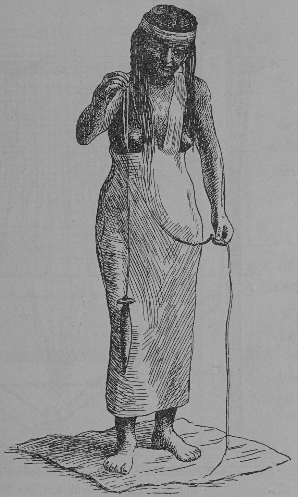

*Fig. 20. Ägyptische Spinnerin.*

Der Weber (אורג, גרדי, טרסי) webte (ארג, נוז, aram. שתי, נזל, מחא)[^77.285] auf dem Webstuhl (aram. כלי קוואי, auch כלי קורים gr. καῖρος)[^77.286]. Es gab einen vertikalen und einen horizontalen Webstuhl, und darauf ist zurückzuführen, daß der Weber davor entweder steht oder sitzt[^77.287]. Der vertikale Webstuhl — nur diesen kennen wir — hatte an den Seiten zwei senkrechte parallele Balken (עמודים)[^77.288], welche oben und unten durch je einen Querbalken (אכסן = ἄξων, כובד העליון u. כובד התחתון)[^77.289] verbunden waren, so daß eine Art viereckigen Gestells (מלבן) entstand[^77.290]; um den oberen Querbalken wurde die Kette (darum Kettenbaum genannt), um den unteren der gewebte Stoff gelegt. Einstweilen aber wurden die Kettenfäden (שתי, שתיא ܫܬܝܐ, سَتًّى, gr. στήμων lat. *stamen*), um gehoben werden zu können, am unteren Querholz nicht angespannt, sondern einzeln oder in Bündel geknotet (פקעת של שתי, קיבורא)[^77.291], mit Gewichten (מכבש *pondus*)[^77.292] beschwert, während die zu hebenden Fäden durch Schlingen an einem runden Stab (wahrscheinlich aus Schilfrohr, קנה, קנים, נירים)[^77.293] befestigt werden, den man mit der Hand anzieht, wenn man den Einschlagfaden (ערב, דוללא, ἐφυφή, κρόκη, *subtegmen*)[^77.293a] durchziehen will.

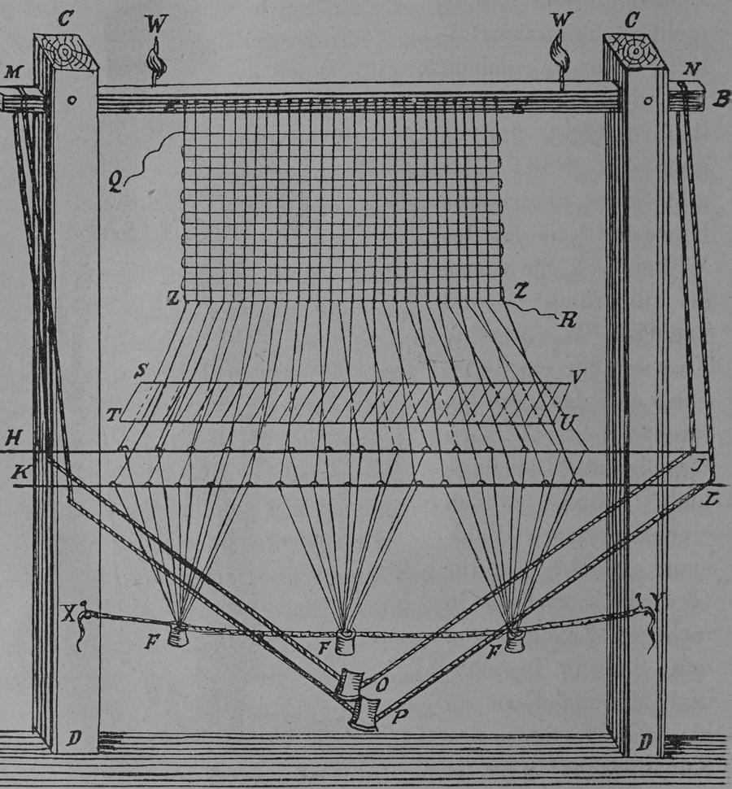

*Fig. 21 I. Rekonstruktion des Webstuhles. – Legende: DABD מלבן; AB אכסן; CD עמודים; EE חוט השתי; FFF מכבש; FT קיבורא; HJKL נירים; HMNO בי נירא; KMNO „; O u. P Pedale; QR ערב; STVU צביתא; WW סליל; XY נימא?; EZZE Gewebe, fertig*

Der Prozeß des Webens ist nun folgender: Von dem Kettenbaum wird von dem dort aufgewickelten Garn bezw. der Wolle immer wieder ein Faden (חבל, נימא = νῆμα) gezogen (משך, מסך, מעלה)[^77.294], festgeknotet (s. o.)[^77.295], beschwert (s. o.), mittels jenes Stabes gehoben[^77.296] und so eine Durchschlagsöffnung (נפש המסכת, ἤτριον, *trama*)[^77.297] erzielt. Die ebenfalls in Bündeln (פקעת) aufgesteckten Einschlagsfäden werden nun zu Teilen um eine Spule (סליל)[^77.298] gelegt, abgerollt (סתר)[^77.299] und in das Weberschiffchen (בוכיאר, לכתא, דיוסטר)[^77.300] eingefügt; doch bediente man sich zu demselben Zwecke auch einer bloßen Nadel (מחט)[^77.301]. Der Weber warf das Schiffchen bezw. die Nadel durch die Öffnung der Kette (זרק)[^77.302], und er selbst oder ein anderer[^77.303] fing sie wieder auf, um sie wieder durch die Kette zurückzuwerfen. Mit dem Weberblatt (מצוביתא, צביתא, κτείς, *pecten*)[^77.304] wurden nun die Einschlagfäden an den schon gewebten Stoff oder mit einer schweren flachen Holzleiste (bh. יתד, כרכר = κερκίς, אספתי = σπάθη *spatha*, Spatel)[^77.305] „aufgeschlagen“[^77.306] (eine Arbeit, die übrigens auch mit der Hand gemacht werden konnte), um den Stoff zu verdichten und zu glätten (דקדק *densare*)[^77.307]. War das geschehen, so konnte der Aufzugsfaden auch am unteren Querholz angespannt werden (שתי העומד, מסכת הפרוסה)[^77.308]. Die losen Enden des Gewebes, eine Art regelloser Troddeln (מלל, עירה, כרוספדא, כרכושתא)[^77.309] oder auch nur Fransen (פסיקיות)[^77.310] wurden gewöhnlich nicht entfernt, sondern weiter eingewebt, namentlich die Fransen der Kettenfäden, die von einem geschickten Walker verschlingelt (החליד) werden konnten. Endlich wurde das fertige Gewebe vom Webstuhle geschnitten (קטע)[^77.311], mit Öl gestrichen[^77.312] und dem Walker übergeben.

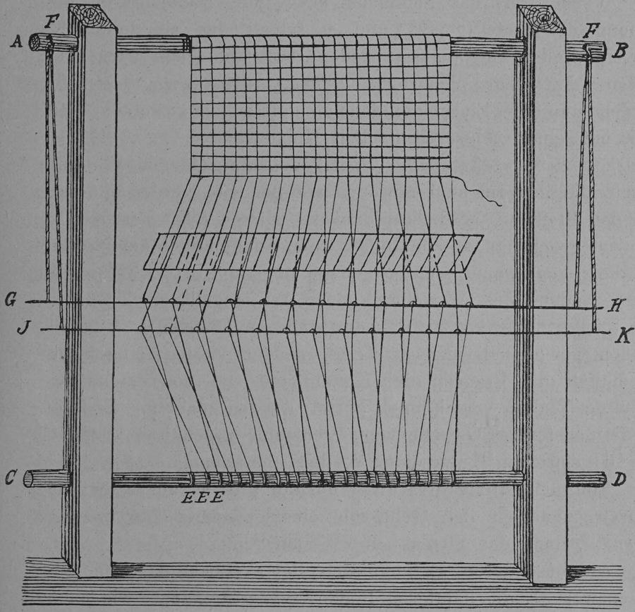

*Fig. 22 II. Rekonstruktion des Webstuhles. – Legende: AB oberes אכסן; CD unteres א׳; EEE aufgerollte Kettenfäden; FF חף; FGHF בי נירא; FJKF „; Sonstige Teile siehe bei I.*

Von dem **horizontalen** Webstuhl gibt es nur schwache Spuren; zunächst der Gebrauch eines Kammes (חיפה κτείς, *pecten*)[^77.313], dann das Sitzen beim Weben[^77.314].

An besonderen Erzeugnissen der Webekunst sind beachtenswert 1. die nahtlosen Röcke (*tunica* ἄρραφος), wie nach der Aggada Moses, als Hohepriester fungierend, einen getragen, wie es ferner, als besondere Eigentümlichkeit, durch Josephus von dem Leibrock (χιτών = כתנת) des Hohenpriesters in geschichtlicher Zeit bezeugt ist, und wie es endlich daraufhin auch von Jesus ausgesagt wird, eine gewerbliche Fertigkeit, die ausschließlich in Palästina geübt worden sein soll, die aber wohl nur darauf hinausgeht, daß, wie bereits bemerkt, auf dem Webstuhl fertige Gewandstücke erzeugt wurden[^77.315]; 2. gesprenkelte Muster (bei Längenstreifen *virgae*, bei Querstreifen *trabes* genannt), bei den Juden ohne Unterschied der Streifen בגד מנומר genannt[^77.316]; 3. ein schräg gerippter Stoff, der entsteht, wenn jeder Faden des Einschlages erst unter einem, dann über drei Fäden, und so fort, der Kette läuft (תלמיותא τριμίτιον, *trilix*)[^77.317]; 4. Waffelstoffe (תשבץ von שבץ), ein Gewebe künstlicher Art, in welchem tiefliegende und hochliegende Stellen sinnvoll abwechseln[^77.318]; 5. Kunstwebereien zur Herstellung von buntgewirkten Teppichen und Vorhängen mit eingewirkten Bildern, so daß diese alte, auch in Ägypten und bei den Persern geübte Kunst (bh. חשב und רקם)[^77.319] in späterer Zeit geradezu Bildnerei, Malerei (ציור) hieß[^77.320]. In der Verfertigung von Kunstteppichen waren Weber und Näher (תופרים) beschäftigt[^77.320]; unter den Vorhängen wird der heilige Vorhang (פרוכת) als besonders kunstvoll geschildert. Diese Kunststickerei wurde von Frauen besorgt[^77.321]. 6. Palästina war auch berühmt wegen seiner golddurchwirkten Zeuge. Ein Stück Gold wurde dünn geschlagen (רדד), in Fäden (גימוניות) geschnitten, wahrscheinlich auf Purpurfäden aufgesponnen, und zu kostbaren Geweben verarbeitet[^77.322].

f) **Walken**[^77.323]. Die Walker waren wie die Weber in der jüdischen Gesellschaft nicht gut angeschrieben; das machte ihr unsauberes Gewerbe, ferner die Notwendigkeit, mit Frauenspersonen zu verkehren[^77.324]. Man machte sich in possierlichen Geschichten über sie lustig[^77.325]. Dennoch spielen die Walker in der Zeitgeschichte keine unrühmliche Rolle, und man kennt ihrer mehrere, die zum Kreise der Schriftgelehrten gehörten[^77.326]. Nach römischem Vorbilde werden die Walker auch in Palästina eigene Zünfte gebildet haben[^77.327], umsomehr, als ein Teil der Walker, sogar in Jerusalem selbst, Heiden waren[^77.328]. Jüdischen Wäschern und Walkern, die u. a. den in Jerusalem angekommenen Wallfahrern die Wäsche besorgten und somit gleichsam im Dienste des Publikums standen, war es gestattet, am Rüsttage des Paschafestes bis zur Mittagszeit zu arbeiten[^77.329]. In den Namen des Walkers (bh. רוגל, nh. כובס, aram. קצרא, אשפר ?, γναφεύς, πλυνεύς, *fulo, lavator, lotor*) spricht sich deutlich die hauptsächlichste Tätigkeit des Walkers aus: das Treten des Tuches mit den Füßen, bezw. dessen Waschen und Reinigen[^77.330].

Der Walker arbeitet gewöhnlich im Auftrage. Man übergibt ihm mehrere Stücke Wolltuch, die er, um ein Vertauschen zu vermeiden, mit besonderen Zeichen versieht[^77.331]. Sodann heftet er sie mit einem Stich (שָׁלַל) zusammen[^77.332], legt sie in die Walkergrube (נברכת, משרה, כבוסה πλύνοι, *lacunae, lacus, pilae*)[^77.333], von denen gewöhnlich in verschiedenem Besitze mehrere sich nebeneinander befanden[^77.334]. In der mit warmem Wasser und fettauflösenden Substanzen gefüllten Walkergrube wird das Tuch mit Füßen getreten (בטש, λακτίζειν, συμπατῆσαι)[^77.335], wodurch sich die Eintragsfäden verfilzen, so daß man die Fäden des Gewebes nicht mehr sieht. Sodann wird der Stoff mit einer Keule (מזורא)[^77.336] geschlagen (חבט κόπτειν) und gezogen (ἕλκειν)[^77.336a], dann in reinem Wasser ausgewaschen (λυμαίνεσθαι), getrocknet und „gerauht“. Letztere Manipulation, eine Art Bürsten, wurde mit der Walkerdistel (קוץ, γναφικὴ ἀκάνθη, *spina fullonia*)[^77.337] ausgeführt, mit welcher die Einschlagsfäden gekratzt (סרק) oder geschabt (גרר) wurden. Die abgekratzten Wollflocken (גרודות, מוך, κνάφαλλα, κροκίδες)[^77.338] wurden gesammelt, um sie zum Stopfen von Polstern zu verwenden (o. S. 64). Zuletzt folgt das Schwefeln (עִשֵּׁן, גִּפֵּר, נתן גפרית θειόω, *sulfure suffire*)[^77.339], indem die Stoffe über ein mehrfach durchlöchertes Gerät (קנקילן[^77.340], איבלא[^77.341]) gebreitet wurden, unter dem man Schwefel brennen ließ. Es folgt nun ein Bürsten, Scheren — mit einer besonderen Schere (מלקוט של כובסין)[^77.342] — und Pressen (כבש) — mittels einer mit einer Schraube versehenen Presse (כפא, זורא, מכבש, ἶπος, *prelum, pressorium*)[^77.343] — und erst mit dem Lockern (הִתִּיר) der Schraube haben die zur Appretur des Tuches nötigen Arbeiten (*ad polienda vestimenta*) ein Ende gefunden. Es gab jedoch auch Kleider, die auf einer oder beiden Seiten ungeschoren oder langhaarig blieben[^77.344].

g) **Reinigungsmittel**. Jene vorhin genannten fettauflösenden Substanzen (סמנין)[^77.345], die in die Walkergruben getan und die fast ebenso auch zur Kleiderwäscherei benötigt wurden, sind folgende: 1. Urin von Menschen und Tieren (מי רגלים)[^77.346], der in seinem vergorenen Zustande eine reinigende Ammoniaklösung darstellt; 2. Walkererde (חול? *creta*)[^77.347]; 3. Boluserde (נתר = νίτρον), und zwar gab es ein alexandrinisches und ein antipatriensisches Nitrum[^77.348]; 4. Laugensalz (בורית)[^77.349], eine aus einer Seifenpflanze (aus der Gattung der *Saponaria*?) durch Läuterung gewonnenes Salz; 5. קימוליא (קימוניא) = κιμωλία [*terra*] *Cimolia*, kimolische Erde[^77.350]; 6. ירענין[^77.351]; 7., 8., 9., 10. die Kalipflanzen אהלא[^77.352], אשלג[^77.353], שונאנא[^77.354], קליא[^77.355]. Wenn zu entscheiden war, ob ein Fleck auf einem Kleide von Menstruationsblut oder einem Farbstoffe herrühre, behandelte man den Fleck mit 7 Reagentien (סמנין): 1. רוק תפל mit geschmacklosem Speichel, d. i. Speichel eines Menschen, der seit dem vorhergehenden Abend nichts gegessen und nichts gesprochen hat, 2. מי גריסין Wasser von scharfen geschälten Bohnen; sodann folgen die bereits genannten Laugen: 3. Urin, 4. Nitrum, 5. Borith, 6. Cimolia, 7. ʿ*Ešlag*, und zwar wird der Fleck mit jeder der genannten Substanzen in der angegebenen Reihenfolge zwischen den Händen gerieben, vor jeder neuen Droge abgespült, aber nicht getrocknet; verschwindet der Fleck oder wird er heller, so handelt es sich um Blut, sonst um Farbe[^77.356] — so sehr waren die Farben echt. Gewöhnliche Reinigungsmittel sind ferner: 11. צריף *alumen* Alaun[^77.357], welches irgendwie mit מגביא identisch sein dürfte, da die Erklärungen gleichmäßig lauten[^77.358]. 12. Unsere Seife (ספון oder צפון *sapo -onis*) hat in dieser Liste nur ganz am Ende zu figurieren, denn die Alten machten keinen großen Gebrauch davon und auch dann nur als Pomade und Haarfärbemittel[^77.359]. Die Seife soll mit Vorsicht gebraucht werden, weil sie die Farben der Stoffe leicht angreifen könnte; Zweck der Reinigung ist aber nur das Tilgen (העביר) von Fettflecken. Die in Palästina verwendeten Reinigungsmittel galten als besser als die babylonischen[^77.360].

h) **Das Waschen** (כִּבֵּס, כביסה, כבוסה, תכבוסת) der schmutzig gewordenen Zeuge (aram. מאנין צאין, מטנפי)[^77.361] ist eine überaus notwendige Sache, noch notwendiger, als die körperliche Waschung[^77.362], und wurde in kleinem Hausstande von der Frau, in größerer Menge von dem Walker (כובס) besorgt[^77.363]. Der gewerbsmäßige Walker oder Wäscher wird zu seinem nützlichen, aber schmutzigen Geschäfte seine eigene Werkstätte gehabt haben, aber das häusliche Waschen ging im gemeinsamen Hofe (S. 46) vor sich, was, wenn es die Frauen anging, die Mitbewohner nicht verwehren konnten, nur mußte sich die Frau, wenn der Hof uneben war und das Ausgußwasser auch zum Nachbar floß, sich mit dem kleinen Raum vor ihrem eigenen Portal bescheiden[^77.364]. Unerläßlich war es, das Linnenzeug für Sabbat zu waschen (o. S. 134), und das tat man bereits am Donnerstag[^77.365].

Die Wäsche wurde zum Weichen (שרה) in einen Trog oder Kessel (דוד)[^77.366] mit (warmem) Wasser gelegt, und das Wasser wurde durch einen Zusatz von Nitrum (נתר) und irgendeiner Kalipflanze (אהל)[^77.367] kräftiger gemacht. Solange es kräftig blieb, warf es Blasen auf (בעבע)[^77.368]. Die Wäsche wurde dann herausgenommen, mit Händen und Keulen tüchtig bearbeitet (כבס = כבש, wogegen aram. שזג nur = reinigen)[^77.369], mit den bloßen Händen oder einem der oben (S. 154f.) beschriebenen Reinigungsmittel gerieben (כסכס)[^77.370], wahrscheinlich wieder gewaschen (geschwenkt שכשך)[^77.371], ausgewunden (סחט) und dann zum Trocknen (נִגֵּב) an die Sonne gelegt und zwar auf Stangen oder Stäben[^77.372], eine Aufgabe, die in der winterlichen Regenzeit schwer genug fallen mochte[^77.373]. Das Waschen von Linnenzeug wurde für schwerer gehalten als das von gefärbten Stoffen[^77.374]. Das gewaschene Linnenzeug wurde nämlich noch gebleicht (aram. חוור = לבן und גהץ), was beim Wollzeug nur getan wurde, wenn es neu war[^77.375]. In Palästina, das sehr feines Linnenzeug hatte (o. S. 139), war mit dem bloßen Waschen das erreicht, was in Babylonien erst durch Bleichen erreicht wurde[^77.376]. Die gebleichte Wäsche kam schließlich in eine Presse (מכבש)[^77.377], oder man plättete sie, indem ein ringförmiger Stein darüber geführt wurde (עָבַר חומרתא)[^77.378].

[^77.180]: Das bisher verkannte Wort findet sich fast immer in der nach der Notarikon-Methode gehaltenen Deutung des Wortes שעטנז: דבר שהוא שוע טווי ונוז MKil 9,8 (vgl. T 5,21, 80₂₅), Sifra zu Lev 19,19 p. 89ᵇ, Sifre Dt 232 p. 117ᵃ, bJebam 5ᵇ usw., drei technische Worte, die in halakhischer Beziehung zu sehr lebhaften Debatten Anlaß gaben (s. RŠ zu MKil, Bert. u. LHeller ib., Tosafoth zu bJebam 5ᵇ u. bNidda 61ᵇ). Etymologisch wird שוע fast uni sono richtig für **glatt** (חלק) erklärt. In sachlicher Beziehung ist hervorzuheben 1) RN (bei K 8,118) שוע it. *carminato* d. i. gekrempelt, טוי *filato* d. i. gesponnen, נז *tessuto* gewebt (fr. *tisser*). Ein ʿArukh ms (bei K a. a. O.) enthält noch für שוע (an dieser Stelle ist nur dieses zu erörtern) den arab. Ausdruck النفش von نفش séparer (la laine, le coton) avec les doigts, carder, éplucher (BELOT). Diese Ansicht ist die herrschende, siehe z. B. Raši bJebam 5ᵇ מתוקן ... במסרק, Bert. zu MKil 9,8 סרוק במסרק; vgl. L 4,522 „glätten, krempeln“, K 8,117, J 1538. — 2) Maim zu MKil 9,8 שוע = טרוף (außerdem ממחק פני הבגד, LHeller zitiert מחליק פני הבגד, was aber wohl das arabische Original fälschlich wiedergibt). Nun ist aber der Begriff טרף ziemlich richtig als die Tätigkeit des Filzens erkannt worden, z. B. RŠ zu לבדין MKil 9,9 (nur זה עם זה ist irrig): Man zerschlägt Wolle [oder] Flachs und verdichtet sie in industrieller Tätigkeit ohne Spinnen und Weben; Bert. „לבדים d. i. צמר טרוף zerschlagene Wolle ohne Spinnen und Weben“; also genauer = filzen. Nur in den Texten selbst ist טרף in diesem Sinne nicht zu belegen. Aber daß שוע = filzen, geht unzweifelhaft daraus hervor, daß לבדים = Filzstoffe (w. u.) unter den Begriff שועים subsumiert werden: MKil 9,8 לבדים ... מפני שהם שועים; Sifra a. a. O. אין לי אלא בגד, מנין לרבות את הלבדים, ת״ל שעטנז דבר שהוא שוע כו׳; Sifre a. a. O. הלבדים אסורים ... משום שוע; vgl. jKil 9,6, 32ᵈ₃₂. Doch wird von סגוס, das zu den Filzen gehört, auch אריג gesagt, MNeg 11,11, Sifra zu Lev 13,52 p. 69ᵇ; ib. ersieht man, daß die Fetzen des סגוס das מוכין ergeben, welches so häufig erwähnt wird; als Bettfülle s. S. 64.
[^77.181]: לבד verbinden s. L 2,465; auch ܠܒܰܕ so, u. لبد feststehen (FRAENKEL 103). Stellen s. bei RIEGER S. 46 und in voriger A. u. w. u. RN it. *feltro*. jSabb 7,10ᶜ₅₃ ליבדייא. Hebr.-gr. Glossar in HARKAVY-Festschrift S. 73 κεδοκλα = *centuculus*.
[^77.182]: Siehe — bis auf Hemden — dieselben Dinge bei MARQ., Pl.² 502; Pferdedecken belegt er aus *Ed. Diocl.* 7,52. 53. Damit stimmt die Ermittelung von FRAENKEL S. 102 A. 2, daß [?] = πιλητός od. πιλωτός sei, eigentlich „Filz, Wolle“, dann Sattel (wohl auch Decke). TKel bb 5,3, 595₄ חלוק מן הלבד; ib. תכריך u. מעטפת.
[^77.183]: גדל ܓܕܰܠ جدل (s. GES. Hwb¹⁴) liegt u. a. dem bh. גְּדִל* pl. גדילים zugrunde, Dt 22,12, LXX στρεπτά. In I Kön 7,17 שבכים מעשה שבכה, aber גדלים מעשה שרשרות: Netz-Arbeit u. Ketten-Arbeit. Letztere verrichtet bei uns der Posamentierer, dessen Arbeiten (Quasten, Troddeln, Borten) auch in unseren Quellen genannt werden (w. u.). Gleicher Art ist פתל ܦܬܰܠ فتل in bh. פתיל Schnur. Man erblickt in פתיל eine frei herunterhängende Quaste, anschaulich auch ענף = Zweig bezeichnet, während גדיל bortenartig angeheftet ist; im Falle der obligaten ציצית nun lehrt einer: אי גדיל אי פתיל sowohl die Borte als die Quaste genügt, und derjenige, der die תכלת bortenartig angebracht hat (גדילא מיגדיל), hat der Vorschrift entsprochen; ein anderer aber lehrt: Nur פתיל, d. i. Quaste, entspricht, u. גדילים gibt nur die Zahl der Fäden an, nämlich vier Fäden im Zipfelloch des Kleides, die er aber zu überschlagen (doppelt zu nehmen) hat (bMenach 39ᵇ, wo die letzteren Worte ופותלהו מתוכו besagen: aus dem bortenartigen Ansatz heraus wird die Quaste hergestellt; deutlicher bJebam 5ᵇ עשה גדיל ופתלהו מתוכו, mache die Borte, und aus ihr heraus stelle die Quaste her; u. z. dieses פתלהו nicht in Piʿel zu lesen, wie L 4,158ᵇ will, sondern in Kal; vgl. auch Tanch Šelach 15 פתיל (ו)[ש]הוא צריך לפתלן, Tanch B. ib. 29 u. Num R 17,5 שהוא צריך לפותלן). Ein dritter Begriff, ציצית, ist nur eine Troddel, die möglicherweise aus éinem Faden besteht, aber גדילים kann nur auf dem Wege des Drehens und Verschlingens entstehen (Sifre Dt 234 p. 117ᵃ u. Num 115 p. 34ᵃ חוט אחד opp. גדילים), u. z. hat man, wie wir soeben hörten (bJebam u. bMenach, auch Sifre Dt u. Num) mindestens zwei Fäden zur Borte gebraucht. Vgl. RN s. v. שע 1 (K 8,118ᵃ): „Es ist klar, daß éin Faden nicht גדיל heißt, vielmehr ist גדיל, das [bh.] עבות entspricht, zumindest aus zwei Fäden gemacht, wenn es nun גדילין heißt, so sind es vier, im Sinne von פתל „überschlagen“ in bJebam.“
[^77.184]: Exod 28,14. 22 מעשה עבות in Trg O עובד גדילו. Jes 5,18 Trg גדילת עגלתא. Bezüglich Dochte ebenfalls גדל: bGitt 69ᵃ וניגדול תרתי פתילתא (I* A. 211).
[^77.185]: Trg Koh 4,12 כתיכא דמגדליא תלת תלת נימין, Tw חוט המשלש. Trg O. Exod 28,14 תיכיא גדילתא. Ib. Vers 24 u. 25 גדילן. Trg Ezech 3,25 כאסור גדילן; vgl. גדילת רישא = Haarlocken L Trg Wb 1,126.
[^77.186]: גודלי המצנפת MKelim 16,7 (מ׳ trugen nicht nur Hohepriester, sondern auch Könige, Ezech 21,31; s. den folgenden Punkt); צניף Jes 62,3. Auch etymologisch hier einzureihen, denn צנפא (L Trg Wb 2,333) ist im j. Trg gerade bei ציצית für כנף gesetzt; chr. pal. ܨܢܦܐ s. SCHULTHESS, Lex. Syropal. p. 147, arab. صنفة Saum, Zipfel; vgl. סנף, סניף L 3,557.
[^77.187]: Der Diademflechter des Königs Jannai (בת גאדיל כלילי דינאי מלכא bBb 133ᵇ, bAz 41ᵃ).
[^77.188]: גדילנא נישבי bBm 85ᵇ, bKethub 103ᵇ. Nach bMk 11ᵃ o. ist למגדל אוהרי Fischnetze zu stricken eine private, hingegen איילי Vogelnetze stricken eine gewerbliche Tätigkeit.
[^77.189]: Brot im Netz, Horaz, Sat. 1,1, 47; MARQ., Pl.² 502. Damit erklärt sich die Angabe in bBb 57ᵇ (die Stelle in anderer Beziehung s. § 80), der Tisch des Schriftgelehrten sei zu zwei Drittel mit Netzwerk (גדיל) versehen, zu einem Drittel bloß (RN bei K 2,243 גלוי, Agg. aram. גלאי), was nach RG, angeführt auch von RN, und nach RSbM bedeutet, daß ²/₃ des Tisches (für uns irrelevant, ob ²/₃ der oberen Hälfte und ¹/₃ an der unteren Seite entblößt, oder ²/₃ ringsherum an den Rändern und ¹/₃ entblößt in der Mitte, s. RSbM) mit einem Tuch (מפה) bedeckt sei, „worauf man nämlich das Brot legt“, während ¹/₃ des Tisches für Schüsseln (von Fleisch) und Gemüse unbedeckt bleibt, damit das Tischtuch nicht schmutzig werde. Dieses גדיל sei nun = אריג (RG u. RN) und nenne man es in gewählter Sprache גדיל (RSbM). Nach dem Obigen können wir jedoch גדיל wörtlich nehmen: Netz, u. z. dasjenige, in welchem das Brot liegt, das nun — infolge der armseligen Haushaltung des Schriftgelehrten, s. S. 134 — auch als Tischtuch dient. — קליעות netzartig durchbrochene Säcke, MʿEduj 3,4 s. A. 101.
[^77.190]: MSabb 10,6 גודלת, nach b 94ᵇ 95ᵃ entweder Kategorie von ארג oder von בנה, u. z. mit Berufung darauf, daß die Haarflechten der Frau in den Küstenstädten בניתא genannt werden, s. S. 190. Zu קלע s. L Trg Wb 2,365; es ist dieses Wort mehr den j. Trgumim eigen, während O. גדל liebt. קלע in der eigentlichen Textilarbeit selten, s. S. 148.
[^77.191]: In bMk 11ᵃ o. stehen nebeneinander למגדל תנורי Öfen **bauen** (o. S. 87) und למגדל מהולתא Siebe **flechten**.
[^77.192]: jSabb 7,5, 10ᵈ₂₅ הגודל כלי צורה ... משום בונה „wer ein ornamentiertes Gerät flicht ... weil er baut“. Körbe u. dgl. pflegten bekanntlich von den ältesten Zeiten her ornamentale Figuren zu tragen, und es ist nun möglich, daß „der Aufbau“ solcher Figuren gemeint ist; natürlich kann auch von Matten die Rede sein. Doch ist כלי צורה nach dem Zusammenhange vielleicht ein Gerät, das in seiner Struktur irgendeine Figur darstellt, z. B. ein Korb in Form eines Fisches usw. Korban ʿEdah liest צורי דקל s. L 4,180. Vgl. ib. 10ᶜ₂₃ הדן דעבד קופין כד צפר משום מיסך ... כך משום בונה.
[^77.193]: RIEGER S. 17 A. 1 zitiert Claud. in Eutrop. 1,357 *Judaicis quod pingitur India velis.* Auch verweist er darauf, daß Benjamin von Tudela im 12. Jh. noch viele j. Färber in vielen Orten Palästinas traf, s. RITTER, Ek. 16,255; s. auch JE 5,21. In *Descriptio orbis terrae* c. 31 (Wölfflins Archiv f. lat. Lex. 13,551) heißt es von Skythopolis, Laodicea, Byblus, Tyrus u. Berytus: *quae linteamen omni terrarum emittunt* . . . (vgl. Ammian 14,7, 20 u. 9,7 von Tyrus’ Industrie u. o. S. 139). *Similiter autem et Sara[f]ta et Neapolis et Lydda purpuram alitinam. Oraria* aus Sarepta s. Trebell. *Claud.* c. 17.
[^77.194]: MMeg 4,7 setzt offenbar voraus, daß auch Priester das Färberhandwerk üben und davon gefärbte Hände haben; dazu Bar b 24ᵇ „wenn sich das Gros der Stadt damit beschäftigt“, eine Möglichkeit, die durch Tanch Nasʾō 8 (vgl. Tanch B. ib. 14 A. 70) dahin präzisiert wird, daß es im Darom (דרום) Ortschaften (עיירות) gebe, in denen man Purpurfärberei betreibt, und da haben die meisten gefärbte Hände.
[^77.195]: jTaʿan 4,8, 69ᵃ₆₀ (vgl. NEUB., Géogr. p. 127); auch gehört מגדל צבעיא zu den Orten, die viel Steuern ablieferten (ib.), denn Purpurfärbereien rentieren sich gut. — Der Ortsname כפר אמרא (j ib.) wird seinen Namen einem ähnlichen Umstande verdanken, und so ist dieses אמרא nicht so sehr = Lamm (L 1,102), obzwar auch dieses paßt, sondern אמרא = Saum, Borte (L ib.), also eine Industrie. — מגדל צבעיא (hebr. מגדל צבעים Ruth R c. 2,10) in dunkler Beziehung s. Pesikta p. 66ᵃ u. Pes R c. 17 p. 88ᵇ (wo auch Parallelst.).
[^77.196]: הצבעים שבירושלים jSabb 7,2, 10ᶜ₁₅. Eine Genossenschaft der πορφυροβάφων in Hierapolis in Kl.-Asien s. SCHÜRER 3³ 14.
[^77.197]: TNeg 5,2, 623₂₇ f. כל הבגדים בין צבועין בידי אדם ובין צבועין בידי שמים; ib. dasselbe von Häusern und von Leder (עורות).
[^77.198]: T ib. Z. 34 בגד ששתיו צבוע וערבו לבן ערבו צבוע ושתיו לבן ... אחר הערב „ein Kleid, dessen Kette gefärbt, der Einschlag weiß (die Naturfarbe) ist, oder der Einschlag gefärbt, die Kette weiß, so richtet man sich nach dem Einschlag“, doch mit der Ausnahme, daß man „bei Kissen und Polstern (כרים וכסתות s. S. 64) sich nach der Kette richtet“ (wahrscheinlich wegen der horizontalen Lage dieser Stücke, die nur die Kette zur Geltung kommen läßt), „in jedem Falle aber nach dem, was wirklich sichtbar ist“ (אחר הנראין ib.). Vgl. MARQ., Pl ² 505. Daß Färben vor Spinnen geht, ersieht man auch aus TChull 10,6, 511₃₃ צבען טואן, MSabb 6,2; nach TKel bb 6,6, 596₁₈ wird jedoch ein kleiner Lappen gefärbt, u. z. erhält er seinen Wert erst durch das Färben.
[^77.199]: Stamm צבע, aram. צבע, syr. ܨܒܰܥ, arab. صبغ ursprünglich = tauchen (z. B. Finger eintauchen, darum אצ׳ צבעא = Finger, hebr. אצבע); bh. selten, besonders bezeichnend Ri 5,30: farbiges buntes Kleid; von demselben Stamme nach H. LEWY, Sem. Fr. im Gr. S. 84 gr. τήβεννα. Nh. sehr verbreitet, L 4,165 f. Davon *nom. agentis* צַבָּע z. B. jSabb 1,6, 3ᵇ₂₃ ib. 6,2, 8ᵇ₂₅, b 11ᵇ, MBk 9,4 T 11,12, 370₃₄ b 100ᵇ usw., s. hier *passim* (צבען bei RIEGER S. 17 aus TChull 10,6 ist ein Irrtum, denn es ist ein Verb, s. vorige A.); pl. צבעים z. B. MPesach 3,1, s. hier *passim*. Aram. עמרם צבעא bGitt 52ᵇ. Priester als Färber s A. 194. Heiden TDemai 5,15 p. 55₁ u. TAz 7,11, 472₁₃. Menachem siehe TʿEduj 3,1, 459₁₅.
[^77.200]: חנות של צ׳ MBm 8,6, T 8,27, 390₇; בית הצ׳ bMk 13ᵇ o. בית החשבון in TDemai 5,15, 55₁ u. TAz 7,11, 472₁₃ kann nicht einfach „Abrechnung“ heißen (vgl. A. SCHWARZ zu Demai p. 130), denn das wäre לידי חשבון, sondern der „Laden“ (im Gegensatze zur Werkstätte) des Färbers, also wie כפה של חשבונות § 220 u. wahrscheinlich auch חנות eher der Laden. Vgl. jedoch והבאתים לבית הרבו׳ TBb 10,3, 411₃₀ (alte Agg. לידי). Das Färberlokal wurde wegen des großen Betriebes mindestens auf drei Jahre gemietet (TBm 8,27, 390₈ מפני שעיסקן מרובה); unter einem Getreidespeicher oder Weindepôt s. MBb 2,3 u. Maim.
[^77.201]: Man durfte von dem Färber nicht kaufen אותות u. דוגמאות (w. u.) u. nicht תלושין של צמר (o. A. 87), wohl aber צמר צבוע טווי שתי וערב, TBk 11,12, 370₃₄, b 119ᵇ (wo בגד צבוע טווי בגדים mit ms M ähnlich wie in T zu lauten hat: בגד צבוע טווי שתי וערב; die Gemara freilich sieht in בגדים (etwa לבדים) = נמטי Raši *filtres* Filze (o.).
[^77.202]: Akkord sehr oft, z. B. einem Heiden TDemai 5,15, 55₁ u. TAz 7,11, 472₁₃; zivilrechtliche Fragen, die daraus entstehen (MBk 9,4, T 10,9 ms Wien, b 100ᵇ) s. bei RIEGER S. 18. — Seltener eigene Regie, z. B. TBm 11,24, 397₂.
[^77.203]: דוגמא = δεῖγμα TSabb 1,8, 110₁₇, b 11ᵇ, j 1,6, 3ᵇ₂₃, ib. 6,2, 8ᵇ₂₅; TBk 11,12, 370₃₄ b 119ᵇ דוגמאות u. דוגמות.
[^77.204]: MMeg 4,7 (A. 194).
[^77.205]: TBk 11,12, 370₃₄, b 119ᵇ, vgl. MKil 9,10 אותות הגרדין ואותות הכובסין.
[^77.206]: Das Thema gehört mehr zum Kapitel „Malerei“ (§ 204). Ausführlich s. *color* in JE 4,174 u. ROSENZWEIG, Kleidung S. 34.
[^77.207]: אכרום u. כרום s. Lwr 2,50. 296; גון, גוון, auch syr. ܓܘܢܐ, ܓܘܢ, mit einem denom. גַּוֵּן s. L 1,311. Speziell als Farbe des Kleides in כאי גוון טליתך bʿErub 53ᵇ. Auch חזותא bBk 101ᵃᵇ „die Farbe ist etwas Wesentliches“ speziell vom Kleide. חזותא חזותא „von verschiedenen Farben“ bChull 47ᵇ u.
[^77.208]: Der Lendenschurz resp. Leibrock der alten Ägypter ist, nach unzähligen Abbildungen, weiß; nur die Priesterschaft trug bemalte Schurze (KÖHLER, Trachtenkunde 1,36). Das ἱμάτιον und die *toga* der Römer waren weiß. Die ʿAbaje (عَبَايَة) der heutigen Araber ist allerdings grau und schwarz gestreift (s. SACHAU, Reisen in Syr. S. 32), auch ihr Hemd ist ebensooft blau als weiß (NIEBUHR, Beschr. v. Arab. S. 62). Gegen den Hang nach dem, „was glänzt und schillert“, wie man bei JELLINEK (Der j. Stamm, Wien 1869, S. 166) eben im Punkte der Kleidung als Charakteristik des j. Volkes liest, habe ich schon in M-Bloch-Jubelschr. hebr. Teil S. 84 A. 4ᵃ Stellung genommen. Diejenige, die eine כרבלתא (bBerakh 20ᵃ, nach RN ein **rotes** Kleid) trug, hat sich als Kuthäerin erwiesen; **schwarze** Schuhe gehörten zur heidnischen Tracht (bTaʿan 22ᵃ). Eine dunkle Kleidung birgt sich unter לבושא סיואה bNidda 20ᵃ (Var. סיאבא s. RN bei K 6,40), eine Benennung, die von einem Orte, jedenfalls fremdländischen Orte, ausgehen soll. Ib. heißt es, daß ein Araber in schwarzer Kleidung (לבושא אוכמא) gesehen wurde und habe man hiernach für hebr. שחור geurteilt. Von den ausländischen כלים האולירין ib. heißt es, daß sie weder schwarz noch weiß waren, sondern eine Mittelfarbe. Die einzelnen Gewänder behandeln wir w. u. Hier sei nur so viel konstatiert, daß diese dunklen Farben immer als ausländisch und als fremde Tracht hingestellt werden.
[^77.208a]: Sifre Num 11 p. 5ᵃ היו שחורים נאים לה מפשיטן ומלבישים אותה כעורים, jSota 1,6, 17ᵃ₂₃, b 7ᵃ 8ᵇ.
[^77.209]: כלי לבן, die gefaltet werden, s. A. 48ᵃ. כלים לבנים opp. בגדי צבעונים z. B. Sifre Deut 226 p. 115ᵇ u. w. u. *passim*. כליו שחורין opp. לבנים Bar bSanh 41ᵃ.
[^77.210]: Schon wegen der Beliebtheit der Skarlat-Farben (w. u.), vgl. Trg O. Gen 49,11 יהי ארגמן טב לבושוהי כסותה מילא מילא צבי זהורי וצבעונין „feiner Purpur wird sein Kleid sein, sein Gewand lauter μηλωτή, rosenrot und mit [sonstigen] Farben gefärbt“.
[^77.211]: Weiße Kleider am Neujahr, jRh 1,3, 57ᵇ₁₀ s. S. 130 (u. z. gehört dazu auch das Schneiden der Haare: ומגלחים זקנם ib., in Jalk Dt § 825 (ומג׳ שערן)). Exod R Ende 31 f. 118ᵇ ed. Romm: עמדו ולבשו לבנים. Vgl. die weiß gekleideten Mädchen am 15. Ab und am Versöhnungstage, bTaʿan 26ᵇ. TChag 2,9, 235₁₈ f. u. b 16ᵃ, ferner TSanh 7,1, 423₁₉ כהן שנמצא בו פסול לובש שחורים ומתעטף שחורים ... ושלא נמצא בו פסול לובש לבנים. Der Beschuldigte hatte vor dem Gerichtshof Trauertracht anzulegen, vgl. den Prozeß des Herodes vor dem Synedrion: κόμην δὲ ἐπιθρέψας καὶ ἐσθῆτα μέλαιναν ἐνδεδυμένος Joseph. Antt. 14,9, 4 § 172; Pheroras erschien vor Herodes μελαίνῃ τε ἐσθῆτι, B. J. 1,25, 4 § 506. In der Erzählung vom Tode Simons des Gerechten: זקן אחד לבוש לבנים ועטוף לבנים, als Verkünder des nahen Todes: לבוש שחורים ועטוף שחורים Bar bJoma 39ᵇ, s. JQR 20,336. Mehr s. bei ROSENZWEIG, Kleidung S. 38 A. 12. In Sibylle V,188 legt die Barke das weiße über das schwarze Kleid an.
[^77.212]: Gott selbst im Gewande weiß wie Schnee (Dan 7,9) und das Haar seines Hauptes rein wie Wolle (ib.) — Gewand und Haar zusammen, wie in voriger A. „Weiß“ = rein s. Jes 1,18, Apok 1,14; vgl. כסות נקיה des Sabbat S. 133. Demgemäß auch Engel weiß gekleidet (Marc 16,5 στολὴ λευκή, Matt 28,3 „sein Kleid weiß wie Schnee“), denen in diesem Punkte die Schriftgelehrten ähnlich sind: bKidd 72ᵃ (Raši verweist richtig auf Ezech 9,11 לבוש הבדים), bSabb 145ᵇ, 25ᵇ, bNedar 20ᵇ, darum קאקי חיורי (Raši: weiße Gänse, L 4,366 Löffelgänse) bBerakh 20ᵃ, bGitt 73ᵃ, bKethub 85ᵃ. Die Vorschrift Kohel 9,8 wurde von den **Essenern** buchstäblich eingehalten: Joseph. B. J. 2, 8,3, § 123, SCHÜRER 2³, 567. 578. MMeg 4,8 איני עובר לפני התיבה בצבועין אף בלבנים לא יעבור, ib. auch Schuhe, nach LEHMANN in REJ 30,191 gegen die Essener gerichtet. Aus dem Begriffe der Reinheit und der Engelgleichheit erklärt sich die Bestattung der Toten in weißen Linnen (§ 127); für das Alter der Sitte kommt in Betracht, daß der in weißem Gewande (χιτών), allerdings mit purpurner χλανίς, auf der Stätte des Heiligtums (wo ehemals die Priester ebenso weiß gekleidet amtierten!) plötzlich aus dem Boden gestiegene Simon b. Giora Schrecken um sich verbreitet, Joseph. B. J. 7,2, 2, § 29. Joseph, der Vater Jesu, wird nach dem arabischen Apokryphum gehüllt in لفافة نورانية „leuchtende Hülle“, bei THILO, Cod. Apocr. N. Test. 1,42, wo angemerkt wird, daß die orient. Christen den Sabbat vor der Auferstehung Christi سبت النور nennen, ferner كفن منور *sindon illuminata*, vgl. Matth 17,2 ἱμάτια . . . λευκὰ ὡς τὸ φῶς.
[^77.213]: Schriftgelehrte s. vorige A.
[^77.214]: In Sifre Dt 226 p. 115ᵇ wird im Hinblick auf Dt 22,5 als Männertracht geradezu כלים לבנים, als Frauentracht בגדי צבעונים für möglich gehalten, wenn auch zugegeben wird, daß sich die Männer nicht strikte weiß, die Frauen nicht strikte bunt kleiden. Ferner sind ib. der Schmuck (תכשיט) als den Frauen eigen, Waffen (כלי זיין) als den Männern eigen hingestellt. Daß die Frau sich bunte Kleider (בגדי צבעונין) versagt, steht in einer Reihe mit dem Gelöbnis, kein Fleisch zu essen und keinen Wein zu trinken, TKethub 7,8, 269₂₀ j 7,9, 31ᶜ₃₅. In j ferner von einem Späteren der merkwürdige Spruch: Die feinen Linnengewänder aus Skythopolis (s. o. S. 139) sind den bunten Kleidern (כלי צבעונין) gleich zu achten! Auch MZabim 2,2 knüpft die bunten Kleider an die Frauen: בגדי צבע האשה; diese reizen zur Pollution; vgl. die Legende von Šemchazzai und ʿAzzaʾel (Jellinek Beth-ha-Midr 4,127, Jalk Gen § 44 aus Midr Abkir): die bunten Zeuge (מיני צבעונין) und die Schmucksachen (מיני תכשיטים) der Frauen reizen den Menschen zur Sünde. צביען לאדם (auch צבעים) mehrmals in jŠebiʿith 8,1, 37ᵈ opp. צבעין לבהמה, wie auch צבע MʿArakh 6,5 soviel sein muß wie בגדי צבע.
[^77.215]: jBk 1,5, 6ᵈ₇₁ אילו צבעתיה סומק הוה טב עשרים וחמשה מנוי וכדו דצבעתיה אוכם לית הוא טב אלא עשרין מנוי.
[^77.216]: Lw 2,541 (vgl. קלאילן aus bSabb 28ᵃ ib. 589). Die Farbe κελαϊνόν war von תכלת (das aber zur Purpurfärberei gehört, w. u.) kaum zu unterscheiden (vgl. Sifre Num 115 p. 35ᵃ הרי אני נותן צבעונים וקלא אילן והם דומים לתכלת, bMenach 41ᵇ טלית שכולה תכלת כל מיני צבעונין פוטרין בה חוץ מקלא אילן s. Raši) und gab zu Betrug Anlaß. Nur in bezug auf diese Farbe tritt der Terminus דוש auf: TAz 6,1, 469₉ קלאילן שדשו בעצי אשירה. Vgl. Tötung des חלזון (w. u.) בכלל דישה bSabb 75ᵃ.
[^77.217]: Quellen bei MARQ., Pl.² 506.
[^77.218]: Unter den מין הצובעים MŠebiʿith 7,1 (in ed. Lowe das erstemal מין הצבעין, also „Arten der Farben“, nicht „der Färber“) ספיחי אסטים וקוצה, Sifre Dt 105 p. 95ᵇ סמים (l. סטים s. Lwr 2,379) u. קוצה (Jalk Dt § 895 אסטים u. קוצה), MSabb 9,5 dieselben zwei, T 9(10),7, 122₁ auch פואה, TPara 9(8),7, 638₁₇ סטים קוצ[ה] ופואה. — אסטים resp. סטים allein s. noch MKil 2,5, TŠebiʿith 5,7, 68₈, TMr 3,4, 86₈, TDemai 7,15, 58₂₇, MMeg 4,7, TBm 9,32, 393₁₂ usw. An dieser letzteren Stelle (המקבל שדה מחבירו לזורעה . . . פשתן לא יזרע סטים) und an zahlreichen anderen (z. B. TMr 3,14 ובצר זרע סטים) ist es ersichtlich, daß Isatis in Pal. gebaut wurde, u. z. meint die Mišna (nach I. LÖW, Pfl. S. 347) die *Isatis tinctoria* (oder das *vitrum* der Alten, BLÜMNER 4,507, MARQ., Pl.² 507), während die Syrer mit [?] und die Araber mit سدوس (FRAENKEL S. 48) wohl auch den Indigo meinen. RN نيل, Maim zu MŠeb 7,1 und zu MMeg 4,7 نيلج (so lies auch zu MSabb 9,5), O. Bert. zu MKil 2,5 *indico*, RŠ ib. גישדא, altfr. *guesde*, Raši zu bSabb 68ᵇ וישדא *waisde* = Waid, zu MMeg 4,7 *crocus*, zu bNidda 50ᵃ und zu bBk 101ᵇ קרוג, קרוגאי. Heute wird in Ägypten und im Jordantale *I. argentea* gebaut (I. LÖW a. a. O., mehr s. bei RIEGER S. 23).
[^77.219]: Stellen s. in der vorigen A., wo auch Rašis קרוג = *crocus*, das eigentlich zu קוצה gehört. Sonst s. RIEGER S. 23, A. 37.
[^77.220]: MŠebiʿith 5,4 פואה של עידית opp. פואה של צלעות (dieses auch j 36ᵃ₁₀, nicht in סלעות zu emendieren (RIEGER S. 23, A. 38), denn צלעות sind etwa Bergabhänge, etwas Ähnliches vom Fundorte auch Maim. z. St.), also zwei Arten nach Qualität der Felder. Maim. (hebr.) ib. רו״א, O. Bert. רו״יה, Raši MSabb 9,5 וורנצא = *warance, garance*. Andere Stellen s. A. 218 u. bei I. LÖW, Pfl. S. 311. Interessant Philo für פועה Exod 1,15 ἐρυθρόν, Hieronym. im Onom. *rubra*, s. SACHS, Beitr. 1,150, I. LÖW a. a. O. Aram. פותא bSabb 66ᵇ = ܦܘܬܐ فُوّة.
[^77.221]: Sifra zu Lev 14,4 p. 70ᶜ שָׁנִי des Schrifttextes würde auch פיקס (= φῦκος Lwr 2,452) gestatten, aber תולעת schließt dieses aus; dagegen würde תולעת an eine der Purpurfarben (אחד מן הצבעים, z. B. תכלת oder קלאילן s. RAbD) zu denken gestatten, so heißt es denn שני und das ist die זהורית טובה (w. u.), d. i., wie RAbD sagt (שני von שָׁנָה): die ausgezeichnete Farbe; ein anderer Tanna in Sifra ib.: שני שבתולעת, vgl. Bar bMenach 42ᵇ אפי׳ מראה שני שבה כשר, das heißt: selbst bei wiederholtem Eintauchen ist die Farbe noch wirksam.
[^77.222]: קליפי אגוזים וקליפי רמונים MSabb 9,5; vgl. MʿOrla 3,1 בגד שצבעו בקליפי ערלה. Vgl. I. LÖW, Pfl. S. 85. Die Römer färbten mit dem **Samen** des Granatapfels. Mit Schalen der Nüsse s. Plinius H. N. 15,24.
[^77.222a]: אוג (s. I. LÖW, Pfl. No. 12 = ܐܘܓܐ = ܣܘܡܩܐ = σούμακα usw.), עלי האוג TŠebiʿith 5,7, 86₆, wohl nur zur Lederfärbung, ebenso wie לכה.
[^77.223]: MŠebiʿith 7,2, TKil 3,12 alte Agg. (fehlt in Z. 77 u.); vgl. I. LÖW, Pfl. S. 362. TKil ib. u. TŠebiʿith 5,6, 68₄ noch andere Pflanzen, darunter לשישית (jŠebiʿith 7,4, 37ᶜ₈ שלשושית bei I. LÖW, Pfl. No. 178 unerklärt) und חלביצין (I. LÖW No. 116), in j ausdrücklich als Färbemittel erwähnt.
[^77.224]: TDemai 5,15, 55₁ u. TʿAz 7,11, 472₁₃. — Färben mit Öl würde zu entnehmen sein aus TŠebiʿith 6,15, 69₂₆, doch ist dort wohl שובע בו עציץ zu lesen (s. SCHWARZ z. St. p. 110ᵇ); vgl. o. II, A. 116.
[^77.225]: Ausführlich s. BOCHART, Hierozoicon col. 736, besonders unter Berufung auf RJona [Abulwalid], der zu ארגמן arab. לכא setzt. Maim. zu MKil 9,1 ארגמן ist Wolle, die in Lack (اللّك) gefärbt ist. משיחות u. לשון von ארגמן s. A. 158; ein Stück davon zum Muster (דוגמא s. o.) gefärbt: TSabb 9(10),7, 122₁ (דוגמא לאירה möchte RIEGER S. 18, A. 5 in לאונו emendieren). Im babyl. Talm. (also in dem zu Indien näheren Lande) wird לכא (so lies s. D. S. z. St., Agg. לבא) in bPesach 42ᵇ und bChull 28ᵃ erwähnt; Raši פורקא resp. פרקא (nicht סרכא), das BOCHART a. a. O. und RIEGER S. 23 nicht erklären können, lies קרטא, wie auch die Araber diese Farbe *kartas* nannten (BOCHART a. a. O.).
[^77.226]: Bei Griechen und Römern χρῶμα φοινικοῦν, *color coccineus*, s. MARQ., Pl.² 507. Vom Purpur und der Scharlachfarbe gebrauchten die Gr. ἄνθος (= Blume, Blüte, s. Wbr), analog dem זהורית (von זהר, צהר) der Rabbinen. Für תולעת שני setzt nämlich Trg O. Exod 25,4 u. Num 19,6 צבע זהורי; vgl. Gen 49,11. Das W. bezeichnet also zunächst eine Farbe, dann den damit gefärbten Stoff, s. L Trg Wb 1,213 u. nh. Wb 1,516, und es kommen (wie bei ארגמן o.) dabei vor לשון u. חוט (w. u.); vgl. זהורית RN u. Raši bSabb 53ᵃ, Agg. זהרורית ein Stück Scharlachzeug als Aufputz des Pferdes. Die Farbe des *coccus* bezeichnet Plin. h. n. 21,8 als rosenrot; in TNeg (einer für die Farbenkunde auch sonst lehrreichen Stelle) 1,5, 618₁₇ heißt es: „Was ist tief rot (אדמדם שבאדומים)? wie der schöne Karmesin vom Meere (כזהורית יפה שבים)“; — man dachte also an die Purpurschnecke! In jSukka 3,6, 53ᵈ₄₁ dieselbe Definition (זהורית עמוקה) ohne den fehlerhaften Zusatz; s. jedoch ים w. u. Vgl. זהורית טובה MKel 27,12. Der richtige Ausdruck für die damit bezeichnete Farbe fehlt in folgendem Midraš: Moses kennt die vier Farben nicht, in denen das Wüstenheiligtum ausgeführt werden soll; da zeigt ihm Gott eine Gruppe Engel in meerähnlichem Gewande — das ist תכלת (s. weiter u.); Menschen in rotem Gewande — das ist ארגמן; eine andere Gruppe (Engel oder Menschen?) weder rot noch grün (לא אדום ולא ירוק) gekleidet — das ist תולעת שני; andere Gruppen weiß gekleidet — das ist Byssus (שש משזר), Pesikta R c. 20 Ende p. 98ᵇ, vgl. Exod R 35,6, Num R 12,9, Cant R c. 3 g. E. (hier übrigens auch vier Farben des Feuers, s. II A. 84). זהורית מוזהבת vergoldeter Karmesin bSota 49ᵇ, vgl. o. A. 34. Auch nach Pesikta R c. 26 p. 129ᵃ das Höchste, das man sich leisten kann: Kinder schmücken (קשט), sie in Karmesin kleiden (זהורית, mit Unrecht L 1,516 זהור, זהורים in einem besonderen Artikel) und in Gold zieren (עטר); letzteres wohl Zubehör zum Karmesin. — LXX für תולעת שני κόκκινον διπλοῦν φοινικοῦν, Vulg. *coccum bis tinctum*, Josephus κόκκον, Hebräerbrief 19,19 κόκκινον. Saadja Übersetzung und Ibn Ezra zu Exod 25,4 קרמז [צבג], Maim. zu MKil 9,1 u. MNeg 14,1 ebenfalls קרמז = قِرْمِز. Siehe noch BOCHART a. a. O., BLUMNER 1,242, RIEGER S. 22.
[^77.227]: Lwr 2,435. Ib. aus Gen R 85,14 und Parallelst. „babylonischer“ Purpur.
[^77.228]: Der Gegenstand hat eine riesige Literatur. Hauptschrift ist W. A. SCHMIDT, Die Purpurfärberei und der Purpurhandel im Altertum, in seinen Forschungen auf dem Gebiete des Altertums, 1,96—212, benutzt und zugrunde gelegt durch MARQ., Pl.² 507 f., RITTER, Erdk. 17,371 f., DE SAULCY, Voyage en Terre Sainte 2,284 f., PIETSCHMANN, Gesch. d. Phön. 239 f., wo auch Abbildungen der *murex trunculus*, der *purpura haematostoma* und der *murex brandaris*. Von biblisch-j. Gesichtspunkte BOCHART, Hieroz. 719 bis 734, der ausführt, daß חלזון „quaevis cochlea“ und „purpuraria cochlea terrestri simillima“. Dagegen LEWYSOHN, Zool. §§ 363—369 in unberechtigter Weise fünf Arten חלזון. Allerdings in TMenach 9,16, 526₂₈ החלזון . . . מן התולעת שבהרים usw., wonach es eines im Meere gleichfalls gab. Den Aufenthalt im Meere setzt voraus bMenach 44ᵃ, während nach bSanh 91ᵃ der ח׳ auf den Bergen zu finden sei. Beides vereinigt Sifre Dt 354 p. 147ᵃ: Es gibt einen Ort im Meere (? alte LA כים), wo er auf Bergen liegt, und es umringen ihn Eidechsen (סממיות l. סממית), und Niemand kann hingehen, ohne von den Eidechsen so gebissen zu werden, daß er stirbt und alldort verwest. Siehe ferner RIEGER S. 21, ROSENZWEIG, Kleidung S. 39 f. [סממית ist der Mauergecko. I. LÖW.]
[^77.229]: Bar bMenach 44ᵃ o. „Der חלזון — der Körper (גופו, wofür BOCHART a. a. O. גונו „die Farbe“ lesen möchte; anders sucht die Schwierigkeit LEWYS. a. a. O. zu beheben) ist ähnlich dem Meere, sein Wesen ist das eines Fisches; er kommt einmal in 70 Jahren aus dem Meere heraus, und da man mit seinem Blute (דמו) die תכלת färbt (= von seinem Blute die ת׳-Farbe gewinnt), so ist er sehr teuer (דמיו יקרים)“. jSabb 1,6, 3ᵇ₃₉ חלזון יש לו גידים ועצמות „der ח׳ hat Sehnen und Knochen“.
[^77.230]: bSabb 26ᵃ יוגבים אלו ציידי חלזון מסולמה דצור עד חיפה (RN u. Raši ms Oxf., Agg. מסולמות של צור, s. dazu NEUB., Géogr. p. 39 und weiter u. Bd. II, S. 326); Raši: יוגבים von יקבים (= Kelter) aus gedeutet, vgl. bSabb 75ᵃ. Auch PIETSCHMANN, Phön. S. 242 nennt die im Fußboden bei Tyrus ausgemeißelten topfartigen Vertiefungen, in denen wie aus Oliven oder Trauben aus Muscheltieren Saft gepreßt wurde, „Kelter“. Daß dieses Land Zebulon gehört, ist ein beliebtes Thema der Aggada: Sifre Dt 354 p. 147ᵃ, Jalk Dt § 961, Trg Ps-Jon Dt 33,19, bMeg 6ᵃ usw. Zugleich erhellt z. B. aus Sifre ib., daß der Handel mit der Purpurschnecke lukrativ war, und dem Zebulon wird die Versicherung gegeben, daß, wer ihn bestiehlt (d. h. doch wohl, wer unechten Purpur in den Handel bringt), keinen Nutzen von seinem Handel (פרגמטיא) haben soll. Ib. vorher ist die Rede in positiver Weise davon, daß einer seinen Unterhalt (פרנסה) von der Purpurschnecke hat. Vgl. HERZFELD, Handelsg. S. 118. — Zur Ortsangabe Tyrus und Haifa ist zu bemerken, daß Haifa ehemals eben deshalb auch *Porphyrion* hieß (WILHELM v. Tyrus 9,13, s. Bochart a. a. O., der auch כרמל als Farbe vom Namen des Karmelberges ableitet); SEETZEN, Reisen 2,74 u. 4,278; ZDMG 12,340; 19,542; Pal. Expl. Fund Quart. Statem. 7,187—190.
[^77.231]: תכלת דומה לים oft, z. B. jBerakh 1,5, 3ᵃ, bChull 89ᵃ, bMenach 43ᵇ. In j lautet die Ausführung: Der ת׳ ist dem Meere ähnlich, das Meer den Gräsern (עשבים), die Gräser dem Firmament, das Firmament dem Gottesthron, und der Gottesthron dem Saphir. HERZFELD, Handelsg. S. 307 f., ohne j zu nennen, macht darauf aufmerksam (vgl. schon BOCHART 731), daß Raši und Ibn Ezra zu Exod 25,4 תכלת für ירוק halten (d. i. grün, höchstens, weil für „blau“ kein hebr. Wort vorhanden, „blaugrün“; vgl. Raši Lev 21,20), wie es doch auch das Meer ist; auch קלאילן (w. u.), das dem ת׳ täuschend ähnlich ist, bedeute nicht „blau“ („Indigo“ RN) schlechthin, denn κελαινόν heißt nur schwarz und dunkel. Doch zeigt MBerakh 1,5 בין תכלת לכרתן wenigstens so viel, daß ת׳ grün schlechthin nicht sein kann; vgl. bBerakh 9ᵇ. Daß der echte Purpur rötlich, sagt Plin. 9,36. 38; die Ianthina ist im Wasser rot, dann purpurn, beim Absterben violett (RIEGER S. 21, A. 29). Der Purpur ist eben eine besondere Farbe, deren Grundton als violett bezeichnet werden mag, doch geht er in rot und auch in schwarz über. צב Num 7,3 wird mit צבעו של רקיע gedeutet, Num R 12,17.
[^77.231a]: Im Mittelalter galt die Fabrikation von תכלת unter den Juden für erloschen, s. L. LÖW, Graph. Requisiten 1,127; s. auch *Beth-Talmud* 5,305.
[^77.232]: Siehe die Quellen in A. 228 u. o. S. 143.
[^77.233]: Gen R 69 E. bSota 46ᵇ, bSanh 12ᵃ, Pirke DE ed. Friedm. p. 14. Vgl. NEUB., Géogr. p. 156.
[^77.234]: bSanh 91ᵃ. TSabb 8(9),2, 119₂₀ הצד חלזון לפצעו (l. ופוצעו), b 75ᵃ: solange Leben in ihm ist, ist es dem Menschen lieber, damit er klare Farbe erhalte, s. Raši und Tosafoth; j 7,3, 10ᶜ₅₃. Parallelen aus Aristoteles und Plinius (9,126 *vivas capere tendunt, quia cum vita succum eum evomunt*) bringen BOCHART und RIEGER a. a. O. bei.
[^77.235]: כי היכי דליציל צבעיה bSabb 75ᵃ.
[^77.236]: Lwr 2,263; für עורות תחשים Exod 25,5 LXX ὑακίνθινα, Andere, auch Akylas, ἰάνθινα, wonach טינון, טיינון in jSabb 2,3, 4ᵈ₅₇ u. Esth R 1,6 nur die Abkürzung entweder von Hyazinth- oder von Ianthin-Purpur sein kann, s. Steinschneider-Festschr. S. 156 f. Vgl. auch אלטינון = ἀληθινόν echt purpurfarben, Lwr 2,53 aus Kohl R 1,9. Den Hyazinth-Purpur behandelt ausführlich BOCHART 727 ff.
[^77.237]: bSabb 28ᵃ, oft in Targumim (für תחש u. תחשים), s. Lwr 2,405: ὑσγινός; Steinschneider-Festschr. S. 157. Zur Sache s. MARQ., Pl.² 508 f.
[^77.238]: תכלת אין לה בדיקה Bar bMenach 42ᵇ u., doch kannte man Proben der Echtheit ib., s. LEWYSOHN, Zool. S. 283, wo es deutsch zu lesen ist.
[^77.239]: BECKER-GÖLL, Gallus 3,208; PIETSCHM., Phön. S. 242; MARQ., Pl.² 515 f. Viele darauf abzielende Stellen s. talm. Wbr s. v. פורפירא. Eine Matrone verfertigt (עשה) den Purpur für den König, ist lange damit beschäftigt (עסק), bringt ihn endlich fertig (גמר) und läßt ihn beim Walker (כובס) reinigen (Num R 12,7).
[^77.240]: תכלת עמרא הוא bJebam 4ᵇ. עמרא דתכלתא bBerakh 9ᵇ. Vgl. RN s. v. תכלת (K 8,226), der dies noch weiter ausführt. Daß Byssus und Seide fehlen, kann nicht Zufall sein. Die Färbung von Baumwolle ginge hervor aus der interessanten Erklärung RHais zu פתילת הורד (so liest er bSabb 90ᵃ statt בתולת הורד der Agg.), doch spricht er zu bKethub 72ᵇ nur von Wolle schlechthin, s. RN bei K 2,215.
[^77.241]: TKil 5,24, 80₂₈ j 9,2, 32ᵃ₁₉ פשתן שצבעו בחרת; zu חרתא דאושכפי u. קלקנתוס s. § 84. Vgl. Hai u. Maim zu MNidda 2,7.
[^77.242]: Dies scheint gemeint zu sein mit חתיכות חתיכות opp. מחרוזות מחרוזות TŠebiʿith 5,8, 68₈, doch ist die Stelle in Unordnung.
[^77.243]: TŠebiʿith 5,8, 68₈ הצבעין והפטמין לוקחין מורסן כו׳ (diese Stelle wurde von RIEGER S. 19 A. 15, der sich gegen die Kleie skeptisch verhält, übersehen). Dem entspricht MPesach 3,1 זומא (ed. Lowe זמי, j זומי, Maim. זומא, RN זומן, ms Kfm זימן = ζέμα = ζωμός Brühe s. Lwr 2,244) der Färber, in b 42ᵇ erklärt מיא דחיורא (so l. mit RN bei K 3,365 u. mit anderen; Agg. מ׳ דחורא u. דחיורי), d. i. Kleienwasser, „das man für den Lack bereitet“ (דעבדי ליה ללכא RN, Agg. דצבעי בהו לבא, s. o. A. 225); Maim ms umschreibt מ׳ דח׳ mit ששורין בהם המורסן „worin man die Kleie weicht“ (zu מורסן s. o. S. 99), so daß „Kleie“ auch von dieser Seite gesichert scheint, und dies meint auch j z. St. 29ᵈ₄₅ וזימי של צבעין די יהב בגויה קוצם ויקלוט ציבעא (l. mit J 1340 קוצה Safran o. S. 145), wonach jedoch Beizen und Färben in **einem** Bade vorgenommen wird, in der Technik der Färberei gegenüber dem Vor- u. Nach-Beizen Mitbeizen und Einbadmethode genannt. Sonst finden wir allerdings diese Verwendung des Kleienwassers nicht, aber darum den Stellen Gewalt antun und sie auf Alaun und ähnliches zu deuten (RIEGER a. a. O.), geht nicht an. In bBm 60ᵇ o. ist מיא דחיורא ein Mittel, das Vieh betrügerisch fett erscheinen zu lassen, so daß im Punkte der Kleie die Färber u. Mäster mit Recht in T beisammen stehen. Zu יקלוט s. MSabb 1,6 שיקלוט העין s. Maim., Maim. auch in הל׳ ציצית 1,1.
[^77.244]: MBk 9,4 נתן צמר לצבע והקדיחה יורה ed. Lowe, l. mit ms Berl והקדיח היורה, (Agg. והקדיחתו resp. והקדיחו), T 10,9 ms Wien (in ed. Z. 367₁₆ bloß והקדיחו, Subjekt der Färber, während in M in richtiger LA Subjekt der Kessel und הקדיח intransitiv). M ib. „wenn er sie [die Wolle] schlecht (כאור ed. Lowe und viele Agg., andere u. mss. כעור, was ganz dasselbe, nicht „dunkel“, RIEGER S. 18 A. 7, sondern „häßlich“) gefärbt hat“. In b 100ᵇ wird כאור mit כלבוס, dieses mit כפרא דודי erklärt; letzteres bedeutet: dasjenige, was den Kessel auswischt, d. i. der Rest, der Satz des Farbstoffes, der also häßlich färbt (s. Raši); כלבוס (s. Lwr 2,288ᵃ u.) ist dunkel. MKel 5,5 היורה . . . של צבעים, nach Maim. in die Erde eingelassen, vgl. jSabb zu M 1,6 fol. 4ᵃ₂₈ יורה קבועה, wo allerdings auch י׳ עקורה. Das Färbebad nannten Griechen und Römer πελάγιον *pelagium*, und es ist möglich, das ים = Meer in TNeg 1,5, 618₁₇ (s. A. 226) diesen Sinn hat; heute sagt man „Flotte“.
[^77.244a]: צבעונים sing. *צבעון [צבע LÖW] s. A. 214 u. 216; מין הצובעים s. A. 218. Die oft genannten סמנין (s. bei „Malerei“) sind wohl pulverisierte Stoffe (Maim. הל׳ ציצית 1,1 nimmt קמוניה als Beispiel von סמנין an; für das Vorbeizen אהלא ib., s. w. u.); dieselben wurden aufgelöst, שרה aram. תרי bBk 101ᵃ, od. zerstoßen דקק ib., wie man auch heute gewisse Mengen von Kochsalz, Glaubersalz usw. dem Bade zugibt, angeblich um die Löslichkeit des Farbstoffes zu verringern, seinen Übergang auf die Wolle zu begünstigen. bNidda 31ᵃ הצבע נותן סמנין ליורה כולן עולין לצבע אחד. TʿOrla 1,5, 44₂₁ läßt mit סמנין in zerrührtem Zustande (בבלול) färben, Gegensatz wäre etwa בעין in natura. Danach dürfte נבילה in TŠebiʿith 5,8, 68₈ in demselben Sinne zu erklären sein; lies: ואין נמנעין מלבללה. bSabb 102ᵇ „kochen“ (מבשלי סמנין לצבוע יריעות), ib. פטפוטי כירה . . . לשפות עלי׳ יורה (s. S. 122). Sifra zu Lev 13,2 p. 60ᵃ RAkiba: Die Maler (ציירים) haben Farbstoffe (סממנים), mit denen sie die Häute schwarz, weiß und mittelmäßig färben; man bringt also eine Mittelfarbe (סם בינונית), umringt den Schaden (נגע) von außen, so daß er als etwas Mittleres (weder schwarz noch weiß) aussieht; hier ist zwar vom Portraitieren die Rede, aber man sieht, daß die סמנין zur Erzielung von Farbennuancen gebraucht wurden. Übrigens ist צייר auch = färben, z. B. אין צב אלא מצויירות Num R 12,17. Die ganze „Flotte“ oder das „Bad“ heißt auch מי הצבע MMikw 7,3, jʿOrla 2,3, 62ᵃ₃₉; מי צבעים Sifra zu Lev 11,35 p. 56ᵃ o.
[^77.245]: Der Färber saß dabei auf einem mit einer Matte (מפץ MKel 24,10, vgl. 20,5) bedeckten Sitz (מקום ישיבת הצבע MKel 18,8), der wahrscheinlich die bloße Erde ist.
[^77.246]: Siehe A. 244. Es wurde Wasser nachgegossen (jSabb 1,6, 4ᵃ₂₈ שמא מתאכל ציבעו והוא מוסיף מוי). Die überkochende Flüssigkeit lief in einer am Rande des Kessels angebrachten Rinne (מוסף היורה) ab (oder zurück?), s. MʿEduj 7,8 מוסף היורה של . . . צבעים (ms M צבעונין), T 3,1, 459₁₅ dass. (noch mit dem Zusatze, daß der dort genannte Menachem b. סגנאי (oder סוגנאי) ein Färber war), MKel 5,5 (die Färber sind nicht erwähnt in TKel bk 4,5, 573₁); sonst vgl. מוסף התנור o. S. 88.
[^77.247]: bMk 11ᵇ וצמרו להעלות מן היורה. Der Gegensatz lautet aram. נחית: bChag 15ᵇ u. [או לא] כל עמר דנחית ליורה סליק, ib. כל זמן דהוה נקי אגב אמיה סליק כו׳.
[^77.248]: So ist wahrscheinlich aufzufassen הצבעים שבירושלים היו עושין כתיטה מלאכה בפני עצמה jSabb 7,2, 10ᶜ₁₅.
[^77.249]: MBk 9,4; vgl. b 101ᵃ die Debatte: יש שבח סמנין על הצמר או אין שבח סמנין על הצמר, dann חזותא מילתא היא.
[^77.250]: MŠebiʿith 7,3 הצבע צובע לעצמו.
[^77.251]: Einige Literatur: BLÜMNER, Technol. 1,107 f. MARQ., Pl.² 517 f. Talmudisch: RIEGER S. 14 f., ROSENZWEIG, Kleidung S. 24 f. Spinnen in Gaza, GATT in ZDPV 8,75.
[^77.252]: Assyr. *ṭamû* (*ṭawû*) spinnen, hebr. טוה (wovon מטוה), welches nach dem Äthiopischen (s. GES. Hwb.¹⁴) urspr. **drehen** bedeuten soll, also wie שזר u. غزل, u. auch طوى heißt „in Falten legen“, مطوى das um den Webebaum gewickelte Gewebe (ZDPV 8,181). — עזל u. אזל = ܥܙܠ غزل (Trg Ps-Jon Exod 35,25 für מטוה: עזיל, für טוו: עזלן, RN s. v. כש 3 bei K 4,343 גזלן, derselbe arab. מגזל = כוש). bMk 11ᵃ אזלי, bBm 24ᵇ u. קיבורא דאזלי Spinnknäuel, bChull 51ᵇ אזלא Gespinnst (bʿErub 8ᵃ אזלי, ib. 28ᵇ אזילתא ms M., RN איזולתא), jSabb 7,2, 10ᶜ₆ מעזלא. bJebam 66ᵃ זבין ולא תיזול Raši, RN jedoch תידוייל s. RCh u. Tosafoth. — מזר in נשים מוזרות MSota 6,1, b 6ᵇ, bGitt 89ᵃ in Agg., aber in Mišna ms Kfm מוצרות (ed. Lowe מצורות), als Var. ausdrücklich in j z. St. 20ᵈ₆₉ מאן דמר מוצרות מצרן עמר . . . מוזרות שזרן כיתן; vgl. RCh in Tosafoth zu bSota 27ᵃ (פי׳ מוזרות נשים שטוות פשתן משזר) u. das Gespinnst ממזור jSabb 7,2, 10ᶜ₆. Demnach מצר von Wolle, מזר = שזר von Flachs. bh. שזר nach GES. Hwb.¹⁴ den Faden beim Spinnen v. d. Linken z. Rechten od. einwärts drehen, arab. شزر BARTH, Et. Stud. S. 49. nh. fast nur auf die Bibel bezüglich, s. L 4,529, doch auch Thr R 1,1 p. 25ᵃ B. שזור לי חוטין. — שדי eigentl. werfen (den Faden um die Spindel), doch auch spinnen, nur aram. bKethub 72ᵇ שדיא פילכה, bSukka 16ᵃ למישדא אשלי.
[^77.253]: MKethub 5,5, s. § 123. Vgl. Josephus, B. J. 1,24, 3 § 479.
[^77.254]: MSota 6,1 (Parall. s. A. 252) בלבנה, jBerakh 8,7, 12ᶜ₂₅ נשים טוות לאורו. Bei der Arbeit schlummert sie ein (נמנמא bSanh 7ᵃ) und auch im Gespräch spinnt sie (בהדי שותא פילכא bMeg 14ᵇ). In den neun Trauertagen vor dem Neunten Ab vermied man es, sich im Spinnen zu betätigen, jTaʿan 4,64ᶜ₂₆ jPesach 4,1, 30ᵈ₄ (LA s. bei Ratner z. St. u. K 8,181).
[^77.255]: טוה בשוק MKethub 7,6, dazu b 72ᵇ במראה זרועותיה לבני אדם; „beide Arme“ vermöge der oben gegebenen Definition der Tätigkeit שזר; vgl. T 7,6, 302₈. Bar bGitt 90ᵇ o. auf טוה בשוק folgt ופרומה משני צדדיה (fehlt TSota 5,9, 302₈), „von beiden Seiten entblößt“ (interessant Raši: wie die Christinnen in Frankreich, deren Leib man an den Seiten? sieht), wohl beim Spinnen, doch auch für sich stehend möglich. Vgl. מתקולתא bPesach 50ᵇ RCh in Tosafoth; bChull 60ᵃ סתר דוולא בשוקא (vgl. weiter u.). Da man nicht nur im Stehen und Sitzen, sondern auch im Gehen (בשוק!) spann, so steckte man den Wocken in den Gürtel, um beide Hände frei zu haben (MARQ., Pl.² 518); dadurch nun mag das lose und einzige Oberkleid von den Schultern herabrutschen. Heute nehmen die Frauen zu demselben Zwecke ihre Schürzbänder (RICH s. v. *neo*). Die Orientalinnen spinnen auf der Straße (Nachweise s. bei RIEGER S. 14 A. 7).
[^77.256]: כופה לעשות בצמר MKethub 5,5, vgl. jSota 6,1, 20ᵈ₆₉ מצר sei עמר, מזר allerdings Flachs (A. 252). Flachs von bösen Folgen o. S. 139, allerdings in Stengeln, ob gehechelt, steht dahin. Bei den Römern wurde Flachs auch von Männern gesponnen, MARQ. Pl.² 517. Nach bJebam 63ᵃ (Elia an RJose) wird auch Flachs von der Frau bearbeitet, vgl. FR. DELITZSCH, Handwerkerleben² S. 47.
[^77.258]: TKel bb 4,8, 594₁₃ עור שהבנות טוות עליו.
[^77.259]: MKel 11,6 u. 21,1 Agg. אימה, ed. Lowe עימה, ebenso Maim., Hai u. RN עימא Var. אימא (TKel bb 1,4, 590₃₁ אירה vermöge MKel 21,1 richtig gegen אימא des RŠ zu 21,1; Elia Wilna עירה, vgl. o. A. 225); vgl. [?] *pala* BROCKELM. 13. [Ist etwas ganz andres und hier nicht zu kombinieren. ZDMG 59,252: ἄμη. LÖW]. Hai arab. فلكة, auch Abulwalid Wb. ed. NEUB. 334 فلكة u. ed. BACHER 232 פלך für כישור Prov 31,19 (in Wirklichkeit ist כישור der Wirtel), u. כישור setzt auch RN (K 1,69) für אימא; it. קונוקלא = *conocchia* Rocken; RŠ zu 21,1 קנוילא l. קונוקלא. Bei Maim. zu 11,6 עימה = אלרכה̈ scheint das arab. Wort fehlerhaft zu sein für פילורא der Agg., l. פלכא = فلكة; vielleicht jedoch aus אלבכרה̈ (welches Maim. zu 21,1 für עימה setzt: البكرة hebr. פקעת) verderbt. Maim. ferner zu 11,6: in Andalus אלערנאסה̈ (s. unten). — אִשְׁוָיָה (so punktiert in Maim. zu MKel 2,1 ed. DERENBOURG, entgegenzuhalten der gräulichen Aussprache bei K 1,308), TKel bb 1,6, 590₃₆ בצמר שעל גבי האשוה (RN punktiert אֲשָׁוָה) ms Wien אשה, Hai אושא, אושיא, ed. Wilna אומה (l. אימה, doch steht in ed. Z. עומא außerdem, wofür in ed. Wilna corr. עומד), RElia Wilna שעל האימה ובאשויה, nebst anderen Varr. (s. K u. RIEGER), nach Hai von aram. שוי = Lagerstätte abzuleiten (dennoch hat er auch die etymologisch nicht gerechtfertigte LA אשבה!), mit der Bemerkung, daß es rabbinisch אורנסאי sei (RN s. v. אשויה hat אורנאסי, s. v. ארנס arab. sing. ערנאסה, pl. עראניס = عرناس = Spule, s. FRAENKEL S. 94). Das Wort befindet sich in bSabb 91ᵇ, wozu interessante Bemerkung von RCh. Wenn in TKel bb 1,6 שעל האימה ובאשויה gelesen werden kann, steht nichts entgegen, die beiden so zu differenzieren, daß אשויה den Stab, „die Lagerstätte“ (syr. ܫܘܝܐ Cardahi 2,523) bedeutet, אימה resp. עימה den an ihm angebrachten Knäuel (كبة = פקעת des Maim.).
[^77.260]: פלך eigentlich was rund ist, darum פלך auch = Bezirk, ursprünglich also der runde Wirtel (= פיקה), doch Spindel überhaupt (GES. Hwb.¹⁴). LXX Prov 31,19 ἄτρακτος lat. fusus; Abulwalid المغزل. Nh. פלך aram. פלך, פלכא „Spindel“ überhaupt, s. L 4,52, nach Stellen wie bJoma 66ᵇ אין חכמה לאשה אלא בפלך „die Klugheit der Frau ist auf die Spindel beschränkt“; die Frau wird reich von ihrer Spindel (מפלכה Gen R 56 g. E., RN jedoch מפלחה, und das wäre der Mühlstein); die Araberin sitzt und spinnt auf der Spindel (bKethub 72ᵇ, in bSanh 95ᵃ in einer David-Legende); bJoma 66ᵇ usw. Mehreres s. in Magazin f. d. Wissensch. d. Judent. 20,204 f. Eine Gnome Menanders lautet: Ἱστοὶ γυναικῶν ἔργα, κοὐκ ἐκκλησίαι, das Vorbild von *Mulier taceat in ecclesia*, s. in BÜCHMANN, Gefl. Worte 21. Aufl., S. 84. — Denom. פלך bMeg 14ᵃ s. A. 254 u. L 4,53. [غزل Syrer zu [?] EN 27, فلكة, المغزل فلكة zu [?] EN 27 DBB 1038. — كبة المغزل zu [?] ([?]) EN 27 DBB 1833. 1831. LÖW.]
[^77.261]: כוש MKel 9,6. 8; 11,6, T bm 6,12, 585₂₇, TʾOhal 4,3, 600₃₄ (spitzig, weil neben קוס, s. auch MSabb 17,2, b 122ᵇ, TPara 11,4, 639₃₂), oft Maßbestimmung, z. B. מלא כוש MKel 9,8. Syr. ܟܘܫܐ [المغزل EN 27 DBB 883]. Raši zu bSabb 122ᵇ *fuseau* = *fusus*. Gewöhnlich aus einem Stück Schilfrohr: כוש של ארבן MPara 12,8 ed. Lowe u. Agg. (Hai רובן usw.), T 12(11),16, 641₅ כוש הארבלי l. הארבן (vgl. o. A. 124), Maim. البردى = Schilf, Hai קצב s. I. LÖW, Pfl. S. 54.
[^77.262]: צינורא MKel 13,5; 9,6; Hai arab. צינורה = صنّارة, auch RN, ferner it. מוסקלא (?), Maim. hat צנירה. Vgl. Raši und Tosafoth zu bSanh 14ᵇ und bMenach 107ᵃ. Gr. ἄγκιστρον. Mehr w. unten S. 157. [صنّارة zu [?] DBB 1038. 1153. LÖW.]
[^77.263]: MKel 11,6 פיקה של מתכת opp. מצופה, T bm 1,5, 578₃₉ (MKel 17,12 פ׳ גדולה, T bm 7,3, 586₄ dasselbe; ib. 585₃₈ פ׳ ג׳ של סקאין als Maßbestimmung); MKel 21,1, MPara 12,8. RN l. פיקא = فلكة it. *vertecchio* = *verticillus*; RŠ zu MPara 12,8, zu MKel 11,6 u. 21,1 meint fr. *verteuil*; gut beschrieben von Maim. zu Kel 11,6 (vgl. zu MPara 12,8) = arab. ثقالة = Schwere (vgl. fr. *peson*), im Maghreb غزّالة = Spinnerin. Zur Etymologie von פיקה (fem. zu אפיק?) s. G. HOFFMANN in ZATW 2,58. Zur Sache BLÜMNER, Techn. 1,120; WILKINSON, Manners 3,136. Abbildung RICH s. v. *colus*. Die „ägyptische Spinnerin“ bekannt, s. unter A. bei MASPERO Histoire Ancienne², Paris 1904 p. 23 (hier Fig. 20). Da sieht man die Mündung des Beschwerers gut; vgl. ריש פי כוש u. פלכא bSabb 78ᵃ, 80ᵇ o. s. RN u. RCh שעושין על פי הכוש כמו כדור אצל הצינורה כדי שיכבד הכוש ויסוב ויש שעושים אותו מן העצם ויש . . . מן העץ . . . מן הטיט. Wirtel aus alter Zeit sind in Masse gefunden worden, doch erwähnt MARQ., Pl.² 517 nur solche aus Ton und Stein, nicht auch aus Knochen.
[^77.264]: MNeg 2,4 כטווה פשתן לשמאלית, T 1,8, 618₂₇ (ed. Z. לשמלה), Sifra zu Lev 12,12 p. 63ᶜ. Weil sie der Natur der Sache nach zum Drehen des Fadens den Finger anfeuchtet, so bezieht RIEGER auf diese Arbeit die Stelle in TKethub 5,4 u. Parall., s. jedoch o. A. 252.
[^77.265]: Manchmal wird der Faden um den eigenen Leib gewunden, MMk 3,4: טווה על ירכו, vgl. b 19ᵃ באבן opp. בפלך, j 82ᵃ₆₅.
[^77.266]: MKel 21,1.
[^77.267]: Nach dem ungefähren Sinn von Lev R 17,1: האשה הזאת היא טווה מעה אחת עבה ומעה אחת דקה כו׳ (dieses מעה ist etwa die zubereitete Wolle um den Wocken, τολύπη, *mollis lana, tractus*, MARQ., Pl.² 517; oder ist עמה zu lesen?). Midr Tehill 73,4: האשה הזאת טווה במטווה אחת מקוטפת ואחת מעוסה ואין הכל טווי כלו שוה כו׳ (קָטַף die gezupfte Wolle, עָסָה die gut gedrehte). Sonst zur Stelle s. BACHER, Tann. 2,44 A. 1. — RIEGER S. 17 A. 21 läßt חוט של האומות TKel bb 6,7 (vgl. M 27,12) einen anders gesponnenen Faden sein, doch ist das nur Sache des Webens, s. S. 152.
[^77.268]: MARQ., Pl.² 519: „Die Konstruktion des antiken Webstuhles ist bis auf den heutigen Tag so wenig aufgeklärt, daß sie sich mit der für ein Handbuch erforderlichen Kürze noch gar nicht erörtern läßt.“ H. EPHRAIM, Über die Entwickelung der Webetechnik und ihre Verbreitung außerhalb Europas, Leipzig 1905. Über Weberei in Gaza s. GATT ZDPV 8,73 f. Ich folge RIEGER (S. 24—39), wo mehr Details, doch konnten hier auch Ergänzungen gegeben werden.
[^77.269]: Vgl. w. u. von den Weberinnen des *Parocheth*; das ist freilich Kunststickerei. Überhaupt können die vielen Angaben bezüglich des *Parocheth* — und die Weberei figuriert in den Quellen in vielen Punkten eben in Anknüpfung daran — nicht ohne weiteres für das tägliche Leben verwertet werden. נוולא fem. bSanh 95ᵃ, bGitt 34ᵃ (s. A. 285. 286. 287). Weberinnen in Batrûn s. RITTER, Erdk. 17,588, geschickt zumal in der Verfertigung der ʿAbajes für ihre Männer und Söhne, also zum häuslichen Gebrauche; bei den Aeneze s. J. L. BURCKHARDT, Beduinen u. Wahaby S. 52.
[^77.270]: In der Basilika zu Alexandrien, TSukka 4,6, 198₂₆, b 51ᵇ (j 5,1, 55ᵇ o. nicht ausdrücklich).
[^77.271]: Die Brüder Asinai und Anilai, die nachher in Mesopotamien eine politische Rolle spielten, wurden von ihrer Mutter zur Weberei in die Lehre gegeben (ἱστῶν μαθήσει ποιήσεως), denn bei den dortigen [jüdischen] Bewohnern schien das nicht unpassend zu sein, da auch die Männer bei ihnen zu spinnen (ταλασιουργεῖν) pflegten (Josephus Ant. 18,9, 1, § 314), und als sie ihr Lehrer strenge behandelte und strafte, verließen sie ihn (ib.); vgl. A. HARKAVYs Notiz bei JUDELEWITZ חיי היהודים בזמן התלמוד, 1. Naardea, Wilna 1906 S. 86. — Der Rebell Jonathan (Jonathes) in Kyrene war seines Zeichens ein Weber (ὑφάντης Josephus B. J. 7,11, 1 § 438). Paulus aus Tarsus war ein Zeltteppichweber.
[^77.272]: אומנות, s. nächste A. Die häusliche Tätigkeit stand gewiß in Ehren.
[^77.273]: TʿEduj 1,3, 455₄ והלא אין לך אומנות ירודה אלא גרדי; es ist von zwei Webern in Jerusalem die Rede, die, gewiß infolge ihres verrufenen Gewerbes, im „Misttore“ (שער האשפות), einem verächtlichen Orte (ib.), wohnten, aber gleichwohl gelehrt genug waren, in einer halakhischen Frage Auskunft zu geben (ib.). Siehe auch Raši bSabb 15ᵃ (st. ירידה l. ירודה hat Raši פחותה; RIEGER S. 25 A. 6 zitiert aus תשב״ץ 1,16 p. 14ᵃ מגונה) u. MʿEduj 1,3. — Ein Sprichwort (aus Babylonien): Ein Weber (גרדנא), der nicht demütig ist, dem verwünsche die Jahre! (bAz 26ᵃ nach Var u. Erkl. RN’s bei K 2,360 u. der LA des Jalkut zu Gen § 133. Andere Wiedergaben s. bei DELITZSCH, Handwerkerleben² S. 45). Durch Gesang erhielt er sich bei munterer Laune (זמרא ... דגרדאי, bSota 48ᵃ, aber RN hat דגלדאי Lederarbeiter).
[^77.274]: Sie sollen infolge ihres Gewerbes mit Weibern zu tun haben, TKidd 5,14, b 82ᵃ; vgl. *Codex Constantini* XI § 8 *gynaeciarii = viri textores* (RIEGER S. 25 A. 7). תשב״ץ a. a. O. sagt, in Frankreich gebe es Gegenden, in welchen die Weber zur Zeugenaussage nicht zugelassen werden. Auch im Orient sind sie verachtet (KREMER, Kulturg. 2,186). אבנימוס הגרדי ist nicht der „Weber“ Eunomos (RIEGER), sondern Oinomaos aus Gadara, s. GRAETZ 4³ 177, Lwr 2,6.
[^77.275]: Es wird nämlich genau fixiert, was man alles von ihnen kaufen resp. nicht kaufen dürfe, s. bei RIEGER a. a. O. Freilich ähnliches auch beim Wollhändler und Färber (o. S. 144) und sogar bei der eigenen Frau (bBḳ 110ª u. 118ᵇ, s. § 123).
[^77.276]: Geht hervor aus TTerum 10,9, 43₃; s. auch TBm 7,15, 387₅. Vgl. beim Spinnen o. S. 148.
[^77.277]: Asinai und Anilai (s. A. 271) waren Lehrlinge. Paulus war Geselle in Korinth (Apostelg. 18,3). bSabb 96ᵇ שווליהן ms M u. RN (Agg. שואליהן), s. meine Ausführungen in Vierteljahresschrift für Bibelkunde, talm. u. patr. Studien 1907, 3,7. Der Meister רב (in רבן bAz 17ᵇ).
[^77.278]: Vgl. Prov. 31,24.
[^77.279]: שק ist אריג = gewebt MKel 27,1, bSabb 64ª o.; Teppich, vgl. Paulus und weiter u. אורגי יריעות; bBḳ 99ª o. und bBm 112ª גרדא דסרבלא = Mantelweber; Kunstgewebe s. bei *Parocheth*.
[^77.280]: Vgl. den Ausdruck ארגו לו בגד man webte ihm ein Kleid (bʿArakh 16ᵇ: „was ist der Beginn von Leiden? wenn man ihm ein Kleid zu tragen gewebt hat, es ihm aber nicht paßt“ ואין מתקבל עליו). כליו . . . נארגין TTerum 10,9, 43₃. חלוק u. טלית TBm 7,1, 385₂₀. מפה s. A. 293. חלוק s. A. 296. Im Altertum hat man „großenteils abgepaßte Kleider oder Zeuge, nicht Stücke zum Abschneiden“ angefertigt, MARQ., Pl.² 523.
[^77.281]: Bar bSabb 11ᵇ (wahrsch. so auch die verderbte Stelle TSabb 9(10),7, 122₁, wo nur אירא übriggeblieben, vgl. ib. 1,8, 110₁₇). Dieses אירא ist von dem oben behandelten אירא = Wocken nicht zu trennen. Was sonst דוגמא (o. A. 203) ißt, heißt in MKil 9,10 אות (in אותות הגרדין; mit Unrecht sieht hierin RIEGER S. 25 hineingestickte Buchstaben, indem er אותות mit אותיות verwechselt).
[^77.282]: TBm 11,16, 396₁₀ verglichen mit bBb 21ª (s. Tosafoth); dies gilt für alle Arten Industrie (ib.), weil mit Schmutz und Lärm verbunden.
[^77.283]: קיבל הימנו . . . טלית לארוג בשתי סלעים TBm 7,1, 385₂₀. Folgt auch aus A. 275.
[^77.284]: Siehe A. 275.
[^77.285]: bh. u. nh. ארג, davon ארג Weberschiffchen in Hiob 7,6 (ZATW 20,45 f.), nh. אריג (oft verschrieben ארוג, z. B. Sifre Num 115 p. 34ᵇ מקום הארוג l. אריג, opp. קרן גדיל מקום הפתיל), ארוגה Gewebe, אריגה das Weben (L 1,158 f.), bh. u. nh. אורג pl. אורגים Weber. H. LEWY, Sem. Frwr im Gr. S. 121 ἀρραγίδες von ארג. Ursprünglich ארג = flechten, daher als Reminiscenz גודלת משום אורגת bSabb 94ᵇ (s. S. 142 f.). — Das Part. pass. Ḳal נוז liegt vielleicht nur künstlich vor in der Auflösung des Wortes שעטנז zu שוע טווי ונוז s. A. 180; dieses נוז aggadisch = לוז in שמליז אביו שבשמים עליו TKil 5,21, 80; M 9,8 נלוז ומליז usw. — נול (nur in aram. Redeweise: bSanh 95ª דהוות נולא, bGitt 34ª) ist ebenso denom. von נְוֹל Webebaum, wie פַּלֵּךְ von פֶּלֶךְ s. o. (in bBb 13ᵇ nebeneinander חדא ידעא פלכא ונולא; so, als Infinitiv ist aufzufassen שכן עומד לנוולה bMeïla 18ª, nicht „Weber“ L 3,358; doch liest RN in bBb 13ᵇ נוולא בסתרקי „sie webte Polster“, also Verb im Peal). Substantiv נול (jBb 2,3, 13ᵇ₇₁), vollständig נול גרדאין (nicht גול Trg Jes 38,12, Peš. ܢܘܠܐ, wovon denom. Pael ܢܰܘܶܠ) vgl. arab. نول jugum textoris (*nōl* Webstuhl in ZDPV 4,69). — Aram. ferner מחא oft im Trg O u. Jon., s. L Trg Wb 2,22; auch bSabb 58ª דמחא ממחא (RN und ms M דמחא (ביה)מימחא, Agg. דמיחא ביה מומחא), ib. 148ª, jMḳ 3,8, 83ᵈ₂₆. Vgl. die Redensart אטו כולהו בחדא מחתא מחתינהו „wird denn alles in éiner Weise gewebt“, d. h. wird jeder Ausspruch gleichen Wert haben? bBerakh 24ª, bChull 58ᵇ s. Raši. Vielleicht gehört dazu תמחתא ib. 51ᵇ u., nach Raši Streifen (Stricke) aus Baumrinde, z. B. טי"ל? — Aram. auch שתי s. L Trg Wb 2,521, syr. Afʿel ܐܰܫܬܺܝ *texuit* BROCKELM. 391; talmudisch nur jer., s. L 4,617, wofür babylonisch wohl שדי (o. S. 148); שתי bedeutet nämlich sowohl spinnen als weben. Verwandt mit bh. שתי (in שתי וערב) aram. שתיא, syr. ܫܬܝܐ. — גרדי ist nur *nomen*; Belege: MʿEduj 1,3, MKil 9,10, TBm 7,15, 387₅, jSota 1,2, 16ᶜ₅₈, bBm 29ᵇ (ג׳ אומן), Trg Jes 38,12 (L Trg Wb 1,153), Trg Ri 16,14, Agg. דגרדין mit gr. Endung = γέρδιος (Lwr 2,167), doch haben RN, Levita u. ed. Venedig I die gewöhnliche Form גרדאי, גרדאין. גרדי u. סורק haben eine ungefährliche Arbeit: Sifre Dt 278 p. 123ᵇ. — Zu טרסי, טרסיים s. Belege und Literatur in Lwr 2,276, nach I. Löw ib. „unwiderleglich“ Weber (mit Ausscheidung von טרסי I *nom. gent.*). Deshalb leitete ich früher das Wort von ταλασία, ταλασιουργία = Wollspinnen, ab; טרסי (mit *r* um nicht an טלית zu denken) = ταλασιουργός ad normam גרדי; da bei den Juden die Wolle von Frauen gesponnen wurde, so nannten sie männliche industrielle Spinner mit dem gr. Worte, das übrigens, wie wir bei Josephus (A. 271) gesehen haben, auch **weben** bedeutet. In der Basilika von Alexandrien (s. A. 270) werden sie neben den גרדיים genannt. Siehe jedoch Bd. II, S. 258. Mehrere Requisiten (מטלית bChull 57ᵇ, מטה bSabb 47ª) und auch der Meister (רבן bAz 17ᵇ) werden gerade bei den טרסיים erwähnt, doch gilt es wohl auch für die גרדיים. [נול bh. nachgewiesen v. Perles OLZ 12,251. I. Löw.]
[^77.286]: כלי קוואי bSabb 140ᵇ o. RN (Agg. קיואי), vgl. 113ª; ܩܘܝܐ PSm 3447, BROCKELM. 314 = Webebaum; ܩܘܝܢ Peš Hiob 7,6 textum araneum; קַוִּין-Fäden des Spinnengewebes; vgl. Ges. Hwb.¹⁴ קוה I (wovon קו Schnur) = arab. قوى gespannt, fest sein, davon قُوَّة = Stärke. Mit כלי zusammen unzweifelhaft = Webestuhl, wie auch in כלי קוריים, obzwar καῖρος allein nur das Leistenpaar am Webestuhl; vgl. Lwr 2,520, wonach כלי קוריים hier und da zwar = Gewänder, aber Pesiḳta R p. 92ª u. Parall. (s. A. 14) ist der Sinn: Sind denn **Webegeräte** mit ihnen in die Wüste mitgezogen? Ferner in מאחורי הקורים Gen R 71,2 u. Parall. (s. Lwr); übrigens ein Beweis mehr, daß Frauen weben.
[^77.287]: MZab 3,2 אורגים בין בעומדין בין ביושבין, vgl. MNeg 2,4 והאשה כאורגת בעומדין (d. i. nach RN מסק 1 bei K 5,193 soviel wie מסכת העומד vertikales Gewebe, so daß man עומדין opp. יושבין schlechthin als Bezeichnungen der beiderlei Webstühle auffassen muß) „und die Frau (wird in bezug auf den Aussatz an ihrem Leibe so untersucht) wie wenn sie am vertikalen Webstuhl weben würde“; da wird nämlich sichtbar die Achselhöhle der rechten Hand (die der linken wird sichtbar beim Spinnen, s. A. 264). Ed. Lowe hat merkwürdigerweise עמורים, und auch in Sifra zu Lev 12,12 p. 63ᶜ o. עומרי׳. TNeg 1,8, 618₂₆ מאורגת בעומדין לשתי (oder כאורגת), ed. Wilna לשתי, lies etwa מאורגת לשתי בעומדין ausgehend von der Frau, die zur Kette am vertikalen Webestuhle webt; es wäre noch לימנית (für die rechte Hand) erforderlich.
[^77.288]: עמודים TKel bb 1,1, 590₂₀ בעמודין על הצדדין (ed. Wilna שבצדדין), s. Kommentare; jSabb 17,1, 16ª₆₈; vgl. b 113ª. Gr. ἱστόποδες (syr. ܐܝܣܛܘܦܘܕܐ PSm 354) und κελέοντες.
[^77.289]: אכסן Trg Ri 16,14 (אכסן דגירדאי = יתד הארג), bSabb 151ᵇ אכסנא דגרדאי (RN u. Ms Oxf., Agg. אביסנא), ܐܟܣܢܐ PSm 64, ܐܟܣܢܐ BROCKELM. 10; Lwr 2,48. LXX Ri 16,14 יתד = πάσσαλος (vgl. Lwr 2,473). Auch מנור האורגים I. Sam 17,7 ist nach Trg der Querbaum, vgl. MOORE in GES. Hwb.¹⁴ s. v. מנור. — כובד העליון u. כובד התחתון außer jSabb 17,1, 16ª₆₈ nur MKel 21,1 u. MNeg 11,9 (hier fem., ed. Lowe u. Maim. übrigens an beiden Stellen כבד); Maim: auf dem oberen Holz ist die Kette angebracht, um das untere wird das fertige Gewebe gelegt; das wird er wohl gesehen haben, und tatsächlich machte man es seit der römischen Zeit so, nur die alten Ägypter begannen das Gewebe unten (s. MARQ., Pl.² 520), und so ist kein Grund da, mit RIEGER S. 27 das untere Holz für den Kettenbaum zu halten. Er selbst (S. 33) teilt aus Theophylaktos mit, daß man in Pal. von oben nach unten webt. Raši zu bSabb 113ᵇ *ensoubles*, *ensouples* (= lat. *insubuli*, s. BLÜMNER 1,132 A. in anderer Bedeutung). Arab. bei Maim ib. u. Abulwalid für מנור: مطواة, s. ZDPV 8,180 vulgär مطوى *meṭwa*.
[^77.290]: Das Wort מלבן, welches aus TʾOhal 13,5, 690₂₄ RIEGER als das Gestell des Webers auffaßt, ist in Wirklichkeit der Rahmen eines Bettes, s. KRENGEL, Hausgerät S. 27, A. 5.
[^77.291]: פקעת = Knäuel (MKel 10,4 פקעת של גמי neben כדור), MNeg 11,8. 9; פ׳ של שתי pl. פקעיות Knäuel aus den Kettenfäden: MKei 17,2, bChag 12ª, bChull 138ª (nach Raši gewöhnlich 10 סלעים groß); Raši beidemal in b u. RŠ zu MKel 10,4 fr. למושייל? MNeg 11,8 setzt die Größe des פקעת auf einen Fadenknäuel fest, aus welchem aus Aufzugs- und Einschlagsfäden zumindest ein Zeug von drei Tefachim im Gevierte gewebt werden kann. bBekhor 22ª RJochanan: Drei Knäuel (פיקות mit Aufgabe des Kehllautes) habe ich gehört; einer ist der des Aufzugs-, der andere der des Einschlagsfadens, der dritte ist der große Knäuel (פיקה גדולה; s. denselben Ausdruck o. S. 148). Jalḳ Jona zu 3,8 § 550 שתי פקעיות של גזל. In Cant R 1,1 (8 fol. 2) ist פקעת ein Ariadnefaden. Zur Worterklärung bemerkt Hai zu M 17,12 פיקה גדולה: „wie eine Kamelsnase (vgl. פיקא של צואר, von RŠ zu MKel 11,5 als זממא דפרזלא „eiserner Zaum“ erklärt, was auch Hai meinen kann) und wie das, was unter den Melonen ist (er meint damit die Form der runden Frucht der Koloquinte, s. I. Löw, Pfl. S. 333, bh. פַּקֻּעֹת), und heißt in der Sprache der Rabbinen קבורתא“ (= ܩܒܘܪܐ, arab. كبة s. Maim zu MKel 10,4), RN ferner קיבורא = rabb. סיסא (in סיסין bMenach 42ᵇ); das Wort vorhanden in bAz 17ᵇ תרי קיבורי, bBm 24ᵇ u. קיבורא דאזלי; vgl. bSanh 26ᵇ קיבורא דאהיני = Blütenknäuel der Datteln, I. Löw, Pfl. S. 119 f.
[^77.292]: Dieser Umstand nicht „nur aus Hai zu Kel 21,1 תלוי אבן בשביל שיכביד על השתי וימתח (vgl. ʿAr. s. v. כבד) zu entnehmen“ (RIEGER S. 28, A. 30), sondern besser aus TKel bb 1,1, 590₂₀ ובמכביש שעל גבי הקנים, ed. Wilna מכבש; ἀγνῦθες, λεῖαι, *pondus*, s. MARQ., Pl.² 521.
[^77.293]: Siehe קנים in der vorigen A. In Fortsetzung der Stelle heißt es: נדה שמשכה את החבל ודרסה על הקנה העולה ויורד (so ed. Wilna, wo RE Wilna für דרסה vorschlägt נשענת; in ed. Z. verderbt; streiche על הבגד (ms Wien הכבד, s. A. 289!) u. נשען ist Var. zu דרסה l. נשענת, sodann lies: (ודרסה על הקנה העולה ויורד „wenn die menstruierende Frau (als Weberin, s. A. 269) den Strick zieht („Strick“ gewiß soviel wie Aufzugsfaden, der vielleicht dicker ist als der Einschlag, vgl. unsere „Kette“) und dabei auf das bewegliche Rohr (= Stab oder Schaft) tritt (oder sich lehnt), so ist das [eben gewebte] Kleid (בגד s. A. 280) unrein“. Ib. ferner מעשה באשה אחת שהיתה אורגת בגד בטהרה eine Frau webt ein Kleid und weiß, daß sie körperlich rein ist, wußte aber auch, daß sie nicht auf sämtliche Vorgänge achtete, und als die Sache vor den Rabbi kam, da stellte es sich heraus, daß eine andere Frau, die menstruierend war, an dem Strick (חבל) mitgezogen (משך) hatte. Eine andere Frau webte in Reinheit einst ein Tuch (מפה, s. A. 280), und sagte dem Rabbi, sie wisse, daß das Tuch nicht unrein geworden, doch habe sie nicht ängstlich auf alles geachtet, da stellte es sich heraus, daß beim Weben ein Faden (נימא) riß (נפסק) und sie ihn mit Hilfe des Mundes geknüpft (קשר) hatte. Dasselbe bChag 20ª und j 3,2, 79ª₇. חבל hier offenbar die „Kette“, auch in חבל דגרדי (ms M דגרדאי) bSabb 113ª, und nicht wie RIEGER (der nur diese Stelle kennt) will, ein Strick oder gar Querbalken, der zwischen die beiden senkrechten Balken gespannt wäre. — Zu קנה vgl. Schol. zu Hom. Il. 23,761: κανών ὁ κάλαμος, περὶ ὃν εἱλεῖται ὁ μίτος ὁ ἱστουργικός. Der κανών (*arundo*) ist der Schaft, der μίτος sind die Litzen (*licia*) d. h. Schlingen, die den Teil der Kettenfäden, der gehoben werden soll, an den Schaft befestigen; s. MARQ. a. a. O. LXX zu I. Sam 17,7 κοντός (TISCHENDORF μέσακλον, STEPHANUS μέσακμον, letztere Worte durch κανών erläutert, s. RIEGER S. 29, A. 37; κανόνες γερδιακοί BLÜMNER 1,132 A.), auch μεσαντίον = *insubuli* (BLÜMNER ib.), vgl. LXX zu II. Sam 21,19, I. Chr 11,23; 20,5 ἀντίον ὑφαινόντων; lat. *liciatorium*, LUTHER: Weberbaum. „Diese Schäfte (= Stäbe) hingen freischwebend an Schnuren, die an Pflöcken (חפין) am Querbalken befestigt waren“ (jSabb 7,2, 10ᶜ₂₇ שני נירין בחף אחד ושני חפין בניר א׳), RIEGER S. 30, s. bei ihm hinten die Abbildung. Die נירים sind = קנים. Es wurde bald der eine, bald der andere Schaft gehoben, u. z. durch eine Tretvorrichtung (vgl. Hai zu MKel 21,1 u. Maim., Bert. u. L. Heller z. St., auch RN s. v. נר 5 nach RCh zu bSabb 105ª, wo בי נירא = כורתא = כורה = כורא Stamm, Balken, ib. in Raši האורגין ברגל), die etwa בי נירא heißt (alte Agg. bSabb 105ª st. בת נירא). MSabb 13,2 העושה שני בתי נירים בנירייים ובקירום (ed. Lowe, in Agg. שתי u. נירין resp. נירים) besagt: „Wer zwei Schlingen (oder Litzen, s. A. 296) an den beiden Schäften und am Webestuhl macht [resp. Maschen] am Siebe, an der Reuter und am Korbe“ usw. Mehr s. bei RIEGER S. 30, A. 40. Siehe noch קני גירדי, jSabb 10,5, 12ᶜ₄₉, קנה של גרדי bSabb 93ᵇ u. vgl. Maim. zu MKel 21,1 u. MSabb 7,2.
[^77.293a]: bh. u. nh. ערב oft, s. hier *passin*. דוללא bChull 60ª = ܕܘܠܐ PSm 904, BROCKELM. 72 = *filum*, von ܕܠ weben, vgl. nh. דליל Gewinde, bh. דלה u. דלל (s. GES. Hwb.¹⁴). Gr. ἐφυφή liegt vor in אפפון zweimal in Midr Tehillim 18,10 p. 70ª (so lies in Lwr 2,112), aber zu aggadischen Zwecken (es wird אפפוני usw. gedeutet) etwas anders gewendet: „wie die Frau, die im Kleide (בגד s. A. 280) Doppelfäden (חוטין כפולין) webt, die אפפון (l. אפופי) heißen, so sagte David אפפוני: die Leiden kommen über mich wie das אפפון der Weber.“ Man sah in א׳ demnach nicht den Einschlagsfaden allein, oder diesen mitsamt der Kette, wie in jedem ordentlichen Gewebe, was an und für sich ein Doppeltes ergibt, sondern א׳ selbst ist ein Doppelfaden. Übrigens sind die Werte הם נקראות als Glosse verdächtig. MKel 1,5 חוט ערב, wozu Maim. bemerkt, der Einschlagsfaden sei dicker (stärker) als die Kette. Auch der Einschlagsfaden war verknotet oder in Knäuel gewickelt, wie פיקה של ערב (A. 291) beweist. — Dagegen ליצין, welches von RIEGER S. 31 hier genannt wird, = Schlingen, s. A. 296; s. auch 297ª. Ein vielleicht fremder Einschlag heißt פונקלין bBb 119ᵇ (ms M פונקנין, RN s. v. פנק u. נר 5: פונקין, TBḳ 11,11, 370₃₂ פאניקין, ms Wien פאנקין) Raši = *trames*, von gr. πανούκλιον, auch syr. ܦܢܘܩܠܐ PSm 3066, s. J. PERLES, Et. St. S. 8 A., Lwr 2,429; nach RIEGER S. 32 jedoch Spulfaden.
[^77.294]: משך s. vorvorige A. מֵסֵךְ √שכך (wie מסב part. Hifʿil von סבב) MSabb 7,2 j ed. Krot. מסך (ed. Lowe מסיך, Agg. מיסך, T 8(9),2, 119₁₉ מיסך ed. Z. מוסיך), j 10ᶜ₁₉ ההן דעבד קונטרן נפן מחצלן חייב משום מיסיך „wer ק׳ (s. Lwr 2,513), Siebe u. Matten verfertigt, hat die Arbeit des Fadenziehens verrichtet“. Den Einschlag durch die Kette zu führen war nämlich bei primitivem Verfahren, solange der Stoff nicht verdichtet wurde, nur eine Art Flechten, wie es das Sieb und die Matte erfordern. — מעלה MNeg 11,9.
[^77.295]: קשר נימא Faden knüpfen (νῆμα Lwr 2,359): TSota 1,2, 293₉, Bar b 4ª, j 1,2, 16ᶜ₅₈, vgl. jSabb 6,1, 7ᵈ₁₃, bʿErub 102ᵇ, Sifra zu Lev 15,5 p. 76ª נימין היוצאין מן הקשר, MKel 19,1 נימי הקשר. — MʿErub 10,3 קושרין נימין במקדש. Siehe A. 293, wonach חבל = נימא; umgekehrt נימא = חבל Midr Tehillim 11,7 p. 52ᵇ B. = Gen R 65,22.
[^77.296]: Manchmal war es nötig, den Knotenbündel (פקעת) zu teilen (פצע MSabb 7,2), wozu man sich eines Glasgriffes (זכוכית TSabb 8(9),21, 120₂₉ ed. Z. סכוכית) bediente. Die Teilbündel wurden durch Litzen (ליצין *licia*, fehlt in Lwr) zusammengehalten: TNeg 5,10, 624₂₀ (הליצין שבבקעת) l. mit RŠ zu M 11,9 (und mit RE Wilna) הליצין שבפקעת, RŠ: „wenn viel Gespinnst im Bündel ist teilen es die Frauen in mehrere Teile und binden mit demselben oder einem fremden Faden Sonderbüschel, und das ist ליצין, auch fr. *lisses*“. T ib. Absatz 11: „Zwei Lagen (דפין) des [in Arbeit befindlichen] Hemdes (s. A. 280) . . . solange sie auf dem Webstuhl (alte Agg. קורה, ed. Z. קורים, l. mit RE Wilna קורים s. A. 286) sind; hat er sie aber getrennt (פצע)“ usw. פצע ferner TKel bb 1,5, 590₃₄: „Die Kette (שתי) ist als verbunden mit dem Gewebe (ארוג l. אריג mit ed. Wilna) zu betrachten, solange er zu weben (ארג) gesonnen ist; hat er aufgehört zu weben, ist [durch Berührung eines Unreinen] das Gewebe nur bis zu der Stelle unrein, wo er den Faden abzutrennen (פצע) gesonnen ist.“ Statt ליצין sagte man auch (aram.) קובא u. z. mit dem Verb שתי (weil dieses Knüpfen als eine Art primitiven Webens gilt): הדא איתתא כד משתייא בקוביא jSabb 7,2, 10ᶜ₁₉. Dieses קובא (so lies) ist nicht mit קבותא bMḳ 11ª (s. I, A. 330) zu vergleichen (RIEGER S. 29, A. 35), sondern mit *אקונבא TKel 2,8 = κύμβος FRAENKEL S. 237, A. 1 und weiterhin אקופי bSabb 75ᵇ; Lwr 2,123.
[^77.297]: MKel 21,1 (wo freilich Maim. u. RŠ נפש המסכת für den Einschlagsfaden erklären), MNeg 11,9, jSabb 13,14ª₂₇, s. RN s. v. בביאר u. RCh zu bSabb 76ª u. 96ᵇ; Trg Ps-Jon Gen 34,17 ניפש = Zwischenraum (RIEGER S. 31, A. 41).
[^77.298]: MNeg 11,9 המעלה ··· מן הסליל לחבירו (Hai erinnert an TMiḳw 3,4, 655₁₇, wonach סליל = קנים, also aus Rohr, vgl. das Material der Gewebestäbe; er setzt ferner סליל = שיפות, womit er שיפא bʿErub 101ª = Holzstück meinen dürfte, ferner = aram. מסתוריתא, s. ZDMG 12,333 f. ماسورة Rohr, Garnknäuel, ZDPV 8,181 ماسورة die Spule, welche ins Schiffchen gelegt wird; ܡܣܬܘܪܝܬܐ PSm 324,2095, BROCKELM. 184: *lignum super quod volvitur stamen telae*, vgl. I. Löw, Pfl. S. 56; RN it. אנינו? oder מסטרו? Mehr s. bei RIEGER S. 31 A. 46.
[^77.299]: bChull 60ª אייתי מסתוריתא סתר דוללא בשוקא. „Demnach סתר Stammwort für מסתוריתא“ (RIEGER S. 32 A. 55) kaum richtig, vielmehr מסתוריתא von bh. u. aram. סתר verhüllen, während Verb סתר דוללא von סתר ausreißen (L 3,602ª). S. auch Magazin 20,205.
[^77.300]: bSabb 96ᵇ Agg. בוכיאר, RCh und RN Var. בוכיאן, Ms M בוביאר; RCh „Wir haben von unseren Lehrern, den Gaonen, gehört, daß man es in Babylonien אל נאזכה (l. נאזק = نزق DOZY) resp. אל מכנך (l. מכוך = مكوك) nennt“, so FRAENKEL und RIEGER (S. 32 A. 52). — כוכיא in חוט של כוכיא bSukka 52ª, bSanh 99ᵇ, Gen R 22,6 (p. 210 Th.), vielfach korrumpiert בוכיא usw., von pal. syr. ܟܘܟܒܝܬܐ = Spinne, s. I. Löw zu Lwr 2,138 s. v. בוכיאן, F. PERLES in Oriental. Literaturz. 1900, 418; rein syr. [?] = Spinne. — לכתא bSabb 102ª (der Faden darin מתנא). Ib. 154ᵇ pl. לכתא, L 2,509. — דיוסטר MKel 20,3 (Hai Var. דיסטור, RŠ Var. דסטר), TKel bm 11,5, 589₂₂; nach FRAENKEL διωστήρ, aber ebensogut möglich διώστρα, s. weitläufig Lwr 2,200; fr. bei Raši bChull 60ª, RŠ und O. Bert. zu MKel 20,3 etwa *devidoir* = Spule; gr. πήνιον. In der Berberei bedienen sich die Frauen keines Schiffchens, sondern legen die Eintragsfäden mit ihren Fingern zurecht, SHAWs Reisen² 196.
[^77.301]: bSabb 96ᵇ, j 11,1, 13ª₁₂. Nadel statt Weberschiffchen belegt RIEGER S. 33 A. 58 Ende.
[^77.302]: bSabb 96ᵇ זרק, j 11,1, 13ª₁₃ מזרק im Piʿel.
[^77.303]: Mitwirkung anderer folgt aus den beiden Stellen in A. 203; in b שואליהן Agg., l. mit ms M und RN שווליהן Diener, s. K 8,40. Siehe auch A. 293, wo zwei Frauen am Weben beteiligt sind. Nach bSabb 102ᵇ wurde die Nadel (= Weberschiffchen) am Schlusse der Arbeit in ein in die Erde gemachtes Loch gesteckt; s. in Vierteljahresschrift für Bibelkunde usw. 3,68. Bei einem Gewebe mit bunten Ornamenten mußten nach Zahl der Farben ebenso viele Weberschiffchen bei der Hand sein, und da in bSabb 96ᵇ und j 13ª₁₃ von Teppichweberei die Rede ist, gewiß von buntem Muster, so versteht sich der Plural מחטיהן resp. מחטין. S. auch A. 306: Zwei handhaben die Spatel.
[^77.304]: In bSabb 105ª wird קירום durch מצובייתא erklärt, wofür Hai zu MKel 21,1 ציבתנא hat. Die Form צביתא findet sich nebst sachgemäßer Erklärung in Resp. Geon. Hark. S. 86. Dennoch ist קירום nicht als Weberblatt anzusprechen, und noch weniger קירומה (eine Form, die sicher nur aus קירום entstellt ist, denn קירום (richtiger קורים) ist, wo nicht der Webstuhl selbst, so doch ein Bestandteil desselben (s. A. 286) und ist מצוביתא nur *cum grano salis* mit ihm identisch. Dieses מצוביתא resp. צביתא möchte ich mit נצב zusammenstellen: das Fügende, Richtende, keineswegs mit סיב = ציב Bast (RIEGER S. 34 A. 66).
[^77.305]: יתד Ri 16,14 s. GES. כרכד (gewöhnlich crr. כרכר) MSabb 8,6; b 122ᵇ, j 11ª₇, MSabb 17,2, MAz 3,9 und sonst häufig s. Lwr 2,298; RIEGER S. 34; lat. *panus*, *panuvellium*; Raši fr. ריזול und דוילו; Maim. span. טורטיר. — אספתי MʾOhal 3,4, T 14,4, 611₂₉ לקנה ולאספתי (so lies, in Agg. אצבתי und dergl. volksetymol. Anlehnung an צבת = Zange, s. RIEGER S. 35 A. 70, Lwr 2,95); σπάθη MARQ., Pl.² 521. — Als Spatel diente sicherlich auch ein Nagel: מסמר הגרדי MKel 1,14; so lies (nicht סמים ed. Z.) auch TKel bm 10,15, 589₂₂ מסמר שנתנו בדיוסטר להיות מיסך עליו; jBb 2,3, 13ᵇ₇₁ מסמרא דנוולא. RIEGER S. 32 deutet diese Stellen als Spule. Auch der folgende Punkt, von einer zum Spannen (מתח) gebrauchten Nadel (מחט), wurde von R. S. 33 fälschlich aufgefaßt. MKel 13,5. 8, MʿOrla 2,4 (מחט של מיתון), j 61ª₄₁ (מיתוי) ist die Var. Hais: מיתוח u. dergl. vorzuziehen: eine Nadel zum Aufspannen des Gewebes, s. Hai, RN, Maim., RŠ, O. Bert. Also nicht μίτος Faden Lwr 2,338 s. v. מיתון. Vgl. הנמלל ונמתח bGitt 59ª (o. A. 40). Die כרכד wurde vor der Arbeit mit Glas geglättet: MSabb 8,6. Aus den Quellen sieht man, daß sie zugespitzt war; vgl. MARQ., Pl.² 525 A. 3.
[^77.306]: שָׁבַט: TSabb 8(9),2, 119₂₀ השובט, j 12,1, 13ᶜ₄₈ השובט ··· הרי הוא כמיישב בידו, b 75ᵇ ib. 97ᵇ (s. RN 2. Erkl.), T 9(10),10, 122₇ שנים אוחזין ··· בכרכר ושובטין, Sifra zu Lev 4,27 p. 21ᵈ.
[^77.307]: bSabb 75ᵇ. 97ᵇ (in Raši zwei Erklärungen), T 8(9),2, 119₂₀ (המדקדק על גבי הארץ zeigt, daß das Gewebe auf die Erde gelegt wurde), j 12,1, 13ᶜ₄₈ und jPesach 6,1, 33ᵇ₁₆ קטקט (nicht gerade „verderbt“, RIEGER S. 43 A. 68, sondern von קטע oft geschlagen); richtig erklärt von RCh zu bSabb 76ª und von RN s. v. דוק. Gr. πλήσσειν, πιέζειν.
[^77.308]: שתי העומד MKel 21,1; מסכת פרוסה MʾOhal 8,4, TNeg 5,11, 624₂₃ (s. RŠ zu MNeg 11,9). Zu מסכת vgl. אניסכא (RCh נסכא) bSabb 59ᵇ, ניסכא ib. 96ᵇ.
[^77.309]: MKel 28,7 מלל Seim des fertigen Gewebes, auch bSabb 29ª zitiert (vgl. unten), Hai: heißt bei den Rabbinen כרכושתא (bBm 7ª s. RN s. v. כרכשתא bei K 4,329 u. 5,141 s. v. מל 3 it. = lat. *cirri* = Fransen), dasselbe, was gr. כרוספדין (= κράσπεδον Lwr 2,297, doch ib. 299 auch כרכשתא gr. κροκίς), vgl. bMḳ 26ᵇ o., arab. הורב l. הודב, = هدب (dasselbe Wort auch Maim. zu MKel 28,7) = Fransen; als ענף של בגד (RN s. v. מל 3, vgl. bMenach 40ᵇ u. passim) jedoch nicht mehr eine Phase des Webens. RN ib. ferner, der מלל bestehe nur aus Kettenfäden ohne Einschlagefäden, wogegen gesagt werden muß, daß פסיקות (nächste A.) ausdrücklich von שתי und von ערב herrührend gelten. Auch ציצים MSabb 19,6 (b 38ª) (ed. Lowe, Agg. ציצית vgl. bh. ציצית Schaufäden gr. κράσπεδον) kann als Faser hier eingereiht werden, sonst in demselben Sinne נימין gebraucht. Daher סיסין bMenach 42ᵇ, bSukka 9ª nicht = Zotten (mit סירגון verwandt, L 3,514 vgl. A. 291), sondern = ציצים = Fransen des Gewebes, wie der Zusammenhang (opp. נימין usw.) lehrt. Als Verb מולל opp. קושר MKil 9,9; TKel bb 5,7, 595₁₆ יָמוֹל und מָל, vgl. MKel 28,7. Dagegen הנמלל ונמתח bGitt 59ª von מלל = zerreiben, s. o. A. 305. — עירה MKel 21,1 s. Hai und Maim., nach beiden in der Kunststickerei; Maim. zugleich unter Anlehnung an מעורה MʿUḳz 3,8, als Worterklärung: „hängen bleiben“.
[^77.310]: TKel bb 1,5, 590₃₅ בפסיקות של שתי ושל ערב, ib. בפסיקות של שתי ··· מפני שהכובס אומן מחלידו לתוכו (כובס RE Wilna; ed. Z. corr. חבובים).
[^77.311]: הדא איתתא ··· כד מקטעא בנימייא jSabb 7,2, 10ᶜ₂₂. Wenn ganze Zeuge gewebt werden (s. o. A. 280), ist ein Abschneiden nicht nötig.
[^77.312]: MDemai 1,4, T 1,29, 47₇ שמן שהגרדי סך באצבעותיו. Nach Plin. 19,2; 20,207 brauchte man dazu Mohnöl. Gegen die einschneidenden Fäden schützte sich der Weber seine Finger mit einem Stück Zeug (טולא), bMeʿila 18ª עומד לטולא RŠ zu MKel 17,4, RN עומד וטולא, Agg. עומד לנוולא, nach RIEGER S. 35 A. 76 etwa zu lesen עומד טולא לנוולא). Zu טולא vgl. מטלית S. 157.
[^77.313]: bSabb 96ᵇ מטו הדדי בחפת (Agg., wofür Raši auf חפת חלוקו verweist, bJoma 77ᵇ), besser bezeugt חפא und חיפה s. D. S. z. St. und K 3,463, nach der allein richtigen Erklärung von RN (nach RCh): ein Kamm (מסרק), womit man auf den Teppich schlägt. Mit einem Kamm (statt Spatel) arbeitete man nur auf dem horizontalen Webstuhl; s. Hesychius: σπαθατὸν τὸ ὀρθὸν ὑφός, σπάθῃ κεκρουμένον, οὐ κτενί; in Ed. Diocl. c. 13 werden als Teile des Webstuhles bezeichnet κερκίς (כרכד s. o.) und κτείς (MARQ., Pl.² 526 A. 6). Richtig vergleicht FRAENKEL S. 94 حَفّ, weiter ausgeführt von RIEGER S. 36 A. 77. Da חלוק als Ganzes Gegenstand des Webens sein kann (s. o.), so dürfte TBerakh 7,18, 16₂₇ (der Herr befiehlt dem Diener לחפות לו חלוק, ihm ein Hemd zu „kämmen“, dieser hat aber noch nie im Leben ein Hemd gekämmt, חיפת), in diesem Sinne aufzufassen sein, doch haben Agg. הפך, vgl. נהפך לו חלוקו bʿArakh 16ᵇ, was keinen rechten Sinn gibt. Wenn man annehmen könnte, daß mit jenem Kamm zugleich das Gewebe geglättet wurde, so könnte חפת in T heißen: „mit dem Kamm glätten“, und die Stelle gehört zu jenen, wo die Tätigkeit קפל (o. S. 133) von Dienern verlangt wird.
[^77.314]: S. A. 287.
[^77.315]: Moses: חלוק לבן שאין בו אמרא (wo אמרא = Saumlosigkeit = Nahtlosigkeit) bTaʿan 11ᵇ (s. RG), bAz 34ª (vgl. Ben-Sira ed. Ven. p. 48—50, Beth-ha-Midr 5,135 und weiter u.); ebenso ungenäht ist auch die Meinung in jJoma 1,1, 38ᵇ₄₆ (Lev R 11,6) בחלוק לבן שימש משה בכהונה גדולה, denn andernteils heißt es (Bar bJoma 72ᵇ) בגדי כהונה אין עושין מעשה מחט אלא מעשה אורג (vgl. bZebach 88ª und siehe, was RIEGER S. 37 A. 80 in bezug auf die Ärmel aus diesen Stellen folgert, s. auch Maim. הל׳ כלי המקדש 8,17). Immer handelt es sich um ein hemdartiges Kleid, das, weil eben in einem Stück gewebt, eine Halsöffnung haben mußte (bSabb 48ª, bMakk 3ᵇ, bAz 28ᵇ, Joseph. Ant. 3,8; ausführlich RIEGER S. 37 A. 79). Josephus Ant. 3,7, 4 § 161 χιτὼν οὗτος οὐκ ἐκ δυοῖν περιτμημάτων . . . φάρσος δ’ ἓν ἐπιμήκες ὑφασμένον. — Jesus: Joh 19,23, s. SHAWs Reisen² 198. ZNTW 3,169. M. Bloch-Jubelschrift hebr. Teil S. 95. Palästinische Kunstfertigkeit: s. Chrysostom. in Johann. Homil. 85; Theophylactos in Joh. 18 p. 825; zur Erläuterung s. RIEGER a. a. O. Vgl. wie heute der *ʿaba* genannte Rock der Araber zustande kommt ZDPV 4,59.
[^77.316]: TBḳ 11,11, 370₃₃ b 119ᵇ. Das geht auf das Muster des **Gewebes**, so daß RIEGER S. 38 A. 81 mit Unrecht auch Stellen hierher zieht, die von der verschiedenen Farbe der Ketten- und Einschlagsfäden (o. S. 144) sprechen. Vgl. MARQ., Pl.² 531.
[^77.317]: Siehe RICH s. v. *trilix* und MARQ., Pl.² 531: *trimita*, *polymita*, *pluribus liciis texta* (man braucht natürlich mehrere *licia*), dies wahrscheinlich מחטא דתלמיותא bBerakh 63ª, bḲidd 82ᵇ (s. Lwr 2,589, andere Erklärungsversuche ib.); מחטא ist hier das Weberschiffchen, s. o., und daß gerade in Babylonien davon die Rede, verschlägt nichts, denn babylonische Zeuge werden auch sonst gerühmt (A. 320). Die כתנת פסים des Josef (Gen 37,3) heißt in Vulgata *tunica polymita*, in LXX ποίκιλος χιτών (nach R. EISLER OLZ 11, 1908, 368—371 sollte der Ausdruck eigentlich כתנת פספסים lauten, nach MNeg 11,7). Die *polymita* dieser Art sind der Ruhm der alexandrinischen Webereien; sie wurden aber auch in Judäa gemacht: *Judaica vela* Claudian in Eutrop. 1,357; MARQ. a. a. O. Wie die romanischen Formen (sp. *terliz*, *telliz*, fr. *treillis*) dann ϑάλις تلّيس von *trilix* stammen, s. bei DOZY, Dict. des vêtements p. 369 u. siehe REJ 20,19.
[^77.318]: Eigentlich nur in der Verfertigung des hohepriesterlichen Leibrockes (s. DILLMANN zu Exod 28,11), bei Josephus Ant. 3,7, 2 § 156 μασσαβάνης genannt (μασσαβαζανής nach BRAUN Vest. sac. hebr. p. 465 = trg. משבצאנא od. משובצא); Maim. הל׳ כלי המקדש 8,16 nennt משבצת ein Muster, das aus Carrées besteht (שהיא בתים בתים באריגתה), so wie es in dicken Geweben gewebt wird. Trg O und J haben רמץ für שבץ, s. L Trg Wb 2,428. Das Onos oder Epinetron genannte, antike, erst jüngst bekannt gewordene Handarbeitsgerät wurde zunächst so gedeutet, daß es, beim Spinnen über das Knie und das untere Ende des Oberschenkels der Frau gezogen, die feste Unterlage zum Glätten des Fadens bildete. Man hat aber gefunden, daß die Verwendungsmöglichkeit größer sei, daß namentlich die genaue Schuppeneinteilung auf der Oberfläche zum Übertragen von Mustern beim Sticken, Weben und Knüpfen gedient habe. Siehe Margerete LANG, Die Bestimmung des Onos oder Epinetron, Berlin 1908; Liter. Zentralblatt 1909 Sp. 1179.
[^77.319]: Erklärung der beiden Ausdrücke חשב und רקם s. TŠekal 3,14, 178₂₄: in מעשה חושב gibt es zwei Gesichter (פרצופות), in מעשה רקם ein Gesicht; das „Gesicht“ wird näher erläutert j 8,4, 51ᵇ₉ „Löwe von beiden Seiten“ resp. auf einer Seite Bild des Löwen, auf der andern Seite glatt (חלק); vgl. Raši zu Exod 26,1. 31. 36. Hervorzuheben ist natürlich, daß dasselbe Bild von beiden Seiten des Stoffes sich echt zeigte („ein Gesicht“) und nicht etwa, wie gewöhnlich, auf der einen Seite unecht. Der Stoff wurde also mit der Nadel von beiden Seiten bearbeitet. RIEGER (S. 38) hebt hervor, daß auf beiden Seiten des Gewebes verschiedene Bildwerke eingewebt waren, was aber in j ib. (ארי מיכן ונשר מיכן) nur eine Einzelansicht ist und keineswegs in dem Begriff „ein Gesicht“ liegt. bJoma 72ᵇ ist die Technik angegeben: רוקם מעשה מחט לפיכך פרצוף אחד חושב מעשה אורג לפיכך שני פרצופות. Trg Ps-Jon Exod 26,1 ציור כרובין, Vers 36 עובד ציור מחטא, *acu pingere*. Gewirkte Hüllen für Thorarollen (מטפחות מצויירות MKel 28,4). Vgl. סדין של צורות (ib. 24,13). Figur von Vögeln auf Beuteln (bTemura 34ª). Vögelbilder hat auch Prudent. Hamart. 294 (bei MARQ., Pl.² 338 A. 6) *avium quoque versicolorum indumenta novis texentem plumea telis*. Vulgata Exod 35,35 *plumarius* und *polymitarius*, vgl. Hieronym. ep. 29,6. Die Labbeischen Glossen erklären *plumarius* einmal durch ὑφάντης, einmal durch ποικιλτής, und daraus ersieht man die Bedeutung dieser Wörter bei Akylas, LXX und Josephus (s. nächste A.). Theodoret. quaestio 28 in II Regum: τὸν δὲ χιτῶνα τὸν ἀστραγαλωτὸν ὁ μὲν Ἀκύλας καρπωτὸν ἡρμηνεύσεν, ἀντὶ τοῦ καρποὺς ἐνυφασμένους ἔχοντα; οἱ νῦν δὲ αὐτὸν καλοῦσι πλουμαρικόν. Mehr s. bei NÜCHTERLEIN (A. 78) S. 18 f.[320] Vgl. vorige A. u. siehe L Trg Wb 2,323, wo aber „Malerei, Gemälde“ nicht ganz korrekt ist; es ist Wirkerei. Aus der Übersetzung Aquilas zu רקמה Ezech 16,10 wird mehrfach (Stellen s. in Lwr 2,112) אפקליטין (u. dgl.) zitiert, etwa ποικιλτά (LXX ποικίλα), vielleicht auch ποικιλτὸν πλεκτόν, d. i. buntes Gewebe. Wegen des Gleichklanges setzt Peš zu Ezech 27,2 רקמה = ܪܘܩܡܐ, s. auch Trg zu Prov 7,16 קרמא מצראה קרמתה, doch ist das nicht gewirktes Zeug (K 7,201), auch nicht = *ouvrés* (Raši zu bBeza 30ᵇ, bBm 60ᵇ, vgl. ib. 10ᵇ), sondern feine dünne Tücher (von קרום Haut, z. B. des Eis, RN s. v. קרם 2). Doch könnte auch ein Zusammenhang mit קרמן = Karmaner (K 7,202, vgl. o. I* A. 51, die Carmonii auch in IV Ezra 15,30 erwähnt, s. dazu GUTSCHMID, Kl. Schr. 2) gesucht werden: von den Karmanern erzeugtes (oder verhandeltes) Zeug; vgl. den „babylonischen“ Purpur o. A. 317 und JE 2,415 *Babylonish Garment*, wie auch *Babylonica peristromata* (Decken), *soliaria B.* (Stuhldecken), *Babylonica* (Bettdecken) und überhaupt die babylonische Stickerei in Plattstich bei MARQ., Pl.² 537 f. Josephus bei Beschreibung der Tempelvorhänge: τὰ εἰς ἀκριβῆ ζωγραφίαν πεποικιλμένα τῇ Βαβυλωνίων τέχνῃ (ὑφάσματα B. J. 7,5, 5 § 134).
[^77.320]: bSabb 96ᵇ und j 11,13ª₁₂ אורגי יריעות u. תופרי יריעות, letztere nähen die Teppichgewebe vielleicht zu großen Ballen zusammen; s. Vierteljahresschrift für Bibelkunde usw. 3, 1907, 68.
[^77.321]: הנשים היו אורגות בפרכות TŠekal 2,6, 175₂₅, vgl. bChull 90ᵇ, bKethub 106ª, bJoma 71ᵇ. Es wurden alljährlich zwei verfertigt, MŠeḳal 8,5, T 3,15, 178₂₇, und es gab im Tempel einen eigenen Aufseher darüber, MŠeḳal 5,1; 8,5 (רבוא l. רבות = נערות = Mädchen, nach Bertinoros 3. Erkl., vgl. Raši zu bChull 90ᵇ u. RN רב 4). Dagegen אורגי פרוכות Männer Thr R 2,2 (in jTaʿan 4,5, 69ª אורגי פלגס w. u.). Mehr s. bei DELITZSCH, Handwerkerleben² S. 16 f., ferner in Harkavy-Festschr., deutsch. Teil, S. 62 u. 177.
[^77.322]: Zu dem term. technicus רדד s. § 207. גימוניות של זהב MSukka 3,8, T 2,10, 195₉ גימונות, ebenso j 53ᶜ₅₉. Art der Verarbeitung s. b u. j zu MJoma 4,4 u. Raši zu Exod 28,8 u. 39,3. Solche Gewänder s. LXX zu Ps 45,14; Josephus Ant. 5,1, 10 § 33. זהורית מוזהבת, בגדי זהב o. A. 34; טלית מוזהבת bSabb 59ᵇ, כבכה מוזהבת ib. 57ᵇ u. T 4(5),11, 116₄, vgl. SACHS, Beitr. 1,89. ROSENZWEIG, Kleidung S. 43 A. 4 kennt aus Josephus und Philo auch Silberwirkereien. Mehr s. bei RIEGER S. 39.
[^77.323]: Siehe RIEGER S. 39 ff. sehr eingehend. MARQ., Pl.² 527 f., BLÜMNER, Techn. 1,157 f.
[^77.324]: TḲidd 5,14, 343₉ b 82ª u. Vgl. o. S. 149.
[^77.325]: משלות כובסים bSukka 28ª, bBb 134ª. In der römischen Komödie ist der Walker eine ständige lächerliche Figur, s. SPECK, Handelsg. d. Altert. 3,2, 245 u. meine Bemerkung in Vierteljahresschrift für Bibelkunde usw. 1907, 3,75. DELITZSCH, Handwerkerleben² S. 44 erwähnt die schimpfliche Tat eines Walkers zu Jerusalem, der mit seinem Knittel dem Jacobus, dem Bruder des „Herrn“, den Todesstoß gab. Josephus, B. J. 5,4, 2 § 147 kennt in Jerusalem ein γναφέως . . . μνῆμα, Walker-Denkmal; dies könnte irgendwie mit dem עין רוגל (w. u.) im Zusammenhang sein.
[^77.326]: אבא הושעיה איש טרייא war ein Walker (קצר jBḳ 10,11, 7ᶜ₃₈, gewiß derselbe ישעיה איש טיריאה TBḳ 11,14, 371₃); ein Walker (nach anderen war es RAkiba!) Abgesandter zu REl. b. Azarja (jBerakh 4,1, 7ᵈ₂₃, jTaʿan 4,67ᵈ₄₃; in bBerakh 28ª steht כובס); ein כובס frischt das Gedächtnis des Rabbi auf (bNedar 41ª), wohl derselbe, der am Todestage Rabbis sich selbst den Tod gibt (bKethub 103ᵇ j 12,3, 35ª₃₃ u. Parallelst.). קצרי דבי רב bTaʿan 29ᵇ. Gelehrt bSanh 38ᵇ.
[^77.327]: Walkerinnung in Laodicea CIGr 3938; mehr s. bei MARQ., Pl.² 529.
[^77.328]: jŠeḳal zu M 8,1 (wo Bert. = כובסין) 51ª₂₆ קצרן של גוים am oberen Markte in Jerusalem gab es einen heidnischen Walker (קצרן vgl. גזלן; gleichwohl ist die Wortform schwierig, und es fragt sich, ob nicht קצרא = קסטרא = Lager gemeint ist; die heidnischen Soldaten, die dort lagen, bilden eine Quelle der Unreinheit).
[^77.329]: MPesach 4,6 חייטים ספרים והכובסין (wo כ׳ gewiß beides: Wäscher und Walker), ib. רצענים (vgl. קצרן vorige A.); T 2(3),18, 159₂₈ שלש אומניות עושין החייטין והספרין והכובסין כו׳ הכובסין שכן הבאין מחוץ הים וממדינת הים מכבסין כו׳; ib. אף הרצענין.
[^77.330]: Zu עין רוגל (s. TOBLER, Topogr. 2,50 ff.) setzt Trg II Sam 17,17 עינא דקצרי, I Kön 1,9 עין קצרא (nicht קצדא!); s. [Ps-]Raši zu קצרי bTaʿan 29ᵇ: „so heißen sie ara(b)[mä]isch, dasselbe was כובסין, man sagt, darum, weil sie die Wolltücher kürzer machen (מקצרין), wenn sie dieselben im Wasser mit den Füßen treten, fr. *fulloner* (?), und darum עין רוגל im Trg עינא דקצרא.“ Siehe auch bBḳ 118ᵇ (u. Raši ib.), 119ᵇ hier *passim* u. sonst häufig. Syr. ܚܘܪ = قَصَرَ mundavit, artem fullonis exercuit, PSm 3707, BROCKELM. 334; ܠܐ ܡܚܘܪܐ = ἄγναφος Matt 9,16, Mark 2,21 (o. A. 73); ܚܘܪܐ, قصّار, pers. گازر Walker; arab. s. Maim. zu MSabb 1,8 u. bTaʿan 29ᵇ in Raši, wie oben. — bAz 20ᵇ RN אשפרי (Agg אשפורי) von שִׁפֵּר putzen, doch hat (nach D. S.) Jalḳ מסאני דאשכפי.
[^77.331]: אותות הכובסין MKil 9,10; vgl. o. A. 203 דוגמא.
[^77.332]: MPara 12,9 (s. RŠ), MʿUḳz 2,6, RCh zu bSabb 84ᵇ u. RN s. v. שלל (8,85). Daß שלל mit *ŝin* zu lesen s. A. 412.
[^77.333]: נברכת MMḳ 1,6 (mit der Bestimmung, daß man die Walkergrube auch am Halbfeiertage machen dürfe), T 1,9, 229₂₈, TBb 1,2, 398₅, MBb 2,1. In TMḳ u. TBb steht neben נ׳ noch בקיע, anders bMḳ 8ᵇ, wo נ׳ erklärt wird 1) durch בקיע (ms M נקיע), jedenfalls nichts anderes als Grube, 2) durch גיהא u. בר גיהא (ms M גיהיאה). Dieses גיהא ist nach L 1,323 = جِبّة, nach Fl zu L 1,433 genauer جَبْجَبَة; daß es pers. *gâh* wäre (J. PERLES, Et. St. S. 118), bestreitet Fl a. a. O. Die Meinung ist nun die, נברכת sei ein großer Teich (= גיהא), so groß, daß die Zeuge darin geschwungen, „geschwabt“ werden können (eine Tätigkeit, die man *נדא nannte, nach LA des RCh in bBb 19ª o., s. RN s. v. בקע 2, bei K 2,160, der, obzwar auch bei ihm die LA nicht sicher steht, mit למן נדיין, למנדיאן jedenfalls ein Verb meint, gegen Agg., in denen mit מן הנדיין verfehlt ein Substantiv wäre), hingegen בקיע sei eine kleinere Grube (= בר גיהא), in welcher die Zeuge bloß in die Jauche gelegt werden (was man מחמצין nannte, wieder nach LA des RCh bei RN, gegen Agg., die mit ihrem מן המחמצן ein Substantiv meinen); allerdings dort in bBb 19ª auch שפת מחמצן, was auch RCh so hat, s. Mussafia, aber das wird dann eine völlig andere Auffassung sein, wonach der Teich als größeres Reservoir unterschieden wird von seinem Rande (בר גיהא = שפת מחמצן), der nur gejauchte, nicht geschwungene Zeuge enthielt. In jMḳ 1,6, 80ᵈ₂₅ wird בקיע näher mit תושב erklärt, etwas, worin das Zeug sitzt, ruhig bleibt, nicht geschwungen wird. Eine andere Erkl. in RN gibt für בקיע die Deutung אבן של כובסין, und es fragt sich, ob j mit תושב (vgl. אבנים תושבות Jastrow 7) nicht dasselbe meine. Die Var. נקיע gibt gleichfalls guten Sinn: arab. نقع maceravit in aqua, s. Maim. zu MMḳ 1,6 u. MBb 2,1. — כבוסה s. TŠebiʿith 6,25, 70₂₂ opp. משרה (s. S. 139), Bar bSukka 40ª, aber geradezu משרה של כובסים Sifre Dt 258 p. 120ᵇ, jBerakh 3,5, 6ᵈ₉; s. noch bBḳ 102ª. Steintröge in der Nähe von Quellen, in denen die Frauen waschen, gibt es heute noch genug in Palästina; s. DALMAN, Palästinajahrbuch, Berlin 1908, 4,29 f., wo auch die hier behandelten talm. Daten erörtert werden.
[^77.334]: Darum die Verordnung MBb 2,1 (Alfasi u. Raši b 19ª haben או כד בסיד, s. ib. 17ᵇ, TBb 1,2, 395₅, j 13ᵇ).
[^77.335]: bBḳ 99ª, bBm 112ª במשא (ms. M בוטשא), Raši *fouler*. Raši kennt übrigens auch das Treten in Walkertrögen (*pilae fullonicae*, Cato *de r. r.* 14,2) neben dem in Walkergruben; s. MARQ., Pl.² 527.
[^77.336]: bSabb 123ª s. RN s. v. אבל 3, nach RCh, auch in Tosafoth z. St.: כלי עץ שהכובס מכה בו את הבגדים על האבן בעת שמלבנן; j 17,2, 16ᵇ₂ u. jBeza 1,5, 60ᶜ₄₂ במזורא דהביט ביה. bSanh 92ª Agg. אוכלא, RN אובלא דקצרי Spritzkanne der Walker.
[^77.336a]: In der Länge des Zeuges stach man mittels Nadeln Schleifen (חובין aram. סיכתא Raši לולאות) in das Zeug an, womit dieses gespannt wurde (Raši מתח); die Stellen der Stiche, die nach der Appretur begreiflicherweise uneben waren, wurden hernach geglättet (שִׁוָּה), und die Enden des Zeuges (חוטין = Fäden genannt) konnte sich der Walker mittels Schere abtrennen und für sich behalten (Bar bBḳ 119ᵇ o., s. Raši). Die Spannung soll durch höchstens drei Stiche (ג׳ חובין geschehen, damit das abzuschneidende Ende nicht zu groß ausfalle; bei starken Geweben (אלימי) fielen zwei Streifen, bei schwachen (קטיני) drei Streifen ab.
[^77.337]: TBḳ 11,13, 371₁ ולא יסרוק את הבגד לשתיו אלא לערבו, vgl. b 119ᵇ o., wo der *terminus technicus* שִׁוָּה lautet u. wo ferner Unterschied zwischen dem stark gewebten גלימא, der in der Länge gekämmt, und dem schwächern סרבלא (§ 82), der der Breite nach gekämmt wurde (nebenbei folgt daraus wieder das Weben von ganzen Kleidungsstücken). Raši gibt als Mittel an קוצים, die man קרדונש = *chardons* (*dipsacus fullonum*) nennt, doch sind Tuchkarden erst im Mittelalter in Gebrauch gekommen, und heute hat man aus Eisendraht gemachte Bürsten (MARQ., Pl.² 528). Zu MDemai 1,4 (vgl. T 1,29, 47₇ u. s. oben S. 140) bemerkt RN (סרק 2, bei K 6,144), der übrigens in 1. Erkl. סרוק (nicht סורק) hat: it. *cardare*, was man mit Dornen (קוצים) macht, wonach er also die Tätigkeit des Walkers meint, und man müßte annehmen, daß der Stoff mit Öl getränkt wurde; erst in 2. Erkl. liest RN סורק und bezieht es auf das Krempeln der Wolle. Gleich daneben führt RN an die Stelle bNidda 20ᵇ סריקותא מקטלא קלמי (Agg. ס׳ דמק׳ כלמי) „ein Kamm, auf dem man Läuse tötet“, demnach ein ziemlich scharfes Instrument, und es ist wohl ein solcher Kamm auch vom Walker benutzt worden, da die Manipulation mit einem einzelnen Dorn zeitraubend gewesen wäre. Das Instrument, in welchem die Dornen angebracht wurden, hieß gr. κνάφος lat. *aena*. — גרד folgt aus גרודות, w. u.
[^77.338]: MBḳ 10,10 מוכין שהכובס מוציא, T 11,13, 371₁ לוקחין מן הכובסין מוכין מפני שהן שלו, in ms Wien u. Agg. noch (vgl. b 119ᵇ): בכל מקום לוקחין ממנו כר מלא מוכין וכסת מלא מספחות; dieses מספחות findet sich in den Wbchrn nicht, es ist aber aus ספי (wovon מספוא Futter), ספה = ספא jedenfalls erklärlich. TSabb 9(10),6, 121₂₈ מוכין כדי ליתן לתוך כדור קטנה. — bMenach 22ᵇ עשאן מן הקוצים ומן הנימין ומן הגרדין, wo 1) קוצים nach Rašis erster und richtiger Erklärung die Enden des Gewebes sind (fr. פרוקיש l. פרנקיש *fringes*), = קצוצות TChull 6,11, 508₁₄; 2) נימין Fäden des Gewebes s. o. S. 151; 3) גרדין = גרודות T a. a. O. (RN s. v. שחולת hat גרודת, s. v. גרד aber, zu MKel 11,3 [vgl. § 205], גורדות) = das Abgeschabte; Raši wieder *fringes*. Ib. 4) סיסין s. A. 309. 5) מספחות TBḳ 11,13.
[^77.339]: jSabb 1,8, 4ª₂, b 18ª נותנין גפרית תחת הכלים ··· והן מתגפרין, j ib. 7,2, 10ᶜ₄ ההין דמגפר. Wahrscheinlich auch לִבֵּן (TBḳ 10,2, 366₂₅ גזל ··· טאוי [טווי] ולבנו, vgl. auch w. u. RCh zu bSabb 123ᵇ), weil man die weißen Stoffe **bleichte**, vgl. S. 140. Von den Aufzugsfäden wird ein Kochen (שלק) resp. ein Herausnehmen aus dem Kessel (Var. שלה MNeg 11,8, bSabb 27ᵇ) ausgesagt, um sie zu bleichen (לִבֵּן RŠ). Aram. חוור = לבן, u. nach bBḳ 93ᵇ הא דחוורי חוורי הא דכבריה כברוייה ist „bleichen“ weniger Veränderung an dem Stoffe als „schwefeln“. Vgl. auch Trg Maleachi 2,3 וכבוריתא דמחוורין. Substantivisch אולודי היורא bSabb 140ª u. Ein Gelehrter soll seine Wäsche nicht durch Fremde waschen (חוורי = bleichen) lassen, denn es könnte ihm beschämend werden (ib. 140ᵇ, Raši דלמא הויא בהו קרי), vgl. רבד § 79 Anm. Infinitiv jTaʿan 1,9, 69ᵇ₅₆ מרוה l. מחור bleichen und מלבוש ankleiden, = b 29ᵇ לכבס וללבוש. — Bildlich לִבֵּן die Sünden abwaschen: Jelamdenu zu Num 28,3 (bei RN, s. auch L 2,288) אף על פי שכתוב כבשים אנו קורין כַּבָּסִים שהן מלבינין עוונותיהן של ישראל כשלג, vgl. Pesiḳta 61ᵇ כבשים שהן מכבסים עונותיהן של ישראל כו׳.
[^77.340]: MKel 22,10 קנקילן (ed. Lowe u. Agg., Maim. קנקלין = κιγκλίς Lwr 2,533); nach der traditionellen Auffassung (RN, zitiert auch von RŠ, wie auch Maim. u. Bert.) ist das ein Gerät, unter das man Schwefel und Feuer tut, um auf ihm Kleider zu räuchern; nach Maim. in Ägypten منشل = Gabel, Hai مشجب. Sie alle gingen, von der LA כסות aus (קנקילן שיש בה קבלת כסות ··· עשויה ככוורת), vgl. auch Pesiḳta 117ª מה הקנקל הזה כשהוא מלא כלים אתה מעשן תחתיו, aber in Agg. u. in ed. Lowe steht כוסות Becher! und vorher ist von מרחץ = Bad die Rede! Siehe darum mein „Bad u. Badewesen“ aus Haḳedem 2, deutsch. Teil S. 193 (SA S. 46).
[^77.341]: bSabb 123ᵇ אובלי (RN, Agg. אוכלי), RCh: אובלא · אבן גדולה שנותן הכובס עליה היריעה שרוצה ללבנה (s. A. 339) usw. „ein großer Stein, auf welchen der Walker den zu bleichenden Teppich gibt, welcher [vorher bereits] in Wasser geweicht, mehreremal mit Keulen (מזורי) geschlagen, gewendet und wieder geweicht (שרה) wurde, und wenn das beendet ist, wird er ausgebreitet, getrocknet und wieder wiederholt geweicht, bis er gut gebleicht ist; und manche sagen: ein gelöchertes irdenes Gerät, das man über Kohlen stülpt, und so räuchert man (קִטֵּר) mit Schwefel die Kleider, um sie zu bleichen“.
[^77.342]: TKel bm 3,14, 582₄ והמלקוט של כובשין (vgl. MKel 16,7, wo RŠ nach RN מכבש של כובס bespricht, also כובסין zu lesen; ܡܟܒܫܢܐ PSm 1970). Scheren des Stoffes selbst heißt שקל אקופא bSabb 75ᵇ.
[^77.343]: MSabb 20,5 מכבש של כובסין, MZab 4,7 מכבש של כובס (s. auch vorige A.) T 4,9, 679₂₀ מכבש של כובש (RŠ zu 4,7 כובס), TMḳ 2,12, 231₁₀ מ׳ ש׳ כובס (ed. Z.; ms Wien u. Agg. jedoch כובשים l. כובסים). Nach TSabb 9(10),18, 123₄ verrichtet מכבס (ed. Z., lies mit ms Wien u. Agg. מכבש) dieselbe Arbeit, wie סוחט; statt מכבש Piʿel steht MSabb 20,5 כובש Ḳal. Die Belastung geschah durch Steine TZab (s. oben). Maim. MSabb 20,5 arab. تخت (*pressoir* Dozy); vgl. RN s. v. כבש, RŠ zu MKel 16,7: Raši *presse*. Lösen oder Zurückdrehen der Schraubvorrichtung (התיר) TMḳ 2,12. Minder kompliziert scheint zu sein מכבש מוטות (jSabb 17,1, 16ª₆₇) „Presse aus Schragen“ (Jochstangen?). — כסא s. MKel 23,4 כסא של כובס שהוא כורם עליו את הכלים (L. HELLER hat in Maim. הל׳ כלים 2,5 כובש gesehen), wo כורם (in ed. Lowe, vgl. Hai Var. קורם l. קורס) offenbar = bh. קרס Jes 46,1, s. GES.¹⁴ „vielleicht arab. قرص = Scheibe“, aber die Bedeutung „biegen, krümmen“ für eine Kleiderpresse jedenfalls passend (vgl. קפל S. 133). Agg. freilich כורס, noch erhärtet durch bSabb 88ᵇ, wonach כרם (gewöhnlich Weinberg) u. daraus gebildet כַּרְמְתִּי soviel heißt wie aram. מכנש „sammeln“ (Raši), resp. מכבש „pressen“ (RN, vgl. Maim. zu MKel 23,4), u. RIEGER S. 45 A. 30 sucht das noch weiter zu begründen; aber jene philologische Bemerkung im Talmud dürfte nichts als (saboräische) Glosse sein und für den ursprünglichen Text wenig beweisen. — זירא bSabb 123ª (wo Raši aus bAz 60ª zitiert מעצרתא זיירא, Agg. מעצרא זיירא, ms M מעצרא וזירא, also zwei Dinge); zur Erklärung s. RN (nach RCh), angeführt auch in Tosafoth z. St.: „ein hölzernes Gerät, etwa Bretter, in welchem man Kleider preßt“; vgl. jSabb 17,2, 16ᵇ₂ בזירא, jBeza 1,5, 60ᶜ₄₂ בזירא דיעצר ביה.
[^77.344]: Man nannte sie *villi*, *amphimalla* oder *psilae*; zu den auf einer Seite haarigen Zeuge gehören die *gausapa*, MARQ., Pl.² 528.
[^77.345]: סמנין s. Raši bSanh 49ᵇ; TNidda 8,11, 650 mehrmals סמנין (nicht סימנין); מיני כיבסות jŠebiʿith 7,2, 37ᵇ₂₅; gr. ῥύμμα Aristoph. *Ranae* 710 f. (dazu Athen. 8,44) synonym mit σμῆγμα. Zusammenfassender Name ist auch שונאנא (w. unten).
[^77.346]: MSabb 9,5 מי רגלים נתר ובורית קמוליא ואשלג כדי לכבס בגד כו׳. Aus Anstandsgründen durften Torahüllen (מטפחות סְפָרִים zu lesen in jMḳ 3,2, 82ª₄₃ s. Komm. מראה הפנים im Namen des ר״ן, nicht etwa סַפָּרִים Rasierer) mit Urinlauge nicht gewaschen werden. Verwandt damit ist צואת כלבים Sekret von Hunden, s. bKethub 77ª מאי מקמץ ··· זה המקבץ צואת כלבים, Raši: „Ich weiß nicht, wozu das nötig, doch habe ich in Deutschland gesehen, daß man darin Kleider zwei bis drei Tage vor dem Waschen weichen läßt“; s. auch Raši bBerakh 25ª, bChag 4ª, bBb 17ª (zu נברכת: man läßt die Kleider ein bis zwei Tage in Hundesekret weichen, s. auch Raši ib. 19ª o. zu מחמצן), vgl. jKethub 7,31ᵈ₂₆. Urin auch Aristoph. unter den ῥύμματα, s. vorige A., Plin. n. h. 28,66. 91. 174; MARQ., Pl.² 527. Das Gähren heißt החמיץ u. dauert drei Tage, s. TNidda 8,9, 650₈ מי רגלים שהחמיצו וכמה היא הימוצן שלשה ימים.
[^77.347]: חול neben נתר bTaʿan 13ª u.; *creta* Plin. n. h. 17,46; 35,196. 197.
[^77.348]: bh. u. nh. נתר, j-aram. נתרא, ܢܬܪܐ „wohl ass. *nitiru* s. ZA 17,391; äg. entl. *nṯr*, später *ntr* — das νίτρον . . . der Griechen, Natron, d. i. mineralisches Laugensalz (Alkali; vgl. ברית vegetabilisches Laugensalz) Prov 25,20, . . . mit Öl vermischt als Seife dienend Jer 2,22“ GES., Hwb¹⁴. — נתר MSabb 9,5, bTaʿan 13ª, jMḳ 3,2, 82ª₄₃. In bSabb 90ª (TNidda 8,10, 650₉ b 62ª) wird unterschieden נתר אלכסנדרית u. נתר אנטיפטרית, letzteres nicht immer gehörig geschrieben, weshalb denn I. LÖW zu Lwr 2,70 bemerkt: „Nitrum aus Antipatris nicht bekannt. LA אנפנטרין läßt vermuten, das mundgerechte Antipatris habe in Verbindung mit dem danebenstehenden Alexandria die Nitrumart ἀφρόνιτρον verdrängt“. BB ܐܦܪܘܢܝܛܪܘܢ u. ܐܦܪܘܢܝܛܪܘܢ, auch PSm 351. Dort schrieb ich zwar „richtig“, dennoch aber scheint mir jetzt Antipatris gehalten werden zu müssen, denn die philistäisch-phön. Küste lieferte jedenfalls den nötigen Stoff (der zum Glasschmelzen dienende Sand wurde nach Strabo zwischen Acco und Tyrus gefunden, doch wurde er erst in Sidon schmelzbar, offenbar, weil nach Plinius andere Bestandteile, z. B. das *nitrum*, hinzugefügt werden mußten, s. RITTER, Erdk. 16,728; danach aber war wenigstens in Sidon das *nitrum* vorhanden), wenn auch antipatr. *nitrum* gerade nicht bezeugt ist. Vielleicht ist חול neben נתר in der vorigen A. nichts anderes als antipatr. *nitrum*. Νίτρον Ἀλεξανδρῖνον belegt RIEGER S. 41 A. 14 aus Plin. bei BUXTORF. *Geoponica* 6,16, 6. Weit mehr liest man jetzt über das Natron in Ägypten zu Wäschezwecken bei U. WILCKEN, Ostraka S. 264 f. und bei SUDHOFF, Ärztliches aus gr. Papyrus-Urkunden, Lpz. 1909, S. 67 f. נתר s. noch TBeza 4,10, 208₁₆, TBm 11,32, 397₂₉; in jSabb 9,5, 12ᵇ₅ durch gr. נטרון = νίτρον Lwr 2,358 erklärt. Zahlreiche Erklärungen für נתר hat Šimon bZemach Duran (ca. 1400 in Algier) gesammelt in seinen Respp. No. 28 p. 20ᵇ, mitgeteilt von RIEGER a. a. O.: 1) נתר sei קליד״ה בלעז = span. (?) *calida* (d. i. *creta* vgl. Glosse bei Abulwabid Wb. ed. Bacher p. 330 ובלעז קריטא), arab. طفل (dieses hat auch Maim. zu MKel 2,1 p. 49 ed. Dernb. mit langen Ausführungen); Saadja, der es mit غسول (s. w. unten) übersetze, und Raši zu bAz 33ᵇ fassen es als Pflanzenstoff auf (findet sich vor uns in Raši nicht!). 2) Der zu Gefäßen verarbeitete נתר (MKel 2,1, bAz 33ᵇ) sei = זירנך (= زرنيخ = Arsenik, Auripigment, s. RN s. v. חפר 2. Erkl.) oder אלו״ם (RN s. v. צרף 6 in 2. Erkl. u. RŠ zu MKel 2,1); nach jSabb 9,5 = נטרון *nitrum*. 3) Abuhwalid Wb zu נתר Jerem 2,22 p. 330 ed. Bacher (abgesehen von der Glosse ספון = Seife) l. שב (= الشب, vgl. ܙܘܦܐ = شب PSm 3510, so auch RCh zu bAz 33ᵇ כלי מחפורת של צריף: „Nach manchem ein Gerät aus אל שב“, auch Hai ebenfalls zu צריף anläßlich MKel 2,1, s. K 3,465), 2. נטרון, 3. טפי. — Von all diesen Ansichten ist diejenige besonders zu beachten, die in נתר eine Tonart sieht, vgl. Sifra zu Lev 11,33 p. 53ª כלי חרס אין לי אלא כלי חרס מנין לרבות כלי נתר ת״ל וכלי חרס (etwas gekürzt angeführt in Maim. zu MKel 2,1), und dem entspricht طفل des Maim. (nach LANE Walkererde zum Reinigen von Stoffen und in Bädern anstatt Seife gebraucht). Maim. berichtet ferner, ganz in derselben Weise mache man in Ägypten Geräte aus אנגבאר (= أنجبار, nach DOZY armenische Boluserde; in den daraus gefertigten Gefäßen verwahre man im Sommer Wasser, das in ihnen einen herzstärkenden Duft bekomme, und ähnliches sagt Maim. von dem طفل), vgl. RN s. v. קז it. *bolo*. SALMASIUS, De homonymis hyles iatricae c. 121 p. 220 erklärt *nitrum* als *borax*.
[^77.349]: bh. u. nh. בורית, ברית (√ברר läutern, s. GES. Hwb.¹⁴). Jedenfalls ein Pflanzenstoff, was auch HIERONYMUS meint, wenn auch seine Worte nur die Pflanze selbst schildern (in Jerem 2,22): Pro herba בורית, quam nos, ut in Hebraeo posita est, vertimus [*herba borith*], LXX transtulerunt πόαν, ut significarent herbam fullonum, quae juxta ritum provinciae Palaestinae, in virentibus et humectis nascitur locis, et ad lavandas sordes eandem vim habet, quam et nitrum. VATABLUS (*Crit. Sacr.* z. St., 1695 col. 1582) schreibt: Est בורית herba, quam medici docti vocant *Radiculam*, Barbari *Saponariam*. Habet autem vim abstersivam . . . . Siehe I. B. BERNHOLD, Dissert. Theologica de Herba Borith, Altdorf 1705 p. 12. Bei Griechen und Römern soll dieselbe Pflanze Struthion (s. w. unten), *herba lauaria* (Waschkraut) und *radicula* heißen; s. I. LAZARUS „Womit wuschen die Alten“, Beilage zu „Berliner Tageblatt“, Sonnabend 7. Dez. 1907. Als Pflanzenstoff gilt בורית in TŠebiʿith 5,6, 68₅ und auch in der Paraphrase bNidda 62ª (nur in RN s. v. זתא) מאי בורית זיתא d. i. [?] eine Salsolart, s. I. LÖW, Pfl. S. 43. Allein in bNidda ib. vorher wird בורית mit כבריתא erklärt (Raši = Schwefel, s. Peš. Mal 3,2 ܘܐܝܟ ܟܒܪܝܬܐ ܕܡܚܘܪܢܐ), so auch bSabb 90ª, j 9,5, 12ᵇ₅ jedoch setzt (wie oft in j) aram. בוריתא (RN, nicht ביריתא Agg.) für בורית. Respp. Geon. No. 363 p. 184 = צריפותא (was Alaun wäre), Maim. zu MNidda 9,6 غسول (FREYTAG: غسل folia myrthi, quibus caput lavatur, غسول res qua lavantur manus ut alkali), Araber zu Maleachi 3,2 حشيشة الغسالين. — בורית כרשינה bKerith 8ª.
[^77.350]: MSabb 9,5 RN קימוליא (s. Lwr 2,531), Agg. קמוליא, ed. Lowe קמונייה, b 90ª Agg. קימולי ms M קימוליא; MNidda 9,6 קמוניה (Hai קימליא), b 62ª קמוניא, T 8,10, 650₉ קימיליא (ed. Wilna קמוליא). Die T-Stelle hat wahrscheinlich zu lauten: נתר זו נתר אלכסנדרית, בורית זו [בוריתא], קימיליא [זו קליא], ואשלג [זו אצרות רוח] u. z. alles nach jSabb 9,5, 12₅, wo freilich ebenfalls einiges berichtigt werden muß: נתר נטרון· בורית בוריתא· קימון[ייא] קליא· אשלג ר׳ יוסי בי ר׳ בון אמר אצרות רוח. Mit der Erklärung קליא ist wahrscheinlich **Kali** gemeint, vgl. Lwr 2,504 f. קוליא aus bʿErub 28ᵇ: מערבין בקליא, בק׳ ס״ד, אלא בירקא דק׳, was nach I. LÖW ib. (vgl. auch Pfl. S. 43) besagt: Kali — Soda aus Einäscherung von *Salsola Kali* L und anderen Salsolaceen — kann als ʿErubh dienen. Kali? (das ungenießbare Soda?). Nein, sondern das Kraut der lebenden Kalipflanze (das hin u. wieder als Salat gegessen wird). Demzufolge erklären es auch Hai, RN, Maim. u. a. für eine Kalipflanze. In bSabb 90ª und bNidda 62ª wird קימוליא mit שלוף דוץ erklärt, welches sich bereits Raši nicht erklären kann. Uns aber ist ק׳ als gr. Fremdwort zur Genüge bekannt. RIEGER S. 42 A. 16 vermutet in MNazir 6,3 unter אדמה = Erde, welche das Haar ausfallen macht, die cimolische Erde. Das Wort auch syr. u. arab., s. Lwr 2,531.
[^77.351]: TŠebiʿith 5,6, 68₅ ירענה, j 7,2, 37ᵇ₂₆ יירעני‍ן, in bSabb 90ª u. bNidda 62ª לעונין. Von I. LÖW, Pfl. No. 146 u. RIEGER S. 42 nicht erklärt.
[^77.352]: אהלא (syr. ܗܠܐ I. LÖW, Pfl. S. 43). TŠebiʿith 5,6, 68₅ האהל (Maim. zu MNidda 9,8 אהיל), j 7,2, 37ᵇ₂₇ האהל, bTaʿan 13ᵇ, bBm 81ª, bZeb 88ª אהל hebräisch, sonst aramäisch אהלא: bSabb 90ª (ms M אהיל), bNidda 62ª (ib. 66ᵇ Agg. חול, vgl. bTaʿan 13ª), Trg Hiob 9,30. Fällt nach bSabb 90ª, bNidda 62ª füglich mit בורית **nicht** zusammen. אהלא תולענא bSabb 110ᵇ, bAz 28ᵇ, bGitt 69ᵇ ist א׳ = rot, s. RN 1,42 ed. K. bBḳ 85ª אוהלא neben קירא (Wachs) u. קלבא (Milchrahm nach RN, קרבא Harz nach Raši).
[^77.353]: אשלג = عسلج eine Kalipflanze, etwa *Salicornia fruticosa*, I. LÖW zu Lwr 2,135 s. v. אשלג (wohin das W. nicht gehört); nach Pfl. S. 305 aus der Wurzel von Leontopetalum. Stellen: MSabb 9,5, MNidda 9,6, T 8,10, 650₉, bSanh 49ᵇ (Agg. אשלה), bNidda 62ª (RN שלגא), bSabb 90ª, RN שלגא, Ms M שולגא (Agg. שונאנא). Nach PREUSS, Waschungen und Bäder S. 15 gehört auch שלג Hiob 9,30 hierher. In jSabb 9,5, 11ᵇ₆ wird א׳ mit אצרות רוחא erklärt, nach De Lara (u. ihm folgend L) = στρούθιον, ܐܣܛܪܘܬܝܘܢ PSm 303 = Seifenkraut, von I. LÖW, Pfl. S. 305 abgelehnt, wie er auch χαλαστραῖον sc. νίτρον Lwr 2,122 ablehnt.
[^77.354]: שנאנא ist in bSabb 90ª u. bNidda 62ª Erkl. von אשלג u. z. „findet es sich in Muschelöffnungen, aus denen man es mittels eisernen Hammers herausholt“. Dieses ש׳ ist pers. أشنان (auch οὔσναν, HARTMANN, Hebräerin am Putztische 3,72; SALMASIUS, De homon. hyles iatricae p. 178; nach I. LÖW, Pfl. S. 43 u. 305 Gattungsname für Salsola); „Schinon“ RITTER, Erdk. 17,1391.
[^77.355]: קליא s. A. 350. Nach RIEGER S. 43 A. 19 soll קליא in jSabb 9,5, 12₅ nicht Erkl. von קימוליא, sondern die von אשלג sein; nach Simon b. Zemach Duran a. a. O. hatte auch Maim für ק׳ die Erkl. ملّاح القلي alkalisches Kraut, aber vor uns findet sich in Maim صابون Seife.
[^77.356]: MNidda 9,6. 7 (bei מי גריסין bedeutet חלוקת נפש „geschält“), T 8,8, 650₆ f. (wo zu פול das Wort עז „scharf“, s. § 66, ferner עיקת נפש l. חל׳ נ׳, in ed. Wilna corr. עוקת נחש; vgl. Gen R 44,2 גריס של פול שהוא על עיקת נפש nach יפה תואר z. St. zu lesen חלוקת נ׳), b 62ᵇ, 63ª, bSanh 49ᵇ. Siehe PREUSS, Materialien zur Gesch. der bibl.-talm. Medicin. XVI. Die weibl. Genitalien, S. 23 f.
[^77.357]: Trg Jerem 2,22 ותסגי לך צריפתא RN (Agg. ומחורי בבוריתא s. Mussafia u. L Trg Wb 2,338; zu חוור = bleichen s. A. 333), Twt בורית. Erwähnt wird der Schacht, aus dem צ׳ kommt (מחפורת של צריף) bKethub 79ᵇ, auch bAz 33ᵇ als Erklärung von כלי נתר; dazu bringt RN s. v. חפר 2 (K 3,465) im Namen von Gaonen 1) Steingeräte 2) זרניך d. i. Arsenikgeräte, unrichtig, sondern = it. *allume* (lat. *alumen* = Alaun), wie RN s. v. צרף 6 (K 7,50, s. auch L 4,222) als alleinige Erkl. gibt, übereinstimmend mit RCh u. RHai zu MKel 2,1 (s. auch RŠ), die beide arab. الشب setzen (s. A. 348) = Alaun. Von diesem צריף nun (Grundbedeutung = läutern s. Respp. Geon. No. 363 p. 184) stammt das Verb צרף in bAz 33ᵇ דמצרפי ובלעי „mit Alaun überzogen, demzufolge sie Flüssigkeiten anziehen“ u. סרבלא (ד)צריפא bSanh 44ª „ein mit Alaun gewaschener Mantel“; ferner האי קוניא אוכמא וחיורא שרי ירוקא אסיר משום דמצריף, d. i. das aus κονία = Kalkstaub (L 2,513) verfertigte Gerät, insofern es grün ist, so ist es mit Alaun versetzt und zieht Flüssiges stark an (RN s. v. צרף 6). ܙܘܦܐ PSm 301 = شب. Alaun (στυπτηρία) in Ägypten s. bei SUDHOFF (o. A. 348) S. 69.
[^77.358]: מגביא גילא bSabb 110ª u. (RN s. K 5,71, Ms M מגבי und גילא fehlt) und bMenach 42ᵇ u., nach Raši fr. *alun*, nach RN it. *allume* = אלשב, also **Alaun**; Maim.: „Wurzeln namens זאג (= زاج d. i. Vitriol) aus Alexandrien, und עשב סרו (= عشب السرور d. i. Freudengras?)“, womit er גילא zu erklären scheint, nicht מגביא, während RN nur מ׳, nicht ג׳, erklärt, das er aber gleichwohl anführt. Nach K soll גילא pers. گل = Tonerde sein. In Hai zu MKel 2,1 („כלי נתר, erklärt כלי מחפורת של צריף, hat den Sinn von Geräten, die mit מגביא **geklebt** sind, das auf arab. شبّ ist; dieses شبّ ist aber eine Art Stein (!), und man weicht es in Wasser, bevor man ein Tuch damit färbt; dann gibt man es in die Farben, und es geht nie aus; die Färber geben es in die Farben, u. z. sieht es wie weiße Steine aus“) finden sich zwei fremdartige Momente: „geklebt“ mit מגביא, womit etwa צריף etymologisch erklärt werden soll, und daß es ein Färbestoff sei, ersteres schon früher in Halakhoth Gedoloth p. 123ᵇ o. (ed. Venedig, p. 586 ed. Hildesheimer) כלי מחפורת של צריף פירושא מאני דמידבקי במגביא, letzteres auch in RG zu bMenach 42ᵇ מגביא גילא „eine Art Farbe und [auch] deutsch Kleister“. Zur Bezeichnung der Tonerde als Stein s. auch den Gaon in RN s. v. חפר 2 (s. A. 357) u. vgl. [λίϑος] μόροχϑος resp. μόροξος d. Alten. Keineswegs ist מגביא eine Pflanze (L 1,293ª גביא), s. I. LÖW, Pfl. No. 60.
[^77.359]: *Sapo-onis* (bei Plin. *h. n.* 28,51 nur einmal) ist eigentlich ein keltisches Wort (s. auch REJ 25,26 f.) und ist von daher ins Lat., ins Gr. (σάπων, σαπούνιον) und ins Jüdische (Lwr 2,497) gedrungen: TNidda 8,11, 650₁₂ העביר עליו ··· סאפון (so lies mit ed. Wilna, ms Wien סאפן, ed. Z. corr הצפינן als Verb), b 62ᵇ ספון מעבר ליה RN, Var. u. Agg. צפון, bBḳ 93ᵇ, RN (6,105, s. auch 7,36) it. = *sapone*, arab. صابون vgl. FRAENKEL S. 291); Raši zu bBḳ 93ᵇ fr. *savon*. Syr. ܣܦܘܢܐ CASTELLI 746, PSm 3430. BLÜMNER, Techn. 1,162 A. 2 ist nicht geneigt, bei den Alten Seife als Reinigungsmittel in unserem Sinne anzunehmen; s. auch K. B. HOFMANN „Über vermeintliche alte Seife“ in Wiener Studien 1882, 4,263—270. Sämtliche in dieser A. zitierten talm. Stellen haben עבר im Sinne von Beseitigen des Fleckes, worauf zu achten ist.
[^77.360]: bNidda 62ª.
[^77.361]: מאנין צאין (vgl. בגדים צואים Zekh 3,4) opp. מאנין נקיין jTaʿan 1,4, 64ᶜ₆ f. — מטנפי bMḳ 18ª u.
[^77.362]: אחרים וכבוסתן TBm 11,35, 397₂₇ f. mehrmals (vgl. השלה 20,17), da jedoch dort von industriellem Wasserverbrauch die Rede ist, so dürfte dieses כבוסה synonym zu משרה (o. S. 154) sein = Flachsweiche; ebenso jNedar 11,1, 42ᶜ₄₀ u. jŠebiʿith 8,5, 38ᵇ₆, wo aber die Gegenüberstellung von אין רחיצה חיי נפש mit כביסה חיי נפש (so, כביסה) nach RJoses Lehrsatz wieder an כביסה = Wäschewaschen denken läßt. Der Satz in j daselbst: אדם מגלגל ברחיצה אין אדם מגלגל בכביסה soll nach ZUCKERMANDEL (Tosefta Mischna u. Bor. 1,301 A. 16 heißen: „Man dreht sich (= wendet sich) ab von Selbstwaschung, aber man dreht sich nicht (= wendet sich nicht ab, enthält sich nicht) vom Reinigen der Wäsche“; er vergleicht jŠebiʿith 9,1, 38ᶜ₆₈ המתון מגלגלין בהדין חרדלא. Der Sinn ist vielmehr (nach L 2,329 גלגל 3) „sich bemühen, abgeben“, also: „Man findet sich irgendwie mit dem Waschen des Gesichtes (oder des Körpers) ab [indem man sonst eine Reinigung vornimmt], nicht aber findet man sich mit dem Kleiderwaschen ab (für Kleider gibt es nur die Reinigung in Wasser). Vgl. wie כיחול u. פירכום bTaʿan 13ᵇ o. dem רחיצה entgegengesetzt ist. Siehe auch bNedar 80ᵇ und den Satz des erfahrenen Samuel ib. 81ª ערבוביתא דמאני מתיא לידי שעמומיתא „Verwahrlostsein in Kleidern führt zum Blödsinn“. Weil das Kleiderwaschen eine Betätigung des Lebens ist, muß ihm der Trauernde entsagen: אבל אסור בתכבוסת כל שבעה bTaʿan 13ᵇ. תכבוסת auch Exod R 23,10; ib. das Kleid (שלמה) wird schmutzig (מתלכלכת), wird aber wieder gereinigt (חוזרת ומתלבנת).
[^77.363]: Sache der Frau: MKethub 5,5 (b 95ᵇ, הלכות פסוקות p. 86), wo מכבסת Piʿel, wie auch sonst (L 2,288). jNedar 5,1, 39ª₅₈ = jBb 1,7, 13ª₈ „In allem können die gemeinsamen Bewohner eines Hofes (חצר) unliebe Beschäftigungen einander verwehren, ausgenommen das Waschen (כביסה), wegen der Würde der Töchter Israels“ (Frauen sind nämlich vorwiegend gezwungen, ihre Wäsche zu reinigen); doch ib. gleich dabei, daß das nur gilt, wo Frauen waschen, nicht aber, wenn Männer waschen. (Mit Unrecht folgert A. ROSENZWEIG (Kleidung S. 47) daraus, daß Männer und Frauen beim Waschen gesondert voneinander standen). Vgl. TNidda 6,12. 13,648. Auch sonst hören wir, daß auch Männer wuschen, z. B. Lev R 28,2 (w. unten). Gewerbsmäßig tat es der כובס, der in diesem Falle nicht so sehr Walker, als eben Wäscher genannt zu werden verdient; daher die Bestimmung MPesach 4,6 (o. A. 329), b 55ª. Num R 18,13 אפי׳ היו כלם ביד הכובס היו מתגלגלין ובאין ונבלעין עמהן (fehlt in bSanh 100ª). bBb 57ᵇ שאין דרכן של בנות ישראל להתבזות על הכביסה, ib. מסתכל (man schaute zu!). Die Magd wäscht (שזג) die Kleider ihres Herrn: jSanh 10,29ᵇ₁₄.
[^77.364]: Siehe vorige A. und weiter jNedar 5,1, 39ª₆₂ אם היה המקום משופע ··· א״ל את שפך והוא אתי לגבי, hier wiedergegeben nicht strenge nach der Halakha, sondern wie sich das Ding im Leben ausgenommen haben mag. — Besser war es natürlich, in fließenden Gewässern (Walker von Jerusalem schleppten Kleider hinaus und tauchten sie unter in vom Regen stark gewordenen Gießbächen: חרדלית χάραδρα, TMiḳw 4,10, 656₃₆) oder in Seen zu waschen (bMḳ 18ᵇ ganze Gefäße (משיכלי) von Linnenzeug im Tiberias-See). In dem rituellen Bade (מקוה) MMiḳw 7,6, T 3,2, 655₁₁. Die nahe zu Jerusalem und an der Straße gelegenen Bassins (מקוות ed. Lowe, מקוואות Agg.) wurden fleißig zum Waschen benutzt (כביסה MMiḳw 8,1; vgl. מערה = Höhle, MMakhš 4,5). Der Regen fällt auf die Wäsche: MMakhš 2,4, T 1,8, 674₁.
[^77.365]: Oben A. 52—57. MTaʿan 2,13.
[^77.366]: דוד שיזוגי Trg Ps 60,10 u. 108,10 (Tw סיר רחצי, weil רחץ; dies führt zwar auf Gesicht- und Händewaschen, aber שזג wird auch von Wäsche gebraucht, s. w. unten, und דוד paßt auch dazu). עריבה = Trog MMakhš 3,4, T 2,6, 674₁₈, MZabim 4,1, T 4,4, 679₄.
[^77.367]: bZebach 88ª, bTaʿan 13ᵇ, s. A. 248.
[^77.368]: Folgt aus MMiḳw 10,4.
[^77.369]: כבש oft für כבס s. A. 343. Vgl. die Werkzeuge des Walkers (S. 154) in jSabb 17, 16ᵇ₂. ₃ זיירא Tätigkeitswort עצר, מזורה Tätigkeitswort חבט, מכונה Tätigkeitswort כתש; jBeza 1,5, 60ᶜ₄₂, bSabb 123ª; בטש bBm 112ª = stampfen (mit den Füßen). — שזג Šafʿel von זגג (L 4,529), gewöhnlich Gesicht, Hände und Füße waschen, doch auch Kleider waschen: משזגא מאנין jBm 10,2, 12ᶜ₃₀, jSanh 10,2, 29ᵇ₁₄. A. 363. 366.
[^77.370]: Die Bedeutung „reiben“ für כסכס (so halbwegs auch L 2,365 f., nicht aber „auswinden“ A. ROSENZWEIG, Kleidung S. 47) geht hervor aus bNidda 62ª o. RN צריך לכסכס ג׳ פעמים על כל דבר ודבר (Agg. לכל א׳ וא׳, jSukka 3,10, 53ᵈ₄₆ בין כל דבר ודבר) „man muß (das Kleidungsstück, auf welchem sich ein Blutfleck befindet) mit jeder der dort erwähnten Reinigungssubstanzen stark reiben“ (L). bSabb 141ª טיט שעל גבי בגדו מכסכסו מבפנים ואין מכסכסו מבחוץ, vgl. j 7,10ª₇₂ נטל טיט על בגדיו הרי זה ממרחו בידו אחת ובלבד שלא יכסכס (l. נפל), wo מרח ein schwächeres, כסכס ein stärkeres Reiben, ohne Anwendung von Substanzen. bZebach 94ᵇ o. כל כִּבּוּס דלית ביה כסכום לא שמיה כיבוס „ein Waschen, wobei kein Reiben (nicht Auswinden, auch nicht Krempeln!) stattfindet, ist kein richtiges Waschen“. Ib. gleichfalls allgemeine Regel בגד שרייתו זהו כיבוסו Zeug — dessen Weichen ist schon soviel wie Waschen (nicht so z. B. bei Lederwaren). Ib. (l. nach Šeʾeltoth מצורע c. 88) Lederschuhe, die am Sabbat beschmutzt wurden, שכשוכי אין כסכוסי לא (Agg. לא (l. כסכום) שיכשוך אין אבל כיבוס) „darf man (im Wasser) hin- und herschwenken, aber nicht (zwischen den Händen) reiben“. Ein bereits ausgewaschenes und getrocknetes Kleid, das noch kein Plätten erfahren, ist bekanntlich rauh und hart und zum Tragen unangenehm und unschön. Wenn nun jemand solche Wäsche (Raši ein linnenes Hemd) anlegen will, so ist ein (trockenes) Reiben (כסכוסי) dabei möglich, indem er mit den Händen darüber fährt, um sie weich zu machen (רכוכי), zugleich ist aber eine Art Bleichen (אולודי היורא) erreicht, was am Sabbat bedenklich ist (bSabb 140ª u., wo Raši die Tätigkeit כסכס mit שפשף, also „reiben“ ausdrückt, vgl. auch RCh לקבץ מקצת הבגד של פשתים לתוך ידו לשופו), bei einem Kopftuch (סודר w. u.) wäre das Bleichen geradezu die Hauptabsicht (ib.); daß dieses סודר Wolle wäre, weist RN s. v. כסכס (4,273), gewiß nach RCh, ab, denn dann könnte zwischen ס׳ und כיתניתא überhaupt eine Vergleichung nicht stattfinden, es sei denn, ס׳ wäre Baumwolle; wenn aber ס׳ das Kopftuch ist, so ist es auch aus Linnen denkbar, nur erforderte dessen Bestimmung als Kopftuch ein genaueres Bleichen. Beide Autoritäten, RCh u. RN, verweisen anläßlich dieser Stelle zugleich auf bSabb 147ª, in einer Bemerkung, aus welcher die Worte כגון כסכוסי מנא zunächst als Hinweis auf bZebach 94ᵇ auszuscheiden sind, nicht aber hatten sie diese LA in bSabb 147ª (auch in Ms M in D. S. p. 350 ist es eine Glosse, gegen L 2,366, und in der Tat hat jene Worte RN s. v. כש 7 bei K 4,350 nicht, s. jedoch s. v. מרזב 5,246), wonach nun b wie folgt lautet: מאי מרזב ··· כושי בבלייתא (so auch ms M., Agg. כיס׳); zur Sache s. w. u. Wiederum nur „reiben = glätten“ bedeutet כסכס in bMk 10ᵇ לכסכוסי קרמי „die ק׳ genannten feinen Gewänder (o. A. 150) am Halbfeiertag zu glätten“.
[^77.371]: bZebach 94ᵇ s. vorige A., von Lederschuhen, sonst von der Hand und sonstigen Dingen, die man im Wasser hin- und herschwenkt, zufällig nicht erwähnt vom Kleiderwaschen. — כסכס MMikw 3,3.
[^77.372]: קניא bSabb 140ᵇ o., Raši: „Wenn man [das Linnenhemd] zum Trocknen ausbreitet (שטח), steckt man von einem Ärmel zum anderen ein Rohr[stäbchen] hinein“, das man hernach herauszieht (aram. שלף b ib.). Wahrscheinlich diente auch das מגוד (bBm 30ª, bPesach 26ᵇ, Raši fr. *cheville* = Pflock, s. L 3,12) zum Wäscheaufhängen beim Trocknen. שטח bSukka 10ᵇ (M. Vitry 401), jMeg 3,3, 74ª₅₉.
[^77.373]: Lev R 28,2 (weniger gut Ḳohel R 1,3) „der Mensch wäscht (מכבס) sein Kleid (כסותו) zur Regenzeit: was muß er sich abmühen, bis er es getrocknet hat“! (נגב).
[^77.374]: TSabb 1,22, 111₁₇, b 19ª im Hause des Patriarchen RGamliel hat man das Linnenzeug (כלי לבן s. o.) einem heidnischen Wäscher (כובס) drei Tage vor Sabbat (vgl. in kleinem Hausstande Donnerstag o. A. 365) zu waschen gegeben, Farbiges (צבועין) jedoch erst am Rüsttage des Sabbat; „indirekt lernen wir daraus, daß Weißes zu waschen schwerer fällt als Farbiges“.
[^77.375]: jMk 3,5, 82ª₆₈ אי זה גיהוץ כלי צמר מגהצין חדשים וכלי פשתן מגהצין לבנים, vgl. ib. 3,8, 83ᵈ₃₂. Daß das Bleichen [des neuen Zeugs] 30 Tage dauerte (jMk 3,5, 82ᵈ₅) ist eine irrige Annahme von RIEGER (S. 46), denn die Stelle besagt, es habe das Bleichen alle 30 Tage zu erfolgen, vgl. bSabb 140ᵇ ונחוריה כל תלתין יומין. Semach c. 7, vgl. ʾOr Zaruʿa הל׳ אבלות § 445. בגדי פשתן המגוהצין bPesach 109ª. Beim Amiant (= Asbest) besteht das Bleichen im Durchziehen durchs Feuer (Pesikta 92ª אמינטון הזה אין מגהיצין אותו אלא באור, vgl. A. 14). Neben גהץ kommt auch נהץ vor, s. K 2,252, wo auch etymologische Versuche.
[^77.376]: Das ist wohl der Sinn des Satzes bTaʿan 29ᵇ, bKethub 10ᵇ o., s. RN s. v. גהץ. Vgl. A. 370, wonach כסכס, bloßes Reiben mit der Hand, eine Art Bleichen (לבן, חוור) herbeiführte.
[^77.377]: MSabb 20,5 (vgl. o. beim Walker) מכבש של בעלי בתים, s. auch MMk 2,12, b 23ª.
[^77.378]: bKethub 10ᵇ o. מעברא ליה חומרתא, RN (2,252): ח׳ ist ein Stein, mit dem man Linnenzeug glättet (חלק), it. *liscia* (= Glätteisen, auch Raši zu Kethub fr. *lisser*, s. auch zu bTaʿan 29ᵇ, Tosafoth zu bMk 10ᵇ, Hägähoth Maim. הל׳ י״ט 8,30, alles bei K 2,252). RIEGER S. 46, A. 39 aus Respp. Geon. No. 249, S. 126, 364, man führe einen Ring (טבעת, offenbar steinern), über das Kleid, arab. مصقلة (concha qua politur), المصقل (der Plätter); ähnlich auch Isaak ibn Gajjath שערי שמחה 2,48. ܡܣܥܐ PSm 1310 sphaerula, globulus (vgl. Bd. II, S. 223).

## § 78

**78.** **Schneiderei**. In alter Zeit wurde der Kleiderbedarf gewiß im Hause verfertigt, so daß wir in biblischer Zeit von einem Schneiderhandwerk nichts hören. Auch in der talmudischen Zeit wurde gewiß das meiste häuslich verfertigt, dennoch aber gibt es auch einen berufsmäßigen Schneider (חַיָּט aram. חייטא, von חוט = Faden)[^78.379], dessen Kunst dem Schneidern des Privatmannes (הדיוט) weit überlegen war[^78.380]. Sein Abzeichen ist eine Nadel am Oberkleide[^78.381]. Es werden ihrer einige namentlich erwähnt[^78.382], und ihre Rolle in der jüdischen Gesellschaft war recht ehrbar.

Infolge des Gebotes in Dt. 22,11 mußte man zu den Linnenzeugen Linnenfaden (aram. חוט דכיתן), zu den Wollzeugen Wollfaden (חוט דעמר) nehmen[^78.383]. Zu Verzierungen, Säumen, Besätzen usw. nahm man auch Fäden von hellrotem Purpur (חוטין של זהורית)[^78.384]; demgemäß heißen auch die rituellen Schaufäden, zu denen ein violetter Purpurfaden (תכלת) genommen werden mußte, einfach „Fäden“[^78.385].

Die Nadel (מחט)[^78.386], oft als Beispiel eines geringfügigen Dinges genannt[^78.387], doch nur, weil sie in jedem Haushalte reichlich vorhanden war, ist das Werkzeug sowohl des nähenden Privatmannes (מחט של יד), als auch des Schneiders und war im Gewerbe der Sacknäher und überhaupt zum Nähen von groben Stoffen von besonderer Art, vermutlich stärker und dicker (מחט של סקאין)[^78.388], wie wir sie bereits auch als Weberschiffchen kennen gelernt haben[^78.389], und wie auch die zur Kunststickerei verwendete Nadel (מחטא דתלמיותא o. S. 153) eine besondere Art darstellt. Sie war natürlich spitzig (vgl. חודה של מחט = Nadelspitze)[^78.390] und hatte außer dem unteren spitzen Ende (עוקץ), mit welchem genäht wurde, am oberen Ende ein Loch oder Nadelöhr (חריר)[^78.391], in welches der Faden eingezogen werden konnte (einfädeln השיל)[^78.392], wegen der Kleinheit des Loches eine ziemlich schwierige Arbeit, und darum als unmögliche Sache das Sprichwort: „Elefant, der (bezw. Kamel, das) in ein Nadelöhr (aram. קופא דמחטא) einsteigt“[^78.393]. Man verfertigte die Nadeln, wie es scheint, einstweilen ohne Loch[^78.394]; fehlte die Spitze oder das Loch, so war der Stumpf noch immer zu irgendeiner Verrichtung verwendbar[^78.395], aber bei der Häufigkeit der Nadeln machte man kein Wesen daraus und warf sie in das Eisengerümpel[^78.396]. Man trieb mit Nadeln und den ihnen verwandten Pflöcken (צינורין) einen lebhaften Handel[^78.397]. Feuchtigkeit oder langes Liegen macht die Nadel rostig, so daß sie unbrauchbar wird; man kann sie aber schleifen (שוף)[^78.398].

Nachdem sich der Schneider auf ein plattes leistenloses Geflecht (סריד של חייטין) oder auf eine improvisierte Bank von einem notdürftig befestigten Brett (נסר) gesetzt hat[^78.399], nimmt er den Faden zur Hand, womit das Schneidern (חַיֵּט) beginnt[^78.400]. Er dreht (שזר)[^78.401] den Faden zwischen den Händen, um ihn stärker zu machen, benetzt ihn wohl auch in seinem Munde[^78.402], um ihn leichter einzufädeln, nimmt die Schere (מספרת)[^78.403] zur Hand und schneidet zu (aram. קטע)[^78.404], es sei denn, das Zeug wäre gleich zu einem Kleidungsstück gewebt worden (o. S. 152), oder es gelte, bloß einen Lappen (סמרטוט)[^78.405] oder einen Fleck (מטלית)[^78.406] aufzunähen (טלא, רקע)[^78.407] bezw. einen Riß kunstgerecht zu verdecken. Namentlich letzteres, nämlich einen Riß vernähen (אחה, אחי), was selbst dem Ausdrucke nach ein bloßes Heften, Vereinen zu sein schien, gab Gelegenheit zu kunstvoller Arbeit, da der Riß (קרע, קריעה, aram. בזע) unkenntlich gemacht werden sollte, und die alexandrinische Methode dieser Naht (איחוי אלכסנדרי) kam sogar dem Weben gleich[^78.408]. Etwas Fremdes ist, wie der Ausdruck zeigt, auch das Anhefteln (פרף Verb gebildet von griechischem πόρπη = Heftel)[^78.409]; das war in gewissen Fällen überhaupt kein Nähen, sondern die kunstgerechte, gefällige Aufschürzung der langen Schleppen der Frauenkleider, in welche irgendein harter Gegenstand, ein Stein, eine Nuß, eine Münze usw. gesteckt wurde, gewiß in eine mittels Schlingen und Haken gemachte Falte, um eine schöne Böschung zu erzielen; in derselben Art waren auch Vorhänge geheftelt[^78.410]. Manchmal jedoch kommt solches Hefteln dem Nähen gleich[^78.411]. Andere primitive Arten des Nähens, deren Abstufung aber nicht feststeht, sind neben 1. אחה und 2. פירף folgende: 3. שָׁלַל weite grobe Stiche machen, heften; darum die Stelle dieser groben Naht שֶׁלֶל[^78.412]; 4. מָלַל falten, hinüberheften; darum die so geheftete Stelle מֶלֶל[^78.413]; 5. לָקַט zusammenraffen, hier und dort einen Stich machen; die so zusammengeraffte Stelle לֶקֶט[^78.414]; 6. כמין סולמות wie die Sprossen der Leiter weit ab voneinander gemachten Stiche, besonders schwach, weil sie nicht kreuzüber gemacht sind[^78.415]; 7. קֶפֶשׁ die durch Zusammenziehen des Risses entstandene Stelle[^78.416]; 8. תָּכַף einen einmaligen Nadelstich machen[^78.417]; 9. כָּלַב eine Art unregelmäßiges Nähen, wobei man statt mit einer vollen Nadel (d. i. mit einer mit langem Faden versehenen Nadel) Stich für Stich zu machen (אחת אחת), immer nur je einmal durchsticht und den Faden abreißt (הפסיע), wie es übrigens die Riemer zu machen pflegten[^78.418]; 10. das richtige Nähen heißt bh. und nh. תָּפַר, die Naht תֶּפֶר[^78.419]. Das richtige Nähen besteht in dem regelmäßigen Ein- und Herausziehen der Nadel[^78.420], und zwar gibt der Nähkünstler den Schwung, d. h. die feste Spannung, dem in der Nadel steckenden langen Faden nur einmal, wodurch allein schon sämtliche Stiche angezogen werden, während der Stümper den Faden nach jedem Stich anzieht[^78.421]. Man wird also jedesmal einen recht langen Faden genommen haben, zumindest aber doppelt so lang als die Nadel war (מלא מחט חוץ למחט), da ja sonst das Nähen überhaupt unmöglich gewesen wäre[^78.422]. Die Stellen, wo die Fäden beginnen und aufhören, werden kunstvoll ineinandergeschlungen, so daß die Verknüpfung nicht bemerkt wird[^78.423]. Gleichwohl gilt das Schneiderhandwerk (מעשה מחט), wenigstens für einen Sklaven, der im Hause dazu verwendet wird, als eine relativ leichte Arbeit[^78.424]. Große Anforderungen werden nicht gestellt; das bereits als Kleidungsstück gewebte Zeug erhielt eine Halsöffnung (בית הצואר)[^78.425], Unterärmel (חפת)[^78.426], wie sie z. B. das Hemd hatte, lange Ärmel (בית יד, אונקלי = ἀγκύλη)[^78.427], wie es das Oberkleid erfordert, Einfassung des Saumes (שפה)[^78.428] — das ist alles. Die Eleganz suchte man nicht im Schnitt, sondern in erster Reihe im Stoffe, dann gab es allerdings auch eine Prachtentfaltung in der Bearbeitung des Saumes, indem Besätze (אמרא), Quasten und Troddeln (כרכשתא, מלל, ציצית, כרוספדין), wie auch Einsatzstücke (lat. *segmenta*), z. B. טבלין = ταβλίον, ein kreisförmiger Streifen auf der Brust, als Zier angebracht wurden[^78.429], wie bei den einzelnen Gewandstücken gezeigt werden wird. Auf gutes Sitzen, Passen (נפל)[^78.430] hielt man auch damals, und man bediente sich einer Puppe (אמום)[^78.431], um daran eine Probe anzustellen.

[^78.379]: Auch syr. ܚܝܛܐ = *sartor*, PSm 1220, BROCKELM. 106, gebildet von חוטא, חוט, ܚܘܛܐ = Faden (vgl. קיים von קים, דיין von דין usw.). Zu خاط خياط s. FRAENKEL S. 256; خيطان türk. *kaitan* = Faden ZDMG 50,612.
[^78.380]: bMk 10ª; חייטין opp. הדיוט TPesach 2(3),18, 159₂₈. Daß die Schneider am Rüsttage des Pesach lange arbeiten dürfen, s. ib. u. oben A. 329. Vgl. חייטא אומנא jSabb 15,1, 15ª₄₀.
[^78.381]: MSabb 1,3 (b 11ªᵇ), T 1,8, 110₁₆.
[^78.382]: דניאל חייטא Lev R 32 Ende, Ḳohel R 4,1. — יוסטא (= Justus) Cant R 6,12. — Der fromme jüdische Schneider, der in einem zu Sabbat gekauften Fische eine Perle findet, Gen R 11,4 p. 91 Th., Pesikta R c. 23 p. 119ª, Jalḳ Gen § 16. Das spielt ebenso in Rom, wie die andere Erzählung von dem standhaften RAbba b. Zĕmīnā, der bei einem Heiden in Rom als Geselle schneiderte (מחייט jŠebiʿith 4,1, 35ª₇₂, מחיט jSanh 3,6, 21ᵇ₂₈). Nach jKil 9,5, 32ᵈ₁₅ war RAbba b. Zĕbīnā (= Zemīnā) zugleich Schuster. Unter den Gelehrtenjüngern: jChag 2,1, 77ᵇ₁₆. Die judäischen Schneider galten für reicher als die z. B. von Tyrus, Thr R 1,1 p. 22ᵇ B. Die Pfiffigkeit eines jerus. Schneiders s. ib. p. 25ª. Die Nadel stach den Ungeübten manchmal im Finger, bBerakh 56ª u.: עייל מחטא באצבעתי.
[^78.383]: jKil 9,5, 32ᵈ₂₂.
[^78.384]: Lev R 14,8 vgl. חוטא דזהוריתא bGitt 69ᵇ.
[^78.385]: חוטין bChull 110ª u. — חוט in anderen Bedeutungen, z. B. חוטי שער, die Fäden, womit man das Haar zusammenflicht, bSabb 64ᵇ, vgl. M 6,1 (verschieden von חוט השערה, wo das Haar selbst vergleichsweise „Faden“ genannt wird) s. L 2,21.
[^78.386]: L 3,72, K 5,108, J 759 punktieren מַחְטָא מַחַט, und das ist auch die gewöhnliche Aussprache, doch hat man syr. ܡܚܛܐ PSm 1245, BROCKELM. 109 = מְחָטָא, hebr. etwa מְחָט √חטט (wie מְכָס von √כסס s. A. 379) pl. מְחָטִים (wahrsch. f., also jKidd 1,1, 58ᶜ₇₅ שני מחטים l. שתי, wie gleich dabei אחת מהן, s. L 3,72; sing. oft מחט נקובה (w. u.), in TKel bm 2,2 übrigens שאין נקוב, מ׳ נקוב.
[^78.387]: Im Verein mit צינורא (= Haken s. S. 148) אפילו מחט אפי׳ צינורא לא מצאת „selbst eine Nadel oder einen Haken hast du nicht gefunden“ (Gen R 74,10). מחטין וצינורות bChag 21ᵇ. Darum auch das Beispiel jKidd 1,1, 58ᶜ₇₅ (s. vorige A.) „er fordert von ihm zwei Nadeln“, weil die Nadel etwas Gebräuchliches war und außerdem auch ausgeliehen zu werden pflegte: מחט שאולה jSanh 10,28ª₁₀. Die drei Tage der ägyptischen Finsternis stöberten die Israeliten im Hause der Ägypter, und keiner wurde verdächtigt, auch nur eine צנורה mitgenommen zu haben (Mekh RSbJ zu Exod 12,36 p. 25). „Es steht in unseren Gesetzen: Wer um ein צינורה Wertes beim Kaiser veruntreut, zahlt dafür zwei Ochsenjochstangen“ (Num R 8,4; כבין דפדן s. § 166).
[^78.388]: מחט של יד „um damit einen Dorn aus dem Leibe herauszustechen“, ושל סקאים (סקיין, סקאין) „um damit die Türe aufzumachen“ (vgl. § 26) MSabb 17,2 (b 122ᵇ); מחט schlechthin opp. של סקיין MKel 13,5, wo auch של מיתון (l. מיתוח s. o. A. 305), MʾOhal 1,4; unrichtig L 3,72 u. A. ROSENZWEIG, Kleidung S. 44 A. 2 zum Nähen mit „dünnen“ Fäden. — MKel 3,9 מחט של מוכסין s. § 222. bChull 48ᵇ u. אלימתא grobe u. קטינתא feine [Nadeln].
[^78.389]: bSabb 102ᵇ j 11,1, 13ª₁₃ s. S. 152.
[^78.390]: „Gott spricht zu Israel: Meine Kinder, tuet mir auf das Tor der Busse soweit nur wie die Spitze der Nadel (erinnert an den Gebrauch der groben Nadel in MSabb 17,2 s. vorvorige A.), und ich werde euch Türen öffnen, in denen Wagen und Karossen einfahren können“ (Cant R 5,2). Besonders klein, u. z. wieder einem weiten Tore gegenübergestellt, ist das Öhr der zum Vernähen von Kleiderrissen gebrauchten Nadel כמלא נקב מחט סידקית bʿErub 53ª s. Raši).
[^78.391]: MKel 13,5(6) מחט שניטל חרירה או עוקצה (RŠ Var. חדודה zu verwerfen), RN (K 3,504) in zweiter Erkl., Maim., RŠ, Ašeri: חרירה das Loch, in welches man den Faden einzieht, עוקץ die untere Spitze (umgekehrt Hai, RN in 1. u. RŠ in 2. Erkl.). עוקץ ist besonders bei Obstfrüchten bekannt (S. 144) als oberer Spitzenstengel, und daher rühren wohl die unsachlichen Erklärungen, welche in עוקץ die obere Nadelspitze sehen wollen. Anzusetzten ist vielleicht חרירה (in M חרירה st. חרירתה vgl. bh. סֻכּוֹ st. סֻכָּתוֹ) u. z. חרירה von √חרר, חור (vgl. syr. ܚܪܘܪܐ Matt. 19,24, PSm 1358, BROCKELM. 122) wie כפיפה von כפף, כלילה von כלל; allerdings kommt auch כליל von כל vor, s. M. H. SEGAL, Mišnaic Hebrew (SA aus JQR 1908) p. 64 f. Raši bSabb 123ª, wo חררה steht, richtig = חור, zu עוקץ = *pointe*; ib. u. 52ᵇ ms M unrichtig (vgl. ZUNZ, Ritus S. 231) חודה, חדודה. Wenn von der gewöhnlichen Nadel entweder das obere oder untere Ende fehlt, konnte man sie noch immer zu מיתון (s. A. 388) herrichten; wenn von der groben Nadel das obere Ende fehlt, konnte man mit ihr noch schreiben; fehlt das untere Ende, war sie zu nichts nütze (MKel ib.). Verwendung s. auch MSabb 17,2 (A. 388) u. j 16ᵇ₁₃, jAz 2,240ᵈ₂₇.
[^78.392]: החוט שהשילו למחט (RŠ und E. Wilna שהשחילו, so auch jSabb 7,10ᶜ₄₆) TKel 9,5, 588₁₀; ib. הכניסו לבגד bereits in das Zeug einstechen. מלא משיכת מ׳ ein so langer Faden, als zum Ziehen der Nadel nötig war, jBk 10,12, 7ᶜ₄₁, ib. auch מלא מ׳ soviel die Nadel ausmacht. Zum Ausdruck vgl. מלא צואר u. חוץ לצואר M u. bChull 31ª.
[^78.393]: פילא דעייל בקופא דמחטא bBerakh 55ᵇ u., bBm 38ᵇ. Das Sprichwort wurde längst zu dem analogen (mit Kamel) in Matt 19,24, Mark 10,25, Luk 18,25 (vgl. Koran 7,38) gestellt, s. BUXT. Lex. 1722, BOCHART, Hieroz. 1,25 f., WINER, BRwb³ 1,648, JE 3,521; zur neueren Lit. s. u. A. ZDPV 14,30 f. — קופא ferner oft in bChull 49ªᵇ in dem Falle, daß sich eine Nadel in das Eingeweide eines Haustieres verirrt; vgl. מחט שנמצאת בעובי בית הכוסות bSabb 36ª u. sonst, ein Beispiel, das wiederum auf der Häufigkeit der Nadel beruht, s. A. 387.
[^78.394]: Geht hervor aus bSabb 123ª u. מחט בין נקובה בין שאינה נקובה, der Fall, daß sie ohne Loch ist (s. auch M 6,1) daselbst gedeutet בגולמי׳ wenn bloß die Stifte da sind (s. Raši). RJosua bChan. verfertigte Nadeln (יתיב עביד מחטין) jBerakh 4,1, 7ᵈ₂₀, jTaʿan 4,67ᵈ₄₀).
[^78.395]: MKel 13,5 s. A. 391. Zerbrochen ist sie unbrauchbar (שבורה MTohar 3,5).
[^78.396]: bSabb 123ª u. היכא דניטל חררה או עוקצה אדם זורקה לבין גרוטאות.
[^78.397]: jJebam 12,12ᵈ₆₆ מאן בעי מחטין מ׳ ב׳ צינורין. Die Verwandtschaft mit צינורא s. in A. 387.
[^78.398]: מחט שהעלתה חלודה ··· מעכבת את התפירה MKel 13,5, vgl. MTohar 3,5 und T 3,4, 662₃₆ opp. מ׳ שופה: „geschliffene Nadel“ (שוף in diesem Sinne § 205). Von der Nadel als Weberschiffchen, wenn sie in die Erde gesteckt werden würde, heißt es (bSabb 102ᵇ) משתכי׳ (ms Erf. משתכן), Raši fr. *rouille* = Rost, vgl. bBm 26ª דשתיך טפי (RN s. v. שתך K 8,183 דאשתיך), bTaʿan 8ª משותכין RN (Agg. משתכין), wo Ps-Raši abweichend fr. רודיניי״א Rötel? setzt, Tosafoth aber auch hier *rouiller* — lauter Fälle vom Rosten des Erzes, bis auf bBb 19ª משתכי ליה לקדרה, vgl. Raši bSabb 18ᵇ, dem wahrscheinlich משברי׳ (= RN Var.) vorgelegen, aber sachlich ist nur משתכי׳ richtig, das auch hier (s. Tosafoth bTaʿan 8ª) **rosten** bedeutet, u. z. rostet (fr. wieder *s'enrouiller*) die Speise im Topfe. שתך kommt nach K von pers. شکست Schlacke.
[^78.399]: TKel bm 10,5, 588₃₉ סרוד, ed. Wilna סריד (denselben Ausdruck s. S. 101); das ס׳ konnte גפיים haben oder auch nicht (ib.). Ib. הביא נסר וקבע מליזביו ללייזביו כו׳.
[^78.400]: Gen R 19,7 (p. 175 Th} קלקלת עובדיך כב חוט חַיִּט. Dieses Denominativ von חַיִּט liegt auch vor in חייטתהון (ib. 65,17) Rebekka hat die Ziegenfelle zusammengenäht, damit sie für die Arme Jakobs ausreichten; ferner חייט ליה Thr R 1,1 p. 25ª B.
[^78.401]: Folgt wohl auch aus Thr R 1,1 p. 25ª B. שזור לי חוטין מדין, obzwar es dort einen besonderen Grund hat. bZebach 18ᵇ.
[^78.402]: jSabb 7,2, 10ᶜ₆ ההן חייטא דיהב חוטא גו פומיה.
[^78.403]: MKel 13,1 מספרת (nach RŠ Werkzeug der Frauen zum Schneiden, wohl von Stoffen, nach Maim. zum Schneiden des Haares, w. u. § 86), ist eigentlich von מספרים etwas verschieden (jMk 3,1, 82ª₁₀), was hier belanglos ist.
[^78.404]: Folgt aus dem Sprichwort, das man dem Schneider zuruft (Thr R 1,1 p. 22ᵇ B.): קטע קיטעך „besser du bleibst bei deinem Zuschneiden“ (à la Schuster, bleib bei deinem Leisten“), ib. auch תפור תפרך „bleib bei deinem Nähen.“ Ähnliche Zurufe § 191. Beim Zuschneiden blieben dem Schneider Reste (MBk Ende מטלית, s. A. 406).
[^78.405]: Etymologie von סמרטוט I A. 220. bŠebuʿoth 31ª לבוש סמרטוטין. Ruth R zu 1,19 c. 3,6 die Noemi war barfuß (יחיפה) und mit Lappen bedeckt (מְכֻסָּה בסמרטוטין opp. בבגדי מלתין) — dies war also die ärmliche Tracht. Sonstige Stellen s. K 6,77, L 3,549.
[^78.406]: טלא, טלה, טלי vgl. bh. טלא u. besonders בלות ומטולאות Jos 9,5. Davon gebildet 1) מטלת (so zumeist RN, Agg. מטלית) טלא עליו את המטלת MKel 26,2 RN: „d. i. er näht ein Stück Fleck darauf.“ Ib. 27,6 מטלת שטלאה על השפה, s. auch 28,6 u. ib. 27,12 מטלת חדשה. Sifra zu 13,56 p. 69ᶜ einigemal טולה עליו מטלית und מטלית allein; MNeg 11,5. 6, T 5,6, 624₈ f., ib. mehrmals partic. הטולא, Verb טלא; ib. 5,15, 625₁ בגד שקיצעו ועשאו מטלית (קצע = קטע A. 404). TKel bb 6,1. 2, 596. jSabb 2,3, 4ᵈ unten mehrmals inf. לטלות מטלית weniger als drei Tefachim im Gevierte TʾOhal 14,6, 611₃₅ (bBb 20ª steht מטלניות, s. auch bZebach 94ª u. bSukka 6ª) MBk Ende. מטלית של טרסיים bChull 57ᵇ, s. o. Mehr s. L 3,88, K 4,31. — 2) טולא bMeʿila 18ª siehe A. 312. — 3) Es scheint dieser Stamm auch mit נטל טול verwandt zu sein und bildet auch noch das überaus häufige טלית (also טלא einerseits מטלית, anderseits טלית, wie רבה einerseits מרבית anderseits רבית) = Kleid, s. meine Ausführungen in Bloch-Jubelschrift hebr. Teil S. 96 (von S. POZNANSKI in העולם 1,186 allerdings unwahrscheinlich gefunden); andere Etymologien zu טלית s. REJ 20,16 bei A. EPSTEIN, richtig nur טלל 20,301 resp. טלא ib. 318. — 4) טלי כסף u. טלי דהב bBm 78ᵇ nach Raši metonymisch für Linnenzeug und rot gefärbtem Wollzeug, ebenso bKethub 68ª o. טלי כסף Raši (s. auch Tosafoth) weiße Tischtücher von Linnen, טלי דהב von gefärbter Seide (!); daraus sing. etwa *טלי (von טלל? = טול).
[^78.407]: טלא s. vorige A. רָקַע bBb 20ª מטלניות הוו למרקע לבושא RN (Agg. הוו ליה לקריעה) Zeugstücke zum Flicken des Kleides; vgl. אתקלף מרקועך jSanh 4,22ᵇ₅ (o. A. 3); מרקעין gepflicke Schuhe (§ 84). Daher auch die Deutung Gen R 4,2 עשה מטלית לרקיע.
[^78.408]: אחה aram. אחי (nach den Lexikographen von אח, אחות, Bruder, Schwester, wovon in der Tat entsprechende Verba gebildet werden, also = vereinen), gewöhnlich in Piʿel resp. Paʿel; Trg Ḳohel 3,7: „Es gibt eine Zeit das Kleid wegen eines Toten zu zerreißen (למבזע) und eine Zeit, den Riß zu vernähen“ (לאחאה בזיעא). Hauptsächlich in dem angedeuteten Zusammenhange, nämlich das im Trauerfalle rituell zerrissene Kleid (קריעה § 131) vernähen zu dürfen, wird unser Wort gebraucht. Bar bMk 26ª o. ואלו קרעין שאין מתאחין (vgl. Semach c. 9), was ib. 26ᵇ o. als איחוי אלכסנדרי meinend bestimmt wird; dazu RN (אח 1 K 1,54): das ist eine Art Weben (אריגה vgl. jMk 3,8, 83ᵈ₂₆ אי זהו איחוי כאריג); nach Tosafoth z. St. auf Grund von jMk 3,82 heißt איחוי in diesem Falle ein Nähen, welches den Riß nicht mehr erkennen läßt, resp., wie die Sache in Semach a. a. O. ausgedrückt ist: איזהו מאחוי כל שיאחהו כל צרכו „was ganz gehörig vernäht ist“ (die Form מאחוי ib. noch einmal). bMk 26ª u. לאחותן inf. Piʿel c. suffix. MSanh 7,5 קורעין ולא מאחין j 25ª₆₈ מתאחין. Gen R 39,3 כזה שמאחה את הקרע. [Siehe aber Fl zu Levy TWb I 418. Ben Jehuda Millōn 143. I. Löw.]
[^78.409]: MSabb 6,6. 7 פורפת על האבן ועל האגוז ועל המטבע, T 4,13, 116₅, b 65ª. Siehe Lwr 2,435 *פורפא = πόρπη, ib. 494 פרף. Die Erklärung ist etwas abweichend von der Ls 4,130. Wenn es heißt מדיות פרופות die medischen Frauen sind [am Sabbat] geheftelt ausgegangen, so ist das ein Ding der Mode, nicht aber hätten sie bloß zur Schonung der Kleider, damit nämlich diese auf der Erde nicht nachschleppen, jene Prozedur mit Steinen, Nüssen, Münzen usw. ausgeführt, weil das viel leichter und rationeller hätte geschehen können; es handelte sich aber um eine künstliche Böschung; vgl. bei Männerkleidern die Röhre (מרזב S. 167). Zweifelhaft kann sein, ob die mit פרף angedeutete Mode der Frauen etwas (nach unserer Deutung eine Böschung) meint, die am unteren oder oberen Teile des Kleides ausgeführt wurde; RCh sagt nämlich: „Sie gibt Stein, Nuß oder Münze in das Ende des Überwurfes (כדין in RN מקטורין) nach Art von Spangen in Schleifen, damit der Überwurf von ihr nicht herabgleite, wenn sie (בשעה שהיא l. כדי שתהא) sich in den Überwurf hüllt, so aber gibt sie eine Art Spange hinein“; RN (s. v. מדי 1 bei K 5,86) läßt dies an der Halsöffnung geschehen, wo doch RCh ebensogut den unteren Teil des Kleides meinen kann, wie auch wahrscheinlich.
[^78.410]: Von פרופה MJoma 5,1, T 3,5, 186₃.
[^78.411]: TKil 5,14, 80₁₄ „wollenes Hemd (חלוק), das eingerissen war (שנפרם), und er heftelt es auf mit einem Leinfaden, resp. ein linnenes Hemd war eingerissen, und er heftelt es auf mit einem Wollfaden [so ist das gestattet] (die in ed. Z. besonders korrupte Stelle muß ergänzt werden); hat er sie aber genäht (אם תפרן), so ist es unstatthaft wegen כלאים; man darf jedoch am Sabbat darin ausgehen“ (letzteres verweist auf die vorhin behandelte Mode, und die Meinung ist, daß der zum Hefteln verwendete Faden zum Kleide gerechnet wird, und nicht etwa einen separaten Körper darstellt, den man am Sabbat nicht tragen dürfte).
[^78.412]: שלל ist wahrscheinlich mit *ŝin* zu lesen (schon weil arab. شلّ, hebr. also כל) = כלל = flechten, s. dazu SCHULTHESS, Homonyme Wurzeln S. 82 f. u. o. S. 142. Verwandt also mit כלילה (vgl. כל) Körbchen; mit שִׁלְיָל = Embryo (das ja bh. u. nh. unter den Begriff von רקם fällt, s. GES., Hwb.¹⁴ 707 u. L 4,469; שחלא = Eierstock bChull 58ª oft, vgl. auch ib. 93ª u. ביעי השילתא (Raši ביצי זכר המעורים בגופו, RN 3,515 jedoch „zerschlagene“ Eier des Männchens, vgl. RG ביצים המעוכים) birgt ebenfalls den Begriff „Geflochtenes“, vgl. שחל bei מחט o. A. 392; man spricht שִׁלְיָל gedankenlos wegen שליה Nachgeburt, das daneben zu stehen pflegt, letzteres kommt übrigens nh. auch als כליתא vor (s. L 3,532); mit כליל Spule o. S. 152; mit dem Stammwort von סֻלָּם Leiter usw. — Bar bMk 26ª unten „all [die Risse des Trauerzeichens] darf man לשוללן ולמוללן וללוקטן ולעשותן כמין סולמות (שולל, מולל u. לוקט sind eigentlich Partizip-Formen, weil gewöhnlich שולל usw. in dieser Form gesagt wurde, doch auch ישלול j 83ᶜ₂₉); ib. 26ᵇ o. הקורע מתוך השלל מתוך המלל מתוך הלקט מתוך הסולמות לא יצא כו׳ j 3,8, 83ᵈ₂₃ f. על כל המתים הוא שולל לאחר שבעה ומאחה לאחר שלשים, ib. האשה שוללת מיד (vgl. zu letzterem Satze b 26ᵇ האשה שוללתו לאלתר ··· משום כבוד אשה „die Frau heftet ihn [den Riß] sofort zusammen, wegen der Wohlanständigkeit der Frau“, und es ist das wahrscheinlich die allernotdürftigste Naht). Hierher gehört noch שלל הכובסין o. S. 154) u. שלולים בשלשלות Thr R Einl. No. 34, resp. שלולים בקולרין Pesikta 113ª. [שלל u. שליל mit *sch*; cf. ܡܫܠܠܢ (nicht = משליתא) ܡܫܠܐ Audo II 571. I. Löw.]
[^78.413]: מלל bMk 26ªᵇ (s. vorige A.). מלל MKil 9,9 beim Weben s. o. S. 152.
[^78.414]: לקט bMk 26ªᵇ (s. A. 412).
[^78.415]: bMk 26ªᵇ; in j 3,8, 83ᵈ₂₆ nur הסולם והקפש אין מעכבין.
[^78.416]: קֶפֶשׂ zufällig nur als Nomen in jMk 3,8, 83ᵈ₂₆ (s. vorige A.), doch hat es gewiß auch das entsprechende Verb קָפַשׂ gegeben. Dieses = קפץ (in קפצה להם הדרך bSanh 95ª = zusammenspringen, L 4,356) u. fernerhin mit bh. קפד (vielleicht auch קפז) zusammenzustellen. Siehe assyr. *kapaṣu*, ܩܦܨ قفص bei GESEN. Hwb.¹⁴ zu קפץ. Der Kommentar קרבן עדה hat die Var. קפל, gewiß unrichtig.
[^78.417]: התוכף תכיפה אחת MKil 9,10; bMenach 39ª (nach L 4,643 תכף verwandt mit תקף = תקע stoßen, durchstoßen).
[^78.418]: MMk 1,8 ההדיוט תופר כדרכו והאומן מכליב (Agg. u. Mišnajjoth, ms M jedoch = j u. ed. Lowe מַכְלֵב), was in j 80ᵈ₅₇ f. erklärt wird nach einer Ansicht: כדרכו „gewöhnliche Art“ heiße, er fülle die Nadel an (ממלא את המחט vgl. מלא מחט o. A. 392, falsch aufgefaßt von L 2,327), מכלב heiße, je einen Stich machen (אחת אחת); nach einer anderen Ansicht, כדרכו heiße, je einen Stich machen, מכלב heiße מפסיע (L „überspringen“, aber es ist altertümlich — vgl. לקט u. שלל — soviel wie מפסיק, wodurch erst der Gegensatz zu ממלא את המחט zur Geltung kommt). Die Barajtha, so heißt es weiter, stimme für letztere Ansicht, denn wenn es heißt: הרוצענין מכלבין במועד, so kann es nicht אחת אחת sein, denn das ist ja ihre gewöhnliche Arbeit, sondern nur = מפסיע. Im Texte habe ich כלב auf Grund beider Ansichten definiert. b 10ª wird מכליב ebenfalls definiert 1) = מפסיע (Raši wie auch RN 4,210ª, nach denen auch L sich richtet, unrichtig מפזר התפירה), 2) שיני כלבתא (ms M u. RN haben bloß כלבתא) „Zähne der Hündin“, d. i. in ungerader Linie; sachlich offenbar dasselbe, nur anders und bildlich ausgedrückt, was auch in j der Fall sein mag. — כלב Grundbedeutung *flechten* (also wie שלל), wovon bh. u. nh. כלוב Käfig, Korb (s. GES., Hwb¹⁴); davon כליבה של חייטין TKel bm 9,1, 587₃₅ „Korb der Schneider“, worin sie nämlich ihr Werkzeug aufbewahren. MMk 1,8 daneben סרג.
[^78.419]: MBk Ende. bSabb 60ᵇ כלים תפורין ··· סנדל שאינו תפור. תפורין [בגדים] Bar bBk 118ᵇ. — תֶּפֶר MKel 23,1, vgl. מקום התפר bMenach 35ª. Mehr s. L 4,661, K 8,261.
[^78.420]: bBk 119ᵇ aram. אמטויי ואתויי, Raši להוליך ולהביא; vgl. להוציא nächste A.
[^78.421]: bMk 10ª o. היכי דמי הדיוט ··· כל שאינו יכול להוציא מלא מחט בבת אחת.
[^78.422]: bBk 119ᵇ.
[^78.423]: jSabb 15,1, 15ª₄₀ ההן חייטא אומנא מבלע תרין ראשיה.
[^78.424]: Bar bKidd 17ª.
[^78.425]: בית הצואר bSabb 48ª u., bMakk 3ᵇ.
[^78.426]: חֵפֶת von חוף خَافَ (L 2,96), richtiger wohl von חפף حَفَّ schirmen (ZATW 28,261), vgl. syr. ܥܘܒܐ *sinus*, in der arab. Volksspr. عُبّ (s. GES., Hwb.¹⁴ s. v. *חב, Hiob 31,33 Busen), im Sinne „Busen“ = Sack חיפתא (Gen R c. 75,5 zu 32,5); sonst hebr. חפת, weil immer vom Hemd gesagt, = Unterärmel, der kurze A. des Hemdes: bJoma 77ᵇ שלא יוציא ידו מחפת חלוקו ms M (Agg. מתחת חפת ח׳); bSabb 92ª ובחפת חלוקו ms M, RN (Agg. ובפשת). TKel bb 6,4, 596₁₃ בית יד וחפת של חלוק.
[^78.427]: בית יד im Gegensatz zu חפת der lange Ärmel: bMeg 12ª; MMeg 4,8 בית יד אונקלי (in b 24ᵇ fehlt יד), wo (entgegen Lwr 2,23) א׳ synonym zu בית יד und = ἀγκύλη (FRAENKEL S. 230) ist. Arbeiter hatten Ärmelhalter, damit sie in der Arbeit nicht gestört werden (MKel 26,3 שרוול, gewiß einerlei mit סרבל § 82). כרבל = Aufschlag GÜDEMANN, Erziehungswesen . . . in Frankr. u. Deutschl. S. 29 A.
[^78.428]: שפה MKel 27,6; zum Zusammenziehen der Halsöffnung diente eine eingezogene Schnur, und die wird vorausgesetzt in MMikw 10,4 הקשר שבפרקסין שבכתף „das Hemdband auf der Schulter“, ושפה של סדין „und der Saum des Überwurfes“, Stellen am Gewande, die sich verdichten und verknüpfen, und die im Falle der Reinigung gestreckt (מתח) werden müssen, damit das Wasser eindringe. Zur Aufnahme der Schnur dient ein Lauf (קנה), weshalb denn oft קנה שפה: jMk 3,8, 83ᵈ₁₅ (jHoraj 3,6, 47ᵈ₇₃), jSanh 2,1, 20ª₉. An der Grundstelle vom Saume, Exod 28,32, heißt es in Trg O: ויהי פומיה כפיל לגויה die Öffnung soll nach einwärts doppelt (gefaltet) liegen, was eine Röhre ergibt. Vgl. כפול MKel 27,5, TKel bb 6,4, 596₁₄ u. w. unten A. 476. MSabb 15,2 (b 112ª bespricht תרי דשי) קושרת אשה מפתחי חלוקה wird von j z. St. 15ª₄₆ mit Recht auf מפתח אמרא (§ 80) bezogen. In bMk 22ᵇ, bHoraj 12ᵇ und Semachoth c. 9 steht קמי שפה (von J 1384 für richtig gehalten, s. auch Rivista Isr. 5,166), was allerdings an das bezüglich des Begriffes פרף gesagte Verfahren der Versteifung erinnert, doch dürfte קנה, das einen sehr guten Sinn gibt, vorzuziehen sein. חוט הסרבל bChull 76ᵇ ist nach Raši eine Wollschnur im Halsstück des Mantels, „ähnlich dem, wie wir es mit dem Riemen machen“, und חוט kann nur ein weicher Gegenstand sein.
[^78.429]: Zu „Troddeln“ usw. s. A. 309. *Segmenta* s. MARQ., Pl.² 548 f. טבלין (so lies Midr Ps 17,3 st. טבלרין), Pesikta 108ᵇ טבלא, Pesikta R 21 p. 104ᵇ, Tanch B. Jethro 14, s. Lwr 2,254. Darauf wohl beruht die Vorstellung, daß die Sünden einem auf die Knochen geschrieben werden; sie sind gleichsam die Etikette des Sünders: עוונותיו חקוקים על עצמותיו bTaʿan 30ᵇ, Jalḳ II § 372, Jellinek Beth-ha-Midr 5,48; vgl. Testam. der 12 Patriarchen (Juda 20,4); OLZ 1909 Sp. 316.
[^78.430]: Mekh zu Exod 22,11 p. 78ᵇ; das Kleid muß passen: Pesikta 98ᵇ מְחֻזֶּקֶת היא לך, Tanch B. Reʾeh 13 (s. BACHER, Tann. 2,525); vgl. מתקבל „angenommen“, wenn es paßt, bʿArukh 16ᵇ u. — נפלא Trg Ps-Jon Exod. 22,26 ed. G. מפלא. Im Gegensatz zu sonstigem Hausrat soll man den Rock nicht veräußern, denn vielleicht erlangt man nichts Passendes an dessen Stelle (bJebam 63ª אבל גלימא לא מתרמיא ליה).
[^78.431]: MKel 16,7 אמום של עושי סותות.

## § 79

**79.** **Kleiderarten**. Man unterschied Sommer- und Winterkleider (vgl. Spr. 31,21)[^79.432a], Alltags- und Festkleider[^79.432b], Tag- und Nachtkleider (כסות יום und כסות לילה)[^79.433], Männer- und Frauenkleider, bei den letzteren mit dem Unterschiede von Kleidern einer jugendlichen und einer älteren Frau (בגדי ילדה und בגדי זקנה)[^79.434], Bauernkleider[^79.434a], Trauerkleider[^79.435], Sterbegewänder[^79.436], Badewäsche[^79.437], Kinderwäsche[^79.438] usw. Dagegen gab es für die einzelnen Stände, abgesehen natürlich in älterer Zeit von den Königen und Priestern, keine besondere Tracht, und nur gewisse äußere Zeichen, die die Tracht als solche nicht veränderten, kennzeichneten gewisse Berufsarten, den Weber, den Gerber, den Hirt, den Jäger, den reisenden Kaufmann, den Schiffer usw. Die besondere Tracht, die man für den Gelehrtenstand hat annehmen wollen, wäre nur dann zu erweisen, wenn sich die Gelehrten ganz andere Gewandstücke angelegt hätten als die übrigen Leute; aber gerade die Gemeinsamkeit der Gewandstücke tritt hervor, da die zumeist genannten Stücke: das Hemd (חלוק), der Überwurf (טלית), der Rock (גלימא) usw. den schlichten, ungelehrten Mann ebenso kleideten wie den angesehenen Gelehrten, und es ist nur die besondere Reinlichkeit, bei dem Überwurf allerdings auch noch die an den Zipfeln angebrachten Schaufäden (ציצית), dabei auch noch die Art und Weise des Anlegens (עטיפה), die den Gelehrten kennzeichneten, ohne daß das Wesen der Gewandung sich geändert hätte[^79.439].

Ein vollständiger Anzug, besonders für den Ausgang und für feierliche Anlässe, einerlei ob für Mann oder Weib, reich oder arm, besteht aus einem sack- oder hemdartigen Unterkleid, einem weiten faltenreichen Oberkleid und dem Schuhwerk. Demgemäß sind für die Tätigkeit des Ankleidens die Verba לבש (etwa sich ankleiden = *induere*) für das Untergewand, עטף (sich verhüllen = *amicire*) für das Obergewand, und נעל (Fußbekleidung anlegen) im Gebrauche, und diese Ausdrücke stehen so fest, daß das als Komplement dienende Nomen in zahlreichen Fällen gar nicht gesagt zu werden braucht, da die Kategorie des Gewandes ohnedies feststeht, trotz der großen Verschiedenheit, welche in den Kleidungsstücken herrscht[^79.440]. Als fernere Kategorien können noch der Gürtel und die Kopfbedeckung, weiterhin die große Klasse des Aufputzes und des Schmuckes, besonders für Frauen, der Stab und die Waffen, natürlich für Männer, hinzukommen.

Das eng anliegende Schuhwerk wie auch die Leibröcke, die etwas schwerer anzuziehen waren, gestatteten, daß eine Hilfsperson eingreife, und so ließ sich der Herr vom Diener, der Lehrer vom Schüler die Schuhe aus- und anziehen, mitunter auch den Leibrock anlegen, wie es besonders nach dem Bade geübt wurde[^79.441]; der in großen Häusern angestellte Garderobier (בסתייר *vestiarius* o. S. 133) wird zugleich Ankleidedienste geleistet haben, und im Heiligtum, wo die Priester sich häufig aus- und ankleideten, wo ferner die prunkvollen Ornate recht zur Geltung kommen sollten, gab es einen eigenen Ankleider (מלביש)[^79.442].

Die am meisten gebrauchten allgemeinen Bezeichnungen für Kleider: שמלה, בגד, כסות[^79.443], die mehr bh. sind, ferner לבוש (מלבוש, תלבשת)[^79.444], besonders aber כלי, כלים (aram. מאנין מאן)[^79.445], selten lateinisch *vestes* (בסטיה)[^79.446], bezeichnen samt und sonders die Oberkleider, es sei denn, daß eine Beziehung auf die Unterkleider[^79.447] oder auf das Schuhwerk[^79.448] besonders gefordert werde, wohingegen מעטה, עטיף (= Hülle), תכריך (= Umnahme), aramäisch תותבא und שושיפא[^79.449] (= das dem Körper ansitzende Gewand bezw. = Hülle) nur ein oberes Gewandstück bedeuten können, während für die Unterkleider ein zusammenfassender Name fehlt.

[^79.432a]: Nach MKethub 5,8 differiert die Sommerkleidung der Frau wesentlich von der Winterkleidung. bMenach 41ª סדינא בקייטא וסרבלא בסיתוא.
[^79.432b]: In biblischer Zeit ב׳ חמודות, בגדי תפארת, לבושי מכלל, מכללים, חליפות שמלות, מחלצות usw. In rabbinischer Zeit כסות נקיה für Sabbat o. S. 134. Hochzeitsgewänder vgl. ἔνδυμα γάμου Matth 22,11. Senatorenkleidung: *senatoria* (Lwr 2,402) jMk 3,7, 83ᶜ₁₈ u. Gen R 100,7 (lies beidemal לביש סנטורייא) mit dem Zusatz דלא חפיתין d. h. ohne Verbrämung, s. פרגוד חפות § 81.
[^79.433]: Mekh zu Exod 22,25 p. 96ᵇ, Jalḳ Exod § 351, bBm 114ᵇ (zu achten auf die Worte: „Tageskleid — wozu kann er es des Nachts brauchen; Nachtkleid — wozu kann er es des Tags brauchen?), j 9,15, 12ᵇ₂₅ (allerdings ersieht man hier, daß כסות, der Bibelstelle entnommen, nicht gerade „Kleid“ ist, denn als Nachtkleid gelten Kissen und Polster, s. A. 112, als Tagkleid, richtiger Werkzeug, Axt u. Pflug; dieselben Dinge in Sifre Dt 277 p. 123ᵇ, wo der Ausdruck כלי לילה u. כלי יום).
[^79.434]: Dt 22,5; vgl. Sifre Dt 226 p. 115ᵇ. TKethub 7,3, 268₂₇ בגדי זקנה opp. בגדי ילדה.
[^79.434a]: מאנין פגניקא Midr Sam c. 24,1 (Lev R 26,7 und Jalḳ Sam § 139 corr נפיקא) = παγανικά = *paganica* Lwr 2,421. Kleider der „Leute vom Lande“ (בני חקליתא bSabb 12ª, opp. die verweichlichte Stadt Machuza; vgl. § 75).
[^79.435]: בגדי אבל II Sam 14,2; § 131.
[^79.436]: § 127.
[^79.437]: S. 231.
[^79.438]: § 80. A. 476.
[^79.439]: Von dem Ausdruck טליתו של תלמיד חכם bBb 98ª, den man gewöhnlich als „Pallium“ der Schriftgelehrten auffaßt, darf man sich ebensowenig beirren lassen, als von dem analogen חלוק של ת״ח ib. 57ᵇ, denn was ist gemeinsamer für alle Schichten der jüdischen Gesellschaft, als das Hemd (§ 80), und das gleiche gilt von dem Überwurf (טלית). Sowohl beim Hemd (s. bSabb 114ª) als beim Überwurf gibt es nur einen speziellen Zug, der den Gelehrten kennzeichnet, bei letzterem namentlich die Anbringung von ציצית, wie übrigens auch auf den gleichartigen סדין, גולתא u. גלימא. Details w. u. bei den einzelnen Gewändern. Wegen Tragens von Schaufäden heißt es von den Gelehrten oft „sie zeichnen sich aus“ (צַיֵּין נפשיה) im Sinne von „hüllen sich ein“ (עטף) in ihrem Überwurf, und beide Ausdrücke (ציין u. עטף) gehen, auch wenn nicht ausdrücklich angegeben, auf den mit Schaufäden versehenen Überwurf (טלית המצויצת); von eben demselben Tallith gilt auch das in gelehrten Kreisen häufig gebrauchte *nomen actionis* עטיפה Umhüllung, dann allerdings auch konkret „Hülle“ (= עטיפין). — Folgende Aussprüche fordern besondere Reinlichkeit der Kleidung eines Gelehrten: „Es ist eine Schande für den Gelehrten in geflickten Schuhen (מנעלים המטולאים) auf die Straße zu gehen“ (bSabb 114ª, ib. beschränkt auf den Fall, wenn Fleck auf Fleck sitzt). „Ein Gelehrter, auf dessen Kleid (בגד) sich ein Schmutzfleck befindet, ist des Todes würdig“ (weil er bei den Leuten den Gelehrtenstand verhaßt macht, ib., u. z. רבב, das Maim. הל׳ דעות 5,9 mit כתם או שמנונית „Schmutzfleck oder Fett“ umschreibt; RN s. v. בן bei K 2,110 zitiert den Satz im engen Zusammenhange mit dem Begriff בנאים „Maurer“: בנאים אלו ת״ח שעסוקין בבנינו של עולם וקפדי על רבב שבבגדיהן, vgl. RŠ zu MMikw 9,6, eine Stelle, die auch bSabb ib. zitiert wird, so daß רבב ein bei der Maurerarbeit erhaltener Malterfleck zu sein scheint, s. § 191; in bSabb ib. hat ein Lehrer übrigens רבד, nach Raši *macula seminis virilis*, und das ist es, was dem Gelehrten zur Schande gereicht; mit Recht wird nun רבב ib. auf den äußeren Rock (גלימא), רבד auf das Unterkleid (לבושא = Hemd, siehe, was weiter u. bezüglich לבש gesagt werden wird) bezogen. Das Hemd (חלוק, w. u.) zieht sich der Gelehrte so an, daß die Naht und der Besatz verdeckt bleiben (ib.). Er zieht sich ferner das Hemd so an, daß sein Leib darunter nicht sichtbar wird (bBb 57ᵇ, wo RSbM bemerkt: das Hemd so lang, daß es an die Fußsohlen reicht, so daß es nicht sichtbar ist, wenn er vielleicht barfuß geht; vgl. dazu den Ausspruch bBerakh 24ª שוק באשה ערוה, wie RAbD u. RSbA den Satz auffassen, u. siehe A. PERLS in M. Zs. Szemle 22,148). Bei den Römern war es geradezu anstößig, die *tunica* bis zu den Füßen hängen zu lassen (MARQ., Pl.² 552); vielleicht fordern es die jüdischen Gelehrten gerade darum. — Besonders ist die Anlegung des טלית, worauf sich der Ausdruck עטיפה bezieht, verschieden beim Gelehrten; s. Sifre Dt 343 p. 143ᵇ o.: „Ebenso wie diejenigen Menschen, die sich mit Feuer beschäftigen (Schmiede, Badeheizer usw.), die Spuren davon tragen, so sind die Gelehrten zu erkennen an ihrem Gang, an ihrem Reden und wie sie sich für die Straße kleiden (ובעטיפתם בשוק), vgl. Mekh RSbJ zu Exod 19,18 p. 100; ähnlich עטיפה resp. דיבור auch DE zuta c. 5 (nach bʿErub 69ᵇ), ib. c. 7 ת״ח צריך שיהא צנוע ··· בהליכתו ובעטיפתו ובקולו (vgl. bBerakh 43ᵇ) u. z. ist mit צנוע „züchtig“ eben der Umstand gemeint, daß der Leib ganz verhüllt ist (vom Hemd s. o., in einer anderen Weise vom Tallith, s. weiter u.), s. auch ʾAboth RN β c. 31 p. 34ᵇ. Mehr s. den Aufsatz טליתם של תלמידי חכמים (wie o. S. 127 angeführt worden) u. A. PERLS a. a. O. Hauptsächlich wegen des Tallith, den sie über den Kopf nahmen und der von weißer Farbe war, heißt es von den Gelehrten, daß sie Engeln glichen (o. S. 130) und Respekt vor sich einflößten.
[^79.440]: MSanh 7,6 (s. meine Ausg. Leiden 1909) vom Kulte des Götzen u. A. „wer ihn ankleidet“ (המלביש) „und wer ihn beschuht“ (והמנעיל), ganz dem Leben nachgebildet erst durch T 10,3, 430₁₆ והמלביש והמנעיל והמעט[י]ף. Doch pflegt die Dreiteilung, weil Fußbekleidung füglich doch zu verschieden ist, der Zweiteilung zu weichen, und so hat man gewöhnlich nur לבש, zu ergänzen in erster Reihe חלוק, und עטף, zu ergänzen in erster Reihe טלית, wie zu ersehen z. B. TTohar 8,13, 669₂₉ היה לבוש חלוק ועטוף בטלית; TBerakh 7,5, 16₁₂ לבש חלוק (j 9,2, 13ᶜ₁₇ חלוק ללבוש); vgl. bSabb 10ª לביש ומתכסי ומתעטף (wo התכסה einleitende Tätigkeit ist zu עטף), bChag 16ª, jRh 1,3, 57ᵇ₈ לובש u. מתעטף. Dem entspricht χιτών u. ἱμάτιον Matth 5,40; Luk 6,30. Besonders scharfe Scheidung in MSabb 16,5 ולובש כל מה שיכול ללבוש ועוטף כל מה שיכול לעטוף, einer Stelle, wo die Gesamtheit der Kleidung ins Auge gefaßt wird.
[^79.441]: bPesach 4ª חלוץ לי מנעלי והוליך כלי אחרי לבית המרחץ. jKidd 1,3, b 22ᵇ; vgl. die Phrase Matth 3,11; Marc 1,7; Joh 1,27; Ag. 13,25. — Pesikta p. 84ᵇ תלמיד מרחיץ את הרב ··· מלביש ··· מנעיל.
[^79.442]: MŠekal 5,2, j, z. St. 49ª₃₂ (o. A. 33), vielleicht auch הסרד bJoma 58ª (Agg. הסדר).
[^79.443]: bh. שמלה (שלמה) in LXX στολή (= אצטלא Lwr 2,120). — בגד oft Gegensatz zu עור = Leder, z. B. TBerakh 2,15 p. 5₃ מטפחת של בגד ושל עור. — Neben כסות soll nach Gen 49,11 auch *סות existieren; in GES., Hwb.¹⁴ wird pun. סות Vorhang (Lidzb. 328) dazugestellt, und in der M hat man (Kel 16,7) אמום של עוש(ה)[י] סותות, doch ist die LA sehr zweifelhaft (L 3,496), denn ed. Lowe hat עושי סות (das wäre jenes pun. Wort!), Var. in Mišnajoth-Agg. סיאום (= סגום S. 170), Hai סאכות Var. הסאות, RŠ סיאגות Var. סבאות.
[^79.444]: לבוש aggadische Deutung bSabb 77ᵇ לא בושה (richtige Etym. s. in GES., Hwb.¹⁴, wonach auch assyr., aeth. arab. vorhanden, s. auch Brüll, Trachten S. 25 A. 6); Derivate von לבש noch תלבשת (nur bh., vgl. nh. תכבסת S. 155), מלבוש (bh. u. nh., s. L 3,123). — מדא (L 3,23) ist schwerlich = bh. מד, sondern persisch, s. § 83. פתגא, Übersetzung von לבוש, dürfte mit פתיגיל Jes 3,24 zusammenhängen.
[^79.445]: Belege für כלי und מנא, sehr oft, s. bei BRÜLL S. 25f.
[^79.446]: Num R 7,3; Lwr 2,160.
[^79.447]: Nur שמלתו לעורו Exod 22,26 zusammengefaßt, allenfalls auch wegen des Gegensatzes zu כסות, gibt den Rabbinen Anlaß, jenes שמלה auf חלוק = Hemd zu deuten (Mekh p. 96ᵇ und Parallelstellen; Mekh RSbJ p. 152 gerade umgekehrt: כסות = חלוק, שמלה = טלית); [daraus!] Trg Ps-Jon z. St. היא חלוק תותביה דנפלא למושכיה.
[^79.448]: לביש סנדלוי = beschuht: jMk 3,82ᵈ₅₄.
[^79.449]: תותבא Trg O. und Ps-Jon Exod 22,26 für שמלה; Trg Jos 9,13 (L Trg Wb 2,534), תותבי דבי מכסא Kleider aus Be Michsa, bKethub 67ª (L 4,635), bSabb 145ᵇ u. A. 22. BRÜLL S. 26 führt aus DOZY ثياب اثّاب an. Für שמלה wird im Trg und in Pešittha auch שושיפא ܫܘܫܦܐ gesetzt (L Trg Wb 2,466, BRÜLL S. 26), doch bedeutet das Wort „Mantel, Hülle“ überhaupt.

## § 80

**80.** **Unterkleider.**

Als Bekleidung des nackten Leibes, sowohl für Männer als für Frauen, genügte im Hause und auch bei der Feldarbeit (S. 129) eine formlose, sackartige Hülle, eben der Sack (שק), der in alter Zeit und als Trauergewand auch noch später so oft erwähnt wird, und erst bei fortschreitender Kultur entwickelten sich daraus regelrecht geformte Untergewänder[^80.450], die je nach Form und Schnitt einen anderen Namen führten. Das Unterkleid, gewöhnlich ein Hemd, war unentbehrlich für reich und arm, doch ließ sich in Stoff, Form, Länge, Naht, Besatz usw. eine unendliche Mannigfaltigkeit erreichen, und eine Art Luxus bestand auch darin, daß Vornehme und Reisende sich auch zwei Unterkleider anzogen[^80.451], wie das zuweilen auch heute geschieht. Nur bei reichen Leuten reichte das Unterkleid bis an die Knöchel (*tunica talaris*), in welchem Falle es bereits aufhörte ein Hemd zu sein und eher ein Staatskleid war[^80.452], wohingegen die Männer, die an der Arbeit und im Gehen nicht gehindert sein wollten, es kürzer trugen, wie daraus hervorgeht, daß nur Männer des Gelehrtenstandes lange Hemden trugen (o. S. 159), weil es für sie schicklich gefunden wurde, und um so mehr die Frauen, denen es die gute Sitte gebot.

An allen hemdartigen Kleidern wurden Vorder- und Hinterteil unterschieden, auch mußten sie eine Halsöffnung haben, während die Anbringung von Ärmeln, mehr oder mindere Verzierung des Saumes, eine Schnur in der Halsöffnung, der Gurt an den Lenden usw. zu den Ausgestaltungen gehörte, die rein vom Vermögen und dem Geschmacke des Besitzers abhingen. Diese Momente werden an den einzelnen Stücken sogleich hervortreten.

1. Das alte biblische Unterkleid *kuttoneth* (כְּתֹנֶת, dem sowohl etymologisch als sachlich griechisch χιτών entspricht, lateinisch *tunica*)[^80.453], schon von dem ersten Menschenpaar getragen[^80.454], existierte noch in späterer Zeit, und wurde von der Mutter dem Kinde beigestellt[^80.455]. 2. Weit häufiger tritt das *sādin* (סדין) genannte Unterkleid auf, in biblischer Zeit unter dem *kuttoneth* getragen[^80.456], und auch in talmudischer Zeit die nächste Hülle des Leibes, also ein Untergewand[^80.457], doch auch als Obergewand getragen[^80.458], von den Gelehrten sogar mit Schaufäden versehen, und da sie, ihrer Gewohnheit nach (o. S. 145), Wert darauf legten, ein blendend weißes Linnen dazu zu nehmen, so sahen sie in diesem Kleide Engeln gleich[^80.459], eine Vorstellung, die so recht die Tracht des Gelehrten bezeichnet (o. S. 159). In dem Falle, daß das Linnen ein Obergewand war, muß es nach den das Anlegen bezeichnenden Worten (עָטַף, כסה)[^80.460] recht weit und faltig gewesen sein. Das Linnen diente besonders auch als Sterbegewand (w. u.), als Leintuch im Bette[^80.461], als Vorhang[^80.462] und als Mustertuch für Buntwirkerei[^80.463]. — 3. Dasjenige Kleidungsstück, welches am meisten ein Hemd zu nennen ist, heißt nh. חלוק, d. i. was glatt, leicht sich dem Körper anschmiegt[^80.464]. Ein Hemd ist ein unentbehrliches Kleidungsstück, weshalb denn in der Betrachtung, wie schwierig die Herstellung eines Kleides sei, gerade dieses zum Beispiel gewählt wird[^80.464a], wie denn solchen, die nur ein Hemd besaßen, gestattet war, dieses auch an Halbfeiertagen zu waschen[^80.465]; am Sabbat wurde gewiß stets ein reines Hemd angezogen (o. S. 133). „Wer nicht mehr als ein Hemd besitzt, dessen Leben ist kein Leben“[^80.466]. Demgegenüber haben wir gesehen, daß man auch zwei und mehr Unterkleider zu gleicher Zeit auf dem Leibe hat; und Fälle des wirklichen Lebens, wo ein Mann, noch mehr aber eine Frau, zwei, drei, fünf, sieben, zehn Hemden anhatten, waren nicht selten[^80.467]. Hemden wurden auch entliehen[^80.468]. Es entspricht ganz der außerordentlichen Wichtigkeit und Bedeutung dieses Kleidungsstückes, wenn wir über dessen Stoff, Schnitt und Anlegen näher unterrichtet sind. Es ist entweder aus Wolle[^80.469] oder aus Linnen[^80.470], doch auch aus Papyrus und Filz[^80.471]. Oft wird nur allgemein von weißem Hemd (חלוק לבן) gesprochen, womit wohl das aus Linnen gefertigte gemeint ist[^80.472]; ein solcher Kittel war der Tradition nach das erste Priesterkleid[^80.473]. Auf ein hemdartiges Gewand beziehen sich auch die Berichte, die bei den letzten Hohenpriestern ein durchsichtig feines Amtskleid kennen[^80.474]. Die leichtlebigen Frauen der Straße trugen ein netzartig durchbrochenes Hemd[^80.475]. Dagegen tragen sittsame Frauen, und auch Männer des Gelehrtenstandes, wie schon bemerkt, bis an die Fersen reichende, allesverdeckende Hemden. Nächstdem ist besonders auch das Kinderhemd zu erwähnen[^80.476]. In dem großen, wahrscheinlich viereckigen Zeug, aus dem das Hemd gefertigt wurde und das wahrscheinlich nur zusammengenäht werden mußte, ist das wichtigste die Halsöffnung (בית הצואר o. S. 159 oder פה)[^80.477], nächstdem die beiden Unterärmel (חפת), wogegen die Langärmel (בית יד)[^80.478] nicht unbedingt nötig waren. Die Halsöffnung erhielt einen Hohlsaum (bh. und nh. שפה)[^80.479], durch welchen man eine Schnur (קשר, חוט)[^80.480] zog, um ein festeres oder loseres Anlegen zu ermöglichen. Davon ist zu unterscheiden das Band, eine Art Gürtel (§ 83), mit dessen Hilfe man, schon aus gewissen hier nicht näher zu erörternden religiösen Gründen, das lange Hemd fest um den Leib gürtete; dasselbe wurde erreicht durch die um die Lenden gehende Schnur oder Binde des Geldgürtels[^80.481]. Für gewöhnlich aber ist mit dem Hemde, das im Punkte des Anlegens einen eigenen Typus darstellt (S. 160), sonst nichts vorzunehmen als das An- bezw. Ausziehen (לבש und שלח)[^80.482]. Von den Gelehrten heißt es, daß sie ihr Hemd umwendeten (הפך), damit die Naht inwendig zu liegen komme[^80.483].

Der Saum, nicht nur des Hemdes, sondern jedes rockartigen Kleides, gab Gelegenheit zur Anbringung von Zieraten, wie Besätzen und Troddeln, die man sowenig unterließ, daß פה = Öffnung und שפה = Saum geradezu mit Besatz (אמרא) identisch wurde[^80.484], wie dasselbe Wort, das von Haus aus nur das Hervorragende, das Abstehende bedeutet[^80.485], anderseits auch die Troddeln und Quasten bezeichnet[^80.486], weil diese gleichfalls vom Saume des Kleides ausgehen. Troddeln und Fransen (*fimbriae*) waren zunächst der orientalischen Königstracht eigentümlich[^80.487], aber Besätze waren unter mannigfachen Namen (παρυφή, mit σῆμα gebildete Wortformen, *institа, limbus, lora, clavi* usw.) auch in der griechischen und römischen Gesellschaft sehr beliebt[^80.488], ein Grund mehr, sie bei den Juden recht ausgebildet zu finden. So hatte denn auch das Hemd seinen Besatz (אמרא), der an dem schlichten weißen Zeug besonders auffiel (אמרא המפורסמת), so daß dieser Umstand das Bild für aufdringliche Unverschämtheit abgab[^80.489]. War ein Hemd ohne Besatz, z. B. jenes, das nach der Tradition das erste Priesterkleid war, so wurde das eigens bemerkt[^80.490]. Den Besatz trug das Hemd oben an der Halsöffnung[^80.491], unten am Saume[^80.492] und auch am Ende der Ärmel[^80.493]. Zunächst ist der Besatz nichts als ein durch die Naht aufgesetzter Leisten[^80.494], und die Gelehrten trugen, wie wir gesehen, Sorge, die Naht zu verdecken, und ebenso die Reichen und Vornehmen[^80.495], die zu demselben Zwecke einen Purpurstreifen anbringen ließen; dies wird nicht nötig gewesen sein, wenn die Naht selbst einen Schmuck bildete, und das war durch Kunststickerei (חטיבה = ציור)[^80.496] zu erreichen. Das Auffallende in dem Besatze war jedoch eher durch Farbstoffe zu erreichen[^80.497], entweder durch gefärbten Faden oder durch den gefärbten Stoff des Leistens. Die Auswahl ist keine geringe: man hatte Besätze von Seide und von Gold, also von heterogenen Stoffen, ferner von violettem Purpur und hellrotem Scharlach, von Stoffen, die dem Zeug des Hemdes verwandt sind[^80.498]. Die Verwendung des Purpurs, dieses im Altertum so beliebten kostbaren Stoffes (S. 146), war bei weitem das üblichste[^80.499], so daß schließlich Besatz (אמרא) und Purpur zusammenfielen, und da man ferner beide Seiten des Luxus, Naht und Farbe, zu vereinen wußte, so fielen schließlich auch Kunststickerei und Purpur zusammen (פורפירא = אמרא = חטיבה)[^80.500]. Im Orient wie in Griechenland hieß ein Kleid mit Purpursaum περιπόρφυρος, ein Kleid mit einem vorn auf der Brust herabgehenden Streifen (παρυφή) μεσοπόρφυρος, ein Purpurkleid mit weißen Bruststreifen μεσόλευκος[^80.501]; das אמרא der Juden dürfte dem περιπόρφυρος gleichkommen.

An hemdartigen Kleidern hat man ferner 4. חימוצתא (aram.), ein Wort, das, wie חלוק, wahrscheinlich das Herabfallen auf den Körper und demnach ein Hemd von Linnen oder Wolle bedeutet; in dem Falle, wo davon die Rede ist, ist es von roter Farbe und stammt aus Rom[^80.502]. 5. אפיקרסין=ἐπικάρσιον, auch in der Form אפקרסות aus dem Griechischen aufgenommen[^80.503], ist ein unmittelbar auf dem Leib, wahrscheinlich unter dem חלוק (S. 161), getragenes, bauschiges, nicht allzu feines Hemd, das manchmal, da es gegürtet war, auch Geld und andere Dinge aufnahm, und das so wenig Schonung erfuhr, daß es im Notfalle selbst den ausgeworfenen Speichel abführte[^80.504]. Für das An- und Ausziehen finden sich die Worte הניח und התיר, letzteres eigentlich das Lösen des soeben erwähnten Gürtelbandes[^80.505]. Außerdem mußte die weite Halsöffnung, wodurch das Hemd an den Schultern herabfallen würde, durch eine Schnur (קשר) zusammengezogen werden[^80.506]. 6. אסטכרין=στιχάριον, ebenfalls aus dem Griechischen genommen, ist ein Leibrock, eine Art Tunika, aus Linnen[^80.507]. 7. קולבין = κολόβιον, eine Tunika mit kurzen Ärmeln, in älterer Zeit das gewöhnliche Haus- und Arbeitskleid der Römer[^80.508].

Von den mancherlei zu unterst getragenen Beinkleidern, die nicht ganz fehlen, wird zusammen mit den übrigen Beinkleidern, von den Strümpfen und Socken, die im Schuhwerk getragen wurden, bei der Fußbekleidung gesprochen werden.

[^80.450]: Vgl. ארעיתא „untere“ opp. עלייא jKil 9,5, 32ᵈ₂₀.
[^80.451]: Joseph. Antt. 17,5, 7 § 136 τὸν ἐντὸς χιτῶνα, ἐνδεδύκει γὰρ δύο . . . Parallelen aus der Sitte der Griechen, Römer und vorzüglich der Perser bringt WINER, BRwb 1³ 662 bei. Als Luxus hingestellt Marc 6,9. Das Unterkleid wurde bei einzelnen Völkern als weibisch angesehen: Herodot, 1,204. Die Römer trugen unter der *tunica* noch ein Hemd, die tunica *interior* oder *subucula*, MARQ., Pl.² 552. Siehe auch A. 47.
[^80.452]: כתנת פסים II Sam 13,18 χιτὼν καρπωτός, Vulg. *talaris tunica*, zur selben Stelle Joseph. Ant. 7,8, 1 § 171 ἐφόρουν γὰρ αἱ τῶν ἀρχαίων παρθένοι χειριδωτοὺς ἄχρι τῶν σφυρῶν πρὸς τὸ μὴ βλέπεσθαι χιτῶνας.
[^80.453]: BENZ., Arch.² 74, NOWACK 1,121; H. LEWY, Sem. Frwr im Gr. S. 82; vgl. χεθομένη = λίνεον Joseph. Ant. 3,7, 2 § 153, MARQ., Pl. 481 A. 9.
[^80.454]: Zu Gen 3,21 כתנות עור wird in Gen R 20,12 aus der „Thora“ RMeirs angeführt die Var. כתנות אור „Lichtgewänder“, wodurch bereits im folgenden die LA פנס φανός (gegenüber der Korruptele פינס L 1,45) gesichert ist: „Das sind die Gewänder des ersten Menschen, die einer Lanterne glichen, unten weit, oben eng“ (s. THEODOR S. 196). Ein anderes Bild ist das vom Mörser für den Leibrock gewisser Pharisäer (פרוש מדוכיא bSota 22ᵇ), wozu RN in 2. Erkl.: „Wer sich in einen weichlichen Tallith hüllt, nach Art eines Mörsers (מכתש), der auf die Öffnung gestellt ist, wodann er oben eng, unten weit ist“ . . . Ein Vergleich mit der Dachrinne (מרזב bSabb 147ª u.) bezieht sich auf eine Einzelheit des Überwurfes s. o. A. 409.
[^80.455]: אשה עשתה כתונת לבנה jTaʿan 4,6, 68ᵇ₄₄, jŠekal 4,1, 47ᵈ₅₇; bJoma 35ᵇ שעשתה לו אמו כתונת vom Hohepriester.
[^80.456]: BENZ., Arch.² 74 „schon in den Tell-Amarna-Briefen genannt“, NOWACK 1,121. Über Verhältnis von סדין zu σινδών ܣܕܝܢܐ s. FRAENKEL S. 48, H. LEWY S. 84 f., GES., Hwb¹⁴ s. v., O. SCHRADER, Handelsgesch. und Warenkunde 1,191 f.
[^80.457]: סדין als Unter- und sogar Nachtgewand wegen דרך סדין בעלי (jJebam 1,1, 2ª, Gen R 85,5), womit zu vergleichen der in bMenach 44ª, bChull 110ᵇ, 136ª und Sifre Dt 115 p. 35ᵇ erzählte intime Vorgang, wo einer zwar als nackt bezeichnet wird, dennoch aber noch Schaufäden trug, die am besten am סדין zu denken sind. Siehe in Bloch-Festschr. S. 86 hebr. Teil. Auch der טלית konnte ein Nachtkleid sein und ist insofern dem סדין gleich, vgl. bSabb 86ª ת״ח מאפל בטליתו. Vgl. A. 8.
[^80.458]: In MKel 29,2 sind שלשה סדינים der Stellung nach Obergewänder. Es ist dort die Rede, daß man drei wollene resp. sechs linnene Polster (כסתות), drei Linnengewänder (סדינים), zwölf Hüllen (מטפחות), zwei סוברקין (weiter u.), ein Hemd (חלוק), ein טלית, ein קלבקין (w. u.) zusammenheftet. Vgl. den Satz jSabb 6,1,7ᵈ₂₀: כל המחובר לכסות הרי הוא ככסות. Der Charakter als Obergewand erhellt noch mehr aus den Stellen in der nächsten A.
[^80.459]: RJuda bʿIllai wusch sich vor Sabbat, hüllte sich ein (מתעטף, was sich nur auf die folgenden סדינין beziehen kann), saß so in mit Schaufäden versehenen Linnen (בסדינין המצוייצין) und sah einem Engel gleich (bSabb 25ᵇ); seine Schüler müssen ebenfalls in Linnen gekleidet gewesen sein, nur hatten sie keine Schaufäden an denselben, u. z. deshalb, weil sie meinten, dies Gewand sei zu den Nachtgewändern zu zählen (ib.), was uns über die Natur der סדינין aufklärt. Auch im Lehrhause RGamliels saßen die Schüler in eben solchem Linnen, wie aus TKel bb 2,4, 592₈ hervorgeht. Daraus erklärt sich שני עטופי סדינים Ḳohel R 1,7, bei welchem Anlasse wiederum das beliebte „Ehrengewand des Gelehrten, sonst טלית genannt“ aushelfen mußte (A. BÜCHLER, Synedrion S. 164 A. 145, richtiger in WZKM 18,131, wonach התעטף bei wichtigen und feierlichen religiösen Handlungen stattfand), wo doch von den Betreffenden nur gesagt ist, daß sie, trotzdem sie Gelehrte sind, schülermäßig vor dem Lehrer dasitzen (Linnenbekleidete = Schüler). Die Wertschätzung solcher Schüler spricht sich aus in dem (von BACHER, Ag. d. Tann. 1²,414 A. 1 nicht für klar gefundenen) Satze: „Es ist leichter über die ganze Welt zu herrschen, als sitzen und vortragen vor Leuten, die in Linnen gehüllt sind (העטופים בסדינין ʾAboth RN α c. 25 Ende p. 41ᵇ. Die Parallelst., s. BACHER a. a. O., die von **zwei** mit Linnen Bekleideten sprechen — eine Reminiszenz von Ḳohel R 1,7 — geben den Sinn unrichtig wieder). סדין auf Gelehrten ferner bMenach 41ª (ohne Schaufäden u. mit טלית abwechselnd), bʿErub 54ᵇ (wo es besonders klar, daß es ein ablegbares Obergewand ist), jBeza 1,6, 60ᶜ₆₉ (ס׳ das Gewand, in welchem am Sabbat vor versammelter Gemeinde gepredigt wurde, wie übrigens auch in dem vorangegangenen Falle); es ist ferner das Kleid eines Arztes, in welchem dieser ausging (j ib.), das Kleid schlechthin TNidda 8,7, 650₄, b 61ª.
[^80.460]: מתעטף bSabb 25ᵇ, עטוף Ḳohel R 1,7, דמיכסי סדינא bMenach 41ª (sämtlich in voriger A.). In jBeza 1,6, 60ᶜ₆₇.₆₉ טען (aber „lies sich in einer Hülle = einer Art Baldachin“ tragen, L 3,480, nicht nötig, sondern der Mann wurde in Linnen gekleidet von Dienern getragen).
[^80.461]: MKel 24,13 העשוי לשכיבה.
[^80.462]: MKel ib. לוילון. Vgl. TKel bm 1,14, 579₂₇ u. ₂₉ לאוהלין für Zelte. Vor dem badenden Hohepriester am Versöhnungstage wurde ein Byssus-Vorhang ausgebreitet (פרסו סדין של בוץ MJoma 3,4), damit ihn das Volk nicht sehe.
[^80.463]: MKel ib. של צורות, s. RN 7,43 (auch von RŠ angeführt) „ein mit Figuren versehenes Zeug in der Hand der Kunststicker, nach dessen Muster sie andere Zeuge bearbeiten“; ähnlich auch Maim. (arab. אלטלוק). TKel bm 1 Ende סדינין לצורות (opp. לאוהלין s. vorige A.).
[^80.464]: חלק = glatt, besonders wie in bh. חלקלקות schlüpfrige Örter, an denen der Fuß leicht ausgleitet. Demnach חלוק was über den Körper gleitet, was sich ihm anschmiegt. Von der Leichtigkeit des Ausziehens rühren auch her die Kleidernamen מחלצות von חלץ u. חליפות von חלף. Auch L 2,65 hält die Bedeutung „חלק“ glatt fest, nur bezieht er den Ausdruck auf den Umstand, daß das Hemd keine Falten und keine Ausschnitte hat; sachlich richtiger als Fl zu L 2,205, wonach חלוק gleich خَلَقٌ geglättet, der Glättung unterliegend sei, d. i. ein der schnellen Abnutzung ausgesetztes Kleidungsstück; ähnlich auch K 3,415, doch auch, immer unter Vergleichung mit dem Arabischen, ein dem Körper anliegendes Kleid. כתנתו Gen 37,23 wird in Midr R u. in Raši z. St. (Gen R 84,16) mit חלוק identifiziert, was in gewissem Betracht berechtigt ist. Gleichsetzung mit שמלה o. A. 447. Zu bSabb 120ª setzt Raši fr. קמיישא d. i. *chemise*, it. *camicia*, mittellat. *camisia*, mittelgr. καμίσιον. RN s. v. חלוק, der wahrscheinlich von MKel 28,9 ausgeht, hält ח׳ für ein Oberkleid und setzt es mit it. *ferrajolo*, *ferrajuolo* gleich, in beiden Punkten unrichtig. MSabb 19,2 ist חלוק ein Verband der Eichel. Derart auch העושה חלוק מן המשמרת TKel bb 5,12, 595₂₈, s. Maim. הל׳ כלים 23,7. In dem Satze „Samuel zog sich das Hemd von ganz Israel an“ (jTaʿan 2,65ᵈ₄₀) bedeutet die Redensart, daß sich der Prophet mit seinem Volke identifizierte.
[^80.464a]: jBerakh 9,2, 13ᶜ₁₇.
[^80.465]: bMk 14ª, j 3,2, 82ª₃₆; vgl. bChull 107ᵇ u.
[^80.466]: bBeza 32ᵇ; s. oben A. 58. Der Levite läuft mit seinem סלע, das er als Zehent bekommen, und kauft sich ein Hemd, TŠebiʿith 6,25, 70₁₇. Wenn Jem. dem Armen Geld gibt, damit er sich ein Hemd kaufe, darf er sich dafür nicht einen Überwurf (טלית) kaufen, bBm 78ᵇ.
[^80.467]: TKil 5,6, 79₃₀ ללבוש שני חלוקין כאחד, u. z. kann eines der Hemden Wolle, das andere Linnen sein (vgl. Sifre Dt 232 p. 117ª). Ib. 15 p. 80₁₅ derselbe Fall mit dem Wortlaut (f.) לובש אדם שתי חלוקות זו על גב זו, woselbst noch besprochen wird, daß der Gürtel oder die Geldkatze (פונדה w. u.) darüber gegürtet ist, so daß die beiden verschiedenartigen Hemden (כלאים) auch noch dadurch aneinander gehalten werden; da wünschte man jedoch, daß die Schnur des Gürtels um die Schultern (nicht um die Lenden) herum laufe. — Drei Hemden der [menstruierenden] Frau bNidda 58ᵇ (in T 7,2, 648₃₆ fünf H.), T ib. 3,5, 643₂₆ fünf H. In bGitt 58ª hat die auf dem Sklavenmarkte ausgestellte Frau sieben H. an. Zehn H. eines Mannes bMk 22ᵇ. Für Frauen notwendig; vgl. MNidda 7,2: כתם שנמצא בחלוק. Von ungemein vielen Hemden — bis zu hundert — die man am Leibe hat, ist die Rede in Semach. c. 9, freilich nur theoretisch.
[^80.468]: bMk 26ᵇ; o. S. 135.
[^80.469]: חלוק של צמר Sifre Dt 232 p. 117ª vgl. TKil 5,6, 79₃₀ in A. 467, jSabb 16,5, 15ᵈ₂₄. חלוקך דעמרא jSanh 2,6, 20ᶜ₇₃. Kann auch aus Kamel- und Hasenhaar sein: TKil 5,6, 80₁₁ Pirke DE ed. Friedm. 3.
[^80.470]: Sifre (u. T wie in A. 469) ib. חלוק של פשתן, in jSanh 2,20ᶜ₇₃ חלוקא דכיתנא. In TKel bb 5,1 ferner חלוק של בד (bh. בד gewöhnlich Linnen gedeutet, s. GES. Hwb.¹⁴), s. nächste A.
[^80.471]: TKel bb 5,2. 3. 4 p. 595 o. חלוק של נייר (s. S. 141), ib. ח׳ מן הלבד (s. 142).
[^80.472]: Das Wort מגוהץ, welches nach § 77 sich nur auf Linnen bezieht, beweist das. Siehe auch Ps-Raši zu bTaʿan 11ᵇ.
[^80.473]: בחלוק לבן שמש משה בכהונה גדולה jJoma 1,1, 83ᵇ₄₆, vgl. בחלוק לבן שאין בו אימרא bAz 34ª, bTaʿan 11ᵇ. Dem entspricht חלוק לבן ומגוהץ מזריח כשמש ולא היה שפה לפיו Beth-ha-Midr 5,135, vgl. in den מעשיות ed. Ven. 1544 p. 49ª u. REJ 56,208. D. LEIMDÖRFER, Der erste Priesterornat im Talmud (SA aus Die Wahrheit, Wien 1899).
[^80.474]: Oben S. 131. Nach Maim. הל׳ דעות 5,9 bedeutet auch bBb 57ᵇ כל שאין בשרו נראה מתחתיו soviel, daß der Körper durch die feinen Kleider — wie man sie in Ägypten macht — durchscheine (also anders als RSbM), s. A. SCHWARZ, Mischneh Thorah S. 79. Das Durchscheinen wird bJoma 35ᵇ durch das Bild des Weines in der Mischung (כחמרא במזגא) erläutert. Die Frauen, die ein langes Hemd trugen, mußten dieses aufheben, wenn ihr Schenkel entblößt werden sollte: שגילתה שוקה bKethub 65ª, vgl. bMeg 14ᵇ (s. Tosafoth).
[^80.475]: MKel 28,9 חלוק של יוצאת החוץ העשוי כשבכה, TKel bb 5,14, 595₃₃ (החוטה l. החוץ).
[^80.476]: חלוק של קטן MKel 27,5 sehr klein, so daß erst ein doppelt so großes Zeug sonstige Verwendung fand; zum Ausdruck נמדד כפול vgl. TKel bb 6,4, 596₁₄ von den Hemdärmeln. Vgl. bei כתנת. Penina soll die Channa ironisch gefragt haben: Hast du deinem älteren Sohn einen Überwurf und dem zweiten ein Hemd gekauft? (Midr Sam I, 1,8 p. 23ᵇ זבנת לברך רבה סודר ולתנינא חלוק, Jalḳ hat סודר, כתונת u. חלוק, Raši für סודר gleichbedeutend מעפורת. Diese Parallele läßt חלוק als Oberkleid erscheinen, vgl. die Ansicht des RN in A. 464, der auch שבכה in A. 475 für סודר hält. In bSabb 120ª steht חלוק allerdings unter lauter Oberkleidern (darunter auch סודר), aber sicherlich ist es hier nur als notwendiges Kleidungsstück aufgeführt.
[^80.477]: Schon bh. פי ראש Exod 28,32, vgl. Ps 133,2 (Hiob 30,18); nh. (in den Wörterbüchern in diesem Sinne nicht verzeichnet) TKel bb 5,1. 2 p. 594₃₆ u. 595₂ משיפתה את פיו, beidemal הגדול לפי גדלו והקטן לפי קטנו, also, wie natürlich, Hemden in verschiedener Größe; ib. beidemal unterschieden, ob nach der Abnutzung (בלה s. S. 135) der obere oder der untere Teil benutzbar geblieben; ib. 595₁ ואם נקרע מבית פיו wenn das H. von der Halsöffnung aus eingerissen wurde (was wahrscheinlich am ehesten sich einstellte), so ist das Kleidungsstück völlig unbrauchbar geworden. Siehe auch A. 473.
[^80.478]: Ebenfalls o. S. 159, wo auch אונקלי. Maim. הל׳ כלי המקדש 8,17 בית יד des כתנת.
[^80.479]: Siehe A. 428. שיפתא bSabb 134ª.
[^80.480]: Siehe A. 428. Dagegen קשרי העני MMikw 10,3 u. TMikw 7,3, 659₃₇ (opp. של בעל הבית, ferner Unterschied ob מקפיד oder nicht) nach Maim. verknotete Stellen, die der arme Mann in dem zerrissenen Gewande anbringen muß (vgl. auch RN bei K 7,226 1. Erkl.), hier und da gegen seinen Willen (מקפיד), weil sie häßlich sind, und für den vermögenden Landmann (בעל הבית) erst recht unlieb; doch gibt es manche Knoten, die zum ständigen Kleiderzubehör des armen Mannes gehören und in diesem Falle auch von Vermögenden nicht perhorresziert werden. Die Erklärung Hais (auch RN in 2. Erkl.), wonach der Knoten (קשר) ein Zierat ist, so wie die Könige und auch Frauen verschließbare und lösbare Gewänder hätten, unter Vergleichung von קשרים Jerem 2,32 — diese Erklärung ist vielleicht auf [קשרי] הנומין MMikw ib. bezüglich: Knoten der Troddeln, vgl. Maim. Bei den rituellen Schaufäden ist oft von Knoten (קשרים) die Rede. In Hai מתל אלקבא l. مثل القباء d. i. gleich Schleifen; vgl. o. A. 296. In bChull 108ª o. wird das Band, womit das Hemd um den Leib gegürtet wird, איזור = Gürtel genannt.
[^80.481]: TKil 5,15, 80₁₅ s. A. 467.
[^80.482]: jMk 3,2, 82ª₃₇. In Derekh ʾErez r. c. 10 Hemd ausziehen פשט. Bar bSabb 120ª פשט opp. לבש von Kleidern überhaupt.
[^80.483]: bSabb 114ª זה המקפיד על חלוקו להפכו s. Raši; vgl. bʿArakh 16ᵇ u. נהפך לו חלוקו. Aus dem unteren Saume hingen Fransen (גרדין bSabb 134ª Raši fr. lies *franses*) heraus; bei dem neubeschnittenen Kinde wurde deshalb die innere Seite des Hemdchens umgewendet (ib. l. mit RN s. v. סטר 2 bei K 6,39 נהפכינהו לסטריה אבראי כו׳, s. D. S. p. 156; Agg. לפניה לסיטרא לעילאי; vgl. סטרא = Saum des [Frauen]hemdes bNidda 56ᵇ). Den, der das Hemd umwendet, hielt man für einen Träumer, TSabb 6,7, 117₁₇.
[^80.484]: Twt. פי Ps 133,2 in Trg על אימרא דלבושוי. Twt. שפה Exod 26,4. 10 in Trg Ps-Jon אימרא דיריעתא. Zur ersteren Stelle sagt Suidas nach Theodoretus: τὸ περιστόμιον ᾤαν ἐκάλεσεν ὁ Δαβίδ, ὃ καλοῦμεν περιτραχήλιον. Zu אמרא = ᾤα, oder ὄα, ἀρνακίς, μηλώτη, *limbus* usw. bringt NÜCHTERLEIN (s. A. 78) S. 15 mehreres bei.
[^80.485]: אמרא leitet SCHWALLY, Idioticon p. 4 (u. ihm folgt SCHULTHESS, Lex. Syropal. p. 11) von hebr. אמיר Zweig, Spitze, arab. أمارة tumulus, signum viae, ab u. dieses אמר ist von אמר = sprechen, trotz J. BARTH, Wurzeluntersuchungen p. 4, nicht zu trennen; vgl. auch האמיר nach L. LÖW u. I. LÖW in ZATW 28,229. — L Trg Wb 1,38 setzt אמר = עמר = Wolle, weil ein solcher Saum gew. (?) von Wolle war (so vielleicht schon RN s. K 1,127; K selbst denkt an خمر pl. أخمار Fransen). Nach L 1,102 ist אימרא (auch אימרה kommt vor) soviel wie חומרא Knoten.
[^80.486]: Matt 23,5 τὰ φυλακτήρια αὐτῶν im pal. Syrer ܐܡܪܝܗܘܢ von ܐܡܪܐ.
[^80.487]: Bereits von WINCKELMANN erkannt s. MARQ., Pl.² 545.
[^80.488]: MARQ., Pl.² 545. Mit *institae* erkläre ich jetzt אנשיטיא, s. MGWJ 54,53.
[^80.489]: אימרת חלוקו jMeg 1,72ª₆₄, jHoraj 3,47ᵈ₁₉, jJoma 1,1, 38ᵈ₁₄. Anläßlich der eingezogenen Schnur (MSabb 15,2) wird in j z. St. (15ª₄₆) von dem Laufe (מפתח = פת s. A. 428) des Besatzes gesprochen, denn dieser ist es, der die Schnur aufnimmt; zu achten auf den Ausdruck הדביק (במפתח אימרא שהוא מדביקו לחלוק) und den Vergleich ib. „gemacht wie zwei Bretter“ (= zwei Leisten: כשני דפין). אימרא המפסופסת TKil 5,19, 80₂₂. jKidd 4,1, 65ᵇ₆₇ פירסמו צצין כאימרא בחלוק. Auch heute trägt die Fellachin, wenn sie sich festlicher kleidet, einen *tob harir*, d. i. ein seidenes Gewand mit blauen, grünen, roten, gelben seidenen Streifen mit einem auf die Brust aufgenähten Viereck von Tuch, ZDPV 4,60.
[^80.490]: bAz 34ª, bTaʿan 11ᵇ בחלוק לבן שאין בו אימרא; nach den Kommentatoren (RG, Raši) trug Moses darum den saumlosen Kittel, damit er nicht in Verdacht komme, er habe darin heiliges Geld entwendet; das ist schwerlich der ursprüngliche Sinn der Tradition, die vielmehr die Schlichtheit dieses ersten priesterlichen Kleides betonen will.
[^80.491]: jSabb 15,2, 15ª₄₆ s. A. 489.
[^80.492]: Folgt aus bSabb 134ª beim Kinderhemde; s. A. 483.
[^80.493]: אימרא בחפת חלוקו bMk 10ª s. RN s. v. אמר 3 u. D. S. p. 13ᵇ.
[^80.494]: Vgl. die Ausdrücke קנה שפה, מפתח אמרא, כפול in A. 428, ferner הדביק in A. 489 u. מזוג את האומריות jMk 1,8, 80ᵈ₆₂. Die Naht, angeblich mit farbigem Faden, war wohl in Mäander-Muster ausgeführt, wie Hai (w. unten) על הגם erklärt.
[^80.495]: Hai (w. u.).
[^80.496]: Zu חשב kunstvoll sticken s. S. 157 und MGWJ 54,48.
[^80.497]: Folgt aus jKil 9,2, 32ª₁₉ פשתן שצבעה בחרם (l. חרת) לא יעשה ממנה אימרה מפורסמ׳ (zu חרת s. S. 147). In TKil 5,19, 80₂₂ ist wahrscheinlich dasselbe gemeint.
[^80.498]: Sifra zu Lev 13,52 p. 69ª אוציא את האמריות של שיראים ושל זהב שאין מינן . . . ולא אוציא את של ארגמן ושל זהורית טובה שמינן מיטמא בנגעים. Unter זהב können Goldplatten (§ 207) oder Goldfäden (S. 153) verstanden werden.
[^80.499]: Als Beispiel dienend in MNeg 11,10 מציל את האמריות שבו אפי׳ הן ארגמן ed. Lowe (Hai ms und Agg. אומריות); TSabb 12(13),1, 126₁₆ האורג שני חוטין על גבי הגם ועל גבי האימרא, b 105ª הגם, j 13,1, 14ª₂₅ בגם, Hai zu MNeg הגם = γάμμα u. erklärt: „Wenn angesehene Leute ein Kleid nähen, verdecken sie die Naht mit schönem Zeug wie Purpur (ארגמן).“ Zu על הגם sagt Hai (auch von RN angeführt): „Das ist eine krumme Linie, wie gr. Gamma, ein Faden hier, ein Faden dort, gefärbt, wodurch ein Abzeichen (סימן, wahrscheinlich im Sinne von σῆμα, vgl. χιτῶνες πλατύσημοι usw. bei MARQ. a. a. O.) vorhanden ist; על האימרא d. i. auf der Stickerei (ציור), die man am Kleide einstickt, wenn man es webt, eine Art Buchstaben, so daß es ein Schreiben ist.“ So erklärt er auch, wie RN weiter ausführt, den Satz zu האמרת Dt 26,17 in bChag 3ª und bBerakh 6ª חטיבה אחת בעולם, d. i. eine Stickerei (ציור) in der Welt, das ist eine Sache, von der es bekannt ist, es gebe nicht ihresgleichen in der Welt (er meint die nur dem Kaiser zukommende Purpurtracht, s. MGWJ 54,48 f.). Auch חטבות אטון מצרים Prov 7,16 erklärt er: מצויירין בחוטי מצרים. Nun ist aber in Mekh zu Exod 15,2 p. 36ᵇ עשאני אימרה ועשיתיו א׳ (Jalḳ § 244 אמירה) ganz in demselben Sinne wie חטיבה אחת, wie gleichfalls bei RN ausgeführt wird, אימרה zu lesen. Darauf beruht zu בצע אמרתו Thr 2,17 die Deutung in Thr R z. St. מבזע פורפירא שלו (mehr ausgeführt in Lev R 6,5 בזע פורפירא דילהו שרי ואסרי אימרא בחד זימנא) und in Pesikta 120ª.
[^80.500]: Siehe vorige A.
[^80.501]: MARQ. Pl.² 545. פתיגיל Jes 3,24 in LXX χιτὼν μεσοπόρφυρος (da für diese Deutung eine etymologische Begründung fehlt, so dürfte an *patagia* — in gr. Form — (s. MARQ., Pl.² 548) erinnert werden), Vulgata *fascia pectoralis*, in bSabb 62ᵇ aggadisch gedeutet: פתחין המביאין לידי גילה.
[^80.502]: bMk 23ᵇ רבא נפק בהמיינתא רומיתא סומקתי חדתי RN, und zwar mit H-Laut, wie auch Ms M und mehrere Alten, s. K 3,218; dennoch erklärt bereits FRAENKEL S. 50 hier ausnahmsweise die LA der Agg. für richtiger: mit Ch-Laut, in Anbetracht dessen, daß das Wort, aus dem Aram. genommen, arab. خميصة lautet. Dieses خميصة wird von Djauhari (bei BRÜLL, Trachten S. 73) als ein viereckiges, schwarzes, gewöhnlich mit einer andersfarbigen Borte geschmücktes Gewand bezeichnet, nach DOZY ein sowohl von Frauen als von Männern getragener Mantel; Raši jedoch faßt unser W. mit Recht als חלוק = Hemd auf. Agg. בחימיצתא רומיתא סומקתי חדתי nach den Adjectivis Singular, aber die LA RNs und Ms M המייניתא רומאי und manche Alten (s. K a. a. O.) lassen das W. als Plural erscheinen, wovon Singular etwa *חימיצתא. In Ms M steht in Raši (nicht verzeichnet in D. S.) ח׳ deutsch זארוק, in ʾOr Zaruʿa 2,180 שרוק, nach A. BERLINER, Aus dem inneren Leben der deutsch. J. im Mittelalter, 1871 (hebr. Übers. חיי היהודים באשכנז, Warschau 1900, S. 28 und 77) = altd. *sarrôch*, und davon soll das in der jüdisch-deutschen Mundart einen weißen Kittel bezeichnende Wort סרגנס stammen; s. darüber schon Elia Levita in Tišbi und besonders GRÜNBAUM, Jüd.-deutsche Chrestom., S. 502 bis 504.
[^80.503]: Lwr 2,113; syr. ܐܦܝܩܪܣܐ pl. ܐܦܝܩܪܣܝܢ PSm 349, BROCKELM. 23.
[^80.504]: Die Stelle in TBerakh 2,16 p. 5₅ לא יכניס אדם את ראשו בחיקו ויקרא את שמע kann nur besagen, den Kopf in den Bausch des Hemdes einstecken, da sofort der Gegensatz folgt ואם היתה אפיקרסותו חגורה לו מבפנים . . . מותר (zum Gürten des Hemdes s. o. S. 163; die Situation ist wie in bBerakh 24ᵇ „Wenn jem. in seinem Überwurf (טלית) schläft und er kann den Kopf vor Kälte nicht herausziehen“ usw. Es handelt sich um לבו רואה את הערוה. Ib. unten: היתה טליתו חגורה לו על מתניו). Das Wort in T: מבפנים wiederholt sich in jBerakh 2,3, 4ᶜ₁₄ אפיקרסין היה לובש מבפנים für dasselbe Thema und zeigt, daß dieses Hemd auf dem Leibe unter jeglichem anderen Kleide getragen wurde (in RN steht לבוש). Daß dies unter dem חלוק war, sieht man besonders in Derekh ʾErez r. c. 10 beim Auskleiden im Bade (§ 94), aber auch in bMk 22ᵇ אפילו לבוש עשרה חלוקין ואפיקרסותו אינה מעכבת . . . (Raši irreführend א׳ של ראשו, wo doch das Epikarsion höchstens auch nur über den Kopf gezogen, nicht aber getragen werden konnte, s. auch Raši bBerakh 23ᵇ), vgl. jMk 3,83ᵈ₂₈. מדביקין לגופו Pesikta 15ᵇ, Lev R 2,4 und 24,7, Jalḳ Exod § 326 und Jerem § 315. Maim. הל׳ אבל 8,3 umschreibt es geradezu mit בגד הזיעה הדבק לבשרו. Die Gebeine von zwei Toten werden je in einem Zipfel des Epikarsion gesammelt (Semach c. 12 ונותן אלו בראש אפיקרסין מכאן ואלו בראש אפיקרסין מכאן; ib. ein anderer: סוף אפיקרסין). Geld s. bBerakh 23ᵇ צורר אדם מעותיו עם תפליו באפיקרסותו RN (LAA s. K 1,234), ib. 24ᵇ zum Speichel, wozu er möglichenfalls den טלית נאה schont, benutzt er das Hemd (מבליעו בא׳).
[^80.505]: Derekh ʾErez r. c. 10. Auf מניח im Gegensatze zu לבש bei חלוק ib. ist nicht viel zu geben, da bloß der Ausdruck variieren soll. התיר wie bh. פִּתַּח bei שק Jes 20,2, wie umgekehrt חגר bei Sack das Anlegen bedeutet.
[^80.506]: MMikw 10,4 s. A. 428 und Hai (auch bei RN) zu MKel 29,1 (wo in ed. Lowe פיקריסים steht; Hai hat אפיקרסין Var. אפיכרסות, Agg. פרקסים) mit dem Worte אימיקה o. A. 112. Der Umstand, daß hier א׳ rein schematisch mit פיליון של ראש, also einer Kopfbedeckung, zusammen genannt wird, hat wahrscheinlich den Irrtum Rašis (s. A. 504) herbeigeführt, vgl. K 1,235ª. Die Töchter der Reichen entwickelten schneller die rechte Brust, weil sie sich an ihr Hemd rieb (שנישוף באפקרסותן bNidda 48ᵇ).
[^80.507]: Gen R 19,6, Jalḳ Gen § 27; zur LA s. Lwr 2,80, wo στιχάριον angesetzt wird, und auch hier kann ich nur στιχάριον ansetzen, nicht στίχιον, wie I. Löw wünscht. jBk 10,11, 7ᶜ₃₈ steht richtig אסטכרין (ed. Krot. אסטרכין). Belege zu στιχάριον s. BRÜLL S. 57, Lwr ib., vgl. στίχη = *tunica strictoria* aus Ed. Diocl. 16,38 bei MARQ. Pl.² 538 A. 7.
[^80.508]: Stellen (Lev R 37,2 קולב RN, Agg. קולא, jSabb 6,8ᵇ₆₄ für המעטפות Jes 3,22, vgl. Syrer ܩܘܠܒܝܗܘܢ, PSm 3623 f., BROCKELM. 322; SCHULTHESS, Lex. Syro-Pal. 180 ܩܘܠܒܐ; jKil 9,5, 32ᵈ₈ קובלין l. קולבין) s. Lwr 2,504; wahrscheinlich auch bSabb 120ª קלבוס (של פשתן) (gegen Lwr 2,552ª), da jSabb 16,4, 15ᵈ₂₄ קולבין steht. Zur Sache s. BRÜLL S. 35, A. ROSENZWEIG, Kleidung, S. 54 A. 6; RICH 173 mit Abbildung.

## § 81

**81.** Die **Gesamtheit** aller Kleider, die man auf einmal auf sich nehmen kann, wird anläßlich der Frage, was bei einer Feuersbrunst am Sabbat gerettet werden dürfe, in ihrer Höchstzahl auf 18 Stücke angegeben. Diese sind bis auf das Hemd (חלוק) und die Tunika (קולבין), die wir soeben als Unterkleider behandelt haben, lauter **Oberkleider**, einschließlich der Kopf- und Fußbedeckung, wie auch des Gürtels[^81.509]. In der Liste fehlt merkwürdigerweise der so sehr beliebte Überwurf (טלית), den wir demzufolge allgemeiner als den Typus sämtlicher Ober- wenn nicht gar aller Kleider überhaupt auffassen müssen. Alles zusammen ergeben sich folgende Oberkleider, die wir mit fortlaufenden Nummern versehen wollen[^81.510]. — 8. „Da es höchst wahrscheinlich ist, daß bei der Aufzählung der einzelnen Kleidungsstücke eines Gesamtanzuges mit dem dem Körper zunächst und zuerst anliegenden Gewande begonnen wurde“[^81.511], wohlverstanden nächst einem Unterhemde, das der Mann gewiß bereits anhat, da er doch nicht nackend an die Arbeit geht, so ist מקטורין *ἀμικτώριον = *amictorium* (resp. מקטורה)[^81.512] hier in der Bedeutung „Brustbinde“ aufzufassen[^81.513], jedoch mit der Beschränkung, daß dasselbe Wort sonst einen Oberrock bedeutet[^81.514], schon deshalb richtig, weil lateinisch *amictus* ein allgemeiner Ausdruck für alle Oberkleider ist[^81.515]. — 9. אנקלי (auch נוקלה, ניקלי geschrieben) dürfte ein kurzes hemdartiges Kleid sein, das in der gewöhnlichen Form von Frauen, in mehr ausgestalteter Form auch von Männern sogar als Staatskleid getragen wurde. Wesentlich dabei war eine Binde oder Schlinge (צלצל w. u.), griechisch ἀγκύλη, womit es um die Lenden gegürtet wurde, und von dieser Binde hatte das Kleidungsstück den Namen. Die Ärmel waren lang und wurden deshalb beim Mahle aufgeschlagen (הפך)[^81.516]. — In der Parforce-Bekleidung folgen jetzt die Stücke פונדא und פיליון[^81.517], die in einen anderen Zusammenhang gehören, sodann

10. מעפורת, ein wie כתונת, פרוכת, תלבשת usw. gebildetes uraltes Wort der Bekleidung, welches am besten durch die arabische Wurzel غَفَرَ „bedecken“ erklärt wird (vgl. כסות von כסה)[^81.518]. Es war zunächst bloß ein Umhängetuch, das nächst dem Kopfe nur wenig vom Körper bedeckte[^81.519], dem Stoffe nach wahrscheinlich Linnen, da man es sich beim Haarschneiden auf den Schoß legte, wozu man im Altertum, wie noch heute, ein Linnenzeug nahm[^81.520]; doch mußte dasselbe Kleidungsstück auch recht zierlich und dann wohl auch zu einem wirklichen Mantel ausgestaltet werden können, denn nicht nur erscheint es als ein Festgewand bei der Einsetzung eines Gelehrten bezw. Richters[^81.521], sondern auch als ein Prunkstück der weiblichen Kleidung[^81.522], und die Art der Bekleidung wird folgerichtig ein Umhüllen (עטף) genannt[^81.523]. — Nach קולבין und חלוק (o. S. 164 f.) folgen 11. die אמפיליות pl. (ἐμπίλια = *impilia*), mit denen das Gebiet der Fußbekleidung beginnt; aber nur soviel ist sicher, daß die *impilia* dicke und warme, den Fuß bekleidende Stücke sind, gewöhnlich aus Filz, doch auch aus Tuch und Leder, ohne daß man sagen könnte, ob es Strümpfe, Socken oder Schuhe waren[^81.524]. — 12. סבריקין, wofür auch סבניקין vorkommt, vermutlich = *σαβανικόν, eine Weiterbildung von σάβανον = *sabanum*, nach eben diesem Worte etwa ein linnener Überwurf, den man besonders dann um den Körper warf, wenn man aus dem Dampfbade heraufstieg, und der eben deshalb, wie auch bei uns der Fall, mit weiten Ärmeln versehen sein wird; es sind aber Anzeichen da, daß es nicht bei dieser speziellen Verwendung blieb, sondern das *סבריקון (pl. סבריקין) hat wohl auch als gewöhnlicher Mantel gedient[^81.525]. — 13. אברקין (auch ברקין und אורקסין) βράκαι = *braccae*, Beinkleider oder Hosen, wie sie besonders von den Asiaten, vorzüglich den Persern, bald eng, bald weit getragen wurden[^81.526]. Es folgen an der Grundstelle noch Schuhe, Mütze und Gurt, die an ihrer Stelle zu behandeln sein werden; hierher gehört nur noch das daselbst zuletzt aufgeführte Stück, 14. das סודר, das ausdrücklich als am Halse bezw. an den Armen getragen bezeichnet wird[^81.527], ein ganz loses und leichtes Anlegen, wie bereits in Mütze und Gurt vorgebildet. Beide Angaben, nämlich das Tragen am Halse[^81.528] und an den Armen[^81.529], ist richtig, denn סודר bezw. סודרין (σουδάριον = *sudarium*), eigentlich ein Schweißtuch[^81.530a], ist trotz seines fremden Ursprunges ein überaus häufig und verschiedenartig getragenes Kleidungsstück, das u. a. von den Schnelläufern auf der Schulter[^81.530b], sonst aber auch als Kopftuch oder Turban getragen wurde, wie es besonders bei den Gelehrten beliebt war[^81.531], während es anderseits, auch ohne am Leibe zu liegen, im Haushalte als Seih- und Wickeltuch und zu sonstigen Zwecken[^81.532], in öffentlichen Versammlungen als eine Art Fahne gebraucht wurde, mit der man Zeichen gab[^81.533]. Eigentümlich ist seine Verwendung zur Erdrosselung von Verurteilten[^81.534]. — 15. Den Schluß macht פרגוד=*paragauda*, ein verbrämter Mantel, wie die Beifügungen פרגוד מצוייר „gewirkter“ und פ׳ חפות „eingesäumter“ Mantel beweisen[^81.535]; auch konnte er mit Perlen geschmückt werden[^81.536]. In den meisten Fällen freilich bedeutet פרגוד den Vorhang (S. 39), nicht anders, als wenn z. B. auch טלית als Vorhang gebraucht wird.

[^81.509]: MSabb 16,5, b 120ª und j 15ᵈ₂₃ z. St., und zwar in b: מקטורן אונקלי ופונדא קלבוס של פשתן וחלוק ואפיליות ומעפורת ושני ספרקין ושני מנעלים ושני אנפיליאות וב׳ פרגוד וחגור שבמתניו וכובע שבראשו וסודר שבצוארו; in j מקטורן ניקלי ופונדא ופיליון ומעפורת וקולבין של פשתן וחלוק של צמר ושתי אמפליות שני סבריקין ושני אבריקין שני מנעלין וכובע שבראשו וחגור שבמתניו וסודרין שעל זרועותיו. Die beiden Kataloge weisen nur geringe Verschiedenheiten auf; eine Konkordanz zwischen ihnen wird sich uns im Laufe der Behandlung ergeben. — Mit diesen 18 Gewändern, die alle auf einmal auf den Leib genommen werden können, ist die mehrfache Zahl der Hemden zu vergleichen o. S. 162. Als Rab starb, zerriß darüber Samuel 12 Gewänder, bMk 24ª (lies mit RN תריסר גנדי מני, u. z. גנדי = גונדי, s. BRÜLL, Trachten, S. 58).
[^81.510]: Dasselbe gilt von גלימא, גולתא.
[^81.511]: BRÜLL S. 33.
[^81.512]: מקטורין lautet das Schlagwort im ʿArukh des RN (K 5,225), eine Form, die freilich in den Belegen bei ihm nicht wiederkehrt; doch hat man sie in TBm 8,13, 388₂₄ (das Zitat muß in Lwr 2,349 Z. 9 v. u. danach berichtigt werden) in älteren Agg., in ed. Z. במקטירו, und so auch ib. Zeile 21. Auch מקטורן, das sich einigemal vorfindet, lies ־ין. Sonst freilich מקטור, מקטורה, weil das Wort wahrscheinlich völlig rezipiert worden ist.
[^81.513]: BRÜLL S. 32 f., der diese Bedeutung aus Mart. 14,149 belegt; s. auch den Thesaurus Lat. s. v. Wichtiger ist, daß in TBm (s. A. 512) zweimal מ׳ neben פונדה (woran auch הפשיל nichts ändert), in TKel bb 7,1, 596₃₇ neben פסיקיא und weiterhin neben אפקרסין steht. Es scheint demnach, daß sich מקטורין von מקטור in der Weise unterscheidet, wie lat. *amiculum* von *amictus* (s. RICH). Es diente מ׳, wie aus TBm zu ersehen, zum Tragen oder zur Verwahrung von kleineren Dingen, wie auch jBm 2,2, 8ᵇ₆₈ „Gespinst eingewickelt in מקטורה“, ein Gebrauch, zu dem man freilich auch einen Rock oder Mantel nehmen kann.
[^81.514]: So in der Redensart אדמקטורך עלך זיל הדר לך bAz 58ᵇ; ferner in TSanh 5,1, 422₂₈ בקיטא ובמקטייר (in ed. Z. בקייטא ובמקטייא) Tuch und Rock; jSanh 3,4, 21ª₃₄. RSbM bBb 57ᵇ setzt מקטורן zu סדין, was dort Obergewand bedeutet. Nur zu diesen Stellen paßt die Erklärung RChs (auch bei RN), wonach מ׳ arab. بُرْنُس = Burnus; s. auch Tanchum bei BACHER, Aus dem Wörterbuche Tanchum Jerušalmis S. 32. Bei DUCANGE wird *amictorium* mit περιβόλαιον wiedergegeben.
[^81.515]: Vgl. A. 513.
[^81.516]: Das überaus schwierige Wort, an unserer Grundstelle in b אונקלי, in j ניקלי lautend und der Reihenfolge nach eine Art Kittel, auf den die *funda* ebenso kommt, wie das מקטורין vorhin auf das Unterhemd, lautet in einer Erzählung, aus der allein einige Züge der Erklärung zu entnehmen sind (jJoma 6,3, 43ᵈ₂ f., bMenach 109ᵇ), teils אונקלי (b), teils אונקלה und נקלה. Der Priester Simon, Sohn (?) des Hohenpriesters Simon des Gerechten, soll seinen Bruder Onias aus Neid darüber, daß ihm die Hohepriesterwürde zugefallen, in eben dieses Kleid, in אונקלה, gekleidet und mit צלצל umgürtet haben (vgl. o. beim Hemd), um vor dem Volke mit der Beschuldigung auftreten zu können, jener verrichte den Dienst in dem Kittel seiner Geliebten und umgürtet mit deren Gürtel. Aus diesem letzteren Umstande erklärt sich der Name des Kleides: ἀγκύλη (dieses als Gewand nicht belegbar) = ἀγκυλητός, dieses ebenso Namen gebend, wie der Ärmel in כרדוט Lwr 2,295, w. u. S. 171. So auch FRAENKEL S. 230 und PSm 360 ܐܢܩܠܐ, auch ܐܘܢܩܠܐ usw., aber ohne die hier gegebene Begründung. L 1,43ª und FÜRST 40ᵇ haben ἀγκάλη des Benj. Mussafia angenommen, während BRÜLL 34, K 1,157 und ich in Lwr 2,23 ἀνάκωλος [sc. χιτωνισκός] geben, was aber eigentlich von De Lara herrührt. Sachlich richtig RN בגד דקיק שלובש אדם על בשרו „dünnes (feines) Kleid, das man auf den Leib nimmt“. Der Ärmel heißt בית יד אונקלי MMeg 4,8 (j und mss., in b 24ᵇ fehlt יד); man belegte ihn mit goldenem Schmuck (ib., vgl. Mekh RSbJ zu Exod 13,9 p. 33 corr. אונקלים); בית יד אונקלי TNidda 7,1, 648₃₄ ein Frauenkleid; Thr R zu 4,2 חופך יד א׳ שלו: Niemand schritt zur Mahlzeit, es sei denn, er habe den Ärmel dieses Kittels aufgestülpt; hier ein Männerkleid. In bMk 24ª erklärt es Raši fr. שיפיינש (so lies auch bSabb 120ª) = *jupons*
[^81.517]: Nach LA und Reihenfolge des Jerušalmi. Auch MKel 29,1 folgt מעפורת auf פונדא.
[^81.518]: So BRÜLL S. 40 (der auf غَفارة غِفارة verweist), L 3,194 u. K 5,207. SACHS, Beitr. 1,86 f., der übrigens das Verdienst hat, sich mit der Sache eingehend befaßt zu haben, leitet das W. unpassend von עפר Staub ab: „alles zum Abhalten des Staubes von den Kleidern Bestimmte“ (ihm folgt J 818). SACHS sah sich dazu veranlaßt durch den Gebrauch des מעפורת als eines Umhängetuches beim Haarschneiden (b Sabb 9ᵇ), wo doch bloß ein über den Kopf werfbares, auch den Oberkörper bedeckendes, Tuch gemeint ist. Ja, es soll מ׳ geradezu eine Gesichtsdecke, Larve, sein. Zu ויתחפש באפר (I Kön 20,38) setzt Trg וכריך במעפורא (Raši מעפרא, RDK מעפרתא und עינוהי, Var. וכריך במעפרא על אפוהי באפר), hat also in מ׳ ein Mittel der Maskierung gesehen. RN führt dazu folgendes aus: 1. „Wollenes Kleid, womit man sich im Philisterlande (Palästina?) einhüllt. 2. Nach anderen ein Tuch (סודר), das den Kopf verhüllt und das beim Scheren auf den Schoß gelegt das Haar aufnimmt. 3. Die Bibelforscher erklären אפר als eine Art Larve (מסוה), wobei Kopf und Gesicht bedeckt sind und nur die Augen nicht.“ So erklärt u. A. Menachem b. Saruk s. v. אפר u. Abulwalîd s. v. אפר (p. 45 ed. Bacher), letzterer unter Anführung des Trg וכריך במעפרא u. arab. مغفر; s. RHai zu MKel 29,1, Maim. ib. (der aus Trg ואשתי במעפרא zitiert). Interessant ist, daß אפר II Sam 13,19 bereits in Sifre Num 11 p. 5ª als Kopfdecke gedeutet wird.
[^81.519]: Sifre Dt 234 p. 117ª בה, פרט למעפורת שלא יכסה בה ראשו ורובו. Darum eben wird es oft als סודר „Kopftuch“ erklärt (Raši I Kön 20,38, bSabb 9ᵇ, bChull 123ᵇ 124ª כדי מעפורת, bZeb 94ᵇ, s. RŠ zu MKel 28,8). Nach TMeg 4(3),30, 228₂ ist derjenige, der in מעפורת, in כידוס (A. 586) und in פלדום (S. 171) gehüllt ist, nicht anständig genug gekleidet, um als Vorbeter zu fungieren (vgl. A. 19).
[^81.520]: bSabb 9ᵇ מאימתי תחלת התספורת משיניח המעפורת של ספרין בין ברכיו, ähnlich ib. beim Baden מאימתי התחלת המרחץ משיערה מעפרתו הימנו (weil man sich vor dem Baden scheren ließ); die Griechen gebrauchten zu demselben Zwecke Linnentücher, σινδόνες (nachgewiesen von SACHS a. a. O.). Als gangbares Gewandstück erscheint es durch jTerum 7,3,44ᵈ₅₉ גזל מעפרתו של זה ונתן לזה (jBk 7ᵇ₅₀ טלית).
[^81.521]: Lev R 2,4 „Gleichnis von einem Alten (זקן), der einen Mantel מעפורת hatte, den er durch seinen Schüler falten und klopfen (קפל u. נער o. S. 133) ließ; dieser sagte ihm: Mein Herr, o König (das Gleichnis verfällt hier in den Ton der vorangehenden zwei Gleichnisse, in denen פרקסין[א] und פורפירא des Königs figurieren), von allen Mänteln (pl. מעפראות), die du hast, gibst du nur Auftrag bezüglich dieses einen! Da sagte er: Weil ich **den** angezogen hatte (לבשתי), als ich zum Alten (Ältester = Gelehrter und Richter) eingesetzt wurde.“ Ib. 24,7 (nach RN, in Agg. gekürzt), Pesikta 17ª (pl. מעפוריות u. מפני שבה נתעטפתי) dasselbe. An anderer Stelle טלית (Exod R 27,9 נתמנה אדם בראש ונטל טלית). Dies beweist, daß es sich um ein mit ציצית versehenes Kleidungsstück handelt, denn nur das ist es, was den Gelehrten, auch in seiner Eigenschaft als Richter, kennzeichnet (s. o. A. 459). Vgl. Gen R 5,9 זו סנהדרין שהן מצויינין בפתיל (Ps-Raši richtig mit ציצית versehene Hüllen, weniger gut Matnoth Kehunna מעוטפין בטליתות); auch עטף allein: bʿErub 64ᵇ, jAz 1,9,40ª₆₄, bSabb 10ª (wo Raši den Grund angibt: sie, die Richter, sollen ihren Kopf nicht hin- und her wenden können, d. h. sollen unparteiisch sein, ähnliches bei den Römern, „um jede Störung abzuwehren“, s. MARQ., Pl². 562, Staatsverw. 3,171), doch haben wir bereits gesehen, daß vom Gelehrten die Verhüllung des ganzen Körpers, auch der Beine, gefordert wurde; s. jBerakh 7 Ende 14ᵈ₁₆ אבל מיסב מתעטף ומברך אם עשה כן הרי הוא כמלאכי השרת, מאי טעמא בשתים יכסה פניו ובשתים יכסה רגליו. Engelgleichheit s. o. A. 459. Siehe ferner jChag 2,1, 78ᵈ₂₃, Midr ha-Gadol Gen 1,1 ed. Schechter. Der Ausdruck מצויינין z. B. auch bSabb 145ᵇ ת״ח שבבל מצויינין „die Gelehrten in Babylonien sind gekennzeichnet“ nämlich durch ציצית (nicht mit schönen Kleidern L 4,30ᵇ), so heißt bBerakh 30ᵇ כי הא דרב יהודה הוה מציין נפשיה והדר מצלי soviel wie zum Gebete den mit Schaufäden versehenen Tallith aufnehmen. Ebenso nahmen manche Gelehrte zu demselben Zwecke die גולתא auf (s. in BLOCH-Festschrift hebr. T. S. 88). Sarapion (in Hist. Lausiaca ed. Butler) c. 37 p. 109 heißt auch Σινδόνιος, weil er sich nur in σινδόνιον kleidete; s. REITZENSTEIN, Hellen. Wundererzählungen, Lpz. 1906, S. 64.
[^81.522]: המעטפות (s. No. 16) Jes 3,22 wird jSabb 6,1, 8ᵇ₆₄ von Akylas (s. Steinschneider-Festschr. S. 162) mit מעפרן (aram. pl.) übersetzt (קילבין daneben stammt wohl aus der anderen *editio* des Akylas oder aus jKil 9,4), vgl. Symmachos ἀναβόλαια. Trg z. St. hat שושיפא s. o. A. 449. Vulgata *palliola*. Es ist dasselbe *pallium* zu nennende Gewand, das in der syrischen Kirche von Bischöfen und Patriarchen getragen wird und das syr. gleichfalls ܡܦܛܪܐ (PSm 2950, BROCKELM. 256) heißt; die abendländischen Formen μαφόριον u. *maforium* sollen dasselbe semitische Wort sein; s. SACHS a. a. O. Mit Unrecht zieht SACHS hierher (u. L 3,194 u. K 5,207 folgen ihm) den Satz jBikk 3,3, 65ᵈ₃₄ שמעון דמעפריא לא אתמני, denn עפריא ist gewiß Ortsname (s. עפרים NEUB., Géogr. 155).
[^81.523]: Pesiḳta 17ª (s. A. 521), TMeg 4(3),30, 228₂ (s. A. 519); vgl. die Wiedergabe von מעטפות mit מעפורת (A. 522).
[^81.524]: RICH s. v. *impilia*, unter Hinweis auf Plin. H. N. 19,10 u. Ulp. Dig. 34,2, 25, an welcher Stelle sie von *fasciae crurales* und von *pedules* unterschieden werden, doch heißt es von ihnen, daß sie *vestis loco sunt, quia partem corporis vestiunt*, demnach doch wohl zu den Oberkleidern zu rechnen; ebenda sind sie auch von den *udones* unterschieden; s. BECKER-GÖLL, Charikles 3,284 f. und Gallus 3,227; BLÜMNER 1,279. Nach den j. Quellen sind gleichartig אמפלייה MKel 29,6 (ed. Lowe, Agg. u. RN אמפליא, RN Var u. ms Kfm אנפליא resp. אנפלייה, was nur lautlich verschieden ist), פמלנייה u. מכנסיים (ib. s. w. unten). Zu MJebam 12,1 ed. Lowe אנפליא wird b 102ᵇ bemerkt כאן באמפליא של בגד כאן בא׳ של עור, nach RN „kleine Schuhe, die den Fuß zu großem Teile bedecken“, während er von dem Gaon RMazliach anführt, daß sie von Leder seien, in Spanien gemacht werden und bis an die Knöchel reichen; eine Species, die von Wolle sei, heiße ערדלין (w. u. No. 58); vgl. TJebam 12,10, 255 Z. 23. 27 und j 12,11, 12ᶜ, wo man gleichfalls Tuch- u. Leder-*impilia* kennt, doch auch, wie nicht anders zu erwarten, eine Versetzung der Tuch- resp. der Leder-*impilia* mit wirklichem Schuh (s. auch jJoma 8,1,44ᵈ₄₇ jTaʿan 1,64ᶜ₆₄), s. Mussafia „manchmal wird die Wolle mit Leder überzogen.“ Filz als Materie sieht man bBeza 15ª (Raši fr. פלטרא = *feutre*). Für das Kleidungsstück hat RN das Äquivalent it. *pedúle*, s. v. גרב auch arab. גורב, ebenso Maim. zu MKel 29,6 (Hai גואריב), von sing. גורבה = الجوربة. Daß immer ein Paar vorhanden, kommt zum Ausdrucke in שתי אנפלאות zweimal in Gen R 61,7. Andere Stellen s. Lwr 2,61 f.
[^81.525]: An den beiden Grundstellen: bSabb 120ª שני ספרקין (hinter מעפורת), j 15ᵈ₂₅ שני סבריקין (hinter אמפליות); außer diesem sofort sich ergebendem Wechsel der Lippenlaute ב u. פ findet sich auch die Schreibung סוריקין mit ו, ferner סובריקין, s. w. unten u. Lwr 2,371. Die LA סבניקין nur in RAbD zu Sifra (w. u.), woraus סבר׳ erst auf dem Wege des Lautwandels oder in Anlehnung an אבריקין, welches in j daneben steht und nach welchen auch an anderen Stellen gemodelt wurde, entstanden sein mag. Alle Erklärungsversuche, wie sie in Lwr a. a. O. aufgeführt sind (συβρίκιον, σουβρικός, περισκελῆ, σίφαρος), sind entweder lautlich oder sachlich unzufriedenstellend. Mit *σαβανικόν, welches erstlich nicht bei der Bedeutung von σάβανον verblieben sein muß, und welches zum zweiten im Jüdischen gerade wie סובני׳ = σάβανον selbst (s. Lwr 2,373 u. oben S. 131) eine Bedeutung angenommen zu haben scheint, die wir aus dem klassischen Altertum nicht kennen, kommt man dem Sinne der Stellen am nächsten. In Sifra zu Lev 14,47 p. 74ᶜ steht dabei der charakteristische Ausdruck לבוש im Gegensatze zu עטוף (אפילו לבוש עשרה סבריקים ועטוף עשרה פולייוניות), was auf ein hemdartiges Kleid, demnach also mit Ärmeln versehen, schließen läßt, und insofern hat Maim. zu MKel 29,2 das Recht, in ס׳ ein Untergewand zu erblicken (schon wegen der Nähe des חלוק); die Ärmeln ferner haben wohl die Gaonen (w. u.) zum Gedanken von Beinkleidern und sogar von Handschuhen geführt. Wie RAbD die LA סבניקין erhalten hat, so hat er auch schon die Zusammenstellung mit סבניתא, also mit σάβανον. Mit zehn solchen Linnenüberwurfen und zehn פולייוניות (wahrsch. φελόνη w. u) bekleidet zu sein, erinnert noch weiterhin an die Übertreibungen, die wir beim Hemde gesehen haben. — RCh zu bSabb 120ª ספרקים Var. סובריקין erklärt das W. für griechisch und hält es für מכנסים Beinkleider; doch im Namen des Gaon (Hai?) abweichend auch, daß es Handschuhe mit Fingerhäuschen seien (fast ebenso auch RN s. v. ספרק bei K 6,115). Hai zu MKel 29,2 (Agg. u. ed. Lowe סובריקין, ms Kfm u. RN (s. RŠ) סוריקין, RŠ Var. ספריקיים, Hai סברקין) gibt im Namen von einigen טוביאהראן (korrupt viell. in RCh's נט׳ דה׳ דם תפנקי erhalten), d. i. pers. (s. Fl zu L 3,720ᵇ) تُوبانِ رانْ lederne bis an die Knie reichende Schenkelhose; doch denken einige auch an Handschuhe (s. K). Denkt doch Raši sogar bei פרגוד (s. nächstfolgende A.) an Kniehosen!
[^81.526]: אברקין (RN, in ed. Krot. אבריקין) nur in jSabb 15ᵈ₂₅, nicht in b 120ª, was sich dann erklären ließe, wenn ספרקין in b u. סבריקין in j (s. vorige A.) nur Varianten von אבריקין wären (vgl. BRÜLL, Trachten S. 55), so daß im Grunde genommen dieses Kleid auch in b vorläge und von den Gaonen (s. vorige A.) richtig auf Hosen gedeutet wäre. Gegenüber dem Plus in j hat wieder b allein פרגוד, was mit der von uns für סבריקין vindizierten Bedeutung „Mantel“ übereinstimmt. Neben אברקין (Lwr 2,8) findet sich ferner ברקין (Jelamdenu bei RN zu Dan 3,21 s. Lwr 166) u. אורקסין (Lwr 16), in Trg Ps-Jon (s. L Trg Wb 1,16) für das priesterliche מכנסים gesetzt, doch ist מכנסים, wenn auch in Form mit *braccae* gleich, mit denselben doch nicht identisch (s. w. unten). Die Verschiedenheit zwischen enganliegenden Hosen (ἀναξυρίδες) und weiten H. (θύλακοι s. RICH s. v. *bracae*) kommt bei den Juden nicht zur Erscheinung.
[^81.527]: b וסודר שבצוארו, j וסודרין שעל זרועותיו (daß סודרין nur scheinbar pl., in Wirklichkeit sing., wurde bereits in Lwr 2,373 bemerkt). Σουδάριον oft im NT, s. auch DEISMANN, Neue Bibelstudien S. 50. Syr. ܣܘܕܪܐ PSm 2545, arab. شوذر. Pal-syr. s. SCHULTHESS p. 138.
[^81.528]: bAz 4ᵇ רמו ליה סודרא בצואריה. Bei Petronius trägt das *sudarium* eine Frau um den Hals, MARQ., Pl.² 486. Vom Halstuch fehlte nur ein Schritt zur Verwendung zur Hinrichtung.
[^81.529]: j in A. 527. Vgl. TSabb 5(6),12, 116₂₆ שיצא בסודר שלו לרשות הרבים אלא שהיתה לו נימא אחת כרוכה על אצבעו, wo wahrscheinlich ein Tragen am Arme gemeint ist.
[^81.530a]: Nach der Wortbedeutung von *sudarium*. Bei RICH wird es nur als Schweißtuch behandelt, u. z. wurde es frei in der Hand getragen, was nach A. 529 etwa dahin zu ergänzen ist, daß man es auch am Arme trug. Als Schweißtuch kommt es dem Schleier nahe (weshalb es denn z. B. MUSSAFIA auch mit צעיף wiedergibt), und hatten die Römer für das Schweißtuch auch die Namen *facitergium, mappa, brandeum, orarium* usw., s. MARQ., Pl.² 486. Das ὠράριον trugen die christlichen Priester als Binde am linken Arm (ib.). Vgl. dazu אולריייא jSabb 8ᵇ₆₇ für צניפות Jes 3,23, auch unter Anführung von Jes 62,3 וצניף מלוכה בכף אלוהיך, wonach also mit SACHS 2,54 eben ὠράρια gemeint sind, s. I. LÖWs Bemerk. Lwr 2,596. — Nero hielt sich das *sudarium*, um nicht erkannt zu werden, vor das Gesicht (Sueton, *Nero* c. 48). Daraus erklärt sich סודר in Trg Ps-Jon Exod 34,33 für מסוה.
[^81.530b]: TSabb 5(6),11, 116₂₅ הַרְטָנִין יוצאין בסודר שלהן; wahrscheinlich war es ihr einziges, außer dem Schamschurz gebrauchtes Kleid, das sie, um schneller laufen zu können, auf die Schulter nahmen: bSabb 147ª והרטנין יוצאין בסודרין שעל כתיפן. Ib. ולא רטנין בלבד . . . אלא כל אדם כו׳.
[^81.531]: In bSabb 77ᵇ wird aram. סודרא aggadisch gedeutet: סוד ה׳ ליראיו s. Raši, wozu stimmt סודרא דמר כי (צורבא) מרבנן bPesach 111ᵇ s. RN bei K 6,26; bBerakh 51ᵇ unten פריס סודרא על רישיה (gleichwertig mit מעטף ib.), ebenso bMḳ 24ª; bḲidd 29ᵇ unten פריסת סודרא (vgl. A. BÜCHLER, WZKM 19,131 A. 1). Im Punkte des Verbs פרס, darüberbreiten, stimmt damit überein bSabb 48ª חזייה דפריס דסתודר (nach K 3,105 pers. دستار Schweißtuch, doch haben RCh und viele Alten die LA סודרא, wie denn RN das Wort unter סודר einreiht). Einigemal steht סודר neben כמתא (K 4,251 u. w. unten); neben חלוק s. A. 476.
[^81.532]: Seihtuch MSabb 20,2 ומסננין את היין בסודרים (w. u.). שמיכה Richter 4,18 heißt in Lev R 23,10 סודרא. bSota 49ª כרכה בסודריה. TSabb 16(17),2, 135₂ מפנין את הביצה בסודרין. TʿErub 11,10 פוקקין את הביב בסודרין.
[^81.533]: MJoma 6,8, j 41ª₆. MSanh 6,1: מניף בסודרין. TSukka 4,6, 198₂₄, j 55ᵇ₃, b 51ᵇ. Vgl. das Wehen mit dem *sudarium* im Zirkus und Theater MARQ. a. a. O.
[^81.534]: MSanh 7,2. 4 סודרין קשה, Mekh zu Exod 21,15 p. 81ᵇ ונותנין סודרין קשין ברכין וכורך על צוארו זה מושך להלן וזה מושך להלן עד שנפשו יוצאה; diese Todesart ist חנק. (Zu קשה opp. רך o. A. 113.) TSanh 9,8. Trg Ps-Jon Exod 21,15 und sonst oft שונקא דסודרא Erwürgungstod mit dem Tuche.
[^81.535]: Nur in b (s. A. 526), nicht in j (RN bei K 6,409 hat übrigens בי׳ פרגודין, wonach in Lwr 2,477 παραγαύδιον anzusetzen, s. I. LÖW ib., wo auch ܦܪܓܘܕܐ, mand. בר גודא, arab. برجد). כתנת פסים wird in Gen R 84,16 mit פרגוד gedeutet, s. auch Jalḳ Gen § 141, Trg Ps-Jon Gen 37,3 פרגוד מצוייר (in dem für צייר o. S. 164 festgesetzten Sinne, wonach auch פרגוד חפות MŠeḳal 3,2 so zu erklären: חפת falten, belegen, dann natürlich mit der Nadel durchwirken, o. S. 153. „Mit Gold in Netzarbeit ausgeführtes Oberkleid“ auch bei BRÜLL, Trachten S. 55 A. 3, dennoch möchte er für חפות die Bedeutung „Tasche“ ermitteln! Nach RICH, wo auch Abbildung, ist *paragauda* ein Band von Gold oder farbiger Seide mit Goldstickereien, in weiterer Bedeutung auch das damit verzierte Gewand selbst. Jüdisch ist es immer das Gewand selbst, so auch in MKel 29,1 המעפורת והפרגוד נימיהן כל שהן, und nicht „Vorhang“ (Hai lies חיגאב סתארה = حجاب ستارة, Maim. ستارة).
[^81.536]: jSabb 6,1, 7ᵈ₁₈ תמינא (l. מיתנא) טלייה דמרגליתא על פרגזתא „Perlenbesatz auf das p. zu legen“. Statt פרגזתא schlägt BRÜLL a. a. O. (vgl. auch K) פרגודתא vor, doch ist Erweichung des ד in ז nicht unmöglich, vgl. Gen R 56,4 הפרגזיות.

## § 82

**82.** **Oberkleider.**

Wir unterscheiden: a) mantelartige Gewänder, die, den ganzen Körper bedeckend, sozusagen die ganze Tracht ausmachen und darum nicht so sehr ein besonderes Kleid, als die Kleidung überhaupt bedeuten. Es sind das zumeist Männergewänder. Unter anderen mag מעפורת (No. 10) und פרגוד (no. 15) hierhingehören. Besonders jedoch 16. טלית **Tallith**, das im rabbinischen Schrifttum am meisten genannte Kleid. Arm und reich[^82.537], klein und groß[^82.538], Gelehrte und Arbeiter[^82.539] trugen dieses Kleid, mit dem Unterschiede, daß die Gelehrten Schaufäden daran anbrachten. Es wurde dadurch das Kleid der Gelehrten κατ᾽ ἐξοχήν, und da **sie** die Autoren unseres Schrifttums sind, so wird dieses Kleid von ihnen als das **jüdische** Kleid schlechthin hingestellt[^82.540], das etwa in Schnitt und Umwurf in der Tat für die Juden ebenso charakteristisch gewesen sein mag, wie die Toga (טגא) für die Römer[^82.541], im Wesen jedoch nur durch die Schaufäden etwas Eigenes war. Ebensowenig wie der römische Bürger ohne die *toga*, zeigte sich der jüdische Gelehrte ohne Tallith auf der Straße[^82.542]. Auch die herabwallende Art, in der dieses Kleid getragen wurde, wodurch mancher Pharisäer, der gerade hierin glänzen wollte, einem umgestülpten Mörser glich[^82.543], daß sich das Kleid auf der Erde nachschleppte[^82.544], daß man es röhrenartig (מרזב) falten konnte, so daß es „babylonische Säckchen“ (כיסי בבליותא) bildete[^82.545], gleichwie die Toga ihren *sinus* und *umbo* und *balteus* hatte, daß überhaupt dieses Kleid, auf das sich ganz besonders der Ausdruck עטף, „verhüllen“ bezieht (S. 160), von den Gelehrten in einer ihnen eigenen Weise umgeworfen wurde (עטיפה)[^82.546] — dies alles erinnert auffällig an die Togatracht der Römer. Anderseits aber war man sich des Unterschiedes der eigenen und der römischen Tracht sowohl im Punkte der Toga als auch hinsichtlich anderer Kleidungsstücke[^82.547] wohl bewußt, wie man auch den arabischen Umwurf (עטיפת ישמעאלים)[^82.548] als etwas Besonderes kannte, während etwa die Tracht der Griechen, die in dieser späten Zeit freilich nicht mehr rein anzutreffen war, nicht so fremd empfunden wurde[^82.549], wie denn in der Tat der Tallith der Juden sich vielfach, besonders in dem viereckigen Grundschnitt, mit dem Himation (ἱμάτιον) oder Peplum der Griechen berührte. Jene künstlichen Falten im Tallith — übrigens auch im Linnenkleid (סדין) — machte man nicht der Technik des Tragens wegen, sondern aus ästhetischen Gründen (להתנאות), besonders am Sabbat, teils weil man dazu mehr Zeit hatte, teils darum, weil man den Tag ehren wollte; an und für sich jedoch konnte der Tallith, den man sonst herabfallen ließ (שלשל), in einer den Gang weniger behindernden schlichten Weise getragen werden, indem seine zwei Breitseiten je auf die eine Schulter geworfen wurden, was man ein Sammeln (aram. כנופי) nannte; der Wanderer legte sich ihn sogar mehrfach zusammengewickelt auf die Schulter (טלית מקופלת), in ähnlicher Weise, wie es die Kleiderhändler zu tun pflegten, die davon mehrere auf einmal zu Markte trugen, oder wie es die Schnelläufer mit ihrem Tuch (סודר) zu tun pflegten (S. 167)[^82.550]. Der Farbe nach war der Tallith wohl in den meisten Fällen weiß, doch werden auch schwarze und rote Umwürfe genannt[^82.551]; dem Stoffe nach war er wohl aus Wolle oder Linnen; wenn aber von einem ledernen oder härenen Tallith gesprochen wird, so ist „Tallith“ in uneigentlichem Sinne gemeint, und die Meinung ist „Gewand“ oder „Kleid“ (מטפחת) im allgemeinen[^82.552]. Der Tallith, das Umhüllende par excellence, verdient gewiß auch מעטפת genannt zu werden, und unter diesem Namen hatte man ihn auch aus Filz[^82.553]. Man unterscheidet an ihm die Säume (שפתות) an den Längsseiten von den Enden (צדדים) an den Breitseiten[^82.554]. — 17. Das mehr in aramäischer Sprachfärbung und zumeist in palästinischen Kreisen gebrauchte גולתא *gultha*, von der Grundbedeutung גלל „um den Leib wickeln“[^82.555], ist ebenfalls ein großer Mantel, der den ganzen Körper bedeckt, so daß man sich in ihn einhüllt (עטף)[^82.556], bezw. ihn auf sich breitet (פרס)[^82.557]; er fiel jedenfalls auch noch auf die Füße herunter, da man ihn aufhob (רום)[^82.558], wenn man ihn beim Sitzen schonen wollte. Mit dem Tallith zeigt sich der *gultha* genannte Mantel unverkennbar verwandt, da auch er vornehmlich von Gelehrten, und dann natürlich mit Schaufäden versehen[^82.559], getragen wurde; doch trugen ihn auch schlichte Feldarbeiter[^82.560], ein weiterer Beweis, daß es ein einem gewissen Stande allein gebührendes Kleid in der jüdischen Gesellschaft nicht gab. Es konnte ganz schlicht aus Linnen sein[^82.561], doch auch mit Goldfäden durchwirkt[^82.562], sodann ein fürstliches Kleid[^82.563]. — 18. Dagegen dürfte גלימא, gleichfalls ein Mantel, eher in babylonischen Gegenden gebraucht worden sein, denn sein Vorbild haben wir wahrscheinlich im persischen *kilim* zu suchen[^82.564]. Der in ihn eingehüllte Mensch sah völlig unförmlich und unbeholfen aus[^82.565]. Man konnte nämlich diesen Mantel einerseits kapuzenartig über den Kopf ziehen (שרבב)[^82.566], anderseits ihn weit herunterfallen lassen (שיפולי גלימא)[^82.567]; doch warf man ihn, um es sich bequem zu machen, sich auch über die Schulter, gerade so wie den Tallith[^82.567a]. Das Zeug dazu webte man in einem Stück, weshalb denn von den zum Schluß zurückgebliebenen Fransen (אקופי)[^82.568] gesprochen wird; es war aus Wolle und konnte die feinste Kunststickerei aufweisen (גלימא דחטבי)[^82.569], in welchem Falle es den Namen „schöner Rock“ verdiente[^82.570]; doch gab es welche auch aus Byssus[^82.571]. Mehrere Anzeichen sprechen dafür, daß dieses Kleid zu den gebräuchlichsten gehörte[^82.572]. — 19. Ein nur in biblischer Beziehung gebrauchter Kleidernamen, מנטר, wörtlich, „Schutzgewand“, näher etwa die über den Ephod des Hohenpriesters gezogene Schutzhülle, dürfte ebenfalls eine Art Mantel sein[^82.573]. Die Araber haben einen Mantel ähnlichen Namens (*mimtar*), der sie vor dem Regen schützt.

b) Eng anliegende Gewänder. Die arbeitende Klasse in Rom, Sklaven, Maultiertreiber, Sänftenträger, Reisende und auch Städter bei schlechtem Wetter bedienten sich zum Schutze gegen Regen, Wind, Schnee und Kälte der *paenula*; es war dies ein Mantel aus grobem Zeug, ohne Ärmel, eng an den Körper anschließend, vorn der Länge nach zugeknöpft und geheftelt; er ist der Typus der *vestimenta clausa*[^82.574]. Dieses Kleid nun 20. פלנים = φελόνης = φαινόλης, φελόνιον, wurde auch im Orient von Griechen, **Juden** und Syrern getragen, wie ihre Sprachen beweisen[^82.575]. Bei den **Juden** soll es vor dem Falle Bethars in einem einzigen Orte 80 Geschäfte oder Werkstätten dieses Zeuges gegeben haben[^82.576]. Zu gewissen rabbinischen Funktionen war in Ermangelung eines Tallith auch die *paenula* zulässig[^82.577]; dort, wo sie besonders im Gebrauche stand, bei den Arbeitern, finden wir sie nicht. — 21. Für Arbeiter und Soldaten, welche die Arme brauchen, war die *paenula* nicht gut anwendbar, und es kam dafür das *sagum* in Gebrauch, ein Kleidungsstück, das ursprünglich keltisch war, dann aber von Römern, von Griechen (σάγος) und von **Juden** (סגוס) in weitgehendem Maße angenommen wurde[^82.578]. Die Juden kannten es gar nicht als Tageskleid[^82.579], wollten es auch nicht recht als Kleid gelten lassen[^82.580], vermutlich darum, weil, wenn ausgebreitet, es nur ein viereckiges Stück Zeug darstellte, das sogar als Teppich gebraucht wurde[^82.581], wie denn das *sagum* in unseren Quellen den Sinn „Stoff“, „Zeug“ im allgemeinen angenommen hat[^82.582]. Daß es ferner mit dem רדיד (S. 173), einem weiten Oberkleid für Frauen, zusammengestellt wird[^82.583], rührt wohl daher, daß man es mehr in mantelartiger Form, mit einer Kapuze versehen, kannte. Aber die Alten nennen das *sagum* ebenso wie das *paludamentum* auch **Chlamys**, weil eben dieses Kleid nach Stoff, Farbe und Schnitt sehr verschiedenartig war. Im Punkte des Stoffes, der seinen Namen bekanntlich von keltischen Völkern her hat, haben wir ferner die *saga Nervica*, kurzweg nur Nervica (ארביקא) zu nennen; wichtiger im jüdischen Leben waren die [saga] *Atrebatica*, bis ins 4. und 5. Jh. hinein gesuchte Fabrikate, bei den Juden unter den verstümmelten Namen אבטיגא (= א[טר]בטיגא) und דבריקא[^82.584] als Prachtgewänder und besonders als Leichengewänder bekannt und dann wohl als Chlamys zu denken; als Prachtgewänder stehen sie in einer Reihe mit den kostbaren Purpurstoffen der Römer, die in der Tat ein *sagum purpureum* oder *album* hatten, welches die Feldherrn trugen, während im Gebrauche für Sterbegewänder die Quellen besonders die Farbe hervorheben, wonach die *atrebatica* weder weiß noch schwarz, sondern von einer Mittelfarbe waren, die sich nach Berichten und Funden aus klassischer Zeit als braungrünliche von trockenen Weinreben erweist. — 22. 23. Dem Kleiderpaare בורסין und בורדסין, fast durchweg nebeneinander genannt, ist wegen ihrer starken Einbürgerung im jüdischen Leben ein besonderer Platz einzuräumen, obwohl sie genau genommen bloß besondere Formen des *sagum* sind. Das erste, *בורס, ist anerkanntermaßen mit dem *birrus* oder *burrus* der Römer identisch, das ein mit einer Kappe oder Kapuze versehener grober Überwurf war, nach gewöhnlicher Annahme nach seiner roten Farbe *burrus* (= πυῤῥός) genannt, in Wirklichkeit jedoch, wie die eben behandelten Kleider, einem keltischen Volke, u. z. den *Burii* oder Βοῦῤῥοι, den Namen verdankend[^82.585], wie auch sein Zwillingspaar, das *בורדס, in welchem wiederum das Volk *Burridens* verewigt ist[^82.586]. — 24. Den beiden vorhergenannten reiht die Mišna das דלמטיקון = Δαλματικόν, lat. *Dalmatica* an, das mit קולבין = *colobium* (S. 165) erklärt wird, mit Recht, denn beides ist eine Art Tunika, die in späterer Zeit statt der Stola aufkam[^82.587]. Da die Dalmatica vorzugsweise eine Tunika mit Ärmeln war und darum *manicata* hieß, so kann mit כרדוט d. i. χειριδωτός schlechthin, das einigemal vorkommt, die Dalmatica gemeint sein, allerdings auch die Stola, die bei weitem öfter vorkommt als die Dalmatica[^82.588]. — 25. Der טריבון = τρίβων, ein grober ärmlicher Mantel, lat. *abolla*, von den Philosophen der stoischen und kynischen Schulen getragen und gleichfalls eine Art *sagum* darstellend, figuriert bloß ein einziges Mal[^82.589]. — 26. Unsicher ist die Bedeutung von *פלדס pl. פלדסין, eine etwa dem *birrus* verwandte Mantelart, am besten als [δι]πλοΐς -ΐδος zu erklären[^82.590]. — 27. Dem *birrus* mit seiner Kapuze reiht sich auch an die *לבורנקי = *λιβυρνική = *liburnica*, auch insofern dem *birrus* vergleichbar, als auch dieses nach einem fremden Volke, nach den Liburnern, benannt wird; die Alten kannten die *liburnici cuculli* sehr gut[^82.591]. — 28. Alle diese Kleider mit ausländischen Namen, deren Zahl mit Zusammenfassung aller Gruppen etwa auf 30 gebracht werden kann, bekunden zur Genüge den Einfluß der griechisch-römischen Kultur, ein Einfluß, der sich aber noch mächtiger zeigt durch Entlehnung des Wortes אסטלא (אצטלא, אצטלית) = στολή[^82.592], das in jüdischem Munde bei weitem nicht eine spezielle Tunika der Frauen bedeutet[^82.593], sondern jede Art Kleid sowohl der Männer als der Frauen, mit dem leisen Übergang zu dem Begriff Prachtkleid[^82.594]. Besonders fein war die Stola aus μηλωτή (מילת S. 137)[^82.595], vielleicht noch über die „weiße“ Stola hinaus, die allerdings selbst von Hohenpriestern getragen wurde und mit Goldfäden durchwirkt sein konnte[^82.596]; eine andere Sorte führte den Namen „babylonische Stola“[^82.597]. Nächstdem bestand der Luxus in der gleichzeitigen Anlegung von mehreren Stolen[^82.598], wie wir das besonders beim Hemd gesehen haben (S. 162), dem ja die Stola in gewissem Betracht sehr nahe steht[^82.599].

c) Beinkleider. Hierhin gehören (No. 11) אמפיליות und (No. 13) אברקין, die wir bereits kennen. Ferner: 29. פמלניא φεμινάλια = *feminalia* auch *femoralia*, kurze Beinkleider oder Unterhosen[^82.600]. — 30. Das bereits Dan. 3,21. 27 genannte *סרבל, von LXX zu Vers 27 und Theodotion mit σαράβαρα[^82.601] wiedergegeben, ist in dieser Auffassung ein Mantel, wie auch an einigen Stellen in den rabbinischen Quellen[^82.602]; nach anderen sind jedoch Beinkleider (Vulgata *braccae* vgl. No. 13) gemeint, und auch in diesem Sinne kommt סרבל unzweifelhaft bei den Rabbinen vor[^82.603]; noch eine dritte Auffassung (LXX zu Vers 23) sieht in ihm Schuhe, wiederum auch im Talmud hier und da der Sinn von סרבל[^82.604]. Die Danielstelle wird sowohl in dem Midrasch als in einer Hexaplagosse mit *מוקס = μωκός erklärt, ein ferneres Wort für Beinkleider[^82.605]. Das Tragen von Beinkleidern war im ganzen eine wenig verbreitete Sitte, die teils aus klimatischen Verhältnissen, teils aus ästhetischen Gründen, von andern Völkern, vornehmlich den Persern, übernommen wurde[^82.606]. Vorn und rückwärts waren die Beinkleider mit entsprechenden Öffnungen versehen[^82.607].

[^82.537]: Wer zehn Überwürfe hat, muß wohl zu den Reichen gezählt werden: MZab 4,5 עשר טליות זו על גבי זו. Von den Gelehrten, die den Überwurf bis auf die Füße herunter trugen (o. S. 162) und ihn wohl noch nachschleppen ließen (vgl. den Begriff שלשל bSabb 113ª o. A. 56, wo ausdrücklich מתחזא כרמות רוחא), heißt es einigemal, daß sie משופע waren: bSota 22ᵇ, Midr Ps 1,5 p. 11ᵇ Buber, Pirḳe Rabbenu ha-Ḳadoš 7,15 (s. in Bloch-Festschrift, hebr. Teil, S. 93), und das bedeutet schließlich doch nur „reichlich gekleidet“ (vgl. L 4,597 s. v. שפע, syr. ܫܦܝܥ = reich). Dagegen Besitz von armen Leuten: MKel 28,8, von בגדי עניים handelnd, erwähnt als Beispiel gleich einen טלית, der zu reißen beginnt; TKel bb 5,10, 595₂₃; ib. 6,3, 596₈ טלית של עני שבלת (zu בלה s. S. 135, קרע S. 157), ib. היו דבדולין יוצאין הימנה „wenn Zotten davon herunterhingen“. Als Kleid des armen Mannes erweist es sich ferner dadurch, daß es entliehen wurde (טלית שאולה S. 134), und es besitzt es auch der Ärmste, der gepfändet wird (Exod R 31,15); „Zwei schlafen in éinem Tallith“ (TBerakh 2,17 p. 5₆), fortsetzungsweise כסות = Kleid genannt. Als Beispiel der strittigen Habe neben der Kuh, mit der man pflügt, und neben dem Hause, in welchem man wohnt, genannt Sifre Dt 16 p. 68ᵇ; vgl. שנים אוחזין בטלית MBm 1,1.
[^82.538]: bMenach 41ᵇ טלית שהקטן מתכסה ב(ו)[ה] ראשו ורובו והגדול יוצא בה דרך ארעי. Tallith einer Frau geht hervor aus Sifre Num 115 p. 34ª; Parallelst. s. in Friedmanns Note ib.
[^82.539]: Gelehrte s. o. S. 159 und hier A. 537. Der Arbeiter trägt ihn im Schnitt MPeʾah 4,3.
[^82.540]: In gleicher Weise bemerkt SEECK, Untergang der antiken Welt 1² 275, daß wir das Leben der antiken Welt eigentlich nur von seiten des römischen Adels und der römischen Autoren kennen. S. in BLOCH-Festschrift hebr. Teil S. 90.
[^82.541]: *טגא pl. טגיות Zitat aus Sifre Z zu Num 15,38 bei RN (Lwr 2,256); es mußte nicht Schaufäden (ציצית) haben, gewiß darum, weil es kein viereckiges Zeug war. In demselben Sinne heißt es in Sifre Dt 234 p. 117ª [על ארבע כנפות] כסותך פרט ליגא ולתכלא ולתבלטירים לתקרקים לסדסים לבורדסים, mit der Begründung לפי שאינן מרובעים. Es sind das offenbar unjüdische, spezifisch römische Kleider, u. z. 1. יגא l. (mit ʿIttur II, 32ᵈ טינא d. i. טיגא) טוגא, s. BRÜLL, Trachten S. 50, K 4,13, L. LÖW, Ges. Schr. 4,230; danach Lwr 2,313 ליגא zu berichtigen. Doch s. לגין A. 41. Von der Toga behaupten neuere gründliche Untersuchungen in der Tat, daß sie an den Ecken abgerundet war resp. die Form einer Ellipse erhielt (s. BECKER-GÖLL, Gallus 3,196 ff., MARQ., Pl.² 554 f.). Es ergibt sich also ein Gegensatz zwischen der Toga und dem viereckigen gr. Pallium (ἱμάτιον, περίβλημα), und so ist der j. Tallith am besten mit dem Himation zu vergleichen, wie schon geschehen ist (s. in Bloch-Festschrift, hebr. T. S. 95). — 2. תכלא, in Lwr 2,287 in ככלא zu ändern versucht, wovor I. LÖW ib. mit Recht warnt, lautet in ʿIttur a. a. O. תובלא = τήβεννα, ungefähr dasselbe wie *toga*. 3. תבלטירים, Jalḳ Dt § 933 תיבלטרין, ʿIttur a. a. O. תופלטרין, am richtigsten in Mas. Zizith ed. Kirchheim p. 22 פוכלתרין, l. פיבלטרין = φιβλατώριον = *fibulatorium*, ein mit Schnallen versehenes Oberkleid, wie richtig ermittelt worden von BRÜLL S. 44 und Lwr 2,424. — 4. תקרקים, Mas. Zizith ארביקוה, RN s. v. רונק (s. Sifre Zuta MGWJ 52,219) הרונקין, nicht καρακάλλιον (Lwr 2,592 nach FÜRST), sondern l. נארביקה Νερβικά REJ 25,23, Lwr 2,125. — 5. סדסים ist gewiß aus סגוסים korrumpiert, s. o. S. 138; dem entspricht in Jalḳut בורסין (s. I. LÖW in Lwr 2,373), welches ein eigenes Wort darstellt (w. u.). — 6. בורדסים, Jalḳ בורדסין, s. Lwr 2,144 u. w. unten. — 7. Es findet sich in RN s. v. קטה (Sifre Z. in MGWJ 52,219) פרפוסין, acc. pl. von πόρπη, πόρπας (vgl. Lwr 2,435 *פורפא), ein mit Haken angehängtes Kleid (vgl. hier No. 3), um so mehr, als es neben קיטיות κοιτή Umhängetücher [im Zelte] steht; doch kann es trotz des einschränkenden Namens ein veritables Kleid bedeuten.
[^82.542]: bSabb 147ª היוצא בטלית מקופלת. Vgl. den Ausdruck והגדול יוצא בה in A. 538. In biblischer Zeit ist die שמלה in dieser Dignität (S. 128), welche demzufolge folgerichtig mit טלית identifiziert wurde (A. 447); so auch שמלה זו טלית זכה אדם לתורה זכה לטלית Gen R 70,5.
[^82.543]: bSota 22ᵇ פרוש מדוכיא, erklärt משפע כי מדוכיא (zu שפע s. A. 537), Raši unrichtig: er geht gekrümmt einher, besser RN in 2. Erklärung: „Wer sich in einen reichlichen Tallith hüllt, sieht aus wie ein umgestülpter Mörser (מכתש), nämlich mit der Mündung nach unten, wodurch er oben schmal, unten weit ist; so auch dieser, der des Scheines wegen (לפנים, vgl. TSota Ende) so geht, mit reichlichem Tallith um sich, oben eng, unten weit“. A. 454.
[^82.544]: Ḳohel R 9,5 הוה טליתיה דר׳ יונתן מהלכא על ארונא, ib. טלי טליתך hebe deinen Tallith auf! In bBerakh 18ª תכילת (weil es sich in erster Reihe um die Schaufäden handelt), in j 2,3, 4ᶜ fehlt ein entsprechender Ausdruck; vgl. Pesiḳta R c. 12 p. 46ᵇ, MVitry § 278 p. 246 u. Šulchan ʿArukh O. Ch. § 23, J. D. § 351. Zum Wechsel zwischen טלית u. תכלת vgl. טלית שכולה תכלת Num R קרח Anf. (18,3) und Parallelstellen. תכלת לציצית ת׳ לכהנים bAz 47ª.
[^82.545]: bSabb 147ª u. מאי מרזב . . . כישי בבלייתא RN, auch RCh כישי (כישא), so auch ms M (כושי l כישי), erklärt durch den Begriff אגד (s. K 4,350), weil das Kleid in den Schoß „gesammelt“ wird, wodurch eine Röhre (מרזב) entsteht (RN ib. *girones* s. S. 158, Tosafoth פרונצדרה), auch טיריז genannt (gemeint ist bSabb 98ᵇ דשפי להו עד דטריז, nach Hai pers., s. K 4,76), u. z. pflegten es die Babylonier so zu machen (vgl. von der Frauenkleidung S. 158). Agg. u. Raši כיסי „Beutel“, während כישי Bund von Grünzeug, sachlich einerlei, wie schon Mussafia bemerkt.
[^82.546]: Siehe Bloch-Festschrift S. 84 u. o. S. 160. Nach A. Perls, M. Zs. Szemle 22,149, jedoch ist עטיפה nicht *nomen actionis*, sondern konkret: Gewand, Kleid.
[^82.547]: jNedar 3,12, 38ª₇₁ עתיד עשו הרשע לעטוף טליתו כו׳. Jelamdenu in RN s. v. כבלא (zu Gen 25,23) עשו מלובש כבלא ויעקב מלובש ציצית (mit „Zizith“ ist natürlich der Tallith gemeint). Dieses כבלא dürfte κυκλάς [sc. ἐσθής] sein, aber da in Trg O zu Gen 25,25 כבלן דיסער (vgl. Samaritaner כבוכלית סער) steht, so dürfte das erste כ Vergleichungspartikel sein und das W. בלן (ed. Ixar כגלים, zwei mss כגלם, Anlehnung an גלימא) lauten: χλαῖνα Mantel, s. Lwr 2,287. Jelamdenu ib. ferner: עשו מלובש כלמוס usw. = χλαμύς, s. Lwr 2,291, vgl. auch ib. 498 קאלמין; es ist das der Feldherrenmantel der Römer. Andere Indizien vom Unterschiede der jüdischen Tracht: „Zwei Schüler des RJosua [b. Chananja] veränderten ihre Umhüllung in Zeiten der Verfolgung“ (שינו עטיפתן בשעת השמד Gen R 82,8, Jalḳ Gen § 136, Jes § 262), „damit man sie nicht als Juden erkenne“, bemerkt der Kommentar Matnoth Kehunna. Es war vielleicht genug, wenn sich diese Gelehrtenjünger ihren Tallith in bäuerlicher Weise, nicht nach Art der Gelehrten, anlegten. Reuben b. Strobilos veränderte seine Haartracht, als er nach Rom kam, bMeʿila 17ª, s. JE 10,388. Dagegen ein Ausspruch aus dem Kreise des REliezer b. Jakob (der für den Frieden war, s. WEISS Dor Dor We-Doršav 2,129): „Selbst in Zeiten der Gefahr soll man sich der rabbinischen Tracht nicht zu entledigen suchen (so ist מן הרבנות aufzufassen)“, auf Grund von Dan 3,21 (bSanh 92ᵇ). Wenn von jenen drei Männern in Daniel rühmlich hervorgehoben wird, daß sie in ihrer eigenen jüdischen Tracht verblieben sind, so ist es begreiflich, daß *כרבלא in Dan ib., in Jelamdenu bei RN (s. v. כרבל) auf קסידין gedeutet, von anderen, wie RN sagt, in jüdischem Geiste auf die Tallith (pl.), mit denen sie verhüllt waren, bezogen wird. כרבלתא, gewiß von roter, also auffälliger Farbe (vgl. כרבלתא Hahnkamm), galt für jüdische Frauen für unschicklich (bBerakh 20ª s. RN). Einer, der beständig mit Heiden zu tun hatte, trug nach heidnischer Weise schwarze Schuhe (§ 48), und den Rock, wie natürlich, ohne Schaufäden (bTaʿan 22ª). RMeir kleidete sich unter Römern wie ein römischer Ritter (פרשא bAz 18ª u.); schade, daß Details fehlen.
[^82.548]: bMḳ 24ª; s. dazu Salomo ben Hajāthōm ed. Chajes S. 112.
[^82.549]: Vgl. Gen R 36,6 לפיכך זכה שם לטלית ויפת לפיולא (vgl. Tanch Noe 15, Tanch B. Noe 21, Raši zu Gen 9,23), wo Šem = Juden, Jafeth = Griechen, diesen aber eignet gegenüber Tallith nicht ein eigenes Kleid, sondern פיולא, welches ich in Lwr u. in BLOCH-Festschr. hebr. T. S. 90 für „Grab“ erkläre; vgl. נתנה להם [למצרים] קבורה Mekh zu Exod 15,12 p. 42ª, Mekh RSbJ p. 68. Andere freilich erklären פיולא für die *paenula*
[^82.550]: Alles in bSabb 147ª *passim*, u. z. לכנופי nicht wie Raši: ständige, bleibende Falte, sondern wie Tosafoth es auffassen: ein Aufwerfen auf die Schultern; nur gibt es, wie Tosafoth ausführen, hierin eine zweifache Möglichkeit: entweder werden beide Zipfel der rechten Seite auf die linke Schulter geworfen (כנופי, deutlicher שני צדי טליתו מונחין על כתפו), oder eine Seite wird um den Hals herum auf die Schulter gelegt, die andere Seite aber fällt frei auf den Rücken herab und läßt den Arm unbedeckt (התנאות resp. שלשל). Man sieht, daß die Art des Umwurfes hier ebenso kompliziert und für uns nicht recht verständlich ist, wie bei der Toga. — טלית מקופלת auch bSabb 58ª.
[^82.551]: bSabb 147ª o. המנער טליתו בשבת „wer am Sabbat seinen Tallith ausbeutelt (נער s. A. 521, u. z. nach Raši vom Staube, nach RCh in Tosafoth vom Tau), hat sich schuldig gemacht, jedoch nur bei neuen Umwürfen, nicht so bei alten, und dort auch nur, wenn sie schwarz sind, nicht so, wenn sie weiß und rot sind (da geniert ihn nämlich der Staub resp. der Tau nicht), und das überhaupt nur, wenn ihm (an dem Ausbeuteln) was gelegen ist“.
[^82.552]: bBerakh 24ᵇ היתה טליתו של בגד ושל עור ושל שק (unter שק ist etwa *cilicium* zu verstehen, s. S. 138), aber in T 2,15 p. 5₃ steht dafür מטפחת. Dieses W. (vgl. bh.), sonst Wickeltuch usw. (Bd. II, S. 265), ist ein mantelartiges Kleid in MChag 2,7 = T 3,3. 4,236 מטפחתו מדרס לקודש resp. לחטאת.
[^82.553]: TKel bb 5,4, 595₈ לבוד lies mit alten Agg. לבד.
[^82.554]: שפה, שפתות TKel bb 6,3, 596₉. ₁₁. צדדים bSabb 147ª s. A. 550.
[^82.555]: גולתא von גלל, wie deutlich syr. ܓܠܐ, ܓܠܠܐ, ܓܠܝܠܐ, ܓܠܘܠܬܐ, ܓܠܝܠܬܐ zeigt (PSm 679 BROCKELM. 54); alle diese Formen bedeuten ein Kleid, ein Tuch, besonders das *pallium*. Dies stimmt mit seinem Charakter als jüdisches Gelehrtenkleid. K 2,278 vergleicht arab. جل, جلال, sachlich aber auch جُبَّة, قَبَاءَة zu vergleichen. Findet sich nicht in Trg O., sondern nur in Trg Ps-Jon., d. i. im pal. Texte.
[^82.556]: עטיף גולתיה Ḳohel R 4,1.
[^82.557]: bBm 85ª וגולתא דדהבא פרסי עלך (mit Goldfäden durchwirkter Mantel s. S. 153), anders פרס in jSabb 16 E. 15ᵈ₄₉ (גילתיה l. גולתיה): den Mantel über Getreidefrucht auszubreiten und das Feuer davon abzuhalten; vorhin ib. in derselben Verwendung der טלית; auch jNedar 4,38ᵈ u. jJoma 8,45ᵇ. In jChag 2,1, 77ᶜ₆ breitet RMeir seinen Mantel auf das brennende Grab seines Lehrers aus.
[^82.558]: bSabb 77ᵇ גולתא גלי ותיב, anders jBm 6,11ª₅₃ ארים גולתיה.
[^82.559]: Geradeso als Kleid der חניפי תורה, d. h. der heuchlerischen Pharisäer, hingestellt, wie oben der Tallith: Ḳohel R 4,1 (vgl. 5,5) עטיף גולתיה ותפלין ברישיה, eine Zusammenstellung, die schon an sich beweist, daß גולתא mit ציצית versehen zu denken. In Pesiḳta 93ª, wo חדא תפיסתי וחדא גולתי nebeneinander, soll für תפיסה, für Buber unverständlich, nach A. Perls (brieflich), gleichfalls תפילתי (d. i. תפלין) zu lesen sein, aber der handschriftliche Befund lehrt für תפיסה eher חפיסה lesen = Bund, Bündel § 194. Demgemäß ציציתא דגולתיה jSanh 10,2, 28ᶜ₄₅; oft = Gebetmantel: jBerakh 4,1, 7ᵇ₅₉, ib. 7ᶜ₉ (beidemal צייר: den Mantel, den man ablegt, zusammenwickeln, dann ihn zum Gebete, u. z. am Versöhnungstage, hervornehmen); jTaʿan 1,1, 67ᶜ. Auf Grund dieser Stellen hat bereits K a. a. O. die Definition aufgestellt, גולתא sei ein zum Gebet verwendeter, mit ציצית versehener Mantel. Dies die Ursache, daß das Wort im Trg Ps-Jon (z. B. zu Num 15,38) in der Form גולתא pl. גולין (s. auch zu Num 16,2) in Verknüpfung mit dem ציצית-Gebot gebraucht wird; s. auch zu Dt 22,12 u. 33,19. Darum auch שקלי גולתייכו bBeza 38ᵇ o. „ich nehme euch euren Mantel weg“, weil von Gelehrten die Rede (Raši: גולתא wäre unter dem טלית getragen worden, unnötig). Vgl. קנים גלימא bChull 132ᵇ, vgl. Tosafoth ib. 136ᵇ und A. 558.
[^82.560]: jTaʿan 1,4, 64ᵇ₆₇. In Pesiḳta 93ª אפי׳ גוליתיה לא הוה יכיל למטען richtiger ib. 93ᵇ סבינתיה. Ein Wickeltuch: jKil 9,32ᵈ₂₁ מהו מיתן פריטין בגו גולתה.
[^82.561]: גולין סדינין Gen R 19 s. A. 41. Auch סרבל Dan 3,21 (o. A. 547) wird בגוליהון gedeutet Gen R 36,6.
[^82.562]: Siehe A. 557.
[^82.563]: הוא יאה וגולתיה יאה bBb 111ª u. Siehe auch Raši zu bBeza 38ᵇ.
[^82.564]: Vgl. Fl zu L Trg Wb 1,143 גלימא (auch syr. ܓܠܝܡܐ) = pers. *kilim* كليم, auch bei GES. Hwb¹⁴ zu Ezech 27,24 *גלום, vgl. Verb גלם II Kön 2,8. Infolge des Biblischen ist man immerhin genötigt, wenigstens ein Rudiment des Stammes, das mit dem Kleidungswesen zusammenhängt, im Hebr. anzunehmen. Vgl. auch die talmudische Etym. bSabb 77ᵇ in der nächsten A.
[^82.565]: Nach bSabb 77ᵇ גלימא שנעשה כגולם, s. dazu RN s. v. גלם 1 (K 2,297). Dies folgt auch daraus, daß תכריך in Trg Šeni Esth 8,15 גלימא heißt: ג׳ דבוץ. Trg O Gen 25,25 כגלים דשער ed. Ven. (s. L Trg Wb 1,143) wird richtiger כלן zu lesen sein, s. oben A. 547. Auf dem völligen Einhüllen beruht auch das Heilverfahren in bSabb 110ᵇ שקול גלימאי usw., vorher יקנחנו בסדינו nach Raši יעטפנו בסדינו יפה.
[^82.566]: שרביב בגלימא bSabb 138ᵇ s. Raši; RN liest אפיק ג׳ טפח s. Alfasi, RAšer, O. Zaruʿa usw. in D. S. und bei K 2,298; so auch in bʿErub 102ᵇ.
[^82.567]: bSanh 102ᵇ; bTaʿan 23ᵇ.
[^82.567a]: וגלימא אחד כתפיה bTaʿan 23ᵇ.
[^82.568]: bSabb 75ᵇ האי מאן דשקיל אקופי מגלימי, s. Raši, vgl. o. S. 152.
[^82.569]: bNedar 49ᵇ גלימא aus עמרא (= Wolle), ib. ג׳ דחומבי d. i. חטב o. S. 164. In bSanh 110ª גלימי דתכלתא in bezug auf Korach erscheint ג׳ ganz in demselben Sinne wie טלית S. 167 u. גולתא s. A. 559.
[^82.570]: גלימא שפירא bChull 127ª.
[^82.571]: Trg Šeni Esth 8,15 גלימא דבוץ.
[^82.572]: Als Beispiel dienend in bBm 28ª גלימא מכריז; ib. 65ª ג׳ דמכסי וקאי „der Rock, in dem er geht und steht“. bKethub 85ª. Vgl. A. 559.
[^82.573]: מִנְטַר u. מִינְטַר, in Trg Ps-Jon Exod 28,31 usw. für מעיל האפוד, in Trg I Chr 15,27 ohne מעיל: „David war gehüllt (עטף) in einen מ׳ von Byssus“, kann entweder den Leibesschutz bedeuten wollen (Mussafia K 5,175, s. auch L Trg Wb 2,47, der es **unter** dem Ephod getragen sein läßt), oder מנטר מעילא דאפודא wörtlich: Schutz (etwa = Futteral) des Ephod (pleonastisch = מעיל), letzteres wahrscheinlicher. FRAENKEL S. 51 f. leitet davon arab. مِمْطَر „Regengewand“ ab. Zusammenhang mit „Mantel“ (L) oder מנטולין (K) ausgeschlossen.
[^82.574]: MARQ., Pl.² 564 f., BECKER-GÖLL, Gallus 3,215 ff. RICH 432 mit Abbildungen. Siehe auch R SINKER, Essays and Studies, Cambr. 1900, p. 87—97. Als Kleid des niederen Standes, das die Toga nie ersetzte, kann es für Rom nicht charakteristisch sein, und so ist schon darum die Stelle Gen R 36,6 זכה שם לטלית ויפת לפוולה nicht auf die *paenula* zu beziehen; s. Bloch-Festschr. hebr. T. S. 90, Lwr 2,423 u. oben A. 549. In Massekh. Zizith ed. Kirchheim p. 22 והפילגם (l. והפילנם) allerdings unter spezifisch röm. Gewändern.
[^82.575]: Lwr 2,448 פיליום, 449 פינס, 460 פלנים. Syr. ܦܐܠܘܢܐ, ܦܠܐܘܢܐ PSm 3156, BROCKELM. 275, auch ܦܝܢܐ, armen. *pilon* ZDMG 47,11, HÜBSCHM. 481. Auch אפליין bSabb 120ª = פיליין j 15ᵈ₂₃ ist φελόνιον, nicht *pallium*, wie I. LÖW will, Lwr 2,109.
[^82.576]: jTaʿan 4,8,69ª₆₀ RJochanan sagte שמונים חנויות של אורגי פלגס היו במגדל צבעייא (zum Ortsnamen s. S. 143), vgl. Thr R zu 2,2 p. 54ª B. (RN liest מוכרי פילינון d. i. פילונין = φελόνιον) l. פלנס = φελόνης. Siehe BRÜLL S. 46, Lwr 2,460.
[^82.577]: jChag 1,8, 76ᵈ₇ להתיר בפלנים (so richtig ed. Ven., ed. Krot. ־ם), jNedar 10,8, 42ᵇ₂₅ mehreremal פלונם l. פלנים, jBerakh 2,3, 4ᶜ₅₄ בפיליום l. בפילנום (oder gekürzt wie syr. ܦܝܠܢ, Lwr 2,448).
[^82.578]: MARQ., Pl.² 565 f., BECKER-GÖLL, Gallus 3,220, RICH 532 mit Abbildung. Von mir ausführlich behandelt in REJ 25,25 u. Lwr 2,371. סגום = σάγος = *sagum*, doch auch mitunter סגוס, schwerlich richtig. Auf syr. ܣܓܘܢܐ PSm 1754 verweist I. LÖW in Lwr a. a. O. Vgl. סגיג (korrupt) in Mekh RSbJ p. 152 (w. u.). זגוי, im hebr.-pers. Wörterbuche ed. Bacher unter den unbekannten Vokabeln No. 407, soll nach F. Perles in OLZ 1900, 419 viell. *sagum* sein.
[^82.579]: Sifre Dt 277 p. 123ᵇ סגום בלילה . . . אבל לא סגום ביום Mekh RSbJ zu Exod 22,25 p. 152 (wo סגיג in ed. H. bereits zu סגום emendiert ist).
[^82.580]: Sifre Dt 234 p. 117ª תכסה פרט לסגום. Vgl. Sifra 15,4 p. 75ᶜ (einm. סיגום).
[^82.581]: TKel bm 11,10, 590₃ הסדינין והסגסין שנתנן בארץ להיות מהלך עליהן. Vgl. S. 35.
[^82.582]: Geht hervor aus MKel 29,1 נימי סגום, TMiḳw 3,2, 655₁₁ הטביל בו את הסגים ed. Wilna richtig סגום. Dick MʿOhal 11,3 (s. S. 138). Vgl. *sagum* als Satteldecke bei RICH a. a. O.
[^82.583]: Sifra a. a. O. unten הסגום והרדיד, TKel bḳ 6,6, 575₂₆, übrigens auch hier als bloßer Stoff benützt (S. 138).
[^82.584]: אבטיגא Sifre Dt 81 p. 91ᵇ spezifisch röm. Kleid (man dachte dabei an *toga*, dieses im Texte von Midr Tannaim Dt 12,30 p. 55 ed. Hoffm. טגה, J 5ᵇ τηβέννα, s. A. 541, aber der Lautbestand erfordert ein anderes W. und am besten *atrebatica*, s. REJ 25,20 u. Lwr 2,5). So lies אבטיגא auch für אנטנה in Mas Zizith p. 22 ed. Kirchh. (Lwr 2,72). — Zum Sterbegewand bestimmt jKethub 12,35ª₁₅ בורדיקא, jKil 9,32ᵇ₉ בירדיקא (בירריקא), Gen R 96,5 דבריקא (בדרוקא), ib. 100,2 דבריקה (בריקא), Jalḳ Hiob § 924 בורקיא , vgl. auch Tanch ויחי 3, Tanch B. 6 u. Pirḳe RE c. 36, sämtlich auf *atrebatica* zurückzuführen (REJ 25,17 ausführlich, s. Lwr 2,144; von I. LÖW mit Fragezeichen versehen, im Sachregister S. 641 abgelehnt aus mir unbekannten Gründen, wo doch sämtliche Details geradezu wundervoll stimmen, so die Angabe, daß es ausländische Gewänder sind in bSabb 114ª u. bNidda 20ª, und das selbst, daß sie in b an den beiden Orten כלים האוליירין genannt werden, läßt sich **nur** auf diese Weise mit jenen in Übereinstimmung bringen; gemeint sind nämlich die Οὐέλλαυνοι = *Vellaunes*, ein anderes gallisches Volk, wie in REJ 25,21 ausgeführt worden; das. S. 19 ferner nähere Begründung hinsichtlich der Farbe dieser Sterbegewänder, wonach sie weder weiß noch schwarz waren, und in der Tat werden die Ἀτραβατικά als ξηραμπέλινα geschildert, d. i. von der Farbe von trockenen Weinreben. Dazu ist nun nachträglich zu bemerken, daß man in Athen der Leiche gebrochene Weinreben unterlegte, wie aus literarischen Berichten und sogar aus Funden nachweisbar ist, s. ROHDE, Psyche⁴, Tübingen 1907 S. 219, ebenso Ölbaumblätter ib. u. HEHN, Kulturpfl.⁷ S. 120, eine Sitte, die man später in der Farbe der Sterbegewänder nachzuahmen bestrebt gewesen sein mag. Es mag ferner angemerkt werden, daß wir als Leichengewand noch viel später ein Zeug ähnlichen Namens finden: *Gesta Romanorum* ed. H Oesterley (Berlin 1872) c. 15 p. 298 *sponsa vero ejus induta veste adriatica*, u. viell. auch hier *atrebatica* zu lesen. Die Atrebates (in Belgica = Artois) lieferten sehr feines Linnen, erwähnt von Hieronymus, *Adv. Jovinianum* 2,21 p. 357 Vallarsi (MARQ. Pl.² 483 A. 4, REJ 25,18).
[^82.585]: MKil 9,7 הברסין והברדסים (so richtig Agg., aber in ed. Lowe steht für das erste Wort הבידסין, ms M in D. S. 12ª הבודסין, und daselbst wird angemerkt, daß ebenso in j; das ist nun richtig für die Mišna ed. Venedig, aber in der Gemara jKil 32ᵈ₁ lautet das Zitat הברסין, und auch RŠ zitiert aus j ברסין, während in ed. Zit. auch in der Mišna ברסים steht; bedauerlicherweise hat auch RN sogar als Schlagwort בדס, also בדסין, aber an anderen Stellen in RN erweist sich ברסין für richtig, (s. sehr eingehend K 2,19 f., und besonders zeugen dafür die Parallelstellen, wie unten folgt). Sifre Dt 234 p. 117ª (s. oben A. 541) פרט . . . לבורדסים, ergänze nach Jalḳ Dt § 933 לבורסין ולבורדסין. Semachoth c. 9 הברסים [ו]הבדרסים. TKel bb 5,11, 595₂₅ הבורסין והברתסין, ebenso TNeg 5,14, 624₃₄ (aber RN zitiert ברדסין, auch Hai בירדסין, während RŠ ברתצין, in Agg. der Toseftha Kel bb 5,11 beides mit verschärftem Laut הבורצין והברתצין). In TMeg 4(3),30, 228₃ בבידום l. בבירום (Lwr 2,146 u. 284), aber keineswegs sicher, denn das wäre der einzige Fall, wo בירום sing. und allein ohne בורדס stünde. — Schon jKil 32ᵈ₇ versucht man בורסין zu erklären: ביריה (ed. Ven. בריה), d. i. nichts anderes, als die aram. Form desselben Wortes (vgl. Lwr s. v. אירום I u. II, oder bBerakh 62ᵇ קפנדריא כשמה), woraus dessen Einbürgerung hervorgeht; RŠ liest בודיא u. das wäre = Matratze (o. I A. 53), was, wenn auch nicht richtig, darum von Wichtigkeit ist, weil die gaon. Erklärungen dieses Kleiderpaares nur auf Decken, nicht auf Gewänder hinauslaufen. So RN s. v. בדס: „Etwa wie גלופקרין (S. 64), womit man Betten zudeckt, u. so auch ברדסין, nur sind die einen weich (כפופין l. רפופין s. Kohut), die anderen hart“. Andere Erkl.: „בדסין (richtig בורסין) it. לינא קטופה (LA unsicher, K liest לאנא כפופה oder לאנא תפורה, d. i. *lana* mit irgendeinem Beiwort), hingegen ברדסין ungenähte Wollkleider“. Den Unterschied zwischen hart und weich erfährt man aus TKel bb 5,11 (הדקין l. mit EWilna הרכין, vgl. MKel 28,8 העבים והרכים), wo etwa nach RN u. Hai wie folgt zu lesen: אלו הן העבים כגון הסגוסים והלבדים dann הרכים הברסין והברדסין והפומלאות (של ראש), vor uns in T noch החמילות, sicher zu den groben Stoffen zu zählen, s. oben S. 138; dieselben Stoffe in TNeg 5,14: הבורסין והברתסין והפירמליאות (lies והפימנליאות) והחמ(ו)[י]לות והלבדין והסנסן (l. והסגוסין) והכרים והכסתות. Demnach ist im Punkte der Weichheit zwischen בורסין u. ברדסין kein Unterschied, und die Worte des RN müssen demgemäß erklärt werden (s. K). Die Bedeutung „Tuch“ bei einem sonst als Gewand bekannten Stücke haben wir soeben bei סגום gesehen, und so ist auch בורסין und ברדסין von Haus aus ein Gewand. בורסין sing. *בורס = βίῤῥος außer BRÜLL, Trachten S. 37, schon SACHS, Beitr. 1,138, der bereits auf die Arbeiten Salmasius’ verweist (s. auch MARQ., Pl.² 567 A. 10), wonach βίῤῥος seinen Namen von πυῤῥός haben soll, aber die Sache ist so wenig sicher, daß Salmasius selbst auch Anlehnung an lat. *burrus* = langhaarig, zottig vorschlägt. Sicherer geht man, wenn man auch hier an einen Volksnamen denkt, u. z. an die *Burii, Burei*, Βοῦροι, Βοῦῤῥοι, ein Volk an der Grenze Dakiens (s. Pauly-Wissowa RE), wie ich es bereits in Magyarországi Régiségek a Talmudban (Budapest 1893, SA aus M. Zs. Szemle) S. 29 f. getan habe. Von βίῤῥος soll بُرْنُس (auch Hai zu MKel 29,1 für סגום korr. בירנית l. בורנוס) u. auch ܒܝܪܘܢܐ (PSm 521) abzuleiten sein (FRAENKEL S. 50 f.). In *Ed. Diocl.* 16,13. 18. 23 ist βίῤῥος Λαδικηνὸς ἐν ὁμοιότητι Νερβικοῦ und βίῤῥος Νερβικός (A. 541) des gr. Textes dasselbe mit dem *sagum Gallicum* des lateinischen (s. MOMMSEN S. 391), ebenso die *saga Atrebatica* und die *birri ab Atrebatis petiti* des Vopiscus (s. MARQ., Pl.² 567 A. 8).
[^82.586]: *בורדס s. vorige A. u. Lwr 2,144. Da hat schon Sachs 1,135 f. an einen Volksnamen gedacht, indem er die *Bardaici cuculli* beibrachte, u. z. werden die Bardei nach Dalmatien versetzt, wie denn nicht bloß MKil 9,7 gleich דלמטיקון daneben hat, sondern j z. St. ברדסין geradezu mit דילמיא erklärt, nach meiner Annahme (Lwr 2,204, wo I. LÖW wiederum ein unbegründetes Veto einlegt) = *δέλμιον, nach der dalmatinischen Stadt Δελμίνιον so genannt. Brüll S. 39 setzt דילמיא mit δουλαμά (?) gleich. Für ברדסין selbst bringt er arab. بُرْدَة بُرْد bei, somit die Forschung noch hinter Sachs zurückwerfend. Ich habe in den bereits genannten Werken *Burridens*, Βουριδεήνσιοι, einen keltischen Volksnamen, vorgeschlagen.
[^82.587]: MKil 9,7 דלמטיקיון, im Zitat j 32ᵈ₈ דלמטיקון, welches קובדין l. קולבין gleichgesetzt wird; s. die richtige Bemerkung von I. LÖW in Lwr 2,214. Auch in Ed. Diocl. 17,11 steht Δελματικόν zusammen mit κολόβιον, s. dazu MARQ., Pl.² 581; Abbildung bei RICH s. v. *Dalmaticatus*. Beide haben sich im kirchlichen Kostüm noch lange erhalten; daß dieses דלמטיקון das Kleid der j. Gelehrten wäre (SCHÜRER 2³,59), kann natürlich nicht behauptet werden, s. in BLOCH-Festschr., hebr. T. S. 95.
[^82.588]: כרדוט Stellen: Trg I Sam 2,18 כ׳ דבוץ (RDḲ s. v. כון hat קרדוט), II Sam 6,14, I Chr 15,27; in Trg II Sam 13,18 pl. כרדוטין (RDḲ ib. ק׳, ed. Lagarde überall כרדיט); ʾAboth RN α c. 6 קרדוטין, mehr s. in Lwr 2,295, doch ist zu χειριδωτός nicht χιτών zu ergänzen, das in j. Schriften nicht vorkommt, sondern etwa Δαλματική oder στολή.
[^82.589]: Massekheth Zizith p. 22 u. 23 טריגון korr. aus טריבון, Lwr 2,272, keineswegs τρίγωνον „dreieckiges“ Kleidungsstück, wie I. LÖW will, denn das gibt keinen Namen, und wäre dann auch „fünfeckig“ und „sechseckig“ zu erwarten (ein טטרגון gibt es allerdings TZab 4,1, 678₃₁). Genaues s. RICH s. v. *tribon*; τρίβων διπλοῦς = abolla s. MARQ., Pl.² 570 A. 12, wahrsch. wie die Toga oval und darum nicht schaufädenpflichtig.
[^82.590]: TMeg 4,30 s. A. 519, sonst nur in Trg Jon., s. Lwr 2,454, wo die Ableitung von διπλοΐς begründet wird und wogegen I. LÖW Positives nicht vorbringt.
[^82.591]: Trg Jes 3,22. Alles Nötige s. in Lwr 2,302 f.
[^82.592]: In den Quellen wechselt ab אצ׳ mit אס׳, s. K 1,169 u. Lwr 2,120, eine Var., die RN ausdrücklich vermerkt. Syr. ܐܨܛܠܐ u. ܐܣܛܠܐ PSm 299,354 mand. עצטלא NÖLDEKE XXX, pal.-syr. ܐܨܛܠܘ, ܐܨܛܠܝܬܐ SCHULTHESS S. 15, letzteres = אצטלית Lwr a. a. O.
[^82.593]: MGitt 7,5 אצטלתי u. אצטליתו (Ms Kfm u. ed. Lowe אס׳, b 74ª אצט׳ RN אסט׳) ist am besten auf die Frauen-Stola zu beziehen: der Mann, der sich von der Frau scheidet, fordert seine [ihr gegebene] Stola zurück, aber es stellt sich heraus, daß sie verloren gegangen; sie gibt dann den Wert (דמים).
[^82.594]: RICH s. v. *Stola* 2) „Die Griechen gebrauchten das Wort in allgemeinerer Bedeutung von jeder Art Kleid der Männer wie der Frauen, und hierin folgten ihnen auch die älteren lateinischen Schriftsteller“, und, wie wir hinzufügen wollen, die Juden. Als Prachtkleid z. B. bSabb 128ª Stola zu 100 Mina, nebst der Bemerkung כל ישראל ראויין לאותה אצטלא, vgl. Pirḳe R. *Haḳadoš* 7,15 אצטלית zu 48 Mina.
[^82.595]: אצטלא דמילתא bSanh 44ª, bBḳ 28ᵇ. 24ª (אצטלי), bMḳ 24ª. 28ᵇ.
[^82.596]: MJoma 7,1 אסטלית לבן, opp. אצטלי של זהב jŠeḳal 3,47ᶜ₅₀ (T 2,4, 175₁₉ אסטראות של זהב resp. אצט׳?), vgl. אצטלאות של לבן Abba Gorjon 1,2 u. Agg. Esther 1,3 u. vgl. oben S. 132.
[^82.597]: Trg Jos 7,21 אצטלי בבלאי. Vgl. „babyl. Purpur“ A. 320.
[^82.598]: Zu achten auf den Ausdruck „so u. so viele Stolen-Gewänder“, z. B. Trg Ps-Jon Gen 45,22 חמש אסטולי דלבושין, O. אצטלון; bMḳ 24ª dreizehn μηλωτή-Stolen; Ḳohel R 11,1 ע׳ אצטלון דלבושין. jSanh 10,29ᵇ₂₆ אסטלון ולבושין.
[^82.599]: Mit einem gewissen Rechte zählt also A. ROSENZWEIG, Kleidung S. 55 A. die Stola zu den Untergewändern; derselbe emendiert in Abba Gorjon 6 איצטיג zu אצטלית.
[^82.600]: Stellen: Gen R 99,2 פמלליא opp. מכנסים. Ib. 84,16 פמלניא. Als uneigentliches Kleid (S. 138) wird u. A. auch אנפיליא = *impilia* u. פלמיא (פמליא) aufgezählt TNedar 4,3, 279₁₈ (opp. wieder מכנסיים), j 40ᶜ₁₁ פמליה (פמלייתי). Siehe noch MKel 27,6, T bb 5,11, 595₂₆ (s. A. 585), ib. 7,1, 597₁ פמליאות. TNeg 5,14, 624₃₅ פירמליאות *femoralia*? Var. פימלאוש. In bNidda 13ᵇ פמלניא של פרשים (Ritter o. A. 547), Raši פרושים Pharisäer. Zur Sache s. RICH 260; Lwr 2,463.
[^82.601]: Dieses nach Suidas ἐσθὴς Περσική (HITZIG zu Dan 3,21 will das W. aus dem Iranischen ableiten), aber auch βρακία u. περὶ τὰ σκέλη ἐνδύματα.
[^82.602]: Zum Ganzen s. GES. Hwb.¹⁴ u. Vollers ZDMG 51,298. Auch arab. سربال „ist niemals etwas anderes als ein Mantel“ (FRAENKEL S. 47), und so auch סרבלא bSabb 58ª, wo gesagt ist, daß das ס׳ über den Schultern getragen wird (vgl. o. S. 167), und nebenbei sieht man, daß diese Mäntel in Persien einer Steuer unterworfen waren. So auch ib. 101ᵇ u. bChull 76ª כחוש הסרבל (nach FRAENKEL = Mantelkragen, s. jedoch o. A. 428); nach bMenach 41ª Schaufäden auf ס׳ nicht angebracht, ferner sieht man, daß dieser Mantel im Winter getragen wurde (vgl. o. S. 159). Siehe noch bBm 60ᵇ. 81ᵇ, bBb 46ª unten (nach RG = טלית). תומי bBm 60ᵇ Raši פרנזש = Fransen darauf; vgl. גרדא דסרבלא bMḳ 23ª. סרבלא דצריפא bSanh 44ª s. o. S. 155. סרבלא דכרתי bGitt 31ᵇ.
[^82.603]: So auch شلوار = سروال = Hosen. Im Talmud bBb 52ª זוגא דסרבלא (RN זווא דסרבלי): ein Paar von ס׳ — hat nur einen Sinn, wenn es Hosen (höchstens Schuhe) sind (RG freilich מקטורן כפול im Sinne von חוט הס׳, L 3,585 Scheere; ἀρβύλη und σέρβουλον in Lwr 2,412 unrichtig). Jelamdenu (bei RN in K 6,128) כפיתו בסרבליהון אלו הסרבלין שברגליהון eher Schuhe. Vom Begriff „Hosen“ deriviert am besten שרוול MKel 26,3 (o. A. 427) Arbeitsärmel (Hai arab. כמאם l. אכמאם = أكمام FRAENKEL S. 47 A. 1).
[^82.604]: Siehe vorige A. jMš 4,55ᶜ₂₇ חמית בחלמאי רגלי מסרבלא (zwar nur eine Verbalform, s. Wbr u. Lwr 2,412, aber dennoch beweisend, daß unter ס׳ Fußbekleidung zu verstehen); in Thr R 1,1 חמית בחלמי דלא הוה ברגלי פטיש (RN פפוש pers. = Pantoffel s. Kohut).
[^82.605]: Gen R 36,9 (Parall. s. Lwr 2,328), die Glosse s. ib. 328ª u. bei K 6,129ª; מוק ist nach I. LÖW davon zu trennen.
[^82.606]: In bNidda 13ᵇ wird der Einfluß der Priesterkleidung in diesem Punkte auf die Laien richtig in Erinnerung gebracht. Sonst s. WINER BRwb 1,663; NIEBUHR, Reisebeschr. S. 62. 65; A. ROSENZWEIG, Kleidung S. 57 f.
[^82.607]: בית הנקב und בית הערלה bNidda 13ᵇ.

## § 83

**83.** **Gürtel.**

Der Gürtel gehört von der biblischen Zeit an[^83.608] bis zum heutigen Tage[^83.609] zur orientalischen Tracht, sowohl der Männer als der Frauen, da es notwendig war, die langen herabfallenden Hemden und Kittel fester um den Leib zu binden, und im Leben des rabbinischen Judentums spielt auch ein religiöses Moment hinein (oben S. 163)[^83.610]. Kein Wunder, wenn wir demnach zahlreichen Namen begegnen und es nicht immer möglich ist, jedes Stück genau zu bestimmen. 31. Das bh. אזור, auch noch in dieser Zeit vielfach verwendet, ist mehr als ein bloßes Band, denn es konnte zur Not die Lenden mit den Schamteilen bedecken[^83.611]. In einer und derselben Erzählung haben Vater und Sohn und der Esel, den sie ritten, einen Gürtel desselben Namens, also wohl von derselben Beschaffenheit[^83.612]. Die Anwendung auf den Gurt des Lasttieres ist geeignet, den bh. Sprachgebrauch zu ergänzen, wie denn auch מחגר den Strick um den Hals des Viehes bedeutet[^83.613]. — 32. חגור (bh., auch חגורה) ist bei Frauen ein zum Gürten des Hemdes bestimmtes Band, kein Schurz[^83.614], wurde aber auch von Männern gebraucht und wird sogar in der erweiterten Tracht der am Sabbat vor Feuersgefahr zu rettenden Kleider (§ 81) aufgezählt[^83.615]. — 33. Der המינא, ein Wort, das bereits **Josephus** kennt und aus dem Persischen genommen ist[^83.616], ist zunächst der Gürtel der Priester, identisch mit אבנט[^83.617], doch wurde er auch von Privatleuten gebraucht[^83.618]. Der so bezeichnete Gürtel war gewiß kostbar, mit Gold, Edelsteinen, Stickereien usw. verziert, und überhaupt war der Aufwand für Gürtel am persischen Hofe sehr beträchtlich[^83.619], weil sie zu Geschenken und Auszeichnungen verwendet wurden. — 34. Unter dem Namen קמר, pers. *kamar*, war der Gürtel das von den persischen Königen verliehene Abzeichen der jüdischen Exilarchen in Babylonien[^83.620]. Nichts anderes dürfte sein מרא, das ebenfalls ein fürstliches Abzeichen darstellt[^83.621]. — 35. Große Verbreitung unter Männern und Frauen fand die gr. זוני = ζώνη bezw. ihre kleinere Form, das זונרין = ζωνάριον[^83.622]. Dieses Kleidungsstück unterscheidet sich bekanntlich von dem *cingulum* oder der ταινία darin, daß diese, wie auch wohl חגור, die Tunika der Frauen unmittelbar unter dem Busen zusammenhielten, also einen praktischen Zweck hatten, während die Zone, der am besten אזור entspricht, tiefer, gerade über den Hüften, getragen, also mehr zum Schmuck gebraucht wurde[^83.623]. Dazu gehört auch der Soldatengürtel (μίτρα, ζωστήρ, ζώνη, jüdisch nur זוני)[^83.624]. — 36. Wegen der Art, wie der weibliche Überwurf רדיד (S. 170) gegürtet wurde, heißt auch dieser eine ζώνη, ähnlich dem *cingillum* der Römer, das etwa einer modernen Jacke oder einem Spenzer entspricht[^83.625]. — 37. Auch dasjenige Stück, welches die Griechen περίζωμα (פרזומא) oder διάζωμα nannten, ist mehr als ein einfacher Gurt oder Schurz; es ist ein kurzes, vom Gürtel bis zu den Knien reichendes Röckchen der Frauen[^83.626]. Ein derartiges, die Lenden notdürftig bedeckendes Kleidungsstück scheint sich, was Frauen anlangt, in קלמוסמיא, dem aram. Äquivalent von קשורים Jes. 3,20, und, was Männer anlangt, in aram. קושרתא (auch als Wort gleich קשורים) zu bergen[^83.627]. — 38. Fast ausschließlich zur weiblichen Kleidung gehört die פסקיא φασκία = *fascia*, eine Binde am Busen der Frauen, gr. ἀπόδεσμος[^83.628]. Die **Fascia** ist das Mieder des Altertums, und auch sie diente den Frauen, kostbare Dinge, z. B. Idole, sicher und ungesehen zu verwahren[^83.629]. Doch hatten die Frauen auch andere Busenhalter[^83.630]. — 39. Aus Keuschheitsgründen, möglicherweise auch aus Reinlichkeitsgründen zur Zeit der Menstruation, trugen die Frauen eine Art Leibbinde (סינר)[^83.631], die sich nach vorn und hinten fest an den Körper legte, etwa einer kurzen Badehose vergleichbar, aber insofern ein Gurt, als sie jedesmal geknüpft oder gegürtet bezw. gelöst oder aufgemacht wurde[^83.632]. Mit diesem Stück ist irgendwie verwandt 40. צלצול[^83.633], ein Band oder eine Schleife an den Schamteilen, selten bei Männern[^83.634], öfter bei Frauen, zumal bei Dirnen[^83.635], die damit ihre Reize zu heben verstanden. — 41. רסוקא, wahrscheinlich abermals ein persisches Wort, bezeichnet einen kunstvoll aus Leder gearbeiteten Gürtel, von dem rechts und links und hinten lose Schleifen (מפרחייתא) herabhängen konnten[^83.636]. Sowohl wörtlich als sachlich dürfte ihm *ורשכא, pers. *baršak*, gleichkommen[^83.637]; dieses Wort wieder hat שישורא, eigentlich „Strick“, dann auch „Gürtel“ zum Äquivalent, in letzterer Bedeutung jedoch in unseren Texten nicht zu finden.

In primitiven Verhältnissen ist der Gürtel tatsächlich nichts anderes als ein Strick[^83.638], gleich diesem unter Umständen aus Bast und Papyrus gedreht[^83.639], dann aber aus wirklichem Gewebe, zur Not etwa aus dem abgerissenen Streifen eines Woll- oder Linnenstoffes[^83.640], so eingerissen und zerfasert wie er ist, aber in der Regel wird man den Streifen von beiden Seiten eingesäumt (מלל) haben (§ 78). Besser geht es schon, wenn der ganze Saum oder Besatz (שפה) eines Kleides sich abgelöst hat und nun zum Gürten der Lenden verwendet wird; das ist jedenfalls ein Gurt (גנגלין = *cingulum*), wenn auch ein schmuckloser[^83.641]. Dieses hier nebstbei auftretende allgemeine Wort für „Gürtel“, das bloß zum Vergleiche dient, läßt uns zwischen dem römischen und dem orientalischen Gürtel einen wesentlichen Unterschied erkennen; der orientalische war jedenfalls der schmuckvollere. Unter גנגלין verstand man übrigens durchbrochene, netzartig geflochtene Gürtel[^83.642]. Halachisch fallen unter denselben Gesichtspunkt die תְּכִין oder תְּכָיָיא (aram.), welche geflochtene Ketten, gedrehte Seile bedeuten, von den Frauen wahrscheinlich als Haarnetze benutzt[^83.643], gepaart mit גנגלין erscheint ferner das Stirnband, mit welchem das Haarnetz gebunden wurde (שבים של שבכה s. § 86). Als Material der Gürtel erscheint auch Seide[^83.644], Leder[^83.645], Metall[^83.646], gewiß Leder und Metall kombiniert, etwa in der Art, wie die römischen Soldatengürtel geschildert werden. Die Verbindung beider auf dem Wege des Nähens führt zu Kunststickereien (זונרין מציירין)[^83.647], und ein anderer Luxus wurde durch die Karmesinfarbe (אספניקי = φοινική)[^83.648] erlangt. Der Gürtel muß nach all dem das Malerische der orientalischen Tracht bedeutend gehoben haben. Wenn nicht durch Gürtel, wurden die Gewänder durch Schnallen und Fibeln (פורפי, פיבלטרין § 87) oder durch Bänder (חוטין, קשרים § 86) zusammengehalten. Der Gurt selbst hatte eigene Bänder (חוטין)[^83.649], die verknüpft wurden; „Verknüpfen“ (אסר) und „Lösen“ (התיר aramäisch שרי)[^83.650] sind stehende Begriffe im Gebrauche des Gürtels; außer חגר „sich umgürten“ sagte man auch לבש „sich bekleiden“ mit dem Gürtel[^83.651]. Das viele Auf- und Zubinden, wie auch der Umstand, daß so mancher Gürtel sich auf den Gelenken des Körpers befindet, läßt die Gürtel schnell abnutzen, weshalb denn oft von den „Resten“ der Gürtel die Rede ist[^83.652]. Zum Ausgehen, oder wenn man sich zur Arbeit stellte, umgürtete man sich; daher „die Lenden gürten“ soviel wie „gerüstet sein“ nicht nur in biblischer, sondern auch in rabbinischer Zeit[^83.653].

Der Gürtel diente auch praktischen Zwecken, wie schon bemerkt worden. Nicht nur bedeckten zur Not manche Arten von ihm die Schamteile, sondern er diente auch zum Verwahren von wertvollen Gegenständen, wie besonders bei פסקיא gezeigt worden ist. Reisende trugen im Gürtel ihre Geldkatze (פונדא φοῦνδα = *funda* w. u.)[^83.654], Schreiber ihr Schreibzeug[^83.655], Krieger ihre Lanzenspitze[^83.656]. Vor dem Essen wird der Gürtel abgelegt oder doch gelockert[^83.657]. Trauernde legten den Gürtel ab, so daß ihr Gewand sackartig herunterfiel[^83.658].

[^83.608]: חגור, אזור, אבנט, Verb שנס usw. s. NOWACK Arch. 1,121, BENZ.² 74. שנץ jKil 9,5, 32ᵈ₁₇.
[^83.609]: Nach FURRER, Wanderungen in Pal., St.-Gallen 1863 (A. KINZLER, Bibl. Altertümer⁶, 1884, S. 328) lieben es die Städter, viele und kostbare Kleider anzulegen; außer dem Hemde und mehreren Jacken und Westen tragen sie zwei bis an die Knöchel reichende Röcke, und ein kostbarer Gürtel hält den inneren langen Rock zusammen. Die Karthager sollen keinen Gürtel getragen haben, WINER s. v. *Gürtel.*
[^83.610]: Oben A. 504. Benediktion אוזר ישראל בגבורה bBerakh 60ᵇ. An letzter Stelle s. Šulchan ʿArukh O. Ch. § 91.
[^83.611]: Zu אזורו מוכיח עליו (bMḳ 14ª, bChull 108ª, s. oben A. 480) gibt es in RN (K 1,53 f.) zwei Erklärungen: 1) Wer nur ein Hemd hat und dieses waschen muß, zieht es aus und hüllt sich in seinen Mantel (מקטורין o. S. 165), den er (weil er lose auf ihm flattert) mit dem Gürtel knüpft, und wäscht nun sein Hemd; so weiß es nun alle Welt, das er nur ein Hemd hat. 2) Er steht nackt da, nur mit dem Gürtel an den Lenden. Das sub 1) genannte מקטורין steht neben פסיקיא z. B. TKel bb 7,1, 596₃₇ und ist vielleicht selbst ein Gurt (S. 174).
[^83.612]: jPeʾah 7,3, 20ª₆₉ נסבית איזורי ואזורי דברי וא׳ דחמרי, so auch Num R 9,24; in jSota 1,6,17ᵇ₂₂ st. Esel חמוי Schwiegervater. Auch זונרא jSanh 10,29ª₂₂ neben כלינירין (Lwr 2,290) ist Gurt des Tieres; vgl. זרז § 150. Lat. *cingula* Gurt des Sattelkissens, aber auch Männergurt (RICH).
[^83.613]: MKel 14,4 s. K 5,107 u. Bd. II, S. 123.
[^83.614]: MNidda 8,1 על חלוקה מן החגור ולמטן . . . מן הח׳ ולמעלן.
[^83.615]: Als Verb חגר oft von Männern, z. B. bSabb 63ª, MMidd 3,1 s. K 3,345 und weiter unten in mehreren Beispielen. וחגור שבמתניו bSabb 120ª, j 15ᵈ₂₅ (s. A. 509).
[^83.616]: „Pers. *hemjân*, arab. *himjan* (هميان)“ Fl zu L Trg Wb 1,201, s. auch ZDMG 50,649; syr. ܗܡܝܢܐ; gr. ἐμίαν Joseph. Antt. 3,7, 2 § 156; nach Joseph. hoch über der Brust getragen.
[^83.617]: Trg O für אבנט s. L Trg Wb 1,201. bʿErub 104ᵇ. bSukka 51ª. bJoma 23ª. bSabb 21ª. אבנט של מלכים bSabb 59ᵇ.
[^83.618]: bʿErub 94ª o. שקולו המייניה. bMeg 26ᵇ משכנתי להמינאי. bSabb 59ᵇ.
[^83.619]: Belege s. WINER s. v. *Gürtel.*
[^83.620]: bHoraj 13ᵇ, s. dazu F. LAZARUS in Brülls Jahrb. 10,67. 131. 145 und FUNK, Babyl. 1,34. Arab. كمر *kämär* = pers. *kamar* ZDMG 50,647. Derselben Art bZebach 19ª הוה מדלי לי המיינאי (der König Jesdegerd hat mir meinen Gurt aufwärts gezogen). Arbeit des קמרא s. in bSabb 59ᵇ u. hier w. unten.
[^83.621]: مادة pers. = Stoff, NÖLDEKE in ZDMG 50,648. An der einzigen Stelle bBerakh 27ª מאן דלביש מדא usw. (L 3,23 von מדד) ist es ein fürstliches Abzeichen, das trotz לבש ganz gut ein Gürtel, eine Schärpe sein konnte, und ist das babylonische Abzeichen des Exilarchen hier dem palästinischen Volksfürsten ungenau zugeschrieben worden.
[^83.622]: Formen זון, זוני, זונס = ζώνας (acc. pl.), זונין ζώνιον, von זוני pl. זוניאות, זוניות, זונאות s. Lwr 2,244; זונרא ib. 245. Syr. ܙܘܢܐ u. ܙܘܢܝ resp. ܙܘܢܪܐ arab. زُنَّار (Fl zu L Trg Wb 1,226ª), armen. *zunar* ZDMG 47,30; 51,298. זוסטא Num R 4 g. E. soll ζωστήρ sein, Lwr 2,246.
[^83.623]: RICH s. v. *cingulum.* Im Midraš heißt es in vielen Variationen (Pesiḳta 124ᵇ, Parallelstellen s. in ʿArukh, bei BACHER, Ag. d. Tann. 2,118 A. 3 u. in Lwr.), die Israeliten am Sinai seien von Engeln geschmückt worden (כמה קישוטין קישטתי אתכם ist der umfassende Begriff), der eine mit einem Diadem (עטרה), der andere mit Waffen (זייני), letzteres in anderer Tradition זוני = ζώνη, unter Vergleichung von Hiob 12,18, woraus zu entnehmen: 1) *zona* ein Schmuck, 2) = אזור, 3) mit Waffen verwandt, weil man nämlich beides um die Lenden trug.
[^83.624]: Siehe vorige A. Soldatengürtel besonders Jelamdenu (in ʾOr Zaruʿa א״ב § 12, s. Kohut 3,303) אין אתה יודע שכל מי שאין זוני של המלך עליו אינו נוטל ארנונא, wo des weiteren ausgeführt wird, מילה sei Gottes ζωνή an Israel . . .
[^83.625]: Cant R zu 5,7 רדיד durch זין (l. זון) erklärt. Daß ein nebensächlicher Umstand, wie hier das Gürten, dem Gewande den Namen gibt, haben wir bereits oben (A. 439) gesehen. Zu *cingillum* (nicht *cingulum*) s. RICH. Vgl. auch מקטורן A. 611. Syr. ܡܐܙܪ *mezar* ist ein Überwurf der kurdischen Frauen, s. SACHAU, Reisen in Syrien, S. 367.
[^83.626]: bSukka 11ª, bMenach 43ª. In bSabb 125ª שירי פרוזמאות (w. unten); in jSabb 6,1, 8ᵇ₆₃ gr. Pl. פירוזמטא, und zwar für מחלצות Jes 3,22 (Jalḳ Makhiri z. St. פריזומטיא), s. Lwr 2,487; vgl. RICH s. v. *cingulum* 5. Syr. ܦܪܘܙܘܡܐ PSm 3253, arab. فرزوم ZDMG 50,616.
[^83.627]: קשורים ist eben διάζωμα. Vielleicht ist auch MSabb 6,9 הבנים יוצאין בקשרים, opp. זוגין Schellen, so zu lesen: קִשֻּׁרִים, vgl. Jer 2,32. Das Jes 3,20 genannte ק׳ wäre dann in Trg קלמוזמסיא (Var. קלמסמסיא), wofür κοιλιόδεσμος Leibgurt vermutet wurde (Lwr 2,546), ebenso auf Gurt gedeutet worden, wie in voriger A. מחלצות. Für jSabb 8ᵇ₆₀ קרקישיא, Jalḳ Makhiri קרקשוניא, ist כרכשיא = Fibeln (vgl. פיבלטרין o. A. 541) vermutet worden, s. Steinschneider-Festschr. S. 161. In der Salomon-Ḳoheleth-Legende nun würde קושרתא (Stellen s. in K 7,226, Lwr 2,522), wofür eine passende Erklärung noch nicht gefunden (στύραξ = Stab Lwr ist mit I. LÖW ib. in der Tat eine gewaltsame Identifikation), einfach den Gürtel (K a. a. O.) bedeuten, was so viel hieße, daß Salomon nur notdürftig bekleidet war; nach MSabb 6,9 (vgl. alte Kommentare, z. B. Bertinoro) könnte man ferner daran denken, daß er diesen Schurz als Erbstück von seinem Vater her besessen hätte. — In jSabb 8ᵇ₆₁ ferner אסטומוכריאה, richtige LA in Jalḳ Makhiri zu Jes 3,20 (als Übersetzung von בתי הנפש) אסטרומביא στρομβίον Wickelband um den Leib, Steinschn.-Fschr. S. 161, Lwr 2,78.
[^83.628]: Letzteres gr. Wort soll zugleich κοιλιόδεσμος in voriger A. plausibel machen. Nach RICH s. v. *fascia* wurde diese, resp. der ἀπόδεσμος, von jungen Mädchen getragen, um durch ihren Druck das zu üppige Wachsen des Busens zu verhindern. In MSabb 15,2 jedoch gehört es zur Toilette der Frau überhaupt; vgl. immerhin קטנה TKel bb 5 E. Mehrere Stellen s. in Lwr 2,472. פסקיות פסקיות Lev R 33 E. sind nach J. FÜRST, Gloss. p. 176, *fasciae*, nach BACHER jedoch (Ag. der pal. Am. 3,215 A. 5) *fasces.* jKil 9,5, 32ᵈ₁₆ באהן דאסר פיסקי דעמר על דכיתן ist unzweifelhaft = פסקיא.
[^83.629]: Vgl. Sifre Num 131 p. 47ᵇ דפוס של פעור מתחת פסוקי[ה]ן, Trg Ps-Jon 25,1 מתותי פסקייהון. Trg Jes 3,24 פסיקייא für חגורה.
[^83.630]: bSabb 64ª עגיל זה דפוס של דדין, ib. כומז זה דפוס של רחם, auch j 6,8ᵇ₅₄. Zur sogenannten Infibulation s. PLOSS, Das Weib⁶ 1,212; J. MÜLLER, Das sexuelle Leben der Naturvölker, S. 32. Ein Schnürleib, eine Art Mieder, heißt im Trg מעוכא (Trg O. Num 31,50 מחוך) = כומז, s. L 3,71 und 191, von dem häufigen Verb bh. und nh. מעך „die Brust drücken“; vielleicht so zu verstehen מועכות של בית רבי bJebam 44ᵇ und öfter: die Mieder tragenden Frauen des Hauses Rabbi (in welchem gr. Toilette geherrscht zu haben scheint, vgl. bei „Haar“ § 86), und es handelt sich dabei ebenso um eine ganze Familie, wie im Falle der Bauchfesseln, כבלים, S. 205.
[^83.631]: Etymologie von סינר unsicher. K 6,90 bringt aus VULLERS 2,145 pers. زناری bei, angeblich genau in der von סינר geforderten Bedeutung, aber das pers. W. seinerseits kann, wie K durchblicken läßt, aus gr. ζωνάριον stammen, und so stellt סינר eine ältere Phase der Entlehnung als זונרין dar. L 3,514 vgl. arab. سَنَّوْر.
[^83.632]: Verordnung Ezras: שתהא אשה חוגרת בסינר בין מלפניה בין מלאחריה jMeg 4,1, 75ª₂₉, dass. ohne die letzten vier Worte bBḳ 82ª, vgl. bSabb 92ᵇ; s. M. BLOCH שערי תורת התקנות 1,120. bSabb 13ᵇ סינר מפסיק בינו לבינה. RN, Raši und andere erklären es mit מכנסים קטנים, andere, wie Maim., mit חגור, beides in gewissem Sinne richtig. Für Verwandtschaft mit Gürtelarten spricht der Ausdruck חגר (jKethub 7,7, 31ᶜ₁₄ ראו אותה חוגרת בסינר כו׳, bJebam 24ᵇ u., jMeg 4,1, bBḳ 82ª usw.) opp. התיר (z. B. התרת הסינר jSota 1,16ᶜ₆₁, Num R 9,10), was mittels Bandes geschah (s. RCh und RN zu bSabb 92ᵇ ומתחה ביה מדעם usw., besonders die Worte שלא תראה בגבשושית בשיפולי מעיה). Der Gesichtspunkt סמוך לוסתן usw. bei einem Gaon in שט״מ s. K a. a. O. Daraus erklärt sich TNidda 6,19, 648₂₉ נמצא על פסיקיה שלה . . . נוגעת בתורפה.
[^83.633]: Etymologie unbekannt, jedenfalls hebr., s. L 4,195. Raši zu bKidd 13ª u. Sabb 62ᵇ altfr. בנדיל = *bandel, bandeau*, it. *bandella.*
[^83.634]: Daß auch Männer den צלצול trugen, geht hervor aus Gen R 19,7 p. 176 Th (vgl. o. S. 173): חגור חגורי חגורות „mehrere Gürtel“ (über den mutmaßlichen Sinn s. Theodor): „So wie man dem Manne, so macht man auch der Frau צוצלין קולוסין סבכין.“ Die LA צוצלין (s. L 4,215 צוצלא) an und für sich ist sprachlich möglich, aber bezeugt ist צלצלין (RN) pl. von צלצל. Zu achten auf opp. סבכין, wie bPesach 55ᵇ. Für Männer geeignet ferner ersichtlich aus der o. A. 516 mitgeteilten Anekdote.
[^83.635]: MSota 9,1 (b 9ª, T 3,4 Agg. בפנים l. בזונים, d. i. בזונס = ζώνας, ed. Z. 295₂₇ היא הגרה לו בצלצול לפיכך כהן מביא חבל המצרי וקושר לה למעלה מדדיה (בציצין) (nach REliezer in Sifre Z. in Jalḳ Num § 708 bindet ihr der Priester zwei Gürtel um: einen über den Brüsten, den anderen unter denselben). Die unzüchtige Frau **löst** nicht etwa dem Buhlen zuliebe den Gürtel, wie man wohl erwarten würde, sondern sie nimmt denselben auf, etwa darum, weil, wie L 4,195 sagt, ein solcher Gurt bloß die Schamteile und auch die in durchsichtiger Weise bedeckte, so daß diese Bekleidung ein Reizmittel wurde. Vgl. בקשה ליכנס אפי׳ בצלצול כזונה Num R 9,24, Esth R 1,11 § 13. Dasselbe gilt in gewissen Fällen vom סינר, z. B. angesichts des רוכל jKethub 7,7 ראו אותה חוגרת בסינר (A. 632); demnach סינר und צלצול verwandt. bSabb 62ᵇ mit Bezug auf Jes 3,24 „dort, wo sie sich צ׳ umgürtet hatten, sind Stricke (נקפים vgl. חבל MSota 9,1, nach BÜCHLER in WZKM 19,108, 1 „Wunden“) angebracht worden.“ Zu צלצול קטן s. A. 628.
[^83.636]: bSabb 59ᵇ (vorher קמרא und המיינא) האי רסוקא אי אית ליה מפרחייתא שרי ואי לא אסור (so, רסוקא Agg. und RN s. v. רסק bei K 7,276, ms M jedoch ריסקא, RN s. v. נסך 1 bei K 5,352 רסיקא, RCh ריסוקא, ʾOr Zaruʿa ריסיקא), sehr plausibel erklärt von RN s. v. נסך: „Ein lederner Gurt, von welchem rechts und links und nach hinten etwa eine Spanne lang מפרחייתא, d. i. Latzen, herabhängen“ usw. Raši freilich התיכת מעיל רחבה ein breiter Rockstreifen. I. LÖW ZDMG 31,538 möchte dazustellen [?] PSm s. v. [?], l. [?].
[^83.637]: bKidd 13ᵇ und bBm 51ª, in Lwr 2,238 nach Mussafia ῥοΐσκος gesetzt, doch hat I. LÖW ib. unfraglich recht, der, gestützt auf Hai zu MKel 16,3, ורשכי im Sinne von שישורא auffaßt = Gürtel, pers. برشك, und wird von ihm auch ein syr. ܒܪܫܟܐ erschlossen. In רסוקא wäre nur der Anfangslaut abgefallen und leichte Veränderungen zwischen *š* und *ś* und zwischen *k* und *ḳ* eingetreten. שישורא selbst (ohne Zweifel = שרשורא, vgl. שושילא und שישלתא, קיקלתא, bei K 8,179, hinzuzunehmen auch צוצלא A. 634) kommt als Gürtel in unseren Texten nicht vor, sondern in der Bedeutung „Strick“, in bBḳ 96ª, wozu RN פי׳ עשאן כמין אזור, Hai zu Kel arab. חזאם حزام s. K 8,179 und I. LÖW, Pfl. S. 125.
[^83.638]: Vgl. auch חבל Ersatz für צלצול A. 635. חוט דכיתן jKil 9,5, 32ᵈ₂₁, Z. 22 חוט דעמר.
[^83.639]: Gewöhnlich כף d. i. Streifen (L 2,373), pl. כפין (S. 139), dabei erwähnt. TKel bb 5,5, 595₉ כף של נייר שהתקינה לחגור בה את מתניו . . . כף של סיב . . . שתי כפין של סיב שתפרן זו בזו . . ., ib. 6 שתי כפין usw., gleich dabei מותר אפיפירות = Papyrus o. S. 141; zu סיב, mehrfach als Material von Stricken erwähnt (s. RN bei K 6,4) s. I. LÖW, Pfl. S. 118; ציב, ציבין ist dasselbe; Hai zu ʾOhal 18,1 = arab. ليف.
[^83.640]: TKel bb 5,7, 595₁₅ העושה חגור מצדו של בגד ומצדו של סדין, und zwar heißt צד hier der Rand, das Ende, nicht der Saum, wie der Kommentator זר זהב in ed. Wilna will. Ib. auch מאמצעיתו של בגד usw., natürlich, denn man kann einen Streifen von der Mitte ebenso reißen wie vom Rande. Ib. mehrmals מל מרוח אחת und מצד השני.
[^83.641]: TKel bb 5,9, 595₂₂ שפה שפרשה מן הבגד והתקינה לחגור בה את מתניו טמאה מפני שהיא כגנגלין (zu שפה s. o. S. 163); für גנגלין hat man die Var. כנגלין, RŠ zu MKel 27,5 כנגילין, auch גלגילין und גלגלין. Es ist demnach geraten, mit Buxt., J und I. LÖW Lwr 2,179 (gegen γαγγλίον ib., das von L 1,330 herrührt) *cingulum* anzusetzen (vgl. *Cajus* und *Gaius*, jüdisch גסקלגס Lwr 2,171), vielleicht in der gr. Form *γιγγλίον, das man fälschlich für Plural nahm. Daß nicht einfach gesagt ist, מפני שהיא חגורה oder dergleichen, scheint für ג׳ die Bedeutung „schmuckloser Gurt“ zu fordern, wie doch das röm. *cingulum* im Verhältnis zum prachtvollen orient. Gurt in der Tat war.
[^83.642]: Dies geht hervor aus MʿEduj 3,4 כל הקליעות . . . חוץ משל גלגילון, ed. Lowe גלגלין, ms M גנגלון. Diese Stelle ist nicht als Turban aufzufassen (L 1,330) u. nicht zu trennen von MNeg 11,11 גלגילין, wo die Kommentatoren (Maim. חזאם s. A. 637) einstimmig „Gurt“ geben; auch hier übrigens neben geflochtenen Dingen, bes. neben שבים של סבכה (s. A. 634), s. Sifra 85ᵇ usw., wie in Lwr 2,179 verzeichnet ist.
[^83.643]: L Trg Wb 2,536. bSabb 57ª תיכי חלילאתא, j 6,1, 7ᵈ₁₅ מהו מיפק באילין תיכייא; in bBḳ 119ᵇ אריג durch תיכי erklärt (L 4,641), תכין = Naht K 8,225.
[^83.644]: Raši bBm 51ª zu ורשכא s. Margo bḲidd 13ª, während RCh (bei RN in K 3,258) מרגליות gibt, nicht in dem Sinne, daß ור׳ = Perlen, sondern der Gurt besetzt oder verziert mit Perlen. Zu Seide s. Mariti u. Chardin bei WINER s. v. *Gürtel.*
[^83.645]: bSabb 59ᵇ ארוקתא (d. i. Riemen), von קמר gesagt. Leder s. auch Matth 3,4, Mark 1,6, WINER a. a. O.
[^83.646]: Ib. אניסכא. Trotzdem beides von קמר gesagt, so gilt Leder und Metall als Material dennoch auch für andere Gurte; vgl. RCh zu רסוקא „Gurt von Leder“. In MKel 26,3 הזון והברכייר ist die ζώνη infolge des Zusammenhanges aus Leder, ebenso ברכייר, nach Lwr 2,166 βραχιάριον = *brachiale* Armband aus Leder.
[^83.647]: Schon bSabb 59ᵇ wird der aus Leder und Metall gearbeitete Gürtel mit טלית מוזהבת verglichen, besonders sprechend aber ist זונרין מציירין jSabb 6,8ᵇ₆₄ für חריטים Jes 3,22 vgl. § 87 (also nicht „bemalte“ Gürtel L 1,524, noch weniger mit Buchstaben A. ROSENZWEIG, Kleidung S. 66 A. 3). RN s. v. נסך 1 (K 5,352) gibt folgende Arbeit des קמר u. des mitgenannten כלילא = Diadem in bSabb 59ᵇ an: „Das sind durchlöcherte Goldplatten, mit Perlen besetzt, die man durch die in die Löcher gezogenen Fäden festhält; das ist für אניסכא, dessen Arbeit also dem אבנט של מלכים gleichkommt. . . Sowohl im Diadem als im Gurt (קמרא) gibt es gelöcherte Goldplatten mit Perlen, und überall gelöchertes Leder (רוקתא = מטלית), so daß die Arbeit dem „vergoldeten“ Tallith gleichkommt“.
[^83.648]: אספניקי in Trg II Sam 18,11; 20,8; 21,16; I Kön 2,5, s. Lwr 2,92, u. z. φοινική im Sinne von χρῶμα φοινικοῦν = *color coccineus* (MARQ., Pl.² 507), so daß die Einwendung I. LÖWs, in Trg stehe nichts von „rotgefärbt“, entfällt. Weil diese Art Gürtel gewiß Mode waren, so hat אספניקי eo ipso die Bedeutung „rote Gürtel“.
[^83.649]: MSabb 15,2 (b 111ᵇ) חוטי סבכה ושל פסיקיא.
[^83.650]: Oft אסר זוני u. התיר זוני s. L 1,524 u. Lwr 2,244 s. v. זוני. Auch Gen R 100,6 אזורי מתניהם התירו. התרת סינר s. A. 632 opp. חגר. Von פסיקיא TNidda 6,19, 648₂₉ מתרתה. bSabb 10ª דשרי ליה המייניה. Aram. ferner אסר jKil 9,5, 32ᵈ₁₆ u. קטר ib. Z. 21. 22.
[^83.651]: Bei מדא bBerakh 28ª s. A. 621; Num R 4 g. E. ולובש מקורעים וזוסטא.
[^83.652]: TKel bb 5,9, 595₂₂ חגור שבלו צדדיו ואמצעיתו קיימת טמא משום שירי חגור. Ib. 5,17, 596₁ שירי פסיקיא כדי לחגור על מותנה של קטנה. Ib. fortfahrend שירי הקרבן ואוזמיאות (ed. Wilna הקרפן, RE Wilna הקילקן ופוזמיאות), bSabb 125ª שירי פרוזמיות, s. auch das Zitat in Tosafoth Sabb 127ᵇ, richtig also קילקין *cilicium* u. περίζωμα; Lwr 2,17.
[^83.653]: Sifra *Šĕmini* Anf. p. 43ᵈ חגרה מתניה קשרה כתיפיה: „sie gürtete ihre Lenden und band ihre Schulter.“ Letzterer Ausdruck (vgl. Gen R 100,6 und A. 627) setzt das Tragen von Schulterbändern voraus, worauf der eine oder der andere Ausdruck in unseren Quellen zu beziehen sein wird, wenn von קשרים die Rede ist, doch fehlen nähere Details. קשרי פונדא ופסיקיא TMiḳw 7,2, 659₃₄.
[^83.654]: Lwr 2,101. In Šulchan ʿArukh O. Ch. § 91 heißt אפונדה slavisch geradezu טאשקא = Tasche. Nach MSabb 10,3 trägt man **in** der Funda, aber auch **zwischen** der Funda und dem Hemde, so daß פ׳ hier etwa der Gürtel selbst ist; vgl. auch MBerakh 9,5, deutlicher T 7,19, p. 17₁ ובפונדתו חגורה לו מבחוץ, j 9,14ᶜ₆ ואפונדתו עליו מבחוץ. Geld in der ζώνη auch Matth 10,9. Zur Not gibt man auch Früchte (Feigen, Trauben, Melonen) in die Funda, TTerum 1,14, 26₂₄.
[^83.655]: Ezech 9,2. Noch heute im Orient, s. WINER s. v. *Gürtel.* Syrer ܟܝܬ ܦܐܠܘܢܐ = φελόνη II Tim 4,13.
[^83.656]: Folgt aus jSanh 10,28ᵈ₆₄ (ברזל nicht die ganze Lanze, sondern deren Spitze, s. § 208).
[^83.657]: bSabb 9ᵇ s. Raši u. RCh, GRÜNBAUM, Gesamm. Aufs. S. 425.
[^83.658]: Gen R 100,6.

## § 84

**84.** **Fußbekleidung.**

In alter Zeit, das läßt sich denken, waren Schuhmacher- und sonstige Lederarbeiten (§ 76) nicht streng voneinander gesondert; aber mit der größeren Ausgestaltung des gesellschaftlichen Lebens trat für die Verfertigung von Schuhen ein eigener Handwerker auf, für dessen Beruf der alte Name רצען (d. i. eigentlich = Riemer)[^84.659] nicht mehr genügte, den man genauer vielmehr teils אושכפא, d. i. Schuhmacher[^84.660], teils סנדלר, d. i. Sandalenverfertiger[^84.661], nannte, je nachdem, ob er ganze Lederschuhe oder nur hölzerne Sandalen machte. Denn auch innerhalb des Gewerbes trat alsbald eine große Teilung der Arbeit auf[^84.662], so daß אושכפא und סנדלר — übrigens beide auf nichtjüdischem Boden erwachsen — sich nicht decken, sondern verschiedene Arbeiten andeuten, deren Zahl weit größer ist, als die Namen der Hersteller erkennen lassen. Es war ein geachtetes Gewerbe, dem auch mehrere Rabbinen oblagen[^84.663], schon darum, weil besonders die Gelehrten viel auf tadelloses Schuhwerk hielten (w. u.) und sich wohl von ihresgleichen bedienen ließen.

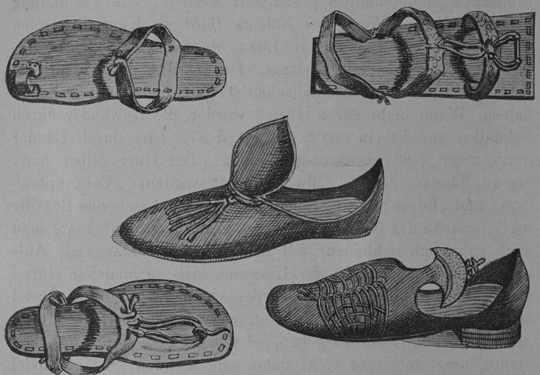

*Fig. 23. Arabische Schuhe.*

Auf einer Art Bank oder Gestell, die ihm als Presse (מכבש) dienen, spannt der Schuster das Leder aus (מתח)[^84.664] und schneidet es mit einem Messer (סכין, חרב)[^84.665] nach Form oder Maß (מדה) des Fußes zurecht, auf rechten und linken Fuß berechnet[^84.666]. Die einzelnen Stücke zusammenzunähen (תפר, כלב)[^84.667] bedient er sich einer metallenen Pfrieme (bh. u. nh. מרצע), zur Not auch eines Dorns (קוץ, סול, סירה), und sogar eines Glas- oder Schilfrohrsplitters[^84.668], auch wohl einer groben Nadel (מחט)[^84.669]. Als Nähzeug kommen Flachs- oder Wollfäden und dünne Lederstreifen, für den Beginn der Naht auch steife Schweinsborsten, in Betracht[^84.670]; auch wurden die Stücke mit Kleister (פרורא) zusammengeklebt[^84.671], der fertige Schuh auf einen Leisten (אימום)[^84.672] geschlagen und mit einer Schwärze (חרת) oder mit Vitriol (קלקנתום) gestrichen und geputzt[^84.673]. Der neue Schuh wurde durch ein wenig Gehen gewissermaßen ausprobiert, und es geschah gewiß oft, daß er nicht passend am Fuße saß, in welchem Falle mit der weiblichen Eitelkeit gerechnet werden mußte, daß er sogar auf offener Straße abgelegt werden konnte[^84.673a].

In der Fußbekleidung gibt es hauptsächlich drei Typen: Sandalen, Schuhe und Stiefel. 42. Der Sandal (סנדל)[^84.674], bezw. die Sandale (πέδιλα = *talaria*), in der Bekleidung natürlich immer als Paar gedacht[^84.675], sind einfache Sohlen aus einem einzigen Stück Leder oder Holz[^84.676], die mittels Riemen (w. u.) um den Fuß gewunden wurden. Der Sandal genügte dem Morgenländer vollkommen, denn nicht warm sollte er den Fuß halten, sondern im Gegenteil in der Wanderung den Fuß vor dem brennend heißen Staube schützen, allenfalls den Fuß auch vor sonstigen Schäden bewahren. Man war übrigens geteilter Meinung darüber, ob der Sandal den Schmerz (צער) verhüten soll oder aber bloß des Vergnügens wegen (תענוג) angezogen wird[^84.676a]. Der Gelehrte nun, der zu Hause sitzt, trägt gerade im Sommer ganze Schuhe, gewiß des Anstandes wegen, der auch sonst von ihm die Verhüllung des ganzen Körpers verlangt (oben S. 162), während er zur Regenzeit, in Kot und Morast, Sandale trägt, um die besseren Schuhe zu schonen[^84.677]. Der schlichte Mann jedoch inmitten seiner häuslichen und gewerblichen Beschäftigung wird den Sandal, in den er, wie in eine Art Pantoffel, leicht hineinschlüpfen konnte, vor dem Schuh mit seinem umständlichen Schnürwerk bevorzugt haben; so finden wir denn in den meisten Beziehungen des jüdischen Lebens, obzwar wir die Kunde davon durch die Schriftgelehrten überkommen haben, den Sandal häufiger erwähnt als den Schuh[^84.678]. Obzwar nun der Sandal überaus verbreitet und der Arbeit nach sehr einfach war, so wurde er in dieser Zeit keineswegs mehr im Hause verfertigt, sondern von dem Sandalenverfertiger (סנדלר) käuflich bezogen[^84.679], auf dem Markte, z. B. demjenigen in Tyrus, gekauft[^84.680], oder gar vom Auslande bezogen, wie die Bezeichnung „laodicaeischer Sandal“ beweist[^84.681]. Der so bezeichnete Sandal war gewiß von spezieller Arbeit, wie auch der wahrscheinlich im klebrig lehmigen Boden der Tiefebene getragene Sandal (סנדל עמקי)[^84.682]. Oft wird eine andere Spezialität, der mit Nägeln beschlagene Sandal (סנדל המסומר) erwähnt, den zu tragen am Sabbat verboten war, angeblich wegen eines traurigen historischen Vorfalles, in Wirklichkeit aber wohl wegen seiner plumpen schwerfälligen Beschaffenheit, die ihn wenig feiertagsmäßig erscheinen ließ; bei den Römern waren die auch von Bauern getragenen schweren Militärschuhe (*caligae militares*) stark mit Nägeln beschlagen[^84.683], ein Schuhwerk, das in den Quellen 43. als *קלגס vorkommt[^84.684]. Es verdient angemerkt zu werden, daß man das Tragen eines aus dem Fell eines verendeten Tieres verfertigten Sandals für ungesund und darum gefährlich hielt[^84.685]. Auch der zum Schutze des Fußes der Reit- und Lasttiere gemachte Schuh wurde von den Juden „Sandal“ genannt (Abschn. V), während ihn die Römer *solea* nannten. — 44. Während aber der Sandal noch ein Oberleder (ζυγόν) hatte, welches die Zehen und die vordere Hälfte des Fußes bis zum Spann bedeckte, war die *solea* (acc. pl. *soleas*, סולייס) eine noch einfachere Sohle, die mit Bändern über dem Spann befestigt wurde und von der mit Recht betont wird, daß sie der Ferse ermangelte[^84.686]. Darauf beruht der sinnige Spruch: „Was für die Weisheit der Kranz des Hauptes (nämlich die Gottesfurcht), ist für die Demut die Solea der Ferse“[^84.687]. Ebenso wie der Sandal war auch die Solea bei den Gelehrten üblich[^84.688], vielleicht bei diesen erst recht, etwa wie bei den Kapuzinermönchen, da man in dieser Tracht eine besondere Demut erblicken konnte. — 45. Nach dem, was oben (S. 172) von bh. סרבל gesagt wurde, kann j.-aram. pl. סרבלי schon von hier aus Schuhe bedeuten doch wird dafür auch ἀρβύλη und σέρβουλον gesetzt[^84.689].

46. Ebenso unsicher ist die Bedeutung von הרדסטא; nur so viel läßt sich erraten, daß es ein schwerer Schuh war und dem „genagelten“ Sandal nahestand[^84.690]. — 47. Wie der laodicaeische Sandal (o.) Importware, so birgt sich wohl auch in קנסורס (l. סקוניים) eine ausländische Ware, und zwar die Σικυώνια, d. i. **sicyonische** Schuhe[^84.691]. — 48. Eine Sandalenart ist auch שורציפא, etwa pers. *sermūzel*, wofür geradezu auch סנדל gesagt wurde[^84.692].

49. Einen oft ausgesprochenen Gegensatz zum Sandalentypus[^84.693] bildet der Schuh מִנְעָל, desselben Stammes mit bh. נעל, von diesem jedoch, der etwa mit dem späteren Sandal zusammenfällt, in der Bedeutung verschieden[^84.694], im Stoffe darin, daß der Sandal aus rohem, ungegerbtem Leder verfertigt war, so daß der spröde Stoff, wenn einmal geborsten, nicht auszubessern war, während der Schuh, aus weichem gegerbtem Leder verfertigt, sich besser dem Fuße anschmiegte und auch zerrissen diesen bekleiden konnte; in der Machart darin, daß der Schuh nicht nur unbedingt Absätze hatte, wie auch manchmal der Sandal, sondern auch ein Oberleder (w. u.) bis über den Spann, und das Schnürwerk, das allerdings auch dem Sandal und diesem nur noch mehr nötig war, über dem Oberleder zu liegen kam, das Fußblatt somit doppelt einwickelnd[^84.695]. Dort, wo es auf die Betonung der Unterschiede nicht ankommt, heißt die Fußbekleidung schlechthin מנעל, ein Ausdruck, der den Sandal miteinfassen kann[^84.696]. 50. Aram. סינא, desselben Stammes mit bh. סאון[^84.697], wird zwar dem bh. נעל gleichgesetzt[^84.698] und müßte demnach und auch infolge seines hohen Alters, das immer eine Einfachheit bedingt, der Sandal sein, doch bedeutet es gewiß auch den vollständigeren Schuh, wofür besonders der etwas modifizierte Ausdruck מסאנא zu halten sein wird[^84.699].

Von hohen, an die Schenkel heranreichenden Schuhen, richtiger Stiefeln, können wir sichere Beispiele nicht anführen, doch sei auf סרבל (No. 45) und auf die unten zu behandelnden Filzschuhe hingewiesen.

Jede Fußbekleidung besteht aus dem eigentlichen Schuh und dem Schnürwerk. Bei dem Schuh fallen ins Auge die Sohle (כף)[^84.670], der Absatz oder die Ferse (עקב)[^84.671], die Ösen oder Löcher (אזנים *ansae, ansulae*)[^84.672] zur Aufnahme der Bänder, die Seiten (מעמידים)[^84.672a], das Oberleder, das bei manchen Männerschuhen aus zwei Stücken bestand: aus dem Oberleder des Fußblattes (פנתא) und dem Oberleder des Spannes (גלדא)[^84.673], die Spitze oder „Nase“ (חוטם)[^84.674]. Das Schnürwerk, schon bh. in שרוך נעל, aram. ערקתא (ארקתא)[^84.675] enthalten, besteht entweder aus frei um den Fuß gelegten Riemen (רצועה)[^84.676], die aus den Osen herausgehen, oder aus einer in den röhrenartigen Saum (aram. חומרתא) des Schuhes gelegten Schnur (שנץ, pl. שנצות)[^84.677], die aber nur dann festzieht, wenn am Schlitz des Saumes Bänder verknüpft werden können[^84.678]. Besonders die letztere Art wird wohl קשר (pl. קשרים) = Knoten heißen[^84.679]. Eine über den Fußrücken gespannte Schleife oder Zunge von Leder (חבט) tat denselben Dienst[^84.680]. Schleifen oder Bänder ähnlicher Art, jedoch nicht vom Schuh selbst ausgespart, sondern aufgenäht, heißen טרסיות (תרסיות)[^84.681], etwa=*amentum*, während die רצועות *corrigia* (ἱμάς) sind[^84.682]. All diese Dinge sind zumeist aus Leder, aber bei einem hölzernen Sandal werden auch die Schleifen (חבטים), die Bänder (תרסיות) und sogar die Seiten (מעמידים) aus Holz erwähnt[^84.683], die Bänder des ledernen Schuhes auch aus Haar[^84.684]. Als Zubehör verdienen noch Erwähnung die Nägel (מסמרות), wie wir sie besonders in dem genagelten Sandal (סנדל מסומר) gefunden haben, und die Nägel dienten gerade dazu, Unter- und Oberteil, aber auch die Riemen und Bänder, zusammenzuhalten[^84.685].

Der Riemen wurde zwischen der großen und der ihr nächsten Zehe durchgezogen und auch noch an die Ferse geschnürt; nebst der unumgänglich nötigen Befestigung am Fuße konnten die Riemen und Bänder auch ästhetisch schön verschlungen werden. Infolge des verwickelten Schnürwerkes war das Anlegen und Lösen der Schuhe ziemlich beschwerlich; man ließ es sich durch Diener machen[^84.686], und war man alt, so ging es nur durch fremde Hilfe[^84.687]; bei Gelehrten waren es die Jünger, die diese Dienste verrichteten. Die Araber, gewiß durch ihre vielen Wanderungen genötigt, zogen ihre Riemen zu einem festeren Bund zusammen[^84.688], während man zuhause gewiß auch mit einem lockeren Bund auskam[^84.689]. Es galt als ein Stück des Anstandes, beim Anziehen des Schuhes mit dem rechten, beim Ausziehen mit dem linken zu beginnen[^84.690]; doch wurde es keineswegs immer und von jedem so gehalten. Für das An- und Ausziehen sind, wie bh., נעל und חלץ die gangbarsten Ausdrücke[^84.691], außerdem „anziehen“, wie bh. שים, nh. סים[^84.692], doch auch לבש „ankleiden“[^84.693], nebst einer Anzahl von Ausdrücken (קטר = knüpfen, הדק = festziehen[^84.694]), die durch die besondere Beschaffenheit des Schuhwerks bedingt sind; für das Ausziehen kommt ferner bh. שלף in Betracht[^84.695], wohingegen נשל wegfällt, dafür aber kommen andere eigene Bezeichnungen, z. B. שמט in Aufnahme, namentlich הִתִּיר „lösen“, weil das Lösen der Riemen gleichbedeutend war mit dem Abstreifen der Schuhe[^84.697].

Die Schuhe bedurften einer gewissen Pflege; nicht nur wurden selbst getragene Schuhe, besonders von Frauen, immer wieder auf die Leisten geschlagen[^84.698] (vgl. S. 176), sondern auch mit Öl geschmiert (סוך) und mit Wasser gewaschen (הדיח, auch כבס), um sie zu reinigen oder ihnen den Glanz zu geben (צחצח), mit dem Messer geschabt (גרד), was besonders dann geschah, wenn sich Kot angesetzt hatte und sozusagen abgeschält werden mußte[^84.699]. Die nicht im Gebrauche befindlichen Schuhe, also Sandalen im Sommer, Schuhe im Winter (vgl. S. 177), hielt man unter dem Bette[^84.700], oder man hing sie auf einen Nagel oder Pflock[^84.701]. Es werden so oft alte und neue Schuhe erwähnt, daß wir annehmen müssen, daß der Unterschied beträchtlich war; mit der Zeit erlitten nämlich die Schuhe mannigfachen Schaden; sie wurden abgewetzt (בלה)[^84.702] und zerrissen, vertreten (סנדל הנוטה)[^84.703], gingen auseinander (מנעל מרופט), so daß oft nur ein halber Schuh blieb[^84.704], der Holzsandal brach ab (נפחת)[^84.705], die Ösen reißen aus, die Bänder wie auch die Riemen reißen ab (פסק), der Absatz löst sich ab (פרש)[^84.706], die Nägel fallen aus (נשר)[^84.707], und was es solcher Schäden noch mehr gibt. Einige dieser Schäden konnte man ausbessern (תִּקֵּן)[^84.708], namentlich konnte auf den Riß ein Fleck aufgesetzt werden (טלה מטלית)[^84.709], und wenn es für unschicklich galt, daß Schriftgelehrte in geflickten (bezw. in abermals geflickten) Schuhen ausgingen, so gab es gewiß andere, die man auf der Straße in geflickten Schuhen erblicken konnte. Drohte beim Gehen der zerrissene Schuh vom Fuße herunterzufallen, so befestigte man ihn zur Not mit irgendeiner Schnur oder einem Gewächs, das man zur Hand hatte[^84.710].

Wenn auch der „weiße“ Schuh (מנעל לבן)[^84.711] noch zu den echten Schuhzeugen zu zählen sein wird, so gibt es eine Anzahl anderer, die nur uneigentlich Schuhe oder Sandalen genannt werden. So: 51. מנעלות הפינון, eine Art Socken aus grober Wolle, möglich auch aus dem Byssus der Steckmuschel[^84.712]. 52. מנעלות הורב mit Wolle usw. gepolsterte Schuhe[^84.713]. 53. Strohsandalen[^84.714]. 54. Metallsandalen[^84.715]. 55. Korksandalen (של שעם)[^84.716]. 56. Haarsandalen[^84.717]. 57. Solche aus Palmzweigen (דיקולי), Palmblättchen (הוצי), Riedgras (היטני)[^84.718]. — Sind es bisher Schuhe und Sandalen in selbständiger Verwendung, so sind die folgenden Stücke nur Zubehöre zu der Fußbekleidung, d. h. sie werden als Einlagen oder als Socken in den Schuhen und Sandalen getragen; das Schuhzeug nämlich auszupolstern, es weicher und wärmer zu machen, war bei den Juden gerade so wie bei den Römern Brauch[^84.719]. 58. ערדלין = ἀρτάριον oder ὀρτάριον wollene Socken[^84.720]. Etwas Derartiges sind auch die אנפיליא ἐμπίλια = *impilia*, s. No. 11. Sehr häufig werden erwähnt 59. die קורדקין oder קורדקייסין, d. i. *[soleae] corticeae*, Korksohlen, hauptsächlich von Frauen getragen, die durch mehrfach übereinander gelegte Sohlen, nebst dem Schutze vor Kälte und Nässe, auch noch einen höheren Wuchs vorspiegelten und die außerdem ihre Korksohlen geradeso als Waffe benutzten wie schlagfertige Damen ihre Pantoffel; eben Frauen werden es auch gewesen sein, die ihre Korksohlen vergoldeten und wohl auch mit Perlen belegten, so daß diese Fußbekleidung zu einem kostbaren Toilettestück ausgebildet wurde[^84.721]. Persischen Ursprungs sind 60. פומק und 61. נרמק, jenes, wie es scheint, in der zwiefachen Bedeutung von Beinschienen und von Socken, beidemal aus Filz[^84.722], dieses, eigentlich die weiche Fußbekleidung überhaupt, gleichfalls eine Art Socken[^84.723].

In diesen Zusammenhang reihen wir noch ein einige Bekleidungsstücke, die mit der Fußbekleidung einige Verwandtschaft zeigen. 62. מְגַפַּיִם rein hebr. Dual von נגף: Beinschienenpaar, als Kriegsausrüstung[^84.724]. Mit einem gr. Namen, vielleicht in Einzelheiten etwas verschieden, erscheint dasselbe Stück der Ausrüstung als *אסטרקלילא oder *טרקלילא = ἀστραγάλιον Knöchelblech[^84.725]. 63. Mit פרקנימין = περικνήμιον Beinschienen versahen sich auch die Jäger von Großwild und von Vögeln, wie auch die Heuschreckenvertilger und die Dornenklauber, d. i. solche, die durch dick und dünn im Felde einherschritten[^84.726]. 64—70. Ebenso hatten die Dornenklauber einen Handschuh (כף), der wahrscheinlich nur für Daumen und die übrige Hand gegliedert war, während ein anderer Handschuh derselben Berufsklasse, der aber auch von anderen getragen wurde, wahrscheinlich für alle Finger gegliedert war (בית אצבעות). Ein Gurt (זון s. No. 35), ein Armhälter (ברכייר = βραχιάριον), beide wohl für einen Lahmen bestimmt, der rutschend sich auf seinen Händen fortbewegt, rein hebräisch סמוכות הידים „Händestützen“ genannt, ferner der Ärmelhalter (שרבלים), werden in demselben Zusammenhange genannt[^84.727]; ein **seiner Füße beraubter** Mann (קיטע) hatte ebenso סמוכות הרגלים „Fußstützen“[^84.728] und eine Vorrichtung, die in den Quellen קב *Kab* genannt und in mancherlei Beziehung als Schuh angesehen wird, dem Wesen nach aber unbekannt ist, denn sie kann ebenso ein ausgehöhltes Holzstück zur Aufnahme des fußlosen Beines, als ein mit einer Fersenform (קב) versehener künstlicher Fuß sein, in beiden Fällen an der Berührungsstelle mit Fetzen (כתיתין) ausgepolstert und mit Leder überzogen[^84.729], wie denn alle Nummern von 63—70 Ledergeräte sind. Dagegen dürfte ein anderer Handschuh, 71. קסייה (d. i. etwa = Bedeckung), den die Wurfschaufler, die Reisenden (gegen Fliegen usw.), die Flachsarbeiter, in einer anderen Form auch die Färber, die Schmiede und die Müller (teils gegen den Schweiß, teils gegen Beschädigung) benützten, auch aus anderem Stoff gemacht sein: aus Rutengeflechten oder gar aus Metall[^84.729a].

An die Fußbekleidung knüpfen sich mancherlei Bräuche und Sitten. Auf den Tempelberg in Jerusalem durfte man nicht mit dem Staub auf den Füßen, d. i. mit Schuhen, hinaufgehen[^84.730], nicht als unmittelbare **Folge** der morgenländischen auch von der Bibel bezeugten Sitte, daß heilige Stätten nur unbeschuht zu betreten sind, sondern weil die zur Reise benützten Schuhe dem Manne ein werktagsmäßiges Aussehen geben. Bei den vor Gericht erscheinenden Parteien soll kein Unterschied in der Kleidung hervortreten; wie es ferner verlangt wurde, daß der vor Gericht Geladene, wie in Trauer gehüllt, sich schwarz kleide, so wurde auch mitunter verlangt, daß er die Schuhe ablege[^84.731]. Leidtragende nämlich, und auch solche, über die der Bann verhängt war[^84.732], gingen barfuß oder zumindest nicht in der gewöhnlichen Beschuhung[^84.733]; dasselbe geschah, als Zeichen der Kasteiung, an Fasttagen, vor allen am Versöhnungstag, an welchem das Verbot der Beschuhung (נעילת הסנדל) zu den charakteristischen Merkmalen des Tages gehörte, allerdings mit recht zahlreichen Ausnahmen zugunsten derjenigen, die auf der Landstraße einherziehen, zugunsten der Gelehrten und Wöchnerinnen, und endlich, wenn die Fußbekleidung aus Linnen- oder Wollstoffen oder aus Stroh- und Weidengeflechten besteht[^84.734].

Barfuß gehen ist in den Augen der Rabbinen der Ausdruck der höchsten Armut, deren Gegensatz nicht etwa kostbare Schuhe sind, sondern Sänfte und Auflegen von Teppichen[^84.735], so daß der Fuß des Glücklichen den Erdboden überhaupt nicht berührt. Anderseits gab es Anlässe, wo der Schuh absichtlich gemieden wurde, so z. B. wenn man eine Wunde am Fuße hatte[^84.736]; in Schuhen zu schlafen galt als ein Übel, das an den Tod gemahnt[^84.737], und mancher Wandersmann wird sich zuzeiten den Schuh recht gern vom Fuße gestreift haben. Auf einen des Weges Einherziehenden wird zu beziehen sein der Satz: „Solange du Sandalen am Fuße hast, tritt das Gestrüpp nieder!“[^84.738] Wir wissen bereits, daß je nach der Jahreszeit, vielleicht auch je nachdem, ob man sich auf der Reise, zu Gaste oder zu Hause befand, enge und bequeme Schuhe, Schnürschuhe mit Sandalen abwechselten[^84.739]. Dem gegenüber ist es merkwürdig, daß, wenigstens was Sandale anlangt, für Sabbat kein besonderes Paar vorhanden war[^84.740]. Selbst die Balken seines Hauses soll man verkaufen, um sich Schuhe kaufen zu können[^84.741]. Nur der ist ein Mensch, der Schuhe an den Füßen hat[^84.742]. Unter den besonders anstößigen Dingen figuriert auch, daß sich einer die Schuhe versagt[^84.743]. Namentlich sollen Gelehrte[^84.744] nie in zerrissenen und geflickten Schuhen ausgehen[^84.745]. Den Luxus in Stoff, in Form und Sitzen des Schuhes haben wir namentlich in der Mode der Frauen beobachten können. Fast phantastisch klingt es, daß zu besonderen Verführungskünsten sie, wahrscheinlich als Symbol, eine Drachengestalt an ihren Schuhen anbrachten; auch legten sie in einem kleinen Gefäß, das bald als ein Eitrichter, bald als ein Huhnkropf bezeichnet wird, wohlriechenden Balsam in den Absatz ihres Schuhes, der durch einen Tritt der Trägerin den berückendsten Duft ausströmte[^84.746]. Diese Wahrnehmung dient zur Illustration des Schriftwortes: Die Töchter Zions gehen einher mit gerecktem Halse, mit blinzelnden Augen, mit trippelnden Schritten, und klirren mit den Füßen (Jes. 3,16). Nun kennt man aber von Männern einen gleich hoffärtigen Gang: Wer da inmitten der Straße geht, mit den Augen zwinkert, das Haar kräuselt und sich auf die Fußferse stellt, der ist dem bösen Trieb verfallen[^84.747], und auch da mag der Schuh mitgeholfen haben.

[^84.659]: TPesach 2(3),18, 160₄ אף הרצענין auch die Riemer dürfen am Rüsttage des Pascha arbeiten (wie z. B. die Schneider § 78), denn die Wallfahrer, vom weiten Wege kommend, müssen ja auch inmitten des Festes, nämlich am Halbfeiertag, ihre Schuhe (מנעלים) und Sandalen (סנדלים) ausbessern (תִּקֵּן). Demnach ragen die רצענין noch in die Zeiten des Tempelbestandes hinein, und ihr Handwerk dürfte sich ungeteilt sowohl auf Schuhe als auf Sandalen erstreckt haben. Dasselbe in j 31ᵇ₆ in Erklärung der Mišna 4,7, u. z. j u. ed. Lowe immer רוצען, רוצענים, b 55ᵇ רצענים; vgl. jMḳ 1,8, 80ᵈ₅₉. Aram. רוצענא RN, Agg. רצענא bSabb 60ᵇ.
[^84.660]: In hebr. Form bloß einmal: שַׁכָּף TKel bb 1 Ende, 591₂₈. Sonst אושכפא (L 1,177 viell. von אסף mit eingeschalt. Kaf abzuweisen, vielmehr assyr. *askapu* ZA 1890,103, syr. ܐܫܟܦܐ PSm 4158 arab. إسكاف ZDMG 50,613, gekürzt *skafi*) an den unten zu folgenden Stellen. Der Name אשכף resp. אושכף für eine Heuschreckenart (bChull 65ᵇ) soll wohl das Tier witzig als den „Schneider, Schuster“, d. i. Zerstörer bezeichnen, biblisch in ילק usw. vorgebildet. Griechisch entspricht σκυτεύς u. σκυτοτόμος.
[^84.661]: Stellen w. u. Dem gr. σανδαλιάριος scheint rein lateinisch *solearius* zu entsprechen, vgl. MARQ., Pl.² 597.
[^84.662]: In großen Städten waren nach *Cyropaed.* 8,2, 4 besondere Männersandalenmacher und Frauensandalenmacher (JAHN 1,1, 404; vgl. BLÜMNER, Techn. 1,272. 275; eine Menge Branchen folgt aus den lat. Namen bei MARQ. a. a. O.).
[^84.663]: RJochanan הסנדלר MʾAboth 4,11; Chananja u. ʾOšaja bPesach 113ᵇ (zur Namensform u. LA s. K 1, 313 u. § 114). Das Gewerbe war auch in Rom geachtet (MARQ. a. a. O.).
[^84.664]: TKel bb 1 Ende, 591₂₈; zu מכבש vgl. S. 154. Die Worte ומניח עליו את האבן ib. beziehen sich wohl auf eine andere Verrichtung, nicht die des Schusters.
[^84.665]: חרבא דאושכפא bSabb 123ᵇ, RN s. v. חרב 2 (3,484) אוזמל של [א]שכף, wo das Alif viell. nicht nötig, denn RN kann arab. *skafi* (A. 660) meinen. Daß nicht חרתא zu stehen hat, beweist K 1,313. סכינא beruht auf einer Var. in bBm 116ª (vgl. bSabb 123ᵇ) סכינא דאשכפתא st. אשכבתא (K. a. a. O.), an sich unrichtig, aber סכין wird neben חרב gebraucht worden sein, wie auch אזמל, wenn auch nicht bezeugt. Vgl. gr. βυρσοτόμος Lederschneider = Schuster.
[^84.666]: MSabb 8,2 (vgl. b 80ª) גמי (s. § 174) so groß, daß man davon das Maß eines minorennen Knaben nehmen könne (כדי ליטול ממנו מדת מנעל לקטן). Rechter u. linker Fuß MJebam 12,1, bTaʿan 12ᵇ. Darauf beruht die Möglichkeit להחליף jSabb 6,2, 8ª₆₁. In einem allzu großen Schuh (נעל) kann man nicht gehen, in einem allzu kleinen wäre auch nur der größere Teil des Fußes nicht bedeckt (חפה), also muß sein נעלו הראוי לו Bar bḲidd 14ª u., vgl. MJebam 12,1 (b 101ª).
[^84.667]: תפר o. A. 419, כלב ib. u. jMḳ 1,8, 80ᵈ₅₉; חוט jKil 9,5, 32ᵈ Z. 15 יחוט, Z. 18 מיחוט.
[^84.668]: Folgt aus dem Nebeneinander der genannten Dinge mit מרצע in bezug der Prozedur Exod 21,6. Mekh z. St. (p. 77ᵇ) hat nur מרצע u. z. ausdrücklich als metallen (מין מתכת) bezeichnet, so auch Sifre Dt 122 p. 99ᵇ, wo ferner מרצע גדול u. als gleichartige Werkzeuge (nach verbesserter LA) קוץ, קרומיות של קנה, זכוכית; Mekh RSbJ p. 122 מחט Nadel, מכתף (= מכתב) Schreibstift, סיל (= סול) u. סירה; vgl. jḲidd 1,2, 59ᵈ₂₀ סול, קוץ, זכוכית (bḲidd 17ᵇ fehlen Details). Siehe noch bBekhor 37ᵇ, bSabb 4ᵇ, bKerith 15ᵇ o. (L 3,489. 520). Griechen u. Römer hatten ὀπήτιον oder ὀπεύς, κεντητήριον (vgl. קינטרה κέντρον Lwr 2,533), *subula, fistula sutoria* BLÜMNER 1,275.
[^84.669]: מחט s. vorige A., מחטא דאושכפי bChull 31ª.
[^84.670]: jKil 9,5, 32ᵈ₁₅ כיתן (dies nur wegen des speziellen Falles von כלאים erwähnt, aber ebensogut עמר) u. רצועה. bJebam 102ᵇ סנדל התפור בפשתן. Vgl. νευροῤῥάφος, νευροῤῥαφεῖν mit Sehnen nähen, bes. flicken, BLÜMNER 1,270. Rituelle Pergamentschriften, z. B. Thora und Phylakterien, werden bekanntlich mit Sehnen (גידין) genäht. Bar bSabb 90ᵇ „von dem Harten des Schweins“ (מקשה של חזיר) Raši: Borsten aus dem Rücken des Schweins, die der Schuster am Kopfe des Einziehfadens braucht.
[^84.671]: bPesach 42ᵇ קולן של סופרים erklärt mit פרורא דאושכפי RN, Raši פירורא (vgl. S. 104); Kleister der Schreiber nur darum, weil auch Schreiber ihre Papyri damit kleben (דִּבֵּק ib.).
[^84.672]: MKel 23,1 אמום (ed. Lowe אמון), T bb 2,6, 592₁₄ אימן, unter Lederwaren, also wohl in diese Kategorie gehörig u. selbst von Leder; deutlicher MKel 26,4 מנעל שעל האמום ed. Lowe אמום, T bb 4,7, 594₉ מנעול על האימום, opp. שנטלו מן האימום; ferner erfahren wir ib., daß Frauen den Schuh nicht nur neu, sondern auch im Tragen auf den Leisten geschlagen wünschen: tout comme chez nous. מנעול על האימום auch TʿEduj 1,2, 457₆, vgl. bSanh 65ª Raši. Zu אמום s. § 161; καλόπους BLUMNER 1,276; κρηπιδοποιός ib. 271; *forma calcei* meint Raši bSabb 141ᵇ פורמה. Ib. רפוי wenn der Schuh nur lose auf dem Leisten war.
[^84.673]: חרת MNidda 2,7 (s. Bert., nach anderen = Tinte, als Färbestoff s. oben § 77), T 3,11, 644₄ j 50ª₅₇; חרתא דאושכפי bSabb 104ᵇ, bMeg 19ª, bGitt 19ª; ib. קלקנתום (Lwr 2,549), s. Tosafoth ʿErub 13ᵇ. חרת ist = μελαντήρια, *atramentum sutorium*, BLÜMNER 1,278.
[^84.673a]: jSabb 6,1, 8ª₃₈ אין לובשין מנעלין וסנדלין חדשים אלא אם כן לבשן והלך בהן מבעוד יום, nach bSabb 141ᵇ ist das auf מנעל של אשה zu beschränken.
[^84.674]: Stellen fast erschöpfend s. in Lwr 2,399. סנדל = σάνδαλον (der Verfertiger סנדלר σανδαλάριος), lat. *sandalium* = σανδάλιον, ist zu den Juden jedenfalls von den Griechen gekommen; der Ursprung des Wortes mag aber im Orient zu suchen sein. — טלריתא Neubildung aus *talare* nur einmal: Trg I Kön 2,5, Lwr 2,268.
[^84.675]: Thr R c. 1,13 זוגא סנדלא opp. חד סנדליה. Vgl. ולא ביחיד MSabb 6,2. Auch sonst שני מנעלים s. A. 678.
[^84.676]: Gerade weil hier und da „Holzsandal“ erwähnt wird, z. B. MJebam 12,1, sieht man, daß für gewöhnlich die Sandale ledern war. Aus Holz war, wenn der Ausdruck סנדל hierbei nichlt metonymisch aufzufassen ist (s. zwei diesfällige Erklärungen in RN u. vgl. Lwr סנדל 2) u. 3), der Sandal der Kalkarbeiter beim Baue: MʿEduj 2,8 הס׳ של סיידים, T 1,13, 456₉ zwei Dinge: ס׳ של עץ u. של סיידין, TJebam 12,10, 255₂₄ ובסנדל של סַיָּד, vgl. § 11. Nach der Äußerung ס׳ של עץ של עכשיו (TJebam 12,11, 255₂₇) muß mit den Holzsandalen in unserer Epoche eine Veränderung vorgefallen sein. Die verwundernde Äußerung ib. וכי יש חולצין במנעל, wonach (von halakhischen Erwägungen nicht beeinflußt) das eigentliche Schuhwerk nicht מ׳, sondern ס׳ ist, wird für gewisse Gegenden, dort z. B. für Nisibis in Mesopotamien, stimmen; vgl. besonders die Fassung in j 12,1, 12ᶜ₁₆ וכי יש סנדל במקומנו. קיסם . . . שבסנדלו TSabb 5(6),1,116₇ ist am besten gleichfalls von der Holzsandale zu verstehen. Bei Griechen u. Römern s. BLÜMNER 1,279.
[^84.676a]: bSabb 61ª o., s. Raši.
[^84.677]: bBb 58ª o., s. RSbM. Nach bBerakh 43ᵇ liegt zur Regenzeit nichts daran, wenn auch der Schuh des Gelehrten über und über geflickt ist.
[^84.678]: Im Hause sieht man den Sandal besonders in den Erörterungen über den Hausaussatz (נגעים): MNeg 13,9 „wer in das aussätzige Haus hineingeht, mit seinen Kleidern (כלים) auf der Schulter und seinen Sandalen und Ringen (טבעות) in der Hand“ usw., resp. „seine Kleider angezogen, seine Sandalen am Fuße und seine Ringe an der Hand“ usw. In T 7,9, 627₂ der Ausdruck etwas verschieden: סנדלו וטבעותיו בקומצו. Vgl. TSabb 8(9),18. 19, 130₂₁ f. המוציא כליו מקופלין מונחין על כתיפו וסנדליו וטבעותיו בקומצו ··· היה לבוש בהן ··· וסנדליו ברגליו וטבעותיו בידיו. Dagegen bSabb 120ᵃ und j 15ᵈ₂₄ (s. A. 509) שני מנעלים kein Gegenbeweis, denn es sind die im Hause befindlichen Reserve-Schuhe, wie in bBb 58ᵃ, während die Sandalen tatsächlich getragen werden. Sandalen auf dem Felde, und im Gewerbe s. A. 676. In derselben A. figuriert bereits der Sandal in der Zeremonie der חליצה, s. noch MJebam 12,2, j 12ᶜ₁₉, b 102ᵃ, T 12,10, bSanh 7ᵇ und weiter unten, doch ist in dieser Beziehung, weil die Bibel selbst von נעל spricht, der Schuh mehr erwähnt. An Fasttagen, besonders am Versöhnungstag, wird immer vom Verbot des Sandaltragens (נעילת הסנדל) gesprochen, von sonstigen Schuhen nur nebenbei. Die Priester sprechen den Priestersegen nicht in ihren Sandalen (כהנים ··· בסנדליהם Bar bRh 31ᵇ), sondern barfuß.
[^84.679]: Für das für Josef erhaltene Geld kaufen dessen Brüder Sandalen (Trg Ps-Jon Gen 37,28 סנדלין, in Tanch z. St. jedoch, Wajjēšeb 2, und in Pirke RE c. 38 נעלים, s. M. Zs. Szemle 23,183). Schuhmacher aus Susitha brachten ihre Ware in Tiberias zu Markte (jŠebiʿith 8,3, 38ᵃ₃₅ קורדקיא Korksandalenmacher s. A. 721).
[^84.680]: jAz 1,4, 39ᵈ₁₅ מזבין סנדל מן ירידה דצור.
[^84.681]: סנדל לדקי MKel 26,1. Es wird hier von der Möglichkeit gesprochen, daß Schnüre und Bänder dieses Sandals ohne den Professionisten (שלא באומן) von dem Privaten angebracht werden können (s. Maim.), ein Beweis, daß es sonst der Gewerbetreibende tut.
[^84.682]: סנדל עמקי MKel 26,1; Maim.: in diesen geht man im Tieflande (الارض الوطئة), und er hatte eine bestimmte Form. Danach ist im Texte der Sinn ausgedrückt worden. Vgl. die Deutung von ארץ כבול als eines morastigen Landes, in dessen Boden der Fuß einsinkt, bSabb 54ᵃ. Auch die Griechen hatten πηλοπάτιδες „Lehmtreter“. Allein RN (s. auch RŠ, nach Hai) hält עמקי für den Namen eines Ortes (wie לדקי), und zwar erinnert derselbe an כפר עמיקו oder wie sonst der Name lautet, s. REJ 53,43.
[^84.683]: MSabb 6,2 ed. Lowe בסנדל מסומר (Agg. ס׳ המסומר); nicht zu verkennen, daß dieses im Gefolge von anderen Waffen genannt ist; statt לא יצא der Mišna steht in T 4(5),8, 115₂₄ לא ינעול usw. mit noch anderen wertvollen Details: Er spaziere (טייל) nicht in ihm im Hause selbst von Bett zu Bett nicht (wobei er den Fußboden nicht berührt). Es können Gefäße (etwa Töpfe und dgl.) mit ihm zugedeckt werden (vgl. bSabb 59ᵃ den Sandal als Trinkgefäß). Es fallen die meisten Nägel heraus (נשרו רוב מסמרותיו), aber es bleiben vier bis fünf oder sieben; demnach die ursprüngliche Zahl der Nägel weit größer. Er kann unten (שלמטה l. מלמטה) mit Leder belegt (חִפָּה) und dafür oben mit Nägeln beschlagen werden, oder es wird ihm eine Platte (טס) oder eine Sohle (יתד) untergelegt, so daß beim Gehen der Fußboden nicht geritzt wird (ולא תהא הארץ אוכלת). In bSabb 60ᵇ עשאו כמין כלבוס (Raši altfr. s. I. LÖW Lwr 2,288 Spiekernagel, ein Nagel mit breitem flachem Kopf) ··· טס ··· יתד ··· usw. או שחיפהו כולו במסמרות. Die Platte und Sohle erinnern an die *solea ferrea, solea argentea* und sogar *solea ex auro* (bei RICH), die die luxuriösen Römer den Sohlen ihrer Reittiere (s. w. unten) unterlegten und um so mehr gewiß den eigenen Schuhen; das edle Metall war von j. Standpunkte ein Schmuck am Sabbat, der den Gebrauch des Schuhes wesentlich erleichterte. Daß ohne diese Vorrichtung der benagelte Sandal die Erde ritzen mußte, ist begreiflich; zudem erwähnen auch die Alten oft die *clavi caligares* (BLÜMNER 1,277; MARQ., Pl.² 595 A. 5, wo auch die Stelle des Josephus, B. J. 6,1, 8 § 85, von dem in das Heiligtum eingedrungenen Zenturionen Julian, der mit seinen mit dicken und scharfen Nägeln, πυκνοῖς καὶ ὀξέσιν ἥλοις, versehenen Schuhen das Pflaster beschädigte). Vgl. Thr R 2,7 p. 57ᵃ B. nach berichtigter LA des RN u. siehe Bd. II S. 312. Dies wäre eher ein Anlaß, das Tragen von benagelten Sandalen überhaupt, auch an Werktagen, zu verbieten. Allein in bSabb 60ᵃ wird (im Namen Samuels) erzählt, einst wäre der benagelte Sandal der Verräter von in einer Höhle versteckten Juden geworden (s. GRAETZ, Gesch. 2,320 vgl. Magazin 20, 213 f.). Andere zwei Lehrer berichten andere Fakta ähnlichen Charakters, Fakta, die sich merkwürdigerweise immer am Sabbat zugetragen haben sollen, weshalb denn das Tragen des benagelten Sandals am Sabbat, und nur an diesem, verboten wurde. In jSabb 8ᵃ o. hat man ganz andere Begründungen. Bezüglich Feiertags besteht ein anderes Verbot (MBeza 1,10 s. § 139). Gleichwohl ist das Verbot am Sabbat durch das Ritzen des Bodens schon an sich verständlich. Noch näher liegt der Gesichtspunkt von der werktagsmäßigen Art dieser Bekleidung; s. Jelamdenu zu Dt 7,17 „die Feldarbeiter (פולחין?, oder Soldaten? s. § 162) pflegen benagelte Schuhe anzuziehen“; vgl. A. ROSENZWEIG, Kleidung S. 73. מסמרין ··· בסנדל auch Num R 14,4. Zum Schlusse mag noch Raši zu MSabb 6,2 angeführt werden: „Der סנדל המסומר ist aus Holz (?), und man schlägt oben Nägel ein, um den Oberteil an den Unterteil zu festigen, nämlich das Holz an das obere Leder, und er hat zwei Löcher, den Fuß (nämlich die Ferse und die große Zehe) hineinzustecken.“
[^84.684]: Immer Pl. קלגסים (Sifre Dt 192 p. 110ᵃ) resp. הקלגסים (Var. גלגסין u. עלגסין, Ms. Kfm הקולגסים, ed. Lowe getrennt הקול גסין, Volksetymologie! MSota 8,3), s. Lwr 2,418 und 168. Es ist immer von dem Getöse (שפעת) die Rede, die diese Militärschuhe verursachen, und die eben deshalb Furcht einflößen. Es ist zu bemerken, daß nach RICH s. v. *caligarius* die *caliga* ein eng anschließender über den Leisten gemachter Schuh war, und nicht ein Sandal, wie gemeiniglich behauptet wird.
[^84.685]: סנדל של מתה Bar bChull 94ᵃ; s. dazu J. BERNAYS, Gesamm. Abhandlungen 1,240. — Die Gelehrten pflegten sich in Sandalen bestatten zu lassen, s. bJebam 104ᵃ u. RN s. v. זקן (3,314ᵃ).
[^84.686]: Stellen s. סוליים in Lwr 2,375; bei Griechen und Römern s. RICH s. v. *sandalium* und *solea*, MARQ., Pl.² 595, wo u. a. nach *Ed. Diocl.* 9,17, 23 babylonische *soleae* erwähnt werden. Ausdrücklich bKidd 14ᵇ נעלו הראוי לו פרט לסוליים שאין לו עקב RN (Agg. מסוליים, so lies auch in bJebam 103ᵇ und nicht המסוליים denomin.); Raši zu dieser Stelle (s. auch zu MJebam 101ᵃ für עקב) gibt für ס׳ richtig altfr. *sola* (Nebenform zu *solea*, it. *suolo*, fr. *sole*, s. KLUGE, Etym. Wb.⁵ s. v. *Sohle* 2). RN s. v. סוליים (K 6,59) setzt it. *scarpetta*, und zwar „eine Handbreite groß“. Hai zu MKel 26,4 نعل سير d. i. Riemenschuh.
[^84.687]: Sinn: dieselbe Gottesfurcht, die nach einem angeführten Schrifttext ראשית = Kopf heißt, ist bei demutvoller Sprache, nach einem gleichfalls angeführten Schrifttexte, die Solea (סוליים) der Ferse (עקב), d. i. die Basis des Lebens: מה שעשת חכמה עטרה לראשה עשת ענוה עקב לסולייסה דכתיב ראשית חכמה יראת ה׳ וכתיב עקב ענוה יראת ה׳ jSabb 1,1, 3ᶜ₁₈ (lies סוליים לעקבה, mit den Parall. Tanch Bĕrēšith 1, Tanch B. Behaʿlothĕkha 16, Jalk Prov § 960 mit leichten Varr., s. Lwr; in Cant R zu 1,1 c. 1,8 steht dafür סנדל, gut möglich infolge der Verwandtschaft der beiden Wörter). RNissim in המפתח zu Berakh IX p. 25 ed. Goldberg führt den Spruch aus dem Jelamdenu an, R. El. Worms in רקח Anf. יראת aus der Pesikta.
[^84.688]: jJoma 8,44ᵈ₄₉ לבוש סולייסה RN (Agg. לביש סוליסה), jTaʿan 1,6, 64ᶜ₆₆, ib. ib. mehreremal.
[^84.689]: bBb 52ᵃ זוגא דסרבלי (bSabb 58ᵃ, in Lwr 2,412, gehört nicht hierher) habe ich = ἀρβύλη gesetzt, I. LÖW jedoch verweist auf زربول = σέρβουλον ZDMG 51,298, akzeptiert von A. ROSENZWEIG, Kleidung S. 70 A. 3, aber σέρβουλον dürfte ngr. erst aus dem Arabischen stammen und ist nicht geeignet, das talm. ס׳ zu erklären. Am besten, für סרבל, wie bh., auch die Bedeutung „Schuhe“ anzusetzen (A. 603). Allerdings sollten in Verbindung mit Hosen eher hohe Schuhe, etwa Stiefel, angenommen werden, doch gibt es für diese Art Schuhe zu demselben Punkte auch andere Ausdrücke (מוק usw.), und es ist daher ratsam, סרבל in der Bedeutung Schuhe von jenen stark differieren zu lassen. Übrigens ist bereits gesagt worden, daß in bBb 52ᵃ manche Erklärer „Schere“ sehen.
[^84.690]: jSabb 6,2, 8ᵃ₁₃ הדוסטא (auch ed. Ven., wonach die Konjektur in Lwr 2,220 הרוסטא nicht wahrscheinlich; was aber die Gleichsetzung mit ῥόστρα = *rostra* betrifft, so kann auf RICHs Artikel *calceus repandus* verwiesen werden). Vorschläge הפדומטא ὑποδήματα, ἡλωτός usw. (s. Lwr) u. ὁδοστά (? A. ROSENZWEIG, Kleidung S. 70 A. 3) ganz unbefriedigend. Fl. zu L 1,557 pers. روستا *rusta* (von *rusticus*) Bauernsandale, wenigstens dem Sinne nach annehmbar. In Flav. Vop. *Saturninus* 8,10 kommen vor *calices allassontes versicolores*, und הלוסטא (so) könnte etwa ἀλλάσσοντες sein.
[^84.691]: jJebam 12,1, 12ᶜ₅₃ als Beispiel von mit Absätzen versehenen Sandalen (סנדל שיש לו עקב) wird „dort“, d. i. in Babylonien, קנסורם genannt; ich konjiziere eine Form wie סולים acc. pl., lese סקיונים *Σικυωνίη -ίας, d. i. sicyonische Schuhe. Hesych: Σικυώνια (neutr. pl.): ὑποδήματα γυναικεῖα (andere Belege s. MARQ., Pl.² 594 A. 5), im Talmud allerdings Männerschuhe. Weil ausländische Ware, paßt gut die Fortsetzung in j: „die Rabbinen von hier (Pal.) jedoch meinen, von der Art, wie die unsrigen.“ — Sonstige Erklärungen von קנסורם (Lwr 2,555 κνημῖδες, κόθορνος) passen nicht. Höchstens käme *calceolus* in Betracht, wenn man etwa קנקיום liest.
[^84.692]: jJebam 12,1, 12ᶜ₅₆ (in gleichem Zusammenhange wie das vorige) שורציפא דשנצי, in b 102ᵃ dafür סנדל דאית ל[י]ה שנצין. Pers. *sermūzel* BRÜLL, Jahrb. 4,47; arab. سرموجة eine Art Fußbekleidung ZDMG 50,611. — κρούπεζα Lwr 2,580 muß fallen gelassen werden, ebenso [?] PSm 3972, welches FRAENKEL ZDMG 55,357 vergleicht.
[^84.693]: Fälle, wo מנעל opp. zu סנדל, s. in den Wörterbüchern u. a. auch in Lwr 2,399.
[^84.694]: bh. נעל, syr. ܢܥܠܐ, arab. نعل, bedeutet wahrscheinlich „Sandal“, was auch daraus hervorgeht, daß נעל Dt 29,4 in bezug auf חליצה von den Rabbinen vorzugsweise auf סנדל gedeutet wurde (o. A. 678). Den Unterschied im Sprachgebrauch bemerkt Raši zu bJebam 102ᵃ zu der (falschen) LA והתורה אמרה נעלו ולא מנעלו.
[^84.695]: Alles gefolgert aus MJebam 12,1 (b 101ᵃ) s. Raši, b 102ᵃ פנתא מעל ואדקתא מעל דמעל. Wegen des Oberleders immer מנעל auf den Leisten (A. 672), nicht סנדל.
[^84.696]: Z. B. in Esth R 4,15 (c. 8,7) כי לוחך הייתי מנעל רגליו „denn ich würde den Schuh an seinen Füßen geleckt haben“ (zur Sitte s. S. 180). מנעלים לרגליו bSabb 129ᵃ.
[^84.697]: Jes 9,4 סאון soll schon in assyr. *šenu* enthalten sein, s. GES. Hwb.¹⁴, wo auch ܣܐܢܐ, סינא und äth. *san*. Nach meiner Annahme (ZATW 28,253) בית שאן volksetymologisch Schuhstadt gedeutet, darum Βηθσάνη = Σκυθόπολις = Schusterstadt; dagegen I. LÖW ib. 29,215.
[^84.698]: Beispiele s. bei L Trg Wb. 2,50 (da bh. נעל, wie gesagt, Sandal ist, so ist מסנא Trg Ps-Jon Lev 16,29 nichts als Sandal und wird in Lev 23,27 und Num 29,7 ganz richtig mit סנדלא abgelöst, besonders da in bezug auf den Versöhnungstag dies der rabbinische Terminus ist; das ist aber kein Grund, מסנא für cormp. zu erklären, wie L tut); in bezug auf נעלו bei חליצה steht aram. סיניה bJebam 39ᵇ, j 12 g. E., 13ᵃ₈, jSanh 1,1, 19ᵃ₅₈ (aus der schriftlichen, gewiß alten Formel).
[^84.699]: Folgt aus dem Sprichworte מסאנא דרב מכרעאי לא בעינא „einen Schuh, der größer als mein Fuß ist, mag ich nicht“ (d. h. der Mann heiratet nicht gern über seinen Stand hinaus) bKidd 49ᵃ (כרעין = Schenkel hätte bei Sandalen keinen Sinn). Dasselbe geht hervor, wenn wir hören, Vespasian habe der eine Schuh (מסן, מסאנא) nicht gepaßt, so sehr sei sein Fuß angeschwollen (Thr R zu 1,5, bGitt 56ᵇ), denn ein Sandal wäre jedenfalls leicht anzuziehen. Übrigens ist es schwer, einén Vespasian (in der Kriegstracht!) sich in Sandalen vorzustellen. Auch סאון in Jes 9,4 ist der Soldatenschuh. Zu *caligae* wurde schon oben (S. 178) bemerkt, daß sie nicht Sandalen, sondern Schuhe sind. — מסאנא דתאיני jDemai 1,3, 21ᵈ₆₀, ib. מְסַנְתָּא, in Gen R 60,8 קרטיל, ist ein Korb (L 3,163).
[^84.670]: כף TKel bb 4,5, 594₅.₆, jSabb 6,1, 8ᵃ₄₄.₄₆, b 112ᵃ (Raši altfr. *sola* s. A. 686 für סוליים, was eigentlich dasselbe). Von סנדל gesagt, aber gewiß nicht darauf beschränkt. Was in T u. j hernach steht: פנימית und חיצונה, bezieht sich auf כף, auf das es folgt (nur dieses ist fem. u. sing. zugleich), wovon aber ניטל zu sagen ist, nicht נפסק, wie in b. Wir haben somit mit einer inneren und äußeren Sohle zu rechnen; wichtiger ist die äußere.
[^84.671]: עקב MKel 26,4 von סנדל; aber manche Sandale hat keinen Absatz (MJebam 12,1), der סוליים hat überhaupt keinen (o. A. 686 vgl. 687). TSabb 12(13),14, 128₄.
[^84.672]: MKel 26,4 סנדל שנפסקה אחת מאזניו, TKel bb 4,5 ס׳ שנתפסקו אזניו, vgl. jSabb 6,1, b 112ᵃ (s. A. 670). אזנים bei anderen Ledergeräten, z. B. bei חמת u. תורמל MMikw 10,6 s. § 194. Die *ansa* der Schuhe heißt gr. ἀγκύλη (RICH 36) und dieses W. scheint vereinzelt als אנטלית vorzuliegen in TKel bb 4,8, s. Lwr 2,21.
[^84.672a]: jJebam 12,1, 12ᵈ₂.
[^84.673]: Zur Sache s. RICH s. v. *calceolus*. Infolge dieses Tatbestandes sehe ich bBerakh 43ᵃ in פנתא das Oberleder des Fußblattes, in גילדא (wörtlich nur = Leder!) das auf dem Spann, nicht wie RN u. Raši = Sohle, Absatz. פנתא Var. אפנתא (s. auch bTaʿan 12ᵇ, bJebam 102ᵃ, zur LA s. K 1,221, wonach פנתא richtiger) ist pers. eigentl. = Stirn (K 6,373 پنجه), übertragen das Obere des Schuhes. Raši Berakh altfr. *empeigne*, Taʿan *escarpin*? RG hält פנתא für Oberleder eines Schuhs, dessen Sohle Holz ist.
[^84.674]: MKel 26,4 ניטל חוטמו או שנחלק לשנים. TSabb 12(13),14, 128₄; ib. auch נשמט ח׳.
[^84.675]: ערקת מסנא Trg O Gen 14,23, Trg Jes 5,27, s. L Trg Wb 2,247. ערקתא דמסאנא bSanh 74ᵇ. Als Zuchtmittel (wie רצועה) s. § 135, als Pferdeschmuck § 150. Auch syr. ܥܪܩܐ, ܥܪܩܬܐ, ar. عراق, alles bei L 3,705. Daß ע׳ aus Leder, wie natürlich, geht auch aus Tanch Bĕrēšith 7 hervor. ארקתא bSabb 59ᵇ s. oben A. 645. So mit Alef auch bJebam 102ᵃ ארקתא neben פנתא s. A. 695, hier nach RN (K 1,303) nicht so sehr Riemen, als ein Stück Oberleder, wie auch ar. عراق.
[^84.676]: רצועות מנעל וסנדל MNeg 11,11. TKel bb 4,5, jSabb 6,1, b 112ᵃ (wie in A. 670): Riemen der Sandale. רצועה לסנדלו TMeg 1,5, 222₃; danach wurde auch der Riemen gekauft und selbst der Ärmste braucht ihn.
[^84.677]: שנץ ist gewiß anzulehnen an bh. שנס (s. A. 608), das freilich selbst nicht sicher steht; arab. شسع (JAHUDA JQR 15,711) hat bereits K 8,115. MMikw 10,6 שנץ של סנדל RN u. ed. Lowe, Agg. שנץ. Pl. שנצים in bezug auf פלמניא Bar bNidda 13ᵇ u. Aram. שינצין bJebam 102ᵃ (s. A. 692; RN וכסנדלא בתר שינצי). Trg Ps-Jon Dt 25,9 סנדלא ... דחייט בשנצי, ib. ותשרי שנצי. Zu כיס של שנצות s. § 194.
[^84.678]: bJebam 102ᵃ zu Sandal מיתנא דיין אע״ג דאית בה חומרתא קטרינן ביה. So wird auch חומרתא zu erklären sein bSabb 112ᵃ (gegen Raši).
[^84.679]: TMikw 7,2, 659₃₄ וקשרי מנעל וסנדל.
[^84.680]: MMikw 10,3 חבט של סנדל, jJebam 12,1, 12ᵈ₅ נפסקו חבטיו, in jSabb 6,1, 8ᵃ₄₄.₄₅ korr. חבתיו, fehlt in b 112ᵃ. חבק Gurt des Lasttieres s. § 150.
[^84.681]: TKel bb 4,5, 594₄.₅ טרסיות (neben אזנים) mit dem Verb נפסק (wie אזנים), in TSabb 12(13),14, 128₃ תרסיות, so mit ת auch bSabb 60ᵇ, ib. 112ᵇ, bJebam 102ᵇ, j 12,1, 12ᵈ₂. Raši bSabb 102ᵃ scheint unter תרסיות die Nahtstelle der Riemen zu verstehen, also mit אזנים etwas Verwandtes, ib. 60ᵇ jedoch setzt er רצועות dafür, ähnlich RN s. v. תרסית (K 8,283): Riemen der Sandale, ar. שראך (= bh. שרוך ? pl. سراك od. شراك). L 4,673 gibt als Etym. ترس an: Lederriemen, Schleife. Trotz der vereinzelten Schreibung mit ט halte ich dieses für echt und vergleiche טרז (auch תרס) o. S. 133, eine bestimmte Naht, hier also der Umstand, daß die Schleife aufgenäht ist. ארבע אזנים וא׳ תרסיותים bSabb 112ᵇ.
[^84.682]: Siehe RICH s. v. *amentum*.
[^84.683]: jJebam 12,1, 12ᵈ₁.
[^84.684]: bJebam 102ᵇ.
[^84.685]: Wenn die Nägel nicht zu befestigen (לחזק), sondern zur Verzierung (לנוי) angebracht waren, so waren es gewöhnlich fünf: bSabb 60ᵇ שתים מכאן ושתים מכאן ואחת בתרסיותיו, j 6,1, 8ᵃ₂₀ werden die fünf Nägel mit den fünf Büchern der Thora symbolisiert; ib. auch die Zahlen 7, 9, 13, 24. Die Nägel konnten statt an der Sohle auch oben angebracht sein, Bar bSabb 60ᵇ וקבען לו מסמרות מלמעלה.
[^84.686]: Vgl. Matth 3,11; Marc 1,7; Joh 1,27, Ag. 13,25. bKidd 22ᵇ. bBb 51ᵇ. jSabb 6,1, 8ᵃ₇₁ מושיט ליה סנדליה.
[^84.687]: Folgt daraus, daß dem RChanina als Achzigjährigem nachgerühmt wird, er habe ohne fremde Hilfe seine Schuhe an- und ablegen können (bChull 24ᵇ), andere konnten es also nicht.
[^84.688]: בסנדליא דטעייא דמיהדק טפי bJebam 102ᵃ; RCh bei RN s. v. חמר 10 (K 3,436): „Wir haben gehört, daß es derart sei, was man arab. תאסומה (?) nennt, welches nach Maß des Knöchels gemacht ist; er macht nun Knöpfe (oder Schlingen חומרתא s. A. 678) und in alle zieht er Riemen ein, die er, wenn er will, auch straffer ziehen kann; dann verknüpft er [die Riemen] von außen, und die kann er, wenn er will, loser machen“.
[^84.689]: טעייא ist eben der typische Wanderer; wer zu Hause sitzt, macht das Schuhband nicht so fest.
[^84.690]: bJoma 77ᵃ, bSabb 61ᵃ, j 6,2, 8ᵃ unten, Derekh ER c. 10.
[^84.691]: Siehe die Stellen in der vorigen A.
[^84.692]: In Piʿel (resp. Paʿel, da es nur aram. vorkommt) zu lesen: סַיֵּם; bGitt 56ᵇ, bTaʿan 12ᵇ. 22ᵃ (L 3,490). bSota 8ᵇ שליה ערטל וסים מסנא (s. o. A. 3); in bKethub 65ᵇ o. steht רמי מסנאי. bSabb 152ᵃ.
[^84.693]: Siehe A. 448 u. 678. Ferner: לובשין סנדלין Jelamdenu s. in A. 683; Schuh ausdrücklich für מין מלבוש erklärt jSabb 6,1, 8ᵃ₆₃.
[^84.694]: bSabb 61ᵃ סיים . . . ולא קטר, vgl. bJebam 102ᵃ, wo auch הדק s. A. 688.
[^84.695]: Aram. שלף zum Beispiel in dem Falle, wenn zwei Schuhe (מנעלים) am Fuße und der eine wird abgestreift (דשלפתיה לעילאי bJebam 102ᵃ, ib. 102ᵇ bh. חָלַץ = משלף). Hebr. שלף in dem jungen Midraš Pirke RE c. 1 (= Seder Elia Z c. 19) ed. Friedm. p. 26 ולא שלף את נעליו resp. ib. ושלף נעליו. Vgl. שומטין מנעל מע״ג אימום bSabb 141ᵇ.[696*] שמיטה רוב העקב bJebam 102ᵃ; ib. שמט רוב הרגל usw. T 12,12, 256₄.
[^84.697]: Bar bJebam הותרו רצועות למנעל וסנדל, T 12,12, 256₄ הותרו לו רצועות מנעל וסנדל es haben sich ihm [von selbst] gelöst die Riemen des Schuhs und der Sandale.
[^84.698]: Siehe A. 672.
[^84.699]: Hauptstellen bSabb 141ᵃᵇ und jSabb 6,2, 8ᵃ in folgenden Sätzen: טיט שעל גבי מנעלו מגררו בגב סכין b lies mit j גרד mit Daleth; auch an Scherben, am Erdboden und an der Wand wurden sie gereinigt (b ib.). Bezüglich des alten Schuhs ist das Schaben gleichsam ein Abschälen (קלף Raši). סוך ib. mehrmals, j auch מדיחין, was von Wasser gilt; der Effekt ist מצחצח b (auch von Wasser, vgl. bBm 84ᵃ, bRh 33ᵃ bei L 4,182ᵃ); aram. identisch משח u. שוע j Z. 33. Hierin sind מנעל und סנדל gleich, denn beide figurieren in j u. b ib., vgl. TSabb 3(4),16, 114₁₆. כבס u. שכשך (vgl. S. 156) bZebach 94ᵇ.
[^84.700]: bBb 58ᵃ (allerdings als Sitte des Schriftgelehrten hingestellt), s. RSbM (falsch aufgefaßt von A. ROSENZWEIG, Kleidung S. 74, wonach das im Gebrauch befindliche Schuhwerk unter dem Bette läge); unter dem Bette auch bJebam 25ᵃ o. מנעלים הפוכים תחת המטה, aber in anderer Beziehung ist der Satz nicht klar, s. Raši; so viel geht aus ihm nebenbei hervor, daß beim Entkleiden die Schuhe unter das Bett geschoben wurden, wie man es zuweilen auch heute tut.
[^84.701]: jʿErub 8,1, 25ᵃ₄₃ יתד לתלות בו מנעלו.
[^84.702]: Dt 29,4. Jos 9,5; ib. 5,27.
[^84.703]: bSabb 61ᵃ.
[^84.704]: bJebam 102ᵃ מנעל מרופט (gleich dabei חצי מנעל), ib. 102ᵇ unten במנעל הנפרם שחופה את רוב הרגל בסנדל הנפחת שמקבל כו׳ (der Schuh bedeckt den Fuß, der Sandal nimmt ihn auf), lies mit RN מרופט, so wie auch in bSabb 141ᵇ steht (auf שפתותיהן . . . מתרפטות bSabb 152ᵃ verweist bereits RCh, s. L 4,462), TKel bb 4,6, 594₈ zweimal נפרם, was auch einen guten Sinn gibt; vgl. TJebam 12,10, 255₂₅ ניפרם, in Z. 23 נפרם.
[^84.705]: Siehe vorige A. Auch TKel bb 4,6 סנדל שנפחת. jSabb 6,1, 8ᵃ₅₆.
[^84.706]: Sämtlich in TKel bb 4,5. 6, 594 Z. 4—9, Parallelen s. in A. 681.
[^84.707]: bSabb 60ᵇ נשרו; ib. נגממו, נעקרו.
[^84.708]: Siehe A. 659.
[^84.709]: jSabb 6,2, 8ᵃ₁₈ in bezug auf Tragen des סנדל מסומר am Sabbat: טלה עליו מטלית מלמטן, entsprechend dem, was b 60ᵇ חיפהו בעור מלמטה heißt, aber der Ausdruck (טלי טלא s. S. 157) selbst hat gewiß eine ausgedehntere Anwendung, wie z. B. in bezug auf Thefillin, die doch gleichfalls ein Lederzeug sind, jMeg 1,71ᵈ, bGitt 45ᵇ, und speziell bei Schuhen טלא und מנעלים המטולאים bBerakh 43ᵇ u. Der vertretene Sandal konnte durch ein eingelegtes Stück Leder (Raši ungenau מנעל של עור) gerichtet werden, bSabb 60ᵇ תפרו מבפנים, Raši פנרדין. Gr. κάττωμα, πέλμα, ἐπικαττεύειν, νευρορραφεῖν s. BLÜMNER 1,270. 276.
[^84.710]: jSabb 6,2, 8ᵃ und jJebam 12,2, 12ᵈ, beidemal corr. כריך oder כרך umwickeln mit *כבנא, das schwerlich der so benannte Stoff sein kann (S. 131), sondern etwa in סיביה „sein Strick“ (sonst als Gurt gebraucht S. 174) zu emendieren ist. Derart ist אגוד מלבניקי s. S. 142. Die nun folgenden Worte sollen bedeuten: RJona warf (den zerrissenen Schuh, der ihm am Sabbat vom Fuße zu fallen drohte) in das Gewölbe eines Schmuckwarenhändlers (aram. חליטרה) mit dem Bemerken, auch dieses sei ein klein wenig kostbar (סידרה יקיר, nach dem Kommentar soviel wie שרד = Zeug?). In bJebam 102ᵇ und bJoma 78ᵇ כריך סודרא אכרעיה, ein jenem כרך in j ähnlicher Fall; möglich, daß nun danach סידרה des j zu erklären sein wird.
[^84.711]: MBeza 1,10 מנעל לבן bedarf noch des Verfertigers, d. h. er muß noch geschwärzt werden (s. § 177), opp. שחור ib. 15ᵃ. Die römischen Frauenschuhe waren mitunter weiß, und sittenlos, wie man war, zogen sich manchmach auch Männer weiße Schuhe an (MARQ., Pl.² 593. 594). Die *phaecasia* (φαικάσια), in Athen und Alexandrien von Priestern und Gymnasiarchen getragen (ib.), waren weiß, s. auch den Papyros aus Oxyrrhynchos bei BLUDAU, Juden und Judenverfolgungen im alten Alexandria, 1906 S. 113. Die Juden kannten schwarze Schuhe als römische Tracht, die zur Not auch der Jude trug (bTaʿan 22ᵃ). Es verdient Erwähnung, daß in der Religionsverfolgung dem Juden auch nur den Schuhriemen zu verändern verboten war (לשנויי ערקתא דמסאנא bSanh 74ᵇ), demnach bestand auch hierin ein Unterschied zwischen römischer (heidnischer) und jüdischer Sitte. Aus Babylonien haben wir die Kunde, daß einer sich in der Trauer schwarze Schuhe anzog (bBk 59ᵇ o. הוה סיים מסאני אוכמי s. Tosafoth), vgl. dazu HOTTENROTH, Trachten 1,49.
[^84.712]: מנעלות הפינון MKil 9,7, Lwr 2,448 zu פיליון *pileum* Filzhut gestellt, richtiger jedenfalls GUISIUS z. St., der πίνος, πινηρὰ ἔρια herbeizieht, und das ist schmutzige grobe Wolle. I. LÖW jedoch denkt an πινικόν, an den Byssus der Pinna-Muschel, s. o. S. 138. j z. St. 32ᵈ₈ דרדסין.
[^84.713]: מנעלות הזרב MKil 9,7 (so lies mit RŠ, Ašeri, Or Zaruʿa u. a., auch j z. St., s. K 3,319. 321, L 1,551; Agg., auch ed. Lowe, corr. זרד), von زرب *pulvinar*, Kissen, ein Schuh, der gepolstert ist, u. z., wie j z. St. 32ᵈ₁₄ angibt, in einigen Orten mit Wolle (אית אתרין דזרבין עימ(י)ה[ר] בגז), in anderen Orten wohl mit Werg (מוך), dem gewöhnlichen Polsterfutter S. 64. RN irrig: bis an die Hüften reichende Lederschuhe; Mussafia hält זרד gleich mit צרדא vgl. A. 710.
[^84.714]: סנדל של קש TKel bb 4,5, 594₃.
[^84.715]: TKel bb 2,11, 592₂₅ Drei Arten Sandalen: des Menschen, der aus Metall (של מתכות) und des Viehes (o. S. 178, wonach also der metallene Sandal ein uneigentlicher ist), der של שעם u. של צפירא (w. unten). Die zweite Nummer wird übrigens zu vereinigen sein, denn MKel 14,5 ed. Lowe steht סנדלי בהמה של מתכת.
[^84.716]: MKel 14,5 TKel bb 2,11 s. A. 715, TJebam 12,10, 253₂₃, bJoma 78ᵇ o. T ib סנדל של סיד l. mit alten Agg. סיב von Fasern; ib. במוק l. entweder מוך, wie Z. in einem Texte gefunden, oder נרמוק w. u. Bar bJebam 102ᵇ סיב und מוק. שעם an anderen Stellen s. L 4,590. Das Wort bedeutet wohl Kork, vgl. קורדקין.
[^84.717]: צפירא (s. A. 715) = ספירא Abgeschorenes, L 4,214.
[^84.718]: bJoma 78ᵇ (von Sandalen, in denen man am Versöhnungstag ausgehen darf): בדהיטני Var. חיטני = איטן s. I. LÖW, Pfl. No. 20 p. 47 irgendein Riedgras; Halakh. Gedol. ed. Ven. 30ᵈ נפק בסנדלא דהיטני lies דה׳, wo aber סנדלא wahrscheinlich aus dem Talmudtext selbst stammt. — Ib. בדהוצי pl. von הוצא = ܚܘܨܐ = خوص mand. עוצא, gegenüber den anderen Stoffen oft im Talmud, sind nach I. LÖW, Pfl. S. 116 Palmblättchen, wie auch zu anderen Zwecken, gewiß auch zu Sandalen häufig verwendet. Man machte daraus u. a. הפיא Besen, aus diesem שישורא Strang (oder Gürtel o. S. 174) bBk 96ᵃ, L 1,485. — Ib. בדיבלי Halakh. Gedol. a. a. O. בדבולי, lies mit RN בדיקולי d. i. von Zweigen der Dattelpalme דקל (I. LÖW, Pfl. S. 109). סיב und מוך s. A. 716.
[^84.719]: RICH s. v. *fulmenta* (gekürzt von *fulcimenta*, gr. κάσσυμα). מוך שבסנדלה MSabb 6,8 (b 64ᵇ). Dunkel ist j 8ᵃ₁₉ הוית רגליה שחקיה „sein Fuß rieb sich an“ oder „er rieb [den Boden] mit dem [beschuhten] Fuß auf“, infolgedessen man einen Lappen unterlegte (vgl. A. 683).
[^84.720]: bBeza 15ᵃ ערדלין Agg., wie Mussafia konstatiert und wie auch in RCh und ms M steht; RN jedoch, Raši und andere (s. K 6,173) haben עדילין; Midraš Tannaim ed. Hoffm. p. 138 עדי לרים l. עדיל׳; RN: „schuhartiges Wollzeug, das man unter den Schuhen anzieht, arab. גורב (kommt in RN bei K 2,348 als selbständiger Artikel גרב vor, u. z. zitiert aus Halakhoth Gedoloth — an der in A. 718 bezeichneten Stelle — und aus Šeʾeltoth § 168; es ist جورب, auch pers. گورب, ܓܘܪܒܐ PSm 95 s. I. LÖW in Lwr 2,418, ZDMG 50,644), it. *pedúle* (dasselbe it. Wort auch s. v. גרב und s. v. אמפליא s. A. 524). Zu ὀρτάριον s. PERLES, Et. St. S. 30, ܐܘܪܛܪܝܐ BB 91 = ܓܘܪܒܐ PSm 95, ܓܘܪܒ BROCKELM. 61.
[^84.721]: Es ist von Frauen die Rede in TSabb 4(5),11, 116₄ יוצאה היא . . . במנעלין ובקורדקייסין המוזהבין (wo „vergoldet“ sich auch auf „Schuhe“ beziehen kann); in der RAkiba-Legende höchste Entfaltung des Luxus, daß er seiner Frau goldene Sofas, goldenes Diadem und goldene Korksohlen (קורדיקום של זהב) machte (Ab RN β c. 12 p. 15ᵇ). עכסים Jes 3,18 werden als קורדייקה gedeutet (jSabb 6,8ᵇ₅₅), also ein wesentliches Toilettestück. Man muß demnach annehmen, daß diese Fußbekleidung äußerlich sichtbar war, und nicht bloß als Einlage diente; bei den Römerinnen war Kork allerdings nur eine Einlage, soweit man die Sache nach RICH s. v. *fulmenta* verfolgen kann. Vielleicht war die im Hause gebrauchte Korksohle, die man in der Hand der Frauen als Werkzeug des Schlagens findet (Esth R zu 1,16 c. 4,6 מסטרתה בקורדקין שלה, Gen R 45,9 טפחתה בקורדייקין (RN קורדקיה), jPeʾah 1,1, 15ᶜ₁₉, jKidd 1,7, 61ᵇ₂ קורדקין, ib. Z. 19 in anderer Beziehung ונפסק קורדייקן שלה (in Tosafoth Kidd 31ᵇ wird dafür פנטפי zitiert), eine einfache Sohle. Man findet hierfür den Ausdruck dick, grob (Lev R 16,1 קורדקין עבין RN, Agg. קונדיריקין עבה, vgl. Pesikta 132ᵇ, Jalk Thr § 1031, Thr Z c. 1,25, Thr R 4,15, wo zugleich ersichtlich, daß die Frau in diesem Schuhzeug höher erscheinen wollte). Von Männern getragen, wahrscheinlich in zierlicher Arbeit, TMk 2,16, 231₁₉, bPesach 51ᵃ, j 30ᵈ₁₉. Andere Stellen habe ich in Magyarországi régiségek S. 36—39 u. in Lwr 2,519 gesammelt resp. besprochen. Die Erklärung *scordiscum* resp. *cordiscum* (SACHS) ist unhaltbar, ebenso κωρυκίδιον (L) und κόρδαξ (Jastrow). Richtige Ableitung von *corticea*, acc. pl. *corticeas* (wie in סוליים) gibt S. FRAENKEL in ZA 9,10 (Beitr. zum aram. Wb. No. 20). bJebam 102ᵇ קרקא (das ich in Lwr zu קורדקא emendieren wollte, wie denn tatsächlich bJebam ib. und 72ᵃ auch קורקסין, Jalk Jerem § 320 קירדקין) ist nach Fraenkel bereits fortgeschrittene Entlehnung von *corticea*, wie arab. قرق ܩܘܪܩܐ, vom span. *corcho*. Auch in Pesikta 132ᵇ steht bereits קורקן.
[^84.722]: bSabb 10ᵃ נקיט פוזמקי ומצלי, bŠebuʿoth 31ᵃ שלופו פוזמקייכו, zwei Stellen, an denen Socken gemeint sind; in bSabb 62ᵃ jedoch, wo פ׳ zur Erklärung von מגפים (w. u.) dient, Beinschienen, s. K 6,305, gehörig scheidend, gegen RN, der die drei Stellen zusammennimmt und bei dem etwa nur die Angabe, daß es Filzschuhe seien, richtig ist. Persisch پاتابه s. J. PERLES Et. St. S. 3 und K. a. a. O.
[^84.723]: נרמקי RN in bJebam 102ᵇ o., wo Agg. מוקי (חמשה זוגי מוקי) fünf Paar Socken, dieses somit an מוק S. 172 anlehnend). Pers. نرمك, نرمه, wovon auch arab. نرمق s. Fl zu L 3,719, K 5,389. Raši, der *caleçons* setzt (s. auch zu bSabb 10ᵃ und 129 ᵃ), verweist noch auf arab. אלמוק = موزج = pers. موزه *mōk*. Vgl. GRÜNBAUM in ZDMG 31,329 = Ges. Aufs. S. 189f.
[^84.724]: MSabb 6,2 לא בקסדא ולא במגפיים, bSabb 62ᵃ mit פוזמקי erklärt s. A. 722; MKel 11,8 ebenfalls unter Kriegsstücken, sinngemäß erklärt von Hai und danach von RN (K 5,80) als „eherne oder eiserne Schuhe, welche die Soldaten um ihre Schenkel legen, damit sie nicht verwundet (נגף) werden“. TKel bm 3,1, 581₉ מגפש ließ mit alten Agg. מגפים.
[^84.725]: Anläßlich מגפיים (vorige A.) verweißt RN auf Trg I Sam 17,6 טרקליני (Hai טרקלין, Agg. טרקלילין, ed. Lag. טריקלילין, DKimchi Var. טרקלין), offenbar gleich *אסטרקלילא I Trg Esth 5,9 = ἀστραγάλιον (Lwr 2,85), dieses Wort in derselben erweiterten Bedeutung, wie πέδιλα = *talaria* (RICH s. v.) „Sandalen mit Flügeln an den Seiten beim Knöchel (*talus*)“, dem Merkur, dem Perseus und der Minerva beigelegt. Die in Lwr 2,279 von FRAENKEL mitgeteilte Identifikation mit פרקלימין = περικνήμιον scheitert an der einheitlich überlieferten LA ט׳.
[^84.726]: MKel 26,3 Agg. פרקלימין, ed. Lowe פרקלמים, richtiger ms Kfm פרקנימין = RŠ; ib. 24,15 „Dreierlei Beinschienen gibt es“: פרקיליגן, ed. Lowe פרקליגין, ms Kfm פרקליגן, TKel bb 2,11, 592₂₆ פרגליגין; περικνήμιον FRAENKEL s. Lwr 2,496, vgl. vorige A. Die drei Arten sind nach M 1) die der Jäger von Wild und Vögeln, 2) die der [Verfolger von] Heuschrecken, 3) die derer, die die Felder von Dornen reinigen (קייצין, T קויצין); in T ist 2) nicht vorhanden, dafür 1) in zwei geteilt.
[^84.727]: MKel 26,3 כף לוקטי קוצים . . . הזון והברכיר . . . השרבלים . . . וכל בית אצבעות . . חוץ משל קיצים (nach ed. Lowe). Zu כף vgl. כף = Sohle o. S. 179. זון in diesem Zusammenhange ist gewiß nicht einfach = זוני ζώνη Gurt, sondern ein dem Lahmen auf die Hände gebundener lederner Schutzgurt. Desgleichen ברכיר, RN ברכייר (Agg. ברכיים, בורכ׳, wonach unter A. Maim. das W. an ברכיים anlehnt: zwei Lederklappen an den Hüften des Lahmen! Maim. ed. Dernb. übrigens בורכיאר) = βραχιάριον Lwr 2,166. Zu שרבלים (Agg. שרולים) s. oben A. 603. Der Ausdruck סמוכות MSabb 6,8 (b 66ᵃ) von קיטע (d. i. Einer, dem die Füße abgehackt sind), voller סמוכות הידיים bJebam 103ᵃ (so lies nicht סמיכה auch ib. 102ᵇ und statt סמיכת הרגלים, 103ᵃ richtig סמוכות הרגלים) und TJebam 12,9, 255₂₆.
[^84.728]: MSabb 6,8 an erster Stelle (denn כסא וסמוכות שלו beziehen sich auf die Händestützen, s. vorige A.; zur Auffassung des Maim. s. L 3,544), j 8ᶜ₃₃, bJebam 102ᵇ und 103ᵃ s. vorige A.
[^84.729]: MSabb 6,8 (b 66ᵃ) הקיטע יוצא בקב שלו, ib. אם יש לו בית קיבול כתיתין, s. Raši und Tosafoth, auch bei L 4,233. קב של קיטע TJebam 12,10, 255₂₄ קב הקיטע b 102ᵇ u. 103ᵃ. Daher בעלי קבין die Amputierten: bJebam 103ᵃ, bChag 4ᵃ.
[^84.729a]: MKel 16,6 קסייה (קסייא) של זורי גרגות של הולכי דרכים ושל עושי פשתן . . . אבל של צבעים ושל נפחים . . . של גרוסות. Zwischen den beiden Gruppen wird halakhisch der Unterschied gemacht, daß der Handschuh entweder zur Aufnahme von Gegenständen oder nur gegen den Schweiß (זיעה) gemacht sein kann. Dies führt uns zu seiner richtigen Erkenntnis. Die Bestimmung des Handschuhes muß sich uns bei den einzelnen genannten Berufen ergeben. RN (K 7,146), der gr. כירומניקה setzt, trifft nicht das Wesen der Sache, denn χειρομανίκιον (Lwr 2,286 כירומניקייה) bedeutet die Handfessel. Als Etymon von קסייה (ed. Lowe) dient anerkanntermaßen קסי = כסי, wie z. B. קום = כום (L 4,346) = bedecken. Zu קסייא של שולחנות MMakhš 5,8 s. Seite 60.
[^84.730]: TBerakh 7,19, p. 17₁₋₅ ובאבקו שעל רגליו ist der bezeichnende Grund für מנעל, das sofort folgt. Die drollige Geschichte, daß ein Rabbine in die Synagoge ging, die Sandalen ablegte, die ihm nun verloren gingen, mit der Äußerung: „Wäre ich nicht in die Synagoge gegangen, wären meine Sandalen nicht dahin“ (jBm 2,9, 8ᵈ₄) — beweist nicht das Ablegen der Schuhe in den Synagogen.
[^84.731]: Bar bŠebuʿoth 31ᵃ (Jalk Exod § 352) nicht zu dulden, daß einer in Lappen (סמרטוטין), der andere in eine Stola zu 100 Mina (oben S. 132) gekleidet sei; dieser Gedankengang ist nun zu ergänzen mit der trauermäßigen Erscheinung vor Gericht (A. 211), dann erst ist verständlich das nun folgende Wort, ein Gesetzeslehrer (in Babylonien) habe verlangt, man solle sich die Schuhe ausziehen (שלופו פוזמקייכו, o. A. 722). Vgl. bSanh 7ᵇ.
[^84.732]: J. WIESNER, der Bann . . . auf dem Boden des Judentums, Lpz. 1864 S. 25.
[^84.733]: bMk 15ᵇ, vgl. Gen R 100,2.
[^84.734]: MJoma 8,1 u. j u. b z. St., T 5(4),1—5 p. 189. 190. — MTaʿan 1,5. 6, b 12ᵇ, j 64ᶜ, T 1,5. 6,215 (immer auch Bezug habend auf מנודה den Gebannten und אבל den Leidtragenden). — Siehe dazu Th. ENGERT, Ehe- und Familienrecht der Hebräer, München 1905, S. 100f.
[^84.735]: Der Umschwung in Noemis Leben wird so geschildert, daß sie früher in Sänften (§ 212) getragen wurde, jetzt aber barfuß (יחפה) geht; biblische Beispiele zu יחף II Sam 15,30; Jes 20,2; Jes 2,25. Teppiche S. 35. Der herabgekommene Sohn geht barfuß, Thr R zu 1,7. Zu bemerken, daß die Fellachin entweder barfuß (*ḥāfi*) geht oder unelegante, dafür aber um so bequemere Schuhe (*madas* od. *wata* pl. *wuti*) trägt, ZDPV 4,60; Sandalen sieht man nur jenseits des Jordans; von Strümpfen oder Sohlen weiß der Fellache nichts (ib.).
[^84.736]: Folgt aus MSabb 6,2; aus der Begründung in b u. j z. St. ist hervorzuheben, daß man den, der bloß einen Schuh anzieht, verdächtigt, den anderen (am Sabbat) unter dem Kleid zu tragen, letzteres war also Sitte; oder der Halbbeschuhte könnte merken, daß er lächerlich aussieht, so daß er auch den anderen Schuh auszieht und ihn (am Sabbat) in der Hand trägt. Mancher Wandersmann wird es eben so gemacht haben.
[^84.737]: bSabb 61ᵃ.
[^84.738]: Gen R 44,12 עד דסנדלא ברגליך דר(י)[ו]ס כובא. Mekh RSbJ zu Exod 34,26 p. 165 כבוש כובא.
[^84.739]: Oben S. 180.
[^84.740]: jSabb 6,1, 8ᵃ₁₈.
[^84.741]: bSabb 129ᵇ.
[^84.742]: ודמנעלי בריגלוהי בר איניש bSabb 152ᵃ. Gewiß eine sprichwörtliche Redensart.
[^84.743]: Bar bPesach 113ᵇ והמונע מנעלים מרגליו. Wohlgemerkt: in den letzten beiden Aussprüchen handelt es sich um Juden überhaupt, nicht um Gelehrte. Die starke Betonung der Notwendigkeit der Beschuhung soll gegen die Essäer gerichtet sein, s. BRÜLL, Trachten S. 13 und vgl. A. 212.
[^84.744]: Für Gelehrte wohl gilt auch der Satz התיר מנעליו ויצא לחוץ הרי זה מגסי הרוח Derekh E z. E.
[^84.745]: bBerakh 43ᵇ.
[^84.746]: Lev R 16,1 zu העכסנה, als עכס ἔχις = Schlange gedeutet: צורות דרקון u. אפרסמון in שפופרת של ביצה, in Thr R zu 4,15 Agg. זפק, RN jedoch u. ed. Buber p. 75ᵇ שלפוחית des Huhns. Andere Parall. s. in A. 721.
[^84.747]: Gen R 22,6 p. 212 Th RAmmi (3. Jh. in Pal.) sagt: „Der böse Trieb (יצר הרע) wandelt immer nur inmitten der Straße, nicht auf den Seiten; und sieht er einen Menschen (אדם), der die Augen zu einem verlockenden Spiel auftut, das Haar richtet und seine Fußferse schwingt, so sagt er (der böse Trieb, gleichsam der Teufel): Der gehört mir.“ Der Satz versetzt uns so sehr in das antike Leben, daß uns nicht jeder Ausdruck klar ist. משמש בעיני ed. Th u. RN (K 8,230), Agg. u. Jalk Prov § 961 ממשמש, ist etwa „mit den Augen arbeiten“, ein Augenspiel treiben; מסמסם Midr-ha-Gadol p. 109. מתקן בשערו s. weiter unten. מתלה בעקבו (in RN an zweiter Stelle), Ps-Raši מתלא: sich erheben; Mathnoth Kehunna: den Fuß so setzen, daß er hoffärtig die Ferse zur Zehe gelangen läßt und so einhergeht. Eigentümlicher Irrtum von L 4,645, als ob der böse Trieb (Teufel) sich auf seine Ferse stellen würde. Es ist daran zu erinnern, daß עקב auch den Absatz des Schuhes bedeutet (S. 179).

## § 85

**85.** **Kopfbedeckung.**

Manche Stücke der Kopfbekleidung stammen, soweit es sich aus den Bezeichnungen erschließen läßt, aus der biblischen Zeit[^85.748]; so 72. die מצנפת, in der Bibel ein Kopfbund des Hohenpriesters, verwandt mit dem צניף der gemeinen Leute, beides ein um den Kopf gewundenes Tuch, also ein Turban. Die Mišna erwähnt die Form oder die Leisten (אמום), über denen die Turbanverfertiger (גודלי מצנפות) arbeiteten, und zwar bestand ihre Arbeit in einer Art Verflechtung (גדל S. 142)[^85.749]. Bh. צפירה, der Grundbedeutung nach ebenfalls ein Geflecht, lebt nur in dem Verb צפר flechten[^85.750]. 73. עטרה Kranz, Diadem, ist gleichfalls nur biblische Reminiszenz; es gab eben in den trüben Zeiten keine Leute, die sich so zu schmücken veranlaßt gefühlt hätten; die Gelehrten, diese Elite der jüdischen Gesellschaft, waren zu bescheiden dazu[^85.751]; bei Hochzeiten, an denen die Freude noch durchbrach, wurden in der dumpfen Stimmung der unglücklichen kriegerischen Ereignisse die Kränze der Bräutigame und der Bräute allmählich ebenfalls abgeschafft[^85.752]; und nur dort, wo man griechischer Sitte huldigte, schmückte man sich bei Gastmählern auch mit Kränzen[^85.753]. In den wenigen positiven Fällen, die wir vernehmen, wurde der Kranz (עטרה), auch „Krone“ (כלילא) genannt[^85.754], aus irgend einem Gras, aus Schilf oder Riedgras, aus Rosen und gewiß auch aus anderen Blumen, ferner aus Olivenzweigen[^85.755] geflochten (גדל), und, wie es scheint, wurde auch dies gewerbsmäßig betrieben[^85.756]. Doch gab es natürlich nicht blos Pflanzenkränze, sondern auch wirkliche Diademe, die aus vergoldeten kostbaren Stoffen hergestellt wurden, wie sie besonders anläßlich der Hochzeitskränze geschildert werden. — 74. Vollends war keiner da, der das Recht gehabt hätte, eine Krone (ebenfalls כליל, aram. כלילא, vgl. στέφανος = Kranz und Krone; כתר, תגא)[^85.757] zu tragen, dennoch aber erfahren wir gerade über diesen Kopfschmuck manche Einzelheit[^85.758]. Man hat sich ihn als ein Diadem aus edlem Metall zu denken, das mittels Bänder um den Kopf gebunden wurde (קשר, aram. קטר)[^85.759]. — 75. Ein reales Dasein kommt auch dem Helm (כובע) nicht zu, weil er als militärische Kopfbedeckung im Leben der Juden keine Verwendung fand, wie ihm denn zumeist römische Namen (קולם acc. pl. *galeas*, קסדא *cassis -idis*) gegeben werden[^85.760]. — 76. Auch in bh. גליון scheint man eine Kopfbedeckung (גלגלייה) erblickt zu haben[^85.761].

Die Kopfbedeckung hatte Sinn und Wert sowohl im Sommer als im Winter, denn sie schützte teils gegen die Sonnenglut, teils gegen die Kälte[^85.762]. Sie wird unter der Benennung כובע (siehe No. 75), das aber hier keineswegs den Helm, sondern irgendeine Mütze bedeutet, in der Liste der gebrauchtesten Kleider aufgezählt[^85.763] und erweist sich somit als eigenes Stück der Bekleidung. Zur alltäglichen und alten Sitte gehörte sie nicht, denn nach orientalischer Art dienten die verschiedenen Mäntel (bes. die mit Kapuzen) und Umschlagtücher zugleich auch zur Kopfbedeckung, wie wir das bei dem Tallith, den man über den Kopf nahm (עטף), bei dem סודר, dem מקטורן, dem כרבלא gesehen haben. Dasselbe gilt von סדין, גלימא, שושיפא, רדיד, מעפורת[^85.764] usw. Nebstdem hat man aber auch an besonderen Kopfdecken eine große Mannigfaltigkeit.

77. Häufig findet Erwähnung כִּפָּה oder כֻּפַּח, nach beiden Formen ein überwölbender Deckel[^85.765], bestehend aus einem wollenen Tuch, das, bis an die Augen reichend, turbanartig unmittelbar dem Kopfhaare aufliegt und seinen Schweiß aufnimmt, weshalb es denn in mehr oder weniger prächtiger Ausführung von allen Schichten der Gesellschaft getragen wurde: vom Hohenpriester als Unterlage des heiligen Stirnblechs (ציץ)[^85.766], von gewöhnlichen Männern[^85.767], besonders aber von Frauen, die dieses Kleidungsstück nebst Gurt und Schuhen an jedem Feste von ihren Männern fordern konnten, ein Umstand, der zu der humoristischen Bezeichnung „Kopftuch der Alten“ (כפה של זקנה) führte[^85.768], endlich auch von Sklaven, deren Charakter und füglich auch Freilassungsurkunde in dieses Kopftuch eingewebt sein konnte[^85.769]. — 78. Filzmützen (גומדין) der Araber[^85.770]. — 79. Die arabische Mütze *tartur* ist bestbekannt, und an diese gemahnt das mišnische טרטין[^85.771]. — 80. Mehr als die letzten zwei, aber mit ihnen im Zusammenhange, wird genannt die Filzmütze oder schlechthin der Filz (פליון), mit einem von den Griechen genommenen Worte (πιλίον = *pileum*)[^85.772]. Im Gegensatze zu כפה wurden *gomed*, *tartur* und *pileum* erweislich nur von Männern getragen, wohingegen ein ebenfalls aus der griechischen Tracht stammender Kopfbund, 81. das פיקיילה = φακίολον, von beiden Geschlechtern getragen wurde[^85.773]. Wir hören, daß man auf diesem Kopfbunde einen goldenen Besatz, etwa in Form eines Sternes, anbringen konnte. Auf dem 82. (aram.) סיינא genannten Kopfbunde, den man, wie es scheint, in Babylonien trug, wurde in ähnlicher Weise eine Perle und gewiß auch anderer Zierat angebracht[^85.774], ein weithin strahlender Schmuck, wie er im Orient gewiß beliebt war[^85.775] und unter den Slaven auch noch heute anzutreffen ist. Vom Kopfbund selbst hingen vorn und hinten Schleifen herunter, die den Hinterkopf und das Gesicht vor der Sonne schützten und je nach Bedarf enger oder loser gebunden wurden. — 83. Ein den Frauen jeglicher Klasse und jeglichen Alters notwendiger Kopfbund ist שְׂבָיס (bh. pl. שביסים), ein Stirnband, das von einem Ohre zum anderen reichend, das Haarnetz (שבכה oder סבכה) zusammenhielt[^85.776]. Das Haarnetz war ein größeres Stück maschenartigen Gewebes — von der Arbeit eines Fischernetzes (חרם), das gleichfalls eine Bekleidung abgeben konnte, besonders etwa für den Sommer geeignet, wie man sie zuweilen auch hierzulande sieht — bald ziemlich stark, wie das der jungen Mädchen und der alten Frauen, das, ausgespannt, sogar eine Sitzvorrichtung abgab, bald unendlich leicht, und insbesondere von weiten Maschen, die den Körper durchscheinen ließen, wie es den Dirnen zu tragen beliebte, bei denen auch das Hemd von gleichem Stoffe war[^85.777]. Das Haarnetz, wie übrigens auch das Fischernetz, wies der Mitte zu ein dichteres Gewebe, den sogenannten Boden (קרקרת bezw. זוט) auf, und verflüchtigte sich allmählich gegen die Ränder (פה) zu[^85.778]. An den Spitzen hatte es eigene Bänder (חוטין), mit denen es verknüpft werden konnte (קשר)[^85.779], so daß das Stirnband (שביס) nicht aus technischer Notwendigkeit, sondern nur als Schmuck angebracht war[^85.780], weshalb denn noch an das Stirnband Schleifen (רצועות) angenäht oder angebunden, bei größerem Reichtum auch goldene oder silberne Plättchen (טסין), Beschläge (צפויין) und Reifen (חוליות) von Perlen und Edelsteinen aufgesetzt werden, auch letztere entweder organisch fest angeheftetet, oder abnehmbar nur angeknüpft[^85.781], Motive, die wir in gleicher Art auch bei den früheren Kopfbedeckungen gefunden haben. Übrigens konnte das Haarnetz selbst aus vergoldeten Fäden (סבכה המוזהבת) sein, und eben dieser metallene Zuschlag machte es notwendig, unter dem Netz weiche Einlagen zu tragen[^85.782], wie es betreffs des Stirnblechs des Hohenpriesters geschildert wird. In anderer Ausführung, nicht gewebt oder gewirkt wie שבים, sondern im einzigen platten Stücke, heißt das Stirnband טוטפת, und die dazu gehörigen Bänder, die unter das Kinn genommen werden, heißen סנבוטין[^85.783]. — 84. Ein gleichfalls netzartiger Haarbinder, „die Fessel“ (כבול) genannt, wurde unter der שבכה getragen, von armen Frauen wohl auch selbständig als Kopfputz[^85.784]. — 85. Mitgenannt, also gleichartig, ist das gr. אסטמא = στέμμα, eine wahrscheinlich aus gesponnenen Fäden geflochtene und, wie ausdrücklich bemerkt wird, **über** dem Haar von den Frauen getragene Kopfbinde (חפוי), und obzwar kranzartig, ist es dennoch von den oben berührten Brautkränzen verschieden[^85.785]. Spätere Geschlechter, die statt dieses Kopfputzes andere kannten, erläuterten sich das Wort durch ביזיוני d. h. die Bänder, und dieses durch כליא פרוחי „Wehrer der flatternden Haare“; d. h. die aus der Frisur hervorflatternden Haare werden durch diese schmalen Bänder zusammengehalten[^85.786]. — 86. Ein Frauenkopfbund, mehr eine Kapuze, die den Teil eines größeren Umwurfes ausmachte und כבינת (aram. כבינתא), d. i. (wie כבול) „Binder“ hieß, wurde von den besseren Schichten getragen und war ziemlich teuer — 12 Mina das Stück — so daß es sich verlohnte, wenn er von der sterbenden Mutter der Tochter vermacht wurde[^85.787]. — 87. Ein Reif, *spira* oder *spirula*, gr. כוכליאר = κοχλιάριον, aram. מכבנתא, wörtlich und begrifflich dem vorigen verwandt, war eine Art Kranz, der sich in mehreren Windungen um den Kopf der Frauen schlang und in einer Spitze endete, die nötigenfalls zum Stechen verwendet werden konnte[^85.788]. — 88. All diese Häubchen, Netze und Kopfputze hatte die Frau des Haares wegen nötig; bei dem Manne findet sich gerade der Haarlosigkeit wegen, nämlich bei einem Kahlkopfe, eine Art Käppchen (ציפה), bestehend aus einem Büschel nach Bedarf gefärbter Wolle, die, mit einem Stück Zeug über die Stirne gebunden, Haar hervorquellen ließ, um über die Kahlheit hinwegzutäuschen[^85.789]. — 89. כומתא, eine platt anliegende Kappe, wurde ebenfalls nur von Männern getragen, wie es scheint, nur in Babylonien[^85.790].

Weder in der biblischen, noch in der talmudischen Zeit gehörte der Schleier zur notwendigen Tracht der jüdischen Frauen, ganz verschieden von dem heutigen Orient; und wenn wir in der Bibel doch einige Schleier finden (צמה, רעלה, צעיף, רדידים)[^85.791], wobei der Sinn der betreffenden Worte gar nicht sicher ist, so fällt es auf, daß die Sprache des Talmuds eigentlich gar keine Bezeichnung für „Schleier“ kennt[^85.792]. Nur von den Araberinnen heißt es, daß sie verschleiert (רעולות), von den Medierinnen, daß sie mit aufgeböschten Kleidern (פרופות oben S. 158) ausgehen[^85.793], d. h. die Jüdinnen der betreffenden Länder dürfen am Sabbat wie ihre Genossinnen ausgehen, weil das eben zur dortigen Tracht gehört. Anknüpfend hierzu sei bemerkt, daß die meisten der hier behandelten Kopfputze vom Gesichtspunkte des Tragens am Sabbat erörtert werden, so daß wir in diesem nicht alltäglichen Putz den Feiertagsstaat der jüdischen Frau zu erblicken haben[^85.794]. Wir kennen in anderer Beziehung nur noch 90. בייבא, irgend einen Flor, der zum Verhüllen des Gesichtes diente[^85.795], und das fremdländische פראמא, ein viereckiges Stück Zeug, das man (in erster Reihe Männer) vor das Gesicht nahm[^85.796].

Die Frage, ob die Juden des biblischen und talmudischen Altertums bedeckten oder bloßen Hauptes gingen, erlangte erst nach den Anschauungen der allerjüngsten Zeit eine gewisse Wichtigkeit, war aber in der fraglichen Zeit selbst gewiß unerheblich, da sich keine religiöse Sitte daran knüpfte und die Kopfbedeckung ebenso eine Sache des privaten Geschmackes und der Mode war, wie jedes andere Stück der Bekleidung. Für die biblische Zeit ist entschieden eine Barhäuptigkeit sowohl der Männer, als der Frauen zu erweisen[^85.797]; für die talmudische Zeit, von der wir eben die große Auswahl der Kopfgewandungen kennen gelernt haben, deren großer Teil jedoch unverkennbar fremden Ursprungs ist, liegen sowohl *pro* als *contra* Daten vor, die eine endgültige Lösung der Frage nicht zulassen. Gleichwohl können wir auf bestimmte Fälle der Barhäuptigkeit der Männer hinweisen: nur die Leidtragenden bedeckten ihr Haupt[^85.798], für gewöhnlich war es also nicht der Fall; in der öffentlichen Prozession beim Gemeindefasten war es ein Gebot, das Haupt der leitenden Männer mit Asche zu bestreuen[^85.799], was nur dann einen Sinn hat, wenn das Haupt unbedeckt war, und dies sogar in der Stunde des Gebetes, wie es auch sonst Anzeichen dafür gibt, daß selbst die Gebete unbedeckten Hauptes gesprochen wurden[^85.800]. Kinder gingen durchweg barhäuptig, Männer jedenfalls auch barhäuptig, wenn auch manche sich bedeckten Hauptes trugen[^85.801], so daß wenigstens gegenüber der Frau mit der Haarfrisur der Mann typisch als unbedeckten Hauptes (ראשו מגולה opp. מכוסה) lebend gelten konnte[^85.802]. Unverheiratete Leute bedeckten sich auch mit dem סודר (o. S. 166) nicht, dies ehrerbietig älteren Leuten überlassend[^85.803]. Das Verhüllen des Hauptes wurde als feierlicher Akt angesehen, der Richter- und Lehrfunktionen einleitete (S. 130), und es sind immer nur Männer des Gelehrtenstandes, die sich rühmen, durchaus bedeckten Hauptes zu sein[^85.804], es als eine Unterwürfigkeit vor Gott ansehend[^85.805], in dem entgegengesetzten Verhalten des gemeinen Volkes ihnen gegenüber hingegen eine Frechheit erblickend[^85.806]. Wie so manche ihrer Anschauungen, stand auch diese Forderung der Gelehrten in direktem Gegensatze zu dem Leben und der Auffassung des Volkes, was allein schon geeignet ist, als herrschende Sitte der Juden die Barhäuptigkeit hinzustellen[^85.807]. Die Sitte der Frauen wird erst nach Betrachtung ihrer Haarpflege zu besprechen sein.

[^85.748]: BENZ., Arch.² 79f., NOWACK 1,125f.
[^85.749]: MKel 16,7. Vgl. מצנפא, מצניפתא L Trg Wb 2,61.
[^85.750]: L 4,214. Darüber, daß צפירה Mekh zu Exod 15,2 p. 37ᵃ u. Mekh RSbJ p. 60 nicht „Krone“ bedeutet, s. MGWJ 49,673.
[^85.751]: Andeutungen, daß der Kranz eigentlich den Gelehrten gebühre, liegen noch vor in den Sprüchen: MAb 4,5 אל תעשם עטרה להתגדל בהם. Vgl. ib. 4,13 כתר תורה. Gott selbst wird einst das Diadem auf dem Haupte eines jeden Frommen sein, bMeg 15ᵇ. „Seit dem Tode des El. b. ʿAzarja war es dahin mit dem Kranze der Gelehrten“ (עטרת חכמים) TSota 15,3, 321₂₁, was wohl auf das Aufhören von wirklichen Kränzen geht, wie im Falle der עטרות חתנים usw. (w. unten); in b 49ᵇ steht בטלו עטרות. Ein Gelehrter des 3. Jhs. machte sich, sehr zum Anstoß der rabbinischen Autoritäten, einen Kranz (עטרה) aus Olivenreisern (jSota 9,16, 24ᵇ u. ר׳ ירמיה שַׁבְשֵׁב usw., wonach die LA zu verbessern in Thr R 5,16 u. Kohel R 10,5, s. Buber zu ThrR p. 79ᵇ u. L 4,504; aber שבשב heißt nicht gerade sich mit Myrtenzweigen umgeben, wie L will, sondern Reiser abschneiden, in diesem Falle Olivenreiser, und sich daraus einen Kranz winden). Nach dem Zusammenhange in j war RJirmija entweder selbst Bräutigam, oder er tat dies zur Belustigung eines fremden Brautpaares.
[^85.752]: MSota Ende, vgl. T 15,8, 322₄, j 24ᵇ, b 49ᵇ. Näheres s. § 121.
[^85.753]: Näheres s. Abschn. IX. Die im Jubeljahre befreiten Sklaven sollen mit bekränzten Häuptern geschmaust haben (Sifra zu Lev 25,10 p. 106ᵈ).
[^85.754]: כלילא = עטרה bezüglich des Verbotes der Bräutigamkränze: bGitt 7ᵃ. jSabb 6,8ᵇ 59 כליליא für הפארים.
[^85.755]: עשב Gen R 10,2 p. 80, כלילא דוורדא, כלילא דחילפי bSabb 152ᵃ, חילפי auch jSota 24ᵇ₇₅ (ob hier חילפי Schilf, Riedgras oder Weide, ist nach I. LÖW, Pfl. S. 167 zweifelhaft). — כליל דזית (vgl. *corona oleagina*, RICH) jMš 4,9, 55ᵇ₅₄ mit dem Ausdrucke לבש ankleiden, wie auch jSota 24ᵇ (s. A. 751). Das Welken des Kranzes wurde wohl mit כמש ausgedrückt; vgl. bBb 16ᵇ o.
[^85.756]: גדיל כלילי bAz 41ᵃ, bBb 133ᵇ, wo die Tochter des Kranzflechters des Königs Jannai genannt wird (vgl. *coronaria* der Römer, RICH). L. LÖW, Kranz und Krone, Ges Schr 3,407—437, meint (S. 412 A. 3), גדל wäre gleich קשר כתר, was nicht richtig ist, denn גדל bezeichnet die Art der Herstellung, קשר die Anlegung auf den Kopf.
[^85.757]: Hebr. kommt כליל nicht vor, aber כליל תפארת Sir. 45,8 (und ganz so in der Morgen-Thefilla von Sabbat) beweist, daß es vorhanden war. Meg Taʿan c. 2 כליליא, bBb 8ᵃ u. דמי כלילא s. L 2,339. Zu اكليل s. S. FRAENKEL S. 62 A. 1.
[^85.758]: bBb 8ᵃ, ib. 143ᵃ, s. CHAJES in REJ 39,44. Bar-Kochha möchte die Krone Hadrians erlangen: Thr R 2,2, vgl. jTaʿan 4,69ᵃ.
[^85.759]: קשר כתר bChag 13ᵇ, bMenach 29ᵇ (s. A. 755). „Dreihundert Könige (= *reguli*) mit Kronen geschmückt (קטירי תגא) gibt es in Germania (גרממיא?) Edoms (= Roms)“ bMeg 6ᵇ o. קטירי תגי ברישיהון I Trg Esth 1,3.
[^85.760]: Bh. כובע u. קובע s. GES. Hwb.¹⁴; j.-a. כובעא (L Trg Wb 1,351). ܟܘܒܥܐ PSm 1672, קובעא ܟܘܒܥܐ; metonymisch המעמר לכובעות MPeʾah 5,8 s. Bd. II, S. 188. Zu קולס s. Lwr 2,507 (die Gleichsetzung mit κῶνος Fleischer, Fraenkel u. I. Löw — ist abzuweisen). Im Spiele der Kinder s. § 115. קסדא Lwr 2,556. Nach MKel 27,6 war der Helm (hier wahrsch. aus Filz, denn כובע folgt auf *impilia* usw.) überschlagen oder eingesäumt; ellenhoch nach jKidd 3,64ᵃ₄₆, jGitt 1 g. E. 43ᵈ₆₂ b 14ᵇ o. Siehe auch A. 763.
[^85.761]: Zu גליונים (gewöhnlich für Spiegel, noch richtiger für einen Florstoff gehalten, s. Steinschneider-Festschr. S. 163) setzt man in jSabb 8ᵇ66 גלגליה (vgl. Lwr 2,179), das eine Kopfbedeckung für Frauen sein dürfte. Die Wurzeln גלה, גלל, גלגל gehen ineinander über; גֻּלָּה Gefäßname u. גֻּלּוֹת ein Teil des Säulenkapitäls, Kugel, sind mit dem Begriff „Kopf“ (גלגלת) gewiß verwandt (vgl. auch כתר Krone u. כֹּתָרוֹת Kapitäle). Arab. كلوتة pers. *qulōtath* Haube, Mütze, nach VOLLERS, ZDMG 50,647 zu גולתא zu stellen; גולתא selbst von גלל umwickeln.
[^85.762]: Es gab Leute, denen im Winter der Kopf weh tat, im Sommer nicht, was die Art der Kopfbedeckung jedenfalls beeinflussen mußte; vgl. jBerakh 2,3, 4ᶜ₁₂ חזיק רישיה (über die LA s. Kommentare).
[^85.763]: j Sabb 16,5, 15ᵈ₂₅ b 120ᵃ s. A. 509, bBerakh 24ᵃ. Dieses כובע wird in Šulchan ʿArukh O. Ch. § 91,4 mit קפיל j.-deutsch *keppeles* wiedergegeben.
[^85.764]: Siehe Nachmani zu Gen 38,18, wonach שושיפא = סודר קטן. רדיד s. unten S. 189. Zu מעפרת, מעפרן s. L. LÖW, Ges. Schr. 2,314 A. 4. שושיפא in Trg und Pešittha Prov 30,4 Übersetzung von שמלה (s. BRÜLL, Trachten S. 26), also ein großes Tuch, das auch über den Kopf genommen werden konnte.
[^85.765]: כפה findet sich in ed. Lowe und Maim. ed. Dernb. in MKel 28,5 und MZab 4,1, in ed. Dernb. auch MKel 29,1 (ed. Lowe כפה), in Agg. und in den T-Stellen jedoch כפה resp. כיפה. Jedenfalls muß mit כפה, das weder L 2,374 noch K 4,292 verzeichnet (wohl weil es RN nicht hat), gerechnet werden; es ist offenbar einerlei mit כופה, der Heizvorrichtung (§ 52), und ist wie dieses auf Wurzel גבה (כיפה = bh. גַּבָּה L 2,376) zurückzuführen: nach GES., Hwb¹⁴ verwandt mit اجبه der eine hohe Stirn hat, جبهة Stirn, also etwas Gewölbtes (vgl. גַּבֵּן und Derivate); dieselbe Bedeutung hat auch כפה von כפף. Es reichte bis an die Augenbrauen, jSabb 5,7ᵇ₅₆.
[^85.766]: ציץ in LXX πέταλον (vgl. פיטלון Lwr 2,441), Vulg. *lamina*; auch nach dem Talmud ging der ציץ nicht um den ganzen Kopf, sondern nur von einer Schläfe zur anderen (anders Josephus, s. ausführlich L. LÖW, Ges. Schr. 3,419f.); syr. ܟܠܝܠܐ = כלילא Diadem, Kranz. Auf Grund der Stelle nun „Lege es auf eine purpurblaue wollene Schnur“ (פתיל תכלת Exod 28,37), wird behauptet, daß unter dem Stirnblech eine wollene כפה lag (Bar bChull 138ᵃ כפה של צמר היתה מונחת בראש כהן גדול ועליה ציץ נתון לקיים שנאמר usw., fehlt in RN, wo nur כפה, auch ist כפה bei RN *masc.* konstruiert: מונח, עליו, was auf ursprüngliches כפה schließen läßt; in Agg. *fem.* wegen כפה; s. weiter u.). Anderenteils heißt כפה auch מצנפת (שערו היה נראה בין ציץ למצנפת bZebach 19ᵃ u., bʿArakh 3ᵇ u.), danach RN: er hatte die מצנפת am Kopfe, und am Vorderkopfe, nahe zum Haare, legte er (lies מניח st. ומניח) das Stirnblech an. Nach den Maßverhältnissen des ציץ wird ib. auch für כפה die Breite von zwei Fingern angenommen. Unter dem metallenen Helm (קסדא) trug man in ähnlicher Weise einen ledernen Bund (סנוארתא bSabb 62ᵃ s. Raši; das W. wohl mit סינר Gürtel S. 174 verwandt).
[^85.767]: MKel 28,5 (bSanh 48ᵃ o.) כפה, das als Wickelband der Thorarolle (ספר l. הספר s. K) verwendet wird; ונתנו hat „Mann“ zum Subjekt, also wohl כפה eines Mannes; doch in TKel bb 6,10, 596₃₃ ausdrücklich כפה של זקינה ··· ונתנוהו לספר כו׳. An beiden Stellen כפה *m.* konstruiert (היא in T lies הוא). Ib. vorher מטפחות ספרים vgl. § 82.
[^85.768]: MKel 29,1 נומי הכפה של זקינה, wo Maim. geistreich, nicht als ob es auch ein Kopftuch einer Jungen (ילדה) gäbe, sondern Redensart, wie arab. شب العجوز ein Kraut „der Alten“. Für uns sagt של זקינה noch mehr aus: der Mann nannte seine Frau seine Alte, wie das allüberall zu geschehen pflegt; so ist es also ein Kopftuch der Alten. So auch TKel bb 6,10 (s. vorige A.). In MZab 4,1 T 4,4, 679₂ כפה auch ohne Beifügung ausdrücklich das einer Frau. Die Frau darf eigenmächtig Wolle um fünf Denare verkaufen, um sich dafür eine כפה für ihren Kopf zu kaufen (TBk 11,5, 370₁₈, in bBk 119ᵃ לעשות). In einer Notlage verkauft eine Frau ihre כפה, bMeg 27ᵇ. MKethub 5,8 (b 64ᵇ) der Mann gibt der Frau das Kopftuch (כפה לראשה, ein stehender Ausdruck, wie auch in den anderen Beispielen) usw. von Fest zu Fest. Bar u. bSabb 57ᵇ כיפה של צמר (verwandt mit כבלא דעבדא s. weiter u.): die Frau darf am Sabbat mit dem wollenen Kopftuch ausgehen; dazu RN: „Ein Tuch, das sich die Frau auf das Haar legt, um den Schmutz aufzufangen, und über das Tuch kommt die שבכה (w. unten) . . .; das wird sie nicht herunterreißen und der Genossin [auf der Straße] zeigen, weil das Haar sich lösen würde“ . . . Die andere Erkl. des RN, eigentlich die des RCh, geht von כפין „Gebund“ aus und muß demzufolge כפה als Wollschnüre bezeichnen, eine allzu enge Fassung des Wortes. Raši z. St. erläutert כפה mit „eine Art Mütze (כובע) unter der שבכה“, s. auch zu bChull 138ᵃ und zu bGitt 20ᵃ; zu bBk 119ᵃ und bSanh 48ᵃ jedoch weist Raši auf צעיף „Schleier“ als auf dessen Pendant hin. TSota 3,3, wo alte Agg. צעיפה haben, hat ed. Z. 295₂₅ כפה, s. auch bSota 8ᵇ und weiter unten A. 874.
[^85.769]: bGitt 20ᵃ. Näheres s. § 136.
[^85.770]: MKel 29,1 unmittelbar nach כפה steht והגומדין של ערביים. Siehe A. 113. Nach Aelius Gallus Berichte (bei Plinius H. N. 6,32) tragen die Araber Mützen (*mitra?*) oder lassen das Haupthaar nicht scheren; der Bart wird abgenommen, nur nicht auf der Oberlippe; andere lassen auch den ganzen Bart stehen.
[^85.771]: MKel 29,1 (also noch mit jenen zusammenhängend), T bb 7,5, 597₁₆ טרטין (Var טרסי). Fl zu L 2,210 u. FRAENKEL S. 53 stellen zu טרטין (Hai כובעין, Maim. الكمام), arab. طُرْطُور, gemeinarab. طَرْطُور, Salom. b. Sam. im hebr.-pers. Wbe. beschreibt sie als eine Mütze, die eine Troddel hat, wie sie die Türken verfertigen (BACHER in Keleti Szemle 1,32). Vgl. Lwr 2,271.
[^85.772]: Noch immer MKel 29,1 הפיליין, ms Kfm פלין, ed. Lowe אפלין (diese Wortform steht auch bSabb 120ᵃ RN u. Raši, Agg. אפליות, j 15ᵈ₂₃ פילין; es ist aber gleichwohl die φελόνη gemeint, s. Lwr 2,109 u. oben S. 170), RN פילים, weshalb denn auch πῖλος dafür gesetzt wird, aber nur פילין πιλίον ist korrekt (Lwr 2,448); TKel bb 5,11, 595₂₆ (unter lauter groben Zeugen genannt, s. A. 113 u. 107), ib. 7,5, 597₁₆. In allen drei Stellen פלין של ראש, also Mütze, eine Bestimmung, die in bSabb 120ᵃ u. j 15ᵈ₂₃ fehlt, wo also ein anderes Kleid gemeint ist, die φελόνη, wie soeben gesagt wurde. Maim. zu MKel 29,1 hält פילין auffallenderweise für eine Frauenmütze, wobei er sich vielleicht von MNidda 8,1 leiten lies, da hier פילין (ed. Lowe פולין) entschieden ein Frauengewand ist, aber Maim. hält dieses פלין (sic) für den Gürtel der Frau, wobei aber zumindest gesagt werden sollte, daß der Gürtel aus Filz war, indem eben von πῖλος allerlei Zeuge gemacht wurden. Richtiger wird aber sein, פלין in MNidda ebenfalls als φελόνη zu erklären, wie es Hai u. RN (K 6,345, s. auch Mussafia) tun; RN it. בלינו etwa *penola-paenula*.
[^85.773]: jBeza 5,2, 63ᵃ₄₄: der Wind blies das Kopftuch vom Halse RMeirs; פיקיליה „sein φακιόλιον“, so identifiziert bereits von Buxtorf, dem auch Fl zu L 4,227ᵇ folgt; FRAENKEL S. 161 stellt dazu syr. ܦܩܝܠܐ, s. Lwr 2,452. Anläßlich der Wiedergabe der Stelle in Juchasin ed. London p. 49ᵇ wird übrigens aus älterer Zeit bereits die Erklärung כובע „Mütze“ zitiert. Die Stelle jSabb 6,1, 7ᵈ₁₉, wonach es der Frau des Exilarchen in Babylonien gestattet wurde (RNs LA) מיתן ליבדא דדהבא על קפלותה (Agg. ליברה u. קפיליטא), hat I. LÖW (Lwr 2,560) hieran angeknüpft (lies etwa קפיליתא), und der Sinn wäre: „einen goldenen (= golddurchwirkten) Besatz an dem Kopfbund anzubringen“ (und damit am Sabbat auszugehen). K ermittelt zwar für לבדא = لبد die Bedeutung „Tunikbesatz“, aber nh. לבד verbinden, befestigen, reicht hier aus; es ist לבדא was für Besatz oder Anhängsel immer; vgl. ליבדין des Säuglings bei RN unmittelbar vor unserer Stelle.
[^85.774]: bSabb 119ᵃ מרגניתא אותבה בסיינה (Raši כובע, zugleich sich für סיינא gegen die LA סדינה entscheidend; seine gewiß alte Tradition atmenden Worte lauten: Filzmütze mit goldener Einfassung, auf der die Perle befestigt wurde. Vgl. RCh u. RN, ersterer besonders auch zu bSabb 138ᵇ). סיינה auch ms M (D. S. p. 134ᵃ, wo auch Jalk Gen § 17 u. Jes 58 § 356 verzeichnet sind; in ms Erf. im Texte! בסדיניה ואמרי לה בסייאני׳ דרישיה, und gleichwohl ist die wichtige Var., die sich sogar als richtiger Text erweist, in Šeʾeltoth ed. Kaminka (Probeheft Wien 1908 p. 7 = c. 1 f. 8 ed. Ven.) gar nicht verzeichnet!). — סיינא, סייאנא noch bSabb 138ᵇ, bʿErub 102ᵇ; wahrsch. = זיין Schmuck überhaupt, besonders Kopfschmuck; nach L 3,513 u. J 979 wäre es mit סאן = Schuh verwandt, nach K 6,34 persisch.
[^85.775]: Ibn Esra zu Exod 28,36; L. LÖW, Ges. Schr. 3,420 A. 1.
[^85.776]: *שבים sing. zu שביסים Jes 3,18, dem Stamme nach etwa = שבץ; nh. oft שבים, u. z. שבים של סבכה, in welcher Zusammensetzung abermals ein bh. Wort auftritt, denn שבכה bedeutet auch bh. 1) geflochtenes Netz Hiob 18,8; 2) Fenstergitter II Kön 1,2; 3) Flechtwerk um die Knäufe der Säule (s. Wbr), von שבך oder סבך, auch nh. u. j-a. סבך, ܣܒܟ, und es ist schon an assyr. *šabikû* erinnert worden, welches dem nh. שבכה Haarnetz am nächsten liegt. Für R Juda הסבכר bʿErub 72ᵇ o. lesen Rif u. RN הסבך; nach RCh in Tosafoth z. St. von סבכה; der Netzmacher. In jSabb 6,8ᵇ₅₆ für שביסים: שלטוניה (RN u. Jalk Makhiri corr. שרטטיא), lies טלמוניה τελαμῶνες, wie auch Akylas das Wort übersetzt; s. Steinschneider-Festschr. S. 159 d. Teil u. Lwr 2,581.
[^85.777]: MKel 24,16: „Es gibt drei Arten Haarnetze (סבכות): das des Mädchens (ילדה) nimmt levitische Unreinheit an durch Darauftreten (טמאה מדרס, nach Maim. ist eigentlich nur מושב gemeint, vgl. MKel 28,9 סבכה של זקנה טמאה משום מושב, noch besonders ersichtlich in TKel bb 5 E. 596₁ נתנתה על הכסא sie gab das Netz auf den Leibstuhl); das der alten Frau wird unrein durch eine Leiche (indem es entweder wegen der weiten Löcher oder sonst der Art des Gewebes nicht zum Sitzen geeignet ist, Maim.); das der Dirne [ist so wenig ein Zeug, daß es] levitisch nicht unrein wird“. Dasselbe TKel bb 2,10, 592₂₃, mit dem Unterschiede, daß של זקנה der Unreinheit von מדרס unterliegt, während של ילדה, ein Gewebe von minderer Stärke, von der Leiche unrein wird; die dritte Netzart, die der Dirne, fehlt, dafür aber ein Satz (s. auch Mišna 28,10), der wohl auf sämtliche Haarnetze geht: „wenn es zerriß, so daß es den größeren Teil des Haares nicht faßt, so ist es absolut vor Unreinheit geschützt“ (d. i. es hat überh. nicht mehr den Charakter eines brauchbaren Zeuges). Je feiner das Gewebe, umsomehr mußte ein Zerreißen befürchtet werden. Das שבים של סבכה MNeg 11,11 ist eines von mittlerer Stärke, da es nur טמא מת, nicht טמא מדרס ist; übrigens שבים wohl müßig, da nur die סבכה in Betracht kommt. (Ib. auch גליגלין, wie auch Sifra 51ᶜ שביץ של סבכא (sic) u. גלגלים nebeneinander, s. auch ib. 76ᵇ und vgl. Lwr 2,179 u. oben S. 174). In MKel 28,9 sind zwei Arten genannt: סבכה של זקנה u. חלוק של יוצאת החוץ העשוי כסבכה (vgl. oben S. 162); ib. daneben: העושה בגד מן החרם . . . ומן הזוטו . . . וכפלו, TKel bb 5,14, 595₃₅ auch מצודה u. אין בשרו נראה מתוכו (vgl. § 75). Zu יוצאת החוץ 24,16 setzt Maim. erst in zweiter Erkl. das gleichbedeutende נפקת ברא, entschiedener 28,9; s. GRÜNBAUM, Ges. Aufs. S. 278 f. שבכה MSabb 6,1, b 57ᵃ u. 57ᵇ Raši altfr. *chape* = *chapeau*. Altd. *kappa*, angels. = *caeppe* = Mantel, engl. *cap* = Kappe, Mütze, eine Doppelbedeutung (KLUGE, Etym. Wb⁵), die die Annahme, daß zunächst Mäntel und Tücher als Kopfbedeckung dienten (oben S. 186), erklärt.
[^85.778]: MKel 28,10.
[^85.779]: MKel ib u. MSabb 15,2. Vgl. חוטי שער MSabb 6,5 = Haarbänder, die manchmal von einer anderen Frau oder gar von einem Haustier entlehnt wurden. In b 64ᵇ z. St. findet sich die bedeutsame Nachricht, eine ältere Frau setze ihren Stolz darein (שבח הוא לה) in Bändern eines jungen Mädchens stolzieren zu können. Aus j z. St. 8ᵇ₇₄ finden sich die schwierigen Worte: שאינה יכולה להביא חוטה מ׳ לשערה, am Margo im Namen des RMbN חוט שאינו דומה לשערה; demnach wurden die Bänder der Haarfarbe entsprechend ausgewählt.
[^85.780]: Maim. zu MKel ib. Sehr deutlich TKel bb 5,15, 595₃₆ שבים של סבכה טמא בפני עצמו מפני שהוא מתקינו לסבכה אחרת. Ib. auch die wichtige Definition: וכמה שעורו כדי שיהא מקיף מאזן לאזן.
[^85.781]: Mit רצועות שבראשה MSabb 6,1 (b 57ᵃ ed. Lowe רצועה) sind eben die Schleifen des Stirnbandes gemeint (Raši freilich hält sie für einerlei mit den dort genannten חוטין), vgl. TKel bb 5 E. 595₃₈ והרצועות שבו (an dem שבים) u. z. תפורות oder קשורות. Ib. הטסין והמפציין והליות (deren Material s. RŠ zu MKel 28,10, vgl. HARTMANN, Die Hebr. am Putztische 2,250 f.); vgl. TSabb 4(5), 11,116₄, doch kann hier חליות ein selbständiges Stück sein und Geschmeide überhaupt bedeuten, s. A. 918.
[^85.782]: סבכא המוזהבת TSabb 4(5),11, 116₄, b 57ᵇ סבכה המ׳. Ib. ausdrücklich RHuna: Die armen Frauen machen sie (die Zieraten des Haarnetzes) von farbigen Stoffen (מיני צבעונין), die reichen Frauen von Silber und Gold. Ib. כל שהוא למטה מן השבכה. Eben wegen dieses letzteren Umstandes darf angenommen werden, daß das Haarnetz selbst vergoldet war, sonst könnte סבכה המוזהבת als uneigentlicher Ausdruck aufgefaßt werden: Der שבים war vergoldet, folglich war es ein vergoldetes Haarnetz. Die מיני צבעונין erinnern auffallend an die *mitra versicolor*, die buntfarbige Schärpe, die um den Kopf und unter das Kinn geschlungen war, und es waren gerade Perser, Araber, Klein-Asiaten, die sie trugen, s. RICH s. v. *mitra*.
[^85.783]: MSabb 6,1. 5 טוטפת u. סרביטין (besser bezeugt סנבוטים ed. Lowe, jSabb 7ᵈ₃₃ סנבוטין), T 4(5),6, 115₁₉ טוטפת u. סרביטין (vgl. D. S. 62 u. Lwr 2,412), nach des Palästinensers Abbahu Definition: טוטפת reicht der Frau von Ohr zu Ohr (also genau so wie שבים in TKel bb 5,15 s. A. 780), ס׳ reichen ihr bis unter das Kinn. In ס׳ birgt sich irgendein griech. Wort. Den Unterschied zwischen שבים u. טוטפת erschließe ich teils aus √ שבץ, teils daraus, daß טטפת als rituelle Phylakterien schmucklos platt aufliegt. Zu bh. טוטפת s. GES. Hwb.¹⁴. Man hat irgendwie an die Phylakterien, im eigentlichen Sinne des Wortes als Schutzmittel, gedacht, wenn im Talmud (bSabb 57ᵇ) außer der Erklärung Abbahus von babylonischer Seite vermutet wird 1) טוטפת sei = חומרתא דקטיפתא (Raši: ein Bund gegen das böse Auge; vgl. RCh u. auch RN s. v. אב bei K 1,2 und RN s. v. חמר 9 bei K 3,435: Nach einigen gewisse Perlen, die die Frauen sich auf den Hals binden gegen das böse Auge; danach חומרתא = Perlen; doch ib. auch = Bund oder Knoten; tatsächlich sind חומרי [?] Kügelchen, Steinchenschnur, aber auch Knoten; s. RN חמר 2 Ende, FRAENKEL S. 161); da jedoch קמיע מומחה (d. i. ein ständig getragenes Amulett, vgl. auch TSabb 4(5),5, 115₁₅) am Sabbat ohne weiteres gestattet ist, so vermutet man 2) אפזרנו (Agg., RCH u. RN wohl richtiger אבזייני, mit der abenteuerlichen Erklärung אב + זייני unrichtig; auch ὀψιανός der Obsianstein, J 100 u. Lwr 2,99; wohl aber möglich arab. ابزيم Band, FRAENKEL in ZDMG 55,356); Raši: goldenes *frontail*. Bei סרביטין ebenso Unterschied zwischen קבועין (b) resp. תפורין (M, T) u. loser Anbringung wie bei רצועות s. A. 781.
[^85.784]: MSabb 6,1 in unmittelbarer Folge von טוטפת usw.: ולא בכבול; b z. St. 57ᵇ RJannai: „Ich weiß nicht, was dieses כבול ist,“ u. z. kann man schwanken zwischen כבלא דעבדא „Sklavenfessel“ (d. h. am Halse getragen, weil gleich קטלא usw. darauf folgt), oder כיפה של צמר (d. i., wie Raši sagt, ein Käppchen unter dem Haarnetz, denn auch dieses heißt כבול und dient zum Schmuck), worauf Abbahu (andere LA siehe am Margo): „Besser ist es an eine Art כיפה של צמר zu denken,“ und ein tannaitischer Text stellt כבול in der Tat zu אסטמא (w. unten). Also ist כבול eine Kopfbedeckung, wie auch aus der zweiten Mišna (b 64ᵇ) hervorgeht, wo כבול neben פאה נכרית, und wo Raši richtig anmerkt, hier sei כבול unbestritten soviel כיפה של צמר; vgl. K 4,185. Plural כבולין TMikw 4,2, 656₁₄. Dagegen כבלי bBk 119ᵃ mit Raši: Geschmeide. Der Stamm כבל = fesseln ist sicher, arab. كبل, daher كبول netzartiges Geflecht. Er wurde mitunter למטה מן השבכה getragen: bSabb 57ᵇ; in T 4(5),6, 115₂₂ חיפוי שלמטה משערה „Decke unter dem Haar“ genannt.
[^85.785]: TSabb 4(5),6, 115₂₀ איסטמא Var. אצטמא, j 6,1, 7ᵈ₆₁, b 57ᵇ neben כבול (s. A. 784). T u. b ferner ib. אין בה משום עטרה לכלה resp. עטרות כלות. TKil 5,26, 80₃₀ איצטמא, weil kein eigentliches Gewand, ist nicht dem Gesetze von כלאים unterworfen; letzteres zu sagen notwendig, weil der Kranz rings mit Wollenstreifen umwickelt war (RICH s. v. *stemma*). Siehe L. LÖW, Ges. Schr. 3,416 A. 1, Lwr 2,120. T ib. eine allgemeine Regel: כל חיפוי שלמטה משערה יוצאה בה בשבת למעלה משערה אין יוצאה בו בשבת, und אסטמא gehört zur letzteren Kategorie.
[^85.786]: bSabb 57ᵇ מאי איסטמא . . . ביזיוני (RN ביזייני), ein Wort wie אפזייני ob. A. 783. Ib. ב׳ erklärt durch כליא פרוחי s. Raši; zu כלה vergleicht RN כַּלָּה עורב MMidd 4,6; zu פרוחי vgl. מפרחייתא des Gürtels, oben S. 174, und den Ausdruck פרח der Wind weht die Mütze ab, oben A. 773. Interessant ist eine andere LA des RCh u. RN (K 4,226): כליא דידבי „Wehrer der Fliegen“, bunte Bänder, die man am Gesichte der schamhaften Braut flattern läßt, um die Fliegen zu verscheuchen. Danach paßt besser die Konstatierung אין בה משום עטרה לכלה, s. vorige A.
[^85.787]: „Es ereignete sich mit der Mutter (der Söhne) der Spezereihändler (בני רוכל, oder Familienname? jedenfalls bessere Leute), die, erkrankt, sprach: „Mein Kopfbund (כבינתי) möge meiner Tochter gegeben werden,“ u. z. war derselbe 12 Mina wert MBb 9,9, (151ᵇ), 156ᵇ, bGitt 14ᵇ u. 15ᵃ. והצניפות והרדידים in Jes 3,23 Trg וכתריא וכבינתיא (zur LA s. K 4,185) „Diademe und Kopfbünde“ (vgl. רדיד oben A. 764, wonach es ein größeres Tuch ist); RHai zu MKel 29,1 כבינאתא pl., während כְּבִינְתָּא sing. (syr. ܟܒܝܢܐ *vestitus, velatus*, ܟܒܢܐ *cinctio* und *cingulum*, ܟܒܢܬܐ *pallium* PSm 1671 BROCKELM. 153).
[^85.788]: MSabb 6,3 ed. Lowe, RN כובלייר, ms M כובליאר l. כבליאר (Agg. כוליאר) = κοχλιάριον (Lwr 2,282), ein Wort, welches etwa lat. *spira* (RICH, doch ohne Erwähnung einer Spitze) entspricht. bSabb 62ᵃ mit מכבנתא erklärt; eben dieses מכבנתא ib. 156ᵇ ist in der Hand eines kleinen Mädchens, das es auf die Mauer befestigte, eine Waffe, mit der das Auge einer Schlange ausgestochen wurde. Raši an beiden Stellen (156ᵇ auch *épingle*) altfr. *nusquo*, it. *nicchio*, auch zu Jes 3,20 בתי הנפש „Muschelschale“ (so auch andere, s. K 4,186), was aber für מכבנתא nicht paßt. RN s. v. כבליאר (K 4,223) 1) eine Art Stift (מכחול), mit einem Stecher an der Spitze, womit die Frau die am Gesicht getragenen Schmucksachen webt (ordnet?); 2) (eigentlich aus RCh) ein Schmuckstück, das sich um den Kopf der Frau rundet. Vgl. כובלת RN bei K 4,224.
[^85.789]: Bar bSabb 50ᵃ יוצאין בפקורין ובציפא, T 5(6),2, 116₁₀ בפוקרין ובציפי צמר (beide Worte, פוקרין und ציפין, s. oben S. 137). Nach Raši wäre es Wolle, die man auf eine Wunde gibt; viel sachgemäßer RN צף 8 (K 7,34) resp. RCh nach Tosafoth z. St., wonach sie der kahle Mensch braucht zu dem angegebenen Zwecke. Beide Details, Färben und Binden, sind auch textlich vorhanden: שצבען לשמן (T, nicht בשמן b) und כרכן במשיחה. In der Nähe von שבים usw. haben wir ציפה auch in Sifra zu Lev 15,5 p. 76ᵇ, vgl. ib. 11,25 p. 51ᶜ ציפה (und vielleicht auch ציב ib.), Jalk corr. צרעא, s. RABD und WEISS z. St.). Der Syrer zu שביסים Jes 3,18 setzt ܓܕܠܐ, LXX κόσυμβοι Troddeln.
[^85.790]: bSabb 147ᵃ o., bʿErub 84ᵇ u. (neben סודרא), ebenso ib. 91ᵃ u. bMk 24ᵃ. In bGitt 39ᵇ u. wird die כומתא einer Magd zum Geschenke gemacht (s. dazu J. PERLES in Beitr. zur rabb. Sprach- u. Altertumskunde, 1893, S. 37 (aus MGWJ 37). Raši überall: כובע, aber der „Gaon“ bei RN (4,252) setzt מגבעת: „eine große Mütze in der Weite des Kopfes, die aber über den Kopf nicht hinausragt“; also niedere Kappe. Nach FRAENKEL S. 52 stammt davon arab. كُمَّة „eine runde Mütze“.
[^85.791]: רדידים s. bei BENZ. Arch.² 79; auf S. 78 spricht er von dem Schleiertuch, welches nicht als Gesichtsschleier, sondern als Nackentuch getragen wurde, das über den Kopf geschlagen wird und bis zu den Hüften herabfällt (ib. Abbild. 39). Er scheint damit die רדידים zu meinen. Aber nach Hieronymus zu Jes 3,23 sind das schleierartige Gewänder, die über den ganzen Anzug geworfen wurden (s. NOWACK 1,128; s. auch WZKM 18,98). So ungefähr רדיד MKel 29,1 neben סגום. Gerade Buhldirnen trugen Schleier mit Vorliebe (WIENER, Rwb. 1,517 A. 7).
[^85.792]: L. LÖW, Ges. Schr. 4,90.
[^85.793]: MSabb 6,6 s. dazu Maim. u. Bertinoro.
[^85.794]: Vgl. שבכה קטנה bPesach 55ᵇ o. gleichfalls ein Requisit des Festes.
[^85.795]: bBb 146ᵃ בייבא וסבכתא Flor u. Haarnetze, s. RSbM u. L 1,217.
[^85.796]: bSabb 66ᵇ פדאמא RN (Agg. פרמא), s. L 4,8 u. dazu Fl 225; arab. فِدَام vom pers. پدام (beim Lesen des Zendavesta gebraucht).
[^85.797]: SAALSCHÜTZ, Arch. 1,22 f. L. LÖW, Ges. Schr. 2,312 f., A. ROSENZWEIG, Kleidung S. 89 f. A. GEIGER jZ 3,142, 189 ff. BRÜLL, Trachten S. 10 f.
[^85.798]: bMk 24ᵃ, vgl. jMk 3,5, 82ᵈ₈; siehe auch eine Stelle in RNs ʿArukh s. v. גב 12.
[^85.799]: MTaʿan 2,1. Wenn es in b 14ᵇ heißt ומתעטפין, was L. LÖW 316 A. 2 schwierig zu sein scheint, so ist natürlich die Umhüllung mit dem Tallith gemeint, wie oben (S. 160) gezeigt wurde. Die tägliche Benediktion bBerakh 60ᵇ עוטר ישראל בתפארה läßt eine bestimmte Kopfbedeckung nicht erkennen, denn die Worte sind in gehobenem Stil gehalten.
[^85.800]: bBerakh 60ᵇ (vgl. 14ᵃ). Pesikta 77ᵇ, Lev R 27,6, Tanch ʾEmōr 10, Tanch B ib. 13.
[^85.801]: Folgt aus bNedar 30ᵇ (שחורות vgl. A. 816), vgl. bMk 24ᵃ.
[^85.802]: Gen R 17,8, Jalk Gen § 23. Vgl. ריש גלי Trg O. Exod 12,8; Exod R מיד גלו הצדיקים את ראשיהם שהיו מכוסין (s. אוצר הספרות lit. Abt. II, 9; J. PERLES, Beitr. zur rabb. Sprach- u. Altertumsk., 1893, S. 37). Semach 10 (LA s. Brüll Jahrb. 1,54, Büchler WZKM 18,128) bald מגלה bald מכסה את ראשו, letzteres Zeichen der Trauer, sonst aber ging man unbedeckt.
[^85.803]: bKidd 29ᵇ מאי טעמא לא פריסת סודרא א״ל דלא נסיבנא. Analog nehmen בחורים den Tallith nicht über den Kopf. S. noch bNedar 30ᵇ. bSabb 77ᵇ s. Raši.
[^85.804]: bKidd 29ᵇ. 31ᵃ. bSabb 118ᵇ.
[^85.805]: bSabb 156ᵇ כסי רישך כי היכא דתהוי עלך אימתא דשמיא. Unter den zehn Tugenden Rabs figuriert auch, daß er stets bedeckten Hauptes ging; s. ס׳ האורה p. 1 ed. Buber und an letzter Stelle EPSTEIN MGWJ 52,716.
[^85.806]: Vgl. in dem relativ jungen Kallah Rabbathi c. 2 f. 52ᵃ ed. Wilna (Romm), p. 3ᵇ ed. Coronel; vgl. mein Leben Jesu S. 262.
[^85.807]: Daß es später anders geworden (aber viel später s. L. LÖW a. a. O.), erklärt sich A. ROSENZWEIG (a. a. O.) aus Opposition gegen das Christentum, indem er auf I Kor 11,4. 5. 7 verweist, was aber gleichwohl nichts austrägt. Vgl. noch Petrus 3,3; II Tim 11,9; auch GRAETZ, Gesch. 4,87, dagegen *Ha-Lebanōn* (hebr. Zschr.) 5,116.

## § 86

**86.** **Haar und Haarpflege[^86.808].**

a) Das Haar (bh. und nh. שער und שערה, letzteres besonders in חוט השערה „Faden des Haares“, auch נימא = νῆμα und ביניתא, aram. מזיא; nh. שֶׁטֶף das ganze Kopfhaar)[^86.809], bildet in den Aussprüchen der Rabbinen den Gegenstand der Betrachtung in doppelter Hinsicht: physiologisch als ein Teil des menschlichen Körpers, ästhetisch als Mittel der ferneren Ausschmückung der Person. Um ein volles Bild zu gewinnen, sollen hier beide Gesichtspunkte verzeichnet sein, obzwar genau genommen nur die Haarpflege in diesen Abschnitt gehört. Jedes Haar sitzt in einem besonderen Grübchen (גמא)[^86.810], aus dem es seine Säfte saugt; es hat, gleichwie die Pflanze, eine Wurzel (עִקָּר) und eine Spitze (ראש)[^86.811], und wenn man wissen will, ob das Haar von der Wurzel oder von der Spitze an wachse, so hat man darauf zu achten, was im Falle des Färbens geschieht: wenn Greise ihren Bart färben, so erscheint der nachwachsende untere Haarteil weiß; ebenso wenn die Wolle des Schafes gefärbt wird, so verbinden sich zwar die Spitzen, aber die Wurzeln bleiben getrennt[^86.812]. Das Kopfhaar bildet die Grenze nach oben, der Nagel an der Zehe die Grenze nach unten[^86.813]. Der Backenkiefer bezeichnet die Grenze zwischen Haupthaar und Bart[^86.814].

b) Die Jugend ist durch schwarzes Kopfhaar gekennzeichnet, das Alter durch graues; aber שחורי הראש „Schwarzköpfige“ sind nicht gerade junge Leute, sondern Männer überhaupt, auch Greise, die nämlich bald bedeckten, bald entblößten Hauptes gehen, im Unterschiede von Frauen, welche stets bedeckt, und von Kindern, welche stets unbedeckt gehen (vgl. S. 190)[^86.816]. Angestrengte Denktätigkeit und Sorge bleichen das Haar frühzeitig[^86.817]; Krankheit und jäher Schrecken lassen es ausfallen (נשר, נמרט)[^86.818]; am schlimmsten wirken die in der Bibel behandelten Hautausschläge am Kopfe und Barte und allerlei Aussatz[^86.819]; auch kannte man ein gewisses Gift (נשם, נשא), das, gegessen oder aufgeschmiert, das Haar sozusagen abrasierte[^86.820]. Daraus entstehen verschiedene Arten von Kahlköpfigkeit (גבחת, קרחת), und der Kahle (קֵרֵחַ, מרוטה, גלוש) ist zwar eine häufige aber lästige Erscheinung, der, gewissermaßen von Gott gekennzeichnet, manchem Spott ausgesetzt war[^86.821]. Dagegen galt der Vollhaarige (קָוֵץ), d. i. eigentlich derjenige, dem das Haar in Locken (קוצת) herunterfiel, für schön und begünstigt[^86.822].

c) Das Kopfhaar erhält mannigfache Pflege (כלכול w. u. und s. Körperpflege § 87); es wird von Ungeziefer gesäubert[^86.823], mit Wasser gewaschen und mit Öl gesalbt[^86.824], gekämmt (סרק), zuweilen auch gefärbt (צבע)[^86.825] und je nach Bedarf gelichtet (לִקֵּט) oder ausgerauft (תלש)[^86.826], besonders aber geschoren oder im Wachsen künstlich geregelt.

Die Juden des talmudischen, wie gewiß auch des biblischen Zeitalters haben wahrscheinlich langes Haar getragen, doch nicht allzu lang, was für unschön und und als Verunstaltung des Körpers angesehen worden wäre[^86.827], sondern mäßig lang, wie es eben durch häufiges Scheeren erzielt wurde. Je höher in der gesellschaftlichen Stellung, um so häufigeres Scheren[^86.828]. Den Hohenpriester dachte man sich durchaus mit geschorenem Haare; die Art seiner Frisur, nach den einen julianisch (לוליינית), nach anderen in der kunstvollen Art, daß die Spitze des einen Haares an der Seite der Wurzel der anderen lag, wurde durch Verschwendung vielen Geldes von Ben-Eleasa, dem reichen Schwiegersohn des reichen Rabbi, nachgeahmt[^86.829]. Wenn man das lange Haar durch irgendeine Verhinderung nicht schor, ward es bald als lästig empfunden (הכביד)[^86.830], so daß häufiges Scheren, zumindest aber ein solches zu Ehren des Sabbat, zu Ehren eines anderen Festtages und überhaupt bei jedem festlichem Anlasse[^86.831], ebenso Sache der Körperpflege als die des Anstandes war. Ein festtagsmäßiges Erscheinen, wie es die freudige Stimmung mit sich bringt, besteht in gekämmtem Haar, in frisch gewaschener Wäsche, dem Stab in der Hand, und dem Siegelring auf dem Finger, wogegen die Trauer sich in erster Reihe in wirrem Haare und schmutzigen Kleidern äußert[^86.832]. Die Pflege des Bartes ist von der gleichen Stimmung bedingt[^86.833]. Ein in den Bann Gelegter, der alle Anzeichen der Trauer zur Schau tragen muß, läßt sich Haar und Nägel wild wachsen[^86.834]. Alle diese Veränderungen im Ansehen werden uns weiter unten bei der Frau nur noch besser ins Auge fallen.

d) Zierliches Lockenhaar, das aus biblischer Zeit immerhin als Merkmal der Schönheit bekannt war, durfte in der ernsten trüben Stimmung der späteren Zeit nicht mehr recht zur Geltung kommen; wer es trug, wurde als eitler Geck verspottet, und man hielt ihn für unrettbar verloren. „Wer mit den Augen zwinkert, das Haar kräuselt (תקן) und sich auf die Fußferse stellt, ist dem bösen Trieb verfallen“[^86.835] (S. 185). Simson geriet durch sein Haar ins Verderben; Absalom putzte sich (נתנווה von נאה schön sein) mit seinem Haar, und dasselbe Haar wurde ein Mittel seiner Strafe[^86.836]; Josef, der gleichfalls sich im Spiel der Augen, in geckenhaftem Gang, im Kräuseln des Haares gefiel, Dingen, durch die er später in Versuchung geriet, wurde eben deshalb von der heiligen Schrift als „Jüngling“ (נער Gen. 37,2) gekennzeichnet[^86.837]; mit dem bloßen Worte „haariger Mann“ (בעל שער II. Kön. 1,8) soll Elia als schöngelockter Mann hingestellt werden, ein Umstand, der ihm nicht minder Spott eintrug, als dem Eliša seine Kahlheit, und der Prophet Joel soll gleichfalls mit dem Haar getändelt haben[^86.838]. Die schönen herabwallenden Locken (קווצות תלתלים), gepaart mit schönen Augen und gefälligem Gesicht, verführen leicht zur Sünde[^86.839]. Dem schlichten Hirten, von welchem die letztere Schilderung gilt, erwuchsen die schönen Locken ganz von selbst; in der Regel aber erhielt sie der Stutzer künstlich (תקן), durch Drehen (הפך) und Kräuseln (סלסל), und es ist bezeichnend, daß im 2. Jahrhundert diese künstliche Haarpflege so wenig bekannt war, daß der Sinn des Wortes סלסול fast in Vergessenheit geriet[^86.840]. War nun dieses Haargekräusel als leichtsinnige Tändelei verpönt, so war ein בלורית genannter Haarschopf, wobei das ganze Haupt ringsum geschoren und nur auf dem Scheitel ein Büschel stehen blieb, das in einer Flechte auf den Rücken herabgefallen sein mag, als sogenannte „emoritische“, d. h. altkanaanäisch-heidnische Sitte auch gesetzlich verboten[^86.841], wurde aber, wie es scheint, hie und da doch getragen[^86.842]. Es wird speziell der Haarschopf der „Kušäer“ genannt, der, wenn er wachsen gelassen (גִּדֵּל) worden war, unten gelockert (רפי) wurde[^86.843]. Rein hebräisch entspricht ihm das wohlbekannte ציצית, das nicht eine auf die Schläfe herabfallende Locke bedeutet, sondern eben einen solchen längeren Haarzopf, wie ihn etwa bis in die neueste Zeit gewisse Chaldäerstämme und insbesondere die Chinesen tragen, und der so stark ist, daß der betreffende Mensch an ihm emporgehoben werden kann, wie dies sowohl von ציצית als von בלורית berichtet wird[^86.844]. Fast das Gegenteil ist das ebenfalls verbotene קומי = κόμη, ein Haarschnitt, wobei der Vorderkopf geschoren, die Seiten und der Hinterkopf jedoch unberührt geblieben sind[^86.845]. Die Heiden pflegten das so aufgesparte Haar zur bestimmten Zeit einer Gottheit zu opfern, begreiflich nun, daß die Rabbinen Verbote dagegen erließen[^86.846]. Die mit קומי bezeichnete Frisur war übrigens den Mitgliedern des Patriarchenhauses, dessen Mitglied auch der bereits genannte Ben-Eleasa war, erlaubt, weil sie mit römischen Behörden zu tun hatten, wie ihnen aus dem gleichen Grunde auch der Gebrauch der griechischen Sprache und die Benutzung des Spiegels — ein bei der Frisur nicht zu entbehrender Gegenstand — erlaubt war[^86.847], und das gleiche Vorrecht genoß im Punkte der Frisur der vornehme Reuben ben Strobilos[^86.848], wie wir bereits auch römische Schuhe verstattet gefunden haben (S. 181 A. 711).

e) Der **Bart** (זקן)[^86.849] ist der Schmuck des Mannes[^86.850] und wurde von den Juden zu allen Zeiten hochgeschätzt, so daß „die Schönheit des Gesichtes“ (הדרת פנים) gleichbedeutend ist mit dem Barte, dessen Fehlen durch sonstige Schönheit nicht wett gemacht wird[^86.851]. Nur einmal und vorübergehend hat die Tyrannenwillkür des Kaisers Hadrian, der in Rom nach langer Zeit wieder die Mode des Barttragens einführte, den Juden, wie es scheint, einen Bart zu tragen verboten[^86.852]. Die Gegenwirkung blieb nicht aus: gegenüber den Bartstürmern, die im Geruch des Ketzertums standen, etonte man um so mehr das Verdienst des langen Bartes (זָקָן מְגֻדָּל)[^86.853] und forderte diesen von Priestern, Gelehrten und Vorbetern[^86.854].

In anatomischer Beziehung nennt bereits die Bibel den Lippenbart (שפם)[^86.854a] im Unterschiede von dem Knebelbart (זקן), ferner die Ecke (פאה) des Bartes (Lev. 19,27), und wir unterscheiden noch גבות הזקן die Bartspitzen am Kinnbacken[^86.855] einerseits und שִׁבֹּלֶת הַזָּקָן die unterste Bartspitze[^86.856] anderseits. Der Bart trat zuweilen stellenweise hervor („Bartpflöcke“ סיכי דדיקנא)[^86.857]. Der Träger eines geteilten Bartes galt für besonders schlau; der Dünnbärtige (זלדקן) ist hinterlistig, der Dickbärtige (עבדקן) ist närrisch[^86.858], Volksanschauungen, wie auch in neuerer Zeit mit „Rotbart“ und „Blaubart“ die Menschen klassifiziert werden. Der Gesichtsumriß wird erst durch den Bart vollständig (חתימת הזקן)[^86.859], der reife Mann hat ihn voll (נתמלא זקנו)[^86.860], und der Impotente hat unter anderen auch die Abnormität der Bartlosigkeit (§ 95). Der Bart, der Schmuck (נוי) des Mannes, ist natürlich ein Schönheitsfehler (מום) bei der Frau[^86.861]. Wir wissen bereits, daß sich alte Leute zuweilen den Bart färbten[^86.862].

f) Weit mehr als von Männern wurde die Haarpflege von dem weiblichen Geschlechte betrieben. Man liebte langes, wallendes, bis an die Füße reichendes Haar, so daß zur Not der ganze nackte Körper bedeckt werden konnte[^86.863]. Die Frau läßt mit äußerster Sorgfalt ihr Haar lang wachsen (גדל שער)[^86.864], weil sie hierin ein Erfordernis der Schönheit erblickt. Man trug aber das Haar nie frei herunterhängend, sondern zunächst in Flechten oder Zöpfen künstlich geordnet, worauf die recht häufig für den Haarschmuck angewandten Verba גדל und קלע hinweisen[^86.865]; sodann wurden die Flechten und Zöpfe kunstvoll um den Kopf gelegt oder auch turmartig aufgebauscht, nicht ohne entsprechende Bänder, Netze und, wenn es sein mußte, auch Einlagen fremden Haares anzuwenden[^86.866]. Im ganzen wird aber der auffällige Haarputz dennoch Sache der eleganten Lebedamen und ausgesprochener Buhldirnen gewesen sein, die eben daran am besten kenntlich waren[^86.867], während die züchtigen Hausfrauen, wenn auch nicht ohne Schmuck, so doch in einfach geflochtenem Haar gingen[^86.868]. Den Haarputz von Geschmeiden aus Gold, Silber, Perlen und Edelsteinen konnten sich gewiß nur reiche Frauen gönnen. Jener künstliche turmartige Aufbau brachte es mit sich, daß das Lösen des Haares gleichsam ein Niederreißen (סתר)[^86.869] war, und das mutwillige und strafgemäße Lösen des Haares ist der ärgste Schimpf, den man einer Frau antun konnte[^86.870]. Allerdings findet man hie und da Frauen auch mit freiwillig gelöstem Haar, wie z. B. die Braut auf ihrem feierlichen Hochzeitszuge gelöstes Haar trug[^86.871], aber das war ein Symbol ihrer Jungfräulichkeit, während verheiratete Frauen, die höchstens zu Hause zwischen ihren vier Wänden ungesehen ihr Haar lösten[^86.872], der guten Sitte gemäß sich nur mit geordnetem Haare blicken lassen durften, infolgedessen, und nur in diesem Sinne, es von den jüdischen Frauen heißt, daß sie bedeckten Hauptes (מְכֻסּוֹת ראש) gingen[^86.873], wohingegen sie bei gelöstem Haar schon für des Haares entblößt (פרועות) galten[^86.874], welcher Umstand also durchaus nicht bedeutet, daß ihnen das Haar abgeschnitten wurde. Letzteres, nämlich das Haarabschneiden, das übrigens bis zur völligen Kahlheit gesteigert werden konnte, wurde nur in Trauerfällen und als Verhängung einer Strafe geübt[^86.875], in beiden Fällen ein namenloses Unglück, dessen Größe in den lebhaftesten Farben geschildert wird[^86.876].

Mit fremdem Haar (פאה נכרית), das zu Einlagen (תושב) der Haartrachten der Frauen und vielleicht auch zu Perücken der Männer gebraucht wurde, wurde ein beträchtlicher Handel getrieben[^86.877]. Man erhielt es von armen Frauen, die genötigt waren, ihr Haar zu verkaufen, oder von hingerichteten und von verstorbenen Frauen; auch Männerhaare hatten einen Wert[^86.878].

Schon diese ungemeine Sorge für die Haartracht läßt es erkennen, daß sich die jüdischen Frauen keineswegs bedeckten Hauptes trugen. Andere Nachrichten bezeugen dasselbe, wogegen für Bedeckung ihres Hauptes keine zwingenden Beweise vorliegen[^86.879]. Selbst die vielfachen Angaben von den in der Trauer verhüllten (עטף) Frauen[^86.880], Angaben, die sich übrigens für Männer in der Trauer ebenso vorfinden[^86.881], beweisen nur, daß die Frauen für gewöhnlich unverhüllten Hauptes gingen. Die Verhüllung des Kopfes als Zeichen der Trauer hat denselben Sinn wie das Haarabschneiden oder gar Kahlscheren aus demselben Anlaß[^86.882], und die entsprechenden Zeremonien sind einerlei in der Trauer, in der Strafe und in der Sklaverei[^86.883].

g) Sowohl Männern als Frauen wurden in der Haarpflege auch von fremder Hand Dienste geleistet. Schon in biblischer Zeit spielt der Barbier (*גַּלָּב) eine Rolle[^86.884]; nh. heißt er סַפָּר d. i. *tonsor*[^86.885], und seine Aufgabe ist, seinem Kunden das Haar oder den Bart abzuscheren (bh. und nh. גזז, bh. und nh. גלח, nh. auch גרע, קרץ, סִפֵּר)[^86.886]; er tut das entweder in kunstlosem Abschneiden (תִּגְלַחַת)[^86.887] oder in kunstvoller Frisur (תִּסְפּוֹרֶת)[^86.888]. Ein Rasieren[^86.889] kommt aus religiösen Gründen kaum vor. Der Stand der Haarschneider war kein geachteter, weil sie sich manchmal mit Weibern einließen[^86.890], auch in den Bädern die Badegäste zu bedienen hatten[^86.891] und eigentlich der ganzen Ortschaft dienten[^86.892], einschließlich der kleinen Kinder und vielleicht auch der Frauen. Doch gab es wohl auch weibliche Personen, die diesen Beruf[^86.893] ausübten. Oft ist davon die Rede, daß sich der Jude vom Samaritaner und vom Heiden das Haar schneiden läßt[^86.894]. Auch der umgekehrte Fall kommt vor, beides gewiß in der Form von nachbarlicher Dienstleistung. Die Betreffenden müssen nicht berufsmäßige Haarschneider sein; so flechten auch befreundete Frauen einander das Haar[^86.895].

Der Haarkünstler wirft dem Manne einen Mantel oder ein Linnentuch (מעפורת, לונטית) um[^86.896], schert, flicht, kräuselt, dreht (סִפֵּר, קלע, סלסל, הפך, wie oben S. 192) und brennt (חרך)[^86.897] ihm das Haar, je nach Wunsch und Geschmack, und alles mit entsprechenden Werkzeugen. Hiervon waren תער und מורה ξυρόν *novacula*, die alten Rasiermesser der biblischen Zeit, und שחור, ein neueres Rasiermesser, wie schon angedeutet, so gut wie ausgeschlossen[^86.898]; verwendet wurden vielmehr, sowohl zu Haar als zu Bart, das Schermesser (מספריים *forfex* ψαλίς)[^86.899], eine Haarschere (זוג של ספרים)[^86.900], eine Zange oder Pinzette (מלקט und כלבה *volvella*), letztere zum Ausreißen einzelner Haare[^86.901], und eine Nagelschere (נגוסטרא = ὀνυχιστήριον)[^86.902], weil nämlich das Nagelschneiden gleichfalls zum Amte des Barbiers gehörte. So besorgte der Barbier gewiß auch manche Mittelchen (סמנין), Pomaden und Farben, die teils das Wachstum des Haares, teils seine Schönheit fördern sollten[^86.903]; mit seinen Pomaden, die aus Sand und Nitron und sonstigen Ingredienzien zusammengesetzt waren, rieb er seinem Kunden den Kopf ein (חפף)[^86.904] und kämmte ihn (סרק) nach allen Regeln der Kunst[^86.905]. Auch wird er zuweilen den Aderlaß vorgenommen haben[^86.905a]. Seine Geräte, Schere, Schermesser und Rasiermesser, hielt der Barbier in einem Futteral (תיק = θήκη)[^86.906], um sie rein und auch recht scharf zu erhalten. Zusammengenommen nannte man sie scherzweise auch „Eisen“ (ברזל), und es ging das Sprichwort: „Das Haar fürchtet sich vor dem Eisen“[^86.907]. Gar künstliche Haarfrisuren, wie es die קומי und בלורית waren, konnte er bei Juden nicht machen; überhaupt scheint die jüdische Art des Haarschnittes von dem der Heiden verschieden gewesen zu sein[^86.908].

h) Größer war die Aufgabe derjenigen, ob Mann oder Frau, die die Frau zu frisieren hatten. Selten war es der berufsmäßige männliche Barbier, selten auch eine befreundete Frau (oben S. 196), vielmehr war es die eigene oder Stieftochter, in vornehmen Häusern eine Sklavin[^86.909] oder eine bezahlte Haarflechterin (מגדלא שיער נשייא)[^86.910], die sich manchmal als leibliche Bedienerin zur Vertrauten der Hausfrau auswuchs, die aber ebendarum als Zwischenträgerin manchmal das Vertrauen auch mißbrauchte und gefährlich wurde. Ihre Hauptaufgabe war, wie ihr Name zeigt, das Flechten (גדל, auch קלע o. S. 195) des Haares, wobei zunächst nötig war ein Kamm (מסרק), der die ungefügigen Härchen entfernte und in ein bereit stehendes Sieb (נפה) fallen ließ[^86.911], und der Kamm war, natürlich auch von der Frau selbst gebraucht, wenn sie sich mit eigenen Händen kämmte, so beliebt, daß man spöttisch behauptete, die Frau wünsche sich den Kamm auch im Grabe[^86.912]. Hat sie wenig Haar, so legt sie fremde Flechten (פאה נכרית S. 195) ein; bei dem unverdorbenen Menschenschlag jedoch, wie es damals die Juden waren, war eher das übervolle Haar die Regel, und da brachte es die Frau in mehrere Zöpfe (גולשין)[^86.913], die sie am Hinterkopfe zusammenrollte (צִמֵּת)[^86.914], sich so einen erstrebenswerten Schmuck (תכשיט) verschaffend. Von Fäden und Bändern wurden auch offene Schlingen (תיכי חלילתא) gewebt, eine Art Rahmen oder Gerüste, in welche das Haar hineingeflochten wurde[^86.915]. Man hat das Haar auch gescheitelt getragen, und damit es in der gewünschten Teilung verbleibe, steckte man eine Haarnadel (מחט), deren eines Ende mit einer goldenen Spange oder Plaque (טס) versehen war, mitten durch, so zwar, daß die goldene Spange an der Schläfe zu liegen kam[^86.916]. Über die Haarfrisur nun kommt verschiedener Haarputz, den wir oben (§ 85) behandelt haben.

[^86.808]: Siehe JE *hair*; A. ROSENZWEIG, Kleidung S. 75 f. A. BÜCHLER, Das Schneiden des Haares als Strafe der Ehebrecher bei den Semiten, in WZKM 18, 91—138.
[^86.809]: שער, שערא ܣܥܪܐ, شَعْر, assyr. *šartu*, GES. Hwb.¹⁴; äg. *saʿar(a)* Dorngestrüpp (ib.); aus dem Pflanzenreiche verwandt damit שערה Gerste (ib.). Demnach dürfte σισόη der LXX Lev 19,27, etwa eine Haarflechte, mit סאס (= סאסא = זאזא) Granne (das Haar an der Ährenspitze) zusammenzustellen sein, nicht mit סיסין (K 6,91), welches eigentlich = ציצין ist (oben A. 309); doch wird bei GES. Hwb. *s. v.* ציצת auf äg. *sisi*, Troddel, verwiesen. Vgl. שִׁבֹּלֶת של זָקָן Bartspitze TNeg 4 Ende. Wegen σισόρα usw. (S. 136) s. H. LEWY, Sem. Fwr. im Gr. S. 86. — שַׂעֲרָה *nom. unit.* in חוט השערה bJebam 121ᵇ und sonst. נימא s. Lwr 2,359ᵇ 4). Auch בינתא bBerakh 8ª dürfte das einzelne Haar sein. שודרא ברקא ein Büschel Haar bGitt 69ª o., נירא ברקא ein Haarzopf bSabb 67ª (L 1,270; K 2,200). מזיא w. unten; es ist das ganze Kopfhaar (syr. ܡܙܬܐ, ܡܰܙܬܳܐ PSm 2064, BROCKELM. 182 allerdings nur *crines parvi*), nach L 3,64 von מזי = מזז arab. مَزَّ saugen, also die Säfte saugendes Haar. Aus der Pflanzenwelt dürfte wiederum מזא = מוזא (K ib.), das von Hai zu MKel 9,8 u. RN s. v. מצה als „Abfall“ von Grünzeug erklärt wird, hierhergehören: Schopf, Haarbusch (z. B. des Knoblauchs). Mit שֶׁטֶף dürfte, im Gegensatz zum krausen und lockigen Haare, das glatte und lange Haar bezeichnet sein (weil es beim Schaf in Gegensatz zu גז = צמר steht s. A. 87). Es gibt Schafrassen, die mehr mit einem Haare als mit Wolle bedeckt sind; s. Plin. H. N. 8,73. „Es gibt Orte, an denen man das Haar שִׁטְפָּא nennt“ (Lev R 15,3; in Tanch Thazriʿa 8 ed. B.: in Arabien nennt man das Haar שטף); s. dazu F. PERLES in OLZ 1903, 426. שׁיטפו מאלל Ḳohel R 1,8 „sie (die Haare) fielen heraus aus dem Fleisch“.
[^86.810]: bBb 16ª (Lev R 15,3): wenn zwei Härchen zusammenkämen, könnte der Mensch erblinden. Vgl. dazu bJoma 38ᵇ, bChag 15ª. Tanch Thazriʿa 8 ed. B 18ªᵇ: Jedem Haare des Menschen schuf Gott eine besondere Quelle (מעין), aus dem es trinkt (שתה); vertrocknet die Quelle, vertrocknet auch das Haar. Statt „vertrocknen“ (יבש) ib. auch „Schaden erleiden“ (לקה) und das ist gleich dem Aussatz (נגע).
[^86.811]: MNeg 4,4. Ib. 10,7 שטה של שער; MBekhor 7,1, jKethub 7,9, 31ᵈ₄.
[^86.812]: bNazir 39ª (עקבי נימהון = עיקר). „Wachsen“ hier aram. רבי, s. auch bSanh 25ª, vgl. Dan 4,30; häufiger hebr. צמח u. צימוח z. B. TNeg 4,1 f. 622₁₃.₂₂ f.
[^86.813]: bSabb 140ª.
[^86.814]: TNeg 4,12, 623₁₆. Ib. mehrere Mittel der Unterscheidung.
[^86.816]: 816. חוורתא graues Haar bBerakh 28ª; קאקי חיורי bBerakh 20ª u. sonst s. oben A. 212. Poetisch כחרוני גלידין bSabb 152ª: „mein Umkreis (Kopf und Gesicht) voller Reif“. Doch ist gewöhnlich לבן opp. von שחור; bMḳ 20ᵇ מלקט לבנות מתוך שחורות usw. TSabb 9(10), 12, 122₁₆ הבורר שחורות מבין לבנות usw. b 94ᵇ. Geschichte von dem Manne, der zwei Frauen hatte, von denen die jüngere ihm die grauen (לבנות), die ältere die schwarzen Haare (שחורות) ausriß (לִקֵּט), bis er kahl (קרח) wurde, bBḳ 60ᵇ; s. dazu GRÜNBAUM, Neue Beitr. zur sem. Sagenkunde S. 45. הלבין את ראש heißt „alt werden lassen“, MKethub 13,5. שחורי הראש MNedar 3,8, b 30ᵇ, vgl. Gen R 59,1. — Zu תשחורת MʾAb 3,11 gibt es mehrere Erklärungen, darunter auch: schwarzhaarig; dasselbe ist möglich zu jTaʿan 2,2, 65ᵇ₇₄ ונוח תשחורת, aber bestimmt so in Thr R 1,1 p. 31ª B. בן תשחורת, s. L 4,675.
[^86.817]: MSota 9 Ende ed. Lowe u. ms Kfm נערים ילבינו „Jünglinge werden bleich“ (MGWJ 51,152), Agg. נערים פני זקנים ילבינו. REl. bʿAzarja ergraute zu 16 Jahren jBerakh 4,1, 7ᵈ₉; vgl. Kommentare zu MBerakh 1 Ende.
[^86.818]: נמרט ראשו מחמת חולי Sifra zu Lev 13,39 p. 67ᵇ s. RAbD (vgl. Lev 13,40. 41). Von jähem Schreck, den eine Schlange in der Wüste Kub (כוב) verursachte, fiel einem Wanderer das Haar aus (ונשר שערו), und man nannte ihn förder מרוטה, Exod R 24,4 (kürzer Mekh zu Exod 15,22 p. 45ª, auch Mekh RSbJ p. 72, wo מריטה; s. auch Tanch B. *Bĕšallach* 17 u. Jalḳ Exod § 255, Jerem § 266). נשר שעריה Ḳohel R 1,8.
[^86.819]: Soll hier weiter nicht verfolgt werden; s. M u. TNegaim, Sifra Negaim (d. i. Thazriʿa oder Lev 13); A. ROSENZWEIG, Kleidung S. 76 f.
[^86.820]: MNeg 10,10 „Was ist קרחת? Wenn er gegessen hat נשם, sich geschmiert hat (סוך) mit נשם, so ist es ein Schaden (מכה), worauf kein Haar mehr wachsen kann“; Maim z. St. arab. אליתוע [Wolfsmilch, Löw], die dieselbe Wirkung hat. Dasselbe Sifra zu Lev 13,39 p. 67ᶜ s. RAbD. Nach bBḳ 86ª o. kann dieses Gift auch absichtlich angewendet werden (שכבו נשא; s. auch bMakk 20ᵇ u. bNazir 40ª; נשא aram. mit Abwerfung des מ׳ offenbar = נשם, u. es ist dieses anzusetzen, gegen L 3,447 u. K 5,390, die freilich RN folgen; RN u. Raši erklären נשא für ein Gift, Maim. נשם für eine Pflanze). Die Römer hatten die Salben *psilothrum* und *dropax*, BECKER-GÖLL, Gallus 3,241; nach Plinius, H. N. 10,86 gehen von dem milchartigen Schleime des Salamanders die Haare von allen Teilen des menschlichen Körpers aus.
[^86.821]: Der kahle Priester ist zum Dienste untauglich: MBekhor 7,1 (b 43ª), u. z. wird קרח definiert: dem eine Haarreihe (שטה s. A. 811) nicht von Ohr zu Ohr reicht. Ib. 58ª הקרח הזה dieser Kahlkopf (RAḳiba)! Vgl. קרחה im Namen Josua b. Korcha. קרחא מצויינא zänkischer Kahlkopf bSabb 152ᵇ. jSabb 20 g. E. 17ᵈ₅ קרוח קריחה. Aggadisches über die Verspottung Elišas s. bSota 46ᵇ. Ähnliches bei Römern und Arabern s. bei WINER s. v. *Haar*. אשה קרחה kahle Frau jKethub 7,9, 31ᵈ₄. Metonymisch קרחא בביתא bMeg 12ᵇ = Weber. קֵרַחַת von einer Frau: leer ausgehen, bBb 132ª. גט קרח bGitt 81ª. Mehr s. bei L 4,374. Zu גלוש, גלשלשן, גלושותא, גלשלושתא s. L Trg Wb 1,144, Nhb Wb 1,338. מרוטה Exod R 24,4 (s. A. 818). TNeg 4,10, 623₁₁ המלישות שבראש וזקן, ed. Romm מולישות, lies mit RE Wilna תלישות, vgl. A. 87; A. ROSENZWEIG S. 77 A. 1 liest גלושתא. Eine Mütze, die die Glatze verdeckt, s. oben.
[^86.822]: Gen R 65,15 קִוֵּץ (so punktiert L 4,272 nach Analogie von עִוֵּר u. חִגֵּר; möglich wäre auch קִוּוֹץ nach der Form גִּבּוֹר, שִׁכּוֹר) opp. קרח in folgendem schönem Beispiel: Der Lockige und Kahle stehen am Rande der Tenne; die Spreu (מוץ) fliegt auf den Lockigen und verfängt sich (נסתבך) in seinem Haar; fliegt auf den Kahlen, aber der streicht sie mit der Hand einfach weg. — jŠeḳal 3,2, 47ᶜ₃₆ קיווץ לא יתרום usw. (vgl. Jalḳ Exod § 386 קווץ); der Vollhaarige könnte nämlich heiliges Geld in seinen Locken verbergen, es sei denn, man stöbert hernach das Haar mit *cilicium* (קילקין S. 138) auf. Plural קווצים Sifre Dt 343 p. 143ª. Der Lockige ist sich seiner Schönheit bewußt, s. bNedar 9ᵇ w. unten.
[^86.823]: So ist zu verstehen וקא מעיינה ליה ברישיה bBb 58ª: die Sara sieht dem Abraham, während dessen Kopf auf ihrem Schoß liegt, den Kopf nach. Die Frau säubert also den Mann. Das Lausen, u. z. das der Kleider, heißt sonst פלי, פלה, s. L 4,51 f. Läuse (כנים) in ganzen Scharen (משפחות) als Strafe im Kopfe der Frauen Lev R 16,1, vgl. Pesiḳta R c. 31 p. 145ᵇ (שורות).
[^86.824]: Siehe „Badewesen“ § 94. סוך mit נשם (נשא) s. A. 820.
[^86.825]: bNazir 39ª vom Barte, s. A. 812. Possierliche Geschichte von dem gefärbten Sklaven bBm 60ᵇ. Spott über den alten gefärbten Herodes s. Joseph. BJ. 1,24, 7 § 490 (βαπτόμενος τὰς κόμας). Auch bei den Römern wurde das graue Haar schwarz gefärbt (s. BECKER-GÖLL, Gallus 3,240); die Araber färbten sie rot (NIEBUHR, Reise 1,303; Beschreibung S. 68).
[^86.826]: bBḳ 60ᵇ לִקֵּט, s. auch bMḳ 20ᵇ, bSabb 94ᵇ (TSabb 9,12 בורר, s. A. 815). Jemand das Haar ausreißen ist zunächst eine strafbare Beschimpfung: תלש בשערו MBḳ 8,6 neben צרם באזנו u. הגיע בו רוקו usw. (von einem Tiere היו מתלשים בשער MJoma 6,4), dann eine Geste des Schmerzes (Aboth RN α 25 p. 41ª, jḲidd 1,8, 61ᶜ₄₅, vgl. § 131), wofür bh. מרט im Gebrauche war (s. Wbr, dagegen nh. נמרט A. 818 = kahl werden), der Verzweiflung (Mekh zu Exod 14,2 p. 26ª, Ḳohel R 1,15 § 1; s. noch Josephus Ant. 7,10, 5 § 252 τὴν κεφαλὴν σπαραττόμενος, ib. 15,3, 9 § 86 ἑαυτοῦ τριχῶν ἐδράττετο; Philo, *Legatio ad Cajum* 1,31 u. den Bericht des hl. Nilus bei FREY, Tod u. Seelenglaube 141 A. 3, vgl. WZKM 18,123), der sinnlosen Wut TBḳ 9,31, 366₁₇ מתלש בשערו Piʿel, gleich dabei die gleichartigen Taten, daß einer in seiner Wut sein Kleid zerreißt, seine Geräte zerbricht, sein Geld hinausstreut, doch wahrsch. auch zur Pflege des Haares; vgl. נזיר . . . שתלש בזוג TNazir 4,3, 288₂₃. In bNedar 50ᵇ aram. סתר (w. unten). Vgl נטל und שקל in A. 902.
[^86.827]: Wer das Haar aus Gelübde wild wachsen ließ, d. h. nicht schor, war entweder ein Nazir (נזיר von נזר, das ungeschorene Haupthaar), oder war durch Trauer, durch Reisen, durch Gefängnis usw. daran gehindert. Nach MTaʿan 2,7 dürfen die diensttuende Priesterschaft und die Laienvertretung in ihrer Woche nicht das Haar schneiden und nicht die Kleider waschen, wohl darum, weil sie die Festwoche nicht mit werktätigen Arbeiten profanisieren sollen; b z. St. jedoch (17ª) u. jMḳ 3,1, 81ᶜ₄₄ enthält die Begründung, daß sie auf diese Weise gezwungen sein sollen, sich vor ihrem Dienstantritt das Haar zu schneiden, um nicht vernachlässigt (מנוולין) in den Tempel einzuziehen. Bei solchen also, die sich sonst scheren, dies aber zeitweilig unterlassen, gilt das verwilderte Haar als eine Verschändung des Körpers; zum Begriff נוול s. w. unten u. § 126. Auch die Römer hielten darauf, das Haar häufig zu schneiden; s. RICH s. v. *acersecomes* und *tonsus* = κούριμος.
[^86.828]: Die Zeitangabe ימים לימים II Sam 14,26 bei Absalom wird von Rabbi dahin ausgelegt, daß sich Absalom jeden Freitag scheren ließ, die Weise, wie es auch die Königssöhne tun (Mekh zu Exod 15,9 p. 36ª); Rabbi kannte also hochstehende Leute, wahrsch. Angehörige seiner eigenen Familie (vgl. Ben Eleʿasa in der gleichfolgenden A.), die es so hielten. Die Frage, wer die Königssöhne sind (BÜCHLER, WZKM 18,122), ist müßig, denn mit בני מלכים werden im Talmud überhaupt die besseren Stände bezeichnet (s. § 119). Nach anderen hat sich Absalom je einmal im Jahre oder im Monat geschoren (ib., vgl. TSota 3,16, 297, wo die Angabe „von Freitag zu Freitag“ von RNĕhorai herrührt; ib. der nicht recht verständliche Zusatz מה שאין בני טבריא ובני צפורין עושין כן; s. auch bNazir 5ª). In Bar bSanh 22ᵇ wird gelehrt, daß sich der König täglich, der Hohepriester wöchentlich, u. z. jeden Freitag, der gemeine Priester monatlich das Haar schneide.
[^86.829]: bHoraj 12ª, bKerith 5ᵇ s. Raši. Die Angaben über בן אלעשא s. in bNedar 51ª u. bSanh 22ᵇ; hier von einem babyl. Amoräer definiert: ראשו של זה בצד עקרו של זה, vgl. dazu MNidda 6,12 לכוף ראשן לעקרן. Zu לוליינית s. Lwr 2,310, wo angemerkt ist, daß das Reale noch nicht ermittelt ist; s. auch BÜCHLER in WZKM 18,122 f. Vielleicht ist die Haartracht des Julius Caesar gemeint, der zur Verdeckung seiner Glatze bekanntlich einen Lorbeerkranz trug.
[^86.830]: הכביד s. MNazir 1,2 u. bTaʿan 17ᵇ, opp. מיקל „es sich leichter machen“ jMḳ 3,1, 82ª₁₀. Der Ausdruck zeigt zur Genüge, daß die Juden Palästinas im 1. u. 2. Jh. langes Haar getragen haben, denn bei kurzem Haar könnte ein selbst durch mehrere Trauerfälle nacheinander bewirktes unfreiwilliges Wachsenlassen nicht so bald als lästig empfunden werden. Für langes Haar stimmt auch die Möglichkeit des Haarausraufens (תלש שער), das wir oben gesehen haben; ferner der Umstand, daß erwogen wird, ein Leichnam liege draußen und das Haar noch drinnen im Hause (MʾOhal 3,4, T 4,7, 601₈), ferner, daß im Haare eine Quantität Wasser enthalten sein könne (MMakhš 1,5, T 1,5, 673₃₂).
[^86.831]: Von Sabbat zu Sabbat; s. die Theorien über Absalom und den Hohepriester in A. 828. Darum ist die Rede davon, daß man sich kurz vor Sabbateingang scheren läßt (MSabb 1,2), und es ist dies, wie die frische Wäsche (S. 134), und die Waschung des Gesichts, der Hände und Füße, eine Zurüstung zur würdigen Begehung des Sabbat. Es werden auch Fälle aufgezählt, in denen man sich am Halbfeiertage das Haar scheren lassen darf (MMḳ 2,1), sicherlich zu Ehren des nahenden Feiertages. Wie Josef, bevor er zu Pharao geht, sich schert und die Kleider wechselt (Gen 41,14), so auch Mordechai, bevor er zum Könige geht: er badet sich und nimmt sich das Haar ab (bMeg 16ª). An Festtagen behandelten auch die Römer ihr Haar sorgfältiger (MARQ., Pl.² 601).
[^86.832]: Lev R 5 g. E. Beispiel von den zweierlei Pächtern (אריס); der Freudige סרק שעריה, der Traurige שעריה מקצץ, d. h. verwirrt (von קוץ Dorn, s. Mathnoth Kehunna; David Luria emendiert מקווץ. in demselben Sinne).
[^86.833]: Nach jRh 1,3, 57ᵇ₁₀ gestaltet sich das Äußere dessen, der in einen Prozeß verwickelt ist, wie das des Trauernden (o. A. 731), das ist, er kleidet sich schwarz, er hüllt sich schwarz ein und läßt sich den Bart wachsen (ומגדל זקנו), aber Israel an seinem Gerichtstag, d. i. am Neujahr, kleidet sich weiß, hüllt sich weiß ein und schert sich (גִּלֵּחַ) den Bart (in Jalḳ Dt § 825 steht dafür das Haar, ferner, daß er sich die Nägel nicht schneidet). Vgl. Joseph. Ant. 14,9, 4 § 172 u. siehe WZKM 18,125. Das *promittere barbam* und Nichtpflege der Nägel war auch in Rom Sitte der Trauernden, der Angeklagten und Verurteilten (MARQ., Pl.² 601).
[^86.834]: bSanh 25ª רבי מזיה וטופריה.
[^86.835]: Gen R 22,6 p. 212 Th (vgl. oben § 84 g. E.) מתקן בשערו; s. auch A. 837. Eine ἀτιμία durch, wie es scheint, allzu üppiges Haar, wird erwähnt auch in I Korinth 11,14. Mehr s. bei WINER s. v. *Haar*.
[^86.836]: MSota 1,7 (8) אבשלום נתנווה בשערו לפיכך נתלה בשערו; vorher, unter einem anderen Gesichtspunkt, Samson; ebenso TSota 3,15 Samson, 16 Absalom, mit dem Ausdruck מרד בשערו, beide auch Mekh zu Exod 15,1 p. 36ª mit der Redensart במה שנתגאה בו נפרע.
[^86.837]: Gen R 84,7 (dieselben Ausdrücke, wie in Gen R 22,6 s. A. 835), Jalḳ Gen § 140. Daß er in Versuchung geriet, darf im Geiste der Aggada ergänzt werden; s. dieselben Worte, nun schon angesichts der Frau des Potifar, in Gen R 87,3 und vgl. Tanch *Waješeb* 8.
[^86.838]: Pesiḳta R c. 26 p. 129ª העמדת להם אליהו בעל קווצות והיו מלעיגים ומשחקים עליו הרי מסלסל קווצותיו, Jalḳuts LA s. ib. in der Anmerkung. Ib. Elisaʿ, vgl. A. 821. — Joel s. in Midr Tehillim 80,1 p. 181ª B.: למה נקרא שמו פתואל שהיה מתפתה כבתולה ומסלסל בשערו (letzteres fehlt in Jalḳ u. in mss.). Die Deutung scheint auf פתואל = פתיל = Schnur oder auf dem Gleichklang von פתואל (vgl. den Eigennamen בתואל) mit בתולה zu beruhen.
[^86.839]: TNazir 4,7, 289₁₀ יפה עינים וטוב רואי וקווצותיו תלתלים, in bNedar 9ᵇ noch mehr poetisch: וקווצותיו סדורות לו תלתלים; zu תלתלים s. Hoh. Lied 5,11.
[^86.840]: תקן Gen R 22,6 u. 84,7 s. A. 835. In bMeg 18ª u. bRh 26ᵇ wird erzählt, die Gelehrten wußten nicht, was סלסלה Prov 4,8 bedeute, bis sie hörten, die Magd Rabbis habe einem, der sein Haar hin und her drehte (דהוה מהפך במזייה), zugerufen: Wie lange noch wirst du dein Haar kräuseln (מסלסל בשערך; zum Worte s. L 3,534 und o. A. 412). Es ist nicht zufällig, daß es gerade in Rabbis Hause noch bekannt war; vgl. die Haarpflege des Ben-Eleʿsa A. 829.
[^86.841]: Stellen und bisherige Erklärungsversuche (*cirrus*, *galerus*, *velluseris*) s. in Lwr 2,157 mit A. I. LÖWs. Möglich wäre noch κρωβύλος. Neuestens wurde (s. Haḳedem, d. Teil, 1,71) assyr. *ballurutu* = Lockenhaar vorgeschlagen, an sich, wenn das assyr. Wort dies bedeutet, möglich, weil die von dem Worte bezeichnete Sitte gewiß alt ist; daß aber dem talmudischen בלורית auch die Bedeutung „Seite“ eignen würde (wie ib. gesagt ist), ist nicht der Fall. — Daß בלורית etwas ist, was in der Mitte des Kopfes sich befindet, ersieht man daraus, daß gefordert wird: ישראל המספר את הגוי כיון שהגיע לב׳ שומט את ידיו (T Az 3,6, 463₂₉, vgl. b 29ª, j 2,1, 41ª₄). Das findet sich tatsächlich bei den Tijari-Chaldäern ( . . . „das Haupt geschoren, . . . und nur auf dem Scheitel war ein kleines Büschel Haare stehen gelassen, das in einer Flechte auf den Rücken herabfiel“, LAYARD, Niniveh, deutsch, Leipzig 1850 S. 106). In Jemen hat NIEBUHR (Beschreib. v. Arab. S. 64) langes Haar gesehen, das, auf dem Nacken liegend, in ein Schnupftuch eingebunden ist; andere lassen das Haar frei herunterhängen. Doch lassen die meisten Morgenländer ihren Kopf ziemlich glatt abscheren und nur oben einen Zopf stehen (NIEBUHR, Reise 1,159 f. mit Abbildungen Taf. 19—22; s. auch ZDPV 4,57). Die syr. Götter und Göttinnen und auch deren Priester hatten herabfallendes langes Haar, und die Priester ließen es sich in wilden Gesten im Kreise drehen (*De Dea Syr.* p. 185: *crinesque pendulos rotantes in circulum*; mehr s. bei MOVERS, Phön. 1,682). Die Beduinen Syriens tragen ihr Haar geflochten, wie einst die vornehmen Phöniker (PEF, Quart. Statem. 1886, 16). Vgl. DILLMANN zu Lev 19,27 zur Bezeichnung קצוצי פאה, auch Herodot 3,8 bezüglich der Verehrung des Orotal u. WZKM 18,127. Die lange Flechte folgt aus dem Begriffe גדל בלורית (z. B. Lev R 23,2, Cant R zu 2,2, Pesiḳta 190ª, ib. 194ᵇ, 52ª, bSanh 21ª, 49ª, bḲidd 76ᵇ). Syr. in Pešittha zu Jes 3,24 ܟܠܡܘܪܐ opp. ܩܪ̈ܚܘܬܐ. Raši bAz 11ᵇ אפודליץ (אפונליץ *boucles*? s. K 2,105). Heidnische Sitte nach TSabb 6(7),1, 117₃ אילו דברים מדרכי האמורי המספר קומי והעושה בלורית והמגבה לגודגדין כו׳. „Folgende Dinge gehören zu (oder: sind verboten infolge von) emoritischen Sitten: Wer sich eine קומי (w. u.) schert, wer sich בלורית macht (עשה = גִּדֵּל wie Dt 21,12 nach rabbinischer Auffassung), und wer sich eine Vorderglatze (גבחת) macht zu Ehren der Tyche (s. גד גדי bSabb 67ᵇ und in Kohut Semitic Studies S. 351) usw. Vgl. Sifra zu Lev 18,3 p. 86ª, bSota 46ᵇ, 49ᵇ, bBḳ 83ª: überall als emoritische Sitte; bloß heidnisch s. Pesiḳta 190ª, ib. 52ª, Pesiḳta R c. 15 p. 76ª; vgl. A. 846.
[^86.842]: Folgt besonders aus dem Namen נתן ציציתא bSabb 56ᵇ s. Raši, Šeʾeltoth No. 42 f. 13ᵈ, s. RAPOPORT in Biogr. des RNissim A. 39 S. 49 f. Im Heere Davids, erzählt die Aggada, waren 400 solche, die קומי hatten und בלורית trugen, allerdings waren sie Söhne von kriegsgefangenen Frauen (bḲidd 76ᵇ u.). Zu vergleichen damit die Schilderung von den Reitern des Königs Salomo bei Josephus, Ant. 8,7, 3 § 185, daß sie alle anderen an Wuchs und Höhe überragten, lange Haarsträhnen (χαίτας) trugen und in Chitons aus tyr. Purpur gekleidet waren; jeden Tag rieben sie ihr Haar mit Goldstaub (ψῆγμα χρυσοῦ), so daß ihr Kopf in der Sonne strahlte. Die soeben genannte χαίτη liegt vor, wie ich jetzt erkenne (gegen Lwr 2,250), in החיטום χαίτας (so lies mit Agg. in TBm 3,24, in ed Z. 378₉ corr. חטיטוב, j 9ᵈ₆₅ durch תרים ersetzt, b 58ᵇ חטיטום), wo es entweder die Mähne des Pferdes oder den Helmbusch bedeutet.
[^86.843]: bNazir 39ª u. בלורית דכושיים דבתר דמגדלין לה רפיא מתחת. Zur Erklärung der Stelle s. Tosafoth und was N. BRÜLL in Jahrbr. 1,164 dazu anführt.
[^86.844]: Die Erklärung des RCh zu bSanh 21ª (ובנויות דואבה l. ובטיית arab. ذُؤَابَة), auch in RN, wonach בלורית = ציצית של שער, wird vollauf bestätigt durch Sifra zu Lev 18,3 p. 86ª, wo zu דרכי האמורי (s. in A. 841) hinzugehört: „Du sollst dich nicht im Spiegel begaffen (שלא תנחור, RAbD תנקור mit der hier wiedergegebenen Erklärung; vgl. „Spiegel“ auch in TAz 3,5 unmittelbar vor בלורית), du sollst keinen Schopf wachsen lassen (ושלא תגדל ציצית) und sollst nicht קומי scheren.“ RAbD z. St. verweist schon auf Ezech 8,3 und auf „Nathan mit dem Schopf“. LXX σισόη (s. oben A. 809 u. H. LEWY, Sem. Frwrtr. im Gr. S. 90) wurde richtig als Haarschopf aufgefaßt von Cyprian (im III. Buch der Zeugnisse gegen die Juden, s. BÜCHLER in WZKM 18,126 A. 1). Die Ezechiel-Stelle ist unfaßbar, wenn ציצית das „Stirnhaar“ (GES., Hwb.¹⁴) bedeuten soll; vielmehr „Haarschopf“. Habaḳḳuk wurde am Kopfhaar gefaßt (LXX Zusätze zu Daniel, Bel V. 35; vgl. dazu J. BERNAYS, Ges. Abh. 2,289 f. Bezüglich בלורית s. תפשה בבלוריתה bSanh 82ª, Num R 20,24, Tanch Balaḳ 20, bAz 29ª, Trg Ps-Jon Num 25,1).
[^86.845]: Nach der Sacherklärung des RAbD zu Sifra a. a. O. (A. 844): ושלא תספ(ו)ר קומי שפה; sonst nur סַפֵּר קומי: TSabb 6,1, bSota 49ᵈ, bBḳ 83ª, jSabb 6,1, 7ᵈ₅₈, Dt R 2,18; hier eine Art Erklärung: „Was ist המספר קומי? Der das Haar der Schläfe (פאת ראשו) abschneidet. [Und was ist העושה בלורית? Dies zu ergänzen!] Der einen Haarzopf macht (תפיסת קורצין wie תפש בבלורית in A. 844. קורצי* nach N. BRÜLL in Jahrbr. 1,164 κόρση, wonach auch in Lwr 2,522 erklärt worden; doch s. ib. I. LÖW, wonach קורצין = ܩܘܪܨܬܐ, vgl. ZDMG 52,293). Welche Strafe erhält er (der מספר קומי)? Er erhält 40 Stockstreiche. Aber der den בלורית wachsen läßt, tut es nur zu Ehren des Götzen (und ist als Götzendiener zu beurteilen).“ Danach קומי und בלורית reinlich zu trennen. Aber Raši zu Sota und Bḳ wie auch RN s. v. קמי und ein Gaon in *Šitta* zu Bḳ lassen in מספר קומי auch עוֹשֶׂה בלורית inbegriffen sein. Ausgesprochen römische Sitte, die man aus Not nachahmt: bMeʿila 17ª, vgl. A. 547. Lwr 2,509. Auch die Perser trugen langes Haar, bBerakh 8ᵇ, und wurden mit Bären verglichen, bḲidd 72ª (s. A. ROSENZWEIG, Kleidung S. 80 A. 5).
[^86.846]: MAz 1,3 יום תגלחת זקנו ובלוריתו, vgl. RABD zu Sifra a. a. O. Heidnisch auch nach TAz 3,5 s. A. 841. Die Sitte des בלורית soll Bileam inauguriert haben: Tanch *Noe* 14 Tanch B. 20. Dt R 2,18 העושה בלורית אינה מגדלה אלא לשמה של ע״ז. Zum Haaropfer s. TYLOR, Primitiv Cult 2,364; WIESELER in Philologus 9,711 f.; GOLDZIHER, Le sacrifice de la chevelure, in *Revue de l’histoire des Religions* 10,351; 14,49—52; WILCKEN, G. A., Haaropfer und andere Trauergebräuche bei den Völkern Indonesiens, Amsterdam 1886, besonders S. 57 f. 61. 70; PIETSCHMANN, Phönizier S. 196; ROHDE, Psyche⁴ 1,15. 17. Die *depositio barbae* bei Römern s. MARQ., Privatl.² 599 f., N. BRULL, Jahrbr. 1,163 f.
[^86.847]: jSabb 5,1, 7ᵈ₅₇, jAz 2,2, 41ª₇, b 29ª, T 3,5, 463₁₈; s. GRAETZ in MGWJ 33,537, 1. Zu Spiegel s. A. 844.
[^86.848]: bSota 49ᵇ, bMeiʿla 17ª, JE 10,388.
[^86.849]: זָקָן, aram. דקנא, ܕܩܢܐ, ذَقَن, assyr. *ziḳnu* Bart, wovon זָקֵן der Alte (*bene barbatus*). Biblisch s. BENZ., Arch.² 87, NOWACK 1,135; s. auch biblisch und talmudisch JE s. v. *beard*. Euphemistisch זקן התחתון MNidda 6,11.
[^86.850]: bSabb 152ª: הדרת פנים זקן, vgl. Ḳohel R zu 10,7 und siehe BACHER, Pal. 2,88 A. 3.
[^86.851]: bBm 84ª. Der Bärtige heißt בעל זקן Soferim 14,17; vgl. איש שעיר Gen 27,23, wofür jedoch Trg auch סערן (wo גבר daneben müßig) s. L Trg Wb 2,178. So haben wir auch דקננא (ܕܩܢܢܐ, PSm 940) Pl. דקנני (Agg. in bBm 39ª דיקנני, besser als RN דיקני, gegen L 1,420; ib. 70ª דיקנני). Ebenso die Bildungen קורטמן und סכסן s. weiter unten.
[^86.852]: Hadrians Bartmode s. Dio Cass. 68,15; Spart. *Hadr.* c. 26; BECKER-GÖLL, Gallus 3,239; MARQ., Pl.² 601. Darauf führe ich zurück die verworrene Nachricht in Thr R 5,5 p. 78ª B.: „Hadrian . . . erließ ein Edikt (קלווסין κέλευσις), wie folgt: Jeder, bei dem ihr Haare sehet, ist einer von den Juden; so schlaget ihm den Kopf ab! Das hörten alle und schoren sich. Da erließ er ein anderes Edikt, wie folgt: Jedem, den ihr sehet, daß sein Nacken weißer als Schlauch (חמת?) von Ziegenhaar (שעריה l. שעירין?), schlaget den Kopf ab“ (in Mathnoth Kehunna z. St. zunächst die LA אי דאתינא „wenn ich komme“, was gut paßt, da Hadrian tatsächlich nach Syrien kam; ferner lautet ib. der zweite Befehl: auf dessen Nacken ihr eine Perücke von Judenhaar? sehet). Es scheint das jedenfalls mit der Bartmode des Hadrian zusammenzuhängen; da er, der Kaiser, nun selbst einen langen Bart trug, wollte er den Juden das Barttragen verbieten, was, wie der Verlauf der Geschichte zeigt, Juden gegenüber nicht unerhört wäre. Zur Sache s. I. H. SCHWARZ (Gablonz), Der Bar-Cochbasche Aufstand unter Hadrian, Brünn 1885, S. 20. Davon projiziert ist die Aggada, Pharao habe die Israeliten in Ägypten gezwungen, langes Haar zu tragen.
[^86.853]: Nach den änigmatischen Worten in TBerakh 1,4 זקנך מגודל betont כנגד המשחיתים (s. auch j 1,6, 3ᵇ₄₄ und b 11ª, Sifre Dt 34 p. 74ᵇ; die handelnden Personen können das Edikt Hadrians gekannt haben). Richtige Erkl. wohl die des RN (sub זקן 3,313 ed. K): gegenüber den „Verderbern“ (השחתה gerade beim Barte s. weiter unten), die nämlich ihren Bart verderben und rasieren, hatte dieser einen langen Bart“; so auch Juda Chasid und RSbA (s. K a. a. O.), die jene Verderber geradezu מינים nennen; Epiphanius kennt wirklich eine Sekte, die das glatt rasierte Gesicht für religiös notwendig hielt, s. JE 2,612. Auch bSabb 152ª (A. 850) richtet sich wohl gegen einen Minäer.
[^86.854]: Vgl. זקן den Alten bTaʿan 16ª unten und נוח תשחורת j 65ᵇ unten. Man hat den Dünnbärtigen (d. i. den jungen Priester, זלדקן s. A. 858) vom Dienste entfernt: jTaʿan 4,1, 67ᵇ₇₁ und jMeg 4,8, 75ᶜ₁; anderenteils soll der Priester bereits vollbärtig sein: jSukka 3 Ende 54ª₅₈ יתמלא זקנו.
[^86.854a]: שפם MSabb 10 Ende (wohl nur aus der Bibel herübergenommen); bSabb 129ᵇ pl. ספמי s. weiter unten. Pirḳe RE c. 17 p. 9ᵇ ed. Prag.
[^86.855]: bNidda 23ᵇ.
[^86.856]: TNeg 4 Ende שבלת של זקן s. A. 809.
[^86.857]: bJebam 80ᵇ unten nach RN s. v. סך 10 (K 6,50ᵇ).
[^86.858]: bSanh 100ᵇ מעברתא בדיקניה s. L 3,182. Ib. זלדקן קורטמן עבדקן סכסן, s. L 1,538. J. PERLES, Et. St. S. 16. Jemand beim Barte fassen ist eine freundliche Geste: bBb 58ª.
[^86.859]: bBm 39ᵇ.
[^86.860]: Siehe A. 854.
[^86.861]: jKethub 7,9, 31ᵈ₁₁; ib. vorher dasselbe von der Brust: Schönheit der Frau, Fehler beim Manne. TNeg 4,10 623₁₁ זקן האשה זקן הסריס. Nach Plinius H. N. 11,94 bekommt das Weib Flaumhaare um den Mund, wenn die Menses ausbleiben.
[^86.862]: bBm 60ᵇ, bNazir 39ª.
[^86.863]: In biblischer Zeit s. Hhl 4,1; 5,11; Ezech 16,9. Eine junge Frau vornehmer Abkunft, die als Kriegsgefangene, wahrscheinlich als Sklavin, auf dem Markte zu Akko verkauft werden sollte und darum fast nackt dastand (§ 134), verhüllte sich mit ihrem Haar, als sie eines Lehrers ansichtig wurde (Sifre Dt 305 p. 130ª, bKethub 66ᵇ נתעטפה בשערה, vgl. TKethub 5 Ende, j 5 Ende 30ᵇᶜ, Thr R 1,16, Pesiḳta R c. 29 p. 140ª; החלוץ 3,88; BÜCHLER in WZKM 18,98 A. 1, BACHER, Ag. d. Tann. 1² 47, ZATW 29,150). Aber auch ganz gewöhnliche Frauen können ihre Scham mit dem Kopfhaar bedecken, siehe A. 7. Langes Haar folgt ferner aus jKethub ib., wonach Frauen an ihren Haaren von Rossen geschleift wurden; s. auch Thr R 2,14 קשרו שעריהן בזנבי סוסיהן כו׳.
[^86.864]: מגדלת שער כלילית (u. z., wie an der Stelle ersichtlich, dem Mann zu gefallen), Bar bʿErub 100ᵇ; dieselben Worte Pirḳe RE c. 14 (s. weiter unten). Der Vergleich mit Lilith beruht auf der Annahme, daß die ersten Verführungskünste sich an den „Fall“ der Engel Šemchazzai und Azael knüpfen; s. GRÜNBAUM, Neue Beitr. zur sem. Sagenkunde S. 73 f. Derselbe in Gesamm. Aufs. zur Sprach- u. Sagenk. S. 95 behauptet, גדל sei bereits hier die kunstvolle Anordnung des Haares. Dem steht entgegen פרסיים מגדלין שער כדוב bAz 2ᵇ. Langes Haar folgt ferner aus MMiḳw 5,5; bSabb 128ᵇ.
[^86.865]: גדל s. § 77. MSabb 10 Ende figurieren nebeneinander Nägel-, Haar-, Schnurbart- und Knebelbart-Abschneiden bei Männern, und Haarflechten (הגודלת), Schminken und Färben bei Frauen; s. auch bSabb 94ᵇ und jSabb 10,7, 12ᶜᵈ, wonach das Haarflechten eine Art Weben (ארג) ist, doch auch ein Bauen (בנה), letzteres aus einem dialektischen Sprachgebrauch erwiesen, wonach קלעיתא, d. i. Haarzöpfe, auch ביניתא (s. oben S. 190), d. i. wohl nur Haar, aber *ad hoc* als Bau aufgefaßt, genannt werden. Vom realem Standpunkte hat es seine Berechtigung, das von den Frauen geübte Haarflechten, in einfacher Form, ein Weben zu nennen, in dessen künstlicher Ausführung jedoch ein Bauen. Zugleich ersieht man die Identität von גדל (auch in Ḳal gebraucht, mehr aber in Piʿel) mit קלע. Zur Angabe שכן בכרכי הים קורין לקלעיתא בניתא (babli), oder באתרין צווחין לקלעיתא בנייתא (jeruš.), s. noch bBerakh 61ª.
[^86.866]: Biblisch מעשה מקשה Jes 3,24; Verb היטב II Kön 9,30; vgl. Judit 10,3.
[^86.867]: Allgemein heißt es אשה חסה על שערה, „die Frau schont ihr Haar“, bSabb 112ª, weil sie schön bleiben will; שער באשה ערוה, „Haar der Frau kommt ihrem nackten Körper gleich“, bBerakh 24ª. Kein Wunder, wenn leichtfertige Frauen den Reiz, der in den Haaren liegt, ausnutzten. Vgl. aufgelöstes Haar als Unsitte MKethub 7,6, T 7,6, 269₇ vgl. TSota 5,9, 302₈ j 1,16ᵇ₄₁ zu MSota 3,8; Bar bGitt 90ᵇ; auch Hirt des Hermas 9,8,5 und 15,3 (Hennecke S. 279), wonach entblößte Schultern und aufgelöstes Haar ein Verführungsmittel. Mit aufgelöstem Haar zu gehen ist Brauch der Heidinnen (Num R 9,16). Ein Mann, der die Hausfrau mit aufgelöstem Haar erblickt, muß sich sofort zurückziehen (folgt aus bSanh 109ᵇ unten; Parallele s. bei WELLHAUSEN a. a. O. S. 195. 199). Selbst bei der vorgeschriebenen Agende bezüglich der verdächtigen Frau vernehmen wir die Einzelansicht אם היה בית חליצתו נאה לא היה מגלהו ואם היה שערה נאה לא היה סותרו Sifre Num 11 p 5ª, bSota 6ª, j 1,5.
[^86.868]: Von Eva, die als Braut dargestellt wird und darum geschmückt zu Adam geführt wird (s. § 121), heißt es: מלמד שקלעה הקב״ה לחוה bBerakh 61ª, bSabb 95ª, Gen R 18,1, Pirḳe RE c. 21. David ließ jeden Tag seine Kebsweiber mit geflochtenem Haar und geputzt vor sich erscheinen jSanh 2,3, 20ª₇₃. Die Mutter der Hohepriester aus dem Hause קמחית spricht von ihren Haarflechten (bJoma 47ª, jMeg 1,72ᵈ₆₄, Lev R 20,11). Haarflechten hat auch die arme Frau des RAḳiba (s. A. 878). jSanh 7 E. הדא איתא אסק בקליעתא דשערה.
[^86.869]: סתר bekanntlich opp. zu בנה. Stellen s. in A. 874. סתר ist gleichbedeutend mit גִּלָּה ib. Analog ist es, wenn heute altmodische Araber ihre schwere *läffe* (Kopfbedeckung) im Drange der Modernisierung ablegend, dies *käšf* (= aufgedeckt) nennen und sich einen Tarbuš nehmen, F. A. KLEIN ZDPV 4,58.
[^86.870]: MBḳ 8,6 ʾAboth RN α c. 3 p. 8ª, bKethub 72ª.
[^86.871]: Nach MKethub 2,10 ging die Braut im Hochzeitszuge (בהינומה) mit entblößtem Kopfe (ראשה פרוע), d. i. mit losem Haar, aus, und dies war ein Zeichen, daß sie Jungfrau und nicht Witwe war, vgl. Cant R 4,11 und Jalḳut ib. und Exod R 41,5, wo מגלה פניה und מפרסמת עצמה. Das Tragen von losem herabhängendem Haar war und ist auch bei anderen Völkern ein Zeichen, daß die Frau unverheiratet ist; unverheiratet aber ist gleichbedeutend mit keusch, also der Jungfräulichkeit. Auch in alten deutschen Gesetzen ist *in capillis esse* = *in virginitate esse*, s. WEINHOLD, Die deutsche Frau im Mittelalter 1,386; WILCKEN, Haaropfer S. 120 f. Von diesem Aufzuge der Braut, und nur von diesem, ist auch die Rede in Tanch *Ki Thissaʾ* 16, Tanch B. 11 zu ככלותו Exod 31,18, daß die Braut sich früher züchtig verborgen hielt, heute aber das Gesicht entblößt (d. i., wie im Jalḳut zu Hhl 4,9 § 988 die Fassung lautet, den Kopf entblößt, wodurch allerdings auch das Gesicht sichtbar wird).
[^86.872]: So rühmt sich jene Mutter von Hohepriestern (A. 868): „Nie haben die Balken meines Hauses die Flechten meines Haares gesehen“. Die züchtige Frau zeigt sich selbst vor dem eigenen Mann nicht unverhüllten Gesichts, s. Thomas-Akten c. 13 bei HENNECKE, Neutest. Apokryphen S. 485, und vgl. Gen 24,65; s. auch WILCKEN S. 118.
[^86.873]: Bar bKethub 72ª (zu Num 5,18) שלא יצאו בפרוע ראש, Sifre Num 11 p. 5ª (Num R 9,33) שהן מכסות ראשיהן, s. N. BRÜLL in Jahrbr. 8,52 A. 1; BÜCHLER in WZKM 18, 95 A. 2; A. ROSENZWEIG, Kleidung S. 92. Nach Tertullian, *De virg. vel.* 17 verhüllen sich auch züchtige Jungfrauen. Der Schleier der arabischen Frauen soll viel weniger ihr Gesicht, als ihr Haar bedecken; wenn sie den Schleier abnehmen und das Haar fallen lassen oder auflösen, so ist das fast ebenso stark, als wenn sie sich nackt ausziehen; Frauen mit aufgelöstem Haar stehen Männern gleich und werden dafür gehalten (wörtlich aus WELLHAUSEN, Reste arab. Heidentums² 199). Letzteres kehrt wieder in Thr R 4,1: אשה שנשל שערה ולא ניכר אם זכר אם נקבה (zu נשל vgl. נשר S. 191).
[^86.874]: Daß פרועה nur heißt: mit gelöstem Haar sich zeigen, sehen wir u. a. in MKeth 2,10 (s. A. 871). Zu Num 5,18 ופרע את ראש האשה heißt es gemäß der rabbinischen Ausführung dieses Gebotes: היא קילעה לו שערה לפיכך כהן סותר את שערה sie hat sich ihm [für den Buhlen] das Haar geflochten (d. h. schmückte sich ihm zuliebe), darum löst ihr das Haar der Priester (bSota 9ª oben [zu M 1,5, auch T 3,3, 295₂₅] Num R 9,24). Demnach פרע nicht entblößen, sondern = כתר das Haar auflösen, in Unordnung bringen. Es ist also nicht richtig, daß ראשה פרוע im Talmud „durchgehends“ die Bedeutung „entblößen“ habe und daß die Lehrer der Mišna auch פרע der Bibel so verstanden hätten, wie BÜCHLER in WZKM 18,93 A. 1 sagt; vielmehr gelangt er selbst in derselben A. zu dem Resultat, daß פרע mit „losmachen“ zu übersetzen sei. Gerade das lose ungeordnete Haar heißt substantivisch auch bei Männern פֶּרַע in גדל פרע Num 6,5 und in ופרע לא ישלחו Ezech 44,20, hier besonders im Ausdruck verratend, daß der natürliche ungepflegte Wuchs gemeint ist, s. MNazir 1,1 הרי עלי לשלח פרע (ib. auch צפרין Nägel), und wenn dort auch מסלסל und מכלכל Ausdrücke des Nasirats sind, wo sie doch gerade die Haarpflege bedeuten, so geschieht es eben deshalb, daß beide Talmude z. St. dies nur bei einer besonderen Geste deuten können. Gegenüber der allerdings vorhandenen Ansicht, daß פרע „wild wachsen lassen“ bedeutet, was bezüglich des Nasirs und des Trauernden unzweifelhaft ist, kennt die tannaitische Auslegung ein Verb פרע in „einfacher“ Bedeutung (כמשמעו Sifre Num 25 p. 8ᵇ, vgl. Sifra zu Lev 13,45 p. 67ᵈ, bMḳ 15ª), „einfach“ in der damals herrschenden Mišna-Sprache, wonach פרע in Unordnung sein heißt, z. B. in פרעות, ausdrücklich היוצאות מן הגדר MʾOhal 8,2, bMḳ 5ᵇ (L 4,129) erklärt, wie auch in der Bibel an einigen Stellen פרע „zügellos werden“ „verwildern“ heißt. Jene „einfache“ Bedeutung heißt also nicht „entblößen“, wie FRIEDMANN zu Sifre p. 8ᵇ und BÜCHLER meinen, was im Falle der verdächtigen Frau (סוטה), trotz Josephus Ant. 3,11, 6, der nur eine ausschmückende Schilderung gibt, gleich nicht paßt. Josephus, der der Frau den Kopfbund abnehmen läßt (seinem ἱμάτιον entspricht כפה weiter unten), meint die Bänder und Netze, die das Haar der Frau zusammenhalten, bei deren Lockerung eben das Haar auseinanderfällt, wie wir es auch aus talmudischen anderweitigen Berichten wissen (oben S. 190). Nur so viel muß eingeräumt werden, daß פרע im Talmud manchmal auch „entblößen“ heißt (z. B. Pesiḳta 77ª, bJoma 77ª, s. L 4,127). Für „entblößen“ sagt man auch פרסם, z. B. Sifre Dt 343 p. 143ª עמד ופרסם את עצמו וסיפר את שערו, wo der Herausgeber nach Jalḳut פירכם emendiert; ebenso in Midraš Tannaim (= Midraš ha-Gadol) ed. Hoffm. p. 210: (גילה) [גילח] את ראשו (ופירסם) [ופירכם] את עצמו, aber Pesiḳta R c. 26 p. 129ᵇ hat auch ופרסם את שערה, so daß פ׳ = sich entblößen gesichert erscheint; s. auch oben A. 871 und WZKM 18,130. Ebenso wie פרעו ראשיהם (Exod R 3,1, Lev R 20,10) heißt die Redensasrt: sie erkühnten sich, sie waren frech. Ein Entblößen geschieht nun allerdings auch bei der verdächtigten Frau, insofern die modische Frau etwa einen Turban (כפה) oder ein Tuch ((סודרין) am Kopfe hat, aber das ist nur Mittel zum Zweck, ähnlich wie ihr nach MSota 1,5 auch Geschmeide und Ringe abgenommen werden, aber der Zweck ist nur das Lösen des Haares, um sie als unehrbar hinzustellen. Das Zitat bei BÜCHLER S. 96 A. 1 ist ungenau; TSota 3,3, 295₂₅ lautet: היא פירסה סדין sie hat ihm [für den Buhlen] Linnen untergebreitet [im Bette s. § 41], und das Verb פרס schließt es aus, mit bSota 8ᵇ סודרין zu lesen; die Gleichförmigkeit der Strafe besteht darin, daß der Priester die ihr abgenommene כפה (alte Agg. falsch צעיפה, vgl. כיפה auch bSota 6ᵇ) unter den Füßen tritt (ומנחה תחת רגליו)!
[^86.875]: Eine Frau, der das Haar abgeschnitten wurde, ist verunziert (מנוולת = אשה מגלחת MNazir 4,5, T 3,14, 287₁₂, j 53ᶜ₅ vgl. b 30ª und WZKM 18,105 A. 2). Als Verunzierung wird auch das in Dt 21,12 vorgeschriebene Haarschneiden aufgefaßt: Sifre Dt 212 p. 112ᵇ, b. Jebam 48ª. Daher Strafe für Ehebruch schon in Manu VIII, 370. 379 und bei Germanen und Arabern (s. GRIMM, Deutsche Rechtsaltertümer S. 702; WILCKEN S. 122 f.; BÜCHLER WZKM 18,106). Siehe A. 883. Die Männer sind umgekehrt dann מנוולין verunziert, wenn sie nicht geschoren sind, s. A. 827. Bezüglich ופרע את ראש האשה wird mit anderem Ausdruck auch bemerkt אשתו אית ליה זילותא bKethub 66ª.
[^86.876]: Zu פתהן יערה Jes 3,17 bemerkt Hieronymus: *crinem earum nudabit*, s. dazu STADE in ZATW 6,336.
[^86.877]: פאה נכרית MSabb 6,5 (b 64ᵇ) j 8ᵇ unten definiert: כל שהוא תושב בשיער נקרא פיאה; nach bNazir 28ᵇ ist es dem Manne mißliebig, wenn seine Frau einen fremden Zopf trägt (דזהמא ליה RN (Agg. דזוהמא) heißt: er hält es für schmutzig, nicht: es bringt Schweiß, L 4,1). Die Zopfeinlage hat sie nicht immer am Körper, sondern hat ihn manchmal am Pflock hängen (סיכתא RN, Agg. korr. סיבטא bSanh 112ª unten). שיער צדקניות jSanh 10,8, 29ᵈ₆, b 112ª. MʿArakh 1,4 (b 7ᵇ) נהנין בשערה; T 1,4, 543₂₀ die justifizierte Frau kann beim Leben ihr Haar der Tochter vermachen, nicht aber wird die Tote des Haares beraubt, weil ein Toter jeden Nutzgenuß ausschließt. Allerlei Geräte aus Menschenhaar (S. 138) bSanh 15ª, vgl. bTemura 34ª שער נזיר, und es wird sogar eine Vogelgestalt in das Zeug eingewebt. — Perücken der Männer folgert A. ROSENZWEIG, Kleidung S. 84 aus den Wörtern קפליטין (siehe A. 773) und פוקרין (S. 137), die aber wohl anders zu erklären sind.
[^86.878]: Die Frau des RAkiba verkauft ihr Haar, damit ihr Mann studieren könne (jSabb 6,1, 7ᵈ₆₈, jSota 9,24ᶜ₆); vgl. Testam. Job 5,23; 6,8 und KOHLER in Kohut Semitic Studies S. 278,1 und S. 280; GRÜNBAUM, Neue Beitr. S. 266 f. Verkauf von Männerhaar folgt aus MNedar 9,5 אפי׳ אתה מוכר שער ראשך.
[^86.879]: Die vielfach angezogene Stelle bNedar 30ᵇ (oben S. 190) läßt die Frauen in dem vorhin berührten Sinn für ständig bedeckten Hauptes (מְכֻסּוֹת) erscheinen, daß sie nämlich ihr Haar auf der Straße nicht lösen dürfen (L. LÖW, Ges. Schr. 2,315 läßt hier die Sitte der babyl. Frauen beschrieben sein). Erst in I Korinth 11,3—15 wird sehr eifrig für bedecktes Haupt der Frauen plädiert, vgl. WILCKEN S. 118 und 119 Note 262.
[^86.880]: Die Frau muß, in dem soeben festgestellten Sinne, verhüllten Hauptes gehen, entgegen dem, daß der freie Mann, wenn er will, unbedeckten Hauptes geht. Das wird als einer von den die Frau betroffenen Flüchen hingestellt (bʿErub 100ᵇ עטופה כאבל; ʾAboth RN β c. 42 p. 59ª יוצאה [לשוק] ראשה מכוסה כאבל; Pirḳe RE c 14 in Agg. ראשה מכוסה כאבל ואינה מגלחת אותו אלא מזנות, in letzterem Satze unverständlich und darum von A. PERLS in MZs Szemle 23,124 mit Recht in ואינה מגלה אותו אלא מזנות emendiert; nun wissen wir aber bereits, daß die Art der Dirnen im Tragen von losem Haar bestand. Die Stelle des Pirḳe RE wird in den Responsen des Simon Duran III, 191, dem Ausgangspunkte der vielfach angezogenen Untersuchung Büchlers, bereits mit der LA גלח zitiert, und so wird aus der falschen Prämisse zu Unrecht gefolgert, daß der ehebrecherischen Frau die Strafe des Haarabschneidens gebühre). Zum ganzen Ideengang von der Unfreiheit der Frau, die sich auch in dem Bedecktsein ihres Haares äußert, siehe syr. und arab. Parallelen bei GRÜNBAUM, Neue Beitr. zur sem. Sagenk. S. 58 f., vgl. WZKM 18,97. „Pflegen die Frauen — schreibt WILCKEN S. 24 — zu anderen Zeiten das Haar sorgfältig zu waschen und zu kämmen, gelegentlich der Trauer wird dies oft nicht getan, manchmal läßt man selbst die Locken lose über die Schultern herabhängen, statt sie wie sonst aufzustecken. Wird endlich, besonders bei den Frauen, der Kopf durchgängig nicht bedeckt, bei oder nach einem Begräbnis wird er nicht selten unter einer Kappe oder einem Tuche verborgen. Von all den genannten Gebräuchen ist . . . dieser am meisten verbreitet.“ Also סתר und עטף gleicherweise Zeichen der Trauer. Auch in Rom gingen die Jünglinge entblößten Hauptes, die Mädchen mit wirrem Haar hinter der Bahre her.
[^86.881]: In Thr R zu 3,28 steht in Agg.: in Trauer kleidet man sich schwarz (S. 159) und bedeckt sich den Kopf mit Sack (ומכסה את ראשו בשק, S. 138), in ed. Buber p. 67ª (s. auch p. 216) steht, sinngemäßer, man hängt einen Sack auf die Türe. Die Stellen jKil 9,32ª₁₄ (jKethub 12,35ª₂₀, Ḳohel R 7,13), Sifra zu Lev 13,45 p. 67ᵇ (חופה ראשו כאבל), bMḳ 15ª, bTaʿan 14ᵇ (עטף), ראשה חפוי im Gebet נחם für den 9. Ab s. bei BÜCHLER WZKM 18,130. In Pirḳe RE c. 17 p. 9ᵇ Prag steht vom Trauernden והיה שפמו מכוסה.
[^86.882]: Die Lösung des Haares ist eigentlich bloß Abschwächung der rechtlichen Strafe des Haarabschneidens, s. WZKM 18,109. Abschneiden der Locken s. BACHER, Zwei j. pers. Dichter (2) S. 147; ib. 151 A. 2.
[^86.883]: Dieser Zasammenhang ist zur Evidenz erwiesen worden durch BÜCHLER, WZKM 18,107; vgl. auch J. C. MATTHES in Altschülers Vierteljahresschr. für Bibelk., talm. u. patr. Studien 2,211 f.
[^86.884]: תער הגלבים Ezech 5,1; s. GES. Hwb¹⁴ s. v. גלב; BÜCHLER in WZKM 18,92. 138. Gen R 31,8 גלבין דטינרי Übersetzung von חרבות צורים Jos 5,2; sonst nur im Trg.
[^86.885]: MSabb 1,2; MŠebiʿith 8,5, pl. ספרים MKel 13,1 *et passim.* סַפָּר (in TḲidd 5,14, 343₈ הסדרין) ist nicht „Haarkräusler“, wie L 3,484 und nach ihm A. ROSENZWEIG, Kleidung S. 84 schreibt, sondern = סדר s. A. 776; ספרין an dieser Stelle besonders, wie auch bḲidd 82ª.
[^86.886]: גזז bh. nur poetisch, nh. (eigentlich aram.) recht gangbar, z. B. bSanh 90ª o., bBb 58ª. — גִּלַּח, wovon *nom. actionis* גִּלּוּחַ s. L 1,332; aram. גְּלַח ib. — סַפֵּר z. B. in der Verbindung מספר קומי s. A. 845, oft מסתפר, s. L 3,574. — קרץ MNeg 4,4 (fehlt bei L). — גרע Thr R zu 1,1, vgl. Jerem 48,37. Sprichwort גרעיתיה לארמאה ושפר ליה אתלי ליה נורא בדיקניה ולא סבעת חוכא מיניה RN (Agg. גרריתיה, l. גרדתיה von גרד, s. L 1,363ª und WZKM 18,137).
[^86.887]: Z. B. תגלחת זקנו MAz 1,3 (s. A. 846), MKelim 1,5; MNeg 8,8, MNazir 1,2 usw., L 4,627.
[^86.888]: תספורת (vgl. die Form תכבוסת) ist die kunstvolle Frisur (auch in bSabb 9ᵇ), darum תספורת בן אלעשה (ib.), תספורת לוליינית (bSanh 22ᵇ), aram. תספרתא u. z. יחידתא, ausdrücklich als kunstvoll bezeichnet, bNedar 51ª; darum ספר קומי und nicht גלח קומי.
[^86.889]: גילוח שיש בו השחתה bMakk 21ª, bNazir 39ª, Num R 10,5.
[^86.890]: TḲidd 5,14, 343₉, Bar bḲidd 82ª (nach Raši kamen die Haarschneider dadurch in Berührung mit Frauen, daß sie deren [kleinen] Söhnen das Haar schnitten; aber es fragt sich, ob sie nicht direkt den Frauenkopf bearbeiteten); Pirḳe DE ed. Friedm. 9, Derekh Erez Z. 10. Lev. R 28,6. Derjenige, der den Beruf des Haarschneidens erwählte, scheint von den Brüdern im Hause nicht geduldet worden zu sein, s. jBb 9,4, 17ª₅ (vgl. b 52ᵇ) אתעבד ספר בעא אחוי מפלג עמיה.
[^86.891]: Folgt aus der Zusammenstellung des ספר mit בלן und mit anderen ähnlichen Berufen in MKil 9,3; vgl. auch den Beruf Hamans nach Esth R 10,4 und Lev R 28,6 und die mehrfachen Verknüpfungen des Scherens mit dem Bade (z. B. מעפורת beim Scheren und auch im Bade) bSabb 9ᵇ.
[^86.892]: Haman war 22 Jahre lang der Barbier des Ortes קרצום (bMeg 16ª; der Ortsname, gewiß malitiös gewählt, erinnert an קרץ in A. 886). Es kann sich keiner selbst scheren, Lev R 14 Ende. Am Barte anderer scheren lernen, Gen R 72,3 דיקני (anders Kommentare).
[^86.893]: Folgt aus dem Eigennamen מספרתא in RJuda b. Mĕsapparta bSanh 44ª oben. Vgl *tonstrix* der Römer.
[^86.894]: MAz 2,2 מסתפרין מהן (interessant ברשות הרבים, jedoch in Rom *tonstrina*, übrigens als Mittelpunkt der geschwätzigen Unterhaltung verrufen, MARQ., Pl.² 605, was mit den Angaben in A. 890 zusammenzuhalten ist). Zur Vorsicht sieht der Jude in den Spiegel (מראה, TAz 3,5, 463₂₈), was wiederum beweist, daß das Scheren beim Spiegel stattfand.
[^86.895]: Bar bSabb 95ª, jAz 1,40ᵇ₄. Interessant מענגת שערה בשערה TMš 2,1, 88₃.
[^86.896]: bSabb 9ᵇ der Anfang des Haarschneidens (תספורת) ist markiert durch das Legen (הניח) des Barbiermantels auf den Schoß (מעפירת של ספרין, s. dazu A. 518); in j 1,1, 3ª₂₇ התחלת הספר (l. etwa הַסִּפּוּר *ad norman* גלוח A. 886): wenn er sich einhüllt in das linteum (משיתעטף בלונטית, s. dazu § 94; der Ausdruck *linteum* weist ohne weiteres auf das Bad, s. A. 891).
[^86.897]: jSabb 2,3, 5ª₂₉ שכן שמשי אומנין מחרכין לן, mit Bezug auf Dan 3,27. Zu חרך bei Tierköpfen s. S. 121.
[^86.898]: bMakk 21ª גילוח שיש בו השחתה הוי אומר זה תער; nun ist aber מורה synonym mit תער und fällt unter denselben Gesichtspunkt, s. Num R 10,5. Sehr deutlich Jalḳ Num § 710: „Was ist der Unterschied zwischen תער und מספריים? Jenes rodet aus (מכלה), dieses läßt übrig (משיירות)“; Entfernen des Haares heißt ib. allgemein עבירת שער. — שחור MKel 13,1, eigentlich was das Haar abwirft (L 4,536), s. bBeza 35ᵇ. Viell. darum שחורי הראש S. 191.
[^86.899]: מספרת unterschieden von מספריים (S. 157): jMḳ 3,1, 82ª₁₀ הרי זה מיקל בסכין ובמספרת אבל לא במספריים, wonach מספריים das eigentliche Haarschneidewerkzeug, מספרת etwa nur Kleiderschere; סכין ist ganz ungewöhnlich. bSanh 90ª o. „Gehe und bringe mir ein Schermesser (aram. מספרא) und ich werde dich scheren!“ Ib. auch מספרתא. bBb 58ª מספרא Schermesser des Bartes.
[^86.900]: זוג = ζυγόν s. Lwr 2,240, wo MKel 13,1 זוג של ספרים, TBm 10,11, j 12ᵇ und zahlreiche andere Stellen; auch זווא z. B. bMeg 16ª RN (Agg. זוזא), u. z. ist das ein ausgesprochenes Haarinstrument, denn Haman, von dem die Rede ist, soll früher Barbier gewesen sein (s. A. 892). זוג ohne nähere Bezeichnung steht auch z. B. TNazir 4,3, 288₂₃, und zwar rupft, zupft und reißt man damit Haare aus: שמירט או שסיפסף או שתלש בזוג (s. A. 826), Tätigkeiten, die nicht die eigentliche Verrichtung des זוג sind. In Sifre Num 25 p. 8ᵇ ist תלש סיפסף וסיפר Gegensatz zur Verrichtung des תער, also wohl mit זוג vollbracht zu denken; da aber ספר ein regelrechtes Schneiden ist, so ist זוג nicht für Pinzette, sondern für Haarschere zu halten. MNeg 4,4 כדי לקרוץ בזוג, wo קרץ allerdings nicht das gewöhnliche Schneiden bedeutet. MNidda 6,12 vorher לקרוץ בצפורן mit dem Fingernagel herausrupfen, dann נטלות בזוג mit der Haarschere abnehmen (Haare von Tieren), und der זוג leistet gewiß mehr als der Fingernagel.
[^86.901]: MMḳ 3,5. Vgl. Verb לקט A. 826. כלבה TKel bm 3,11, 581₃₃. *Volsella* (im Texte fehlerhaft *volvella*) s. BECKER-GÖLL, Gallus 3,241 und RICH S. 690.
[^86.902]: bNidda 17ª דלא שקל בנגוסטרי, bMḳ 18ª RN und ms M נגוסטרא (Agg. גנ׳), TKel bm 3,12, 581 אנגיסטר ὀνυχιστήριον, s. Lwr 2,354 und I. LÖWs Bemerkung ib. Hai Gaon bei RN שקיל טופרי, arab. מקצץ = مِقَصّ s. F. PERLES in Oriental. Ltztg. 1904 Sp. 419. 421. Zu שקל vgl. נטל in A. 900, MSabb 10 E. und oft נטילת צפרנים jMḳ 3,1, 82ª. Auch in Rom besorgte der Barbier zugleich das Nägelschneiden, s. MARQ., Pl.² 605.
[^86.903]: כעל Ḳohel R 1,8 (l. תעלה Heilung, s. מ״כ und L 3,562, anders K 6,95). סמנין Jalḳ Num § 710 fol. 454ᵇ ed. Romm. Dieses סמנין kann ebensowohl Pomaden als Farben bedeuten; vgl. נשם A. 820.
[^86.904]: Jalḳ a. a. O. המשפשף dann החופף באדמה. In TBm 11,32, 397₂₃ zu demselben Zwecke, nämlich חפף את ראש, allerdings im Bade, נתר Nitron und מימי רגלים Urin; s. auch mein „Bad und Badewesen“ (SA aus הקדם I. II) S. 54.
[^86.905]: Siehe S. 191 und A. 912.
[^86.905a]: Scheren גרע (vgl. A. 886) dasselbe Wort, mit welchem der Aderlasser (גָּרָע) benannt wird, vgl. § 103.
[^86.906]: MKel 16,8; ib. 24,5; bḲidd 49ª.
[^86.907]: jNazir Ende, Midr Sam 2,8 p. 25ᵇ.
[^86.908]: Vgl. bSanh 96ª גרעתיה לארמאה ושפיר ליה אתלי ליה נורא בדיקניה ולא שבעת חוכא מיניה (s. A. 886). Demnach schnitten sich die Nichtjuden in Babylonien Haar und Bart, verschieden von den Juden. Andererseits jedoch sagte man auch, etwa zur selben Zeit, die Perser mit ihrem großen Haar glichen Bären (bAz 2ᵇ s. A. 864, BÜCHLER in WZKM 18,137 A. 1). Der Ausspruch ישראל מצויינין בתגלחת Cant R 4,1 § 2 geht nur auf die Observanz der Bartecke (פאה).
[^86.909]: MḲidd 2,3 על מנת שיש לי בת או שפחה גדלת (offenbar in Piʿel-Form zu lesen: גַּדֶּלֶת, so dass b 49ª bei Erklärung dieses Wortes mit Recht מגדלת — nicht מגודלת der Agg., auch nicht גודלת in RN — dafür setzt, und L 1,301 liest es mit Unrecht גֹּדֶלֶת, was nur etwa für MSabb 10 E. und andere Stellen paßt, wo גודלת *plene* geschrieben wird und die bedeutet, die sich selbst frisiert. Mißverstanden von L sind auch die Stellen Lev R 19,6 Gen R 100,4, wo גדלת wiederum Haarflechterin, die infolge der leiblichen Bedienung eine intime Person der Königin, d. i. der vornehmen Dame, ist, nicht aber bedeutet das Wort Kindererzieherin. In jḲidd 2,3,62ᶜ₅₅ werden die Berufe der Tochter und der Sklavin getrennt: בת לגודלתיך ושפחה לשמשותיך, nach L: eine Tochter als Kindererzieherin; wie unnatürlich! Vielmehr (lies לגדלותיך wie לשמשותיך) die Tochter zu deinem Haarflechten, die Sklavin zu deiner Bedienung. Den Umstand, daß nach der Mišna es denkbar ist, daß die Ehefrau es lieber hat, wenn im Hause keine Haarflechterin lebt, erklären Tosafoth richtig so, daß die Haarflechterin, die auch in anderen Häusern bedient, von ihr unliebsam schwatzen könnte. Dies illustriert zugleich die Stellen Lev R 19 und Gen R 100.
[^86.910]: bChag 4ᵇ מרים מגדלא שיער נשייא Mirjam, die Flechterin der Frauenhaare (ib. auch מרים מגדלא דרדקי Mirjam, die Kindererzieherin, vgl. vorige A.); vgl. bSabb 104ᵇ und siehe Tosafoth, wonach es zwei Frauen dieses Namens waren. Wie man diese Maria die Haarflechterin mit Maria Magdalene und weiterhin mit Maria der Mutter Jesu konfundierte, s. LAGARDE, Mitteilungen 3,257—260 und die weitere Literatur, die ich in „Leben Jesu“ S. 274 f. verzeichnet habe. „Die Jungfrau Maria Magdalene mit ihren langen Frauenhaaren“ aus einem ms der Bodl. s. A. POZNAŃSKI, *Schiloh* 1,153; ib. 154 und 148, und dazu PORGES in ZfhB 9,74.
[^86.911]: MKel 15,3 (ed. Lowe richtig גדלת) ים נפה . . . של גודלות der Rand des Siebes (eine Art Korb) der Haarflechterin dient manchmal als Sitz (מושב), indem nämlich, während die Frau sich frisieren läßt (so ist וגודלת, sic, zu übersetzen), manchmal ihre [kleinen] Töchter darin sitzen; für gewöhnlich aber dient dieser Korb bloß dazu, den Abfall vom Haare (Maim. sagt von Pomaden und Spezereien) aufzunehmen. In TKel bm 5,5,584₁ etwas korrupt: נפה (nicht ים נפה) der גדלת (so richtig) ist טמא מושב, u. z. (l. מפני שעודיהו (שענדיהו) כלי הבנות יושבות בתוכו וגודלת (s. E Wilna in ed. Romm; aber der Satz ist nur bei folgender Lesung richtig: מפני שעודה ג(ו)דלת הבנות יושבות בתוכו [והוא] כלי).
[^86.912]: bBerakh 18ᵇ.
[^86.913]: Cant R 4,1 הדא אתתא כד שערה סגין היא עבדה לה גלשין גלשין. Das Wort גלש wird viell. nur biblische Reminiszenz sein. Umgekehrt גלוש = kahlköpfig s. oben S. 191.
[^86.914]: Cant R 4,1 (צַמַּת l. nach RN, s. auch 4,201) והאשה הזאת כשצמה[ת] שערה לאחוריה והוא תכשיט לה, in demselben Zusammenhange mehreremal מצומתין, und es ist ersichtlich, daß man bh. צַמַּת gleich bh. צָמַד aufgefaßt hat, doch scheint dieses nh צַמַּת zunächst nur Reminiszenz von *צמת Cant 4,1 zu sein. Cant R 4,10 שהיו מצמצמין עליהן ככלה vielleicht zu lesen מצמתין: die zehn Gebote schmückten die Israeliten wie das Haar die Braut (denn die Braut wurde sorgfältig frisiert, vgl. A. 868).
[^86.915]: bSabb 57ª תיכי חלילתא (RCh hat opp. תיכי כמימתא dichte Netze), ib. אריג; jSabb 6,1,7ᵈ₁₈ תיכייא.
[^86.916]: bSabb 60ª מחט שאינה נקובה . . . הואיל ואשה אוגרת בה שערה Agg., ms M חוגרת, von חגר einhaken, was hier auch אגר bedeutet, und ist dieses der LA RNs (s. v. אגד K 1,21) אוגדת vorzuziehen. Das Scheiteln nennt Raši altfr. גריווא. Ib. טס של זהב. Bekanntlich auch Form des ציץ (S. 186), somit eine Art Spange. In jSabb 6,8ᵇ₃₄ nur ein Rest der ganzen Abhandlung: באשה גידלת l. גדלת. Auch unter פקס (Lwr 2,475) verstehen manche das Scheiteln des Haares, s. RN s. v. פקס und Komm. des Šelōmō ben Ha-jathom zu bMḳ 9ᵇ (ed. Chajes S. 35) und in Rivista Isr. 5,167.

## § 87

**87.** **Schmuck (Metalle, Perlen, Edelsteine), Siegel, Ring, Amulette, Diadem, Halsschmuck, Nasenringe, Ohrringe, Arm- und Fußbänder, weibliche Toilettesachen, Stab, Waffen.**

Der Schmuck (תכשיט, תקשיט)[^87.917], namentlich der Frauenschmuck (oft תכשיטי נשים, auch קוזמין = κόσμιον, קוזמרין = κοσμάριον, חליות = Geschmeide, doch, wie es scheint, vornehmlich auf Perlen beschränkt, bh. עדי)[^87.918], bildet ein hervorragendes Moment im Leben einer Kulturgemeinschaft, und die Juden der talmudischen Zeit, inmitten des prachtliebenden Orients lebend, standen, trotz der Not der Zeiten, unter dem Zauber der allgemein menschlichen Sitte. Nach einer weit verbreiteten Sage waren es die Kainiten, bezw. ihre Töchter, die zuerst in verführerischer Absicht den Putz und den Schmuck aufbrachten[^87.919], insofern also als Unsitte und als Unheil für die Welt erkannt, eine Theorie, von der sich die Praxis weit entfernte, denn die Rabbinen predigen dem Schmucke der Frauen oft das Lob, erachten ihn als für die Frau unumgänglich notwendig, verhalten den Mann zu seiner Anschaffung und leisten sich folgenden Satz: „Einer verheirateten Frau, ob sie sich nun schmückt (מתקשטת) oder nicht, blickt nicht alles nach — Fluch über sie, wenn sie sich nicht schmückt! Aber einer ledigen Frau, ob sie sich nun schmückt oder nicht, blickt alles nach — Fluch über sie, wenn sie sich schmückt!“ Sie sprechen namentlich von der Ausschmückung der Braut, deren vollen Staat sie aus 24 Stücken bestehen lassen, als von eine höchst verdienstvollen Tat[^87.920]. Schon aus letzterem Ausspruch, der auf Jes. 3, 18—23. 24 basiert, ist ersichtlich, daß der Schmuck weiter gefaßt wurde als in unserer Zeit, indem es vorzüglich Kleidungsstücke sind, mit denen man die Frau geschmückt sein läßt, und es ist bezeichnend, daß in der ausdrucksvollen Sprache der späteren Zeit für „Kleider“ geradezu „Geschmeide“ gebraucht wird[^87.921]. In anderen Fällen sind es Salben und Pomaden, Dinge, die zur Körperpflege gebraucht werden, die den Namen „Schmuck“ tragen[^87.922]. In letzterem Sinne heißt es, daß es ein uralter, auf Ezra zurückgehender Brauch wäre, daß Krämer in den Landstädten umherziehen, damit die Töchter Israels leicht zu ihren Putzsachen kämen[^87.923], deren Wert daraus erhellt, daß sie von alten Frauen nicht minder, und wie es heißt, selbst noch am Rande des Grabes, gebraucht wurden, während es vom richtigen, goldenen Schmuck in einem anderen Ausspruch heißt, der „Schmuck“ gezieme nur dem jugendlichen Körper[^87.924]. Selbst Sabbat und Feiertag dämmte die diesbezüglichen Arbeiten nicht ein, und selbst die notwendige Trauer um Jerusalem veranlaßte die Rabbinen nicht, den Frauen das Schmücken zu untersagen, sondern sie legten ihnen nur die Pflicht auf, es nicht bis zur höchsten Vollendung zu bringen[^87.925].

Der Schmuck im engeren Sinne des Wortes besteht aus Edelmetallen (Gold und Silber), Perlen und Edelsteinen. Als überaus wertvoller Besitz wurde der kostbare Schmuck dort, wo er in größeren Beständen vorhanden war, nach den Quellen in außerjüdischen, d. i. zumeist in römischen Kreisen, in eigenen Schatzhäusern, in Fässern, Kisten und Kassetten verwahrt und versiegelt — entsprechend der Bezeichnung קימליא = κειμήλιον Kleinodien[^87.926] —, nur zu besonderen Anlässen, z. B. die Braut zu beschenken[^87.927], herausgeholt, von den jüdischen Frauen auch nicht jeden Tag, sondern nur an Feiertagen getragen[^87.928] und zur Zeit der Trauer natürlich überhaupt nicht angelegt. Das Geschmeide trug man entweder als selbständige Stücke, z. B. Fingerringe, oder an Kleidungsstücken angebracht, wie es z. B. die Perlen waren, die an der *paragauda* die Wirkung erhöhten (S. 167).

Das Rohmaterial, wie Gold und Silber, mußte natürlich erst bearbeitet werden (Abschn. VII)[^87.929]. Korallen (קורלין = κοράλλιον), aram. כסיתא, werden selten erwähnt[^87.930]; sie wurden zu Schiffe aus dem Meeresgrunde geholt (הסיק) und zwar angeblich mehr von den Römern, während die Perser mehr Perlen fischten. Ungemein groß ist die Bekanntschaft mit den Perlen (מרגלין, מרגניתא = *margarita*)[^87.931]; neben diesem gr.-lat. Namen erscheint der arabische Name דרה nur nebenbei[^87.932]. Gleichwohl finden sich die Perlen gerade im Besitze des Königs der „Sarazenen“[^87.933], und es ist anzunehmen, daß der Handel damit in den Händen der Araber lag. Die hauptsächlichste Arbeit an ihnen ist das Schneiden (נסר) und Bohren (קדח)[^87.934]. Sie sind nicht groß[^87.935], glänzend weiß[^87.936], haben runde tropfenartige Form[^87.937], werden auf Schnüre gereiht (חרז) oder, mit Edelsteinen abwechselnd, in Diademe gesetzt (קבע)[^87.938], wohl auch in Edelstein gefaßt, oder umgekehrt: der Edelstein wird in die Perle gefaßt[^87.939]. Dem letzteren Modus nach gilt der Edelstein für kostbarer als die Perle; aber sehr oft hat die Perle geradezu die Bezeichnung: die unbezahlbare, die unschätzbare[^87.940]; kein Wunder, daß sie einen eigenen Behälter (צרור, בית קבול, אסקוטלא) hatte[^87.941] und zu Geschenken verwendet wurde[^87.942]. Das Perlenhalsband war entweder ein-, zwei- oder mehrreihig (לוניא של מרגליות), und je mehr Reihen, um so kostbarer, wie es sich nur Fürstinnen gönnen konnten, und in einem Falle, wo die Kaiserin in Rom eines verlor, wurde für den glücklichen Finder ein hoher Lohn ausgesetzt[^87.942].

Die Edelsteine (אבנים טובות) werden ebenso häufig wie die Perlen und zumeist mit diesen in Verbindung genannt. In ihrer Wertschätzung ging die h. Schrift voran, indem sie im Brustschilde des Hohenpriesters zwölf Steine, worauf die Namen der zwölf Stämme Israels eingraviert (פִּתַּח)[^87.943] waren, eingesetzt sein läßt: der Ausgangspunkt vieler Erklärungen und Spekulationen, unter denen diejenigen des Josephus, der Apokalypse Johannis und der Rabbinen hier wenigstens summarisch erwähnt werden sollen[^87.944]. Als Schmuck von Menschen und Haustieren[^87.945] war der Edelstein sehr beliebt; er diente ferner zu Amuletten[^87.946] und im Baufach[^87.947].

Im einzelnen läßt sich an Gold, Silber, Perlen und Edelsteinen folgender Schmuck nachweisen[^87.948]. 91. Das Siegel oder der Stempel (חותם, aram. חותמא, gr. ספרגים = σφραγίς)[^87.949] hatte die Gravierung entweder erhaben (בלט) oder vertieft (שקע)[^87.950]. Von der Eingravierung rührt der aram. Name עזקא her[^87.951], dagegen גושפנקא, ebenfalls Siegelring, pers. eigentlich Fingerhut[^87.952]. Es waren nicht bloß Buchstaben, in erster Reihe der Name des Besitzers, eingraviert, wie wir sie durch Funde aus israelitischer Zeit zur Genüge kennen, sondern auch Figuren (פרצופות, בילוניא), oft die einer heidnischen Gottheit, weshalb denn der Gebrauch solcher Siegel, besonders bei vertieften Figuren, die dann auf dem Abdruck im Relief herauskommen, den Juden erschwert war; nichtsdestoweniger werden Fakta berichtet, wonach ein vornehmes Geschlecht in Palästina sich der Figurensiegel bediente, und in Jerusalem verfertigte man Siegel mit allerlei Figuren, mit Ausnahme der menschlichen Figur[^87.953]. Gleichzeitig erfahren wir, daß auch andere Schmuckgegenstände: Ketten-, Nasen- und Fingerringe und Halsketten mit ähnlichen Figuren versehen waren, nicht zu vergessen des Papiers, der Feder und der Federdose, Dinge, die, wie wir wissen, ebenfalls am Körper getragen wurden (w. u.), beide Gruppen ausdrücklich als geschätzte Dinge (מכובדין) bezeichnet, wogegen andere Gebrauchsgegenstände: Kessel, Kasserolen, Tiegel, Töpfe, Schalen, Linnenzeug und Münzen für geringfügig (בזויין) galten, so daß den an ihnen allenfalls angebrachten Figuren keine Bedeutung zukam[^87.954]. Es handelt sich da gewiß um die den Gegenständen aufgedrückten Stempel (*crustae*); aber in den Fällen, wo es fraglich erscheint, ob ein Mann, eine Frau, ob auch Haustiere, die am Halse bezw. am Gewande ein Siegel (חותם) tragen, am Sabbat ausgehen dürfen, können nur lose herunterhängende Siegel gemeint sein, richtiger etwa als Embleme zu bezeichnen[^87.955]; namentlich dann so aufzufassen, wenn von „gestempelten“ Kleidern von Sklaven gesprochen wird[^87.956], wobei an das soeben erwähnte gestempelte Linnenzeug zu erinnern ist. Von Kleidern heißt es allgemein, daß sie Merkmale (סימנים) tragen, was wohl auf ihren Stempel geht. — 92. Das Siegel hängt aufs engste zusammen mit dem Fingerring (bh. und nh. טבעת), dessen gravierter Stein ebenfalls oft als Siegel gebraucht wurde; doch gab es Ringe auch ohne Siegel, die aber nicht graviert (חקק) waren, es gab ferner welche, wo der Ring metallen, das Siegel aus Sandelholz (אלמוג) war; nun konnte aber das kostbare Sandelholz selbst der Ring sein und war dann in edles Metall gefaßt (מצופה)[^87.957]. Die Quellen sprechen von dreierlei Ringen: von dem des Menschen, von dem der Tiere (etwa an ihrem Fuße oder ihrem Halse) und von dem der Geräte (eine Art Stempel, wie in No. 91); doch bezeichnet טבעת in der Männerkleidung auch einen metallenen Lendengurt und eine Spange auf der Schulter[^87.958]. Der Ring ist ein sehr gangbarer menschlicher Schmuck; er wurde, vielleicht wenn er zugleich ein Siegel war, gewiss auch von Männern an den Fingern getragen, und wenn die Schmucksachen der Frau aufgezählt werden, so figuriert der Ring in einer Reihe mit dem Kopfschmuck, mit Hals-, Ohren- und Nasenketten[^87.958a]. Als Frauenschmuck ist er immer bloßer Ring ohne Siegel, denn Frauen privaten Standes tragen keinen Siegelring, es sei denn die Vorsteherin einer Genossenschaft, und es werden dabei Angaben gemacht, die gewiß aus dem Leben gegriffen sind: der Mann traut der Frau den Siegelring, mit dem er alle geschäftlichen Urkunden unterzeichnete, Briefe und Waren verschloß, höchstens nur so weit an, daß sie ihn im Hause in den Schrein (קומפסא) gebe; umgekehrt mußte der Mann den siegellosen Ring der Frau, also ihren Schmuck, zum Künstler (אומן) tragen, damit er ausgebessert werde (תקן)[^87.959], wie es gewiß auch mit anderen Schmuckgegenständen gehalten wurde. Als eine stets vorrätige Wertsache wurde der Ring oft als Faustpfand gegeben[^87.959a]. Man fühlt sich in die römische Welt versetzt, wenn man liest, in dem gehöhlten Ringe stecke tödliches Gift, das man ausschlürft, um einem schmählichen Tode zu entgehen[^87.960]. — 93. Der vorhin genannte Kopfschmuck heißt nh. עיר של זהב „goldene Stadt“, d. i. ein goldener Kranz, worauf das Bild der Stadt Jerusalem eingraviert war[^87.961]. — 94. Mit den Halsketten der Frauen wurde ein außerordentlicher Luxus getrieben; an und für sich ist der Hals diejenige Stelle, die von den Frauen am meisten mit Geschmeide ausgestattet wurde[^87.962], und mit den Halsketten, unter dem Namen קטליות (pl. von κατέλλα = *catella*)[^87.963] überaus häufig genannt, sollen sie den Zweck verfolgt haben, sich molliger zu machen, indem sie die Halskette fast bis zum Würgen (חנק) straff zogen, so daß das Fleisch darunter aufschwoll; ärmere Frauen, die sich mit einer geschlungenen schmucklosen Schleife (חבק) oder mit wollenen oder linnenen Bändern (חוטין) begnügen mußten, die in das Fleisch einschneiden würden, gingen selbst dieser körperlichen Schaustellung verlustig[^87.964]. An der Halskette unterscheidet man zwei Hauptbestandteile: die Knöpfe (חליות) und die Schnur (חוט), auf die sie aufgezogen sind; die Knöpfe sind aus edlem Metall auf einer linnenen oder wollenen Schnur, oder aber, sind sie von Edelsteinen, Perlen und Glaskügelchen — es können wohl die drei Stoffe in einem und demselben Stück vereint sein — bezw. von rotem Sandelholz (אלמוג), auf eine metallene Schnur aufgezogen; in ersterer Ausführung liegt näher die Möglichkeit, daß die Schnur reißt (נפסק), in letzterer hingegen, daß die Knöpfe brechen (נשתברו); auch können diese natürlich herausfallen und verloren gehen, und da hören wir, daß, wenn auch nur ein Knopf geblieben, der Charakter des Schmuckes weiter daran haftet, weil man sich hie und da auch einen Knopf auf den Hals hängt, und kleine Mädchen haben ohnedies mit einer kleineren Schnur genug[^87.965]. Halsketten, gewiß in anderer Ausführung, sind ferner ענק, das nach Hohel. 4,9 etwa einen einzelnen Knopt bedeutet, in Gemäßheit der Wahrnehmung, daß ein einziger Knopf bereits einen Halsschmuck darstellt; ferner המניכא (מניכא) = μανίακης und מונייק = μανιάκιον, aber beide können ebensogut auch Armketten oder Armbänder sein[^87.966]. — 95. Ohrringe (נזמים schlechthin) und Nasenringe (נזמי האף)[^87.966], erstere aram. auch קדשין, d. i. geweihte Dinge, und שבבין, d. i. Ketten oder Bänder[^87.967], werden der Form und Materie nach nicht näher bezeichnet, aber mutmaßlich hatten sie Ring- oder Kettenform und waren aus Edelmetall gearbeitet, zuweilen mit Perlen, Smaragden und Hyazinthen geschmückt. Eine Tropfen- oder Boutonform ist anzunehmen, wenn \*שלמין, die Erklärung von נטיפות, Jes. 3,19, gr. \*σταλάγμιον ist, und dieses ein Ohrgehänge bedeutet[^87.968]. Eine Ohrringspezialität war unten topfartig gehöhlt und oben linsenartig gewölbt, demzufolge wohl aus zwei Stücken zusammengefügt, die sich lostrennen (נפרק) ließen[^87.969]. Der Ohrring mußte einen Haken (צינורא) haben, der in das Ohrläppchen eindrang; er endete manchmal in einem Traubenmuster (אשכול)[^87.969]. Auch die ärmste Frau hatte zwei Ohrringe[^87.970]. Nach Exod. 32,2 wurden sie auch von Kindern beiderlei Geschlechts getragen, von den Männern jedoch wird es weder in der Bibel noch im Talmud ausdrücklich bezeugt, wohl aber behauptet es Plinius ganz allgemein von den Orientalen, die er aber wohl nur als Sklaven kannte, bei denen der Ohrring ein Zeichen der Hörigkeit gewesen sein wird (vgl. Exod. 21, 6; Dt. 15,17), und von freien Männern trugen ihn allenfalls Midjaniter, Phönizier und Syrer[^87.971]. Mädchen, die diesen beliebten Frauenschmuck noch nicht aus Männerhand empfangen haben, tragen vorerst farbige Wollstreifen (חוטין) und selbst Holzspäne (קסמין) im Ohre[^87.972]; in gleicher Weise trägt das kleine Mädchen statt des kostbaren Ringes aus Edelmetall einen solchen aus Tuch am Finger[^87.973]. — 96. Männer, Frauen (schwangere Frauen s. § 109), besonders aber Kinder, auch Haustiere (vgl. No. 92), trugen Amulette, die in ihrer zierlichen Form zugleich einen Schmuck abgaben. Die meiste Verbreitung hatte eine in einer Kapsel gehaltene Pergamentinschrift (קמיע), sehr oft mit den rituellen Phylakterien (תפלין) zusammengenannt, die vom Halse herunterhängend (תלה) auf das Herz anschlugen; die Kinder trugen ferner Bullen und Täfelchen (לוח, פנקס, טבלה), die mit einem bezeichnenden Spruch (פסוק) ausgestattet waren; Beamten und Würdenträger ihr Schreibzeug (קלמרין) bezw. Abzeichen (טבלרין S. 159), die zugleich ihren Schmuck ausmachten, anders als die Abzeichen der Gewerbetreibenden, die den Träger bloß charakterisieren sollten[^87.974]. Man trug das Amulett, ebenso wie z. B. die kostbare Perle, auch in dem gehöhlten Stock (מקל)[^87.975]. — 97. Das bh. אצעדה, der Wortbedeutung nach (von צעד, צעדה) Schrittkettchen, gewöhnlich aber für Armband gehalten, wird in unserer Epoche mit gr. פרופסלה = ποδόψελλον d. i. Fußschelle, gleichgesetzt[^87.976], auch unter dem einheimischen Namen בירית (*birith*) bekannt, das ein echter Frauenschmuck gewesen sein dürfte, während die beiden „Fesseln“ (כבלים), unter sich mit einer Kette (שלשלת) verbunden, unsichtbar unter den Hüften getragen wurden, zu dem hygienischen Zwecke, weitausholende Schritte, die den Frauen schlecht bekommen könnten, zu verhindern[^87.977]. — 98. Armbänder (bh. צמיד) figurieren unter dem gr. Namen כלידרין = χλιδάριον Armband, der manchmal freilich auch das Halsband bedeutet[^87.978], eine Erscheinung, die wir bereits bei מוניק (oben S. 204) gesehen haben, doch ist nh. שרה pl. שיראין (vgl. bh. שרות), obzwar an und für sich nur „Ketten“, „Kettchen“ bedeutend, namentlich für Armspangen und Armketten in Anspruch zu nehmen, ein häufig erwähnter Schmuck, wie es die Liebhaberei des Orients mit sich brachte[^87.979]. — 99. Münzen als Schmuck, die man zu diesem Zwecke mit Ösen versieht, um sie einzeln oder in Schnüren um die Stirne, auf den Hals oder auf das Obergewand legen zu können, werden zu allen Zeiten und in allen Ländern genannt, und so auch bei den Juden, bei diesen jedoch vorwiegend den Kindern beiderlei Geschlechts überlassen[^87.980]. Die Münze fand auch eine hygienische Verwendung; sie wurde nämlich unter eine Verhärtung am Fuße gelegt, um das Gehen schmerzlos zu machen[^87.981]. — 100. Auch eine Schelle (זוג), bei der es wohl nur auf das Klingeln abgesehen war, trug die Frau bald am Halse, bald am Kleide, in gleicher Weise, wie die Schelle auch von Sklaven und von Haustieren getragen wurde[^87.982]. — 101. Um sich Kühlung zu verschaffen, bediente man sich eines Fächers (מְנָפָה)[^87.983]. — 102. 103. Endlich sind noch Stab (מקל) und Waffen (כלי זיין) zu nennen, beide natürlich zur Tracht der Männer gehörig; von Waffen werden Schwert, Bogen, Schild, Keule und Lanze als die gewöhnlichsten genannt, und die mehr dem Leben angepaßte Anschauung bezeichnet sie geradezu als Schmuck des Mannes, weswegen er am Sabbat in ihnen ausgehen darf; allein die ethische Anschauung hält das Tragen von Waffen für eines Juden unwürdig[^87.984].

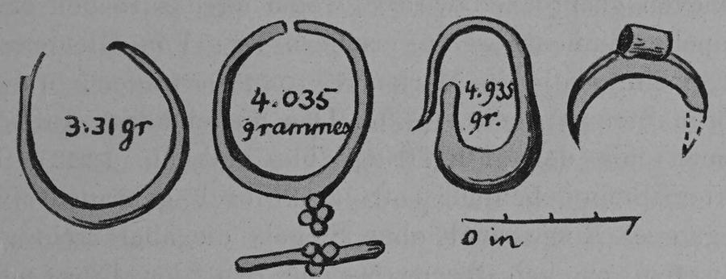

 

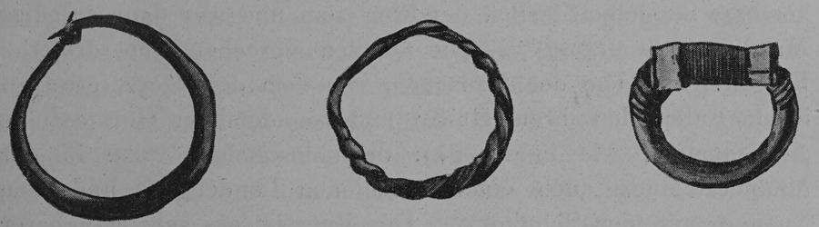

*Fig. 24. a) Goldene Ohrringe und Anhängsel von Gezer. b) Fingerringe? von Taanek.*

[^87.917]: Wurzel קשט oder כשט im Piʿel heißt **putzen, gerade machen**, wie auch die verwandten Sprachen bekunden; davon bh. קשט, j.-a. קשטא, ܩܘܫܬܐ Richtigkeit, Wahrheit, s. GES. Hwb.¹⁴ s. v. קשט (arab. قِسْط s. FRAENKEL S. 206). Nh. תכשיט zumeist mit כ׳ doch auch (Jerušalmi) תקשיט L 4,643; K 8,223. Der Bildung und der Bedeutung nach steht ihm nahe תמרוק Esth 2,3. 9. 12; bildlich „Säuberung“ Prov 20,30 im *Kethib* תמריק. Auch תכשיט ist hier und da mehr ein Stück der Körperpflege, z. B. TSabb 8(9),33, 121₁₈ vom Schminken; offenbar so auch MMḳ 1,7 תכשיטיה „ihre Schminken“ und dgl. (vgl. ib. לא תסוד und b 9ᵇ). Das Verb קשט bedeutet oft: sich mit Pomaden den Körper schmücken, z. B. Sifre Num 89 p. 24ᵇ מן המן היתה מתקשטת opp. מיני בשמים; MKethub 7,3, T 7,3, 268₂₇.
[^87.918]: MKel 11,8 תכשיטי אשה (ed. Lowe ת׳ האשה); derselbe Ausdruck auch Midr Tannaim Dt 22,5 p. 134 (in bNazir 59ª allgemeiner תיקוני אשה); Bar bMḳ 9ᵇ und bJoma 75ᵇ תכשיטי נשים. קוזמין und קוזמרין s. Lwr 2,502. In Gen R 19,10 hat Theodor קוזמידין κοσμίδιον aufgenommen (p. 180), obzwar einige seiner Hschr. קוזמירין bieten, auch Pirḳe RE c. 13 bei RN קוזמירין (Agg. קומיא l. קוזמין, so auch Jalḳut und Midr ha-Gadol 3,6 p. 89, s. bereits K im Supplementband S. 72, ferner ʾAboth RN β c. 1 p. 4ª nach einer Hschr., im Texte freilich תכשיטין), und noch immer scheint mir κοσμάριον richtiger. Das im „Hebr. pers. Wb. aus dem XIV. Jh.“ ed. Bacher, Budapest 1900, No. 976 vorkommende קמסין „Ohrring“ ist nach F. PERLES in Orient. Ltztg. 1900 Sp. 421 קסמין κόσμιον zu lesen. — Den Satz bMeg 12ᵇ „Mordechai war mit dem Gesetze geschmückt (מוכתר) בעדי“, möchte ich gegen RCh u. RN (K 5,346 s. v. נמס) und auch L 3,621 als „Schmuck“ auffassen; bh. עדי wäre hier ausnahmsweise verwendet. Vgl. im Talmud selbst die Sätze, in denen eine Halakha gleichsam geschmückt erscheint: bʿErub 96ᵇ u. und bKethub 81ᵇ כיפי תלה לה, RN bei K 4,293: קישט זו השמועה ככלה. Bh. *חלי Hl 7,2 und Prov 25,12 soll (nach STRACK zu Prov) das am Ohrring hängende, ihn zu einem vollkommenen Schmucke ergänzende Kleinod sein. Von חליה Hos 2,15 geht nh. pl. חליות (TSabb 4(5),11, 116₄) aus; s. in A. 967, wonach es wohl auf Perlen zu beschränken ist.
[^87.919]: Siehe GRÜNBAUM, Neue Beitr. S. 73 und oben A. 864. Nach einem späten Midraš (חסרות ויתרות ZATW 27,43) hat bereits Adam u. a. auch den Silber- und Gold-Schichten (עפרות) und den Erz- und Eisen-Barren (מטלת von נטל, oder gar Anspielung an μέταλλον) Namen gegeben; das sind die Dinge, aus denen zu gutem Teil der Schmuck gemacht wird. Der verführerische Reiz des Schmuckes kommt zum Ausdrucke in dem hier mitgeteilten Ausspruch TḲidd 1,11, 336₁₀. Die Frau flucht ihrem Manne, wenn sie in Dingen des Schmuckes unbefriedigt bleibt (על עסקי תכשיטיה bSabb 62ᵇ).
[^87.920]: bKethub 65ª o. „Dinge, nach denen sich die Frau sehnt (משתוקקת): was sind es? Geschmeide (תכשיטין). Schmucksachen werden aufgezählt MKel 11,8, MSabb 6,4 f., vgl. auch RGA der Gaonen ed. Lyck No. 70—73. Von der Braut heißt es, sie schmücke sich mit 24 Schmucksachen (RŠimeon b. Laḳiš in Cant R zu 4,11 מה כלה זו מתקשטת בעשרים וארבעה תכשיטין; s. auch Exod R 41,11, Tanch *Thissaʾ* 16, Tanch B. 11); gefolgert aus Jes 3,18—23, wo freilich nur 21 Toilettesachen zu finden sind, doch werden aus V. 24 noch 3 hinzugenommen, s. Mekh RSbJ zu Exod 20,14 p. 111; vgl. BACHER, Ag. d. pal. Am. 1,364. Vgl. Ḳohel R 7,2, wonach besonders das Haar der Braut sorgsam geschmückt wurde, vgl. oben S. 195.
[^87.921]: ושמת שמלותיך Ruth 3,3 in Trg ותשוי תכשיטך; כסותה in Exod 21,10 in Trg Ps-Jon תכשיטה. In Midr Tannaim Dt 22,5 p. 134 werden merkwürdigerweise als Frauengeschmeide gerade חלוק של צורות d. i. „gesticktes Hemd“ (oben S. 153) und טלית של שלטים „scheckiger bunter Mantel“ aufgeführt. *שלט nämlich dürfte nach Trg Jerem 13,23 (L Trg Wb 2,485) שלטי רקמתיה zu erklären sein, also ungefähr = בגדי צבע אשה Midr Tannaim Dt 23,10 p. 147, בגדי צבעונין jḲidd 2,5, 62ᶜ₆₃ = bunte Kleider, die immer wieder als Objekte der Sehnsucht der Frau hingestellt werden (S. 145), u. a. auch in Midr Tannaim an der betreffenden Stelle (p. 134).
[^87.922]: Siehe A. 917. So auch תכשיטי כלה bJebam 34ᵇ, die nach dem Kontexte und Raši Schminken und Pomaden sind.
[^87.923]: bBb 22ª; רוכלין sind Gewürzkrämer s. § 100, fälschlich für Händler mit Schmuckgegenständen gehalten von A. ROSENZWEIG, Kleidung S. 109.
[^87.924]: jNedar 9,11, 41ᶜ₆₈ שאין תכשיט נאה אלא על גוף מעודן zu עדי זהב II Sam 1,24. Zum Ausdruck מעודן vgl. bh. עדנה und מעדן את הכשר bMḳ 9ᵇ. Ib. vorher: Die Schwiegermutter schmückt sich (מקשטא) angesichts der Schwiegertochter, und da dieses am Halbfeiertag bedenklich schien (denn nach einem sollte dies nur einer jungen, nicht einer alten Frau gestattet sein), so wird energisch versichert, selbst die älteste Frau, auch noch die, die am Rande des Grabes steht, wird von dem Salben und Schminken ihres Körpers nicht lassen wollen.
[^87.925]: Sabbat bezüglich des Kopfputzes s. oben S. 189, bezüglich der Schminken S. 239. Feiertag ebenso. Die Fälle in bMḳ 9ᵇ in der vorigen A. gelten vom Halbfeiertag. Trauer um Jerusalem TKethub 6,3, 268₂₇.
[^87.926]: Folgt aus Angaben wie בית גנזיו של קרח bPesach 119ª, בית גניזה ib. 118ᵇ unten (בית אוצר hingegen, wie L 1,346 richtig bemerkt, bedeutet im Nh einen Speicher zum Aufbewahren von Getreide und dgl.). בי גזא bChull 139ª. סימא s. L 3,509; טמיון ταμεῖον Lwr 2,268. תיכורין ib. 587. Gen R 61,4 כזה שהוא חותם גנזכה ומוצאה בחותמת קשורה וחתומה. Der Schmuck (קוזמירין s. A. 918) befindet sich in einem Faß (חבית), und die eigene Frau hat keinen Zutritt dazu (Gen R 19,10, Pirḳe RE c. 13, Jalḳ Gen § 28,3, ʾAboth RN β c. 1 p. 4ª, nur an dieser letzteren Stelle in deutlicher Fassung und zugleich mit dem aus dem Leben gegriffenen Detail, das Ganze habe sich im Hause eines Königs, d. i. eines römischen Großen, zugetragen). Die Verwahrung im Faß, wie auch die der Bücher (w. unten), macht es begreiflich, daß für beides, für Schätze und Bücher, der Begriff גנז in Anwendung ist, übrigens auch für Kleider (z. B. bMeg 26ᵇ, bJoma 12ᵇ), von denen wir bereits wissen, daß sie in Kisten aufbewahrt wurden (§ 75). Ein Geschäftsmann, der im Begriffe ist, eine gefahrvolle Handelsreise zu unternehmen, macht seine Ware zu Edelsteinen und Perlen und hält sie in Kästchen (גלוסק[מ]אות Exod R 30 g. E.); bekannt ist aber גלוסקום (γλωσσοκομεῖον Lwr 2,175) als Futteral von Büchern. Die eigens zum Aufbewahren des Schmuckes beschaffene Kassette heißt דיפלומטר (z. B. ד׳ מלא מרגליות ein διπλωματάριον voller Perlen, Jelamdenu zu Gen 49,1 s. Lwr 2,210; פלמנטרין jTaʿan 2,6, 65ᵈ₂₈), sonst siehe bei „Geld“. קימוליא Gen R 79,7 und Jalḳ Gen § 133 s. Lwr 2,532. Vgl. *sanduḳ* der Araber ZDPV 3,115.
[^87.927]: Der Bräutigam sollte doppelt soviel Schmuck als die Braut einbringen, Cant R zu 4,11; ib. zu 4,12. In einzelnen Gegenden wurde der Betrag festgesetzt, jKethub 6,4, 30ᵈ₂₇. Angelobung (קדושין) mittels Perle: Exod R 27 E., Dt R 3,10. Vgl. bḲidd 48ªᵇ עשה לי שירים נזמים וטבעות ואקדש לך.
[^87.928]: Tanch *Wajišlach* 5, jNedar 9,11, 41ᶜ₆₈, Gen R 48,20.
[^87.929]: Siehe meinen Artikel *metals* in JE 8,513. A. ROSENZWEIG, Kleidung S. 110. Gold aus פרוים galt für sehr glänzend, bSanh 103ᵇ.
[^87.930]: קורלין jSabb 7,10ª₃₅ s. Lwr 2,521. כסיתא, etwa כְּסִתָּא = כְּסֻנְתָּא zu lesen (ܟܣ̈ܢܬܐ = Edelstein) = Koralle s. NÖLDEKE, ZDMG 50,309. אלמגים I Kön 10,11. 12 wird bRh 23ª erklärt: כסיתא Jalḳut סכסיתא (Pešittha ܣܟܣܝܬܐ, s. SACHS, Beitr. 1,140). Ib. die Flotte (בורני s. § 216) verwendet man למסיק בה כסיתא. Ib. דבי רומאי usw. ms M (Agg. ארמאי) Römer und Perser. bKethub 98ª כסיתא דיתמי RN (Agg. כיסתא, Raši 1. Erkl. = Futter, vgl. Gen R 79,7 und L 2,365). Die LA בסיתא (mit *b*) K 4,281 vgl. I. LÖW, Pfl. S. 211 ist abzuweisen. Bh. ראמות ist unsicher. Ob חומרי („rot“) = Korallen, erwägt FRAENKEL S. 161, K 3,437.
[^87.931]: Lwr 2,350. 351, wo bemerkt ist, daß מרגלין im Trg = Edelstein, vielleicht über מרגליטים = μαργαρῖτις (ib. 350) hinaus. Sehr häufig die Reihe אבנים טובות ומרגליות. ܡܪܓܢܝܬܐ und مَرْجان FRAENKEL S. 59.
[^87.932]: bMeg 12ª zu דר Esth 1,6 „Es gibt in den Seestädten einen edlen Stein und der heißt דרה“; richtiger Esth R c. 2,7 „Es gibt einen Ort, wo man die Perle (מ׳)דורה nennt“; jSanh 10,1, 28ª₂₂ „Dort nennt man die Perle (מ׳)דירה“ l. דורה, d. i. دُرَّة *durra*, vgl. FRAENKEL S. 58, der auch auf נטיפות von נטף verweist. Vgl. טיפי מרגליות bNidda 41ᵇ.
[^87.933]: jDemai 1,3, 22ª₁₁ מרגלי מן דמלכא סרקיא נפלת ובלעת הד עכבר. Zum Perlenhandel der Araber vgl. Plinius H. N. 6,28. Die am Roten Meere vorkommenden rühmt er als hell, 9,56.
[^87.934]: Cant R 1,10 קדוחא jemand, der die Perlen bohrt; in bSanh 100ª, wo Edelsteine und Perlen zusammengefaßt sind (s. A. 931), steht das Tätigkeitswort חקק; ib. נִקֵּר.
[^87.935]: bSanh 100ª (s. vorige A.): nicht einmal so groß wie בעתא דצילצלא.
[^87.936]: Ihr Glanz geht daraus hervor, daß sie in der Arche den Beleuchtungskörper abgaben (Gen R 31,11, Pirḳe RE c. 23, s. S. 43). Als weiß bezeichnet bJoma 75ª (לבן).
[^87.937]: Vgl. A. 932.
[^87.938]: Cant R 1,10 למיהרז. Ib. zu 3,11 מה העטרה הזו מקובעת באבנים טובות ומרגליות. Vgl. מרגליטים im hohepriesterlichen Brustschilde Exod R 38,8.
[^87.939]: bAz 8ᵇ Fragenspiel zwischen Römern und Griechen, ob der Edelstein die Basis der Perle abgebe oder umgekehrt; es heißt dort, die Perle diene dem Edelstein zur Basis, folglich dieser kostbarer als jene. Dagegen Perle geschätzter als Edelstein und Glas, Num R 4,2.
[^87.940]: מרגלית דלית לה טימי jBerakh 9,1, 12ᵈ₅₄. Vgl. מרגלית טובה (à la אבן טובה) Gen R 11,4, bChag 3ª unten usw., נאים כמרגליות Gen R 20,12. In einem Gleichnis bSota 40ª heißt es, der Edelsteinhändler (מוכר אבנים טובות) habe jedenfalls weniger Käufer (da die Sache teuer ist), als der Verkäufer von weiblichem Nähzeug (מיני סדקית, s. dazu Raši und RN bei K 3,437). Über die Perle im Handel s. § 221. Vgl. FRIEDLAENDER, Sitteng. 7. Aufl., 2,189.
[^87.941]: צרור המרגלית MKel 26,2, TKel bb 4,3, 593₄₀; ib. bm 7,9, 586₂₆ אסקוטלא · ומקל שיש בה בית קבול מזוזה ומרגליות s. in A. 942* = σκουτέλλα Lwr 2,95.
[^87.942]: Als Äquivalent einer מזוזה (mit der sie auch in der vorigen A. gepaart ist) erscheint die Perle als von Artaban dem Rabbi geschickt jPeʾa 1,1, 15ᵈ₅₄, Gen R 35,3, Jalḳ Jos § 31, Halakhoth Gedoloth ed. Ven. f. 47ᶜ, Šeʾeltoth § 145. Siehe mein „Antoninus und Rabbi“ S. 93.[942*] Lwr 2,311 לוניא λινέα = *linea*, vgl. die rührende Anekdote von dem Perlencolier der Kaiserin jBm 2,6, 8ᶜ₃₇, Lwr 2,204 דילניה δίλινον (opp. μονόλινον). Ersteres steckt wohl in נוניא Mekh RSbJ 12,35 p. 25, woselbst סק׳ = צקוטלא wohl das zugehörige Futteral.
[^87.943]: In der Mišna kommt יד מקבת של מפתחי אבנים vor: MKel 29,5. חקק s. A. 934.
[^87.944]: Josephus, B. J. 7,5, 5 § 135; Ant 3,7, 5 § 168. Apokalypse Johannis 21,19. Bei den Rabbinen s. Exod R 38 Ende, Trg Ps-Jon Exod 28,17 f., s. dazu Beth-Talmud 4,295 f., die meisten, da sie gr. sind, auch in Lwr erklärt, s. „Mineralien“ 2,625; für das Mittelalter s. STEINSCHNEIDER, Lapidarien, in Kohut Semitic Studies S. 64 f.; persische Namen s. bei BACHER, zwei j-pers. Dichter (2) 161 f. Einzeln s. A. ROSENZWEIG, Kleidung S. 112 f. Bei Griechen und Römern s. BLÜMNER 3,227—312; FRIEDLAENDER, Sitteng. 7. Aufl., 2,188 f. Zu Ezech 28,13 אבן יקרה wird bemerkt, daß Gold, das letzte in der Aufzählung, offenbar bei weitem minderwertig sei, bBb 75ª u.
[^87.945]: אבן טובה am Halse des Esels eines Arabers: jBm 2,8ᶜ₂₆ Dt R 3,3. Siehe auch A. 953.
[^87.946]: So vielleicht חימום Gen R 45,2 s. I. LÖW in Lwr 2,227. Vgl. ferner *passim*.
[^87.947]: שמיר I A. 117; zu Vertäfelungen S. 26.
[^87.948]: Wir fahren hier in der Numerierung der Stücke fort.
[^87.949]: Zur Wurzel חתם, arab. خَتَم (FRAENKEL S. 252) s. GES., Hwb. Nh. חותם oft, s. L 2,129. ספרגום (so, weil man etwa *σφραγός annahm) Lwr 2,409.
[^87.950]: jAz 3,1, 42ᶜ₆₈.
[^87.951]: עזק umgraben s. L 3,633 und hier § 176, davon עזקא Ring, Siegel abzuleiten, nicht von חוק den Finger umspannen, wie L 2,32 lehrt. חיזקייא nur ausnahmsweise jSabb 6,8ᵇ₆₂ für הטבעות Jes 3,21, sonst עזקא und עזקתא, syr. ܥܶܙܩܬܳܐ.
[^87.952]: Fl zu L Trg Wb 1,422ª, s. auch Nhb Wb 1,367.
[^87.953]: Siehe BENZ., Arch.² S. 81 f. und *passim* die Abbildungen 44. 45. 88–91. 139—145; NOWACK 1,262 f. Fig. 40—47, hübsche Zusammenstellung von G. DALMAN in Palästina-Jahrbuch, Berlin 1906, 2,44—50. Das בילוניא דגושפנא bGitt 57ª. 58ª RN (Agg. בליונא דגושפנקא), doch auch in RN richtiger גושפנקא (s. K 2,99), ist nach Raši = צורה Figur, nach De Lara *בליון = *bulla*, nach K eventuell ἔμβλημα, beides unrichtig, doch nach K vielleicht pers. بالادين etwas was hervorragt (= בולט). Am ehesten dürfte der in das Siegel gefaßte Stein selbst gemeint sein; der Stein trug gewiß Figuren, und dies ist in bGitt 57ª u. gemeint, daß soviel Lichter angezündet waren, daß die Figuren des Siegelsteines in der Entfernung eines Mil gesehen werden konnten. bSabb 66ᵇ sechzig Siegelringe (שתין גושפנקי). In bBerakh 6ª גושפנקא דפרזלא ein eiserner Siegelring, d. h. die Fassung des Steines aus Eisen. Lev R 13,4 עזקתא סומקתא ein roter Ring, wahrscheinlich aus Karneol, denn zu אדם Exod 28,17 setzt Trg Ps-Jon סמקתא (opp. ירקתא grün = Smaragd). Fragmenten-Trg סמקן; aber Lev R 35,6 und Cant R 1,4 steht ערקא, Tosafoth bChag 9ᵇ s. v. כברזא סומקא zitieren ערקתא, wonach also gar nicht vom Siegel die Rede, sondern von einem Riemen, den man um das Pferd schlingt. — Auf dem Siegel (עזקא) war der Gottesname (שם) eingraviert (bGitt 68ª), ein Beispiel für viele, wo das Siegel mit entsprechender Inschrift ein Amulett und sonstiges Zaubermittel abgibt. Oft aber ist die Rede von Figuren (פרצופות oder פרם׳), die auf dem Siegel oder dem Ringe eingraviert waren: TAz 5(6),1 f. p. 468, j 3,1, 42ᶜ u., b 43ᵇ (mit etlichen Abweichungen in der Fassung). Die Figuren können sein Sonne, Mond und Drache (Mišna Az 3,2, T 5(6),1), heidnische Gottheit (עבודה זרה), wobei in bezug auf den Gebrauch ein Unterschied besteht zwischen בולט und שוקע (T j b), Mensch (ib.) und sonstige Figuren (ib.).
[^87.954]: Vollständigste Liste der מכובדין und בזויין TAz 5(6),1, weniger j und b a. a. O., נייר und קולמוס als דבר של כבוד, wobei קלמרין zweifelhaft, nur in j, ebenda unter den geringgeschätzten Dingen auch הסל והסלים והסמלים (Alliteration!): Korb, Körbe? Joche; סדינין und מטבע der T lautet in b סדינין und מטפחות, wohl richtiger. Vgl. den Gottesnamen auf der Kette (שושילתא) auch bGitt 68ª.
[^87.955]: *crustae* und *emblemata* s. RICH. חותם שבצוארה und חותם שבכסותה TSabb 5(6),8, 116₂₂. סרבלי חתימי bSabb 58ª (oben S. 172). Ein Ausdruck für „Emblem“ scheint אשתימא zu sein, bAz 41ª, L 1,183, von שתם = סתם. Einen Lautwandel zeigt ביטומתא bBm 74ª, L 3,500, von בטם = סתם; es wurde damit wohl nur eine Verkleisterung von Wein- und Öl-Fässern bezeichnet.
[^87.956]: Siehe § 134. MBm 2,5 מה שמלה מיוחדת שיש בה סימנים.
[^87.957]: טבעת . . . שאין עליה חותם MKel 11,8, bSabb 57ª. 59ᵇ, bRh 24ᵇ. TKel bm 2,1, 579₃₂ ist derselbe Unterschied durch חקוקה und אינה חקוקה ausgedrückt. Ib. מצופה ist offenbar, wie der Kommentar זר זהב erklärt, der Fall, daß der Ring (טבעת) aus Sandelholz (אלמוג) ist und dieses ist in Metall (מתכת) gefaßt, somit die Ausführung, die in MKel 13,6 (vgl. TKel bm 3,13, 582₁, jSabb 6,8ᵇ₃₅) ins Auge gefaßt wird: טבעת של מתכת וחותם שלה של אלמוג, oder טבעת של אלמוג וחותם שלה של מתכת. Zu bAz 41ª usw. s. A. 953. Zu bh. אלמוג s. die bei GES. Hwb.¹⁴ angeführte Literatur; am ehesten rotes Sandelholz, ein aus Indien und Persien kommendes kostbares Holz. Analog dem Sandelholzring dürfte sein חומרתא דמרושא (LA auch מרושא s. K 3,436) bʿErub 69ª, woselbst Raši bereits wenigstens halakhisch richtig auf חותם של אלמוג verweist, bemerkend, daß er für מרושא keine traditionelle Erklärung habe, doch neigt er zu der Ansicht, daß es ein Gewürzknoten wäre, wie חומרתא דפילון bSabb 62ª (s. jedoch Tosafoth); ein solches חומרתא דמרושא trug der Patriarch Juda (III). RN jedoch sagt dezidiert, es wäre ein Ring (טבעת), vgl. auch Raši (ms) zu bMḳ 12ᵇ in 2. Erklärung. Syr. ܚܘܡܪܬܐ (auch [?]) bedeutet nach NÖLDEKE, ZDMG 50,309 Kügelchen zum Schmuck, resp. ein Amulett, und auch daran kann gedacht werden; vgl. oben S. 188. חומר bḲidd 22ᵇ o. nach Tosafoth arab. = מעזה.
[^87.958]: MKel 12,1. TKel bm 2,1, 579₃₁ טבעת שהוא חוגר בה את מתניו ומקשר בה בין כתיפו, opp. טבעת של אצבע. טבעת in anderem Sinne s. L 2,139.
[^87.958a]: MKel 11,8. Vgl. MSabb 6,4 j 7ᵈ₄₇ תכשיטין של כסף. Bar bMk 12ᵇ (Bar bMḳ 9ᵇ anders, s. A. 917). TAz 5(6),1, 468₄, Gen R 95,23. Daß er von Männern getragen wurde, wird vorausgesetzt in MNeg 13,10 und TNeg 7,8. 9 p. 627 o., in T auch der Ausdruck טבעותיו בקומצו, vgl. A. 678.
[^87.959]: Alles in bSabb 62ª zu MSabb 6,3. Raši zu קופסא altfr. *iscrine* (eine 2. Erklärung in Raši verdient keine Berücksichtigung).
[^87.959a]: jŠebiʿith 10,9, 39ᵈ₅₁ טבעת opp. זהוב u. z. mit der Angabe, die Goldmünze wäre Veränderungen unterworfen, während der Ring stetig sei.
[^87.960]: Dt R 2,24 (Jalḳ Dt § 828) אין לך טבעת מוץ אותה ומות, s. L 2,139.
[^87.961]: MKel 11,8; MSabb 6,1, in b 59ª u. erklärt: ירושלם דדהבא, T 4(5),6, 115₁₉, in bezug auf Sabbat unter Kränzen und Kopfbändern aufgezählt; dient bSota 49ᵇ eben deshalb als Erklärung von עטרות כלות (§ 85). Einen solchen Schmuck hat der als Patriot bekannte RAkiba seiner Frau machen lassen, bSabb 59ᵇ o., vgl. bNedar 50ª, in AbRN β c. 12 p. 30 כתר של זהב, und es wird ib. bemerkt, daß ihn nur vornehme Frauen zu tragen pflegen, bei denen es ausgeschlossen ist, daß sie ihn etwa vom Kopfe nehmen, anderen Frauen zeigen, mithin den Sabbat, durch Tragen auf der Straße, verletzen würden. Der Schmuck braucht übrigens nicht, wie Raši sagt (fr. *nusco*), ein Kranz zu sein, auf welchem Jerusalem abgebildet ist, sondern kann im ganzen ein Stadtbild darstellen, wie Maim. zu MKel 11,8 sagt, und ist demnach mit der Mauerkrone zu vergleichen, die die Römerinnen (RICH s. v. *corona*) und besonders die Göttinnenbilder trugen; so namentlich die Tyche von Gaza, wie man es auf vielen Münzen von Gaza sieht; s. die Tafel bei STARK, Gaza und ib. S. 646. L Löw, Graph. Requ. I, 42.
[^87.962]: ומה צואר זה רוב תכשיטין תלויין בו Cant R zu 4,4 f. 25ᵇ ed. Romm.
[^87.963]: Stellen s. in Lwr 2,525. Gewöhnlich mit נזמים zusammen, z. B. Sifre Num 11 p. 5ª, MSota 1,6, Num R 9,33, MSabb 6,1, MKel 11,8, Gen R 95,23 (hier pl. ausnahmsweise קטלין, wie auch oft im Trg). MMeʿila 5,1 נתנה קטל׳ בצוארה sie (die Frau) legt sich die Kette auf den Hals; ib. טבעת בידה, immer nur von der Frau! MAz 1,8 קטלאות, נזמים und טבעות die Schmucksachen (תכשיטין) der Götzenbilder; vgl. A. 961.
[^87.964]: Ein loses oder straffes Anlegen kommt auch von sonstigem Geschmeide vor in TMiḳw 6,8, 658₂₂ והשירים והנזמים והקטלאות והטבעות אוצין חוצצין רפין אין חוצצין (Var. רפוין). Zu MSabb 6,1 wird in b 57ªᵇ bemerkt בקטלא . . . דאשה חונקת את עצמה דניחא לה שתראה כבעלת בשר (Raši z. St. fremdartig, es sei eine Art Serviette, die beim Essen die Kleider vor Schmutz bewahren soll; sie wird mittels Schleifen an dem Hals befestigt, und da die Schleifen breit sind, so schneiden sie nicht ein, auch wenn sie straff gezogen werden; s. jedoch in Tosafoth z. St., wo richtig behauptet wird, קטלא müsse ein Schmuck sein). Ib. vorher חבקין שבצואריהן (Raši *cingule*). Ib. vorher חוטי צמר und חוטי פשתן, dieselben, die auch als Kopfschmuck dienen (S. 187); beim Halse ist es auch bedeutsam zu wissen, ob diese Bänder weich oder hart sind (רך und קשה ib.). Auffallenderweise kennt Plinius Bernsteinhalsbänder der lombardischen Bäuerinnen, die gerade die Anschwellung des Halses verhüten sollten (FRIEDLAENDER, Sitteng.⁷ 2,192); wenn nun der Talmud ein entgegengesetztes Bestreben der Frauen annimmt — im Orient wünschen die Frauen allerdings mollette zu sein — so liegt der Verdacht nahe, man habe in קטלא = *catella* (st. *catena*!) die Wurzel קטל = חנק „würgen“ gefunden; vgl. zu dieser Volksetymologie GRÜNBAUM, Gesamm. Aufs. S. 466 f. Hai und Maim. zu MKel 11,8 wie auch RCh zu bSabb 59ᵇ setzen קטלא mit arab. מכנקה, d. i., wie GRÜNBAUM zeigt, مخنقة, gleich, und derart ist auch خناقة = collier d’or bei DOZY. RN it. מורינא *murena* ist dasselbe Wort, welches Hieronymus zu Cant 1,10 setzt: *muraenulas aureas faciemus tibi*. bSabb 59ᵇ wird קטלא durch das unsichere מנקטא פארי wiedergegeben.
[^87.965]: MKel 11,8 חוט und חליות mit letzterem variiert טבעת. Ib. שירי קטלה. Die Ausführung in אלמוג ist erwähnt in TKel bm 1,9, 579₁₁, u. z. sind die חוליות aus Sandelholz (s. w. u.) gefaßt in אונקלאות של מתכות, offenbar das, was in Mišna חוט של מתכת.
[^87.966]: המינכא (so ist in GES. angesetzt), המונכא, המינכה (j aram. auch מניכא), steht schon in Dan 5,7, 16. 29, ist aber gleichwohl gr. = μανιάκης, s. in Lwr 2,343 und GES. Hwb.¹⁴; syr. ܗܡܝܢܟܐ. bTamid 32ª. Im Trg steht es für bh. רביד, ebenso in Akylas und Symmachus zu Gen 41,42; Symmachus hat es auch für שהרנים Jes 3,18, wie dasselbe Wort in jSabb 6,8ᵇ₅₇ durch עונקייה (vgl. bh. ענק Halsschmuck) wiedergegeben wird. Bezüglich מונייק (s. Lwr 2,327) wissen wir genauer, daß es ein Halsband war, denn es kommt vor מ׳ לצואר Lev R 12,3 (in Midr Tehillim 19,15 und Jalḳ ib. § 675 durch עטרה und ענק ersetzt); demgegenüber haben wir aber Dt R 4,2 מ׳ של זהב, das in Jalḳ Jes § 256 נזמי זהב heißt.[966] So unterschieden in MKel 11,8; s. auch die Stellen in A. 963. L hat נזם gar nicht! Zur Etymologie s. GES. Hwb.¹⁴, wo auf assyr. *nuzzumu* **weihen** verwiesen wird, woraus sich aram. *קדשא (w. unten) erklärt; s. GEIGER j Z 10,45 f. נזמים MSabb 6,1 wird aus den von GEIGER a. a. O. erörterten Gründen in b 59ᵇ ohne weiteres für נזמי האף erklärt.
[^87.967]: קדשין in Trg O. Gen 24,22. 30. 47; 35,4; Exod 32,2. 3 (s. BREDEREK, Konkordanz zu Trg O. S. 71), in Exod 35,22 aber שבבין in Agg., auch ed. Sabion. nach ed. Berliner, lies שבבין, wie in Ps-Jon שיוין indiziert; an diesen Stellen für Textwort נזם; aber O. Num 31,50 hat שבבין (s. die Textzeugen bei L Trg Wb 2,445) für Tw. צמיד; für שבבין steht die Bedeutung „Kette“ ziemlich fest. Die Materie erfahren wir zum Teil aus Gen R 79,7 (Jalḳ Gen § 133) חליות ודייקניתא שדרכן להנתן בנזמים (Jalḳ noch זמרגדין). חליות ist hier wohl = Perlen, vgl. מרגליות neben יקינטין in Jelamdenu zu Dt 10,1; Hyacinth und Smaragd s. in Lwr 2,212 und 28. 248.
[^87.968]: Siehe meine Ausführungen in Steinschneider-Fschr. S. 160 und in Lwr 2,581. Die Stelle ist jSabb 6,8ᵇ₅₈ שלמיני.
[^87.969]: MKel 11,9 s. Maimûni. Vielleicht dient diese Beschreibung am besten zur Aufklärung des bh. עגיל (von עגל rund sein); in jSabb 6,8ᵇ₅₃ wird קדשיא für עגיל gesetzt, woraus nicht folgt, daß עגיל justament Ohrring ist, denn קדשא bedeutet von Haus aus nur Geschmeide überhaupt.[969*] MKel 11,9 צינורה . . . כמין אשכול ונפרק s. Maim., der es auf Ohr- und Nasenring bezieht, in Mišna vorher allerdings נזם. Aber in TKel bm 1,9, 579₁₃ steht צינורא של כוס, etwa der Henkel des Bechers, wobei das Traubenmuster besonders stilgerecht wäre; doch kann die Tosefta-Stelle auch unabhängig von der Mišna gedeutet werden.
[^87.970]: Exod R 15,3 עניה mit 2 נזמים.
[^87.971]: Siehe Plinius 11,136 bei BENZINGER, Arch. S. 107 (2. Aufl. S. 83, wo Abbildungen charakteristischer Funde aus Gezer, darunter ein Stück, welches die oben berührte topfartige Höhlung und linsenartige Wölbung sehr schön zeigt), NOWACK, 1,128, eingehend behandelt von MOVERS, Phön. 3,77, was E NESTLE, der die Frage neuestens aufwirft (ZATW 25,202; 27,115), unbekannt geblieben zu sein scheint. GEIGER in j Z 10,48 läßt die Ohrringe ohne weiteres auch von Männern getragen sein.
[^87.972]: MSab 6,6' הבנות קטנות יוצאות בחוטין ואפילו בקיסמין שבאזניהם, b 65ª im Falle der Töchter des Vaters Samuels erwähnt צבעונין farbige Streifen, die die Mädchen einander gerne zeigen.
[^87.973]: Folgt aus TKel bb 5,17, 596₂ שירי הקרבן ואומיות כדי לכרוך על אצבע קטנה (vgl. A. 964), letzeres Wort wie dort unmittelbar davor: של קטנה des kleinen Mädchens. Zu כרך vgl. כרוך על צוארה jSabb 6,8ᵇ₇₃.
[^87.974]: MKel 23,1 הקמיע והתפלין, MSabb 6,2 (b 60ª קמיע . . . שאינו מן המומחה; andere Stellen s. L 4,326 und hier § 150. Amulett an einem aufgefundenen Kind: bḲidd 73ᵇ תלי קמיעא. Der Begriff „hängen“ steckt schon in Wurzel קמע „anbinden“. Von תפלין heißt es, man möge sie tragen in כיס של טפח und auf das Herz geben: jBerakh 2,3, 4ᶜ₇₀, vgl. b 23ª. קמיע trägt der, der ein ענק = Halsband nicht verdient: bBb 75ª. Zu טבלה, פנקס, לוח usw. s. § 221; קלמרין o. A. 954; טבלרין o. S. 159. חומרתא דקטיפתא s. A. 783.
[^87.975]: Lev R 25. Siehe A. 926.
[^87.976]: jSabb 6,8ᵇ₆₀ für הצעדות Jes 3,20 Agg. כרופסלה, RN פר׳ lies פרופסלה, so auch Aggadath Esther 5,2, s. Lwr 2,421; dieselbe Gleichung אצעדה = בירית ist auch bSabb ib. Z. 49 und 63ᵇ die ursprüngliche und nur halakhisch aufgegebene Annahme.
[^87.977]: בירית MSabb 6,4 (nur scheinbar zu Männerschmuck gehörig), dazu j 8ᵇ₄₉ und b 64ᵇ vom babyl. Amoräer RJuda: בירית = אצעדה, mit der Abschwächung, ב׳ sei am Fuße das, was א׳ am Arme. Ib. b ב׳ an einem Fuße, כבלים an zwei Füßen getragen, wobei es nicht bleibt, sondern beide werden an beiden Füßen getragen und die sie verbindende Kette (שלשלת) macht sie zu Fesseln, die als solche, weil sie, wie dort erzählt wird, in einem konkreten Fall berufen waren, die durch große Schritte gefährdete Jungfrauenschaft einer gewissen Familie in Jerusalem zu konservieren, keinen sichtbaren Schmuck bilden, wohl aber die Kette, vermittels welcher dieselben wohl von außen reguliert werden konnten. Natürlich ist der angegebene Zweck auch für verheiratete Frauen von Bedeutung. Das alles scheint jedoch nur für כבלים richtig zu sein, denn diese figurieren in jenem von RJochanan erstatteten Referate, nicht aber von בירית, das in der Mišna unter äußeren Traggegenständen figuriert, nur ist es ein Stück, welches nicht leicht abzunehmen war, und so war dessen Tragen am Sabbat erlaubt. Nach Raši zu bSabb 60ª wurde die בירית zu dem Zwecke getragen, um die Unterhosen (בתי שוקים) der Frauen auf den Hüften zu befestigen, damit sie nicht auf die Füße rutschen.
[^87.978]: Gen R 89,7 RN (s. Mathnoth Kehunna) כלידרין, d. i. *χλιδάριον dimin. von χλιδή Halsschmuck, vgl. N. BRÜLL, Jahrbr. 1,191, Lwr 2,289 und ib. Anm. von I. LÖW.
[^87.979]: Jes 3,19 שרות aram. שירא syr. ܫܝܪܐ, arab. سِوار FRAENKEL S. 56. Auch nh. שירין bedeuten bekanntlich oft Ketten überhaupt oder Fesseln. Jenes שרות wird jSabb 6,8ᵇ₅₈ שיראין gedeutet (ib. vorher Z. 52 שירייא für צמיד), in Trg Jes 3,19. 20 unterschieden שירי ידיא und שירי רגליא (letzteres für הצעדות s. A. 976), aber für gewöhnlich שירין ohne jede Beifügung = Armketten, z. B. Trg O. Gen 24,22 für צמידים, Exod 35,22 für חח, s. L Trg Wb 2,477, STEINSCHNEIDER-Fschr. S. 160. MSabb 5,1 (b 51ᵇ) שיר Kette von Pferden und sonstigen Haustieren, s. auch TKel bm 1,13, 579₂₀. — Hierher gehört wohl צרה דהבא Thr R 4,1 p. 70ᵇ B., RN bei K 7,44 צרא דהבא (Agg. bald כיכה, bald שינה) l. שירא דדהבא goldene Kette (die zuweilen erblaßt, vgl. ib. zu כתם: sein Körper war gleich den Edelsteinen und Perlen).
[^87.980]: Man besitzt Münzen aus dem Altertum, die mit Löchern und Ösen versehen sind, deren Zweck nur sein kann, um den Hals oder sonstwie getragen zu werden, s. O. SEECK, Untergang des röm. Altert.² 2,206. Im heutigen Orient s. LAYARD, Niniveh, deutsch, Lpz. 1850, S. 108; ZDPV 13,181; ib. 4,61. Bei den Juden: TMš 1,1, 86₁₃ דינרי זהב . . . להתעטר בהם (unrichtig erklärt von A. SCHWARZ z. St. S. 172ª). Ib. Absatz 3 als קמיע = Amulett gebraucht: MKel 12,7 דינר שנפסל והתקינו לתלותו בצואר קטנה. TBm 3,19, 367₂₆ סלע . . . ודינר . . . נוקבה ותולה בצ׳ בנו. Danach auf Goldmünzen beschränkt.
[^87.981]: MSabb 6,6 סלע שעל הצינית, nach b 65ª צינית = בת ארעא s. L 4,202. In bKethub 93ᵇ steht dafür אכתירא דציניתא. TMš 1,3, 86₁₈ das Geld vom zweiten Zehent gibt man nicht auf צינית und nicht auf זוית (Var. זוית) l. חזזית d. i. Beule, vgl. A. SCHWARZ z. St. S. 172ª.
[^87.982]: TSabb 5(6),8, 116₂, von Frauen; Bar bSabb 55ª von Frauen, Sklaven und Tieren, letztere vgl. auch MSabb 5,4 (b 54ᵇ).
[^87.983]: MKel 16,7 מנפה Agg. u. ed. Lowe (Hai und RN מנפא); Hai erklärt es durch arab. مروحة, s. L 3,160. bBm 86ª u., bJebam 63ª. Zur Sache s. RICH s. v. *flabellum*.
[^87.984]: MSabb 6,4 (b 63ª). Stab (§ 208) und Waffen (ib.) behandeln wie in anderem Zusammenhange. Es ist auch an den Helm (§ 76) und die Beinschienen (§ 84) zu erinnern.

## § 88

**88.** **Geschlecht, Stand und Alter.**

Eine zusammenfassende Charakteristik des jüdischen Kleidungswesens ist nicht leicht zu geben. Neben unsäglicher Armut findet sich maßloser Luxus; einerseits zahllose Bezeugungen von selbstverfertigten Kleidern, anderseits eine Reihe von Auslandswaren, wie die fremden Namen aus Rom und Persien bekunden und die Bezeichnung „überseeisch“ es hie und da zum Bewußtsein bringt; auf der einen Seite Betonung des Nationalen, die Notwendigkeit, sich von den anderen zu unterscheiden, auf der anderen Seite blinde Nachahmung gerade in auffälligen Äußerlichkeiten. Durch die Annahme eines starken Unterschiedes zwischen Palästina und Babylonien, durch den Unterschied der Zeiten, der Vermögensverhältnisse, des Berufes und der Beschäftigung, des Geschmackes der beiden Geschlechter usw. läßt sich ein Teil der Gegegensätze allerdings heben, aber es bleiben ihrer noch genug übrig. Die Kleidung, soviel läßt sich sagen, ist keine rein jüdische, auch nicht rein orientalische, sondern ist, wie das ganze Leben der Zeit selbst, von griechischen, römischen, persischen und sogar von barbarischen (keltischen, arabischen) Elementen durchsetzt. Ein Stand ist es, der dem eindringenden Fremden bewußt die Stirn bietet: der Gelehrtenstand, dessen Lebensäußerungen wir ja zunächst kennen lernen; in seinem Tallith schafft er sich einen Gegensatz zur römischen Toga; sein Schuh und sogar dessen Schnürwerk ist in Farbe und im Anlegen von dem der übrigen Landesbewohner verschieden; er trägt unter Roms Herrschaft das Kopfhaar, in Persien den Bart anders. Würdevoll will der Gelehrte auftreten, würdevoll durch Reinlichkeit, und würdevoll auch dadurch, daß er sich den ganzen Körper bis zur Fußsohle zudeckt. Dasselbe fordert er auch von der Frau, deren ganze Kleidung dezent und sittsam sein soll; sonst gönnt er ihr jeden Schmuck und hält die weitgehendste Körperpflege für notwendig. Immer wieder ist der ethische Gesichtspunkt vorherrschend, doch erblicken wir auch manche hygienischen und praktischen Einrichtungen, letztere besonders bei dem arbeitenden Volke. Hier, bei dem niederen Volke, findet sich manches Unschöne: Zerlumptheit und sogar halbe Nacktheit. Von Kinderkleidung hört man fast nichts, bis auf das Kinderhemd. Während aber dieses wohl allein die Kleidung des Kindes ausmachte, begegnen wir auch der entgegengesetzten Erscheinung, daß nämlich ein Mann 18 Gewänder auf sich nehmen konnte; der volle Staat einer Frau besteht sogar aus 24 verschiedenen Stücken. Die in unseren Quellen namentlich aufgeführten Kleidungs- und Schmuckstücke erreichen auch bei Zusammenziehung des Gleichartigen die stattliche Zahl von über hundert[^88.985].

[^88.985]: Die hier berührten Punkte wurden gelegentlich an mehreren Stellen erörtert.

## § 89

**IV. Körperpflege.**

Literatur: R. J. WUNDERBAR, Biblisch-talmudische Medizin, Riga und Leipzig 1850, 1853, 1857, 1859 etc. (in I. 56—69 große Literatur). — J. M. RABBINOWICZ, Einleitung in die Gesetzgebung und die Medizin des Talmuds, aus dem Franz. übersetzt von S. MAYER, Trier 1881. — J. P. TRUSEN, Die Sitten, Gebräuche und Krankheiten der alten Hebräer, Breslau 1853 (fast nur biblisch). — J. L. KATZENELSON, רמ"ח אברים (= 248 Glieder [des Menschen]), St.-Petersburg 1888. — Derselbe: Die normale und pathologische Anatomie des Talmud, Dorpat 1896. — Derselbe: Die rituellen Reinheitsgesetze der Bibel und im Talmud, MGWJ. 43 und 44 (nicht vollständig erschienen). — L. Löw in Ges. Schr. 3, 367—406. — W. EBSTEIN, Die Medizin im Alten Test., Stuttg. 1901. — Derselbe: Die Medizin im Neuen Test. und im Talmud, Stuttg. 1903 (wenn nichts folgt, ist dieses gemeint; S. 316 f. Literatur mit 99 Nummern, von denen jedoch nur weniges hierhergehört; auch ist EBSTEIN nicht in der Lage, die Originaltexte zu lesen). — J. PREUSS, 1. Der Arzt in Bibel und Talmud. 2. Zur Gesch. des Aderlasses. 3. Die Askara-Krankheit im Talmud. 4. Das Auge und seine Krankheiten nach Bibel und Talmud. 5. Chirurgisches in Bibel und Talmud. 6. Bibl.-talm. Pathologie und Therapie. 7. Der Tote und seine Bestattung. 8. Die Erkrankungen der Haut. 9. Mundhöhle. 10. Bauchhöhle. 11. Weibliche Genitalien. 12. Männliche Genitalien. 13. Nervensystem. 14. Nerven- u. Geisteskrankheiten. 15. Brusthöhle. 16. Nase u. Ohr. (Mehreres davon unter: Materialien zur Gesch. der bibl.-talm. Medizin). 17. Malum malannum. 18. Waschungen u. Bäder. (Nähere Fundorte bei EBSTEIN a. a. O., zumeist auch in SAA., wie von Fall zu Fall angegeben werden wird). — Derselbe: Medizin der Juden, in Puschmann, Neuburger und Pagel, Handbuch der Gesch. der Medizin I, Jena 1902, S. 110—118. — J. BERGEL, Die Medizin der Talmudisten, Leipz. u. Berl. 1885. — M. RUBINSTEIN, A biblico-talmudicus Higiéna, Budapest 1892. — Speziell Kosmetik: A. ROSENZWEIG, *Kleidung und Schmuck*, Berlin 1905, S. 93—105. — Speziell Arzt: LELIO DELLA TORRE, Die ärztliche Hilfe vom Standpunkte des Rabbinismus, in Ben-Chananja 1865, 8, Sp. 600. 601 = *Scritti Sparsi*, Padova 1908, 1, 165—172. — M. FRIEDMANN, Der Blinde im biblischen und rabbinischen Schrifttum, Wien 1873. — A. ROSENZWEIG, Das Auge in Bibel und Talmud, Berlin 1892. — Allgemein: MOVERS, Phön. 2, 3, 1, 226—232. — MARQUARDT, Privatleben² 769—788. — BECKER-GÖLL, Gallus 3, 157—167. — FRIEDLAENDER, Sittengeschichte⁵ 3, 76 f. (volkstümliche Ausgabe, 7. Aufl. 2, 192 f.). — BLÜMNER, Die Fabrikation der Öle und Salben, in seiner Technol. 1, 328—355. — J. ILBERG, A. Cornelius Celsus und die Medizin in Rom (SA. aus N. Jahrb. für das klass. Altert. XIX.) Leipzig 1907.

A. Waschungen und Badewesen. 89. Waschungen. 90. Vollbäder, kalt. 91. Heilquellen. 92. Das künstliche Warmbad. 93. Eigentümer, Badediener und Besucher. 94. Badezeit und Bademanipulationen. 95. Wertschätzung des Bades. — B. Kosmetik. 96. Salben. 97. Parfüme. 98. Schminken. 99. Sonstige Mittel. 100. Bereitung und Vertrieb. — C. Anthropologisches. 101. Körperliche Beschaffenheit. 102. Schönheitsideal. 103. Hygiene. — D. Medizin. 104. Krankheiten. 105. Heilstoffe. 106. Angewandte Therapie. 107. Arzt. 108. Irrationelle Kuren.

**A. Waschungen und Badewesen.**

**89.** **Waschungen.**

Bei dem warmen Klima Palästinas war es sowohl ein Gebot der Reinlichkeit als der Gesundheit, sich häufiger zu waschen (רחץ), und das religiös veranlagte Judentum verstand es, dieses natürliche Gebot auch noch zu einem religiösen auszugestalten. Als ein Teil der Körperpflege sind die Waschungen verpflichtend teils an sich, weil man eben die Pflicht hatte, die Gesundheit zu wahren, teils aus Rücksicht gegen den Nebenmenschen, und hier insbesondere für die Frau aus Rücksicht gegen den Mann, den Gast aus Rücksicht gegen den Wirt.

Schon aus der Bibel kennt man die schöne Sitte, dem von weiter Reise einkehrenden Wanderer, dem die Füße gewiß ermattet (רגליו קיהות)[^89.1] sind, Wasser zum Waschen der Füße zu reichen, eine Sitte, die auch im talmudischen Zeitalter und noch heute im ganzen Orient fortlebt[^89.2]. Auf die Füße war man heikel, denn schmutzig gewordene Füße wurden selbst am Fasttage gewaschen[^89.3].

Die alltägliche Waschung betraf zunächst nur Gesicht, Hände und Füße (פניו ידיו ורגליו)[^89.4]. Unter den Dienstleistungen, die eine Frau unter allen Umständen, auch wenn sie vier Mägde ins Haus gebracht hat, dem Manne leisten muß, befindet sich auch die, daß sie ihm Gesicht, Hände und Füße wäscht[^89.5]. Wenn man kein Wasser hatte oder in Verbindung mit Wasser zu einem wirksameren Mittel griff, rieb man sich (חפף) Gesicht, Hände und Füße mit Natron und Soda ein[^89.6]; dieselben Mittel und noch Harn und Kleie wurden auch im Bade angewandt (§ 94), und zum Reiben des Gesichtes nahm man ferner Pulver von zerstoßenem Ziegel, wie auch eine Art Seife, die aus Trestern von Sesam, die man mit Jasminblüte gemengt, getrocknet und zerstoßen hatte, bereitet wurde, und endlich auch Pfefferstaub[^89.7]. Nach nächtlichem Schlaf des Morgens die ungewaschene Hand zum Auge zu führen, hielt man für gefährlich, und so wurde am Morgen ein dreimaliges Händewaschen gefordert[^89.8], doch wurde diese Waschung auch mit dem anständigen Erscheinen vor Gott begründet[^89.9]. Morgens, wo man kaum erwartete, dieser Pflicht genügen zu können, griff man zu kaltem Wasser, aber abends, wo man sich ebenfalls die Wohltat des Hände- und Füßewaschens gönnte, schon darum, weil sie durch die Tagesarbeit schmutzig geworden waren, wurde das viel wirksamere warme Wasser empfohlen[^89.10]. Für die Fußwaschung hatte man einen eigenen Trog (עריבת הרגלים)[^89.11].

Außer in diesem Trog hielt man das in einer Kasserolle (מיחם) gewärmte Wasser in großen und kleinen Kesseln (יורה), im Topfe (קומקמום) und in anderen Geschirren[^89.12]. Man unterscheidet kaltes (קר aram. pl. קרירי), laues (hebr. pl. פושרין, aram. פשורי) und heißes (חם, sehr oft wie jene ohne Beifügung nur חמין d. i. *calidae [aquae]*) Wasser[^89.13]; letzteres, das auch als Heilmittel verwendet wurde[^89.14], überaus notwendig und gesucht, so daß man es auch von Heiden kaufte[^89.15], was nicht zu verwundern ist, wenn man bedenkt, wie schwer es den Alten fiel, Feuer zu machen. Das warme Wasser wurde über Datteltrester (כופסין) und Spezereien (ציביא) gegossen[^89.16], um es schmackhafter zu machen; es wurde nämlich, besonders im Bade (§ 94), stark getrunken und namentlich am Sabbatausgang für ein Labsal gehalten[^89.17].

Außer in den Morgen- und Abendstunden wusch man sich noch die Hände vor dem Beten[^89.18], vor und nach dem Essen, nach der Harn- und Stuhlentleerung, nach dem Haar- und Nägelschneiden und bei ähnlichen Fällen[^89.19]. Die Anhänger Jesu haben bekanntlich das von den Pharisäern so sehr hochgehaltene Gebot des Händewaschens vor dem Essen (נטילת ידים)[^89.20] beharrlich außer acht gelassen[^89.21].

Eben in bezug auf das Händewaschen vor dem Essen wird auch die Notwendigkeit eingeschärft, die Hände wieder abzutrocknen (נגב). Auch das Gesicht muß abgetrocknet werden, und wer es nicht tut, dem springt die Haut auf und bedeckt sich mit Schuppen; fleißiges Waschen in Mangoldwasser ist ein Mittel dagegen[^89.22]. Zum Abtrocknen bediente man sich eines Tuches (מפה), eines Lappens (סמרטוט), eines Schwammes (ספוג), eines Bastes (גמי) und dergleichen[^89.23]. Mit dem Waschen des Gesichts wird in vielen Fällen das Kämmen oder doch das Ordnen des Kopfhaares verbunden gewesen sein, wie denn das gleiche Mittel, Natron und Sand, für beide, für Gesicht und Haar, verwendet wurde, wie wir bereits gefunden haben[^89.24].

[^89.1]: jJoma 8,1, 44ᵈ₂₉, jTaʿan 1,6, 64ᶜ₄₄, jBerakh 2,7, 5ᵇ₅₀, jMḳ 3,5, 82ᵈ₃₅. Zu קחי = כחי s. L 4,255.
[^89.2]: I Timoth 5,10, Derekh ER c. 4, vgl. die Stellen in A. 1. Für den heutigen Orient s. Belege bei WINER, BRwb.³ 2,312 s. v. *Reinigkeit*.
[^89.3]: נטנפו in den Stellen A. 1, u. z. nicht הרחיץ, sondern הטביל, d. i. den Fuß in ein am Wege befindliches fließendes Wasser tauchen.
[^89.4]: TTerum 7,14, 38₁₁, Bar bSabb 95ª, jSabb 8,45ᵈ₁₅, jBeza 2,61ᶜ₃₃, jTaʿan 1,6, 64ᶜ₃₉ (vgl. A. 1), wo das Verhalten an gewöhnlichen Fasttagen, am 9. ʿAb und am Versöhnungstag geregelt ist. Auch die Römer wuschen sich täglich nur Hände (*brachia*) und Füße (*crura*), SENECA ep. 86.
[^89.5]: bKethub 61ª im Namen des babyl. Amoräers RHuna. Die Füße des verehrten Lehrers werden von einer Frau gewaschen und in übertriebener Liebe das Waschwasser zu trinken gesucht jPeʾah 1,1, 14ᶜ₄₅.
[^89.6]: Folgt aus Bar bSabb 50ᵇ (der Anfang auch in TBeza 4,10, 208₁₅), dort infolge der Diskussion freilich auf bartlose Männer, Kinder, Frauen und Verschnittene beschränkt, in Wirklichkeit aber gewiß allgemein. Auch die Araber reiben sich mit Sand ein, s. Lunz לוח 5668 S. 60; BENZINGER, Arch.² 85 A. 1.
[^89.7]: bSabb 50ª עפר לבינתא. Ib. כוספא דיסמין (Raši bemerkt dazu פסולת שומשמין, womit bloß כוספא, nicht יסמין erklärt ist, s. darüber K 4,279; RN ib. gibt 1) Abfall von Sesam (wie Raši), 2) Trester (גפת) von Sesam; vgl. I. LÖW, Pfl. S. 378. Ib. עפר פלפלי. Pers. *kuspeh*, *kusbeh*, arab. كسبة, früher كسبج = Sesamölkuchen s. VOLLERS in ZDMG 50,647.
[^89.8]: Bar bSabb 109ª mit der poetischen Wendung בת חורין היא זו ומקפדת כו׳. In letzter Reihe s. Šulchan ʿArukh O. Ch. § 4,2.
[^89.9]: Bar bSabb 50ᵇ בשביל קונן, so gemeint auch TBerakh 4,1 p. 9 לא ישתמש usw., vgl. Maim. הל׳ תפלה 4.
[^89.10]: bSabb 108ᵇ (der als Arzt berühmte) Mar-Samuel spricht: „Besser ein Tropfen kalten Wassers morgens und das Waschen von Händen und Füßen in warmem Wasser abends als alle Augensalben der Welt.“ Derselbe Satz ib. auch in einer Baraitha (wo חמין nur aus Unachtsamkeit fehlt, s. D. S. und Margo; doch ist hier der Verweis auf RN nicht beweisend, weil RN den amor., nicht den tann. Satz anführen kann). Zu טפה צונן bemerkt Raši: in das Auge zu geben; allein so enge wird es nicht zu fassen sein, sondern um das Auge herum, also das Gesicht zu waschen, im Verhältnis zu „Händen und Füßen abends“ noch immer nur ein „Tropfen“. Auch was bezüglich מים מגולין TTerum 7,14, 38₉ gesagt wird, setzt morgens kaltes Wasser voraus. Abends hatte man Zeit, sich warmes Wasser zu bereiten. Man ist schmutzig von der Tagesarbeit, wie aus bBeza 18ᵇ zu ersehen.
[^89.11]: עריבת הרגלים MJad 4,1; Bar bSabb 95ª; vgl. MKel 20,2. Dasselbe Gerät (lat. *pelluvia* od. *pelluvium* s. RICH) hatte man auch zu Badezwecken: jSabb 9,3, 11ª₅₂ (T 3(4),7, 114₂ corr. עדשה l. ערבה); in b 40ᵇ entspricht קומקמוס; vorher in diesem Zusammenhange *linteum* = Bademantel, den man gewärmt auf den Magen (resp. die Wunde) legt. Im Heiligtum gab es einen steinernen Trog (עריבה של אבן TPara 12,11, 640₃₂, vgl. Bd. II, S. 288). Nach Erkl. des RN (K 7,136) ist auch קונכי κόγχη d. i. ein Gerät in Muschelform in Gen R 60,12 ein Gerät, worin man sich Gesicht und Füße wäscht; nach einer anderen Erklärung jedoch ein Spinngerät der Frauen.
[^89.12]: מיחם s. TKel bm 4,1, 582₁₅ המיחם כדי להחם בו לשתות, vgl. אנטיכי, מולייר jSabb 3,1, 6ª s. Lwr und oben S. 83; קומקמוס bSabb 38ᵇ. 40ᶜ. 48ª s. Lwr und oben A. 11; כסא bBm 29ᵇ, bChull 84ᵇ. דודי bNidda 68ª o.
[^89.13]: Z. B. bChull 46ᵇ. Ib. 84ᵇ (vgl. A. 12) „Lieber ein Becher verhexten, als ein Becher lauen Wassers“ (כסא דפשורים, dieses wurden für schädlich gehalten), ein Satz, der Beschränkungen erleidet: nur in Metallgeräten, aber in irdenen Geräten hat es nichts auf sich (vgl. § 203); auch in jenen nicht, wenn er Spezereien (ציביא) hineingibt, und auch ohne diese, wenn es siedet (ציין ib.). Trg Ḳohel 2,8 s. A. 218.
[^89.14]: jSabb 9,3, 12ª₃₉ Samuel: „Nimmer soll man weder Öl noch warmes Wasser der Wunde entziehen am Sabbat“; b 134ª im Namen Rabs.
[^89.15]: Bar bAz 38ᵇ. מיא דאחים קפילא ארמאה bMḳ 12ᵇ.
[^89.16]: Ib. כוספן vgl. A. 7. ציביא s. A. 13.
[^89.17]: bSabb 119ª (מלוגמא s. Lwr 2,339), s. auch Šeʾeltoth c. 1 p. 9 ed. Venedig. In erregtem Zustande stirbt einer an כוס של חמין bBb 146ª.
[^89.18]: bBerakh 22ª.
[^89.19]: Alle gut aufgezählt unter Hervorkehrung des ärztlichen Standpunktes von I. PREUSS, Waschungen S. 3.
[^89.20]: Über die Institution des Händewaschens zum Essen s. die talmudischen Stellen bei M. BLOCH ספר שערי תורת התקנות No. 27 (1,74 f.), wo auch zu ersehen, daß auch רחיצת ידים dafür vorkommt. Ich glaube, daß רחיצה auch „baden“ bedeuten könnte, und רחיצת ידים würde mißverständlicher Weise auch das Untertauchen der Hände in Wasser sein (etwa = הטביל in A. 3), und so setzte man den Ausdruck נטילה fest, anzudeuten, daß man ein Gefäß in die Hand **nimmt**, aus dem man auf die Hände gießt. Die Ansicht, נטילה sei geprägt im Hinblick auf das Gefäß נטלא, אנטל (das eigentlich gr. ist s. Lwr), wie Mussafia (bei K 5,334) und andere sagen, ist abzuweisen. Über die Institution und deren Zusammenhang mit dem Leben Jesu s. einige Literatur bei SCHÜRER 2³ 483 (2⁴ 566) f.
[^89.21]: Matt 15,2 f., Mark 7,3; in Luk 11,38 wird unrichtig βαπτίζειν = baden in die Sache gemengt.
[^89.22]: bSabb 134ª o.; PREUSS a. a. O. S. 3. Ein Lehrbeflissener wusch sich (משא) die Hände und trocknete sie im Rocke (גלימא) seines Genossen, bBm 24ª.
[^89.23]: jTaʿan 1,6, 64ᶜ₄₀. ₄₁ b 13ª מפה und [ס]מרטוט. MKel 9,4 ספוג. Ib. זכן התיכה של לפת ושל גמי. In diesem Zusammenhange kann לפת nicht „Rübe“ sein, obzwar die Stelle in RN (K 5,54ª) mit dem bekannten לפת = Rübe zusammengestellt wird und die Wörterbücher ein besonderes לפת nicht aufführen. Das Wort dürfte mit √לפף „wickeln“ „umbinden“ zusammenhängen, wie aram. לפתא in baulicher Hinsicht wirklich daraus gebildet erscheint (RN s. v. לפתא).
[^89.24]: Vgl. Reinigen (קנח) der Hände mit Erde, Gerölle und Holzsplitter bBerakh 15ª (vor dem Beten und auch nach Verrichten der Notdurft).

## § 90

**90.** **Vollbäder, kalt.**

Das Händewaschen der Pharisäer hat sich, soviel wir wissen, in zwei Fällen zu vollem Bade entwickelt bei den Essenern; diese badeten nämlich in kaltem Wasser jedesmal vor dem Essen und bei der Stuhlentleerung[^90.25]; dagegen — und das soll schon hier gesagt sein — verwarfen sie das Salben mit Öl[^90.26]. Um so mehr werden sie sich vor jeder gottesdienstlichen Handlung, besonders vor dem Morgen-Šemaʿ, gebadet haben, wie denn auch die Kirchenväter die Sekte der *hemerobaptistae* d. i. Tagestaucher erwähnen, und die Rabbinen nennen ebenfalls eine Klasse von Leuten, die sich alltäglich des Morgens badeten (טובלי שחרית)[^90.27], mit denen sie jedoch keine bestimmte Sekte meinen. Der Beweggrund ist der, daß sie mit der Möglichkeit einer nächtlichen Pollution rechneten, die nach Dt. 23,12 ein Tauchbad nach sich zieht; wurde doch aus gleichem Grunde selbst am Versöhnungstag gebadet[^90.28]. Ähnlich verhält es sich mit dem Tauchbad nach dem Beischlaf für beide Beteiligte (Lev. 15,18), das zwar von R. Juda ben Bathyra im 2. Jh. für unnötig erklärt wurde[^90.29], was aber einzelne Gewissenhafte gewiß nicht abhielt, in weitgehendem Maße Bäder zu nehmen[^90.30].

Von seinem Lehrer Bannos sagt es Josephus ausdrücklich, daß er in kaltem Wasser badete, was auch gewiß für alle Essener galt, schon vermöge des asketischen Charakters ihrer ganzen Lebensweise. Auch die Rabbinen meinen in den oben besprochenen Fällen mit ihrem טבל und טבילה durchaus ein kaltes Bad, das man in der einfachsten und natürlichsten Weise der Welt nahm: man sprang in den ersten besten Fluß und badete[^90.31]. Dasselbe gilt für die menstruierende und sonst blutende Frau, deren Baden frei, sozusagen öffentlich, vor sich ging, wie am besten die darauf gerichteten Verfolgungen beweisen[^90.32]. Von den Frauen in Galiläa wird berichtet, daß sie infolge der Kälte unfruchtbar geworden seien; das kalte Bad war auch manchem Mann nicht angenehm[^90.33]. Am Versöhnungstage, also zu einer Jahreszeit, wo es in Palästina noch warm ist, erwärmte man für den Hohenpriester, falls dieser alt oder schwächlich war, das Tauchbad mit zugegossenem warmen Wasser, oder indem man, nach einer anderen Überlieferung, glühend gemachte Eisenplatten in das Wasser warf[^90.34]. Auf dem Tempelberg gab es natürlich Badevorrichtungen für die Priester. Auch in der sogenannten „Kammer der Aussätzigen“ muß es eine Badevorrichtung gegeben haben; doch hat sich der Aussätzige bereits am Abend vorher in „lebendem“ d. i. in fließendem Wasser gebadet[^90.35]. Auch auf dem Ölberge gab es einen Badeplatz, der möglicherweise unterirdisch mit dem Siloaquell in Verbindung stand[^90.63].

Natürliche Badegelegenheiten sind:

a) Quellen (מעיינות). Alle fließenden Wasser (זוחלין) gehören zur Gattung „Quell“[^90.37]. Wegen seiner Wichtigkeit für Jerusalem und geschichtlich steht hier obenan die **Siloa**quelle, in der sich ein Wasch-, Bade- und Tauchplatz (κολυμβήθρα) befand[^90.38]. Die Rabbinen aber kannten ein Tauchbad im Siloaquell nur noch als Ideal[^90.39], eine Folge ihrer gewaltsamen Fernhaltung von Jerusalem seit den hadrianischen Verfolgungen; aber in früheren Zeiten hatte das Siloawasser sogar als Verdauungsmittel gedient[^90.40]. Für sehr heilkräftig wurde der Teich **Bethesda** bei Jerusalem gehalten; auch er hatte einen Baderaum (κολυμβήθρα), der von fünf Säulenhallen umgeben war, und es lagen da viele Kranke: Blinde, Lahme, Dürre[^90.41]. Nächstdem kennen wir die Quelle (קרונה = κρήνη) von Sepphoris, in der sich u. a. Rabbi badete[^90.42].

b) **Ein beliebtes Baden, wie natürlich, fand in Flüssen** (נהרות) **statt.** Der Badende ging manchmal, wenn es möglich war, von einem Fluß in den anderen; hierbei erfahren wir die allerorten und überall geübte Ausgelassenheit, den Genossen aus Scherz in den Fluß zu stoßen[^90.43]. Ein Hauptvergnügen bildete auch das Schwimmen (שוט), das man an einem „Faß der Schwimmer“ erlernte, u. z. hielt der Schwimmende abwechselnd eine Hand oben, die andere unten[^90.43a]. Die Furcht vor dem Strudel des Flusses hinderte das Baden nicht[^90.44]. Lehrer nahmen ein Flußbad vor den Augen ihrer Jünger[^90.45]. An Flüssen kommt für Palästina in erster Reihe der **Jordan** in Betracht, der Schauplatz der Tauftätigkeit Johannes’ des Täufers, weshalb ein Bad im Jordan für die Christen für alle Zeiten ein Ideal bildet, dem eine übernatürliche Heilkraft zugeschrieben wird[^90.46]. Dieselbe Wunderkraft wurde auch dem Nil zugeschrieben[^90.47]. Bekannt ist die Begegnung R. Jochanans mit Reš Lakiš beim Baden im Jordan[^90.48]. Für Babylonien tritt der Euphrat hervor; in diesem bereitet u. a. der Vater Samuels das rituelle Bad (מקוה) für seine Töchter[^90.49].

c) Zisternen, Gruben, Höhlen (בורות שיחין ומערות). Diese drei werden sehr häufig zusammen genannt, sowohl wenn es sich um Trinkwasser, als wenn es sich ums Baden handelt. Wir lesen z. B.: „Der Arbeiter, der für die Allgemeinheit Höhlen macht, darf sich darin Gesicht, Hände und Füße waschen, außer wenn seine Füße mit Kot und Unrat beschmutzt waren; in einer Zisterne und in einer Grube ist es sowohl in dem einen, als in dem anderen Falle verboten“[^90.50]. Namentlich die Höhle, wie sie in den zerklüfteten Gebirgen Palästinas sehr häufig zu finden ist, wird zu den Landeseigentümlichkeiten gehören, und sie steht heute noch mit ihrem klaren Wasser und ihrer kühlenden Wölbung in großer Schätzung bei den Arabern. Wenn die Mišna vom Tauchbade des *Nazir* spricht, so nimmt sie als typisch ein Tauchbad in der Höhle an[^90.51], zugleich aber auch, daß er dort Kühlung sucht, was uns begreiflich macht, daß jene Kranken im Evangelium als eigentliche Quellenbewohner geschildert werden. So eine geheimnisvolle Grotte birgt manche Gefahren, und manches Baden endete mit Ertrinken[^90.52]. Das so sehr landesübliche Baden in der Höhle war auch am Sabbat erlaubt[^90.53]. Einst, so wird erzählt, ging das rituelle Baden in Höhlen vor sich, die aber manchmal übelriechendes und schmutziges Wasser enthielten, so daß man sich in der Regel erst mit (3 Log) geschöpftem Wasser übergießen ließ; da auf diese Weise die eigentliche Reinigung in geschöpftem Wasser (שאובין) erfolgte, was unstatthaft ist, so führte dieses zum Verbot des geschöpften Wassers zum Tauchbade, ja, man bestimmte, daß von geschöpftem Wasser selbst der Reine unrein werde[^90.54]. Demnach waren für das rituelle Baden anfänglich die Höhlen ebenso von Natur gegeben wie die Flüsse. Die Höhlen haben wir uns außerhalb der Stadt, im Gebirge, zu denken; freilich waren in Palästina die meisten Ansiedelungen auf Bergen gelegen. Allein Zisternen und Gruben lagen erwiesenermaßen in den Höfen[^90.55], sodaß sie gewissermaßen Hausbäder zu nennen sind. Damit ist zusammenzuhalten das Bad der Susanna. Im Turm Phasaelos zu Jerusalem gab es auch ein Bad (βαλανεῖον), „damit dem Turme nichts fehlte“[^90.56]. In gewissem Betracht gehört auch hierher der נמפיון = νυμφαῖον genannte Auslaufbrunnen[^90.57]. Wie man es im Winter machte, lehrt jener zwar nur sagenhafte Fall, daß einer die Eisschollen der Zisterne zerschlug und hierauf badete[^90.58].

d) Teiche (ברכות), wie oben der Bethesdateich, dienten gleichfalls zum Baden; es gab welche, die von der Quelle unmittelbar oder durch ein Rinnsal gespeist wurden; bemerkenswert ist, weil er lebhaft an die Salomonsteiche erinnert, der Fall, daß zwei Teiche übereinanderlagen[^90.59].

e) Das Meer (ים), und zwar in erster Reihe das Mittelländische Meer, das im Westen die Küsten Palästinas bespült, sah lustige Badegesellschaften in Askalon, beim Karmel und an anderen Punkten[^90.60]. Natürlich ging man nicht gerade in die offene See hinaus, sondern blieb beim Ufer; ausdrücklich wird auch der Hafen (נמל = λιμήν) dabei erwähnt; nur die Frau, die aus rituellen Gründen badete, sollte des Schlammes wegen tiefer hinein gehen[^90.61]. Man kannte wahrscheinlich das auch heute übliche Verfahren, in das Meer gewissermaßen einen Kasten hineinzubauen und darin in Sicherheit zu baden[^90.62]. In Betracht kommen auch das Sodommeer (ימה של סדום) und der See von Tiberias, der in der Sprache der Rabbinen Meer heißt; siehe weiter unten.

[^90.25]: Josephus B. J. 2,8, 5 und 9 § 148; s. SCHÜRER 2³ 567 (2⁴ 663). Vgl. die bereits angezogene Stelle Luk 11,38.
[^90.26]: B. J. 2,8, 3.
[^90.27]: Zu ἡμεροβάπτισται s. meine Notiz in JQR 5,127 und in „Badewesen“ S. 7 A. 4. SCHÜRER 2³ 577 A. 6 (2⁴ 672) irrt, wenn er diese Art Waschungen von **allen** Juden befolgt sein läßt. — TJadajim Ende: טובלי שחרין, bBerakh 22ª; nach jBerakh 3,4, 6ᶜ₂₀ werden die טובלי שחרית in einem öffentlichen Bad (דימוסין w. unten) zurechtgewiesen, was auffallend ist, da jene rituell vorgehenden Morgentäufer gewiß kalt, also etwa in Flüssen, badeten. Es gibt ihrer solche, die ganz zeitlich (בקריצתא) und solche, die am Morgen (צפרא) badeten (ib.).
[^90.28]: bBerakh 22ª, bBḳ 92ᵇ (Institution Ezras, vgl. jTaʿan 1,6, 64ᶜ₇₄ jMeg 4,1, 78ª₂₃, bSabb 81ᵇ, bBerakh 22ª); Maim. הל׳ ק״ש 5 E., תפלה 4,4. Denselben Zusammenhang zwischen Morgentaufe und Pollution erkennt auch HAMBURGER, RE Abt. 3, Suppl. 3 S. 70.
[^90.29]: bBerakh 22ª, j 3,4, 6ᶜ, wo auch der Beweggrund, aus dem erhellt, daß diese Bäder füglich nur für Leute des Gelehrtenstandes existierten. Benediktion s. Bar bPesach 7ᵇ und bBerakh 51ª.
[^90.30]: Bekannt ist das Beispiel des Bannos, des Lehrers des Josephus (*Vita* c. 2 § 11 ψυχρῷ δὲ ὕδατι τὴν ἡμέραν καὶ τὴν νύκτα πολλάκις λουόμενον πρὸς ἁγνείαν). Der Zusatz „wegen Heiligkeit“ entspricht dem rabbinischen טהרה ופרישות MSota 9,15; טהרת פרישות MTohar 4,12. Vgl. die Taufen des Johannes des Täufers. Stephanos, der Protomartyr, hat nie warme Bäder genommen. Das geschöpfte Wasser um Jericho herum blieb im Sommer kalt, während es im Winter den Badenden recht lieb war (B. J. 4,18,3 § 472).
[^90.31]: Vgl. was über RJuda [b.ʿIllai] erzählt wird bBerakh 22ª (ʾAboth RN β 19 p. 21ª).
[^90.32]: In Verknüpfung mit Chanukka s. REJ 32,40; unter Hadrian s. GRAETZ 4³ 191. Schon die Ägypter sollen ein derartiges Verbot auf dem Gewissen haben: Beth-ha-Midraš 2,9, vgl. REJ 55,309. Die Chaldäerinnen baden heute noch ganz frei vor den Augen der Männer, s. LAYARD, Niniveh, deutsch, Lpz. 1850, S. 107. 118. 191, mitgeteilt auch in „Badewesen“ S. 63.
[^90.33]: jBerakh 3,4, 6ᶜ₂₅, b 22ª מזלזלין בטבילה . . . משום צינה; charakteristisch der Einwand וכי יש טבילה בחמין. In Pumbeditha badeten die menstruierenden Frauen nur des Tags, nicht bei Nacht, wegen Kälte (bNidda 67ᵇ), wo allerdings auch die Kälte der Luft gemeint sein kann.
[^90.34]: MJoma 3,5 מחמין לו חמין . . . כדי שתפוג צינתן (ed. Lowe, Agg. תפיג). Vgl. bSabb 40ᵇ מביא אדם קיתון של מים ומניחו כנגד המדורה לא בשביל שיחמו אלא בשביל שתפיג צינתן. Siehe dazu PREUSS S. 6, wonach umgekehrt in den altgermanischen Steinbädern zur Dampfentwicklung heißes Wasser auf glühende Steine gegossen wurde.
[^90.35]: MNeg 14,8 ומצורע טבל בלשכת המצורעים, vgl. T 8,9 p. 628₃₂ (zitiert in bJoma 30ᵇ) שכבר טבל מבערב. Damit stimmt Midr Tehillim 104,9 (zu המשלח מעינים בנחלים) p. 221ᵇ RIsmael: אלו מקוואות שטובלים בהם בעלי נגעים, vgl. Jalḳ ib. § 862.
[^90.63]: MPara 3,7 ובית טבילה היה שם, in T 3,9, 632₂₃ מקום גתה ומערכתה ובית הטבילה היו חלולין u. z. מפני קבר התהום; vgl. dazu MPara 3,2, T 3,2, 631₃₁, wonach die unterirdischen Gänge bis zur Quelle Šiloah führten. Zu den Badevorrichtungen im Tempelbezirk kommt hinzu der **Salomonsteich** in einem nichtkanonischen Evangelienfragment, s. A. BÜCHLER JQR 20, 330—346; SCHÜRER in Theol. Ltztg. 1908 Sp. 170—172; E. PREUSCHEN in ZNTW 1908 1—11, L. BLAU ib. 212 f., s. mein Badewesen S. 63.
[^90.37]: MMiḳw 5,5 הזוחלין כמעין והנוטפין כמקווה. In Traktat Miḳwaoth ist oft die Rede von der Quelle als Bad. TMiḳw 1,14, 653₂₄ der Fall החופר בצד המעיין. TPara 5,9, 635₅ מעיין היורד למכתשת eine Quelle, die in eine Senkung fließt; vgl. Zef 1, 11 המכתש.
[^90.38]: Joh 9,7; vgl. κολυμβήθρα von Bethesda ib. 5,2; im **heißen** Bade vgl. denselben Ausdruck bei Dio Cassius 55,7 κολυμβήθρα θερμοῦ ὕδατος s. BECKER-GÖLL, Gallus 3,138. Über die Lage von Šiloah s. ZDPV 5,205 f., Ruinen einer Bäderanlage, wohl aus herodianischer Zeit, s. BAEDEKER, Pal. u. Syrien, 6. Aufl., S. 75. Monographie von C. MOMMERT, Siloah, Brunnen, Teich, Kanal zu Jerusalem, Lpz. 1908.
[^90.39]: jTaʿan 2,1 65ª₇₀ אפי׳ טובל במי שילוח או במי בראשית; in Thr R zu 3,40 und bTaʿan 16ª (כל מימות שבעולם) fehlt die Erwähnung des Šiloah.
[^90.40]: ʾAboth RN α c. 35 p. 53ª; vgl. PREUSS S. 8.
[^90.41]: Joh 5, 2—9 (zu der dort erzählten Episode von dem kranken Manne, der 38 Jahre dort gelegen und erst durch Jesum geheilt wurde, indem es ihm möglich war, das Wasser in der Stunde des Bewegtseins zu benutzen, wurde bereits durch LIGHTFOOT Lev R 24,3 und Parallelstellen verglichen; mehr s. in „Badewesen“ S. 12 f.). Zur Lage von Bethesda s. WINER 1,70, BAEDEKER S. 60; SEPP, Jerusalem 1,272; ZDPV 7,205; C. MOMMERT, Der Teich Bethesda zu Jerusalem, Lpz. 1907; ZDPV 29,193—195; ib. 30, 212–213.
[^90.42]: bMeg 5ᵇ, jKethub 25ᵈ₃₇ (MKeth 1,10 עין) s. *Lwr* s. v. קרונה. Zur Kritik der Stelle s. J. HALEVY, דורות הראשונים 2,1, 70 f.
[^90.43]: MMakhš 5,1 מי שטבל בנהר כו׳. Ib. דחייהו חברו לשכרו (das dunkle שכרו versteht RŠ, wie es scheint, von „seiner Betrunkenheit“, JSiponte vom „Mieter“ (?); ich möchte es von שכר = סכר Jes 19,10 = Damm, Wasserverschluß verstehen: er stößt ihn in dessen [in des Stromes] Damm (aus bChull 31ᵇ ist ersichtlich, daß bei Brücken das Wasser zum Baden geeigneter war, darum שנפלה מן הגשר); ed. Lowe לשוברו, Maim. in הל׳ טומאת אוכלין 13,6 לשברו או לשבר בהמתו; in TMakhš 2,12, 674₃₄ fehlt der Ausdruck. Mišna ib. ואם כמשחק עמו. T a. a. O.: „Wer sich im Meere oder im Flusse untertaucht, obzwar er mehr als 1 Mil (=1¹/₄ Km) weit sich hineinbegibt“ usw. Mutwillige Scherze: TMiḳw 5,14, 657₃₃ הקופץ למקוה הרי זה מגונה; ib. כבוש ידך עלי, vgl. Derekh Erez R. c. 10 דרוס ידך עלי; MMakhš 5,1 כמשחק, ib. 2 העושה צפור במים Var. צנור.
[^90.43a]: הבית של שייטים bBeza 36ᵇ, nach den Kommentaren zu MKel 2,3 aus Blättern der Papyrusstaude gemacht. Art des Schwimmens (צוף) Midr Tehillim zu 114,7 p. 237ª. Der Vater soll dem Sohne das Schwimmen beibringen: TḲidd 1,11.
[^90.44]: ביעתותא דנהרא bSabb 41ª. Schwachsinnige, taube und blinde Frauen wurden von gescheiten Frauen (פקחות) gebadet (מתקנות): MNidda 2,1 (13ᵇ), bChull 31ᵇ.
[^90.45]: Folgt aus bBerakh 22ª.
[^90.46]: ROSENMÜLLER, Altes und neues Morgenland 4,69; s. auch S. SPITZER, Über Baden und Bäder bei den alten Völkern, nam. bei den Hebr., Gr. u. Römern, Belovar 1883, S. 18.
[^90.47]: Nach Jalḳ zu Exod 2,5 § 166 badete die Pharaostochter deshalb im Nil, weil sie an schweren Hautkrankheiten (נגעים קשים) litt und keine heißen Bäder vertragen konnte. Die Sage stammt aus einer Zeit, in der man das heiße Bad bereits als die Norm ansah (PREUSS S. 7).
[^90.48]: bBm 84ª.
[^90.49]: bSabb 65ª.
[^90.50]: TBm 11,31, 397₂₁; לרבים zu verstehen wie ib. Z. 15 החופר בור לרבים. Es waren das also öffentliche Anlagen. In MBb 2,1 sind es private Anlagen, vgl. ib. 3,1; MBḳ 5,5. Definition der drei Arten s. in bBḳ 50ᵇ, Raši zu bBeza 29ª und zu MTaʿan 18ᵇ. Ölkelterer und Weinleser badeten in der Höhle des Arbeitsgebers: MTohar 10,3.
[^90.51]: MNazir 9,2 כיצד ירד לטבול במערה (ib. ונמצא מת צף על פי המערה in ed. Lowe richtiger על פני המערה); ib. משוקע בקרקע המ׳; ib. ירד להקר.
[^90.52]: Vgl. מת in der vorigen A., ferner MJebam 16,4. Auch ein בית שיח, d. i. ein Feld mit mehreren Gruben, brachte dem Badenden zur Nachtzeit einmal den Tod: jBerakh 3,4,6ᶜ₅₅.
[^90.53]: jSabb 3,2, 6ª₃₃ מי מערה וחמי טבריא, beides auch MSabb 22,5, wo רחץ offenbar = baden (nicht etwa Hände und Füße waschen).
[^90.54]: bSabb 14ª, s. Badewesen S. 15 und 64. Ib. bei dieser Gelegenheit Gruppierung der in der rabbinischen Literatur genannten Wasserreservoire (doch fehlt נִגְרִין une מכונסין bChull 84ª. Dieses opp. zu זוחלין).
[^90.55]: Vgl. TʿErub 2,4, 140₁, ib. 9,24, 150₉ von באר. Eine ברכה im Hofe Bar bSabb 40ᵇ u.
[^90.56]: Josephus, B. J. 5,4, 3 § 168.
[^90.57]: Stellen s. in Lwr 2,364.
[^90.58]: bBerakh 18ᵇ דתבר גזייי דברדא ונחת וטבל; s. Tosafoth bBḳ 82ᵇ. Vgl. מי שלג Schneewasser Hiob 9,30, nach PREUSS S. 15 freilich = אשלג Seife in MSabb 9,5 b 90ª. Schneeballen werden im Tauchbad versenkt: TMiḳw 5,8, 657₁₉ עגולי שלג, vgl. אגלי טל Hiob 38,28; dem steht wieder nahe מרגליות של טל Gen R 12,7 Ps-Raši צוברא, Mathnoth Kehunna טפין.
[^90.59]: Bar bSabb 40ᵇ u. לא ישוט אדם בברכה מלאה מים (im Hofe gelegen, s. A 55). TMiḳw 4,8, 656₂₈ מעיין היוצא לתלמי[ן] ומן התלמי[ן] לברכ(ת)[ה]. Ib. 3,5, 655₂₂ שתי ברכות . . . זו על גב זו.
[^90.60]: ים הגדול jBerakh 1,1, 1ᵇ₆₅, bSabb 35ª; MJebam 16,4 (daß Seebad, folgt aus dem vorangehenden Passus; zu אסיא in ed. Lowe oder עסיא der Agg. s. weiter u.). Zu Askalon badete einmal der Proselyt Akylas, nach anderen auch RGamliel II, bNidda 67ª o. Zu ברדיני ib., das schon Raši schwer findet und das er nach L 1,378 von ירד abzuleiten suchte, hat RN die LA דידיוני Hüpfen, Springen; d. i. der Schlamm, der event. der Frau anklebt, fällt durch Hüpfen und Springen im Wasser herunter. RN selbst (s. v. אדוותא K 1,33) gibt Wellen dafür. Kasuistisch spricht man oft vom Tauchbad in der Welle (גל). Karmel sehr anschaulich jBerakh 1,1 und bSabb 35ª.
[^90.61]: Siehe vorige A. und die Vorrichtung für die Töchter des Vaters des Samuel im Euphrat bSabb 65ª. Einer läßt sich am Seil vom Schiffe herab und badet nur darum nicht, weil es ihm als gefährlich bezeichnet wird, und wartet bis zur Ankunft im Hafen, jBerakh 3,4, 6ᶜ₆₃.
[^90.62]: MMiḳw 6,5 השידה והתיבה שבים; auch קופה und שק.

## § 91

**91.** **Heilquellen.**

Die älteste Erwähnung von palästinischen Heilquellen ist die Notiz in Gen. 36,24, wo mit Auffindung der יֵמִים wahrscheinlich Thermen gemeint sind, und das drückt Vulgata mit ihrem *aquae calidae* aus, wogegen die übliche Auffassung allerdings auf Maultiere geht[^91.63]. Sonst aber kennt man aus der Bibel nur kalte Quell-, Fluß- und Seebäder. In griechisch-römischer Zeit jedoch werden namentlich über die am Toten Meer befindlichen Heilquellen bereits Betrachtungen angestellt (Buch der Weisheit 10,6—8; Henoch c. 67)[^91.64]. Die drei berühmtesten Thermen Palästinas, die von **Tiberias**, **Gadara** und **Kalirrhoë**, gehören der Jordanspalte an, und von einer rabbinischen Größe ersten Ranges, einem Manne, dem wir die genaueste Kenntnis des Landes zusprechen dürfen, rührt die Vermutung her, daß von den tiefen Urquellen der Sintflut noch drei Quellen übrig sind: die Spalte (בליעה? siehe w. u.) von Gadara, die warmen Quellen von Tiberias und die große Quelle von Beram[^91.65]. Besonders die Thermen von Tiberias galten für Erzeugnisse des Feuers und heißen geradezu מי דמוקד „Feuerwasser“[^91.66]. Dieses Wasser war so heiß, daß man sich an ihm verbrennen und an ihm sogar kochen konnte[^91.67]. Durchgeleitete Röhren mit kaltem Wasser ermöglichten die Gewinnung von warmem Wasser zu Badezwecken[^91.68].

Nach Josephus befand sich das Warmbad (θερμά) unweit Tiberias im Dorfe *Ammathus*, ein Name, den er selbst mit θερμά gleichsetzt, ihn offenbar von aram. חמתא, חמתן ableitend, wie der Ort in der Landessprache eben von seinen warmen Quellen hieß[^91.69]. So hießen auch die übrigen Orte des Landes, in denen sich Thermen befanden; doch wurden sie in griechischer Aussprache in Emmaus (אמאום, עמאום) umgelautet, wovon Ammathus bloß Erweiterung ist[^91.70]. Einer dieser Orte, der bald אמאום, bald דימסית, d. i. δημόσια, heißt, mit Bäumen bepflanzt war und überhaupt als angenehmer Aufenthalt (נוה יפה) bezeichnet wird, war nach der Auffassung der Rabbinen den ernsten Aufgaben des Lebens nicht günstig[^91.71], und ihre Auffassung wird vollauf bestätigt von dem, was die griechischen Schriftsteller von dem Badeleben in Gadara berichten, wo es an Wohlleben und sinnlichen Genüssen fast ebenso hoch herging wie in dem paradiesischen Bajae in Süditalien[^91.72], womit freilich noch nicht gesagt ist, daß die genußreiche Lebensweise den jüdischen Badegästen eignete, da eben von Gadara es sich beweisen läßt, daß das dortige Bad einen völlig hellenistischen Charakter angenommen hatte. Auch bei Gadara nun gab es an den Bädern eine besondere Ansiedelung, die *Chamtha* von Gadara (חמתה דגדר), in griechischem Munde Ἀμαθά oder Ἐμμαθά, hieß[^91.73]. In gleicher Wortbildung gebrauchen die Rabbinen für das von ihnen stärker gebrauchte Bad von Tiberias die Bezeichnung חַמֵּי טבריא „Thermen von Tiberias“, doch auch kürzer דימוסין = δημόσια schlechthin. Erwähnt werden noch außerdem die warmen Quellen von **Pella** im Ostjordanlande (חמתא דפחל)[^91.74]. An allen diesen Orten sprudelte das Wasser aus mehreren Quellen hervor. In Tiberias gab es ein Becken süßen (מתוקין) und eines salzigen (מלוחין) Wassers[^91.75]. Zwei kleine, aber elegante Quellen in Gadara waren nach heidnischem Muster nach *Eros* (= Amor) und dessen Bruder *Anteros* genannt[^91.76]. Das Wunderbarste in dieser Beziehung ist das, was Josephus über den Ort **Baaras** in einem Talkessel nördlich der Stadt Machaerus erzählt; da gibt es Quellen, von denen einige bitter, andere süß schmecken; parallel mit warmen laufen kalte Wasser, und über einer Höhle gibt es einen Felsen, dessen zwei Vorsprünge, gleichsam Brüste, der eine kaltes, der andere warmes Wasser spenden[^91.77]. Mit diesem Baaras nun dürfte das oben erwähnte Beram (בירם l. בירס) identisch sein, und Baaras selbst ist nur eine Gruppe der Quellen, die in derselben Gegend den stolzen Namen Kalirrhoë (bei den Rabbinen קלרה) führen, so daß in jenem Ausspruche die drei Hauptthermen von Palästina genannt sind: Gadara, Tiberias und Kalirrhoë[^91.78]. Ein anderer Ausspruch gruppiert folgende drei Quellen (מעיינות), die segensreich fortdauern: die Quelle von Tiberias, אבלונים und die Höhle von Pameas (Paneas); da mit letzterer Bezeichnung sicher die eine der Ursprungsstellen des Jordan gemeint ist, an der wir zugleich eine Heilquelle annehmen müssen, so ist unter אבלונים ein erweislich hart bei Paneas gelegener Ort *Balanaea* oder *Balneis* zu verstehen, der bereits in seinem Namen den Charakter des Badeortes verrät[^91.79].

An alle diese Orte knüpfen sich bedeutende historische Erinnerungen, und namentlich für Tiberias läßt sich eine Geschichte von zweitausend Jahren rekonstruieren. Sehr oft baden in Tiberias die führenden Männer der jüdischen Gesellschaft, aber auch historische Vorgänge, die sich an die Namen des Josephus Flavius, Hadrian, R. Simon ben Jochai, R. Juda III. usw. knüpfen, gehen im Bade von Tiberias vor sich. In Gadara hatte der Neuplatoniker Jamblichos Badeabenteuer, und Gleiches berichtet Epiphanius vom Sohne eines jüdischen Patriarchen. Das Bad Kalirrhoë ist in bedeutsamer Weise mit dem Leben des Königs Herodes des Großen verknüpft. Paneas erhält Bedeutung durch die Anwesenheit des Kaisers Diokletian[^91.80].

Eine Heilwirkung von all diesen Bädern versprach man sich, soweit unsere Kenntnis reicht, vorzüglich gegen Hautausschläge (חטטין)[^91.81], doch gewiß auch gegen andere Übel. Von dem Tiberiaswasser wird auch Reinigung des Stuhles ausgesagt, also in Form von Trinkkuren, wozu man wohl die speziellen „Tiberiasbecher“ benutzte[^91.82]. Man unterschied das Baden zu Heilzwecken (לרפואה) von dem Baden zu bloßem Vergnügen (לתענוג w. u.). Aus Babylonien werden keine Heilquellen gemeldet, obzwar das Land gewiß auch daran keinen Mangel litt. Von dem künstlichen Warmbad, zu welchem wir jetzt übergehen, heißt es ausdrücklich, daß man es in Babylonien nicht hatte[^91.83], wie auch bemerkt wird: In Babel gibt es keine Aussätzigen, weil sie Mangold essen, Bier trinken und im Euphrat baden[^91.84].

[^91.63]: jSabb 8,6, 12ᵇ u., Gen R 82,15.
[^91.64]: Ausführlich s. DECHENT in ZDPV 7,174 f.
[^91.65]: RJochanan bSanh 108ª.
[^91.66]: תולדות האור bSabb 39ª; s. dazu WIESNER, Scholien 2,86 f. Nach bPesach 41ª nicht תולדות אש. Zu מוי דמוקד s. weiter unten. Ein unmittelbares Feuer ist es natürlich nicht; s. מי טבריא unter Feuerarten in MNeg 9,1.
[^91.67]: MNeg 9,1 (s. vorige A.) בשל jSabb 7,3, 10ᵇ₅₉. bPesach 41ª. Der Araber Edrisi (12. Jh.) berichtet, daß man in dem Wasser von Tiberias ein Ei sieden konnte (ZDPV 7,185).
[^91.68]: MSabb 3,4. Falsch aufgefaßt von PREUSS S. 8 (in „Badewesen“ S. 29 bin ich ihm leider gefolgt): „Durchgeleitete Röhren mit kaltem Wasser machen sie erst für Badezwecke geeignet“.
[^91.69]: Josephus Ant. 18,2,3 § 37 ed. Niese Ἀμμαθοῦς (früher las man Ἀμμαοῦς). In B. J. 4,1, 3 § 11 spricht er so: „Vespasian brach von Ammathus auf und lagerte hernach bei (oder vor) Tiberias; übersetzt kann aber Ammathus θερμά gesagt werden, denn es befindet sich daselbst eine Quelle heißen Wassers (πηγὴ θερμῶν ὑδάτων), zur Heilung sehr tauglich“. Das Ammathus zu Beginne des Satzes muß nach RAPOPORT *ʿErekh Millin* S. 112 ein anderes Ammathus, u. z. = Nikopolis sein, denn nur so kann von einem Zuge des Kaisers gesprochen werden. Das bei Tiberias gelegene Ammathus jedoch, bei den Rabbinen חמתא oder חמתן, war mit der Stadt Tiberias fast zusammengebaut; s. TʿErub 7(5),2, 146₅ j 5,5, 22ᵈ, vgl. NEUHAUER, Géogr. p. 208 und RAPOPORT a. a. O. Nach RJochanan, der es wissen mußte, ist חמת Jos 19,35 = Tiberias, eben infolge von חמי טבריא (bMeg 6ª). Ib. von חמתן bis Tiberias ist die Entfernung bloß 18 Mil (d. i. 1¹/₄ Km); s. auch FURRER, ZDTV 13,194 f.
[^91.70]: RAPOPORT a. a. O. Auch I Makk 3,40; 4,3; 9,50 Ἐμμαουμ „der Übersetzer las (im hebr. Texte) אמאום statt אמאוס“, SCHLATTER zur Topogr. u. Gesch. Pal. S. 5 A. 2. Lwr 2,58.
[^91.71]: Über den Aufenthalt des REl. bʿArakh in אמאוס, „einem Orte von gutem Wasser und gutem Wohnen“ (Ḳohel R zu 7,7), resp. in דמסית (ʾAboth RN α c. 14 p. 30ª, ib. β c. 29 p. 30ª) oder דיומסית (bSabb 147ᵇ) s. RAPOPORT a. a. O., BACHER Ag. d. Tann. 1², 71. In Ḳohel R wird ein Feigenbaum (תאנה) erwähnt, unter dem der Kranke sitzt. In Pella (w. unten) standen babylonische Dattelbäume (jŠebiʿith 6,1, 36ᶜ₆₃). Vielleicht ist es in Erkennung der Gefahren des Badelebens, daß man Genugtuung darüber empfindet, in Jerusalem keine Thermen zu besitzen (Sifre Num 89 p. 25ª bPesach 8ᵇ).
[^91.72]: DECHENT S. 193 und „Badewesen“ S. 27 ausführlich.
[^91.73]: חמתה דגדר (in den Drucken oft verderbt גרר) z. B. jʿErub 6,4, 23ᶜ₃₆; jḲidd 3,14, 64ᵈ Z. 14 und 20; jSabb 18,1, 16ᶜ₄₉; Ḳohel R zu 5,10 § 1. Bar bSabb 109ª מי גדר. Vgl. JQR 16,202; über den heidnischen Charakter des Ortes JQR 13,731. Nach EUSEB. *On. Sacr.* p. 248 ed. Lagarde (p. 74 ed. Klostermann) liegen am Fuße des Gebirges τὰ τῶν θερμῶν λουτρά, was Hieronymus ib. p. 130 so ausdrückt, daß über den heißen Wassern *balnea* erbaut sind. Unter Αἱμάθ (p. 219 ed. Lag., p. 22 ed. Klosterm.) nennt Euseb. Ἐμμαθά nahe zu Gadara gelegen; ib. auch Ἀμαθοῦς. Vgl. Hieronym. p. 91,28: est et alia villa in vicina Gadarae nomine *Amatha*, ubi calidae aquae erumpunt. Literatur s. bei SCHÜRER 3. Aufl. 2,122; 4. Aufl. 2,157. Die Quellen werden sehr gerühmt von SELAH MERRILL in PEF Quart. Statem. 1879 p. 141 f.
[^91.74]: jŠebiʿith 6,1, 36ᶜ₆₃.
[^91.75]: jSabb 3,4, 6ª₃₀. Antoninus Martyr (ed. Tobler, St. Gallen 1863, p. 8) nennt die Heilquellen von Tiberias *thermae salsae*; RELAND, Pal. 2,1039 weiß noch, daß die Talmudisten sie מרים „bitter“ nennen (wo?). Zwei Quellen süßen Wassers kennt auch Edrisi (ZDPV 7,185). Daß der eine und selbe Ort in Mesopotamien Majakarire (מיא קרירי) d. i. kaltes Wasser hieß (Amm. Marcell. 18,6), aber auch Emmaus, d. i. warmes Wasser (s. RAP. a. a. O.), erklärt sich durch Vorhandensein von zwei Quellen.
[^91.76]: Eunapius von Sardes in *Vita Jamblichi*, Antwerpen 1568 p. 25 f., DECHENT in ZDPV 7,190 f.
[^91.77]: Josephus, B. J. 7,6, 3 § 180. Der Name Baaras ist am besten von בער abzuleiten, weil Spuren unterirdischen Brandes vorliegen (SEETZEN 4,379); s. auch JE s. v. *Baʿaras* und ib. s. v. *plants* 10,74; einiges in meinem Aufsatze über Machaerus im Luncz’schen Jahrbuche „Jerusalem“ 6,289; DECHENT in ZDPV 7,199 f. Eine Gruppe davon wenn nicht ganz identisch damit dürfte sein מי עסיא Bar bSabb 190ª; s. „Badewesen“ S. 31.
[^91.78]: Daß בירם = Baaras des Josephus = Baaru des Hieronymus, hat bereits NEUB., Géogr. p. 36 vermutet; ihm folgen EPSTEIN מקדמוניות היהודים S. 107 und I. LÖW zu Lwr 2,6 s. v. אבלונים; ich schließe mich ihnen nun an. Einwendungen haben erhoben DECHENT a. a. O. S. 200 und ich in „Badewesen“ S. 28 f. Im Wortlaute עינא רבתי דבירם gibt sich übrigens das Vorhandensein von mehreren Quellen kund.
[^91.79]: Gen R 33,4 REleazar [b. Pedath]: ויסכרו מעיינות תהום אבל לא כל מעיינות חוץ ממעיין טבריה ואבלונים ומערת פמיים. Ich habe diese Dreiheit früher mit der ähnlichen des RJochanan in bSanh 108ª korrespondieren lassen, weshalb ich das dortige בורם mit אבלונים zu identifizieren suchte. Dies erweist sich für unmöglich, ebenso wie בלועה דגדור (Jalḳ Gen § 57 Ende אבליעה) mit אבלונים nicht zusammengestellt werden darf (gegen Lwr 1,6 und Badewesen S. 28 f.). Dieses בלועה übersetzt NEUB. p. 35 „les eaux bouillantes de Gedar“, ohne Begründung; vorsichtiger BACHER, Ag. der pal. Am. 2,39 A. 1, „eine spezielle Bezeichnung für die heißen Quellen von Gadara“. Ich halte בלועה (von בלע „verschlingen“) für eine Erdspalte. Die Existenz des Ortes oder der Stadt Βαλαναία, *Balanea* oder *Balneis* habe ich in Lwr 2,6 und in „Badewesen“ a. a. O. erwiesen. Damit dürfte die zweite Quelle des Jordans gemeint sein. Die Vorgänge unter Diokletian (w. unten) zeigen uns ein Bad in Paneas, wenn auch zunächst nur ein Warmbad, keine Heilquelle, die aber auf das hin anzunehmen ist. Zur Bezeichnung מעיין für Tiberias vgl. מקור Pesiḳta 88ᵇ, doch hat die Parallelstelle Ḳohel R zu 10,8 מוי דמוקד „Feuerwasser“; mehr s. Badewesen S. 23 A. 2. מי טבריא Bar bSabb 109ª.
[^91.80]: Nähere Ausführungen bezüglich Tiberias und Gadara s. DECHENT a. a. O. und in „Badewesen“ S. 20—28; Kalirrhoe s. Stellen ib. 29 und Lwr 2,550. Diokletian in Paneas s. jTerumoth 8 E., 46ᶜ; seine Anwesenheit daselbst ist inschriftlich bezeugt, s. schon RITTER, Erdk. 15,905; RENAN, Mission en Phénicie p. 107; ZDMG 31,100, und neuerdings PEF Quart. Statem. 1908, 260. 339. Vollständiges Bad wurde in *es-salt* gefunden, s. Palästina-Jahrbuch, Berlin 1905, 1,36.
[^91.81]: L 2,37 s. v. המט. Vgl. jBerakh 2,7, 5ᵇ₄₆, zwar nur Bad im allgemeinen, wahrscheinlich jedoch in Tiberias. Ein von Hautausschlag Behafteter badet im Mirjams-Brunnen im See von Tiberias, Lev R 22,4; Ḳohel R 5,8. Über den Mirjams-Brunnen s. „Badewesen“ S. 31 f.
[^91.82]: MMakhš 6,7. Zu יוצאין נקיים vgl. bSabb 110ª: „Das Baumwasser (מי דקלין vgl. מי זבלין und MSabb 14,3 T 12(13),13, 127₁₉). — Der erste Becher davon macht bereits weichen Stuhl (מרפי), der zweite führt ab (משלשל), der dritte — „wie er hineinging, so kommt er hinaus (rein)“. Tiberiensische Becher aus besonders klar durchsichtigem Glase s. jNidda 2,50ᵇ₁₀.
[^91.83]: jBerakh 4,1, 7ᵇ₆₆, Gen R c. 37,4, Deutung von שנער.
[^91.84]: RJochanan in bKethub 77ᵇ unten.

## § 92

**92.** **Das künstliche Warmbad.**

Das sehr gangbare Wort מרחץ oder בית המרחץ = Bad, Badehaus, ist immer nur für das Warmbad in Beschlag genommen, obzwar der Ausdruck an sich auch jedes andere Baden bedeuten könnte[^92.85]. Häufig gebraucht man auch das aus griechisch-römischem Kreise stammende βαλανεῖον = *balanea* in der Form בי באני, בי בני, auch בני allein, jedoch auch בלני (בילני)[^92.86], wie sich denn die ganze Sippe dieses Fremdwortes im Jüdischen festgesetzt hat, zum deutlichen Beweise des fremden Kulturkreises, aus dem das Badewesen der Juden stammt. Einigemal erscheint auch die aram. Benennung מסותא (von מסחותא, V. סחא), ein nur im babylonischen Talmud vorkommender Ausdruck, während das entsprechende Verb סחא „baden“ in allen Teilen des rabbinischen Schrifttums gebräuchlich ist[^92.87]. Die Worte טבילה und מקוה gebraucht man nur in ritueller Beziehung.

1. Für den **Bau** der Badeanstalten geben uns unsere Quellen wenig Belehrung. Die Mišna bestimmt, daß Juden zusammen mit Heiden den Bau von Badeanstalten (דימוסיות = δημόσια und מרחצאות) vollführen dürfen, doch muß sich der Jude vom Bau fernhalten, sobald man bei der Wölbung (כִּפָּה) anlangt, in der das Götzensbild aufgestellt wird[^92.88]. In einer mit einer Aphroditestatue geschmückten Badeanstalt zu Akko badet R. Gamliel II. anstandslos, mit der Begründung: Nicht ich kam in ihr Bereich, sondern sie kam in mein Bereich; nicht das Bad ist zum Schmucke (נוי) der Aphrodite da, sondern sie, die Aphrodite, bildet den Schmuck des Bades. Das Bad hieß nach ihr das Aphroditebad[^92.89], und ein gleiches gilt gewiß auch von anderen Statuen. Die Götzenstatue müssen wir uns im inneren Baderaum denken; vgl. den Stand der Zeusstatue in den sogenannten größeren Thermen von Pompeji. Es gab eine Wölbung auch im Bade von Tiberias, und die dortigen Götzenbilder (צלמייא) wurden zu einer Zeit der Erstarkung des jüdischen Elements bis auf eines zertrümmert[^92.90]. Auch in Bostra weist das Bad eine Aphrodite auf[^92.91]. Ohne den Götzen direkt zu nennen, spricht die Mišna ferner von Gärten und Bädern, die einem Gotte geweiht sind; deren Einkünfte genießen natürlich die Priester[^92.92]. Die in Rede stehenden Wölbungen und Bildsäulen hatten gewiß nur prachtvollere Badeanstalten; ebenso werden nur ganz bedeutende Bäder einen *basilika* (בסילקי) genannten ringsumlaufenden Säulengang gehabt haben[^92.93]; der Bethesdateich hatte, wie wir gesehen haben (S. 212), fünf Säulenhallen, gewiß zu einfach, als daß sie den stolzen Namen Basilika verdienten. Von der Pracht der Badebauten gewinnen wir eine Vorstellung von dem Plane, das nicht vollendete Hadrianeum in Tiberias, das als ein gar gewaltiger Bau geschildert wird, in ein Bad umzuwandeln, doch gelang es dem eifrigen Konvertiten Joseph, eine Kirche daraus zu machen (4. Jahrhundert)[^92.94].

Ein normales Bad hatte mindestens drei Räume, die sich in innere und äußere gruppierten, den eigentlichen Baderaum (בית פנימי) mit den Becken usw., wo alle nackt stehen, einen zweiten, der vielleicht bereits „äußerer Raum“ hieß (בית החיצון), wo sich sowohl nackte als bekleidete Personen aufhalten, und einen dritten, wo sich nur bekleidete Leute aufhalten (weil man nämlich vor dem Bade sich erst zerstreute und ausruhte)[^92.95]. Eine getrennte Abteilung für Frauen, die im wesentlichen dieselben Räume wieder hat, gab es an vielen Orten des römischen Reiches und auch bei den Juden (מרחצאות של נשים)[^92.96]. Ein oder mehrere Eingänge, Tore (שער, תרעא) genannt, führten von der Straße in den Baderaum; Verbindungstüren gab es noch außerdem im Inneren, und dort, wo es eine Frauenabteilung gab, ist für diese ein besonderer Eingang anzunehmen[^92.97]. Torhüter (אבלאי) überwachten den Eintritt, die manchmal die Frauen in unzüchtiger Weise belästigten[^92.98]. Von jenen drei Räumen entspricht der äußere etwa dem *Apodyterion*, dem Auskleidezimmer, wo es naturgemäß sowohl Nackte als Bekleidete gab; der innere etwa dem *Kaldarium*, dem Raume des Heißbades; der dritte, namenlose, wo es nur bekleidete Personen gibt, etwa dem zum Spiel bestimmten Hof der Römer, auch *Palaestra* genannt. Außerdem gab es einen vierten Raum, bloß zum Schwitzen bestimmt (מקום הזיעה), welcher ungefähr dem *Tepidarium* der Römer entspricht; doch muß das kein besonderer Raum sein, denn auch das *Kaldarium* enthielt neben den zwei Wasserbecken noch einen mittleren Schwitzraum[^92.99]. Ein Raum in oder neben dem Badegebäude diente als Holzkammer (אוצרות עצים), aber nicht nur Holz, sondern auch Stroh und Stoppeln wurden zum Heizen verwendet, und reiche Leute ließen auch wohlriechende Kräuter mitverbrennen[^92.100].

2. Das **Badewasser** bezog man aus Teichen (בריכות)[^92.101], die Sommer und Winter Wasser führten, oder aus Wasserbecken (מגורות)[^92.102], und das Wasser wurde aus ihnen in Röhren (סילון = σωλήν), auf Hohlziegeln (קרמידין = κεραμίς-ίδος) oder in in den natürlichen Felsen gebrochenen Rinnen (שיחין) geleitet (משך)[^92.103]. Man verstand es, zwei Sammelbecken mittels Leitungsröhren so miteinander zu verbinden, daß sich die Wasser begegneten, einander, wie man sagte, küßten (הִשִּׁיק, הִשְׁקָה). Wenn z. B. eine obere und untere, eine nahe und eine ferne *Mikwa* miteinander zu verbinden waren, so führte man eine irdene, bleierne, hölzerne, knöcherne oder gläserne Röhre in eines der Becken ein, und selbst die einfache Art, das Wasser mit dem Aufschlagen der Hand in die Röhre zu drängen, genügte, um die gewünschte Verbindung herzustellen, wobei manchmal der Wasserstrahl nicht stärker war als ein Haar, im günstigeren Falle als eine Schlauchmündung (שפופרת הנוד). Wenn die zwei Becken in gleicher Höhe hart aneinander lagen, so daß eine Leitung, auf die es zu halachischen Zwecken manchmal ankommt, nicht bewerkstelligt werden konnte, so führte man in jedes eine gebogene Röhre (סילון של רכובא) ein, verband sie in der Mitte durch eine dritte Röhre, und die Verbindung der beiden Becken war hergestelt[^92.104a]. Es gab Röhren, die, an beiden Enden schmal (d. i. in die Nachbarröhre einführbar), in der Mitte ausgebauscht waren; eine Gattung Röhren hieß צִנּוֹר, war aus Holz, Ton oder sonst einem Stoff, war in ihrem Laufe ausgebuchtet (חטט) zur Aufnahme von Kieselsteinen (צרורות), worüber das Wasser filtriert wurde[^92.104b]; wieder eine andere Art hieß מטהרת (w. u.), und diese Röhre hatte den Zweck, dem Becken frisches Wasser zuzuführen, es somit gleichsam zu „reinigen“. Die zu den Leitungen dienenden Linien werden als durchaus ungerade geschildert[^92.104], weil gewiß Hindernisse zu überwinden waren. In der Hypokausis oder dem Heizraum, einem halbwegs unterirdischen Kaminraum (בית הקמין)[^92.105], lodert das Feuer, welches das in Kesseln (יורות), für welche es wohl auch einen besonderen Kesselraum (בית היורות) gegeben[^92.106], befindliche Wasser siedet. Man spricht von mehreren Kesseln, weil man Wasser von verschiedener Temperatur erzeugte; so hat man auch im kleineren Bade von Pompeji drei Kessel gefunden, und Vitruv schreibt gleichfalls drei große Kupferkessel vor: für heißes, lauwarmes und kaltes Wasser[^92.107]. Die Decke des Heizraumes muß ziemlich fest sein, damit die oben darauf wandelnden Bädegäste nicht zu Schaden kommen. In den sogenannten größeren Thermen von Pompeji ist gerade der Fußboden des Kaldariums, die *suspensura* der Römer, bei sonst guter Erhaltung, eingestürzt[^92.108]. Als einst R. Abbahu (wahrscheinlich in Caesarea am Meere) badete, brach diese Decke oder vielleicht der Boden der Badewanne ein (פחת), und die Besucher des Bades kamen in die Gefahr, im Feuer oder doch in dem siedenden Wasser umzukommen, aber wie durch ein Wunder kam R. Abbahu auf eine Säule (עמוד) zu stehen, und indem er mit einem Arme einen Menschen hielt, und dieser andere und andere wieder andere hielten, gelang es ihm, 101 Menschen zu retten[^92.109]. Die Ziegelpfeilerchen, auf denen die *suspensura* gewöhnlich ruht, sind nicht geeignet, ein Rettungspunkt zu werden und auch nur „Säule“ zu heißen; man muß dabei eher an die den Hofraum oder die Palaestra des Bades gewöhnlich umgebenden Säulenreihen denken. In dem Bade bestand also Feuersgefahr, weshalb man beim Verlassen der Badeanstalt ein Dankgebet für die Errettung vom Feuer[^92.110] verrichtete. Eine andere Gefahr bestand in dem glatten Marmor- oder Mosaikboden des Bades, auf dem man leicht ausgleiten und einen Schädelbruch erleiden konnte, wie es einem passierte[^92.111].

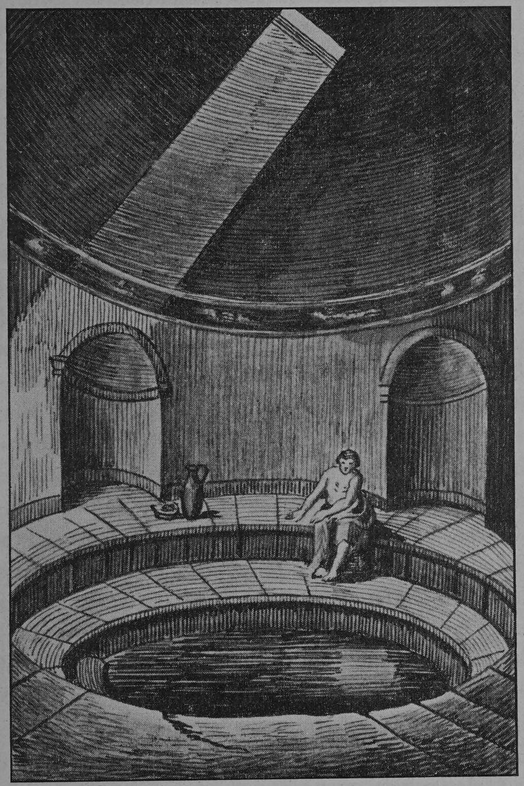

*Fig. 25. Frigidarium des kleinen Bades zu Pompeji.*

3. **Im Innern** des Bades sind die Hauptsache die Becken oder die Badewannen (אמבטי׳ = ἐμβατή, lat. *alveus*)[^92.112], und zwar gehörte ein kaltes Becken nicht minder zur Einrichtung als ein warmes. In größeren Badeanstalten römischen Systems lag das kalte Becken (*piscina*, auch *cisterna* und *baptisterium* genannt) in dem *Frigidarium*. Das Wort פסקין = *piscina* jedoch bedeutet bei den Rabbinen nur Fischteich und erweist kein Vorhandensein eines kalten Beckens. Ausdrücklich wird einmal der Embate das Beiwort „siedend“ beigelegt: die Embate war so heiß, daß kein Mensch hineinsteigen (ירד) konnte; da kam irgendein Gewaltmensch, sprang hinein (קפץ), verbrannte sich zwar, aber damit hatte er sie bereits für andere abgekühlt (הקיר)[^92.113]. Die Embate kann demnach nicht „Kaltwasserbad“ genannt werden[^92.114], vielmehr war sie gerade das warme Bassin, der *alveus* der Römer, der, gewöhnlich viereckig, an einem Ende des *Kaldarium* stand, während in der gegenüberliegenden Nische *(laconicum?)* sich das *labrum*, ein kaltes Becken, befand. In Tiberias enthielt die eine Embate süßes, die andere salziges Wasser, doch findet sich auch eine Spur, daß sowohl warmes als kaltes Wasser vorhanden war[^92.115]. Der Boden der Embate konnte rissig werden, und in diesem Falle verstopfte man sie (פקק) mit einem Lappen[^92.116]. Die Mišna unterscheidet „große“ und „kleine“ Embate, aber auch in der kleinen konnten mindestens zwei Personen baden, und es ist die Rede selbst davon, daß man in der Embate schwimmt[^92.117]. Die kleinen Embate denken wir uns in Hausbädern, aber auch die großen Embate der städtischen Bäder[^92.118] konnten all die badenden Menschen — wir sahen oben in einem Falle zumindest 101 Menschen, und im Falle des Zauberbannes, der im Bade zu Tiberias stattfand, gab es im Gedränge an der Türe Brust- und Rückenstöße — nicht auf einmal fassen, und so bestand der Brauch, daß sich die Nachfolgenden auf den breiten Rand (aram. pl. גידודי)[^92.119] setzten, bis die ersten fertig wurden. So saß Jamblichos auf dem erhabenen Rand der Einfassung der Quelle zu Ḥamath-Gadara[^92.120] und führte von dort aus sein Gespräch; die so zugebrachte freie Zeit wird überhaupt die beste Gelegenheit gewesen sein zu den im Altertum so sehr beliebten Badegesprächen, die sich aber im Judentum auf Thorastudium nicht erstrecken durften (§ 95). Zu diesem erhöhten Rand, möglich auch hinunter in das Bassin — für beides finden sich Beispiele — führten Stufen (דרגא); sie stürzten einmal unter R. Jochanan (wohl in Tiberias) zusammen, doch konnte er nicht nur sich, sondern auch die beiden ihn stützenden Begleiter retten[^92.121]. Diese Wasserbehälter waren nach den antiken Berichten etwa 1—2 Meter tief; es handelte sich also weniger um die Gefahr des Ertrinkens als etwa um die Verletzungen durch die ins Stürzen geratenen Bauteile. Jene Stufen in die Wanne hinein dienten zugleich zum Sitzen — die in Pompeji haben eine eigene Sitzform — und so hören wir, daß man in der Badewanne, die hier אגנא דמיא „Wasserbecken“ heißt, saß[^92.122]. Folgende Anstandsregeln wurden bei diesem Punkte gefordert: Nicht soll man die Füße in die Badewanne (אמבטי) hängen lassen; auch soll niemand sich darin hinkauern, weil ihm das zur Schande gereicht (in den Augen derer, die nach ihm baden wollen); man spreche nicht zum Genossen im Bade: Drücke deine Hand auf mich! und wer es sagt, kommt von dort nicht heil heraus; das ist nur — bemerkt ein Lehrer — bei wenigem Wasser; bei vielem Wasser ist es sogar lobenswert[^92.123].

4. **Von sonstigen Einrichtungsstücken** im Badehause finden Erwähnung: die Bretter, Sitzbänke und Badewäsche; diese beweglichen Sachen gehören, wenn man ein Badehaus ankauft, nicht hinzu, es sei denn, man hätte ausdrücklich „das Badehaus nebst Einrichtung“ (תשמישין) angekauft[^92.124]. Die Sitzbänke (ספסלין = συψέλλιον = *subsellium*) waren aus Marmor[^92.125], wie in den von Feuchtigkeit durchzogenen Räumen des Badehauses nicht gut anders möglich, und waren in allen Räumen des Badehauses zu finden. Die Bretter (נסרים) dienten wahrscheinlich zum Belag des heißen Bodens des Schwitzraumes; mitunter waren die Bretter unter sich verbunden (שָׁגַם) und bildeten eine Art zweiten Bodens, unter dem das aus den Wannen stetig abrinnende Wasser abfließen konnte, ohne daß die Badenden darin zu waten hatten[^92.126]. Sowohl Bretter als Badewäsche (בנריאות) können in besonderen Häuschen (בית נסרים, בית בנריאות oder בית וילאות) aufbewahrt sein; nach pompejanischem Befunde sind es in die Mauerwände eingelassene große Kasten, die auch מגדלין heißen[^92.127]. So hat auch die Sitzvorrichtung noch den Namen אצטבה[^92.128], das sich von den vorhin erwähnten Bänken vielleicht darin unterscheidet, daß es für die Diener und sonstigen Begleiter der Badenden als Sitzgelegenheit diente; einmal findet sich sogar ein Schaf in einem Badehause[^92.129]. Auch Körbe (סלין), der Mindestzahl nach vier, werden im Bade gefunden; sie dienten vielleicht dazu, die gebrauchte Badewäsche fortzuschaffen[^92.130]. In Anbetracht ferner, daß in den Thermen von Pompeji massenhaft Lampen gefunden wurden, ist es interessant, daß einmal auch die Lichter (נרות) der Badehäuser erwähnt werden[^92.131]; sie dienten zur Erhellung von dunklen Räumen oder zur Nachtzeit.

[^92.85]: Beides, מרחץ und בית המרחץ, in Bar bBb 67ᵇ. 68ª. Gewöhnlich מֶרְחָץ gesprochen (L 3,249, J 841; K 5,248 punktiert מַרְחֵץ) also wie מֶרְחָק (dagegen מִרְמָס). Doch habe ich in MGWJ 51,57 bereits bemerkt, daß die Kaufmannsche Mišna-Hschr. stets מַרְחֵץ lese; ich möchte auf das hin מַרְחֵץ ansetzen, vgl. bh. בית מרזח, מרצע, nh. מרדע, מרזב, מרפק, מרתף, vgl. SIEGFRIED-STRACK, Lehrb. der nh. Sprache § 60. — Daß **warm**, geht hervor aus bBerakh 22ª אי משום צינה אפשר במרחצאות, j 2,7, 5ᵇ₄₉ שאין רחיצת צונן רחיצה, bTaʿan 13ª.
[^92.86]: Belege s. in Lwr 2,158. 159. 160.
[^92.87]: bBm 6ᵇ o., bSabb 140ª, bBerakh 22ª, bChull 45ᵇ, bʿErub 27ᵇ, bSanh 62ᵇ מסותא; bḲidd 33ª zweimal בי מסחותא, vgl. L 3,164. In Gen R 79,7 אתון סחיא sieht man bestimmt, daß סחא ein vollständiges Baden bedeutet.
[^92.88]: MAz 1,7 דימוסיות als Lehnwort wird durch מרחציות nur tautologisch näher erklärt, und es sind durchaus nicht zweierlei Anstalten gemeint. In jAz 40ª₄₃ heißt dieselbe Wölbung כיפתא (vgl. S. 27), ib. und b 19ᵇ der Fall von עבר ובנה; b מכוש das Werkzeug des Bauens, vgl. מכישה Gen R 44,16 (doch מ״כ aus ʿArukh מקל) = Hammer; ib. Verb מכיש und מכתשין.
[^92.89]: MAz 3,4 במרחץ של אפרודיטי, vgl. b 44ᵇ. Zum Mišna-Text s. MGWJ 51,328. Des ferneren heißt es von der Aphrodite-Statue, daß sie auf die Cloaken (ביב § 30) gestellt war und alle Welt vor ihr uriniere; das kann nur im Innenraume sein. In der vom Zauberspruch des Ketzers bewirkten Bannung wurden die badenden Rabbinen an der Wölbung (כיפה) festgehalten (jSanh 7,19, 25ᵈ₂₃), denn die dort postierte Statue ist ein Genius des Zauberers; dieser wurde von den Rabbinen am Tore festgehalten, vielleicht weil das Tor sonst (wenn auch nicht im Bade) mit מזוזה, dem jüdischen Wahrzeichen, versehen ist. Jedenfalls hat es danach auch im Tiberiensischen Bade eine Wölbung gegeben, u. z., wie man sieht, im Innern des Bades.
[^92.90]: jAz 4,4, 43ᵈ unten, vgl. BACHER, Ag. der pal. Am. 1,256 A. 7. RJochanan und Reš-Laḳiš baden in Tiberias: jPeʾa 8,8, 21ᵇ₁₄. Die dortige Wölbung s. in voriger A.
[^92.91]: jŠebiʿith 8,11, 38ᵇ unten. Vorher wird gesagt, daß RJosua b. Levi von Lydda nach Beth-Gubrin (Eleutheropolis) baden ging; damit bricht die Erzählung jäh ab, und ein Zusammenhang mit dem Fall in Bostra ist nicht ersichtlich. Ein schlecht erhaltenes röm. Bad wurde jüngst im alten Gezer ausgegraben, s. PEF Qu. St. 1907, 258.
[^92.92]: MAz 4,3, b 51ᵇ טובת כומרי. Es ist das *sostrum* der Römer.
[^92.93]: bAz 16ᵇ.
[^92.94]: Epiphanius Haer. 30,4.
[^92.95]: Bar bSabb 40ª; TBerakh 2,23 p. 5₁₈, vgl. bSabb 10ª (der befremdliche Ausspruch Hillels des Alten, der in T folgt, bezieht sich, wie es scheint, ebenfalls auf Vorgänge des Badelebens). Als Juda und Hillel, die Söhne des Patriarchen RGamliel III, in Kabul gemeinsam badeten und die ganze Stadt daran Anstoß nahm, begab sich Hillel unbemerkt in den äußeren Raum: Bar bPesach 51ª; in den Parallelstellen: TMḳ 2,15, 231₁₇ und jPesach 4,1, 30ᵈ₁₇ fehlt dieser Ausdruck. Es gab mitunter mehrere solche innere und äußere Räume: TBb 3,3, 402₇ und j 4,6, 14ᶜ₅₄. Zum Ausdrucke vgl. TSanh 10,11, j 7,16, 25ᵈ₁, b 67ª.
[^92.96]: TNidda 6,15, 648₁₆. Frauenabteilung z. B. in den beiden älteren Thermen von Pompeji und in Badenweiler, vgl. BECKER-GÖLL, Gallus, 3,151.
[^92.97]: שערי מרחצאות Sifre Dt 36 p. 75ᵇ Bar bJoma 11ª. Vgl. שערי טבילה bBerakh 20ª (wo am Margo die Parallelstellen verzeichnet sind). In jSanh 7,9, 25ᵈ₂₅ ist תרעה eine innere Türe.
[^92.98]: bNidda 67ᵇ in Machuza; nach Rašis zweiter Auffassung sind אבולאי zwischenliegende Höhlenbauten (?).
[^92.99]: מקום הזיעה Derekh E. R c. 10 g. E. Von dem Schwitzen, das nicht notwendig mit Nehmen des Bades verbunden war, ist auch sonst die Rede: bBerakh 27ᵇ נכנס להזיע, bSabb 9ᵇ, 40ª, TNedar 2,7, 278₁ (s. w. unten). Die Römer hatten für das Schwitzen den eigenen Raum *laconicum* (OVERBECK, Pompeji⁴ 237), doch steht die Bedeutung des Wortes nicht fest.
[^92.100]: MBb 4,6 אוצרות של עצים, T 3,3, 402₁₂ בית כניסת עצים, Bar b 68ª oben בית כינוס העצים, j 4,6, 14ᶜ₅₉ בית הכנסת של עצים. — MKel 17,1 בלנין בגבבה [קופות]; MŠebiʿith 8,11. — TBerakh 6(5),14₉ האש והבשמים שבמרחץ (in bezug auf הבדלה). Vgl. dazu die Spezereien in der Badewanne bei PLINIUS und anderen Autoren in Gallus 3,159.
[^92.101]: הבריכות המספקות לו מים Bar bBb 67ᵇ u., T 3,3, 402₁₁.
[^92.102]: MBb 4,6 מגורה (etwa von גור = נגר Leitung, vgl. נִגְרִין (A. 55) TBeza 3,1 und jSabb 13,5, 14ª₇₃, oder von גור = wohnen, Behältnis), j 4,6, 14ᶜ₅₈ מגורות. In TMiḳw 1,17, 653₂₉ מעשה בינורם של דיסקום ביבנה lies mit alten Agg. und RŠ zu MMiḳw 2,2 במגורה, so auch jTerum 8,2, 45ᵇ₃₇ (מגורת l. ומגורה), bḲidd 66ᵇ; μέγαρον Lwr 2,321 ist unrichtig; ebenfalls zu modifizieren Lwr 2,209ᵇ Δίσκος als nom. propr., vielmehr = δίσκος Leitung aus Scheiben, vgl. סילון und קרמודין.
[^92.103]: סילון zahlreiche Stellen in Lwr 2,283, vgl. besonders סילון שבמרחץ TKel bm 6,8, 585₁₅; MSabb 3,4 im Vorfalle zu Tiberias. Die Quellen erwähnen irdene, bleierne, hölzerne, knöcherne und gläserne Röhren. In TKel bḳ 2,3, 570₃₁ קרמודין (s. Lwr 2,569) neben סילונות. Vollständiges Wasserleitungssystem auf Kupferrohr ist gefunden worden im Totentempel des Königs Sahu-re (alte Dynastie) bei Abusir, s. Mitteilungen der deutsch. Orient-Gesellschaft, August 1908 No. 37 S. 24. Über die Beschaffenheit der beiden Rinnen (שיתין) am Altare zu Jerusalem, die mit einem סילון kommunizierten, s. TSukka 3,14, 197₁₃, j 54ᵈ₁, b 49ª und auch in der Midraš-Kompilation in Harkavy-Festschrift, hebr. Teil, S. 394; vgl. dazu MGWJ 1905, 49,261. כמעיין של שיתין bʿErub 19ª s. Raši. Man sagte כרה שיתין „Rinnen graben“, bSukka 53ª.
[^92.104a]: MMiḳw 6,7. 8, T 5,5, 657₉₋₁₃. מַשִּׁקָה s. auch TMiḳw 6,4, 658₁₁, wo das Verbinden zum ständigen Betrieb des Bades gehört. Vgl. MBeza 2,2 (b 17ᵇ). Andere Stellen s. L 3,453 (besonders Cant R 1,2 s. v. ישקני (f. 5ᶜ Romm) כאדם שהוא משיק שני גבין זה על זה והוא מדביקן) und 1,498.
[^92.104b]: MMiḳw 4,3.
[^92.104]: Cant R zu 1,2 fol. 6ᵇ ed. Romm: מה המים נמשכין לגנות ופרדסים ולבתי כסאות ומרחצאות s. PREUSS S. 10. Zu משך und גרר s. meine Notiz in Hašiloach 20,20.
[^92.105]: An den oft angeführten Stellen TBb 3,3 (wo בית היקמין und יקמין, wahrscheinlich Anlehnung an יקבין von יקב, wie in j 14ᶜ einmal wirklich steht; auch b 67ᵇ יקמין l. mit j 14ᶜ₅₄ קמין, wie auch alte Agg. der T, s. Lwr 2,551 καμίνιον, nach I. LÖW κάμινος anzusetzen). jSabb 3,4, 6ª₂₄ היו סותמין את הקמין.
[^92.106]: An denselben 3 Stellen: TBb 3,3, j 14ᶜ (nur יורה); b 67ᵇ jedoch בית הספלים und ספלים עצמן, wo ספל = יורה von T und j. RSbM hat das so wenig verstanden, daß er sogar die Variante ספסלין mitteilt, doch entscheidet er sich für ספלין, weil es auch in der Mišna steht. Ein dritter Ausdruck ist etwa בסלקי jBb 14ᶜ, בי סלקי bBm 84ª, nach Lwr 2,394 = *σαλιάκοι = Kessel; andere Vermutung s. in „Badewesen“ S. 38 A.
[^92.107]: Vgl. Kessel α, β, γ bei OVERBECK, Pompeji⁴ 212; Vitruv s in Pauly-Wissowa RE 2,2749.
[^92.108]: OVERBECK S. 227.
[^92.109]: bBerakh 60ª אפחית בי בני מתותיה . . . קם על עמודא שזיב מאה וחד גבר s. Raši; in bKethub 62ª fehlt das Detail der Rettung so vieler Menschen, dagegen dort noch סליק er ging hinauf. Vgl. שמא תפחת bPesach 112ᵇ; auch בני דסכותא אתפחתת jMḳ 1,2, 80ᵇ₅₅. PREUSS S. 11 meint, daß in Abbahus Fall der Bretterboden des Grabens nachgab, aber so ein Graben ist so schmal, daß man ihn leicht hätte überschreiten können.
[^92.110]: Das **vor** dem Baden zu sprechende Gebet ist allgemein gehalten und für das Badeleben nicht instruktiv; auch das **nach** dem Baden zu sprechende lautet allgemein in TBerakh 7,17 p. 16, instruktiver b 60ª, j 9,6, 14ᵇ₂₆. In j bemerkt RAbbahu (der vom Schaden Gewitzigte!), daß dieses Gebet nur erforderlich sei bei einem geheizten Bade (ניסוק), sonst aber wäre nur zu sprechen: der mich gerettet hat von dem siedenden Wasser (מהיזק חמי). Wenn RMana in einem geheizten Bade baden sollte, machte er vorher sein Testament (jBerakh 4,4, 8ᵇ₁₉). bAz 28ᵇ כולהו בי בני סכנתא „in allen Badeanstalten gibts Gefahr“. Ähnliches Derekh E. R c. 10, vgl. REJ 36,213, und siehe GUHL-KONER, Das Leben der Griechen u. Römer, Berlin 1876, 279: πυρίαι, πυριατήριον, *laconicum*.
[^92.111]: bChull 145ᵇ טרייה לרישיה s. RN טר 5.
[^92.112]: Lwr 2,59, wo ἐμβατή im Sinne von *solium balnei* (vgl. *solio* RN 1,112 ed. K) genügend belegt ist (s. noch Theophanes 93,1 ἐμβάτη = lavacrum), so daß der Umstand, daß sonst bei Griechen λουτήρ, πύελος, ἔμβασις (bei Homer ἀσάμινθοι) dafür vorkommt, nicht bedenklich ist; vgl. PREUSS S. 11. Die ספלים bBb 67ᵇ, die PREUSS für Badewannen hält, haben wir oben als Kessel gedeutet.
[^92.113]: Pesiḳta 27ª, vgl. Pesikta R c. 12 p. 52ª, wo statt הקיר der Ausdruck הפשיר und מיד באו הכל ורחצו בתוכה; s. auch Raši zu Dt 25,18.
[^92.114]: So irrtümlich RICH s. v. *balineae*, s. dagegen BECKER-GÖLL, Gallus 3,125; OVERBECK, Pompeji⁴ 209.
[^92.115]: jSabb 3,4, 6ª₃₀ (vgl. A. 75), ib. Z. 39. 40 חמין und צונין.
[^92.116]: TKel bb 6,8, 596₂₂ לפוק בו (ed. Z. לפזק irrig). Vgl. פחת A. 109. Die Verstopfung kann sich auch auf die Leitungsröhren beziehen.
[^92.117]: MNedar 4,4; vgl. T 2,7, 278₁, MMiḳw 6,10; MMakhš 2,5. Schwimmen bSabb 40ᵇ, ib. gleichwie im Teiche (ברכה).
[^92.118]: אמבטיאות של כרכין bSabb 40ª, freilich ist hier Embate pars pro toto, indem nämlich das ganze Bad gemeint ist (מטייל בהם). Vgl. TNedar 2,7, 278₁ (derselbe Fall wie M 4,4), wo zu אמבטי גדולה opp. מרחץ קטנה; zu achten ib. auf ומזיע עמו „mit ihm zugleich schwitzen im kleinen Bade“, wonach offenbar vom *Kaldarium* die Rede, und es kann somit die T unterscheiden zwischen רחץ und מזיע, denn im dreiteiligen Kaldarium ist beides möglich.
[^92.119]: Die בריכה, der Teich, hat keinen Rand, sondern die Erde setzt sich fort; die Embate hat einen Rand: bSabb 41ª o. und bʿErub 6ª; vgl. גדודיות von Stadtmauern MSabb 5,1 und oben S. 50. Auf dem Rande der Embate sitzen die Menschen auf der Abbildung bei OVERBECK, Pompeji⁴ 205.
[^92.120]: ἐπὶ τῆς κρηπῖδος s. ZDPV 7,191, wo DECHENT lat. *crepido* vergleicht; doch läßt er es offen, auch an den Boden des Bassins zu denken.
[^92.121]: bKethub 62ª.
[^92.122]: bBerakh 22ª ר׳ זירא הוה יתיב באגנא דמיא בי מסותא; er ließ sich von seinem Bediener 9 Ḳab kaltes Wasser über den Kopf gießen, und es wurde dafür ein eigenes Faß (aram. חצבא) von 9 Ḳab eingeführt (ib.). Vielleicht ist so gemeint הה דמשוג אמבטיתה jSabb 8,6, 11ᶜ₂₀. — RN (bei K 1,36) liest in bBerakh 22ª und bSabb 157ᵇ אודנא דמיא und erklärt אודנא für gleich mit אבטי = אמבטי, doch kennt er auch die LA אוונא, s. auch Hai zu MʾOhal 12,3 angeführt in ʿArukh s. v. בטה (K 2,40ª), wie in bSabb in den Agg. steht (RCh jedoch אדנא, s. noch K 1,24). Da es hebr. אוגן של מים gibt (bChull 41ª), so dürfte אגנא דמיא vorzuziehen sein, vgl. bh. אגן. Hingegen אודנא wohl syr. = ܐܒܙܢܐ = pelvis baptismalis, nach LAGARDE aus pers. *âbêzān* s. BROCKELM. 4 (ungenügend PSm 57).
[^92.123]: Derekh ER c. 10 (das ganze Kapitel ist eine kleine Badeordnung), wo ואל im Parallelismus vor ויהא רבוץ noch einmal zu lesen; beide Stellungen sehen aus, als ob er urinieren oder gar sich entleeren wollte. דרום usw. ist den Kommentaren unfaßlich; viell. ist der Sinn der: bei wenigem Wasser auf dem Boden der Wanne läßt man sich wohl zu dem Zwecke vom Kollegen niederhalten, um vom Wasser bedeckt zu sein, was aber gefährlich werden kann; in vielem Wasser jedoch läßt man sich wohl nur der größeren Sauberkeit wegen u. z. ganz leicht niederdrücken.
[^92.124]: MBb 4,6 nebst Bar b 67ᵇ. 68ª.
[^92.125]: ספסלין ist in der Mišna zu lesen, wie ed. Lowe hat, nicht ספלין der Agg., so wegen Bar anbei, wo es aber „Kessel“ bedeutet, s. oben. Richtig MKel 22,10 ספסלים שבמרחץ ושתי רגליו של עץ. Siehe dazu RICH s. v. *balneae*, BECKER-GÖLL, Gallus 3,128 (der Holzstühle zuläßt), OVERBECK a. a. O. S. 205 und *passim*; man nennt sie *scholae*, Ruheplätze.
[^92.126]: Belag als Zweck der Bretter schon RSbM zu MBb ib. (doch denkt er auch daran, daß sie die Füße der Badenden vor Schmutz schützen sollten). שגם MKel 22,10 RN und Maim. = שעם (arab. אלבירזאן eine Art Kork oder Gummi, mit denen die Bretter verdichtet werden), vgl. L 4,508. 590.
[^92.127]: TBb 3,3, 402₉ und j 14ᶜ₅₅ מגדלין offenbar = בגריות der Mišna oder = ויאלות der Bar b 67ᵇ. PREUSS S. 11 schreibt *megadlin* ohne Erklärung, S. 12 „Türme“, lies *migdalin* und „Kästen“.
[^92.128]: MNidda 9,3 neben ספסל של אבן (s. o.) אצטבה שבמרחץ (ed. Lowe אסטווה), vgl. Lwr 2,118.
[^92.129]: bChull 53ª מעשה ודרס שועל רחל במרחץ של בית היני.
[^92.130]: ארבעה סלין שבמרחץ TKel bm 6,8, 585₁₅. Zum angegebenen Zwecke vgl. MZab 4,1 נוטלת עריבה מלאה בגדים.
[^92.131]: jPesach 4,5, 31ª₄₅.

## § 93

**93.** **Eigentümer, Badediener und Besucher.** Wie in Rom, so waren auch die Bäder der Juden zumeist in Privatbesitz, die eben, wie jedes andere Unternehmen, geschäftsmäßig in Betrieb gehalten wurden. Wir berührten schon die Modalitäten des Überganges eines Warmbades (מרחץ) von einem Besitz in den anderen, was durch Kauf oder Erbschaft, provisorisch auch durch Miete geschehen kann[^93.132]. In der Regel befinden sich die Badehäuser in Palästina in jüdischen Händen, doch auch oft in heidnischen Händen[^93.133], von den Juden vielleicht lieber geduldet als in samaritanischen Händen[^93.134]. In vielen Fällen jedoch unterhält der Staat, bezw. die Ortsgemeinde, die öffentlichen Bäder, die dann דימוסיות oder דימוסין = δημόσια (sc. βαλανεῖα) d. h. öffentliche heißen, wie wir deren in Tiberias und Gadara hatten, sich als Stätten des Lasters und Götzendienstes keines guten Rufes erfreuten, wie wir das im einzelnen bereits gefunden haben. Verschieden davon sind die Privatbäder (פריבטאות = *privata*), die auch die alte Benennung מרחץ weiter führen[^93.135]. Wegen des freien Besuches der öffentlichen Bäder gelten diese in gewissem Betracht als Straßenarea[^93.136]. Es ist begreiflich, daß es öffentliche Bäder und überhaupt Warmbäder, die von den Eintrittsgeldern des Publikums erhalten wurden, nur in Städten gab[^93.137]; den Luxus eines Warmbades im Privathause, wie man sie in den römischen Villen kannte, konnten sich die mehr bäuerlichen Juden nicht verstatten. Als Zubehör zur Stadt jedoch wurde das Bad geradezu gefordert[^93.138].

Der Eigentümer (בעל הבית) eines Privatbades, oder der Pächter (עריס, auch אריס) eines öffentlichen Bades, setzt in die Badeanstalt einen Bademeister (בלן = βαλανεύς) ein, der daselbst gleichsam als Verweser oder Direktor tätig ist[^93.139]. Er erhob von jedem Badegast ein Badegeld (*balneaticum*)[^93.140], welches in Rom den oft erwähnten, auch von den Rabbinen gekannten Quadrans, d. i. ¼ Aß (2⅕ Pfennig), betrug; die Frauen zahlten etwas mehr, die Kinder gar nichts. Für dieses Badegeld erhielt man eine Marke, eine Art ungeprägter Münze (אסימון), die man dem Olearius (w. unten) vorwies; solche Bademarken konnte man auch in Landorten bekommen bezw. einwechseln[^93.141]. Der *ballan* saß auf einem Balken (קורה) am Eingange der Badeanstalt, wo er einen Kasten (תיבה) hatte zur Aufnahme des eingehobenen Geldes[^93.142]. Er erfreute sich infolge des Umstandes, daß er möglicherweise mit Frauen in Berührung kam, keines guten Rufes[^93.143].

Den Badegast geleitet zum eigentlichen Bade der Olearius (אולייר), wörtlich der mit dem Öl Hantierende, indem nämlich jedes Bad mit Öleinreibung verbunden war; doch nahm der Olearius auch die Bademarken in Empfang[^93.144], wie er auch die Badewäsche ins Bad trug[^93.145], in welchem Falle wir es wohl mit einem Privatdiener des Badegastes zu tun haben, den er mitnahm, um sich von ihm mit Öl einreiben zu lassen, wie sich auch die Römer von ihren Sklaven ins Bad begleiten ließen, und derselbe Olearius war auch beim Auskleiden behilflich[^93.146]. Auch er hatte einen eigenen Raum, und zwar wie die Funde von Pompeji beweisen, einen mit Sitzbalken versehenen Raum, und eben solche Warteräume gab es auch für die die Herren begleitenden Diener[^93.147].

Da das Abtrocknen eine wesentliche Verrichtung nach dem Bade war, so ist der als Professionist genannte *sappag* (סַפָּג) als im Bade beschäftigt zu denken; neben ihm wird auch der Haarkünstler (סַפָּר) genannt[^93.148]. Ein anderer Diener (פרכיטא w. u.) verrichtet die Begießung des Badegastes; wieder ein anderer, der תרמסר = *thermasarius*, sorgt, wie es scheint, für den steten Zufluß von warmem Wasser und ist möglicherweise der Heizer[^93.149], während ein anderer, der den rätselhaften Namen ארגניטין führt, für die Belustigung der Badegäste sorgte[^93.150].

Leute jeglichen Geschlechts, jeglichen Alters und Standes besuchten die öffentlichen Bäder. Aber während bei den Juden ein Baden der Frauen zusammen mit Männern undenkbar ist, herrschte im römischen Reich, wenn auch nicht allenthalben, so doch vielfach die Unsitte, daß Frauen und Männer gemeinsam badeten, wogegen die erneuerten Edikte der Kaiser und die Satire der Dichter vergeblich ankämpften, und selbst die herrschend gewordene Kirche mußte noch dagegen eifern[^93.151]. Damit das Übel in Israel nicht einreiße, erklärte man, daß eine Frau, die mit jedermann badet, ihrer *Kethubba* (d. i. des Witwengeldes) verlustig gehe, „weil sie sich bei dem Manne nicht nach der Sitte Mosis und Israels aufführte“[^93.152]. Darum eben hatte man bei den Juden besondere Frauenbäder (o. S. 218). Eine Einzelheit zu diesem Punkte berichtet der Reisende Antoninus Martyr vom Bade des Siloa in Jerusalem: zwischen den zwei Marmorwannen (*solia*) befand sich ein Gitterverschluß (*clausura cancellarum*), so daß auf einer Seite die Männer, auf der anderen die Frauen badeten[^93.153]. Eine ähnliche Vorrichtung scheint das קנקילין der Mišna zu sein[^93.154]. Das Zusammenbaden der beiden Geschlechter erscheint um so verwerflicher, als beide Geschlechter völlig nackt badeten. Bei den Juden forderte man das von den Männern schon darum, damit die Beschneidung nicht verdeckt werden könne[^93.155].

Diese völlige Nacktheit bringt es mit sich, daß man mit Leuten, denen man Ehrfurcht schuldet, nicht zusammen badet, also nicht mit dem König und Hohepriester, der Schüler mit dem Lehrer, es sei denn, dieser bedürfe seiner, und in der Tat lesen wir einigemal, daß der Lehrer sich beim Bade auf den oder die Schüler stützte[^93.156]. Zwei Brüder sollen nicht gemeinsam baden[^93.157]. Dagegen baden Juden und Heiden zusammen, nur mit einem einzelnen Heiden soll der einzelne Jude aus Gründen der persönlichen Sicherheit nicht zusammen baden[^93.158].

[^93.132]: Kauf: MBb 4,6 vgl. Parallelstellen in A. 127. TDemai 6,13, 57₁₇ ירשו מ׳ ib. Z. 19 לקחו מ׳. MAz 1 Ende: „Auf keinen Fall darf man ihm [dem Heiden] das Warmbad in Pacht geben (שכר), weil es nach seinem [des Juden] Namen genannt wird.“ Der Name des Eigentümers haftete also auf dem Bade. מושכר auch MNedar 5,3.
[^93.133]: MAz 1,7 vgl. vorige A. MMakhš 2,5.
[^93.134]: TNidda 6,15, 648₁₆ mit Erwähnung eines gehässigen Verdachtes: בית המרחץ של כותיים מטמא באהל מפני שקוברין שם את הנפלים. Man meint wohl die badenden Weiber, die sich ihrer Leibesfrucht entledigen.
[^93.135]: Beide Arten nebeneinander in MAz 1,7 דימוסיאות ומרחצאות (nicht בימוס׳, wie auch noch PREUSS S. 13 will, s. Lwr 2,205 s. v. דימוסיא, ib. 364 נמסיאות TTohar 7,11, 668₉; von PREUSS ist es auch verfehlt, von מרחצאות den Sing. מרחצאה zu bilden). Die Stelle verträgt übrigens auch den Sinn, daß מ׳ bloß als Erläuterung zu ד׳ dient, wie oft bei Lehnwörtern, so daß מרחץ mitunter ein öffentliches Bad sein kann (s. A. 88). Dieser Sinn des Wortes scheint gefordert zu sein in bSabb 33ᵇ, wonach die Römer bloß des Lasters wegen מרחצאות errichten, ferner ib., daß Jakob für die Stadt Sichem מרחצאות errichtete (vgl. Gen R 79,6. 7). Zu פריבטא s. Lwr 2,488.
[^93.136]: רשות הרבים TTohar 7,11, 668₉.
[^93.137]: Vgl. אמבטיאות של כרכין A. 118. TNidda 6,9, 648₁, b 48ᵇ. Folgt auch aus Cant R zu 1,6: Ein Königssohn, der aus der Stadt in die Wüste gegangen und von der Sonne am Kopf verbrannt, am Gesicht gebleicht war, geht in die Stadt (מדינה), und mit ein wenig Wasser und mit ein wenig Bad von den Bädern (ומעט מרחץ מן המרחצאות) wird sein Körper weiß und schön wie ehedem. Der Mann, der der Frau verbietet zu baden: in Städten nur eine Woche, in Dörfern zwei Wochen, muß sie bei Auszahlung ihrer Kethubba entlassen (jKethub 7,4, 31ᵇ₄₂).
[^93.138]: bSanh 17ᵇ, vgl. Pirḳe Derekh Erez ed. Friedmann, Wien 1904, p. 13.
[^93.139]: TBm 9,14, 392₆. Zu בלן s. Lwr 2,158 mit zahlreichen Stellen, darunter בלן לרבים Sifra zu Lev 25,41 p. 109ᵈ, vgl. בית טבילה לרבים (A. 97).
[^93.140]: נתנה לבלן bMeʿila 20ª. MSebiʿith 8,5.
[^93.141]: אסימון s. Lwr 2,86 = ἄσημον. TMš 1,4, 86₂₀ אסימון . . . והנתנות סימן במרחץ, jMš 1,2, 52ᵈ₁₋₅ bBm 47ᵇ.
[^93.142]: מקום ישיבת הבלן MKel 8,8, vgl. jBb 4,14ᶜ₅₀. קורת הבלנין MZab 4,2, T 4,7, 679₁₅. Vielleicht steht damit im Zusammenhange das schöne Holz, welches sich im Badehause befindet und welches zu einer Büste verarbeitet wird (Exod R 15,17). — תיבה Sifra zu Lev p. 75ᵈ, TKel bm 10,3, 588₃₃. Ib. 10,4, Z. 37 טבלה עליונה „eine obere Tafel, auf welcher man Geld aufzählt“, scheint sich auf das Bad zu beziehen. In TMakhš 3,11, 675₃₇ wird ביצת הבלן erwähnt; das scheint ein Holmaß zu sein, womit er den Badenden Öl und Speisen zumißt; vgl. § 227.
[^93.143]: Bar bḲidd 82ᵇ. Vgl. den Spott über Haman bMeg 16ª, Esth R 10,4
[^93.144]: Nachweise zu ὀλεάριος = *olearius* gebe ich in Byz. Zschr. 1893, 2,507; s. auch Lwr 2,20. jMš 1,2, 52ᵈ₃ מעות הנתונות לאולייר; in TMš 1,4, 86₂₀ sieht man, daß das אסימון gemeint ist.
[^93.145]: bSabb 147ᵇ.
[^93.146]: jBerakh 2,3, 4ᶜ₁₅ כד הוה אזל מסחי כיון שהיה מגיע אצל הא׳; der Beweis ist allerdings nicht stringent.
[^93.147]: בית האוליירין TBb 3,3, 402₈, מקום האורייר j 14ᶜ₅₆. Das Wort בית zeigt, daß es ein Gemach war, das auch ein Fenster hatte: MTohar 7,7, T 8,8. Dasselbe gilt demzufolge für den Standort des *ballan*. Siehe den Plan eines pompejanischen Bades bei PAULY-WISSOWA, RE col. 2752 No. 26. 27. Vgl. die *scholae* und אצטבא genannten Ruheplätze S. 223.
[^93.148]: MKil 9,3. Vgl. Hamans Beruf Esth R 10,4, bMeg 16ª.
[^93.149]: Lwr 2,585 תורמסר *θερμαντήριος, nach I. LÖW von θέρμαι in acc. pl. θέρμας + *arius*: *thermasarius*, was ich faute de mieux einstweilen annehme. התורמסר jMš 1,52ᵈ₄ opp. zu אולייר, was seinen Grund darin hat, daß der Olearius, der am Eingange des Badehauses saß, die Marken einzeln und teuer verkaufte, während der ת׳, den wir kurz den Heizer nennen wollen, drinnen saß und die Marken zu einem niedrigeren Preise in Pauschale verkaufte; s. ZUCKERMANN, Münzen S. 32 und betreffs des Standortes des Heizers ZUCKERMANDEL, Tosefta Mischna und Boraitha 1,17. Starkes Heizen (b. aram. und jüdisch-aram. אזא) auf Kaiser Diokletians Befehl im Bade von Paneas: jTerum 8 E., 46ᶜ, Gen R 63,8. Nach der Legende zwingt König Salomon die Dämonen, die Bäder zu heizen (Ḳohel R 2,8 s. v. כנסתי, Cant R 3,6 Ende, Num R 11,3 vgl. L 1,50 אזא). Im Bade von Tiberias wird יעקב תורמוסרה „Jakob der Heizer“ namentlich genannt: jBerakh 4ᶜ₄₉, Pesiḳta R c. 22 p. 112ª. Ebenso זוסימי אודייתא jŠebiʿith 38ª₂₆ nach meiner Ansicht (Lwr 2,246) Zosimos oder Zosime der Heizer oder die Heizerin; andere Erklärungen s. bei PREUSS S. 16.
[^93.150]: Gen R 63,8 ואתא הדין ארגיניטון מגחיך ומרקד קדמיהון weniger deutlich jTerum 8 E., 46ᶜ₂ (wo אנגיטרים l. ארגינטים), Jalḳ Gen § 110 ארגינטין. Über das rätselhafte Wesen, das RN einen Badedämon nennt, s. M. SACHS, Beitr. 2,115. Der „Geist“ in Lev R 24,3 und der „Engel“ Joh 5,2 gehören in denselben Kreis. In politischer Beziehung s. GRAETZ 4³,279. GRAETZ übersetzt unser Wort mit „Spaßmacher“, was berechtigt ist, vgl. ליצן jBerakh 2,8, 5ᶜ₆₃. Mehr s. Lwr 2,126; „Badewesen“ S. 23.
[^93.151]: Quellen s. bei BECKER-GÖLL, Gallus 3,151 f., PAULY-WISSOWA RE col. 2750; PREUSS S. 18; „Badewesen“ S. 46; „Die Frau im Männerbade“ ZNTW 1,341.
[^93.152]: TKethub 7,6, 269₈. Vgl. j 7,7, 31ᶜ₁₉ שניהם טופחות על ירכה כאור הדבר תצא (die gemeinte Geste ist wohl eine Art Belustigung im Bade, vgl. A. 43), b 101ª. Ganz ähnlich lautet das Gesetz Quintilians (Jnst. 5,9): *signum est adulterae lavari cum viris.*
[^93.153]: Siehe c. 24 p. 27 ed. TOBLER. Der Pilger von Bordeaux berichtet, der Bethesda-Teich (s. oben S. 212) habe eine zweifache Fünfsäulenhalle gehabt (*gemellares quinque porticus*), also wohl nach Geschlechtern geteilt, s. C. MOMMERT, Bethesda S. 34.
[^93.154]: MKelim 22 Ende; s. Lwr 2,533 f. ק׳ an vielen Stellen = κιγκλίς = Gitter. Nach der Mišna kann dieses Gitter im Bade (es ist vorher vom Bade die Rede) so gemacht sein, daß es Trinkbecher (vgl. S. 217) aufnimmt, oder wie ein Bienenkorb aussieht. Die traditionelle Erklärung (RN, RŠ, Bert., Maim.) sieht freilich in קנקילין ein Netzgerät, in welchem man auf brennendem Schwefel Kleider räuchert. Auch PREUSS S. 13 kann der Schwierigkeit nicht Herr werden.
[^93.155]: Dem RAbbahu nahm man es schon übel, daß er im Bade seine Hände über seine Genitalien hielt (bSabb 41ª). Wir hatten schon den Ort, wo die Leute ganz nackt stehen (ערומין TBerakh 2,20, p. 5₁₆, j 2,3, 4ᶜ₄₅). Dasselbe folgt aus TBerakh Ende כיון שנכנס לבית המרחץ מילה בבשרו, vgl. jBerakh Ende, Sifre Dt 36 p. 75ᵇ. Vgl. auch MBerakh 3,5 ירד לטבול . . . לעלות ולהתכסות . . . במים, also künstliche Bedeckung der Schamteile.
[^93.156]: MSanh 2,5, T 4,1420₁₄ — bPesach 51ª. Rabbi gab dem RChijja zwei Schüler mit zur Vermeidung der Gefahr (jKil 9,4, 32ᵇ und Parallelstellen). Vgl. Midr Tannaim zu Dt 15,12 p. 85 ed. Hoffmann: ולא יסמוך לו במתניו כשהוא עולה למעלן.
[^93.157]: bPesach 51ª (s. A. 156). Auch die römische Sitte verbot, daß Vater und Sohn, Schwiegervater und Schwiegersohn zusammen badeten, s. PAULY-WISSOWA RE a. a. O.
[^93.158]: Viele Fälle, daß Juden und Heiden zusammen baden, vgl. MMakhš 2,5. Dagegen mit dem Einzelnen: TAz 3,4, 463₂₂. Auch Alleinsein mit dem Heiden im Pissoir (בית המים ib.) wird widerraten.

## § 94

**94.** **Badezeit und Bademanipulationen.** Die Griechen und Römer badeten hauptsächlich vor der Hauptmahlzeit, also vor der Tagesmitte; darum eben der Satz: Man bade nicht vor der vierten Tagesstunde[^94.159]; allein bei der später so sehr überhandnehmenden Badeliebhaberei war eigentlich keine Tagesstunde und selbst die Nacht nicht frei vom Baden[^94.160]. Schon wegen der damit verbundenen rituellen Beziehungen werden die Juden die Morgenstunden gewählt haben, und so finden wir שחרית als Eröffnungszeit des Badens sogar als Schulbeispiel, doch ist in demselben Zusammenhange auch davon die Rede, daß das Bad gesperrt (נעל) wird, andernfalls auch bei Nacht gebadet werden könnte[^94.161]. Es wird auch behauptet, daß das Bad immer zur Beutzung fertig stehe[^94.162]. Die menstruierende Frau nahm das Reinigungsbad sogar vorschriftsmäßig nur bei Nacht[^94.163]. Im allgemeinen spricht man z. B. in den Gadarathermen von Besuchszeit und Nichtbesuchszeit[^94.164].

Für das jüdische Leben ist die Frage des Badens am Sabbat von großer Wichtigkeit. Den Ausfall des Bades am Sabbat suchte man womöglich noch am selben Abend zu ersetzen und empfand es bitter, wenn es nicht geschehen konnte[^94.165]. Daß man sich Tags vorher zum würdigen Empfange des Sabbat erst recht badete bezw. partielle Reinigungen dieser Art vornahm, verbunden mit Kämmen des Haares und Anlegen reiner Kleider, geht aus mehreren Fakten hervor[^94.166]. Für den Sabbattag selbst gilt der Satz, daß im Wasser, das am Sabbat gewärmt wurde, nicht das kleinste Glied gewaschen werden darf (am Feiertage ist in diesem Falle nur das Baden verboten). Man suchte sich nun auf alle erdenkliche Weise zu helfen. Die in Tiberias verstopften (פקק, סתם) den Kamin, so daß die vor Sabbat erzielte Wärme nicht entschwinden konnte, und so badete man auch am Sabbat; es erhob sich jedoch der Verdacht, daß man ihn vor Sabbat derart mit Holz fülle, daß es noch am Sabbat fortbrenne, so verbot man das Baden und gestattete das Schwitzen; da verdächtigte man sie, daß sie unter dem Vorwande zu schwitzen auch baden, und verbot ihnen das Schwitzen auch; nun waren aber zwei Bassins da, eines mit süßem, das andere mit salzigem Wasser (und zwar mußte, wie es scheint, das süße Bassin geheizt werden, während das salzige naturwarm war), da waren sie verdächtig, die Bretter (mit denen das verbotene Bassin zugedeckt war) aufzunehmen und zu baden, indem sie behaupteten, in salzigem gebadet zu haben, und so verbot man alles; als sich aber die Leute einschränkten (d. i. sich gesetzmäßig betrugen) — nach einer anderen Version: als man sah, daß die Gemeinde nicht bestehen könne — gestattete man ihnen immer mehr und mehr, so daß man ihnen die Höhlenwasser (S. 213) und die Tiberiasthermen gestattete, und schließlich auch das Bringen von Bademänteln[^94.167]. Die Konservierung der Wärme durch Verstopfung des Kamins hatte auch den Vorteil, daß man am Sabbatausgang sofort baden konnte, ohne erst heizen zu müssen; am Feiertage durfte man in diesem Falle zu schwitzen hineingehen und sich im Vorraume kalt abspülen lassen, und das taten im Warmbade von Bĕnē-Bĕraḳ selbst namhafte Rabbinen, und es wurde nicht gefordert, daß das warme Bassin unterdes mit Brettern (נסרים) verdeckt (חפה) sei[^94.168].

In allen diesen Berichten sehen wir einen deutlichen Unterschied gemacht zwischen kalten, warmen und Schwitzbädern innerhalb derselben Baderäume. Auch ohne Wasserbad behagte der Aufenthalt in der feuchtwarmen Luft des Bades, und in den großartigen städtischen Badehäusern wandelte man am Sabbat auf und ab (טַיֵּל), um wenigstens den aufsteigenden Dampf (הבל) zu genießen oder doch sich des Anblickes des lustigen Badelebens zu erfreuen[^94.169]. Der Dampf des Baderaumes bringt den Dampf des Körpers heraus[^94.170]. Noch höher bewertete man das im Bade erreichte Schwitzen[^94.171].

Der Zweck des Badens, besonders des kalten Bades, war oft freilich ein gegenteiliger, nämlich das Abkühlen (לְהָקֵר)[^94.172]. Außerdem badete man zu Heilzwecken (לרפואה), zu allermeist jedoch zu bloßem Vergnügen (רחיצה של תענוג)[^94.173]. Ebendeshalb darf ein Trauernder und ein Fastender nicht baden; bei anhaltender Dürre, einer Fastenzeit für die Gemeinde, wurden die Bäder geschlossen[^94.174]. Kleine Kinder werden der Gesundheit wegen gebadet (§ 110).

Auf jedes Heißwasserbad folgte eine Begießung oder ein Abspülen (שטף, השתטף) mit kaltem oder warmem Wasser, gewöhnlich mit kaltem[^94.175]. Ein tannaitischer Text, der mehrere Gesundheitsregeln tradiert, lehrt: „Wer in heißem Wasser badet und nicht davon trinkt, gleicht dem Ofen, der von außen, aber nicht von innen geheizt wurde; wer warm badet und sich nicht kalt abgießt, gleicht dem Eisen, das in Feuer, aber nicht in kaltes Wasser gebracht wurde; wer da badet und sich nicht mit Öl schmiert, gleicht dem Wasser auf dem Fasse“[^94.176]. Das Abgießen geschah entweder mit der hohlen Hand (זִלֵּף), und zwar vom Badenden selbst oder durch eine andere Person ausgeführt[^94.177], oder aus einem Schöpfgefäß (דלי, חצבא), was immer durch eine andere Person, durch den mitgenommenen Diener oder durch den dazu bestellten „Ausgießer“ (פרכיטא = παραχύτης) des Bades, ausgeführt wurde und speziell „daraufgeben“ (נתן) hieß[^94.178]; letzterer reinigte zugleich den Baderaum (ebenfalls שטף)[^94.179]. Manche ließen sich von den mitgenommenen Dienern beim Einsteigen ins Bassin nicht nur stützen (סמך), sondern auch ins Wasser senken und wiederholt untertauchen[^94.180]. Das Abspülen und natürlich auch Abkühlen wird auch bewirkt, wenn man sich unter die Dusche (צנור, מרזב) stellt; eine derartige, jedoch wohl breitere Rinne nannte man auch מְטַהֶרֶת „die reinigende“ (d. i. abspülende) Röhre, wovon zwei und mehrere, mit verschieden temperiertem Wasser, übereinander angebracht und ihren Wasserstrahl sowohl nach innen, als nach außen, d. i. auf die Straße zu, senden konnten[^94.181]; es sind das aber nicht wirkliche Brausen, die das Altertum nicht gekannt zu haben scheint, sondern die Leitungen, aus denen das Wasserbecken sein frisches Wasser erhielt[^94.182]. Selbst das eben erst beschnittene Kind wurde nach dem Warmbad übergossen[^94.183]. Wenn man umgekehrt tat, d. h. sich kalt badete und sich dann mit warmem Wasser bespülte (שָׁטַף), heißt das die Allgemeinheit berauben[^94.184], vermutlich darum, weil das warme Wasser spärlicher ist, als das kalte und für die anderen nichts bleibt.

Zur Reinigung besaß man die Seife (s. S. 155), die jedoch im Zusammenhange mit dem Bade nicht genannt wird, vermutlich des sich auslösenden Schmutzes wegen; den Kopf wusch und rieb man sich (חפף) mit Nitron (נתר), Sand (חול), *foenum graecum* (תלתן), Öl (שמן) und Harn: das Nitron und der Kamm (מסרק) wurden vom Diener gereicht[^94.185]. Frauen nahmen sich ins Bad gelöste oder trockene Kleie (מורסן) mit, womit sie ihren Körper rieben (שוף)[^94.186]. Besonders wichtig war für die Frauen die Kopfreinigung (חפיפה), die unmittelbar vor dem rituellen Bade (טבילה) mit einem Kamme oder den erwähnten Reinigungsmitteln vorgenommen werden mußte und als Verordnung Ezras galt[^94.187]. Hierbei fand ein Lichten (פספס) und ein Kämmen (סרק) des Haares statt[^94.188].

Eine wesentliche Manipulation im Bade bildet die Öleinreibung (סוך, סיכה, קִנֵּחַ), zu der man nicht immer reines Öl verwendete, sondern man drückte dasselbe unmittelbar aus den weich gewordenen Oliven aus, die mau zu diesem Zwecke an den Eingängen der Badehäuser feilbot[^94.189]. Überhaupt befanden sich allerlei Krämerbuden mit Eßwaren und Baderequisiten im Badehause selbst oder hart an demselben (*popinae*); man kaufte und aß im Bade ein Gemisch von Eppich- und Flachssamen, eine Art Äpfel, Zuckerbackwerk, Eier, Fische und Speisen (מזונין) überhaupt[^94.190]; ebenso kaufte und trank man Warmwasser (חמין) und Ölwein (אלונטית = οἰνάνθη)[^94.191].

So konnte man auch Öl im Badehause kaufen[^94.192], oder man brachte es, und zwar in sogenannten „galiläischen Krügen“ mit[^94.193], doch auch in einer „Flasche“ (aram. צלוחיתא), die wahrscheinlich dem entsprach, was die Griechen *Alabastron* nannten[^94.194]. Bevor man sich mit dem Öl einreibt, wird es gewärmt, indem man es ans Feuer (מדורה, אשתא) hält; im Bade ist es einfacher, den Ölkrug in die heiße Badewanne zu geben[^94.195]. Man soll das Öl in keinem Glasgefäße mitbringen, weil es leicht zerbricht und den Badenden Gefahr bringen kann. Ebenso soll man nicht auf den Fußboden speien, denn die Leute könnten auf dem Estrich ausgleiten[^94.196]. Manche sahen von einem Ölgefäß überhaupt ab und brachten das Öl von zu Hause her im Kopfhaar mit[^94.197]. Der Kopf empfing die Salbung zuerst, dann die übrigen Glieder[^94.198]. Man beschränkte sich nicht auf Öl allein, sondern hatte auch Seifen und Pomaden und nicht zuletzt wohlriechende Kräuter, und auch ein mit Salz gemengtes Öl (§ 96). Wenn es nicht der eigene Diener war, trat bei der Öleinreibung wohl der im Bade angestellte *Olearius* in Tätigkeit.

Neben der Methode des Einreibens war es auch üblich, Öl auf eine Marmorplatte oder auf eine lederne Unterlage zu gießen, um sich darauf herumzuwälzen (מתעגל) und so das Öl auf sich wirken zu lassen[^94.199]. Von dieser Methode, die zwar für Kranke ihre Bequemlichkeit hatte, bei Gesunden jedoch nicht gern gesehen wurde, sagte man wegwerfend משתבר „sich zerbrechen“, nämlich auf den harten Fliesen[^94.200]. Ein Hauptmoment in dem Öleinreiben ist die Massage des Leibes (משמש בני מעים, auch פשפש, ferner פרך „reiben“ etwa = frottieren), wohl wegen Beförderung des Stuhles[^94.201]. Am Schlusse der Behandlung wird das Öl zusammen mit Hautschmutz und Schweiß abgeschabt (גרד, התגרד *defricare*), wozu man sich eines Schabeisens (מגרדת, aram. מגרדתא, gr. στλεγγίς, lat. *strigilis*) bediente, das von einem Pflockring (חלוי) herunterhing und Eigentum des Olearius war[^94.202]. Eine andere Handlung: מתעמל „sich abmühen“ bedeutet wohl die Gymnastik, die von den Römern noch vor dem Bade in der mit dem Badehause verbundenen Palästra geübt wurde, nach einer alten Erklärung: „Man beugt und streckt die Arme nach vorn und hinten, ebenso die Beine auf den Hüften, so daß man warm wird und in Schweiß kommt“[^94.203].

Wer zuerst geschwitzt hat, geht zuerst aus dem Bade heraus, um den andern Platz zu machen[^94.204]; wer bereits den Mantel angelegt hat und noch immer an der Schwitzstelle steht, begeht einen Raub an der Allgemeinheit (indem auf andere weniger Schwitzluft kommt)[^94.205]. Mittels einer Wage glaubte man feststellen zu können, daß man trotz des Schweißverlustes an Körpergewicht nicht abgenommen habe[^94.206], vermutlich darum, weil man, wie wir wissen, im Bade warmes Wasser trank.

Zum Abtrocknen nach dem Bade dienten ein Handtuch (מפה), ein Mantel (טלית), Decktücher (מטפחות), besonders aber, nach römischem Muster, Leintücher (אלונטיות = *lintea*, mit ihrem einheimischen Namen סדינין) und wohl auch ein Schwamm (ספוג), der freilich ebensogut im Verlaufe des Badens zum Benetzen gedient haben mag[^94.207]. Für Frauen war noch eine Badekapuze (סבניתא) in Verwendung[^94.208]; für Männer wird eine besondere Art Wäsche (אנטיטי) genannt[^94.209]. All diese Wäsche zusammen hat den zusammenfassenden Namen בלנריות = *balnearia* = Baderequisiten, und teilt sich in Männer- und Frauenbadewäsche. Man entnahm sie den oben erwähnten Wandschränken im Badehause oder ließ sie sich eigens vom Olearius hintragen (o. S. 225), zumeist jedoch vom Sklaven, und ebendeshalb entstand die Redensart im Munde eines Lehrers, daß er für gute halachische Belehrung gewillt sei, dem Autor die Badewäsche ins Bad zu tragen[^94.210]. Vornehme Damen ließen sich in Sänften ins Bad und aus dem Bad tragen[^94.211].

Das Aus- und Ankleiden war durch stehende Sitte geregelt. Bevor man ins Bad steigt (ירד, auch נכנס), zieht man die Schuhe aus, nimmt die Mütze ab, entfernt das Oberkleid (טלית), löst den Gürtel, zieht das Oberhemd (= Chiton) aus und bindet dann das Unterhemd (ἐπικάρσιον) auf; hat man gebadet und steigt hinaus (עלה, auch יצא), läßt man sich zuerst das Handtuch reichen und kleidet sich in umgekehrter Reihenfolge wie oben an[^94.212].

Nach beendigtem Bade stärkten sich die Römer mit den bereits erwähnten Speisen und mit einem Trunk Wein, der den speziellen Namen דיפלופוטירין führt und vielleicht der oben erwähnte Ölwein (S. 230) ist[^94.213]. So wurde auch Rabbi beim Verlassen des Bades von seinen Sklaven ein Becher Wein kredenzt[^94.214]. Dieser Trunk kann auch von üblen Folgen sein[^94.215].

[^94.159]: Derekh ER c. 7. In der Mittagsglut zum Bademeister laufen, ist Redensart für übertriebenen Pflichteifer (jMš 4, 54ᵈ₄₉).
[^94.160]: Mehreres darüber s. in Gallus 3,153 f., PAULY-WISSOWA, RE col. 2746.
[^94.161]: TMiḳw 6,4, 658₁₁ מרחץ שבלניה גוים וישראל נכנס שחרית ומשיקה . . . נעלה או שנתיחדה מרשותו כו׳, dann ובלילות טמאה. Bei anhaltender Dürre gibt sich die Trauer unter anderem darin kund, daß man die Bäder schließt: MTaʿan 1,6.
[^94.162]: MMeʿila 5,4.
[^94.163]: bNidda 67ᵇ.
[^94.164]: בענתה Ḳohel R zu 5,10.
[^94.165]: Halakhische Details in MMakhš 2,5. Die Mišna ist auch wegen ihrer altertümlichen Sprache bemerkenswert: מרחץ מרחצת בשבת „das Bad ist in Betrieb am Sabbat“; ib. רשות, wozu Maim. auf ʾAboth 1,10 verweist. Dieses רשות wird in bSabb 151ª wie folgt erklärt: Wenn ein angesehener Mann dort wohnt, der 10 Sklaven hat, die ihm auf einmal (d. i. zu gleicher Zeit, damit es schnell gehe) 10 Kessel (קומקמין s. oben) warmen Wassers bereiten für die kleine ἐμβάτη (Maim. unrichtig Rinne, arab. חוץ حوض, es ist vielmehr ein Einzelbad). Zu dem als רשות bezeichneten vornehmen Badegaste vgl. מתחשב MŠebiʿith 8,11 (Maim. כמתחשב s. כפתור ופרח ed. Luncz c. 47 p. 642), jeruš. z. St. 38ᵇ unten אדם של צורה. Aber ZUCKERMANDEL (Tosefta, Mischna und Bor. 1,299 A. 13) meint mit Recht, מתחשב sei nach אם מתחשב הוא TAz 2,7, 462₂₈ zu erklären: wenn er an dem Gewinne partizipiert; den Passus in j אם אדם של צורה streicht REW; Z. sieht darin die Figur eines Götzen (vgl. A. 88). — Der Sohn eines Stadtrates (פוליטומנין s. Lwr 2,425) stiehlt im Bade; der Bademeister glaubt ihn schonen zu müssen, aber ein anderer Vornehmer, der als weiß gekleideter Jüngling bezeichnet wird, verrät ihn doch (Num R 13,5). Einmal findet sich auch ein Hegemon, d. i. Statthalter, im Bad, u. z. infolge seiner freudigen Stimmung (ʾAboth RN α c. 6 p. 32). Einem vornehmen Gaste zuliebe wird das Bad temperiert (מזג) und gereinigt (קנח), wie es Haman für Mordechai tat, Lev R 28,6. Mehr s. in „Badewesen“ S. 48. Dieselbe Aufgabe des Wasserwärmens seitens der Sklaven, hier für die Herrin, s. bNidda 68ᵃ o. Auf das heißersehnte Bad am Sabbatausgang dürfte zu beziehen sein חמין במוצאי שבת מלוגמא bSabb 119ᵇ (und nicht auf das bloße Trinken S. 210). Zu נשיתי טובה Thr 3,17 wird bemerkt, daß das Weißbrot und das am Sabbatausgange zu nehmende Bad fehlt (Seder Elia Zuta c. 16 = Pirke Derekh E. ed. Friedm. c. 1 p. 3). Instruktiv die Stelle Mekh RSbJ zu Exod 20,10 p. 108 ולא במרחץ לרחוץ בה משחשיכה.
[^94.166]: MSabb 1,2 (b 9ᵇ), b 31ᵃ, 25ᵇ, 119ᵃ, jSabb 1,1, 3ᵃ₃₀, jSanh 2,20ᵃ₁₂, jTerumoth 8 Ende 46ᵇ unten, Gen R 63,8. Siehe „Badewesen“ S. 49. Kleiderwechsel s. oben S. 134.
[^94.167]: So lautet der Bericht in jSabb 3,4, 6ᵃ (wovon ein Niederschlag in der Mišna daselbst), wonach sich all das in Tiberias zugetragen (jedoch nicht in den natürlichen Thermen, sondern im künstlichen Warmbad), anders in bSabb 40ᵃ (die Übersetzung der Stelle s. in „Badewesen“ S. 50; vgl. L. Löw, Ges. Schr. 3,368). Für כיון שנתגדרו j steht in b ראו שאין הדבר עומד להן. Für סתם j und TSabb 3(4),3, 113₃₀ hat man in Bar bSabb 40ᵃ מרחץ שפקקו נקביו also פקק. Man konnte das Bad verstopfen mit einem kleinen zugerichteten (התקין) Lappen (MKel 28,2, TKel bb 6,8), mit einem Fetzen (סמרטוט MPara 5,7), mit kleinen Geräten (jSanh 7,2, 24ᵇ₅₀), aber auch konstruktiv im Baue mit Kalk, Gips und Lehm (TMiḳw 4,7). Was man verstopfte, erfährt man nur aus jSabb 3,4, 6ᵃ₂₄ קמין, und so ist auch zu verstehen נקבים in TSabb 3,3 und b 40ᵃ (s. Raši’s 2. Erklärung).
[^94.168]: Bar bSabb 40ᵃ, T 3,3 (für נשתטפו בבית החיצון steht in T ויוצאין ורוחצין בצונן, aber in Z. 25 steht, als selbständiger Satz, auch in T אין משתטפין בין בחמין בין בצונן; ib. folgender Fall: Für Boethos ben Zenon (s. Lwr 2,245) hat man am Rüsttage des Sabbat ein Schaff (דלי) kalten Wassers bereit gelegt, um es am Sabbat auf ihn zu schütten, damit er sich abkühle (הקר).
[^94.169]: Bar bSabb 40ᵃ אמבטיאות של כרכין מטייל בהן ואינו חושש (vgl. A. 137), T 3,3 113₂₅ האבטאות (ältere Agg. האמבטאות) dasselbe. הבל TTerum 7,13, 38₉. Vgl. הבל המרחץ רע לשינים „der Dunst des Badehauses ist nachteilig für die Zähne“, jAz 3,6, 42ᵈ₅₉, es empfiehlt sich also das Reden im Badehause nicht (ib.). Schon קרקעיתה של דיומסת (d. i. etwa der schlammige Boden der Heilquelle) erhitzt (מעמל s. A. 203) und heilt, bSabb 147ᵇ.
[^94.170]: Mar Samuel bSabb 41ᵃ. Unter den Zeichen des סרים חמה figuriert der Übelstand: כל שרוחץ בימות הגשמים ואין בשרו מעלה הבל bJebam 80ᵇ.
[^94.171]: ʾAboth RN α c. 41 p. 66ᵃ. Siehe Preuss S. 14.
[^94.172]: להקר jBerakh 2,7, 5ᵇ₄₉, bChull 31ᵇ u.; מיקר TMiḳw 2,10, 654₃₅, bBeza 18ᵃ, bSabb 100ᵇ; s. auch A. 168. Wenn man Asant (חלתית) gegessen, kühlt man sich in Wasser ab, bChull 59ᵃ o.
[^94.173]: לרפואה TSabb 12(13),13, 127₂₃, vgl. Bar b 109ᵃ. Als רחיצה של תענוג gilt das Baden gegen Hautausschläge (חטטין s. S. 217) jBerakh 2,7, 5ᵇ₄₆. Der verwundete Königssohn bekommt Pflaster auf die Wunde und darf sowohl kalt als warm baden, Sifre Dt 45 p. 82ᵇ.
[^94.174]: RGamliel als Trauernder badet nur darum, weil er אסטנים = ἀσθένης schwächlich war (MBerakh 2,7). In der Fastenzeit s. MTaʿan 1,6, oben A. 161.
[^94.175]: TSabb 3,4, 113₂₅ אין משתטפין לא בחמין ולא בצונן, ib. im Falle des Boethos ein Übergießen mit kaltem Wasser; bSabb 40ᵃ, j 3,4, 6ᵃ₃₉. Das Kind spricht zum Vater: הוליכני לרחצני בחמין שטפני בצונן bTaʿan 23ᵃ.
[^94.176]: bSabb 41ᵃ.
[^94.177]: Folgt aus jSabb 3,4, 6ᵃ₃₉, wo erst אין משתטפין (am Sabbat), dann aber, wer in den Tiberias-Thermen badet, darf sich selbst abgießen (מזלף), aber andere dürfen ihn nicht abgießen; ein Lehrer meint, auch er selbst darf sich nicht abgießen, weil er den Dampf vermehrt und den Boden reinspült; in T 16(17),20, 136₉ folgt noch אבל רוחץ כדרכו ועולה. In j folgt nun die Erzählung vom Baden in טרים בר יטסס (so auch ed. Ven.), leider ein korrumpierter Badename; ib. noch ähnliche Fälle.
[^94.178]: דלי TSabb 3,4, 113₂₇, bBerakh 22ᵃ u. הצבא; als Tätigkeitswort in b erst aram. שדי, dann hebr. נתן; dies auch in T.
[^94.179]: Gen R 63,8 כהדין פרביטא שמשטף את המרחץ (s. Lwr 2,489), dann erst badet der vornehme Badegast; s. auch A. 177 aus jSabb 3,4, 6ᵃ₄₃ ומכבד את הקרקע.
[^94.180]: jBeza 1,6, 60ᶜ₆₁ RAbbahus Sklaven, die Geten waren, stützten ihn (dies auch bKethub 62ᵃ, fehlt in bBerakh 60ᵃ) und שרעון וזקפון שרעון וזקפון.
[^94.181]: MMakhš 2,4 עמד תחת הצנור להקר או לידוח (wo הדוח = השתטף). Die Röhre kann irden oder hölzern sein, und war, wie es scheint, ein wenig ausgebuchtet (חטט; vgl. dazu נכפף הסילון TMiḳw 5,5, 657₉) und mit Kieselsteinen belegt (MMiḳw 4,3), damit das Wasser destilliert werde (o. S. 220). Sie wurde in der Erde befestigt (קבע TMiḳw 4,1 656₁₃), und an der Mündung konnten vorerst Geräte (M 4,1) oder eine Tafel (ib. 2, T 4,1) angebracht sein; die Mündung befand sich entweder im Innern des Bades oder auf der Straße (T 6,4, 658₁₀). מרזב Trg Ḳoh 2,8 s. A. 218.
[^94.182]: Gegen Preuss S. 15. PREUSS bemerkt hier: „Auf dem bekannten Bilde aus den Bädern des Titus sind drei solcher Wasserblasen dargestellt. Wirkliche Brausen dagegen scheint man nicht gehabt zu haben“ (Oribas. II, 877).
[^94.183]: MSabb 19,4.
[^94.184]: Derekh E. R c. 10 g. E.
[^94.185]: TBm 11,32, 397₂₃; bSabb 41ᵃ, bNidda 66ᵇ. Gebrauch der Seife und des Nitrons bei den Römern s. in Gallus 3,161. Siehe A. 187. Einer wusch sich den Kopf mit 400 Schlauch Wasser! bSanh 95ᵃ unten. Vgl. ib. 97ᵃ und 111ᵃ.
[^94.186]: MPesach 2,7.
[^94.187]: Ezra: Bar bBḳ 82ᵇ o., למיסמך לחפיפה טבילה bNidda 66ᵇ, nach Raši zu Bḳ mit einem Kamm, aber חפף schließt die Behandlung mit einem Kamm nicht ein, wie man selbst von Raši erfährt zu bSabb 50ᵇ o. zur Mišna Nazir 6,3 נזיר חופף ומפספס אבל לא סורק, Raši „reiben“ mit Nitron und Sand. bKethub 17ᵇ משחא דחפיפותא „Öl zur Kopfreinigung“ wird ib. auf die der Trauung anwohnenden Gelehrten bezogen. תלתן TMš 2,1, 88₃ (in Z. שְׁרִיָּה das Weichen, in jMš 2,3, 53ᶜ₂₃ corr. שליה); vgl. TTerum 10,4, 42₂₄ תלתן ··· שחפת בה ··· את ראשה lies mit alten Agg. שחפה, ib. לחוף. Diese Stelle läßt uns das foenum graecum als Kopfreibemittel ziemlich kostbar erscheinen, da es eine Frau nicht verschmäht, ihr Haar in der bereits von einer Genossin gebrauchten Materie zu waschen resp. ihr Haar an das der Genossin anzureiben. Mehr Stellen zu חפף s. L 2,94, K. 3,462; ROSENZWEIG, Kleidung S. 83; „Badewesen“ S. 60.
[^94.188]: פספס *decapillare* bSabb 50ᵇ, MNazir 6,3 (b 42ᵃ) s. A. 187. Ib. אדמה (nicht Erde schlechthin, sondern eine gewisse Erdart, s. Bert.) nicht empfehlenswert, weil es das Haar ausfallen macht (משיר).
[^94.189]: זתים השלחים TAz 4,8,466₂₂. Zu dieser primitiven Art der Benutzung des Öles, die aber von manchem dem reinen Öl vorgezogen worden sein mag, vgl. MMaʿas 4,1 הסוחט זתים על בשרו. S. auch F. GOLDMANN, Der Ölbau in Pal. z. Zeit der Mišnah, SA aus MGWJ 1906. 1907, S. 65f.
[^94.190]: Ein wunderliches Rezept wird mitgeteilt in bAz 38ᵇ: Man nimmt Eppichsamen (I. Löw Pfl. S. 225 כרפסא), Flachssamen und Samen von *foenum graecum* (שבלילתא I. Löw, S. 316), läßt sie zusammen in lauem Wasser weichen, so lange, bis sie zu sprießen anfangen; dann füllt man neue Fässer mit Wasser an, weicht darin einen Kloß Erde, fügt (jene Sämereien) damit zusammen, trägts in das Badehaus, und wenn die Leute hinausgehen, hat das Ding bereits Sprößlinge getrieben; man ißt davon und wird abgekühlt von Scheitel bis zur Sohle. Zu diesem Ziehen von Pflanzen in Gefäßen zum Hausgebrauch vgl. פרפיסא bSabb 81ᵇ (L 4,131); hier w. u. (Abschnitt V A. 184), das etwa einen kleinen Kastengarten bedeutet, s. Fl. zu L 4,229, I. Löw zu Lwr 2,494, wie ihn auch die Römer kannten und wie sie in Pompeji sogar gefunden wurden, s. in Gallus 3,87; 2,265. מזונין in Gadara Ḳohel R zu 5,10. Eier und חוורדין, die wie Zuckerbackwerk sckmeckten, in demselben Bade: jSabb 3,1, 5ᵈ₃₂; jTerum 2,2, 41ᶜ₅₆, ib. 41ᵇ₂₇ קלוסקין = Weißbrote, vgl. bSabb 38ᵃ u. Nach Martial (12,19) aß man Lattich, Eier und Seefische in den Thermen; zu letzteren vgl. מוניני דקמצי Heuschreckensaft und מוניני דנקירי kleine Vögel im Bade bSabb 110ᵇ. *Popinae* um die Bäder herum s. in Gallus 3,156. MARQ., Pl.² 269f., PAULY-WISSOWA RE col. 2758; DECHENT in ZDPV 7,189.
[^94.191]: Oben S. 210. אלונטית (Lwr 2,52) TSabb 16,17, 136₂ vgl. b 140ᵃ.
[^94.192]: TKel bm 10,4, 588₃₄ תיבה שמוכרין עליה שמן במרחץ; das Maß ביצה s. A. 142.
[^94.193]: TKel bḳ 2,9, 571₁₅ הפכין הגלילין. Wie hier מוליך, so auch TSabb 16,17, 136₂: „Der Mensch darf [am Sabbat] viel Öl und viel Ölwein in das Bad tragen; salbt (סך) sich seinen Körper ganz und reibt den Körper ganz ab (מקניח) ohne Angst“.
[^94.194]: צלוחיתא jŠebiʿith 8,1, 38ᵃ₂₆ vgl. jSabb 3,4, 6ᵃ₅₂. LXX übersetzen צלחת II Kön 21,13 mit ἀλάβαστρος, s. dazu CULMANN, Das Salben S. 28. Ἀλάβαστρον Matth 26,7; Mark 14,3; Luk 7,37; Plin. Hist. Nat. 13,3: *unguenta optime servantur in alabastris*; ausführlich WINER, Rwb³ 1,42.
[^94.195]: Bar bSabb 40ᵇ; ib. בכלי שני; jSabb 3,4, 6ᵃ₅₂ מיתן צלוחיתא גו עגלתא und הבא גו נטלא הא נעשית ככלי שני. Dieses עגלתא kann wegen גו nicht Untersatz sein (PREUSS S. 16), auch muß es dem אמבטי in b entsprechen, sondern es ist ein fernerer Name (neben אגנא u. s. w. S. 223) für Badewanne, etwa das *labrum* der Römer, wegen seiner runden Gestalt. Dem מדורה in b entspricht אשונא in jŠebiʿith 8,1, 38ᵃ₂₇ u. z. das Feuer im Hypokaustum, und darum wird der Heizer Zosimus (A. 149) dabei genannt.
[^94.196]: Derekh E. R. c. 10; vgl. S. 221.
[^94.197]: Folgt aus TSabb 16,16, 136₁. Vgl. סך מבחוץ ונכנס jŠebiʿith 8,1, 38ᵃ₂₉.
[^94.198]: T (wie in A. 197) und Details bSabb 80ᵇ אנדיפי und אבר אבר. bSabb 61ᵃ סך ראשו תחלה, vgl. Derekh E. R. c. 10. Den Fuß salben s. bSabb 141ᵇ, jSabb 6,1, 8ᵃ₃₄.
[^94.199]: טבלא של שיש TSabb 6,14, 135₂₇, TDemai 1,19, 46₁₆, TŠebiʿith 6,9, 69₂₃, TTerum 10,10, 43₁₈ (hier interessante Darstellung, wie der Priester mit dem heiligen Öl umzugehen hat, auch das Detail, daß er von seinem Neffen „gewälzt“ wird). — קטבוליא = καταβολή (Lwr 2,523), jŠebiʿith 8,8, 38ᵇ₆₅, TSabb 3,17, 114₁₉, TTerum 10,11, 43₁₈. In TSabb 16,14 Begründung, warum am Sabbat verboten: לפי שאין סכין ואין נופחין ואין מדיחין את הקרקע ביום טוב ואצ"ל בשבת, vgl. bSabb 40ᵇ.
[^94.200]: Derekh E. R. c. 10.
[^94.201]: משמש MSabb 22,6; פספס TTerum 10,11, 43₁₅, vgl. bBerakh 62ᵃ. Siehe auch PREUSS S. 16 und „Badewesen“ S. 57 A. 5 von den Latrinen in den antiken Bädern. מפרכין TSabb 3,18, 114₂₀. אריך ליה לבשריה bSabb 33ᵇ viell. = frottieren.
[^94.202]: TKel bm 2,12, 580₃₀ תלוי מגרדות (l. מגרדת) של אולירין, MKel 12,6. Eine מגרדה aus Silber zu sabbatlichem Gebrauch bSabb 147ᵇ. In TKel ib. ferner: הפות של מתכות של בעלי הבתים העשוים כביפה שעבדים מתגרדים בה. TSabb 16(17),19, 136₅ מתגררין במגוררת lies mit alt. Agg. מגרדין במגרדת, ib. מגרן l. מגרדן, doch ist es ein Schaben außerhalb des Bades.
[^94.203]: MSabb 22,6, s. RCh; Raši jedoch לשפשף בכח; b 147ᵇ מפני שמעמלת, Raši מחממת.
[^94.204]: Lev R 14,9.
[^94.205]: Derekh E. R. c. 10; s. PREUSS S. 17.
[^94.206]: Gen R 4,4.
[^94.207]: מפה und טלית Derekh E. R. c. 10; מטפחות MKel 9,3; אלונטית MSabb 22,5 und sonst häufig (s. Lwr 2,51 f.); ספוג s. schon oben S. 77, = σπόγγος Lwr 2,406; Bestimmung ersichtbar aus dem häufigen נסתפג „er trocknete sich ab“, z. B. ירד וטבל ועלה ונסתפג TZab 1,9, 677₁₁, und *nom. act.* סִפּוּג (z. B. MZab 1,4. 5, T 1,10. 12. 13) geht doch nur auf ספוג = Schwamm zurück. Vgl. סַפָּג einer der Badediener o. S. 225. ספוגים של צמר bSabb 129ᵇ, bAz 18ᵃ. ספוג mit einem Ledergriff MSabb 21,3. סדינין u. z. כרך „sich einwickeln“ in Leintüchern, offenbar gleich אלונטית, s. bChull 58ᵇ oben.
[^94.208]: bSabb 147ᵇ; סבניתא gewiß von סבן, wovon סבנת die Pflegerin. Das Kleid war mit zwei Spitzen versehen, ib.
[^94.209]: Lwr 2,69 s. v. אנטינייא (jMḳ 3,2, 82ᵃ₃₅, jKilaim 9,3, 32ᵃ₆₂); Erklärung s. III A. 488. בלנריות, u. z. ausdrücklich בלנריות של נשים im Unterschiede von denen der Männer, s. Lwr 2,158.
[^94.210]: bErub 27ᵇ, bSanh 62ᵇ. — Interessante Art, wie Öl und *lintea* am Sabbat über die Höfe getragen werden: jʿErub 9,1, 25ᶜ₃₆; in bSabb 147ᵇ האוליירין מביאין בלרי נשים לבי בני ובלבד שיתכסו בהן ראשן ורובן. In Sifre Num 115 p. 35ᵃ wird die Badewäsche allgememein כלים genannt; vgl. bChag 20ᵃ מעשה בבתי נשים חבירות שנתחלפו להן כליהן בבית המרחץ, wo es allerdings gewöhnliche Kleider sein können. Es war aber nicht bloß Wäsche, das man ins Bad tragen ließ, sondern auch Öl und Ölkrug, ferner Eimer (דלי, דלאים), womit man sich mit kaltem Wasser abgießen ließ (S. 228), vgl. Mekh RSbJ zu Exod 21,7 p. 123 שלא תהא נוטלת אחריו דלאים ובלריות למרחץ, Gen R 45,7 הוליכה לה למרחץ (l. בנריות) דליים ופנריות.
[^94.211]: Sifre Dt 37 p. 76ᵇ.
[^94.212]: Derekh E. R. c. 10, Lev R 14,9 נכנס opp. יצא, resp. ירד opp. עלה s. A. 207, vgl. Gen R 14,5. Dem טלית entspricht wohl die Definition von התחלת המרחץ in bSabb 9ᵇ (j 3ᵃ₂₈ jḲidd 61ᵃ₅₁) משיערה מעפרתו הימנו (zu מעפרת s. S. 166; SACHS, Beitr. 1,88, A. BRÜLL, Trachten der Juden 1,42; vgl. ib. 23 zu מסוהב).
[^94.213]: דיפלופטירין Gen R 10,7, jPesach 10,37ᶜ₁₈ (Parallelstellen und Erklärung s. in Lwr 2,210, wozu noch die LA Machzor Vitry p. 334 פלילא פוטרין viell. פילו פ׳ φιάλη? Vgl. *vas potorium* in Gallus 3,150. אלונטית bSabb 140ᵃ.
[^94.214]: Ḳohel R zu 5,11.
[^94.215]: bSabb 140ᵃ. RJosefs Fall PREUSS S. 18. bBerakh 42ᵇ, j 10ᶜ.

## § 95

**95.** **Wertschätzung des Badens.** Wie unerläßlich den alten Juden das heiße Bad schien, illustrieren am besten die Kämpfe um seine Zulässigkeit am Sabbat (S. 227). Manche gestatteten den Leidtragenden das Baden, weil es gleichen Charakters sei wie Essen und Trinken (vgl. S. 228)[^95.216]. Den gleichen Gedanken birgt der Satz, daß man für Zweitzehentgeld auch Bademarken kaufen dürfe[^95.217]. Die „Annehmlichkeiten der Menschenkinder“ in König Salomons Munde (Kohel. 2,8) sind die Warmbäder[^95.218]. Dagegen das Klagewort: „Ich muß das Gute vergessen“ (Klagel. 3,17) bedeutet den Verlust der Bäder im Exil[^95.219]. Wenn sich die Frau das Warmbad versagt, ist es eine Askese, die der Mann ohne weiteres aufhebt, denn darunter würde auch ihre Schönheit leiden[^95.220]. Das Leben von Hirten und Wüstenbewohnern ist darum kein Leben, weil ihnen das Warmbad fehlt[^95.221], das, wie wir wissen, nur in Städten zu finden war (S. 224). Das Bad ist eine öffentliche Angelegenheit, wie wir das in vielen Bemerkungen gefunden haben. Vom herrenlosen Gut baut der König Bäder für die Armen[^95.222]; vgl. die Wohltat, die Jakob nach der Aggada an der Stadt Sichem übt[^95.223].

Das Bad ist nicht nur zur Kurzweil da; wenn Hillel der Alte baden ging, so sagte er: „Ich will eine Pflicht erfüllen“; die Pflicht bestand eben in der „Bewahrung des Körpers“, und dazu diente vornehmlich das Warmbad; der schwächliche R. Gamliel badete selbst in seiner Trauerzeit. R. Chanina schrieb sein hohes Alter dem Warmbad und den Salben zu[^95.224]. Das sind ganz andere Gesichtspunkte, als die der Römer, gegen die das schwere Wort fiel, daß sie ihre Bäder nur zur sinnlichen Lust erbauten[^95.225].

Diese Schilderung bliebe einseitig, wenn wir nicht noch eine Seite des jüdischen Verhaltens erwähnen würden: trotz aller Liebe zu dem Bade galt das Badehaus für einen Ort des Schmutzes, der mit dem Abtritt auf gleicher Stufe steht, und jedes Thoragespräch ist daher im Bade verpönt. Mußte doch selbst das für das Bad momentan zu erteilende Wort in profaner Sprache gesprochen werden[^95.226]. Darüber gibt es minutiöse Vorschriften[^95.227]. Der Hurenlohn und der Hundepreis (Dt. 23,19) sollen verwendet werden zu Abtritten und Bädern[^95.228].

[^95.216]: jBerakh 1,5ᵇ₄₂; gleicht dem Salben und der Kohabitation, b 57ᵇ.
[^95.217]: TMš 1,4.
[^95.218]: bGitt 68ᵃ, Midr Tehillim 78,12. Das Trg z. St. (p. 181 ed. Lagarde) phantastisch, unter anderem: ותפנוקי בני אנשא ודימסיא ובני בנאון מרזבין דשדין מיא פשורי ומרזבין דשדין מיא חמימי.
[^95.219]: bSabb 25ᵇ, Thr R z. St. s. oben S. 217 in der Deutung von שנער.
[^95.220]: MNedar 11,1; b 80ᵃ.
[^95.221]: bʿErub 55ᵇ.
[^95.222]: Exod R 31,1.
[^95.223]: Hierin und in dem früheren Satze spiegeln sich römische Verhältnisse; so auch darin, daß der neue König Bäder und Wasserleitungen baut (Lev R 26,1), oder in dem Tadel, daß er nicht einmal Bäder gebaut hat (Gen R 1,12, PREUSS S. 21). In Rom sollen 3000 Bäder gewesen sein (ʿUlla um 300 post: bMeg 6ᵇ); gar nicht zu hoch gegriffen.
[^95.224]: Lev R 34,30. MBerakh 2,7 (oben A. 174). bChull 24ᵇ.
[^95.225]: bSabb 33ᵇ (s. A. 151); vgl. GRAETZ, Gesch. 4³ 191.
[^95.226]: בלשון חול bSabb 40ᵇ.
[^95.227]: Derekh E. R. c. 10, Sifre Dt 258 p. 120ᵇ, bSanh 21ᵇ, jBerakh 2,3, 4ᶜ, jSabb 3,1, 6ᵃ₅₃, vgl. bSabb 10ᵃ mit viel Details, auch bezüglich מרחץ שאין בו אדם, also macht der Mensch den Schmutz, nicht ist das Bad an sich schmutzig.
[^95.228]: Die beiden Orte ähnlich zusammengestellt jBḳ 3ᵈ, jAz 3,6, 42ᵈ. Wir erinnern uns, daß es in den Badeanstalten Latrinen gab (A. 201) und daß man darin urinierte (89).

## § 96

**B. Kosmetik.**

**96.** **Salben**, *unguenta*. Die im ganzen Orient, wie im südlichen Europa, bei Römern und Griechen, ehemals und jetzt verbreitete Sitte, sich zu salben, hat ihren Grund in dem heißen Klima jener Himmelsstriche, welches eine starke Ausdünstung aller animalischen Körper und somit viele Übelgerüche verursacht[^96.229]. Schon die Bibel kennt diese Sitte in weitgehendem Maße[^96.230], und mit dem zunehmenden Luxus der griechisch-römischen Zeit mußte sich die Sitte nur noch erweitern. Man salbte sich insbesondere bei Gastmählern, zu Hochzeiten, die Standespersonen bei ihrer Einsetzung, und auch für den gemeinen Mann schloß sich an das Waschen und Baden ein Salben an. Nur während der Trauerzeit und an strengen Fasttagen, z. B. am Versöhnungstag, unterblieb das Salben zugleich mit dem Baden[^96.231]. Oft verbindet sich mit dem Salben ein Heilverfahren, aber auch ohne solchen ausgesprochenen Zweck wußte man sehr wohl, daß das Salben hygienisch sehr vorteilhaft sei[^96.232]. Das Salben betrifft den ganzen Körper oder seine einzelnen Teile; sein Hauptmittel ist das Öl, das ein gepriesenes Produkt Palästinas bildet. Wir wissen bereits, daß selbst der ausgedrückte Saft frischer Oliven verwendet wurde[^96.233], und so läßt sich das Wohlbehagen an reinem Olivenöl leicht ermessen, eine Lebensäußerung, die uns in unseren Quellen auf Schritt und Tritt begegnet[^96.234], die uns zugleich die raffinierteste Anwendung von allerlei Präparaten und Parfümen verraten.

1. Das Salben mit Öl heißt bh. und nh. סוך, wovon nh. oft סיכה, immer nur das profane oder konventionelle Salben bedeutend, welches von der weihenden Salbung der Könige und Priester (משח) streng unterschieden wird, während zwischen Menschen und Sachen weder in der einen noch in der andern Beziehung ein Unterschied besteht[^96.235]. Nebst anderer menschlicher Pflege ließ man den Götterbildern auch das Salben angedeihen[^96.236]. Bei mehr trockenen Substanzen, z. B. beim Einreiben mit Kalk, sagte man טפל, eigentlich = anheften, oder קִנֵּחַ, eigentlich = reiben, reinigen[^96.237], beides jedoch auch vom Öleinreiben. Füße und Hände salbte man mit einer Mischung von Öl und Salz[^96.238]; parfümiertes Öl heißt bh. שמן רוקח oder שמן טוב, nh. שמן ערב[^96.239]. Das Öl hält man entweder in der hohlen Hand oder in einem Gefäß, am liebsten in Alabaster[^96.240].

Mit Öl werden behandelt Kopfhaar und Bart[^96.241], Hände und Füße[^96.242], der ganze Körper[^96.243], letzteres besonders nach dem Baden (S. 230), und selbst der Leichnam[^96.244]. Das Salben macht den Körper geschmeidig (עִדֵּן), und das Öl entfernt den lästigen Haarwuchs (משיר את הַשֵּׂעָר), gehört also zu den Enthaarungsmitteln (w. unten) und ist eben darum für Frauen besonders wichtig[^96.245]. Als Heilmittel findet Öl sowohl innerliche als äußerliche Verwendung. Innerlich gilt es als Heilmittel gegen Halsschmerzen[^96.246] — wie nicht minder der Ölwein (אלונתית) innerlich dient[^96.247] — äußerlich und zwar erhitzt gegen Leibschmerzen[^96.248], gegen Hüftschmerzen[^96.249], gegen Kopfweh und Ausschlag[^96.250], und zur Linderung der Schmerzen wird es begreiflicherweise auch auf Wunden aufgetragen[^96.251].

2. Palästina und zum Teil auch Babylonien sind auch an andern Linimenten reich, wie es denn überhaupt zu den bestbekannten Tatsachen der Handelsgeschichte gehört, daß die feinsten Salben, Balsame und Arome aus dem Orient stammen. Galen, der zur Erlangung der *materia medica* weite Reisen machte, holte sich gerade aus Palästina das Opobalsamum (ὀποβάλσαμον, oft auch bei den Rabbinen אפובלסמון), welches nach Josephus in Engedi bezw. in der Ebene von Jericho wuchs und das geschätzteste Produkt des Landes bildete; in unserer Zeit bildete der Strich Landes eine kaiserliche Domäne, und das Opobalsamum wurde für Rechnung des Fiskus verkauft[^96.252]. Plinius hebt hervor, daß die den kostbaren Succus liefernde Pflanze nur in Judäa zu finden sei — heute wächst der Balsamstrauch auch im Somaliland und im südwestlichen Arabien — beschreibt die Art der Gewinnung und schildert den Balsam wie folgt: „Aus dem eingeritzten Stamm rinnt der Saft, den man *Opobalsamum* nennt, von ungemeiner Feinheit, aber von geringer Menge; auf Wollflocken wird er in kleine Hörner gesammelt, daraus in neues irdenes Geschirr übergossen — das צלוחית der Rabbinen — sieht zunächst wie dickes Öl aus und ist als Most weißlich, dann aber rötet er sich, verdichtet sich und bleibt nicht mehr durchsichtig“[^96.253]. Auch die Rabbinen nennen Engedi als Heimatsort des Balsamstrauchs (אפרסמא, אפרסמון), kennen ihn aber außer im Hause des Kaisers, also außer in jener ausschließlich kaiserlichen Domäne, auch im Hause Rabbis, was notwendig auf eine galiläische Pflanzstätte führt, und in der Tat kennt auch der Reisende Burckhardt die Balsamstaude in Tiberias, und diese letztere Staude oder gar eine dritte Gattung muß es sein, die von den Rabbinen mit dem viel stärkeren biblischen Ölbaum (עץ שמן) identifiziert wird, womit die Bezeichnung משחא דאפרסמון „Balsamöl“ übereinstimmt[^96.254]. Dieses Balsamöl wird in der rituellen Benediktion für den Genuß des Wohlgeruches ausdrücklich als „Öl unseres Landes“ gepriesen und heißt in derselben Beziehung auch „parfümiertes Öl“ (שמן ערב). Aber auch das Holz der auf den Domänen Rabbis und des Kaisers gezogenen Balsamstaude besaß die Eigenschaft des Wohlgeruches in hohem Maße. Eben darum, weil hiernach die Balsamproduktion kein ausschließliches Monopol des Kaisers war, die Pflanze selbst auch anderswo wuchs und nicht auf die zwei kleinen Striche bei Jericho beschränkt war, wie es uns Plinius glauben machen will, vielmehr, wenn auch nur vereinzelt, in jüdischem Besitz anzutreffen war, haben die spärlichen Angaben über Wachstum und Vertrieb der Pflanze Anspruch auf Glaubwürdigkeit und einen besonderen Wert[^96.255]. Das Balsamöl, gemengt mit altem Wein und klarem Wasser, ergab das von uns bereits erwähnte beliebte Getränk אלונתית = οἰνάνθη = Ölwein[^96.256]. Die leichtlebigen Damen parfümierten ihre Schuhe mit Myrrhe und Balsamöl, um die Männerwelt erotisch zu reizen[^96.257]. Unsere Quellen lassen ferner auf einen relativen Reichtum von Balsamöl schließen, indem sie, phantastisch, aber nicht ohne Berechtigung, von ganzen Bächen von Balsamöl fabeln[^96.258], was bei der ungemeinen Kostbarkeit dieses Produkts, wie sie z. B. wiederum Plinius angibt, keinen Sinn hätte, es sei denn, daß man zu Hilfe nehme des Plinius fernere Angabe, wonach das Balsamöl in schamloser Weise gefälscht wurde — der Mekkabalsam kommt nie unverfälscht nach Europa — und es auch eine *xylobalsamum* genannte, ganz minderwertige Sorte gab. Davon wird nun das reine Balsamöl (אפרסמא דכיא) zu unterscheiden sein[^96.259], und selbst das Salböl, womit einige Könige Israels in alter Zeit gesalbt wurden, soll nicht das echte, von Moses bereitete Salböl (שמן המשחה), sondern dieses billige Balsamöl gewesen sein[^96.260]. Demnach machen unsere Quellen trotz entgegenstehender Angaben einen Unterschied zwischen אפובלסמון Opobalsamum und אפרסמון Balsamöl schlechthin[^96.261]. Soweit das biblische בֹּשֶׂם oder בֶּשֶׂם ein Gartengewächs bedeutet (Hohel. 5,1. 6,2), wird es mit der hier in Rede stehenden Balsamstaude zu Jericho identisch sein, die namentlich auch den Schmuck der „Weinberge von Engedi“ (Hohel. 1,14) gebildet haben dürfte, aber fraglich ist es, ob die Bibel bereits das Balsam_harz_ kenne, denn das biblische צרי, das dem Worte nach immerhin viel eher auf ein aus einem Gewächs fließendes Harz als auf ein ausgepreßtes Öl hindeutet und von vielen, darunter auch von den Rabbinen[^96.262], für Balsam gehalten wird, war nach der Bibel ein Produkt Gileads und nicht von Jericho, auch ist dasselbe mehr ein Arzneimittel denn ein Parfüm, wogegen der unschätzbare Wert des Opobalsamum in seinem Odeur bestand, abgesehen davon, daß von ihm auch Heilwirkungen ausgingen. So wird denn צרי von andern für das Öl des Myrobalanus der Alten oder des wilden Ölbaumes gehalten, eine Ansicht, die von der von den Rabbinen angenommenen Identität von עץ שמן mit אפרסמון gestützt wird[^96.263]; da aber dieselben Rabbinen צרי auch für den echten Balsam halten[^96.264], so ergibt sich auch hieraus die Notwendigkeit einer Scheidung der beiden Substanzen.

3. Der Balsamstaude nahe und wie diese zur Gattung *Commiphora* gehörig steht ein Bäumchen in Arabien und im nördlichen Abessynien, das die Myrrhe (bh. und nh. מור, gr. μύῤῥα) liefert[^96.265]. Es ist das Gummiharz des *Balsamodendron Myrrha*, das von späteren jüdischen Kommentatoren irrig für das animalische Moschus (w. u.) gehalten wurde[^96.266], und, nach der Bezeichnung מירא דכיא „reine Myrrhe“ zu urteilen, wahrscheinlich auch gefälscht vorkam[^96.267]. Eine Unterart ist בדלח *bdellium*, d. i. indische Myrrhe[^96.268]. אסטכטון = στακτόν ist eine Art Myrrhenöl[^96.269]. אידרומירון = *ὑδρομύῤῥινον Myrrhenwasser und אינומירינון = *οἰνομύῤῥινον Myrrhenwein der Rabbinen sind Getränke[^96.270]. — 4. שמן ורד oder ורדינון = ῥόδινον (sc. ἔλαιον) Rosenöl[^96.271]. — 5. Das Öl und die Salbe aus der Wurzel des indischen und arabischen Nardengrases (bh. und nh. נרד, nh. auch שבלת נרד = στάχυς vgl. שובלא = Narde)[^96.272] war nach Plinius das Haupt aller Salben[^96.273], und kam, wenn echt, sehr hoch zu stehen, doch wurde auch die Nardensalbe (נרדינון = νάρδινον) gefälscht[^96.274]. — 6. Aus Narden- und andern Blättern zog man das פולייטון = φολιᾶτον = *foliatum*[^96.275] genannte wohlriechende Öl[^96.276], das eine beliebte Salbe war[^96.277]. — 7. Bh. לֹט, nh. לֹטֶם, *Ladanum*, ein wohlriechendes Schleimharz, welches sich auf den Blättern der Zistenrose (*Cistus Villosus L.*) bildet, war ehemals eine Salbe, später nur Rauchwerk, in der Mišna bloß ein Riechkraut, wie das Öl der Rose (ורד), der Zyperblume (כֹּפֶר), das oben erwähnte Harz (קטף) des Balsamstrauches und andere[^96.278].

[^96.229]: Wörtlich aus WINER s. v. *Salbe*, wo auch Belege.
[^96.230]: Salbung des Haares, vgl. Ps 23,5; Prov 27,9; auch II Sam 12,20; Sap. 2,7—9; vgl. ZAPLETAL, Das Buch Ḳohelet, Freib. 1905, zu 9,8 p. 203.
[^96.231]: Matth 6,17. MJoma 8,1; MSabb 9,4. TTaʿan 1,6, 215. Salben und Waschen gehen auch sonst zusammen, vgl. bBerakh 32ᵇ הרחיצו וסכו; von der Braut ʾAboth RN α c. 41 p. 67ᵃ.
[^96.232]: bChull 24ᵇ (s. A. 224).
[^96.233]: MMaʾas 4,1 s. A. 189.
[^96.234]: Zu achten auf den Ausdruck סיכה של תענוג jSabb 9,4, 12ᵃ₆₆ vgl. vom Bade A. 173. Soldaten mußte man mit Essen, Trank und Salben versehen: TBeza 2,6, 203₂₁ = b 21ᵃ, Mekh RSbJ zu Exod 12,16 p. 17.
[^96.235]: Bh neben סוך auch נסך, vereinzelt דִּשֵּׁן, verschieden von משח, wogegen die Griechen zwischen ἀλείφειν und χρίειν den scharfen Unterschied nicht machen; s. CULMANN, Das Salben S. 27; WINER 2,357, 3, A. ROSENZWEIG, Kleidung S. 98; F. GOLDMANN, Der Ölbau S. 64. Die weihende Salbung auch lebloser Dinge heißt bh bekanntlich משח; ebenso in profaner Beziehung nh סוך auch von Sachen, z. B. כלים שסכן בשמן MʿOrla 2,13. Vereinzelt משח im Sinne von סוך TTerum 10,10, 43₁₃. Syr. ܡܫܚܐ bedeutet Öl und Salbe, ZDMG 52,405; s. GOLDMANN S. 64 A. 5. Älteres Werk: B. SCHEIDIUS, שמן המשחה *hoc est Oleum Unctionis*, Argentorati (Straßburg) 1665.
[^96.236]: MSanh 7,6 המרחיץ הסך המלביש, T 10,3, 430₁₄ הסך (so lies st. הסה), ib. המקנח vgl. A. 237, ib. המגריד, dann auch המלביש vgl. III A. 440; vgl. MARQ., Pl.² 785. Zur Sache s. Papyrus 362 der Berliner Sammlung bei U. WILCKEN im Hermes 20,430 f. Der Papyrus spricht u. a. von der feierlichen Salbeneinreibung der ehernen Götter- und Kaiserstatuen (ἀνδριάντες s. S. 60), und da werden einigemal erwähnt στρόβειλοι, ἀρώματα und λιβανωτός, ersteres eine vorzügliche Illustration zum Verbote von אצטרובלין MAz 1,5 (Lwr 2,121), denn die Fichten- und Zirbelzapfen wurden offenbar zu Räucherungen verwendet, wie auch in den magischen Papyri. Vgl. A. 281.
[^96.237]: טפל z. B. bSabb 80ᵇ טופלות אותן בסיד, ib. טופלות אותן בשמן המור, doch ist bei dem Myrrhenöl טפל offenbar nur des ersten Satzes wegen angewandt. So auch bPesach 43ᵃ. Das häßliche Mädchen, welches von Glied zu Glied eingerieben wurde (טפל bMḳ 9ᵇ u.), wird schwerlich gerade das Öleinreiben entbehrt haben. — קנח z. B. bNidda 10ᵇ סכות אותן בשמן מבפנים ומקנחות אותן מבחוץ, Lev R 19,4 „weil der Mensch es vernachlässigt (משתפל), seinen Körper nach Gebühr zu reinigen (לקנח), bekommt er Hautausschläge (חטטין s. A. 173)“; nun ist aber gerade Öl gut gegen Hautausschläge, so daß man קנח auf Öleinreiben beziehen kann.
[^96.238]: bSabb 66ᵇ, wo viele Details besonders für Behandlung der Kinder. סיכת קטן s. auch MKel 2,2, T bḳ 2,2, 570₂₆, bChull 54ᵇ.
[^96.239]: Siehe GOLDMANN S. 64 A. 5. TBerakh 6(5),5, 15₁ שמן ערב, Bar bBerakh 53ᵇ שמן טוב, TDemai 1,26, 46₂₉ LA ש׳ ערב. Mit בשמים: MDemai 1,3; TŠebiʿith 6,8, 69₁₈.
[^96.240]: bSanh 101ᵃ סכין משמן שביד opp. משמן שבכלי (vgl. כלי in A. 195); ib. „man brachte ihm Öl (משחא) im Gefäß (מנא). Alabaster s. A. 194. Sifre Dt 355 p. 148ᵃ ספל Schüssel; Bar bSabb 139ᵇ ספלים של שמן.
[^96.241]: Siehe Ḳoh 9,8; Ps 133,2 (vgl. WINER 2,358 A. 2), Ps 23,5. Matth 6,17. TSabb 16,16, 136₁, TBerakh 6,5, 15₂, jMš 2,1, 53ᵇ₅₂. משחא דחפיפתא bKethub 17ᵇ (s. A. 187; zu dieser Ehrung der Gelehrten s. A. BÜCHLER, MGWJ 1905, 49,38 A. 1. 2).
[^96.242]: Den Fuß salben (Sifre Dt 355 p. 148ᵃ, TŠebiʿith 6,11, 69₂₁, TTerum 10,11, 43₁₆) kann man nach mehreren Methoden: jSabb 6,1, 8ᵃ₃₄, b 141ᵇ; zur Sache s. in Gallus 3,159. Einem andern den Fuß salben ist Zeichen hoher Ehrerbietung: Joh 12,3; Luk 7,38. 46, vgl. Curt. 8,9, 27. Die Hände werden nach der Mahlzeit mit Öl gereinigt, Bar bBerakh 53ᵇ, j 6,6, 10ᵈ₃₂.
[^96.243]: TSabb 16,16, 136₂, vgl. TŠebiʿith 6,12, 69₂₂.
[^96.244]: MSabb 23,5. Wahrscheinlich ein Balsamieren; s. PREUSS, Der Tote und seine Bestattung S. 2; GOLDMANN S. 66.
[^96.245]: משיר את השיער ומעדן הבשר bMeg 13ᵃ, bSabb 80ᵇ, bPesach 43ᵃ.
[^96.246]: bBerakh 36ᵃ; nach TSabb 12,10, 127₁₂ und TTerum 9,12, 42₇ nahm man es auch mit Weinbrühe gemengt. Auch unter den Mitteln gegen Skorbut (bAz 28ᵃ), gegen Ohrenschmerzen (ib. 28ᵇ).
[^96.247]: TSabb 12,12, 127₁₄. Wein mit Öl gemischt (טרף) bilden ein Heilmittel Bar jBerakh 1,2, 3ᵃ₁₁.
[^96.248]: A. 201. אלונתית TSabb 3(4),7, 114₁. Baden des ganzen Körpers in Öl ist nicht allgemein, s. Josephus Ant. 17,6, 5 § 172, B. J. 1,33, 5 § 657; vgl. dazu ROSENMÜLLER, Das alte und neue Morgenland 6,194.
[^96.249]: MSabb 14,4.
[^96.250]: TDemai 1,24 in älteren Agg. s. ed. Z. 46 zu Z. 25 הלוקה יין ושמן ליתן על גבי חטטין; sicherlich Wein und Öl gemischt wie in A. 247; vgl. A. 237; bGitt 86ᵃ.
[^96.251]: Luk 10,34. TTerum 9,13, 42₉, TDemai 1,18, 46₁₅, TŠebiʿith 6,4, 69₁₃, TSabb 12,11, 127₁₂. jMš 2,1, 53ᵇ₅₃.
[^96.252]: Bezüglich Galens und der Geschäfte des Fiscus s. MARQ., Pl.² 781, wo Galen, Plinius und Solinus zitiert werden. Josephus beschreibt das Opobalsamum in B. J. 4,8, 3 § 469 anläßlich Jerichos, in Ant. 9,1, 2 § 7 anläßlich Engeddis. אפובלסמון s. Lwr 2,99 und vgl. I. Löw, Pfl. S. 73f. Wie das Opobalsamum zu räuberischen Einbrüchen ausgenutzt wurde, s. in Gen R 27,3, bSanh 109ᵃ, jMš 5,1, 55ᵈ₇₁. Über ägyptische Wohlgerüche und Drogen gibt eine zutreffende Übersicht G. LUMBROSO, Recherches sur l’économie politique de l’Égypte sous les Lagides, Turin 1870, S. 134f. Siehe auch SUDHOFF, Ärztliches aus gr. Papyrus-Urkunden, Lpz. 1909, S. 43—76.
[^96.253]: Plin. Hist. Nat. 12,25, 111—123, mitgeteilt, mit Theophrastos verglichen, fr. übersetzt und erläutert bei Th. REINACH, Textes . . . relatifs an Judaïsme 1,274f.; s. auch WINER s. v. *Balsam* und M. HARTMANN, Der islam. Orient, Lpz. 1909, S. 415. Zu *fictile* des Plinius vgl. צלוחית אפופלסמון Gen R 39,2; ib. 30,9 צלוחית של אפרסמון.
[^96.254]: אפרסמון, אפלסמון ist aus der aram. Form אפורסמא und der gräzisierten בלסמון (Lwr 2,159) entstanden, I. Löw, Pfl. S. 74. Löw ib. verweist auf syr. ܐܦܪܣܡܐ, ܡܫܚܐ ܕܦܠܣܡܘܢ; BB 914 Balsamöl und darauf, daß L Trg Wb 2,420 damit ריחוש in Trg Ezech 27,17 kombiniert; Tw. מנית. Ein Pendant dazu wäre, daß פנג, das nächstfolgende Wort in Ezech 27,17, gleichfalls für Balsam gehalten wird, nach der Notiz in Raši bBerakh 43ᵃ, vgl. in *Kafthor wa-Pherach* c. 12 p. 48ᵃ ed. Edelm. (p. 298 ed. Luncz) וראיתי בספר יוסיפון פנג הוא אפרסמון וגדל בירחו ועל שם הריח נקרא ירחו; s. Lwr 2,505ᵃ. Pflanzstätte von עין גדי bis רמתא bSabb 26ᵃ; s. jedoch Bar bBerakh 43ᵃ אין מברכין בורא עצי בשמים אלא על אפרסמון של בית רבי ועל אפרסמון של בית קיסר ועל ההדס שבכל מקום, wo der Satz „Myrte, wo immer sie wächst“, zeigt, daß der Balsambaum auch seinerseits im Hause Rabbis resp. im Hause des Kaisers gewachsen ist, d. h. auf ihren Besitzungen gezogen und nicht etwa auf dem Wege des Handels erlangt wurde. Vgl. den wohlriechenden Baum im „Paradiese“ (גן עדן) bBm 114ᵇ und o. III A. 42ᵈ. Die Besitzungen Rabbis aber befanden sich unzweifelhaft in Galiläa (näheres s. in meinem Werke: Antoninus und Rabbi S. 25), und da mit dem Kaiser offenbar der Freund des Rabbi, nach meiner Annahme (im genannten Werke) Avidius Cassius gemeint ist, der gleichfalls dort begütert war, so führt beides auf Galiläa. Da ist vom Baume selbst die Rede, der gleichfalls wohlriechend ist und bezüglich der Benediktion unter בורא עצי בשמים subsumiert wird, im Unterschiede von משחא דאפרסמא, dem Balsamöl (vgl. den mitgeteilten syr. Ausdruck), das aus dem Harz gewonnen wurde und bezüglich der Benediktion den Namen שמן ארצנו „Öl unseres Landes“ (vgl. Raši, wonach der Baum in Jericho wuchs und, wie schon bemerkt, gleich פנג ist) führt, zum deutlichen Beweise, daß andere Parfüme auch zu den Juden von der Fremde kamen. Auf BURCKHARDT (Reisen II, 564) und ROSENMÜLLER (4,1, 145) verweisen WINER und K 1,241. Identifizierung mit עץ שמן s. K ib. und I. Löw S. 59 aus bRh 23ᵃ bBb 80ᵇ. Hierher gehört die Angabe, das Pflügen (חרישה Bd. II S. 169), dessen Urtypus im Heiligtume gesucht wurde, habe den Spezereipflanzungen gegolten (jSabb 7,9ᵈ₆₉ ליטע כממנין).
[^96.255]: Zu achten auf den Ausdruck לקט in מלקטי אפרסמון bSabb 26ᵃ, etwa vom Aufnehmen des Succus. Bar bJoma 39ᵃ oben: Einer verkauft Naphta und Balsamöl; mißt er das Naphta, sagt ihm der Genosse, miß nur allein; will er aber Balsamöl messen, sagt er ihm: warte, ich will mitmessen, damit ich und du parfümiert (נתבסם) werden.
[^96.256]: bSabb 140ᵃ, bAz 30ᵃ.
[^96.257]: bSabb 62ᵇ.
[^96.258]: bTaʿan 25ᵃ תליסרי נהרוותא דמשחא אפרסמון, ms M תליסר נהלהא דמשכא משחא דאפרסמון.
[^96.259]: bKerith 5ᵇ.
[^96.260]: באפרסמון משחו jŠeḳal 6,1, 49ᶜ₇₅, jSota 8,3, 22ᶜ₃₉; vgl. bKerith 5ᵇ.
[^96.261]: Entgegen steht, daß אפרסמון in Engedi wächst (s. A. 254), also die Pflanze, aus der das Opobalsamum gewonnen wird; ferner besagen die Stellen Gen R 39,2 und 30,9 offenbar dasselbe (s. A. 253), wo doch die erste Stelle אפופלסמון, die zweite אפרסמון hat.
[^96.262]: Gen R 91,13 בלסם für צרי.
[^96.263]: Zur Frage s. WINER s. v. *Balsam*, I. LÖW, Pfl. S. 74; zu Lwr 2,116. RN s. v. אפרסמון sagt, שמן אפרסמון sei gleich צרי, und der betreffende Baum heiße קטף, wie in Trg O Gen 37,25, und nach dem Spruche der Rabbinen: bKerith 6ᵃ צרי אינו אלא שרף הנוטף מעצי הקטף „*zŏri* ist das Harz, das aus den *kataf*-Hölzern auströpfelt“. RN hat auch (wegen bSabb 26ᵃ) die Erklärung, daß אפרסמון in „Weinbergen“ wachse. Den μυροβάλανος erwähnt Josephus (B. J. 4,8, 3 § 469) als Produkt Jerichos neben ὀποβάλσαμον und κύπρος (ein auf Kypros wachsender Baum, dessen Blüten κύπρινον ἔλαιον ergeben). Das Myrobalanum (Plin. 12,46) ist das Öl einer ägyptischen und syrischen Nuß (βάλανος). Das Malobathron nennt man (Plinius und andere) gleichfalls syrisch (*m. syrium*), nach einigen der Mutter-Zimmet, nach anderen der Betel; s. in Gallus 3,160; MARQ., Pl.² 784. 785.
[^96.264]: Siehe A. 262.
[^96.265]: I. LÖW, Pfl. S. 246 מורא; rabbinische Stellen bei L 3,57f., darunter TMiḳw 6,16, 659₇ המור והקומוס; I. LÖW zu Lwr 2,509 vermerkt קומוס במור bei Nachmani כ"ת 76ᵇ. Maim. zu MMiḳw 9,5 und RN erklären מור mit מוסקו Moschus; s. auch Saadja bei Ibn Ezra zu Exod 30,24. מירא דכיא (vielleicht מורא zu lesen) bChull 139ᵇ.
[^96.268]: Gen R 16,2 בדלח ··· של פטמים im Unterschiede von בדלח, das, wie in Gen 2,12, einen Stein bedeutet. *Bdellium* s. Plinius H. N. 12,19, MARQ., Pl.² 784; SUDHOFF S. 55.
[^96.269]: Lwr 2,31 und 35. Nach I. LÖW ib. 597 אינמירנון l. סמיר׳ = σμύρνινον. ורדינון s. § 181.
[^96.272]: I. LÖW, Pfl. No. 316 S. 368 s. v. שובלא; שבלת נרד bKerith 6ᵃ; *nardus*, *nardum* nach Plin. H. N. 12,42 *principale in unguentis*; in Gallus 3,160. Nach Mark 14,5 teuer; vgl. Joh 12,3 und NOWACK, Arch. 1,133. Das νάρδος πιστική Mark 14,3 erklären manche durch trinkbare Narde, andere durch echte Narde; s. WINER s. v. *Narde*. נרדינון Lwr 2,367.
[^96.275]: Stellen s. in Lwr 2,458 und w. unten A. 323. MARQ., Pl.² 783 *foliatum*, dem an Güte *spicatum* folgt.
[^96.278]: MŠebiʿith 7,6 הורד והכופר והקטף והלוטם ed. Lowe und Wilmersdorf, auch bNidda 8ᵃ, nicht לוטס, wie L 2,483 mit Beifügung von gr. λωτός schreibt, wahrscheinlich nach Mussafia. Auch in Trg O Gen 37,25; 43,11 vindiziert K 5,36 לוטס, doch steht in ed. Berliner לטום, vgl. RN s. v. אפרסמון. Auch Fl zu L 2,533 moniert dieses falsche לוטס, setzt sich für לוטם ein, das nach ihm verwandt ist mit لَطِيم, jede wohlriechende Substanz, welche die Weiber in ihre Haare streichen, insbesondere Moschus, לוטם also gleich syr. ܠܘܛܡܐ ein klebriges Aroma, wie auch das vorhergehende קטף (s. oben A. 263) ein Räucherharz sei. Es kann demnach nicht die Rede davon sein, daß לוטם (nach arab. בלוט, بَلُّوط) *glans* eßbare Eichel (RN) oder Kastanie (Maim.) wäre. Fl erinnert daran, daß auch bh. לט in LXX mit στακτή, in Gr. Ven. mit μαστίχη, also mit Aromaten, übersetzt werde. Bibl. לט wird gewöhnlich für das *Ladanum* gehalten; gr. λῆδον, λήδανον, bKethub 77ᵇ לודנא (s. I. LÖW, Pfl. S. 127), und ist erst לוטם (vgl. לֹטָן nom. propr.) geeignet, die gr. Form λήδανον zu erklären; s. dazu H. LEWY, Sem. Fwr. im Gr. S. 46 und 230. Sowohl zu לט als zu כֹּפֶר s. GES., Hwb.¹⁴; vgl. den κύπρος des Josephus in A. 263. Die Mišna meint mit allen vier Arten ebensoviele Extrakte: Rosenöl, Öl der Zyperblume, Harz des Balsamstrauchs (אילן אפרסמון s. Maim., Bert. und LHeller), Harz der Zistenrose.

## § 97

**97.** **Parfüme** (*odores*). All die aufgezählten Salben (*unguenta*) wurden verfeinert durch Beimischung von aromatischen trockenen Stoffen, die bh. und nh. den Namen בשמים (von sing. בשם) führen[^97.279], teils in Palästina selbst, teils in den angrenzenden Ländern, teils aber auch im fernen Indien und Arabien zu Hause waren[^97.280] und außer zu Salben als Weihrauch oder Räucherwerk teils zum Räuchern der Wohnungen, teils zum Parfümieren der Kleider und Wäsche, teils zum Ausschütten vor angesehenen Personen, teils auch zum Verbrennen bei Begräbnissen, von Heiden auch zur Austreibung von Dämonen gebraucht wurden[^97.281]. Am meisten werden genannt die Ingredienzien zum heiligen Salböl (Exod. 30,22—25), die nach ihrer mutmaßlichen Bedeutung hier nur in Kürze registriert werden sollen: 1. מר דרור die von selbst ausfließende kostbare Myrrhe; 2. קנמן בשם feiner Zimt; 3. קנה בשם, *calmus odoratus*, Kalmus; 4. קדה, im Trg. קציעתא = hebr. קציעה = Cassia. Dazu kam 5. ein Quantum Olivenöl, mit dem man nach den Rabbinen die aus den vier wohlriechenden Stoffen gezogenen Essenzen vereinigte[^97.282]. Zu den vier Ingredienzien des Räucherwerks — 1. נטף, LXX στακτή Vulg. *stacte* (von den Rabbinen häufig als סטכטון στακτόν und סטכת erwähnt, s. o.), schwerlich ein Myrrhenharz, sondern der Storaxgummi, der in Palästina wächst; doch denken die Rabbinen an den Balsam; 2. שחלת, weder ὄνυξ noch βδέλλιον, sondern die Räucherklaue, die sich im Roten Meere findet; 3. חלבנה Galbanum, nach den Alten der Saft des νάρθηξ, nach Neueren der von *ferula galbaniflua*, des Steckenkrauts, das in Syrien und Persien häufig genug vorkommt; 4. לבנה זכה, LXX λίβανος, λιβάνωτος, Vulg. *thus*, Weihrauch, das Harz eines in Arabia felix heimischen Baumes — fügen die Rabbinen noch sieben wohlriechende Spezereien hinzu 1—7 Myrrhe, Kassia, Narde, Safran (כרכום), Costus (κόστος קושט s. § 68), Kalmus (קילופה), Zimt, weshalb sie von elf Spezereien (סממנין) sprechen, denselben, die Josephus θυμίαμα nennt, auf die Zahl 13 bringt (vermutlich, weil er das Salz und ein gewisses Kraut mitrechnet) und mit patriotischem Stolze aus allen Meeren, unbewohnten Gegenden, ja der ganzen Welt herbeigeschafft sein läßt, was aber gar nicht nötig war, denn die meisten gediehen in vorzüglicher Qualität auch in Palästina oder doch in den angrenzenden Ländern[^97.283]. Bibel und Rabbinen nennen noch die Aloe (אהלים), die Rabbinen ferner vielleicht Henna, Narziss, Jasmin, Mastix und Moschus[^97.284], letzteres aus dem Tierreiche. Aber als Riechmittel κατ᾿ ἐξοχήν gilt im Talmud die Myrte (bh. und nh. הדס, aram. אסא)[^97.285]. Ihr zusammenfassender Name ist מוגמרות Räuchermittel; man spricht über sie, wie beim Essen und Trinken, eine eigene Benediktion, die bei Pflanzenstoffen, zumeist Baumarten, die Formel עצי בשמים „Gewürzhölzer“, bei animalischen Stoffen, z. B. dem Moschus, die Formel מיני בשמים „Gewürzarten“ in sich fasst; letzteres, als das Allgemeinere, ist für die Dauer allein verblieben. Der aufsteigende Duft aller Arten heißt תִּמְרָה, ein Ausdruck, der sich nach dem Sprachgebrauch der Bibel und insbesondere durch die Analogie von bh. קטרת und nh. מוגמר als rauchartige Erscheinung erweist, weil der eigentliche Gebrauch des Parfüms nichts anderes als ein Räuchern war[^97.287].

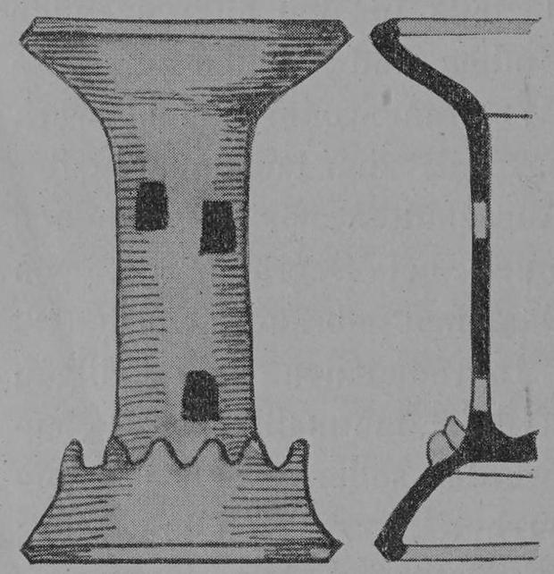

*Fig. 26. Räucherschale aus Taanek.*

[^97.279]: בֹּשֶׂם, בֶּשֶׂם, j-aram. בוסמא syr. ܒܶܣܡܳܐ, arab. بَشَام s. GES., Hwb. ראשי בסמים TMš 1,18, 87₃₂ gewiß nach Hohel 4,14 Ezech 27,22 vgl. Exod 30,23. Bh. auch זנים II Chr 16,14, welches gedeutet wird בשמים וזנים ··· שכל המריח בהם בא לידי זימה bBḳ 16ᵇ.
[^97.280]: bKethub 67ᵃ בשמים של אנטוכיא Spezereien aus Antiochia werden wie Geld (כספים) beurteilt; wahrscheinlich sind es Spezereien, die auf dem Wege des Handels nach Antiochia kamen. Zum Handel s. MOVERS, Phön. 2,3,1, 226—232; STARK, Gaza S. 563; M. HARTMANN, Der islam. Orient, Lpz. 1909, S. 419 (Übersetzung des Stückes Eratosthenes bei Strabo 16,4, 4). MORDTMANN in ZDMG 44,185f., SPRENGER ib. 44,503f.
[^97.281]: Vgl. MARQ., Pl.² 785; FRIEDLAENDER, Sitteng.⁷ 2,192f., besonders auch von der Sitte der Araber, an Empfangstagen Gefäße mit stark duftendem Inhalt (meist Moschus) oder Rauchpfannen mit Aloeholz bereitzuhalten, vor und nach dem Speisen die Kleider und den Körper über denselben parfümiert werden zu lassen. Oft bei den Rabbinen מוגמר (von גומרא, Kohle), z. B. Bar bSabb 18ᵃ מניחין המוגמר תחת הכלים ומתגמרין והולכין כל השבת, T 1,23 נותנין מוגמר על גבי גחלים ערב שבת כו׳. bBeza 22ᵇ להריח opp. לגמר. Ib. 23ᵃ סחופי כסא אשיראי Seidenzeuge mittels umgestülpten (mit Wohlgerüchen gefüllten) Bechers zu imprägnieren. bBerakh 53ᵃ unten לגמר בו את הכלים. Aus dem Kleide strömt Duft heraus: סחט גלימא ריחא bBm 144ᵇ (S. 132). Vgl. das Gafal-Holz der Araber. — Zum Ausschütten vor angesehenen Personen s. A. BÜCHLER, Das Ausgießen von Wein und Öl als Ehrung bei den Juden, MGWJ 1905, 49,12—40. Bei Hochzeiten (Bd. II, S. 38) TSabb 7,16, 118₂₇, Semach 8; gewöhnlich זלף, aber auch רבץ (Pesiḳta R 37 p. 163ᵃ). Bei Leichenbestattungen (Könige in der Bibel, Akylas, auch Private) s. § 128. — Räuchern (עָשַׁן) zur Austreibung von Dämonen von Heiden geübt: Pesiḳta 40ᵇ מביאין עיקרין ומעשנין תחתיו ומרביצין עליו מים. Ins Opferfeuer gaben die hellenischen Ägypter, des Wohlgeruchs wegen, Zypressen- oder Opobalsamumholz, s. A. DIETERICH, Abraxas, Lpz. 1891, S. 169. Vgl. damit o. S. 84.
[^97.282]: Siehe die Übersetzungen und Kommentare (Raši, Ibn Ezra, besonders Nachmani, von den Neueren KNOBEL und DILLMANN) zu Exod 30,23 bis 25; WINER s. v. *Salbe*, BENZ., Arch.² 86, NOWACK 2,123. Rabbinische Auslegungen 1. מר דרור Trg O מורא דכיא s. A. 265. 2. I. LÖW, Pfl. No. 292 קנמא. Wuchs in Palästina und wurde von Ziegen gefressen s. § 143. 3. Trg O קני בוסמא. Offenbar = κάλαμος Diosk. 1,17; *calamus odoratus* vom Libanon: Plin. H. N. 12,104 (MARQ., Pl.² 784). 4. קציעה Ps 45,9; קדה auch Ezech 17,19. קידה לבנה MKil 1,8 ist ein Baum, I. LÖW, Pfl. S. 349; nach bʿErub 34ᵇ קידה Krautart, verschieden von לבונה. Zu Hiob 42,14 s. bBb 16ᵇ.
[^97.283]: Siehe zu Exod 30,34 die Übersetzungen und Kommentare (wie in A. 282); WINER s. v. *Räuchern*, BENZ.² 378, NOWACK 2,248. Rabbinische Stellen bKerith 6ᵇ, jJoma 4,5, 41ᵈ; b ib. (und im Gebetbuch) אחד עשר סממנין, Josephus jedoch (B. J. 5,5, 5 § 218) ohne Spezialisierung 13 θυμιάματα; vgl. Philo, Quis rerum divin. heres c. 41. Zu קושט, auch כושת, כשרתא s. I. LÖW, Pfl. No. 305; oben S. 118.
[^97.284]: Nach I. LÖW, Pfl. S. 213 ist es gewagt, das Wort *חנון, חנונות MSabb 5,4 ms Maim. יחנונה, יחנון, b 54ᵇ, j 7ᶜ₁₀ חנונה mit arab. حَنُّون = حِنَّاء zu identifizieren. נרקים = νάρκισσος u. z. נ׳ דגננתא Blume Narziss vom Garten, opp. דדברא vom Felde, I. LÖW, Pfl. No. 202, Lwr 2,367, aus bBerakh 43ᵇ. Ib. סמלק nach Raši = Jasmin; יסמין bSabb 50ᵇ, s. I. LÖW No. 143. Ib. סיגלי in Raši סגלי = fr. *violes* Veilchen. מסטיכי = μαστίχη Mastix I. LÖW S. 70, Lwr 2,346 מוסקון, מוסכין = μόσχος Moschus jBerakh 10ᵈ₃₅, מושק semitisch bBerakh 43ᵃ, מושקין bKethub 75ᵃ RN s. Lwr 2,327, wo zur Literatur noch Ltbl. d. Orients 1849, Sp. 62.
[^97.285]: Bar bBerakh 43ᵇ; אסא s. I. LÖW, Pfl. No. 25. — מדני אסא bSabb 33ᵇ u. RN = מעדן (s. K 5,89), Agg. מדאני א׳ = Bündel Myrten.[286*] bBerakh 43ᵃᵇ.
[^97.287]: bBerakh 43ᵃ RZēra im Namen des Raba b. Jirmeja: מאימתי מברכין על הריח משתעלה תמרתו, Raši: קיטור העשן שמתמר ועולה; ib. בורא עצי בשמים und בורא מיני בשמים. Das Wort תמרה, offenbar gleich bh. *תִּימָרָה (so wird der Sing. abstrahiert in GES. Wb¹⁴ nach Norzi zu Joel 3,3) in תימרות עשן Joel 3,3; Hl 3,6 (vgl. prosaisch עמוד עשן Richt 20,4), also vom Aufsteigen des Rauches. תמרה nur noch bChull 112ᵃ משתעלה תמרתו wenn der Dampf des Fleisches, das auf Kohlen brät, aufsteigt; nach dem Lehrer Rašis: wenn der Dampf von den **Kohlen** aufsteigt, indem nämlich von der auf die Kohlen träufelnden Fettigkeit Dampf ausgelöst wird; s. L 4,653, der auf den Satz כתמור דקה מן הדקה im Rituale des Morgengebetes des Versöhnungstages verweist. Auch bJoma 28ᵇ תימור של חמה und תימור של לבנה wird nicht das bloße Aufsteigen des Mondes resp. der Sonne besagen wollen, sondern ist der Ausdruck gewählt im Hinblick des bei ihrem Aufgang sich auflösenden Nebels. Dasselbe gilt von dem Verb מתמר ועולה jJoma 3,40ᵇ₃₀. Aramäisch heißt der Nebel קטרא, L Trg Wb 2,356. Darum das Bild ענן הקטרת Lev 16,13; Ezech 8,11. Arab. قَتَرَ duften, rauchen s. GES. s. v. קטר I. Ausdrücklich קטרת so erklärt bKerith 6ᵇ דבר שקוטר ועולה; auch in profaner Beziehung אקטרתא bTaʿan 24ᵇ, wo ersichtlich, daß es starken Rauch entwickelt, und es mußte nicht gerade ein wohlriechendes teueres Kraut sein. In תמרה wirkt der ursprüngliche Begriff „palmartig aufsteigender Dampf“ nicht mehr nach, denn im h. Räucherwerk, obzwar von den feinsten Spezereien bereitet, vgl. קטרת סמים Trg קטרת בוסמין, mußte die gerade Rauchsäule durch ein eigenes Kraut, מעלה עשן II A. 132, erst gesichert werden. Bezüglich גִּמֵּר, מוגמר s. A. 281.

## § 98

**98.** **Schminken.** Die Sitte des Schminkens war von jeher und ist heute noch im ganzen Orient verbreitet und kam von daher auch in das griechische und römische Abendland. Eine gelblichrote Schminke, welche die morgenländischen Frauen aus der Zyperblume gewinnen und besonders auf die Nägel und Spitzen der Finger und Füße streichen, kommt nur in Sap. Salom. 13, 14 vor[^98.288], aber die Augenschminke, פוך, eine Mischung aus gebranntem oder gepulvertem Bleiglanz (Stibium, Antimonium), das beliebte *koḥl* der Araber, wird in Bibel und Talmud in gleicher Weise erwähnt und war gewiß ein beliebtes Mittel[^98.289]. Die Bibel enthält nur das Tätigkeitswort כָּחַל „die Augen schminken“; aber in den rabbinischen Quellen wird auch die Materie כּוֹחַל (כחל, aram. כוחלא) „Augenschminke“ oft genannt[^98.290]. Neben dieser offenbar schwarzen Schminke (vgl. lat. *fuligo*, eigentlich *Ruß*), wobei zu bemerken, daß es Gelegenheiten gab, da das Gesicht mit Ruß geschwärzt wurde (פִּחֵם)[^98.291], gab es eine hellrote (סרק)[^98.292] und eine purpurfarbene oder violette (פיקס = φῦκος, Verb פקס)[^98.293] Schminke, jene aus Mennig (Minium), diese aus Meertang bereitet, und vielleicht auch eine weiße Schminke aus Kreide oder Bleiweiß (*cerussa*)[^98.294]. Eine sechste Art Schminke, die vielleicht von all den früheren verschieden, vielleicht jedoch mit dem violetten *fucus* identisch ist, gab Gelegenheit zu demjenigen Haar- und Hautfärben, daß in unseren Quellen פרכום (von Verb פרכס) genannt wird und die geschminkte Person insbesondere jünger erscheinen ließ[^98.295]. Das Schminken gehörte zu den Toilettekünsten der Frauen, und die Ehefrauen waren dies zu tun gewissermaßen schuldig, um ihren Männern zu gefallen[^98.296]; aber natürlich taten es die leichten Dirnen erst recht[^98.297], während es bei Männern, wenn auch nicht unerhört, so doch ungewöhnlich war[^98.298]. Den meisten Effekt erzielte man mit der Augenschminke (כחל), die zugleich als Mittel gegen Schwäche und Entzündung der Augen diente[^98.299]. Das Auftragen dieses Stoffes geschieht mittels eines Stiftes (מכחול) von Holz, Elfenbein oder Silber, mit dessen stumpfer Spitze (זכרות) die Schminke unter die Augenlider gebracht wird, während das obere Ende, der Griff (ראש), in einen Löffel (כף) oder sonst ein Motiv ausläuft[^98.300]. Das Auftragen, besonders durch eine zweite Person, deren Hilfe man beim Schminken oft in Anspruch nahm, war bei dem immerhin spitzen Instrument nicht ohne Gefahr für das Auge[^98.301]. Durch die Manipulation bildet sich ein schwarzer Rand um die Augenlider (καλλιβλέφαρον der Griechen), die Härchen der Augenwimper erscheinen größer, das Auge selbst tritt vergrößert hervor[^98.302]. Sehr richtig wird das Schminken als eine Art Färben (צבע) bezeichnet, sowohl was die Augenschminke als die roten Schminken anlangt[^98.303]; aber die Manipulation mit der roten Schminke (סרק) ist bei weitem einfacher: sie wird einfach über das Gesicht gestrichen (העביר)[^98.304], wie es scheint, mittels eines Tuches, das mit der Farbe imprägniert wurde, ein Verfahren, das auch טִפּוּל „Aufkleben“ hieß. Die Anwendung von Schminke gehört zu der Kategorie des Frauenputzes (תכשיטי נשים) und ist an Halbfeiertagen, unter gewissen Kautelen selbst an Vollfeiertagen, gestattet.

[^98.288]: Zyperblume κύπρος, Josephus B. J. 4,8, 3 § 469 s. A. 263. Sap. 13,14 worauf NOWACK, Arch. 1,133 verweist, lautet in Kautzsch-Bibelwerke: „Oder einem gewöhnlichen Tiere ähnelt er es (das Götzenbild, vgl. S. 233) an, indem er es mit Mennig überstreicht oder seine Haut mit Schminke rot färbt und jeden Flecken, den es hat, übertüncht.“ In dem Safranfarbstibium der nächstfolgenden A. mag sich diese Schminke bergen. Der Kyprosbaum wuchs in Ägypten, in Askalon und Zypern (Plinius H. N. 12,24), vgl. Dioskurides 1,95; SUDHOFF S. 52f., immer nur Kyprosöl, nicht Schminke (vgl. S. 237, No. 7).
[^98.289]: פוך (zu φῦκος s. H. LEWY, Sem. Frwr im Gr. S. 47) vor arab. فَكّ syr. ܦܟ zerbrechen s. GES., Hwb¹⁴. קרן הפוך Hiob 42,14 wird erklärt (bBb 16ᵇ) כוחלא רישקא RN, Agg. ככורכמא דר׳ Stibium von der Farbe des Gartensafrans, s. nächste A.
[^98.290]: Schon assyr. *guḫlu* ist wahrscheinlich Augenschminke, s. ZIMMERN KAT³ 649; Verb כחל Ezech 23,40; rabbin. Stellen s. L 2,314, besonders MSabb 8,3, (b 78ᵇ. 80ᵃ) כחול כדי לכחול עין אחת Agg., lies mit ed. Lowe כוחל, aram. כוחלא, syr. ܟܘܚܠܐ, arab. كُحْل. TMiḳw 6,9, 658₂₄ הכוחל שבעין. Die Art der Bereitung ist angedeutet in bGitt 69ᵃ o. נשחוק תרתי מנתא כוחלא zerreiben (שחק); die Farbe (s. vorige A.), offenbar schwarz, vgl. bChull 88ᵇ השחור והכחול וניקרת פיסולי, zugleich als Pulver ersichtlich, gilt als Vergleichungspunkt für die Lunge (bChull 47ᵇ o.), für den Ysop (MNeg 14,6, bSukka 13ᵃ), für einen Stein (bḲidd 12ᵃ, bBb 4ᵃ, Exod R 38,8). Vgl. ZDMG 1851,5, 236f., ZDPV 4,62; LANE, Manners and Customs 1836,1, 14f., BENZ., Arch.² 87, NOWACK 1,133, WINER s. v. *Schminke*.
[^98.291]: פחם פנים z. B. Cant R 4,1 § 4. Vgl. חם יצא מפוחם jTaʿan 1, 64ᵈ₁₅ von der schwarzen Farbe der Mohren; mehr s. bei L 4,21.
[^98.292]: סרק vielleicht desselben Stammes mit bh. שרק in שרוקים Zech 1,8; dieses wird in GES. Hwb¹⁴ zu شُقْر = rot gestellt; s. auch FRAENKEL S. 7 A. und I. LÖW zu Lwr 2,392 s. v. סיקרא; Verbindung von סקר mit סיקרא sucht auch RIEGER, Technol. S. 24, A. 43. LAGARDE jedoch leitet bh. שרק von شرق ab: vom Aufgange der Sonne. **Färben** bedeutet aber סרק nur im Jüdischen: סוקרו בסיקרא MBekhor 9,7, bSabb 67ᵃ; TMš 5,13, 96₄, j 5,1, 55ᵈ₄₀. סרק oft mit כרכם **safranfarbig färben** zusammen, z. B. MKel 15,2; 22,9. Sehr häufig **rot schminken**, wo die Materie nur der *Mennig* und das *Syricum* sein können; so schon RN s. v. כרק 6 (K 6,145) beides סירקון = *syricum* (Plin. H. N. 35,4; 33,40), arab. זרקון = زرقون (eine der vielen Formen von *syricum*, s. Fl zu L 3,727), unter Vergleich mit ששר (Jer 22,14, Ezech 23,14, vgl. hier I A. 722, doch wird dieses neuestens in GES. Hwb¹⁴ nur mit „rote Paste“ übersetzt), it. *minio* = Mennig. Vgl. schon Hai zu Kel 15,2 (zu arab. טטפר s. K 6,145). Auch syr. ܣܪܝܩܘܢ = Mennig PSm 2621 BROCKELM. 240. Zusammen לא כחל ולא סרק bSanh 14ᵃ (Agg. שרק). Eine Weiterbildung ist wohl סקרתא bGitt 19ᵃ Erkl. von סיקרא; diese Stelle fehlt bei L 3,583. Raši bSabb 64ᵇ altfr. טינפאנל = שרק auf dem Gesichte. Mit סיקרא rötete man sich die Augen, Lev R 16,1. Ib. קולריא אדומה ist offenbar rote Augenschminke (= קילורין = κολλύριον).
[^98.293]: Zu פיקס = φῦκος s. A. 289, Lwr 2,452; Verb פקס ib. und besonders die Zusammenstellung mit כחל z. B. MSabb 10,6 הגודלת . . . הכוחלת . . . הפוקסת, TNedar 7,1, 282₂₁ שלא איכחול ושלא אפקים lies אפקוס. Raši zu MSabb 10,6 (b 94ᵇ) teilt eine Ansicht mit, wonach פקס (besonders in Verbindung mit גדל s. Mussafia) „Kämmen“ ist (von πέξις); s. dagegen Tosafoth und GRÜNBAUM, Ges. Aufs. z. Sprach- und Sagenkunde S. 192f. Raši bSabb 64ᵇ פקס = שרק gleichfalls Färben.
[^98.294]: Siehe in Gallus 3,164.
[^98.295]: פרכס resp. פרקס wird von L 4,116 und K 6,427 von φῦκος = פיקס abgeleitet mit eingeschaltetem R-Laut; Byz. Zschr. 10,305 wieder verfochten. J 1229 hält פרך für das Grundwort: reiben, die Haut glatt machen (was aber für das Haar nicht paßt!). Der Wortlaut läßt an περκάζω denken (Lwr 2,489) = dunkel färben, gerade vom Haar und Bart bezeugt. Darum MBm 4,12, אין מפרכסין לא את האדם ולא את הבהמה ולא את הכלים (in j-Ausgaben, auch jBm 4,9ᵈ, ms Kfm., ed. Neapel und ed. Lowe מפרקסין), wozu b 60ᵇ: Menschen färben — wie geht das? So wie jener alte Sklave, der sich Haupthaar und Bart färbte (aram. צבע), jBm 4,9ᵈ „Er soll ihm nicht sagen, färbe dich“ (ציר גרמך eigentlich forme dich). Alte Fellachenweiber färben ihr weißes Haar mit Henna rot ZDPV 3,62.
[^98.296]: Folgt aus TNedar 7,1, 282₂₁, s. A. 293. Selbst die menstruierende Frau kann sich, so lehrt RAkiba, Augen schminken und rot färben, um nicht dem Mißfallen des Mannes ausgesetzt zu sein (Sifra zu Lev 15,33 p. 79ᶜ, bSabb 64ᵇ).
[^98.297]: זונות מפרכסות זו את זו bSabb 34ᵃ. Trg Ps-Jon Gen 6,2 בנת אנשא . . . שפירן הינין וכחלן ופקסן . . . והרהירו לזנו. Siehe auch A. 302.
[^98.298]: Von den ordinierten Rabbinen wurde gelobt, daß sie sich weder Augen, noch Gesicht, noch Haar färben (so etwa verteilen sich die drei Arten Färbemittel in bKethub 17ᵃ, bSanh 14ᵃ לא כחל ולא שרק ולא פרכס), es wäre also auch bei Männern nicht unerhört; es ist das freilich ein Spruch von einem Brautzuge und in erster Reihe auf die Ausschmückung der Braut bezüglich. פרכס des Sklaven s. A. 295. Der Satz bSabb 34ᵃ (A. 297) lautet vollständig: Dirnen schminken einander, wie denn sollten nicht die Gelehrten einander schonen! Die Zusammenstellung läßt auch hier das Schminken von Männern als möglich erscheinen. Nach NIEBUHR, Beschr. v. Arab. S. 66, gebrauchen auch Männer das Kuḥl.
[^98.299]: Plin. H. N. 33,34. Darum Bar bSabb 109ᵃ פוך מעביר בת מלך ופוסק את הדמעה ומרבה שיער בעפעפים „Die Augenschminke entfernt die Königstochter (d. i. die durch ungewaschene Hände herbeigeführte Augenkrankheit), stillt die Tränen und fördert den Wuchs der Augenwimpern“. TSabb 8(9),7, 120₆ gegen ברקית (Star) und חוורואר (auch חברבר weißer Star) pinselt man (כָּחַל) mit Blut; s. auch bSabb 78ᵃ; es wurden geschüttet je drei Stifte voll in das eine und in das andere Auge: bGitt 69ᵃ. Siehe A. 301.
[^98.300]: מכחול שניטל הכף (RN מכחל) MKel 13,2; זכרותו של מכחול Cant R zu 1,3; TNidda 8,2, 649₂₅ ראש המכחול ib. auch שפופרת. כמכחול בשפופרת bSanh 68ᵃ, bBm 91ᵃ, bMakk 7ᵃ. Wenn ungebraucht, stak der Stift in einem Futteral (תיק) MKel 16,8. Erwähnt wird מכחלא דכספא ein Silberstift bBḳ 117ᵃ. Die Augenlider wurden aufgehoben (דלי ib.) und gefüllt (מלי) bGitt 69ᵃ. Das Ganze nach der Beschreibung von LANE, Manners and Customs 1,14—43, ausgezogen bei Fl zu L 1,563; zum Vergleich כמכחול בשפופרת s. BACHER, Ag. d. Tann. 1² 25.
[^98.301]: Ein Schulbeispiel: Wenn der Herr des Sklaven ein Arzt war und er ihm sagt: Gib mir Schminke ins [kranke] Auge, und er macht ihn blind, putze mir die Zähne, und er schlägt sie aus usw. Bar bḲidd 24ᵇ, Mekh RSbJ zu Exod 21,27 p. 131. Hilfspersonen auch bSabb 34ᵃ s. A. 297; ferner Bar bSabb 95ᵃ גודלת כוחלת ופוקסת לעצמה opp. לחברתה (in bezug auf Haar s. § 86), TSabb 9(10),13, 122₂₁.
[^98.302]: Folgt aus dem Wachstum des Haares der Augenlider A. 299. Von der ehebruchverdächtigen Frau heißt es: Sie hat für ihn (den Buhlen) das Auge geschminkt gehabt (כִּחֲלָה), darum treten (zur Strafe) die Augen aus (בולטות) TSota 3,3, 295₂₆. Zu καλλιβλέφαρον s. Gallus 3,165, MARQ., Pl.² 786; MARQ. zitiert aus Apul. *met.* 8,27: *oculos graphice obungere* (vgl. A. 305).
[^98.303]: כוחלת משום צובעת bSabb 95ᵃ o., ib. in bezug auf סרק; bezüglich פרכס s. A. 295.
[^98.304]: bSabb 95ᵃ אשה לא תעביר סרק על פניה מפני שצובעת s. A. 303. bMḳ 9ᵇ אלו הן תכשיטי נשים כוחלת ופוקסת ומעברת סרק על פניה. RN (bei K 8,173) liest an beiden Stellen שרק *scharak*, das er von שרק schmieren, aufkleben ableitet: Ein mit חריע (= Saflor s. § 68) gefärbtes Stück Baumwolle führt man über das Gesicht der Bräute, damit sie gerötet erscheinen (vgl. RN s. v. חריע bei K 3,498 והנשים שפין ממנו פניהם). RN fährt fort: Damit identisch ist טפול, nämlich טיפולי נשים in bMḳ 9ᵇ (bei uns steht der Ausdruck nicht), das eine Unterart von Frauentoillette (תכשיטי נשים) bildet. Dasselbe in TSabb 9(10),13, 122₂₂ „Die Frau wische nicht ihr Gesicht ab (לא תקנח ··· פניה) mit einem Tuch (בגד), woran שרק ist“. — Nun zeigt gerade dieser letztere Satz, daß שרק nicht das Tuch selbst, sondern eine Farbe sein muß, und es ist trotz der Schreibung mit ש das Wort gleich סרק zu nehmen, und wir ersehen nun, daß die Farbe auf ein Tuch aufgetragen, resp. ein Tuch mit der Farbe imprägniert war, worauf man mit demselben über das Gesicht fuhr. Vgl. מוך Werg am Schminkenstift in TNidda 8,2 in A. 300. Zu dem an dieser Stelle gemeinten Gebrauch paßt die Version bMḳ 9ᵇ מעברת סרק על פניה של מטה, wonach סרק allerdings ein Lappen zu sein scheint. Auch bei Tertullian, *de cult. fem.* 1,2 (*medicamenta ex fuco, quibus lanae colorantur*) ist *lana* = Wolle überliefert, doch möchte MARQ., Pl.² 788 A. 5 *malae* lesen. RCh zu bSabb 94ᵇ (in ed. Wilna auf fol. 96ᵇ) פיקסת מברועא אלנושרי ובלשון ערבית הגער אל אצדג.

## § 99

**99.** **Sonstige Mittel.** Zur Hautpflege gehört auch die Entfernung der Haare, welche zunächst von Frauen, aber auch von geckenhaften Männern erstrebt wurde[^99.305]. Vornehmlich auf diese Art Körperflege wurde das biblische Verbot bezogen, daß sich der Mann nicht „herrichte“ (תקן), wie sich Frauen herzurichten pflegen; doch fällt auch das Kräuseln des Kopfhaares, das Parfümieren und zu oberst die ganze weibische Kleidertracht unter denselben Gesichtspunkt. „Es dient einem Gelehrten nicht zum Ruhme, parfümiert (מְבֻשָּׂם) auszugehen“[^99.306]. Es ist dabei an die jüdische Sittenreinheit gegenüber der Päderastie des Altertums zu denken; die Lustbuben erkannte man schon von weitem an dem frechen Gang und Blick, an dem glatten Gesicht, der weibischen Haartracht und Kleidung, an dem Parfüm und dem ganzen dirnenhaften Gebaren, wie es die Aggada zum Teile dem schönen Jüngling Joseph andichtet. Namentlich mit der Augenschminke trieben es die Frauen weit; es mußte überaus auffallend sein und entsprach völlig dem Gebaren einer ausgesprochenen Dirne, wenn bloß das eine Auge geschminkt war; mit immer steigendem Sarkasmus wird versichert, daß, wenn das eine Auge krank ist, sich die Frau das andere schminkt und unbedingt ausgeht; ja, sie schminkt das eine, verbirgt das andere, um mit dem einen Auge Männerherzen zu erobern; ja, eine an einem Auge erblindete Frau schminkt sich das andere Auge und geht aus![^99.307] Hier erwähnen wir die mit Gold plombierten und die falschen Zähne, die künstlich eingesetzten Augen und die künstlichen Füße[^99.308]. In den Mund nahm die Frau gegen üblen Geruch Pfefferkörner, Ingwer, Zimt und Mastix, die zugleich von heilender Kraft waren und fleißig gekaut (לעס) wurden, gegen Zahnschmerzen Salzkörner oder irgend ein trockenes Pulver[^99.309]. An Haarentfernungsmitteln (ψίλωθρα, Depilatorien), die besonders im Bade und auch von Mädchen noch vor der Pubertät angewendet wurden, werden genannt das Öl (oben S. 234), Myrrhe (S. 236), Haarvertilger (סולת), Kalk (סיד) und eine gewisse Erdart (אדמה), je nachdem, wie es sich die betreffende Frau leisten konnte, denn die feinen Mittel, die den Leib zugleich geschmeidig machten, waren ungleich teurer, als etwa Kalk und Erde, und letzteres war davon berüchtigt, daß es das Haar allzugründlich ausrottete[^99.310]. Im Momente des Aufstreichens (טפל) besonders an verborgenen, sehr empfindsamen Stellen des Unterleibes löste der Kalk beträchtlichen Schmerz aus, und gewiß war die Frau froh, ihn nach ein paar Tagen abschälen (קפל) bezw. ablösen (התיר), d. i. den Umschlag abnehmen zu können[^99.311]. Auch zum Scheiteln des Haares (כלכול), vielleicht um das ungefügige Haar auf der Schläfe festzuhalten, ferner zu einer Art Schminke, die אנטופי = νετώπιον hieß, die aber durchaus nur in diesem Zusammenhange erwähnt wird, wurde der Kalk gebraucht[^99.312].

[^99.305]: Plin. h. n. 26,46: *Psilothrum nos quidem in mulieribus medicamentis tractamus, verum iam et viris est in usu.* Siehe EBSTEIN, Die Medizin im NT und im Talmud S. 277. Josephus (B. J. 4,9, 10 § 561) schildert reiche Leute in Jerusalem, die sich ganz weibisch betrugen, indem sie ihr Haar streichelten, Weiberkleider anlegten, sich mit Myrrhe strichen und die Augen schminkten (ὑπογράφοντες ὀφθαλμούς), vgl. A. 302; zur Sache A. 298. Das Verbot Dt 22,5 wird neben speziellen Dingen im allgemeinen auch so gedeutet, daß sich ein Mann nicht „herrichte“ wie sich Frauen „herrichten“ (שלא יתקן איש בתיקוני אשה Bar bNazir 59ᵃ, Raši dem Sinne nach richtig: er soll nicht Augenschminke, nicht sonstige Schminke anwenden und nicht bunte Kleider (S. 145) anlegen; derselbe Begriff תקן in Trg O und Trg Ps-Jon z. St., in letzterer Stelle auch: der Mann schere sich nicht ab das Haar der Achselhöhle, der Schamstelle und des Gesichtes, um wie Frauen auszusehen, s. bNazir a. a. O. und das Responsum Šeriras und Hais in Beth-Talmud 3,64. Den Ausdruck מתקן בשערו Gen R 84,7 bezüglich Josephs s. S. 192, wo auch sein übriges Betragen.
[^99.306]: jBerakh 8,12ᵇ₁₃, b 43ᵇ. Auch nicht חפף ראש bSanh 111ᵃ.
[^99.307]: Alles in jSabb 7,3, 11ᵇ Z. 50—56.
[^99.308]: MSabb 6,5, j 8ᶜ, b 64ᵇ; vgl. BRÜLL, Trachten S. 24; A. ROSENZWEIG, Kleidung S. 122; FRIEDLAENDER, Sitteng.⁵ 3,113 (volkstümlich 7. Aufl. 2 S. 220); *dentificium* in Gallus 3,166; Augenschminke einlegen und Zähne putzen (חתר) durch einen Arzt: Bar bḲidd 24ᵇ, Mekh RSbJ zu Exod 21,27 p. 131 s. A. 301. Zu den künstlichen Füßen s. S. 183.
[^99.309]: MSabb 6,5 בפילפל ובגלגל (Var. ובגרגר) מלח וכל דבר שניתן לתוך פיה, b 65ᵃ näher erklärt: Pfeffer gegen üblen Geruch, Salz gegen דורשיני (Raši: Zahnschmerzen oder irgendein Fehler in den Zähnen; RN bei K 3,135 liest דור שיני, vgl. S. 253); ib. זנגבילא Ingwer und דרצינא (eine Zimtart, s. L 1,427 und I. LÖW, Pfl. S. 346); TSabb 12(13),8, 127₈ אין לועסין מסטיכי בשבת u. z. nahm man Mastix (s. Lwr 2,346) entweder לרפואה oder לריח הפה (ib.); ib. לא יטיף אדם סם יבש בשניו.
[^99.310]: MSabb 8,4 סיד כדי לסוד קטנה שבבנות, Raši richtig, sie schmieren sich (טפל siehe b 80ᵇ) mit Kalk, um das Haar zu entfernen (השיר siehe b 80ᵇ und oben S. 191). Dazu wird bemerkt: soviel Kalk, womit der Finger eines ganz kleinen Mädchens behandelt werden kann (b 80ᵇ, wo sich Raši gezwungen sieht, zu erklären, es sei von rot färben die Rede, was aber סוד sonst nicht ist). Ist im Obigen angenommen, daß sich auch ein minorennes Mädchen mit Depilatorien behandelt, so heißt es in b 80ᵇ weiter, daß Mädchen, die vor der Zeit Haare aufweisen und dieselben entfernen wollen, gradatim wie folgt vorgehen: Arme behandeln sich mit Kalk, Reiche mit Feinmehl, Prinzessinnen mit Myrrhenöl; dieses Myrrhenöl (vgl. Esth 2,12) ist entweder Stakte (S. 237), oder unreif ausgepreßtes Olivenöl (אנפיקנון § 179). Ib. eine Anekdote, wonach ein sorgfältig mit Depilatorien behandeltes Mädchen sehr im Werte steigt. Ib. wird angenommen, daß das Biertrinken den Haarwuchs befördere und die Töchter von Leuten, die kein Bier trinken, mit der Enthaarung keine Sorge hätten. אדמה s. MNazir 6,3 (b 42ᵃ); vgl. MARQ., Pl.² 781 A. 12, wonach die alten Ärzte gegen gewisse Pomaden, die die Haare völlig ausrotteten, auftreten mußten.
[^99.311]: M und Bar Mḳ 1,7 b 9ᵇ אשה לא תסוד מפני שניוול הוא לה, ib. ומודה . . . בסיד שיכולה לקפלו במועד שטופלתו במועד שאע"פ שמצירה היא עכשו שמחה היא לאחר זמן. In jMḳ 1,7, 80ᵈ₄₈ noch weiter ausgeführt, auch ist dort התיר = קפל gebraucht, was auf einen Umschlag, einen Verband schließen läßt.
[^99.312]: MSabb 8,4 Agg. אנדיפי resp. אונדפי, Mišna ed. Pesaro אנטיפי, ms Kfm אנטופי, ed. Neapel und ed. Lowe אנטפי l. אנטופי = νετώπιον s. Lwr 2,64. T 8,20 אנדיפי. b 80ᵇ irrig בת צדעא, doch vielleicht bloß die Stelle, an der das νετώπιον gebraucht wird, s. Bertinoro. Mittel, die Haare kraus zu machen, was etwa mit כלכול gemeint ist, kannten die Alten; s. MARQ. Pl.² 787 A. 7.

## § 100

**100.** **Bereitung und Vertrieb.**

Die Spezereien wurden zunächst fein zerstoßen (שחק vgl. § 68), wobei nach dem Grundsatze der rhythmischen Arbeit (w. u.) wiederholt der Ruf erscholl: Stoßen fein, fein stoßen[^100.313]. Im Heiligtum, wo ein größeres Quantum von Spezereien zu bearbeiten war, wurden sie in einem Mörser (מכתשת vgl. § 54), von dem Gewürzhändler in einem kleinen Stoßgefäß (מדוכה vgl. § 54) zerstoßen, u. z. entweder jede Gattung für sich, oder alle zu einer Mischung bestimmten Gattungen zusammen[^100.314]. Die regelrechte Mischung, eigentlich „Mästung“ oder „Fettmachung“ (פִּטּוּם), sowohl des Räucherwerkes als des parfümierten Öles erforderte eine eigene Kunstfertigkeit, deren Geheimnis von den Besitzern eifersüchtig gewahrt wurde, was aber nicht hinderte, in Jerusalem und gewiß auch anderwärts eine Zunft von Spezereibereitern (פַּטָּם, פַּטָּמִין) entstehen zu lassen, die bei weniger Geheimtuerei für das große Publikum arbeiteten[^100.315]. Die Spezereibereiter mußten, was Ware, Wage und Mörser anlangt, mit den feinsten Behelfen arbeiten und auch viel experimentieren, bis sie das Richtige trafen[^100.316]. Zur Bereitung des parfümierten Öls wurden die wohlriechenden Kräuter (S. 118), Wurzeln (עקרין) genannt, entweder sofort in Öl gekocht (שלק) oder vorerst in siedendem Wasser abgebrüht (ebenfalls שלק) und eine Weile darin geweicht, so daß sie aufgedunsen nichts mehr aufsaugen konnten. Dann erst wurde das Olivenöl darüber gegossen und so lange darauf gehalten, bis es den Odor (ריח) in sich zog (קלט), worauf es abgeschüttet (קִפֵּה) wurde, um in wohlverschlossenen Fläschchen verwahrt zu werden[^100.317].

Mit dem fertigen Parfüm handelte der Parfümhändler (בַּסָּם *pharmacopola*), entweder ein fahrender Kaufmann oder der Besitzer eines offenen Ladens (חנות), den er des zu erhoffenden Zuspruchs wegen am liebsten in der Gasse der feilen Dirnen errichtete. Der Parfümhändler war eben wegen dieser Beziehungen zum weiblichen Geschlechte übel beleumundet, was nicht hinderte, sein Gewerbe für sehr notwendig zu halten und den Wohlgeruch, den sein Laden ausströmte, angenehm zu finden[^100.318]. Sein Kundenkreis rekrutierte sich vornehmlich aus dem schönen Geschlechte, denn den Frauen war das Parfümieren, wie malitiös bemerkt wird, eine von der Natur auferlegte Notwendigkeit, von der sie jedoch auch des Sinnenreizes wegen, der den Parfümen innewohnt, Gebrauch machten; doch fanden sich in dem Parfümladen zuweilen auch Männer ein[^100.319].

Die Salbenmischung (bh. מרקחת) lag in biblischer Zeit in den Händen des Salbenmischers (רֹקֵחַ), desselben, der auch den Konditwein (bh. יין הרוקח, nh. קונדיטון = *[vinum] conditum*) herstellte; in rabbinischer Zeit jedoch ist beides in den Händen des Spezereibereiters (פַּטָּם) oder des Parfumeurs (בַּסָּם), deren Kollege der Spezereihändler (רוכל) war, der jedoch nur mit der fertigen Ware, hauptsächlich mit Salben und Pomaden, zu tun hatte. Diese waren in eigenen Drogerien (בית מרקחים) gleichfalls zu haben. Ein Spruch Ben Siras lautet: „Gott erschafft Spezereien (סמים) aus der Erde, mit denen der Arzt die Wunde heilt und aus denen der Drogist (רוקח) die Drogen bereitet (רקח)“[^100.320]. In den Drogerien wurden wahrscheinlich auch bereitet die verschiedenen Schönheitspflästerchen, wie אספלנית (= σπλήνιον = *splenium*), Zahnpulver (oben S. 240), eine Art Erde, die man zum Waschen der Wäsche (S. 154) und des Gesichts benutzte usw.[^100.321].

Waren die Salben, Schminken und Odeurs fertig, mußte man darauf sehen, sie in geeigneten Gefäßen derart zu verwahren, daß ihr Wohlgeruch nicht entweiche (נדף w. u.). Die Augenschminke hielt man in einem Tubus (שפופרת, גובתא) oder in einer Büchse (בית הכוחל)[^100.322]; das wohlriechende Öl hielt man in Alabaster (צלוחית S. 230), wie auch die feinen Nardensalben (S. 236), von denen es zwei Arten, das *foliatum* (פולייטון של צלוחית) und das *spicatum*[^100.323] gab; die Salben überhaupt in einem Kästchen (נרתיק = ναρθήκιον)[^100.324] und in Wandschränken (פרדיסקין)[^100.325]. Die Beschaffenheit und der Zweck all dieser Geräte ist ersichtlich aus folgenden Sprüchen: Liegt eine Alabasterflasche vom Opobalsamum hermetisch verschlossen im Winkel, so verbreitet sich kein Duft (נדף); wird sie erst hin- und hergetragen, so verbreitet sich der Duft. Eine Flasche Foliatum, liegt sie auch nur an einem schmutzigen Orte, verbreitet Duft, wie erst, wenn sie sich an einem Orte von Wohlgerüchen befindet![^100.326]. Wegen des großen Wertes der Parfümwaren wurden sie gerade so wie Gold, Silber und Perlen in eigenen Schatzkammern verwahrt[^100.327].

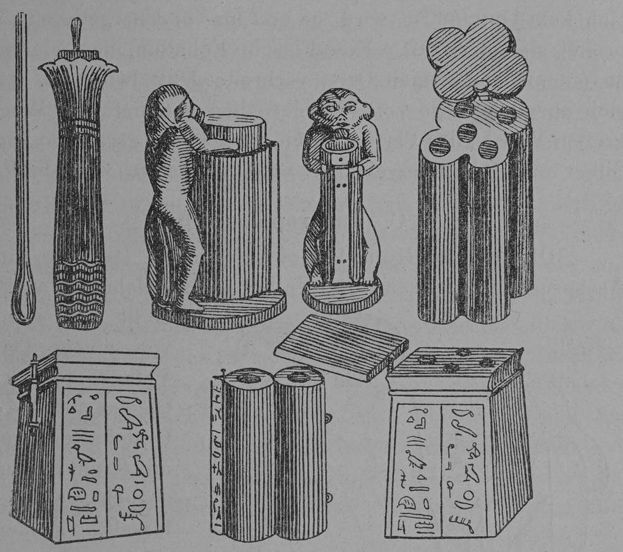

*Fig. 27. Ägyptische Schminkbüchsen.*

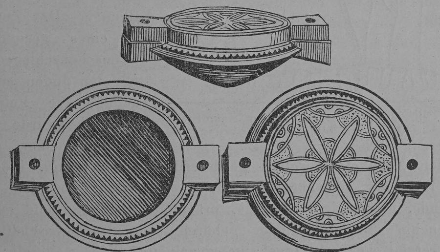

*Fig. 28. Ägyptisches Schmuckkästchen mit und ohne Deckel.*

[^100.313]: Folgt aus bKerith 6ᵇ vgl. jJoma 4,5, 41ᵈ₄₁ von dem Verfahren beim heiligen Räucherwerk; daß ein derartiger Zuruf, wie הדק היטב היטב הדק, der im Tempel von dem Aufseher an die Arbeiter erging, auch in profaner Beziehung stattfand, folgt aus dem Ausspruche RJochanans ib.: הדיבור יפה . . . לבשמים „So wie das Reden dem Wein schadet, so nützt umgekehrt das Reden den Spezereien.“
[^100.314]: מכתשת bKerith 6ᵇ jJoma 4,5, 41ᵈ₅₆. רגל מדוכה קטנה „Fuß eines kleinen Mörsers“ jSabb 8,6, 11ᶜ₉; der Zusatz של בשם will wohl sagen: „des Gewürzhändlers“ (בַּשָּׂם), doch ib. Unterschied zwischen בושם wenn eine Gattung, und zwischen בשמים, wenn mehrere Gattungen zerstoßen werden, wonach jenes בשם etwa בַּשָּׂם wäre.
[^100.315]: פיטום הקטרת bKerith 6ᵃ, jJoma 4,5, 41ᵈ₂₇, jŠeḳal 4,4, 48ᵃ₇₁. — פיטום שמן המשחה jSota 8,2, 22ᶜ₁₄. — Das Geheimnis der Zubereitung des heiligen Räucherwerks lag lange Zeit in der Hand des Hauses אבטינס d. i. Εὔθοινος (von θοινή Gastmahl s. Lwr 2,5 wo auch Belege und Literatur). Die פטמין in Jerusalem behaupteten, daß, wenn in das h. Räucherwerk etwas Honig hineingetan worden wäre, die Welt den starken Geruch nicht hätte ertragen können: Sifra zu Lev 2,11 p. 11ᵈ, jJoma 4,5, 41ᵈ₄₅. פטמין der Ölbranche jSota 8,3, 22ᶜ₄₉. MKerith 1,1 המפטם את השמן והמפטם את הקטרת. Von Öl ferner MTerum 11,1 (ib. 2 כמוני פטמים), TŠebiʿith 6,13, 69₂₃. Daß der Ausdruck auch auf Condit-Wein paßt, beweist die Aggada Cant R zu 8,2 יין הרקח זה התלמוד שמפוטם במשניות. Auch in Trg oft פיטומא.
[^100.316]: משקל Gewicht oft in dieser Verbindung, z. B. bKerith 6ᵃ. Der noch von Moses herrührende kupferne Mörser, der schadhaft geworden ist, hat nach der Reparierung die Mischung nicht mehr so fein hergestellt (לא היתה מפטמת) wie ehedem (weil er nämlich den für erforderlich gehaltenen hellen Klang, s. § 5[?], nicht mehr hatte, jŠeḳal 5,6, 55ᶜ₅₅). bKerith 5ᵃ המפטם את השמן ללמד בו.
[^100.317]: Nach dem Vorgange bei Bereitung des h. Salböls bKerith 5ᵃ u. und in jSota 8,3, 22ᶜ₁₇, wo der Zusatz כדרך שהפטמין עושין, also auch im gewöhnlichen Leben so; j übrigens statt קיפה des b, das gewiß technisch ist, העביר „herabnehmen“; auch statt הציף עליהן שמן in b hat j minder kraftvoll נותן שמן על גביהן; Raši in bKerith scheint auch שראן במים gelesen zu haben, was in unserem Texte nicht steht; vgl. bHoraj 11ᵇ (wo קופהו l. קיפהו Piʿel). Zum Ausdruck עקרין vgl. Pesiḳta 40ᵇ s. A. 281.
[^100.318]: Bar b Kidd 82ᵃ רוכלין, fahrende Gewürzhändler, offenbar einerlei mit בַּסָּם ib. 82ᵇ, von dem es heißt אי אפשי לעולם בלא בסם, ferner אשרי מי שאומנותו בסם usw. חנותו של בשם jBerakh 9,3, 13ᶜ₆₄ s. § 220. Seine Ware wickelte er in Papier ein, wie aus המוכר שטרות לבסם jŠebuʿoth 6,6, 37ᵇ₁₇ hervorgeht. Etabliert בשוק של זונות Exod R 43,7 (Gen R 91,6). bKethub 64ᵇ o. Galen nennt die μυροπῶλαι oder φαρμακοπῶλαι (aber in Rom bezeichnet *pharmacopola* den herumziehenden Quacksalber s. MARQ. Pl.² 781 f., wo auch *thurarii, unguentarii, aromatarii, pigmentarii, myrobrecharii* usw.).
[^100.319]: Gen R 17,8 מפני מה האשה צריכה להתבסם usw. die Frau hat nötig, sich zu parfümieren, weil sie aus der Rippe erschaffen wurde und Fleisch fault, wohingegen der Mann aus der Erde, und Erde fault nicht. אשה מבושמת Joma 3,41ᵃ₆₂. Von der Braut (synonym zu קשט) s. § 121, vom Gelehrten oben A. 298. Bezüglich der ברכה bBerakh kann es nur ein Mann sein, der im Parfümladen sitzt.
[^100.320]: Bh stets רקח, nie פטם, aber jenes lebt in rabbinischer Zeit nur kümmerlich fort, z. B. in Thr R Einleitung no. 5 p. 3ᵇ ed. Buber: היה גופן תוסס כהדא מרקחתא „ihr Körper siedete auf, wie eine Salbenmischung“, vgl. Jalḳ Ezech § 363. תסס in erster Reihe von gährendem Wein gebraucht (§ 184), so daß dieses Gleichnis auf Condit-Wein gehen kann. Dem steht nahe die Bereitung von Ölwein (אלונתית § 186), von dessen Bereiter es heißt, er habe die Tätigkeit eines מְרַקֵּחַ (so lies mit J 1496 statt מרקיה mit *He* in jBeza 1,9, 60ᵈ₂₁ Z. 22 מרקח, L 3,260). מרקחת Gen R 10,6 im Spruche Ben Siras. בית המרקחים Jalḳ Gen § 84. מרקחים Pirḳe RE c. 25.
[^100.321]: אספלנית Lwr 2,90; s. in Gallus 3,164; MARQ. Pl.² 788; derselbe von der lemnischen Siegelerde und einer, die sich auf Chios und in Salinus fand.
[^100.322]: שפופרת s. A. 300. גובתא דכוחלא bBerakh 81ᵇ, Trg Scheni Esth 1,2 p. 232₂₆ ed. Lagarde. An letzterer Stelle Rätsel der Königin von Saba: „Was ist ein Korn von Holz (Harz? als Stoff der Schminke), mit eisernen Schöpfeimern (מכחול oben A. 300), die Steine aufschöpfen (Anspielung auf כוחלא als Name eines Steines A. 290) und Wasser zu trinken geben“ (Verursacher von Thränen?)? Antwort Salomos: „Ein Tubus kuḥl“. Zu שפופרת und גובתא (syr. ܓܘܒܬܐ) s. § 203. גובתא דסמני Tubus von Spezereien, bBm 85ᵇ u. (L 3,547 „Rohr“). בית הכוחל MKel 16,9 ed. Lowe (Agg. בית המכחול). Vgl. קרן הפוך Hiob 42,11. — Ägyptische Schminkbüchse mit Abbildung s. MASPERO-STEINBERG, Ägyptische Kunstgeschichte S. 242, andere ib. 269. Über ein in Pompeji gefundenes elfenbeinernes und ein gläsernes Schminknäpfchen, in welchen sich noch Reste von roter und weißer Schminke befinden, s. OVERBECK Pomp.⁴ 453, in Gallus 3,165.
[^100.323]: Zu Öl s. A. 277. צלוחית של שמן המשחה Mekh zu Exod 16,33 p. 51ᵇ; vgl. bh. אסוך II Kön 4,2. צלוחית קטנה של פוליטון MSabb 8,2, ib. 6,3, MKel 30,4 und oft, s. Lwr 2,458; *foliatum* und *spicatum* s. MARQ., Pl.² 783. צלוחית של אפופלסמון s. A. 253 Alabaster s. „Badewesen“ S. 55 und MARQ., Pl.² 786. Sonst *ampulla olearia* (RICH) und *nardi ampulla* (in Gallus 3,160); Onyx (MARQ. 786). Unzweifelhaft war auch פיילי = φιάλη = Schale u. a. ein Salbenbehälter, vgl. die Ausdrücke פיילי דרוגזא und פיילי כסא דחמה (Lwr 2,444) = Giftbecher!
[^100.324]: jBerakh 5,2. 9ᵇ₆ vgl. § 232, siehe in Gallus 3,167 *narthecium* und *unguentorum scrinium.*
[^100.325]: פרדיסקין s. Lwr 2,479 und oben § 42. Besonders jBeza 2,7,61ᶜ₅₉. Vgl. zu πυργίσκος als Salbölbehälter ναΐσκιον in den Papyri (SUDHOFF S. 66), jenes also turmartiger, dieses tempelartiger Behälter.
[^100.326]: Der erste Satz in Gen R 39,2, vgl. Tanch *Lekh Lekha* 3; der zweite in bSanh 108ᵃ s. L 3,344 s. v. נדף.
[^100.327]: Folgt aus der Benennung בית נכאת Jes 39,2 = II Chr 32,27 verglichen mit נכאת (Aquila στύραξ), Tragakanthum, Gen 37,25. Darum אפרסמון in einiger Beziehung zu בית גנזיהן bSanh 109ᵃ. Bezüglich der kaiserlichen Magazine in Rom s. MARQ, Pl² 781 A. 4.

## § 101

**C. Anthropologisches.**

**101.** **Körperliche Beschaffenheit.**

Israel, so lautet ein Ausspruch, ist ein zähes (עז) Volk[^101.328]. In Anlehnung an Ps. 73,4 heißt es, wenigstens von einem Teile des Volkes, jedoch übertragbar auf das ganze, Gott habe Israel nicht mit Krankheiten heimgesucht, es nicht gefesselt, sondern es stark und gesund gemacht wie dicke Tragbalken[^101.329]. Das Zeugnis eines gesunden Menschenschlages stellt den Juden auch Tacitus, ihr Feind, aus[^101.330]. Es wurde für Erzielung einer gesunden Nachkommenschaft gewissermaßen vorgesorgt, indem die Diät der schwangeren Frau so beschaffen war, daß sie gesunde, großäugige, liebliche, prächtige, stämmige und auch angenehm duftende Kinder gebären sollte[^101.331], Eigenschaften, die vereint wohl als Ideal, im einzelnen jedoch wohl als die Merkmale des damaligen jüdischen Menschenschlages zu gelten haben.

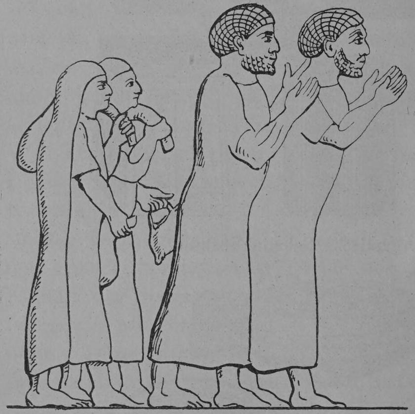

*Fig. 29. Jüdische Gefangene im Hemdrock aus bibl. Zeit.*

Wie zu allen Zeiten gab es auch damals Individuen, die mit einem sogenannten Muttermal (שומא, *naevus*) gekennzeichnet waren[^101.331a]. Einige Familien zeichneten sich durch gewisse physiologische Eigenheiten aus. In Alexandrien soll es zwei Priesterfamilien gegeben haben, von denen die eine sich durch phlegmatisches, die andere durch sanguinisches Temperament auszeichnete[^101.332]. Die Frauen gewisser Familien erhielten den Namen טרוקטי = τρυγητή = getrocknet, d. i. solche, die an Trockenheit, an Mangel der monatlichen Reinigung, litten[^101.333]. Im vornehmen Hause des Rabbi schnürten sich die Damen allzustark und hießen מעוכות, die Gepreßten[^101.334]. Dem großen Amoräer Rab wurde nachgerühmt, daß er aus gesunder Familie stammte (ממשפחת בריאים)[^101.335], d. h., daß er von außergewöhnlicher Gesundheit war; denn die normale Gesundheit war gewiß den meisten Familien eigen. Mehr noch wird die außerordentliche Schönheit sowohl männlicher als weiblicher Individuen des jüdischen Stammes gerühmt, durch die sie das Staunen anderer Völker erregten; den betreffenden Berichten, die vielleicht der Liebe zum eigenen Volke entstammen, muß einige Beweiskraft zugeschrieben werden, da sie in sehr sicherem Tone gehalten sind[^101.336]. Der Verherrlichung der Schönheit muß überhaupt etwas Tatsächliches zugrunde liegen.

Dem Anblick eines schönen menschblichen Geschöpfes, wie nicht minder anderer schönen Geschöpfe der Tier- und Pflanzenwelt, gebührte eine rituelle Lobpreisung Gottes, die auch die Schönheit und namentlich die Frauenschönheit aus dem Kreise anderer Völker neidlos zum Ausdruck brachte[^101.337]. Eine entsprechende Benediktion[^101.338] riefen anderseits die unglücklichen Geschöpfe, aber nur menschliche, nicht etwa Tiere und Pflanzen, hervor, die mit einer körperlichen Deformation (שינוי) behaftet waren, die sich entweder in der Hautfarbe oder in der Statur zeigte. Es werden genannt a) der Mohr (כושי), keineswegs ein Negerstämmling, den man in Palästina häufig genug sah, um zu wissen, daß er ein ganz normaler Mensch ist, sondern ein von weißen Eltern geborenes schwarzes Kind[^101.339]; der Rötling (גיחור)[^101.340] und der Albino (לבקן = λευκόν, auch צחור genannt)[^101.341], d. i. der an der Weißsucht (Leukopathie) Leidende; b) כיפח (קפח) der Hagere (oder der Verrenkte)[^101.342]; ננס oder ננוס = νάννος, der Zwerg[^101.343]; ברדיקנים[^101.344] dem Sinne nach der Riese, vielleicht *Britannicus*, der hochgewachsene Brite. Manche dieser Bezeichnungen, zur Unterscheidung von Individuen so tauglich, dienten auch als Eigennamen[^101.345].

Eine andere Kategorie sind die Gebrechlichen (לקוים)[^101.346], so der **Verstümmelte** (קִטֵּעַ), ein Ausdruck, der sowohl das Fehlen der Hand (speziell גִּדֵּם) als des Fußes bedeutet, wie es namentlich das Los von Sklaven gewesen zu sein scheint[^101.347], der Blinde (סומא bh. עִוֵּר) und der von bösartigem Geschwür Behaftete (מוכה שחין), deren Anblick gleichfalls eine Benediktion auslöste[^101.348]. Als Abnormitäten verdienen ferner Erwähnung der Bilfinger, d. i. der an den Händen je sechs Finger, an den Füßen je sechs Zehen (Polydaktylie) hat[^101.349], zu welchem der Stumpffingerige (גִּדֵּם) einen gewissen Gegensatz bildet[^101.350]; אִטֵּר der an der Hand oder am Fuße Gelähmte[^101.351]; חִגֵּר (παραλύτικος) der Lahme[^101.352], פִּסֵּחַ der Hinkende[^101.353] usw. Diese Gebrechlichen erregten mit Schaustellung ihres Gebrechens die öffentliche Barmherzigkeit, und es gab Fälle, in denen die Lähmung und Blindheit absichtlich beigebracht wurde, um die öffentliche Wohltätigkeit beanspruchen zu können. Besser hatten es die Zwerge, die Riesen, die Hermaphroditen und andere abnorme Personen, die zur Kurzweil mit förmlichem Wetteifer in den Höfen der römischen Großen gehalten wurden, eine Liebhaberei, die von den Rabbinen nur getadelt werden konnte[^101.354]. Nach ihrer Theorie konnte z. B. ein auch nur an einem Auge Blinder nicht als Richter fungieren[^101.355].

Eine ständige Reihe von teils geistig, teils körperlich Schwachen bilden der Taubstumme, der Närrische, der Minorenne (קטן) — diesem fehlt die Fähigkeit zu rechtsgültigen Handlungen — der geschlechtlich Impotente, der geschlechtlich Undifferenzierte und der Zwitter[^101.356]. Der Taubstumme (חרש) hat seinen Fehler, der zuweilen in derselben Familie öfters auftritt, von der Geburt an und verrät Blödsinn, so daß er vermögensrechtlich unter Vormundschaft steht, nicht aber sein Leidensgenosse, der Stumme (אלם), dem nur die Gabe des Redens fehlt[^101.357]. Der Närrische oder Schwachsinnige (שוטה) ist an gewissen typischen Taten erkennbar: er geht zur Nachtzeit allein aus, wie es das Vorgehen eines Kynanthropos ist; er bringt die Nacht auf Gräbern zu; zerfetzt seine Kleider nach Art der Koliker; wirft weg, was man ihm gibt, und gilt darum als Kardiakos, d. i. Melancholiker[^101.358], und steht nahe dem Verträumten (חָלוּם), als dessen charakteristischer Zug nur so viel feststeht, daß er nach dem Volksglauben, den aber die Rabbinen nicht teilen, den Ort von vergrabenem oder vergessenem Geld angeben kann, wohingegen das Wesen des Verschwiegenen (משותק) nicht näher angegeben wird[^101.359]. Dagegen kennen wir sehr detailliert die Merkmale des geschlechtlich Impotenten, der im Unterschiede von dem durch menschliche Hand Verschnittenen (סרים אדם), der „verschnitten“ Geborene (סרים חמה) heißt und dem beim weiblichen Geschlechte die Unfruchtbare (איילונית) entspricht[^101.360]; es wird übrigens behauptet, daß in Alexandria, wo die ärztliche Kunst des Altertums ihren Höhepunkt erreichte, der Impotente geheilt werden konnte[^101.361], wie denn auch in anderer Hinsicht die Bestimmung des Wesens von derartigen Gebrechen ausdrücklich in die Sphäre der Medizin verwiesen wird[^101.362]. Bei dem geschlechtlich Undifferenzierten (טומטום) sind die Geschlechtsteile derart von einer häutigen Hülle umgeben, daß sie erst nach deren natürlichen oder künstlichen Spaltung erkennbar werden; bei dem Zwitter (Mannweib, Hermaphrodit, אנדרוגינוס = ἀνδρόγυνος) kommen zu gleicher Zeit männliche und weibliche Genitalien vor[^101.363], Erscheinungen, die allerdings selten, immerhin aber möglich sind, hier aber wegen ihrer häufigen Erwähnung in den Quellen wenigstens in Kürze eingereiht werden mußten.

Demgegenüber fehlen auch nicht Beispiele von außerordentlicher Stärke und Größe des Körpers. Erwähnt wird die Faust (אגרוף) eines reckenhaften Mannes, die so groß war, wie ein Menschenkopf, und da waren wohl auch die anderen Gliedmaßen danach[^101.364]. Ein in jener Epoche bekannter Räuber hatte einen typisch gewordenen guten Magen, indem er seine Speisen bloß zum Drittel gekocht, fast roh aß[^101.365]. Typisch war auch die grobe Kost der *ludarii* (מאכל לודרין), d. i. der römischen Gladiatoren, in deren Reihen zuweilen auch Juden zu finden waren, die also der körperlichen Beschaffenheit zufolge sich dazu ganz gut eigneten; doch sind die Athleten (אתליטין) und Einkämpfer (מונומכין = μονομάχοι), wie jene Kraftmenschen zuweilen auch genannt werden, begreiflicherweise zumeist Griechen und Römer[^101.366]. Besonders war für den Kriegerstand ein Militärmaß (ענקמין = *incomma*) erforderlich, das durch sonstige Vorzüge, etwa wenn der Rekrut behende und leichtfüßig (מקרואלפרום * μακρο-έλαφρος), sonst aber ein Zwerg war, nicht ersetzt werden konnte[^101.367]. Von einem römischen Legionär, einem auch sonst hübschen Kerl, hören wir das überschwengliche Lob, das er mit seinem Kopfe an die Säulenkapitele von Caesarea heranragte[^101.368]. Auch in dem kriegerischen Volke der Perser, richtiger wohl der Parther, gab es Leute von ungemein hohem Wuchs, der durch die mächtigen Mützen nur noch gehoben wurde; durch ihre wie ein unterirdisches Geröll klingenden Laute und ihre fremdartigen Namen flößten diese Männer jedem Beschauer Furcht und Schrecken ein[^101.369]. Einen Mann von hohem Wuchs nennen übrigens die Rabbinen einen „schöngeformten“ Mann (אדם של צורה)[^101.370], woraus erhellt, daß hoher Wuchs zu ihrem Schönheitsideal gehörte.

[^101.328]: bBeza 25ᵇ, so übersetzt GOLDSCHMIDT, ungefähr richtig; vgl. BACHER, pal. Am. 1,371, 4 (auch „mit besonderer Lebenskraft Begabte“); EBSTEIN 126. — § 101. 102 erweitert hebr. erschienen in Ha-šiloach 21,207—216 und 354—360.
[^101.329]: Lev R 17,1 לא הרהרתים (Var. חרחרתים) בחלאים ולא צביתים בעונות אלא בריא ובריא אילם עשיתים בריאים כאולם; im Kommentar Mathnoth Kehunna letzteres nach וצבתה בטנה Num 5,27 erklärt, besser RN (s. in רד"ל), der עונות als Fäden und Fesseln erklärt (also von צבת = Zange), wonach etwa בעדנות (von bh. מעדנות) zu lesen; s. auch BACHER, Tann. 2, 44.
[^101.330]: Tacitus, Hist. 5,6: *corpora hominum salubria et ferentia laborum.*
[^101.331]: bKethub 61ᵃ בני ברוי בני עינני בני חינני בני זיותני בני בישרני בני ריחני, s. Raši, letzteres wohl an ריח בני Gen 27,27 anzulehnen. Eine kräftige Widerlegung des *Foetor judaicus*, s. JE.
[^101.331a]: Von einer Frau: jNidda 3,1, 50ᶜ₃₂ שומא יש לה מבפנים, T 4,4, 644₂₁ שומא יש במעיה, u. z. nach beiden Stellen Aussage der Ärzte. Vgl. bBm 27ᵇ ein שומא, das nicht veränderlich ist. L 4,521; J. PREUSS in Deutsche Zschr. für Chirurgie, 59,516.
[^101.332]: Cant R zu 4,5 מקרית und מרתחת; im Verfolge wird gesagt, daß die Ärzte Milch von ihnen (von ihren Frauen?) nahmen zur Bereitung von Theriak. Man muß gestehen, daß das wenig Sinn hat. Es liegt die sichere Spur der LA חנינים = Schlangen (statt כהנים) vor, wobei jedoch משפחה = Familie nicht gut paßt.
[^101.333]: MNidda 9,11 Var. bei RN und ms Kfm טרוקטי, ed. Lowe טרקוטי, Agg. דורקטי; andere Stellen s. in Lwr 2,270.
[^101.334]: bJebam 44ᵇ. Vgl. שמה מעכו שדיהן Ezech 23,3. Vom Drücken der Brüste auch bKethub 36ᵇ מפני שמיעך לה בין דדיה. Tatsächlich kommt מעך = מחך vom Drucke vor, den der Brusthälter, das Mieder, ausübt. REleazar [ben Pedath] deutet (bSabb 64ᵃ) עגיל auf Brusthälter, כומז auf Bauchhälter (III A. 630), und es wird dabei bemerkt, daß כומז im Trg [Onkelos] מחוך heiße; in Trg Ps-Jon כומז umschrieben: מעוביא (מחוכייא) מן בית תדיהון, so daß מעך vom Gepreßtsein der Brüste sicher ist. Gerade im vornehmen Hause Rabbis ist die Nachahmung dieser unsinnigen orientalischen Mode begreiflich. L 3,190 versteht den Ausdruck מועכות nach bJeban 44ᵇ תמר באצבע מיעכה von dem Drücken der Scham. Zur Sache vgl. den Mythos vieler Völker, wonach die Berührung mit dem Finger zeugungskräftig ist, wovon mehrere Beispiele bei O. WEINREICH, Antike Heilungswunder, Gießen 1909, S. 21f.
[^101.335]: bChull 84ᵃ.
[^101.336]: Legende vom Sohne und der Tochter des Priesters Ismael b. Eliša (bGitt 58ᵃ); eine andere Priestertochter zog aller Blicke auf sich (שהכל צופין ביפיה ib.). Die Jünglinge Israels erschienen den Chaldäerinnen ungemein schön und „beschämten die Sonne mit ihrer Schönheit“ (bSanh 92ᵇ). Von den Bewohnern Baris heißt es, daß sie schöner waren als andere Palästinenser (Pesiḳta R c. 28 p. 135ᵇ; s. dazu MGWJ 41,556f.). RJochanan war ein Rest der Schönen Jerusalems (שפירי ירושלים) und setzte sich an den Eingang des Badehauses, damit die dort badenden Frauen eben solch schöne Leibesfrucht konzipieren (bBm 84ᵃ).
[^101.337]: jBerakh 9,2, 13ᵇᶜ, jAz 1,9, 40ᵃᵇ, bAz 20ᵃ. Nach jAz sah RGamliel (b: RSimeon b. G.) die schöne Heidin, bei deren Anblick er die Benediktion verrichtete, auf dem Tempelberge; nach b auf dem Abhange des Tempelberges; doch sprach er nach b nur das Psalmwort מה רבו מעשיך ד׳, was eine bewußte Abschwächung der Huldigung darstellt.
[^101.338]: Bar bBerakh 58ᵇ, j 9,2, 13ᵇ, T 7(6),3 p. 15₄; vgl. Sifra zu Lev 21,21 p. 96ᶜᵈ.
[^101.339]: Vgl. den Verweser der Königin Kandake in Apostelg. 8,27; auch im Talmud כושי = Äthiope so häufig, daß dieser Menschenschlag nicht als „Veränderung“ angesehen werden konnte. Vielmehr ein etwa infolge von „Versehen“ (§ 109) geborenes schwarzes Kind weißer Eltern. Doch ruft auch Plinius (H. N. 7,1) aus: „Denn wer hat wohl an die Äthiopier geglaubt, bevor er sie gesehen?“
[^101.340]: גיחור bBerakh 58ᵇ Raši richtig אדום הרבה, altfr. *rouge*; zu לווקן wieder: לבן יותר מדאי, und so soll es, wie bereits am Margo angemerkt wird, auch in Raši zu bBerakhoth 31ᵇ lauten; in bBekhor 45ᵇ wird das Wort richtig in der Gemara selbst als סומקא = rot erklärt; s. auch RN = RG = אדום ביותר. Die Bewohner von Machuza zeugten solche Rötlinge, weil sie den Coitus bei Tage ausübten, bBerakh 59ᵇ. Etymologisch ist גיחור nicht genügend erklärt worden; K 2,271 bringt ein baktrisches Wort bei!
[^101.341]: לווקן oder לבקן s. Lwr 2,304; opp. zu גיחור sonst auch צוחר bBerakh 31ᵇ. Auch albinos, Weißsüchtige genannt; in der Medizin heißt die Krankheit Leukopathie.
[^101.342]: j a. a. O. כיפח, T ed. Z. כיפה, alte Agg. קפח, b קפח, Sifra mehreremal קיפח (RAbD כפח = גבה), nach Rašis 1. Erkl. קומתו מקופחת „mit abgehauener Statur“, gleichkommend dem, was in RN im Namen „Einiger“ gesagt wird: אריך וגחון, כלומר כיפח כפוף „der gekrümmte Hagere, indem כיפח soviel wie „gebogen“ bedeutet; nach Rašis 2. Erkl. „der allzu Lange, mit langgestrecktem häßlichem Gesicht“, gleichkommend den Worten in RN: „der hagere Lange, mit hervorstehendem Gesicht, widerwärtig (כנוי = שנוי) anzusehen“, vorher schon בעל קומה der Hochgewachsene, wozu K (2,224) samar. גבה = Riese beibringt. [ZA 23,279. I. Löw.]
[^101.343]: Lwr 2,364. Trg Ps-Jon ננים für דק Lev 21,1. Sowohl Nebukadnezar als der Pharao des Exodus werden in der Aggada als Zwerge hingestellt, s. J. PERLES, Beitr. zur rabb. Sprach- und Altertumskunde (SA aus MGWJ 37) S. 27.
[^101.344]: ברדניקוס liest RN, Agg. הדרניקוס, fehlt in j und T ed. Z., wohl aber T alte Agg. Erklärungsversuche s. in Lwr 2,222; RN dem Sinne nach richtig im Namen eines Gaon: ein allzu hoch gewachsener Mann.
[^101.345]: Bekannt ist בן ננס [ר׳ שמעון]; vgl. auch ר׳ אבא סמוקה jBerakh 9,1, 13ᵃ₂₄. Dem entspricht der röm. Eigenname **Rufus**, auch Lehnwort (Lwr 2,577. 578) רופוס und רופינא. Ein Sohn des Bar-Kochba soll רופוש geheißen haben, in Juchasin ed. London p. 83ᵃ erklärt: אדמוני; s. dazu in Ha-šiloach 10,35—41.
[^101.346]: Zu לקה s. L 2,524, besonders שערו לקוי dessen Haar gelitten hat: MNeg 10,1, Sifra zu Lev 13,30 p. 65ᶜ, bJebam 80ᵃᵇ.
[^101.347]: קיטע באחת מידיו jKethub 7,10, 31ᵈ₂₄; auf dem Fuße amputiert folgt aus קב הקיטע oben S. 183. עבדים קטעין jBḳ 8,5, 6ᶜ₂. Von einer Frau קטעת bBḳ 78ᵇ. Siehe auch J. PREUSS in Deutsche Zschr. für Chirurgie, 59,529. Tanchum Jeruš. (Bacher S. 90) vergleicht קטע mit arab. אקטע.
[^101.348]: Stellen wie in A. 338; die Benediktion ist ברוך דיין האמת, jedoch nur, wenn integer geboren, sie nachher verstümmelt wurden, aber so geboren, ist die Benediktion auch hier משנה את הבריות (jBerakh 9,2, 13ᵇ₇₄), wie in der vorigen Gruppe.
[^101.349]: Nach II Sam 21,10 erwähnt in TBekhor 5,6, 540₅, ein besonderer Name war hierfür nicht geprägt. Die Abnormität erwähnt auch Plinius 11,99. Vgl. I. LÖW in Kaufmann-Gedenkbuch, deutsch. Teil, S. 71.
[^101.350]: גִּדֵּם oft, s. L 1,303. גידם משתי ידיו bTaʿan 21ᵃ. גידם אצבעים Cant R zu 8,11. גידמים bSanh 45ᵇ, j 8,5, 27ᵇ₂₇. גידמת jJebam 12 g. E. 13ᵃ₁₄, vgl. אשה גידמת bSabb 53ᵇ.
[^101.351]: TBekhor 5,8, 540₈ איטר בין בידיו בין ברגליו. bSabb 103ᵃ איטר יד, bMenach 37ᵃ אטר; s. L 1,60. In der Bibel nur אטר יד ימינו Ri 3,15; 20,16.
[^101.352]: חגר, חגרת s. L 2,14.
[^101.353]: פסח fehlt bei L u. K, s. jedoch J 1193. In Sifra zu Lev 21,18 p. 95ᵇ sieht man, daß פסח = חגר; es heißt dort: פסח ist der Lahme (חגר) sowohl an zwei als an einem Fuße (n); ib. wenn der Fuß hohl (חלולה) ist, oder krumm (עקומה), daß er wie eine Sichel aussieht. פסח ועור werden in Sifre Dt 126 p. 100ᵇ als Typus von sichtbarem und unheilbarem Gebrechen aufgeführt.
[^101.354]: MPeʾa 8,9; die Absichtlichkeit tritt besser hervor in T 4,14, 24₅ המסמא את עינו והמצבה את כריסו והמקפה את שוקיו; letzteres ist mit קפח oben zusammenzuhalten. FRIEDLAENDER, Sittengeschichte⁷ 2,231; Lwr 1,318.
[^101.355]: TNeg 1,7, 618₂₁ etwas weitgehender als MNeg 2,3. Siehe dazu J. PREUSS, Das Auge usw., im Kapitel „Der Blinde im Recht“, in Wiener mediz. Wochenschrift 1897, Sp. 39.
[^101.356]: MZab 2,1 (in T 2,2 nur die letzten zwei erwähnt, in TTerumoth Ende p. 44 חרש שוטה וקטן טומטום ואנדרוגינוס, vgl. den Abschnitt „Androgynos“ als Anhang zu MBikkurim und TBikk 2,3—7 p. 101). Plinius H. N. 7,2 kennt nach älteren Autoren die Androgynen als eigenes Volk in Afrika. Ib. 3 hält er sie für identisch mit Hermaphroditen, die ehemals für Wunder gehalten wurden, jetzt aber zum Vergnügen dienten.
[^101.357]: TTerum 1,1, 25₁₅: חרש מתחילתו; ib. Söhne des RJoch. b. Gudgada; ib. אפיטרופוס; ib. אלם. Auch nach Plinius 10,88 gibt es keinen Taubgeborenen, der nicht auch stumm wäre.
[^101.358]: TTerum 1,3, 25₁₇ s. j 1,1, 40ᵇ, wo die einzelnen Züge als diejenigen des קונטרופוס, כוליקוס, קורדייקוס bezeichnet werden (s. Lwr): κυνάνθρωπος, χολικός, καρδιακός.
[^101.359]: פעמים שוטה פעמים חלום TTerum 1,3, 25₁₈, vgl. איש החלום TMš 5,9, 95₂₅, bSanh 30ᵃ, bHoraj 13ᵇ, wo gegenüber dem Volksglauben die Rabbinen behaupten: דברי חלומות לא מעלין ולא מורידין. In TMš 5,8, 95₂₂ auch משותק.
[^101.360]: Details s. in bJebam 80ᵃᵇ, j 8,9ᵈ, T 10,252. — Zu איילונית s. bKethub 11ᵃ, MNidda 5,9, T 6,2, 647, b 47ᵇ, jJebam 1,2ᶜ, b 119ᵃ, jKethub 1,25ᶜ, b 11ᵃ, T 1,3, 260. Nach Dt R 3,6 ist אילונית = bh. עקרה. Das Wort hat mit ὑλέην LÖW La 396 N. 5 nichts zu schaffen.
[^101.361]: RElieser in Bar bJebam 80ᵃ יש במינם שמתרפאין באלכסנדריא; ein anderer behauptet zwar, es sei unheilbar (לעולם לא הדר ביה), aber der hat wohl nur pal. Verhältnisse vor Augen.
[^101.362]: Es gibt nämlich, wie es scheint, eine andere, aus der Synode von Jabne herrührende Definition von כרים חמה, u. z. = מי שאין לו אלא ביצה אחת usw., s. Sifre Dt 247 p. 119ᵇ mit der Schlußbemerkung זו מהלכות רופאים, nach J. PREUSS, Die männlichen Genitalien und ihre Krankheiten nach Bibel und Talmud S. 10 (SA aus „Wiener Mediz. Wochenschrift“ 1898) etwa ein Zitat; vgl. jJebam 8,1, 9ᵃ, b 75ᵃ (wo aber das Zeugnis aus Jabne abgeschwächt wird). Eine wiederum verschiedene Definition von כרים חמה ergibt RNs Bemerkung מי שנסתרס על ידי קדחת. Mehr s. bei PREUSS a. a. O. S. 10 f., wo für כרים חמה die ansprechende Vermutung, dies sei dem ägyptischen „Verschnitten durch Ammon-Ra“ nachgebildet.
[^101.363]: Siehe BERGEL, Medizin der Talmudisten S. 71; EBSTEIN S. 219.
[^101.364]: MKel 17,12 אגריפו של בן בטיח groß wie ein Menschen- resp. wie ein Widder-(?)Kopf (T bm 7,2, 586₄, dort auch Demonstrationen dieses Maßes an der Hand), s. bBekhor 37ᵇ. Ben-Batiach ist nach Rapoport (E. M. S. 257ᵇ) identisch mit dem von Josephus erwähnten Räuberhauptmann Athronges — eine wenig wahrscheinliche Annahme. RN dem Sinne nach richtig: „Er war ein starker Mann.“
[^101.365]: מאכל בן דרוסאי s. Stellen in Lwr 2,217.
[^101.366]: מאכל לודיות TBeza 1,23 (fehlt in ms Erf. und also ed. Z. p. 203), Parallelst. נדיות (s. Sokolow-Festschrift, hebr., S. 492 und o. II A. 238, wo „Lydierinnen“ vermutet wurde), doch hat nur לודיות einen Sinn, u. zw. als Abstraktum: „Speise im Gladiatorentum“, wie opp. עכסיות „Speise im rohen Zustande“. Zu den לודים gehörte bekanntlich auch Reš Lakiš. Zur Sache s. SACHS, Beitr. 1,121; JASTROW REJ 17,308; Lwr 2,308; GRAETZ, Gesch. 4,3. Aufl., 240; mein Artikel *gladiator* in JE.
[^101.367]: Folgt aus Gen R 65,11; ענקמון und מקרואלפרים s. in Lwr s. v.
[^101.368]: Tanch Vajēšeb 3; s. BACHER, Ag. d. Tann., 2,528.
[^101.369]: bGitt 14ᵇ: „Jene Leute — sie sind eine Elle hoch (Raši = אנשי מדות גבוהין בקומה) und ihre Mützen (כובען) sind eine Elle hoch, und sie reden von der Körpermitte aus (ומדברין מהצייהן nach Raši soviel, daß ihre gewaltige Stimme vom Nabel auszugehen schien; dahin zu ergänzen, daß sie wohl wie die Stimme eines Totenbeschwörers vom Bauche zu erklingen schien, nach Jes 29,4; anders RN, der übrigens מהציין liest: die Stimme geht von der Mitte des Körpers aus, weil nämlich von der Spitze der Mütze bis zum Munde 1 Elle, wie von dort bis zu den Füßen (דבר 2), womit aber das Schreckliche nicht gut motiviert erscheint); auch haben sie schreckliche Namen (es werden deren einige angeführt); sprechen sie: bindet! so bindet man; tötet! so tötet man“. Vgl. jGitt 1,39ᵈ, jKidd 3,64ᵃ (wo aber ראיתי אותן בית דין שוה unverständlich).
[^101.370]: אדם של צורה bTaʿan 16ᵃ nach Ps-Raši = בעל קומה, doch erfordert die Stelle eher den Sinn des sittlich angesehenen Mannes, und אנשים של צורה bMḳ 9ᵃ werden von Raši tatsächlich als חכמים erklärt, sicher aber geht die Metapher auf den sinnlichen Eindruck zurück. In jŠebiʿith 8,11, 38ᵇ₇₃ ist אדם של צורה, wie es scheint, gleich מתחשב in Mišna ib., also der angesehene Mann, s. ZUCKERMANDEL, Tos. Mischn. und Bor., 1,299 und o. A. 165.

## § 102

**102.** **Schönheitsideal.**

Die Schönheit des menschlichen Körpers besteht nach den Rabbinen ausser in dem hohen Wuchs noch in der Stärke, in schönem Kopfhaar und Bart, in schönen Augen und einer schönen Nase, nebst einer Anzahl anderer Erfordernisse, die zusammen das rabbinische Schönheitsideal ergeben. An oberster Stelle steht, wie gesagt, die hohe **Statur** (קומה), die z. B. als Bedingung hingestellt wird, dem Synedrion angehören zu können[^102.371], im Sinne des Ausspruches, daß der göttliche Abglanz nur ruhe auf einem weisen, starken, reichen und hochgewachsenen Manne[^102.372], ein physischer Vorzug, der neben dem geistigen um so bedeutsamer hervortritt. In der Aggada wird behauptet, daß die ersten erschaffenen Wesen alle in vollendeter Statur, Vernunft und Schöne (צביון) aus des Schöpfers Hand hervorgingen, und namentlich Adam und Eva seien etwa zwanzigjährig in die Welt getreten, ein Alter, das den Alten wohl als die Blüte (אקמי = ἀκμή) des Lebens galt[^102.373]. Bei Juden und Römern herrschte die Theorie, daß das Menschengeschlecht von Generation zu Generation an Wuchs und Schönheit abnehme, doch scheint es, daß sich die Juden immer noch höher gewachsen wußten als z. B. im Durchschnitt die Perser[^102.374]. Aus vielen besonders halachischen Angaben erhellt, daß als normale Statur eines Menschen bis zu den Schultern die Höhe von 3, bis zum Scheitel die Höhe von 4 Ellen (etwa 1.76 m) angenommen wurde[^102.375]. Zur Vollkommenheit gehörte ferner, wie bereits bemerkt, die **Stärke** (גבורה); auch darin zeichneten sich die Juden aus und wurden selbst von den fremden Völkern als stark (גבורים) bezeichnet, wie denn einige Männer des Gelehrtenstandes auch wegen ihrer Körperkraft gerühmt werden[^102.376]. Schöne Männer mit Lockenhaar (קְוֻצִּים) wurden unter den Juden nicht selten gefunden[^102.377]. Reichliches, wohlgepflegtes Haar bildet den Schmuck des schönen Jünglings; der Bart ist der Schmuck des Mannes[^102.378]. Den Juden der talmudischen Zeit können wir uns nur schwarzhaarig denken, wie übrigens in dem Ausdrucke תִּשְׁחֹרֶת d. i. „Schwärze des Haares“ = Jugend klar niedergelegt ist[^102.379]. Nur bei Frauen wird hier und da Blondheit begegnet sein, und die seltene Erscheinung wurde gewiß als außerordentliche Schönheit gepriesen[^102.380]. Die Juden standen der Hautfarbe nach in der Mitte zwischen Äthiopen und Germanen, zwischen schwarz und weiß, wie ausdrücklich berichtet wird[^102.381].

**Schöne Augen** werden immer vorausgesetzt, wenn der Gesamteindruck schön sein soll[^102.382], und, wie es scheint, auch große Augen, welche bekanntlich auch die Griechen schön fanden[^102.383]. Schlitzaugen sind damit so gut wie ausgeschlossen. Die Augenform חרוטות, etwa elliptisch rund, wie sie z. B. die Palmyrener hatten, wurde für häßlich gehalten[^102.384]. **Schöne Zähne** gehörten gleichfalls zum Schönheitsideal, und deshalb wurde den Zähnen die nötige Pflege zuteil[^102.385]. Die Schönheit der Nase (חוטם) erscheint als Forderung in der Schilderung eines vornehmen Jünglings, der hohe Statur, schöne Zähne, schwarzes Haar und eine schöne Nase hatte[^102.386]. Außerdem gibt es natürlich eine ganze Anzahl von Forderungen, ohne deren Erfüllung besonders die Schönheit der Frau nicht vollkommen wäre, z. B. der schöne Kopf, im Gegensatz zum länglichen (סגלגל); schöne Ohren, die sich nicht überschlagen (כפולות) sollen, ebenso wie die Nase nicht eingedrückt (בלום) sein darf; schön geschnittene Lippen und keine schwulstigen (עבות); sie muß einen schönen Hals besitzen und keinen gedrängt kurzen (שקוט); der Bauch darf nicht angeschwollen (צבה) sein, die Füße nicht platt wie die einer Gans, und selbst der Name ist von Bedeutung[^102.387], wie denn in der Tat in dem lieblich klingenden Frauennamen ein unendlicher Reiz liegen kann, wie nicht minder in der Stimme und in dem Blick[^102.388], nicht zu vergessen der Anmut des Ganges, des Essens, des Trinkens, der Kleidung, des Schmuckes und all der unzähligen Sachen, die von jeher die Sorge der Frauen bildeten. An Leibesfehlern, die den Priester untauglich machen zum Dienste, werden auf Grund talmudischer Äußerungen nicht weniger als 147 aufgezählt[^102.389]. Von dem Häßlichen sagte man schon damals, er sehe wie ein Affe aus[^102.390].

Die menschlichen Individuen erreichen natürlich das Ideal nicht, vielmehr besteht die Wirklichkeit aus Menschen, die nach allen Richtungen ein gesundes Durchschnittsmaß zeigen. Dieser „mittlere“ Mensch (אדם בינוני) ist die Grundlage der Betrachtungen der Rabbinen. Die Mutter wünscht, ihr Sohn möge ein „Mensch unter Menschen“ sein; er sei kein Recke (ארוך), kein Knirps (גוץ), nicht zu klein, nicht stumm, nicht schimmernd weiß (צחור), aber auch nicht brennend rot (גיחור o. S. 245), nicht weise, nicht dumm[^102.391], — in dem Zeitalter der großen Geistesheroen des Talmud und im Munde eben dieser Heroen kann der Umstand interessieren, daß man „Wunderkinder“ nicht gern sah; besondere Klugheit (חכמה) und Geistesschärfe (חריפות) wird nur den Bewohnern von bestimmten Orten nachgerühmt[^102.392]. Es findet sich auch der Ausdruck „kaltblütiger Mensch“ (איש מצונן)[^102.393]. Die Mittelmäßigkeit war gewiß auch in der Beleibtheit erwünscht; der allzu magere Mensch gilt für schwach (aram. חליש auch תשיש, Substantiv תשישות Schwäche), aber auch die große Fettigkeit, wie sie z. B. R. Eleazar und R. Jochanan besassen, hat manches Übel im Gefolge. Immerhin aber war nach dem Empfinden der damaligen Zeit der korpulente Mensch (בשרן) zugleich ein schöner Mensch, denn derselbe R. Jochanan, dessen Korpulenz und auch dessen Körperkraft, wie übrigens auch die des R. Abbahu, gerühmt werden, galt zugleich für einen überaus schönen Mann[^102.394].

[^102.371]: bSanh 17ᵃ בעלי קומה בעלי חכמה בעלי מראה בעלי זקנה.
[^102.372]: bSabb 92ᵃ und sonst. מנין שהקב״ה משתבח בבעלי קומה bSabb 72ᵃ, bSanh 17ᵃ, bBerakh 45ᵇ.
[^102.373]: bChull 60ᵃ (s. daselbst Tosafoth mit Erklärung des RN für צביון = Schöne, Lieblichkeit), bRh 11ᵃ, Midr. ha-Gadol Gen 1,11 p. 34. Vgl. damit Adam und Evas Alter: Gen R 14,7, Cant R zu 3,11. אקמי s. Lwr 2,124 und zu den dortigen Verweisungen noch MGWJ 43,471 und 44,180, ferner Byz. Zschr. 10,305.
[^102.374]: Folgt aus der Abstufung der Statur, die an mehreren nacheinanderfolgenden Personen angeblich zu beobachten war, zum Schlusse mit der Angabe, daß der Diener Adda noch immer höher war als, dem Namen nach zu urteilen, der Perser פרשתבינא (RN liest פרשדיכנא bNidda 24ᵇ 25ᵃ). Ausdrücklich האידנא דהלשא עלמא bHoraj 13ᵇ. Mehrere derartige Aussprüche, stereotyp mit דורות הראשונים beginnend, wurden zusammengestellt von A. PERLS in M. Zs. Szemle 25,368. Vgl. Plinius H. N. 7,16 (BERGEL a. a. O. S. 76); Plinius ib. berichtet auch, daß der größte Mann seines Zeitalters ein Araber namens Gabbara (גבורא?) war, der 9 Fuß und 9 Zoll maß. Abnahme der Schönheit s. A. 390.
[^102.375]: A. PERLS (wie in A. 374), früher schon BLAU M. Zs. Szemle 10,634.
[^102.376]: גבור s. bSabb 92ᵃ in A. 372. Die Völker sagen den Juden: כולכם נאים כולכם גבורים (Sifre Dt 343 p. 143ᵃ, vorher בני אדם גבורים). Auch bei RJochanan und RAbbahu gingen Schönheit und Körperkraft Hand in Hand.
[^102.377]: בני אדם קומצים, wie überhaupt schöne und starke Männer, dachte man sich in der Hofhaltung des Königs (Sifre in voriger A.). Der schöne lockenhaarige Jüngling, der diese ungewöhnliche Zierde opfert, wurde bereits oben erwähnt; s. III A. 839.
[^102.378]: Siehe vorige A., ferner Josef in der Aggada (Gen R 84,7 s. S. 193), Absalom usw. Bart, geradezu הדרת זָקָן genannt, s. S. 194.
[^102.379]: MʾAboth 3,12 s. Kommentare, auch Derekh E. R c. 2 und Derekh E. Z. c. 2; ib. c. 9 שתנצל ממלאך התשחורת „auf daß du errettet werdest von dem im jugendlichen Alter tötenden Todesengel“.
[^102.380]: Scheint hervorzugehen aus bMeg 15ᵃ, wo Esther zu den vier schönsten Frauen der Welt zählt und (in einem anderen Ausspruch) für ירקרוקת gilt, d. i. trotz הדסה = הדס = Myrte als Ausgangspunkt doch nur = blond. Die richtige Bezeichnung fehlt. Beim Tierhaar kommt צהוב als opp. zu שחור vor: Sifra zu Lev 13,31 p. 66ᵃ s. L 4,175. Daraus, daß die Warze (פטמת) der Brust der Frau schwarz ist (bNidda 47ᵃ), folgt gleichfalls, daß man an brünette Frauen dachte; doch ib. auch silberfarben, was auf Blonde geht.
[^102.381]: MNeg 2,1; Vergleich mit אשכרוע wie in voriger A. mit הדס.
[^102.382]: Siehe יפה עינים mit טוב רואי von dem schönen Jüngling bNedar 9ᵇ und Parallelstellen, s. A. 377.
[^102.383]: בני עינני bKethub 61ᵃ o. Es wird konstatiert, daß die Pupille des tierischen Auges gleich sei mit der Pupille (גלגל) des menschlichen Auges (TNidda 4,5, 644₂₄, b 23ᵃ, j 3,2, 50ᶜ₅₂; b ib. שחור wohl, nicht aber im Punkte des ציהרא, d. i. nach RN des Weißen im Auge; in j wird konstatiert, daß beim Tiere das Schwarz über das Weiße (לבן) überwiege). Man sah hierin nichts den Menschen abträgliches, wie denn auch Juno von Homer als βόωπις „ochsenäugig“ besungen wird.
[^102.384]: bSabb 31ᵃ; zur Erklärung von תרוטות s. MGWJ 49,681. L. KOTELMANN, Die Ophthalmologie bei den alt. Hebräern, Hamb. und Lpz. 1910 (ein Werk, das nur während der Korrektur gebraucht werden konnte) S. 169 übersetzt die Stelle: „Warum tränen (andere: zucken) die Augen der Palmyrener?“
[^102.385]: שניו נאות Num R 18,3 (s. nächstfolg. A.). שן תותבת s. A. 308. Zähne putzen (חתר nicht bohren L 2,131, bei PREUSS, Mundhöhle S. 18 nachgeschrieben), sondern (wie נקר = bohren = reinigen) = reinigen.
[^102.386]: Lev R 18,3 בן טובים אחד usw. RGamliel wird mit בעל החוטם bezeichnet (bTaʿan 29ᵃ, nach Ps-Raši wegen seiner Schönheit); s. Juchasin p. 60ᵃ und Seder ha-Doroth ed. Maskil. II 46ᵇ. J. H. Wisnitz in המצפה Krakau 1909 No. 30 Sp. 6 meint, נשיא wäre in lat. Munde *nasius* geworden = בעל החוטם. [So längst aber irrig Lebrecht, jetzt wieder Luncz, Jerusalem VIII 330.]
[^102.387]: Sämtlich, nebst dem Haar, das wie Flachsstengel aussah, und dem länglichen (טרוטות) Gesicht, in dem Hässlichkeitskatalog einer einzigen Frau, die noch dazu לכלוכית (= Schmutz!) hieß, das einzige, wie sarkastisch bemerkt wird, das an ihr schön war, da der Name so sehr paßte! bNedar 66ᵇ. Zum Namen vgl. דסניין שמייהו bMeg 14ᵇ, von Männern bGitt 14ᵇ (oben A. 369).
[^102.388]: Vgl. bMeg 15ᵃ. קול באשה ערוה bBerakh 24ᵃ.
[^102.389]: Maim. הל׳ ביאת המקדש 6,8.
[^102.390]: bBb 58ᵃ, wo mehrere Personen mit Abstufung ihrer Schönheit (שופרא), vgl. bBm 24ᵃ, Midr Sam zu 2,7 p. 25.
[^102.391]: bBerakh 31ᵇ zu I Sam 1,11: גברא בגוברין, nach den Rabbinen: זרע שמובלע באנשים, worauf die einzelnen Eigenschaften. Vgl. ib. von der Nachkommenschaft der unschuldig befundenen סוטה (Num 5,28) נקבות יולדת זכרים שחורים יולדת לבנים קצרים יולדת ארוכים, auch Sifre Num 19 p. 6ᵇ, TSota 2,3, 295₁ (auch כעורים יולדת נאים), bSota 26ᵃ, j 3,4, Num R 9,41.
[^102.392]: חכמה der אנשי תקועה wegen des reichlichen Ölgenusses (bMenach 85ᵇ); die Bewohner von Machuza (vgl. A. 340) waren חריפי, weil sie das Wasser des Tigris tranken (bBerakh 59ᵇ).
[^102.393]: bSanh 39ᵇ. Vgl. A. 332.
[^102.394]: חלוש bGitt 70ᵃ, wo auch einiges, wie die Magerkeit in gewissen Fällen von Vorteil sei. בני בשרני bKethub 61ᵃ o., s. A. 383; vgl. בעל בשר MSabb 19,6. RJochanans Korpulenz bNidda 14ᵃ, die des REleazar bBm 83ᵇ. RJoch. und RAbbahu bKethub 62ᵃ, jBeza 1,6, 60ᶜ₆₀. תשיש und תשישות s. L 4,677; zu ergänzen hebr. תשושים Jalḳ Sam § 161.

## § 103

**103.** **Hygiene.**

Die Lebensdauer des talmudischen Geschlechts ist die normale, etwa 70 Jahre in runder Summe. Zu 60 Jahren begeht man bereits ein Jubiläum, zu 80 Jahren gelangt man zu dem „Überschuß“ (גבורות)[^103.395]. In Palästina war ein hohes Alter (זקנה, שיבה) nicht so ungewöhnlich wie in Babylonien[^103.396]. Mehrere Rabbinen erreichten ein sehr hohes Alter[^103.397]. R. Chanina zog mit 80 Jahren noch auf einem Fuße stehend den Schuh aus und an; er schrieb seine gute Erhaltung dem warmen Bade und dem Ölsalben zu, die ihm die Mutter als Kind reichlich angedeihen ließ[^103.398]. Demgegenüber wird die Schwäche des Alters durch das Zittern charakterisiert[^103.399]. Bei einem Greis (סבא) wird die besondere Frische darin gefunden, daß seine Fingernägel rötlich schimmern, wie der Körper eines neugeborenen Kindes[^103.400]. Die Magd Rabbis kocht noch mit 92 Jahren[^103.401]. Die talmudische Makrobiotik ist ungemein reichhaltig; es werden in Menge Ratschläge und Verhaltungsmaßregeln, besonders solche diätetischer Natur, Abführ-, Brech- und Schweißmittel (besonders im Bad § 92), Trinkkuren (§ 91) Aderlaß (הקזה) und dergleichen empfohlen, die zur Erhaltung der Gesundheit und zur Erreichung eines hohen Alters notwendig schienen, die aber in diesem Werke höchstens gelegentlich einzeln (s. § 109), nicht in vollständiger Sammlung verzeichnet werden können[^103.402]. Sehr wichtig ist die Forderung des reinen Körpers (גוף נקי) und der Reinlichkeit (נקיות) überhaupt[^103.402a].

Krankheitserreger wurden nach Tunlichkeit beseitigt. Der Speichel (רוק) wurde entweder mit dem Zipfel des Hemdes aufgefangen oder ausgeworfen (רקק) und mit dem Fuße zertreten (שייף von שוף)[^103.403]. „Wer in der Synagoge ausspeit, speit gleichsam in den Augapfel Gottes“[^103.404]. „Wer in die Höhe speit, dem fällt’s auf das eigene Gesicht“[^103.405]. Spuckt einer, z. B. auf der Straße, wo der Wind den Speichel forttreibt, so unglücklich, daß es auf einen andern fällt, so hat er ihm ein Bußgeld von 400 *zuz* zu bezahlen[^103.406]. Gründe der levitischen Reinheit waren es zwar zunächst, wegen deren man darauf hielt, von dem Geifer (רוק של ציבורא) oder von sonstiger körperlichen Flüssigkeit eines Mannes aus dem Volke oder eines Heiden auch nur am Kleide nicht getroffen zu werden[^103.407], aber mittelbar mußte diese Observanz auch hygienisch zugute kommen, und das gleiche gilt von dem ganzen Kreise des so sehr ausgebildeten rabbinischen Reinheitsgesetzes[^103.408]. So riet man auch ab von der ehelichen Verbindung mit Epileptischen (נכפה)[^103.408a]. Ebenso vernünftig ist der große Kreis von Ermahnungen zur Erhaltung des Gedächtnisses; vieles zwar, was als dem Gedächtnisvermögen schadend (קשה לשכחה) aufgezählt wird, mutet uns fremdartig an, aber die Tendenz ist richtig. Es werden ferner die Dinge zu beseitigen gesucht, die dem erfolgreichen Lernen, einem der obersten Zwecke des damaligen jüdischen Lebens, im Wege stehen. Durch Krankheit und Altersschwäche, heißt es, verliert sich das Gedächtnis und man vergißt das Gelernte[^103.408b]. Auf der Straße durften Dornen, Glas und dergleichen Gefährliches nicht liegen; ebenso durfte unbedeckt gestandenes Wasser (מים מגולין), bei dem die Annahme bestand, daß möglicherweise eine giftige Schlange daraus getrunken habe, (w. unten), nicht auf die Straße geschüttet werden[^103.409]. Die Leichen durften nur in einer gewissen Entfernung von der Stadt beigesetzt werden (§ 132), und sehr richtig wurde bemerkt: „Liegt die Stadt nahe zum Friedhofe, kommt mit der Zeit alles auf den Friedhof“[^103.410]. So wurden auch Gerbereien und sonstiges schmutziges Gewerbe fern von der Stadt gehalten (S. 153). Man hielt viel auf gute, gesunde Wohnung und auf die Nähe des Leibstuhles (§§ 31—38). Die heilsamen Wirkungen von Wasser, Salz und Grünzeug wurden gebührend hervorgehoben[^103.411] und selbst Stimmen-, Farben- und Duftwirkungen von der hygienischen Seite betrachtet[^103.412]. Vom Fasten und von übertriebener Askese hielt man nicht viel[^103.413]. Der Fastende hat ein krankhaftes Aussehen[^103.414]. Ein kränkliches Aussehen (פנים חוליינין) war von dem gesunden, „strahlenden“ Aussehen (פנים נהירין, auch צהובין und מצהיבין) sofort zu unterscheiden[^103.415]. Sehr allgemein sind die Bezeichnungen בריא „gesund“ und חולה „krank“[^103.416]; der Schwächliche heißt אסטניס = ἀσθένης[^103.417].

Pest und Seuchen waren Kalamitäten, wegen deren öffentliche Bittgänge veranstaltet wurden; bemerkenswert ist die Angabe, daß umherziehende Karawanen die Pest verschleppen. Auch die Pest unter Tieren (sogar unter Schweinen) war Gegenstand der Sorge[^103.418]. Strapazen verkürzen das Leben, so z. B. das Leben in einer Stadt mit Anhöhen und Abhängen[^103.419]. Allzu rasches Gehen (פסיעה גסה) raubt ¹/₅₀₀ vom Augenlicht[^103.420]. Sofortiges Aufstehen nach dem Essen, Trinken, Schlafen, Aderlaß und dem Koitus bringt einen näher zum Tode[^103.421]. Man altert früh durch Wollust[^103.422].

[^103.395]: bMḳ 26ᵃ. MʾAboth 5 Ende בן שבעים לשיבה בן שמונים לגבורה בן תשעים לשוח כו׳; s. שוח auch in Testam. Naphtali hebr. ed. GASTER und die Notiz in Rivista Isr. 6,14.
[^103.396]: bBerakh 8ᵃ.
[^103.397]: Z. B. R. Jochanan bar Nappacha (s. die gleichnamige Schrift von S. A. JORDAN, Budapest 1895, S. 98).
[^103.398]: bChull 24ᵇ. Ganz ähnlich wie המין ושמן שכבתני אמי usw. (s. S. 233) lautet ein Spruch des Demokritos und des Pollio Romilius bei HEHN, Kulturpfl.⁷ S. 117.
[^103.399]: bChull ib.
[^103.400]: jSanh 1,1, 18ᶜ₅₀ עד דאתעבדון טופרני סומקין כהדה דקקה.
[^103.401]: bSabb 152ᵃ.
[^103.402]: Mehr s. bei L. LÖW, Lebensalter S. 239; Gesamm. Schr. 3,375 f.; EBSTEIN S. 141, 290; Blutegel derselbe S. 293; Aderlaß auch BERGEL S. 29; PREUSS, Zur Gesch. des Aderlasses (SA aus „Wiener klin. Wochenschr.“ 1895 No. 34. 35).
[^103.402a]: גוף נקי (allerdings zunächst in dem speziellen Sinne des von Exkrementen entleerten Körpers) z. B. zu תפלין gefordert bSabb 130ᵃ. — נקיות als Vorstufe zu טהרה jŠekal 3,4, 47ᶜ₅₈, bSota 49ᵃ und oft; mehr s. bei L 3,438.
[^103.403]: Zwar nur vom Spucken beim Gebete die Rede, bBerakh 24ᵇ מבליעו בטליתו resp. wenn der טלית schön und geschont werden soll מבליעו באפקרסותו (so ist auch der dunkle Satz jBerakh 3,5, 6ᵈ₅₈ איצטלין usw. aufzufassen, s. Kommentare), aber es läßt sich annehmen, daß diese Anstandsregel auch sonst befolgt wurde. j ib. Z. 60 רקק ושייף. Sowohl b als j ib. noch Regeln über Aufstoßen (גהק), Gähnen (פהק) und Nießen (התעטש). Mehr s. bei PREUSS, Die Mundhöhle S. 6.
[^103.404]: jBerakh 3,5, 6ᵈ₅₉. Vgl. auf dem Tempelberge רקיקה שהיא של בזיון j ib. 9,8, 14ᶜ₁₁.
[^103.405]: Kohel R zu 5,1 Sprichwort כל דרקק לעיל על אפוי נפל.
[^103.406]: MBḳ 8,6 (b 90ᵃ), bKethub 66ᵃ: רקק והגיע בו רוקו ist offenbar unbeabsichtigt. Zu ergänzen mit רקק והפריחתו הרוח jSabb 7,1, 10ᵇ₆.
[^103.407]: נתזה צינורא של רוק usw. bJoma 47ᵃ (nach T 4 Ende 189₁₄ עם המלך ערבי), jJoma 1,1 38ᵈ₉, jHoraj 3,5, 47ᵈ₁₅; bSabb 127ᵇ; bChag 23ᵃ. Vgl auch סילון bei L 3,508 und פכסם, פכסם = φέκας Lwr 2,453 (trotz des Einspruches I. Löws ib.).
[^103.408]: WINER BRwb³ *Reinigkeit.* Vieles bei A. WIENER, Die j. Speisegesetze, Breslau 1895, besonders S. 284 f.
[^103.408a]: bJebam 64ᵇ (Raši für נכפה hier „krank“ überhaupt, während er sonst *pie-Jean* = *le mal de St-Jean* setzt; s. PREUSS, Nerven und Geisteskrankheiten S. 111); bKethub 60ᵇ; BERGEL S. 145.
[^103.408b]: bTaʿan 5ᵇ (EBSTEIN 233); קשה לשכחה bHoraj 13ᵇ, s. auch bNedar 41ᵃ, bBerakh 8ᵇ, EBSTEIN 248 f., GOLDZIHER in Berliner-Festschrift 131—155: Muhammedanischer Aberglaube über Gedächtniskraft und Vergeßlichkeit; mit Parallelen aus der j. Litteratur.
[^103.409]: Vom Schlangengift s. LEWYSOHN, Zool. S. 236; I. LÖW in Harkavy-Festschrift S. 28 f. מים מגולין TTerum 7,14 p. 38₉.
[^103.410]: bKethub 20ᵇ.
[^103.411]: bBerakh 40ᵃ; bʿErub 55ᵇ (s. §§ 50—74).
[^103.412]: bBerakh 57ᵇ ג׳ משיבין דעתו של אדם . . . קול ומראה וריח.
[^103.413]: bTaʿan 11ᵇ, vgl. die Deutung des Satzes und über die Askese überhaupt M. LAZARUS, Die Ethik des Judentums, 1898, S. 273.
[^103.414]: Nach jDemai 7,4, 26ᵇ₂₆ ספרא איינים, wofür RŠ zu MDemai אטימויי hat, andere Autoren אטימוס, richtig wohl אטינוס = ἀτενής ernst, starr; andere Erklärungen s. in Lwr 2,33.
[^103.415]: Gen R 20,4 p. 185 Th. פניך חוליינות (so, wenn פנים *fem.*, viell. jedoch l. חוליינין), opp. פנים נהירין (nach Analogie von אפים נהירין, oft bei L 3,350) vgl. פניו צהובי opp. ירוקין bKethub 103ᵇ (L 4,175). פניו מאדימות Num R 12,1.
[^103.416]: Vgl. jBerakh 3,5, 6ᶜ₇₅ חולה מרגיל opp. בריא מרגיל, auch בריא מאונס.
[^103.417]: Lwr 2,98. Vgl. oben A. 174.
[^103.418]: MTaʿan 3,1, b 21ᵃᵇ. EBSTEIN S. 225—229. Krankheitsübertragung durch Fliegen (vgl. bei der Malaria), die sich auf Leprakranke gesetzt hatten (bKethub 77ᵇ) und sogar durch die Luft (ib.). Die talmudischen שדים = Gespenster, Geister sollen mit den Bakterien frappante Ähnlichkeit haben (A. STERN, Die Medizin im Talmud, Frankf. a. M. 1909, S. 24).
[^103.419]: bʿErub 56ᵃ; s. oben S. 57. Das viele Stehen ist dem Herzen nachteilig bKethub 111ᵃ u.
[^103.420]: bBerakh 43ᵇ. bSabb 113ᵇ.
[^103.421]: bSabb 129ᵇ.
[^103.422]: bSabb 152ᵃ. Vgl. MʾAboth 4,14, 27.

## § 104

**D. Medizin.**

**104.** **Krankheiten[^104.423].**

Wir führen hier in gedrängter Kürze die von den Rabbinen erwähnten Krankheiten an, wobei weder Vollständigkeit noch medizinische Erörterung beabsichtigt ist. Diese Materie ist im Talmud ungeheuer groß und würde Bände füllen.

1. Augenkrankheiten (מיחוש עינים), als da sind: Austreten des Auges, Augenfluß (aram. רירא viell. Blenorrhoe der Späteren), Augenstechen (ריצא), Rotlauf (דמא, die Quelle selbst will etwa wirkliches Augenbluten damit bezeichnen, aber wichtig ist nur Blutunterlaufung, αἱμάλωψ der Griechen; viell. auch סומקא, bei dem es nicht sicher ist, ob es sich auf das Auge oder auf Wunden der Hand und des Fußes beziehe), Tränenfistel (Epiphora, דמעתא), Entzündung (Verb קרח). Das viele Tränen ist an und für sich nachteilig. Zuweilen tritt Eiter (לפלוף) aus dem Auge. Erwähnt werden der Star (ברקית) und die Nacht- bezw. Tagblindheit (שברירי, Nyktalopie und Hemeralopie), und zwar wurde letzteres Übel, wie es scheint, der Sonnenblendung zugeschrieben[^104.424]. 2. Gegen Ohrenkrankheiten wandte man Werg (מוך) an, was unserer Baumwolle entspricht; doch kennt man auch viele andere Heilmittel[^104.425]. 3. Kopfschmerzen (מיחוש ראש) hielt man für das schwerste Leiden[^104.426]. 4. Gegen Hals-, eigentlich Kehlkopfleiden war schon damals das Gurgeln (ערער = גרגר) das beste Mittel[^104.427]. 5. Zahnschmerzen (מיחוש שינים) wurden am liebsten mit Essig geheilt[^104.428]. 6. Mit der Bezeichnung ברסם, auch ברדם, ist nach einigen Schnupfen, nach anderen Seitenstechen gemeint. Das Vorkommen des Rheuma, wovon ראומטיקוס = ῥευματικός = rheumatisch, kann hier angereiht werden[^104.429]. 7. Die Bräune (Diphtheritis) mit dem tödlichen Ausgange der Erstickung (אסכרה = ἐσχάρη, auch סרונכי) war vornehmlich die gefürchtete Krankheit von Kindern[^104.430]. 8. Die Herzkrankheit (כאב לב, מכת הלב, חלה לב) war ebenfalls gefürchtet; als ihre Abstufungen kennen wir Herzschwäche (חולשא דלבא aram.), Herzerweiterung, möglicherweise Herzentzündung (פרחא דלבא), Herzlähmung (*paralysis cordis*, יוקרא דלבא), Sklerose, die sich in Atemnot äußert (Herzbräune) und darum etwa in צרחא דלבא „Aufschrei des Herzens“ zu erblicken ist[^104.431]. 9. Die Brustkrankheit, die sich im Husten (גנח מלב, auch גנח allein) äußert; man hielt die kuhwarme Milch für ihr Heilmittel. Auch Bluthusten (גנח דם) wird erwähnt und Blutspeien, bei dem ermittelt wurde, ob das Blut von der Lunge oder von der Leber komme[^104.432]. 10. Milzkrankheiten[^104.433]. 11. Podagra (פודגרא = ποδάγρα Fußlähmung, Gicht)[^104.434]. 12. Hüftschmerzen, Ischias (שגרונא), ausdrücklich als häufig auftretendes Übel bezeichnet[^104.435]. 13. Steinkrankheit (צמירתא, *calculus*, Blasenstein)[^104.436]. 14. Würmer (מורנא), Bandwürmer (קוקיני)[^104.437]. 15. Blutungen und sonstiger Fluß aus dem Körper (נדה, זב, זבה), physiologische Erscheinungen, die zuweilen mit beträchtlichen Beschwerden verbunden sind und sich zur Krankheit steigern[^104.438]. 16. Verletzungen und Wunden, מַכָּה = *trauma*, Schlag im engeren Sinne, doch wird dasselbe Wort generell für jede Art Krankheit gebraucht. Man unterscheidet die Stich- oder Stoßwunde (מכת חרב) von der Schnittwunde (hebr. פצע, aram. פדעה, פדעתא). Sehr gefürchtet war die (vergiftete) Lanze (לונכי = λόγχη). Der große Kreis von „Leibesfehlern“ (מום *vitium*) gehört in gewissem Betracht hierher; man erwähnt sie in bezug auf die Dienstfähigkeit des Priesters, die Gesundheit der Ehegatten und die tierische Erstgeburt; sie sind aber rein dogmatisch und juristisch, und selbst der Ausdruck מום עומד opp. מום עובר heißt nicht „unheilbar“ und „heilbar“, sondern „beständig“ und „vergänglich“[^104.439]. 17. Der Biß giftiger Tiere, besonders der des tollen Hundes (כלב שוטה) und der Schlange, wie auch der Stich von Wespen, Bienen und Skorpionen (עוקץ עקרב), nehmen in der talmudischen Medizin einen großen Raum ein. Auch glaubten die Rabbinen, daß sich in den Krallen der Raubtiere ein Gift (אירס) befinde, mit welchem sie ihr Opfer beim Einhauen vergiften. Hierher gehört auch die in dem Trinken von über Nacht unbedeckt gelassenem Wasser (מים מגולין), aus dem möglicherweise eine giftige Schlange getrunken, erblickte Gefahr (סכנה). Viele Krankheiten wurden auf Zauber und Hexerei zurückgeführt, ein im ganzen Altertum, und nicht zumindest im jungen Christentum, genau so vorherrschender Zug. Gegen den ganzen Kreis dieser Krankheiten sind Sympathiekuren in Schwung[^104.440]. 18. Der Grind oder das Geschwür (סימטא gr. נומי, נימי = νομή) wurde als der Vorbote des Fiebers angesehen; damit behaftet ins Bad zu gehen, ist gefährlich[^104.441]. חפפית ist eine Art Krätze, die schmerzlich war und die man durch Anreiben mit einer in siedendem Öle heißgemachten Schlange zu heilen suchte[^104.442]. Ebenso gebot ein Aberglaube, gegen Geschwulst (aram. זרפא) den Kreuznagel eines Gekreuzigten anzuwenden[^104.443]. 19. Die eiternde Wunde, der Abszeß oder die Blatter (מורסא) wurden aufgestochen (מפיס), um die Feuchtigkeit (לחה), d. i. den Eiter, daraus zu entfernen (הוציא)[^104.444]. 20. Das Gebiet der Hautkrankheiten ist gar groß. Von Geschwüren Behaftete (מוכי שחין) gab es viele in Jerusalem (vgl. oben S. 246)[^104.445]. Aber die Lehre vom Aussatze (etwa *lepra mutilans* = צרעת), die in der Bibel einen so großen Raum einnimmt, erfährt aus dem Talmud nur wenig positive Aufschlüsse[^104.446]. Irgendeine Art davon dürfte sein חִכּוּךְ, wörtlich das Sichkratzen, das Sichreiben, also Krätze, die so häufig auftrat, daß sie unter den landesüblichen Kalamitäten figuriert und öffentliche Bittgänge hervorrief[^104.447]. Ferner der Schorf (aram. חספניתא), dessen eine Entstehungsursache darin gefunden wurde, daß das Gesicht zuweilen gewaschen aber nicht gehörig abgetrocknet wurde[^104.448]. In dem ziemlich häufig erwähnten ראתן kann ebenfalls die *lepra mutilans* erkannt werden; die Krankheit wäre benannt nach dem auffälligen Triefen der Augen (דלפן עיניה), und die für unrein gehaltenen Kranken dieses Schlages (בעלי ראתן) wären eben Aussätzige[^104.449]. 21. Unterleibschmerzen (חולי מעים), im Talmud eine Bezeichnung für sehr verschiedene Krankheitszustände, die des umfassenden Begriffes wegen, wie auch wegen der ausdrücklichen Angabe, daß sie sich vornehmlich bei Männern des Gelehrtenstandes häufig einstellen, öfters erwähnt werden. Als Ursache gelten diätetische Mißgriffe, unbekömmliche Speisen, Verstopfung, Mangel an Bewegung und Ähnliches[^104.450]. Eine Unterart davon ist ein Darmleiden (חש בפיקעא)[^104.451]. Auch eine Art Kolik wird erwähnt[^104.452]. 22. Einen gewissen Gegensatz dazu bildet die בולמוס = βούλιμος genannte Krankheit; doch scheint man darunter nicht Bulimie in dem heute damit verknüpften Sinne, nämlich das krankhafte, habituelle Hungergefühl verstanden zu haben, sondern den Heißhunger, den der gesunde Mensch bei längerem Nichtessen empfindet[^104.453]. 23. ירקון wird gewöhnlich für „Gelbsucht“ gehalten, aber es ist eher die Blässe des Gesichts, also Blutarmut gemeint[^104.454]. 24. Fieber (bh. קדחת, nh. צמרמורת, aram. צמרא, auch חמה, אשתא, אחילו) mußte eine häufige Erscheinung sein, wenn ein Lehrer sagen konnte, wenn der Mensch einmal in dreißig Tagen Fieberhitze habe, so sei das wie Theriak für den Körper; ein anderer versetzte allerdings darauf, er wolle weder Fieberhitze noch Theriak. Andernteils wurde das Fieber für einen Vorboten des Todes gehalten[^104.455]. 25. Die Wassersucht (הדרוקן = *ὑδερικόν) soll nach den Rabbinen von zurückgehaltenem Stuhle herrühren; Genaues läßt sich darüber nicht sagen[^104.456]. 26. דירריא = διάῤῥοια Diarrhoe, Durchfall, häufig mit נסיה = ναυσία Erbrechen zusammen genannt[^104.457]. ברדם, worin ein gr. Wort stecken mag, ist ebenfalls ein starker Durchfall[^104.458]. 27. Erwähnung verdienen noch mehrere Anomalien des Körpers, z. B. חזזית die Hautflechte, der herabgerissene und der zerquetschte (מדולדל) Fingernagel und überhaupt Warzen (יבלות) und Fleischfetzen (דלדולי), zu denen auch der Polyp (פוליפוס) zu rechnen ist, obwohl dessen im Talmud gegebenen Symptome mehr auf üblen Mundgeruch hinführen[^104.459]; das grobe Haar (קלקין = *cilicium*) der Brust und des Schamteiles[^104.460], wovon sehr absticht das faserige (Flaum-) Haar des Jünglings (כישות של קטן), das auf Schwäche zeigt[^104.461]; Verrenkungen (פרק, נפרק, נתפרק)[^104.462] und Bruch (שבר) von Händen und Füßen[^104.463]; interessant ist bei Halsverrenkung eine Art Orthopädie, die sich in Recken und Strecken äußerte (הֶחֱנִק)[^104.464]; auch eine gefährliche Verrenkung eines Kopfknochens und der Ohrmuschel wird erwähnt[^104.465]. Gegen Hand- und Fußbruch wurde schon damals eine Art Schiene (קשקשים) angelegt[^104.466]. 28. Ekelhafter Mundgeruch (z. B. im Falle des Polyps im Munde oder in der Nase No. 27), ferner Schmutz und Schweiß (זוהמא und זיעה)[^104.467] bilden Ehescheidungsgründe[^104.468].

[^104.423]: Eine Art Aufzählung, von der jedoch die unsrige verschieden ist, befindet sich bei WUNDERBAR, Bibl. Talm. Medizin, IV. Abt., 1853, S. 25 f.; wo jede Nummer weiter ausgeführt ist. Bis zu einer vollständigen Aufzählung hat es die neuere Behandlung der talmudischen Literatur noch nicht gebracht.
[^104.424]: Siehe FRIEDMANN, Der Blinde S. 12 (doch alles vom Standpunkt des Dämonenglaubens). bJoma 28ᵇ שבירירי דשמשא קשה משמשא, „die Strahlenbrechung (d. i. durch die Ritze einbrechenden Strahlen) der Sonne ist (dem Auge) nachteiliger als das Sonnenlicht selbst“. Aram. heißt die Blindheit שברירא. bGitt 69ᵃ שברירי דליליא und שברירי דיממא. Ib. ein Zauberspruch gegen Blindheit. jSabb 14,4, 14ᵈ₁₉ סומקא Rotes im Auge ist gefährlich. Einer Magd war das Auge entzündet (קדח) bAz 28ᵇ u. חחשה עיינה darum אין קציץ מן פרניך jBb 9,6, 17ᵃ₂₂ die Frau heilt sich das kranke Auge, da es ein chronisches Leiden ist, von dem ihr verschriebenen Witwengelde. ברקית = Star (bSabb 78ᵃ, bPesach 111ᵇ u., bGitt 69ᵃ s. L 1,271); die Schminke als Heilmittel oben S. 239, Speichel s. WUNDERBAR IV, 31. — עין שמרדה Austreten des Auges (RN s. v. מרד), Augenfluß (דירא,, Augenstechen (דיצא), Rotlauf (דמא vgl. סומקא), Tränenfistel דמעתא (bBeza 22ᵃ). Wer den Finger in das Auge gibt, bringt je länger je mehr Tränen heraus (TNidda 2,8, 643₆). לפלוף Eiter im Auge MMikw 9,2, 4. Mehr s. bei WUNDERBAR a. a. O., HAMBURGER RE 2,81, EBSTEIN 279 f. KOTELMANN S. 244 hält ירוד (L 2,265) für den Star, während er ברקית für fraglich hält.
[^104.425]: jSabb 6,8ᶜ₄ החושש אזנו, ib. Z. 9 בית יד למוך שבאזנו. Medikamente bAz 28ᵇ, s. W. 52.
[^104.426]: כל מיחוש ולא מיחוש ראש „lieber welches Leiden immer, nur nicht Kopfschmerzen“ bSabb 11ᵃ. In Mekh zu Exod 18,27 p. 60ᵇ figurieren a) חולי מעים, b) מיחוש עינים (s. No. 1) und c) מיחוש הראש, inMekh RSbJ p. 92 noch d) מיחוש שינים. TTerum 9,14, 42₁₀ החושש בראשו.
[^104.427]: החושש בגרונו TTerum 9,12, 42₇, bBerakh 36ᵃ; Mittel: Gurgeln (ib.). In T der Ausdruck לא ירדנו בשמן, in b לא יערענו בשמן l. יערערנו, vgl. ערעור in Tosafoth z. St., und dieses = גרגר in גרגרן.
[^104.428]: jSabb 6,1, 8ᶜ₁₇ חשש שיניה. TTerum 9,11, 42₆ החושש בשניו. Siehe auch No. 3 und oben S. 240. ציפדונה jSabb 14,4, 14ᵈ₃₆ s. A. 436. G. NOBEL, Zur Gesch. der Zahnheilkunde im Talmud, Lpz. 1909.
[^104.429]: ברסם bChull 105ᵇ RN (bei K 2,197), Ag. כרסם (Mussafia כרסום); bGitt 69ᵃ (Raši = Schnupfen, zu Chullin altfr. = *coryze* s. Kohut), demgemäß auch L 1,269 = Schnupfen; s. jedoch Fl zu L 1,288, wonach pers. (auch arabisiert) beides vorkommt: بَرْسام und جَرْسام: Brust-, Rippenfell- und Zwerchfellentzündung, Seitenstechen; letzteres meint RN mit it. *pleuritico* (Pleuritis); vgl. PREUSS, Die Organe der Brusthöhle S. 12. — ראומטיקוס s. Lwr 2,573.
[^104.430]: אסכרה = ἐσχάρη (in Lwr aufzunehmen) belegt I. LÖW (in Berliner-Festschr. deutsch. Teil S. 299) wie folgt: TTaʿan 2,9,218₁, b 19ᵇ, j 3, 66ᵈ Z. 19—21, Soferim 17,5 (Machzor Vitry p. 711), bTaʿan 27ᵇ, j 4,68ᵇ₁₄, Thr R 1 p. 88, Raši zu Gen 1,14; bBerakh 8ᵃ. [33ᵃ]. 40ᵃ, bSabb 33ᵃᵇ, Makhiri zu Ps 63,12, überall tannaitisch; bPesachim 5ᵃ RAkiba. Nahe zur tann. Zeit Lev R 18,4, Num R 7,4. Dies macht Gleichung mit ἐσχάρη wahrscheinlich, und nicht ist ἐσχάρη Adoptierung von sem. אסכרה (auch syr. umschrieben [?], [?] Bar Bahlûl 643. 1349; PSm 1029. 2624. — Mit tann. אסכרה wird talmud. סרונכי (bJoma 84ᵃ, bKethub 30ᵇ und Parallelstellen: bSota 8ᵇ, bSanh 37ᵇ, Num R 14,6) identifiziert bei Halakh. Gedol. ed. Berlin p. 117 l. Z., von RN und Raši. Trg Ps 68,21 סרונקא, Job 7,15 סירונקא, wahrsch. = [?] = ἐσχάρα Schorf. Raši setzt altfr. *bon malan* für אסכרה in bBerakh 40ᵃ, bSabb 33ᵃ und bTaʿan 19ᵇ, für סרונכי bJoma 84ᵃ, bKethub 30ᵇ, bSota 8ᵇ (einmal an zweiter Stelle unrichtig für בורדם bNed 41ᵇ s. weiter u.). Dieses *bon malan* steht nach PREUSS (in Berliner-Festschr. S. 296 f.) euphemistisch für *mal malan*; es ist ein Karbunkel im Rachen (bSota 8ᵇ); er setzt sich zuweilen im Munde fest und der Mensch stirbt daran (bTaʿan 19ᵇ); er beginnt in den Gedärmen und ergreift zuletzt den Mund (bSabb 33ᵃ). Die typische Todesart durch Bräune ist Erstickung; daher Raši *estranglion* oder *estranglement* bBerakh 8ᵃ, bJoma 84ᵃ. Siehe auch EBSTEIN S. 252—256.
[^104.431]: כאב לב bBerakh 55ᵃ, חולשא דלבא bʿErub 29ᵇ, פרחא דלבא bGitt 69ᵇ, יוקרא דלבא ib., צרחא דלבא ib. (RN hat auch in bBerakh 40ᵃ לצירחא, wo Agg. לחולשא), eigentlich צרח = schreien, toben, ob Herzklopfen? מכת הלב קשה לגוף.
[^104.432]: שהיה גונח מלבו bTemura 15ᵇ, so auch bKethub 60ᵃ גונח, Raši פליינדריא, RN arab. שועל = Husten. Zur Sache s. REJ 53,39 A. 5. גונח דם Blut spucken. u. z. vor Kälte: Gen R 32 Ende. Untersuchung, ob das ausgespuckte Blut von der Lunge oder von der Leber komme: bGitt 69ᵃ. Mehr bei PREUSS, Brusthöhle S. 6.
[^104.433]: טחול aram. טחלא, wovon bGitt 69ᵇ, W. 52, PREUSS, Bauchhöhle S. 15 f. „Die Milz“.
[^104.434]: פודגרא bSota 10ᵃ, jSabb 6,8ᶜ₂₂ s. Lwr 2,422; W. 53, EBSTEIN 270 f.
[^104.435]: bChull 51ᵃ שגדונא שכיח. bGitt 69ᵃ. Zur Etymologie s. Lwr 2,579. W. 53.
[^104.436]: bBm 85ᵃ o. Rabbi erhielt ein 13jähriges Leiden: sechs Jahre am Blasenstein (צמירתא) und sieben am Scharbock (צפדינא RN, Agg. צפרנא); צמירתא bGitt 69ᵇ; ib. כולהו צימרי „alle Steinarten“ (Raši: „alle Fieberarten“). L 4,200 vergleicht syr. [?] *difficultas urinae.*
[^104.437]: מורנא bAz 28ᵇ hinter dem zurückgebliebenen Reste der Vorhaut nebst Schmutz und Geschwüren vermutet; s. BERGEL S. 29. bBerakh 36ᵃ Gerstenmehl erzeugt im Magen Bandwürmer (קוקאני, RN ed. pr. קוקני). bSabb 109ᵇ קוקאני RN, קוקאיני Agg., קוקייני Raši. LEWYSOHN, Zool. d. Talm. S. 340; W. 55; PREUSS, Bauchhöhle S. 12 Abschnitt „Helminthen“. Auch כנים bBm 107ᵇ, bBḳ 82ᵃ. Vielleicht auch כירצא und כירצא חיוורא bGitt 69ᵇ; LEWYSOHN S. 339.
[^104.438]: Summarisch zählt die Mišna folgende körperliche Flüssigkeiten auf (MMakhš 6,5—7): „Was aus dem Auge, dem Ohr, der Nase, dem Munde, dem Unterleibe (רגלים), sei es nun vorn oder hinten, hervorquillt . . . der Fluß des Samenflüssigen, sein Speichel, sein Sperma, sein Urin . . . das Blut der Menstruierenden . . . Schweiß, ליחה סרוחה und Exkrement (ראי = רעי). Vgl. in bezug auf קרי jBerakh 3,5, 6ᶜ₇₅ den Ausdruck חולה מרגיל opp. בריא מרגיל (oben A. 416). Vorzeichen נזדעזעו אבריו MNidda 5,2 (TZab 2,5, 677₃₅). EBSTEIN 260 f. PREUSS, Die männlichen Genitalien und ihre Krankheiten nach Bibel und Talmud, 1898, S. 21 „Sperma“, S. 24 „Gonorrhoe“. Derselbe, Die weiblichen Genitalien 1—31, besonders S. 15 „Die Menstruation“, S. 16 זבה, S. 19 נדה, S. 25 Blutungen infolge der Kohabitation. Derselbe, Prostitution und sexuelle Perversitäten nach Bibel und Talmud, SA aus „Monatshefte für Prakt. Dermatologie“, Bd. 43, 1906, 1—30.
[^104.439]: bAz 28ᵃ האי פדעתא סכנתא היא, anderes s. bei L 4,10. Das Glied der Beschneidung heißt מכה bSota 10ᵇ. לונבי bGitt 70ᵃ. נקף (L 2,440) Verwundung des Fingers bChull 7ᵇ, des Fußes bSota 22ᵇ.
[^104.440]: W. III, 20. 21; IV, 32—35. BERGEL S. 27. „Wutkrankheit der Menschen und der Tiere“ bei EBSTEIN 256 f. Hauptstelle: „רפואות“ = Heilungen in bGitt 69ᵃ, bJoma 83ᵇ (LEWYSOHN, Zool. S. 84); ferner כלב שוטה jSabb 6,8ᶜ₆₄. Schlange jSabb 6,8ᶜ₅₉. עוקץ עקרב jSabb 14,4, 14ᵈ₂₀. דרוסה bChull 53ᵃ; zu אירס = *virus* s. Lwr 2,43.
[^104.441]: bAz 28ᵃ u. und 28ᵇ u. RN סימטא ובי בני (Agg. וסמטא ודבאיב); Zauberspruch dagegen bSabb 67ᵃ. Andere Sacherklärung s. A. 455. נומי (so ist richtig, nicht נימי) s. Lwr 2,356.
[^104.442]: bSabb 77ᵇ נחש לחפפית, jBerakh 9,3, 13ᶜ₆₀ dasselbe. bNedar 81ᵃ (nach LA des Jalḳ Num § 787 צער דחיפופיתא Agg. דערבוביתא). Zur Sache s. I. LÖW in Harkavy-Festschrift S. 31; PREUSS, Die Krankheiten der Haut, S. 28.
[^104.443]: bSabb 67ᵃ במסמר מן הצלוב דעבדי לזירפא, Raši und RN = Geschwulst, L 1,555 jedoch = Entzündung (ib. bei ihm Verb. זרף = entzünden); anders nach jSabb 6,1, 8ᶜ₄₄ טב לעבביתא (so lies, Agg. לעכביתא) = עבבית = אבבית. Es dürfte jedoch אודנא an dieser Stelle mit עורדענא jSabb 14,14ᵈ₂₂, עבביתא mit עכשמוניתא ib. (jAz 2,1, 40ᵈ₂₅ עכשבוניתא) zu verbinden sein; allerdings ist ע׳ auch PREUSS, Mundhöhle S. 9 A. 51 unerklärlich. In j ib. auch גומרתה und צפרונה. Letzteres ist offenbar = צפרנא bBm 85ᵃ, wofür RN und Ms צפדינא haben, nach PREUSS a. a. O. S. 17 jedenfalls ein Zahnleiden, etwa Stomatitis; s. auch A. 428. 436.
[^104.444]: MʿEduj 2,5, T 1,8, 455₃₀, bSabb 107ᵃ, jBerakh 2,5, 5ᵇ₁₁, bKethub 6ᵇ. Ein Mittel dagegen bGitt 69ᵇ o. L 3,256 (bei dem das Wort schlecht belegt ist) gibt die Ableitung רס d. i. רסס; aber מרס (vgl. דובשא von דבש) L 3,255 dürfte eher entsprechen. Zur Sache s. J. PREUSS in Deutsche Zschr. für Chirurgie 59,512.
[^104.445]: Sifra zu Lev 4,2 p. 16ᵇ מוכי שחין שבירושלים, MKerith 3,8 (b 15ᵇ). Wie in Exod 9,9 שחין פרח אבעבועות, so auch TMakhš 3,13, 676₃ דם השחין ובעבויות (l. ואבעבועות) die beiden nebeneinander. Mit dem biblischen אב׳ wird sich am besten zusammenstellen lassen אבבית = עבבית = עכעבית aram. עבביתא L 3,604 vgl. A. 443 und s. L 3,648 und 696.
[^104.446]: Siehe PREUSS, Die Erkrankungen der Haut. I. Teil: Die *çaraʿath* Krankheit. EBSTEIN S. 273. PREUSS ib. II. Teil: Die Krankheit *schĕchin.* Ib. S. 27 f. חטטין (s. „Badewesen“ S. 52 und o. S. 217), vom Midraš zur Gruppe צרעת gerechnet, aber nicht genauer bestimmbar. Die ψώρα wurde selbst in der „mythischen“ Medizin durch Schwefelbäder vertrieben; vgl. Hb. der Gesch. der Medizin 1,168.
[^104.447]: Bar bTaʿan 14ᵃ, bBḳ 80ᵇ. Vgl. Gen R 19,1 p. 169 Th חמור זה יוצא חמה עליה (l. עליו) אבבית היה עליה (l. עליו) (Agg. חכבים באה עליו), mehreres darüber I. LÖW in Lwr 2,232, was er jedoch zu Gen R ed. Th. a. a. O. widerruft; er verweist dort auf syr. [?] PSm 3464 BROCKELM. 309 Fieberschauer; vgl. von der Erkältung des Esels Bd. II S. 117.
[^104.448]: bSabb 133ᵇ נקטא ליה חספניתא; von חסף Scherbe; arab. خَشَفَ mit Schorf bedeckt sein (L 2,90). Ein Mittel dagegen bAz 28ᵇ 29ᵃ.
[^104.449]: KAZENELSON שמות הנגעים in היקב 1894 S. 61 A. 35, danach I. LÖW in Lwr 2,574.
[^104.450]: חולי מעים Mekh zu Exod 18,27 p. 60ᵇ. In bʿErub 54ᵃ unter mehreren Krankheiten (חש בראשו, בגרונו, בעצמותיו, ja בכל גופו) an dritter Stelle auch חש במיעיו. RMeïr litt daran bSabb 134ᵃ. Rabbi (Juda I.) jPesach 10,1, 37ᵇ₆₄ אסתנים usw. aß nur einmal des Tags. „Die meisten Frommen sterben an Magenleiden“ bKethub 103ᵇ. Es litt übrigens auch König Herodes d. Gr. unter anderm auch am Magen (ἦτρον Joseph. Ant. 17,6,5 § 169). Als Mittel wird angegeben: viel gehen und הפריתא (= Grummet?) jŠebiʿith 3,4, 34ᶜ₆₇. Mehr s. „Dysenterie“ bei PREUSS, Bauchhöhle S. 10 f.
[^104.451]: bAz 28ᵇ RJakob litt am „Spalt“ (פקעא euphemistisch für Mastdarm, s. L 4,93, nicht „Hämorrhoiden“ (WUNDERBAR), woran freilich auch PREUSS denkt (Bibl.-talm. Pathol. und Therapie S. 33). Die Behandlung erinnert, so bemerkt PREUSS, an bGitt 69ᵇ רוחתא Agg. (שחיתא RN, רושחתא Mussafia); vgl. noch PREUSS, Bauchhöhle S. 13. „Hämorrhois“ erkennt PREUSS, Bauchhöhle S. 13 in התחוניות oder התחונים (z. B. bKethub 10ᵇ und 111ᵃ) des Talmud.
[^104.452]: קוליקוס s. oben A. 358.
[^104.453]: בולמוס MJoma 8,6 s. Lwr 2,141. Die Meinung von PREUSS (in Biblisch-talmudische Pathologie und Therapie S. 29, Abschnitt „Bulimie“), wonach die wirkliche Bulimie gemeint sei, stellt EBSTEIN S. 231 richtig, und dies scheint eher den Sinn der rabbinischen Worte zu treffen.
[^104.454]: So PREUSS a. a. O. S. 30 „Jerakon“, wogegen EBSTEIN S. 266 f. unschlüssig ist. In MTaʿan 3,5 שדפון und ירקון (trotz עוצר המגפה bKeth 8ᵇ) etwa Getreideschäden (§ 169), aber wo Heilmittel für ירקונא gegeben werden (bBekhor 7ᵃ, bJoma 84ᵃ und sonst), kann es sich nur um eine menschliche Krankheit handeln.
[^104.455]: צמרמורות MNidda 9,8 (b 63ᵃ); צמר gewiß mit bh. כמר Ps 119,120 verwandt. Aram. צמרמורין und צמרמוריה s. L 4,200. Debatte über Fieber bBerakh 32ᵃ אחילו = אש של עצמות; bSabb 137ᵃ חלצתו חמה s. Raši. Nicht verständlich ist bNidda 36ᵇ u. חמימי (Raši חולי חם) opp. קרירי; das Experimentieren hatte letalen Ausgang! Anekdote bNedar 41ᵃ; PREUSS, Pathol. und Therapie S. 24; EBSTEIN S. 220 f. Der Bote des Fiebers ist סמטא bAz 28ᵃᵇ, nach Raši *un clou* d. i. Furunkel (PREUSS a. a. O.); krank an πυρετοῖς καὶ δυσεντερίᾳ Apostelg. 28,8.
[^104.456]: הדרוקן bSabb 33ᵃ; andere Stellen s. in Lwr 2,222, wo ὑδρωπικός mit I. LÖW und PREUSS in *ὑδερικόν (von ὕδερος) zu berichtigen; s. auch EBSTEIN S. 268.
[^104.457]: Sifre Dt 1 p. 64ᵇ דולריא, in Jalḳ Dt § 790 גום רודליא, l. נוסיה = ναυσία und דולריא Dissimilation für דרריא Lev R 18,4 RN, s. Lwr 2,218 (I. LÖW erklärt jedoch גום = [?] Erbrechen).
[^104.458]: bNedar 41ᵇ erklärt בורדם = כמעין הנובע, RN (K 2,187): ein Magenleiden, wobei es einen Durchfall gibt wie ein sprudelnder Quell. Durchfall heißt sonst שלשול (Verb שלשל L 4,568), PREUSS, Bauchhöhle S. 9; vgl. o. S. 217.
[^104.459]: חזזית von Tieren und Pflanzen, aber auch von Menschen (bGitt 70ᵃ, s. L 2,28). צפורן המדולדלת MMiḳw 9,4, T 6,10 צפורן שפירש רובה. Vgl. bChull 44ᵃ סימנין שנדלדלו ברובן. MNeg 6,7 היבלות והדלדולין, u. z. יבלות (trotz L 2,216) sicherlich eines Stammes mit bh. יבלת (Lev 22,22) und nicht „Blatter“ (L), sondern Warzen (vgl. GES. Hwb., 14. Aufl., unter יבלת). TNeg 2,12, 620₂₁ noch מסמרת und תלתלין (vgl. dazu WUNDERBAR 2,1, 42), bBekhor 40ᵇ תלתול, ib. בעלי התילולין, L 4,649. TNeg 3,2, 621₃ כיב am Fuße (vgl. נומי S. 254) = Faser (L 3,503). TJad 2,1, 682₁₃ Teil am Fuße סובך etwa die Wade, wörtlich (vgl. סביך בבשרא bChull 48ᵃ) Flechte; vgl. bChull 134ᵇ, jJebam 12,1, 12ᶜ₆₁ (L 3,466). — Zu פוליפוס (Lwr 2,425 Polyp = πολύπους) s. die Erklärung in bKethub 77ᵃ = T 7,11, 270₁, und die ätiologische Begründung bSabb 109ᵃ. Midr Tehill 7,8. BERGEL S. 47. PREUSS, Die Mundhöhle S. 4.
[^104.460]: קלקי הלב והזקן MMiḳw 9,2, wo זקן = זקן התחתון MSanh 8,1; vgl. daneben בית הסתרים של אשה und o. III A. 849. Zu קלקי s. Lwr 2,531.
[^104.461]: MMiḳw 9,4 כשות vgl. כְּשׁוּת L 2,428 Fäserchen von Pflanzen; I. LÖW, Pfl. S. 232 כשות של קשות „Flaum der Gurke“.
[^104.462]: MSabb 22,6, b 148ᵃ (s. A. 480). Absichtliche Einrenkung von Gliedern (des Kindes s. § 111) heißt עִצֵּב M ib., vgl. bAz 28ᵇ; EBSTEIN S. 188. 285.
[^104.463]: MSabb 22,6 ואין מחזירין את השבר, danach bestand die Heilung in dem Zusammenfügen des gebrochenen Gliedes. Doch zweifelt J. PREUSS (Deutsche Zschr. für Chirurgie, Bd. 59, 1901, 510) daran, daß החזיר Einrichtung eines Knochenbruches wäre; auch will er שבר nach Midr Tehill 51,3 im Sinne von מכה auffassen; es seien Mißbildungen: bBekhor 45ᵇ.
[^104.464]: bSabb 66ᵇ.
[^104.465]: jSabb 14,4, 14ᵈ₁₅ מעלין עצם של ראש, ib. Z. 16 מעלין בנות אזנים.
[^104.466]: Siehe A. 573.
[^104.467]: Der Aussätzige heißt „beschmutzt“ (מזוהם Lev R 16,3); von einem Aussätzigen soll man sich, wenn Wind geht (Furcht vor Übertragung!), selbst 100 Ellen entfernen (ib). R Meïr aß selbst Eier nicht aus einer Gasse (מבוא), in der ein Aussätziger war. Reš Laḳis bewarf den Aussätzigen mit Steinen, sobald er ihn sah, und rief aus: Schaff dich fort an deinen Ort; stecke die Leute nicht an (לא תזהם ברייתא ib.). — זיעת האדם MMakhš 2,1 s. A. 438. Jeder Schweiß, der vom menschlichen Körper ausgeht, ausgenommen den Gesichtsschweiß, ist tödliches Gift (סם המות jAz 2,1, 41ᵃ₇₅). Die Mutter darf ihr Kind mit Wein selbst am Sabbat abspülen (הדיח), um des Schweißes willen (jSabb 14,3, 14ᶜ₄₅, jMš 2,1, 53ᵇ₆₆).
[^104.468]: Vgl. § 124.

## § 105

**105.** **Heilstoffe (*materia medica*).**

Die nachfolgende Liste von Arzneimitteln, aus dem riesigen Material nach der Häufigkeit der Verwendung ausgesucht, gibt nur ein schwaches Bild von dem, was im Talmud in Wirklichkeit an dieser Materie vorhanden ist, dürfte aber dennoch geeignet sein, zu bekunden, daß die altjüdische Therapie von Säuren, Alkalien und Salzen nur wenig weiß, um so mehr aber von pflanzlichen Stoffen, deren therapeutische Verwendung in einem Kernspruche des alten Ben Sira (s. oben S. 242) prägnant hervortritt: „Gott bringt Spezereien (Pharmazien, סמים)[^105.469] aus der Erde hervor, mit denen der Arzt die Wunde (מכה vgl. S. 254) heilt (רִפֵּא) und die er zur Salbe (מרקחת) anmacht (רקח)“[^105.470]. Das in diesem Spruche gebrauchte Wort *sam* (סם), zunächst Droge in Pulverform, bezeichnet dann die ὕλη ἰατρική im weitesten Umfange, sie sei nun ein Pflanzengewächs, ein tierisches Gift, ein mineralisches Pulver oder die Zusammensetzung aller. Die Natur bringt hart nebeneinander, zuweilen in Form von zwei miteinander verschlungenen Bäumen, Lebensgift (סם החיים) und Todesgift (סם המות) hervor; das eine sucht der Mensch zu fördern, das andere zu hintertreiben[^105.471]. Dieselbe Materie kann dem einen ein Lebensgift, dem andern ein Todesgift sein; nicht jeder Körper verträgt das Gift[^105.472]. Es bestand ein Verbot, Gifte zu besitzen[^105.472a]. Von seiner natürlichen Beschaffenheit losgelöst bedeutet סם ferner das „Mittel“ oder Antidoton überhaupt[^105.473]. Infolge des Umstandes, daß die Medikamente in vielen Fällen ebenso wie durch Rühren und Mischen (רקח s. oben) durch Zerstoßen und Reiben (שוף) zustandekommen, kennen wir dafür auch den aram. Namen שייפא Salbe *collyrium*[^105.474]. Das gr. Wort מלוגמא = μάλαγμα, das *cataplasma* der Späteren, von Haus aus nur Pflaster, Umschlag zur Erweichung verhärteter Teile (vgl. רטיה w. unten), hat im Jüdischen den Begriff Heilmittel, Linderungsmittel überhaupt erhalten[^105.475].

Jener Spruch Ben Siras, der so sehr jüdischen Geist atmet, steht in einem gewissen Gegensatz zu der aus stoischer Quelle stammenden Annahme Philos, wonach es die Tiere wären, die von der Vorsehung als Heilmittel geschaffen wurden[^105.476], eine Annahme, die für die jüdische Welt weniger Berechtigung hat, als für die heidnische. Gleichwohl kennen auch die Juden, wie bereits gesagt worden, das animalische Pharmakon in weitgehendem Maße, und da ist es der Theriak (תיריאקי = θηριακή), dieses Universalmittel in Form einer Latwerge, der nach einer vorliegenden Andeutung mit Schlangenblut zusammengesetzt und aus Alexandrien, also aus heidnischen Kreisen, bezogen, zu allererst genannt zu werden verdient; den Theriak heidnischer Provenienz verbietet die Mišna, kennt also auch solchen jüdischer Provenienz[^105.477]. Die sehr verbreitete Augenschminke (קילור) wurde mit Milch angemacht (w. unten).

Der Talmud selbst[^105.478] unterscheidet bereits diejenigen Stoffe, die nur gelegentlich und erfahrungsgemäß als Arzneimittel gebraucht werden und die wir Hausmittel nennen können, von denen, die ausgesprochen der Pharmazie angehören. Die Stoffe und ihre Anwendung werden verzeichnet gewesen sein in dem „Buch der Medizin“ (ספר רפואות), dessen Beseitigung durch den frommen König Chizkijahu als eine verdienstliche Tat hingestellt wird[^105.479] und das schwerlich einzig war in seiner Art.

α) Hausmittel. 1. **Wasser** in Form von Getränken, Umschlägen und Bädern[^105.480]. 2. **Wein**, ein bekanntes diätetisches Mittel, das Körper und Geist erfrischt. Selbst dem im Sterben Liegenden wurde Wein gereicht[^105.481]. Der in Persien in den Gerichtslokalen aufgezeichnete Satz: „An der Spitze alles Todes bin ich, Blut (wenn nämlich nicht zur Ader gelassen wurde); an der Spitze alles Lebens bin ich, Wein“ wurde von den jüdischen Alten wie folgt modifiziert: An der Spitze aller Übel (aram. מרעין) bin ich, Blut; an der Spitze aller Medikamente (אסוון) bin ich, Wein; dort, wo es keinen Wein gibt, werden Arzneien (סממנין) nötig“ (da sich allerlei Krankheiten einstellen)[^105.482]. Natürlich ist nur ein mäßiger Weingenuß gemeint; die Knochen derjenigen Leichen, die von unmäßigen Weintrinkern herrührten, wurden brandig gefunden[^105.483]. 3. **Bier** im Wechselfieber, in der Auszehrung, bei Rheumatismus und gegen Eidechsenbiß[^105.484]. 4. **Essig**, mit gewissen Präparaten von betäubender Wirkung[^105.485], wurde rein gegen Zahnschmerzen, zu Umschlägen und gegen rheumatische Lendenschmerzen benützt[^105.486]. 5. **Honig** wurde in der Medizin sehr stark verwendet, und zwar sowohl innerlich im Heißhunger (oben S. 255), als auch äußerlich in Salben und Pflastern bei offenen Wunden und Hautausschlägen, in letzteren Fällen auch bei Haustieren[^105.487]. 6. **Milch** gegen Brustkrankheiten[^105.488]. 7. Öl in den verschiedensten Formen und Verwendungen, wie bei Gelegenheit schon gezeigt worden ist (S. 234). 8. **Feigen** in der II. Kön. 20,7, Jes. 38,21 erwähnten Form. 9.—15. Granatäpfel, Datteln, Äpfel (vgl. Hohel. 2,5), Pistazien, Mandeln, Oliven, Kapern[^105.488a]. Apfelarten wurden eigens in Wasser abgewaschen und das Wasser dem Kranken zu trinken gegeben. 16.—20. Der Weizen, ein gutes Mittel ein Geschwür aufbrechen zu lassen[^105.489], wird als Brot, in Wein geweicht, auch auf das kranke Auge gelegt[^105.490], als Mehl gekäut (S. 106), letzteres ebenso von Gerstenmehl giltig, trotz der Erkenntnis, daß davon möglicherweise Bandwürmer (§ 98) entstehen[^105.491]. Von der Gerstengrütze (ערסן) wissen wir bereits (S. 95), daß sie bei gewissen Krankheiten beliebt war. Von den Linsen heißt es, daß sie, einmal in 30 Tagen gegessen, die Bräune vom Hause fern halten, aber sie alltäglich zu essen, würde dem Munde üblen Geruch (ריח הפה) mitteilen[^105.492]. Auch den roten Platterbsen (טופח) schrieb man Heilkraft zu[^105.493]. Kleien fanden in der Hautbehandlung Anwendung (S. 229). 21. Melonen[^105.494]. 22.—25. Portulak und die Zwiebelgewächse Knoblauch, Lauch, Zwiebel (s. § 67). 26.—32. Die Gewürzarten Kümmel, Schwarzkümmel, Dill, Koriander, Pfeffer, Ingwer, Kochsalz usw.; der Kümmel z. B. diente zerstoßen (שחק) bei dem Verbande (אספלנית w. u.), den man auf die Beschneidungswunde gab. Spezereien waren ein wohltuendes Räucher- und Riechmittel (s. § 97)[^105.494a]. 33. Leinsamen in einer gewissen Brühe (ליליכא דכיתנא בכותחא) wurde als heilsame Speise angesehen; bemerkenswert ist der dabei gemachte Ausspruch, daß man diese Sache dem gemeinen Volke nicht mitteilen solle (es könnte in seinem Unverstande dieser Speise wegen die Leinpflanzung schädigen), ein Zeichen des Ungestüms, womit man nach allem griff, wovon man sich einen Nutzen für die Gesundheit versprach[^105.495]. 34.—39. Gemüsearten und Grünes: Kohl, Rettig, Lattich, Petersilie, Kresse, Senf (s. § 67)[^105.495a]. 40.—42. Fische, Önogarum, Oxygarum (s. § 63). 43.—45. Kuttach (s. no. 33 und § 153), Molken (נסיובי § 153), Eier (§ 74). 46.—49. Wachs und Tierfett (§ 100,1)[^105.496]; Fischgalle, Vogelgalle[^105.497]. 50. Asche wurde zu Umschlägen angewandt[^105.498]. 51.—56. Stoffe der sogenannten Dreckapotheke: Viehmist, Vogelmist, Hundekot, Fledermausblut, Harn (gegen Schlangen- und Eidechsenbiß), Katamenienblut, das, wie es scheint, an der durch ihre erotische Wirkung bekannten Alraunwurzel (יברוחא *Mandragora*) haftete und gegen heftiges Fieber angewandt wurde[^105.499], der von einem nüchternen Menschen ausgesonderte Speichel (רוק תפל *saliva jejuna*), ein in vielen Krankheiten und namentlich gegen Augenleiden angewandtes Mittel, das von vielen Völkern des Altertums hochgeschätzt wurde[^105.500]. 57. Gräser, der Färbestoff פואה (S. 145)[^105.501].

β) Arzneimittel, u. z. a) einfache: 58. סיסין Kamillen[^105.502], deren Aufguß in frischem Zustande gegen die Diarrhöe, getrocknet gegen Obstipation empfohlen wurde[^105.503]. 59. נינייא Ammi (S. 118), gegen Herz- und Magenkrankheiten[^105.504]. 60. תרדין (aram. סילקא), *Beta vulgaris L.*, Mangold, ist ein Purgiermittel, kann aber auch in Herz- und Augenkrankheiten angewendet werden[^105.505]. 61. (Aram.) כורכמא Safran (vgl. S. 145) diente wider die Gelbsucht (S. 255) und in krankhaften Blutflüssen der Frauen (S. 254)[^105.506]. 62. Die Mandragora (bh. דודאים aram. יברוחין s. no. 56) war ein erotisches Reizmittel und stillte auch den Mutterkrampf[^105.507]. 63. Die in der Mišna erwähnte, durch ihren Namen (= Gott ist die Hilfe) merkwürdige Pflanze יועזר, die geradezu als typisches Heilmittel hingestellt wird und die wir trotz des erklärenden persischen Äquivalents פוטנג nicht genau kennen (etwa *Mentha pulegium*, Polei), dient, in sieben weißen Datteln gereicht, gegen Bleichsucht (ארקתא)[^105.508]. 64. An derselben hervorragenden Stelle findet sich die Heilpflanze אבוב רועה, welche erklärt wird mit חומטריא = חוטרא דרעיא *virga pastoris* d. i. *Polygonum*, Knöterich, die als Getränk gegen schädliche Getränke, im besonderen gegen offen gestandenes vergiftetes Wasser (גילויא vgl. מים מגולין o. S. 254) gereicht wurde[^105.509]. 65. Dasselbe Gegengift machte man aus כלילי d. i. כלילי מלכא μελίλωτος Melilotus, auch Stein- oder Honigklee genannt[^105.510]. 66. כשותא *Cuscuta* in Salz, wenn man eine Schlange geschluckt hat[^105.511]. 67. גרגיר (aram. גרגירא, גלגילא) *Eruca sativa Lmk.*, Rauke, wurde für bh. אורת (II. Kön. 4,39) gehalten, weil es die Augen erhellt (האיר); es wurde auch für ein erotisches Reizmittel gehalten und gegen einen כירצא חיורא genannten Magenwurm (s. § 98) empfohlen[^105.512], Annahmen, die genau so bei Plinius und andern klassischen Autoren wiederkehren; — b) zusammengesetzte: 68. כנגר eine Pflanze der Kardonenart, die auch persisch, syrisch und arabisch so heißt, wird in folgender Weise empfohlen: Önogarum (no. 41), *kangar* und Theriak (oben S. 257) dienen sowohl gegen aufgedeckt gebliebenes Wasser (no. 64) als auch gegen Verhexung (כשפים)[^105.513]. 69. Aus der קורייטי = *caryota*, der Frucht einer Dattelart, bereitete man ein medizinisches Getränk[^105.514]. 70. אפיקטויזין, ein wahrsch. gr. Wort unbekannter Bedeutung, bedeutet ein Brechmittel[^105.515]. 71. Der קילור oder קילורין = κολλύριον = *collyrium* genannte teigartige Stoff, der als Schminke und zugleich als Augensalbe diente (§ 98), wurde aus folgenden Ingredienzien gerührt oder geknetet (גבל): man nahm irgend ein bestimmtes Pulver (עפר קילורין), rührte es mit Wasser, Wein oder Milch, und gab wohl auch gewisse Spezereien (סמנין) dazu. Von dem Weine erhielt es eine rötliche Farbe (קילורית אדומה). Man rieb sich damit das Auge ein (שוף), weshalb es denn auch משיפא = Salbe hieß (S. 257), und ließ es längere Zeit, mitunter über einen Tag, auf dem Auge liegen, bis dieses heilte[^105.516]. 72. Erwähnenswert sind die Angaben über eine gewisse Tonerde (גרגושתא), deren Genuß namentlich dem säugenden Weibe schädlich sein soll; es wird ein drolliger Fall erzählt, daß ein Mann, der viel solcher Tonerde und bald darauf Kresse aß, davon starb, weil nämlich die Kresse in der Erde Wurzel geschlagen habe[^105.517a].

[^105.469]: Ein anderer Gesichtspunkt ist der von BERGEL S. 56, der neben der ausgedehnten Besprechung und Anwendung auch darauf sieht, diejenigen Pharmaka hervorzuheben, die von Plinius und von gr. und röm. Ärzten als solche empfohlen werden.
[^105.470]: Gen R 10,6 p. 78 Th., wo statt סמים auch die Varr סמנין, סממנין. Im hebr. Sirach 38,4 ist der Ausdruck מוציא תרופות, Var. ברא שמים d. i. סמים; die Fortsetzung ist in Vers 7: בהם רופא יניח מכאוב וכן רוקח עושה מרקחת (zu מרקחת s. S. 242). Syrer ܣܡܡܢܐ (von ܣܰܡܳܐ PSm 2651 BROCKELM. 228), der Grieche φάρμακα. Es kann an dieser Stelle, wegen העלה מן הארץ, nur pflanzliches Pharmakon gemeint sein. In Gen R folgt übrigens in einem anderen Ausspruch gleich nach: אין כל עשב ועשב usw. Auch in Sifre Dt 45 p. 82ᵇ, wo die Thora mit סם החיים verglichen wird (vgl. auch Bar bKidd 30ᵇ), wird gleich derauf von תבלין = Gewürzen gesprochen. Gleichwohl ist die ursprüngliche Bedeutung von סם, wozu viell. bh. סמים (s. GES. Hwb.¹⁴) zu stellen, nicht sicher; سُمّ = Gift ist entlehnt (FRAENKEL S. 262), aber auch nh. und syr. ist סם ܣܰܡܳܐ = Gift (es muß nicht סם מות oder סמא דמותא heißen, um Gift zu bezeichnen, gegen FRAENKEL a. a. O.), und da denkt man doch zu allererst an tierisches Gift. In der Form סממן (L 3,547) bedeutet es aber immer „Spezerei“, „Pulver“, „Färbestoff“ (vgl. S. 147). Auch in der Phrase כל סמא דמילתא Pesikta 65ᵃ und sonst, ferner סמא דכלא jBerakh 9,1, 12ᵈ₅₄ und sonst (wie die Stelle wahrscheinlich auch in ʾAboth 5 Ende zu lauten hat; s. TAYLOR, Sayings, 2. Aufl., Append. p. 62. 172), in Lwr 2,397 als *summa* erklärt, bedeutet es nach anderen = סם: Heilmittel; nach einer Erklärung in Magazin 20,219 f. eine Mastixart, unter Vergleichung mit dem Sprichwort מילא בסלע ומשתוקא בתרין. Verfehlt ist die Annahme Mussafias, סם sei = Erde von Samos. Vgl. noch PREUSS, Bibl.-talm. Pathologie und Therapie S. 14. Zu סם als Schreibstoff s. Lwr 2,398. Die Pflanze ܣܰܡܳܐ ܕ[?] = *gentiana* (I. LÖW, Pfl. S. 53) könnte so nicht heißen, wenn סם nicht auch Schlangengift wäre. Unzweifelhaft ist סמנים dasselbe; vgl. MNidda 9,6 (b 61ᵇ), bSanh 49ᵇ, wo Raši allgemeine Erklärung von סם gibt. סמנים היא צריכה Lev R 9,9 s. Bd. II, S. 3.
[^105.471]: Gen R 61,6 (Parallelstellen Lev R 16,2, Num R 11,2, Tanch *Lekh Lĕkha* 4, ha-Berakha 1, Pesiḳta R c. 31 p. 145ᵇ) schönes Gleichnis von zwei Bäumen (אילנות), die ineinander verschlungen (כרוכים) sind und von denen der eine Lebensgift, der andere Todesgift bringt. — Siehe auch סם חיים opp. סם מיתא bJoma 72ᵇ, סמא דחייא opp. ס׳ דמותא bSabb 88ᵇ und sonst; ס׳ חריפא bBḳ 85ᵇ; סם יבש (TSota 1,6, 293₂₃). Trockenes Pharmakon muß sein dasjenige, von welchem „streuen“ (בדר) gesagt wurde; bChull 54ᵃ אי בדרי לה סמא חייא.
[^105.472]: Dt R 1,6. — איכא גופא דלא מקבל סמא bNidda 30ᵇ.
[^105.472a]: Josephus, Ant. 4,8, 34 § 279; Orac. Sibyll. II, 283; Ps-Phokylides Zeile 149.
[^105.473]: Z. B. in bNidda 30ᵇ סמא דנפצתא RN bei K 6,66 (Agg. דנפצא) ein Abtreibemittel der Leibesfrucht, welches zu trinken war.
[^105.474]: bChull 111ᵇ gegen Rabs Augenleiden machte man „Pulver“ (שייפא) an in einer Schüssel (צעא), die hernach den hineingelegten Speisen noch immer einen penetranten Geschmack mitteilte infolge der außerordentlichen Bitterkeit (מררה) des Medikaments. — Nach Raši war dieses שייפא eine Salbe aus Spezereien (סמנין), freilich in diesem speziellen Falle berechtigt, weil gerade bei קולרית, der Augensalbe, der Ausdruck שוף erscheint (MSabb 8,1, j 11ᵇ₈, b 77ᵇ, wo auch משיפא של קילור in Raši fälschlich משיחה; jBeza 4,3, 62ᶜ₆₅), aber an sich kann שייפא ein trockenes Pulver sein. Vgl. סם יבש A. 471.
[^105.475]: Lwr 2,339, z. B. MŠebiʿith 8,1 מלוגמא לאדם, TSabb 5,5, 116₁₅ j 7,10ᵇ₅₁ (גבל „rühren“ an dieser Stelle bezieht sich in erster Reihe auf עפר קילורין und dergleichen; sonst steht עשה מלוגמא) und TDemai 1,25 מ׳ opp. קילורין; jŠebiʿith 7,6, 35ᵇ₇₂, ib. 8,1, 37ᵈ₆₄ מיני מלוגמיות. Tropisch דברי תורה . . . מ׳ ללב Midr Tehillim 19,15.
[^105.476]: Philo bei Eusebius, Praep. Ev. 8,14, 60, s. P. WENDLAND, Philos Schrift über die Vorsehung, Berlin 1892, S. 80.
[^105.477]: Aus Alexandrien s. Cant R zu 4,5 nach מ״כ und רד״ל (s. oben S. 245). MAz 2,5 (nach der richtigen LA des j, die aber selbst neuestens z. B. von STRACK in seiner Ag des Mišna-Traktats Az 2. Aufl. nicht anerkannt wird) ותיריקי של גוים; mehr s. in Lwr 2,588; wie sollten auch die Juden, die wahrlich Käse genug hatten, gerade bithynischen Käse (Gemara bAz 35ᵇ) bezogen haben! Saadja setzt تِرْيَق für צרי = Balsam (s. auch Raši zu bSabb 109ᵇ u.); in seinen Zeiten dürfte, wie das im Mittelalter tatsächlich der Fall war, zum Theriak bis auf Honig kein animalischer Stoff mehr genommen worden sein; anders nach der Beschreibung des Galenus, *de antidotis.* Fleisch der Schlange in der *Theriaca*, Plin. H. N. 20,24; vgl. Bondi, Or Esther S. 268. Eine besondere Abhandlung über den Theriak stellt I. LÖW in Aussicht (Harkavy-Festschrift S. 31 „Die Schlange als Heilmittel“). Einiges bei PREUSS, Bibl.-talm. Pathologie und Therapie S. 16. Man erjagt eine Schlange, um daraus medizinische Stoffe zu bereiten (לרפואה) MʿEduj 2,5 s. A. 442.
[^105.478]: bSabb 78ᵃ יין שתייתו שכיחא רפואתו לא שכיחא, dasselbe von חלב Milch, während דבש Honig häufig Heilmittel ist; in dem armen Galilaea wurde statt Wein und Milch oft Wasser verwendet (ib.). Ib. von dem als Arzt bekannten Samuel der Ausspruch: „Alle Flüssigkeiten (mit denen man die Augenschminke anmacht), heilen (מסו), verdunkeln aber (מטללי) zugleich das Auge (Raši: ziehen darüber eine Art Glasur), ausgenommen Wasser, welches heilt ohne zu verdunkeln“. Vgl. WUNDERBAR 1,73 f., dessen Liste, in Details freilich unverläßlich, hier der Übersicht wegen zudrunde gelegt ist.
[^105.479]: MPesach 4,9 (b 56ᵃ), bBerakh 10ᵇ, bSanh 47ᵃ; jNedar 6,13, 14ᵃ o. s. auch Suidas s. v. Ἐζεκίας p. 326ᵇ ed. Bekker; WUNDERBAR 1,10; L. LÖW, Ges. Schr. 3,370; EBSTEIN S. 168.
[^105.480]: Siehe A. 478 aus bSabb 78ᵃ, ferner ib. 148ᵃ (aus MSabb 22,6): „Wenn die Hand und der Fuß verrenkt (נפרק) ist, darf er sie (am Sabbat) nicht im Kalten (צונן) bespülen (טרף), aber er darf wie gewöhnlich baden, und heilt er, so heilt er“, und Aufschwellen der Hand (ib. erst verrenkt, aram. שניא, dann איתפח ידיה) wird ebenso behandelt. Gegen Leibschmerzen ib. 66ᵇ. חמין s. § 89, מרחץ § 92.
[^105.481]: bBb 58ᵇ מן דדרכיה למימת משקו ליה חמרא. jSabb 14,3 f. 14ᶜ₃₀ קרורטין (Lwr 2,566) לרפואה opp. לתענוג. Vgl. יין ושמן Bar bSabb 134ᵃ. Ib. 108ᵃ יין בתוך העין und על גב היין; j 14,4, 14ᵈ₂₀. Vgl. § 186.
[^105.482]: bBb 58ᵇ. Zu אסמן s. L 1,117. Rabbi (s. A. 450) trank 70jährigen Apfelwein, wovon er nach langer Krankheit gesund wurde (bAz 40ᵇ).
[^105.483]: bNidda 24ᵇ Ausspruch des Abba Saul, eines Totengräbers: השותה יין חי עצמותיו שורפין מזוג עצמותיו סכויין כראוי עצמותיו משוחי
[^105.484]: bGitt 69ᵃᵇ. Zu זיתום (§ 188) s. BLAU in M. Zs. Szemle 26,235.
[^105.485]: Vgl. Ps 69,22; Matt 27,34; mein Leben Jesu im Text S. 44 und in Anmerkungen S. 259.
[^105.486]: MSabb 14,4, T 12,9, 127₁₀. M ib. במתניו in den Lenden: Wein, Essig, Öl. Gegen Zahnschmerzen TŠebiʿith 6,3, 69₁₁ החושש בשניו לא יגמע בהן את החומץ, TTerum 9,11, 42₆ (vgl. oben S. 253). Eine Perle zerstoßen und in Essig trinken (bBm 146ᵃ) ist extravagant, aber als Unfug der Römer bekannt.
[^105.487]: W. S. 78; mein Artikel in ZDPV 32,159; s. auch A. 478. Plin. H. N. 11,6 nennt ein Wachs im Bienenstock (*propolis*, Stopfwachs), das vielfach als Arzneimittel verwendet werde. Den Honig, der nach dem Aufgange eines Gestirnes oder nach einem Regenbogen entsteht, hält er (11,14) für ein Heilmittel bei Augenübel, Geschwüren und innerlich für die Eingeweide.
[^105.488]: Siehe S. 253 und hier A. 478.
[^105.488a]: Zu מי דקרין MSabb 14,3 und מי זבלין T 12,13, 127₁₉ j 14,2, 14ᶜ₃₄ s. in „Badewesen“ S. 24 und hier w. u. עלי גפנים jSabb 6,1, 8ᵇ₁₆. TTerum 7,13 p. 38₈ מים שהדיח בהן חובשין ודורמסקין לחולה; zu חבושא s. I. LÖW, Pfl. No. 103. In dem wunderlichen Rezept, das die Tochter eines gewissen Domitianus in Tiberias (S. 216) dem an ציפדונה (A. 443) erkrankten RJochanan verordnete, waren vereint: Halbverbrannte Dattel- (resp. Nikolaus-Dattel-)Kerne, Gerstenhülsen, trockener pulverisierter Kinderkot — und diesen Quark sollte der gefeierte Lehrer sich auf den Zahn legen (טפל)! Gleichwohl trug RJochanan das Rezept schon am nächsten Tage öffentlich vor: jSabb 14,4, 14ᵈ₃₀.
[^105.489]: bSabb 107ᵃ המפים מורסא (vgl. A. 244 zu S. 254, wo „aufgestochen“ nicht Wortbedeutung von מפים, sondern dessen Ergebnis sein soll); מפים von פוס erweichen. Ib. 107ᵇ und oft. Vgl. A. 571.
[^105.490]: bSabb 108ᵇ, TSabb 12(13),14, 127₂₅ נותנין מים לתוך קמח קלי ובלבד שלא יגבל מפרפרין גלוסקין לחולה בשבת ובלבד שלא יהבץ כו׳
[^105.491]: bBerakh 36ᵃ קמחא דחיטי ebenso לרפואה, wie vorher die Mittel gegen Kehlkopfleiden; ib. קמחא דשערי, obzwar קשה לקוקיאני. gewiß verwendet in der Art von Salz und Brühe ib., von denen gesagt wird, daß man sie in den Mund zu nehmen pflege, s. S. 240.
[^105.492]: bBerakh 40ᵃ. PREUSS, Die Mundhöhle S. 4 verweist auf Pherekrates bei Athen. 4,15. Eben des Mundgeruches wegen soll man mit jemand, der vor der vierten Tagesstunde frisches Grünzeug ißt, nicht sprechen, bBerakh 44ᵇ. Andere Mittel gegen den Mundgeruch s. oben S. 240. Vgl. סם יבש TSabb 12(13),8, 127₉; nach PREUSS, a. a. O. vielleicht besonderes Zahnpulver.
[^105.493]: Zu טופח s. I. LÖW, Pfl. S. 127; sonst W. 87.
[^105.494]: Aber Kürbis (קרא, דלעת), wenigstens in den großen Exemplaren, wurde mit Recht für ungesund angesehen: bNedar 49ᵃ. Hingegen dessen Kerne in Mangold empfohlen (ib.).
[^105.494a]: bSabb 134ᵃ. Der Tebtynis-Papyrus No. 314 (S. 113), dessen Anfang von der (ägyptischen) Beschneidung spricht und dessen Absender von seinem Geschäftsfreund trocknen Koriander und Kümmel (κύμινον) verlangt, da er Öl machen wolle, braucht letzteren Stoff gewiß zur Beschneidung, was selbst der neueste Forscher der ärztlichen Papyri (Sudhoff S. 56) nicht merkt! T 5,9, 116₂₃ עצי בשמים להניף ולהריח בהן לחולה.
[^105.495]: bNedar 49ᵃ s. RNissim und Raši in 2. Erklärung.
[^105.495a]: תחלוכין z. B. jSabb 14,14ᵈ₄₀ (einer hatte קולוס, wohl = Kolik, und da ließ man ihn zerstoßene Kresse in Altwein trinken). Vgl. A. 505.
[^105.496]: bSabb 40ᵇ Analogie von dem erwärmten Öl. Siehe auch A. 487. Fettwachs in der Volksmedizin s. HOVORKA und KRONFELD, Vergleichende Volksmedizin 1,133.
[^105.497]: Fischgalle s. Tobit 11,15 (FRITZSCHE z. St.); BOCHART, Hieroz. III, 697, WINER, BRwb unter *Tobias* und unter *Blindheit* mit großer Literatur, darunter auch, daß Adlergalle mit attischem Honig vermischt eine gute Augensalbe abgebe. „Vergleich. Volksmedizin“ 2,806.
[^105.498]: bGitt 69ᵃᵇ; jŠekal 7,6, 50ᵈ₅₉ die Asche der „roten Kuh“ wurde in alten Zeiten angefeuchtet (השתקשק) und auf die Wunden (מכות) gegeben.
[^105.499]: W. 96. Vieles Hiehergehörige findet man zusammengetragen bei STRACK, Der Blutaberglaube, 4. Aufl., S. 9—40. יברוחא (I. LÖW, Pfl. No. 142 S. 188) usw. geht hervor aus jSabb 14,4, 14ᵈ₄₈ (nicht יברותה ed. Krotoschin), wo die Erörterung נערה מאורסה, גילוי עריות usw. nur dann Sinn hat, wenn an das beliebte Katamenienblut gedacht wird.
[^105.500]: רוק תפל bSabb 108ᵇ, j 14,4, 14ᵈ₂₁, jAz 2,2, 40ᵈ₂₃. Zur Sache s. PREUSS, Die Mundhöhle S. 7, wo auch Speichel als Augenheilmittel erwähnt wird. Zum Speichel als Heilmittel, aus den Jesusgeschichten bekannt, s. STRAUSS, Leben Jesu, 9—11 Stereotypauflage, Bonn 1895, 1,341 unter Verweisung auf Tacit. *Hist.* 4,81, Sueton. *Vespas.* 7. Vgl. SCHRADER KAT³ 373. MSanh 10,1 והלוחש על המכה wird in j 28ᵇ₂ und in b 101ᵃ erklärt וברוקק (T 12,10, 433₂₉ ורוקק getrennt), wo aber (nach Raši) der Speichel nicht Heilmittel, sondern Begleitung der Beschwörungsformel ist (in Rašis Zeit und Land muß das gang und gäbe gewesen sein).
[^105.501]: עשבים in קמיע (S. 204) jSabb 6,1, 8ᵇ₈. פואה ib. Z. 17. Vgl. *Farne* in „Vergleich. Volksmedizin“ 1,129.
[^105.502]: כיכין s. I. LÖW, Pfl. S. 207. Demnach σίσων Kümmel bei PREUSS, Bauchhöhle S. 11 unrichtig.
[^105.503]: bBerakh 44ᵇ, bAz 29ᵇ, bGitt 69ᵇ.
[^105.504]: ניניא I. LÖW, Pfl. S. 260; Anwendung bGitt 69ᵇ gegen צרחא דלבא (S. 253) und bAz 29ᵃ gegen איסטומכא דלבא.
[^105.505]: סילקא = mišnisch תרדין I. LÖW, Pfl. No. 217 S. 273. Purgiermittel, mit Palmwein gereicht, bSanh 64ᵃ. Siehe noch bBerakh 39ᵃ. 44ᵇ. 57ᵇ; bAz 29ᵃ.
[^105.506]: bSabb 110ᵃ. bGitt 68ᵇ.
[^105.507]: bSanh 99ᵇ.
[^105.508]: MSabb 14,3 b z. St. 109ᵇ פוטנג, s. dazu I. LÖW, Pfl. No. 256; zu ארקתא b ib. setzt Raši תולעים שבכבד Würmer in der Leber; bei „Leberegel“ bleibt auch PREUSS, Bauchhöhle S. 29.
[^105.509]: MSabb 14,3, j 14ᶜ₃₃ b 109ᵇ; Näheres s. bei I. LÖW, Pfl. No. 2 S. 34 f.
[^105.510]: bSabb 109ᵇ; כליל nicht eine Lorbeerart (Landau s. v. חשאי, WUNDERBAR 1,101, L 2,339), sondern μελίλωτος (Fl zu L 2,452 und 533; I. LÖW, Pfl. No. 67 S. 96).
[^105.511]: bSabb 109ᵇ. כשותא I. LÖW, Pfl. No. 171.
[^105.512]: bJoma 18ᵇ. bSabb 109ᵇ. bGitt 69ᵇ. I. LÖW, Pfl. No. 66 S. 92 f., unter Berufung auf Fl zu L 1,436 und mit Heranziehung der gleichen Äußerungen in den Werken der gr. und röm. Autoren, darunter des Plinius.
[^105.513]: bSabb 109ᵇ Ausspruch RJochanans: אניגרון ואבנגר ותירייקא מעלו בין לגילויא בין לכשפים; l. mit RN (bei K 4,255), der es fälschlich für حنظل *hanṭal* erklärt, כנגר, s. I. LÖW, Pfl. S. 294. Mussafia verweist dabei auf eine kekannte medizinische Pflanze, deren Namen er aber nicht angibt.
[^105.514]: bBerakh 50ᵇ חזי לקורייטי (der starke Wein) ist zu ק׳ brauchbar. Raši verweist mit אנומלית (l. ־ן) und אלונתית wohl auf bSabb 140ᵃ, wo es jedenfalls ein Kompositum ist. An beiden Stellen von Wein bereitet, weshalb die Erklärung in Lwr 2,520, für die es aber vor der Hand eine andere nicht gibt, zu bezweifeln ist.
[^105.515]: MSabb 22,6 s. Lwr 2,108. 600.
[^105.516]: Sprachlich s. Lwr 2,530. jSabb 7,1, 10ᵇ₅₀ ההן דגבל . . . עפר קילורין. Wasser bSabb 78ᵃ, Milch T 8,8, 120₄, b 77ᵇ (s. ב״ח!), Wein TDemai 1,25, 46₂₇ יין ליתן לתוך הקילור; Spezereien aus Analogie mit אספלנית TKel bb 6,9, 596₃₀. Rot Lev R 16,1 (s. oben A. 290), bNidda 20ᵃ o. שיף und משיפא s. oben A. 474. jSabb 1,1, 3ᵈ₇₅ נותנין קילורית על גב העין מערב שבת והיא מתרפאה והולכת בשבת. Man verkostete die Augensalbe: jAz 2,2, 40ᵈ₉.
[^105.517a]: bJebam 106ᵇ, bKethub 60ᵇ. Ferner bSabb 113ᵇ. BERGEL S. 60.

## § 106

**106.** **Angewandte Therapie.**

Eine richtige Pathologie kann bei den Talmudisten ebensowenig gesucht werden als bei ihren griechischen und römischen Zeitgenossen. Schon aus der Benennung der Krankheiten als Herz-, Magenleiden und dgl. geht hervor, daß sie jede Krankheit als ein Lokalleiden auffaßten, ohne auf den Gesamtorganismus zu achten. Nächstdem ist es irgendein hervortretendes Symptom, wie Gelb- und Wassersucht, das ihnen als das Wesen der Krankheit schien. Demnach ist auch ihre Ätiologie mangelhaft. Die meisten Krankheiten galten ihnen als unmittelbare göttliche Schickung, und Sache des Frommen ist es, die ihm auferlegten Leiden (יסורים)[^106.517b] in Ergebung zu tragen. Eine andre ebenfalls überirdische Krankheitsursache wurde in dem Treiben der schädlichen Dämonen (מזיקים)[^106.518] erblickt, eine Auffassung, die in dem jungen Christentum zu den sonderbarsten Erscheinungen führte[^106.519]. Dachte man an natürliche Krankheitsursachen, so waren sie von der Art, wie sie die beiden talmudischen Koryphäen Rab und Samuel aufstellten, von denen der erstere unter 100 Krankheitsfällen 99 auf das böse Auge (עין הרע), der zweite denselben Prozentsatz auf die Einwirkung der Luft (הכל ברוח) zurückführte[^106.520].

Besser war es um die Anatomie bestellt. Die Rabbinen hatten verhältnismäßig genaue anatomische Kenntnisse. Die Zahl der Glieder, wie sich herausstellt, an einem siebzehnjährigen Menschenkinde gezählt, wird auf 248 angegeben[^106.521]; die Zahl wurde, wie aus abweichenden Feststellungen hervorgeht, auf empirischem Wege gewonnen. Die Rabbinen hatten reiche Kenntnisse auf dem Gebiete der Embryologie, die sie zum Teil durch Sezieren erlangten, denn die im ganzen Altertum verpönte Vivisektion wurde einigermaßen durch die Leichensektion ersetzt, und obzwar im allgemeinen auch diese verboten war, weil darin eine Leichenschändung (ניוול) erblickt wurde, so wurde sie in einigen außerordentlichen Fällen dennoch geübt, z. B. an dem vorzeitigen Foetus, an hingerichteten schwangeren Sklavinnen, an einer hingerichteten Buhlerin usw[^106.522]. Vielfach schloß man vom Tierleibe, den man schon aus rituellen Gründen sehr gut kannte, auf den menschlichen Leib. Mit Tieren wurden sogar Experimente gemacht, und man beobachtete an ihnen zahlreiche Fälle von Besonderheiten und Mißbildungen[^106.523]. So finden sich denn recht kühne chirurgische Operationen: Amputation eines Fußes, künstlicher After, Schienenverband, Pelotte, Trepanation des Schädels, künstliche Prothesen (im Falle der Fußlosigkeit, s. S. 138), künstliche Zähne, vielleicht auch künstliche Augen, Reposition der Därme, Entfettung durch Beseitigung des Fettes der Bauchhöhle, Reichung eines Schlaftrunkes (also Narkose), die Uterussonde, das Vernähen der Wunden usw.[^106.524]. Man diskutierte viel über den Eintritt des Todes und über den Scheintod[^106.555].

Eine eigentliche Prognose wird nicht aufgestellt. Bemerkenswert ist die Art, wie sich Samuel durch einfaches Eidekokt und auch durch einen Kohlstrunk über den Inhalt des Magens Gewißheit verschaffte[^106.556]. Die Arzneien wurden gereicht: 1. in Form eines breiartigen Umschlages, wie es z. B. die in der Bibel (Jes. 38,21) erwähnte Feigenkompresse war (bh. und nh. מרח). Das Pflaster (אספלנית = σπλήνιον = *splenium*), von dem eine verbreitete Gattung aus 7 Teilen Fett und 1 Teil Wachs bereitet war, das aber sonst aus Spezereien (סמנים) und Kräutern (עשבים) bestand und immer auf einen Lappen (סמרטוט S. 157), ein Stück Zeug oder Leder aufgestrichen wurde[^106.557], ferner der Verband (רטיה, אגד), der besonders auf offene Wunden aufgelegt wurde[^106.558], wie auch die bereits öfters erwähnte Augenschminke (קילור) waren von dieser Art. Es gelten darum folgende Bestimmungen: Man darf am Sabbat kein Pflaster auf die Wunde aufdrücken (קַנַּח), denn man könnte zu dem Aufschmieren (מירוח) vorschreiten, und eine solche Tätigkeit ist am Sabbat verboten. Wer am Sabbat dem Verbande Salbe aufschmiert (ממרח), hat die Arbeit des Verwischens (ממחק) verrichtet, d. i. ungefähr so, wie man auf den Wachstafeln durch Eindrücken der weichen Materie die Schrift verlöscht[^106.559]. Anschaulich heißt es von der Anwendung des Verbandes: Jemand fällt vom Dache herab, verwundet sich, und es kommt der Arzt zu ihm, der ihm einen Verband anlegt um seinen Kopf, um Hände und Füße, überhaupt um alle Glieder, so daß sein ganzer Körper voller Verbände (רטיות) ist[^106.560]. Pflaster, Verband und Umschlag (מלוגמא oben S. 257) sind drei verwandte Mittel, die zunächst zur Anwendung kommen; als Bestandteil von allen dreien wird uns das Mehl (קמח) genannt[^106.561]. 2. In Form einer Latwerge, z. B. beim Theriak (S. 257). 3. Als Salbe, bh. מזור, משחה, תחבושת, vgl. aram. משחא Öl[^106.562]. 4. Als Pulver, so daß man von dem trockenen Gift (סם יבש) im Gegensatz zum feuchten spricht[^106.563]. 5. Als Aufguß[^106.564]. 6. Als Kräuterdekokt[^106.565]. 7. Als Essenz, Harz oder Destillat[^106.566]. 8. Als Trunk (שקוי, משקה) und als Speise (מאכל)[^106.567]. 9. Wasser- und Essigwaschungen[^106.568]. 10. Aussaugen von Wunden[^106.569]. — Offenen Wunden wurde vorerst ein Stück Bast oder Binse (גמי), ein Schwamm (ספוג = σπόγγος s. § 49) oder Werg (מוך s. S. 64) aufgelegt, damit der Eiter (ליחה) ausgesogen (מצץ) werde; der Schwamm wurde dabei mit Wasser angefeuchtet, während der Bast trocken zur Verwendung kam, der Werg und ein als Umschlag gebrauchter Lappen (מטלית S. 157) wurden mit Öl bestrichen[^106.570]. Auch trockene Brotkrumen (כתיתין), frische Knoblauch- und Zwiebelschalen und die an sich feuchte Schnecke (שבלול) wurden auf die Wunde (gleichfalls כתית) gelegt[^106.571]. Diese momentanen Verbände mußten mitunter die kunstgerechten Pflaster und Umschläge ersetzen[^106.572], weshalb sie mit einem Faden (חוט) oder einem Bande (משיחה) um das kranke Glied gewickelt (כרך, אגד) und auch auf der Straße getragen wurden[^106.573].

Die Wunde gesundet (חָיָה, aram. חייא) bezw. verschwindet (סלק, חליץ), heilt (נתרפא)[^106.574] und der Mensch genest (aram. אתפח)[^106.575]. Vorher granuliert sie (העלה צמחים), bekommt einen Schorf (גלד), überzieht sich mit Schrammen (גרגותני)[^106.576] und mit einer Haut oder Kruste (קרום), bis sie gänzlich vernarbt[^106.577]. Zum Schutze der wunden Stelle und wegen der unbehinderten Genesung sind eben jene zahlreichen Verbände nötig, die wir kennen gelernt haben. An einem Falle, der eine Trepanation erforderte, wollen wir das vorführen: Es traf sich, daß einem der Schädel (גלגלת) ausgeschnitten (נחתך) d. i. trepaniert wurde; der Arzt setzte ihm (טלה) einen Kürbiseinsatz (מטלית של קרויה) auf, so daß er genas (חיה); das dauerte aber bloß über den Sommer; im Winter starb er infolge von Kälte (צנה)[^106.578]. Im Falle der Verschluckung einer Hummel (aram. זיבורא) — Schlangen (viell. Eidechsen) und Blutegel zu verschlucken galt mit Recht gleichfalls für gefährlich — wurde Essig als Gegenmittel verabreicht, blos zu dem Zwecke, daß der Patient vielleicht solange am Leben erhalten werden könne, bis er sein Testament gemacht habe[^106.579].

[^106.517b]: bSanh 101ᵃ u., bḲidd 40ᵇ, besonders יסורין של אהבה bBerakh 5ᵃ, ib. 62ᵃ (L 2,250). LAZARUS, Ethik S. 259 f. BERGEL, Medizin S. 18 f.
[^106.518]: bPesakh 101ᵃ, bChull 105ᵇ, bSabb 109ᵃ, bSanh 101ᵃ. G. BRECHER, Das Transzendentale, Magie und magische Heilmittel im Talmud, Wien 1850. A. KOHUT, Über die j. Angelologie und Daemonologie in ihrer Abhängigkeit vom Parsismus, Lpz. 1866. M. SCHWAB, Vocabulaire de l’Angélologie, Paris 1897.
[^106.519]: TYLOR, Anfänge der Kultur (deutsch) II, 139. HOVORKA und KRONFELD, Vergleichende Volksmedizin, Stuttg. 1909, 2,858—903. Es sei im allgemeinen bemerkt, daß in den mächtigen zwei Bänden der „Vergl. Volksmedizin“ die meisten Kuren des Talmuds wiederzufinden sind. Näheres bei „Schwangerschaft“ und „Geburt“.
[^106.520]: FRIEDMANN, Der Blinde S. 8, PREUSS, Pathol. und Therapie S. 7; Vergl. Volksmed. 1,73. Zu עין הרע, vgl. bBerakh 20ᵃ, 58ᵃᵇ, bSabb 34ᵃ, bBb 14ᵃ, 75ᵃ, bSanh 100ᵃ. Ein anderer führt 33 % der Krankheiten auf die Krankheiten der Galle zurück (bBm 107ᵇ); wieder ein anderer sieht den Inbegriff aller Krankheiten in der Erkältung (ib.); vgl. bBb 144ᵇ, bAz 3ᵇ, Lev R 16,8.
[^106.521]: MʾOhal 1,8, vgl. T 1,7, 598₂₄. Siehe die gründliche Abhandlung von KATZENELSON רמ״ח אברים S. 10 und 50, wonach die Rabbinen ihrer Berechnung den 17-jährigen Körper zugrunde legten (vgl. dazu von der ἀκμή des Menschen S. 248); RABBINOWICZ S. 253; EBSTEIN S. 131. Unter Voraussetzung der Zählung an jugendlichen Personen und des Mittels des Kochens zur Entfernung einzelner Weichteile erweist sich die rabbinische Annahme als richtig (A. STERN, Die Medizin im Talmud, Frankfurt a. M. 1909, S. 15). — Man zählte 24 Gliederspitzen (ראשי אברים MNeg 6,7, T 2,12).
[^106.522]: bBekhor 45ᵃ. bNidda 30ᵇ. L. LÖW, Lebensalter S. 46 f., EBSTEIN S. 231; HAMBURGER RE s. v. *Leichensektion* 2,685.
[^106.523]: RABBINOWICZ S. 251 f.
[^106.524]: bChull 56ᵇ. bBm 83ᵇ. סמא דשינתא Narkose. Neue derartige Fälle s. bei A. STERN S. 22. Auch der Marmorraum als Operationsraum (auch bKethub 77ᵇ) ist zu würdigen. RABBINOWICZ S. 251 f., EBSTEIN S. 294 ff. Über den „Kaiserschnitt“ s. § 110.
[^106.555]: Semach c. 8. EBSTEIN S. 146. 149.
[^106.556]: bNedar 50ᵇ, s. II A. 780.
[^106.557]: Zu אספלנית s. Lwr 2,90. Das Rezept „für alle Schmerzen“ (aram. כיבי) שב מינאי תרבא וחדא קירא bSabb 133ᵇ rührt von Abaj her, der es, wie viele ähnliche Rezepte, von seiner Mutter bekommen haben will. אספלנית מן הסמנים resp. מן העשבים TKel bb 6,9, 596₂₆. בגד oder עור MKel 28,3, T bb 6,9.
[^106.558]: רטיה s. L 4,444. jSabb 6,1, 8ᵇ₁₄, jʿErub 10 g. E. 26ᶜ₂₁. Cant R zu 4,5 בשר ודם אינו מקדים את הרטייה עד שרואה את המכה usw. אגד s. in A. 573. Zusammen mit אספלנית, מלוגמא TKel bb 6,9 s. vorige A. und nächstfolgende A.
[^106.559]: TSabb 5(6),6, 116₁₉ לא יקנה את האספלנית usw., jʿErub 10 g. E. 26ᶜ₁₆. bSabb 75ᵇ הממרח רטיה בשבת usw. מרח vom Verschmieren des Wachses und des Lehmes s. L 4,248 und oben S. 25. Zu קנח vgl. beim Badewesen S. 229 und o. A. 237.
[^106.560]: Exod R 27 E. נמצא כלו רטיות.
[^106.561]: TDemai 1,25 p. 46₂₇, TPesach 2(3),3, 158₁₁; an letzterer Stelle u. a. die Notiz מלוגמא שנסרחה der zum Umschlag gebrauchte Brotteig wird übelriechend.
[^106.562]: משטר nach WUNDERBAR S. 1,117, ist aber ein Fehler, denn משטר מסטר bedeutet Schlag, s. Num R 20 E. und die Erklärer, die sämtlich auf Verb סטר (L 3,501) hinweisen; Tanch *Balak* E. für ופטרו l. וסטרו (fehlt in T. ed. Buber).
[^106.563]: Trockenes Pulver (סם), das auf gesundes Fleisch gegeben wird, schadet ihm nicht; kommt es jedoch an eine Wunde an, fängt es zu gähren an (לחלחל) Sifre Num 12 p. 5ᵃᵇ; in TSota 1,6, 293₂₄ steht zum Schlusse מחולל ויורד (l. mit alten Agg. מחלחל) „es dringt ein“. Auch קילור sowohl trocken als flüssig (WUNDERBAR 1,117 f.).
[^106.564]: bGitt 69ᵇ Unterschied zwischen מישרא יבישתא trockenem und zwischen feuchtem Aufguß.
[^106.565]: Z. B. סלקא A. 505; שקועין Gen R 80,9 (von שקע „sinken“, d. i. Verkochtwerden von Kräutern), LA, die auch Ps-Raši und Mathnoth Kehunna haben; ist vielleicht ursprünglicher als שקויין an der Parallelstelle jSabb 9,3, 12ᵃ₄₇ (wo aber M. K. שלוקים vor sich hatte; gegen L 4,602).
[^106.566]: עצרא (אצרא S. 117), שרף (S. 114, L 4,613). Zuführung mittels Ausdünstung kommt vor bBm 85ᵇ. Verb שרף, mit גמי לה „aufschlürfen“ erklärt in jAz 2,8, 41ᶜ₆₇ und Cant R zu 1,2, kommt in MAz 2,5 vor, häufiger aramäisch.
[^106.567]: EBSTEIN 241—244. שקיינא bSabb 147ᵇ; vgl. PREUSS, Bibl.-talm. Pathologie und Therapie S. 14.
[^106.568]: EBSTEIN S. 285.
[^106.569]: EBSTEIN S. 285. Siehe nächstfolgende A.
[^106.570]: 1. גמי TKel bḳ 6,19, 576₃₂ הרופא נותנו על גבי המכה שהוא מוצץ את הליחה. Es wurde auch גמי יבש trockener Bast (L 1,340) mit Erfolg verwendet (TSabb 12(13),14, 127₂₅, b 134ᵇ). Auf verwundete Finger gab man ספוג und גמי: jSabb 16,1, 15ᶜ₁₇; vgl. גמי am Finger des Priesters MʿErub 10,12, wie anderseits רטייה TMenach 1,8, 513₈. — 2. ספוג TSabb 5(6),3, 116₁₂; j 16,1, 15ᶜ₁₇; mit Wasser anzufeuchten T 12(13),14, 127₂₃. — 3. מוך MSabb 6,5, T 5(6),3, 116₁₂, ib. 12(13),14. Dieses, wie auch 4. מטלית (vgl. dazu סמרטוט und בגד in A. 557) wurden mit Öl betröpfelt TŠebiʿith 6,4, 69₁₃, TTerum 9,13, 42₉, TSabb 12,12, 127₁₄.
[^106.571]: כתיתין יבישין TSabb 12(13),14, 127₂₅, b 134ᵇ (ib. 53ᵃ כתיתין ms M., Agg. קשישין, RN קשקשין), s. A. 573, (in Midr Tehillim 15,3 p. 58ᵇ dürfte כתיתין ein feines Backwerk bedeuten; in Jalḳut Tehill § 664 unrichtig מיני תענוג glossiert). Zufällig lautet auch die Bezeichnung der abgeriebenen oder wunden Stelle am menschlichen oder tierischen Körper כתית (L 2,443), vom Stamme כתת = כתש zerstoßen. — קליפת השום und קליפה בצל TSabb 5(6),3, 116₁₃. — bSabb 77ᵇ ברא שבלול לכתית, jBerakh 9,3, 13ᶜ₆₀ (nicht 12ᶜ) ed. Lehm. שבלול לכתית, in ed. Ven. und Krot. שבלין לחזזית (ed. Krot. am Margo שבלול לחזזית, s. § 98, No. 27); vgl. j ib. נחש לחפפית (A. 442).
[^106.572]: Folgt schon aus Gleichung von גמי mit רטייה in A. 570; mehr noch aus יוצאין במוך ובספוג שעל גבי המכה TSabb 5(6),3, 116₁₂.
[^106.573]: T ib. ובלבד שלא יכרוך עליהם חוט או משיחא, vgl. gleich darauf und in b 53ᵃ אֶגֶד; TMiḳw 6,8, 658₂₂ והאגד שעל גבי המכה והקשקשים שעל גבי השבר beweist, daß ein W. ק׳ existiert (s. A. 571) u. z. bedeutet es eine Schiene, die auf den Hand- oder Fußbruch gelegt wurde; „Stoppeln“, „Streu“ (L 4,398) langt für diese Stelle nicht aus; es ist offenbar eins mit שריון קשקשים I. Sam 17,5 (zumal auch קסקסין vorkommt: L 4,347 in anderer Bedeutung, doch schon dort angegeben, daß Raši auch dieses = קשקשין Stoppeln halte). Auch der Schwamm (ספוג) erhielt noch eine Binsenschleife darübergebunden: jSabb 16,1, 15ᶜ₁₇ (s. A. 570); ib. „Der Schwamm heilt nicht, sondern verwahrt nur“ (משמר).
[^106.574]: חיה TʾOhal 2,6, 599₇, bBerakh 34ᵇ; עד שתחיה המכה bKethub 6ᵇ und oft; aram. חיית, חיי bChull 7ᵇ. אתפח (von תפח L 4,658) bBerakh 46ᵃ; bBm 87ᵃ und bSanh 107ᵇ: „bevor der Prophet Eliša kam, traf es sich nicht, daß einer, der krank (חליש) geworden, gesund worden wäre (Bm אתפח, Sanh RN איתפח, Agg. מיתפח, so auch bBḳ 85ᵇ); da kam er, betete, und der Kranke wurde gesund“. bBḳ 85ᵇ דהוה כאיב ליה מידי וסליק. — נתרפא z. B. MBb 9,6, bBerakh 54ᵇ. Ib. 34ᵇ חלץ (altertümlich).
[^106.576]: עלו בו צמחין מחמת המכה Mekh RSbJ zu Exod 21,19 p. 128, vgl. ed. Friedm. 83ᵃ. Lwr 2,182 גרגותני von γύργαθος: bBḳ 85ᵃ, jBḳ 8,2, 6ᵇ₅₂. Nach J. PREUSS in Deutsche Zschr. für Chir. 59,513 wäre ג׳ ein sinuöses Geschwür. גלד MMiḳw 9,2 גלד שחוץ למכה.
[^106.577]: קרום שעלה מחמת מכה MMiḳw 9,4, vgl. bChull 43ᵃ. 48ᵃ.
[^106.578]: TʾOhal 2,6, 599₆.
[^106.579]: Vgl. בליעא דחויא und ערקא bSabb 109ᵇ. זיבורא bAz 12ᵇ. BERGEL S. 53.

## § 107

**107.** **Der Arzt.**

Die Heilung ist eigentlich Gnade Gottes, darum sollte der Genesene mit einem Lobspruch seinen Dank abstatten[^107.580]. Der Krankenbesuch ist eine alte Sitte im Judentum; nur diejenigen Kranken, die von Darmleiden, Kopf- und Augenschmerzen heimgesucht waren, sollten nicht besucht werden, weil sie besonders der Ruhe bedurften[^107.581]. Es handelt sich dabei nicht lediglich um eine Formalität, sondern, wie zahlreiche Beispiele lehren, darum, daß dem Kranken eine wirkliche, werktätige Hilfe daraus werde, so daß wir in der Sitte den Reflex von Zuständen älterer Zeit erblicken können, da der eine Nachbar dem andern hilfreich beisprang. Noch aber war es allgemeiner Brauch, daß der Besucher für den Kranken betete, und selbst in der Mišna wird erwähnt, daß es ein ständiger Zug eines Tannaiten war, für die Kranken zu beten, und daran, ob das Gebet ihm geläufig oder schwerfällig gehe, besaß er ein Merkmal, ob der Kranke mit dem Leben davonkomme oder in den Tod gehe[^107.582]. Der Kranke selbst betete ebenfalls, und auch der Gesunde, der sich einer Operation, z. B. dem Aderlaß (S. 251), unterzog. Das Gebet lautete wie folgt: „Es sei dein Wille, o Gott, daß mir diese Operation (עסק) zur Heilung gereiche und du mich heilest, denn ein wahrhafter Arzt (רופא נאמן) bist du, und dein Heilen ist Wahrheit; nicht sollte es Sache der Menschen sein zu heilen (רַפֵּא), doch sie tun es“ (אלא שנהגו). In diesen Worten birgt sich wie eine theoretische Ablehnung, so eine faktische Anerkennung der menschlichen Heilkunst. Den Grundsatz: „dem Arzt steht die Befugnis zu, zu heilen“ — mußte eine andre rabbinische Schule erst aus Exod. 21,19 folgern[^107.583]. Von da an wird mit dem Besuch des Arztes als einer herrschenden Menschensitte gerechnet[^107.584]. In der Folge war es nun eine Forderung, daß jede Stadt einen Arzt (רופא aram. אסיא) haben müsse, ja, daß es nicht rätlich sei, in einem eines Arztes entbehrenden Orte zu wohnen[^107.585], wie denn die Ärzte überhaupt nur zur Stadt in Beziehung gesetzt werden, weil sie auf dem Lande vermutlich ebensowenig zu tun hatten und auch ihr Auskommen nicht gefunden hätten, wie heutzutage. Aber in der Stadt brachten sie es mitunter zur führenden Stellung[^107.586]; es kann also von einer Verachtung der Ärzte, wie es den Anschein hat, nicht gut die Rede sein[^107.587]. Es bestand ein förmliches Verbot, sich selbst zu behandeln, vielmehr wurde sofort der Arzt gerufen, nicht selten von auswärts — was damit zusammenhängen mag, daß, wie bemerkt, der Arzt in der Stadt wohnte — wenn man es nicht vorzog, den Kranken zum Arzt zu führen[^107.588]. „Wer einen Schmerz hat, gehe zum Arzt“, so lautet ein Spruch[^107.589]. „Arzt (אסיא), heile (אסי) dein eignes Gebrechen“[^107.590]. „Ein entfernter Arzt ist ein geblendetes Auge“[^107.591]. So werden es sich reiche Leute gegönnt haben, sich einen Leibarzt zu halten, was aus der Redensart folgt, N. N. sei der Arzt von N. N. gewesen; z. B. „Samuel Jarchinaa war der Arzt Rabbis“[^107.592]. Eine Scheu vor der menschlichen Heilkunst ist demnach bei den Rabbinen nicht zu bemerken. Vielmehr wenden sich die Rabbinen selbst in rituellen Entscheidungen ärztlicher Natur an die Ärzte, und zwar oft an mehrere Ärzte zugleich, so daß es den Anschein gewinnt, daß auch in diesem Berufe die Interessierten eine Zunft bildeten[^107.593].

Die Gelehrsamkeit und wohl auch die Praxis der Ärzte ist nicht immer gleich. Oft heißt der Heilende אומן (aram. אומנא), d. i. Bader oder Chirurg, wie er bei rein chirurgischem Verfahren, z. B. in bezug auf Aderlaß und Beschneidung genannt wird; allerdings wird der richtige Arzt ebenfalls רופא אומן genannt, aber dann besagt das Epitheton, daß er ein geübter Arzt (*medicus peritus*) sei[^107.594]. Es haben sich, wie selbst griechische Inschriften aus Syrien und Kleinasien bezeugen[^107.595], viele Juden dem ärztlichen Berufe gewidmet; mit Namen kennen wir den Tempelarzt Ben Achija[^107.596], den „Arzt“ Tobia[^107.597], Theodoros in Rom[^107.598], Jakob aus Sichnin[^107.599], R. Chanina aus Sepphoris[^107.599a], R. Jochanan[^107.600], Samuel (s. o.)[^107.601], Abbahu[^107.602], Bar Gerontios[^107.603], Benjamin (auch Minjamin) und sein Haus, mit dem aram. Zunamen אסיא = Arzt[^107.604]; Jakob den Minäer[^107.605], Abaj (auch Nachmani genannt)[^107.606], R. Kahana[^107.607], R. Gamliel IV. (auch in außerjüdischen Kreisen als Arzt bekannt)[^107.608], Abba den Chirurg (אומנא) und Illa den Chirurg[^107.609].

Von der Arbeit des Arztes gewinnt man eine Vorstellung teils von seinen Werkzeugen, teils aus seiner Tätigkeit.

An Werkzeugen werden genannt ein Lederschurz (עור הרופא)[^107.610], eine Büchse (נרתיק) zum Aufbewahren der Medikamente[^107.611], ein metallener Korb (טני) unbekannten Zweckes[^107.612], vermutlich aber ebenfalls für die Medikamente, wie auch ein Schrein (מגדל), dessen abnehmbare Türe zum Streichen des Pflasters (אספלנית o. S. 262), zum Aufhängen von Scheren (w. u.) und auch dazu diente, dem Kinde die Glieder einzurenken (w. u.); ein Löffel (תרווד) zum Abmessen und vielleicht zum Reichen der Medikamente[^107.613], ein Bohrer (= Trepan, מקדח), wie man ihn zu dem (o. S. 263) erwähnten Trepanieren nötig hatte[^107.614]; ein Messer (סכין, אזמל)[^107.615]; eine Zange (כלבה)[^107.616] usw. Tätigkeiten des Arztes sind: bohren (trepanieren קדר), schneiden (חתך), Glieder einrenken (עִצֵּב), ein Pflaster auflegen (חבש), aus einer Art Spritze (ערק, ארק) dem Kranken zuträufeln usw.[^107.617], aus all dem wir den Arzt zunächst als Chirurgen kennen lernen. Er gab auch Verhaltungsmaßregeln; doch übertrat man sein Gebot (דבר) oft zum eignen Schaden[^107.618]. Für all diese Dienste ließ sich der Arzt ausgiebig bezahlen, und zwar je tüchtiger er war, um so besser, woher denn das Sprichwort: „Der Arzt, der für nichts heilt, ist nichts wert“[^107.619]. So mancher des Standes war von Geldgier nicht frei und brachte den ganzen Stand in Verruf[^107.620]. Gewiß gab es auch bezahlte Krankenwächter (שומרים)[^107.621]. Mit dem Arzt wetteiferten in der Heilkunst die Hebamme (s. § 110), alte Frauen und erfahrene Mütter, wie z. B. der Arzt Abaj (o. 265) vieles von seiner Mutter und seiner Amme mitteilt[^107.622].

[^107.580]: bBerakh 54ᵇ.
[^107.581]: Siehe den Artikel „Krankenbesuch“ (בקור חולים) bei HAMBURGER RE 2,653 f. EBSTEIN S. 189. Hauptstelle bNedar 41ᵃ.
[^107.582]: MBerakh 5,5, b 34ᵇ.
[^107.583]: Alles in bBerakh 60ᵃ; s. bBḳ 85ᵃ.
[^107.584]: Num R 18,12 והרופאין עולין והן מבקרין אותם כדרך שכל החולים מתבקרין. Aus dem Zusammenhange geht hervor, daß der Arzt erst in der Sterbestunde erschien, was aber durchaus nicht die Regel ist.
[^107.585]: bSanh 17ᵇ.
[^107.586]: Beziehung zur Stadt auch in dem Satze עלובה היא מדינתא דאסיא פודגרים כו׳ „wehe der Stadt, deren Arzt ein Gichtleidender ist“ (Lev R 5,6, Jalḳ Lev § 469; zu dem zweiten Teile des Satzes s. Lwr 2,40 איקוטמא und F. PERLES JQR 16,353). Ferner im Spruche Rabs bPesach 113ᵃ „Nicht wohne in einer Stadt (עיר), wo das Stadthaupt (ריש מתא) ein Arzt (אסיא) ist“; nach Raši 1. רופא, 2. תלמיד חכם. Zugleich Symptom der Geringschätzung des Arztes.
[^107.587]: Siehe vorige A. und EBSTEIN S. 159. Allerdings טוב שברופאים לגיהנם bḲidd 82ᵃ (WUNDERBAR 1,36; L. LÖW, Ges. Schr. 3,371), aber anderseits Spruch aus Ben-Sira אוקיר לאסיא עד דלא תצטריך ליה (vgl. Sirach 18,10), Jalḳ Hiob § 920 (hebräisch כבד את רופאך usw. Exod R 21,7).
[^107.588]: Vgl. die Aggada, wonach einer der drei Engel (Gen 18,2) zu Abraham ihn zu heilen kam (Raši z. St. und Gen R 48,9 Engel Rafael). Man führt einen gefährlichen Kranken (מסוכן) in einen anderen Ort: TTohar 6,7, 666₂₂ (und zwar von Gennesar nach Chamthan, d. i. Gadara s. S. 216; die dabei erwähnten sich ablösenden כתות sind wohl Krankenwärter, vgl. שומר S. 266), vgl. ib. 7,1, 667₂₀ המסוכן הנתון להנות ונכנס לסטיו. Auch die Hebamme wurde mitunter von der Fremde geholt (§ 110). Rab ließ es seinem Sohne nicht zu, sich einen Dorn (סילוא) herauszuziehen (משקל bSanh 84ᵇ); ein anderer erlaubte seinem Sohne nicht eine Blatter (בועתא = כוותא) zu öffnen (מפתח = aufstechen, ib.). Einen Dorn (קוץ) nahm man übrigens mit einer Handnadel (מחט של יד § 78) heraus (ib. und bSabb 107ᵃ).
[^107.589]: מאן דכאיב ליה כאיבא ליזיל בי אסיא bBḳ 46ᵇ.
[^107.590]: אסיא אסי חיגרתיך bʿErub 18ᵇ, Gen R 23,4, Jalḳ Sam § 146, Jelamdenu zu Num 8,6 (bei RN K 1,163).
[^107.591]: אסיא רחיקא עינא עוירא bBḳ 46ᵇ. 85ᵃ. PERLES No. 926. Mehr Aussprüche bei FRIEDMANN, Der Blinde S. 41.
[^107.592]: bBm 85ᵇ.
[^107.593]: שלחו חכמים וקראו לרופאים ואמרו TNidda 4,3, 644₁₈; Theodoros „und alle Ärzte mit ihm“ TʾOhal 4,2, 600₂₉, jBerakh 1,2, 3ᵃ₂₀, vgl. WUNDERBAR 1,35; auch oben A. 362. שאלו לחכמים והחכמים לרופאים.
[^107.594]: Siehe L. LÖW, Ges. Schr. 3,376 unter Anziehung von LATTES, Saggio di giunte e correzioni al Lessico Talmudico (Torino 1878) 1,52, vgl. Nuovo Saggio p. 12; doch geht für רופא אומן dort nicht *medicus artifex*, sondern *m. peritus* hervor. Übertragen רופא אומן von Gebīha b. Pĕsīsa bSanh 91ᵃ. R. Josef brauchte keinen אומן (Aderlasser), bBerakh 64ᵃ und bHoraj Ende; der Sinn ist nicht klar, s. Raši.
[^107.595]: Siehe die verdienstliche Zusammenstellung von J. OEHLER, Epigr. Beitr. zur Gesch. des Judentums, in MGWJ 53,292—302, z. B. No. 34 ἰατρός, 55 ἀρχίατρος. Aus dem Talmud hat BERGEL S. 5 f. im ganzen 13 Nummern.
[^107.596]: MŠeḳal 5,1, j 48ᵈ₃₃: „weil die Priester auf dem Tempelpflaster barfuß gingen, Fleisch aßen und Wasser tranken, kamen sie zu Dysenterie“, und so mußte ein Tempelarzt angestellt werden.
[^107.597]: MRh 1,7 (22ᵃ).
[^107.598]: Lwr 2,584. Vgl. A. 593.
[^107.599]: bAz 17ᵃ, 27ᵇ.
[^107.599a]: bJoma 49ᵃ, bChull 7ᵇ, 24ᵇ, jTaʿan 1,1, 64ᵃ₈.
[^107.600]: bAz 28ᵃ.
[^107.601]: JE 11,30; danach trug er manchmal als Abzeichen einen Palmzweig, und das wäre überhaupt das Abzeichen aller „Physiker“ jener Zeit gewesen.
[^107.602]: bAz 28ᵃ. Vgl. A. 486.
[^107.603]: jBeza 1,6, 60ᶜ₆₇; Lwr 2,173.
[^107.604]: bSanh 99ᵇ דבי בנימין אסיא, s. Lwr 2,344 מנימין 5, doch mit I. LÖW ib. richtiger für semitisch zu halten. אסיא faßt BERGEL S. 7 fälschlich als אסא = Essener auf.
[^107.605]: bAz 28ᵃ. Zu Jakob dem Minäer s. HERFORD, The Christianity in the Talmud, Index.
[^107.606]: bChull 105ᵃ.
[^107.607]: bSabb 110ᵇ (der bestimmte Arzt eines Mannes), vgl. TBḳ 8,13, 362₁₄ ונכנס רופא אצלו.
[^107.608]: Marcellus Empiricus, de medicamentis empiricis, physicis usw. lib. 21 (nach BERGEL S. 9): *Ad splenem remedium singulare quod de experimentis Gamlielus patriarchus* (?) *proxime ostendit.*
[^107.609]: bTaʿan 21ᵇ, bBerakh 29ᵃ.
[^107.610]: MKel 26,5; T bb 4,8, 594₁₂.
[^107.611]: jBerakh 5,2, 9ᵇ₆ (s. Lwr 2,367 = ναρθήκιον). jTaʿan 1,1, 63ᵈ₄.₆ נרתיקו של רופא . . . שכל מיני רפואות נתונין בו. Vielleicht auch תרונתק MKel 16,8, s. Mussafia bei K 8,282.
[^107.612]: MKel 12,3 (nach Maim. halten die Ärzte ihre Pflaster darin und den Deckel, כסוי, benutzen sie, die dazu nötigen Salben zu bereiten). Ib. הדלת שבמגדל . . . של רופאים ein Kasten mit Türe (zu demselben Zwecke?). In diesem letzteren Falle in TKel bm 2,9, 580₂₀ ausdrücklich מפני שהוא נותן עליה אוספלניאות ותולה בה את המספרים, ein Anderer: מפני שהוא מעצב עליה את התינוק.
[^107.613]: MKel 17,12 s. Mussafia bei K 8,276. Vgl. MʾOhal 2,2, T 2,2. 3. 4,598.
[^107.614]: MʾOhal 2,3 = Trepan, s. J. PREUSS, Chirurgisches in Bibel und Talmud, Deutsche Zschr. für Chir., Bd. 59, 1901, S. 508; s. auch S. 521 bezüglich TʾOhal 2,6, 599₇.
[^107.615]: סכין bʿArakh 7ᵃ. אזמל jSabb 19,16ᵈ₅₁, Exod R 26,2. Lwr 2,28.
[^107.616]: TKel bm 3,11, 581₃₃.
[^107.617]: קדר (bChull 77ᵃ כל שהרופא קודרו, ib. אבל פרזלא מזרף זרף geht auf Schneiden), חתך (TʾOhal 2,6 o. A. 614), עצב (s. A. 612 und MSabb 22,6), חבש (Mekh zu Exod 21,19 p. 83ᵃ מגיד שחובשין אותו עד שמרפא, Mekh RSbJ p. 128, bKethub 33ᵇ); מוסיפין לעדק לחולה בשבת jʿErub 10,26ᵈ ib. מטיפין בעדק, TSabb 2,8, 112₁₁ מן אדק (s. L 3,623). Schneiden auch bSabb 134ᵃ כי סתת לפלגא (√פלג = גזר = מול).
[^107.618]: Halakhisch wird gehandelt über den Fall: עבר על דברי הרופא ואכל דבש ומיני מתיקה שהדבש ומיני מתיקה קשין למכה (Mekh RSbJ p. 128 s. A. 617).
[^107.619]: Folgt aus MBb 9,6 חולה ונתרפא נתרפא משל עצמו. Oft שבת ורפוי, z. B. Mekh (wie in A. 617). Vgl. den Ausruf Rabs bSabb 129ᵇ, EBSTEIN S. 167. Abba in bTaʿan 21ᵃ. אסיא דמגן מגן שויא bBḳ 85ᵃ. Anders der Sinn von ריפוי ממון und ריפוי נפשות TChull 2,21, 503₁₃.
[^107.620]: Della TORRE, Scritti Sparsi 1,167.
[^107.621]: שִׁמּוּר bBerakh 55ᵃ.
[^107.622]: Bezüglich Abbaj s. JOST, Gesch. 2,191.

## § 108

**108.** **Irrationelle Kuren.**

Nächstdem aber kommt nach dem Geiste der Zeit große Bedeutung zu den Wunderkuren, die so ziemlich mit Aberglauben und „emoritischen“ Sitten zusammenfielen und die uns in charakteristischen Einzelheiten noch bekannt gegeben werden[^108.623], ferner den homöopathischen oder sympathetischen Kuren, wie die meisten gegen Tollwut und Schlangenbiß, von denen sich einige in unserer Heilstoffliste finden (no. 51)[^108.624]. Dazu kommen Besprechungen und Beschwörungen, u. a. auch, wenn ein Bibelspruch (פסוק) rezitiert wird, denn auch bei Anwendung von wirklichen Heilmitteln verfehlt man es selten, auch ein Sprüchlein herzusagen[^108.625] Dazu gehört auch in gewisser Beziehung der Zuspruch beim Nießen (עטוש)[^108.626]. Eine eigne weitgehende Praktik entwickelt sich um die „Kemeoth“ (קמיעות)[^108.627]. Es kommt auch ein mystisches Übertragen von Kräften des Gesunden, besonders einer angesehenen Person, auf den Kranken durch Händeauflegen, durch Berühren und dergleichen vor[^108.628]; ferner spielt die Suggestion eine starke Rolle[^108.629]. Eine Besonderheit erblickt man in der Erscheinung, daß das Volk in Babylonien gegen Fieber Erde vom Grabe des hochverehrten Rab nahm[^108.630], ein Ansatz zu den Kuren von Heiligenreliquien, die aber im Judentum keine weitere Entwicklung nehmen konnten. Von all diesen Kuren galt der Satz: „Im Punkte des Heilverfahrens hat man auf kein Abschwenken in „emoritische“ Sitten zu achten“[^108.631], ein gewiß liberal gedachter Satz, wie überhaupt zugunsten des Heilverfahrens manche religiöse Satzung beiseite gelassen wurde, aber dennoch eine Äußerung der wenig rationellen Art, mit der die ganze talmudische Medizin arbeitet.

[^108.623]: MSabb 6,10 (j 8ᶜ) ביצת החרגול, שן של שועל, מסמר הצלוב (s. mein Mishna Sanhedrin, Leiden 1909, S. 51). צפורת כרמים MSabb 9,7; nach j 12ᵇ₁₉ für אשה סטיפה. Zu dem ganzen Kapitel vgl. S. ROSENSTEIN, Über Aberglauben und Mystizismus in der Medizin, in Samml. gemeinverst. wissensch. Vorträge von R. VIRCHOW und FR. v. HOLTZENDORFF, Berlin 1866.
[^108.624]: Homoeopathische Kur z. B. עמד עצם בגרונו ונותן מאותו המין על ראשו jSabb 6,8ᶜ₅₁ (*similia similibus!*). Siehe noch TSabb 7,21, 119₆ und ib. מבעיתין לעוית ולפיקה, ohne מדרכי האמורי zu sein.
[^108.625]: T ib. (s. A. 624) לוחשין על העין ועל הנחש ועל העקרב. Viel bAz 28ᵃ. bSanh 101ᵃ. Tochter des Domitian jSabb 14,4, 14ᵈ₂₈ (s. A. 499). BLAU, Zauberwesen S. 61 ff. פסוק jSabb 6,1, 80ᵇ₂₀, jʿErub 10,26ᶜ₃₀, ib. über יברוחה (A. 499); auch legt man ספר und תפילין darauf (also eine Art קמיע); ib. Mittel gegen Schlaflosigkeit.
[^108.626]: Sprüche חיים טובים, מרפא, אסותא s. WUNDERBAR 1,35 (unberechtigt) gegen ZUNZ Gottesd. Vortr. 235 a (2. Aufl. S. 246); vgl. זט = ζῆθι Lwr 2,246. „Das Nießen bekömmt dem Kranken gut“, bBerakh 59ᵃ.
[^108.627]: TSabb 4,9. 10, 115₂₇ f., j 6,8ᵇ, b 61ᵃ; s. BLAU a. a. O. S. 86. Sprachliches zu קמיע s. bei „Buchwesen“.
[^108.628]: bBerakh 5ᵃ. Rabbi wird vom vieljährigen Zahnleiden durch Bestreichen des Gesichtes mit der flachen Hand geheilt (Gen R 33,3). Dieselbe Heilungsart ging von Jesus aus; Quellen s. in A. 500. BERGEL S. 28 spricht hierbei von einem unbewußten Akte des tierischen Magnetismus.
[^108.629]: PREUSS, Nervenkrankheiten S. 128 f.
[^108.630]: bSanh 47ᵇ.
[^108.631]: כל דבר שיש בו משום רפואה אין בו משום דרכי האמורי bSabb 67ᵃ, bChull 77ᵇ.

## § 109

**V. Das Familienleben.**

Literatur: SELDEN, *Uxor Ebraica*, Francof. 1673. J. BUXTORF, *De sponsalibus et divortiis*, Basel 1652. Derselbe: *Synagoga Judaica*, Basel 1643 (Beschneidung und dgl.). A. TH. HARTMANN, Die Hebräerin am Putztische und als Braut, Amsterdam 1809 (s. schon Bd. I, S. 127). — L. G. LÉVY, La famille dans l'antiquité Israélite, Paris 1905. E. WEIL, La femme juive, Paris 1874. TH. ENGERT, Ehe- und Familienrecht der Hebräer, München 1905. J. L. SAALSCHÜTZ, Das mos. Recht, II, Berlin 1848, 725 f. „Eherecht“. Z. FRANKEL, Grundlinien des mos.-talmud. Eherechts, Breslau 1860. M. DUSCHAK, Das mos.-talmud. Eherecht, Wien 1864. L. LÖW, Eherechtliche Studien, in Ges. Schriften 3,13—334. P. BUCHHOLZ, Die Familie in rechtlicher und moralischer Beziehung nach mos.-talmud. Lehre, Breslau 1867. J. BERGEL, Die Eheverhältnisse der alten Juden, Leipzig 1881. N. KLUGMANN, Vergleichende Studien zur Stellung der Frau im Altertum. I. Bd. Die Frau im Talmud, Wien 1898. L. FREUND, Zur Gesch. des Ehegüterrechtes bei den Semiten, Wien 1909 (Sitzungsber. Akad. Wien, phil.-hist. Kl. 162. Bd., 1. Abh.). LELIO DELLA TORRE, Scritti sulla Donna Israelita in *Scritti Sparsi*, Padova 1908, I, 421—494. STUBBE, Die Ehe im Alten Testament, Jena 1886. J. WELLHAUSEN, *De gentibus et familiis Judaeis*, Göttingen 1870. Derselbe: Die Ehe bei den Arabern, in Gött. Gelehrt. Nachrichten, 1893. W. ROBERTSON SMITH, Kinship and Marriage in early Arabia, Cambridge 1885. M. MIELZINER, The Jewish Law of Marriage and Divorce, Cincinnati 1901. H. B. FASSEL, Abt. „Familienrecht“ in Tugend und Rechtslehre, Wien 1848. J. PERLES, Die j. Hochzeit in nachbiblischer Zeit, Leipzig 1860, SA aus MGWJ 9, 1860. S. SCHECHTER, Studies in Judaism, London 1896, „The child in Jewish Literature“ p. 343—380; „Woman in Temple and Synagogue“ p. 381—396. H. PLOSS, Das Kind in Brauch und Sitte der Völker, 2. Aufl., Stuttg. 1882. Derselbe: Das Weib in der Natur- und Völkerkunde, 6. Aufl., bearbeitet von M. Bartels, Leipzig 1899.

J. RABBINOWICZ, Der Totenkultus bei den Juden, Frankfurt a. M. 1889. J. PERLES, Die Leichenfeierlichkeiten im nachbiblischen Judentume, Breslau (Jahr? SA aus MGWJ 10). J. PREUSS, Der Tote und seine Bestattung, S. 1—14, SA aus „Allgem. Medicin. Central-Zeitung“ 71. Jahrgang. A. P. BENDER, Beliefs, rites and customs of the Jews, connected with death, burial and mourning, JQR 6, 317—47, 664—71; 7, 101—18, 259—69. S. KLEIN, Tod und Begräbnis in Palästina zur Zeit der Tannaiten, Berlin 1908. Biblisch vgl. C. GRÜNEISEN, Der Ahnenkultus und die Urreligion Israels, Halle 1900. J. FREY, Altisraelitische Totentrauer, Dorpat 1898. J. C. MATTHES, Die isr. Trauergebräuche, SA S. 1—26 aus M. Altschülers „Vierteljahresschrift für Bibel, Talmud und Patristik“ 2, Lpz. 1906. A. LODS, La croyance à la vie future et les cultes des morts dans l'antiquités Israélite, 2 tomes, Paris 1906. FRANKENBERG, Isr. und altarab. Trauergebräuche, in Palästina-Jahrbuch 2, 64—74, Berlin 1906. E. ROHDE, Psyche⁴, Tübingen 1907. MARQUARDT, Privatleben, 2. Aufl., S. 341—385 ERMAN, Ägypten und ägyptisches Leben im Altertum (Hbr. der Berliner Museen 1905). STANLEY A. COOK, Painted Tombs in the Necropolis of Marissa, PEF 1905 (Hellenistisches auf pal. Boden).

M. MIELZINER, Die Verhältnisse der Sklaven bei den alten Hebräern, Kopenhagen 1859. GRÜNEBAUM, Die Sklaven nach rabbinischen Gesetzen. in Geigers j. Z. 1872, X, 26—45. J. WINTER, Die Stellung der Sklaven bei den Juden, Halle 1886. ZADOC KAHN, L'esclavage selon la Bible et le Talmud, Paris 1867, deutsch von J. SINGER, Die Sklaverei nach Bibel und Talmud, Prag 1888. TONY ANDRÉ, L'esclavage chez les anciens Hébreux, Paris 1892. D. FARBSTEIN, Das Recht der unfreien und der freien Arbeiter nach j.-talmud. Recht, Frankf. a. M. 1896. A. GRÜNFELD, Die Stellung der Sklaven bei den Juden, Jena 1886. M. MANDL, Das Sklavenrecht des A. T., Hamburg 1886. S. KRAUSS, Sklavenbefreiung in den j.-griech. Inschriften aus Südrußland, in Harkavy-Festschrift, St.-Petersburg 1908, I. Abteilung, S. 52—67. R. ROBERTS, Das Familien-, Sklaven- und Erbrecht im Qorân, Leipzig 1908.

S. BOCHART, Hierozoicon, s. . . . de animalibus Scripturae Sacrae, London 1663, — rec. . . . E. F. K. ROSENMÜLLER, L. 1793 ff. FRITZ HOMMEL, Die Namen der Säugetiere bei den südsem. Völkern, Leipzig 1879. L. LEWYSOHN, Die Zoologie des Talmuds, Frankfurt a. M. 1858. V. HEHN, Kulturpflanzen und Haustiere in ihrem Übergang aus Asien . . . in Europa, 7. Aufl., Berlin 1902. S. KRAUSS, La défense d'élever du menu bétail en Palestine et questions connexes, in REJ 1907, Bd. 53, 14—55. JE *camel*, *cattle*, *coq*, *dove*, *goat*, *hen*, *ox*, *poultry*, *sheep*, *wolf* etc., *fish and fishing*, *hunting*. M. MAINZER, Jagd, Fischfang und Bienenzucht bei den Juden in der tannäischen Zeit, MGWJ 1909, Bd. 53, 174—189, 303—327, 453—468 und 539—562.

A. Familie. 109. Schwangerschaft. 110. Geburt, Geburtshilfe und Wochenbett. 111. Das Kind. 112. Das Säugen. 113. Beschneidung. 114. Namengebung. 115. Die Erziehung. 116. Die Lebensalter. 117. Die Pubertät. 118, Die Ehewerbung. 119. Standesverhältnisse. 120. Verlobung und Ehe. 121. Hochzeitsfeierlichkeiten. 122. Das Brautgemach. 123. Die Stellung der Frau. 124. Die Ehescheidung. 125. Witwe und Erbschaft. — B. Trauerriten. 126. Der Sterbende. 127. Die Leiche. 128. Sarg und Bahre. 129. Beerdigung. 130. Der Leichenzug. 131. Trauergebräuche. 132. Begräbnisplätze. 133. Grabmonumente. — C. Sklaven und Lohnarbeiter. 134. Erwerbung der Sklaven. 135. Behandlung. 136. Freilassung. 137. Hausdiener. 138. Lohndiener. 139. Lohnarbeiten. 140. Agrikole Unternehmer und Pächter. — D. Haustiere, Hirten- und Jagdleben. 141. Nutz- und Luxustiere. 142. Schaf. 143. Ziege. 144. Rind. 145. Esel. 146. Pferd. 147. Maultier. 148. Kamel. 149. Hund usw. 150. Geschirre. 151. Bedienung und Futter (Mästen). 152. Stallungen. 153. Milchwirtschaft und Bienenhonig. 154. Geflügel. 155. Hirt. 156. Jagd. 157. Fischfang.

**A. Familie.**

**109.** **Schwangerschaft**[^109.1]. Sobald die Frau mit dem Kinde schwanger geht, ist sie der Gegenstand besonderer Schonung und Fürsorge. Die Last der schweren Arbeit nimmt man ihr nach Möglichkeit ab[^109.2], denn die Arbeiten der Mutter bestimmen das Gedeihen des Kindes. Hat sie, wie in den meisten Fällen, an der Handmühle zu arbeiten (Bd. I, S. 96), werden ihre Kinder epileptisch[^109.3]; hat sie sich beim Landbau zu beschäftigen[^109.4], wird sie Kinder mit verrenkten Gliedern haben[^109.5]; die in der Weinpresse keltert, wird Trunkenbolde (nach anderer Lesart: Kahlköpfe oder Krätzige) zur Welt bringen[^109.6]. Die Art des keimenden Lebens wird ferner bedingt von der Nahrung[^109.7], die sich die schwangere Frau zuführt, wobei mit den bekannten besonderen „Gelüsten“ der Schwangeren zu rechnen ist[^109.8]. Die Kinder werden Schlemmer, wenn sie Senf ißt, bekommen triefende Augen, wenn sie unreife Datteln, winzige Äuglein, wenn sie kleine Fische, werden häßlich, wenn sie Erdschollen ißt, schwarz, wenn sie Bier trinkt; aber gut bekommt es der Frucht ihres Schoßes, wenn sie Fleisch ißt und Wein trinkt, denn dann sind die Kinder gesund; ißt sie Eier, bekommen die Kinder große Augen (vgl. Bd. I, S. 249), ißt sie eine gewisse Sorte Fische, werden ihre Kinder den Gefallen der Leute besitzen; ißt sie Petersilie, wird sie strahlend schöne Kinder haben; ißt sie Koriander, bringt sie fette, beleibte Kinder zur Welt; ißt sie Zitronat-Zitrone, werden ihre Kinder von Wohlgeruch duften[^109.9]. Es ist selbstverständlich, daß nicht alle diese Behauptungen physiologisch begründet sind; aber auch andere Völker ergehen sich in ähnlichen Vermutungen[^109.10]. In Anbetracht ihrer selbst aß die Schwangere allerlei Leckerbissen (מיני רכובין)[^109.11] und gönnte sich allerlei Vergnügungen (תפנוקין)[^109.12].

Das „Versehen“ kennen Bibel und Talmud[^109.13]. Einer Mohrin, die ihrem Manne, einem Mohren, ein weißes Knäblein gebar, soll das passiert sein, weil sie einen weißen Spiegel (§ 43) im Zimmer hatte[^109.14]. R. Jochanan ben Nappacha, ein Gelehrter von seltener Schönheit (Bd. I, S. 250), saß absichtlich am Ausgange des Badehauses, damit sich die dort badenden Frauen an ihm „versehen“ möchten[^109.15]. Man griff auch zu pharmazeutischen Mitteln (סמנים) und Amuletten (קמיע, Bd. I, S. 267), unter denen vorzüglich der Blutstein (הימום = αἱματίτης) hervortritt[^109.15a]. Um sich vor Fehlgeburt zu schützen, trugen die Frauen den „Erhaltungsstein“ (אבן תקומה), bezw., da der dazu geforderte echte Stein gewiß sehr selten war, einen Ersatzerhaltungsstein (משקל א׳ ת׳); der echte ist der Adler- oder Klapperstein (*aetites*), der, innen hohl, Sand oder einen kleineren Stein enthält, gewissermaßen ein Bild des Uterus darstellend; ihn kannten bereits die Assyrer, Griechen und Römer, und er hat sich in veränderten Formen bis auf den heutigen Tag erhalten. In Palästina auf dem Karmel kannte man einen runden Stein, der, einer Frau oder einem Tiere angehängt, in gleicher Weise zauberkräftig war[^109.16]. Man räsonierte viel über das Wunder, daß der Uterus, obzwar nach unten geöffnet, den Fötus nicht herausfallen lasse[^109.17]. Das Abortieren (הפיל) freilich ereignete sich häufig, wie die öfteren Erwähnungen beweisen[^109.18]. Das Wesen der Fehlgeburt (bh. und nh. נפל, aram. נפילא konkret der abgegangene Fötus) in abstraktem Sinne mußte schon wegen der vielen damit verbundenen zivilrechtlichen und kriminellen Fragen genau definiert werden; auch mußte an ihr wegen gewisser rituellen Fragen konstatiert werden, ob sie männlichen oder weiblichen Geschlechts sei[^109.19]. Nicht uninteressant ist es, daß der konkrete Fall einer Fehlgeburt gerade bei einer Sklavin erwähnt wird, mit der Angabe, das frühzeitige Geschöpf sei in eine Grube geworfen worden, wie man denn als Sammelgrab der Frühgeburten eine besondere Grube besessen zu haben scheint und manche Heidin auch im öffentlichen Bade sich ihrer Leibesfrucht entledigte[^109.20].

Die Schwangerschaft hat viel Ungemach (צער) im Gefolge und macht die Frau häßlich; begreiflich nun, daß die Frau, solange es ging, ihren Zustand zu verbergen suchte[^109.21]. Äußerlich ist die Schwangerschaft zu drei Monaten erkennbar[^109.22]; im vorgeschrittenen Stadium heißt es spöttisch, die Frau habe den Leib (כרס) zwischen den Zähnen[^109.23]. Die Dauer der Schwangerschaft wird schon in den ältesten Schriften unserer Periode auf rund neun Monate (חדשים κατ᾽ ἐξοχήν) angegeben[^109.24]; genauer ist der Arzt Samuel, der nach Tagen zählt, und zwar kann nach ihm die Geburt zu 271, 272, 273, nach der palästinischen Tradition zu 274 Tagen nach der Konzeption erfolgen[^109.25]. Aus der griechischen Sprache selbst wurde von einem scharfsinnigen Lehrer den griechischen Fragestellern gegenüber bewiesen, daß ein Siebenmonatkind leben könne, ein Achtmonatkind dagegen sterbe: ein Anklang an die Hebdomadentheorien der griechischen Philosophen[^109.26]. Die Rabbinen unterscheiden genau zwischen einem Embryo (עֻבָּר)[^109.27], bei dem sie übrigens zwei Stadien annehmen[^109.28], und dem geborenen Kinde (וָלָד)[^109.29]; wissenschaftlich wird die drei Monate alte Frucht *Fötus* genannt.

[^109.1]: Siehe I. PREUSS, Schwangerschaft, Geburt und Wochenbett nach Bibel und Talmud (SA aus „Zschr. für Geburtshülfe und Gynäkologie“ Bd. LIII Heft 3) S. 1—47. Derselbe: Die Pathologie der Geburt nach Bibel und Talmud (ebenda Bd. LIV, Heft 3) S. 1—35. Wenn nichts folgt, ist die erste Schrift gemeint.
[^109.2]: Ähnliches bei PLOSS, D. Weib 1,695f.
[^109.3]: bKethub 60ᵇ בני נכפי s. L 3,395, K 5,341, wo auch andere Stellen; s. oben Bd. I, S. 251.
[^109.4]: L 4,573 sehr verkehrt: „die den Beischlaf auf der Erde vollzieht“; das könnte doch nur vom Manne gesagt sein! Und was bedeutet dann vorher דמשמשא בי ריחיא? Richtig L. LÖW, La (= Lebensalter) S. 56.
[^109.5]: בני שמוטי, nach RN (bei K 8,100) ארוכים ודקים lang und dünn (was doch am Ende kein Leibesfehler ist), Raši אריכי צואר von langem Halse (ebensowenig), richtiger Raši in *Šittah Mekubbezeth*: der Hals sitzt allzu gestreckt auf der Schulter. Diese Beziehung auf die Gestalt des Halses stammt wohl aus Bar bBekhor 43ᵇ וצוארו שקוט ושמוט, nebst der Erklärung: שקוט in der Schulter eingesunken (verborgen); שמוט länglich und verrenkt. Verrenkung des Halses kommt zwar vor (Bd. I, S. 256), dennoch dürfte nur bei שקוט eine Beziehung auf den Hals passen, während שמוט zu erklären nach bBekhor 45ᵇ באריכה שמיטה סגיא (RN סניא), wo RN wieder: ארוך ודק, aber nicht vom Halse! Tatsächlich dürfte שמט im Sinne von שרוע aufzufassen sein: Lev 21,18, wozu Sifra (98ᵈ) שנשמטה ירכו, vgl. MBekhor 6,7, Bar b 40ᵃ: שחול = שנשמטה ירכו, ferner in gleichem Sinne: שנשתרבב לו ירכו, Trg Ps-Jon Lev 21,18 דמשתמיט ירכיה. Demnach שמט Hüftverrenkung haben. Die beim Landbau beschäftigte Frau bückt sich häufig; Folge davon Hüftverrenkung des Kindes.
[^109.6]: Ib. דדרכא על רמא דחמרא. L. LÖW a. a. O. akzeptiert רמא, das er nach syr. רמיא = *receptaculum* ([?]; pl. [?]; BROCKELM. 355?) erklärt. RN (bei K 2,360) liest jedoch דמא, das wäre Rebenblut, vgl. bh. דם ענב, also ein poetischer Ausdruck; doch auch Eselsblut. — בני גירדני (so Agg. und RN, der ebenso wie Raši zwei Erklärungen gibt: 1. kahlköpfig; 2. krätzig), Var. גרגרני Trunkenbolde, was den Prämissen besser entspricht, denn immer sind es sympathetische Wirkungen.
[^109.7]: Auch PLOSS 1,702 ff. Verbot von scharfen reizenden Speisen. Der ägyptische Zythos (זיתום) gilt für Schwangere (und Kranke) als gefährlich (bPesach 42ᵇ), weil, wie die Erklärer bemerken, ein drastisches Abführmittel. Vgl. bJebam 80ᵃ: ein כרים חמה (§ 101) ist dasjenige Kind, dessen Mutter (bei der Schwangerschaft) שיכרא מרקא (S. 245) getrunken; ib. noch, dessen Mutter bei Tageshelle Brot gebacken — Aberglaube.
[^109.8]: Beispiele bei PREUSS S. 9.
[^109.9]: תחלי = תוחלא I. LÖW, Pfl. S. 122. גרגושתא L. LÖW, La S. 56 „Ton“; s. was er sonst über das Erdeessen bemerkt und Bd. I, S. 260. Raši: *argil.* כורי L. LÖW: Fische; so auch HAMBURGER 2,230; s. I. LÖW, Fischnamen No. 15, der aber כוורא nicht für einen Fischnamen, sondern für Fisch überhaupt hält.
[^109.10]: Große Liste bei PLOSS 1,702 ff.
[^109.11]: Cant R 1,7 § 1. Vgl. סמנים היא צריכה Lev R 9,9.
[^109.12]: Folgt aus TTaʿan 3(2),2, 219₂ עברות ומניקות • • • לא היו מתענות ולא שינהגו עצמן בתפנוקים אלא אוכלות ושותות כדי קיום הוולד, auch jTaʿan 1,5, 64ᶜ₂₀ תפנוקין bis קיום הוולד (also nicht nur in Tos. vorhanden; gegen L 4,660. In Ḳohel R zu 2,8 ist תפנוק Erklärung von Textwort תַּעֲנֻגוֹת, s. auch Trg z. St., also Vergnügen überhaupt, nicht gerade Speisen, vgl. L Trg Wb 2,550; am ehesten warme Bäder. Ein Verbot des Coitus während der Schwangerschaft besteht nicht; anders die Essener, Josephus, B. J. 2,8, 13 § 161, doch tritt eine Einschränkung von selbst ein. Aussprüche darüber s. bNidda 31ᵃ; zitiert auch von PLOSS 1,698; vgl. I. MÜLLER, Das sexuelle Leben der Naturvölker [Augsburg] 1909 S. 39; PREUSS S. 13. „Drei Frauen koitieren mit Werg (= Tampon, מוך): die Minorenne, die Schwangere und die Säugende; . . . die Schwangere darum, damit ihr Fötus nicht ein „Sandal“ (סנדל) werde“; Erklärung von talm. סנדל s. bei PLOSS 1,624 (und bei PREUSS, Pathologie der Geburt S. 13); S. 625 „Es heißt im Traktat Tosephta!“ Gemeint ist TNidda 2,6, 624₃₅, vgl. b 45ᵇ, bNedar 35ᵇ, bJebam 12ᵃ, bKethub 39ᵃ. Zur Superfötation und Superfökundation s. L. LÖW, La S. 61f. und PREUSS S. 16.
[^109.13]: L. LÖW, La S. 62. I. PREUSS, Das Versehen der Schwangeren, in Berliner Klinik, 1892, Heft 51, besonders S. 5f.
[^109.14]: Gen R 73,10. WUNDERBAR, Bibl.-talm. Medizin Bd. 2,1, S. 46.
[^109.15]: bBerakh 20ᵃ. — Was L. LÖW, La S. 63 und danach HAMBURGER 2,230 aus bGitt 58ᵃ (aus der „Martyrologie“) anführt, findet sich in jener Form nicht.
[^109.15a]: Gen R 45,2, Jalḳ Gen § 79, s. Lwr 2,226. הימום deutet PREUSS richtig auf den Blutstein. סמנים auch Lev R 9,9,
[^109.16]: Bar bSabb 66ᵇ; in T 4,12, 116₅ noch die Angabe: ואם נפלה תחזיר, was zweierlei sein kann: entweder der größere Stein, den sie also wieder aufhebt, wenn er zur Erde gefallen, oder jener kleinere Stein, der sich im Hohlraum des größeren befindet. D. HOFFMANN in Magazin 20,142 übersetzt אבן תקומה fälschlich: Stein der Beschwörung. Auf Plinius (H. N. 10,4; 30,44; 36,39) verweisen L. LÖW S. 63; WUNDERBAR 3,24; PLOSS 1,737; PREUSS S. 14; derselbe verweist noch auf Dioscorides V, 90; s. auch Festus s v. *clavis.* Assyrer s. H. PICK, Assyrisches und Talmudisches, Berlin 1903, S. 16; אוצר ישראל 1,57. Die alten Römerinnen gebrauchten u. a. Steine, die in Bäumen gefunden wurden (PLOSS 1,724). Eine bisher unbemerkte Notiz findet sich in Itiner. Antonini Martyris ed. Tobler, St. Gallen 1863 c. 3 p. 5: *In monte Carmelo invenitur petra modica et rotunda, quae, quando agitur, sonat, quia solida est. Talis est virtus petrae: si suspensa fuerit muliebri, vel cuicumque animali, jactum nunquam faciet.* In Algerien bindet die Schwangere auf einen ihrer Schenkel einen Flintenstein (PLOSS 1,688). Aus Deutschland kennt man einen Adlerstein mit einem lockeren Kern in der Mitte; den Rand umgibt ein Messingblech, mit einem Ring versehen, so daß der Stein getragen werden konnte (PLOSS 2,259 mit Abbildung).
[^109.17]: Lev R 14,3; Midr Tehillim 103,6; bNidda 31ᵃ. Vgl. BACHER, Ag. d. pal. Amor. 2,511. Zitiert auch von PLOSS 1,663; PREUSS S. 7.
[^109.18]: Z. B. ואשתו מפלת נפלים Bar bSabb 32ᵇ. צער הנפלים Gen R 20,6. Siehe Abschnitt „Abort“ bei PREUSS, Pathologie der Geburt S. 6f.
[^109.19]: Opp. zu נפל ist בן קיימא (aram. auch im nh Kontexte), z. B. TBḳ 4,6, 352₁₇. Die Leibesfrucht, die 30 Tage im Uterus verharrt hatte, ist keine Fehlgeburt mehr: Bar bSabb 135ᵇ und Parallelstellen; jJebam 11 g. E., 12ᵇ₄. Zu all dem vgl. S. RUBIN, Der „Nasciturus“ als Rechtssubjekt im talm. und röm. Rechte, SA aus „Zschr. für vergleich. Rechtswissenschaft,“ Bd. XX, Stuttg. 1907.
[^109.20]: TʾOhal 16,13, 614₃₈ (deutlicher Bar bPesach 9ᵃᵇ) מעשה בשפחתו של מציק א׳. Nach Raši war der מציק (wörtlich: Bedränger, Gewalttätiger) ein Jude (dies wegen der aufgeworfenen rituellen Frage); an und für sich jedoch scheint מציק, wie an anderen Stellen, irgendein römischer Machthaber gewesen zu sein. Der Fall übrigens auch bei PLOSS 1,728. Zur Grube (בור) — PREUSS, Pathologie der Geburt S. 7 übersetzt Zisterne — s. PLOSS 1,739ff. Bad s. Bd. I, S. 224 A. 134. In TʾOhal 16,1, 613₃₃ heißt es auch, man begrabe die Abortivfrüchte in Erdhügeln (תלולות) nahe der Stadt. Zu Kinderleichenfunden in Palästina s. PEF Quart. Statem. 1906 S. 64. Siehe auch I. ILBERG, Zur gynäkologischen Ethik der Griechen, in Archiv für Religionswissenschaft, Lpz. 1910, 13,1—9.
[^109.21]: כדי שלא תתעבר ויכחיש יפיה bJebam 34ᵇ. Siehe auch Cant R zu 2,14 (8), falsch Gen R 45,4. Von dem „Fluch der Eva“ wird nur die fromme Frau befreit: bSota 12ᵃ. Gen R 20,6 zu עצבונך Gen 3,16 זה צער העבור. Ib. 63,6: Rebekka frug bestürzt alle Frauen, ob auch sie soviel Leid (צער) erdulden mußten? „Wenn das das Leid der Kindergeburt ist, wünschte ich mir nicht schwanger worden zu sein.“ Ps-Jon zu Gen 25,22 צערא דילידתא. bJebam 42ᵃ „die Frau verdeckt sich (מחפה עצמה), damit man sie nicht als schwanger erkenne.“
[^109.22]: Symmachos im Namen RMeirs mit Anlehnung an Gen 38,24 in TNidda 1,7, 642₁, Bar bN 8ᵇ, jJebam 4,11, 6ᵃ₂₀, Gen R 85,10. Vgl. MNidda 1,4; bJebam 42ᵃ, bSanh 69ᵃ.
[^109.23]: כרסה בין שניה TKethub 1,6, 261₂₁, b 13ᵇ; MRh 2,8. Vgl. PLOSS 1,706. Bei einer Frau in ganz jugendlichem Alter sei die Schwangerschaft nicht leicht zu erkennen: Gen R 71,9.
[^109.24]: II. Makk 7,27; IV. Ezra 5,47; 16,39. כלו לו חדשיו bNidda 44ᵇ, bJebam 80ᵇ, Num R 4,3, Lev R 14,3. Das müssen Sonnenmonate sein. Nach Sap. 7,2 aber 10 Monate (vgl. Aristoteles, Hist. Anim. 7,4; Plinius, H. N. 7,5), und E. KÖNIG, ZDMG 60,619 schließt daraus mit Recht, daß man Mondmonate hatte.
[^109.25]: bNidda 38ᵃᵇ, jJebam 4,11, 6ᵃ₄₅, jNidda 1,4, 49ᵇ₁₅. Von Rebekka heißt es in Ps-Jon zu Gen 25,24, daß sie 270 Tage schwanger ging. Mehr s. bei L. LÖW La. S. 47; PLOSS 1,658; PREUSS S. 12.
[^109.26]: RAbbahu in Gen R 14,2 (p. 127 ed. Theodor, wo auf Lwr 2,598 verwiesen wird, aber es wäre auf 1,153f. zu verweisen gewesen, wo die Sache ausführlich erörtert wird; vgl. auch PREUSS S. 27); ib. 20,8; jJebam 4,5ᵈ₇, b 80ᵃᵇ, bSabb 135ᵃ, Num R 4,3, Tanchuma Bamidbar 18, T ed. Buber 21. Nach A. STERN, Die Medizin im Talmud, Frankf. a. M. 1909, S. 14, wäre die irrige Lehre, daß Achtmonatskinder sterben, aus fremden Kreisen ins Judentum eingedrungen. Plin. H. N. 7,4: „Bekanntlich erfolgen in Ägypten die Geburten im achten Monate, und selbst in Italien sind solche Kinder lebensfähig, obgleich die Alten das Gegenteil behaupteten.“ — Siehe W. H. ROSCHER, Die Hebdomadenlehre der gr. Philosophen und Aerzte, Lpz. 1906 (Abhandlungen der k. sächs. Gesellsch. der Wissensch., phil.-hist. Kl. XXIV, 110. 6). Die Philosophen Empedokles und Hippon von Metapont nehmen an (mit Abhängigkeit von der pythagor. Schule), daß die Siebenzahl bei der Entwickelung des Kindes im Mutterleibe eine bestimmte Bedeutung habe. Auch in bezug auf Krankheiten spielt die siebentägige Periode eine Rolle; s. Ibn Ezra zu Lev 12,2.
[^109.27]: עובר ausgesprochen עֻבָּר, vgl. Hiob 21,10. Daher die schwangere Frau מְעֻבֶּרֶת und עֻבְּרָה, die Schwangerschaft עִבּוּר, יְמֵי עִבּוּר. — עוברא heißt auch Reis, Zweig, s. L Trg Wb 2,200; K 6,162.
[^109.28]: bNidda 25ᵃ; שפיר ist die *placenta*, Abortivei; שפיר מרקם „gewirkte“ Placenta. Siehe HAMBURGER RE 2 s. v. *Foetus*; PREUSS, Pathol. der Geburt S. 8. bBerakh 60ᵃ. — MʾOhal 7,6(5) בשפיר אחד, ib. בשני שפירים. Lev R 14,4. 8. 9 mehreres über שפיר und שליא und der Bildung des Foetus. Siehe סדר יצירת הולד bei Jellinek, Beth-ha-Midraš 1,153—158.
[^109.29]: Zur Aussprache s. meine Bemerkung in MGWJ 51,56. HAMBURGER a. a. O. läßt ולד mit dem Foetus der Medizinwissenschaft identisch sein und zu Beginn der zweiten drei Monate so genannt sein.

## § 110

**110.** **Geburt, Geburtshilfe und Wochenbett.** Im allgemeinen entbinden die Frauen des Orients viel leichter als ihre Genossinnen im Okzident[^110.30], dennoch aber sprechen Bibel und Talmud häufig von den Geburtswehen (צער הלידה)[^110.31], und drohend lautet der Ausspruch der Mišna, daß in der Geburtsstunde die Frauen sterben infolge der Unterlassung von Gesetzen bezüglich der Menstruation, der Teighebe und der Sabbatlampe, dreier vornehmlichen Aufgaben der jüdischen Frau[^110.32]. In der kritischen Stunde befindet sich die Frau in Lebensgefahr[^110.33], und viele Religionsgesetze werden der Rettung ihres Lebens untergeordnet[^110.34]. Der Angstschrei (פעיה), den die Frau in ihrer Stunde ausstößt, bedeutet in 99 Fällen von 100 den Tod, und oft stirbt sie auf dem Gebärstuhl[^110.35]. In diesem Falle wird ihr die Frucht künstlich genommen mittels des sogenannten Kaiserschnittes, und das so gewonnene Kind heißt יוצא דופן, eine nicht ganz aufgeklärte Bezeichnung, die etwa „durch die Bauchwand herausgehend“ besagt[^110.36]. Man übte bei schwieriger Niederkunft auch die Embryotomie (חִתֵּךְ)[^110.37]. Die schwer Gebärende (מקשה לילד) lag mitunter zwei und mehr Tage in ihren Wehen[^110.38].

Es ist demnach begreiflich, daß wir bei den Juden von der biblischen Zeit an Wehemütter oder Hebammen in Funktion finden. Die Geburtshelferin (מְיַלֶּדֶת, nh. auch חַיָּה „die Lebende“, ein Name, der eigentlich nur der Wöchnerin zukommt, aber auch der Hebamme beigelegt wurde, beidemal im Sinne von bh. חַיָּה = Mutter des Lebens), bezeichnenderweise auch die „Kluge“ (חכמה, *sage-femme*) genannt[^110.39], griff bei der Geburt, da begreiflicherweise der Beistand eines männlichen Arztes perhorresziert wurde, tätig ein[^110.40], jedoch erachtete sie auch als ihre Aufgabe, auf die schwer Leidende mit beruhigenden Worten einzuwirken, namentlich unter Hinweis des großen Glückes, das ihr bevorstand[^110.41]. Nicht immer war sie im Orte, sondern mußte, wie auch beim Arzt beobachtet werden konnte (§ 107), aus der Fremde geholt werden[^110.42]. Wenn nicht anders, leistete eine Sklavin[^110.43] oder eine der Frauen, die die Wöchnerin umstanden, Geburtshilfe. Nur in besonders schwierigen Fällen, z. B. wenn die Frucht zerstückelt (o.) werden mußte, griffen auch männliche Ärzte ein, deren Verantwortung genau geregelt wurde[^110.44]. „Wenn Gebärende und Hebamme sich zanken, geht das Kind darüber zugrunde,“ war eine sprichwörtliche Redensart[^110.45].

Die Gebärerin verlangt manchmal, wohl des Nachts, nach Licht, nach Öl und andern Dingen[^110.46]; bald wird sie so schwach, daß sie, am Arme gefaßt, von andern Frauen auf den Gebärstuhl getragen werden muß[^110.47]. Überhaupt blieb sie keinen Augenblick ohne Aufsicht, in erster Reihe zwar aus abergläubischen Gründen[^110.48], aber damit war auch schon der Beistand da. Der Mann wird auch ängstlich dem Ausgange der ihn so nahe betreffenden Sache gelauscht haben[^110.49], denn wahrscheinlich bestand noch die in der Bibel angedeutete Sitte, daß der Vater das neugeborene Kind auf die Knie nahm — ursprünglich ließ er es auf seinen Knien geboren sein — um es als das seinige anzuerkennen[^110.50]. Doch wird zuweilen der Vater erst von andern verständigt (בִּשֵּׂר), und begreiflicherweise will er erfahren, ob es Junge oder Mädel[^110.51].

Im Momente des Gebärens kniet (כרע) die Frau nieder[^110.52]. Dies wird aber nur in primitiven Verhältnissen, auf dem Lande oder in der Armut, der Fall gewesen sein, denn dem steht gegenüber, daß nach ganz bestimmt lautenden Nachrichten die Frau im Momente des Gebärens **saß** (ישבה), und zwar auf dem Gebärstuhl (משבר, aram. מתברא), der keineswegs bloß biblische Reminiszenz ist, sondern in unserer Epoche entschieden existiert. Zudem ist in der Bibel die Bedeutung des Wortes nicht sicher, da es ebensogut einen Teil der mütterlichen Geburtswege (*matrix*, *orificium uterinum*, Muttermund) wie ein Gerät bedeuten kann, und dasselbe gilt von אבנים Exod. 1,16, aber die rabbinische Tradition sah in diesem אבנים entschieden den Gebärstuhl, gewiß auf Grund der tatsächlichen Verhältnisse, die sich auch in dem Ausdrucke „*mašbēr* der Gebärenden“ kundgeben, als ein Gerät hingestellt, das in der Regel nicht zum Sitzen dient. Auch spricht man von der Frau, die auf dem *mašbēr* verstorben ist (o. S. 5). Es dürfte ein Stuhl sein, der aus zwei Stein- oder Ziegelgestellen, vielleicht auch aus Lattenwerk, geformt war, und der dazu diente, der Gebärenden eine halb sitzende, halb liegende Stellung zu gestatten[^110.53]. Von der Stunde an empfand sie Kälte an den Hüften[^110.54], die sie auch noch einige Tage nach der Entbindung nicht verließ[^110.55], weshalb man in der Regenzeit das Zimmer heizte[^110.56]. Auch andere Schmerzen und Symptome stellen sich ein[^110.57], bis sie sich der Genesung erfreut. Wenn es Zwillinge sind, vernimmt man aus dem Munde der Hebamme, welches Kind zuerst das Licht der Welt erblickt hat, um hernach als erstgeborenes zu gelten[^110.58]. Die Hebamme ist also eine Vertrauensperson, aber wie sie einerseits treu ihres Amtes walten kann, so würde anderseits ein Druck ihrer Hand auf die Fontanelle sofort den Tod des Kindes herbeiführen, weshalb man bei der Wahl der Hebamme vorsichtig sein soll, und namentlich soll man sich keiner heidnischen Hebamme anvertrauen[^110.59]. Die Hebammen wurden für ihre Dienste natürlich entlohnt[^110.60]. Auch dieser Beruf, wie so mancher (w. u.), vererbte sich von der Mutter auf die Tochter, wie nach der Aggada bereits in dem Falle der Šifra und Puʿa (= Jokhebed und Mirjam)[^110.61].

An den so sehr kritischen Verlauf der Entbindung hefteten sich magische Künste und abergläubische Mittelchen. Eine Zauberin, die die Entbindung hintertrieb, wird mit Namen genannt[^110.62]. Als „emoritisch“ (s. § 108) verpönte man, ein Stück Eisen an die Bettstelle der Wöchnerin zu binden und ihr einen gedeckten Tisch vorzusetzen; man gestattete aber, ihr eine Schüssel Wasser vorzusetzen oder eine Henne an das Bett anzubinden (letzteres wohl ein homöopathisches Mittel durch die Bewegungen des Tieres, welche die rasche Niederkunft andeuten sollen)[^110.63]. Harmlos dagegen ist das beschwichtigende Flüstern der Hebamme mit der Gebärerin; ähnlich stimmten auch die gr. Maiai (μαίαι) beschwörende Gesänge an[^110.64].

[^110.30]: Belege s. bei JAHN, Bibl. Arch. 1,2 § 168 S. 272; L. LÖW La. S. 72f.; PLOSS 2,57ff. Skeptisch PREUSS S. 32.
[^110.31]: צער הלידה Gen R 20,6. Vgl. לפי שבעו"הז אשה יולדת בצער. Vgl. צער der Schwangerschaft o. A. 21.
[^110.32]: MSabb 2,6; in j 5ᵇ₇ ילדות „so lange sie jung sind“, auch b 32ᵃ u., einfacher Sinn aber יולדות „wenn sie gebären“, j 5ᵇ₁₀.
[^110.33]: שעת סכנה jSabb 2,6, 5ᵇ₁₀. Zur Zeit des RJuda I. sollen 13 Jahre lang Wöchnerinnen nicht gestorben sein, Schwangere nicht abortiert haben; als nach seiner Genesung der Eintritt des normalen Zustandes zu gewärtigen war, rief man aus: „Wehe euch Wöchnerinnen (חיות), wehe euch Schwangeren“ (עוברות)! j ib. Z. 48; Gen R 96 Ende; PLOSS 2,326. Die Priesterabteilungen (משמרות) in Jerusalem sollen jeden Donnerstag gefastet haben „wegen der Schwangeren, damit sie nicht abortieren (הפיל s. A. 18) und der Säugenden, auf daß ihre Kleinen nicht sterben“ (Thr R 1,16; jTaʿan 4,4, 68ᵇ₁₆, in b 27ᵇ jedoch שיניקו את בניהם).
[^110.34]: MSabb 18,3; Bar b 128ᵇ; MRh 2,5; TMiḳw 7,6, 660₁₀.
[^110.35]: Pesiḳta 77ᵇ ממאה פעיות שאשה פועה בשעה שהיא יושבת על המשבר usw. Lev R 27,7 Tanch ʾ*Emōr* 11. Der Satz ist nicht ganz klar; BACHER, Ag. d. pal. Am. 2,394 erklärt ihn nicht. Den Ausdruck פועה erklärt man auf das Flüstern der Hebamme (bSota 11ᵇ w. u.). Aber nach Gen R 82,7 שפעת כעגלה ומתה schreit die Gebärerin selbst. Vgl. Ḳohel R 3,2 מה רחם מוציאין ממנו בקולי קולות; MNidda 10,5 בישבת על המשבר ומתה (ed. Lowe). Siehe PLOSS 2,68ff.
[^110.36]: Über den „Kaiserschnitt“ im Talmud — ein Begriff, der erst aus dem unsicheren יוצא דופן erschlossen wird (MNidda 5,1, b 40ᵃf., j 3,15ᵈ יצא הולד דרך דופן) — gibts eine große Literatur; s. besonders RAWITZKI in Magazin 11,31—42; HAMBURGER 2,256 *Geburt*; PLOSS 2,306f., 310f.; PREUSS, Pathologie der Geburt S. 18—28. PREUSS schreibt stets *dophen*; auch L 1,417 und K 3,310 דּוֹפֶן; aber J 287 דּוֹפָן; ersteres wie גורן, כותל; letzteres wie גורל, אוצר.
[^110.37]: TJebam 9,4, 251₄, MʾOhal 4,4. 6. PREUSS a. a. O. S. 16f. Die heidnische Hebamme sollte bei der Jüdin keine Embryotomie ausführen: TAz 3,4, 463₂₁ (j 2,1, 40ᶜ₆₇ die h. Hebamme darf nur äußere, nicht innere Geburtshilfe leisten, namentlich soll sie die Hand nicht einführen dürfen denn sie könnte den Fötus zerquetschen מוק מקק).
[^110.38]: bNidda 66ᵃ קשתה שני ימים (Ḳal bemerkenswert); Gen R 84,6 נתקשה. Jenes קשתה liest L 4,397 im Piʿel (dann müßte im unpunktierten Texte קישתה stehen), scheinbar mit Recht, denn häufig קישוי d. i. קִשּׁוּי (L ib.), doch folgt daraus für das Verb nichts. Auch MChull 4,1. 2f. בהמה המקשה לילד liest L das Verb im Piʿel: הַמְקַשָּׁה (so auch stets PREUSS, Pathologie S. 15), aber Gen 35,16, worauf sich L beruft, ist Hifʿil zu lesen: וַתַּקְשׁ, sonst aber findet sich in der Bibel, wie es auch allein im Geiste der Sprache richtig ist, mit darauffolgendem Infinitiv stets Hifʿil: Gen 35,17; II Kön 2,10; also lies הַמַּקְשָׁה לילד.
[^110.39]: מילדת bh. und nh. oft; חכמה MSabb 18,3; MRh 2,5. Trg j יולדתא bei L. LÖW La. S. 73 finde ich nicht, dagegen מְיַלַּדְתָּא Trg Ps-Jon Exod 1,15 (L Trg Wb 1,334ᵇ, J 578, letzterer zitiert noch korrupt ילדתי), aber in ed. GINSBURGER haben sowohl Ps-Jon als Fragmenten-Trg immer חָיָתָא (חיתא) sing. חַיְתָא; so auch O. hier und Gen 35,17. Ebenso aram. חייתא jKethub 5,6, 30ᵃ₄₄, jSabb 18 E., 16ᶜ₆₈ (sing. חייא), Gen R 60,3. Aber auch = Gebärerin: Ḳohel R 3,2, mit der Begründung: sie stirbt, während sie Leben schenkt. Ib. מחבלתא, wohl = Wehemutter, vgl. חבל Jes 66,7 und s. GESEN. Hwb. 14. Aufl. חבל IV., syr. ܚܒܠ empfangen, *Pael* gebären; arab. حَبِلَ schwanger sein. حَبَل *foetus* (BARTH, Wurzeluntersuchungen, Berlin 1902, S. 15). RN s. v. פע (bei K 6,387) zitiert das aus Lev R 27,7 (Pesiḳta 77ᵇ, Tanch ʾ*Emōr* 11, s. A. 35), bei uns nicht vorhanden, wozu RN noch: מתברא (gewiß = die auf dem Gebärstuhl sitzende) aggadisch = die zu Tode gebrochene. Vereinzelt aram. מולדא bAz 26ᵃ. Ebenso hebr. חיה 1) Hebamme: TBb 7,2, 407₂₁, jJebam E., 16ᵃ₂₂, Cant R 4,5; 2) Gebärerin: MJoma 8,1, bBerakh 54ᵇ, jKil 9,4, 32ᵇ₄₈, bSabb 129ᵇ, Gen R 96 Ende. Ib. 82,8: „Also beruhigt man (ממסמסין s. dazu L 3,171) die Seele der Gebärerin (חיה) und spricht zu ihr in der Stunde der Geburt: Fürchte dich nicht, denn ein männliches Kind hast du geboren.“
[^110.40]: Folgt aus בילדכן Exod 1,16, vgl. מילדין את האשה MSabb 18,3 (ib. in bezug auf das Vieh Unterschied zwischen מילדין und מסעדין), s. auch MAz 2,1 (b 26ᵃ) und A. 37.
[^110.41]: Gen R 82,8 (A. 39, vgl. A. 35 bSota 11ᵇ).
[^110.42]: MRh 2,5.
[^110.43]: Magd jSabb 18 g. E., 16ᶜ₆₇. jKethub 5,6 30ᵃ₄₅ זכים אנא לנשייא דצבתין עם אימא.
[^110.44]: Siehe A. 37; ferner TMakk 2,5, 439₂₉ המחתך את העובר במעי אשה ברשות בית דין. Der Mann, der die Embryotomie vornahm, ist nicht verschieden von dem vorher dort genannten Arzte (רופא), wie PREUSS S. 3 annimmt, sondern derselbe, nur wird dieser komplizierte Fall besonders erwähnt. Mitwirkung des Arztes nimmt auch ISRAELS an, s. PLOSS 2,73.
[^110.45]: Gen R 60,3.
[^110.46]: Bar bSabb 128ᵇ, jSabb 9,3, 12ᵃ₄₇, bBerakh 53ᵃ o. שיקויין. Mit dem Öl bestrich man wahrscheinlich die Geburtswege (PREUSS S. 32).
[^110.47]: bSabb 129ᵃ; vgl. MʾOhal 7,5 ניטלת בגפיים (dort die Rede davon, daß sie das Kind tot zur Welt bringt; ib. der Ausdruck נפתח הקבר und פתיחת הקבר).
[^110.48]: Bar bBerakh 54ᵇ שימור (vgl. Bd. I, S. 266).
[^110.49]: Folgt aus bSabb 129ᵃ שאין בעלה עמה.
[^110.50]: Gen 30,3 verglichen mit 50,23, Hiob 3,12. REJ 40,39.
[^110.51]: Bar bBb 141ᵇ Belohnung für den, der „mir berichtet (בִּשֵּׂר), womit sich geöffnet hat (נפטר) der Leib meines Weibes“. Biblische Sprache. Vgl. Hiob 3,3, Jerem 20,15.
[^110.52]: bBerakh 34ᵇ, bJebam 103ᵃ, bSabb 54ᵇ, bNidda 31ᵇ; vom Tiere bBb 16ᵃ. Vgl. schon I. Sam 4,9. Hiob 39,3. Ausführlich PREUSS S. 29.
[^110.53]: Zu אבנים s. GES., Hwb.¹⁴ und die Bibelkommentare. Wenn es Geschlechtsteile der Frau bedeutet, ist daran zu erinnern (s. I A. 642), daß deren Benennung oft vom Bauwesen hergenommen ist; so z. B. צירים und דלתות hat die Frau allein, nicht der Mann: bBekhor 37ᵇ, REJ 42,17. Aber Trg O. und Ps-Jon zu Exod 1,16 geben אבנים mit מתברא wieder (s. auch Raši), so auch Trg II. Kön 19,3; II. Sam 22,5. Das ist aber nichts anderes als משבר Hos 13,13; Jes 37,3; II. Kön 19,3, das in der Mišnah entschieden ein Gebärstuhl ist: MKel 23,4 משבר של חיה (neben כסא של כלה); zugleich ist vielleicht ersichtlich, daß der Stuhl der Hebamme gehörte (vgl. PLOSS 2,84 nach LANE), REJ 40,48, doch kann חיה auch die Gebärende bedeuten. Vgl. ferner מאימתי פתיחת הקבר . . . משעה שתשב על המשבר bSabb 129ᵃ (vgl. A. 47), MʿArakh 1,4 (b 7ᵃ), anders T 1,4, 543₂₀; MNidda 10,5, bBerakh 54ᵃ, Gen R 72 Ende. Der Gebärstuhl heißt aram. einfach auch כורסיא = Stuhl (Lev R 27,11, Midr Tehill 2,4), was PREUSS mit Unrecht bestreitet. Zur ganzen Frage siehe L. KOTELMANN, Die Geburtshilfe der alten Hebräer, Marburg 1876; D. SCHAPIRO in REJ 40,37—49; SPIEGELBERG, Ägypt. Randglossen zum A. T., Straßb. 1904; PLOSS 2,164ff., PREUSS S. 29f.
[^110.54]: Zu der Erklärung von אבנים bSota 11ᵇ ירכותיה מצטננות כאבנים.
[^110.55]: Sie darf sich nämlich am Versöhnungstage Schuhe anziehen MJoma 8,1.
[^110.56]: bSabb 129ᵃ מדורה (Bd. I, S. 85), ib. בעלה מחממה. bBerakh 53ᵃ אור של חיה ושל חולה כו׳.
[^110.57]: In ihren Schmerzen schwört die Frau hoch und heilig, daß sie nimmer mehr in die Lage kommen wolle, Kinder zu gebären, aber sie bricht den Schwur: bNidda 11ᵃ, Gen R 20, p. 191 Th. — bSabb 129ᵃ משעה שהדם שותת ויורד. Blasensprung? PLOSS 2,67. Ib. 70 mehrere Zitate aus dem Talmud.
[^110.58]: TBb 7,2, 407₂₁ נאמנת חיה לומר זה יצא ראשונה (wörtlich Gen 38,28 kopiert, vgl. Gen R 85,13 zu dieser Stelle). Ib. noch אם הוחזקה על עומדה ob עומד Stellung, Beruf? oder mit Var. אומד = Urteilskraft? jJebam 16 E. 16ᵃ₂₂, bḲidd 74ᵃ. In Bagdad besitzt die Hebamme über die Familien einen außerordentlich großen Einfluß, PLOSS 2,86. Die Hebamme knüpft auch die Nabelschnur und schneidet sie entzwei, vgl. Ezech 16,4 לא כרת שרך und WINER 1,657. MSabb 18,3 וקושרין את הטיבור, ib. אף חותכין, T 15,3, 132₁₈. Bei Zwillingen noch mehr unerläßlich: b 129ᵇ. Exod R 23,8: וחותך טיבורן ומרחיצן וסכן. Vgl. Num R 4,3. PLOSS 2,207 und 224.
[^110.59]: Zu MAz 2,1 s. b 26ᵃ, j 40ᶜ₆₇, T 3,4, 464₂₀; s. auch jKethub 5,6, 30ᵃ₄₃. In bAz 26ᵃ wird erzählt, eine j. Hebamme habe bei der Hebung viele heidnische Kinder getötet (nach der 1. Erkl. RN’s s. v. אפי bei K 1,213)
[^110.60]: bBḳ 59ᵃ, bAz 26ᵃ. PREUSS S. 6f.
[^110.61]: Von TOBLER wird aus Jaffa berichtet, daß der Unterricht der Hebammen noch heute darin besteht, daß die Mutter die Tochter unterrichtet (PLOSS 2,86). Also der Fall von Šifrah und Puʿah (= Jokhebed und Mirjam), der Typen aller Hebammen (Cant R 4,5 מרים ויוכבד הן הן חיותיהן של ישראל), die doch Mutter und Tochter (resp. Schwiegermutter und Schwiegertochter, wenn Elišebaʿ eintritt, bSota 11ᵇ). Mutter und Tochter auch bAz 26ᵃ. Apokryphische Berichte über Hebammen s. Cod. Apocryph. Novi Testamenti ed. THILO 1,191. 241.
[^110.62]: יוחני בת רטיטי bSota 22ᵃ s. Raši, L. LÖW, La S. 75; PREUSS, Pathologie der Geburt S. 16.
[^110.63]: TSabb 6,4, 117₁₁ ברזל und שולחן. Ob der Tisch Reminiszenz an die Sitte der Griechen, am Ende der Schwangerschaft zu opfern? PLOSS 1,682. Hühneropfer auch bei barbarischen Völkern (PLOSS 685), vgl. STRACK in seiner Ausgabe von MAz 1,5, in der 2. Aufl. S. 3. Zum Anbinden an die Bettpfosten s. REJ 53,40 und o. S. 124. Oder soll das Hüpfen des Huhnes den Fötus zur Nachahmung reizen, ebenso wie man in Ägypten ein Kind zwischen den Füßen der Gebärenden hüpfen läßt (PLOSS 2,84)?
[^110.64]: bSota 11ᵇ (wenn das mehr ist als aggadische Deutung des Namens פועה): שפועה לולד, RN: „sie flüstert (לוחשת) der Frau zu und der Fötus geht hinaus, so wie „diese“ (d. i. wohl die Christen) in der Jetztzeit, die in das Ohr der Frau flüstern“; Agg. haben [ומוציא את הולד] שהיתה פועה Ḳohel R zu 7,1 שהיתה פועה באשה והולד יוצא. — Da in bSabb 66ᵇ von der Geburtshilfe abgehandelt wird (erst לפופי ינוקי, dann אבן תקומה), ist das dazwischen befindliche Rezept für die Beschwörung in denselben Kreis zu ziehen. Abaj (der Volksmediziner! Bd. I, S. 266) sagt im Namen der Mutter: Jedes Zählen (d. i. rythmisches Beschwören) soll mit dem Namen der Mutter geschehen (Raši: פלוני בן פלונית) und alles Binden mittels der linken Hand. Ferner: Die ausdrückliche Zahl (beim Beschwören) soll dabei wegbleiben; unausgedrückt soll 41 gezählt werden. — Gesang der Maiai s. PLOSS 2,99.

## § 111

**111.** **Das Kind.** Kaum hat sich das Kind dem Schoße seiner Mutter entrungen, schmutzig, besudelt, voller Schleim und Blut[^111.65], wird es auch schon von allen Anwesenden, wohl Frauen (o. S. 6), geherzt und geküßt, besonders wenn es ein Knäblein ist[^111.66]. Die altjüdische Freude am Kindersegen und die Vorliebe für männliche Nachkommenschaft kommen darin in gleicher Weise zum Ausdruck[^111.67]. Aber das kleine Geschöpf wird bald vom Schmutze gereinigt; die Hebamme „verschönert“ (שִׁפֵּר) es[^111.68]. Das „Verschönern“ bestand wohl darin, daß sie die Glieder des Kindes zurecht richtete (עִצֵּב)[^111.69], wogegen sich allerdings unser moderner Sinn sträuben würde. Nach einer Andeutung nahm man das Glätten der auseinandergeratenen Glieder vor (אכובי ינוקא)[^111.70]. An manchen Orten war es Sitte, für das Kind einen Brei aus unreifen Trauben (אדמדמני) anzurühren und damit sein Gehirn (Schädel) zu bestreichen, damit es die Mücken nicht „fressen“ (stechen)[^111.71]. Der Schmutz wird am besten durch ein warmes Bad beseitigt, das auch am Sabbat erfolgen konnte[^111.72]; im vorgerückteren Stadium nahm man auch Wein zum Bade, weil man es für ein Heilmittel hielt[^111.73]. Das Baden, dem an Wichtigkeit gleich das Einwickeln des Kindes folgt, dauerte ein Jahr lang[^111.74]; man salbte das Kind auch mit vorher am Feuer gewärmtem Öle, bestreute es mit dem Pulver von zerstoßenen Myrtenblättern[^111.75], wickelte es (לפף) vom Bauch bis an die Füße in Windeln, die in vornehmen Häusern aus feinem Melotelinnen (כרין Bd. I, S. 161) bestanden[^111.76], und legte das Kind in das Kinderbett (Bd. I, S. 65)[^111.77]. Die Ausstattung des Kindes kam gar nicht billig zu stehen; jemand, allerdings ein Schwärmer, verkaufte Ochsen und Pflug, um dem Kinde Wickelkleider kaufen zu können[^111.78]. An die Nachgeburt (שליא)[^111.79] heften sich abergläubische Praktiken, die dem Kinde zugute kommen sollen. Man trug sie in einer Schale hinaus und bewahrte sie auf — die Prinzessinnen in Öl, die reichen Frauen in wollenen Lappen, die armen in Werg — „damit dem Kinde warm werde“[^111.79]. Bei scheintoten Kindern erfolgte Einhauchen des Atems; ein Kind, das keinen Laut von sich gab, bekam die Nachgeburt aufgestrichen; wenn es nicht saugen konnte, was auf eine Lähmung durch Erkältung zurückgeführt wurde, so hielt man ihm eine Kohlenpfanne vor den Mund[^111.80].

Zur Feier des Ereignisses pflegte man in Palästina Bäume zu pflanzen: eine Zeder, wenn ein Knabe, eine Pinie, wenn ein Mädchen geboren wurde[^111.81]. Fromme Gelübde begleiteten das beginnende Leben des Kindes[^111.82]. Daß die Juden gewisse Tage als glückverheissend, andere als ein böses Omen angesehen hätten, ist durch nichts zu beweisen, wohl aber glaubten sie, daß der Geburtstag (יום הלידה) Einfluß auf die Natur des Menschen habe[^111.83]. Die Feier des Geburtstages wird stets als fremde Sitte erwähnt[^111.84].

Eine Kindesaussetzung konnte bei den Anschauungen des jüdischen Volkes nicht eintreten. Dieser im ganzen Altertum und vielfach auch noch heute verbreitete Greuel wird auch durch Ezech. 16,4 f. nicht bezeugt[^111.85], selbst in der Beschränkung nicht, daß etwa überschüssige Mädchen ausgesetzt worden wären. Von einem Überschuß der weiblichen Bevölkerung kann bei der rechtlichen Geltung der Polygamie nicht gut die Rede sein, vielmehr waren die Töchter gegebenen Falls für den Vater eine schätzbare Arbeitskraft und auch die Mittel des Gewinnes[^111.86]. Dagegen ist von Findlingen (אסופי) die Rede; das sind Kinder, die entweder von herzlosen Eltern verlassen oder verloren wurden, und gleichwohl sind es fremde Kreise, auf welche hierbei verwiesen wird[^111.87]. Alte kinderlose Ehepaare mochten sich wohl mit solchen Findlingen zu trösten suchen[^111.88]. Daß man ein Söhnchen, wie bereits bemerkt, lieber sah als ein Mädchen[^111.89], ist aus dem religiösen Leben des Judentums begreiflich, da an ihm eigentlich nur Männer teilhaben[^111.90]. Ein Zivilstandesregister der Geburten, in Rom durch Mark Aurel eingeführt und in Ägypten seit jeher bestehend, figuriert in unseren Quellen nicht; wohl aber erwähnen sie ordentliche Geschlechtsregister (ספר יוחסין)[^111.91].

Kinderlosigkeit, gewöhnlich dem Weibe zugeschrieben[^111.92], galt den Juden von jeher als eine besondere Strafe Gottes; Kinderreichtum dagegen ist der Stolz und die Stärke einer Familie[^111.93]. Dennoch kannte man Praktiken, unfruchtbar zu bleiben, bezw. bei der Frau die Konzeption zu vermeiden (כום עקרין)[^111.94]; empfohlen wurde das für minorenne Frauen, für Schwangere und für Säugende[^111.95]; auch ein Abortivmittel kommt vor (o. S. 4).

[^111.65]: Pesiḳta 77ᵇ מלוכלך ומטונף מלא רירין ודם, Tanch ʾ*Emōr* 11, Lev R 27,7. Ib. 14,4 כשהוא יוצא יוצא מלא גללין וכל מיני סירוחין והכל מחבקים אותו ומנשקים אותו וביותר אם הוא זכר. Der Schmutz, der mit dem Kinde mitgeht, heißt auch כריות Gen R 63,8. Dagegen מזורז מלובן bSanh 70ᵇ, bNidda 31ᵃ (verschieden von בן זריז וממולא בתורה ib.).
[^111.66]: Siehe vorige A
[^111.67]: MBerakh 9,2 (b 54ᵃ) יהי רצון שתלד אשתי זכר. Darauf die Frage: „Nützt denn das Gebet? (Es gilt doch die physiologische Regel:) איש מזריע תחלה יולדת נקבה אשה מזרעת תחלה יולדת זכר (ib. 60ᵃ, bNidda 31ᵃ und oft). Vgl. des Parmenides Lehre bei NEUBURGER und PAGEL, Hb. der Gesch. der Medizin 1,174.
[^111.68]: bSota 11ᵇ שמשפרת את הוולד (Raši zu Exod 1,15). Ib. vorher: מי שמנקיר ומשפיר אותן כחיה; dem entspricht ומרחיצן וסכן Exod R 23,8 (A. 58), vgl. הרחיץ, נקה und הלביש Pesiḳta R c. 47 p. 189ᵃ, in bBerakh 32ᵃ הרחיץ, סוך, האכיל und השקה.
[^111.69]: MSabb 22,6 (zu עצב vgl. Bd. I, S. 266; Raši bringt das Wort richtig mit עצבוני Hiob 10,8 zusammen). Das kann natürlich nur von der Geburt gemeint sein, nicht Tage nachher, wie Bertinoro sagt. Der Kopf des Fötus kommt rund und so groß heraus wie der Wirtel der Spindel: MʾOhal 7,5, näheres T 8,8, 606₂ (zu פיקה s. III A. 263), doch scheint פקעת = Knäuel gemeint zu sein, s. III A. 291). T ib. משיעשו קפיפים, bBekhor 22ᵃ קפיפיום RN (Agg. טפיפיות), ein Wort, das man bereits im Talmud zu erklären sucht (K 4,68 und 7,167). Von dem normal geborenen Kinde heißt es, daß der Kopf der Babylonier rund sei (סגלגל) und so bleibe, weil sie keine gescheiten Hebammen hätten (Hillel bSabb 31ᵃ).
[^111.70]: bSabb 123ᵃ אסובי ינוקא nach Raši. Aber sowohl LA als Deutung sind unsicher. RCh (s. auch RN bei K 1,164): wenn die Vorhaut der Kehle gefallen ist, gibt die Hebamme ihren Finger in den Mund des Kindes, wodurch es sich manchmal bricht; „einfacher wohl, um den beim Durchtritt aspirierten Schleim zu entfernen“ (PREUSS, Organe der Brusthöhle S. 12); darum eben, so fährt RCh fort, fragt man: Man darf doch kein Erbrechen herbeiführen (zu אפיקטויזין s. Lwr 2,108). Letzteres erregt den Verdacht, daß die ganze Erklärung dem sonst wohlunterrichteten RCh nur aus dieser zufälligen Ergänzung herausgewachsen ist. In Wirklichkeit aber dürfte RTam in Tosafoth recht haben, daß mit jener Frage die Kommentierung von אין מעצבין der Mišna begonnen wird. Die LA אסוכי, welcher gleich אסוקי sein soll (K ib.), scheint wieder nur der Erklärung RCh’s zuliebe entstanden zu sein. Nur Rašis „Einrenken“ trifft das Richtige. Maim. הל׳ שבת 21,1 spricht von dem Frottieren des Bauches des Kindes, s. dazu A. SCHWARZ, Mischneh Thorah S. 84.
[^111.71]: Gen R 34 Ende; PREUSS S. 39.
[^111.72]: MSabb 9,3 מנין שמרחיצין את הקטן ביום ג׳, so ms Kfm., ed. Lowe, Jeruš.-Agg. und ed. Neapel (wie LHeller bemerkt), und so in unseren Texten Wort für Wort auch 19,3. Allein 9,3 steht in Agg. richtiger שמרחיצין את המילה, das ist das Baden am dritten Tage nach der Beschneidung, und nur darauf paßt der Beleg Gen 34,25 und 19,3 handelt ja geradezu von מילה. In bSabb 129ᵇ Anlehnung an Ezech 16,4 ובמים לא רחצת למשעי. Zum Kinderbade s. A. 68; סיכת קטן auch MKel 2,2, bChull 54ᵇ unten; vgl. ZDPV 4,63. Prozedur am Sabbat: Die Frau betupft ihre Hand mit Öl, hält sie gegen das Feuer und bestreicht ihr kleines Kind (bSabb 40ᵇ). Es kam vor, daß davon der Bauch des Kindes verbrannt wurde (נכוה ib.).
[^111.73]: TSabb 12,3, 127₂₁; TTerum 9,15, 42₁₃.
[^111.74]: RN, gewiß traditionell, s. o. לף bei K 5,50. Warum erst das ein Monat alte Kind und nicht schon das neugeborene, ist nicht ersichtlich. ומולחתו בהדס יבש in RN kann doch nur von מלח Ezech 16,4 gebildet sein; sollte es RN als חתל = wickeln aufgefaßt haben?
[^111.75]: Öl und Pulver wohl, um das Ätzen des Harns zu parallelisieren, was also unseren Stupp ersetzte. Das Kind wurde vom Unrat auch am Sabbat gereinigt (צואת בניהן bSabb 32ᵃ).
[^111.76]: פסיקיא sonst *fascia* (Bd. I, S. 174) Brustbinde, hier Windel (alles nach RN). Trg Thr 2,20 דהוו מתלפפין בסדינין דמילתין, ib. 22. Vgl. לוף TKel bb 4,8. לפופי ינוקא bSabb 147ᵇ wird von עצב (A. 69) unterschieden. Ezech 16,4 והחתל לא חתלת wird bSabb 129ᵇ als Wickelung (לפף) aufgefaßt; Raši אנמליון, bSabb 66ᵇ אנמלטוייר altfr. Brustlatz (עור הלב של קטן) MKel 26,5, T bb 4,8, 594₁₃ עור הלוף.
[^111.77]: MʾOhal 12,4 und in T 13,4, 610₂₀ ist עריסה wohl ein Kinderbett, denn in T ist unvermittelt gleich darauf (Z. 24) vom Kinde die Rede (תינוק טמא); vgl. auch MNidda 4,1, T 5,1, 645₂₁. קטן המוטל בעריסה bBerakh 47ᵇ. Nach jMakk 2,4, 31ᶜ₆₄ pflegt ein Kind am Tage nicht auf ein Bett (oder Sofa? מטה) gelegt zu werden, während es auf das Kinderbett (עריסה) sowohl bei Tag als bei Nacht gelegt wird. Interessant: Josef in Ägypten hat selbst das Holz, aus dem die Kinderbetten seiner Brüder gemacht waren, angegeben: Gen R 91,10, Raši zu Gen 43,7 s. in ed. Berliner. S. auch nächstfolgende A. — כסא MKel 27,5. עגלה s. § 215. Schellen (זוגין) an der Wiege jSabb 6,1, 7ᵈ₂₇. Der Königssohn liegt in der Wiege und neben ihm sitzt die Säugamme (מינקת Gen R 2,2), die u. a. auch die Fliegen (vgl. A. 71) wegtreibt (ib. 69,3). Das Kind trinkt aus einem Tubus (שופר TSabb 13,16, 130₁₅, j 6,1, 7ᵈ₄₁).
[^111.78]: Thr R 1,16 (in der Erzählung über Doeg ben Josef) Agg. הורוי und פדניה, RN (5,7) nach jBerakh 5ᵃ₂₁ תורוי und קנקנוי. Die Kleider heißen לבדין oder ליבדין, wie es scheint, nicht Windel allein, sondern die ganze Kinderausstattung. חלוק Bd. I, S. 162.
[^111.79]: Zur Etymologie s. III A. 412. — TSabb 15,3, 132₁₈, j 18 E., 16ᶜ₇₁, b 129ᵇ. Mehr s. bei PREUSS S. 33f.
[^111.80]: bSabb 134ᵃ (alles von Abaj im Namen seiner Mutter, vgl. A. 64).
[^111.81]: bGitt 57ᵃ, JE 4,27ᵇ. Sogenannte Geburts- oder Lebensbäume kennen viele Völker. Es gibt exotische Völker, die beim Tode von Zwillingen an der Geburtshütte zwei Aloen pflanzen (PLOSS, Das Weib 1⁶,638).
[^111.82]: Bar bPesach 8ᵃ unten, bRh 4ᵃ oben, bBb 10ᵇ האומר סלע זו לצדקה בשביל שיחיו בני Stiftung. Die Mutter der Jarmatja (S. 17) gelobte, als ihre Tochter krank war, daß sie bei ihrer Genesung ihr Körpergewicht dem Heiligtum schenken werde; als sie tatsächlich genas (עמדה מחליה vgl. Bd. I, S. 263), ging sie nach Jerusalem hinauf und wog ihr Gewicht in Gold ab (MʿArakh 5,1, T 3,1, 545₂₆). Rührend Sifra zu Lev 26,25 p. 112ᵃ, Thr R 1,16 (in der Erzählung über Doeg ben Josef), bJoma 38ᵇ: das von dem Vater verwaiste Kind wurde von der Mutter tagtäglich mit der Handbreite (טפחים) gemessen und der Zuwachs in Gold dem Heiligtum zugeführt. Ein Tannaite gebraucht folgendes Gleichnis: Einer wünscht sehnsüchtig Kinder, und als ihm eine Tochter geboren wird, tut er Gelübde bei deren Leben (נודר בחייה); als ihm aber hernach ein Sohn geboren wurde, ließ er die Tochter zur Seite und tat seine Gelübde beim Leben des Sohnes (Mekh zu Exod 13,2 p. 19ᵃ zur Erläuterung von Jerem 16,14). Eine Frau schwört mit folgenden Worten: Todesgift soll zehren an einem meiner Kinder, wenn ich deinen Denar irgendwie verzehrt habe (bGitt 35ᵃ יהנה סם המות usw., vgl. Bd. I, S. 256). RTarfons Beteuerungsformel lautete: אקפח את בני „ich möge meine Kinder verlieren“ Sifra zu Lev 1,5 p. 6ᵇ, jJoma 1,1, 38ᵈ₃₉, Sifre Num 75 p. 19ᵇ, bSabb 116ᵃ, TChag 3,36, 238₂₆, MʾOhal 16,1. Vgl. BÜCHLER, der gal. ʿAm-ha-ʾAreṣ S. 200 A. 1; BLAU in Haḳedem deutsch. Teil 1,16.
[^111.83]: bSabb 156ᵃ, wo für sämtliche sieben Tage Prognostika. Doch ib. eine andere Behauptung לא מזל יום גורם אלא מזל שעה גורם. Vgl. in הגרן 7,32. Bar bJebam 71ᵃ und bSabb 137ᵃ יום הולדו. Der Geburtstag von Heiden (יום הלידה opp. יום המיתה) MAz 1,3.
[^111.84]: MAz 1,3 (s. vorige A.); ib. יום גניסיא der Könige, d. i. γενέσια (Lwr 2,180) = *natalis imperii* nach Gemara z. St. b 10ᵃ. Oft יום גינוסיא = Geburtstagsfest (Lwr ib.). Vgl. Mark 6,21; Neue Jahrbb. für das klass. Altertum 19 Jg. 19. und 20. Bd. 3. Heft.
[^111.85]: In Ezechiel haben wir bloß Bilder der Verlassenheit; auch ist ja nur von Emoritern und Chittitern die Rede. Kein Aussetzen der Kinder: Tacitus, *Hist.* 5,5, WINER BRwb 1³,657; ENGERT, Ehe- und Familienrecht der Hebräer S. 68; LÉVY, La famille S. 242.
[^111.86]: ENGERT a. a. O., LÉVY a. a. O.
[^111.87]: MḲidd 4,1 שתוקי ואסופי; ib. א׳ erklärt: „was von der Straße aufgelesen wurde“; ש׳ wird erklärt: „ein Kind, das seine Mutter, nicht aber den Vater kennt“ (Abba Saul nannte ein solches בדוקי, ein gewiß jüngerer Ausdruck als jene beiden, nach b 74ᵃ so genannt, weil man seiner Mutter nachforscht, nach j 65ᵈ₅₉, weil man ihm, d. i. seiner Abstammung nachforscht). Die Zusammenstellung mit גרים usw. läßt an fremde Kreise denken. bḲidd 73ᵃ אסופי אסופית. Vgl. bBm 87ᵃ, Gen R 85,13. שתוקית Esth R zu 1,7 c. 6,5 ein vater- und mutterloses Kind.
[^111.88]: bBm 87ᵃ: Beschuldigung, Abraham und Sara hätten sich den Isaak als solchen Findling angeeignet; alles Gerücht aber verstummte, als man sah, daß Isaaks Gesichtsausdruck (קלסתר פנים) dem Abrahams täuschend ähnlich sah. Vgl. Gen R 84,8 זיו איקונין des Josef dem des Jakob gleich; Deutung des בן זקונים in Jelamdenu bei RN s. v. זקן (3,314); siehe auch zu לזקניו Gen 21,2 in Gen R 53,6 (Lwr 2,41).
[^111.89]: Bar bḲidd 82ᵇ „Nicht kann die Welt sein ohne Männchen und Weibchen; heil dem, dessen Kinder Männchen, wehe dem, dessen Kinder Weibchen“. Ein ähnlich sinniger Spruch in Gen R 26,4: Dem RŠimeōn bAmmi wurde ein Mädchen geboren, und RChijja „der Große“ sagte ihm gewissermaßen tröstend: „Nun beginnt Gott dich zu segnen“; des RŠimeōns Vater meinte jedoch: „Man benötigt Wein und benötigt Essig“ usw.; „man benötigt Weizen und benötigt Gerste“ usw. In bBb 141ᵃ ist dem Thema eine ganze Abhandlung gewidmet; wir heben daraus hervor: Wenn zuerst ein Mädchen kommt, so ist das ein gutes Omen, daß auch Knaben kommen werden (vgl. RChijjas Spruch), und u. a. wird bemerkt, daß das Mädchen die nachherigen kleinen Geschwister erziehe (רבא); dem RChisda waren übrigens Töchter lieber als Söhne. Vgl. Abrahams Tochter (בַּכֹּל ib.). Vom Orte כפר דכריא „Männerdorf“: Die Frauen daselbst gebaren zuerst Knaben, dann Mädchen, worauf sie aufhörten (פסק) bGitt 57ᵃ. Jede gebärende Frau gebiert zur Hälfte Knaben, zur Hälfte Mädchen, bChull 77ᵇ. Zu beachten die Sprache: „Zwei Mädchen, beide von einer Mutter, von einem Vater, aus derselben Placenta“ (שפיר), Lev R 23,7; die zärtliche Formel: einzige Tochter (בת יחידה) ib. und oft. Vgl. Pesiḳta 77ᵇ und Parallelstellen oben A. 65.
[^111.90]: MḲidd 1,7, j 61ᶜ, b 34ᵃf., TSota 2,8, 295₁₄, bMenach 43ᵃ und oft; s. Kommentare und Dezisoren.
[^111.91]: In Rom: SCHILLER, Gesch. der röm. Kaiserzeit 1,655. In Ägypten schon längst Geburtsanzeigen: C. WESSELY, Karanis und Soknopaiou Nesos S. 20. Gerade aus Ägypten auch bei den Rabbinen: Mekh zu Exod 14,7 p. 27ᵃ, Jalḳ Exod § 230 (vgl. mein „Antoninus und Rabbi“ S. 2), wo sie in Archiven verwahrt wurden: Pesiḳta 27ᵃ (zu ארכיוון = ἀρχεῖον s. „Ant. u. Rabbi“ S. 117; טימוס = τόμος = Register Lwr 2,263). — Die „Chronik“ hieß ספר יוחסין s. ZUNZ, Gottesd. Vortr.² S. 135, vgl. פרשת יוחסין Lev R 32,3 und יחס bBb 15ᵃ (JQR 10,363), ספר יחוסיא Hagiogr. Chald. ed. Lagarde p. 270. Aus bPesach 62ᵇ möchte nun ZUNZ folgern, daß die chronistischen Genealogien des biblischen Buches aggadisch gedeutet wurden (ähnlich auch BACHER, Ag. der pal. Am. 1,60 und 552); aber die Stelle (vgl. auch j 5,3, 32ᵃ unten) scheint vielmehr zu besagen, daß einzelne Familien auf Grund des biblischen Buches ihre Genealogien weiterführten; vgl. JUDELEWITZ, חיי היהודים בזמן התלמוד, „Nahardea“ S. 56. Die Worte bPesach 62ᵇ unten משנגנז ספר יוחסין wurden von SACHS, Beitr. 2,157, mit Recht auf die von Herodes vernichteten Genealogien gedeutet, ein Faktum, welches Eusebius, H. E. 1,7, 5 (nach Afrikanos) und Synkellos (p. 595) berichten, und SACHS erkennt auch richtig, daß die Genealogien der späteren Geschlechter an das biblische Buch der Chronik anknüpften. Für Babylonien sind Geschlechtsregister bezeugt durch Josephus, c. Apion. 1,7; vgl. FUNK, Die Juden in Babylonien 1,136. Jedenfalls ein מגלת יוחסין in Jerusalem (s. MJebam 4,13, b 49ᵇ, jTaʿan 4,2, 68ᵃ₅₂), eine Art öffentliches Verzeichnis, das auch von Fremden eingesehen werden konnte.
[^111.92]: Schon in der Bibel עֲקָרָה viel häufiger als עָקָר. Von Sara, Rebekka und Ruth: עיקר מטרין לא הוה לה וגלף לה הקב"ה ע׳ מ׳ Gen R 47,2, ib. 63,5, Ruth R zu 4,13 (מ׳ = μήτρα = *matrix* Gebärmutter, Lwr 2,334; PREUSS, Die weibl. Genitalien S. 9).
[^111.93]: Märchenhafte Fruchtbarkeit in Ägypten: bBerakh 63ᵇ unten, Tanch *Šĕmōth* 5, Raši zu Exod 1,7 ששה בכרס אחד, dagegen ziemlich normal Trg Ps-Jon Exod 13,18 חמשה טפלין Tw וחמשים. Nach Plinius H. N. 7,3 wäre Vielgeburt ein Wunder, außer in Ägypten, wo das Trinken des Nilwassers fruchtbar mache (vgl. die Eliša-Quelle bei Jericho nach Josephus, B. J. 4,8, 3 § 463 und vgl. schon oben IV A. 30); ib. ferner Notiz aus Trogus, daß in Ägypten von einer Mutter sieben Kinder geboren wurden. PLOSS (Das Weib 1⁶ 630) spricht von Fünflingen, Siebenlingen und sogar von Elflingen. Zu כרס s. A. 23 und K 4,334.
[^111.94]: MSabb 14,3 כוס עִקָּרִים (ed. Lowe כוס העיקרים) kann nur „Becher der Wurzeln“ sein (vgl. שמן עיקרים in derselben Mišna und s. L. Heller z. St.) und nicht „Becher der Unfruchtbaren“, wie man hie und da liest. Der Trunk ist ein Mittel gegen den weiblichen Blutfluß, gegen den es in der Gemara z. St. (b 110ᵃᵇ) nicht weniger als 13 Rezepte gibt, alle aufgezählt bei PREUSS, Die weiblichen Genitalien S. 28f. Das erste Mittel kann in einem bestimmten Quantum auch Unfruchtbarkeit bewirken (b 110ᵃ). Da derselbe Trunk nach TAz 3,4, 463₂₁ j 2,1, 40ᶜ₆₈ von der Hebamme gereicht zu werden pflegte, so war er wohl auch ein Abtreibemittel, namentlich nach der dort ausgesprochenen Befürchtung, die heidnischen Hebammen gingen aufs Leben los, was sich nur auf die Frucht beziehen kann. An und für sich aber und von der jüdischen Hebamme gereicht war demnach der Trunk erlaubt, und in j heißt es ausdrücklich, daß ihn die geschickte Hebamme und der erfahrene Arzt unbedenklich reichen können. Abortus hervorzubringen, war auch bei den Griechen erlaubt, die übrigens zwischen φθορία und ἀτοκία unterschieden (PLOSS 1,753); vgl. ILBERG oben A. 20. Im Cod. Justinianus kommt vor *abortionis aut amatorium poculum*, womit sich כוס deckt; PLOSS nennt als Mittel Klystiere, *fel tauri* oder *absynthium*. Die Sache selbst s. schon in der Aeth. Henoch-Apokalypse c. 6 und 7.
[^111.95]: שלש נשים משמשות במוך TNidda 2,6, 642₃₅, b 45ᵇ, bNedar 35ᵇ, bJebam 12ᵇ, bKethub 39ᵃ (PLOSS 1,581 nach Kazenelson). סמא דנפצא oben IV A. 473.

## § 112

**112.** **Das Säugen.** Eine der obersten Pflichten der Mutter ist, das Kind zu säugen (הניק von ינק). Sie tat das selbst und nur in Ausnahmefällen hielt man eine bezahlte Säugamme (מינקת)[^112.96]. Das Saugen (ינק) dauerte in biblischer und talmudischer Zeit. wie überhaupt noch heute im Orient, viel länger als bei uns, nämlich 2—3 Jahre[^112.97]; als Maximum erwähnen aber die Rabbinen auch 4—5 Jahre, wobei es ihnen um das Verbot für das Kind zu tun ist, sich von da an von Menschenmilch zu nähren[^112.98]. Die normale Säugezeit wird von einigen auf 18, von anderen auf 24 Monate angesetzt, dies mit den praktischen Folgen, daß eine verwitwete Mutter vor Ablauf jener Zeit keine zweite Ehe eingehen darf, damit das Leben des Kindes durch keine neue Schwangerschaft gefährdet werde[^112.99]. Schlimmer für das Kind ist es, wenn die Mutter stirbt; da kann nur eine Freundin, eine andere Frau, eine Sklavin, oder eine bezahlte Säugamme helfen[^112.100]. Eine künstliche Ernährung kannten die Alten nicht; immerhin aber kam es vor, daß eine Frau Milch aus ihren Brüsten in einen Becher oder in eine Schale ausfließen ließ und so ihr Kind nährte[^112.101], auch trank das Kind zuweilen aus einem Tubus (שופר)[^112.102], und es wurden Milch, Eier, Honig, Öl und andre dem Kinde zuträglichen Speisen auch eigens gekauft[^112.104]. Die Kleinen wollen den ganzen Tag unaufhörlich trinken[^112.105], und es ist auch für die Mutter die größte Freude, säugen zu können[^112.105]. Jene ureigenste Natur des Kindes rechtfertigt vollauf seinen Namen „Säugling“ (יונק aram. יניק), und mit einem gleichen Worte (תינוקות) wurden Kinder überhaupt genannt[^112.106].

Das Säugen, als unvermeidliche Leistung an das Kind, heißt schlechterdings „Kinderplage“ (טִפּוּל). Die Frau ist ihrem Kinde diese Plage ganze 24 Monate schuldig, also die Zeit hindurch, die wir als Säugezeit bereits kennen, und zwar ist es einerlei, ob es die Mutter ist mit ihrem Kinde, oder eine Frau, die ein Kind zum Säugen übernommen hat[^112.107]. Die bezahlte Säugamme darf während der Säugezeit keine schweren Arbeiten verrichten, noch auch ein anderes Kind mitübernehmen, auch dann nicht, wenn es ihr eigenes Kind wäre[^112.108]. Wie die Arbeit der Säugfähigkeit nachträglich ist, so auch schlechte Speisen; als solche gelten *Cuscuta*, Flechte, kleine Fische, Erde, nach anderen auch Palmkohl und der jährliche Zuwachs am Palmbaum und Quitten, nach andern Palmkohl mit der Datteltraube, wieder nach andern eine gewisse Milchspeise (כמכא) und ein Fischgericht (הרסנא), und zwar machen einige dieser Nährstoffe die Milch ganz versiegen, andere machen sie blos trübe[^112.109]. Auch Knoblauch und Zwiebel soll die Säugende nicht essen[^112.110]. Wenn das Kind die Mutter bereits kennt, darf man es keiner andern Säugamme geben, weil ihm die fremde Brust schaden könnte[^112.111].

Die Mutter trägt das Kind im Arme, aber ebenso oft, besonders wenn es bereits erwachsen ist, „reitet“ (רכב) es auf der Schulter der Mutter und des Vaters, eine Sitte, die jetzt noch im Orient herrscht[^112.112].

[^112.96]: Von den Rabbinen als Pflicht ausgesprochen MKethub 5,5. Die Pflicht geht so weit, daß ein entgegenstehendes Gelübde nach der Schule Hillels ungiltig ist und der Mann die Frau zum Stillen zwingen kann (anders die Schule Šammajs: שומטת דד מפיו Bar bKethub 59ᵇ). Auf die Stellung der Frau beim Säugen bezieht sich MNeg 2,4. Fremde Säugamme: Bar bKethub 60ᵇ נתנה בנה למינקת, tatsächlich so im Hause des babyl. Exilarchen (ib.). Ib. „Sie darf weder ihr eigenes noch irgendein fremdes Kind mitsäugen“. Ib. פסקה קימעא אוכלת הרבה; nach Raši heißt das soviel, daß die Säugamme, im Falle ihr die Herrin auch wenig (?) Nahrung nicht reicht, verpflichtet ist, aus Eigenem viel zu essen; richtiger wohl: wenn sie in der Milchsekretion ein wenig zurückbleibt (vgl. gleich darauf דברים הרעים לחלב), muß sie zur Regression aus Eigenem viel essen. Auf **römische** Kreise dürfte gehen der Satz von RŠimeōn ben Jochai: „**In der Regel**, wer einen Sohn hat, gibt ihn zum Säugen einer Magd; hat er keine Magd, gibt er ihn der Säugamme (מניקה), welch letztere ihn 2—3 Jahre säugt“ (Dt R 7,12). Vgl. WINER Rwb 1,657; L. LÖW, La 120. In jAz 2,1, 40ᶜ u. wird gelehrt, daß ein Säugling (תינוק) von einer Heidin und auch von einem rituell unreinen Tiere unbedenklich saugen und daß man ihm was für Milch immer bringen dürfe, aber nach TAz 3,3, 463₁₇ und bAz 26ᵃ muß die heidnische Säugamme unter Aufsicht stehen. Eine Jüdin soll ein heidnisches Kind nicht nähren, wohl aber darf das j. Kind von der Heidin genährt werden (T ib.), ersteres aus dem Grunde, weil ein Götzendiener großgezogen wird, aber zu MAz 2,2 wird in b 26ᵃ auch für letzteres ein Bedenken gefunden; die Heidin könnte nämlich ihre Brust (דד s. oben) von außen mit Gift (סמא) bestreichen (שוף s. Bd. I, S. 257). Mehr s. bei PREUSS „Das Säugen“ in Schwangerschaft, Geburt und Wochenbett S. 40f. Von einem Erwachsenen heißt es, daß er weder von einer Heidin noch von einem rituell unreinen Tier saugen dürfe, es sei denn, es gelte eine Gefahr abzuwenden (TSabb 9 Ende, 123₁₀ allgemein, nicht bloß am Sabbat! vgl. TNidda 2,5, 642₃₄). Wir werden jedoch finden, daß ein Erwachsener aus anderen Gründen auch von der eigenen Mutter nicht saugen darf. Fellachenkinder in Palästina werden bisweilen an Ziegenmilch großgezogen (PLOSS 2,418).
[^112.97]: Vgl. II Makk 7,27 καὶ θηλάσασάν σε ἔτη τρία; auf Lucretius, *De natura rer.* V, 281 (dreijährige Säugezeit) verweist L. LÖW La 120. Siehe auch *De Nativ. S. Mariae* (THILO, Cod. Apocr. N. T. 1,326) c. 6. Dt R 7,12 s. vorige A. ROSENMÜLLER, Morgenland 6,244; WINER 1,657; PLOSS 2,400. Das Entwöhnen heißt bh. und nh. גמל, z. B. MNidda 1,4.
[^112.98]: TNidda 2,1, 642₂₀ fünf Jahre. Ib. Z. 28 nach einer Ansicht gesetzlich erlaubt, fünf Jahre zu säugen, und nur wenn das Kind (zur normalen Zeit) von 24 Monaten zu trinken aufgehört hat, ist es nachher wie „ein Saugen vom Geschmeiß“ (שקץ), s. auch bKethub 60ᵃ.
[^112.99]: TNidda 2,2, 642₂₃, bKethub 60ᵇ oben. Ib. לפי שאין החלב נעכר אלא לאחר ג׳ חדשים. Ib. ein Fall, daß eine Mutter ihr Kind erwürgte; freilich wird sie als wahnsinnig ausgegeben: דלא עבדי נשי דחנקן בנייהו. Mehr ethisch als juristisch klingt der Satz in TNidda 2,7, 643₂ לא ישא אדם מעוברת חבירו ומינקת חבירו, wegen Prov 23,10; vgl. das gaonäische Responsum aus Pardes ed. Konstnp. p. 21ᵇ in הגרן 6,69f. jSanh 10,28ᵇ₆₃ מושך את מניקתו ממנו ומעצמו הוא מת.
[^112.100]: Rahel stirbt und Bilha säugt den Benjamin (Testam. Benj. bei FABRICIUS, Cod. Apoc. V. T. p. 727). Sarah säugt (zur Demonstration ihrer Frische) fremde Kinder, bBm 87ᵃ. Pflegemutter (מרבינתא) des Abaj, bḲidd 31ᵇ. Bar bSabb 53ᵇ. Ib. wunderbarer Fall, daß ein Mann säugt, mit der Bemerkung: כמה גרוע אדם זה שנשתנו לו סדרי בראשית, s. dazu WIESNER, Scholien 2,109. Zu Männerbrüsten s. IV A. 356.
[^112.101]: TSabb 9,22, 128₉.
[^112.102]: Oben IV A. 617.[103] In der Legende von der wunderbaren Ernährung der in Agypten zwangsweise von den Müttern ausgesetzten Kinder: והיה נותן ב׳ טנרין בידו אחד מניקו שמן ואחד מניקו דבש Exod R 23,8 (statt „Felsen“ steht in bSota 11ᵇ ומלקט להן שני עגולין). Arab. Legenden von Abrahams Ernährung s. bei WÜNSCHE, Aus Israels Lehrhallen 1,32 Anm. Milch und Honig schon Jes 7,45. Öl folgt z. B. aus bSabb 10ᵇ, bBeza 16ᵃ: „Wer einem Kinde Brot gibt, muß es der Mutter zu wissen tun“, doch gestattet, wenn שאיף ליה משחא ומלי ליה כוחלא; ib. „heute aber, da man auf Hexerei bedacht sein muß“, שאיף ליה מאותו המין. Das Kind ißt andre Speisen mit der Mutter mit: bKethub 65ᵇ. Das Kind kann erst „Vater“ und „Mutter“ rufen, wenn es Brot (טעם דגן) verkostet hat: bSanh 70ᵇ.
[^112.104]: Sifre Num 89 p. 24ᵇ מה הדד זה לתינוק עיקר (zu דד s. A. 96). Ib. יונק הימנו כל היום. Ib. das Kind hat Schmerz, wenn es sich von der Brust trennt. jBerakh Ende: „Das Kind will zu jeder Tageszeit trinken“; vgl. Midr Sam Anf. bʿErub 54ᵇ: Wie oft auch das Kind die Brust betastet, findet es darin zu trinken. jPeʾa 4,2, 18ᵇ „Morgens (Nahrung nötig) den säugenden Frauen, Mitternacht den Säuglingen“.
[^112.105]: Nach dem berühmten Gleichnis RAkibas (von der säugenden Kuh) bPesach 112ᵃ. Die volle Brust bildet für die Mutter eine Gefahr: אבל אמו שוחה ומניקתו מפני הסכנה bSabb 135ᵃ, bJebam 80ᵇ, aber in Num R 4,3 גוחנת. Vgl. zur Stellung MNeg 2,4 in A. 96.
[^112.106]: Hier *passim*, s. Wbr und w. unten S. 22. Aram. מיינוקין z. B. jJebam 4,12, 6ᵇ₄₅; מיינוקתא s. L 3,106. יָנִיק zärtlich = Kind.
[^112.107]: TNidda 2,4, 642₃₀. bKethub 65ᵇ דסתם מיניקות חולות נינהו.
[^112.108]: T ib. Bar bKethub 60ᵇ.
[^112.109]: MKethub 5,9 verordnet, daß die säugende Frau weniger arbeite und besser genährt werde, nach j 30ᵇ₇₃ und b 65ᵇ u. a. dadurch, daß man ihr mehr Wein gibt, weil der Wein die Milchentwicklung fördere. bKethub 60ᵇ כשות I. LÖW, Pfl. No. 171 S. 230, חזיז No. 108 S. 154, Palmkohl S. 116, חבושא S. 143, כפרא (= כו׳ mišnisch כפניות) S. 118f.
[^112.110]: Sifre Num 89 p. 24ᵇ „Man sagt der Frau: Iß nicht Knoblauch und Zwiebel des Säuglings wegen“.
[^112.111]: TNidda 2,5, 642₃₂.
[^112.112]: Num 11,12 in Fragmenten-Trg ed. G. סבול יתהון בחובך היך מא דסביל פדגוגא ית מיינקא (RN 6,162 l. כעיבר, Mussafia will בחובך oder בעובך). Wenn der Pädagog (παιδαγωγός Lwr 2,421) an der Reihe, ist das Kind schon einige Jahre alt. — bḲidd 80ᵃ ותינוק מורכב לה על כתפה. bNidda 52ᵃ. TTohar 3,7, 663₅ על כתיפו של אביו, ib. Z. 11 התחיל יוצא ונכנס. bKethub 26ᵃ (zu כתונת s. Bd. I, S. 161). bSanh 52ᵇ (s. dazu Jahrbuch „Jerusalem“ 8,319). Vgl. Hieronymus in JQR 6,231. נטל את בן bSabb 47ᵃ. 141ᵇ. אשה מדדה את בנה MSabb 18,2. Vgl. F. BOVET, Voyage en Terre-Sainte, Paris 1861, p. 49 (über Ägypten): elles portent d’ordinaires leurs enfants à califourchon sur l’épaule gauche; le marmot s’appuie des deux mains sur la tête de sa mère. Den ziemlich großen Jungen zu tragen ist dem Vater eine Plage: Dt R 7,12.

## § 113

**113.** **Beschneidung.** Im Leben des jüdischen Knaben bildet die Beschneidung das erste große Ereignis. Die Schilderung des Aktes gehört in das Gebiet der biblischen Archäologie, so daß hier nur solche Momente zur Erörterung kommen, die in rabbinischer Zeit entstanden zu sein scheinen.

Die Nachrichten, daß ein oder das andre männliche Kind beschnitten zur Welt gekommen (נולד מהול)[^113.113], eine Anzahl von Details über den Akt selbst, über den Operateur, über die Heilmittel usw., ferner über die stattgehabten Festlichkeiten, treten jetzt erst auf. Die ganze Woche, die zwischen die Geburt und die Beschneidung fällt, war die Festwoche des Kindes (שבוע הבן), die vom Schmausen und festlicher Beleuchtung ausgefüllt war, so zwar, daß in Zeiten der Verfolgung die Römer an dem Geklapper der Handmühlen, an dem Lichte und allenfalls auch an der Anwesenheit zahlreichen Volkes das häusliche Ereignis wahrnehmen konnten[^113.114]. Nur in großem Abstande davon mag auch die Festwoche des Mägdleins (שבוע הבת) Erwähnung finden[^113.115]. Außer der normalen Zeit von 8 Tagen konnte die Beschneidung zuweilen zu neun, zehn, elf und zwölf Tagen stattfinden; ein krankes Kind wurde überhaupt nicht beschnitten, bevor es gesundete, und in ähnlicher Weise nahm man auch Rücksicht auf eines, dessen Brüder bereits infolge der Beschneidung das Leben eingebüßt hatten, bei dem also die Familienangehörigkeit (Bd. I, S. 245) eine Gefahr indizierte[^113.115]. Es konnte also mit Fug auch von unbeschnittenen Israeliten gesprochen werden[^113.116]. Als wichtige rabbinische Neuerung muß hervorgehoben werden, daß außer der Abtragung der Vorhaut (*praeputium*), der Beschneidung (מילה) im engeren Sinne, auch eine operative Aufdeckung (פריעה) der Eichel (*glans*) zu erfolgen hat; eine nachträgliche Verheimlichung dieses Umstandes durch Vorziehen des Vorhautrestes (ἐπισπάσμα, משך ערלה) kam im Leben hie und da vor[^113.117]. Früher bediente man sich wohl eines steinernen Messers[^113.118] zu der Beschneidung, aber schwerlich aus religiösen, sondern aus archaistischen, allgemein kulturellen Gründen, so daß bei fortgeschrittenem Gebrauche der Metallgeräte schon in biblischer Zeit eiserne oder stählerne Messer zu vermuten sind, gewiß aber in mišnischer Zeit, in welcher ohne weiteres vom eisernen Werkzeuge ([כלי] ברזל), näher vom Messer (סכין, אומל) gesprochen wird[^113.119].

Die Beschneidung vollzog in alter Zeit der Vater an seinem Kinde, im Notfalle auch die Mutter; aber in talmudischer Zeit hat es bereits berufsmässige Zirkumzisoren (אומן, גוזר, מהולא) gegeben. Die Hilfe eines Arztes (רופא) war wohl nur bei Erwachsenen erforderlich[^113.120]. Die Wunde wurde mitunter mit warmem Wasser, notwendig aber mit einem Verband (אספלנית Bd. I, S 259) behandelt, und über das Glied wurde auch ein Hemdchen (חלוק Bd. I, S. 162) bezw. ein Beutelchen (כיסתא) gezogen[^113.121].

Der Akt war mit einer Benediktion verbunden, zu der sich auch frei gewählte Segenssprüche und Formeln gesellen konnten, die aber bereits mehr der Namengebung galten[^113.122].

[^113.113]: נולד מהול Jakob und Josef (Gen R 84,6), Moses (bSota 12ᵃ), ein Sohn des RʾAdda b.ʾAhaba (bSabb 135ᵃ), theoretisch (ib.), andere (ʾAboth RN p. 77ᵃ).
[^113.114]: שבוע הבן Meg Taʿan 6, jKethub 1,5, 25ᶜ₃₂. In Bar bSanh 32ᵇ und bBb 60ᵇ andere Version ישוע הבן (nach Raši jenes ברית מילה, dieses פדיון הבן, nach RTam dieses = Geburt des Kindes). „Woche des Neugeborenen“ (L. LÖW La 89) allein richtig (aber wozu dann gerade vom siebenten Tage sprechen?), vgl. שבוע Gen 29,27 und שבעת ימי המשתה. In j קול מגרום בעיר Zeichen für משתה, אור הנר Zeichen für שבוע הבן, in b umgekehrt: קול רחיים Zeichen für שבוע הבן usw. In Wirklichkeit beides richtig, denn ein Festgelage, sei es nun anläßlich einer Hochzeit oder einer Beschneidung, hatte beides, sowohl Backen als Licht, notwendig. Wegen בורני und ברור חיל s. Magazin 19,122; die Zeitverhältnisse s. in REJ 29,41. In j ausdrücklich von שמד = Verfolgung die Rede, vgl. auch bBb 60ᵇ. — Das Mahl (סעודה) der Beschneidung schon Gen R 48,11; demnach שמחה Bar bSabb 130ᵃ identisch mit Mahl; vgl. zu אם הבנים שמחה (Ps. 113,9) bGitt 57ᵇ זו מילה שנתנה בשמיני und bMeg 16ᵇ ששון זו מילה. היסיבה an שבוע הבן auch jBerakh 6,6, 10ᶜ₇₅ s. dort am Margo auffallende LA. „Elias Stuhl“ (כסא של אליהו) figuriert erst in Pirḳe RE c. 19, s. JE *Elijah’s Chair*; בסיליון Lwr 2,161; סנדיקום ib. 401. In Pirḳe ib. bereits „Gemeinde“ von zehn Leuten; zahlreiches Volk auch nach bBb ib. und bBḳ 80ᵃ. Am besten kennen wir die Feierlichkeiten bei Beschneidung des Eliša b. Abujja: jChag 2,1, 77ᵇ, Ḳohel R 7,8 (Jalḳ z. St.), Ruth R 3,13 (BACHER, Ag. d. Tann. 1², 124), und es waren traurige Zeiten! Geburt eines Kindes war Festzeit auch bei den Römern, s. MARQ., Pl.² 83 A. 7. Bei der Geburt selbst gab es bei den Juden kein Schmausen: Josephus, c. Ap. 2,25; OLITZKI, Fl. Jos. und die Halakha S. 30.[115] Nachmani in תורת האדם 35ᵇ, s. BRÜLL, Jahrb. 1,17; HOROWITZ תוספתא עתיקתא 2,44, 1; BÜCHLER JQR 16,158 A. 1.
[^113.115]: MSabb 19,5. Häufig מי שמתו אחיו מחמת מילה. Kinder von vier Schwestern in Sepphoris TSabb 15,8, 133₅.
[^113.116]: ערלי ישראל MNedar 3,11.
[^113.117]: פרע MSabb 19,6 (vgl. 19,2); bei fetten Leuten wuchs das Praeputium wieder über die Glans (ib.). Zu ἐπισπάσμα s. WINER 1,161; JE 4,93; die פריעה wird überhaupt erst nach dem Bar-Kochba-Kriege aufgekommen sein. Mehr bei J. PREUSS, Die Beschneidung nach Bibel und Talmud (SA aus „Wiener klin. Rundschau“ 1897, No. 43. 44) S. 5f.
[^113.118]: צור Exod 4,25; Jos 5,2; Parallelen s. WINER 1,157; in Australien JE 4,97ᵃ, Abessynien ib. 97ᵇ. Arab. Tradition bei PSm 2643 ܣܠܥܐ. In Ägypten zeigt ein altes Gemälde aus Sakkara den Feuerstein, s. ZATW 29,73. H. PLOSS, Gesch. u. Ethnologisches über Knabenbeschneidung, Lpz. 1885, S. 11. ANDRÉE, Volksk. der Juden S. 154, A. 3, PREUSS S. 6.
[^113.119]: MSabb 19,1 ברזל [כלי]. Vgl. die Schneidewerkzeuge (צור, זכוכית) Bar bChull 15ᵇ; nach 16ᵇ קרומית של קנה (Mišna קנה) nicht geeignet.
[^113.120]: Pflicht des Vaters: bḲidd 29ᵃ (vgl. Gen 17,23); Mutter: Exod 4,25. Heide und Arzt: bAz 26ᵇ; bMenach 42ᵃ. רופא ferner: Bar bBb 21ᵃ (von RSbM für מוהל erklärt). ר׳ יהודה הגוזר bSabb 130ᵇ; אומן, אומנא (eigentlich Bader, Chirurg) ib. 133ᵇ; מוהלא davon unterschieden ib. 156ᵃ; מהולאי (sogar 13!) ib. 135ᵃ (der ungeübte Vater macht das Kind zum כרות שפכה ib., vgl. bAz 26ᵇ). אבא אומנא bTaʿan 21ᵇ, JE 1,35. Izates Beschneidung: Josephus Ant. 20,2, 4 § 38. Vgl. Cod. Justin. 1,9, 10.
[^113.121]: Vgl. MSabb 19,2 (מצץ, טרף d. i. Vermengen von Wein und Öl; חלוק, סמרטוט); mehr bei PREUSS S. 7.
[^113.122]: bSabb 137ᵇ, JE 4,96. Formel ישימך אלהים usw. Gen 48,20 s. Ps-Jon z. St. Aramäische Formel, angeblich aus jSabb 19, nach חדושי אנשי שם zu Alfassi Joma f. 228, bei HAMBURGER 2,830; L. LÖW La 101f., SCHECHTER, Studies in Judaism p. 357. הכרמל 1,398. ירושלים 7,166. 248. RATNER אהבת ציון וירושלים zu Berakhoth 209.

## § 114

**114.** Mit der Beschneidung war die **Namengebung** verbunden; in alter Zeit jedoch erfolgte die Namengebung unmittelbar nach der Geburt, und bezüglich der Mädchen blieb es bei der alten Sitte[^114.123]. Ehedem war man weit entfernt, den Nachkommen die Namen der Vorfahren zu geben; unter den 21 Königen Judas trägt keiner den Namen des Vorgängers; ebenso kehrt in der Familie der Aroniden in vorexilischer Zeit derselbe Name nicht wieder[^114.124]. Aber schon in den Assuanpapyri tragen Großvater und Enkel denselben Namen[^114.125], und das wird nun in makedonischer Zeit, nach griechischem Vorbilde, die herrschende Sitte[^114.126]. In der hohepriesterlichen Familie kehren in dieser Zeit die Namen Onias und Simon stets wieder; in der hasmonäischen Dynastie führt Hyrkan II. den Namen seines Großvaters Johannes Hyrkan, und in der Familie der Hilleliden, deren Wirksamkeit fast die ganze hier zu behandelnde Periode ausfüllt, erscheint der Name Gamliel sechsmal, Juda viermal, Simon dreimal, Hillel zweimal[^114.126]. Auch hervorragende Verwandte, besonders der Onkel väterlicherseits, vererbten ihre Namen dem jüngeren Geschlechte; zwei Söhne des Makkabäers Simon, Juda und Johannes, trugen die Namen der Brüder ihres Vaters, und zwar, wie es scheint, nach deren Ableben[^114.127]. Aristobul II. (gest. 49 v. Chr.) ist der Neffe Aristobuls I. (gest. 103). Joseph, Herodes’ des Grossen Bruder, hatte einen Onkel väterlicherseits, Bruder des Antipater, der Joseph hieß[^114.128]. Talmudische Nachrichten jedoch bezeugen eher die Sitte, das Kind nach der Mutter Bruder zu nennen, und zwar noch zu Lebzeiten des Onkels[^114.129]. Dasselbe ist zu beobachten, wenn Kinder nach Großeltern genannt werden; so werden auch Kinder nach lebenden Wohltätern benannt[^114.130]. Aber auch solche Fälle, in denen das Kind den Namen des noch lebenden Vaters führt, kommen vor[^114.131]. Daneben erhält sich noch die althebräische Sitte, ein starkes Element des Vaternamens im Sohnesnamen fortleben zu lassen[^114.132]. Ist der Sohn posthum geboren, erhält das Kind erst recht den Namen des Vaters[^114.133]. Ein Gefühl der Loyalität bringt es mit sich, daß immer wieder die Namen von Königen, Fürsten und hohen Beamten, von befreiten Sklaven die Namen ihrer ehemaligen Herren angenommen werden[^114.134].

Den Namen bestimmt, wie zu allen Zeiten, der Wille der Eltern[^114.135]; religionsgesetzliche Normen gibt es dafür nicht. Was die Rabbinen darüber zu sagen haben, ist nur paränetischer Natur, ohne Anspruch auf strikte Befolgung: „Hast du je einen Menschen gesehen, der seinen Sohn Pharao, Sisera oder Sanherib nennen würde? Wohl aber nennt er ihn Abraham, Isaak, Jakob, Ruben, Simeon“[^114.136]. Aber selbst diese Anschauung drang nicht durch, denn einen biblischen Bösewicht wollte zwar niemand zum Namenspatron haben, so daß z. B. **Esau** innerhalb des Judentums nicht mehr figuriert, wohl aber **Haman**[^114.137], und anderseits ist unter den gewählten Beispielen **Abraham** kaum nachzuweisen, und auch **Isaak** und **Jakob** sind ziemlich spärlich, ebenso **Ruben**, wogegen **Simeon** allerdings einer der gebräuchlichsten Namen ist, wie auch **Juda**, wie bereits erwähnt[^114.138], und **Joseph** in der Form von **Jose**[^114.139]. Das Fehlen des Gebrauches von **Abraham**, **Moses**, **Aron** und **David** wird auf die Scheu, solche verehrungswürdige Namen zu profanisieren, zurückzuführen sein, ebenso wie sich auch die Christen scheuten und scheuen, sich **Jesus** zu nennen[^114.140].

Ernster ist die Mahnung, **keine** fremden, d. i. heidnische, zugleich also fremdsprachige Namen zu tragen, charakteristische Namen (שמות מובהקין), die sich schon dem Klange nach von den jüdischen abheben und bei denen die Beziehung auf irgendeine Gottheit naheliegt[^114.141]; zugleich aber wird ohne Bitterkeit zugegeben, daß die ausländischen Juden, also solche im Bereiche der griechisch-römischen und der persischen Kultur, in der Regel fremde Namen tragen[^114.142]. Es ist ein interessantes Kapitel jüdischer Geschichte, wie die Personennamen fremden Kreisen entlehnt werden[^114.143]. In Palästina bürgern sich griechische und lateinische, in Babylonien persische Namen ein, mitunter in alleiniger Geltung, häufiger neben den althergebrachten hebräischen und aramäischen Namen, so daß sogenannte Doppelnamen entstehen[^114.144]. Mit der Zeit setzen sich für gewisse hebräische Benennungen konstant dieselben fremdländischen Namen fest (z. B. Jojakim: Alkimos, Jesua: Jason; Hillel: Jullos; Saulus: Paulus), oder aber sucht man den einheimischen Namen ein Gepräge zu geben, wie es die herrschende Mode verlangte (z. B. Levi: Levitas; Šimeon: Simon)[^114.145]; auch gibt es eine große Gruppe von fremden Namen, die dem Sinne nach mit einheimischen Namen zusammenfallen (z. B. Ariston = טבי, Boethos = עזר, עזרא, Justus = צדוק, צדִיק, Paregoros = מנחם, Philon etwa ידידיה und חביבא, Theophilos = ידידיה, Theodorus = מתתיהו, Theodotus = נתנאל, Zygos etwa = עולא)[^114.146]. Aus phönizischen, syrischen, palmyrenischen und punischen Inschriften läßt sich diese Entwicklung noch weiter verfolgen. Sämtliche Beobachtungen führen zur Aufstellung des folgenden Schema im Gebrauche der Personennamen:

1. Hebräische Namen, und zwar a) altbiblische, b) neuere, c) neuhebräische, d. i. neu geprägte oder neu auftretende;

2. Fremde Namen, und zwar a) aramäische, b) arabische, c) griechische und lateinische, letztere auf dem Umwege über das Griechische, d) persische (iranische).

1. a) Absalom, Amram, Anan, Azarja, Benjamin, Berekhja, Bezalel, Buzi, Chaggai, Chanan, Chananja, Chezron, Chizkija, Dan, Daniel, Ebjathar, Eleazar, Elia, Eliezer, Ephraim, Ezechiel, Gamliel, Hillel, Jakob, Jechiel, Jeremia, Jesaja, Ješua, Jochanan, Jona, Jonathan, Joseph, Josia, Josua, Jozadak, Isaak, Ismael, Juda, Levi, Matthia, Machseja, Menachem, Menašše, Mordechai, Nachum, Naphtali, Nathan, Nechemja, Obadja, Pinechas, Šabthai, Samuel, Saul, Šela, Šelemja, Simeon, Ulla, Uzziel, Zadok, Zebulon, Zecharja — 60 zumeist stark im Gebrauche stehende Namen, gleichwohl nur ein Bruchteil der wirklich auffindbaren Namen, wogegen **Zunz**, der diesen kulturhistorisch so wichtigen Gegenstand zuerst in Untersuchung gezogen, nur 32 stark gebrauchte biblische Namen gezählt hat[^114.147].

b) Seit dem Exil kommen neue Namen auf, viele mit der Endung *-ai*, und mehrere dieser jüngeren Bildungen haben sich noch in späteren Epochen erhalten, als: Atlai, Bebai, Illai, Šammai, Zakkai; auch wiegt das aramäische Sprachkolorit vor in Ezra, Zebina und anderen[^114.148].

c) Admon, Ahaba, Ajo (איו, vgl. bh. איה), Aḳabja, Azzai, Gadiš, Gebiha, Gedidim, Kipper, Laḳiš, Meïr, Nachman, Onias, Perakhja, Phasael, Poēra, Redipha, Roez (רועץ), Šāmen, Sason, Šešeth, Šetach, Tanchum[^114.149].

2. a) Überaus verbreitet, besonders in Babylonien. Abba, Acha (Achija, Chija), Ada, Aḳiba, Amemar, Ammi (Rammi), Assi, Avira (עוירא), Baba, Bizna, Buta, Chabiba, Chama, Chalaphta, Chilfa (Ilfa, Ilfai), Chinna, Geniba, Gorjon, Hamnuna, Hun = Hunna, Jannai, Kahana (auch hebräisch Kohen), Ḳetina, Maḳbai, Mari, Nehorai, Nittai, Ošaja, Saphra, Simai, Simlai, Tabbai, Tabjomi, Tachlifa, Uḳba, Uḳban, Zeïra, Zeriḳa[^114.150].

b) Mallukh.

c) Griechisch: Alexander (Koseform Alexai), Antigonus, Antiochus, Antipater, Aristeas, Aristobulos, Ariston, Boethos, Bunias, Dorotheos (Dōrthaj = דורתאי), Dosa, Dositheos, Hyrkanus, Leontios, Nannos, Nikanor, Nikodemos, Papias, Theodoros (Thodros, Thōdos = תודום), Tryphon (טרפון), Zenon. Lateinisch: Agrippa, Aquila, Domnus, Drusus, Julianus, Justinus, Justus, Romanus, Rufus, Titus[^114.152].

d) Nur wenige ermittelt. Etwa Arjokh, Dari, Daru, Gurtaḳ, Rafram, Papa[^114.153].

Bei primitiven Verhältnissen genügt zur Bezeichnung des Individuums sein schlichter Name; bei mannigfacher Ausgestaltung des gesellschaftlichen Lebens jedoch — und die jüdische Gesellschaft der talmudischen Zeit war jedenfalls weit vorgeschritten — war es notwendig, dem Rufnamen den Namen des Vaters und auch des Großvaters hinzuzufügen, in welchem Falle das Individuum „dreifach“ bezeichnet (מְשֻׁלָּשׁ) hieß, während bei vier Generationen bereits von „Geschlechtern“ (דורות) gesprochen wurde[^114.154], ein Umstand, der auf die Familienverhältnisse und auf die Lebensdauer (Bd. I, S. 250) Licht zu werfen geeignet ist. Es war nicht notwendig, zu Familiennamen zu schreiten, und solche dürften überhaupt nicht existiert haben, obzwar in חניכה schwache Spuren davon vorliegen[^114.155] und auch die „Familienzeichen“ (סימני משפחה)[^114.156] immerhin ein Mittel der Unterscheidung bilden mochten.

In sehr vielen Fällen wurde das Individuum mit Hintansetzung des eigenen Namens nur als Sohn des N. N. bezeichnet, zudem oft gar nicht mit Nennung des wirklichen Vaters, sondern des Großvaters oder eines anderen Ahnen (z. B. im Falle von Ben-Sira)[^114.157]; dies in hebräischer Form in den bekannten Namen Ben-Sira, Ben-Tigla, Ben-Zoma, Ben-Ḳamzar, Ben-Azzai usw., mehr jedoch in aramäischer Form, wie in den neutestamentlichen Namen Bartholomaeus, Bartimaeus, Barjesus, Barabbas, in welchen, wohl nur durch das fremde Idiom, das uns diese Namen übermittelt, aus dem genealogischen Verhältnis ein festgefügter einheitlicher Name geworden ist[^114.158]; als geschichtliche Person mag auch Bar-Giora[^114.159] erwähnt werden; vgl. ferner Bar-Jochni (בר יוחני), Bar-Kokhba, Bar-Silvani[^114.160], Bar-Kappara, Bar-Telamjon[^114.161] usw. In dieser Art Bezeichnung liegt ein gemütlicher, wenn nicht gar geringschätzender Ton, z. B. wenn Moses „Sohn Amrams“, wenn Rom „Sohn Esaus“, wenn R. Jochanan „Sohn Nappachas“ (eigentlich des Schmiedes) genannt werden[^114.162], in letzterem Falle zumal, wo die Beschäftigung betont wird. Es tauchen nämlich bereits Attribute auf — an der determinativen Partikel leicht zu erkennen (z. B. in R. Jose ben ha-Mešullam הַמְשֻׁלָּם) — die genommen sind teils von der Herkunft (z. B. Nathan der Babylonier, Nachum der Meder, Jose der Galiläer), teils von der Leibesbeschaffenheit (z. B. der Rote Bd. I, S. 253, der Kleine, der Große, die letzteren zwei allmälich in moralischem Sinne: der Unbedeutende, der Hervorragende; הקטן auch der Jüngere, im Gegensatz zu הזקן dem Älteren, wie auch הגדול den Älteren bedeuten kann), teils von der Beschäftigung (z. B. Zekharja Sohn des Fleischers הקצב, Jochanan der Sandalar, Jose der Sohn des Gewalttätigen החוטף aus Ephratha, בר חובץ spöttisch Käsesohn, בר חקולא der Landmann, בר נפחא der Schmiedesohn, בר תמרי bezw. בר דיקולי der Dattelsohn), teils von dem Charakter (z. B. Nechunja Sohn des הקנה = הַקַּנָּא d. i. des Eiferers, Zelotes, vgl. im Neuen Testament Simon Kananites)[^114.163]. Von da zum Gebrauch von symbolischen Namen ist nur ein Schritt (z. B. בר נפלי = νεφέλη = Wolkensohn, Bezeichnung des Messias; מאיר = der Leuchtende, Name des bekannten Tannaiten, der eigentlich Miaša = Moyses = Moses? geheißen haben soll, doch kommt Μήϊρος schon bei Josephus vor)[^114.164].

Das alles gestaltete sich bei Frauen viel einfacher, da sie im öffentlichen Leben wenig genannt wurden und die Notwendigkeit näherer Bezeichnungen nicht auftrat, wie überhaupt nur wenig Frauennamen aus dieser Zeit auf uns gekommen sind. Aus der ganzen Periode zwischen dem Exil und dem Untergange des weströmischen Reiches kennt *Zunz* nur etwa fünfzig weibliche Namen — eine Zahl, die allerdings bedeutend vermehrt werden könnte — wovon kaum der sechste Teil altbiblisch ist, so sehr sprießt aus dem neuen Leben das Neue und Fremde hervor. Aus rabbinischen Quellen sind a) altbiblisch: Chogla, Judit, Mirjam (syrisch Marjam, durch Josephus auch als Mariamma = Mariamme bekannt), Rachel, Šelōmith, Tamar, Zippor (biblisch Zippora)[^114.165]. Bemerkenswert ist, daß eine Mirjam in Nehardea von anderen Leuten Sara genannt wurde[^114.166]. b) neuhebräisch: Johana (= Johanna, vgl. Channa = Anna), Ḳamchith, Zophnath; c) aramäisch: Imratha, Martha, Šappira (auch Männernamen שפיר), Tabitha, Jaltha, Nephatha, Nizzebeth, Papi, Pazi (פזי); d) griechisch und römisch: Berurja = Veluria, Ospesta = Hospita, Jarmatja[^114.167]. Die peinlichste Genauigkeit in den Namen beider Geschlechter mußte dann beobachtet werden, wenn rechtskräftige Dokumente und besonders ein Scheidebrief ausgestellt werden sollten; die talmudische Namenkunde betrifft zumeist letzteren Umstand[^114.168]. Als bloßer Hinweis ist die Formel N. Sohn (bezw. Tochter) N.s (פלוני בן פלוני, פלונית בת פלונית) im Gebrauche[^114.169].

Die vielgestaltigen Äußerungen des Lebens lassen auch die Beilegung von Spottnamen (כִּנָּה שם רע) aufkommen[^114.170], wogegen eine Veränderung *in bonam partem* (שִׁנָּה שם) um so wohltuender berührt[^114.171].

Dem Namen wurde eine wichtige Rolle im Leben zugeschrieben. „Immer soll man die Namen untersuchen, denn der Name tut viel zur Sache,“ heißt es in einem Ausspruch[^114.172]. R. Meïr, der vielleicht selber einen symbolischen Namen trug (s. oben), hatte es sich zum Grundsatz gemacht, dem Namen genau nachzuforschen[^114.173]. Hiermit verband sich ein mystischer Zug, der dem Namen einen realen Wert zuschrieb; zu Zauberzwecken war die Anrufung des Namens unvermeidlich[^114.174]. Dazu gehört auch die Veränderung des Namens (שנוי השם) in Krankheitsfällen[^114.175]. Man unterschied sehr wohl häßliche Namen von schönen, wie denn unleugbar die Frau auch durch den schönen Namen an Wert gewinnt (Bd. I, S. 249), aber immer war die moralische Aufführung der Person die Hauptsache[^114.176]. Den Namen eines bösen Menschen soll man nicht auf den Lippen führen; der Name des Gerechten soll stets von einen Segensspruch, der des Bösen von einem Fluch begleitet sein[^114.177].

Bei einem erstgeborenen Kinde hat am 30. Tage nach der Geburt die Zeremonie der Auslösung (פדיון הבן) stattzufinden, ein Akt, der vielleicht schon in talmudischer Zeit mit einem Festmahle verbunden war; die Kosten der Auslösung, 5 Šekel, in talmudischer Zeit wirklich gezahlt, trug natürlich der Vater; sie gaben zu allerlei Geldberechnungen Anlaß[^114.178].

[^114.123]: Vgl. Gen 17,5; Luk 2,21; 1,59; L. LÖW La S. 386 A. 68. Pirḳe RE c. 48 von Moses: מלו אותו לח׳ ימים וקראו שמו יקותיאל (vgl. כו"פ ed. Luncz p. 640). Bezeugt im 2. Jh. auch durch Klemens Alexandrinus 8,897 Migne, JQR 5,136; so noch in der gr. Kirche: ANRICH, Mysterienwesen S. 229. Der arab. Knabe bekommt nach der Beschneidung einen neuen Namen: NIEBUHR, Beschreib. von Arabien S. 269; ANDRÉE in Archiv für Anthropol. 13,53—78.
[^114.124]: L. LÖW, La 94 und Note dazu; JE *names* 9,152.
[^114.125]: Großvater und Enkel ידניה REJ 54,36. חנניה בן אחי ר׳ יהושע (oft חנינא z. B. TPeʾa 3,5 Var.) nach dem Großvater Chananja. In Verbindung mit den Töchtern Samuels wohl dessen Enkel (jKethub 2,6, 26ᶜ, b 23ᵃ, GRAETZ 4³, 445). Zadok, Enkel des Eleazar b. Z., s. BACHER, Ag. d. Tann. 1² 50. Hyrkanos hieß wie sein Großvater, TSabb 5,12, 116₂₇. Oft Eleazar b. Parta Sohnessohn des E. b. P. (Stellen s. in Lwr 2,488). Enkel des El. b. Šimeōn bBm 84ᵇ.
[^114.126]: Vgl. z. B. in Ägypten bei C. WESSELY, Karanis und Soknopaiou Nesos S. 25. — JE 9,403 *Onias*. Hilleliden s. in סדר תנאים ואמוראים (Kerem Chemed 4,207).
[^114.127]: Juda, frühzeitig gestorben, kämpfte bereits 136 selbständig gegen die Syrer (JE 11,378ᵇ), war also mindestens 25 J. alt, während sein Onkel Judas 161 starb, so daß der Neffe direkt den Namen des Verstorbenen zu tragen scheint. Der uns bekannte älteste Sohn Simons, Matathias (I. Makk 15,14), war gewiß nach dem Großvater genannt; s. *Judah* JE 7,330. Johannes war jedenfalls jünger als sein Bruder Juda (I. Makk 16,2) und wurde gleichwohl nach dem früher verstorbenen Onkel Johannes genannt; man verewigte also zuerst den Namen des bedeutenderen Onkels, des großen Helden Juda.
[^114.128]: Tabellen bei SCHÜRER 1³, 780.
[^114.129]: Nach der allerdings unverbürgten Angabe, Jesus sei nach Josua b. Perachja, על שם אחי אמו, benannt worden (KRAUSS, Leben J. nach j. Quellen S. 39, Z. 6, andere Daten ib. S. 271). Damit stimmt רוב בנים דומים לאחי האם bBb 110ᵃ. Chijja, Sohn des Rab, ist nach dem Großonkel genannt, jʿErub 1,18ᵈ₃₂, bMḳ 20ᵇ und oft. Kompliziert רב בר אחוה דר׳ חייא דהוא בר אחתיה דר׳ חייא bMḳ 20ᵃ s. Raši. Der Sohn eines Chaber geht zu dem mütterlichen ungelehrten Großvater TDemai 2,15, 48₁₃, bJebam 114ᵃ. Vgl. A. 288.
[^114.130]: RNatan rettet zwei Kinder durch Verschiebung der Zeit der Beschneidung, והיו קורין אותו נתן הבבלי על שמי Bar bSabb 134ᵃ, richtiger, nur נתן, wie natürlich, TSabb 15,8, 133₁₀; vgl. bChull 46ᵇ. Anderer Art ist משפחת רבן יוחנן Bar bRh 18ᵃ. Ähnlich das Aufkommen des Namens Alexander in der Alexanderlegende, s. ZUNZ, Namen der Juden, Ges. Schr. 2,5; L. LÖW, La 95. Antigonos s. JQR 10,358, A. 1. Viele Tausende sollen nach Aron benannt worden sein, weil dieser Frieden zwischen den Eheleuten stiftete, ʾAboth RNα c. 12 p. 25ᵃ. Abbaj hieß נחמני s. Raši bGitt 34ᵇ oben.
[^114.131]: Sicherer Fall: Herodes des Großen Sohn H. von seiner Frau Mariamme II. Agrippa I und Agrippa II. Das könnte freilich außerjüdische Sitte sein. Allein in der Genealogie des Josephus (*Vita* 1) heißen ebenfalls Vater und Sohn Matthias. So auch Zacharia Luk 1,59. בונייס בן בונייס bʿErub 85ᵇ. ר׳ חנניה בן חנניה TNidda 5,15, 646₃₀ (der Vater hatte ihn zum Nazir bestimmt, also lebte der Vater, wie auch im Falle des Bunias). Jose b. Jose b. Pērura jSabb 1,18ᵈ₇₄ (BÜCHLER, Der gal. ʿAm ha-ʾAreṣ S. 331, A. 3). Die Sitte muß demnach bestanden haben (gegen L. LÖW La S. 96).
[^114.132]: Antipas und Antipater (Josephus, Ant. 14,1, 3 § 10), Tobit und Tobias (Tob. 1,9). שמעי (oder שמעון) Sohn des שמעון הצדיק (bMenach 109ᵇ).
[^114.133]: Zu אפוסטומוס = Posthumus s. Proceed. of the Soc. of Bibl. Arch. 25,222. RJochanan ein posthumes Kind (bḲidd 31ᵇ), wie auch RAbin posthum geboren wurde und die Mutter bei der Geburt verlor (jḲidd 1,6, 61ᵇ₃₇).
[^114.134]: Vgl. A. 130 Alexander und Antigonus. Das Vorkommen des Namens Hyrkan ist am besten durch dessen Verwendung im hasmonäischen Hause zu erklären. Vgl. noch גביני Gabinius und סוסי Sosius (Lwr), Julianus, Titus und dgl. Josephus Flavius. Sklaven s. S. 101.
[^114.135]: Namengebung durch die Eltern als Regel hingestellt in Ḳohel R 7,1: „Es wurde gelehrt: Der Mensch bekommt drei Namen; einen, den ihm Vater und Mutter geben; einen, den ihm andere geben, und einen, der ihm infolge seiner Geburtsumstände (בספר תולדות ברייתו = Horoskop?) gegeben wird“. Letzteres in Tanch *Wajaḳhel* 1 „was er sich selbst erwirbt“ und das sei das beste. Gen R 37,7: „RJose sagt: Die Früheren, die da ihre Abstammung (יחום) kannten, leiteten ihren Namen von dem Geschehnis (מאורע) ab; wir aber . . . leiten ihn vom Namen unserer Väter ab. RSim. b. Gaml. sagt: Die Früheren, die sich des Heiligen Geistes bedienen durften, leiteten ihn von dem Geschehnis ab; wir aber . . . leiten ihn vom Namen unserer Väter ab“.
[^114.136]: Gen R 49,1, Jalḳ Prov § 946 (hier nur Reuben und Šimeōn; in Midr Sam 1,1 p. 22ᵃ fehlt gerade R. und S.), vgl. bJoma 38ᵇ, Midr Tehillim 118,1.
[^114.137]: bʿErub 63ᵇ Agg. לחמן, aber RCh und Tosafoth 66ᵃ המן.
[^114.138]: Abraham möchte BACHER (in REJ 36,103f.) in dem häufigen Namen רבה, רבא, אבא wiederfinden. אברם חוזאי bGitt 50ᵃ hat nach Seder ha-Doroth אבימי zu lauten (BACHER a. a. O., BLAU M. Zs. Szemle 14,71), Proselyten jedoch sollten sich Abraham nennen, ebenso Proselytinnen Sara (z. B. Veturia Paulla in Rom). Vgl. H. P. CHAJES, Beitr. zur nordsem. Onomatologie (Sitzungsberichte Wien, Bd. 143, 1900) S. 6.
[^114.139]: יוסי (יוסה) und יוסף wechseln, s. MGWJ 51,445. איסי derselbe Name (z. B. bPesach 113ᵇ, vgl. BÜCHLER, Der gal. ʿAm ha-ʾAreṣ S. 321, A. 3; vgl. S. 323). יוסף בן שמעון oft bloß Beispiel, z. B. Bar bBb 172ᵇ, 173ᵃ. Juda überaus häufig (der Vater des Bräutigams und der Braut bBerakh 42ᵃ). יוסי אפרתי und יוסף חפנים (Parall. הפינום) jKil 4,9, 32ᵇ₂.
[^114.140]: Ob מיאשה = Moses sehr fraglich; s. Riv. Isr. 2,181, 1. 2. Was in ʾAboth RNα c. 12 p. 25ᵃ über אהרן gesagt ist, kann sich nur auf biblische Zeit beziehen, wenn überhaupt mehr als bloße Homilie. David kommt nicht vor. Zu Jesus s. REJ 55,148—151. Immerhin Ἄβραμος in hellenistischen Kreisen; Moses vereinzelt (ר׳ הונא כהן בן משה bBb Ende), אהרן bBḳ 109ᵇ. Die Beifügung bSanh 63ᵇ אליהו הצדיק wurde wohl im Hinblick auf den Propheten Elia gegeben, und es ist nicht nötig, den Mann für den biblischen Propheten zu halten.
[^114.141]: Als „charakteristische“ Namen von Heiden werden bGitt 11ᵃ angeführt: הורמיז ואבודינא בר שיבתאי ובר קדרי ובאטי ונקים אונא, opp. שאין מובהקים. Das sind nicht gerade Götzen. Doch auch Götzen: Nebo, Thammuza (ZUNZ, S. 18). נבו stammt aus TPesach 3,20, 160₁₅, richtiger נבו היין ed. Z. בנו של בוהיין = Βοιών s. Lwr 2,137. תמוזה jMeg 4,5, 78ᵇ₄₀. מבוג bZebach 9ᵇ.
[^114.142]: bGitt 11ᵇ, j 1,1, 43ᵇ₅. Vgl. Trg Am 6,1 p. 452 ed. Lagarde: מקימין שום בניהון כשום בני עממיא. Weil in der Fremde Annahme von fremden Namen zu erfolgen pflegt, darum rühmt man von dem Geschlechte in Ägypten, daß sie ihren Namen nicht verändert (שִׁנָּה) hätten (Mekh zu Exod 12,6 p. 5ᵃ, Parall. s. bei ZUNZ S. 18 A.). Kaiser Caracalla gestattete 212 allen Freien die Änderung ihres Namens (SCHILLER, Gesch. der röm. Kaiserzeit 1,750), und da gewiß auch die Juden Gebrauch davon machten, so eiferte man dagegen (vgl. BÜCHLER a. a. O. S. 201, A. 3).
[^114.143]: ZUNZ in der genannten Schrift. Vgl. BRÜLL, Jahrb. 5,95f., SCHÜRER 2³62 (2⁴84).
[^114.144]: Gr. und lat. Namen vollständig aufgezählt in Gruppe 33 Lwr 2,647; lat., auf dem Wege des Gr. angenommen, besonders aufgezählt bei ZUNZ S. 10f. Zwiefache hebr. oder aram. Namen ZUNZ S. 15; gr. z. B. Malich-Kleodemus, Salome-Alexandra, Simon-Petrus, Buni-Nikodemus (s. „Doppelnamen“ in Lwr 1,77). Einer hieß sowohl Josef als Jochanan, bGitt 44ᵇ. Zwei Namen, einer in Judäa, der andere in Galiläa, ib. Ib. 35ᵃ אחא בר הידיא דמתקרי איה מרי, wo מ׳ = gr. ὁ καὶ und lat. *qui et*. Fünf- und siebenfacher Name bPesach 113ᵃᵇ. שבתי bSanh 69ᵃ und sonst kommt auch hellenistisch als סבטיא vor, s. Lwr 2,369 = Σαββάτιος. Zu Ἡρᾶς ἐπικαλ(ούμενος) Αιζακιελ (יחזקאל), einem Pächter in einem Papyrus, bemerkt C. WESSELY (Karanis u. Soknopaiou Nesos S. 29) bloß, daß er Semite war; richtiger Jude.
[^114.145]: WINER 2³,134. ZUNZ S. 16. Lwr 1,76. Wegen Alkimos, vgl. auch אליקים (z. B. R. Šimeōn b. Eljaḳim bSanh 30ᵇ).
[^114.146]: ZUNZ S. 16.
[^114.147]: אביתר Gen R 48,12, jBerakh 9,1, 13ᵃ₄₁, jŠebiʿith 6,1, 36ᶜ₆₅. Für אבשלום wollen Tosafoth bJoma 38ᵇ דלא מסקי בשמייהו des Unterschiedes wegen אבישלום lesen, sowie שכנא für שבנא bSabb 12ᵇ, vgl. MGWJ 51,333. Übrigens außer חנן בן אבשלום bSanh 103ᵇ auch Šimeōn b. Absalom JE 11,348 (bMeg 14ᵃ s. Margo). אפרים jBm 10 E. 12ᶜ₆₂. חצרון s. JE s. v. Simeon b. Ezron. חוקוק jSanh 3,12, 21ᵈ₃₅ wohl = חבקוק. ר׳ חגי Lev R 34,7. חמא בר בוזי bBerakh 50ᵃ in Babylonien. יונה Gen R 48,12. יחיאל = אחלי? bʿErub 12ᵃ, 13ᵃ. בר יחזקאל Num R 14,3. ישעיה TŠebiʿith 5,12, 68₁₈. מרדכי z. B. bSanh 69ᵃ. ר׳ נפתלי jMeg 4,8, 75ᵇ₇₆ (ein Kohen mit einem krummen Finger). ר׳ עמרם bMḳ 19ᵇ. Interessant דניאל der Schneider Lev R 32,8. R. Daniel Sohn des R. Ḳatina (קטנה) jʿErub 1 g. E. 19ᵈ₄. זבולון בן דן bḲidd 30ᵃ (zwei seltene Namen und in ihrer Verbindung schon merkwürdig). In שלמיא bSanh 6ᵃ unten hat man einen theophoren Namen, bei dem die Schreibung mit א zu beachten. Dagegen מחסיה (vgl. Assuan-Papyri) jMeg 2,2, 73ᵃ₆₆ ohne Scheu mit dem Gottesnamen geschrieben. So auch חנניה בר שלמיה jMeg 4 E., 75ᶜ₃₅. Auch שילא (Bruder des R. Chijja, bSanh 5ᵃ unten) ist als שילה aufzufassen und demnach ein messianischer Name. Vgl. אבי גיבר bBerakh 50ᵃ nach Jes 9,5 אל גבור אבי עד. Selbst in der Genealogie biblisch z. B. יעקב בן ר׳ יצחק TʾOhal 18,15; פנחס בן אלעזר bMenach 74ᵇ. In vielen Fällen Haus oder Familie, z. B. בי מנשה Bar bSanh 56ᵇ. קרחה (z. B. in יהושע בן ק׳ bSanh 6ᵇ) erscheint etwa als Familienname in יעקב ק׳ bChull 22ᵇ; dasselbe vermutet BÜCHLER a. a. O. S. 332 A. 1 für פזי und ברוקה. Bei Namen wie לוי בר שמואל bSanh 100ᵃ o. kann man daran denken, daß der erste Träger des Namens, der Prophet Samuel, ein Levite war; doch auch ר׳ בנימין בן לוי jTerum 1,40ᵇ₁₈.
[^114.148]: ZUNZ S. 3. Beispiel eines alten aram. Namens auch חרשא (hebr. מתיא בן חרש, vgl. CHAJES S. 24) in Jonathan b. Charša איש גנוסר in Jabne bei R. Gamliel (jMaʿas 1,1, 48ᵈ₅₀). Ob חרשא appellativ = taub? Vgl. Juda b. חגרא (= lahm?) jPeʾa 4,8, 18ᶜ₃₂, bChull 134ᵃ und TKil 1,12, 74₁₄ jedoch (mit erleichterter Aussprache) אגרא. Merkwürdig בר עשתור (in Syrien?) jDemai 6,1, 25ᵇ₄.
[^114.149]: In der Chronik, dann fortlebend: Jaḳim, Ješebab, Maʿōn, Šammaj, ʿUlla (ZUNZ S. 4). „Neue Blüten“ (ib. 5). Vgl. גודגדה (oben IV A. 357). איו z. B. Bar bChull 14ᵇ, bʿErub 36ᵇ. Juda b. Gadiš ib. 26ᵃ. גביהה בן פסיסא bSanh 91ᵃ. דהבאי ib. 4ᵇ, רועץ ib. 4ᵃ (bMakk 8ᵃ), שמן ib. 5ᵇ, תנחום ib. 5ᵃ, חמא Sohn des Tobia ib. 52ᵇ. רדיפה jPeʾa 4,5, 18ᵇ₇₄.
[^114.150]: מכבי ZUNZ S. 5. גיורי bChull 101ᵇ, vgl. Simon b. Giora. Biblische Namen in caritativer Form (vgl. schon איסי = Josef A. 139), z. B. איסר = ישראל, ליזר = אליעזר (Toseftha p. 21₇ Var. ליעזר) = Lazarus. BÜCHLER a. a. O. S. 330 A. 2 (vgl. PRAETORIUS ZDMG 57,528) stellt folgende caritative Kürzungen auf: עזאי = עזריה, זכאי = זכריה, מתי = מתתיהו, יוהאי = יוחנן, תדאי = תרדיון (?), ינאי = יונתן, אלעי = אלעזר (so schreibt auch STRACK ʾ*Elai* in allen seinen neueren Schriften; s. jedoch meine demnächst zu erscheinende Bemerkung in REJ 60 ? zu Stracks Mišna Sanh. u. Makk., wonach אלעי = עֲלַי (der Obere), שמי = שמריה oder שמעיה. Nicht ohne Interesse bSanh 5ᵃ unten אבא בר אחא (Vater Sohn des Bruders?). Vgl. den Namen einer Priestertochter אמרתא בת טלי (bSanh 52ᵇ o.) weibl. Lamm (*agna*) Tochter des Lammes? Zu אחדבוי „Bruder des Vaters“ s. CHAJES S. 8. חביבא „Onkel“ (S. 30) im Talmud und im Syrischen oft Eigenname.[151] מלוך ערבעאה (bChull 49ᵃ) Malichos der Araber (anders Raši). Vgl. Malchus = Porphyrion, SPECK, Handelsgesch. d. Altert. 1,462. CHAJES S. 29. S. FRAENKEL in Hermes 33,335.
[^114.152]: Siehe A. 144.
[^114.153]: ZUNZ S. 11f. hat leider pers. und aram. nicht getrennt. אריוך (der bh. Name hat höchstens die Form beeinflußt) als Beiname Samuels scheint mit dem sich als Arier betonenden Neuparsismus zusammenzuhängen (K 1,282). דארי, דרו (S. 101) dürfte als Eigenname mit דריוש = Darius zusammenhängen. גורסק בר דרי bʿErub 29ᵃ (l. גורט׳) erweist sich infolge Daris und auch seines Klanges wegen als persisch (ib. auch שגובלי); vgl. הינק bPesach 101ᵇ; חמן בר רסתק bʿErub 63ᵇ (A. 137; andere pers. Namen A. 141, vgl. IV A. 374). רפרם halten A. GEIGER ZDMG 25,521 und BACHER (brieflich) für aram. אפרים = ר׳ אפרם, als Sohn des echten Persers ר׳ פפא jedoch und seiner Gattin אושפרתי (K 2,173) doch wohl persischer Name. Zu פפא vgl. נהר פפא und Ardešir Sohn des Papagan. In den Murašu-Dokumenten aus Nippur in Babylonien (5. vorchr. Jh.) wurde ein jüdisch-persischer Name gefunden: Udarna (= וידרנג Assuan Papyri) zweimal (in der nur zur Korrektur benutzten Schrift von S. DAICHES, The Jews in Babylonia in the time of Ezra and Nehemiah according to Babylonian Inscriptions, London 1910, S. 24 und 26).
[^114.154]: Name des Vaters, wie z. B. (in der Bibel Josua Sohn Nuns) R. Jochanan b. Zakkaj. Großvater in dem Falle, wenn z. B. zwei Josef b. Šimeōn (A. 139) in der Stadt; alsdann 3 Generationen = משלשין, 4 Gen. = דורות bBb 173ᵃ. Vgl. BÜCHLER a. a. O. S. 322.
[^114.155]: MGitt 9,8 הניכתו והניכתה Raši: Begleitname der ganzen Familie. Bar b 88ᵃ הניכת אבות s. RCh und RTam in Tosafoth, wonach ein individuelles Erkennungszeichen (aber es ist unwahrscheinlich, daß dieses ה׳ anderes ist als in der Mišna; s. L. Heller). L 2,82 „Beiname“; K 3,446 infolge einer pers. Abl. „schlechte Eigenschaft“. Tosafoth bGitt 34ᵇ aus den *Get*-Formularen des Halakhōth Ged. „Man muß in dem *Get* jeden Namen und jede Beifügung (הניכה), die der Ort hat, schreiben“. Zu bTaʿan 20ᵇ und bMeg 28ᵃ ולא קראתי לחברי בהניכתי ואמרי לה בהניכתו (Agg. בהכינתי s. D. S. und Kohut) bemerkt RN: „ich habe ihm keinen Schimpfnamen (כנה שם) gegeben, noch habe ich ihn bei von anderen gegebenen Schimpfnamen gerufen“. Vgl. מכנה שם רע לחבירו bBm 58ᵇ unten, wo bemerkt wird, דש ביה er sei an den Namen schon gewöhnt und höre ihn, ohne zu erröten. Vgl. דאתחזק bGitt 34ᵇ. In *bonam partem* heißt es שִׁנָּה שֵׁם Bar bḲidd 31ᵇ im Sinne von וישנה ··· לטוב Esth 2,9. Als שם לווי könnte man etwa ansprechen die Beinamen der Makkabäerbrüder I Makk 2,5.
[^114.156]: סימני משפחה bBb 173ᵃ. Vgl. Bd. I, S. 245. Es sei nicht unerwähnt, daß in den späteren ägyptischen Eheverträgen **eine genaue Beschreibung** der Vertragschließenden erforderlich war, die sich u. a. auch auf die Brautmutter erstreckte und dem Signalement eines Steckbriefes vergleichbar ist (GRADENWITZ, Einführung in die Papyruskunde, Leipzig 1900, S. 126f. REITZENSTEIN, Liebe und Ehe im Alten Orient, Stuttgart 1909, S. 19). Danach ließe sich הניכה als Signalement bezeichnen.
[^114.157]: JQR 11,150f.
[^114.158]: Theorie BUCHLERs in Die Priester u. d. Cultus S. 170f., dagegen L. BLAU M. Zs. Szemle 14,70. Zu den nt. Namen s. Index bei CHAJES S. 50.
[^114.159]: JE 2,502. CHAJES S. 14. Oben A. 150.
[^114.160]: Gen R 63,9 בית סלוני, jHoraj 3,7, 48ᵃ₆₂ בר סילני, jŠebiʿith 3,1, 34ᶜ₂ סילני (in jMeg 4,12, 75ᶜ₅₅ בית מלוון lies סלוון); Juchasin 135ᵇ, Seder ha-Doroth ed. Maskil. 2,131; FRAENKEL *Mebōʾ* 81ᵇ; GRAETZ 4³282; BACHER, Ag. d. pal. Am. 2,174f.
[^114.161]: bMeʿila 17ᵇ Lwr 2,589; BACHER, Ag. d. Tann. 2,76, REJ 35,285; JAWITZ, *Toledoth Israel* 6,2, 178.
[^114.162]: Siehe die vielen Artikel mit בר bei K 2,171ff.
[^114.163]: Namen mit ה s. ZUNZ S. 4. Dazu ר׳ יוסי בן המשלם TDemai 3,1. Zu קטינא = זעירא s. in Bloch-Festschrift hebr. T. S. 85 A. 7. אבא דורש Sifre Dt 308 p. 133ᵇ (Midraš ha-Gadol הדרום BÜCHLER a. a. O. S. 335 A. 1) etwa הוגרום Lwr 2,223. הקנה MBerakh 4,2 = הקנא = Zelot (Josephus, B. J. 5,11, 5).
[^114.164]: מאיר z. B. bʿErub 13ᵇ (BACHER, Ag. d. Tann. 2,6). Μήϊρος Josephus, B. J. 6,5, 1. An *Major* (CHAJES S. 28) ist nicht zu denken.
[^114.165]: ZUNZ S. 13.
[^114.166]: bGitt 34ᵇ (ZUNZ S. 15). Mirjam „Die Palmyrenerin“ MNazir 6 Ende. Andere Marias s. KRAUSS, Leben Jesu nach j. Quellen S. 225.
[^114.167]: ירמטיא A. 82, Lwr 2,281. Jedenfalls griechisch.
[^114.168]: Vgl. A. 155. 156.
[^114.169]: פלוני schon in der Bibel s. Wörterbücher. Bei den Rabbinen oft, z. B. bGitt 35ᵃ פלניתא בת פלוני.
[^114.170]: A. 155. Mehr bei K 4,254.
[^114.171]: A. 155. bGitt 34ᵇ היה משנה שמו ושמה. K 8,112.
[^114.172]: Tanch האזינו 7.
[^114.173]: bJoma 83ᵃ הוה דייק בשמא.
[^114.174]: BLAU, Das altj. Zauberwesen S. 117f. JACOB, Im Namen Gottes, Berlin 1903, S. 72—123.
[^114.175]: bRh 16ᵇ; vgl. Gen R 44,10. Siehe „Namensänderung“ bei HAMBURGER RE 2,836; JE 11,291; L. LÖW La 107f.
[^114.176]: Gen R 71,3: „Vier Kategorien gibt es bei den Namen; es gibt Leute, deren Namen schön (נאה) und deren Taten gleichfalls schön; andere, deren Namen häßlich (כעור) und deren Taten gleichfalls häßlich“ usw. Was dort (ebenfalls von RJose b. Chanina) folgt: אין שמותם של שבטים עכור להם אלא הפות להם (auch in Jalḳ Gen § 126f. 37ᵃ, nicht aber in Jalḳ Ezra § 1067f. 157ᶜ), soll nach M. Straschun bedeuten: die Namen der Stämme sind nicht *ad hoc* gemacht (עבוד zu lesen), sondern ihnen beigelegt.
[^114.177]: Gen R 49,1 (ib. von einem Rabbi, daß er Nebukadnezar nur verfluchte, wenn von ihm als Toten die Rede war; damit zu vergleichen die im Talmud häufigen Redensarten טיטוס הרשע, אדריאנוס שחיק טמיא usw.), Midraš Sam 1,2 p. 42f., Midraš Tehillim 118,1, Jalḳ Prov § 946, besonders bJoma 38ᵇ רקבובית תעלה בשמותן דלא מסקינן בשמייהו; vgl. den Ausdruck מסקו בשמהתייהו auch bGitt 11ᵇ. Vgl. ZUNZ, Zur Gesch. u. Lit. S. 304f.
[^114.178]: L. LÖW La 110f., HAMBURGER *Erstgeburt*, JE 5,396 *First-born, redemption of*. Geldberechnungen s. bei ZUNZ a. a. O. S. 535f.

## § 115

**115.** **Die Erziehung.** Das rabbinische Gesetz verpflichtet den Vater, das ganz kleine Kind zu verköstigen[^115.179]. Demzufolge wird von dem kleinen Sohn gesagt, er sei auf des Vaters Tisch angewiesen (סמוך על שולחן אביו), der größere, von 6 Jahren an, ist es zuweilen auch, aber nur ethisch, nicht rechtlich[^115.180]; wie er denn sonst seinen Lebensunterhalt gewinnt, wird nicht gesagt. Aus diesen Bestimmungen entrollt sich uns ein düsteres Bild der Armut, das, zusammengehalten mit dem, was über die Unzulänglichkeit der Brotnahrung gesagt wurde (Bd. I, S. 104), ferner mit der Seltenheit der Fleischkost (Bd. I, S. 108) und den überaus traurigen Bekleidungsverhältnissen (Bd. I, S. 134), uns eine entsetzliche Notlage des jüdischen Volkes oder doch des Gelehrtenstandes in ihm zeigt. „Leichter ist es in Galiläa eine Legion an Ölbeeren aufzuziehen, als in dem (übrigen) Palästina auch nur ein Kind zu erziehen“[^115.181]. Die Armut hatte infolge der hadrianischen Verfolgungen so schrecklich zugenommen, daß die Väter die Ernährung ihrer kleinen Kinder der Gemeinde aufbürdeten; umsonst wurden solche Väter als Schakale, ärger als Raben bezeichnet, umsonst suchte man durch Moralsprüche auf die Väter einzuwirken, immer noch kam es vor, daß Weib und Kind zu Hause hungerten, ja verhungerten, bis nun die Synode von Uscha (etwa 140 n. Chr.) kategorisch die Pflicht der Ernährung der kleinen Kinder den Vätern auferlegte[^115.182]. Die Kleinen nun wurden damit der Sorge ihrer Väter überantwortet (טפולין לאביהן)[^115.183], und es ist bezeichnend, daß die ganze Sorge der Kindererziehung mit demselben Worte (טפול) ausgedrückt wird (vgl. oben S. 10). Von der Plage (צער vgl. o. S. 5) der Kindererziehung wird häufig gesprochen[^115.184].

Die Kindererziehung (גדול בנים) ist hauptsächlich auf das Praktische gerichtet: auf den Landbau, auf das Handwerk, auf den Handel usw., und namentlich ist es der Handel, der den jungen Mann aus dem Haus führt (יצא לחוץ), wovor ihm mitunter recht bange ist[^115.185]. Die Beschaffenheit unserer Quellen läßt diese Tatsachen nicht gut erkennen, weil in ihnen mit besonderer Emphase immer wieder die religiöse Erziehung, richtiger das Thorastudium, als oberster Zweck des Lebens hingestellt wird[^115.186]. Wehe, wenn die Erziehung zu schlechter Zucht (תרבות רעה) geführt hat[^115.187]. Beide hier berührten Ausdrücke (גִּדֵּל und רִבָּה) gehen zunächst auf die körperliche Pflege; erst hernach kommt die religiöse und wissenschaftliche Anleitung (הדריך, יִסֵּר)[^115.188]. Dem wohlgeratenen Sohn (בן הגון), dem tüchtigen (זריז, מזורז) und scharfsinnigen (מְמֻלָּח) steht gegenüber der ungeratene (אינו הגון), der faule (שפל) und dumme (טִפֵּשׁ)[^115.189].

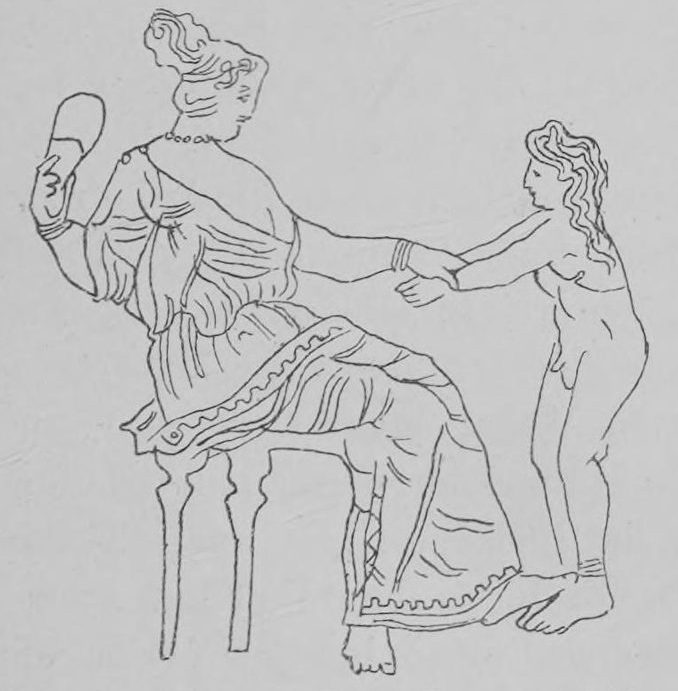

*Fig. 30. Eine römische Dame züchtigt ihren Sohn mit dem Pantoffel.*

Es werden strenge Zucht, Gehorsam gegen die Eltern, daneben auch Respekt vor dem älteren Bruder, Fleiß und Arbeitsamkeit, Mäßigkeit, Bescheidenheit und sonstige Tugenden[^115.190] eingeschärft. Zeigte sich das Kind ungehorsam, so wurde es mit dem Stock oder dem Riemen und andren Werkzeugen, die bei der Züchtigung des Sklaven figurieren (§ 135), geschlagen (הִכָּה) und gezüchtigt (רדה, יִסֵּר), wobei es zuweilen an einem Pfeiler angebunden war (כפה); auch die Holzsandalen vom Fuße des Vaters, besonders aber die Korksandalen vom Fuße der Mutter, die ihm wohl auch ins Gesicht spuckte, flogen ihm an den Kopf (טפח על ראש), zur größeren Beschämung auch dann, wenn der erwachsene Sohn in Amt und Stellung mit Standesgenossen zusammensaß, obzwar anderseits vor der Züchtigung eines bereits erwachsenen Sohnes sehr eindringlich gewarnt wurde[^115.191]. Übermäßige Strenge, die etwa bis zum Verletzen (חבל) des Kindes geht, wird nicht gestattet[^115.192], denn eine *potestas* über Leben und Tod des Kindes, wie sie das römische Recht kennt, anerkennt das Judentum nicht, wohl aber das Recht der Verpfändung und des Verkaufes[^115.193]. Man verklagt (קבל) den bösen Sohn vor dem Gericht und läßt ihm einen Verweis (נער) geben[^115.194]. Hauptsächlich soll das Richteramt des Vaters gerecht sein; er soll nicht den einen Sohn vor dem andren bevorzugen, denn das täte nicht gut — wie das Beispiel von Joseph lehrt — nach vollzogener Strafe soll er um so milder sein, damit die Furcht vor ihm aufhöre; das Versprechen soll man auch Kindern gegenüber halten, denn sonst gibt man die Anleitung zum Lügen[^115.195]. An Beweisen hingebender Zärtlichkeit der Eltern gegen das Kind sind unsere Quellen reich; einen guten Bissen legt man eigens für das Kind zur Seite (הפריש); zu dem fetten Fleischstück reicht man ihm guten Wein; während der Vater den Becher reicht, beeilt sich die Mutter den Wein aufzugießen (מזג); und so sind es vornehmlich Speisen, z. B. auch Nüsse und sonstiges Obst (Bd. I, S. 113), mit denen man die Kinder verzärtelt[^115.196]. Vater und Sohn tragen gegenseitig ein heftiges Verlangen געגועין) nacheinander[^115.197]. Die Liebe zur Mutter ist noch größer, weil die Mutter oft besänftigend (השתדל) für das Kind eintritt[^115.198]. Den Vater (gewöhnlich aram. אבא) nennt der Sohn „mein Herr“ (מרי) und ist von tiefer Ehrfurcht gegen ihn erfüllt; er sitzt nicht auf seinem Platze, spricht nicht in seinem Beisein, widerspricht ihm nicht, Anstandsregeln, die auch der Schüler gegenüber dem Lehrer beobachtet[^115.199]. Andre Ehrenbezeugungen sind: die Türe vor ihm aufmachen, ihm Trinkwasser bringen, seinen Schlaf nicht stören, auf den ersten Ruf herbeieilen usw.[^115.200].

Die Abhängigkeit des Sohnes und noch mehr der Tochter von dem Vater drückt sich auch darin aus, daß sie, solange sie minderjährig sind, keinen selbständigen Besitz haben, und selbst das, was sie durch ihrer Hände Arbeit verdienen und an verlorenem Gut finden, bei der Tochter auch der Kaufpreis beim Eingehen der Ehe, dem Vater gehört[^115.201].

Im Alter freilich kehrt sich das Verhältnis um: der Sohn ist der Besitzende und der Vater ist von ihm abhängig[^115.202]. Der Sohn muß dem alten Vater Speise und Trank reichen, ihn ankleiden, ihm die Schuhe aus- und anziehen, ihn führen, u. z. die Speisung auch dann, wenn er die Mittel durch Betteln auftreiben müßte (vgl. was o. S. 18 von der Armut gesagt wurde). Der Sohn, der es nicht tut, gilt ebenso für grausam, wie der Vater, der sein kleines Kind nicht ernährt; er wurde öffentlich beschimpft und auch gerichtlich dazu gezwungen[^115.203].

Auch den ersten theoretischen Unterricht erteilt der Vater und in Übereinstimmung mit der bereits gemachten Wahrnehmung S. 16) auch der Großvater[^115.204]. Kaum kann der Knabe sprechen, so unterrichtet ihn bereits der Vater in der Thora; er nimmt ihn in die Synagoge mit, läßt ihn wohl an dem gottesdienstlichen Gesange teilnehmen und führt ihn allmählich in die religiöse Praxis (חנוך) ein, so daß der Knabe beim vollendeten 13. Jahre in diesem Punkte auf sich selbst gestellt ist (בר מצוה)[^115.205]. Auch die Mutter hat Anteil an der Erziehung, namentlich wohl an der der Tochter, doch erhalten die Mädchen wenig theoretischen Unterricht — wir hören, daß sie in vornehmen Familien Griechisch lernten — vielmehr wurden sie frühzeitig für die Ehe erzogen[^115.206]. Eltern spielen und unterhalten sich mit ihren Kindern (התפנק), wofür das eine Beispiel angeführt werden mag, daß ein vornehmer Lehrer auf allen Vieren kauerte, einen Strick im Munde hielt und seinem Knäblein nachlief, welche Erscheinung zu dem charakteristischen Ausspruche führte: „Bei den Kindern wird der Mensch völlig zum Narren“[^115.207]. Einfach und zielbewußt ist die theoretische Anleitung. Das Kind sitzt bei Tische; der Lehrer fragt: Wem gilt der Dankspruch? Gott, dem Erbarmer! Wo wohnt er? Das eine Kind zeigt auf die Hausdecke, das andere geht hinaus und zeigt gen Himmel. Das Ei erkennt man am Nest, ruft ihnen der Lehrer zu. Oder: Die Melone erkennt man am Stumpfe[^115.208]. Man wußte sehr wohl, daß die Kinder von Natur verschieden begabt sind, und daß auch jegliches Alter anders beurteilt werden muß[^115.209]. Bei minderjährigen Knaben und Mädchen, deren Gelübde sonst vom Vater für null und nichtig erklärt wurde, musste man gleichwohl darauf achten, ob sie wissen, in wessen Namen das Gelübde getan werde, was einzutreffen pflegt, wenn der Knabe 12 Jahre und 1 Tag, das Mädchen 11 Jahre und 1 Tag alt ist[^115.210]. Man hielt ein Mädchen für mehr begabt als einen Knaben, dennoch aber sei im praktischen Leben der Mann, der die Welt kennen lernt, gescheiter als die Frau[^115.211]. Der Verstand (ערמה) kommt einem erst zu 20 Jahren[^115.212].

[^115.179]: bKethub 65ᵇ אע"פ שאמרו אין אדם זן את בניו ובנותיו כשהן קטנים אבל זן קטני קטנים ··· עד בן שש. — סמוכין על שולחנו häufig, z. B. bBḳ 87ᵇ. bBm 12ᵇ „**Groß**, aber auf des Vaters Tisch angewiesen, heißt **klein**“ und umgekehrt.
[^115.180]: Vgl. Mišna und Gemara bKethub 49ᵃ. Vgl. T 4,8, 264₂₈.
[^115.181]: Gen R 20,6 (s. Kommentare). SCHECHTER, Studies in Judaism S. 360, meint, es werde an Kinderkrankheiten gedacht.
[^115.182]: bKethub 49ᵇ יארורא, עורב (Agg. יארודא, auch bSanh 59ᵇ יארוד נאלא); vgl. Bert. zu MKethub 4,5. Ermahnung auch aus Ps 106,3 bKethub 50ᵃ unten, Midr Tehillim z. St. (s. BUBER S. 454). Gesichter „schwarz“ (vor Hunger) bKethub 10ᵃ. Der Palästiner Reš Laḳiš bSanh 98ᵇ: נכנס לביתו ומצא בניו ובנותיו מוטלין ברעב. Ib. 63ᵇ תפוחי רעב שבירושלים; ib. תינוק שהיה תפוח ומוטל באשפה. Vgl. mein „Antoninus und Rabbi“ S. 129. Zur Armut s. auch BÜCHLER, The Community of Sepphoris S. 66f. Mein *Synod of Usha* in JE 11,645. Gegen L. LÖW La 128 setze ich die Synode später an, als das Gesetz von der Ernährung der noch nicht 6 Jahre alten Kinder, denn dies gehört erst zum Kommentar der Mišna.
[^115.183]: jDemai 2,3, 23ᵃ₈, jBm 1,5, 8ᵃ₄. Vgl. A. 205.
[^115.184]: Gen R 20,6 צער גידול בנים unter den Leiden der Frau. bʿErub 100ᵇ. bSanh 19ᵇ unten שפדאו מצער ג׳ ב׳. Zu bh. גדל vgl. ואין מגדלין לתלמוד תורה bPesach 113ᵇ. גִּדֵּל גדולים רעים Kinder schlecht erziehen Sifre Dt 235 p. 117ᵇ.
[^115.185]: MḲidd 4,14 (b 82ᵃ), T 5,15, 343₁₁ (b 29ᵃ. 40ᵇ), T 1,11, 336₆; Mekh zu Exod 13,13 p. 22ᵇ. L. LÖW, La S. 394. Zu ויבן Gen 2,19 wird bemerkt, eigentlich sei ein Mädchen mit mehr Vernunft begabt als ein Knabe; doch sobald der Knabe groß werde und in die Welt ziehe (ויוצא לחוץ), lerne er von den Leuten und wird gescheiter als die Frau (Midr Aggada Gen 2,19 p. 7ᵃ ed. B. Jalḳut zu St., bNidda 45ᵇ, Gen R 65,4).
[^115.186]: Siehe A. 184. bSanh 76ᵇ והמדריך בניו ובנותיו בדרך ישרה.
[^115.187]: תרבות רעה bei nach kaum abgewarteter טבילה erfolgten Begattung MNidda 10 Ende. Beispiele von „schlechter Zucht“ bei biblischen Personen: Ismael, Esau, Absalom, Adonia, s. Tanch *Šĕmoth* 1; Grund: על שלא רדהו, oder ולא רדהו ביסורין ולא גער בו; dagegen יִסֵּר, הדריכו בדרכיו, וארחותיו למדם דרכיו. Exod R 1 Anf. dasselbe. תרבות auch von Tieren, L. LÖW, La 132, w. unten S. 111.
[^115.188]: Von רבה kommt aram. תורבינא Erzieher, Pfleger (L Trg Wb 2,557).
[^115.189]: Tanch *Šĕmoth* 1, Exod R 1 Anf. Zu ממלח s. L. 3,126; Jahrbuch „Jerusalem“ 8,330.
[^115.190]: bChull 84ᵃ unten שלא ילמד אדם את בנו בשר ויין. Respekt vor dem älteren Bruder bKethub 103ᵃ. Der Vater will den El. b. Hyrk. in den Bann legen, Pirḳe RE c. 2.
[^115.191]: MMakk 2,3 האב המכה את בנו והרב הרודה את תלמידו, j 31ᵈ₃, b 8ᵃᵇ בשוליא דנגרי. Anbinden an die Säule (עמוד), mit dem Stock (שבט) schlagen und züchtigen (יסר) s. Tanch *Šĕmoth* 1; bSanh 70ᵇ. Vgl. das Verfahren bei מלקות in Leben Jesu nach j. Quellen S. 259. Von Erwachsenen sprichwörtlich את מחית בחוטרא Num R 18,18. Riemen ib. 16,18; Sifra ʾ*Emōr* g. E. p. 104ᵈ; TBḳ 9,31, 366₇ (vgl. BLAU, Buchwesen S. 21). Auch nach jGitt 1,6, 43ᵈ₆₃ und jḲidd 3,4, 64ᵃ₄₇ (vgl. bGitt 14ᵃ o.) wird der Delinquent gebunden (כפת) und der Riemen fährt auf ihn nieder (ורצועה עולה ויורדת). „Riemen der Geißelung“ (מרדות) Tanch חקת 18, vgl. Num R 19,20. MNedar 3,2 ושהכתה את בני. TGitt 4,3, 327₁₁. מכה גדולה bBerakh 32ᵃ. Gleichnis: Ein Mann schlägt seinen Sohn mit starkem Schlag und legt ihm dann einen Verband (רטיה Bd. I, S. 262) über die Wunde (מכה) an, sprechend: Solange dieser Verband über der Wunde, iß, was dir beliebt und trink’, was dir beliebt, bade sowohl warm als kalt und habe keine Furcht usw. (Bar bḲidd 30ᵇ). Die Mutter schlägt mit ihrem Pantoffel den in der Ratsversammlung sitzenden vornehmen Sohn (bḲidd 31ᵇ unten טפחה לו על ראשו) und spuckt ihn an (ib.); andre Stellen mit dem Ausdruck סטר oder טפח mit dem Pantoffel s. III A. 721. Vašthi schlägt mit dem Pantoffel den Memukhan auf beide Wangen (Esther R zu 1,16 c. 4,6). Der Vater schlägt mit dem Sandal (bMḳ 25ᵃ). Noch bei Saadja, den der Fürstensohn mit dem Schuh schlagen wollte (Abraham ibn Daud ס׳ הקבלה ed. Neub., Med. Jewish Chronicles 1,65). Auch die Römerin schlug ihr Kind mit den Sandalen, die sie stets bei der Hand hatte; freilich auch mit Rohr und Riemen, s. OPITZ, Das h. Leben der Griechen und Römer S. 188 (mit der hier reproduzierten Figur). Wer den erwachsenen Sohn schlägt, verdient den Bann (bMḳ 17ᵃ). Bezüglich בן סורר ומורה s. MSanh 8,1, b 69ᵃ.
[^115.192]: bBḳ 87ᵃ von der Tochter דאי בעי מתחבל בה לא מצי חביל. Bar ib. 87ᵇ החיבל בבנו גדול יתן לו מיד בבנו קטן יעשה לו סגולה החובל בבתו קטנה פטור ולא עוד אלא אחרים שחבלו בה חייבין ליתן לאביה. Ib. andre Barajtha: בבניו ובנותיו שלו פטור. Wenn der Sohn den Vater schlägt, s. die Verfügung MBḳ 8,4 (b 87ᵃ).
[^115.193]: Vgl. Neh 5,5. Aber in jPesach 4,9, 31ᵇ₆₂ wird nicht von Verpfändung der Kinder, sondern von Verpfändung der Häuser (בתיהון zu lesen) gesprochen, s. „Antoninus und Rabbi“ S. 113 A. 1.
[^115.194]: Num R 10,1 לאלמנה שקבלה על בנה. Fiktive Klage auf Anschreien (גער vgl. A. 187) jPeʾa 1,1, 15ᶜ₄₁, jḲidd 1,1, 61ᵇ₂₅. In Dingen, die gegen das Religionsgesetz laufen, braucht der Sohn dem Vater keine Folge zu leisten, MBm 2,10.
[^115.195]: bSabb 10ᵇ (zu שנה s. A. 155); Gen R 84,8; bMeg 16ᵃ, Tanch *Waješeb* 4, Jalḳ Gen § 152, Esther § 1059. Unnützes Versprechen bSukka 46ᵇ; bBm 49ᵃ.
[^115.196]: Gen R 3,6 (etwas anders gefaßt in Midr ha-Gadol zu Gen 1,4 p. 22 ed. Sch.). Die Liebe Isaaks zu Esau Gen R 63,10: קופדא טבא לפומיה וכסא ט׳ לפומיה. Die Väter reichen den Kindern das Essen TJoma 5,2, 189₂₀. Vater und Mutter bḲidd 31ᵇ. Vgl. bChull 107ᵇ; bJoma 77ᵇ.
[^115.197]: bSanh 63ᵇ. Zu געגועין s. L 1,350.
[^115.198]: bḲidd 30ᵇ. 31ᵃ.
[^115.199]: מר bNidda 17ᵇ. Selbst nach dem Tode des Vaters nicht כך אמר אבא sondern כך אמר אבא מרי bḲidd 31ᵇ; ib. Eulogie הרני כפרת משכבו; nach Verlauf von zwölf Monaten זכרונו לברכה לחיי העולם הבא. Ehrfurchtsbezeugung jPeʾa 1,1, 15ᶜ₆₈ jḲidd 1,1, 61ᵃ₆₈.
[^115.200]: Ib. ib. Das מדבר במקומו wird etwa zu verstehen sein, wie מורה הלכה בפני רבו. Bar bḲidd 31ᵇ noch ולא מכריעו. RTarfon legt der Mutter, deren Sandalenriemen am Sabbat im Hofe gerissen waren, beide Hände unter die Füße und trägt sie so an ihr Ruhebett, und dennoch behauptete man: אדיין לחצי כבוד שאמרה תורה לא הגיע. Infolge der weitgehenden fast unerfüllbaren Forderungen schätzten sich manche glücklich, Vater und Mutter nicht gekannt zu haben (ib.). Beispiel von ארנקי j und b ib. Die Pflicht, die Eltern ins Bett zu heben, wurde verallgemeinert, b ib. 31ᵇ; vgl. „Antoninus und Rabbi“ S. 49.
[^115.201]: MKethub 4,4; Mekh RSbJ zu Exod 22,16 p. 149. MBm 1,6 (b 12ᵃ). bKethub 40ᵇ מעשה הבת und שבח נעוריה.
[^115.202]: Vgl. Josephus, Ant. 4,8, 24 § 261; Orac. Sibyll. II, 269; Cyrill von Jerusalem Cat. IV, 37.
[^115.203]: jPeʾa 1,1, 15ᶜ₇₀, jḲidd 1,7, 61ᵃ₃₆ מאכיל ומשקה מלביש מנעיל מנהיג, Mekh RSbJ zu Exod 20,12 p. 110 מאכיל ומשקה ומלביש ומכסה ומוציא ומכנים (bḲidd 31ᵇ u.). Vieles kommt auf die Form der Gabe an; vgl. פיסיוני = Fasane bḲidd 31ᵃ. Auf dem Wege des Bettelns j a. a. O. Vgl. ib. יבא עורב שהוא אכזרי (wie in A. 182).
[^115.204]: Großvater jḲidd 1,7, 61ᵃ₅₃; ib. Z. 57 שומע פרשה מבן בנו; b 30ᵃ Zĕbūlūn b. Dan lernt vom Großvater. Anteil der Mutter an der Erziehung MḲidd 1,7, bNazir 29ᵃ, bBerakh 17ᵃ.
[^115.205]: bSukka 42ᵃ; Sifre Dt 46 p. 83ᵃ zu Lev 19,23. 24. Synagoge folgt aus jGitt 5,6, 47ᵇ₅ הנשים והקטנים, deutlicher Sopherim 18,5 (Machsor Vitry p. 43). Im Chor MʿArakh 2,7, T 2,2, BÜCHLER, Priester und Kultus S. 129. Kinder assistieren beim Bann, bei Hochzeiten und Begräbnissen s. REJ 43,55. Gen R 63,10 להטפל בבנו עד י"ג שנה, dann ברוך שפטרני מעונשו של זה. Siehe *Bar Miẓwah* JE 2,509.
[^115.206]: Griechisch s. jPeʾa 1,1, 15ᶜ₁₆ מפני שהוא תכשיט לה.
[^115.207]: לאיהפגגא Pesiḳta 76ᵇ; Lev R 27,6, Tanch ʿ*Emōr* 13, Cant R 5,16, Jalḳ Mikha § 554 (s. ʿArukh 6,288 פג 3). Num R 10,1, wo מ"כ aus ʿArukh משתעשע (vor uns לעלוץ). Pferdespiel des Josua b. Karcha Midraš Tĕhillim 92,13, Jalḳ § 846; BACHER, Tann. 2,310.
[^115.208]: bBerakh 48ᵃ Abbaj und Raba vor Rabba; RN (2,153) hat die LA מקיניה, Agg. מקטפיה, Raši und Tosafoth bSukka 56ᵇ. Das Kind weiß zwischen dem Steinchen und der Nuß zu unterscheiden, ib. 42ᵇ, bGitt 65ᵃ. bSukka 42ᵇ unten ההחיל יוצא ונכנס, ebenso TTohar 3,9, ib. 10 והיה יודע לשמור את גופו, ebenso jSukka 3 g. E. 54ᵃ₅₅; ib. יודע להתעטף.
[^115.209]: Vgl. A. 185. חד וחד לפי חורפיה bGitt 59ᵃ (vgl. חריפות Bd. I, S. 250). bSanh 69ᵇ דרך חכמתן קחשיב.
[^115.210]: MNidda 5,6 (45ᵃ), bGitt 65ᵃ.
[^115.211]: Vgl. A. 185.
[^115.212]: Midr Prov und Jalḳ Prov zu 1,4.

## § 116

**116.** **Die Lebensalter.** Die Rabbinen unterscheiden im allgemeinen drei Lebensalter: das der Kindheit, der Jugend und des Alters; demnach sprechen sie von Kindern (תינוקות oder יונקים), von Jünglingen (נערים) und von Alten (זקנים)[^116.213]. Diese Dreiteilung liegt zugrunde dem Satze: Jung singt man, erwachsen spricht man Lehren, alt geworden eitles Zeug[^116.214]. Innerhalb dieser Altersstufen gibt es mehrere Abstufungen; so das eintägige Kind (תינוק בן יומו); Beginn der Gehfähigkeit; Aufhören der körperlichen Beschmutzung; Selbstankleiden; Erwachen der Verstandesfähigkeit; Schulbesuchszeit usw.[^116.215]. Die Begriffe „Säugling“ und „Kind“ fallen zusammen (o. S. 10), der Begriff „Jugend“ geht in den der Stärke und Kraft über, wogegen das Alter zugleich Schwäche und Niedergang des Lebens bedeutet[^116.216]. Dazu kommen noch die Unterschiede der Geschlechter: Knabe und Mädchen, Jüngling und Jungfrau, Mann und Weib, Alter und Alte, Greis und Greisin[^116.217]. Zumeist sind es die Personen, die als konkrete Lebewesen unterschieden werden; doch gibt es allenfalls auch Abstrakta, z. B. ילדות die Jugend, נערות Jugendalter, זקנה und זקנות Alter, בגרות das mannbare Alter des Mädchens[^116.218], und es ist klar, daß solche Abstrakta bereits ein geschultes Denken voraussetzten. Sie treten auch als Altersbezeichnungen ziemlich zurück; man gebraucht zu deutlicherer Bestimmung lieber Zahlenangaben, z. B. בן תשעה ein zu neun Monaten geborenes Kind (vgl. S. 4), בן ארבעים ein vierzigjähriger Mann, בן שבעים ein siebzigjähriger Mann[^116.219].

Gewisse Handlungen charakterisieren die Jugend (z. B. das Sich-Schmücken, das Kokettieren), andere das Alter (z. B. Vorliebe für Wein)[^116.220]. Namentlich ist „alt sein“ gleichbedeutend mit „erfahren sein“ und „gelehrt sein“ (vgl. S. 16), und das Alter ist demgemäß Gegenstand der Ehrfurcht und der Verehrung; das Aufstehen vor einem Alten ist ein biblisches Gebot[^116.221]. Gelehrte sind desto gelehrter, je älter sie werden, und umgekehrt Ungebildete, je älter, desto törichter[^116.222]. Verschieden stellt sich auch das Alter ein beim Manne und beim Weibe; nach der biblischen Schätzung sinkt das Weib, das über 60 Jahre alt ist, auf ein Drittel, der ebenso alte Mann auf mehr als das Drittel seines früheren Wertes herunter, denn so lautet der Spruch der Leute: Ein Alter im Hause ist eine Last im Hause; eine Alte im Hause ist ein Schatz im Hause[^116.223]. Das Alter hat mannigfache Gebrechen im Gefolge, darunter die für die Männer der talmudischen Epoche, die außerordentlich viel auf ein gutes Gedächtnis hielten, so schreckliche Vergeßlichkeit[^116.224]. „Nichts Liebliches gibt es an den Alten, nicht gibt es Rat bei Kindern“[^116.225]. „Die Jugend ist ein Kranz von Rosen, das Alter ist ein Kranz von Schilf.“ „Wer seine Natur (יצר) in der Jugend verweichlicht (פִּנֵּק), dem wird es zur Bitterkeit (bh. מנון) gereichen im Alter“[^116.226]. Wir haben bereits gesehen (Bd. I, S. 250), wie hoch es geschätzt wurde, wenn im Alter die Vollkraft erhalten war.

[^116.213]: bJoma 75ᵇ תינוקות זקנים נערים, bessere Reihenfolge in Pesiḳta 110ᵃ ת׳ בחורים ז׳, Exod R 5,9 יונקים ז׳ ב׳; in Tanch *Šemoth* 25 nur י׳ und ב׳, jedoch vorher 1. ז׳, 2. ב׳, 3. נ׳, 4. קטנים, 5. י׳ (ferner נשים), Tanch B. 22 dieselben fünf und noch 6. עוללים; Parallelstellen s. bei BACHER, Ag. der pal. Am. 1,444. In einem jungen Midraš (*Tadšeʾ* bei Jellinek, Beth-ha-M. 3,168) werden sieben Alter (קומות) angenommen: ילד נער רובה עלם איש שב זקן (s. JE *Ages*). נערים ausdrücklich von קטנים unterschieden Bar bSota 46ᵇ. Bei Mädchen נערה und בוגרת s. § 117.
[^116.214]: Cant R zu 1,1 fol. 3ᶜ. Zu achten auf אתם מילדים עצמכם sich jung machen opp. מזקינים Gen R 48,17; ib. שהחזירו הקב"ה לימי נערותיו.
[^116.215]: תינוקות של בית רבן Schulkinder. טפלא L 2,182, K 4,65 طفيل, jedenfalls verwandt mit טְפַל (vgl. A. 183), nicht gleich bh טף, wie L Trg Wb 1,316 will. הפעוטות in MGitt 5,7 bedeutet wahrscheinlich Kinder von bestimmtem Alter; in b 59ᵃ Ansichten darüber, ob solche von 6—7, von 7—8, oder von 9—10 Jahren. קטני קטנים bKethub 65ᵇ. תינוקות סמוך לפרקן TJoma 5,2, 189₁₈. גוזל Bar bPesach 49ᵃ. קטן פורח bBerakh 47ᵇ unten, vgl. פרחי כהונה. Vgl. RN 6,420. Unbestimmte Zeit MSanh 8,1 משיביא ב׳ שערות ועד שיקיף זקן התחתון (vgl. III A. 849), b 68ᵇ עד שיקיף עטרה und ähnliches. רובה, רובין, ריבה, רביתה s. ʿArukh 7,239. רבי jMeg 2,2, 73ᵃ₄₇.₄₈. טליין דקיקין jSabb 6,1, 7ᵈ₄₉, jBeza 1 E. 61ᵃ₂₅. — jŠebuʿoth 7,2, 73ᵈ₃₄ מן דקיקין רבון „Wenn die Kleinen heranwachsen“. Einer hat große und kleine Kinder, jBḳ 6,7, 5ᶜ₄₉. עוילא = ינוקא Lev R 5,1. Sonst s. A. 208.
[^116.216]: Num R 10,1 בחורים opp. תשים (vgl. תשיש Bd. I, S. 250). bSanh 68ᵇ בן הסמוך לגבורתו של איש. Ebenso נערות = Jugendkraft, bSabb 111ᵃ, bGitt 70ᵃ. Aber in jChag 2,2, 77ᵈ₇₃ תמנין גוברין בחירין sind ausgewählte Leute gemeint (gegen L 1,210). bSabb 151ᵃ ימי הרעה אלו ימי הזקנה. MPeʾa 8,1 נמושות, Worterklärung j 4,2, 18ᵇ₂₅ שהן באות בסוף. Ib. משושות. Ib. opp. בחורים also Personen!
[^116.217]: תנוק ותנוקת bSanh 94ᵃ. בחור und בתולה oft; נער und נערה. Die Zeitgrenze für נער setzen einige auf 20, andere auf 25 und 30 Jahre an, Midr Prov und Jalḳut zu 1,4. איש und אישה. זקן und זקנה. סבא und סבתא. ישיש. Oft זכר und נקבה, letzteres bNidda 31ᵇ gedeutet נקייה באה und אין עמה כלום. — ילדה junge Frau, opp. זקנה alte Frau, bJebam 101ᵇ, bBḳ 60ᵇ und oft. Weniger häufig ילד opp. זקן z. B. Bar bNidda 60ᵇ. נערה „kleines“ Mädchen II Kön 5,2 will der Talmud (bChull 5ᵃ) nicht gelten lassen. Achtzehnjähriges Mädchen heißt noch תינוקת TNidda 6,3, 647₁₈. Ruth heißt נערה (Ruth 2,5. 6), obzwar bereits Witwe. Isaak heißt נער (Gen 22,5), obzwar er (nach SederʿOlam R) bereits 39 J. alt war.
[^116.218]: בעלי זקנה bSanh 17ᵃ. לשמונים מיתה של זקנה jBikk 2,1, 64ᶜ₅₅ (vgl. Bd. I, S. 250). עת הנעורים bḲidd 82ᵃ opp. זקנות. Ib. 82ᵇ ילדות opp. זקנות. jBeza 1,6, 60ᶜ₆₂ זקנות (mehr s. bei L 1,548). ימי הנעורים bNidda 5ᵃ, vgl. M 5,7 אלו ימי הנעורים ed. Neapel und Lowe (Agg. נעוריה), b 47ᵃ. מזקינין בחצי ימיהם bʿErub 56ᵃ. זקנה שיש בה לחלוחית opp. אין בה ל׳ Gen R 48,16.
[^116.219]: Ḳohel R 1,2 (Midr ha-G. zu Gen 2,2 p. 60 Sch) 1. בן שנה, 2. בן שתים ושלש (Midr ha-G. nur בן שלש), 3. בן עשר (fehlt in M. ha-G.), 4. בן עשרים, 5. נשא אשה, 6. הוליד בנים, 7. הזקין. Ausführlich L. LÖW La 21 f., JE *Ages*.
[^116.220]: Gen R 84,7 מעשה נערות vom Jüngling; vom jungen Weibe ib. 48,17 תכשיטים (doch auch alte Frau bḲidd 31ᵇ, vgl. Bd. I, S. 199).
[^116.221]: RN s. v. זקן; vgl. זקני ב"ד, זקני כהונה. Ebenso סב, z. B. סבי דסורא bSanh 17ᵇ, סבי דבי אתונא bBekhor 8ᵇ. Gebot Lev 19,32; jBikk 3,65ᶜᵈ. RJochanan erhob sich auch vor heidnischen Greisen, bḲidd 33ᵃ unten.
[^116.222]: MḲinnim 3,6.
[^116.223]: bʿArakh 19ᵃ o. Zu פאחא gibt (Ps ?)-Raši zwei Erklärungen: 1. Last, Unglück; 2. Nacktheit, Nichtigkeit. L 4,1 übers. פ׳ mit „Schlinge“, 3,462 mit „Verderben“. Vgl. immerhin בר פחין Wurzel פחח L 4,20.
[^116.224]: bBerakh 8ᵇ und jMḳ 3,1, 81ᵈ₆₃ זקן ששכח תלמודו. Dagegen bSabb 21ᵇ גירסא דינקותא. L. LÖW La 253 f., EBSTEIN, Medizin im Talm. u. N. T. 144 f.
[^116.225]: bSabb 89ᵇ.
[^116.226]: bSabb 152ᵃ; zu חלפא s. I. LÖW, Pfl. S. 167. — Gen R 22 p. 212 Th (s. GES Wb¹⁴ פנק).

## § 117

**117.** **Die Pubertät**[^117.227]. Vor erlangter Pubertät heißt der Knabe *ḳatōn* (קטן), das Mädchen *ḳĕtanna* (קטנה); hernach sind sie „groß“ (גדול, גדולה) in technischem Sinne. Während jedoch der Knabe rechtlich und hinsichtlich seiner Würde nun einfach in die Kategorie des Mannes (איש) vorrückt, heißt das Mädchen vorerst *na‘ara* (נערה), und die Bezeichnung „Frau“ (אשה) hat überhaupt keinen rechtlichen Charakter, es sei denn, es handle sich um eine verheiratete Frau (אשת איש).

Die Natur selbst lehrt bei dem weiblichen Geschlechte die Pubertät früher ansetzen als beim Manne; ebenso ist es die Natur selbst, die dem Beobachter die Zeichen der Pubertät an die Hand gibt. Die Ansetzung der Pubertät beruht also zunächst auf körperlicher Untersuchung (*indagatio corporis*), die, durch ältere Frauen geübt, in *foro* maßgebend war; es kennt sie das römische und nach ihm auch das deutsche Recht, doch wurde sie in Rom zur Zeit Justinians und vielleicht schon früher abgeschafft, während sie die Rabbinen stets beibehielten. Die Geschlechtsreife tritt in der Regel bei einem Mädchen zu 12 Jahren und 1 Tag, bei einem Knaben zu 13 Jahren und 1 Tag ein, d. i. beim Eintritt in das 13. bezw. 14. Lebensjahr[^117.228]. Der tatsächliche Befund lehrt in manchen Fällen, daß die Geschlechtsreife entweder früher oder später eintritt[^117.229], dann wird eine besondere Kraft des Körpers, oder eine besondere Schwäche angenommen.

Beim Eintritt der Geschlechtsreife ändert sich der Körper des Mädchens; es entwickeln sich die „oberen Zeichen“ (סימנים) — an der Brust — und die „unteren Zeichen“ — die Pubes (שתי שערות) — letzteres ebenso Zeichen der männlichen Pubertät, deren häufiger Erwähnung geschieht, während dem Weibe gegenüber, so wird ausdrücklich versichert, sich die Gelehrten einer bildlichen Sprache bedienen; so sprechen sie von der unreifen, von der reifenden und der völlig entfalteten Frucht[^117.230]. Bei den Mädchen vom Lande entwickeln sich die „oberen Zeichen“ schneller, weil sie die Handmühle treiben (Bd. I, S. 96), wobei sie ihre Arme kräftig hin und her bewegen. Bei den Töchtern der Reichen entwickelt sich die rechte Brust früher, weil sie sich an dem anliegenden Hemde (אפיקרסות Bd. I, S. 164) ständig reibt; bei den Töchtern der Armen die linke Brust, weil sie die Wasserkrüge auf ihr vollschöpfen und ihre kleinen Geschwister auf dieser Seite tragen[^117.231]. Brüste sind bei einem Manne eine Abnormität, während die Schönheit der weiblichen Brust selbst in unsern so sehr nüchternen Quellen gepriesen wird[^117.232].

Die abnormen Erscheinungen in der Geschlechtsreife haben wir oben (Bd. I, S. 217) behandelt. Unter den Männern ist der סרים, der natürlich Verschnittene, unter den Frauen die איילונית, die Knorrige, unfruchtbar; letztere ist äußerlich daran zu erkennen, daß sie keine Brüste hat; auch ist ihre Stimme derart hart, daß sie ebensogut die Stimme eines Mannes sein könnte[^117.233]. Das Weib erbringt den Beweis der Pubertät hinlänglich dadurch, daß es ein Kind geboren hat[^117.234].

[^117.227]: L. LÖW La S. 143 f., JE 8,270 *majority*; PREUSS Materialien XVI, S. 29 f.
[^117.228]: MNidda 1,4 איזה היא בתולה כל שלא ראתה דם מימיה ואפי׳ נשואה ומעוברת משיודע עוברה, T 1,6, 641₃₇ noch ואף על פי שנשאת והיו לה בנים אני קורא אותה בתולה עד שתראה ראייה ראשונה הוי לא אמרו בתולה לבתולים אלא ב׳ לדמים; Jahr und Tag Bar b 46ᵃ. M 5,9 die Frau kommt früher zur Reife als der Mann. Mehreres Gen R 48,17 zu וסתות, עדנה = עידונים, עידויין. Statistische Daten über den Beginn der Menstruation s. JE 8,495. שתי שערות MNidda 5,9, T 6,5. 6. 7 p. 647; Stelle b 52ᵇ אחת בגבה וא׳ בכרסה, s. dazu RN (גב 3 K 2,219). Hinsichtlich בן סורר ומורה s. A. 215.
[^117.229]: בן ט׳ שנים ויום א׳ שראוי לביאה Bar bSanh 69ᵃ. Siehe auch vorige A. Die *pubes* eines 9jährigen Knaben werden von manchen als vollwertiges Zeichen der Pubertät angesehen, während andere sie bloß für einen Fleck (oder Warze? שומא s. Bd. I, S. 244) ansehen. Differenzen bei röm. Rechtslehrern s. bei L. LÖW S. 142. bBb 155ᵇ הנו סימנין זימנין דאתו מחמת בריאותא וזימנין דאתו מחמת כחישותא, s. Tos. bJebam 97ᵃ.
[^117.230]: MNidda 5,7 משל משלו חכמים באשה (בא׳ fehlt in ed. Lowe; in ed. Neap. fehlt פגה). Statt בחל hat T 6,4, 647₂₃ כחל; aus T erfahren wir (vgl. Bar b 47ᵇ), daß alle drei Ausdrücke sich auf die „oberen“ Zeichen (סימנים מלמעלה) beziehen, also auf die Brüste. בוגרת (von בגר = בְּכַר), vollständig בת בוגרת (Lev R 25,1), s. bNidda 65ᵃ, bḲidd 16ᵃᵇ, 79ᵃ, bKethub 39ᵃ, jJebam 1,3ᵃ und Gaonen bei RN s. v. בגר (2,12) und נער (5,360). Eines der Zeichen ist, daß ihre Stimme hart wird, bBb 167ᵇ. Die Frage MNidda 5,8 איזהו סימנין bezieht sich auf die בוגרת, mit welcher der vorangehende Satz der Mišna schließt; darum ed. Neap. und Lowe richtig אי זו היא סימנה (nämlich של בוגרת), ausdrücklich T 6,4, 647₂₀ ואלו הן סימני של בוגרת, und so auch Bar b 47ᵃ (wo aber andere Zeichen als in der Mišna). Die Zeichen sind (von Tradenten sehen wir ab): 1. משיעלה הקמט תחת הדד (die Art der Untersuchung gibt der Arzt Samuel an b 47ᵃ); 2. משיטו הדדים; 3. משישחיר הפיטומת; 4. כדי שיהא נותן ידו על העוקץ והוא שוקע ושוהא לחזור. Nach T und Bar gibt es folgende Zeichen des „reifen“ Mädchens: 1. כשיתקשקשו הדדין (T משיתקשו); 2. משיכסיף ראש החוטם (T משיכסף) s. Raši und Tosafoth; 3. משתקיף העטרה (vgl. A. 215); 4. משנתמעך הכף (T משתפשט את הכף). Mehreres über die den Frauen gegenüber angewandte figürlich euphemistische Sprache REJ 59,36 f.
[^117.231]: Bar bNidda 48ᵇ.
[^117.232]: Cant R zu 4,5 שני שדיך, Midraš Sam c. 15,1.
[^117.233]: MJebam 8,4, b 80ᵃᵇ, 119ᵃ, TKethub 1,3, 260, j 25ᶜ, b 36ᵃ; MNidda 5,9, T 6,2, 647, bKetkub 11ᵃ.
[^117.234]: bJebam 12ᵇ.

## § 118

**118.** **Die Ehewerbung.** Das jüdische Mädchen genoß viel mehr Freiheit als seine Genossinnen im heutigen Orient. Es durfte sich ohne Scheu vor Männern zeigen; es ging zum Brunnen — und zwar auch noch im mannbaren Alter, weshalb es denn gewissen Gefahren ausgesetzt war —[^118.235] und auf den Markt in der Stadt[^118.236], saß im Laden[^118.237], übte einiges Gewerbe aus[^118.238] und konnte sich im Notfalle selber schützen[^118.239]. Der Mann hatte demnach freien Zutritt zum heranwachsenden Mädchen, um das er behufs ehelicher Verbindung mit seinen besten Mitteln werben (חִזֵּר, קפץ על) mußte; es wäre geradezu unklug und unmoralisch gewesen, eine Frau ungesehen zu ehelichen, denn ein nachträglich entdeckter Fehler hätte zu ehelichem Zwist und füglich zur Ehescheidung geführt, was nicht ausschließt, daß es allerdings leichtfertige Väter gab, die die Tochter fast blindlings verheirateten[^118.240].

Die Heirat selbst ist eine der obersten Pflichten des Mannes, die aus den Worten: die Erde — er hat sie zur menschlichen Wohnstätte geschaffen (Jes. 45,18) gefolgert wurde. Sie wurde auch pünktlich befolgt, bis auf wenige Ausnahmen, die einen scharfen Tadel erfuhren. „Ein Jude, der kein Weib hat, ist kein Mensch“. Von Gott geächtet ist „ein Jude, der kein Weib hat, und auch der, der ein Weib hat, aber keine Kinder“. „Ein Jude, der kein Weib hat, verbringt ein freudenloses und segenloses und ein glückloses Dasein.“ In allen diesen Sätzen bietet der Ausdruck „Jude“ (יהודי) zugleich ein religiöses Moment[^118.241]. Gleichwohl kennt die jüdische Gesellschaft auch „leer“ gebliebene Männer (רַוָּקִים) oder Hagestolze (שְׁחֵצִים)[^118.242], aber nur zeitweilig ledig gebliebene Frauen (פנויות).

Abgesehen von den legendenhaften Berichten von einem jährlich zweimal wiederkehrenden Feste, das so recht darauf angelegt gewesen sein soll, daß sich heiratslustige Jünglinge und heiratsfähige Jungfrauen gegenseitig sehen und kennen lernten[^118.243], haben wir auch sonst noch Kenntnis davon, daß eine Art Flirt mit jungen Mädchen nicht unbekannt war (שִחֵק בתינוקות *ad norman* שדך על התינוקות w. u., wobei zu erinnern, daß שחוק = Spiel prägnant das geschlechtliche Spiel ist)[^118.244]. Es gibt auch ein Beispiel dafür, das jemand sich aufs Gebet und Fluchen verlegt, also gleichsam Zauber ausübt, um eine Frau zu bekommen[^118.245]. In der Regel jedoch gingen dem Eheschlusse Verhandlungen (התנה, wovon תנאים) und Vereinbarungen (שדוכים von שִׁדֵּךְ) voraus, die, handelt es sich um ein minorennes Mädchen, zwischen einer Vertrauensperson des Freiers, gewöhnlich dem nachmaligen Paranymphen (שושבין w. u.), aber auch durch einen Vermittler (סרסיר), und dem Vater des Mädchens, sonst aber, wenn es sich um eine majorenne Frau handelt, zwischen dieser und dem Freier direkt geführt werden.

Diese vorhergehenden Besprechungen wurden für die Ersprießlichkeit der Ehe für so notwendig erachtet, daß ihre Unterlassung scharfen Tadel erfuhr, und da es sich ferner um die Knüpfung eines Ehebandes handelt, so durften sie auch am Sabbat gepflogen werden. Als Detail erfahren wir, daß besprochen wurde, was die Frau an Arbeiten zu leisten und demgemäß welche Art von Verpflegung sie zu beanspruchen habe; doch werden außerdem auch andre, mitunter recht bizarre Bedingungen (על תנאי) verabredet[^118.246]. Nur minorenne Mädchen konnten kraft väterlicher Gewalt von dem Vater auch ohne ihre Befragung verheiratet werden; doch konnte das Mädchen wünschen, einstweilen zu Hause zu bleiben, und der Vollzug der Ehe soll jedenfalls erst nach Eintritt der Pubertät stattfinden[^118.247]. Wenn die Verheiratung infolge des Ablebens des Vaters durch die Mutter oder die älteren Brüder durchgeführt wurde, oder selbst beim Leben des Vaters, wenn die minorenne Frau bereits eine Witwe oder eine Geschiedene war, stand der jungen Frau, wenn sie großjährig geworden, das Recht der Weigerung (מֵאוּן), d. i. der Annullierung der Ehe zu[^118.248]. In beiden Fällen ist eine, wenn auch nicht bündige, Zustimmung der Braut erforderlich; die Zustimmung gibt sie zu erkennen, wenn sie ohne Widerrede anhört, was von ihrem zukünftigen Gemahl gesprochen wird, oder wenn man ihr den Thalamos zeigt oder den Brautstaat anlegt[^118.249]. Zweck jener durch die Mutter und die Brüder erfolgenden Verheiratung, die doch eigentlich ungeschehen gemacht werden kann, ist die Versorgung des vaterlos gebliebenen Mädchens; so sagte man geradezu auch von älteren Mädchen, man „miete“ ihnen (שָׂכַר) den Mann, damit man ihnen den Lebensunterhalt (פרנסה) bieten könne[^118.250]. Manchmal gelangt ein Mädchen, das als Pfand einem Gläubiger (o. S. 20) oder als Geißel in Feindes Hand (התמשכן und הורהן) überantwortet wurde, auf diesem Wege zur Heirat, und da hat ihre Selbstaussage, daß sie ihre „Reinheit“ bewahrt habe, volle Gültigkeit[^118.251].

[^118.235]: Gen R 49,[?] (die Ausdrücke דינה של ריבה und דינה של נערה identisch); שירדו לשתות ולמלאות מים aus dem Leben gegriffen, denn die Mädchen trinken erst selbst und tragen dann das Wasser nach Hause. MKethub 1,10 s. „Antoninus und Rabbi“ S. 114. Anderseits גזרו על היחוד ועל הפנויה bSanh 21ᵇ. Die Stelle Tanch *Thissaʾ* 16 (Tanch B. 11) מה הכלה הזו ··· מצנעת עצמה כו׳ (s. BÜCHLER WZKM 19,95 A. 1) bezieht sich nur auf den Brautstand; das ledige Mädchen ist viel freier.
[^118.236]: Vgl. S. 360.
[^118.237]: Folgt aus MKethub 9,4 המושיב את אשתו חנונית. Wegen פונדקית (S. 327) s. BÜCHLER, Priester und Cultus S. 63 A. 3.
[^118.238]: Folgt aus מעשה הבת A. 201.
[^118.239]: MʿEduj 8,2, bKethub 26ᵇ.
[^118.240]: bḲidd 41ᵃ עד שיראנה usw., s. Maim zu MSanh 7,4. bJebam 63ᵃ מתון usw. Leichtfertigkeit bḲidd 24ᵇ קדשתי את בתי ואיני יודע למי קדשתיה. j 3,7 64ᵇ₄₀. bNidda 31ᵇ איש מחזר על אשה opp. bh. נקבה תסובב גבר Jerem 31,21.
[^118.241]: bJebam 62ᵃ. Ib. 63ᵃ (bḲidd 70ᵃ). Ib. 62ᵇ. bPesach 113ᵇ.
[^118.242]: רֵוָק L 4,436. שחצים Lev R 20,10, Midr Tĕhillim 78,63.
[^118.243]: bTaʿan 26ᵇ. 31ᵃ, j 4 g. E. 69ᶜ₅₁. Vgl. bKethub 14ᵃ הוקה אשה ונשאת בודקת וג׳.
[^118.244]: So ist aufzufassen Bar bNidda 13ᵇ והמשחקין בתינוקות, indem תינוקות Pl. von תינוקת ist, wie schließlich auch die Gemara zugibt: דנסיבי קטנות, während vorher ת׳ allerdings für Knaben gehalten wurden. Daß ת׳ mannbare Mädchen, s. A. 215 und 217. Zu שחוק = ערוה s. BÜCHLER, Der gal. ʿAm ha-ʾAreṣ S. 201 A. 2.
[^118.245]: bMḳ 18ᵇ.
[^118.246]: שדך aram. sich beruhigen = einverstanden sein, arab. سدك, L 4,511, K 8,34, J 1525; vgl. J. PERLES, Die j. Hochzeit S. 5 A. 6. Rab geißelte den, der ohne Werbung (בלא שדוכי) sich eine Frau angelobte, bḲidd 12ᵇ; j 3,10, 64ᵇ₇₃ המקדש בלא שידוכים לוקה ותופסין קידושין. Bei einer Minorennen b 44ᵇ, bei einer Majorennen b 13ᵃ. Am Sabbat Bar bSabb 150ᵃ משדכין על התינוקות ליארס בשבת. Von den Praeliminarien einer Heirat muß auch die Rede sein in TSabb 16,22, 136₁₁ ואין משדכין בין איש לאשתו, wofür Tosafoth b 150ᵃ ואין משדכין על התינוקות ליארס בו דברי ב"ש zitieren (auch ב"ש fehlt in T ed. Z.); JASTROW *to reconcile them* ist falsch. RSbM bBb 174ᵇ המשדך בזיווגין, jetzt שדכן. Mehrere על תנאי bKethub 74ᵃ, vgl. jḲidd 3,6, 64ᵇ. Wenn die Frau aus der Fremde geholt wurde, mußte mit ihr ausbedungen werden (התנה), das und das wirst du arbeiten, das und das wirst du essen usw. (jBm 7,1, 11ᵇ₅₅), während sonst die Kenntnis des Ortsgebrauches genügte. Zu שושבין und סרסור vgl. Exod R 46,1 לשר ששלח לקדש אשה עם הסרסור. Vielleicht darum die Redensart שבשיה ואנסביה אתתא, denn שושבין und שבש von שבשתא Reis, Fehler, hängen etymologisch zusammen. [Zu שִׁדוּךְ: Syr. Peal ܫܕܰܟ nach Audo 550 u. Cardahi 516 der BHebr. anführt, so viel als Pael ܫܰܕܶܟ to make proposals of marriage, offer marriage gifts. Sbst: ܫܕܟܐ u. ܫܕܟܐ (Audo) **Brautgeschenk** DBB 1935 n. 18. PSm u. Brockelm. s. v. (nicht ܫܕܟܐ!), dasselbe ܫܕܟܐ Card. Audo. Pal-syr. ܫܕܟ Peʿal desiit, quievit, ܫܕܟܘܬܐ quies, inertia. Pa. placavit mare. Davon ܫܘܕܟܐ γαλήνη Schultheß s. v. ZDMG 22,517. Auch **Samar.** שְׁדֵךְ. Pachad Jizch. s. v. שדוך. Šaʿare Zedeḳ 10ᵇ lZ. 18ᵇ יב. ס׳ השטרות 128. משדכין Torathan schel Rischonim I, 17. MHRM b. Bar. Berlin 288 No. 354. משודך MHRM b B Bp No. 187. Pachad Jizch. s. v. שדוך. נשדכה MHRM b B Bp No. 240 Anf. נשתדך Pachad Jizch. s. v. שדוך. שִׁדּוּךְ Pachad J. s. v. שדוכין s. ס׳ השטרות 72₂₄. MHRM b B Berlin 288 No. 354. Jüdisch-deutsch L. LÖW g. Schr. II, 255 l. Z. שדכן Quellen in Pachad Jizch. ש. 90ᵃ 91ᵃᵇ LB d. Or. (1845) 308. MHRM b B Bp 498 f. 952. 1007. Kaufmann פנקס במברג p. 4 f. Güdemann III (1888) 115. שדכנין MHRM b B Berlin 283 No. 252. שכר שדכנות, (jüd.-deutsch Schadchonus) MHRJL Chanukka 73ᵃ Pachad Jizch. ש 90ᵃᵇ MHRM b B Bp 498. 706. Lemberg 308. Kaufmann das. I. LÖW.]
[^118.247]: MKethub 7,4, j 29ᵈ₄₀ היא קטנה ורוצה להגדיל שומעין לה, b 57ᵇ. Ib. und bNidda 13ᵇ Abwartung der Pubertät. MḲidd 2,1.
[^118.248]: L. LÖW La 177 f., JE 8,623 *miʿun*, MIELZINER S. 72 f. Formel der שטרי מיאונין TJebam 13,1, 256₂₀.
[^118.249]: Seder ʿOlam R c. 1, Soferim 21,9; L. LÖW La 177. לרעתה bJebam 7ᵇ, bNidda 13ᵇ.
[^118.250]: bKethub 68ᵇ, T 4,17, 265₂₃.
[^118.251]: MʿEduj 8,2 תינוקת שהורהנה באשקלון, bKethub 26ᵇ בת ישראל. Vgl. A. 239.

## § 119

**119.** **Standesverhältnisse.** Die polygame Ehe hat sowohl in biblischer als talmudischer Zeit zu Recht bestanden, und immer hat es einzelne gegeben, die in dieser älteren Eheform lebten. Anläßlich der Ehen im herodianischen Hause sagt Josephus (Arch. 17, 1, 2 § 15) ausdrücklich, daß es väterliche Sitte sei, mehrere Frauen zu gleicher Zeit zu haben, und Josephus selbst, der Geburt nach ein Priester und der Erziehung nach ein Pharisäer, lebte in Doppelehe[^119.252]. Von zwei vornehmen priesterlichen Familien in Jerusalem war es bekannt, daß sie Sprossen von „Rivalinnen“ (בני צרות), d. i. Abkömmlinge von polygamen Ehen, seien[^119.253]. Zwölf kinderlose Brüder hinterliessen zwölf Witwen, die alle vom Levir (Dt. 25,5) geehelicht wurden, nachdem zuvor die ökonomischen Bedenken behoben wurden[^119.254]. Mit einem Korbe frischer Feigen hat sich jemand fünf Frauen angelobt; in Zeiten der Hungersnot hat sich einmal R. Tarphon 300 Frauen (vielleicht nur Schreibfehler für drei Frauen) angetraut, damit sie das Recht hätten, von der Priesterhebe zu essen; und eigentümlich klingt die Nachricht, Rab und R. Nachman in Babylonien hätten die Gewohnheit gehabt, in jedem Orte, den sie aufsuchten, sich „für den Tag“ eine Frau zu nehmen (Frau auf Zeit erlaubt auch das arabische Gesetz), wogegen allerdings der Lehrsatz angeführt wird: „Nicht heirate man eine Frau in der einen Stadt, um dann zu gehen und in einer andern Stadt eine andere Frau zu heiraten“[^119.255]. Die Mišna verhandelt den Fall, daß einer um den Wert einer *peruta* (Abschn. VIII) sich zwei Frauen angelobt, was allerdings ungültig ist, da der Kaufpreis zu gering, aber bei vollem Preise wäre die Zahl der Frauen kein Hindernis[^119.256]. Aber aus moralischen und praktischen Gründen suchte man die Polygamie zu verhindern; moralisch durch die Mahnung, die neu hinzukommende Frau sei der ersten eine Rivalin (bh. und nh. צָרָה), die den Frieden des Hauses gefährde und in den Familienbesitz Zerrüttung bringe; praktisch durch den Hinweis auf die Kosten der Erhaltung mehrerer Frauen und eventuell ihrer Kinder, so daß ein babylonischer Amoräer des 3. Jahrhunderts in aller Form den Satz aussprach: Man kann zur ersten Frau mehrere Frauen hinzunehmen, aber nur, wenn man sie ernähren (זון) kann, und ein anderer Ausspruch besagt, daß, wer zur ersten Frau eine andere Frau hinzunehme, der ersten die Scheidung samt dem Witwengelde geben müsse; indes wird diese Bestimmung die Polygamien zwar eingedämmt, aber nicht aus der Welt geschafft haben[^119.257]. R. Ame und seine Schule waren grundsätzlich für die Monogamie. Und in der Tat lebte die Masse der Bevölkerung, darunter auch die meisten Rabbinen, in monogamer Ehe, so daß die Rabbinen den ihnen von den Kirchenvätern gemachten Vorwurf der Sinnlichkeit nicht verdienen[^119.258]. Dabei ist ein Gefühlsmoment nicht zu verachten: man spricht immerfort mit inniger Liebe von dem in der Jugend geehelichten Weibe[^119.259].

Die Ehen wurden im allgemeinen nicht allzu früh geschlossen, wenigstens was das männliche Geschlecht anlangt, denn die vielen Debatten von den eherechtlichen Verhältnissen des *ḳatōn* (S. 23) sind nur theoretischer Natur, während in der Praxis der Jüngling wohl zu 18—20 Jahren heiratete, und das Alter von 18 Jahren wird auch in Form eines Lehrsatzes als Zeitpunkt der Ehe angesetzt[^119.260]. Damit stimmt, daß man zu 40—50 Jahren bereits Kindeskinder haben kann[^119.261]. In Zeiten der Not heiratete man in Palästina zu 30 und 40 Jahren[^119.262]. Man suchte eben eine Gewähr dafür, daß der junge Mann Weib und Kinder ernähren könne, und hierin bestand ein kleiner Unterschied zwischen palästinischer und babylonischer Anschauung[^119.263]. Vom 18. Jahre seines Lebens an ging der Mann zu allen Zeitpunkten, auch im Greisenalter, Ehen ein, denn den Mann hielt man bis in das höchste Alter für zeugungsfähig, wogegen die Frau in einem bestimmten Alter aus physiologischen Gründen zu gebären aufhört[^119.264]. Aus eben diesem Grunde soll selbst ein alter Schriftgelehrter durchaus nur eine Jungfrau heiraten[^119.265]. Der Geschmack der Frauen ist das allerdings nicht. „Eine Frau hat einen armen Schlucker (מסכן), sofern er jung (בחור) ist, lieber, als einen reichen Alten“; und das Schriftwort: „Entweihe nicht deine Tochter, sie zur Buhlerei führend“ (Lev. 19,29) wurde dahin gedeutet, daß das derjenige tue, der seine Tochter einem alten Manne zur Frau gibt; ein Übel ist es übrigens auch, wenn die Frau einen minorennen Mann bekommt[^119.266]. In letzterem Falle ist es natürlich der Vater, der dem Sohne die Frau gibt (משיא אשה לבנו), und da der hierfür übliche Ausdruck auch bei erwachsenen Söhnen vorkommt, so geht daraus zunächst hervor, daß der Jüngling ziemlich jung heiratete, ferner, daß der Vater, wenn auch nicht rechtlich, so doch moralisch, einen Einfluß auf seine Wahl ausübte. Um so mehr ist das, wie bereits geschildert worden, beim Mädchen der Fall. Dieses konnte schon als Kind von drei Jahren verlobt, verheiratet und geehelicht werden; ein weiteres Stadium ist das zu sechs Jahren, Zahlen, die wir aus wirklichen Vorkommnissen herleiten, denn eine derartige normale Ehezeit wie für den Jüngling wird für das Mädchen nicht gegeben, so daß es aussieht, als gäbe es hierfür nach unten keine Grenze. In Rom wurden die Mädchen oft mit neun und zehn Jahren, also lange vor Eintritt der Geschlechtsreife, verheiratet, und dasselbe dürfen wir für das Judentum annehmen, zumal hier die Verheiratung der *ḳetanna* (S. 23) oft besprochen wird (S. 26)[^119.267]. Gleichwohl ist das die Regel nicht, vielmehr beweist der in allen Heiratsangelegenheiten des Mädchens gebrauchte Ausdruck נערה, besonders in נערה מאורסה „verlobtes Mädchen“ (w. u.), der genau auf das Alter von zwölf Jahren und sechs Monaten begrenzt ist, daß dieses das normale Heiratsalter des jüdischen Mädchens der talmudischen Epoche ist. Läßt man das Mädchen noch über diese Zeit hinaus ledig (פנויה) und verheiratet es erst als „Reife“ (בוגרת vgl. S. 22), so verdient und erfährt das bereits Tadel, weil das Mädchen auf Abwege geraten kann[^119.268]. Von den bezeichneten Stadien an sehen wir das Weib ausnahmslos, und ohne dem Spott ausgesetzt zu sein, als heiratsfähig und heiratslustig figurieren, und selbst ältere Matronen wünschen sich das Glück der Ehe, das sie auch finden[^119.269].

Ehehindernisse gibt es entweder durch Blutsverwandtschaft (עריות), deren Zahl, aus der Bibelstelle Lev. 18,6—18 herausgelesen, von Philo, von Josephus, von Pseudo-Phokylides und von den Rabbinen je anders bestimmt wird, und zu denen die Rabbinen noch Verwandtschaften zweiten Grades (שניות מדברי סופרים) hinzufügen, oder durch Keuschheitsgründe (so z. B. in dem Falle der vertriebenen und wiederverheirateten Frau (Dt. 24,4); wenn entlassen infolge unmoralischen Betragens; wenn es das Weib ist, mit dem er früher Ehebruch trieb; dasselbe für die Zeugen einer Scheidung und für einen, der den Tod des fernen Mannes meldet); ferner Konnubium mit Angehörigen fremder Nationen und Bekenntnisse. Außerdem gibt es eherechtliche Fragen in bezug auf Ehen zwischen Israeliten einerseits und Proselyten und Sklaven und Samaritanern und Ketzern anderseits. Dazu kommen noch Beschränkungen in den Ehen der Priester[^119.270].

Die biblischen Verwandtschaftsnamen leben weiter fort; also אב Vater, אם Mutter, בן Sohn, בת Tochter, אח Bruder, אחות Schwester, עם Onkel väterlicherseits, überhaupt jeder Verwandte, דוד Onkel väterlicherseits, דודה Tante väterlicherseits, בן דוד Neffe, חם Schwiegervater (Vater des Mannes), חמות Schwiegermutter (Mutter des Mannes), חותן Schwiegervater (Vater der Frau), חותנת Schwiegermutter (Mutter der Frau), חתן Schwiegersohn, כלה Schwiegertochter, גואל Agnat, קרוב Verwandter. Als neuer, aus dem Aramäischen genommener Name ist anzumerken חביב, חביבה = Onkel, Tante. Verwandte (קרובין) sind: Vater, Bruder, des Vaters Bruder, der Mutter Bruder, der Mann der Schwester, der Mann der Vatersschwester und der Muttersschwester, der Mann der Mutter (= Stiefvater), der Schwiegervater (חם), גים (auch אגים) der Schwager (der Mann der Schwester der Frau), sie, deren Söhne und Schwiegersöhne und der Stiefsohn (חורג, die weibliche Form ist חורגה Stieftochter), nach anderer Lehrmeinung auch der Onkel (דוד) und der Sohn des Onkels (בן דוד = Geschwisterkind) und überhaupt ein jeder, der fähig ist, einen zu beerben (ירש). Die Liste läßt sich natürlich sowohl in aufsteigender als absteigender Linie fortsetzen; so z. B. werden im Gerichtsverfahren auch genannt die Frau und der Sohn des Stiefsohnes[^119.271]. Die Familienzusammengehörigkeit zwischen diesen nach einer Mišna aufgezählten Verwandten muß lebendig im Bewußtsein gelegen haben. Aber an schlimmen Symptomen fehlt es nicht; der Reiche will seinen armen Verwandten nicht kennen, ja, er verleugnet ihn so sehr, daß der Arme sich buchstäblich verbirgt (נטמן), um ihm nicht zu Gesichte zu kommen[^119.272]; Zank und Hader zwischen Verwandten kamen häufig genug vor[^119.273].

Auf Familienreinheit und vornehme Abstammung legte man großes Gewicht, und naturgemäß wurden die darauf bezüglichen Fragen erörtert, wenn eine neue Ehe und demnächst ein neuer Ansatz der Familie begründet werden soll. Die Mišna berichtet, zehn Geschlechtskategorien (יוחסין) seien aus dem babylonischen Exil heraufgezogen; die ersten drei Kategorien sind Priester, Leviten und Israeliten, Schichten, die in der Gesellschaft der ganzen talmudischen Epoche sich genau sonderten und eine Sonderstellung einnahmen, die in keinem Betracht so ausgeprägt war, als eben in der Frage der Eheschließungen; es kommen noch vor Entweihte (d. i. Priester von unwürdiger Abstammung), Proselyten, Freigelassene (חרורי, Abkömmlinge von befreiten Sklaven), Bastarde (ממזירי; das Wort ממזר war schon damals ein schweres Schimpfwort!), Hierodulen (נתיני), „Verschwiegene“ (שתוקי, d. i. solche, die wohl die Mutter, nicht aber den Vater kennen), Findlinge (אסופי s. S. 9)[^119.274]. Im allgemeinen spricht man von der Ebenbürtigkeit der Parteien, indem der würdige Mann (הגון) eine würdige Frau (הוגנת), der Vornehme (בן טובים) eine Vornehme (בת טובים), der Mann des Adels (בן גנסים) eine Frau des Adels (בת גנסים d. i. γένος) zu ehelichen sucht, oder, mit demselben griechischen Worte in gesteigerter Form, der Wohlgeborene (אבגינום = εὐγενής) und der Hochwohlgeborene (אוגניסטטו = εὐγενέστατος) eine passende Verbindung wünscht[^119.275]. Die Bewohner ganzer Länder, Landstriche und Orte galten in bezug auf die Abstammung für notorisch „rein“ (טהור), während die „Reinheit“ andrer dem Zweifel offen stand und wieder andre notorisch mit einem Makel (פסול משפחה, פגם מ׳) behaftet waren. In der Bildersprache sagte man z. B. von gewissen Gegenden in Babylonien: „Babel ist gesund, Mesene ist verstorben, Medien ist krank, Elam liegt im Sterben“[^119.276]. Dieselbe Beurteilung widerfährt nur noch genauer einzelnen Familien und Individuen. Die Adeligen (מיוחסין) von Pumbeditha heirateten nur aus Beram[^119.277]. „Geht einer ans Heiraten, so schämt er sich (בוש) manchmal ihrer (der Frau), manchmal der Familie (משפחה), manchmal der Verwandten (קרובות); das heißt: sie stehen ihm zu hoch. Manchmal aber heiratet man gerade unter dem Drucke der Vornehmheit, weil man nicht zurück kann; manchmal allerdings tritt man dennoch zurück. Jemand aus dem Hause Pazzi, erwiesenermaßen einer achtbaren Familie, war zur Verschwägerung mit dem Patriarchenhause ausersehen, doch lehnte der Erkorene den Antrag ab, weil sich jene seiner hätten schämen können[^119.278]. In den einleitenden Verhandlungen zur Schließung einer Ehe bildete also der „Jichus“-Punkt eine viel erörterte Frage. Nun gab es aber, davon abgesehen, den banalen Unterschied zwischen reich und arm, zwischen dem noblen und niedrigen Gewerbe, ferner ist der Grad der Bildung ein wesentliches Moment, wie denn namentlich Schriftgelehrte (תלמידי חכמים) und Landleute oder Bauern (עמי הארץ) einander schroff gegenüberstanden, so daß Heiraten zwischen ihnen scharfe Beurteilung erfuhren — alles in allem ein unerfreuliches Bild gesellschaftlicher Zerklüftung[^119.279]. Eine Verbindung (זווג) des Israeliten mit einer Priestertochter, so lehrt ein berühmter palästinischer Lehrer des 3. Jahrhunderts, kann nicht von Glück begleitet sein; man nimmt an, daß sie entweder eine Witwe, eine Vertriebene oder eine Kinderlose werden würde, ja, daß entweder er sie oder sie ihn begraben würde, oder auch, daß sie für ihn die Armut bedeutete. Man möge sein ganzes Hab und Gut verkaufen, um nur die Tochter eines Schriftgelehrten heiraten zu können, aber nur nicht die Tochter eines Bauern; in jenem Falle rankt sich Weinrebe an Weinrebe, und das ist eine schöne und gern gesehene Sache; im andern Falle rankt sich Weinrebe an Dornstrauchzweig, und das ist eine häßliche, unerträgliche Sache. Man möge sein ganzes Hab und Gut verkaufen, um nur die Tochter eines Schriftgelehrten heiraten zu können; ist das nicht möglich, so heirate man die Tochter irgend eines leitenden Mannes der Zeit (בת גדולי הדור), ist auch dies nicht möglich, so heirate man, in der gesellschaftlichen Stufenleiter immer abwärts steigend, die Tochter eines Synagogenhauptes, eines Armenvaters, eines Schullehrers, nur nicht die Tochter eines Bauern, denn diese Leute sind — samt ihren Weibern ein Ekel (שרץ), und bezüglich ihrer Töchter gilt das Wort: „Verflucht, der bei irgend einem Tier schläft“ (Dt. 21, 21)[^119.280]. Dies alles ist aus einem einzigen Blatt des Talmuds ausgezogen; wie erst, wenn man die hierhergehörigen Aussprüche sammeln wollte! Daß dies mehr sind als theoretische Ratschläge, geht daraus hervor, daß aus einer Mißheirat die entsprechenden Konsequenzen gezogen wurden. Ein Priester in Akko zur Zeit Rabbis erzählt von seinem Vater, der sonst für seine Person stolzen Sinn an den Tag legte, daß er eine seiner unwürdige Frau (אינה הוגנת) geheiratet habe; damit aber habe er ihn, den Sohn dieser Ehe, entweiht (חילל), und er habe sich nicht mehr als Priester zu betrachten[^119.281]. Natürlich weist auch die Frau die ihr unpassenden Freier ab. Eine verwitwete Frau, die von ihrem ungeratenen Sohn allerlei Plackereien zu erdulden hatte, gelobte in ihrem Verdruß, daß sie den ersten besten, den ihr der „Himmel“ senden würde, nicht abweisen werde; das hörten nun zwei unwürdige Männer und bestürmten sie (קפצו עליה vgl. S. 25); die Gelehrten entschieden die Sache dahin, daß sie von vornherein nur den ihrer Würdigen gemeint habe. In einem Falle, wo eine „große“ (גדולה) und zwar in Schönheit (נוי) „große“ Frau von Männern allzusehr bestürmt wurde (קפצו עליה) und sich nur so ihrer zu erwehren hoffte, daß sie dreist behauptete, sie sei bereits jemandem angelobt, verlobte sich nachher tatsächlich (קִדֵּש); von den Gelehrten wegen dieses anscheinenden Ehebruches zur Rechenschaft gezogen, redete sie sich wie folgt aus: Solange mich unwürdige Männer überliefen (באו עלי), sagte ich zum bloßen Vorwand, ich sei bereits verlobt; nun aber der würdige Mann gekommen, habe ich mich faktisch angeloben lassen. So ward auf der Synode von Uscha verhandelt, und man ließ ihre Verantwortung (אמתלא) gelten[^119.282]. Wer sich über die gesellschaftliche Forderung der Ebenbürtigkeit hinwegsetzte, sollte im Schoße der eigenen Familie und besonders in seinen leiblichen Nachkommen die Strafe erleiden. Die andern Familienglieder gaben einen Protest ab, wörtlich eine Ausscheidung (קצצא), d. i. N. N. ist von seiner Familie ausgeschieden (נקצץ ממשפחתו)[^119.283].

Wurde so auf gesellschaftliche Gleichheit der Ehegatten gedrungen, so war es nur noch natürlicher, daß man auch ihre körperliche Beschaffenheit, schon im Hinblick auf die erhoffte Nachkommenschaft, in Erwägung zog. Namentlich suchte sich der Mann zu vergewissern, daß seine Zukünftige keine Leibesfehler (מומים) habe; er konnte eine Art Untersuchung verlangen, die im Warmbade von seinen weiblichen Verwandten vorgenommen wurde[^119.284]. Ekelhafte Leibesfehler, z. B. Geschwür (von Aussatz) und Polyp (d. i das Riechen aus Mund und Nase s. Bd. I, S. 256) waren auch beim Mann ein Scheidungsgrund; dasselbe gilt, wenn der Mann ein schmutziges Gewerbe betreibt, z. B. Hundekot sammelt, oder in Erz den Berg abhaut, oder ein Gerber ist, und die Rücksicht auf die Frau geht so weit, daß selbst, wenn er sie von diesen Umständen von Anfang an in Kenntnis gesetzt hat, sie hernach die Ausrede gebrauchen kann, daß sie gehofft habe, den Mann erträglich zu finden, was aber nun nicht der Fall sei; ja, noch mehr: einst starb in Sidon ein Gerber, dessen Bruder, gleichfalls ein Gerber, nun als Levir die Witwe hätte heiraten sollen; nach der Meinung der Gelehrten kann die Frau sagen: Deinen Bruder habe ich mögen, dich aber mag ich nicht[^119.285].

Das Natürlichste ist, daß ein Jüngling eine Jungfrau heiratet — aber ein Jüngling kann auch eine Witwe, ein Witwer eine Jungfrau heiraten. Daß ältere Männer junge Mädchen heirateten, war bei den Juden eine alltägliche Erscheinung. In außerjüdischen Kreisen fand man den verwerflichen Brauch, ein minorennes Mädchen einem Erwachsenen, bezw. eine Erwachsene einem minorennen Knaben in die Ehe zu geben, aus welchen Verbindungen viele Kinder erhofft wurden. Ein Hochgewachsener soll keine Hochgewachsene heiraten, denn es könnte ein „Mast“ (תרן); ein Zwerg keine Zwergin, denn es könnte ein Däumling (אצבעי); ein Weißer keine Weiße, den es könnte ein Albino (בוהק s. Bd. I, S. 245); ein Mohr keine Mohrin, denn es könnte ein „Eimer“ (טפיח?) aus ihrer Verbindung hervorgehen[^119.286]. Die physiologische Seite der Sache zu ergründen ist unseres Amtes nicht; uns dienen diese Daten bloß, ein Bild der damaligen jüdischen Gesellschaft zu gewinnen.

Um sowohl in der Familie als auch in physiologischer Beziehung keinen Mißgriff zu tun, heiratete man gerne in der bereits erprobten Familie, so z. B. nach dem Tode der Frau deren Schwester (wobei freilich auch andre Erwägungen obwalten können), die völlige Stiefschwester (zusammengebrachte Kinder), ein Geschwisterkind, besonders aber die Schwestertochter, eine Sitte, zu der sich sogar parsische Parallelen finden (dagegen verbietet der Ḳoran das Heiraten einer Nichte), doch beruht diese Sitte wohl nur auf dem natürlichen Umstande, daß die früh verheiratete Schwester alsbald eine zur Ehe geeignete Tochter haben kann[^119.287]. Man behauptete, daß die Kinder aller Ehen meist nach den Brüdern der Frau schlagen, so empfahl es sich also, bei der Heirat auf diese ein besonderes Augenmerk zu richten[^119.288]; auch daraus scheint hervorzugehen, daß die endogamen Ehen bei den Juden sehr häufig waren.

[^119.252]: Mein Artikel *Josephus Flavius* JE 7,275ᵇ. L. LÖW La 47.
[^119.253]: bJebam 15ᵇ 16ᵃ, j 1,3, 3ᵃ₅₆.
[^119.254]: jJebam 4,12, 6ᵇ₄₀.
[^119.255]: MḲidd 2,7, b 51ᵇ. RTarfons Fall TKethub 5,1, 266⁸, jJebam 4,12, 6ᵇ₆₀, BACHER, Tann. 1² 343. Rab und RNachman bJoma 18ᵇ (lange Debatten in Tosafoth), bJebam 37ᵇ (nach L. LÖW 55 „polygam. Verirrungen“). Darauf bezügliche Vorwürfe liest man oft bei Kirchenvätern. MIELZINER S. 29 f. geht zu weit, wenn er behauptet, kein Talmudgelehrter habe zu gleicher Zeit mehr als eine Frau gehabt. Nach MSanh 2,4 durfte der König 18 Weiber haben; b 21ᵃ ist auch von 24 und 48 die Rede. Zwei Weiber zu haben gefährlich, dann lieber drei, bPesach 113ᵃ. MḲidd 3,9 מי שיש לו שתי כיתי בנות מב׳ נשים kann eine nach der andern gemeint sein, auch nur ein kasuistischer Fall, desgleichen ib. 2,6 המקדש שתי נשים בשוה פרוטה. Mehr s. bei Z. FRANKEL, Grundl. des mos.-talm. Eherechts p. IX. XI; PERLES S. 4; L. LÖW, Ges. Schr. 3,33—57; LÉVY, La famille S. 151 f.
[^119.256]: Vorige A.
[^119.257]: Zu צרה s. LAGARDE, Mitt. 1,25, LÉVY S. 152. Schäden der Polygamie Trg Ruth 4,6. Raba b. Josef (in Bab.) lehrte: נושא אדם כמה נשים על אשתו והוא דאית ליה למיזיינינהו (vgl. den Fall jJebam 4,12, 6ᵇ₄₀), ib. der praktische Satz: כל הנושא אשה על אשתו יוציא ויתן כתובה.
[^119.258]: Siehe A. 255.
[^119.259]: bBerakh 32ᵇ: Der mit einer zweiten Frau verheiratete Mann gedenkt in einem fort des Gebahrens der ersten Frau. Vgl. bSanh 82ᵃ. 104ᵃ. Jugendfrau bGitt 90ᵇ.
[^119.260]: MʾAboth 5,21. Nach Bar bḲidd 20ᵇ wären 20 Jahre die höchste Zeit, hernach תפח עצמותיו. Ib. 29ᵇ 30ᵃ auch 16—22 und 18—24 J. genannt. RChisda (Babyl.) heiratete mit 16 Jahren, aber aus moralischen Gründen hätte er lieber zu 14 J. geheiratet (ib.). Unbestimmt gelassen bJebam 62ᵇ unten והמשיאן סמוך לפרקן; vgl. להשיאו אשה bḲidd 30ᵇ. El. b. Hyrkanos war zu 28 J. noch unverheiratet, Pirḳe RE c. 1.
[^119.261]: Semachoth 3,7.
[^119.262]: Cant R zu 5,14.
[^119.263]: Bar bSota 44ᵃ אשר בנה אשר נטע אשר ארש למדה תורה ד"א שיבנה אדם בית ואח"כ ישא אשה ואף שלמה אמר בחכמתו הכן כו׳. Vgl. bGitt 6ᵇ. Zu Zwecken des Eingehens einer Heirat durfte selbst eine Thorarolle verkauft werden, jBikk Ende (65ᵈ). Vgl. „Antoninus und Rabbi“ S. 115. bḲidd 29ᵇ ריחיים בצוארו, ib. הא לן והא להו s. Raši und Tosafoth.
[^119.264]: bJebam 62ᵇ ישא אשה בזקנותו usw. Definition von זקנה MNidda 1,5, T 1,11, 642₁₁, b 9ᵇ כל שקורין לה אמא אמא ואינה מקפדת (Randglosse in ed. Wilna streicht das eine אמא, wo es doch so recht paßt; in j 49ᵇ₄₆ allerdings nur einmal). Noch die alte Mutter des RAssi will Schmuck und einen schönen Mann, bḲidd 31ᵇ.
[^119.265]: bSanh 100ᵇ.
[^119.266]: Ruth R 3,10. Bar bSanh 76ᵃ אל תחלל usw. זה המשיא בתו לזקן, ib. 76ᵇ noch והמשיא אשה לבנו קטן, beides auch Derekh E. R. c. 2. Verwerfliche Praxis, welche die starke Bevölkerung Jerusalems erklären soll, bSanh 104ᵃ: שהיו משיאין קטנה לגדול וגדולה לקטן כדי שיהו להם בנים הרבה. Die ungemeine Fruchtbarkeit der Juden kennt auch Hieronymus, s. JQR 6,231.
[^119.267]: Rebekka soll mit 3 Jahren Isaaks Frau geworden sein, Raši zu Gen 25,2; so heißt es wirklich in Soferim Ende („drei Jahre“ richtig, „und drei Tage“ mit E. Wilna zu streichen) und so auch in Tosafoth bJebam 61ᵇ aus Seder O c. 1; vor uns jedoch 14 Jahre, und das beweist ein Tosafist auch aus der Angabe in Sifre Dt 357 (Gen R 100,10) שש זוגות ששנותיהן שוות; s. KAZENELLENBOGEN אלפא ביתא I, Frankf. a. M. 1855, S. 100. — Dina soll zu 6 Jahren geboren haben (Soferim Ende). Weil die Frau gesund (stark בריא), gebiert sie zu 6 Jahren, bSanh 69ᵇ (der Mann in früheren Zeiten zeugte zu 8 Jahren). Vgl. die Enkelin des Antoninus bNidda 45ᵃ („Anton. u. Rabbi“ S. 58). Rom s. SEECK, Unterg. d. ant. Welt 1² 354. In Ägypten ganz frühe Heiraten s. C. WESSÉLY, Karanis und SN S. 22. Spätes Alter der Zelofchad-Töchter Jalḳ Josua § 27.
[^119.268]: Spruch in bPesach 113ᵃ.
[^119.269]: A. 264.
[^119.270]: FRANKEL, Grundlin. des mos. Eherechts S. XII f.; PREUSS, Sexuelles S. 22 f.; Table of prohibited degrees bei MIELZINER S. 41 f. Josephus, Ant. 3,12, 1. Ps-Phokylides Z. 179—182. 194. Die Kriegsgefangene mußte sich vorher zum Judentum bekehren, L. LÖW 127; PREUSS S. 29. Alles bei L. LÖW 159 ff. Interessant die Werbung um Rabs Tochter bJebam 45ᵃ (L. LÖW 154 spricht von einem Sachwalter des Brautwerbers, wo doch Šimi b. Chijja einfach rabbinischer Opponent Rabs ist). Sonst s. MGitt 4,7. 8; bSota 25ᵃ und oft כשם שאסורה לבעל כך אסורה לבועל; vgl. Hammurabi PEF Quart. Statem. 1909, 272 (Ri 14,20; 15,2). Zeugen bJebam 25ᵃ.
[^119.271]: MSanh 3,4 (b 27ᵇ vgl. j 21ᵇ) etwa 13 an der Zahl. Biblische Verwandtschaftsnamen vollständig bei LÉVY S. 80. Als Personennamen s. NÖLDEKE, Beitr. zur sem. Sprachw., Straßb. 1904, S. 90—98. Ob derart בר אחתיה bKethub 74ᵃ? חביב und אחדבוי (vgl. A. 150) s. K 3,330, DELLA TORRE, Scritti Sparsi 1,292 f. Da חביב = Onkel (J 418), ist in jTaʿan 1,64ᵃ 65 wegen חביבך zu lesen [בר] אחוי; vgl. jMeg 3,74ᵇ 69. הורג K 3,486, Gaonen Harkavy p. 53 A. 4, Nöldeke Mand. Gramm. 57 f., BACHER, Hebr. pers. Wb. hebr. Teil S. 39; F. PERLES OLZ 1900 Sp. 416 A. 4. bSanh. 28ᵇ אשת הורגו בסורא, j 3,21ᵇ₅₂ הורגתו; b ib. בני חמוה. Zu גים, אגים s. L 1,325.
[^119.272]: Exod R 31,5 und 13. Vgl. Midr Tĕhillim 4,3, Tanch *Mišpatim* 9, Jalḳ Dt § 825, Dt R 2,27, jBerakh 9,1, 13ᵃ₃₂.
[^119.273]: Oft מריבה (vgl. schon Gen 13,8) und קטטה (z. B. bSabb 130ᵃ zwischen Ehegatten; ib. jede Kĕthubba ist Veranlassung von Streit, תיגרא). jSanh 4,22ᵇ₆₆ „wegen der Familien, damit sie nicht miteinander hadern“ (התגרה).
[^119.274]: MḲidd 4,1, vgl. MHorajoth Ende.
[^119.275]: Lwr 2,1 אבגינוס, 15 אוגניסטטו, 180 גניסא, 219 הגן, 223 הוגנים. Höchster יחוס die כהונה, doch gewisse משפחות המיוחסות בישראל fast auf derselben Stufe, bKethub 12ᵇ. Wenn man eine ebenbürtige Frau (אשה הוגנת) heiratet, wird man mit männlichen Kindern belohnt, bNidda 70ᵇ. אשה שאינה הוגנת jḲidd 1,5, 60ᶜ₃₀ jGitt 1,43ᶜ₄₈ und oft. Auch nach Josephus, Ant. 4,8, 23 § 245 wird bei Verbindung mit Dirnen eine schlimme Nachkommenschaft erzeugt. עני בן טובים bKethub 66ᵃ; ib. 62ᵇ; deutlicher Sifre Dt 38 p. 77ᵃ בן טובים אחד מעודן ומפונק ··· ומכירים את אבותיו. bBḳ 16ᵇ מעולים שבמשפחה.
[^119.276]: פגם משפחה bSanh 23ᵇ, bBḳ 93ᵃ. פגם הוא לאשה Tanch *Vajišlach* 5. Vgl. MKethub 3,4 בושת ופגם וקנס. פסול משפחה jSanh 4,22ᵇ₄₂. Den RChama b. Chanina, der die den Schauplatz eines lasziven Lebens bildenden Thermen von Gadara (Bd. I, S. 215) aufsuchte, mahnte der Vater zur Vorsicht, um ja nicht sich mit derartigen mit Makel behafteten Weibern (פסולייא) zu verbinden (פגע), jḲidd 3,14, 64ᵈ₂₁. הם ושלום פסול איכא bKethub 62ᵇ. Redensart שמא פ׳ יש במיתתי bPesach 56ᵃ. פסולין aufgezählt MSanh 3,3. פסולי כהונה bḲidd 77ᵃ und oft. j 3,14, 64ᵈ zwischen כשר und פסול eine Mittelstufe מזוהם „befleckt“. ממזר b 28ᵃ. 70ᵃ. 71ᵇ. jJebam 1,4, 3ᵇ₁₅. Siehe L. LÖW 152 f. Mein *Babylonia* JE 2,404.
[^119.277]: bḲidd 72ᵃ מייחסי דפומבדיתא מבירם נסבי, s. Tosafoth bRh 23ᵇ oben; JUDELEWITZ נהרדעא S. 56.
[^119.278]: Mekh zu Exod 15,2 p. 37ᵃᵇ, Mekh RSbJ 61 בוש usw., opp. אהובה בת אהובים vgl. Dt 21,15. TSota 5,11, 302₁₅ המקדש את האשה מפני שבוש מאחיה ומקרוביה ··· וכן היא שנתקדשה לו מפני שבושה מקרוביו. Zusatz-Trg zu Ri 1,11 (BACHER ZDMG 28,17 und BÜCHLER, Priester u. Cultus S. 90 A. 1): Wenn eine Frau einen Mann aus fremdem Stamme liebt (רחם), ging sie aus dem Frauengemach (des elterlichen Hauses) ohne Erbe hinaus, und die Leute nannten sie פונדקיתא (s. A. 237). Pazzi s. jSota E., 24ᶜ₃₃, jAz 3,1, 42ᶜ₄₇.
[^119.279]: MḲidd 2,2 עשיר und עני, in T 3,8, 339₂₈ (b 49ᵇ) näher ausgeführt: unter „reich“ versteht man nicht den Allerreichsten, sondern den, der so weit reich ist, daß ihm die Stadtleute Ehre erweisen. M ib. 3,2. 5 (b 50ᵃ). Nach RŠimeōn אם הטעה לשבח מקודשת, dagegen derselbe RŠ. in T 2,5, 338₂ אינה מקודשת, fein begründet b 49ᵃ Sprichwort: Einen Schuh, der mir zu weit ist, mag ich nicht (s. III A. 699). M 7,10. bBerakh 47ᵇ, bSota 22ᵃ. L. LÖW S. 174.
[^119.280]: bPesach 49ᵃᵇ vgl. bGitt 60ᵃ und s. BÜCHLER, The Commun. of Sepphoris S. 9.
[^119.281]: jŠebiʿith 6,1, 36ᶜ₂₂.
[^119.282]: TBḳ 8,16, 362₂₅, b 80ᵃ. bKethub 22ᵃ. Selbst das minorenne Mädchen, das vom Vater verheiratet wird, muß erst erklären: בפלוני אני רוצה (Rab in bḲidd 41ᵃ).
[^119.283]: קצצה bKethub 28ᵇ, j 2,10, 26ᵈ₇₅, jḲidd 1,5, 60ᶜ₃₀, Ruth R 4,7. L. LÖW 197. Zeugnis: diese Familie ist unrein, jene rein, ושאכלנו בקצצה TKethub 3,3, 263₁₀ s. L 4,363ᵃ. Die ganze Familie fühlt sich solidarisch mit dem beleidigten Familienmitgliede, bKethub 66ᵃ.
[^119.284]: MḲidd 2,5 vgl. MKethub 7,7.
[^119.285]: MKethub 7,9. 10.
[^119.286]: TSota 5,2, 301₆ הרובא שנשא עקרה וזקינה, j 8,6, 22ᵈ₇₄ רובה שנשא ריבה, ib. אלמון שנשא ריבה. jKethub 5,1, 29ᵈ₃₈ הוא אלמון והיא בתולה; sie kann behaupten, der Witwer sei ihr lieber als der Jüngling (בחור), und auch der junge Mann kann behaupten, die Witwe sei ihm lieber als die Jungfrau. Vgl. b 7ᵃᵇ. — bBekhor 45ᵉ. Zu טפיח L 2,178ᵃ „schwarze Kanne“, RN bei K 2,64 דלי „Eimer“. S. auch A. 275 und 266.
[^119.287]: „Nicht soll man eher heiraten, bis nicht die Schwesterntochter groß geworden oder man die passende Frau gefunden“, TḲidd 1,4, 335₁; Derekh ER 1,5; bJebam 62ᵇ unten (s. Tosafoth z. St.); parsische Parallele PERLES S. 12 A. 2. Vgl. MICHAELIS MR § 117; EWALD, Altert. S. 257 A. 3; PHILIPPSON, Isr. Bibel² 1,624; ZUNZ, Ritus S. 157; MIELZINER S. 39. Stiefgeschwister bSota 43ᵇ. RTarfon heiratet bei offenem Grabe seiner Frau deren Schwester, um in ihr für die verwaisten Kinder eine Mutter zu besitzen, jJebam 4,11, 6ᵇ₃₈. MNedar 8,7 היו מסרבים בו לשאת את בת אחותו; ib. 9 Ende schöne Anekdote.
[^119.288]: bBb 110ᵃ צריך לבדוק באחיה, vgl. A. 129. Aber Sifra 109ᵃ אחיו מאביו קודם לאחיו מאמו; ib. דודו ist der Vatersbruder, בן ד׳ ist des Vatersbruders Sohn. A. 129.

## § 120

**120.** **Verlobung und Ehe.**

War alles aufs beste geordnet, erfolgte die feierliche Verlobung (**verloben** selten bh. האמיר, oft ארש nh. ארס, *nom. act.* אֵרוּסִין)[^120.299], bei einem festlichen Mahle (סעודת ארוסין), das der Schwiegervater, d. i. der Vater der Braut, gab, und bei dem es mitunter hoch herging[^120.290]. Die Tatsache der Verlobung verbreitete sich schnell (קול הברה), besonders bei dem weiblichen Teil der Bevölkerung, waren doch bei dem feierlichen Akte mehrere Frauen zugegen, die natürlich vorher geladen und verständigt sein mußten; von der Stunde an hieß die Braut gar nicht anders als „Mädchen des N. N.“ (aram. רביתא דפלוני)[^120.291]. Im Festhause brannten Lichter — aber daraus folgt nicht, daß die Feier am Abend stattfand, ebensowenig wie oben (S. 11) bei der Beschneidung — die Speisesofas (§ 41) wurden instandgesetzt, die Frauen spannen in Eile noch bei Lampenlicht, zeigten sich der Braut gegenüber freudig erregt und riefen aus: die und die verlobt sich heute[^120.292].

Der Ausdruck für Verlobung in den rabbinischen Texten ist קִדֵּש (vgl. S. 33), d. i. der Mann macht sich die Frau zu eigen (synonym mit לקח, קנה = kaufen), bezw. מתקדשת die Frau wird ihm als eigen erklärt (synonym mit נקנית), so daß sie für jeden andern fremdes, unantastbares Gut ist[^120.293]. Diese Aneignung geschieht mit einem der drei Mittel: 1. durch Übergabe einer Wertsache, u. z. im Mindestbetrag von einer Kupfermünze (פרוטה), 2. durch ein schriftliches Dokument (שטר), 3. durch ehelichen Verkehr (ביאה), entsprechend dem, wie die *manus* der Römer erworben wurde 1. durch *coemtio*, 2. durch *confarreatio*, 3. durch *usus*. Alle drei Handlungen mußten in älterer Zeit vor Zeugen ausgeführt werden; doch hören wir, daß Rab in Babylonien (3. Jh.) dem Stockhiebe erteilen ließ, der die Angelobung auf der Straße, ferner dem, der sie mittels Verkehrs und dem, der sie ohne vorangegangene Verabredungen vornahm[^120.294]. Die Angelobung erwächst in Rechtskraft nur dann, wenn sie von dem Manne mit den Worten begleitet war: „Du bist mir angelobt durch . . . (folgt die Bezeichnung eines der drei „Wege“) nach der Sitte (דת) Mosis und Israels“[^120.295]. Jedenfalls steht die jüdische Ehe schon dadurch unter den Auspizien der Religion. Ein ferneres religiöses Moment besteht darin, daß das Paar — wahrscheinlich vom Vater der Braut — über einem Becher Weines noch im Verlobungshause (בית הארוסין) den Segen empfing (ברכת ארוסין); aber schon in talmudischer Zeit wurde das anders, indem eigentlich nur von derjenigen Bräutigamsbenediktion (ברכת חתנים) gesprochen wird, die im Hause des jungen Ehemannes (בית חתנים) gesprochen und zwar volle sieben Tage (w. u.) gesprochen wurde. Bei uns in Europa werden bekanntlich jene beiden Benediktionen anläßlich des Trauungsaktes zusammen gesprochen[^120.296]. Für das minorenne Mädchen empfängt der Vater bezw. empfangen Mutter und Brüder (S. 26) die Wertsache, eine alte Einrichtung, die sozusagen den Kaufpreis für das Weib bildet[^120.297]. Die Natur der Wertsache wird genau bestimmt, und es verdient angemerkt zu werden, daß es einen „Trauring“ in der altjüdischen Ehe nicht gibt, der erst im Mittelalter über die Wertsache den Sieg davonträgt[^120.298]. Nach den häufigen Verhandlungen zu urteilen trat im Leben oft der Fall ein, daß der Mann sich das Weib durch einen betrauten Boten (שליח) angelobte[^120.299]. Alle hierbei von den rabbinischen Rechtslehrern geforderten Bestimmungen hatten für jedermanns Ehe Rechtskraft, weil man annahm, daß ein jeder die Eheschließung im rabbinischen Sinne verstehe[^120.300].

Die Verlobung in talmudischem Sinne machte die Frau zum rechtmäßigen Weibe des Mannes; ein Adulterium mit der Verlobten zog die Strafe des Todes nach sich wie jeder Ehebruch; sollte das Verhältnis gelöst werden, mußte eine regelrechte Scheidung mittels Scheidebriefes stattfinden. Aber die Verlobte (נערה מאורסה) blieb einstweilen im elterlichen Hause, und selbst, wenn sie der Mann zur Übersiedlung in sein Haus aufforderte (תבע), ließ man der Jungfrau eine Frist von zwölf Monaten, um sich ihre Ausstattung zu besorgen, der Witwe, die das Nötige bereits besaß und wohl auch nicht soviel Staat machte, einen Monat, und der Frist von zwölf Monaten bedurfte auch der Mann, um für das siebentägige Hochzeitsmahl und das Brautgemach Vorkehrungen zu treffen[^120.301].

Erst die Heimführung in das Haus des Mannes (נִשׂוּאִין, bei den Römern *deductio in domum mariti*) führte endgültig zur Vereinigung von Mann und Frau; die Frau zog hierbei manchmal in einen andern Ort. Schon eine Woche oder den Sabbat vorher gab es — wohl im Hause des Vaters der Braut — gewisse Feierlichkeiten, die man mit dem griechischen Worte פרוטוגמייא = *πρωτογαμεῖα „Vorfeier der Hochzeit“ bezeichnete[^120.302]. Wer an der Vorfeier teilnimmt, ist *eo ipso* Gast auch beim eigentlichen Hochzeitsmahl, genau so wie bei den Griechen[^120.303]. Durch den Tag der Vorfeier ist der Tag der Hochzeit von selbst gegeben; für beide Tage scheint, vielleicht nur in heidnischen Kreisen, eine Befragung der Gestirne stattgefunden zu haben, um einen günstigen Tag bestimmen zu können[^120.304]. Merkwürdigerweise haben die Rabbinen auch diese so sehr dem privaten Ermessen anheimfallende Sache zu regeln gesucht, indem sie — zu einer bestimmten Zeit unserer Epoche — anordneten, daß eine Jungfrau am vierten Tage, eine Witwe am fünften Tage der Woche heimgeführt werden solle, eine Verfügung, über die sich das Leben gewiß hinweggesetzt hat, denn die Rabbinen selbst erwähnen z. B. den Sabbatvorabend als Hochzeitstag[^120.305]. Am Sabbat und an Feiertagen fand keine Hochzeit statt; desgleichen an Trauertagen, z. B. dem 9. Ab, wie von Späteren angegeben wird[^120.306].

Nur in bezug auf diesen Hochzeitstag heißt, wie es scheint, der Mann „Bräutigam“ (חתן), die Frau „Braut“ (כלה), letzteres schon vermöge des Ausdruckes, weil כלה die Bekränzte heißt und nur am Hochzeitstage die Braut einen Kranz trug (w. u.). Mehr noch als der Bräutigam, der z. B. manchmal mit Emphase „völliger Bräutigam“ (חתן שלם) genannt wird, ist die Braut eine gefeierte Person, weshalb schon in der Bibel Israel und bei den Rabbinen der Sabbat metaphorisch „Braut“ (Gottes) heißen[^120.307]. Die Araber in Palästina nennen noch heute die Braut *malaki* „Königin“[^120.308].

[^120.299]: האמיר s. ZATW 28,229: oben III A. 485. ארס = bh. ארשׂ s. Wbr.
[^120.290]: MPesach 3,5 (b 49ᵃ) ההולך ··· לאכול סעודת אירוסין בבית חמיו, ib. ob dieses Mahl רשות oder מצוה; ib. ס׳ שניה. In Semach 8 ausdrücklich von ס׳ נשואין unterschieden. Siehe noch bMḳ 18ᵇ, jTaʿan 4,9, 69ᵇ₅₁, jKethub 1,1, 24ᵈ₆₇. Das Gleichnis Pesiḳta R c. 5 p. 21ᵇ למלך שקדש בתו ועשה לה קדושין גדולים wird von PERLES S. 6 hierhergezogen, obzwar ebensogut vom Hochzeitsmahle die Rede sein kann, denn der Satz עבר המלך להשיא את בתו dürfte dasselbe Moment sein. Doch scheint ein Mahl überhaupt nicht gemeint zu sein, vielmehr bedeutet עשה לה קיד׳ גדולים „er machte für die Braut große Vorbereitungen“, die den Neid der Leute erregten, bis nun der König kam, um die Hochzeit zu veranstalten, und da überreichte er ihr gegen den bösen Blick ein Amulett (קמיע). Die Sache spielt übrigens, wie PERLES bemerkt, in außerjüdischen Kreisen. Aberglaube auch Trg Ps-Jon Dt 24,6.
[^120.291]: bGitt 89ᵃ (מתקדשת sie wird heute verlobt; נתקדשה als erfolgte Tatsache erst Ergebnis der Diskussion). bSanh 58ᵇ רביתא דפלוני zunächst von der Braut eines Sklaven, aber gewiß auch allgemein.
[^120.292]: bGitt 89ᵃ (Palästiner; fraglich, ob auch in Babylonien so).
[^120.293]: Erklärung der (gaon.) Gemara bḲidd 2ᵇ לישנא דרבנן דאסר ליה אכ"ע כהקדש. Aber der Umstand, daß sie andern „verboten“ ist, ist erst Folge des Aktes קדש, nicht Inhalt dieses Wortes. Der Inhalt dieses Wortes bezieht sich nicht auf andre, sondern auf den Mann: die Frau ist dem Manne zu freiem Gebrauche geweiht (vgl. bh. קדשה Hierodule); demnach קִדֵּשׁ = לקח, קנה und נקנית (MḲidd 1,1), wie b 1ᵃᵇ übrigens gesagt wird. Vgl. A. GEIGER, Nachg. Schr. 3,324.
[^120.294]: MḲidd 1,1. Rab b 12ᵇ משום פריצותא. Kasuistisch früher möglich הרי שבא על נשים הרבה ואין יודע על איזה מהן בא, und so auch שבאו עליה אנשים הרבה ואינה יודעת מאיזה מהן קבלה (in letzterem Falle ging קדושין בכסף vorher). Einer verlobt sich mit einem Weib durch Übergabe eines Myrtenzweigs (ib.). Siehe Tosafoth b 41ᵃ עכשו ··· לקדש אפי׳ קטנות usw.
[^120.295]: L. LÖW, Ges. Schr. 3,24 beweist gegen Z. FRANKEL (S. 25 A. 4), daß die Formel כדת משה וישראל ins talm. Zeitalter hinaufreiche aus der Kĕthubba TKethubb 4,9, 265₂ und 7,6, 269₆.₉ j 4,8, 29ᵃ₁, und dieselben Worte auch am Schlusse des גט. Tobit 7,13 hat wenigstens für talm. Zeit Beweiskraft.
[^120.296]: bKethub 7ᵃ. Vgl. Gen R 8,13 typisch נטל הקב"ה כוס של ברכה וברכן, ib. מברך חתנים (mit Unrecht hält MIELZINER S. 85 כוס für jung). Aber schon Bar bKethub 7ᵇ kennt neben ברכת חתנים auch eine ב׳ in בית האירוסין, wobei Abbaj bemerkt: וביהודה שנו מפני שמתייחד עמה. Wichtig aus dieser Benediktion ist ואסר לנו את הארוסות; dann folgt ib. מברכין ב׳ חתנים בעשרה כל שבעה.
[^120.297]: Vgl. ENGERT S. 21. Als Kaufehe gewiß Überbleibsel aus alter Zeit (der Schluß aus der Kontroverse zwischen Šammaiten und Hilleliten MḲidd 1,1 auf herodianische Zeit bei MIELZ. S. 78 ist unzutreffend, dagegen hebt M. mit Recht hervor, daß bei dem ganzen Vorgange dem Weibe eine passive Rolle zufalle). Römer s. MARQ. 33.
[^120.298]: L. LÖW, La 270, Ges. Schr. 3,270; PERLES S. 13; MIELZ. S. 79 A. 3 [A. GEIGER, j Z 9,230; 10,200; wichtig Resp. שערי צדק 3₁₅, ס׳ השטרות 11. I. LÖW.]
[^120.299]: MḲidd 2,1.
[^120.300]: bGitt 33ᵃ כל המקדש אדעתא דרבנן ··· מקדש.
[^120.301]: MKethub 5,2 (auch der Mann hat die Frist nötig לפרנס את עצמו, d. i. daselbst צרכי סעודה und חופה). Dem entspricht MNedar 10,5 בוגרת ששהתה י"ב חדש, ib. אלמנה ל׳ יום. Ib. עד שהכנס לרשותו entspricht dem נשואין. Vgl. bKethub 57ᵇ. Die Frau zieht hierbei in einen andern Ort, wie erzählt wird jDemai 1,3, 22ᵃ₃₃, jŠeḳal 5,1, 48ᵈ₄₅ עוברת לינשא ושטפה נהר. Vgl. S. 93 und A. 329.
[^120.302]: Sprachlich s. Byz. Zschr. 2,530, Lwr 2,484; s. noch προγάμια Pollux 3,38; Hesych 2,1056; HERMANN 3² 242 A. 9, FÜRST Glossar. 181; Sachs 1,152; PERLES S. 6. Zu „Spinnholz“ מ"א in ʾOrach Chajjim § 551,1 habe ich in Kolozsvári Egyesület Évkönyve 1,82 die Vermutung ausgesprochen, daß althd. *Spind* oder *Spinde* = Speisekammer zugrunde liege; den Neuvermählten wurde nämlich die Speisekammer mit erlesenem Vorrat gefüllt. שבת של פרוטוגמיא braucht nicht ein Sabbat, sondern die ganze Woche zu sein, vgl. § 234. פ׳ mehrmals jDemai 4,3. 4 fol. 24ᵃ 6. 7. 36.
[^120.303]: jŠebiʿith 4,10, 35ᶜ₃₁ (Mahl משתותא). Vgl. BECKER-GÖLL, Charikles 3,361 f.
[^120.304]: Midr Tĕhillim 14,6 וקבעו פרוטגמי׳ ליום פלוני, ib. מצפה לשמחתו, ib. מי מעכב; das alles deutet das Befragen der Gestirne an. Das gleiche folgt aus Exod R 20,8 והיה רואה במזל: der Brautführer sieht im vorhinein, daß die Braut ins Brautgemach nicht kommen, sondern früher sterben werde.
[^120.305]: MKethub 1,1 (wegen טענת בתולים); die hieran sich knüpfenden Debatten in der Gemara betreffs einer Art *jus primae noctis* habe ich in REJ 30,24. 404 f. behandelt, s. auch JE 7,395 und PREUSS, Prostitution S. 13 f. Nach j 24ᵈ₆₆ freilich אסור לאדם לישא בערב שבת, daß an ע"ש geheiratet wurde, geht aus b 7ᵃ deutlich hervor: שרא למבעל בתחלה בשבת, ib. בי"ט.
[^120.306]: bBeza 36ᵇ. 37ᵃ; *dies nefasti* und *dies religiosi* auch bei MARQ. 43. Spielt in die j. Sitte hinüber: L. LÖW, La 192; GEIGER jZ 7,81—96; MIELZ. S. 64 A. 5; PERLES S. 6. „Nestelknüpfen“ s. WUNDERBAR, Biblisch-talm. Medizin Bd. 2, Abt. 2, S. 13 f. Trg Ps-Jonathan und Fragmenttrg Dt 24,6 אסר חתנין וכלי.
[^120.307]: Scheint hervorzugehen aus jBikk 3,65ᵈ 5 חתן ··· שנמחלו לו על כל עונותיו (nicht genau zitiert bei PERLES S. 4): es mußte nicht gesagt werden ביום חתונתו oder בשעת נשואיו und dergl., weil חתן schlechthin eben der Hochzeit haltende Bräutigam ist. Dasselbe folgt aus בית חתנות w. u. Die Bedeutung des Mannes kommt zum Ausdrucke durch den Satz, ein eintägiges Kind, das verstorben ist, habe für Vater und Mutter die Bedeutung eines perfekten Bräutigams (חתן שלם) in bezug auf Trauergebräuche (jḲidd 4 g. E. 66ᶜ₄, bNidda 44ᵃ, Semachoth 3,1), eine für das Familienleben deutliche Sprache (total mißverstanden von L 2,130); Semachoth 3,6 noch einmal: מבן שלש ועד שלשים יוצא כחתן. Zu כלה νύμφη s. PERLES S. 7 A. 5, Lwr 2,362. Dt R 2 g. E.; bSabb 109ᵃ באי כלה. Vgl. Allegorie des Hohenliedes und den Sprachgebrauch der Kirche.
[^120.308]: ZDPV 6,100.

## § 121

**121.** Die **Hochzeitsfeierlichkeiten** nahmen ungefähr folgenden Verlauf, vorausgesetzt, daß die Hochzeit mit Pomp (פומבי = πομπή), d. i. in öffentlichem Aufzuge und nicht im stillen (צנעא) vor sich ging, letzteres etwa in Zeiten der Gefahr, oder wenn die Kosten gemieden wurden[^121.309]. Die Braut wurde von Freundinnen oder älteren Frauen im elterlichen Hause sorgfältig gewaschen — aus einem gewiß prunkvollen Waschbecken (משבילתא) — bezw. gebadet, gesalbt und geschmückt (קִשֵּׁט) — der volle Staat einer Braut (תכשיטי כלה) bestand aus 24 Stücken (Bd. I, S. 199) — und mit Kränzen (עטרות) versehen; sie saß während dieser Zeit auf dem „Brautstuhl“ (כסא של כלה Bd. I, S. 61), der gewiß dem Zwecke angemessen von prachtvoller Arbeit war, wie denn überhaupt die Braut in höchstem Maße liebevoll behandelt wurde, und sämtliche ihr zukommenden Dienstleistungen auch von fremden Leuten freudigen Sinnes ausgeführt wurden[^121.309a]. Mit Kränzen war übrigens auch der Bräutigam geschmückt[^121.310], und wenn auch von seiner sonstigen Kleidung nichts verlautet, so warf er sich gewiß auch in seine besten Gewänder. Alsdann verließ die Braut das Elternhaus, in einer Sänfte (אפיריון = φορεῖον) getragen, auch „Thron“ genannt (vgl. oben die Bezeichnung „Königin“), beide wohl mit einer Laube von Myrten geschmückt, aus der die Braut wie eine liebliche Blume hervorstrahlte[^121.311]. Daß Mädchen mit Fackeln ihr voranschritten (vgl. *faces nuptiales* der Römer), erfahren wir bloß aus Matt. 25,1, aber gleichwohl ist nicht daran zu zweifeln, wie auch der Umstand, daß ein Alabasterkrug mit Wohlgerüchen (צלוחית של פולייטון), der übrigens zur ständigen Toilette der vornehmen Damen gehörte (§ 243), und gewiß auch sonstiges Aroma ihren Zug durchduftete (vgl. Bd. I, S. 235), nur nebenbei hervortritt, und zwar in der Nachricht, daß in den qualvollen Zeiten der hadrianischen Verfolgung auch dieser harmlose Schmuck Gefahr lief, zum Zeichen der Trauer unterdrückt zu werden, ebenso wie die Sänfte, doch wurden beide wieder freigegeben, wogegen die Brautkränze schon nach dem Quietuskriege, die Bräutigamskränze schon nach dem Vespasiankriege endgültig abgeschafft wurden; so wurden in der Not der punischen Kriege auch in Rom 175 v. Chr. den Frauen Purpurgewänder und Wagen verboten[^121.312]. Das Gefolge stellten, abgesehen von der ganzen jüdischen Bevölkerung des betreffenden Ortes, die durch Herolde zur Teilnahme aufgefordert worden war, die besten Kameraden des Bräutigams, geführt von dem Brautbeistande (שושבין Paranymphios), seinem intimsten Freunde, der an diesem Tage überhaupt in den Vordergrund tritt[^121.313]. Sein Abzeichen war wohl ein Myrtenzweig (בד של הדס, auch שבשא und שושבתא, wovon eben der Paranymphios seinen nh. Namen hat), mit dem sich aber auch das sonstige Gefolge, Männer und Frauen, schmückten[^121.314]. Festlich bewegte sich der Zug auf der Straße inmitten der Stadt, während die Sänfte ehrenhalber von den Vornehmsten getragen wurde[^121.315]. Loblieder wurden zu Ehren der Braut angestimmt, wovon die ganze Feier den Namen erhielt (הלולא = Loblied, הינומא = ὑμέναια)[^121.316]. Man pries (קלס, שנן) die Braut als brav und schön, auch wenn das Lob nicht ganz wahrheitsgemäß war. Wer es nur tun konnte, hielt es für seine Pflicht, sich dem Hochzeitszuge anzuschließen, vor der Braut zu tanzen und ihr Artigkeiten zu sagen. Der fromme König Agrippa mischte sich einst in den Zug, das Studium des Gesetzes durfte unterbrochen werden, wie es tatsächlich die Schüler Juda ben ʿIllais und des Patriarchen Juda I. taten; R. Tarphon ließ die Braut sogar ins Haus kommen, durch seine Mutter und Frau baden — also ein wiederholtes Baden, wie noch heute bei Arabern — salben und schmücken und von seinen Schülern unter Tanz und Gesang bis in die Wohnung des Bräutigams geleiten. Angesehene Rabbinen tanzten und sangen, den Myrtenzweig in der Hand, vor der Braut; der eine oder der andere nahm sie sogar auf die Schulter und tanzte mit ihr[^121.317]. Manchmal saß auch die Braut hoch zu Roß oder auf einem Elephanten[^121.318].

Ein Fragment eines dichterischen Zurufes an die Braut hat sich noch erhalten: „Der Schminke, der Salbe, des Fucus bedarf sie nicht, die anmutige Gazelle“[^121.319]. Dafür gab es aber auch Neckereien, und die Menge, die dem Hochzeitszuge folgte oder zusah, übte ihre Kritik an dem neuvermählten Paare. War der Jüngling schön und die Braut häßlich und verhaßt, so zischelten die Leute: Dieser Jüngling geht an diesem Korbe (כפישה verächtlich für Sänfte) zugrunde; war die Braut schön und der Mann häßlich und zwerghaft, sagte das Volk: Die Braut geht an diesem Manne zugrunde[^121.320]. Ähnlich ist die Neckerei mit zwei Bibelversen (מצא und מוצא), von denen der eine das Lob, der andere die Schmach des Weibes verkündet[^121.321].

Auf dem Wege zum Hochzeitshause ließ man mit Wein und Öl gefüllte Gefäße ausströmen, und man warf Nüsse und geröstete Ähren umher; letzteres, von symbolischer Natur, unterblieb bei einer Witwe. Mit einem vorangetragenen Faß Wein symbolisierte man den Charakter der Braut, ob Jungfrau oder Witwe. Nur bei der Hochzeit einer Jungfrau war es ferner in Babylonien Sitte, daß auch die Gesetzesjünger, die dem Zuge als Gäste anwohnten, sich das Haupthaar reichlich mit Öl salbten. Mit der Gerste im Blumentopfe wurde auf die erhoffte Fruchtbarkeit der Ehe angespielt. In gewissen Orten trug man den Brautleuten ein Hühnerpaar voran. Jene bei der Geburt gepflanzten Bäume (oben S. 8) wurden gefällt und aus dem Holze das Brautbett gezimmert[^121.322].

Die Musik, von der in Verknüpfung mit der Hochzeit so oft die Rede ist, ist diejenige des Hochzeitszuges, nicht etwa die im Hause des Bräutigams. Man spielte auf der Flöte, Harfe und Zither, auch auf Kastagnetten und Pauken, deren Töne sich zu einer Harmonie vereinigten; auch klatschte man in die Hände (צלצל בכף). Eine metallene Schelle (אירום = *aes-ris*) wurde seit dem vespasianischen Kriege (vgl. oben) abgeschafft, vermutlich, weil sie stark an römisches Wesen erinnerte. Das alles zusammen ergab die Melodien (מזמוטין = μελίσματα) von Bräutigam und Braut. Zum instrumentalen Gesang gesellte sich das Jauchzen und Singen des Gefolges[^121.323]. Besonders dem weiblichen Geschlechte war der Zug eine Belustigung; nach dem Sprichwort läuft die sechzigjährige Matrone gerade so behende zum Paukenschall wie das sechsjährige Mädel[^121.324]. Die Tänze (רקודין) wurden in unglaublich vielen Weisen und von beiden Geschlechtern ausgeführt, und so wollte die Freude und Lustbarkeit (שמחה, בלוזמאות) gar kein Ende nebmen[^121.325], bis man in das Hochzeitshaus (בית חתנות, בית משתה, בית חופה, בי הלולא, בי גננא) gekommen[^121.326].

Der Vater pflegte, wenn sein Haus zu enge war, oder auch aus bloßer Aufmerksamkeit, seinem neuvermählten Sohne einen eigenen, leicht gebauten Trakt in seinem Hause anzuweisen (Bd. I, S. 44). Wir erfahren daraus, daß der Neuvermählte in sein väterliches Haus zog, das er einst wohl besitzen sollte, nicht in das seines Schwähers. Denjenigen Teil des Hauses, den ihm der Vater angewiesen, besitzt er bereits von der Stunde an, d. h. die Aufteilung des Familienhauses beginnt, sobald einer der Söhne heiratet. Dieser besondere Raum war der Schauplatz des Hochzeitsmahles, desjenigen Moments der Hochzeit, das die höchste Stufe der Freude ausmachte. In vornehmen Häusern diente das Triklinium (Bd. I, S. 49) dazu, selbst wenn das Brautgemach im Schlafzimmer aufgestellt wurde. Es war zuweilen nötig, Tische von anderwärts sich zu holen. Den starken Brot- und Fleischverbrauch beim Hochzeitsmahle konnten wir schon früher beobachten (Bd. I, S. 105, 108). Zum zweiten Sabbat empfing der Neuvermählte den Besuch des Schwähers und seines Hauses, so daß nun die Gastereien im Speisesaal wohl von neuem anfingen[^121.327].

Das Hochzeitsmahl (סעודת החתן) war mehr als bloße Belustigung, es war eine religiöse Satzung. Wahrscheinlich nahm das ganze Gefolge daran teil. Die Teilnehmer heißen Hochzeitsgäste (aramäisch בני גננא, griechisch υἱοὶ τοῦ νυμφῶνος), und namentlich durfte der frühere Paranymphios, der in demselben Orte wohnte, auch zu der neuen Hochzeit ohne weiteres erscheinen. Doch hören wir, daß spezielle Einladungen dazu ergingen, die wohl von allen Mitgliedern der Gemeinde gern angenommen wurden. Nur die Jerusalemer waren auch hierin, wie in vielen andern Stücken, etwas zurückhaltend. Klassenunterschiede zeigten sich abermals; Rabbi z. B. lud zur Hochzeit seines Sohnes Simeon nur die Gelehrten ein[^121.328]. Lichter brannten auch jetzt[^121.329], und gewiß wurde in Leckerbissen und Tafelgeschirr das Beste geleistet. Den obersten Sitz nahm der Bräutigam ein, während die Braut beim Essen schamhaft sich abseits wandte[^121.330]. Das Mahl wurde, wenn Rabbinen anwesend waren, gewiß von ihren Aussprüchen belebt; aber auch sie lauschten aufmerksam spaßigen Fabeln und Schwänken, um so mehr die Laien[^121.331]. Man trank sich betrunken[^121.332]. Man mußte darum sowohl die Kosten des Mahles als die Unterhaltung einzudämmen suchen. Ein Lehrer gebrauchte hierzu das Mittel, ein kostbares Gefäß zu zerbrechen, ein anderer sang statt eines Hochzeitsliedes eine Totenklage. Oft wurden Stücke des Hohenliedes gesungen, sehr zum Ärger der Gelehrten, die ein biblisches Buch nicht mißbrauchen lassen mochten; sie unterließen es nicht, auch den Hochzeitsschmaus mit erbaulichen Betrachtungen zu verfolgen[^121.333]. Vorschrift war es, daß die hochzeitlichen Gelage sieben Tage andauern sollen, wobei die Voraussetzung die war — wie übrigens auch im Trauerhause (w. u.) — daß stets neue Gäste kommen, während welcher Zeit auch die Benediktionen stets gesprochen wurden, doch ließ man sichs bei Witwen mit drei und sogar einem Tag begnügen[^121.334]. Die rabbinischen Quellen berichten uns naturgemäß rabbinische Sitten; wie es beim gemeinen Mann zuging, wissen wir nicht, vermutlich nur noch lustiger. Ein Teil jenes pomphaften Brautzuges wird in Babylonien in Wegfall gekommen sein[^121.335].

Die großen Kosten ließen es erwünscht erscheinen, wenn sich die Gäste mit Geschenken einstellten[^121.336]. Selbst der Paranymphios mußte darauf rechnen, daß bei gegebenem Anlasse sich sein Freund revanchieren würde, und dieses sein Anrecht war sogar klagbar[^121.337]. Auch der Bräutigam wartet dem Schwiegervater gleich am Tage nach der Verlobung mit Geschenken (סבלונות = τὰ σύμβολα, *arrha sponsalitia*) auf, die manchmal enorme Summen repräsentierten; wir hören einmal von hundert Wagen mit Wein- und Ölkrügen, mit Gold- und Silbergeräten und Gewändern aus Melotewolle. Der zärtliche Mann ist in diesen Geschenken sogar erfinderisch; so z. B. sendet er schon Pfingsten neuen Wein, neues Öl, neues Flachszeug, was freilich nur in Palästina möglich ist[^121.338]. Dafür speist der Schwiegersohn manchmal im Hause des Schwiegervaters[^121.339]. Kommt die Ehe zum Abschlusse, behalten beide Parteien das Ihrige; zerschlägt sich aber die Partie, was zu geschehen pflegt, wenn an dem Weibe eine Krankheit oder sonst etwas Abstoßendes (S. 33) bemerkt wird, so können nicht vergängliche Geschenke selbst gerichtlich zurückgefordert werden[^121.340]. Gegenseitige Aufmerksamkeiten zwischen Bräutigam und Schwiegervater waren wohl bis zum letzten Akte der Hochzeit, bis zum Hochzeitsmahle, in Gang.

[^121.309]: Bar bBb 145ᵇ.
[^121.309a]: משכילתא (RCh מס׳) bSabb 77ᵇ gedeutet משיא כלתא, vgl. bAz 51ᵇ und Raši zu beiden Stellen. Gen R 8,13 מקשט כלות, ib. 18,1, ʾAboth RN α c. 41 p. 67ᵃ, ib. c. 4 p. 10ᵃ. Bar bJoma 39ᵇ כלה שבירושלים אינה צריכה להתקשט usw. Der Staat aus 24 Stücken s. III, A. 920; Raši zu Exod 31,18. כסא של כלה MʿEduj 1,11, MKel 22,4 (nach Maim. mit Elfenbein und Ebenholz überzogen), ib. 23,4.
[^121.310]: MSota 9,17 (b 49ᵃ), Bar und RJochanan b 49ᵇ; Maim. erklärt עטרה mit עיר של זהב, während כיפה של מילת frei auf dem Kopfe liege. Was in der Gemara vorangeht של מלח וגפרית resp. של הדס ושל וורד und של קנים ושל חילת, scheint sich auf die Bräutigamskränze zu beziehen. Anderenteils אפר מקלה bBb 60ᵇ. Mancher Gesetzeslehrer wand den Kranz seiner Tochter mit eigner Hand, bGitt 7ᵃ. Die Sitte schon III Makk 4,8.
[^121.311]: 1. אפיריון (פיריון) MSota 9,17 = φορεῖον Lwr 2,114 mit vielen Stellen; vgl. פוריא und פורייתא ib. 433; פוריומא = φόρημα ib. 434. — 2. בי כורסיא bJebam 106ᵃ. — 3. כילת חתנים, bSabb 138ᵇ mit פ׳ gleichgesetzt, ist vielmehr das Brautbett, das freilich mitunter als Sänfte gebraucht worden sein mag. — 4. הינומא irrtümlich für Sänfte gehalten jKethub 1,1, 25ᵃ₂₂. — 5. כפישה spöttisch w. u. — 6. ϑρόνος nach SACHS’ Vermutung bKethub 17ᵇ תנורא דאסא.
[^121.312]: Zu den *faces nuptiales* vgl. RN s. u. לפד (oben I* A. 199). Vgl. אור הנר der Geburtsfeier A. 114 und der Verlobungsfeier o. S. 35. Ebenso brannten Lichter auch im Hochzeitshause und Trauerhause, wie man aus MTerum 11,10 sieht; aus j z. St. 48ᵇ₃₅ erfahren wir manchen Zug der Hochzeitsfeier: מניהון נקיים Festgewänder, פחיזין übermütig. פולייטון TSota 15,9, 322₁₀ bSabb 62ᵇ. Quietus und Vespasianus-Krieg SCHÜRER 1³ 667.
[^121.313]: Nach TKethub 1,4, 261₅ = j 1,1, 25ᵃ₄₂ war’s in Judäa früher Brauch, **zwei** Paranymphen zu bestellen, einen von seiten des Bräutigams und einen von seiten der Braut (später also nur einen, gewiß den von Bräutigamsseite), u. z. nur zur Hebung der Feier der Hochzeit (לנשואין, fehlt in b 12ᵃ, wo die Stelle überhaupt ergänzungsbedürftig ist); in Galiläa jedoch tat man’s nicht so (d. i. wohl, daß man nur einen Paranymphen bestellte u. z. von der Brautseite; vgl. Tanch Ḳorach 8 לשושבין בתו של מלך, Num R 18,2, Exod R 46,1 (ib. 43,1 סרסור), dagegen Tanch *Vaʾethchannan* 1 שושבין des Bräutigams: Ein König will eine Frau heiraten und sendet Boten (שלוחים) aus, zu sehen, ob sie schön (נאה) oder nicht; sie berichteten, es gebe keine Häßlichere (כעורה) und Unbeachtetere (עזובה) als sie. Dies hört sein Paranymphe und versichert ihm, es gebe keine Schönere als sie. Als nun der Freier selbst im Hause des Mädchens erscheint, will der Vater die Boten des Königs, die da verleumdet hatten, nicht einlassen und auch der Paranymphe muß erst um Einlaß bitten, sprechend: Habe ich doch, ohne deine Tochter gesehen zu haben, sie für schön hingestellt; so laß mich überzeugen, ob ich oder jene recht haben! **Zwei** Paranymphen auch Gen R 8,13: Michael und Gabriel waren die P. Adams (ergänze: und Evas). Nach einer andern Bemerkung versah Gott selbst das Amt des P. (שושבינות) bei Adam, woraus die Lehre: Den Größeren verdrieße es nicht, der P. des Kleineren zu sein (bʿErub 18ᵇ, bBerakh 61ᵃ, vgl. ʾAboth RN α c. 4 p. 10ᵃ, wo in der Fortsetzung מכאן ואילך אדם קונה ש׳ לעצמו wie קנה לך חבר MʾAboth 1,6). Tatsächlich Rabbinen, die Paranymphen von ungenannten, also bedeutungslosen Männern jSukka 2,3, 53ᵃ₂₉. Gen R 18,3 Wohl dem Bauer (קריה), dessen Paranymphe der König.
[^121.314]: 1. בד של הדס bKethub 17ᵃ, אסא bSabb 110ᵃ (ib. 150ᵇ Raši גננא). 2. גודמא bSabb 110ᵃ = Palmzweig I. LÖW, Pfl. S. 115. 3. שוטיתא bSabb 77ᵇ (Raši בד של הדס), ib. und bKethub 17ᵃ Wortspiele שטותיה, שיטתיה. Wurzel שבט ʿArukh 8,60; davon ebenso שוטא דנורא wie שבשא דנ׳ w. u. Vgl. auch A. 294 bḲidd 12ᵇ שוטיתא דאסא. 4. Mehrere Formen von שבש a) שושבתא jPeʾa 1,1, 15ᵈ₃₈.₄₄, jAz 3,1, 42ᶜ₁₅.₁₉; b) שיבשא, שבשא j ib. ש׳ דנור; Gen R 59,4 richtiger mit doppeltem ב, wovon sonst nur ו geblieben ist: שבשבה דנור, ש׳ דהדס. Verb. שבשב s. III A. 751; s. auch שושיפא III A. 449. Derselbe Stamm auch in שבשב Trg Hiob 14,7, L Trg Wb 2,453 und in שבשבת (w. unten S. 145); auch שבשושין und שבטוטין L 4,505. Bedeutung „Zweig“, „Ranke“ gesichert. Davon nun שושבין = *שבשבין (Paranymphios παρανυμφιος und νυμφαγωγός) der den Zweig Tragende, und da man den besten Freund mit diesem Liebesdienste betraute, (MSanh 3,5 ש׳ = אוהב), zugleich Freund, Genosse (so SACHS 1,82, während L 4,526 bei falscher Etym. auch das Verhältnis zwischen „Brautführer“ und „Freund“ verkennt. So ist z. B. Trg II Sam 15,37 שושבינא = רעה, aber nur in zweiter Reihe. PSm 4341 bemerkt mit Recht, daß an Stellen, an denen ܫܘܫܒܝܢܐ für מֵרֵעַ steht, ersteres einfach den Paranymphen bedeuten kann. Figürlich, wenn ש׳ im Syrischen = Gevatter ist. Assyr. *susabinu* verzeichnet DELITZSCH Hwb 506. bMḳ 28ᵃ ש׳ des Todesengels! Weiblich nur einmal: bḲidd 81ᵇ שושבינתיה הואי וגייסא ביה, syr. ܫܘܫܒܝܢܬܐ PSm 4342; arab. اشبين und اسبينة ZDPV 6,95. Drei Myrtenzweige Gen R 59,4, bKethub 17ᵃ. Auch den König ehrte man mit Myrten bBerakh 9ᵇ, wie auch קלוס gemeinsam für (Königin!) Braut und König.
[^121.315]: בתוך העיר MSabb 9,17; heute nur christl. Fellachen ZDPV 6,96. Selbst der König und der Eparchos tragen die Sänfte, jSota 2 g. E. 17ᶜ₂₇.
[^121.316]: בי הלולא bSabb 110ᵃ, vgl. Kolbo הל׳ אשות: Man bringt Bräutigam und Braut einher in Lobgesängen (הלולים), darum der Ausdruck הלולא. Zu הינומא s. Lwr 2,228; im Jüdischen (שיצאת בה׳ MKethub 2,1) hat das W. den Sinn von „Hochzeitszug“ mit angenommen (gegen I. LÖW in Lwr) [nicht bewiesen, I. LÖW]; vgl. A. 311.
[^121.317]: ʾAboth RNα c. 4 p. 10ᵃ וישננו ויקלסו לכלה, ib. עד שעברה (Var. משנניו) והיה משנין הכלה מלפניו. Näheres s. bei Leichenfeierlichkeiten. Šammaiten כלה כמות שהיא, liberaler die Hilleliten, bKethub 17ᵃ, Derekh EZ c. 6. Agrippa Semachoth c. 11, vgl. bKethub 17ᵃ. ʾAboth RNα c. 4 p. 19, ib. c. 41 p. 67ᵇ. Araber ZDPV 10,174. In jChag 1,7, 76ᶜ₄₅ ist wohl ebenfalls Juda [b. ʿIllai] gemeint, wie in bKethub 17ᵃ, wo noch Samuel b. Isaak. Letzterer auch jAz 42ᶜ und jPeʾa 15ᵈ (s. A. 314), dann והוון רבנן מרננין ביה.
[^121.318]: Pesiḳta R c. 20 p. 95ᵃ, PERLES S. 8. Weil von „König“ die Rede, dürfte die Sitte nur in außerjüd. Kreisen zu Hause sein; vgl. A. 290. Vgl. immerhin bei Arabern G. JACOB, Das Hohelied, Berlin 1902, S. 20 aus 1001 Nacht, Beyrouth 1888, 1,139. Prozession, Stühle und Tanz s. auch bei RIX, Text and Testament S. 84.
[^121.319]: bKethub 17ᵃ.
[^121.320]: Midraš Tĕhillim 24,1. Was PERLES S. 9 schreibt: „eine häßliche Braut neben dem schönen Jüngling“, scheint irrig zu sein, denn dann wäre der Jüngling bemerkbar gewesen und die Frage מי הוא בעלה של זו hätte keinen Sinn. Und sollte auch der Jüngling von den angesehensten Leuten getragen worden sein?
[^121.321]: מצא Prov 18,22; מוצא Ḳohel 7,26 in bBerakh 8ᵃ (bJebam 43ᵇ). Parallelen aus gr. und lat. Autoren gibt ZAPLETAL, Ḳoheleth S. 183.
[^121.322]: Bar bBerakh 50ᵇ (Wein), vgl. TSabb 7,16, 118₂₇ (Wein und Öl) Semachoth 8 Anf. Man ließ „ausströmen“ S. 11 bei PERLES ist irreführend, denn man leitete die aromatischen Flüssigkeiten in Rinnen (ממשיכין ··· בצנורות). Außer Wein und Öl jener Stellen werden in Pesiḳta R c. 37 p. 163ᵃ nebst Wein noch Ströme von Honig, Milch und Balsam genannt, und die Stelle spielt offenbar auf den Hochzeitsbrauch an, da auch von חופה die Rede. Öl und Balsam ähnlich oben IV A. 258. Zur Sitte s. BÜCHLER MGWJ 49,12—40; oben IV A. 281. bKebub 17ᵇ דרדוגי דמשחא ארישא דרבנן (Raši: die Frauen salbten und frottierten die Jünger; vgl. Maria, Schwester des Lazarus, und Jesus, Joh 11,2). Ib. משחא דהפיפותא kann nicht, wie Raši nach einer Version und RN חף 3 bei K 3,461 wollen, parfümiertes Öl sein, das für die חופות bestimmt ist, sondern parf. Öl zur Kopfbehandlung der Jünger (vgl. IV A. 306) und mit בשעת מעשה besagt der Talmud, daß die außerordentliche Haarpflege dem Hochzeitszuge zuliebe geschah, worauf ein positiver Fall, daß es ein Rabbi wirklich tat. Zum Ausstreuen von Früchten vgl. Plin. H. N. 15,24 Anf., Catull 59,131. Etwas Ähnliches auch in Deutschland, s. „Die Kultur der Gegenwart“ 1906, III, 1, S. 13 oben. Anspielung an die Fruchtbarkeit bKethub 16ᵇ כוס של בשורה (wo es erklärt wird als כוס יין של תרומה, richtiger j 2,1, 26ᵇ₈.₁₀ חבית של בשורות, ähnlich wie in bJebam 60ᵇ הושיבום על פי חבית, s. Raši bKethub 10ᵇ). Mit Unrecht denkt PERLES an בְּסֶר Herlinge; בשורה ist ja unverkennbar die frohe Hoffnung auf Fruchtbarkeit! b 17ᵇ ארמלתא לית לה כיסני, j 26ᵇ₆ הילוק קליות. b 8ᵃ und bAz 8ᵇ מכי רמו שערי באסינתא (Raši: Bier anmachen, oder auch Andeutung von פרו ורבו, s. Tosafoth bAz 8ᵇ; PERLES bringt aus RSbM die LA אסיתא bei: Myrtentopf; sollte das nicht eher „Mörser“ sein? Dann wäre die Symbolik viel sinnenfälliger). Ein Spiel mit Myrtenstengeln folgt aus Raši bSabb 110ᵃ nicht (PERLES), denn man schwenkte zwar die Myrtenreiser, aber das Spiel gab die Musik. Hühnerpaar und Bäume bGitt 57ᵃ.
[^121.323]: חלילים bBm 75ᵇ. בנבלים וכינורים ובכל מיני זמר Pesiḳta R c. 20 p. 95ᵃ. Ib. vorher ידים לספוק, gleich מצלצלת בכפיה Pirḳe RE c. 17. טבלא bSabb 110ᵃ s. Raši, bBb 145ᵇ שמע קל טבלא (RSbM meint irrig, das wäre das Zeichen gewesen, die Leute zum Hochzeitszuge aufzufordern). bMḳ 9ᵇ בת שתין כבת שית לקל ט׳ רהטא (dem Ausdrucke nach offenbar gleichfalls Hochzeitsmusik, überdies bBm 36ᵃ דההיא כבתא ··· שמע קלא בי הלולא). טנבורא bSota 49ᵇ s. PERLES S. 14, A. 8. Vgl. Gen 31,27. אירוס MSota 9,14, in Lwr 2,42 unerklärt geblieben trotz der Ausführungen I. LÖWs, dürfte *aes-ris* sein, wie das *aes thermarum* = Schelle bei RICH S. 14. מזמוטין bChag 14ᵇ.
[^121.324]: Vorige A.
[^121.325]: רקד bKethub 17ᵇ, Gen R 59,4, Pesiḳta R c. 20 p. 95ᵃ, Pirḳe RE c. 17. הלולי וחנגי bGitt 57ᵃ. In Lev R 12,5 „achtzig Tänze (רקודין) tanzte die Pharaostochter in jener Nacht“, hyperbolisch und auch sonst schwierig, denn sonst tanzt das Gefolge und nicht die Braut, auch „Nacht“ unwahr. Ib. שמחה und בלוזמאות, dieses wohl griechisch, aber unerklärt Lwr 2,156.
[^121.326]: בית חתנות MBb 6,4, bMeg 5ᵇ, bTaʿan 14ᵇ. בית משתה Sifre Dt 38 p. 77ᵃ, MKethub 7,5, TBm 8,28, 390₁₅, TSanh 7,9, 426₃₄, bHoraj 13ᵇ. בית חופה Thr R 4,11. בי הלולא bSabb 110ᵃ, vgl. Trg Ps-Jon Dt 32,50 und Pešittha Matt 25,10. בית גננא bNedar 50ᵇ. L. LÖW La 404.
[^121.327]: MBb 6,4, b 98ᵇ, j 16ᵈ unten, bMeg 4ᵇ. TBm 8,28, 390₁₃ השואל פונדק מחבירו ··· לנשואי Ib. Ausleihen eines Hemds. Ib. שבית המיו באין אצלו. Ausleihen von Tischen TKel bm 5,3, 582₃₀. Brot- und Fleischverbrauch Sifre Dt 107 p. 96ᵇ, MChull 5,12, bBḳ 79ᵇ, T 8,11, 362₆..
[^121.328]: בני גננא bʿErub 40ᵃ s. K 2,112 und 321. PERLES S. 16 erinnert an syr. ܒܢܘܗܝ ܕܓܢܘܢܐ Matt 9,15, Luk 5,34 οἱ υἱοὶ τοῦ νυμφῶνος (SCHULTHESS S. 28). Rabbis Gäste (אורחין) waren durchaus nur Rabbinen, Lev R 28,2, Ḳohel R 1,3, bNedar 50ᵇ. Vgl. TSanh 7,9, 426₃₄ (bHoraj 13ᵇ) בני הכמה ותלמידי הכמה ··· בבית המשתה עושין אותן סניפין. Die Rabbinen waren wahrscheinlich Symposiarchen, s. jKethub 1,1, 25ᵃ₃₀ ממנין זקנים בבתי משתיות שלהן und die Nachrichten in jSota 9,12, 24ᵇ₁₀ ומשבטלה סנהדרין בטל השיר מבית המשתיות. „Früher — so heißt es ib. — hatte man Ehrfurcht vor dem Synedrion und sprach nichts Triviales (דברי נבלה) im Gesange“ (anders heute); „früher wurde nur der betreffende Mann bestraft, jetzt aber wird er mitsamt seiner Familie bestraft“. jSukka 2,5, 53ᵃ₂₂ שושבינין וכל בני חופה. bBerakh 6ᵇ סעודת חתן (vielleicht anders MBb 9,5). Dauerte tief in die Nacht hinein MBerakh 1,1. הסב jBb 16ᵈ₇₅. Der Paranymphe unbedingt dabei bBb 145ᵇ כללא דשושבינותא. Einladungen Thr R 4,2.
[^121.329]: bGitt 57ᵃ ואדליקו שרגי, vorher הלולי והנגי. Ein Mann namens בר לופייני verheiratete seine Tochter von Sepphoris nach Akko und da wurden auf beiden Seiten der Straße goldene Leuchter entzündet; er behielt die Gäste solange bei sich, daß sie Linsen vom Schober aßen (S. 197) und Wein von der Kelter tranken, d. i. bis zur Herbstsaison. Der fernere Zug ib. והעמיד חנויות מוזגות יין מצפורי לעכו entspricht dem Leiten von Wohlgerüchen in Rinnen A. 322, und statt חנ׳ ist wohl חביות zu lesen wie dort. Viele Gäste bei Ben Zakkai in Kabul Lev R 20,3, Ḳohel R 2,2 § 4, Pesiḳta p. 169ᵇ (Heilprin aus Jelamdenu); als der Sohn in die Kammer ging, um für die Gäste Wein zu holen, wurde er von einer Schlange getötet und Ben Z. aus Kabul hielt ihm die Trauerrede.
[^121.330]: MPesach 7 Ende (b 86ᵃ). Bräutigam bMḳ 28ᵇ.
[^121.331]: Lev R 28,2, Ḳohel R 1,3. Rabbinen kredenzen Wein בבית משתה בנו של רבן גמליאל Sifre Dt 38 p. 77ᵃ; bḲidd 32ᵇ. bʿErub 54ᵃ die irdische Welt כהלולא דמיא.
[^121.332]: bBerakh 9ᵃ דההוא זוגא דרבנן דאשתכור בהלולא דר׳ יהושע בן לוי. Ib. 30ᵇ קא בדחו טובא. Ib. 6ᵇ אגרא דבי הלולי מילי Ib. כל הנהנה מסעודת חתן ואינו משמחו usw.
[^121.333]: Eindämmen bSukka 49ᵇ (zu והצנע): זו הוצאת המת והכנסת כלה לחפה s. Raši. Vgl. הכנסת כלה in der Erweiterung von MPeʾa 1,1 im täglichen Gebet. ומכניסין כְּלֵי גוים jDemai 4,6, 24ᵃ₆₉, jGitt 5,1, 47ᶜ₁₅, s. MGWJ 52,118 A. 11. Zerbrechen des Gefäßes bBerakh 31ᵃ (s. Tosafoth über die heutige Sitte), Todeslied ib. Hoheslied im Ausspruche RAkibas המנענע קולו בשיר השירים בבית המשתאות ועושה אותו כמין זמר TSanh 12,10, 433₂₇ b 101ᵃ. Die alte Ansicht BOSSUETs, daß das Hl. für die sieben Tage der Hochzeitswoche (Gen 29,27, Ri 14,12, Tob 11,19) bestimmt sei, hat durch WETZSTEIN, Die syr. Dreschtafel (in Bastians Zschr. f. Ethnol. 1873) und durch BUDDE (Preuss. Jbr. 1894, Bd. 78, 92—117) viel an Wahrscheinlichkeit gewonnen. Dazu kommt, daß das Buch von der neueren Kritik in die Seleukidenära verlegt wird, s. namentlich P. HAUPT, Bibl. Liebeslieder, Lpz. 1907, S. XIII, ein Werk, das für die Hochzeitsgebräuche überhaupt zu vergleichen ist.
[^121.334]: פנים חדשות bKethub 7ᵇ 8ᵃ; Bräutigam (MNeg 3,2) und Paranymphe (bBb 145ᵃ) sind freilich die ganzen sieben Tage anwesend. In der Trauerwoche (s. A. 492) jBerakh 3,1, 5ᵈ₄₅ ואם באו פנים חדשות; jMḳ 3,82ᵇ₃₄, b 21ᵃ, Mekh zu Exod 13,9 p. 21ᵃ. ז׳ ימי חופה Pesiḳta 149ᵇ. Unglück am vierten Tage der ימי המשתה s. A. 329. In der Festwoche fand keine Hochzeit statt MMḳ 1,7, b 8ᵇ, Nachmani zu Dt 16,14; A. SCHWARZ Mischneh Thorah S. 129. jKethub 1,1, 25ᵃ₂₆ משה התקין שבעת ימי המ׳, L. LÖW La 189; SCHÜCK תקנות ותפלות S. 25ᵃ. Bar bKethub 7ᵃ מנין לברכת חתנים בעשרה, ib. בבחור ז׳ לברכה וג׳ לשמחה, ib. Unterschied zwischen Jungfrauen und Witwen. שבעת יומיא דמשתותי Gen R 3,6.
[^121.335]: Vgl. bBb 145ᵇ לא שמע קל טבלא.
[^121.336]: So wird zu erklären sein der dunkle Spruch bBb 145ᵇ נהגו בני גננא כו׳.
[^121.337]: MBb 9,4 b 144ᵇ 145ᵃᵇ. Die Kosten bestritt, wie es scheint, der Vater des Paranymphen, was diesen in jugendlichem Alter erscheinen läßt. Wie genau man vorging, ersieht man aus Bar bBb 145ᵇ עשה עמו בפומבי ובקש לעשות עמו בצנעא, ib. בתולה und אלמנה, ib. בראשונה und בשניה, באחת und בשתים. Nach MḲidd 2,6 schickt man סבלונות (Lwr 2,370) **nach** den קדושין, nach b 50ᵇ jedoch gibt es Orte (in Babylonien?), wo מסבלי והדר מקדשי. Ein Minorenner sendet sie jedenfalls, wenn er groß geworden. Siehe noch A. 358.
[^121.338]: MBb 9,5, b 146ᵃ מאה קרונות usw., ib. בעצרת.
[^121.339]: M und Gemara bBb 146ᵃ. MKethub 1,5.
[^121.340]: Ib. Gewisse Dinge wünscht der Bräutigam zugleich mit der Frau ins Haus. Salomon läßt für die Pharaostochter einen Frohndienst leisten (אנגריא bSanh 101ᵇ). Krankheiten der Frau bBb 146ᵃ תותרנית und ריח צנון; er untersucht sie in einer Ruine!

## § 122

**122.** **Das Brautgemach.**

Eine Weile noch vor dem Hochzeitsmahl wurden die Brautleute in das Brautzelt geführt, und man überließ Braut und Bräutigam zu einem *tête à tête* (יִחֵד = vereinzeln) sich selbst; der Bräutigam sollte dadurch sich mit seiner Braut vertraut machen und die Herrschaft über ihre angeborene Schamhaftigkeit gewinnen[^122.341]. So verfuhr man wenigstens in Judäa, nicht aber in Galiläa. Ebenfalls vor Einführung in das Brautzelt wurde in Judäa, nicht aber in Galiäa, das Brautpaar hygienisch untersucht (פשפש)[^122.342].

Das Brautgemach (bh. und nh. חֻפָּה von חפף, vgl. *nuptiae* von *nubere*) ist wahrscheinlich ein Zelt oder Baldachin, wie die bei seiner Verfertigung gebrauchten Tätigkeitswörter vermuten lassen. Es ist die Stätte des vertraulichen Verkehrs zwischen den Brautleuten **vor** und des ehelichen Verkehrs zwischen ihnen **nach** dem Hochzeitsmahl. Als Stätte des Vollzuges der Ehe gibt sie der ganzen Hochzeit den Namen — man sagt z. B. die sieben Tage der Chuppa — und findet Erwähnung im Segensspruch. Obzwar von Haus aus durchaus nicht jüdische Spezialität, ist sie mit der Zeit das Charakteristikum der jüdischen Ehe geworden, jedoch unter Einbuße ihres ursprünglichen Charakters als Ehegemach[^122.343]. Wie ein anderes Zelt, war auch die Chuppa mit teuren Stoffen, und zwar gewöhnlich durchaus mit weißem Linnen behangen, das aber mit Goldfäden gewirkt und mit vergoldetem Purpur geschmückt war; von der Decke hingen Früchte herunter[^122.343]. Die Sprache ergeht sich in poetischen Bezeichnungen für sie; außer חופה schlechthin heißt sie auch „Zelt der Bräutigame“ (חופת חתנים), „Zelt der Jugend“ (חופת נעורים), „Himmelbett der Bräutigame“ (כילת חתנים) und בי גננא[^122.344].

Dorthin begibt sich das Brautpaar nach vollendetem Mahle. Die Brautführer, besonders der eine oberste Vertrauensmann des Bräutigams, der Paranymphios, schlafen als Zeugen in demselben Hause, weshalb denn eine Verirrung der Braut mit einem von ihnen, besonders mit dem Paranymphios, nicht ausgeschlossen ist, die aber immer als oberste Stufe der Verworfenheit gebrandmarkt wird[^122.345]. Mit dem Momente, da der junge Ehegemahl nicht auf *laesae virginitatis* (טענת בתולים) zu klagen hatte, kann die Ehe als normale und glückliche angesehen werden, und die Hochzeit findet ihren Abschluß[^122.346].

[^122.341]: כדי שיהא לבו גס בה zu erklären nach גייסי בהדדי bKethub 25ᵃ und anderen Stellen bei L 1,313 גוס IV 2. Die andere Bedeutung von גס לב und הגיס לב groß, stolz sein, sich überheben (L ib.), folgt logisch daraus und sollte davon nicht getrennt sein. Lev R 9,6 ד"א שאין חתן נכנס לחופה אלא א"כ נותנת לו כלה רשות.
[^122.342]: מייחדין TKethub 1,4, 261₃, Bar b 12ᵃ, j 28ᵃ₄₄, s. auch ib. 25ᵃ₄₆, wonach die Untersuchung durch den Paranymphen besorgt wird, u. z. במקום החתן ובמקום הכלה, vgl. A. 313. MITTEIS, Volksrecht und Reichsrecht S. 225 A. 3 zitiert aus Syr. Röm. Rechtsbuch (s. A. 351) L 91: „Wenn dem Mädchen ein Brautgemach geworden ist und ihr Gatte sie gesehen und geküßt hat“ ... Also חופה. Vgl. SELDEN, Uxor Ebraica II c. 13.
[^122.343]: חֻפָּה von חפף bedecken; zu vergleichen die in Ezech 16,8 angedeutete Sitte, daß der Ehegemahl die Ehefrau mit seinem Mantel überdeckt. bBb 75ᵇ zu Jes 4,5. 6 שבע חופות לכל צדיק וצדיק; Lev R 25,1 צל וחופות, Ḳohel R 7,11 צל והופה. Synonym mit חדר Joel 2,16 (die Stelle ist angewandt in bSota 10ᵃ), und es könnte auch umgekehrt heißen יצא חתן מחפתו וכלה מחדרה. In der Tat haben wir חופות חתנים z. B. jSota 9,16, 24ᶜ₂. In der Benediktion ע"י חופה וקדושין. Vgl. Ps. 19,6 und R. SMITH, Kinship S. 168. L. LÖW La 191 f., JE 6,504. Nicht „Himmelbett“ „Brautbett“ (L 2,92), sondern durchaus ein Zelt, denn die Bauart wird mit קשר und קטר angegeben (s. schon PERLES S. 17 A. 3). Es wurde unmittelbar vor der Hochzeit zuweilen von Rabbinen aufgeschlagen, bBerakh 16ᵃ RAmmi und RAssi הוו קא קטרין ליה גננא. Lev R 20,2 י"ג חופות קשר לו. חופות Wohnstätten Gottes im Sinne von bh. אהל jMeg 1,14, 72ᵈ₂. Thr R 3,19 כך וכך חופות אני עושה לך. Wie das Zelt, wurde die Chuppa mit teuren Stoffen behängt, wie sie der König der Matrone verspricht (Thr R ib., תלה jSota 9,16, 24ᶜ₄), und wie es auch mit der rituellen Laubhütte der Fall war. פרכיות לבנות Pirḳe RE c. 41. Dem entspricht סדינים מצויירין j. a. a. O., während סהרוני זהב ib. = זהורית המוזהבת bSota 49ᵇ. Thr R 4,11, Semachoth 8 Anf. ausführlich.
[^122.344]: בן י"ח לחופה MʾAboth 5,21. bSanh 108ᵃ. שמא לא אזכה בחפתו bSota 12ᵇ (vgl. 36ᵇ); Deutung von חֻפִּים Gen R 94,8 שלא ראה בחופתי ולא ראיתי בחופתו. Benediktion bei der Beschneidung (S. 12) jBerakh 9,4 14ᵃ₅₉ כן הכניסהו לתורה ולחופ׳; כילת התנים· bʿErub 102ᵇ. הופת נעורים bSota 12ᵇ. גננא A. 343. הכנסת כלה לחופה bSota 10ᵃ. 44ᵃ. עייליה לחופה bSukka 49ᵇ, bBerakh 25ᵇ unten.
[^122.345]: שושבין Vertrauensmann jBerakh 2,6, 5ᵇ₂₃.₂₆. TKethub 1,4, 261₇ j 25ᵃ₄₇ b 12ᵃ; auch diese Sitte bestand nur in Judäa, nicht in Galiläa. Schmutzige Anekdote bGitt 57ᵃ, wonach der Mann sein Weib des Buhlens mit den Paranymphen (im Plural, s. A. 313) verdächtigt, um es um die Kethubba zu bringen. Zugleich ersieht man, daß der Mann mit den Brautbeiständen, die ja seine Jugendfreunde waren, auch noch später in Verbindung steht: הלך וזימן את שושביניו. Des RChanina b. Papa Verhältnis zu RJos. b. Levi hat Bedeutung bis zum Tode, bKethub 77ᵇ. Interessante Stellen auch bei PSm 4342, wonach die Paranymphen die Bürgen des Brautpaares sind; auch Vergehen mit der Braut kommt vor. Konstatierung der Jungfrauschaft auch bei Arabern ZDPV 6,100 *baḳara*. Darum משמשת בעדים MNidda 1,7; 2,4; T 2,1. Num R 18,12 משל ··· לשושבין בתו של מלך שהיו עדותיה בידו. Heute noch bei den kath. Christen in Ägypten und bei den Abessiniern, s. PLOSS, Das Weib² 1,306; PREUSS, Materialien XVI, S. 13. jKethub 3,5, 27ᶜ₇₅ נבעלת בחופה opp. נבעלת באשפה. bSabb 68ᵇ כלה מזנה בתוך חופתה. bGitt 36ᵇ. Immer an den Paranymphen zu denken. Verwerfliche Praktik: Pirḳe RE c. 16 p. 8ᶜ ed. Prag נוהגין להוציא את הבתולים באצבע.
[^122.346]: Vgl. Kommentare zu Dt 22,13 f.

## § 123

**123.** **Die Stellung der Frau.**

Die Verheiratung einer Tochter verursacht dem Vater, trotz der vom Manne gegebenen Gegengeschenke (S. 42), beträchtliche Kosten (יציאות), und wie ein Stoßseufzer hören sich an seine an die Tochter beim Antritt des Lebensweges gerichteten Worte: „Geb’s Gott, daß du hierher nicht zurückkommst!“[^123.347] Der Vater gibt nämlich der Tochter Mitgift (bh. נְדָן, aram. נדוניא, lat. *dos*) mit, und zwar mindestens 50 *zuz* (Abschn. VIII); er muß sie jedoch, wenn es seine Mittel erlauben, auch mit mehr ausstatten (פרנס), eben ihrem Range (כבוד) gemäß[^123.348]. Der Stolz der Familie verlangt es auch, daß die von der Frau in die Ehe gebrachten Sklaven nicht veräußert werden, „denn darin besteht der Ruhm ihres Vaterhauses“[^123.349]. Jene Mitgift oder das Eingebrachte der Frau bestand nämlich in alter Zeit teils aus Sklaven teils aus Grundeigentum, wie die nächstfolgenden Termini beweisen, und nur zum geringen Teile aus beweglichen Gütern; dieses ihr Eingebrachtes, zusammen mit dem, was ihr in der Ehe als Erbschaft oder als Geschenk zufällt, heißt נכסי מלוג oder עבדי מלוג „Güter“ (oder „Sklaven“) der Nutznießung, die nämlich den Besitz der Frau bilden und von denen dem Manne nur die Nutznießung zusteht, wogegen er für diese nicht verantwortlich ist; anders das ihr vom Manne verschriebene Heiratsgut (w. u.), über das der Mann frei verfügt, für das er jedoch verantwortlich ist, und das eben darum נכסי צאן ברזל (oder עבדי צ׳ ב׳) „Güter“ (oder „Sklaven“) des eisernen Viehes (d. i. des eisernen Bestandes) heißt[^123.350].

Das syrisch-römische Rechtsbuch hebt hervor, daß ein Unterschied bestehe zwischen den Ländern des Westens, in denen die Ehe mit einfacher Aussprache (παῤῥησία, d. i. mündlich, vgl. nh. פרהסיא), und den Ländern des Ostens, in denen die Ehe durch Schriften zwischen Weib und Mann, welche φερναί heißen, geschlossen werde. Das der Frau darin verschriebene Gut heißt gleichfalls φέρνη, das der Mann durch Geschenke (δωρεαί) vermehren kann. Schon in den Gesetzen Hammurabis verschreibt der Mann seiner Gattin schriftlich eine Gabe. Diese Pflichtgabe nun samt den Geschenken heißt auch in den rabbinischen Quellen genau so פורנא und פרפרנין = παράφερναι d. i. Zugaben zum Heiratsgut, wogegen das Schriftstück selbst, das von den ältesten Zeiten an bis auf den heutigen Tag immer nur aramäisch abgefaßt wird, den biblisch-aramäischen Namen *Kĕthābā* (כְּתָבָה) führt, eine Form, die im Laufe der Zeiten der Form כתובה *Kĕthŭbbā* gewichen ist; in jüdisch-griechischen Kreisen sagte man συγγραφή (d. i. „Verschreibung“) und גמיסקום = γαμισκός (d. i. Heiratsurkunde) dafür[^123.351]. Das Heiratsinstrument ist, wie ausdrücklich zugestanden wird, keine mosaische Institution, sondern rabbinische Vorschrift, in der wir nun das Volksrecht des ganzen Orients erblicken können. Ohne *Kĕthŭbbā*, oder auch nur wenn die vorgeschriebene Summe nicht erreicht war, gibt es im Judentum kein rechtliches Eheleben; diese scharfe Betonung verfolgt den Zweck, dem Manne die Entlassung der Frau wirtschaftlich zu erschweren[^123.356]. Es werden ihr seitens des Mannes verschrieben 200 *zuz*, wenn sie als Jungfrau, 100 *zuz*, wenn sie als Witwe die Ehe einging; doch ist das nur das Minimum, ein Mehr ist nicht ausgeschlossen, und es wird uns berichtet, daß priesterliche Familien, die Aristokratie des Volkes, 400 *zuz* zu verschreiben pflegten[^123.357]. Außerdem vermehrt der Mann die Mitgift seiner Frau um 50 ⁰/₀ (תוספת כתובה), wenn er will auch um mehr, so daß in späteren Zeiten unter diesem Titel einfach 100⁰/₀ eingeschrieben werden. Dieses Heiratsgut (*donatio propter nuptias*) verbleibt der Frau unbedingt, wenn sich die Ehe entweder durch Ehescheidung oder den Tod des Mannes auflöst, woraus allein schon eine gewisse Selbstherrlichkeit der Frau gegenüber dem Manne folgt, und sie ist berechtigt, dieses ihr „eisernes“ Kapital von allen erreichbaren Gütern des Mannes und von allen Erbberechtigten einzutreiben[^123.358]. Nicht von Rechts wegen, aber in notwendiger psychologischer Folge, erleichtert sich die Frau ihr Los auch dann, wenn sie, wie bereits angedeutet, aus reichem Hause geholt noch sonstige Güter, z. B. Mägde, in das Haus des Mannes bringt.

Die Mišna lehrt: „Folgende Arbeiten hat die Frau für den Mann zu verrichten: sie mahlt (Bd. I, S. 96), bäckt (S. 93), wäscht (S. 155), kocht (S. 122), säugt ihr Kind (Bd. II, S. 9), richtet das Bett zurecht (Bd. I, S. 64) und arbeitet in Wolle (spinnt usw. S. 148); bringt sie ihm eine Sklavin ins Haus, mahlt, bäckt und wäscht sie nicht; bringt sie deren zwei, kocht sie nicht und säugt ihr Kind nicht; bringt sie deren drei, braucht sie das Bett ihm nicht zu richten und nicht in Wolle zu arbeiten; bringt sie deren vier, kann sie im Lehnstuhl sitzen. R. Eliezer meint, selbst wenn sie ihm hundert Sklavinnen ins Haus bringt, kann er sie zwingen in Wolle zu arbeiten, denn der Müßiggang verleitet sie zu Unzucht. R. Simeon b. Gamliel meint, auch derjenige, der seiner Frau durch ein Gelübde die Arbeit untersagt, kann schon die *Kĕthŭbbā* auszahlen (muß sie entlassen), denn der Müßiggang ruft Verwirrtheit hervor“[^123.359]. In der Erläuterung dazu wird konstatiert, daß diese Auffassung von den Pflichten der Frau im Widerspruche stehe mit folgenden Aussprüchen: „Das Weib ist nur da um seiner Schönheit wegen; das Weib ist nur da, um Kinder zu gebären; das Weib ist nur da, weiblichen Schmuck zu tragen“ (vgl. Bd I, S. 198). Unleugbar kommen echt orientalische Anschauungen in diesen Sätzen zum Ausdrucke, und schwerlich wurden jene Forderungen der Mišna strikte eingehalten, so daß wir hier wie überhaupt im ganzen rabbinischen Schrifttum die ethische Seite und das wirkliche Leben, als der Frau überaus günstig, unterscheiden müssen von den rechtlichen Festsetzungen, die allerdings die Frau in vielem Betracht dem Manne unterordnen. Gleichwohl fehlt selbst in rechtlicher Hinsicht die Forderung, daß die Frau z. B. die so schweren Feldarbeiten verrichten müsse, wie es bei vielen Völkern der Fall war und noch heute ist. Im praktischen Leben freilich finden wir viele jüdische Frauen, besonders die vom niederen Stande, bei der Feldarbeit[^123.360]. Das von der Frau in der Ehe durch Handarbeit Erworbene gehört dem Manne; dafür alimentiert er sie, gibt ihr Wohnung, Kleidung und Arznei[^123.361]. Das Leben war schwer genug, um sämtliche Seiten der Erhaltung der Frau erwägen zu müssen. Manche Frauen beanspruchten außer Kost auch Wein (vielleicht nur als Zugabe zu Fleischspeisen), Seidenkleider und Schminken[^123.362]. In bezug der pflichtgemäßen Erhaltung gibt es genaue Bestimmungen bezüglich der Speisen, des Bettes und der Kleidung, weniger bezüglich der Wohnung, doch wird das alles hinfällig durch die Bemerkung, daß es nur für den Ärmsten in Israel gelte, während der Angesehene in Gemäßheit seines Ranges (כבוד S. 43) geben müsse[^123.363].

Der Mann soll die Frau lieben wie sich selbst und ehren (כִּבֵּד), d. i. mit Kleidern und Schmuck versehen, mehr als sich selbst. Der Mann identifiziert sich mit seiner Frau im Punkte der Ehre, duldet ihre Herabwürdigung nicht, und will z. B. auch nicht, daß sie in einem Prozesse zu Schanden komme[^123.364]. Speise und Trank, Kleider und Schmuck gebühren der Frau in reichem Maße[^123.365]. Der Mann will den Körper seiner Frau jugendlich frisch erhalten (vgl. Bd. I, S. 199), und ein gleiches tut der Vater mit seiner Tochter; die Orientalen lieben eben die Frauen üppig[^123.366]. Die Frau muß sich dem Manne zuliebe schmücken; manchmal, z. B. Rivalinnen gegenüber, hat sie besonderen Grund, sich auf Verschönerungskünste zu werfen, um sich die Liebe des Mannes zu sichern[^123.367]. Daß die Frau dem Manne nicht zuwider werde und ihm nicht entstellt vorkomme (התגנה על בעלה) — darauf zu achten ist ebenso Pflicht der Behörden wie eine Maßregel der Klugheit seitens der Frau[^123.368]. Wegen Mangel an Nahrung, Kleidung und Schmuck sind die Frauen zuweilen unzufrieden, fluchen und schelten, klagen (קבל על) bei den Nachbarn und zitieren den Mann sogar vor Gericht[^123.369]. Die Frau hatte auch ihren eignen Willen im Punkte des Aufenthaltsortes, der Wohnung, des Ausganges und der Besuche; namentlich sah es der Mann nicht gerne, wenn die Frau allzu oft ins elterliche Haus lief — der erste Feiertag nach der Hochzeit pflegte ohnedies im elterlichen Haus gefeiert zu werden — und suchte es ihr zu wehren; mehr tyrannisch sieht es aus, wenn er ihr das Erscheinen in Trauer- und Hochzeitshäusern verbieten will, wobei er sich allerdings darauf ausreden kann, daß er sie vor Fehltritt bewahrt wissen möchte; aus demselben Grunde wird ihm auch behördlich eingeräumt, ihr das öftere Ausgehen zu verbieten[^123.370]. Durch das Verbot des Essens irgend einer bestimmten Fruchtsorte soll wohl eine Geduldprobe erreicht werden, wie sie selbst von Neuvermählten und gerade von diesen mit einer gewissen Logik ihren Frauen auferlegt wurde[^123.371]; wogegen das Verbot des Tragens von gewissen Schmucksachen psychologisch darauf abzielt, die Prahlsucht der Frauen ihren Genossinnen gegenüber einzuschränken[^123.372].

Wir lernen daraus manche Züge der Frau kennen. Jene, die auf offener Straße mit ihrem Schmuck prahlten (vgl. Bd. I, S. 184), sind die Hochmütigen (שחצניות), die den Kopf hoch tragen und ihre Genossinnen herunterkriegen möchten; durch vieles Ausgehen bekommt manche Frau den Namen „Herumläuferin“ (יוצאנית) oder „Pflastertreterin“ (פרסנית). Die Frauen sind schausüchtig, horchsüchtig, schwatzhaft, neidisch, strecken nach allem die Hand aus, entwenden auch manch fremdes Gut und sind diebisch; sie sind ferner genäschig, gefräßig (גרגרניות), faul, zanksüchtig, rechthaberisch und leichtfertig (קלות). All diesen Lastern entgeht die im Hause sittsam und bescheiden (צנועה) ihres Amtes waltende Frau, und dies zu tun, wurde von jeder israelitischen Frau gefordert[^123.372].

Im allgemeinen gibt es eine gute und eine böse Frau (אשה טובה, אשה רעה); so manche wird geradezu die Böse (רשעה) genannt. R. Meïr hatte die vortreffliche Berurja zur Frau, aber auch die kam zu Falle. R. Jose der Galiläer hatte eine böse Frau. Der große Amoräer Rab wurde von seiner Frau schlecht behandelt; wollte er Linsen essen, kochte sie ihm gewiß Erbsen und umgekehrt, so daß sein Sohn, als er erwachsen war, klugerweise der Mutter gleich das Umgekehrte dessen angab, was der Vater haben wollte. Sein Onkel R. Chijja wurde gleichfalls schlecht von der Frau behandelt; als er nun eines Tages Gelegenheit hatte, ihr ein Geschenk zu machen, das er ihr in ein Tuch gebunden überreichte, machte Rab die Bemerkung: Wozu das? Sie quält dich doch so sehr! Worauf die Antwort: Wir müssen froh sein, daß sie unsere Kinder erziehen und uns vor Sünde (des bösen Triebes) bewahren. Als böses Weib galt eines, das zwar den Tisch „ordnet“, aber auch den Mund „ordnet“, nämlich zum Fluch und Gekreisch. Mit einem bösen Weibe zusammenwohnen heißt mit einer Schlange in demselben Korbe hausen. Ein böses Weib jage man fort. Man strafe sie nicht durch Prügel, sondern durch eine Rivalin. Ein böses Weib ist schlimmer als der Tod, wie schon der biblische Prediger sagt (Ḳohel. 7,26, מוצא vgl. S. 39)[^123.373a]. Die Frauen, namentlich die alten, wurden allgemein beschuldigt, Hexerei zu üben und in Ausübung dieser Kunst zu räuchern (Bd. I, S. 237); „je mehr Frauen, je mehr Hexerei“, lautet ein alter Spruch[^123.373b]. Nach Beschaffenheit unserer Quellen muß natürlich auch das religiös-gesetzliche Moment hervortreten; vgl. die Scheu vor der Verbindung mit der Tochter des Bauern (S. 32), und noch stärker ist das Mißverhältnis, wenn der Mann zur Klasse der *Chaberim* gehört, die Frau aber nicht[^123.373c]. Von dieser Seite kann allerdings von der jüdischen Frau wenig die Rede sein, da sie von einer ganzen Kategorie der Gebote dispensiert ist, worin eine nicht zu verkennende Mißachtung der Frau liegt, aber auch hierin kam man, gewissermaßen aus Höflichkeit, den Frauen entgegen, um ihnen nämlich, wie man sagte, ein Vergnügen zu machen[^123.373d]. Gleichwohl finden sich Beispiele, daß Frauen nicht nur die religiösen Gebote ausübten, sondern sich auch in der Schriftgelahrtheit hervortaten[^123.373e].

Vom Weibe wurde nicht nur verlangt, daß es den verhängnisvollen Schritt, der einen Ehebruch involviert, nicht tue, sondern eine weitgehende Ehrbarkeit und Züchtigkeit, hebräisch צניעות, ein Wort, das viel mehr umfaßt, als das Äquivalent unserer Sprache, das wir etwa dafür setzen; der Gegensatz davon ist פריצות „Ungebundenheit“, das jedes Abweichen von der jüdischen Sitte in sich schließt. Es gehört zum Wesen des jüdischen Weibes, züchtig zu sein. Die Züchtigkeit ist das Zeichen des Adels und der Reinheit. So empfahl ein Vater seinen Töchtern: Seid züchtig vor euren Männern. Eßt nicht Brot in Gegenwart eurer Männer, eßt nicht Grünzeug des Nachts, auch nicht Datteln, und zum Abtritt geht nicht dorthin, wo eure Männer abtreten; ruft jemand an der Türe, sprecht nicht: *quis est*, sondern *quae est*. Ähnliche weitgehende Forderungen der Züchtigkeit finden sich in unseren Quellen in Menge[^123.373f]. Viele schöne Züge werden berichtet von den edlen Frauen (נשים יקרות) zu Jerusalem, darunter, daß sie den Armen und Schriftgelehrten Speisen verabreichten. In Babylonien galten die Frauen für klug; die Machuzanerinnen arbeiteten nicht; ihre Männer waren reich und sahen ihren Frauen manches nach[^123.373g].

Die Behandlung der Frau seitens des Mannes hängt vielfach davon ab, welche Gesichtspunkte bei der Heirat vorwalten. Einer heiratet des Geldes, der andere der Sinnlichkeit, der dritte der Vermehrung seines Ansehens wegen, wo doch das Richtige wäre, mit der Ehe die Wahrung der ewigen Gesetze der Natur und Gottes zu verbinden[^123.374]. Es gab sogar Unbeholfene und niedrig Denkende, die davon leben wollten, was ihre Frau durch Handarbeit, Gewerbe oder Handel verdienen würde. In solchen Ehen wohl kam es vor, daß die Frau schwere Lasten trug und auch geprügelt wurde. Mitunter „verdiente“ (עשתה) die Frau für den Mann zwei-, drei- und vierfach zu gleicher Zeit; dieser kasuistisch zugespitzte Fall wird dahin erklärt, daß sie zu gleicher Zeit ein Gurkenfeld hütet, Flachs spinnt, Frauen gegen Bezahlung im Gesang unterrichtet und im Schoß Hühner- oder Seidenraupeneier ausbrütet[^123.375]. Geradezu verworfen ist es, wenn der Mann mit der stillen Absicht heiratet, die Frau zu verabschieden[^123.376].

Wie niedrig es nun ist, wenn der Mann durch die Frau emporkommen will, so natürlich ist es, daß die Frau das Emporkommen des Mannes teilt. Es heißt: „Sie steigt mit ihm, aber sie sinkt nicht mit ihm.“ In diesem Betracht ist merkwürdig die Sprechweise zweier Städte in Babylonien; in Sura sagte man, der Mann ist so wie die Frau; in Pumbeditha sagte man, die Frau ist so wie der Mann. „Spring herbei und kauf' ein Feld, doch sachte nimm ein Weib; steige eine Stufe niedriger und nimm ein Weib, aber steige eine Stufe höher und wähle dir einen Kameraden“[^123.377].

Für die Frau ist der Mann ihr „Herr“ (רב); der Mann nennt seine Frau sein „Haus“ (בית, oft aram. דביתהו), zärtlich auch seine Tochter. Wie der Mann der Herr des Feldes, so die Frau die Herrin des Hauses (vgl. römisch *domina* und den Eigennamen Martha). Besonders in der Speisung des Hauses waltet sie eigenmächtig, und sie ist es, die auch ohne Wissen des Mannes den Armen Almosen gibt; die Frauen sind eben gutherzig (רחמניות)[^123.378].

[^123.347]: Gen R 26,4. bMḳ 9ᵃ.
[^123.348]: Vgl. נֵדֶה Ezech 16,33 ندى Gabe. Assyr. *nudunnu*. Lat. *dotis tabellae* Ehepakten. CZERNOWITZ תורת הנדוניא בדיני ישראל in Sokolow-Festschrift 309—328. MKethub 6,6 חמשים זוז, auch wenn eine Waise verheiratet wird. Ib. פרנס und לפי כבודה פרנס auch ib 5,2.
[^123.349]: MKethub 8,5.
[^123.350]: Zu נכסי מלוג (MJebam 6,1, j 8ᵃ, bKethub 79ᵃ) oder עבדי מלוג (MJebam 7,1 opp. עבדי צאן ברזל) s. SAALSCHUTZ S. 741, ZADOC KAHN, Die Sklaverei (übers. von J. Singer Prag 1888) S. 88; DUKES, Die Sprache der Mischnah S. 47; BUCHHOLZ S. 50; LÉVY, La famille S. 169. Assyr. *muligu*, *mulûgu* (DELITZSCH Hwb 412ᵃ) heißt „Mitgift“ überhaupt, und so meint H. PICK, Assyrisches und Talmudisches S. 24 und D. H. MÜLLER, Hammurabi S. 280 A. 1, daß der rabbinische Begriff auf eine altbabyl. Einrichtung zurückgehe. Des Ausdruckes „eisernes Vieh“ bedient sich auch das alte deutsche Recht. Nach Gen R 45,1 war Hagar eine *malug*-Magd und durfte darum von Abraham nicht verkauft werden. Vgl. bBḳ 90ᵃ.
[^123.351]: Syr. röm. Rb L 35. 36. 93 ediert von BRUNS und SACHAU Lpz. 1880 (weitere 2 Bde. „Syr. Rechtsbücher“ von Sachau erschienen Berlin 1907/08); s. MITTEIS, Reichsrecht und Volksrecht S. 226. Nachwirkung des gr. Rechts im syr. röm. Rechtsbuch im Sinne von Mitteis ist auch neuerlich gegen D. H. Müller und L. Freund von F. HOLLDACK scharf betont worden in OLZ 1910, 13, 175—184. Im Sklavenrecht werden sich uns dieselben Nachwirkungen zeigen. Die Ausdrücke φέρνη und παράφερνα allein beweisen uns schon das Fortleben des volkstümlichen gr. Rechts bei den Juden. Nun hat es sich aber besonders im zweiten Bde. der gr. Rechtsbücher gezeigt, daß die Syrer φερνή durchaus im Sinne von δωρεά gebrauchen (und umgekehrt auch ܡܘܗܪܐ δωρεά im Sinne von ܦܪܢܝܬܐ φερνή s. Sachau 2,200). Im Jüdischen hat דוריה δωρεά (Lwr 2,195) keine technische Verwendung, wohl aber פראפרנון παράφερνα (Lwr 476) und פרן, פרנא, פורן φερνή (Lwr 490), und auch hier zeigt es sich, daß der Sprachgebrauch ähnlich wie im Syrischen von dem allgemein Griechischen abweicht: φερνή ist nicht das, was das Weib aus dem elterlichen Hause mitbringt, sondern das ihm vom Manne gegebene Geschenk; darum Gen 34,12 מהר ומתן (vgl. schon Septuaginta) in Fragmenttrg פורן וכתובתא, Exod 22,15 (s. Sept.) in Ps-Jon מפרנא יפרין, ib. כמהר הבתולות Trg Ps-Jon במפרוני בתולתא, Gen R 80,7 מהר = פרנין, מתן = פראפורון. (Die Stelle in jGitt 5,7, 47ᵇ₃₇ בנכסים שהכניסה לו בכתובתה אבל נכסים שהכניסה לו פרהפרנון, vgl. bBb 50ᵃ למעוטי נכסי מלוג, zeigt allerdings den Sprachgebrauch einer früheren Zeit; s. J. N. EPSTEIN, in Jahrb. der j. litter. Gesellsch., Frankf. a. M. 1909 SA. S. 2 A. 3). Da die Festsetzung der K. einer Jungfrau auf 200 *zuz* gewiß aus dem Strafgeld 50 *šeḳel* Dt 22,29 abgeleitet ist (jKethub 1,2, 25ᵇ₆), das nach rabbin. Berechnung 200 *zuz* gleichkommt, so ist auch von hier bewiesen, daß an Stelle des מהר die K. getreten ist. Schon BUCHHOLZ S. 42 sagt mit Recht: „Mit dem Zurücktreten der patriarchalischen Verhältnisse verwandelte sich die gewöhnlich dem Vater gegebene Morgengabe in die sogen. כתובה“ (vgl. FRANKEL, Der gerichtl. Beweis S. 63 A. 2). Demnach φερνή = כתובה, παράφερνα = תוספת כתובה, und es ist unrichtig, von Paraphernalgütern der Frau zu sprechen, wie es manche tun. Jenes פורן וכתובתא des Trg, an sich tautologisch, beweist ferner, daß Geschenk und Urkunde des Geschenkes im Sprachgebrauch zusammenfallen. Darum פרני = schriftliche כתובה z. B. jKethub 7,7, 31ᶜ₂₆ אייתון פרנא נקריניה אייתון פ׳ אשכחון כתוב בגווה. Mit Recht bemerkt D. KAUFMANN MGWJ 41 (1897) 213—221, daß vor einiger Zeit, ehe Papyri und ägyptische Kĕthubboth bekannt wurden, jene Termini nicht recht verstanden werden konnten, aber auch er irrt, wenn er (S. 221) φέρνη für Mitgift, παράφερνα für Ausstattungsgegenstände hält; nein, beides gibt der Mann. Wenn auch die Rabbinen in der Kĕthubba ein Mittel zur Erschwerung der Verabschiedung der Frau erblicken, so mag das für die Höhe des Betrages immerhin gelten, aber die Gabe an sich ist sicherlich ebenso ein Rest der alten Kaufehe, wie die Übergabe einer Wertsache bei der Angelobung (S. 35). Und ebenso wie als Mittel der Angelobung auch ein Dokument (שטר MḲidd 1,1) im Gebrauche war, so daß sich noch der Ausdruck כתב קדושין erhalten hat (Dt R 3,12, vgl. APTOWITZER in WZKM 23,395 A. 4), so war auch die urspüngliche Kĕthubba gar kein so detailliertes, formales Dokument, sondern ein beliebiges Schriftstück, das zunächst nur die Hörigkeit der Frau zum Ausdrucke brachte und das von der Frau wahrscheinlich ebenso äußerlich getragen wurde, wie die *tabula* der Sklaven bei den Römern (S. 87), wie die טבלין der Würdenträger (Bd. I, S. 159) und wie der gestohlene Gegenstand zur größeren Beschämung dem Diebe umgehängt werde (Lev R 23,12 כלי ותלו בפניו ··· להודיע usw.). Der Assyrerin wurde sogar die vom Ehemann ins elterliche Haus gesandte *tirhatu* (= מהר) an das Kleid gebunden, und so betrat sie bei feierlicher Zeremonie das Haus des Gatten (REITZENSTEIN, Liebe u. Ehe im alt. Orient S. 67 nach Ungnad). In jenen alten Zeiten wird man das Schriftstück einfach „Schrift“ (כתב aram. כתבא) genannt haben, wovon die Spur noch vorliegt in Trg Ps-Jon Gen 48,9 בדין כתבא (in Raši freilich sehr erweitert הראה לו שטר אירוסין ושטר כתובה). Man hat auch bezüglich jenes שטר nicht nötig gefunden, für den Begriff ein neues Wort zu bilden. Nichts als das bloße Geschriebensein kommt auch zum Ausdrucke in ἔγγραφος und ἄγραφος γάμος der Papyri, s. J. NIETZOLD, Die Ehe in Ägypten, Lpz. 1903, S. 1 f. Erst später, als sich die Notwendigkeit einer Differenzierung herausstellte, wird man die Piʿel-Bildung כְּתֻבָּה (vgl. קְדֻשָּׁה und dgl.) geschaffen haben, wozu eigentlich die Grundlage fehlt, da man nicht כִּתֵּב sondern כָּתַב sagte, vgl. z. B. שלא כתב לה לכונסה אלא ע"מ. Griechisch συγγραφή (Tobit 7,14), in welcher GRAETZ MGWJ 23,446 unsere Kĕthubba erkennt (die Einwendungen von ROSENMANN, Studien zum Buche Tobit S. 15 f., sind unerheblich), scheint allerdings eine Piʿel-Bildung vorauszusetzen. גמיסקום = γαμισκός s. Lwr 2,178. Sept. Esth 1,5 γάμος = משתה wie 2,18; Gen 29,22; γάμος Matt 22,2 = δεῖπνον Luk 16,16. Zu achten auf ספר כתובה MJebam 15,3. Zusammenfassendes über die Kĕthubba s. HAMBURGER RE 2,638; JE 7,462. Einiges vom Texte MKethub 4,10. 11. 12, T 12,1, 274₄, b 104ᵃ. Zur Sprache s. DALMAN, Aram. Dialektproben S. 4. In früheren Zeiten nahm man zu Zeugen der Kĕthubba nur Priester oder Leviten oder doch Israeliten von unzweifelhaftem Adel: TSanh 7,1, 425₁.
[^123.356]: bJebam 89ᵃ, bKethub 10ᵃ. Auch in Ägypten unterschied man zwischen ἔγγραφος und ἄγραφος γάμος (s. vorige A. und s. L. FREUND, Zur Gesch. d. Ehegüterrechts bei den Semiten S. 12). Die Herrin des Hauses unterschied sich von den Konkubinen und Sklavinnen eben durch den Besitz der Kĕthubba, die ihr gegenüber dem Manne gewisse Rechte gab. Vgl. bSanh 22ᵃ נשים בכתובה ובקידושין פלגשים בלא כ׳ ובלא ק׳; Raši zu Gen 25,6.
[^123.357]: MKethub 1,5, T 1,2, 260₂₅, b 12ᵇ; Zugaben M 5,1. Die schön gesalbte Tochter des RBebaj bekam 400 *zuz*, bSabb 80ᵇ. Die Tochter des reichen Naḳdīmōn b. Gorion erhielt von den Weisen zugeurteilt 500 Golddenare und täglich eine Büchse kosmetischer Mittel (קופת בשמים TKethub 5,9, 267₇). Berechnung der Kĕthubba-Summe s. BÜCHLER REJ 50,147—157; Münzsorte s. in TKethub Ende 275₁₈, j 25ᵇ₁. Wichtige antiquarische Notiz über die Aufbewahrung und die Art der Kĕthubba: Anfänglich lag ihre Kĕthubba bei den Eltern, da sie aber auf diese Weise leicht hätte verabschiedet werden können, verordnete man, daß die Kĕthubba bei dem Manne liege, dann ... daß für das K-Geld Becher, Schüsseln und Töpfe gekauft werden, dann ... daß man damit Geschäfte mache, damit das Verabschieden der Frau ja erschwert werde (jKethub 8,11, 32ᵇᶜ, kürzer T 12,1, 274₂, b 82ᵇ, vgl. 10ᵃ und bJebam 89ᵃ); L. FREUND a. a. O. S. 24. Zu den erwähnten Geschirren s. I* A. 287. אשה רעה וכתובתה מרובה oft bJebam 63ᵇ.
[^123.358]: bGitt 48ᵇ, 55ᵇ, bKethub 87ᵃ; ʾEben ha-ʿEzer 100,3. Rechtsfälle in bezug auf Zurückerstattung der Geschenke s. bBb 145ᵇ מת הוא oder מתה היא, ferner örtliche Gebräuche. Ib. Schluß der Debatte מוהרי הדרי קדושי לא הדרי. Nach RG z. St. sind מ׳ = סבלונות, RSbM hält מ׳ (Etym. מהר!) für **früher** gemachte Geschenke als ס׳. In Wirklichkeit dürfte ס׳ Sprache der Mišna, מ׳ Sprache der babyl. Amoräer sein; כתובה ist es nicht, denn das ist an dieser Stelle קדושין. Nach jKethub 3,5, 27ᵈ₄ (תני ר׳ ישמעאל) ist מהר Exod 22,15 (s. Mekh z. St.) nichts anderes als כתובה, wofür man auch hätte φερνή sagen können (A. 351). מהר war aber ursprünglich eine freie Gabe; ob sie dem Mädchen oder dessen Vater eingehändigt wurde, ist aus der Bibel nicht ersichtlich (LÉVY, La famille S. 165 f.); derselbe Zweifel hinsichtlich *mahr* der Araber. JACOB, Das Leben der vorisl. Beduinen, Berlin 1895, S. 57; WELLHAUSEN, Die Ehe bei den Arabern, Gött. Gelehrte Nachrichten 1893 S. 434. Mehr über die סבלונות s. L. FREUND a. a. O. S. 32 f.
[^123.359]: MKethub 5,5. Zu שיעמום [ms Maim ar. ohne *Jod.* I. LÖW] vgl. TBb 4,5, 403₁₁ שעייא ms שעמומית, Bar bBm 80ᵃ משועממת; ob gerade weibliche Krankheit? Mehr bei PREUSS, Nerven- und Geisteskrankheiten S. 132. Zu der ganzen Last der häuslichen Arbeiten darf die Frau nicht die Magd heranziehen (הכנים) מפני הייה של שפחה jKethub 5,6, 30ᵃ₅₈, b 61ᵃ. Ein Mädchen (ריבה) fegt das Haus (bJebam 59ᵇ). Die Frau mahlt: bJebam 63ᵃ (charakteristischer Ausspruch) MGitt 5,9, Bar b 61ᵇ, MŠebiʿith 5,9, jTerum 9,46ᶜ₅₆, TTohar 8,4, 668₃₇. Sie wäscht s. III A. 363, auch bSabb 140ᵇ. Sie kocht: s. II A. 707ᵃ, auch bMeg 14ᵇ. Sie bäckt: Verordnung Ezras bBḳ 82ᵃ; s. auch bJebam 63ᵃ במה אשה עוזרתו לאדם ··· אדם מביא חטין חטין כוסס, פשתן פשתן לובש, לא נמצאת מאירה עיניו ומעמידתו על רגליו. Daß Mahlen, Backen und Kochen an dritter Stelle durch Waschen in der Mišna unterbrochen wird, hat nach L. Heller darin seinen Grund, daß Waschen ebenso schwere Arbeit sei als Mahlen und Backen. In Tur ʾEben ʿEzer § 80 richtige Reihenfolge. Ausmaß des Spinnens in Geldwert s. MKethub 5,9. Vgl. Prov 31,13. צמר der vorzüglichste Stoff, schließt aber natürlich פשתים nicht aus. Spinnt und webt: bJebam 63ᵃ. פלך bJoma 66ᵇ. מצעת לו המטה in der Mišna ist für körperliche Bedienung bloß ein Beispiel für vieles, s. bKethub 61ᵃ. bSota 11ᵇ in Ägypten ומרחיצות אותן וסכות אותן ומאכילות אותן ומשקות אותן ונזקקות להן בין שפתים כו׳.
[^123.360]: Bd. I S. 128. MBm 7,6. bKethub 60ᵇ. MJebam 15,2, MʿEduj 1,11 הבאה מן הזתים, הבאה מן הקציר.
[^123.361]: bKethub 47ᵇ. BUCHHOLZ S. 50.
[^123.362]: bKethub 65ᵃ.
[^123.363]: Nächstfolgende A.
[^123.364]: Bar bJebam 62ᵇ unten (bSanh 76ᵇ) האוהב את אשתו כגופו והמכבדה יותר מגופו, Raši דזילותא דאתתא קשה מדגברא wahrsch. Zitat, vgl. bKethub 66ᵃ אשתו אית ליה זילותא, wonach jenes כִּבֵּד buchstäblich genommen wurde, aber es heißt wohl: ausstatten. bKethub ib. אשתו גופיה הואי. Oft ביתו זו אשתו z. B. bJebam 2ᵇ, bSabb 118ᵇ. Beim Prozeß bKethub 74ᵇ. 92ᵇ, bGitt 46ᵃ. BUCHHOLZ S. 54 ff. Bar bMḳ 26ᵇ וקורעין על חמיו ועל חמותו מפני כבוד אשתו.
[^123.365]: MKethub 4,4 (b 46ᵇ) וחייב במזונותיה, ferner בפרקונה ובקבורתה; Speisen, Hausgerät und Kleidung detailliert ib. 5,8. 9; vgl. auch 13,1 מי שהלך למדינות הים ואשתו תובעת מזונות, T 13,1, 275₁. jKethub 2,10, 26ᵇ₅₂ אף הוא שכר לה הבית והוא מעלה לה מזונות ולא היה מתייחד עמה אלא בפני בניה (ib. ein fingierter פסוק!); offenbar versprengte Worte aus T 3,2, 263₈ vgl. M 2,9 ר׳ זכריה בן הקצב.
[^123.366]: bKethub 59ᵇ הרוצה שיעדן את אשתו, ib. שילבין את בתו. — Hier Einiges über den ehelichen Umgang. bNedar 20ᵇ כל מה שאדם רוצה לעשות באשתו עושה, vgl. Korân 2,222. Dagegen bʿErub 100ᵇ הכופה אשתו לדבר מצוה und mehreres. Ib. 54ᵇ (bJoma 29ᵃ) רחמה צר וחביבה על בעלה כשעה ראשונה. Ib. 21ᵇ בנות ישראל שמגידות פתחיהן לבעליהן, ib. שאוגדות פתחיהן (RN 2,235 hat בחורות ישראל und zu גד interessante Erklärungen). Vgl. L 2,309 כורא 3 = Schamglied, ib. מרגניתא = Brust; RN s. v. בור 1; mehr s. I A. 642. bBerakh 62ᵃ גנא תותיה פורייה דרב. Die Alten kannten die Prüderie nicht und verhandelten über eheliche Pflichten mit dem größten Freimut.
[^123.367]: bTaʿan 23ᵇ Regenwolken zeigen sich auf der Seite der Frau, dennoch beeilt sie sich, dem Manne zuliebe sich zu schmücken
[^123.368]: bSabb 64ᵇ, bBḳ 82ᵇ oben (ms in D. S. שלא יתגנו בנות ישראל).
[^123.369]: MKethub Ende, T 4,7, 264₂₇. TSota 5,12, 302₁₈ האומרת לבעלה השמים ביני לבינך יעשו דרך בקשה ביניהם, ib. הבריות מה אומרות עלינו; vgl. A. SCHWARZ, Die herm. Induktion S. 167 A. 10. Zu קבל על s. L 4,235. 236. Hingegen Mekh RSbJ zu Exod 22,21 p. 150 שהאשה קובלת על בעלה l. לבעלה wie dort daneben בן קובל לאביו. Vgl. A. 194. Martha und Mirjam sind unzufrieden und fluchen, jKethub 5,13, 30ᵇᶜ. Die Araberinnen klagen ihre Männer an, BAUER, Volksleben² S. 111.
[^123.370]: MKethub 13,9 מוציאין מנוה הרעה לנ׳ היפה, ib. Begründung מפני שהנוה היפה בודק, T 13,2, 275₁₀ j 36ᵇ₄₉, vgl. Gen R 50 Ende. MNedar 7,8. 9. MKethub 7,4 המדיר את אשתו שלא תלך לבית אביה, ib. רגל אחד. Andere Willkürakte ib., vgl. Gen R 8,12 האיש כובש אשתו שלא תצא לשוק, „denn eine Frau, die auf die Straße zu gehen pflegt, kommt am Ende zu Falle“. MKethub 7,3 שלא תתקשט באחד מכל המינין (Unterschied zwischen armen und reichen Frauen). Ib. שלא תטעום אחד מכל הפירות. MPesach 8,1 (vgl. b 87ᵃ) רגל ראשון ··· בבית אביה. TJebam 6,6, 247₁₈ wenn sie gewohnt war (רדופה) in das väterliche Haus zu gehen (כלה bKethub 71ᵇ). „Eine Frau, die etwas gegen den Mann verbrochen hat (קלקל) — wohin sendet er sie? in ihres Vaters Haus“ TBḳ 7,3, 357₃₂. In bPesach 87ᵇ: Wenn der Mann der Frau zürnt (כעס), sendet er sie ins Mutterhaus. Groll drei Wochen lang Lev R 9,9. Wenn ihr der Mann zürnt, sagt er ihr leicht: Geh dorthin, wo deine Kĕthubba liegt, bKethub 82ᵇ, vgl. A. 357.
[^123.371]: Der neuvermählte Sohn RAkibas Jalḳ Prov § 958.
[^123.372]: TNeg 1,12, 618₃₇ לבה גם בחברתה, Bar bSota 8ᵃ (vgl. A. 341). נשים שחצניות prahlen auf offener Straße mit ihrem Schmuck jSabb 6,1, 7ᵈ₃₈, ib. איש אינו שהוץ. יוצאנית Gen R 45,5 mit Bezug auf Gen 34,1 (vgl. יוצאת החוץ BKel 28,9, T bb 5,14, 595₃₃; נפקת ברא = זונה L Trg Wb 2,122). Ib. (vgl. Dt R 6,11, Tanch *Vaješeb* 6) andere Untugenden der Frau: גרגרניות gefräßig, צייתניות zu horchen geneigt (= neugierig), עצלניות faul (vgl. עצילות jSanh 5,22ᵈ₇₀ jPesach 1,3, 27ᶜ₆₈, wogegen Männer זריזין), קנאניות (= קנתניות) eifersüchtig, אסטטניות unruhig (vgl. Lwr 2,81; bNidda 31ᵇ אין אשה מקבלת פיוס), דברניות verläumderisch, gesprächig (vgl. bBerakh 48ᵇ נשים ד׳; Sifre Dt 235 p. 117ᵇ שאין רשות לאשה לדבר במקום האיש), גנביות diebisch, גונזת hehlerisch. Hierher gehört die Erklärung, warum die Frau aus der Rippe geschaffen wurde Gen R 18,2 (Jalḳ Gen § 24, Jes § 265; aus dem Kopfe nicht, damit sie den Kopf nicht zu hoch trage (מיקרת ראש, mit מ״כ und רד״ל viell. מיקל ראש vorzuziehen, denn oft wird behauptet, die Frauen seien קלות ד׳; vgl. דעתן קלות עליהן bSabb 33ᵇ, bḲidd 80ᵇ); סקרנית schausüchtig; ממשמשנית auf alles Hand legend; פרסנית (פרדנית, פדרנית) Herumlauferin; vielmehr wurde sie erschaffen aus einem sittsam verborgenen Teile des Körpers, und bei ihrer Erschaffung sagte Gott bei jedem Gliede: Werde ein sittsames Weib, werde ein sittsames Weib (אשה צנועה); vgl. BACHER, Ag. d. pal. Am. 2,309. Genäschig MTohar 7,9. Des Weibes List bBm 59ᵃ, bSanh 100ᵇ (vgl. Mikha 7,5). תשש כחו כנקבה bBerakh 32ᵃ. Das Weib trägt (in seiner Schönheit) die Waffen bei sich bAz 25ᵇ. Aussprüche, die eine Mißachtung der Frauen atmen, finden sich in Menge; s. BUXTORF, Floril. Hebr. p. 122 und andere Werke; Parallelen aus gr. und röm. Autoren bringt bei ZAPLETAL, Ḳoheleth S. 183.
[^123.373a]: bBb 145ᵇ unten. RMeir Dt R 5,15, bAz 18ᵃ (RMeïr befreit seine Schwägerin aus einem Bordell in Rom, ib.). Jose Lev R 34,14. Rab bJebam 63ᵃ. jDemai 2,2, 22ᵈ₅₉ כדר עם הנחש בכפיפה. Fortjagen bSanh 100ᵇ. Mund und Rivalin bJebam 63ᵇ. Ib. נתנני ה׳ בידי לא אוכל קום. Ib. schlimmer als der Tod. Frau des REl. b. RŠim. רשעה bBm 84ᵃ. Schlauch voll Unrat bSabb 152ᵃ. Ḳohel R 7,26 ואשה רעה קשה מכלם (nicht in bBb 10ᵃ).
[^123.373b]: מרבה נשים מרבה כשפים MʾAboth 2,7. Mekh RSbJ zu Exod 14,7 p. 44 כשרה שבנשים בעלת כ׳ (dieser Satz fehlt in Mekh ed. Friedm. p. 27ᵃ). bSanh 100ᵇ הזקינה שמא תעשה כ׳. bBerakh 53ᵃ מקטרות לכ׳ (BÜCHLER, Der gal. ʿAm ha-ʾAreṣ S. 202 f.; zum Räuchern s. IV A. 236). Vgl. הרשייא und נשי דהרישותא L 2,119.
[^123.373c]: jDemai 2,2, 22ᵈ₆₁ תבא מאירה למי שאשתו נאמנת והוא אינו נאמן. Sifre Num 110 p. 31ᵇ שהאיש עינו יפה והאשה עינה רעה.
[^123.373d]: כדי לעשות נחת רוח לנשים bChag 16ᵇ, Sifra 11ᵇ. In bezug auf מצות sind sie Sklaven und minorenen Knaben gleichgesetzt. MḲidd 1,7 b 29ᵃ f. (auch die Mohamedanerin darf die Moschee während der Gebetszeit nicht betreten, BAUER, Volksleben² 112). Vgl. die Benediktion שלא עשני אשה und עבד bMenach 43ᵇ. Königin Helene wohnte in der Festhütte s. Bd. I, S. 5. Beteiligung der Frauen am synag. Gottesdienste s. Jahrb. f. d. Gesch. d. Juden 1861 S. 298 f., mein „Sklavenbefreiung“ SA aus Harkavy-Festschrift.
[^123.373e]: Nach MNedar 4,3 lehrte man Mädchen Tora, nur mündliche Lehre ihnen beizubringen war verpönt. Siehe Woman in JE 12,556. Lev R 5,8 חכימא למשאל Artigkeit. jBeza 4 g. E. 62ᵈ₁ Tochter des RChijja; vgl. אחותי אמרה לי משמו jSabb 4,1, 6ᵈ₇₃. יפה אמרה בתו מבנו TKel bḳ 4,17, 574₃, ib. bm 1,6, 579₂ יפה אמרה ברוריא. Berurja auch bʿErub 53ᵇ und sonst. Berühmt auch Jaltha, Frau des RNachman K 4,134.
[^123.373f]: Hier ist zunächst zu erinnern an das Frauengemach (Gynäkeion, בי נשא L 1,215ᵃ, K 2,52ᵃ, oben Bd. I, S. 44). bMeg 10ᵇ כל כלה שהיא צנועה בבית חמיה. bSabb 53ᵇ זו דרכה בכך (nämlich להיות צנועה, vgl. auch A. 273ᵃ); die soviel verhandelte Frage, ob Schamhaftigkeit ein primäres Gefühl sei (PLOSS, Das Weib⁶ 1,405), ist hier mit einem Worte gelöst. RChisdas Rat bSabb 140ᵇ (Raši nicht viel essen, um dem Manne nicht verächtlich zu werden; ich glaube jedoch, der Ton liege auf באפי גברייכו; so essen bei vielen Völkern die Frauen nicht zusammen mit den Männern, s. PLOSS, Das Weib⁶ 2,450; so soll auch der Lehrer vor den Schülern nicht essen, weil das zu Vertraulichkeiten führt); ירקא (Raši wegen ריח הפה, also wohl an Zwiebel und Knoblauch zu denken; viell. jedoch wegen des diesen Pflanzen innewohnenden venerischen Reizes, s. Bd. I, S. 117, den hervorzurufen für die Frau unschicklich ist); Datteln (Raši wegen der Winde, die sie verursachen, ebenso Bier, Raši hat nämlich שיכרא vor תמרי); Abtritt auf offenem Felde, denn dies könnte dem Mann jede Illusion nehmen (Raši); selbst in der Stimme und im Haar der Frau liegt ein besonderer Reiz (bNidda 31ᵇ vgl. IV A. 388), und man soll selbst den kleinen Finger einer Frau nicht sündhaft anblicken (הסתכל ib., vgl. Traktat Kalla Anf., bSabb 33ᵇ, bNedar 20ᵃ; BISCHOFF, Talmud-Katech. S. 56). „Wenn Männer singen und Frauen einstimmen, ist es Ausgelassenheit“ (פריצותא bSota 41ᵃ); derselbe Begriff oft, z. B. פריצותא בעלמא ib. 26ᵇ, bJebam 76ᵃ. Vašthi war eine Coquotte (פריצתא bMeg 12ᵇ), weil sie nackt vor Männern erschien. „Wenn ein Verschnittener deine Frau umarmt (חִבֵּק), wird es dich nicht verdrießen? Ja! Aber kann er sich denn geschlechtlich vergehen? Doch, die Frau soll nicht ausgelassen werden“ (שלא תתפרץ jSabb 3,1, 6ᵃ₆₅). אל תרבה שיחה עם האשה MʾAboth 1,5. אחר הארי ולא א׳ האשה bʿErub 18ᵇ. bBerakh 61ᵃ usw. bḲidd 71ᵇ שתיקותא דבבל היינו יחוסא ib. bei Streit שמיץ פסול. „Die meisten Heiden sind lax in ihren Sitten“ (פרוצים בעריות bKethub 13ᵇ), dennoch אשתו לא מפקר bChull 13ᵇ o., bSanh 82ᵃ (nach alten Berichten freilich wurde nicht selten auch die Tugend der eigenen Frau preisgegeben). Päderastie Bar bḲidd 82ᵃ, bGitt 57ᵇ.
[^123.373g]: היו זנות אותן ומפרנסות א׳ Bar bKethub 106ᵃ; damit zu vergl. Hieronymus JQR 6,230 A. 2. נשים שביריחו אינן צריכות להתבשם Bar bJoma 39ᵇ. RChanina sendet Almosen durch sein Weib, ib. 67ᵇ unten. RTanchums Mutter kaufte auf dem Markte den einen Bund Grünzeug für den Sohn, den andern für die Armen: Lev R 34,5, Jalḳ Lev § 665, Pesiḳta 191ᵇ, Pesiḳta R Anhang c. 4 p. 201ᵃ, Ḳohel R 7,14, Tanch *Mišpatim* 8 (BACHER, Ag. der pal. Am. 3,639). Andererseits הקניטתו אשתו bBerakh 18ᵃ. Machuza bSabb 32ᵇ. 33ᵃ, bPesach 50ᵇ. Gerade in Machuza: „Schätzet eure Frauen hoch, damit ihr reich werdet“ bBm 59ᵃ, Midr ha-Gadol ed. Schechter p. 208. Dem hochgeehrten Rabina, der in Machuza ankam, warfen (רמו) die Frauen goldene Spangen und Ketten (כבלי ושירי) entgegen, die jener annahm (bBḳ 119ᵃ unten).
[^123.374]: TJebam 6,9, 248₁₁ הבא על יבמתו לשום נוי ולשום נכסים הרי זו בעילת זנות. Pirḳe RE ed. Friedm. S. 9 Gesichtspunkte der Heirat überhaupt; in Derekh E Z 10 לשם זנות und לשם ממון, ferner לשם גדולה und לשם שמים. Geldfrage auch bḲidd 30ᵇ ניתן לה מידי ולבשייה ונכסויה כי היכי דקפצי עליה אינשי. bJebam 63ᵇ פריה ורביה. bḲidd 70ᵃ mit einer seiner unwürdigen Frau erzeugt man minderwertige Nachkommenschaft und bringt Makel in die Familie (פְּגַם vgl. A. 276). Heirat um der Mitgift willen nach Jesephus c. Ap. 2,24 verboten, vgl. SEEBERG, Die beiden Wege und das Aposteldekret, Lpz. 1906, S. 95. Als Heiratsbedingung TKethub 4,6, 264₂₅ שתהא זנתו ומפרנסתו (auch ומלמדתו תורה), ib. auch מעשה.
[^123.375]: Bar bPesach 50ᵇ המצפה לשכר אשתו ורחיים („Mühle“ schwerlich obscoen, wie zu Dt 24,6 nach Ibn Ezra von Karäern behauptet wurde, vgl. auch Gen R 20,16 p. 191 Th.); da die Mühle von der Frau gehandhabt wurde, so ist damit die Arbeit der Frau gemeint. Beispiele in der Gemara 1) מתקולת (Raši: sie vermietet eine Wage — unwahrscheinlich; RCh und Tosafoth: sie spinnt und würdigt sich darin herab, daß sie den Arm entblößt, s. Bd. I, S. 148); 2) ריחייא, d. h. wohl, er läßt sie für Andre gegen Geld die Handmühle treiben; 3) אגרתא (nach Raši als Aussage zu „Mühle“ gehörig, richtiger wohl der Taglohn). Ib. אבל עבדה ומזבנה אשתבוחי משתבח בה קרא. Handel auch חנונית MKethub 9,4; Bar bBḳ 119ᵃ „manchmal nämlich schämt man sich an der Haustüre den Verkäufer zu machen und läßt die Ware durch die Frau verkaufen“; s. dort vermögensrechtliche Bestimmungen. bKethub 66ᵃ עשתה לו שתים … ג׳ … ד׳ s. Gaonen bei Raši. TNidda 1,4, 641₂₉ נשאת משא כבד, ib. הכתה בעלה וראתה. Exod R 31,10 Gleichnis: „Einer schlug seine Frau. Da sagte ihm der Paranymphe: Wie lange noch schlägst du sie? Wenn du sie vertreiben willst, schlag sie tot, wo aber nicht, warum schlägst du sie? Jener: Wenn auch mein ganzer Palast zugrunde geht — meine Frau verjage ich nicht“.
[^123.376]: Bar bJebam 37ᵇ ודעתו לגרשה, Anwendung von Prov 3,29; ebenso ein Ausspruch in bGitt 90ᵃ. In der Hoffnung, daß sie stirbt und er sie beerbt TSota 5,10, 302₁₃. jSanh 8,4, 26ᵇ₂₄ דהות נסבה דיורין ועבדת שירו וגנב מנהון.
[^123.377]: bKethub 61ᵃ עולה עמו ואינה יורדת עמה; T 5,9, 267₆ „wird er reich, steigt sie mit ihm, wird er arm, sinkt sie nicht mit ihm“. Gen R 20,20 p. 195 Th. Sprechweise bSanh 28ᵇ oben. Guter Rat bJebam 63ᵃ. Cant R zu 1,3 Ende: „Einer holt sich eine Frau vom Dorfe (כפר, wo die Lebensbedingungen günstiger) und spricht zu ihr: Auf, komm mit mir! Sie: Von hier wohin? Er: Von hier nach Tiberias, von dort in die Gerberwerkstätte (verrufen! siehe S. 260), von dort auf den oberen Markt (als kleiner Krämer?), von dort auf den unteren Markt. Sie: Wohin immer du gehst und mich nimmst, geh ich mit dir.“
[^123.378]: bJebam 2ᵇ. bSabb 118ᵇ (A. 364). Eva nennt den Adam רבי ʾAboth RN α c. 1 p. 4; der Mann sagt בתי ib. β c. 1 p. 3ᵇ mit Unterweisung. Ansprache يا سيدى BAUER Volksleben² 111. Ungarisch *uram* (= mein Herr = mein Gemahl). Des Weibes Rat bBm 59ᵃ. Aber El. b. Az. berät sich vor Annahme seiner hohen Würde vorher mit seiner Frau bBerakh 27ᵇ unten. jChag 2,2, 77ᵈ₃₉ מרתה דביתא. Almosen bTaʿan 23ᵇ, bSabb 156ᵇ. Die Kuthäer (Samaritaner), geschickte Bettler, rühren stets das Herz der gutmütigen Frau; es kommt einer von ihnen zur Frau und spricht: Hast du eine Zwiebel, die du mir geben könntest? Er bekommt sie. Gibt es Zwiebel ohne Brot? Er bekommt Brot. Kann man essen ohne zu trinken? Da hat er also gegessen und getrunken (Lev R 5,8, Jalḳ Prov § 945). Die Wohltätigkeit der Frau erstrahlt in hellem Glanze auch in der Erzählung jHoraj 3,7, 48ᵃ, Lev R 5,4, Dt R 4,8, Jalḳ Prov § 956, s. JQR 17,375 f. Sie kann den Gast besser beurteilen als der Mann bBerakh 10ᵇ. Diese Tugend der Frau bringt dem Hause Glück bBm 59ᵃ. RJose ha-Gelili ließ sich von seiner bösen Frau (A. 373ᵃ) gerade infolge ihrer Ungastlichkeit scheiden Gen R 17,3. Bewirtung der Gäste Pflicht der Frau bKethub 59ᵇ. 61ᵃ. שהנשים רחמניות הן bMeg 14ᵇ.

## § 124

**124.** **Die Ehescheidung.**

Die Umstände, unter denen das talmudische Gesetz die Scheidung zuläßt, waren schon früh Gegenstand der Erörterung. Die Schule Schammais lehrte, man dürfe die Frau nur dann „vertreiben“ (גרש), wenn man an ihr etwas sittlich Anstößiges gefunden; die Schule Hillels dagegen, nach der sich übrigens die Praxis richtet, stellte den scheinbar frivolen Satz auf, daß der Mann sie vertreiben dürfe, wenn sie nur sein Gericht hat anbrennen lassen; noch frivoler klingt R. Akibas Satz, daß er es tun dürfe, auch wenn er nur eine schönere Frau gefunden, und gleichwohl spricht der Wortlaut der Schrift für ihn: „wenn sie keine Gunst in seinen Augen gefunden“ (חן „Gunst“ ist die Gunst der Schönheit). Nach all dem, wie sich der Orientale seine Frau wünscht (S. 46), ist die Schönheit als Grund wie der Heirat, so auch der Scheidung recht verständlich, und der so sehr verfängliche Umstand, daß „er eine schönere gefunden“, war und ist unleugbar häufiger ein Grund der Scheidung, als die Verlogenheit der neueren Zeit es zuzugeben für gut findet.

Aber auch die im häuslichen Leben und gerade im einfachen und rationellen Haushalte so sehr wichtige Leistung der Frau, die Zubereitung der Speisen, die wir als eine der obersten Pflichten des Weibes schon kennen (Bd. I, S. 122), kann unleugbar mit gutem Recht als Scheidungsgrund figurieren, denn darin gibt sich nicht so sehr die Fähigkeit des Weibes, wie in unseren Zeiten, kund, sondern die Achtung gegen den Mann, von der ein Mann der primitiven Verhältnisse und besonders ein Orientale nicht absehen kann. Daß das Weib über den Mann herrsche, galt für unerträglich; ein solcher schreit vergeblich (d. h. es geschieht ihm recht)[^124.379]. Nach Philo und Josephus kann die Scheidung aus welcher Ursache immer erfolgen[^124.380]. Dennoch aber ist für unser Gefühl ein Vergehen gegen die Sittlichkeit dasjenige Moment, das am meisten zur Scheidung berechtigt.

Anläßlich der Definition dieser Art Vergehen gewinnen wir einen Einblick in das altjüdische Familienleben. So wie es Ansichten gibt in der Speise — so sagte man — so gibt es Ansichten auch hinsichtlich der Frau. Da gibt es Leute, die den Becher nicht trinken, in den eine Fliege gefallen, trotzdem dieselbe hinausgeworfen wurde. Dann gibt es Leute, die die Fliege hinauswerfen und den Becher trinken; das ist die Art aller Leute, die nämlich ihre Frau mit ihren Brüdern und Verwandten sprechen lassen. Ein andrer saugt die Fliege sogar aus und verspeist sie; das ist die Art eines schlechten Menschen, der da sieht, daß seine Frau ausgeht mit entblößtem Kopf (vgl. Bd. I, S. 195), daß sie auf der Straße spinnt, während ihre Oberarme unbekleidet sind, auch badet sie mit den Leuten — eine solche soll im Sinne der Thora entlassen werden, weil der Begriff „Anstößiges“ (ערות דבר Dt. 24,1) gegeben ist. Ein solches Weib ins Haus zu nehmen, bringt dem zweiten Manne den Tod[^124.381].

Den Fehltritt einer Frau erklärte man sich psychologisch: vieles macht der Wein, vieles das Flirten (שחוק vgl. S. 25), vieles die Leidenschaftlichkeit der Jugend, vieles auch die bösen Nachbarn (d. i. das böse Beispiel)[^124.382]. Die Männerwelt stellt ihr nach (כרוכין אחריהן) und alsbald kommt sie in Verruf[^124.383]. Die Aufführung der Frau erregt sittlichen Anstoß, wenn sie sich über die Sitte (דת vgl. S. 35) Mosis und die jüdische Sitte hinwegsetzt; zur ersteren Kategorie gehört, wenn sie dem Manne Unverzehntetes zu essen gibt, wenn sie als *Nidda* (ממזר בן הנדה ist der größte Schimpf, vgl. S. 31) sich ihm hingibt, wenn sie die Teighebe nicht abhebt (s. bei der Wöchnerin o. S. 5) und wenn sie ihr Gelübde nicht hält; das jüdische, d. i. das rabbinische Gesetz, übertritt sie, wenn sie entblößten Hauptes ausgeht, auf der Straße spinnt und mit jedermann spricht (oben und Bd. I, S. 148); nach andern auch, wenn sie in des Mannes Beisein seinen Eltern flucht, ferner wenn sie allzu lärmend ist[^124.384].

Ganz frei von sittlichen Vergehungen war auch die jüdische Gesellschaft nicht, aber um so mehr wachten die Führer des Volkes. Im Neuen Testament, das für unsre Zeit beweiskräftig ist, wird oft von öffentlichen Dirnen und ehebrecherischen Frauen gesprochen, und namentlich waren in Galiläa auch nach talmudischen Berichten die Sitten lax[^124.385]. In den Städten ging es natürlich ärger zu als auf dem Lande[^124.386]. Oft hören wir die Klage, daß sich die Eheherren mit Mägden einließen[^124.387], aber auch mit heidnischen Frauen kommen Vergehungen vor[^124.388]. Dennoch aber war man sich des großen Abstandes zwischen israelitischer und heidnischer Gesellschaft wohl bewußt; die Heiden galten durchweg für sittenlos — man lebte ja im römischen Reich der Kaiserzeit und in der Nähe des üppigen Syrien — und höchstens konnte man ihnen das Lob nachsagen, daß sie wenigstens ihre Frauen nicht preisgaben[^124.389]. Was aber das jüdische Haus anlangt, so erkannten die Rabbinen, daß die meisten Ausschreitungen durch enges Zusammenleben erfolgen, auf welches ja auch die verbotenen Ehen (עריות o. S. 29) zurückzuführen sind. So ist die Warnung zu verstehen: Hüte deine Frau vor ihrem ersten Schwiegersohn! Ebenso nahe liegt die Gefahr, daß sich der Schwäher an der Schwiegertochter vergehe. Dem wird am besten vorgebeugt, wenn der Neuvermählte sein eigenes Haus bezieht (S. 40); keinesfalls aber soll er im Hause des Schwiegervaters wohnen. Bei all dem muß man wieder an den Zeitpunkt denken, in dem Männer und Weiber ihre Ehen schließen (§ 119); die Schwiegermutter kann eine Frau von etlichen zwanzig Jahren sein, und der Schwiegersohn in demselben Alter, aber auch jünger. Haß zwischen Schwiegermutter und Schwiegersohn besteht demnach nicht. Wohl aber haßt die Schwiegermutter die Schwiegertochter, und es traf sich einmal, daß sie deren Feuertod verschuldete. Doch kommen auch Beispiele schöner Eintracht zwischen ihnen vor[^124.390].

Außer dem eigenen Verschulden der Frau traf sie das Mißgeschick, verabschiedet zu werden, wenn sie dem Manne nach zehnjähriger Ehe keine Kinder gebar und sich so durch ihre Unfruchtbarkeit den Zwecken der Ehe hinderlich erwies[^124.391]; allerdings ein seltener Fall, denn die Erfahrung hatte gelehrt, daß die meisten Frauen konzipieren und gebären, daß sie also nicht abortieren, vielmehr lebensfähige Kinder zur Welt bringen[^124.392]. Es gibt ferner Fälle, wo die Ehegatten von Rechts wegen gezwungen werden, ihre Ehe aufzulösen, so z. B. wenn der Mann die ehebrecherische Frau behalten wollte, oder wenn zwischen ihnen auch nur ein rabbinisch verbotener Grad von Verwandtschaft besteht[^124.393]. Gewöhnlich ist es der Mann, der die Scheidung herbeiführt; nur in ganz wenigen Fällen kann auch die Frau auf Scheidung dringen[^124.394].

Die Scheidung geschieht mittels eines bereits im Pentateuch vorgesehenen Scheidebriefes (rabbinisch *get* גט), dessen aramäisches Formular (vgl. S. 44) von der talmudischen Zeit an bis heute im wesentlichen gleich geblieben ist. Die mannigfachen dabei obwaltenden Bestimmungen finden sich in den Kompendien des rabbinischen Gesetzes. Für uns hat es Interesse zu wissen, daß der Scheidebrief, sobald die Frau davon auch gegen ihren Willen und ohne ihr Wissen Besitz genommen, die Ehe löst; der Mann kann ihn der Frau durch einen Boten übersenden, ihr in den Schoß, in den Korb oder gar in den Hof werfen[^124.395]. Die geschiedene Frau (גרושה), wie auch die verwitwete, zog für gewöhnlich in ihr Vaterhaus zurück[^124.396]. Der Verkehr zwischen den geschiedenen Ehegatten war durch das Religionsgesetz nicht ganz unmöglich gemacht, und so war ihre vom biblischen Gesetz vorhergesehene Wiederverheiratung, ein Schritt, der von den Rabbinen als edel und verdienstlich gepriesen wird, wohl häufig möglich und wurde auch vollzogen[^124.397].

[^124.379]: MGitt 9,10. MIELZINER S. 119. LÉVY, La famille S. 212; in עבירת פתגם des Onkelos irrt Lévy (violation d'une prescription), denn es ist bloß: irgendein Fehltritt. Nach Josephus, Ant. 4,8, 23 § 253 und Philo, *de leg. spec.* c. 5 kann die Scheidung aus welchem Grunde immer erfolgen. Ebenso leicht bei den Assyrern, s. MEISSNER, Beitr. zum altbabyl. Privatrecht S. 14. — Herrschen der Frau Bar bBm 75ᵇ. Zu beachten der Ausdruck und der Inhalt von המורדת על בעלה MKethub 5,9, T 5,7, 267₁, j 30ᵇ. Oft חזקה אין האשה מעיזה פניה בפני בעלה bNedar 91ᵃ, bKethub 23ᵇ, bJebam 116ᵃ, bGitt 14ᵇ. 89ᵇ. Die Rabbinen haben selbst gegen eine Debora und Chulda abfällige Äußerungen: bMeg 14ᵇ זיבורתא und כרכושתא. Verächtlich bBm 97ᵃ גברא דנשי קטלוה לא דינא ולא דיינא.
[^124.381]: Bar bGitt 90ᵃᵇ (manches anders TSota 5,9, 302₂, namentlich עובר על גבי כוסו, ferner שכיניה für קרוביה, wichtig auch ולבה גם בעבדיה גם בשכיניה, Hochmut also ein moralischer Fehler; vgl. A. 372). Vgl. bSanh 58ᵇ מאימת התרתה . . . משפרעה ראשה בשוק. Sonst s. mein: *Fly* in JE; mein „Leben Jesu“ S. 186 f. Hinsichtlich Elišas: bBerakh 10ᵇ שלא ראתה זבוב עובר על שולחנו. Zu Ri 19,2 ותזנה wird bemerkt: זבוב מצא לה bGitt 6ᵇ (Landesberg חקרי לב 2,78).
[^124.382]: MSota 1,4. Drastisch Lev R 23,7 Jemand hat eine einzige Tochter und läßt sie unter Buhldirnen wohnen! bKethub 64ᵇ o. צא ולמד משוק של זונות. In der Ruine (חורבא) ist Gelegenheit zur Verirrung da, nicht so in der Wüste (ברא), wo kein Weib anzutreffen (bBerakh 3ᵇ, Raši unrichtig שדה).
[^124.383]: bKidd 80ᵃ, bBekhor 19ᵇ. Vgl. bGitt 89ᵃ יצא לה שם מזנה בעיר. Die Straße auch bGitt 89ᵃ אכלה בשוק, גרגרה בש׳, הניקה בש׳, מוזרות בלבנה; Elia R p. 92 ed. Friedm.
[^124.384]: MKethub 7,6 („spricht mit Leuten“ Bert. = משחקת עם הבחורים); עוברת על דת auch bSota 25ᵃ. TSota 5,7, 301₂₇ המסלסלת בבנה קטן והערה בה, Bar bSanh 69ᵇ o. המסוללת s. Maim. zu MSanh 7,4 (p. 27ᵃ ed. Gottlieb; L 3,532). bSanh 75ᵃ שלא יהו . . . פרוצות בעריות.
[^124.385]: Röm 2,22; Joh. 8,7; Christen I Kor 5,1 f., II Kor 12,21; I Thess 4,3; Tim 1,10. jTaʿan 4,69ᵃ₄₈ מפני הזנות; das Verbot von עריות wurde nur unwillig angenommen bSabb 130ᵃ; s. BÜCHLER, Der gal. ʿAm ha-ʾAreṣ S. 201. Exod R 31 Ende והמשל הדיוט אומר מנאפת בתפוחים וחולקת לחולין, Lev R 3,1 גייפא בחזורין ומפלגא לבישא, vgl. Ḳohel R 4,5. Die Almosen treten hier offenbar an Stelle der Opfer in alter Zeit, s. WINER BRwb 1,517 *Hure*, wo Teruma (l. Temura) 6,2. Anläßlich der Klage פתח פתוח מצאתי vernehmen wir das drastische Wort אסבוהו כופרי מברכתא חביטא ליה bKethub 10ᵃ s. Raši.
[^124.386]: bPesach 113ᵃ רווק הדר בכרך ואינו חוטא (s. D. S.); in ʾAboth RN β c. 35 p. 39ᵇ רווק שגדל במדינה ולא נחשד על הערוה.
[^124.387]: MʾAboth 2,7 מרבה שפחות מרבה זמה (BÜCHLER in WZKM 19,111 f.). Num R 10,1 נוהגין היתר בשפחות, vorher נחשד על שפחתו. Vgl. Spruch Menanders bei LAND, Anecd. Oxon. IV S. 71 עינך בביתך על אמתך לא תהרמא.
[^124.388]: הבועל ארמית קנאין פוגעין בו MSanh 9,6 (Sifre Num 131 p. 48ᵇ); bildlich jMḳ 3,1, 81ᶜ₅₁ הניח היק אמו והיבק היק נכריה. Oft אין אפיטרופוס לעריות z. B. TKethub 1,6, 261₂₂. Die Sota findet Gelegenheit, selbst im Tempelvorhof zu buhlen (bSota 6ᵇ פרחי כהונה oder נצרכה לנקבים, ib. 8ᵃ ויתגרו בה פרחי כהונה, bNazir 45ᵇ oben). קשה עונשן של עריות bBb 83ᵇ.
[^124.389]: A. 373f. Schwere Inzeste (Mutter, Schwester) jMš 4,55ᵈ₆₀. ₆₂ (nach den Kommentaren von Heiden verübt). Kumulation אב ובנו שבאו על נערה מאורסה ביום הכפורים bGitt 57ᵃ. Nach dem Grundsatze *pater enim incertus* Oinomaos von den Heiden Ruth R c. 2,13.
[^124.390]: זמה definiert als הפנוי הבא על הפנויה TḲidd 1,4, 335₂, Verordnung bSanh 21ᵇ o., bAz 36ᵇ, bḲidd 80ᵇ על הייחוד ועל הפנויה, vgl. A. 342. bPesach 113ᵃ והוה זהיר באשתך מהתנה הראשון. bḲidd 12ᵇ ועל התנא דדייר בי חמוה; ib. מידם הות דיימא המתיה מניה. Ib. 81ᵇ הזהרו בי מפני כלתי … שנכשל בחמותו. בי נשא bSanh 23ᵇ erklärt Raši entweder אביו oder חמיו, nach ib. 116ᵇ eher das des Vaters. bSabb 26ᵃ. MGitt 2,7 folgende Frauen sind auf das Eheweib nicht gut zu sprechen: die Schwiegermutter, Tochter der Schwiegermutter, die Rivalin, die Schwägerin und die Tochter ihres Mannes (von einer andern Frau), MSota 6,2. Eintracht bʿErub 80ᵃ עירבה לה חמותה (für die Schwiegertochter). MDemai 9,6 הנותן לחמותו … רוצה היא בתקנת בתה ובושה מחתנה.
[^124.391]: MJebam 6,6, Bar b 64ᵃ (deutlich als Pflicht hingestellt unter Berufung auf Gen 16,2 vgl. Gen R z. St. 45,3 und Raši z. St., bKethub 77ᵃ, Pesiḳta 147ᵃ, Cant R zu 1,4. Auch in Platos Gesetzen p. 784ᵇ (s. NEUMARK, Gesch. der j. Philos. des Mittelalters 1,31 unten; in China ist es Pflicht, eine andere Frau zu nehmen, wenn die erste unfruchtbar, s. Th. ACHELIS, Die Entwickelung der Ehe, Berlin 1903, S. 46. I. MÜLLER, Das sexuelle Leben der Naturvölker S. 21. PLOSS, Das Weib⁶ 1,577.
[^124.392]: רוב נשים מתעברות ויולדות bJebam 119ᵃ, רוב נ׳ אינן מפילות ib., רוב נ׳ לאו איילנות נינהו ib. (bChull 11ᵃ, bSanh 69ᵃ), רוב קטנים לאו כריסים נינהו ib., רוב נ׳ ולד מעליא ילדן bNidda 18ᵇ. 29ᵃ.
[^124.393]: MIELZINER S. 123 f.
[^124.394]: Vorwurf MNedar 9,9; ib. בנות גרושה ed. Lowe und ms Kfm., Agg. גרושות.
[^124.395]: ספר כריתות Dt 24,1. 3. גופו של גט MGitt 9,3; ib. 8,1, 2. Mehr siehe HAMBURGER, RE 2,1082—1087; ʾEben ha-ʿEzer § 120—154.
[^124.396]: MNedar 11,10 קטנה, aber auch andre: MKethub 12,3. Vgl. Lev 22,13. So wird begreiflich MBb 6,4 בית אלמנות לבתו (RSbM nach b 98ᵇ ארמלות). bMḳ 9ᵇ תוליד בנתא ולא ימותו גובריהו וליהדרו לותך.
[^124.397]: MGitt 8,9 ולנה עמו בפונדקי, 8,1 עמה במטה! bPesach 113ᵇ אף המגרש אשתו ומחזירה … MMḳ 1,7 zwar אין נושאים נשים במועד לא בתולות ולא אלמנות, aber מחזיר הוא את גרושתו. In der Aggada Amram und Jokhebed. רוב נשים בתולות נשאות bKethub 16ᵃ. 28ᵃ, bBb 92ᵇ. הכונס את הבתולה פטור (מק״ש) ואת האלמנה הייב bBerakh 11ᵃ.

## § 125

**125.** **Witwe und Erbschaft.**

In der bereits mitgeteilten Höhe des Betrages der Ehepakten (S. 43) wurde schon mit der Heirat einer Witwe (אלמנה) gerechnet. Tatsächlich gelangten die Witwen, über deren Sitten übrigens ängstlich gewacht wurde, zu einer sehr ehrbaren zweiten Heirat, und es ist für diese Heirat in reiferen Jahren bezeichnend, daß erzählt wird, einer habe der von ihm heimzuführenden Witwe sein ganzes Vermögen verschrieben[^125.398]. Die Schutzlosigkeit der Witwen rief mannigfache gesetzliche und noch mehr ethische Bestimmungen hervor, worin die jüdische Gesellschaft wahrhaftig mustergültig genannt werden kann[^125.399]. Ein Witwer (אלמן) soll übrigens drei Feste verstreichen lassen, bevor er wieder zur Heirat schreitet, es sei denn, daß er kinderlos ist oder kleine Kinder hat, in welchem Falle er es schon nach sieben Tagen tun darf; doch wird ihm das ehrende Andenken der früheren Frau jedenfalls eingeschärft[^125.400] Für die Witwe in jungen Jahren sind andre Beschränkungen geltend (s. S. 10). Die häufigen Ehen der Witwen im Judentum sind hervorzuheben angesichts der Erscheinung, daß viele primitive und auch vorgeschrittene Völker die Wiederverheiratung einer Witwe verpönten, so z. B. die Römer, denen *univira* gleich war mit *castissima* und bei denen selbst das Gesetz die *secundae nuptiae* bekämpfte, ein Gedanke, der von dem jungen Christentum, wie es scheint, aufgegriffen wurde, und auch bei den alten Germanen waren zweite Heiraten nicht gestattet[^125.401]. Im Judentum genossen auch die Waisenkinder (יתומים) eines weitgehenden Schutzes. Es wurde ihnen, wie manchmal auch den Witwen, ein Vormund (אפיטרופוס = ἐπίτροπος), der Prokurator der Römer, beigegeben[^125.402]. Sehr oft wurden Waisen liebevoll in einem verwandten, aber auch in einem nichtverwandten Hause erzogen und die Mädchen von hier aus verheiratet[^125.403].

Erbverhältnisse gehören in die Sphäre des Rechts und können hier nur insofern berührt werden, als sie das Leben der jüdischen Gesellschaft kennzeichnen. Gewöhnlich erben nach dem Vater seine männlichen Nachkommen, die Mädchen nur in beschränktem Maße; Enterbung des ungeratenen Sohnes kommt vor. Jemand setzte die Mutter, dann die Tochter zu Erben ein: Grund zu großen Verhandlungen[^125.404].

[^125.398]: bBb 40ᵇ. Die erste verstorbene Frau bleibt unvergessen; Tat der lebenden Frau bSanh 82ᵃ. 104ᵃ. bBm 71ᵃ ארמלתא לא תרבי כלבא ולא תשרי בר בי רב באושפיזא. Durch Pfand (משכון): אתה משיאה שם רע בשכונתה.
[^125.399]: Tag der Heimführung der Witwe: der 5. Tag der Woche (nicht der 4.) MKethub 1,1, feine Begründung T 1,1, 260₂₀ שאם נושא אותה באחד מכל ימות השבת מניחה והולך למלאכתו. M 9,6 הלכה מקבר בעלה לבית אביה, dagegen 12,3 אלמנה שאמרה אי אפשי לזוז מבית בעלי, vgl. Testament Rabbis (wohl nur auf den Leichenzug bezüglich) jKil 9,4, 32ᵃ₆₅ אל תזוז אלמנתי מביתי. WINER s. v. *Witwe* 2,693 zitiert G. FRONMÜLLER, de vidua Hebraea, Vit. 1714.
[^125.400]: A. 398. Nach M und bJebam 41ᵃᵇ muß sowohl die geschiedene als die verwitwete Frau vor der Wiederverheiratung drei Monate warten (wegen *turbatio sanguinis*, BUCHHOLZ S. 92 f.); RJose, der Verlobung freigibt, meint, die Witwe habe (30 Tage, T 6,6, 247₂₅) zu warten מפני האיבול. Ein Kohen, der sich mit einer Witwe verlobt und dann Hoherpriester wird, behält sie M 6,4; ib. Josua b. Gamla und Martha, Tochter des Boethus. Stolze Antwort der Witwe des REl. b. RSim., als Rabbi um sie anhielt: כלי שנשתמש בו קדש ib. באתר usw. bBm 84ᵇ. Als Witwe war die Frau von niemand mehr abhängig.
[^125.401]: THÖNES, Die christl. Ansch. der Ehe S. 114. Weinhold, Die deutsch. Frauen in dem Mittelalter 2,40 f.
[^125.402]: Rechte der אפיטרופין s. TTerum 1,10, 26₁; M. BLOCH, Die Vormundschaft nach mosaisch-talm. Recht, Budapest 1904.
[^125.403]: bKethub 50ᵃ זה המגדל יתום ויתומה בתוך ביתו ומשיאן. bSanh 19ᵇ. RIsmael verheiratet arme Mädchen (bNedar 66ᵃ, GRAETZ 4³56), und für Witwen wird noch gewiß mehr gesorgt worden sein.
[^125.404]: LÉVY, La famille S. 246 f., ENGERT, Eherecht S. 78 f., BLOCH, Das mosaisch-talm. Erbrecht, Budapest 1889; s. auch D. H. MÜLLER in WZKM 19,146 f. Derselbe in der Polemik mit Mitteis in dem Werke Das syr.-röm. Rechtsb. u. Hamurabi, Wien 1906. Erbberechtigte Verwandte MSanh 3,4 וכל הראוי לו לירושה, vgl. A. 271 und S. 30. T 4,6, 421₁₅ מפני שבן אחי אביו ראוי לו לירושה. Besonders MBb 8,1 יש נוחלין ומנחילין כו׳. bBb 25ᵇ נכסי לסבתא usw. große Debatte. Enterbung eines Sohnes unerlaubt, außer wenn לא היו נוהגין כשורה MBb 8,5. Dennoch Hyrkan und dessen Sohn Eliezer Pirḳe RE c. 2 (umgekehrt El. und Hyrkan bSanh 68ᵇ גער בו ויצא בנזיפה; dieser soll יוחנן הנזוף sein. DERENBOURG in M. Zs. Szemle 2,434). Auf solche Vorgänge hat Bezug או להם לבנים שגלו מעל שולחן אביהם bBerakh 3ᵃ.

## § 126

**B. Trauerriten.**

**126.** **Der Sterbende.**

Der Schwerkranke (שכיב מרע) bestellte sein Haus namentlich in Erbschaftsangelegenheiten, und es gilt der Satz: Die Worte (bloß mündlich gegebene Verfügungen) des Schwerkranken sind ebenso giltig, als wenn sie niedergeschrieben und (die Gegenstände) bereits eingehändigt wären[^126.405]. In der Todesstunde (שעת מיתה) wurden Psalmen und wohl auch Gebete rezitiert; die Rabbinen ließen noch in ihrer letzten Stunde Worte der Lehre vernehmen, vorausgesetzt, daß sie bei Bewußtsein (מתוך ישוב) starben und nicht wirren Sinnes (בטירוף דעת) waren[^126.406]. Wenn die Agonie eintritt, kann man des Todes gewärtig sein, denn „die meisten Agonierenden (גוססין) sterben“[^126.407]. Gleichwohl gilt der Sterbende in jedem Betracht für einen Lebenden mit allen Pflichten und Rechten eines solchen; man vermeidet demzufolge jede Handlung, die dem eingetretenen Tod zu folgen pflegt; man zerreißt also die Gewänder nicht (w. u.), man entblößt die Schultern nicht, hebt keine Totenklage an, bringt den Sarg nicht ins Haus und ordnet überhaupt nichts an, was auf den Tod Bezug hat. Man darf auch keinen Schwerkranken anrühren oder bewegen, denn das könnte seinen Tod beschleunigen; er ist, wie das dabei ausgesprochene Gleichnis lautet, wie die noch glimmende Lampe, die beim leisesten Windzug verlischt[^126.408].

Wie zu allen Zeiten und in jeder menschlichen Gesellschaft fürchtete man den Tod, und das drückt sich am besten in den Euphemismen aus, die man für „Sterben“ anwandte (bh. גוע, שכב, aram. שָׁכֵיב, דמך, nh. נפטר, נסתלק); es drückt sich jedoch auch in Taten aus[^126.409]. Die Schrecknisse des Todes wurden gemildert durch den Glauben an die Auferstehung und in positiver Weise durch die Bergung der Leichen in Gräbern, was ja am Ende den Wunsch verrät, auch nach dem Tode fortzubestehen[^126.410].

Ist der Tod eingetreten (יציאת נפש oder י׳ נשמה), was man durch geeignete Mittel konstatieren kann, werden die Augen des Toten, gewöhnlich von dem ältesten Sohne, zugedrückt (עמץ), der klaffende Mund geschlossen und überhaupt sämtliche Öffnungen verstopft, damit keine Luft eindringe[^126.411]. Um die rasche Verwesung im heißen Klima aufzuhalten, wurden auf den Nabel, d. i. auf den Bauch, kühlende metallene Gefäße aufgelegt, aber längstens in drei Tagen fällt der Bauch dennoch in sich zusammen und der Inhalt ergißt sich: der Beginn der Verwesung[^126.412]. Der Leichnam wird hierauf auf Sand oder Salz gelegt, wiederum, damit er intakt bleibe; am Sabbat, an dem auch in den andren Prozeduren gewisse Veränderungen eintreten, geschah das so, daß man das Polster des Sterbebettes wegschob und die Leiche auf die Erde gleiten ließ[^126.413]. Am Kopfende brannte eine Öllampe (נר)[^126.413a]. Jede Schändung der Leiche (נוול) wurde selbst bei einem hingerichteten Verbrecher strenge verpönt, und zwar sollte die weibliche Leiche nur noch mehr davor gehütet werden[^126.414].

[^126.405]: Levita in מתורגמן s. v. מרע, L Trg Wb 2,72; L 3,256 s. v. מרע und 4,550ᵇ s. v. שכיב; K 5,257; J 845. Umschrieben דתקיף ליה עלמא טובא bḲidd 22ᵇ unten. Jakob wünschte sich vor dem Tode kränk zu sein, um den Kindern ein Vermächtnis geben zu können, Gen R 65,9: מיישב בין בניו. Gleich versammeln sich die Verwandten, jPeʾa 3,7, 17ᵈ₄₅; namentlich pflegt sich auch der גדול המשפחה einzufinden jMḳ 3,5, 82ᶜ₁₃. Die Schwester des Gamliel Zuga starb (דמכת), und da zog auch sein Bruder Hillel mit ihm, ib. Z. 17. Die Formel bBb 153ᵃ כד הוה קציר ורמיה בערסיה כו׳. Ib. 151ᵃ und oft דברי שכיב מרע ככתובין וכמסורין דמי.
[^126.406]: MḲidd 3,8 מי שאמר בשעת מיתתו (ms Kfm מי שמת ואומר). שעת מיתה auch TBb 11,1, 370₇. Was alles man in der Todesstunde für ein gutes Zeichen ansah: ʾAboth RN c. 25 (BACHER, Ag. d. Tann. 1²417). Psalmverse z. B. jAz 3,1, 42ᶜ, Gen R 62,2 (סמוך למיתה, שעת סלוק), ib. 92,2, Tanch B *Miḳḳez* 15, Midr Tĕhillim 15,12, Exod R 52,3 (RAbbahu שהיה מסתלק מן העולם, Tanch *Vajchi* 3 כשנטה למות, auch מסתלק und נפטר), Tanch *Boʾ* 1, Tanch B 2 משמיע תלמודו סמוך למיתתו, ib. כיון שאדם בצילה של מיתה הוא סודר תלמודו. jMaʿś 3,50ᶜ₆₇ ואפשר שלא נטרפה דעתו שעה אחת? opp. שמת מתוך ישוב. Thorastudium gegen Tod z. B. in der Legende des Josua b. Levi bei BACHER, Ag. d. pal. Am. 1,192.
[^126.407]: bGitt 28ᵃ רוב גוססין למיתה (dagegen ib רוב חולים לחיים), bḲidd 71ᵇ, bŠebuʿoth 33ᵃ. 37ᵇ, bʿArakh 18ᵃ. Zu גוסס von גוס syr. ܓܣ s. L 1,313ᵇ, K 1,328, J 224; KLOTZ, Ebel Rabbathi, Berlin 1890, S. 15; KLEIN, Tod und Begräbnis S. 19 A. 2; Belege gibt I. LÖW in OLZ 1909, 12,409.
[^126.408]: Semachoth 1,1 ונוחל ומנחיל (vgl. MʾOhal 1,6), ib. 3. 5; ib. לנר שהוא מטפטף. In Budapest traf es sich jüngst, daß ein Kranker starb, als Beerdigungsmänner zu einem anderen Mann, der schon tot war, ins Haus kamen. bMḳ 26ᵇ.
[^126.409]: Gen R 65,12 ידאג מן המיתה. Ḳohel R 3,11 und Midr Tĕhillim 9,1 פחדתו של מלאך המות נתון בלבם. Unter den „harten“ Dingen: Tod (Todesengel) bBb 10ᵃ, Ḳohel R 7,26. דנפיש ביעותותיה bMḳ 28ᵃ. Andernteils in der „Thora“ RMeirs טוב מות Gen R 9,5. — Aram. שכב z. B. bBm 73ᵇ השתא איכו שכיבנא, ib. 85ᵃ כולהו שני דר׳ אלעזר לא שכיב אינש בלא זמניה. Oft דמך z. B. jAz 3,1, 42ᶜ. שעת פטירה bBerakh 28ᵇ (s. A. 406). bMḳ 21ᵃ אתרעא ביה מלתא. Deutung von חצר מות Gon R 38,8: die Einwohner dieser Stadt essen Linsen, kleiden sich in Papyrusgewänder und erwarten täglich den Tod.
[^126.410]: Hamburger RE I. T. *Auferstehung und Wiederbelebung der Toten*; ib. *Belebung der Toten*. SCHÜRER 2³ 547—551 (2⁴ 639—645), JE 10,382 *resurrection*. KLEIN, Tod und Begräbnis S. 8—18.
[^126.411]: יציאת נפש, MSabb 23,5. י׳ נשמה Bar bMḳ 25ᵃ. Lev R 34,2 בשעה שנפשך מצפצפת לצאת מתוך גופך. Konstatierung s. Bar und bJoma 85ᵃ לבו, חוטמו, ib. עיקר היותיה באפיה, s. Bikkure ha-ʿittim 1824, 233—238. עמץ (so die richtige LA, s. I. LÖW OLZ 12,410, nicht אמץ), MSabb 23,5, Semachoth 1,4. Vgl. Gen 46,4 (Zohar ויחי und שלה); in M übrigens את המת, nicht עין (Jes 33,15). BENZ. Arch 163 und NOWACK, Arch 1,187 lesen aus der Mišna auch Zudrücken des Mundes heraus (vorsichtiger WINER 2,15 A. 5), aber die M meint Aufbinden. In Rom s. Plin. H. N. 11,55; MARQ., Pl.² 346: *operire*, *premere*, *condere*, *tegere*, *claudere oculos morientibus*. Ein Mittel des automatischen Zudrückens Bar bSabb 151ᵇ נופח לו יין בחוטמו ונותן שמן בין ריסי עיניו ואוחז בשני גודלי רגליו והן מתעצמין מעליהן (Agg. עמץ).
[^126.412]: Sem 1,2 ואין פוקקין את נקביו, nicht in Mišna Sabb, wo es Bert. nur irrtümlich aus b 151ᵇ hat; ein vernünftiger Grund כדי שלא תכנס בהן הרוח. K. BUDDE in ZDPV 6,185 versteht פקק von der Verstopfung sämtlicher Öffnungen und beruft sich auf Sitten in Jaffa nach einem ital. Berichte vom J. 1767; der Grund wäre, den bösen Geistern den Zugang zu verstopfen (Frazers Theorie! Allein diese behauptet, die Lebenden fürchten sich vor dem Geiste des Toten; der Tote bedarf solchen Schutzes nicht). טבורו Sem ist zu verstehen wie כריסו bSabb 151ᵇ. Vgl. נצל MNazir 7,2. מנוול הייתי לאחר ימים שלשה Ḳohel R 1,15 (s. הרש״ש). לאחר ג׳ ימים הכרס נבקעת לפניו jMḳ 3,5, 82ᵇ₅₀, jJebam 16,1, 15ᶜ₆₇.
[^126.413]: b 151ᵇ Sem 1,2 (Glas nur Raši und daraus PERLES). Nachmani in תורת האדם p. 15ᵇ noch הרסית und אדמה.
[^126.413a]: bBerakh 53ᵃ. Nach PERLES S. 20 ist נר die Fackel während des Leichenzuges, dann ebenso בשמים, aber beides kann zu Hause gemeint sein. Augenscheinlich damit verbunden die „emoritische“ Sitte TSabb 6,2, 117₆ הניחו נר על הארץ כדי שיצטערו המתים, ib. auch שלא יצטערו המתים. Ib. המספק והמטפח והמרקד לשלהבת kann nur den Sinn haben, daß man in der Flamme die Seele des Abgeschiedenen erblickte, der man also die Riten der Leichenbestattung vormachte. Dieselbe Anschauung in נר ה׳ נשמת אדם Prov 20,27, Tanch *ʾEmōr* 17 שנמשלה הנפש בנר (Tanch תצוה 4 die messianische Zeit unter dem Bilde des Lichtes); s. auch bSabb 30ᵃ, BACHER, Ag. d. pal. Am. 3,509; WÜNSCHE, Der Midraš Kohelet 5,11 und Ciceros Cato Major c. 19, ZATW 3,126—128. Daraus habe ich den Leuchter in den j. Katakomben erklärt („Zur Katakombenforschung“ SA aus Berliner-Festschrift S. 5). Die Stellen jBerakh 4,1, 7ᵇ₆₆, Gen R 37,4 (s. מ״כ), daß die Babylonier sterben בלא נר ובלא מרחץ, besprechen Handlungen des Lebens und gehören nicht hierher (gegen PERLES S. 12). Nach Pirḳe RE c. 36 p. 19ᵈ ed. Prag brennen Lichter in der Doppelhöhle zu Hebron.
[^126.414]: MSanh 7,3, T 9,11, 430₁, Semachoth 11 Anf., die Frau mehr als der Mann קרובה לינוול. J. FÜRST REJ 32,276—278; KRONER ib. 33,306—308.

## § 127

**127.** **Die Leiche.**

Der Tote wird gewaschen (הדיח) und gesalbt (סוך), letzteres nicht mit Öl allein, sondern, wenn es die Hinterbliebenen tun konnten, mit wohlriechenden Spezereien (בשמים), als welche aus den Evangelien Myrrhe und Aloë bekannt sind[^127.415]. Nur in seltnen Fällen und nur bei hochgestellten Leuten mag auch eine Einbalsamierung stattgefunden haben. Herodes soll die Leiche eines Mädchens zu unmenschlicher Lust (Nekrophilie) sieben Jahre lang in Honig konserviert haben. Die Leiche des R. Eleazar b. R. Simeon, der sich mit den Rabbinen zerworfen hatte und fürchten mußte, nicht mit gebührenden Ehren begraben zu werden, soll auf seinen Wunsch 18 bezw. 22 Jahre von seiner Frau in der oberen Dachstube verborgen gehalten worden sein. Chijja b. Abbahu soll den Schädel des Königs Jojakhin in Seide gehüllt in seinem Schranke verwahrt haben; auch der Schädel R. Ismaels soll einen wahren Schatz gebildet haben[^127.416].

Die „Bedienung“ der Leiche: das Waschen, das Salben, das Ankleiden geschah durch Verwandte oder gute Freunde, keineswegs durch Leute, die sich ein Gewerbe daraus machten; zudem durfte sich ein Mann mit einer weiblichen Leiche auf keinen Fall beschäftigen[^127.417]. Wahrscheinlich noch vor dem Waschen wurde dem Toten das Haar abgeschnitten, gewiß bloß als Prozeß der Reinigung (טהרה der späteren), und der Gedanke, das Haar etwa als Reliquie aufzubewahren, lag den Juden sicherlich fern, wie denn selbst das kunstvolle Haar von verstorbenen Bräuten, das etwa einen fremden Einsatz gehabt haben mag (Bd. I, S. 195), ausdrücklich für unbenützbar erklärt wird, als logische Folge des Grundsatzes, daß alles, was von Toten herrührt, zum Gebrauche verboten ist[^127.418]. Der gereinigte Leichnam wurde nun in Leichenkleider (תכריכין) gehüllt[^127.419].

Nackt begraben zu werden, galt als große Schande, was aber dennoch vorkam, und zwar, wie es scheint, gerade bei Reichen, die in ihren steinernen Sarkophagen und gepflasterten Grüften gerade nackt sein wollten, während die Armen, auf bloße Erde gebettet und in Holzkisten liegend, bekleidet sein wollten[^127.420]. Nach einem oft beobachteten menschlichen Zuge traf es sich auch bei den Juden, daß man aus übermäßiger Liebe zum Toten ihm je mehr Kleider und sonstiges Gerät, besonders aber die Insignien seines ehemaligen Berufes, einem verstorbenen Bräutigam z. B. die Ehepakten, die er auszustellen im Begriffe war, einer Frau den Haarkamm (Bd. I, S. 197) mitgab, eigentlich hinwarf (זרק), wogegen Ermahnungen und selbst die erwähnte Bestimmung, daß alles dem Toten Gewidmete unbrauchbar geworden ist, nichts halfen, da überdies auch noch der Glaube aufkam, daß die Toten in der Verfassung auferstehen, in der sie begraben wurden[^127.421].

Die Kosten (יציאות vgl. S. 43) der Leichenbestattung griffen demzufolge manchem mehr in die Seele als der Todesfall selbst, und so war es eine weise Verordnung des (älteren) R. Gamliel, daß er sich in schlichten linnenen Kleidern begraben ließ, hiermit an eigener Person den Weg zur einfachen Sitte zeigend; ähnlich mußte auch in Rom derselbe Luxus eingedämmt werden[^127.422]. Daß nun aber das tägliche Gewand, das allerdings zuvor ausgewaschen wurde, das Sterbekleid sein sollte, war auch nicht richtig, und so setzte sich die Sitte fest, für den Toten eigene Linnenkleider (סדין) zu bereiten. Es sind das die auch aus dem Neuen Testament bekannten σίνδων und ὀθόνια (Bd. I, S. 132) genannten Zeuge, in denen die Leichen eingewickelt (ἐντυλίσσειν, כרך in תכריכין) wurden; ebendaher wissen wir, daß Hände und Füße mit Binden (κειρίαι), der Kopf mit dem Schweißtuch (σουδάριον = סודר Bd. I, S. 166) umwickelt wurden. Die Schuhe an den Füßen (w. u.) vervollständigen die Kleidung, doch ist letzteres nur als spezieller Fall angegeben, und bei der im Laufe der Zeiten eingetretenen Kleiderarmut (§ 75) haben wir als feststehend nur die linnene Hülle anzusehen[^127.423]. Es kam so weit, daß das gemeine Volk in Babylonien sich in einem (צרדא genannten) groben Gewande, das nur 1 *zuz* kostete, bestatten ließ[^127.424]. Es wird das schwerlich mehr schneeweißes Linnen gewesen sein. In der Tat trifft jemand die letztwillige Verfügung, weder in weißen noch in schwarzen Gewändern begraben zu werden, aus Rücksicht gegen andere Toten, von denen er weder die fröhlichen noch die traurigen durch seine Gewänder verletzen wolle, sondern in buntfarbigen Kleidern. Ein anderer bestimmte in ähnlicher Weise nicht nur das Kleid, das er sich in der Farbe von trockenem Weinlaub, wie sie die *vestes Atrebaticae* (Bd. I, S. 170) zeigten, wünscht, sondern auch, daß er mit Schuhen an den Füßen und mit dem Stabe in der Hand und auf der Seite liegend begraben werde, damit er für die Auferstehung gerüstet sei[^127.425].

Das Liegen auf der Seite war nicht die Regel, vielmehr dürfte die Forderung, daß der Tote „regelrecht gelegt“ (מושכב כדרכו) werde, die Lage eines Schlafenden bezwecken, mit ausgestreckten Händen und Füßen und mit aufwärts gerichtetem Gesichte; eine zusammengekauerte Lage (קמצוץ), d. i. den Kopf zwischen den Knien, wie das bei vielen Völkern Sitte war, litten die Juden nicht[^127.426]. Auch auf der Totenbahre (w. u.) muß das Gesicht frei gelegen haben, wenn der Blick der Menschen darauf fallen konnte; es wird nämlich berichtet, daß in früheren Zeiten das Gesicht der Reichen aufgedeckt lag, das der Armen jedoch zugedeckt, weil ihr Gesicht geschwärzt war vor Hungersnot (vgl. S. 18); um nun diesen Unterschied zu verwischen, bestimmte man, etwa im 2. Jahrh. n. Chr., daß das Gesicht ohne Unterschied bedeckt werde; das Gesicht eines Bräutigams blieb jedoch, wie es scheint, nach wie vor aufgedeckt, um vielleicht beim Anblicke des jugendlichen Antlitzes tiefere Trauer zu erwecken[^127.427]. Das Tuch, mit dem das Gesicht bedeckt wurde, haben wir schon oben erwähnt.

[^127.415]: MSabb 23,5 (fehlt in Semachoth, s. jedoch mss bei Klotz); vgl. Joh 12,7; 19,40, Mark 16,1, Luk 24,1, Apostelg. 9,37. In Rom gewaschen und gesalbt, dann angekleidet, MARQ. 347.
[^127.416]: bBb 3ᵇ: מעשה הורדוס s. אוצר נחמד 3,1. Plin. H. N. 7,56 zitiert die törichte Meinung Demokrits, man solle die Leiche in Honig aufbewahren, denn sie würde lebendig werden. Beispiele der Nekrophilie s. bei PLOSS, Das Weib⁶ 2,659, woselbst ähnliche Unsitten in Ägypten aus Herodot 2,89 (schon bei JAHN 1,2 § 240). REleazar bBm 84ᵇ. Schädel bSanh 82ᵃ. 104ᵃ; bAz 11ᵇ s. Raši, TChull 8,16, 510₁₁ b 123ᵃ; L 4,391 קרקפלין, Lwr 2,571. PREUSS, Der Tote und seine Bestattung S. 3.
[^127.417]: Semachoth 12. Bei den Griechen und Römern wurde das Waschen durch Leichenweiber vorgenommen, das Salben durch Ärzte, s. Pauly-Wissowa RE *Bestattung* (3,334).
[^127.418]: Semachoth 8 סותרים שערות של כלות. bMḳ 8ᵇ allgemein. המתים אסורים בהנאה TʿArakh 1,4, 543₂₁ (TNedar 2,7, 277₂₃ שאין הנאה למתים); ausgenommen Haare einer hingerichteten Frau MʿArakh 1,4.
[^127.419]: TNedar (s. A. 418) ארון ותכריכין; bSanh 48ᵇ תכריכי המת, MKil 9,4. In MMš 5,12 wird ein merkwürdiger Brauch angedeutet: ולא נתתיו לאונים אחרים.
[^127.420]: bSabb 14ᵃ נקבר ערום, PERLES S. 12 verweist auf ähnliche Anschauungen der Parsen. MʾOhal 2,2, T 2,3. 4, 598₃₈ הנקבר ערום בארון של אבן על גבי הרצפה ועל גבי טבלה של שיש; ib. (wohl von Armen) הנקבר בכסותו ובארון של עץ על גבי עפר.
[^127.421]: Bezeichnend Bar bSanh 48ᵃ unten היו אביו ואמו מזרקין בו כלים מצוה על האחרים להציל, ib. 48ᵇ oben: sie tun das משום מררייהו infolge ihrer bitteren Trauer (ohne aber die Gegenstände mitbegraben zu wollen); aus der Bemerkung ib. נגעו במטה ist ersichtlich, daß man die Gegenstände auf die Bahre zu werfen pflegte; ib. wichtig במטה הנקברת עמו. Tatsächlich hören wir, daß man Betten (Stühle כורסאי) mitbegrub, die man aber nach einer Zeit zurücknehmen konnte (jMḳ 3,82ᶜ₂₈), und mit einem König wird man Schwert, Krone und Siegelring mitbegraben haben (jAz 3,1, 42ᶜ₆₅). Wir erfahren auch (ib. Z. 73), daß Papier und Feder (besonders das Kalamarion) eine geschätzte Sache waren; darum nun legte man dem Toten bei בריתו וקולמוסו בצדו (Semach 8; nach PERLES S. 14 A. 23 ist ב׳ nach Ašeri in דיותו zu emendieren, also Tusche, richtiger ברית = σφραγίς = טבעת = Siegel, was man bei Ägyptern tatsächlich gefunden hat; Maspero-Steind., Ägypt. Kunstg. S. 119 „Schreibpalette“, sonstiges Zeug ib. 156, Fingerringe ib. 158; den Königen gab man Gold und Kostbarkeiten mit, JAHN 1,2, 540, PERLES S. 15); vgl. A. 440 מפתח. In Rom s. MARQ. 347. Jenes זרק nun erinnert an den *jactus missilium* der röm. Kaiser, s. RICH s. v. *missilia*, ZUCKERMANDEL, Mischna Tos. u. Bor. 2,13. Ebenfalls זרק TʾOhal 9,5, 606₂₅ תיבה שהיא מלאה כלים וזרקה על גבי . . . המת . . . נתונה ע׳ ג׳ המת. Das Bewerfen mit Kostbarkeiten muß eine stehende Sitte gewesen sein; die Prinzessinen in Ägypten werfen (השליך) dem festlich einziehenden Josef שירין וקטלין ונזמים וטבעות zu (Gen R 98,18, Pirḳe RE c. 39, vgl. Num R 14,7 s. רד״ל), und wir hatten (A. 373g) aus bBḳ 119ᵃ רמו כבלי ושירי. Zu erinnern an das Bestreuen des Pflasters beim Einzuge Jesu in Jerusalem (Matth 21,8, Mark 11,8). Verschiedenheit der Ansichten, ob der Mensch so wiederkehre, wie er hinweggegangen; unbestritten, wie es scheint, die Lehre: כסות היורדת עם אדם לשאול היא באה עמו. jKil 9,4, 32ᵇ₆.
[^127.422]: Bar bKethub 8ᵇ, bMḳ 27ᵇ. TNidda 9,17, 651₃₄. TNedar 6,7, 282₁₅ bBm 16ᵃ מה שאירש מאבא, ib. משום כבוד אביו; also werden die Kosten durch Transaktionen aufgebracht. Auch Rabbi wurde in einem einfachen Linnentuche bestattet: jKil 9,4, 32ᵇ₄; bJebam 104ᵃ (RN 3,314ᵃ). Luxusbeschränkung in Rom MARQ. 345.
[^127.423]: יכרוך המת בסדינו jTerum 8,10, 46ᵇ₅₇ beweist, daß zuweilen der Tote in sein tägliches Gewand gehüllt wurde. תליין ביה מרטוטיבן jMš 1,52ᵈ₆₁. Bar bMḳ 8ᵇ ומכבסין לו כסותו. Metaphorisch זוודתא Wegzehrung, z. B. bʿErub 41ᵃ, bNidda 37ᵃ. Mehrere auf den Tot bezügliche Sätze der Frauen von Šekhan-Zib in Babylonien bMḳ 28ᵇ, darunter: „Die Unterweit (שיול) ist der feinste Rock für den Edelmann (בר חורין witzig für armen Schlucker), dem die Wegzehrung ausgegangen“ (er wird also nackt begraben, vgl. A. 420). Verwundert fragt man, ob es denn einen Ort gebe, in welchem man den Toten liegen lasse, um ihm hernach ein Gewand zu weben (ארג) bSanh 48ᵇ. Ib. Antwort: Ja, שכבי דהרפניא die Toten von Harpanja in Babylonien, die (nach Raši) so arm waren, daß man erst eine Kollekte machte, um für sie leichte Gewänder weben zu können, oder (nach RCh und RN bei K 8,70) denen grobe תכריכין zwar schon bei Tage fertig standen, denen aber das bessere Leinenzeug zur Ergänzung erst bei Nacht gewebt wurde. Zu σίνδων und ὀθόνια s. Matth 27,59; Mark 15,46; Luk 23,53; Joh 19,44; s. NOWACK, Arch. 1,188 (JAHN 1,2, 525). bBeza 6ᵃ למיגז ליה גלימא Var. מיגד nach RN schneiden oder nähen, jedenfalls nach Raši über תכריכין hinaus.
[^127.424]: צרדא bMḳ 27ᵇ (PERLES S. 13 persisch, KLEIN S. 27 A. 5).
[^127.425]: Alles Bd. I, S. 170 und dazu A. 584 (I. S. 609).
[^127.426]: MNazir 9,3, j 57ᵈ₃₉, b 65ᵃ; opp. in j פשט; bBb 73ᵇ 74ᵃ. KLEIN S. 30.
[^127.427]: Bar bMḳ 27ᵃ unten. Vgl. ומגלין פניהם של חתנים Sem 8 (die zu den Reichen gezählt wurden).

## § 128

**128.** **Sarg und Bahre.**

Die biblische Zeit kennt keinen Sarg — die Bestattung Josefs ging nach ägyptischer Landessitte vor sich — und auch in rabbinischer Zeit muß die Bestattung ohne Sarg noch vorgekommen sein (vgl. S. 56), was durch die Beisetzung in den Höhlen gut möglich erscheint, gleichwohl aber erwähnen unsere Quellen die Besorgung von Särgen im unmittelbaren Anschlusse an die Besorgung von Leichengewändern, beides also als notwendige Sache. Der Sarg (bh. und nh. ארון, aram. ארונא), auf der Straße oder im Hofe gezimmert, war zumeist aus Holz, wenn tunlich aus Zedern (ארזין), einem vergänglichen Material, das uns nach den bisherigen Funden nicht erhalten geblieben ist, doch auch aus Ton und Stein[^128.428]; die Tonsärge, die gefunden worden sind, sind jedoch durchweg Ossuarien (w. u.). Von der Beschaffenheit namentlich des Holzsarges erfahren wir bloß so viel, daß er aus Brettern (נסרים) zusammengefügt und wie natürlich mit einem Deckel (כסוי) versehen war; Öffnung (פה) und Hohlraum (חלל) waren mäßig; die Seitenwände liefen entweder geradlinig oder verjüngten sich bald nach oben, bald nach unten; der Boden war manchmal gelöchert, damit mit der Erde eine Verbindung bestehe und die Verwesung rascher vor sich gehe[^128.429]. Die Größe des Sarges richtete sich gewiß nach der Normalgröße des Menschen (§ 101) bezw. nach der Größe des betreffenden Toten und war bei einem Kinde sicherlich kleiner. Ohne Sarg begraben zu werden, oder auch nur in einer Binsenmatte begraben zu werden — letzteres wohl im Unterschiede von den linnenen Sterbegewändern — galt für schimpflich[^128.430].

Die Überführung der Leiche war je nach dem Alter des Toten verschieden. Ganz kleine Kinder trug man ohne Sarg und ohne Zeremonie, wahrscheinlich aber eingehüllt, „im Schoß“ (בחיק), d. i. wohl unter dem Arm, hinaus; Kinder über einen Monat wurden bereits in einen Sarg gelegt, der entweder auf der Schulter (בכתף) oder durch zwei Männer in der Hand (באגפים) getragen wurde. Bei solchen kleinen Geschöpfen unterblieben auch noch andere Kundgebungen der Trauer, wie z. B. das Geleite, die Reihenbildung und die Benediktion im Trauerhause (w. u.), wie denn nur bei Toten, die auf der Bahre getragen wurden, das Publikum sich tätig, trauererfüllt (הצהיב פנים) und anteilnehmend einstellte[^128.431].

Ursprünglich wurde wohl das Totenbett als Bahre benützt und Gelehrte werden auch noch in unsrer Epoche auf ihrem Totenbette zu Grabe getragen, wobei man der alten Sitte wohl auch darin huldigte, daß man keinen Sarg gebrauchte[^128.432]. Auf das Bett als Bahre weist die Bezeichnung bh. und nh. מטה „Bett“ und „Bahre“ (bh. selten auch משכב, nh. auch פוריא = φορεῖον und ערסא, vgl. κλίνη und *feretrum*); es war wohl das einfache Bett, dessen Rahmen mit Stricken bespannt war (מטה של חבלים), und nicht das besser konstruierte Bett, dessen Gurten an inneren Ösen befestigt waren (Bd. I, S. 66); letzteres existierte in der noch feineren Ausführung, die man דרגש nannte, ersteres hatte zum Vorläufer ein Gerüste (כליבה) aus Stangen oder Zweigen, das die denkbar primitivste Tragbahre darstellt und das zur Befestigung des Sarges mit einem spitzen Stumpf (קרן של כליבה) versehen war[^128.433]. Außerdem gibt es eine eigene Totenbahre (נרוור), die etwa jochartig konstruiert war[^128.434]. Am meisten wurde der *dargeš* prächtig ausgestattet, und wir besitzen darüber geradezu phantastische Schilderungen[^128.435]. Anfänglich trug man die Reichen auf dieser prächtigen Bahre, die Armen auf jenem ärmlichen Gerüste hinaus; da sich nun die Armen darob schämten, verordnete man (vgl. S. 58), daß alles, ob reich oder arm, auf dem Gerüste hinausgetragen werde[^128.436].

Rings um den Sarg konnten Embleme und dergleichen, die den Toten kennzeichnen, gelegt werden. Auf den Sarg von ausgezeichneten Gelehrten wurde eine Thora gelegt, was später so modifiziert wurde, daß man sie der Bahre vorantrug, hinweisend, daß „jener hielt, was geschrieben ist in dieser“[^128.437]. Auf den Sarg des im Banne (נדוי) Gestorbenen, nicht sowohl Sünders als Ungehorsamen, ließ das Gerichtskollegium durch einen Boten einen Stein legen, als Zeichen, daß der Betreffende eigentlich Steinigung verdient hätte[^128.438]. Dies erinnert an die Scholle palästinischer Erde, die zuweilen auf den Sarg gelegt wurde[^128.439]. Auch pflegte man dem Toten seinen Schlüssel und sein Geschäftsbuch an den Sarg zu hängen, was an die dem Bräutigam mitgegebenen Gegenstände (S. 56) erinnert; dies war dann gefordert, wenn der Betreffende kinderlos (ohne Sohn) gestorben war, und sollte wohl das Fehlen eines Erbberechtigten andeuten[^128.440]. Auch Myrtenreiser kamen auf den Sarg, ferner wurde im Leichenzuge Räucherwerk angebrannt, in alter Zeit nur bei Toten, die an einem Magenleiden gestorben waren (wir wissen, daß namentlich Gelehrte daran starben Bd. I, S. 255), später ohne Unterschied bei jedem Toten, und eine Art Libation (זלוף Bd. I, S. 235) von Wohlgerüchen war gleichfalls in Übung, Dinge, mit denen auch Lebende geehrt wurden, namentlich das Brautpaar (§ 121), Zeremonien, die zum Teil auch bei anderen Völkern, bei Römern und Arabern, zu beobachten sind[^128.441].

[^128.428]: Sarg neben תכריכין s. A. 419. Aram. ארונא oft. Bei ארון werden ohne weiteres נסרים Bretter erwähnt MMḳ 1,6 (b 8ᵇ), ארון של עץ j 80ᵈ₂, TʾOhal 2,3, 598₃₇. Wichtig und an ein Schriftwort angelehnt die Lehre רמז לתולדותיו שיהו נתונין בארונות של עץ Gen R 19,8 p. 178 Th., Jalḳ Gen § 161. דלוסקמא, גלוסקום s. Lwr 2,175, 213; דיסקיא BÜCHLER in REJ 46,79. בשוק jMḳ 80ᵈ₂₇ (an Wochentagen erst recht auf der Straße gezimmert), ib. 80ᶜ₇₅ ברזים l. בארזים, jSanh 6,12, 23ᵈ₆₇ בארזין (hier freilich von den für die trockenen Knochen bestimmten kleineren Särgen, s. weiter u.); in Sem 12 ותנם בגלוסקמא באר׳ l. בג׳ של א׳ (in Kasten von Zedern, und nicht ist א׳ in ארון zu emendieren K 5,95); merkwürdigerweise will BÜCHLER in REJ 46,76 in ארזים ein (metallenes) Behältnis erkennen. TSanh 9,8, 429₂₇ nur ארון ohne Materie. ארון של אבן s. A. 420. Stein, Ton und Holz Sem 13 Ende. Jakobs Sarg Trg Ps-Jon Gen 50,1, Jalḳ Gen § 161. Josefs Sarg ארון של מתכת, näher aus Eisen, bSota 13ᵃ. Bild von Mosis Sarge bSabb 89ᵃ.
[^128.429]: bBerakh 19ᵇ רוב ארונות יש בהן חלל טפח. TʾOhal 10,7, 607₃₅ חללו, פיו, כסוי. Ib. 10,8, 607₃₈ העשויה כמין דלוסקום, ib. בשעה שלה? Gelöchert s. Verfügung Rabbis in jKil 32ᵇ₃ (vgl. A. 422) נקובה בארץ, in Gen R 100,2 נקופה לארץ . . . מפני המבול; s. RABBINOWICZ S. 22. Jochanan b. Zakkai wird in ארון aus Jerus. getragen wie ein Toter, ʾAboth RN β c. 6 p. 10ᵃ, α c. 4 p. 12ᵃ.
[^128.430]: ובארון לא הכניסוך Ḳohel R 1,15, ein Schimpfwort, das in Ruth R 3,4 fehlt, s. REJ 46,77 f. bBerakh 18ᵇ מחצלת של קנים. Daß man ohne Särge begrub, folgt daraus, daß eine gefundene Leiche an Ort und Stelle begraben wurde (Sem. 4,33, bʿErub 17ᵇ, vgl. BÜCHLER REJ 46,78). דִּלֵּג על גבי ארונות bBerakh 19ᵇ können Ossuarien sein. Die alten Araber hatten keine Särge, NOWACK 1,90. ארון שהוא חקוק בסלע TʾOhal 10,7, 607₃₄ ist ein „Troggrab“ NOWACK 1,191.
[^128.431]: jḲidd 4,10, 66ᶜ₅ ויוצא בחק ונקבר באשה אחת כו׳, Bar b 80ᵇ (wo in Tosafoth ein Matrone von Ephesus-Motiv), Bar bMḳ 23ᵃ unten, Sem 3,2. Kinder hatten wahrscheinlich einen eigenen Begräbnisplatz (תלוליות bKethub 20ᵇ). — Bar bMḳ 24ᵇ היוצא במטה רבים מצהיבי עליו (Raši מרגישין ומצערין, ms M מצווחין wohl nur erraten; L 4,175ᵇ „laut aufschreien“; die Parall. Sem 3,9 hat מקלסין); vgl. Mekh RSbJ zu Exod 14,22 p. 50 unten „schreien“ מתוך שצוהבין זה עם זה, aber Mekh ed. Friedm. 31ᵃ עומדין וצווחין. Ein anderer: ניכר לרבים רבים מתעסקים עמו.
[^128.432]: bMḳ 25ᵃ s. I A. 429. מטה של חבלים des Chizkia bBerakh 10ᵇ.
[^128.433]: משכב II Chr 16,14; מטה II Sam 3,31, κλίνη, *feretrum*. bMḳ 25ᵃ mehrmals פוריא. Keinesfalls ist מטה eventuell Sarg und keinesfalls wurde die Bahre in die Erde gesenkt (gegen BÜCHLER in REJ 46,79); etwas anderes ist die Mitgabe von Bett und Stuhl A. 421, die als Nutzgegenstände des Toten gedacht sind. *ערסא jBerakh 3,1, 6ᵇ₁₂, jNazir 7,1, 56ᵃ₆₂ = Bahre (unrichtig BACHER, Ag. der pal. Am. 1,426 „Sarg“). *Sandapila* λάρναξ MARQ., Pl.² 356; λάρναξ Josephus Ant 15,3, 2; ob σορός Luk 7,14? דרגש s. I A. 135 ff. Möbel des Königs MSanh 2,3 (der Hohepriester sitzt auf ספסל ib., ein Angehöriger von ihm wird auf מטה hinausgetragen, ib. 2,1); דרגש Mosis phantastisch geschildert in Trg Ps-Jon Dt 34,6 p. 365 ed. G. (Beth-ha-Midraš 1,129). כליבא TNidda 9,16, 651₃₃ (der Schluß בין בדרגש בין בכליבה, vgl. auch Thr R Einl. No. 9 p. 8 ed. B., ist nach Bar bMḳ 27ᵇ o. zu ändern: הכל מוציאין בכליכה; so mit כ״ף lesen RN und Hai zu MPara 12,9 קרן של כליכה, s. Jahrb. „Jerusalem“ 7,334, L 2,336, doch ist כליבה besser bezeugt (L 2,328 vgl. Tosaf. Mḳ), ein Wort, das mit bh. כלוב zusammenhängen mag. Jenes קרן hervorragende Spitze, um den Sarg anzubinden (irrig PERLES S. 18 A. 36). מטה של חבלים (A. 432) erinnert an ובחבלים גרדוך לקבר Ḳohel R 1,15 (d. i. nicht in ארון, aber Ruth R 3,4 ולא בחבלים ג׳ לק׳, wo ולארון לא הכניסוך ganz fehlt), schwerlich Stricke zum Versenken ins Grab, sondern das primitivste Mittel des Hinausschaffens der Leiche. מדחה מטתו bMḳ 22ᵃ, in Semachoth c. 9 דחק, jMḳ 3,8, 83ᵈ₉ דוחה במטה.
[^128.434]: MʾOhal 6,1 ed. Lowe הנרווד (ms Kfm הַנְּרְבָּד), Agg. נדוד, ed. Neapel und T 7,1, 603₃₂ נדבך (zu trennen von MZabim 5,2), so auch Hai, der es mit النعش = Bahre erklärt; RN (5,389) hat נרווד und erklärt 1) Bahre, 2) Sarg, den man auf Stangen trägt; s. auch BACHER, Tanch. Jeruš. S. 61.
[^128.435]: A. 433.
[^128.436]: Bar bMḳ 27ᵃᵇ.
[^128.437]: bMḳ 25ᵃ, bSota 13ᵃ, bBḳ 17ᵃ. כתרים bSota ib.
[^128.438]: MʿEduj 5,6, bBerakh 19ᵇ, bMḳ 15ᵇ; nach PERLES S. 16 „zur Sühne“; s. S. MANDL, Der Bann S. 30. Eine Scholle pal. Erde: jKil 9,32ᵇ oben, jKethub 12,35ᵇ unten הן נוטלין גוש עפר ומניחין כו׳.
[^128.440]: Semachoth 8 מפתח ופנקס. PERLES S. 16 spricht von Baldachinen bei im Brautstande Verstorbenen; dies ist Mißverständnis von ib. 8 Anf. עושים חופה לחתנים usw., das aber auf lebende Brautleute geht.
[^128.441]: ולמיגז ליה אסא bBeza 6ᵃ. TNidda 9,16, 651₃₁ מוגמר, dann לפני כל אחת ואחת, also bei Frauen, dies darum, weil vorher dort von Frauen die Rede: היו מטבילין על גב הנשים המתות נדיות. Dies auch Bar bMḳ 27ᵇ (mit dem ferneren Fall על גבי זבים), jedoch dort früher מוגמר bei allen Magenkranken, also auch bei Männern. Josephus Ant. 15,3, 4. Vgl. J. de GOEJE, l'encensement des morts chez les anciens Arabes (in Bd. III von Actes du XIVᵉ Congrès International des Orientalistes, Paris 1906); vom Islam verboten. זלוף jŠeḳal 2,7, 47ᵇ₁₀.

## § 129

**129.** **Beerdigung.**

Während in Rom um diese Zeit die Verbrennung der Leichen üblich war, und während auch im Reiche der Parther und Neuperser, dem Lande, in welchem über das römische Reich hinaus die Juden sehr zahlreich wohnten, als dem klassischen Lande der Feueranbetung die Beerdigung sogar verpönt war, können wir bei Juden von Leichenverbrennung nicht sprechen[^129.442]. Sowohl in Palästina mit seinen wie zu Gräbern geschaffenen Höhlen, als auch in Babylonien, wo die Gräber in den sandigen Boden gegraben wurden, war durchaus die Beerdigung die Sitte der Juden, und diese wurde durch ihre Katakomben in Rom und an anderen Orten auch nach Europa verpflanzt und an das junge Christentum vererbt. Eben darum, weil sich das Judentum in der Sitte der Beerdigung isoliert sah, verfocht es nunmehr diese seine Sonderstellung auch mit religiöser Innigkeit. Den Persern gegenüber hatte man einen schweren Stand; König Sapores wollte den biblischen Grund dieser jüdischen Sitte kennen, und die Rabbinen selber legten sich die Frage vor. Mit der Motivierung, das Nichtbeerdigen wäre eine Nichtachtung (בזיון) der Toten, schien man nicht auszukommen, mehr religiös ist der Gesichtspunkt, daß die Versenkung der Leiche in die mütterliche Erde dem Menschen zur Sühne (כפרה) diene, ein Gesichtspunkt, der vornehmlich im Boden Palästinas obwaltete, dem man eine besonders sühnende Kraft zuschrieb, und so begann schon um diese Zeit, um dann nicht mehr aufzuhören, die Sitte, sich aus weiter Ferne, selbst aus dem als die zweite Heimat der Juden angesehenen Babylonien, nach Palästina tragen und dort beerdigen zu lassen[^129.443]. Neben der Pietät für das h. Land mag man sich dazu veranlaßt gefühlt haben auch durch die Furcht, daß man vor den fanatischen Guebern (חברין) selbst im Grabe nicht sicher sei, und in der Tat hören wir Klagen wegen barbarischer Aufwühlung und Schändung der Gräber (חטטי שכבי)[^129.444]. Eine Leiche auf offener Straße liegen zu sehen war den Juden, übrigens auch den Griechen, ein schrecklicher Gedanke; eine Leiche, der sich niemand annimmt (מת מצוה), war jedermanns Pflicht, der Beerdigung zuzuführen, und dieser Liebesdienst wurde auch tatsächlich geübt[^129.445]. Als die Erschlagenen von Bethar endlich ihr Grab fanden, wurde von den Rabbinen eine eigene Benediktion eingesetzt[^129.446]. Der Tod auf offener See, wo ein Grab unmöglich, war schrecklich[^129.447].

Obzwar im Tode alles gleich — „das große und das kleine Maß wälzt sich in die Gruft“ — so wurden dennoch Unterschiede in der Zuweisung des Grabes gemacht. Zwar sollen (wenn die Deutung der Stelle richtig) Heiden neben Juden begraben werden, um des Friedens willen, wie man sagte, aber in der Praxis wird das selten gewesen sein. Der Selbstmörder kam fast ohne Sang und Klang ins Grab, höchstens tat man ihm das, worin für die Lebenden eine Ehrung liegt. Die Hingerichteten wurden still im Herzen von ihren Angehörigen betrauert, ein festliches Begräbnis gab es für sie nicht; den politisch, d. i. römisch Verurteilten jedoch entzog man nichts. Um die Abtrünnigen trauerten selbst die Angehörigen nicht; sie wurden still begraben. Der notorische Bösewicht erhielt kein Grab neben dem bewährten Frommen. Dagegen wurden befreite Sklaven mit rührender Fürsorge in der Herrengruft begraben, obzwar auch das Familiengrab unter Fluch und Bann jedem Fremden verwehrt blieb[^129.447a].

Vermöge seiner religiösen Vorstellungen ist dem Juden diese Welt ein Hospiz gegenüber dem ständigen Heim (בית עולם schon Ḳohel. 12,5 und oft nh., aram. בית עלמא), das im Grabe gefunden wird; die Stätten dieses Lebens sind Vorräume, die in den eigentlichen Palast führen sollen[^129.448]. Sowohl hierin als in den mannigfachen Mitgaben ins Grab erkennt man unschwer die Ähnlichkeit mit ägyptischen Vorstellungen[^129.449]. Der oberste Zug in allen jüdischen Trauerriten, die doch so enge mit denen der biblischen Zeit zusammenhängen, ist die Ehrung der Toten, ja Ehrfurcht vor der Majestät des Todes, in der Sprache der Rabbinen so ausgedrückt, daß dies oder jenes geschehen müsse aus Ehre (כבוד vgl. S. 43) für den Toten und unterbleiben müsse, damit ihm keine Mißachtung (בזיון) widerfahre; nur von hier aus sind die manchmal befremdenden Zeremonien auch der biblischen Zeit erklärlich, nicht etwa als spontane Ausbrüche des Schmerzes auch nicht als Selbstdemütigung, Entstellung der Trauernden, Schutz vor den Geistern usw. wie man hat annehmen wollen, Motive, die ursprünglich den einen oder den anderen Ritus hervorgerufen haben mögen, die aber in der späteren Zeit so wenig ins Bewußtsein treten, daß sie für uns bei den klaren Worten der Rabbinen sämtlich wegfallen müssen[^129.450]. In demselben Gedankenkreise liegt auch die Forderung, die Leichen nicht lange unbeerdigt zu lassen. „Auf den Tod hat gleich die Beerdigung (קבורה) zu folgen.“ „Wer seinen Toten über Nacht liegen läßt (מֵלִין), schändet ihn“ (נִיֵל). In Jerusalem durfte überhaupt keine Leiche übernachten. Verzug tritt nur dann ein, wenn erst das Grab zu graben ist, wenn die Leichengewänder von anderswo gebracht werden sollen und wenn Verwandte erwartet werden. Die rasche Bestattung wird von Neueren mit klimatischen Gründen motiviert; es sollte eben die Verwesung der Leiche vermieden werden. Dieses Vorgehen scheint allerdings die Rettung eines Scheintoten unmöglich zu machen; dafür aber bestand die Sitte, den Toten in den zimmerartigen Höhlengräbern drei Tage hindurch zu besuchen und zu bewachen, wodurch ein Scheintod unbedingt entdeckt werden mußte; tatsächlich traf es sich, daß einer hernach noch 25 Jahre lebte, und ein anderer zeugte hernach noch fünf Kinder[^129.45][?]

[^129.442]: שריפה bei Königen und Fürsten ist nicht Verbrennung der Leiche, sondern von Kostbarkeiten, in erster Reihe von Räucherwerk, etwa wie es Herodes tat für Aristobul (Josephus Ant. 15,3, 4 s. vorige A.) und Akylas für Gamliel TSabb 7,18, 119₃. TSanh 4,3, 426₂₉ מה הן שורפין עליהן מיטתן וכלי תשמישן (vgl. Mitgabe des Bettes A. 433). Vgl. WINER 1,147. Ein Jude in Phrygien hinterließ ein Legat für Verbrennungszwecke, PEF Qu. St. 1909, 273. אפר שרופים in MʾOhal 2,2 aus besonderem Geschick oder Zwang. bGitt 55ᵇ Titus. Poppaea Sabina wurde balsamiert (SCHÜRER 3³ 34). Andeutungen Num R 17,2 (anders Gen R 56,9 Jalḳ Gen § 101, Lev R 36,5), s. darüber KRAUSS in Österr. Wochenschr. 1894, 773. bNidda 28ᵃ. Neuestens wurde die Frage viel erörtert, siehe z. B. A. STERN, Über Gesetz und Gesch. der Leichenbestattung, Budapest 1874, S. 22 f., S. 39—46 (aus „Neuzeit“ 1874 No. 15. 16). M. Zs. Szemle 3,260. Jahrb. des Deutsch. Isr. Gemeindebundes I. REJ 32,276. Allgem. Zeitung d. Judent. 1894, 21. „Flamme“ 1885 No. 19. „Jüd. Presse“ und Isr. Wochenschr. 1886. 1887 *passim*. PREUSS S. 12 f. E. BENAMOZEGH יענה באש, Livorno 1906. — Die Christen bevorzugten die Erdbestattung schon darum, um den Auferstehungsglauben zu stützen. Daß ihre große Sorgfalt in der Beerdigung der Toten ein mächtiges Mittel der Propaganda war, erkennt schon Kaiser Julian (Ep. 49). Literatur s. bei FABRICIUS, Bibliographia Antiquaria S. 642. NICOLAI, J., De sepulcris Hebr., Lugd. Bat. 1706. JAHN 1,2, § 241 p. 526 f. — Bei Römern s. DÖRPFELD, Verbrennung und Beerdigung der Toten im alten Griechenland, in Comptes-rendus du Congrès intern. d'arch. Iʳᵉ session, Athènes 1905 S. 161 f. Große Literatur bei MARQ., Pl.² 374 f. PAULY-WISSOWA RE 3,332. 338 f. Sehr bedeutsam MAz 1,3 כל מיתה שיש בה שריפה יש בה ע״ז, vgl. Tacitus, Hist. 5,5, 4.
[^129.443]: bSanh 46ᵇ קבורה משום בזיונא הוא או משום כפרה. bKethub 111ᵃ כל הקבור בא״י כאלו קבור תחת המזבח. Mehrfache Begründung in Tanch Vajchi 3 und Parallelstellen; ib. ראו ארון של מת שבא מח״ל להקבר בא״י. In Seder ʾOlam Z. ed. Prag 1795 p. 25ᵃᵇ wird von mehreren Exilsfürsten (Chizkia, Huna, ʾUḳban ציציתא, s. GRAETZ 4³ 255) erzählt, daß sie in Pal. begraben wurden.
[^129.444]: bJebam 63ᵇ, bBb 58ᵇ, bJoma 10ᵃ. PERLES S. 8. GRAETZ 4³ 268 f. S. FUNK, Die Juden in Babylonien 1,67; MGWJ 49,537. bSanh 98ᵇ ואין לך כל ארון וארון שבא״י שאין סוס מדי אוכל בו תבן, vgl. Cant R 8,10, Thr R c. 1,13, „Anton. und Rabbi“ S. 109. Notdurft im Friedhof verrichten streng verboten, jBerakh 2,3, 4ᶜ 72.
[^129.445]: bBb 101ᵇ. MNazir 9,3 b 65ᵃ פרט למצוי להרוג יושב ראשו מונח בין ירכותיו מת שחסר אין לו תפוסה ולא שכונת קברים. bBḳ 80ᵇ מת מצוה קונה מקומו. bMeg 3ᵇ (L 3,293ᵇ).
[^129.446]: bBerakh 48ᵇ. bTaʿan 31ᵃ.
[^129.447]: Ḳohel R 3,2.
[^129.447a]: Sprichwort bJebam 17ᵃ, bMḳ 27ᵃ קבא רבא וק׳ זוטא מיגנדר ואזיל לשאול. Familiengräber alte Sitte, s. KLEIN S. 63. Selbstmörder אין מתעסקין בו Sem 2,1. 5. (Rabbinische Berichte über Selbstmorde s. bei PREUSS S. 7.) קברות בית דין (nebst dem Grundsatz לפי שאין קוברין רשע אצל צדיק) MSanh 6,5; T 9,9, 429₂₈; j 6,23ᵈ₆₉. רוצח bMakk 11ᵇ. Abtrünniger Sem 2,10. BÜCHLER, REJ 42,74—88. KLEIN S. 58. Die Jüdin Rufina stiftet einen Begräbnisort (ἐνσόριον) ihren Freigelassenen und Sklaven, REJ 7,161—167; SCHÜRER 3³ 11; durchaus kein vereinzelter Fall. — וקוברין מיתי נכרים עם מיתי ישראל nebst anderen Dingen מפני דרכי שלום bGitt 61ᵃ, T 5,5, 329₂₂, j 5,9, 47ᶜ₁₇, jAz 1,3, 39ᶜ₆₀, jDemai 4,4, 24ᵃ₆₉; s. dazu SCHÜCK דת ודין Temesvár 1904 S. 26 f. Nur T scheint richtig 1) מספידין מיתי גוים, 2) מנחמין אבילי גוים, 3) וקוברין מיתי ג׳, also separat begraben, denn jenes עם heißt nicht „beisammen“, sondern den einen wie den andern, wie j deutlich zeigt. Siehe auch A. 505ᵃ. Selbstmörder s. auch Josephus B. J. 3,8, 5; Grabunterschied Ant. 5,1, 14; nächtliches Begraben Ant. 4,8, 24, s. A. 477.
[^129.448]: MʾAboth 4,16. bMḳ 9ᵇ דהא עלמא אושפיזך opp. והאי עלמא ביתא. So בית schon bh., vgl. meinen Artikel *tombs* in JE und MGWJ 49,670. Die Seele ist ein Gast (אכסניא) im Körper, Lev R 34,3. בית עולם schon Ḳohel 12,5 nach Trg, Midraš (s. auch Lev R 18,1) und Pešittha z. St. = Friedhof; A. GEIGER ZDMG 17,726. בית עלם Lev R 12,1 und Trg Jes 14,18. בי עולמין Ḳohel R 10,9, Thr R 1,5. מבתי עלמיהון Trg Jes 42,11. בית עולמיה bBb 153ᵃ. בית עלמין דהוצל bSanh 19ᵃ. Familiengrab? בית עלמא דבר מקטיא jMḳ 1,2, 80ᵇ₆₀ L 3,221. Nach Diodor 1,51 nannten auch die Ägypter ihre Gräber ἀΐδιοι οἶκοι. In einer Inschrift MuNDPV 1909,36 οἶκος αἰώνιος — חצר מות bBerakh 18ᵇ, s. ZUNZ, Zur Gesch. u. Lit. 391 f., PERLES S. 6 A. 6. בית קבורה Exod R 31,17. בית הקברות (vgl. Neh 2,3) MTohar 3,7, MʿErub 3,1, bTaʿan 16ᵃ. בי קברא bJoma 83ᵇ. בית קבורתא Trg Ruth 1,17. בית קבורת אדמתא Trg Ps 115,17 für יורדי דומה s. RDḲ z. St. und Zunz a. a. O. Ort des Schreckens bBerakh 18ᵇ; vom Irrsinnigen הלך ולן בבית הקברות bBerakh 18ᵇ.
[^129.449]: PERLES S. 6 A. 6. Oben A. 421.
[^129.450]: Frazers Theorien s. bei GRÜNEISEN S. 95; für die Zeit der Bibel nimmt MATTHES in Vierteljahresschr. für Bibelkritik 2 S. 197 f. als Grund die Totenverehrung an; barfuß gehen, Kultgewand, Scheren des Haares, Verhüllung des Hauptes, Einritzen wären Kultgebräuche, nur weniges (Weinen und das Schlagen an die Brust) Äußerungen des Schmerzes; Tragen von Erde auf dem Kopfe usw. Rest einer alten Bestattungsart. Auch bei den Arabern herrscht das Gefühl der Pietät, nicht das des Abscheus und der Furcht, vor, s. GOLDZIHER, Moham. Studien 1,255.
[^129.45]: סמוך למיתה קבורה bMḳ 28ᵃ; s. N. H. SCHLESINGER, שאילת חכם Frankf. a. O. 1797. Apostelg. 5,6. 10. Nach ib. 9,37 wird Tabitha nur darum in das Oberzimmer gelegt, weil man auf Petri Ankunft warten wollte. על המת שיסריח Bar bPesach 54ᵇ. Sem 11 Anf. כל המלין את מיתו ה״ז מנוולו; Verzug nur dann gestattet, wenn תכריכין beschafft werden (vgl. A. 423) oder Verwandte ankommen sollen; MSanh 6,5. Bar bBḳ 82ᵇ, TNeg 6,2, 625₁₁ מולינין l. מלינין; dreierlei 1) die Leiche bleibt nicht über Nacht in der Stadt, 2) ואין מעמידין בתוכה עצמות אדם (Gebeïne zu לקוט עצמות w. unten), 3) nicht dürfen in der Stadt Gräber bestehen, außer jenen vom Hause Davids und dem Grabe der Prophetin Chulda, die sich daselbst seit den Tagen der früheren Propheten befanden (d. i. man findet sich mit dem Gegebenen ab!). Semach 8 ופוקדין על המתים עד ג׳ ימים. Bewachung (sogar durch zwei Wächter) auch bBerakh 18ᵃ; Grund: עכברים; s. auch JAHN 1,2, 529. Gegenüberstellung des lebenden Kindes und des toten Og TSabb 17(18),19, b 151ᵇ, Gen R 34,12 (חולדה u. עכברים). Vgl. Vorgänge beim Tode Jesu; Matrone von Ephesus. Mehr s. bei PERLES S. 10 f. KLEIN S. 42 f.

## § 130

**130.** **Der Leichenzug.**

War alles geordnet: Leichengewänder, Sarg, Bahre und sonstige Requisiten beschafft, Leidtragende, Gefolge und Klageweiber (w. u.) anwesend, setzte sich der Kondukt in Bewegung. Manchmal war die Türe des Hauses so klein (Bd. I, S. 24), daß sie die Bahre nicht durchließ; in solchen Fällen zog man die Bahre mittels Seilen durch das Dach, oder aber riß die Türe ein, oder man legte die Leiche auf eine kleinere Bahre; wir wissen jedoch (S. 59), daß ein Gesetzeslehrer auf dem Totenbette hinausgetragen wurde, und da verlangte es der Anstand, daß er auch durch die Türe getragen werde[^130.452]. Auf die Fälle, wo die Leiche in ungewöhnlicher Weise hinausbefördert wurde, können wir weiter nicht eingehen[^130.453].

Dem Zuge folgte in erster Reihe der Leidtragende (אונן) oder die Leidtragenden, die gewöhnlich auch beim Eintritte des Todes zugegen waren; in diesem Falle nahmen sie sofort die Zeremonie des Einreißens des Obergewandes (קריעה) vor[^130.454]. Ein wenig bekannter Trauerritus ist das Entblößen der Schulter (חולצין כתף, חשיפת זרוע), das entweder als Überbleibsel der völligen Nacktheit oder des Ritzens des Armes zu deuten ist, zwei Zeremonien, die zum alten kanaanäischen Trauerritus gehörten, von denen das Ritzen des Armes nach Zeugnis des Hieronymus sich bis in die rabbinische Zeit erhielt[^130.455]. Unmittelbar darauf folgte eine Totenklage, nicht jene feierliche bei der Überführung der Leiche, sondern ein Aufschrei (*clamor supremus* der Römer), wie ihn der Schmerz auslöst. War der Leidtragende auf Reisen, so erfolgten diese Zeremonien bei Vernehmung der schmerzlichen Kunde (שמועה רחוקה)[^130.456].

Alle Ortseinwohner nahmen Anteil an dem Todesfalle, der ihnen mittels Posaunenschalles verkündet wurde (vgl. S. 38). Solange der Tote noch unbeerdigt lag, enthielten sich alle Einwohner der Stadt der Arbeit, schwerlich nur zur Bekundung der Trauer, sondern auch, um bei den Vorbereitungen zur Beerdigung mitzuhelfen. In kleinen Orten, wo man auf alle rechnen mußte, sollten sie sich während der Zeit nicht einmal grüßen, denn alle waren sie Leidtragende[^130.457]. Manchmal und besonders beim Tode eines großen Mannes wurden auch die Nachbarorte verständigt (שִׁמַּע)[^130.458]. In allen größeren Orten gab es, wohl nach römischem Muster, Bestattungsgesellschaften (חבורה aram. חבורתא), die Vorläufer unserer *Chebra Ḳadiša*, die es sich zur Aufgabe stellten, den Dienst um den Toten zu verrichten, und in diesem Falle waren die übrigen Ortsansässigen jeder Pflicht enthoben[^130.459]. Aber der zunächst Betroffene, von dem es psychologisch richtig heißt, er sei völlig okkupiert (בהול) durch seinen Toten, durfte vor dessen Bestattung keinerlei Arbeit verrichten, ja er wurde sogar von den fälligen religiösen Satzungen, wie z. B. dem Gebet, dispensiert, weil er sich ausschließlich dem Toten zu widmen hatte[^130.460]. Die Zeichen der Trauer vermehrten sich, wenn ein Gesetzeslehrer gestorben war, indem auch seine Schule geschlossen wurde, und bei höherem Range sogar alle Schulen der Stadt und selbst alle Schulen des Sprengels; alle Leute sind gewissermaßen seine Leidtragenden, und jeder, der die Kunde vernimmt, reißt sich die Kleider ein[^130.461].

Die Träger der Bahre hießen ursprünglich „Schultermänner“ (כתפים), ein Name, der beweist, daß die Bahre ehemals auf der bloßen Schulter getragen wurde; auch daß sie barfuß gingen, beruht gewiß auf alter Sitte[^130.462]. In unserer Zeit heißen sie „Bahrenträger“ (נושאי המטה), und allem Anscheine nach übten sie ihr Amt unentgeltlich aus, weil sie immer freiwillig abgewechselt wurden (חלופין) und weil Spuren da sind, wonach man in letztwilliger Verfügung die Besten seines Kreises zu seinen Trägern ausersehen konnte; auch waren sie von den fälligen Religionsübungen befreit. Damit sich je mehr Leute an dem Liebesdienste beteiligen könnten, wurde die Bahre öfter niedergestellt, wobei jedesmal die Totenklage begann; bei der Leiche einer Frau unterblieb diese Art Ehrung, damit durch einen Zufall die Leiche nicht zur Schau gestellt werde[^130.463].

Der Leichenzug (הלויה, *prosequi*) bewegte sich vom Trauerhause an durch die ganze Stadt, und jeder, der dem Zug begegnete, schloß sich ihm an, oder erhob sich zumindest von seinem Sitze, um den Toten, oder, wie andere wollen, das Geleite zu ehren. Es bildete sich so von selbst ein Spalier vom Trauerhause bis zum Begräbnisorte[^130.464]. Auch Frauen nahmen an dem Zuge teil, und zwar gingen in einigen Gegenden, wie bei den Griechen, die Männer vor, die Frauen hinter der Bahre, in andern umgekehrt; wo man die Frauen vorangehen ließ, geschah es aus keinem höflichen Grunde[^130.465].

Den ganzen Leichenzug begleiten Klageweiber (bh. und nh. מקוננות, nh. auch אַלְיָת pl. אַלְיוֹת, *praeficae* der Römer)[^130.466]. Zwei Flöten (חלילין) und ein Klageweib ist das Minimun, und dazu ist der Mann verpflichtet, wenn seine Frau stirbt, wie er wohl auch andre Sterberequisiten beistellen muß[^130.467]. Es figurieren mitunter auch andere Toninstrumente[^130.468], nur wurden die Flöten wegen ihres klagenden Tones für besonders geeignet gehalten. Sowohl Instrumente als Klageweiber mußten mitunter aus der Fremde gebracht werden[^130.469]. Schon daraus folgt, noch mehr aber aus dem Wesen der Sache, daß es geschulte Weiber waren. Sie stimmten ihre Klage wohl gleich zu Beginn des Zuges an, sind also als wandelnder Chor zu denken, doch setzten sie sich zum größeren Nachdruck auch auf die Bahre, auf das Kissen und die Polster des Toten (letzteres z. B. bei einem Gelehrten, der im Totenbette hinausgetragen wurde, S. 59) und ließen sich bei dem vorhin berührten jedesmaligen Absetzen der Bahre vernehmen[^130.470]. Bald war es ein Wechselgesang, so daß eine anhub und die andern antworteten, bald fielen sie chorartig alle auf einmal ein[^130.471]. Da der Fall vorgesehen ist, daß bloß ein Klageweib mitwirkt, muß den Chor die freiwillige weibliche Begleitung gestellt haben. Ihr Standort ist entweder nahe oder fern zur Bahre, und zwar entweder voran oder dahinter, wie bereits gesagt worden[^130.472]. Außer der Totenklage in Form des Gesanges (עַנָּה singen) klatschten sie noch in die Hände (טִפַּח), ein Verfahren, das wohl ebenfalls kunstgerecht gemacht wurde (vgl. S. 40)[^130.473].

Diese Art Totenklage ist eine der bleibenden Erscheinungen im Judentum, solange dieses auf seinem angestammten Boden oder wenigstens in semitischer Umgebung lebte. Doch dürfte einiges, was wir hierüber lesen, nunmehr nur biblische Reminiszenz sein, so wenn das Klagen der Weiber als „Klagelieder und Ach“ (קינים ונהי), das der Männer (w. u.) als ein Jammern (הרויה) bezeichnet wird, wohingegen jenes Klatschen in die Hände wohl nicht als Novum auftritt, sondern nur zufällig in der Bibel fehlt[^130.474]. Biblisch ist es auch (nach Hiob 3,8), wenn gesagt wird, die Frau „erwecke“ (עורר) ihren „Klagegesang“ (לְוָיָה)[^130.475].

Die in der Trauerversammlung mitziehenden **Männer** blieben auch nicht schweigsam. Ihr Geschäft war es, die Verdienste (מעשים) des Toten laut zu preisen (שִׁנֵּן vgl. S. 38) bezw. zu besingen (קִלֵּס), letzteres in den Berichten häufiger als die erstere Art erwähnt, gewiß in wohlgesetzter Rede, doch braucht trotz der beiden Ausdrücke kein Unterschied zu bestehen[^130.476]. Hiersei auf die Erscheinung hingewiesen, daß die im jüdischen Leben wohl einzig vorkommenden beiden Aufzüge, der des Braut- und Leichenzuges, trotz der inneren Verschiedenheit, äußerlich ungefähr denselben Verlauf nehmen; in der Sprache heißen sie beide גמילות חסדים „Liebestat“, bei beiden erfolgt eine Mitwirkung der Begleiter in Form der Lobpreisung (שנן und קלס, auch ענה), bei beiden figurieren Fackel und Myrten, zum Teil auch dieselben Toninstrumente, auch die Libationen sind fast gleich, und zum Überfluß wird in unsern Quellen ausdrücklich hervorgehoben, daß das Linsengericht sowohl das Trauerhaus als das Hochzeitshaus charakterisiere, das aber freilich auf die Dauer nur im Trauerhause geblieben ist[^130.477]. Manchmal kreuzen sich die zwei Aufzüge; in diesem Falle hat der Leichenzug vor dem Brautzug auszuweichen, weil die Ehre der Lebenden vorangeht[^130.478]. Beiden gemeinsam ist auch die Unterbrechung des Thorastudiums; ein Rabbi, so wird erzählt, der von der Straße her einen Toten oder eine Braut preisen hörte, veranlaßte seine Schüler mitzuziehen, denn das gute Werk sei höher zu veranschlagen als das Studium[^130.479]. Diese Art Beteiligung, nämlich das Lobpreisen, zählt ebenso zu den Liebesdiensten, wie etwa Waschen und Salben, und das alles zusammengenommen bildet den Begriff des Sichbeschäftigens mit dem Toten (התעסק)[^130.480].

Ein Lobpreisen geht eigentlich nur an bei Männern, die ein wirkliches Leben von „Taten“ haben, und das äußere Zeichen dafür, wie bemerkt (S. 59), ist, daß sie auf der Bahre hinausgetragen werden, so ziemlich dasselbe, was auch als „dem Publikum bekannt“ (נכר לרבים) bezeichnet wird; aber auch schon ein etwas selbständiges Kind wird mit seinen eignen Taten gepriesen, fehlen solche, geht es ins Jenseits ein mit den Taten der Väter (Eltern) bezw. Verwandten; die Braut geht dahin mit der Ehre ihres eigenen Vaters oder des Schwiegervaters, je nachdem, welche von beiden ihr mehr Lob einträgt. Ganz willkürlich, ohne Unterlage, erfolgt keine Lobpreisung — anders als bei der Braut (S. 38) — wohl aber fügt man hinzu, wenn der Ausgangspunkt gegeben ist. Wie präzis das zuging, zeigt der Fall, wenn zwei Tote da sind; man trägt sie nur dann auf einer Bahre hinaus, wenn ihre Ehre (כבוד) und ihre Lobpreisung (קלום) gleich ist[^130.481]. Diese Andeutungen lassen erkennen, wie das Leben bedacht sein mußte, das Lob des Toten zu sichern. In Jerusalem war man rigoros (vgl. S. 41) und pries nur das, was der Tote wirklich aufwies; in Judäa dichtete man etwas hinzu[^130.482]. Eigentümlicherweise durften die **hinter** der Bahre Schreitenden nur der strengen Wahrheit gemäß preisen; daraus erklärt sich die Differenz in der Sprechweise derer von Jerusalem und derer von Judäa: Übe Taten aus für das was **vor** der Bahre, . . . was **nach** der Bahre (gesagt wird)[^130.483]. Stirbt einer im Alter von 20—30 Jahren, so klagt man um ihn (wörtlich: lobpreist ihn) wie um (einen) Bräutigam; von 30—40, wie um einen Bruder; von 40—50, wie um einen Vater usw. Von Frauen ist nicht die Rede; doch muß ein Mädchen in heiratsfähigem Alter (§ 117) wie eine Braut beklagt worden sein, denn der Ruf lautete: „Wehe, wehe ob der Bräutigame; wehe, wehe ob der Bräute!“ Weiter ging eine Frau, die, als ihr einziger Sohn starb, vor dessen Bilde tanzte (רִקֵּד), ein Vorgehen. das bei den Leichenzügen nicht unerhört war und womit abermals ein mit der Brautfeierlichkeit gemeinsamer Zug hervortritt (S. 40)[^130.484].

Es scheint, daß diese Preisung in beliebiger Ordnung in beliebigen Worten vorgetragen wurde. Nur die einleitende Formel (oder der Refrain?) blieb sich gleich: bh. und nh. הוי הוי „wehe, wehe“ mit dem Charakter des Toten, z. B. Bräutigam oder Braut, ganz nach biblischem Muster, nur heißt bh. die ganze Totenklage ספד, während die detaillierten späteren Berichte folgende Phasen unterscheiden lassen:

1. קינה Klagelied der Klageweiber (*naeniae* der Römer) nh. עִנָּה, עִנּוּי Wechselgesang, in Begleitung von Instrumentalmusik;

2. Klatschen in die Hände (bh. und nh. selten ספק, nh. טפח) ebenfalls von Weibern ausgeführt, doch auch von Männern, die sich aber auch an das Herz, an die Schulter, an die Hüfte und überhaupt an den ganzen Körper schlagen;

3. Lobpreisen (קִלוּם von קלם, auch שנן) der Männer, begleitet von monotonem (vielleicht rythmischem) Stampfen mit den Füßen (bh. רקע); in der Aufwallung des Gefühles rissen sie wohl die Sandale vom Fuß und schlugen sich damit, was gefährlich sein konnte; ein dem Trauerfalle angemessenes Tanzen (רקוד vgl. S. 67) sowohl der Männer als der Frauen ist nicht ausgeschlossen; hier und da wurde beim Lobpreisen auch mit Händen und Fingern gestikuliert;

4. Andre Gesten, wie sie der spontane Ausbruch des Schmerzes herbeiführt: Raufen des Haares, Zerreißen des Gewandes, Zertrümmern von Geräten usw.

5. הספד Leichenrede (w. u.)[^130.485].

Neben den Nänien der Weiber und den Lobpreisungen der Männer bezeigte man dem Toten noch damit Ehre, daß ein Trauerredner (ספדן, ספדנא,מפטיר,מעורר) in der in der damaligen Zeit üblichen Weise, d. i. haggadisch, mit Anlehnung an Schriftstellen, ihm eine Leichenrede hielt, in welche das Volk in irgend einer Weise einstimmte (עָנָה). Dieser Ehre werden jedoch nur Große teilhaftig (auch in Rom waren es nur ἐπιφανεῖς, ἔνδοξοι, *honorati*, die also betrauert wurden), und das ist, was nh. in engerem Sinne „beklagen“ heißt (קשר הספד, ספד; הספיד, הפטיר על מת), während gewöhnliche Leute in einer Art gemeinschaftlicher Gedächtnisfeier erwähnt wurden (הזכיר, עורר על מת zum Ausdruck vgl. S. 65). Ob auch Frauen Leichenreden gehalten wurden, kann bezweifelt werden. Man spricht dabei von einem doppelten Gesichtspunkt: Ehrung der Hinterbliebenen oder Ehrung der Toten; letztere Ansicht gelangte zur Herrschaft. Die Leichenrede ist der Spiegel des Lebens des Toten. Der Tote, meinte man, höre sein Lob gleichsam im Traume, bis sich das Grab über ihm schließe, und so wurde die Leichenrede im vorhinein angeordnet[^130.486]. Der Redner, der auf einer Tribüne stand, war nach den uns überkommenen Berichten gewöhnlich ein Rabbi — beim niederen Volk sollen ja überhaupt keine Leichenreden gehalten werden — wo möglich, ein naher Verwandter des Toten; der berufsmäßige *safdan*, aus deren Reihe wir noch einige mit Namen kennen, wie auch von den Reden manche Bruchstücke auf uns gekommen sind, fungierte für Geld — worüber manche Anekdoten — selten umsonst[^130.487]. Einem und demselben Toten wurden auch mehrere Leichenreden gehalten[^130.488]. Man hielt die Leichenrede entweder auf der Straße bei den einzelnen Stationen (S. 64), oder im „Klagehause“ (בית הספד, מקום הספד) worunter irgendein Feld, nahe zum Begräbnisplatze, das sogenannte „Feld der Weinenden“ (שדה בוכים?) zu verstehen sein wird, weshalb denn „hinuntergehen zum Klagen“ (ירד לספד) gesagt wurde, wobei nur ein Teil der Anwesenden die Leiche, d. i. deren Sarg, wirklich sahen, während andere fern davon standen[^130.489]. An gewissen freudigen Tagen durften keine Leichenreden gehalten werden, während das Begraben selbst an solchen Tagen, speziell auch am zweiten „Exils“-Feiertag, gestattet war, ein liberaler Zug — freilich veranlaßt durch Ehrung des Toten — den die Römer nicht aufweisen[^130.490].

Nach der Beisetzung (w. u.) kamen die letzten Feierlichkeiten. Die Trauergäste, die schon beim Hinaustragen der Leiche ein mehrfaches Spalier gebildet hatten, stellen sich in einer gewissen Entfernung vom Grabe wieder in zwei Reihen (שורה) auf, durch die der Leidtragende oder die Leidtragenden hindurchschritten, um den Trostgruß der Anwesenden zu empfangen. Doch gab es Zeiten, wo ein anderes Zeremoniell herrschte; es stellten sich nämlich die Leidtragenden auf und das Volk schritt an ihnen vorüber; die Würde des Hohenpriesters forderte durchaus dieses letztere Vorgehen. Der Trost wurde gespendet auf dem ganzen Wege vom Grabe an bis zu einem freien Platz, den man „Station“ (מעמד) nannte und der mindestens 4 Ḳab umfaßte. Das eigentliche Grab, der Weg zum Grab, jene Station und das Klagefeld zusammen bildeten den Besitzstand (תפיסה) an einem Familiengrabe. Mindestens siebenmal wiederholte sich das Stehenbleiben und das Sitzen (מעמד ומושב) auf der Erde[^130.491]. Irgendeiner, vielleicht ein angesehener Mann oder der Vorsitzende (ממונה) der Beerdigungsgenossenschaft (S. 63), sprach hierbei die Formel: „Bleibt stehen, ihr Werten (יקרים), bleibt stehen; setzet euch, ihr Werten, setzet euch.“ Diese Sitte wird nur geübt, wenn unter den Trauergästen Verwandte, nicht direkt Leidtragende des Toten sind, nicht aber bei Fremden: ferner nur am ersten Tage nach dem Tode, nicht etwa am zweiten, und das Ganze ist nur Lokalgebrauch, kein allgemeiner[^130.492].

Die Leichenfeierlichkeiten dauerten nach der Beerdigung noch sieben Tage fort; bei den alten Arabern dauerte selbst die feierliche Klage noch eine Frist über das Begräbnis hinaus. Es erschienen immer neue Gäste (פנים חדשות vgl. S. 41) im Trauerhause, die als groß und verdienstlich gepriesene Wohltat der Tröstung (תנחומי אבילים) zu üben. Das in biblischer Zeit nach dem Begräbnis dem Trauernden (אָבֵל) gereichte Mahl bestand in irgend einer Form auch jetzt noch (סעודת הבראה, auch צורנייתא), und es scheint, daß Verwandte und gute Freunde jetzt noch teil daran hatten, wenigstens müssen sie es sein, die im Tischgebete die Trostbenediktion (ברכת אבלים) sprachen. Es bestand der Brauch, den Trauernden das Essen ins Haus zu senden; in alter Zeit wurden dazu koztbare Gefäße verwendet; um jedoch die Armen nicht zu beschämen, verordnete man (vgl. S. 58), die Speisen gleichmäßig für alle in aus Weiden geflochtenen Körben zu senden[^130.493]. In jenem ersten Mahle, das von den Leichenschmäusen der Griechen, Römer, Germanen und Araber sehr verschieden ist, figurierte ein Linsengericht (S. 66), wie auch die Römer in ihrer *cena novendialis* Eier, Linsen und Salz aßen; in biblischer Zeit werden Brot und Wein erwähnt, beides wohl auch für diese Zeit anzunehmen, und was den Wein anlangt, so wurden für die sieben Trauertage geradezu zehn Becher festgesetzt, denn der Wein sei wie beschaffen, den Trauernden zu trösten (נחם)[^130.494].

[^130.452]: MʾOhal 7,3. Ib. 6,2 קוברי המת שהיו עוברין באכסדרה bMḳ 25ᵃ; vgl. ib. 27ᵃ משיצא מפתח ביתו.
[^130.453]: Die Füße des Toten waren nach der Türe gerichtet (damit er nicht wiederkomme), so noch heute die Sitte (s. BLOGG ס׳ החיים S. 68).
[^130.454]: Bar bMḳ 25ᵃ העומד על המת בשעת יציאת נשמה חייב לקרוע. Ib. 26ᵇ ומקרעין לקטן מפני עגמת נפש. MJebam 15,1 die Frau kommt weinend und קרועין בגדיה. Die קריעה (bh. vgl. JAHN 1,2, 557) wurde noch später von den Christen geübt laut einer Klage bei Gregor von Nyssa (JQR 5,238) und in den Narrationen des h. Nilus (Migne, Patrol. Gr. Bd. 79,660), wonach eine christliche Mutter nach dem grausamen Tode ihres Sohnes es verschmäht, gewöhnliche Trauer zu üben: οὐ κατέσχισα χιτῶνα καὶ γυμνὰ χερσὶν ἔτυψα στέρνα, οὐκ ἐσπάραξα κόμας ἐμὰς καὶ ὄνυξιν ἠφάνισα τὸ πρόσωπον (FREY 141 A. 3). Lauter jüdische Sitten! Auch Lucian *de luctu* 12, MARQ. 356 A. 5.
[^130.455]: חולצין Sem 1,5, ib. 9 Anf. MMḳ 3,7, b 22ᵇ, bSabb 105ᵇ. Begräbnis des Chizkia: 36,000 חלוצי כתף bBḳ 17ᵃ (mit Raši hierherzuziehen, gegen PERLES S. 19 A. 40); s. Herodot 2,85 Vgl. KLOTZ S. 19 und besonders BÜCHLER ZATW 21,81—92. Ritzen des Armes bei Hieronymus zu Jerem 7,29; 16,6. Zu jSota 1,17ᵇ₇₄ vgl. auch Pesiḳta 85ᵃ; in Gen R 100,6 statt קשרי כתפיהן fehlerhaft כתפותיהן. Ähnlich (von Gott) חשיפת זרוע jBerakh 9,1, 13ᵃ₉.
[^130.456]: Die *conclamatio* (MARQ. 346) ist von der Totenklage zu unterscheiden. שמועה רחוקה bPesach 4ᵃ oben, s. Parallelstellen am Margo.
[^130.457]: Semachoth 1,7.
[^130.458]: bMḳ 27ᵇ (שיפורי auch bKethub 17ᵃ). Denselben Sinn wohl hat שמע in Sem 1,6 vom גוסס: אין משמעין עליו vgl. KLOTZ, der Brülls Ergänzung (nach bSanh 47ᵃ) [את העיירות] אין מש׳ ע׳ mit Recht für unnötig erklärt; עיירות auch bei Tode Rabbis jKil 32ᵃ₆₅; es sind die Dörfer und Weiler um die Stadt herum, in der der gelehrte Mann (davon ist die Rede) gestorben war. Vgl. *indictivum funus* MARQ. 351.
[^130.459]: Zu den *collegia*, *sodalitates*, *societates* der Römer zu Begräbniszwecken s. MOMMSEN, Staatsverw. 3,138 f., MARQ. 371. Der Name der modernen *Chebra Kadiša* stammt nach I. LÖW in der Schrift A szegedi Chevra 1787—1887 (Szeged 1887) von den deutschen „Bruderschaften der **Heiligen**“ des 16. und 17. Jhs.; es verschlägt nichts, wenn dagegen in M. Zs. Szemle 5,158—160, ib. 209 und 285—288 von mehreren Seiten behauptet wurde, daß gewisse talm. Stellen auf ein Vorkommen von Beerdigungsgenossenschaften in talm. Zeit schließen lassen. Zwar die Stellen jMḳ 2,3, 81ᵇ₃₅ und 3,8, 83ᵈ₄₄ חבורת מצוה besagen das nicht, denn jene חבורה ist wie z. B. die ח׳ bei Verzehrung des Paschamahles nichts andres als eine Festmahlgenossenschaft, aber TMeg 4,15, 226₁₄ (Sem c. 12), wonach es Gesellschaften (חבורות) in Jerusalem gab, die bald zu freudigen Familienfesten, bald zu Traueranlässen (בית האבל und לקוט עצמות) gingen, setzt dennoch bereits organisierte Gesellschaften voraus (REJ 46,76); so auch חבורתא bMḳ 27ᵇ, vgl. bSabb 106ᵃ, Ruth R 1,3, bSanh 70ᵇ הנחומי אבלים, bSota 14ᵃ גומלי חסד, auch חבורתא קדישתא im liturgischen Stücke יקום פורקן. Dagegen anders חבר עיר (Sem 11 עולין בח׳ ע׳ על האיש ואין ע׳ . . . על האשה) ein gemeinsamer Leichenzug. Sonst zu den חבורות s. GEIGER, Urschrift S. 122, jZ 1866 2,25 f., BÜCHLER, Der gal. ʿAm ha-ʾAreṣ S. 208 f.
[^130.460]: בהול על מתו bSabb 117ᵇ, bJoma 85ᵃ. Dispensierung MBerakh 3,1 (die Worte ומן התפלה etwa aus Bar b 17ᵇ unten eingedrungen, denn sie fehlen in ed. Lowe und in Jeruš-Agg., doch auch da אלו ואלו פטורין מן התפלה).
[^130.461]: bMḳ 22ᵇ. 25ᵃ oben.
[^130.462]: MBerakh 3,1 נושאי המטה, aber j 6ᵃ₂₁ נמסר לכתפים כמי שנ׳ לרבים; ib. 6ᵇ₁₄ barfuß שמא יפסוק סנדלו של אחד מהן, jNazir 7,1, 56ᵃ₆₄. MNazir 2,4 קובר המת, MʾOhal 6,2 קוברי המת, bSanh 26ᵇ unten קבוראי wohl dieselben, Semachoth 4,13 נושאי המטה וקובריה, ib. 4,29 und c. 6. Den Sinn des Barfußgehens s. bei MATTHES a. a. O. Stütze zu JAHN 1,2, 530, daß die Träger der Leiche mehr laufen als gehen.
[^130.463]: MMḳ 3,8 (b 27ᵃ), Semachoth 11. In der oft berührten letztwilligen Verfügung Rabbis jKil 32ᵃ₆₆ מי שנטפל בי בחיי יטפל בי במותי, in Tanch *Vajchi* 3 erweitert ואל תניחו לנכרי שיגע במטתי אלא מי שנטפל כו׳.
[^130.464]: bBerakh 18ᵃ כל הרואה המת ואינו מלוהו עובר משום לועג לרש. jBikk 3,3, 65ᶜ₃₂ אילין דקימין מן קומי מיתא usw. stehen eigentlich vor dem Geleite auf. Aram. אלוויתא jMaʿas 2,3, 49ᵈ₂₉ (*prosequi* MARQ. 356). זקפו קומתן jSota 1,10, 17ᵇ₇₄ Gen R 100,6 wohl nur aufstehen als Ehrenbezeugung, vielleicht jedoch eine bestimmte Trauergeste. Spalier bKethub 17ᵃ מאבולא ועד סיכרא (vgl. bMḳ 22ᵃ in Machuza), s. RN und PERLES 17 A. 34; nach Raši אבולא Stadttor (vgl. פתח העיר MSanh 2,1); was dort noch ferner von der Menge der am Zuge Beteiligten gesagt wird (1000 Männer, 6000 Posaunen, bezw. 12000 M., wovon 6000 Posaunenbläser, ja 600000 M.), will nur כל צרכו illustrieren. Das עומדין עליו בשורה, sonst nach Ende der Beerdigung, scheint auch vom Leichenzuge zu gelten, s. bMḳ 25ᵃ bei ארון העובר ממקום למקום; jBerakh 6ᵇ₃₃ Unterschied zwischen העומדין משום כבוד und משום אבל, dann erst ירדו לספד.
[^130.465]: jSanh 2,4, 20ᵇ₄₄, b 20ᵃ, Gen R 17,8, bBerakh 51ᵇ. KLEIN S. 48 (s. REJ 60,111); Solon (Plato *leges* XII, 947ᶜᵈ) bestimmte, daß die Männer vor, die Frauen hinter der Leiche gehen; s. PAULY-W. RE 3,336. Magistratspersonen und offizielle Teilnehmer gehen vor der Leiche, MARQ. 356.
[^130.466]: bh. Jerem 9,16, MKethub 4,4, b 46ᵇ unten; TJebam 14,7, 259₁₃ מקוננות. — אלית pl. אליות MKel 15,6; 16,7. Aber יודעי נהי Amos 5,16 sind jedenfalls Männer; ob gerade ספדנים der Späteren, steht dahin. Matth 9,23 αὐληταί übersetzt Delitzsch richtig מחללים בחלילים; Syrer ܙܡܪ̈ܐ ungenau. Vgl. Matth 11,17, Luk 7,32. Flötenspieler: Josephus, B. J. 3,9, 5.
[^130.467]: Vorige A.
[^130.468]: רביעית MKel 16,6 Maim., אירוס (S. 40) bSota 49ᵃ erklärt טבלא דחד פומא.
[^130.469]: jBerakh 3,1, 5ᵈ₆₄ (ארון und תכריכין schon oben A. 419).
[^130.470]: MKel 23,4, T bb 2,8, 592₁₉ מפני שהנשים יושבות עליהן ומבכות את מתיהן
[^130.471]: MMḳ 3,9 (b 28ᵇ).
[^130.474]: Belege s bei NOWACK 1,196. קנים ונהי jMḳ 1,5, 80ᵈ₁₁. הרזיה Tanch *Vajaḳhel* 1, Ḳohel R 7,1; viele Stellen bei L 3,247; Fl zu L 3,317. In Gesenius Hwb. bereits auf REJ 16,141; 42,126 verwiesen. טפח A. 413ᵃ.
[^130.475]: In jMḳ 80ᵈ₁₈ wird עורר לויה von Hiob 3,8 abgeleitet (in Tanch. Jeruš. bei Bacher S. 59 A. 2 לווית Var. für אלית A. 466); die Hiobstelle kann übrigens den berührten Sinn tatsächlich haben (לויתן für לויתם, wie ימין für ימים in Hiob und in Personalsuffixen). הי עניו הי חסיד bBerakh 6ᵇ.
[^130.476]: Semach 1,6 ואין משננין עליו את מעשיו (dieses שנן ist mit bh. למשל ולשנינה zusammenzustellen; das W. in dieser Bedeutung fehlt bei L 4,586; dagegen jBerakh 3,3, 6ᵇ₆₂ משנן בפיו nur Ausdeutung von ושננתם Dt 6,7; שנן beim Brautzug oben A. 317); bh. שנינה = Spott, aber nh. שנן = loben, preisen, gehört also zu den gegensinnigen Wörtern. Umgekehrt קלס bh. = schmähen, nh. = loben (gr. Etymologie aufzugeben; vgl. jetzt BEVAN, The aram. root קלס in Nöldeke-Orient. Studien S. 581 f.); die Erklärung von BÜCHLER WZKM 17,165 f., wonach קלס ursprünglich = hüpfen und erst in erweitertem Sinne = loben, ist abzuweisen. (Allerdings המקפץ ברגליו statt המקלס Sal. b. ha-Jathom Comm. zu bMḳ 27ᵇ p. 128 ed. Chajes). Daß קלס direkt = preisen, singen, zeigen folgende Stellen: Sem 3,6 עונים אחריו; jSanh 6,23ᵈ₆₅ = jMḳ 1,5, 80ᵈ₁₄ מהו דברים . . . קילוסין; Pirḳe RE c. 17 ומקלסת בפיה; bSota 12ᵃ bei der Hochzeit Amrams und Jokhebeds ומלאכי השרת אמרו אם הבנים שמחה, wofür in Mekh RSbJ p. 3 מקלסין. Vgl. קולי קולות bSanh 92ᵃ. Sprüche der Frauen in Šekhan-Zib bMḳ 28ᵇ.
[^130.477]: גמילות חסדים לחתנים Pirḳe RE c. 16 p. 8ᵇ ed. Prag (den Ausdruck bei Sterbefällen zu belegen ist unnötig). Ausdrücklich Tanch *Toldoth* 3 p. 126 B שמקדם היו מכניסין על האבל עדשים ולבית המשתה ע׳, vgl. Gen R 63,14 עדשה … יש בה אבל ויש בה שמחה. Interessant bNidda 37ᵃ oben (s. Raši) חזו דפרהא אסיא מהאי פוריא להאי פ׳. Ausdrückliche Parallele auch Gen R 100 E. שבעת ימי אבל entspricht den ש׳ ימי המשתה. So figuriert auch in Rom die Fackel sowohl bei der Hochzeit als beim Begräbnis (MARQ. 345), vgl. ZUCKERMANDEL, Tos. Mischna und Bor. 1,211 f., Allgem. Zeitung d. Judent. 1903 Sp. 180. חלילין in beiden s. TMḳ Ende (231₂₂). פומבי der Hochzeit (S. 37) auch beim Trauerzug Pesiḳta R c. 12 p. 48ᵇ (wer keinen Volksauflauf will, läßt sich bei Nacht begraben, ib.).
[^130.478]: bKethub 17ᵃ, Sem 11, s. auch bNidda 37ᵃ in A. 477.
[^130.479]: jChag 1,76ᶜ₄₄, Sem 11, s. A. 317.
[^130.480]: Bei מקלסין z. B. Sem 3,3 steht מתעסקין עמו; bei andren Tätigkeiten MSota 1,9, bBm 84ᵇ, bMḳ 24ᵇ, bSota 13ᵃ נתעסק במצות.
[^130.481]: Sem 3,5 תינוק היודע לשא וליתן, ib. von der Frau wieder wie oben מפני שעולה עמו ואין יורדת עמו. Vgl. den Fall des ungeratenen Sohnes des RChan. b. Teradjon Sem 12 E. Ib. 3,3, bMḳ 24ᵇ. KLOTZ S. 47 meint, dieses „Preisen“ wäre in der Trauerrede; nein, es ist das Preisen des Publikums; ib. מעשה „Eigenschaft“ gleichfalls unrichtig; es ist des Verstorbenen Wesen, seine Laufbahn. כבודם וקילוסן שווה Sem 11.
[^130.482]: Sem 3,6 (in bSabb 143ᵃ dieselbe Differenz zwischen Galiläa und Judäa).
[^130.483]: Sem 3,6 עונים אחריו (vgl. jedoch *Piʿel* MMḳ 3,9 מענות und עינוי).
[^130.484]: Sem 11; Midr ha-Gadol zu Exod 11,6 (WZKM 17,179 A. 2); von hier aus erklärt sich das Tanzen vor der Flamme A. 413ᵃ. RAkiba bezeichnet seine zwei verstorbenen Söhne geradezu חתנים bMḳ 21ᵇ.
[^130.485]: קלוס Sache der Männer auch nach BÜCHLER WZKM 17,181. Definitionen finden sich in den Quellen selbst. TBḳ 9,31, 366₁₇ bSabb 105ᵇ wilde Ausbrüche auch im Zorn: מתלש בשערו מקרע את כסותו משבר את כליו מפזר את מעותיו בחמתו. bMḳ 27ᵇ הספד על לב דכתיב על שדים סופדים, טיפוח ביד וקילוס ברגל דכתיב הכה בכפך ורקע ברגלך (den Schriftvers Ezech 6,11 bringt BÜCHLER WZKM 17,167 aus RCh und Isaak ibn Giat שערי שמחה 2,60 bei). ʿUlla, der dies sagt, weicht mit seiner Auffassung von הספד vom bh. Sprachgebrauch ab, denn bh. ספד ist Totenklage überhaupt, hier nur eines ihrer Momente. Da die Mišna Mḳ 3,8. 9 nur מענות und מטפחות von den Frauen aussagt, so muß sie ספד im Sinne von Schlagen an die Brust als Sache der Männer hinstellen wollen. In der Tat auch zu Ḳohel 12,7 in Rabba וסבבו בשוק הסופדים והוה מספיד בחדא ידיה ומקלס כו׳, vgl. Thr R Einl. No. 23, Jalḳ Ezech § 364. Das מקלס „mit einer Hand“ zeigt, daß jenes קילוס ברגל die Sache nicht erschöpft, vielmehr sind die mit Hand und Fuß vorzunehmenden Handlungen nur Begleiterscheinungen des קלס: d. i. zum Lobpreisen schlug man sich in die Hände (ist ja טפח ebenso zu מענות gehörig als zu קלס) und stampfte mit den Füßen, natürlich rhythmisch, vgl. den Ausdruck הספד קשור TJebam 14,6, 259₁₁ (anderseits מסדר שבח לפני רבו bBerakh 34ᵃ). In TMḳ Ende lautet die Definition טיפוח בידים קילוס זה פשוט זרועות, so daß קלס unmöglich strikte mit dem Fuß auszuführen war. Das ist auch der Sinn von Ezech 6,11: הכה בכפך ורקע ברגלך ואָמר אה: Schlagen und Stampfen nur Begleiterscheinungen des mündlichen Gesanges, wie doch natürlich. So wird auch Nebukadnezar (Ḳohel R 12,7) nicht stumm begrüßt, sondern bei der Lobhymne (קלס), die mit einer entsprechenden Handgeste begleitet war (הוו מקלסין בחדא ידא), schlugen sich die Leute mit der andern Hand zum Zeichen der Trauer auf die Brust. Ebenso Begrüßung des Titus: Josephus, B. J. 7,5, 2. Ebenso Thr R 1,1 כל עמא מקלסין לי באצבעותיהן. In Gen R 5,1, Thr R 1,6 neben ברמיזה באצבע ובמנולין ausdrücklich שואלים בשלומו, ein Gruß mit der Sprache des Mundes. Pesiḳta R c. 20 p. 95ᵃ Hauptsache ואין להם פה לדבר, dann וידים לספוק ורגלים לרקוד; vorher לקלס ולשבח. Alles gegen die verfehlten Ansichten Büchlers A. 476. In Pesiḳta 75ᵇ (Lev R 27,3, Tanch B. *ʾEmōr* 11), wo die Serafe zum Lobpreisen (לקילוס) fliegen, muß B. dieses ק׳ des Sinnes „loben“ entkleiden und als „huldigen“ auffassen (was doch eigentlich dasselbe); ist aber das Trishagion nicht das denkbar größte Lob? Es bedeutet also קלס durchaus nur „loben“, und Füße und Hände schlagen gewissermaßen den Takt dazu. Bei der Fußgeste traf es sich manchmal in dem Überschwall des Gefühles, daß man die losen Sandalen von den Füßen riß und sich damit schlug (das tut übrigens auch der tyrolische und der bayrische Bauer, und der Ungar läßt die Sporen beim Tanze klirren und er nimmt auch den Hut ab und schwingt ihn rhythmisch), darum Bar bMḳ 27ᵇ (LA ולא במנעל) המקלס לא יקלס בסנדל אלא במנעל מפני הסכנה; Sandal, aus Holz gemacht, kann nämlich gefährlicher werden als der lederne Schuh; überhaupt kennen wir bereits den Sandal als Waffe (S. 19), und auch hier erscheint der Ausdruck טפח bMḳ 25ᵃ, bBḳ 32ᵇ, bBb 22ᵇ. Dazu paßt die Selbstverwundung der Araberinnen (WELLHAUSEN Reste² 181) und der Falaschas (BÜCHLER a. a. O. 176 A. 2); Selbstverwundung übrigens auch mit der Hand (RAkiba Semachoth 9 Anf., bSanh 68ᵃ; Abraham Thr R Einl. No. 24), und da zeigt es sich wieder, daß Hand und Fuß bei קלס ungefähr dieselbe Funktion haben. Vgl. bh. ספק und oben A. 454. — ספד ist die Totenklage überhaupt: MJebam 16,5 die Kinder sagen לספוד ולקבור, dem ist analog T 14,7, 259₁₃ קול מן המקוננות usw. שער הספד [ו]פיוט blieb dem Mose vorenthalten, ein Midraš in ZATW 27,39. bTaʿan 8ᵇ וכי בבדי ספדו ספדנייא … וקברו קברייא. Ḳohel R 7,1 הכל סופדין וטופחין על מיתת צדיק scheinbar zwei gleichwertige Dinge; in Wirklichkeit טפח nur ein Moment der Totenklage (ספד). Ebenso wie wir ספד und קלס „mit einer Hand“ hatten, so auch ובחדא מטפחין jSanh 2,1, 19ᵈ₇₆, und wie קלס natürlich auch bei freudigen Anlässen, so auch טפח (BÜCHLER 177. 179), und zwar bedeutet טפח wohl ins Gesicht schlagen (B. 176 A. 3). Die Männer schlugen sich auch ans Herz oder an die Schulter (Sem 9 Anf.) bzw. an den Körper überhaupt (bSanh 68ᵃ); vgl. ספק אל ירך Ezech 21,17; doch Trg Ezech 31,15 טפחו כתפיא. Endlich auch ספק wenigstens einmal auch in der Mišna Beza 5,2 לא מטפחים ולא מספקים ולא מרקדים; s. auch TSabb 6,2. Aber ספד hat nh. den beschränkteren Sinn: in einer Trauerrede beklagen; s. mehreres bMeg 6ᵃ והא כי שכיב אינש הכא התם ספדי ליה הכי, ib. וכי מסקי ארונא להתם כו׳, ib. פתח עליה ההוא ספדנא.
[^130.486]: MSota 1,9. Bar bBerakh 62ᵃ נפרעין מן הספדנין ומן העונין אחריהן, ib. ההוא ספדנא (vgl. Schluß der vorigen A.), ib. 3ᵇ אין אומרים בפני המת usw. MMḳ 1,5 (b 8ᵃ), j 80ᵈ₁₅ Definition von עירור und הספד (vgl. ה׳ של יחיד und ה׳ של רבים bMeg 28ᵇ, PERLES S. 21, KLEIN S. 52). Nur ein *publicum funus* (MARQ. 340. 346) durfte in der Synagoge stattfinden, MMeg 3,4, T 3,7, 225₂. ספדן fürs Geld s. Anekdote bMḳ 8ᵃ. הפטיר bMḳ 5ᵇ, אפטר עלוי jBerakh 2,5ᶜ₂₉ s. PERLES S. 24 A. 54, RAPOPORT E. M. 166. Zu den Trauerpredigern, בר קיפוק, בר אובא s. RAPOPORT, דברי שלום ואמת, Prag 1861, S. 26. Gen R 79,7 אתון מעוררה לויתך. bSanh 46ᵇ. jAz 3,1. bSabb 152ᵇ כל מה שאומרים בפני המת יודע עד שיסתם הגולל. Ib. 153ᵃ.
[^130.487]: RAkiba hielt die Trauerrede seinen zwei Söhnen, bMḳ 21ᵇ (Sem 8). Ib. עמד על ספסל גדול. Kafram bMeg 28ᵃ. Ein stehender Ausdruck war wohl חבל, s. bSanh 59ᵇ. 111ᵃ, oft auf palmyrenischen Epitaphien, s. BLAU in Haḳedem 1,15. Spruch der Frauen in Šekhan-Zib bMḳ 28ᵇ ווי לאזלא ווי לחבילא. Bruchstücke von Leichenreden s. bei Perles S. 22 f., doch befinden sich unter seinen Beispielen auch Bruchstücke des קילוס. Dagegen s. bei BACHER, Tann. 1. Aufl. 1,100. 330. 400. 409; 2,19; pal. Am. 1,224; 2,299; 3,20 (Zeira fällt um); ib. 1,13. 341. 519. 576 (beim Besuche im Trauerhause), 700. 718.
[^130.488]: Rabbi z. B. wurde an 18 Orten in Leichenreden gefeiert. Die Stelle in TKethub 4,2, 264₇ מקום שנהגו להספיד מספיד, kann nur den Sinn haben, daß es Ortschaften gab, in denen der Mann die Frau beklagen zu lassen pflegte.
[^130.489]: בית הספד bBb 100ᵇ, bBekhor 52ᵇ. מקום ה׳ bKethub 84ᵇ. ירדו לספד jBerakh 6ᵇ₃₃, ib. רואים פנים. Verdienstlichkeit der Totenklage: TMeg 4,16, 226₁₉ עבד דיעבדון לך לוי דילוונך ספוד דיספדונך קבור דיקברונך (עבד ist = התעסק A. 480). Ähnlich bBerakh 6ᵇ אגרא דהספדא דלויי. bSabb 105ᵇ PERLES S. 21; BACHER, Tann.² 1,324. bMḳ 28ᵇ דדל ידלוניה. Ib. 8ᵇ יבכון עמיה כל מרירי לבא.
[^130.490]: bSabb 21ᵇ. bSanh 26ᵇ.
[^130.491]: שורה s. bBerakh 19ᵃᵇ (zu רואה פנימה vgl. A. 489) j 3,2, 6ᵇ. הראו לו רוב פנים jMḳ 3,5, 82ᶜ₇. BLOCH, Teḳanoth 1,1, 71. bBb 100ᵇ (RSbM weist die Erklärung wegen שֵׁדים zurück). MBb 6,7, MKethub 2,10 מעמד ומספד.
[^130.492]: bBb ib. Zu ברכת רחבה s. Hai bei RN ברך (K 2,192). Nach PERLES S. 32 geschieht das alles im Hause des אבל, nicht am Grabe. Jedoch jSanh 6,23ᵈ₆₃ בר׳ אבלים … בבה״כ. הנחומי אבלים und ברכת א׳ bMeg 23ᵇ, bKethub 8ᵇ, s. auch A. 459. Der אונן darf kaum recht essen bBerakh 17ᵇ, j 6ᵃ₁₀₋₁₇ (Fleisch und Wein wurde genossen bei angenommener Trauer um einen Gelehrten, nicht um Blutsverwandte; übrigens vom Ortsgebrauch abhängig, ib.). Wohl Überbleibsel des Fastens, GRÜNEISEN S. 102, MATTHES S. 207.
[^130.493]: צידונייתא bMeg 20ᵇ (Raši סעודת אבל), bSabb 136ᵃ unten צודניתא RN und Tosafoth (Agg und Raši צוורוניתא). איברייא bMḳ 27ᵃ, Raši bSanh 63ᵃ. Nach Josephus B. J. 2,1,1 gab der Leidtragende ein kostspieliges Mahl. Leichenschmäuse bei Griechen, Römern, Arabern, Deutschen sind anders zu beurteilen; GOLDZIHER, Moham. Stud. 1,246 f., GRÜNEISEN 137, NOWACK 1,197 (JAHN 1,2, 560).
[^130.494]: Gen R 63,14 (A. 477), ib. 63,11; Pesiḳta R c. 12 p. 48ᵃ. טלופחין jBerakh 6ᵃ₂₄. Wein bʿErub 65ᵃ, bSanh 70ᵃ; bKethub 8ᵇ; Wein und Brot, Pirḳe RE c. 17 p. 9ᵃ; Hohepriester MSanh 2,2; jBerakh 6ᵃ ausführlich, s. M. BLOCH, Teḳanoth 3,106. Einschränkung des Luxus Bar bMḳ 27ᵃ (jDemai 4,3, 24ᵃ₆₆ etwas anders, s. Büchler, Der gal. ʿAm ha-ʾAreṣ S. 210 f.). Vgl. *cena novemdialis* bei MARQ. 380.

## § 131

**131.** **Trauergebräuche.** Eigentümlich ist der jüdische Trauerritus, der in gewissem Sinne schon im IV. Ezra 10,2 bezeugt ist, die Betten im Sterbehause umzustürzen (כפה) und erst nach der siebentägigen Trauer, wie auch für Sabbat, wieder aufzurichten (זקף). Die Halacha setzt genau den Zeitpunkt fest, in dem das Umstürzen einzusetzen hat, wie auch die Art des Umstürzens, je nachdem es sich um ein einfaches Bett (מטה) oder ein feineres Bett (דרגש) handelt. Die ganze Zeit über schlief man auf diesen umgestürzten Betten. Die Begründung lautet verschieden: es sei einfach die Fortsetung des Sitzens auf der Erde, wie es bei Tag geübt wird, oder als symbolischer Akt aufzufassen: ein schönes Bild (Person) hatte ich — Gott — in deinem Hause, und das mußte ich durch dein — des Menschen — Verschulden umstoßen (töten), also stürze auch du dein Bett um; eine Ansicht bemerkt recht realistisch: es geschehe, weil das Bett das Medium (סרסור) der Menschengeburt ist; wieder ein anderer: infolgedessen, daß man auf dem umgestürzten Bette schläft, erinnert man sich seiner Trauer[^131.495]. Aus all dem geht hervor, daß man den eigentlichen Grund nicht mehr kannte.

Vermutlich ist es ein Ueberbleibsel (vgl. S. 63) einer Sitte der rigorosen alten Zeit, in welcher die Gebrauchsgegenstände des Toten, nachdem sie durch den Todesfall verunreinigt wurden, völlig vernichtet, am ehesten im Feuer verbrannt wurden; noch in talmudischer Zeit befiehlt ein Rabbi in seiner Sterbestunde, man möge wegen der ihnen drohenden Unreinheit die Geräte (כלים) hinausschaffen (פִּנָּה); eine fernere Ermäßigung dürfte nun das Umstürzen sein, das gewiß auch Lampen und Spiegel betraf, nur ist das Bett als oberster Gebrauchsgegenstand genannt[^131.495].

Die Trauertracht, von Frauen auch im Witwenstande getragen, besteht in alter Zeit im „Sack“ (שַׂק), Verhüllen des Hauptes (Bd. I, S. 189 und 196) und Ablegen der Sandalen (Bd. I, S. 183); letzteres soll nach Meinung der Modernen Ersatz sein für völlige Nacktheit (vgl. S. 63)[^131.496]. Das Haupthaar wurde geschoren (Bd I, S. 196), dem Haupte die Salbung versagt, ihm vielmehr Staub und Asche aufgestreut, und auch des Bades enthielt man sich. Zudem setzte man sich auf die Erde[^131.497]. Ähnliche Kundgebungen erscheinen auch bei anderen traurigen Anlässen, als da sind: Kriege, Mißwachs, Hungersnot, rituelles Fasten, Leben im Exil und im Banne und beim Vernehmen einer Gotteslästerung[^131.498].

In rabbinischer Zeit kleidete man sich schwarz (Bd. I, S. 145), und zwar sowohl was die unteren als was die oberen Kleider anlangt (bei den Römern gingen schon die Begleiter der Bahre schwarz gekleidet)[^131.499]. Es dauerte noch lange, bis man die rituell eingerissenen Kleider zunähen durfte (איחוי Bd. I, S. 158), je nach dem Charakter der Trauer, die z. B. schwerer ist nach Eltern als nach Geschwistern. Man saß ohne Schuhbekleidung sieben Tage auf der Erde. Der Trauernde enthielt sich der schweren Arbeiten, in dem Maße wie an Halbfeiertagen, stürzte sich in keine neuen Unternehmungen, nahm keine neuen Kleider auf, und selbst das Waschen der Leibwäsche war nur soweit erlaubt, als unbedingt nötig war. Eine Menge Details enthalten die rabbinischen Kodizes.[^131.500].

[^131.495]: Als römische Sitte hingestellt bei Salamon b. ha-Jathom zu bMḳ 22ᵃ ed. Chajes S. 110 Z. 5. IV. Ezra 10,2 (Vulgata ed. Hetzenauer, Innsbruck 1906) *et evertimus omnes lumina*. Angedeutet in MMḳ 3,7 (b 24ᵇ) ואין מברין אלא על מטות זקופות, wovon opp. natürlich מטות כפויות Bar bMḳ 26ᵇ unten; ib. זקיף und כפי, ib. 27ᵃ מאימתי כופין את המ׳ opp. מא׳ זוקפין und sonst mehreres; Bar ib. 15ᵃ אבל חיב בכפיית המטה, ib. 15ᵇ. 20ᵇ. 21ᵃ, bSanh 20ᵃ. In jBerakh 3,1, 6ᵃ₅ der Ausdruck כפף איקונין (auch früher מטות כפופות von כפף, nicht כפויות von כפה), und damit ist zusammenzuhalten אתקצצו כל אנדרטיא bMḳ 25ᵇ, was kein Wunder zu sein braucht, sondern die öffentlichen Statuen wurden zu Ehren des großen Verstorbenen umgeworfen. Dies muß als eine Sitte der Zeit angesehen werden. Um so mehr wurden die Privatgegenstände des betroffenen Hauses umgeworfen. In einem früheren Stadium wurde wohl alles hinausgeschafft; beim Tode RJoch. b. Zakkais bBerakh 28ᵇ פנו כלים מפני הטומאה, jSota E. 24ᶜ₃₂ פנו חצר, jMḳ 3,5, 82ᶜ oft. Mehrere Trauergebräuche Thr R 1,1 p. 21ᵇ B. (vgl. ib. 3,28 p. 67ᵃ): Der Trauernde hängt einen Sack auf seine Haustüre, verlischt die Laternen, stürzt die Bettunterlagen (מצעות) um, geht barfuß, zerreißt seinen Purpur, sitzt lautlos (zur Erde), sitzt und weint.
[^131.496]: בגדי אבל II Sam 14,2, בגדי אלמנותה Gen 38,14; vgl. Judit 8,5; 10,3; 16,8. Apokal. 6,12 σάκκος τρίχινος, SCHWALLY ZATW 11,173 f., FREY S. 36 f., GRÜNEISEN S. 64 f. (JAHN 1,2, 558).
[^131.497]: Staub und Asche II Sam 13, 10. 19. Esther 4, 1—3. Thr R Einl. No. 24. MTaʿan 2,1 אפר מקלה. Araber s. WELLHAUSEN, Skizzen 3,160. Sitzen auf der Erde Ezech 26,16 f. und oft in der Bibel. Erklärung für Erde auf dem Kopfe s. M. JASTROW, Dust Earth and Ashes, in The Journal of the American Society 20,1, 133—150; MATTHES S. 217.
[^131.498]: MSota 1,6 die verdächtige Frau. TSanh 7,1 כהן . . . לובש שחורים ומתעטף ש׳. jMḳ 3,82ᵈ₃₈ אבל ומנודה auf dem Marsche ziehen sich Schuhe an, aber in der Stadt müssen sie sie ablegen. Am 9. Ab und am Gemeindefasten Semachoth 5.
[^131.499]: MARQ. 356. Die trauernde Leichenbegleitung erschien schwarz gekleidet nach Isaak ibn Giat bei Ašeri bMḳ III, s. PERLES S. 31.
[^131.500]: Siehe in den Ritualien die Themata אבל und תענית.

## § 132

**132.** **Begräbnisplätze** (בית הקברות, מקום קברות, בית קבורה, בי קברא, בית קבורתא[^132.501], poetisch „Todeshof“ חצר מות, was auch als Ortsname vorkommt)[^132.502] durften nicht näher als 50 Ellen zur Stadt (d. i. Stadt κατ' ἐξοχήν = Jerusalem) und noch weniger in der Stadt selbst angelegt sein, ein aus hygienischen Gründen (vgl. Bd. I, S. 252) sehr vernünftiges Gesetz, wie es seit uralten Zeiten auch in Rom und in manchen andern Städten der alten Welt bestand und von dem man in Jerusalem nur zugunsten von ganz hochgestellten Personen abwich, eigentlich nur unveränderliche Tatsachen der alten Zeit sanktionierend, wofür aus dem Leben andrer Völker gleichfalls Beispiele vorliegen[^132.503]. Auch auf offener Straße durfte kein Grab liegen — man nannte ein solches Grab sehr passend ein das Publikum schädigendes Grab — und es wurde im Notfalle sogar ausgeräumt (פִּנָּה); bei Auflassen eines solchen Grabes traf es sich zuweilen, daß Erde und Gebeine auf offener Straße zu liegen kamen[^132.504]. Davon ist die im ganzen Altertum beliebte Sitte zu unterscheiden, die Gräber **längs** der Straße anzulegen (w. u.).

Einen allgemeinen Begräbnisplatz, das, was man Friedhof in unserm Sinne nennen könnte, hat es wenigstens in Palästina nicht gegeben; in Babylonien mag es allerdings Gräberfelder gegeben haben. Wie in biblischer Zeit, befanden sich die Gräber auch jetzt in Gärten, auf Feldern und Grundstücken des einzelnen.

Am meisten dienten in Palästina die natürlichen Höhlen (מערות), an denen das Land so reich ist (Bd. I, S. 2), zu Gräbern, wie noch heute der Augenschein lehrt[^132.505]. Waren keine natürlichen Höhlen da, so suchte man sie, oft noch bei Lebzeiten, künstlich zu erbauen, wozu man am liebsten senkrecht oder schräg abfallende Felswände benützte, um dann, nach Art der ägyptischen Hypogäen, horizontal in den Felsen einzudringen; doch mußte man oft senkrecht in dem Felsen einen „Hof“ (w. u.) aushauen, um dann die Grabstätten horizontal weiter aushauen zu können. Es handelt sich nämlich in den allermeisten Fällen nicht um Einzel- sondern Familiengräber, die sich um den „Hof“ ebenso gruppierten, wie die Wohnhäuser, bezw. Zimmer der Lebenden um den wirklichen Hof (§ 29). Den Zimmern entsprechen diesmal die Höhlen, in deren Wände nach bestimmtem System einzelne Stollen eingetrieben wurden, die man mit einem allgemeinen semitischen Worte *kûkhin* (כוכין) aber auch שית und דיוטרין (= διαιτήριον) nannte, ungefähr Nischen (*loculi*), die gleich steinernen Kasten die einzelnen Leichen aufnahmen; das *kûkhin*-System ist die herrschende Gräberanlage in Palästina[^132.505a]. Die zum Begräbnis dienende Höhle führt in Palästina auch den Namen „Grab“ (קבר) schlechthin, gewissermaßen Abkürzung von „Familiengrab“ (קבר משפחה), wogegen in Babylonien קֶבֶר das Einzelgrab bedeutet; daneben gibt es noch Massengräber, z. B. die Grube (בור, *puticuli* der Römer), in welche die frühgeborenen Kinder geworfen wurden (o. S. 4), oder der Graben (פוסא = *fossa*), in welchem die im Kriege Gefallenen beigesetzt wurden, nach der geltenden Satzung, daß die im Kriege Gefallenen auf dem Schlachtfelde begraben werden sollen, ferner Gräberfelder, wie sie vom Gerichtshof für die Hingerichteten und von den städtischen Behörden für die Fremden angelegt wurden. Allmählich mußten sich auch Privatgrundstücke zu Gräberfeldern verwandeln[^132.506].

Wir haben es, wie gesagt, hauptsächlich mit Familiengräbern zu tun, wie sie die sogenannten Königs- und Richtergräber in Jerusalem und zahlreiche aufgefundene Höhlengräber in Palästina darstellen[^132.507]. Sie bilden die Sorge und den Stolz der Familie, und jedes Familienglied ist bestrebt, dort seine Ruhestätte zu finden, weshalb denn manchmal, obzwar sonst jede Grabstörung verboten war, selbst eine Überführung ins Familiengrab gestattet wurde; es wäre ein Familienmakel (פגם משפחה vgl. S. 31), wenn ein Zugehöriger nicht bei den Seinen ruhen würde. Manchmal war man allerdings gezwungen, das Familiengrab zu veräußern, und auch auf diesem Wege entstehen neue Familiengräber; weit häufiger jedoch hören wir vom Ankauf von Grundstücken, in denen eine Familiengruft erst angelegt wird[^132.508]. Man wählte dazu trockene und felsige Plätze (טרשים), wie sie namentlich das Gebiet von Hebron aufwies[^132.509], natürliche Gruben (bh. und nh. מהמורות)[^132.510], Erdspalten (מְחִלּוֹת), wie es namentlich in Babylonien der Fall war[^132.511], doch auch ganz einfache Ebenen (בקיע oder בקוע, auch בקעה), auf denen die aufgeworfene Erde in Form von Hügeln (תלולית) wie ebensoviele *tumuli* die Grabstätten bezeichneten[^132.512]. Eine tannaitische Quelle stellt zusammen *kûkh* (d. i. die Grabnische in der künstlichen Höhle), בקיע die zu Gräbern benützte Ebene, wohl dasselbe, was sonst שדה כוכין ist: Feld mit hineingearbeiteten Nischen, und מערה die (natürliche) Höhle[^132.513]. Außerdem wären Kolumbarien zu nennen, die man auf palästinischem Boden entdeckt zu haben vorgibt, die aber im besten Falle römische Grabanlagen sind, da sie die Verbrennung der Leichen voraussetzen, die bei Juden nicht stattfand (S. 60); doch mag Erwähnung finden, daß einmal von einer Grabstätte gesagt ist, sie sei wie ein Taubenschlag (כמין שובך) angelegt gewesen, was allerdings auf die ragende Felsenspitze gehen kann; und einmal ist von der **Urne** (גרני vgl. Bd. I, S. 73) die Rede, die im Gegensatz zum Grabe von Ort zu Ort und von Familie zu Familie transferiert werden kann[^132.514].

Den Bau der Gräber aller Systeme führte ein Unternehmer aus, vielleicht derselbe, der „Totengräber“ (קובר מתים) heißt, der also zugleich die Bestattung besorgte. Einzelne seiner Werkzeuge (קורדום Hacke, מריצה Brecheisen, מרא Spaten, זבילא Schaufel, מגריפה Kelle, סל Korb), die übrigens die aller Steinarbeiter sind (Bd. I, S. 22), kennen wir mit Namen[^132.515].

Die Anlage im *kûkhin*-System stellt sich nach der Mišna wie folgt dar: In einer Höhle (מערה) von 4 Ellen Höhe, von 4 (bezw. 6) Ellen Breite und 6 (bezw. 8) Ellen Länge, also jedenfalls von oblonger Form, bricht man aus (פתח) 8 (bezw. 13) Nischen (כוכין), je 3 (bezw. 4) an den Längswänden und 2 (bezw. 3) an der Schmalwand gegenüber der Türe (bezw. noch je 1 rechts und links von der Türe), und zwar jede Grabnische 4 Ellen lang (entsprechend dem Normalmaß eines Menschen, vgl. S. 325) bei Höhe von 7 und Breite von 6 Handbreiten (Tefachim); davor befindet sich eine mindestens 4 Ellen hohe (würfelförmige, freiliegende, durch Stufen zu erreichende) Vorhalle („Hof“ חצר, auch גת „Kufe“ genannt) von 6 Ellen im Quadrat, so daß die Bahre und ihre Träger darin Platz fänden, und zwar können von dem „Hof“ normalerweise 2 Höhlen, doch auch 4 Höhlen, je eine an jeder Seite, ausgehen, was durchaus nur von der Beschaffenheit des Felsens (סלע) abhängt, wie ein Lehrer richtig bemerkt[^132.516]. Grabanlagen, die fast genau diese Maßverhältnisse zeigen, wurden tatsächlich gefunden, doch sind begreiflicherweise die meisten Grabanlagen von den örtlichen Verhältnissen bedingt[^132.517]. So ist z. B. von einem Felsen die Rede, der, sich weit ausdehnend (הבא בידים d. i. רחבת ידים), von einer Seite des „Hofes“ aus zwei Höhlen aufnehmen kann; die es ablehnen, wollen es wahrscheinlich nur der Symmetrie wegen nicht[^132.518]. Eine besondere Symmetrie, wie aus den Angaben ersichtlich, erforderten die *kûkhin*, denn da trat das Moment hinzu, daß die nach außen gerichteten Köpfe der Leichen in gleichem Niveau liegen, weil die Toten gleichmäßig zu behandeln waren[^132.519]. Doch ist auch hier immer mit der Bodenbeschaffenheit zu rechnen, und der Gleichmäßigkeit tat gewiß auch der Umstand Abbruch, daß das Familiengrab nicht auf einen Wurf

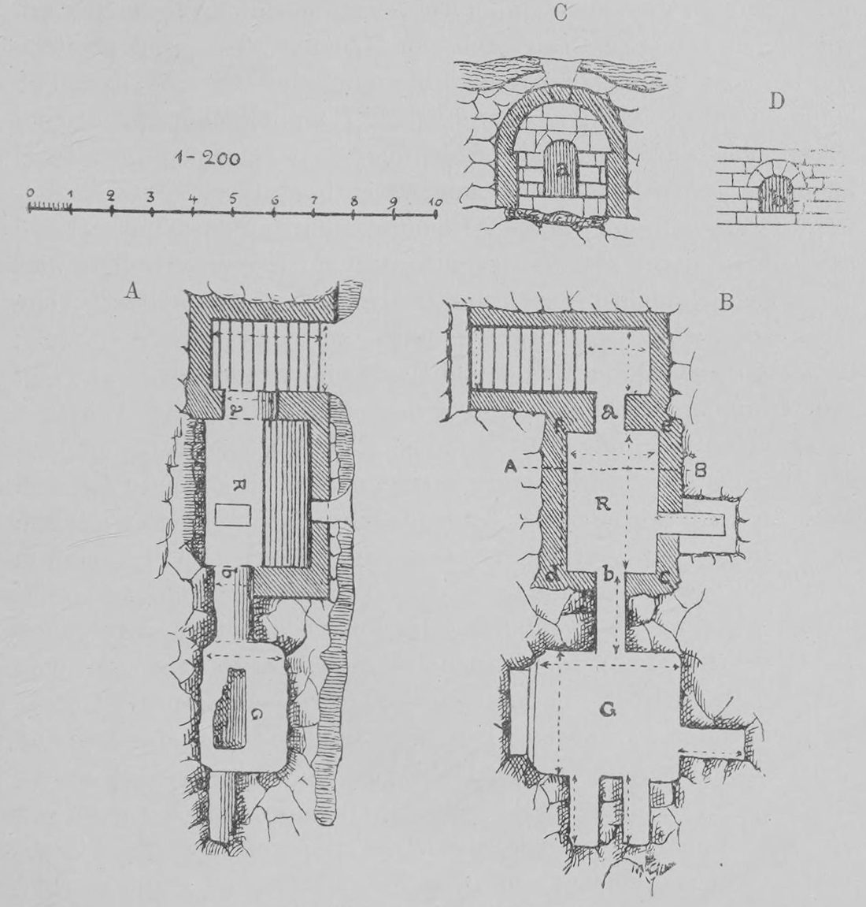

*Fig. 31. Felsengräber in Dschebata.*

A Längenschnitt von Norden nach Süden. a Eingang R gewölbtes Gemach b Gang G Felsengemach mit Nischen

B Querschnitt.

C Ansicht der Stirnwand e—f

D Ansicht der Stirnwand c—d entstand, sondern nach Bedarf immer erweitert wurde; schon die Zahl der aus einem „Hof“ sich verzweigenden Höhlen wird davon bedingt gewesen sein, noch mehr aber die Zahl der *kûkhin*, von denen einige selbst nach den Quellen neu eröffnet (חנך) wurden und die manchmal auch übereinander lagen[^132.520]. Zuweilen lagen auch die Höhlen übereinander (Doppelhöhlen S. 3) und waren bloß durch eine Erdschichte (קרקע) getrennt; manchmal lagen sie hart nebeneinander und waren bloß durch eine Scheidewand (כותל) getrennt; beide Arten Trennung wiederholen sich bei den *kûkhin*, deren symmetrische Anlage auch deswegen nötig war, damit sie sich nicht kreuzen und Brüche bewirken könnten[^132.521]. Die Decke der Höhle war zuweilen flach, zuweilen gewölbt (מקורה); die *kûkhin* aber, deren Boden und Wände mit Steinfliesen ausgelegt sein konnten, versah man immer mit einer mäßigen auf 1 Tefach berechneten Wölbung (כִּפָּה vgl. Bd. I, S. 27), wodurch das Einschieben der Leiche erleichtert werden mußte; sie erinnern dadurch auch an die Arkosolien der Katakomben[^132.522]. Von einem sonstigen architektonischen Aufbau verlautet in unsern Quellen nichts; aber nach den Funden läßt sich eine mehr oder weniger monumental gehaltene Ausgestaltung des Portals annehmen, das auch die Inschrift (כתב), d. i. den Namen des Besitzers, wovon flüchtig die Rede ist, enthalten haben wird; ein fernerer Luxus, der nicht selten war, bestand in dem Mosaikboden (Bd. I, S. 36) und in der Marmorvertäfelung der Höhle; dagegen kommen Malereien, ob nun gleichgültiger Art oder mit sepulkralen Beziehungen, bei den Juden kaum vor, denn die wenigen bemalten Grabhöhlen, die man bisher auf palästinischem Boden gefunden hat, rühren wohl von heidnischen Bewohnern her, die prächtigsten, die in Marissa, erweisen sich nach den beigegebenen Inschriften als der Besitz der dortigen phönizisch-hellenistischen Kolonie und sind zudem bedeutend älter als die rabbinische Zeit[^132.523].

Die Mišna spricht, wie gesagt, zumeist von *kûkhin*, Schiebgräbern. Doch gibt es auch Senkgräber, wenn nämlich ein „Sarg“ (ארון) in den Felsboden eingearbeitet ist; sie können frei stehen oder in Höhlen liegen[^132.524]. Sodann gibt es Bank- oder Auflegegräber, wenn nämlich längs der Felswand, sicherlich in der Höhle, Steinbänke, Marmortafeln oder mit Mosaik belegte Stellen laufen, auf welche man die Leichen legte[^132.525]. Endlich Troggräber, Tröge von Körperlänge, die man in den Stein- oder Erdboden bettete[^132.526].

Vom Verschluß der Höhle — schon zum Schutze vor wilden Tieren — hören wir in den Quellen nichts; es wird eben der gewöhnliche Verschluß von Wohnhäusern gewesen sein[^132.527]. Dagegen hören wir oft von dem Verschluß der einzelnen Nischen. Vor jeder Nische stand ein quadratischer Steinblock (גולל)[^132.528], der, da er nicht eingemauert, d. i. nicht durch Mörtel an der Felswand befestigt war, durch einen vorgelegten Stützstein (דופק) gehalten wurde; genügte die eine Stütze nicht, so legte man noch einen Stein oder mehrere Steine vor[^132.529]. Das wurde in Wirklichkeit so gefunden in einer Grabkammer auf dem Tel-el-Mutesellim[^132.530]. Das Grab wurde in bezug auf Unreinheit erst dann für fertig erachtet, wenn der Steinblock eingesetzt war (סתימת הגולל)[^132.531]. An dem Vorabend eines Paschafestes, als es sich darum handelte, daß die Männer für das Paschaopfer rein blieben, traf es sich, daß statt der Männer ihre Frauen in die Höhle gingen und einen Strick um den Block banden, an dem die Männer von außen zogen, um die Grabnische zu öffnen; die Frauen konnten nun den Toten beisetzen, und die Männer konnten noch an demselben Tag ihr Paschaopfer darbringen[^132.532]. Ein solcher Stein lag auch vor Jesu Grab[^132.533]. War in der gewünschten Größe keiner da, wurden zwei große Steine vereinigt; manchmal wurde ein Balken (קורה) als Grabverschluß angewandt, und zwar konnte der Balken aufrecht stehen, an der Seite liegen oder auch mit dem Stumpf die Graböffnung schließen; ebenso konnte ein wohlverschlossenes Faß oder ein Haufen Kieselsteine den Verschluß bilden, wogegen die Verwendung eines lebenden Tieres — etwa eines Hundes — zu gleichem Zwecke wohl nur kasuistisch gemeint ist[^132.534].

Äußerlich trug die Grabanlage einen Schmuck von Bäumen und Blumen (Rosen, Lilien), die sich zu Gebüschen (פרעות) und Lauben (סככות) verdichten konnten[^132.535]. Doch durften in der Gräberanlage weder Wasserrinnen (אמת המים) noch ein Steg (שביל) angelegt, noch Holz oder Gras zur Feuerung gesammelt (vgl. Bd. I, S. 84), noch das Vieh geweidet und auch nicht spazieren gegangen werden[^132.535a]. Auch die Nachbarschaft der Gräber (שכונת קברות) wurde in gewissem Betracht geehrt[^132.536]; namentlich mußte zu dem Familiengrabe ein hinlänglicher Fußsteg von jedermann zugestanden werden[^132.537]. Bei größeren Grabanlagen wohnte in einem Häuschen ein Wächter[^132.538]. Nicht gern sah man, wenn Tritte der Lebenden die Särge der Toten trafen; auch war es eine zarte Aufmerksamkeit gegen die Toten, daß man nicht mit von Schaufäden behangenen Mänteln über die Särge hinschritt, was einer Beschämung der zur Untätigkeit verdammten Toten gleichgekommen wäre[^132.539]. Im übrigen wurden die Gräber fleißig besucht und waren der Nährboden für abergläubische Vorstellungen[^132.540].

Nach einer Ruhe von ungefähr einem Jahre, da der Leichnam auf dem Begräbnisorte bis auf die Knochen verweste (נתאכל נתעכל, בלה, כלה), wurde das Nischengrab, welches eigentlich gar nicht verschlossen war, geöffnet und die Gebeine behufs neuerer Bergung gesammelt (לקוט עצמות)[^132.541]. Die Sammlung geschah entweder durch den Totengräber (oben S. 74), durch die Beerdigungsgenossenschaft (S. 63) oder durch die Angehörigen, wie z. B. im Falle der Hingerichteten (S. 73), deren Gebeine aus dem Gerichtsfriedhof erst jetzt durch ihre Verwandten in das richtige Familiengrab überführt wurden[^132.542]. Kinder sollten aus schuldiger Ehrfurcht die Gebeine ihrer Eltern nicht sammeln[^132.543]. Die Gebeine wurden wie Mumien mit linnenen Binden umwickelt (צרר בסדין, כרך וקשר) oder in feste Geräte, z. B. in Körbe (קופות) oder Säcke (דיסקיא) gebracht, nachdem sie vorher mit Öl und Wein gesalbt worden waren[^132.544]. Die Gebeine von Männern sollten nur Männer, die von Frauen nur Frauen sammeln[^132.545]. Die Gebeine zweier Toten sollten nicht zusammengewürfelt werden; die eines jeden kamen in einen besonderen Sarg. Er wurde aus Zedern oder Ton und weichem Stein gemacht, hieß „Kiste“ (גלוסקמא), weil er natürlich viel kleiner war als der Sarg, und derart sind die vielen kleinen Särge aus Ton, die man in Palästina gefunden hat und die man sich anfänglich wegen ihrer Kleinheit nicht erklären konnte, wo sie doch richtig nur Ossuarien sind[^132.546]. Es sind viereckige Kisten mit einem Deckel, zumeist mit Rosetten und geometrischen Figuren verziert, häufig hebräisch oder griechisch den Namen des Toten tragend, weshalb sie in unseren Museen einen wichtigen Bestandteil der palästinischen Archäologie bilden[^132.547]. Die Gebeine wurden nun unter partieller Wiederholung des Trauerrituals (Leichenreden S. 335)[^132.548] wieder in Höhlen oder auf Feldern beigesetzt, welche nun Knochenhäuser (בי טמיא) hießen[^132.549].

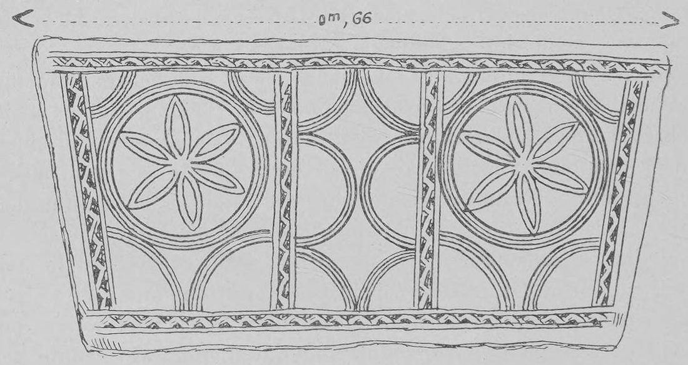

*Fig. 32. Jüdisches Ossuarium.*

In den früheren Begräbnisstätten entstanden nun Kenotaphien, und es konnte vorkommen, daß ein aufgelassenes Gräberfeld aus Versehen oder absichtlich mit dem Pfluge bearbeitet wurde, und dann finden sich inmitten der Erdschollen wohl noch zersprengte Knochenteile, weshalb das Knochenfeld (בית הפרס) den Charakter des Grabes beibehält und durch ein Mal (w. u.) als unrein bezeichnet wird. Die Knochen kamen auch zum Vorschein durch das bloße Wegblasen des Staubes; sah man keine, wurde das Feld für rein erklärt[^132.550].

[^132.501]: Siehe A. 448 und Bd. I, S. 141 A. 171.
[^132.503]: MBb 2,9 (in Festungen wurde erst recht nicht begraben MKel 1,7); bBb 25ᵃ; vgl. Luk 7,12; Joh 11,30; Matth 8,28, JAHN 1,2, 532 (Jahns Behauptung, daß im Orient noch heute so, trifft nicht zu, denn z. B. in Jerusalem findet man genug Gräber innerhalb der Mauern, z. B. beim Jaffator). Nach jMakk 2 E. 32ᵃ durfte auch in den Levitenstädten nicht begraben werden. Rom im Zwölftafelgesetz *hominem mortuum in urbe ne sepelito neve urito* (MOMMSEN, Staatsverw. 3,296 A. 7, MARQ. 361). In fruchtbarer Erde sollte nicht bestattet werden (LIEBENAM, Städteverwaltung S. 35 f.). Daß העיר = Jerusalem, ersieht man MSanh 1,5 אין מוסיפין על העיר s. Raši. Duldung der Davidischen und Prophetengräber s. A. 454, REJ 53,32. So fand man in Gortyna auf Kreta ein vornehmes Grab im Tempelbezirk, denn mit Vornehmen machte man eben eine Ausnahme, s. ANGELO MOSSO, The Palaces of Crete and their Builders, London 1907, S. 100.
[^132.504]: TʾOhal 16,9, 614₂₆ קבר המזיק את הרבים, ib. 11 Z. 30 המפנה קברו לרשות הרבים. Einzelgräber auf privaten Grundstücken Joseph. Ant. 10,4; Joh 19,41; bJebam 86ᵇ. TʾOhal 16,12, 614₃₁ בתוך שדהו. Nicht auf offener Straße bSabb 151ᵃ s. Raši.
[^132.505]: מערתא bBm 85ᵇ, bBb 58ᵃ, bNidda 24ᵇ, bMḳ 17ᵃ. Hie und da stürzt so eine Höhle (מערתא) ein: jAz 3,1, 42ᶜ₃₈. JAHN 1,2, 535; WINER *Gräber* 1,444; *tombs* JE 12,183, MGWJ 49,670. Dagegen künstlich gehauenes Grab (oder Denkmal) μνῆμα λαξευτὸν Luk 23,53; τάφος, μνημεῖον Matth 23,27; 27,52 f. מע־ה מקורה jNazir 9,27ᵈ₃₀, jḲidd 4,57ᵈ₃₃ (KLEIN S. 76 A. 2). כיפה Var in TBb 6,22, 407₁.
[^132.505a]: כוכין sing. כוך, nabat. גוחא (assyr. *kimaḫḫu*, Etymol. s. auch bei PERLES S. 30 A. 75. I. LÖW in Lwr 2,282), auch גומחיא, גומחין auf palmyr. Inschriften (aber auch מערתא z. B. No. 42 bei D. H. MÜLLER, Palm. Inschr. in Denkschriften der Akad. Wien 1900, 46,14; No. 46 S. 19; ib. אכסדרא, כפתא); KLEIN S. 69 A. 6. שית und דיומרין s. MGWJ 49,671. 669. Das Wesen der Familiengräber kommt gut zum Ausdrucke jMḳ 2,4, 81ᵇ₅₁: „Den Toten und seine Gebeine darf man nicht wegschaffen (פנה s. A. 504) aus einem vornehmen Grabe (קבר מכובד) in ein andres vornehmes, noch aus einem geringfügigen in ein andres geringfügiges, nicht aus einem geringfügigen (בזוי) in ein vornehmes und noch weniger aus einem vornehmen in ein geringfügiges, es sei denn, es handle sich um sein Erbgrab, da kann er selbst aus dem vornehmen Grabe in das geringfügige geschafft werden, denn es ist dem Menschen angenehm, bei seinen Vätern bestattet zu sein“. Bar bBb 100b המוכר קברו כו׳, ib. באין בני משפחה וקוברין אותו und zwar משום פגם משפחה. Vgl. קברות אבותיהם MSanh 6,7. Fluch der Grabschänder oder wenn jemand einen Fremden im Familiengrab begräbt auf nabat. Inschriften bei EUTING No. 2; BENZ. 164; NOWACK 1,192; um so rührender die Sorgfalt für Sklaven oben A. 447a. חצר MBb 6,8; bei Lebzeiten angelegt s. RSbM bBb 100b. Sie werden Palästen übergeordnet: bSanh 96b קברות שלהן מעולין מפלטירין שלך.
[^132.506]: חצר הקבר MʾOhal 15,8, T 15,7, 612₃₈ als גת bezeichnet: זו הגת שהמערות פתוחות לתיכו, ib. שקוף vgl. כיפה und כפתא A. 505. 505a. bBerakh 14b החופר כוך למת בקבר (da kann קבר gewiß nur die ganze Grabanlage sein). Auch wenn sich Menschen dort aufhalten, z. B. bSanh 29b ההוא דאכמין עידים בקברא לחבריה. RAkibas Grab s. Midr Prov 9,2, JQR 14,745. Den palästinischen Sinn von קבר kennt man in Babylonien offenbar nicht, wie man bBb 101a 102b sieht; s. ZUCKERMANDEL in MGWJ 23,132 f. 183f., KLEIN S. 69 f. ausführlich. בור TNidda 6,15, 648₁₆. פוסא (Lwr 2,432) TʾOhal 16,1, 614₃₄. Gräber der Hingerichteten MSanh 6,7. Im Kriege Gefallene wurden auf dem Schlachtfelde bestattet, bʿErub 17a. Solche Notgräber dürften סוכרי (= Verschließe) heißen, bKethub 17a, bSanh 47b unten RN (Agg. סינרי). Gräberfelder wie in שדה כוכין vorgebildet; TʾOhal 17,1, 616₇ ואיזו היא שדה כוכין כל שחופר בארץ ומבליע את הכוכין לצדדין, vgl. bMḳ 8b und die LA שדה בוכים oben S. 68.
[^132.507]: Siehe Illustrationen in JE zu *tombs*. ZDPV 13,175 Grabkammern in Haifa.
[^132.508]: A. 505a.
[^132.509]: Gen R 23 p. 227 Th. bSota 34b.
[^132.510]: מהמרות Ps 140,11 nach Symm., Hieron. und Trg = Gruben, s. auch RDḲ s. v. המר; richtig auch K 5,95, J 737, BÜCHLER REJ 46,75. 84 (L 3,40 dennoch „Wasserströme“). מהמורות jMḳ 1,5, 80c₇₄, Sem 13 מכמורות. Juchasin ed. London p. 28b zitiert במהמורות und erklärt בחפירות.
[^132.511]: bKethub 111a in speziellem Gebrauche, doch wohl auch Grabstätten, sie werden wenigstens auch sonst in Verbindung mit Gräbern erwähnt, s. TBb 1,11, 399₈, ʾAboth RN α c. 35 p. 104. Was bJebam 121a מחלה (freilich של דגים) ist, ist TJebam 14,6, 259₁₁ פתחה של מערה, vgl. L 3,76. Sonst s. I, A. 10.
[^132.512]: MʾOhal 16,2, T 16,1, 613₃₆ תלולות של עפר שעל גבי בקוע, ib. 17,2, 615₁₀ התלולות opp. zu קבר, also Hügel und Höhlung. Entspricht dem *tumulus*, und die erhöhte Form bildet zugleich ein Denkmal, s. den Araber Ḥamasa bei JAHN 1,2, 543; reich belegt bei NOWACK 1,189 A. 1, GRÜNEISEN S. 124. **Ebene** in der Erzählung des Eleazar b. Zadok (Semachoth 12, Juchasin 28b בתחלה קברני בבקעה, richtig erklärt von Ašeri bei L 1,254b: ein Erdriss, der einstweilen als Grab dient (unrichtig BÜCHLER REJ 42,76). Zu vgl. שני בצעים היו בהר המשחה bŠebuʿoth 16a RN (Agg ביצעין), vgl. TSanh 3,4, 418₂₁ בצעין, wo im Verlauf gesagt wird שתורפה של ירושלים משם ונוחה ליכבש משם, also nicht „Teiche“ (L 1,252), sondern Erdspalten, Täler.
[^132.513]: TʾOhal 16,2, 613₄₀ כוך בקיע ומערה.
[^132.514]: PEF Qu. St. 1901, 11 f., DALMAN, Petra und seine Felsheiligtümer S. 230; derselbe im Palästina-Jahrb., 1908, 29 A. 1. כמין שובך Lev R 5,5 (שובך bSota 42b etwas Hohes, doch kann auch die Form gemeint sein).
[^132.515]: דחפיר וקביר טב מיניה bSabb 152a, Abba Saul bNidda 24b. bMḳ 20a (PERLES 29). Šimeon b. Abba Gen R 89,1, Jalḳ 1,147. BÜCHLER, Der gal. ʿAm ha-ʾAreṣ S. 81 A. 1. Sprichwort בעינא חוטרא לידא ומרא לקבורה s. Bert und L. Heller zu MNedar Ende. Sonstige Werkzeuge bTaʿan 21b, L 1,510, K 3,265, REJ 56,213.
[^132.516]: MBb 6,8, T 6,22, 406₃₄ b 101a; s. ZUCKERMANN, Das Mathemat. im Talmud (Jahresbericht d. Breslauer j.-theol. Seminars, 1878) S. 58 ff.
[^132.517]: Ähnlich die Gräber im Hinnomtal; besonders aber auf Tel-el-Mutesellim MuNDPV 1906, 21. KLEIN S. 77; Gesamtansicht der Grabmäler im Tale Josafat s. bei DURM (s. Bd. I S. 1) S. 755, darunter das sogen. Jakobusgrab. Überhaupt die Abbildungen bei DURM zu vgl., Zachariasgrab S. 122. 757, Absalomgrab S. 753—758; Gräbertypen aus Petra S. 750. 751 (Pylontypus, Doppelzinnentypus, Stufengrab, Bogengrab, Tempel- oder Gartengrab, Obeliskengrab usw. Alles auch bei Domaszewski-Brünnow Die Provinz Arabia I. II. und bei DALMAN (s. A. 514).
[^132.518]: TBb 6,23, 407₃.
[^132.519]: ראשו של זה בצד ר׳ של זה bNazir 65a, Sem 8.
[^132.520]: MMḳ 1,6 (b 8b) חפר und חִנֵּךְ. jBb 6,8, 15c₃₇ בני חדא מלעיל וחדא מלרע.
[^132.521]: bBb 101a b.
[^132.522]: A. 505. רצפה und טבלא של שיש jNazir 6,56b unten; oben A. 420. Mein *Catacombs* in JE 3,614.
[^132.523]: bHoraj 13b כתב שעל גבי הקבר. Wir kennen viele Gräberaufschriften, z. B. der בני חזיר, mehr noch in gr. Sprache aus Pal., Syrien, Kleinasien und Ägypten. Zu Marissa s. I, A. 732.
[^132.524]: ארון שהוא חקוק בסלע TʾOhal 10,7, 607₃₄, aus מכוסה ib. folgt ein freiliegender Typus. Ib. בנוייה בכותלה של נפש.
[^132.525]: jNazir 6,56b (A. 522) und TʾOhal 2,3 (A. 420).
[^132.526]: TʾOhal 17,1, 615₇ משוקעין ברובדים ובאבנים.
[^132.527]: WINER, *Gräber*. Berühmt die Tür des Mausoleums der Helene, s. L. LÖW, Ges. Schr. 2,349.
[^132.528]: Die Frage der richtigen Bedeutung von גולל ודופק ist noch nicht gelöst. Irrtümer (Tosafoth bKethub 4b) s. bei L. LÖW, Ges. Schr. 3,457 A. 1; er selbst (2,350) definiert גולל als den Stein, welcher an den Eingang der Gruft gewälzt wird, דופק als den Stein, welcher vom Golal gleichsam gestoßen wird (JAHN 1,2, 538). Dies stände bereits in MʾOhal 2,4 איזהו הדופק את שהגולל נשען עליו; also weder Sargdeckel noch Denkstein. Auch L 1,335 Verschlußstein. Ich habe dabei an die Katakomben gedacht, wo jeder *loculus* mit einem angelehnten Stein versperrt wurde, und so habe ich im Texte dieses Werkes גולל als vor der Nische lagernd hingestellt; ich muß nun (nach einem halben Jahre) „Nische“ in „Höhle“ oder „Grabanlage“ berichtigen, denn גולל ist unzweifelhaft der Stein, der den Eintritt in die ganze Höhle verstellt; vgl. Jos 10,27 אבנים גדלות על פי המערה. ZUNZ, Zur Gesch. u. Lit. S. 392 A. c) erinnert daran, daß noch im 4. Jh. der Stein vor dem Eingang des Grabes oder der Totenkammer lag (Cyrillus Bischof von Jerusalem bei Nicolai, *de sepulchris* p. 180); Äußerungen von rabbin. Autoritäten über גולל verzeichnet ZUNZ ib. in großer Menge. Das von ZUNZ gemeinte Grab ist aber sicherlich in dem oben berührten Sinne von „Grabanlage“ aufzufassen. Siehe bMḳ 27a; Sem 4,11 מאחר שנסתם הגולל . . . ואמרו אל יטמא פתחו לו הקבר ויראה, s. Ašeri zu bMḳ III, 87; N. BRÜLL, Jahrb. 1,39, 83; BÜCHLER, Der gal. ʿAm ha-ʾAreṣ S. 328 A. 1: חצי הקבר. Der Stein hat seinen Namen von dem Umstande, daß er als schwere Last zu dem Höhleneingang **gewälzt** wird; vgl. Matth 27,60, Luk 24,2, Mark 15,46; KLEIN S. 85 A. 4. Vgl. אבנים שחצבן לשם מת jMeg 3,1, 73d₅₈. [גולל ist, wie mir Dr. Yahuda an einem Modell klar machte, der mühlsteinförmige, zwischen zwei Steinwänden laufende Stein, der von der Seite her vor den durch beide Wände gehenden Grufteingang gerollt wird und dessen Wegrollung durch den seitlich vorgelegten דופק verhindert wird. I. Löw.]
[^132.529]: MʾOhal 2,4 דפק דופקין; von דפק anstoßen.
[^132.530]: A. 517.
[^132.531]: bSanh 47b, bMḳ 27a.
[^132.532]: TʾOhal 3,9, 600₁₇ (nach auf Grund der Anführung in Tosafoth bKethub 4b verbesserten LA) מעשה . . . באחד שמת ערבי פסחים (והלכו וקברו) [ולא רצו לקברו] ונכנסו ה(א)נשים וקשרו את החבל בגולל . . . וקברו[הו] . . .
[^132.533]: Matth 28,2, Mark 16,3. 4, Joh 11,38; 20,5. 11; s. auch A. 528 Ende; überhaupt hat die Sache auch für die christliche Altertumskunde ein eminentes Interesse.
[^132.534]: MʾOhal 15,8. 9, T 15,8, 613₂, bʿErub 15b.
[^132.535]: MTohar 3,7 תינוק שנמצא בצד בה״ק ושושנים בידו (PERLES S. 25); אילן מאהיל (vgl. bʿErub 43b) TNidda 6,16, 648₁₉. ככות und פרעות MNidda 7,5, MNazir 7,3, bMḳ 5b, ib. Bar מצא שדה מצויינת . . . יש בה אילנות usw. Ebenso Araber s. JAHN 1,2, 540.
[^132.535a]: bMeg 29a (Wasserbach aus einem Gräberort ist unrein MJad 4,7; PREUSS S. 9), Semachoth 14.
[^132.536]: MʾOhal 16,3, T 16,2. 3, MNazir 9,3.
[^132.537]: MBb 6,7, b 100b דרך הקבר אין לה שיעור משום יקרא דשכבא.
[^132.538]: MʿErub 5,1, T 6,4, 144₂₂ בית דירה, b 55b Raši. Vgl. die Cepothaphien und die *tutela sepulcri* der Römer bei Marq. S. 369. 370. מסמר או יתד קבוע בבית הקברות (Lev R 5,5, RN hat בבהכ״נ) scheint das Zeichen des Besitztums zu sein; vgl. Bd. I, S. 39.
[^132.539]: Bar bBerakh 18a מהלך בבית הקברות, ib. 19b מדלגין היינו ע״ג ארונות של מתים, j 2,3, 4c (ib. 6a unten), Ḳohel R 9,5, Pesiḳta R c. 12 p. 46b.
[^132.540]: WINER 1,445: Matth 8,28, Apostelg 16,16. bʿErub 43b.
[^132.541]: MSanh 6,6 von Hingerichteten נתעכל הבשר מלקטין את העצמות Agg. und ed. Neapel, ed. Lowe und ms Kfm jedoch נתאכל, T 9,8, 429₂₆ ניתעכל, jMḳ 1,5, 80c₇₄ נתאכל, im Zitat Juchasin 28b נתעכל. Vgl. MBerakh 8,7 und s. FRANKEL, Darke ha-Mišna S. 228. Nach Tanch *Vajiḳra* 8 verwest (כלה) der Körper in 12 Monaten (s. auch bSabb 152b), und so lange dauert bekanntlich auch das Gericht der Frevler in der Hölle. Auch בלי, z. B. bBerakh 5b להאי שופרא דבלי בעפרא, von einem schönen Weibe bAz 20a.
[^132.542]: MSanh 6,6. חבורות TMeg 4,15, 226₁₅, Sem 12 (sehr anschaulich), vgl. MMḳ 1,5(8a), j 80c₇₃. BÜCHLER REJ 42,75 f. verkennt total die Sache, wenn er meint, die Sammlung der Gebeine sei nur in außerordentlichen Fällen (etwa bei Verbrechern) in Gebrauch gewesen.
[^132.543]: Semachoth 12.
[^132.544]: bMḳ 8a. דסקיא bBerakh 18a, j 3,5, 6d₄₈ verpackt auf den Esel, nur darauf nicht reiten מפני שנוהג בהם מנהג בזיון. קופות TʾOhal 4,2, jBerakh 1,3a 18, bNazir 52a. יין ושמן Sem. 12.
[^132.545]: Sem 12 האיש כורך ומקשר לאיש usw.
[^132.546]: V. SCHULTZE z. B. konnte sich die zahlreichen kleinen Sarkophage nicht erklären (ZDPV 4,9—17); s. dagegen Z. FRANKEL MGWJ 1881 529—539; D. KAUFMANN, Gött. Gelehrte Anz. 1886 No. 3. Ich selbst habe manches Stück auf dem Ölberg und am Felde im syr. Waisenhaus zu Jerus. gesehen.
[^132.547]: CLERMONT-GANNEAU, Mission en Palestine et en Phénicie, 5e rapport, Paris 1884, série I No. 12 (Ornamente in Relief), série II No. 77, No. 78 (mit Figur eines Gebäudes, das eine zweiflügelige offene Tür hat), No. 79. Siehe „Catalogue“ des Louvre No. 18. 19. 20. 21 (aus den „Königsgräbern“, mit spitzem Deckel, weil für eine Frau bestimmt), 23. 24. 25. 49. Ossuaires Juifs s. Revue Biblique, nouv. Série IV., 1907, 410—414, MuNDPV 1909, 14.
[^132.548]: MPesach 8 E. (b 92a) והמלקט לו עצמות.
[^132.549]: bBerakh 6b, bSanh 113a; eigentümlich RN = אבל auf dem Wege eines Buchstabenspiels, s. jedoch K 4,38.
[^132.550]: MʾOhal 17,1. החורש את הקבר (bNidda 57a בית הקברות) M fortfahrend הרי זה עושה בית הפרס; ib 18,2. 3. 4 (zitiert in bMḳ 5b) שלשה בית הפרס הן שדה שאבד בה קבר ושדה שנחרש בה קבר ושדה כוכין (Raši bNidda 57a, Agg. בוכין) vgl. A. 506. Ib. 2,3. Mehreres auch T 17,6 f. p. 615. bBerakh 19b. TŠebiʿith 3,13, 64₃₁. MʿErub 3,1, bKethub 28b מנפח אדם בית הפ׳ והולך. Maim. setzt פרס = פרש ausbreiten, richtiger פרס brechen L 4,123b. I. Löws φόρος Lwr 2,492, OLZ 1909, 12, 408—411 (anläßlich der Besprechung des Kleinschen Buches) muß ich für verfehlt halten.

## § 133

**133.** **Grabmonumente.** Damit die Kenotaphien und die möglicherweise Knochen enthaltenden Felder kenntlich blieben, ließ die Behörde an beiden Enden je einen Stein als Mal (bh. und nh. צִיּוּן) aufstellen. Dieses Warnungszeichen, der *cippus* der Römer, bezeichnete die Grabarea und sollte Annäherung und mithin Verunreinigung am Grabe verhüten. Man bezeichnete auch den Platz, auf welchem Steine gelagert waren, die aus einem mit Aussatz behafteten Haus herrührten, was allerdings eine Seltenheit war (Bd. I, S. 57)[^133.551]. Das Warnungszeichen wurde alljährlich am 15. Adar, also nach der Regenzeit, neu mit Kalk bestrichen (סוד בסיד), und wenn mittlerweile wieder Regen fiel, abermals verkalkt, eine Arbeit, die auch am Halbfeiertage (des Pesach) verrichtet werden durfte, ein Beweis ihrer Wichtigkeit[^133.552]. Des Males bedurfte es nur, wenn die betreffende Stelle zweifelhaft war, also bei aufgelassenen Gräberfeldern, oder wenn das Grab durch Laub, Gebüsch und vorkragenden Stein verdeckt war, nicht bei auspesprochenen Gräberfeldern[^133.553]. Man stellte den viereckigen Stein hart am Grabe oder am Gräberfelde auf, denn es sollte nur der Fleck allein als unrein bezeichnet werden, vom sonstigen Terrain aber nichts eingebüßt werden. Das Bestreichen des Steines mit Kalk gab ein Mittel ab, den Gräberstand anzugeben; war das Mal nur auf einer Seite angestrichen, so war eben dort das Grab; auf zwei Seiten, waren zwei Gräberstätten da; ebenso wenn auf drei Seiten; waren aber vier Seiten angestrichen, so befanden sich die Gräber nicht gerade am Stein, sondern auf dem ganzen Feld. Ebenso bezeichnete ein Mal nur das, was darunter war; zwei Male hingegen das ganze von ihnen begrenzte Feld, wenn nicht Ackerfeld dazwischen lag[^133.554]. Die bekalkten Gräber (τάφοι κεκονιαμένοι) kommen auch in den Evangelien vor[^133.555].

Über oder an dem Grabe befand sich außerdem ein monumentaler Bau, den man — auch bei andern Semiten — „Denkmal“ (נפש μνημεῖον) nannte; griechische Inschriften nennen es „Stele“, „Pyramide“, was zugleich über seinen Bau Aufschluß gibt[^133.556]. Die ersten Erbauer waren wohl die Phönizier, deren Land noch manches dieser Denkmäler aufweist. Dies stimmt überein mit der Wahrnehmung, daß die jüdische Bauart überhaupt von den Phöniziern abhängig ist, und daß auch speziell im Gräberwesen sich die Phönizier hervortaten (Bd. I, S. 42 und o. 76). Doch kennen wir auch aus der jüdischen Geschichte das Denkmal der Makkabäer, welches Simon Makkabi, und das Denkmal am Grabe Davids, welches Herodes errichten ließ[^133.557].

Man hatte zwei Arten von Denkmälern: 1. Massive Blöcke oder Monolithe (נפש אטומה), die nur als Denksteine dienten, in die jedoch mitunter bienenzellenartig Särge eingebaut waren, wie wir sie von den Etruskern kennen und als deren Beispiel in Jerusalem die Pyramide des Zacharias dienen kann, die freistehend aus dem natürlichen Felsen gehauen ist; da sie unzugänglich sind, so waren für etwaigen Aufenthalt von Menschen Anbauten, eine Art Schuppen oder Hütten, nötig[^133.558]; 2. Mausoleen mit durchbrochenen Wänden, also wohl von Säulen getragen, mit einer bewohnbaren Kammer (דירה), in der sich die Besucher des Grabes, ständig vielleicht der Wächter (S. 78), aufhielten; als Beispiel mag das Absalom-Monument in Jerusalem dienen[^133.559]. Wenn diese Denkmäler Gräber enthielten, was im allgemeinen nicht der Fall war, mußten auch sie mit Kalk bezeichnet werden[^133.560]. Ihre Herstellung muß teuer gewesen sein — es ist auch ausdrücklich von den Kosten die Rede — und sie wurden gewiß nur Vornehmen gesetzt[^133.561]. Zu diesen Vornehmen zählten nun die Schriftgelehrten nicht — sie waren bekanntlich sehr arm (vgl. S. 18) — und aus ihrem Kreise findet sich das Wort: „Den Frommen stellt man keine Denkmäler (נפשות); ihre Worte (= Lehren) bilden ihr Andenken (זכרון)“. Daraus folgt, daß das Denkmal den Namen des Toten am besten zu verewigen geeignet war; man sprach etwa: „Denkmal des und des“; einmal findet sich: „Denkmal der Ägypterin“, und einmal sogar das „Denkmal des Hundes“ (נפשא דכלבא), welches nämlich einem klugen und treuen Hunde gesetzt wurde[^133.563].

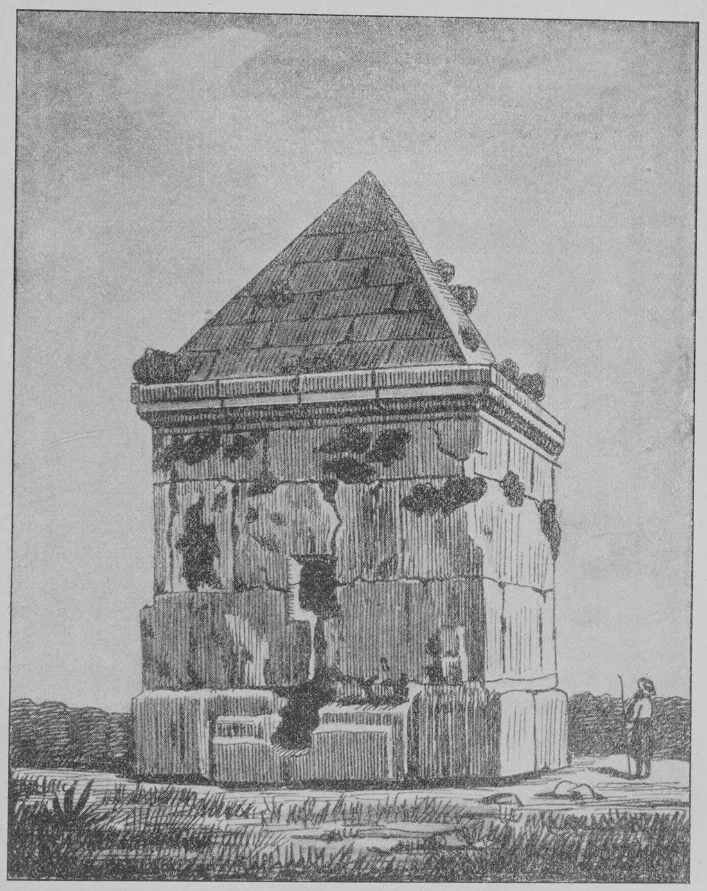

*Fig. 33. Phönizisches Grabdenkmal bei Amrit.*

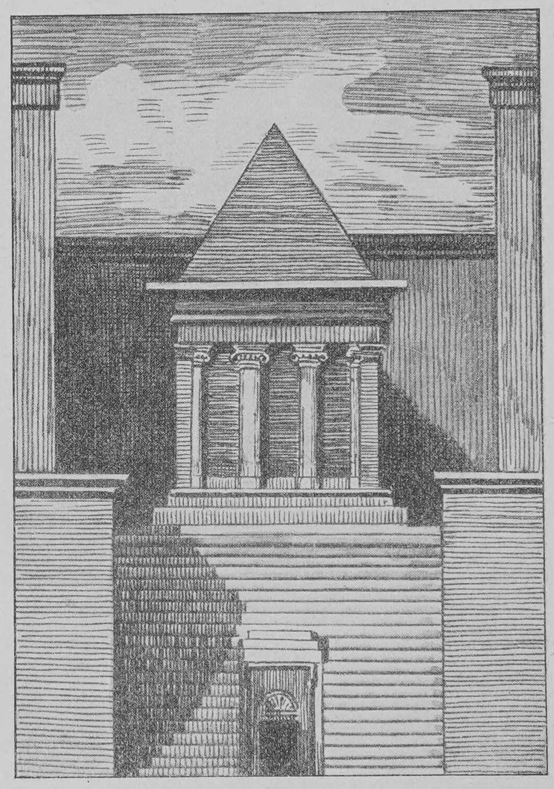

*Fig. 34. Grab des Zacharias in Jerusalem.*

[^133.551]: ציון קברות wird Bar bMḳ 5a aus Ezech 39,15 abgeleitet. Vgl. auch II Kön 23,17. Nach TBekhor 3,12, 537₂₉ sieht es aus, als ob die Bezeichnung der Gräber von Priestern besorgt worden wäre. כותים s. MNidda 7,5. Nach MMḳ 1,1 ומציינין את הק׳ ist es Sache der Behörde; s. auch MŠeḳal 1,1, beidemal Bestreichen mit Kalk, was nach der Regenzeit immer nötig wurde. jMḳ 80b₇₁, jŠeḳal 55d₅₂, jMš 55d₅₂, jSota 23c₉. *Cippi* auch bei Römern, deren sich mehrere erhalten haben, z. B. in Aquileia (DURM² 751). Nach Bar bMḳ 5b kann selbst bei שדה מצויינת fraglich sein, ob das Feld Gräber enthalte (מה טיבו). אבנים מנוגעות TNeg 6,1, 625₇. צייניה bSabb 34a oben s. Raši. כציון בית הק׳ TKil 2,16, 76₁₉.
[^133.552]: MMḳ 1,1, b 5b.
[^133.553]: Bar bMḳ 5b, s. Tosafoth, wonach die Sache nicht auf יום טוב gehen muß, sondern allgemein gehalten ist.
[^133.554]: bMḳ 6a מצד אחד; nicht wie Tosafoth meinen הציון הוא מסיד, denn MMš 5,1 כרם רבעי מציינין אותו usw. zeigt eben, daß feste aufragende Körper notwendig sind (Erdschollen, Ziegelbruch und Kalkschmuck, dieser natürlich auf eine Säule aufgetragen); ib. וממחה ושופך wie bMḳ 6a כשהסיד שפוך ומרודה לכאן ולכאן. Ib. ואין מרחיקין ציון usw.
[^133.555]: Matth 23,27. Unbezeichnete Gräber (μνημεῖα ἄδηλα) Luk 11,44.
[^133.556]: נפש syr. ܢܦܫܐ PSm 2422; DUVAL, Revue Sémitique 2,259f. jŠeḳal 2,5 Var. דומוס s. L. LÖW, Ges. Schr. 3,456 A. 2. Nach RHai zu MʾOhal 7,1 und RN (5,370) sind נפש und ציון identisch, s. auch RSal. Parchon s. v. נפש (mit ungehöriger aggadischer Deutung), dem ist aber nicht so.
[^133.557]: I Makk 13,27—29. Josephus Antt. 16,7, 1.
[^133.558]: Folgt aus der Art, wie neben נפש אטומה gleich סמך לה סוכות steht MʾOhal 7,1. Maim. שוכ̈ה אלקבר; mehreres bei ZUNZ, Zur Gesch. u. Lit. S. 390. K 5,370. Sarg TʾOhal 10,7, 607₃₅: היתה בנויה בכותלה של נ׳; DURM² 127.
[^133.559]: MʿErub 5,1 (b 53a), in T 6,5, 144₂₅ steht קבר für נפש. Ib. נ׳ שנפרצה משתי רוחותיה, auch Bar b 55b, wo jedoch נ׳ und קבר wiederum verschieden.
[^133.560]: A. 558 und 556. TʾOhal 17,4, 615₁₆.
[^133.561]: 562. בנה נפש על גבה TʾOhal 10,7, 607₃₇. MŠeḳal 2,5 בונין לו נ׳ על קברו. Auch die Frommen sollen zu den Vornehmen zählen, aber ihnen sind die Taten die Denkmäler j ib. 2,7, 47a₄₀, Gen R 82,10; ZUNZ a. a. O. sieht jedoch mit Recht, daß auch in diesem Stück die Frommen die Armen sind.
[^133.563]: jDemai 2,1, 22d₂ (vgl. Lwr 2, 173), anders NEUBAUER, Géogr. S. 274. Hund Pesiḳta 79b (fehlt in jTerum 8,3).

## § 134

**C. Sklaven und Lohnarbeiter.**

**134.** **Erwerbung der Sklaven.** Obzwar den Griechen und Römern das Volk der Syrer und der Juden für die geborenen Sklaven galten, und obzwar es für sicher gelten kann, daß die Juden infolge ihrer vielen unglücklichen Kriege und der Lage ihres Landes ein großes Kontingent zum Sklaventum stellten[^134.564], so ist anderseits ebenso sicher, daß die Rabbinen mit ihrer Behauptung, ein Jude verkaufe sich freiwillig nur in der äußersten Not zum Sklaven, recht haben. Er sucht sich zu helfen, indem er erst die entbehrlichen Mobilien, dann seine Liegenschaften, ja sein Haus, schließlich auch seine Tochter (S. 20), ja auch seinen Sohn verkauft, und erst, wenn all das versagt, macht er Schulden, den ersten verhängnisvollen Schritt zum völligen Ruin, indem er sich durch die Schuldenlast genötigt sieht, sich selbst zu verkaufen, und zwar an einen im Lande ansässigen Heiden[^134.565]. Hätte er sich dem israelitischen Bruder verkauft, würde sein Sklaventum nicht viel bedeuten, da er nur eine fixe Zeit und gar nicht sklavenmäßig zu dienen hätte. Wenn man überdies gewissen Aussprüchen im Talmud trauen darf, war bereits während der Dauer des zweiten Staatslebens die Sklaverei eines Hebräers (bei einem Hebräer) nicht möglich, und danach ist alles, was über diese Materie in unsern Quellen gesagt wird, nur von theoretischem Interesse. Selbst in der Phraseologie „hebräischer Sklave“ (עבד) und „hebräische Magd“ (אמה) spiegeln sich durchaus nur biblische, nicht reale Verhältnisse jener Zeit[^134.566]. Aber die Tatsachen des wirklichen Lebens brachten die Sklaverei des „Hebräers“ immer wieder auf; so ein Vorfall unter König Schabur von Persien[^134.567], und die in religiöser Hinsicht Laxen konnten nach der Lehre der Rabbinen selbst zu Leibeigenen gemacht werden[^134.568].

Frauen und Proselyten durften keinen hebräischen Sklaven kaufen; Frauen nicht, damit sie nicht in Verruf kämen — doch brachte es die Kasuistik zustande, zu dekretieren, daß sie einen heidnischen Sklaven, gerade weil er von lasziven Sitten ist, halten dürfen — Proselyten wohl darum nicht, auf daß Stammesfremde nicht über Israeliten herrschen, schwerlich mehr als bloße Theorie. Weibliche Sklaven jedoch konnte sich auch eine Frau erwerben[^134.569]. Oft bringt sie diese, wohl heidnische Sklavinnen, in die Ehe mit (S. 45). Der Verkauf eines jüdischen Mädchens an einen jüdischen Mann kam *eo ipso* seiner Verheiratung gleich[^134.570]. Von einer jüdischen Frau im Sklavendienste eines Heiden wird nicht einmal gesprochen; eine solche Frau, wie übrigens auch ein hebräischer Sklave im Dienste eines Heiden, wurde von den Glaubensbrüdern mit allem Eifer ausgelöst (פדה)[^134.571].

Das jüdische Weib kann sich freiwillig nicht verkaufen, und ebensowenig kann es, etwa infolge eines Diebstahles, behördlich verkauft werden[^134.572]. Nur in einem Falle wurde eine Jüdin zur Sklavin: durch den Willen ihres Vaters, den nur die äußerste Armut dazu treibt (S. 83); schon die Mutter hat diese *potestas* nicht. Da solches Verkaufen eigentlich, wie gesagt, ein Verheiraten ist, so wird nur die minorenne Tochter davon betroffen, ebenso wie der Vater auch nur die minorenne Tochter verheiraten kann (S. 20)[^134.573].

Somit kann in der jüdischen Gesellschaft eigentlich nur von heidnischen Sklaven und Sklavinnen gesprochen werden; ihr Name, gleichfalls biblisch, ist כנעני und כנענית, „kanaanitischer“ Sklave und „kanaanitische“ Sklavin. Solche treffen wir in großer Menge an, denn obzwar einige riesige Zahlen, wie 400, 4000, 5000 zunächst nur aggadische Übertreibungen sind, und obzwar die Anekdote von 1000 Sklaven und 1000 Sklavinnen, die einander ehelichen sollen, im Hause einer römischen Dame spielt, so beweisen sie doch die Menge von Sklaven und Sklavinnen auch in jüdischen Diensten, und ganz reell klingt die Nachricht, daß die Sklaven ihren Herrn, den allerdings sehr reichen Eliezer b. Charsom (Bd. I, S. 132), persönlich gar nicht kennen, daß ferner einem Rabbi 60 Sklaven zum Geschenk gemacht wurden, und daß endlich eine Stadt ganz von heidnischen Sklaven bevölkert war[^134.574]. Das Heer von Sklaven in der Hand eines Besitzers hat nur Sinn auf Latifundien und in großen Ökonomien, wie im Falle des Eliezer b. Charsom, denn da hatte jeder Sklave, richtiger jede Gruppe von Sklaven, ihre eigenen Aufgaben; in Rom galt es bekanntlich für eine Schande, wenn ein Sklave zweierlei Verrichtungen versah, und darauf mag beruhen der von den Rabbinen so oft vernommene Satz: „Ein Bote verrichtet nicht zweierlei Sendungen“[^134.575]. Gleichwohl gewann die Sklaverei im Orient niemals die Bedeutung wie in Rom, und in dem benachbarten Ägypten z. B. herrschte selbst zur römischen Zeit die freie Arbeit vor[^134.576].

Die Sklaven kommen in jüdischen Besitz wohl in erster Reihe aus der Hand der Heiden, namentlich durch die Phönizier, auf deren Märkten (w. u.) die Sklaven erhandelt wurden, und auch aus Privatbesitz, denn es galt für verdienstlich, den Heiden Sklaven zu entreißen, da es ihnen in jüdischem Besitz jedenfalls besser ging[^134.577]. Ferner sind auch die im Hause geborenen Kinder einer Sklavin Sklaven (w. u.), auch konnte ein Findling, dessen heidnischer Charakter sicher, von seinem Annehmer zum Sklaven gemacht werden, und endlich der Heide, der sich freiwillig verkauft.

Es gab in Palästina selbst und in der nächsten Umgebung von Palästina große Sklavenmärkte, von denen als die vorzüglichsten Gaza, Akko und Batne (w. u.) und außerdem noch Tyrus genannt werden, wogegen der einmalige Sklavenmarkt, der nach der Niederwerfung des jüdischen Aufstandes im Jahre 135 n. Chr. angeblich bei der Terebinthe von Hebron stattgefunden haben soll, richtiger nach der hellenistischen Stadt Neapolis (Sichem) gehört und für die ökonomischen Zustände des Landes keine Bedeutung hat[^134.578]. Auf diesem Markte sollen vier Juden um den Preis von einem Modius Gerste verkauft worden sein; verläßlicher ist die Nachricht, daß fast 300 Jahre früher im Makkäbäerkriege 90 jüdische Sklaven für ein syrisches Talent an die phönizischen Sklavenhändler, die sich in großer Anzahl, 1000 Mann stark, im syrischen Lager eingefunden hatten, ausgeboten wurden, was auf den Kopf etwa 10 Taler machen würde; doch kennen wir aus Josephus einen mehr als um das doppelte höheren Durchschnittspreis für jüdische Sklaven in Ägypten[^134.579]. Die Mišna nimmt als Maximum 100 Mina, als Minimum einen Golddenar an[^134.580]. Mit den Preisschwankungen mußte auch bei der so hoch gehaltenen Pflicht des Loskaufes (S. 84) gerechnet werden; man sollte immer den geringsten Preis berechnen[^134.581]. Der Preis mußte auch nach der Nationalität des Sklaven schwanken; für einen Syrer, den man für geschickt und namentlich auch als Bäcker und Koch verwendbar hielt[^134.582], wurde gewiß mehr bezahlt als für den schon vermöge seiner Religionsgesetze schwer zu behandelnden Juden. Unsere Quellen kennen besonders die Mohren als Sklaven; im allgemeinen, so heißt es, verkauft der Germane (=Weiße) den Mohren (=Schwarzen Bd. I S. 245) und nicht umgekehrt; weil der biblische Joseph ein Weißer war, so verlangte Potiphar einen Bürgen, daß er wirklich Sklave sei[^134.583]. Auch die schwarze Sklavin (שפחה כושית) ist eine stehende Figur, wie auch die Mauretanierin, und die Quellen lassen durchblicken, daß die schwarzen Schönheiten selbst ihre weißen Herrinnen bei den Männern ausstechen[^134.584].

Auf dem Sklavenmarkte erscheinen die Sklavinnen mit ihrem schönsten Staat bekleidet und mit Geschmeide geschmückt (vgl. Bd. I S. 204) — das Geschmeide gehörte sowenig ihnen, daß wir die Bemerkung vernehmen, es sei nicht *implicite* mitverkauft — und es konnte gefordert werden, daß sie sich entkleide, wogegen die Kleidung den männlichen Sklaven nur zum Vorteil diente[^134.585]. Es ist natürlich ein Unterschied im Preise zwischen einer jungfräulichen und deflorierten Sklavin, zwischen der Schönen und Nichtschönen; letzteren Unterschied machte man auch bei Sklaven[^134.586]; ein blinder Sklave, oder einer, dem die Hand abgeschlagen — ein sehr aus dem Leben gegriffenes Beispiel (vgl. Bd. I S. 182) — oder der Fuß gebrochen ist, galt natürlich nicht für schön. Bei der Sklavin kommt noch in betracht das Stadium der baldigen Niederkunft, wodann das Kind dem neuen Herrn zufällt, es verringert sich aber ihr Wert, wenn sie säugt[^134.587]; beim Sklaven sieht man darauf, ob er groß (stark) oder klein (schwach) sei und welche Profession er ausübe (ein Perlenstecher z. B. ist mehr wert als ein Schneider)[^134.588], und von einer Profession kann füglich auch bei Sklavinnen gesprochen werden, denn aus ihrer Mitte nahm man die Haarkräuslerinnen (Bd. I S. 197), Musikantinnen, Tänzerinnen usw.[^134.589]. Aus dem griechisch-römischen Leben kennt man die Verwendung von Sklaven als Lehrmeister (Pädagogen)[^134.590]. Man erwähnt Knechte und Mägde in ganz jugendlichem Alter, also Kinder, wobei daran zu erinnern, daß die phönizischen und sonstigen Seeräuber häufig Kinder entführten, die sie als Sklaven verkauften; dann auch Jünglinge und Jungfrauen und ganz alte Sklaven beiderlei Geschlechts, worunter auch solche, die im Hause ihres Herrn alt geworden sind[^134.591]. Da lief mancher Betrug unter; man färbte z. B. den Sklaven Haar und Bart, damit sie jugendlicher aussähen (Bd. I S. 190).

Der Sklavenmarkt ging vor sich auf einem Seitensteg oder in einem Gäßchen im Bazar der Stadt, dort, wo auch das Vieh verkauft wurde[^134.592]. Der Sklave oder die Sklavin standen geputzt (o. S. 86) auf einer Art Mastaba oder auf dem Verkaufsstein (אבן הלקח) und trugen wahrscheinlich, wie bei den Römern, Täfelchen auf ihrem Leib, die ihre Fähigkeiten usw. anzeigten[^134.593]. Es wurde nun der Kaufpreis vereinbart, der, einmal festgesetzt, den Kauf rechtsgiltig machte; eine Annullierung wegen Übervorteilung (אונאה *dolus*) fand nicht statt, vielleicht infolge der Annahme, daß man für Sklaven und Sklavinnen auch Liebhaberpreise bezahle; doch wurde juristisch ein ganz anderer Grund angegeben, daß nämlich Sklaven wie Immobilien anzusehen seien, und es wurde ferner die Formel aufgestellt: „Bei Sklaven gibt es keinen Leibesfehler“ (מומין) in dem Maße, daß der Kauf annulliert werden müßte, denn äußere Fehler hätte der Käufer sehen müssen, und an inneren, solchen nämlich, die die Arbeit nicht behindern, ist ihm nichts gelegen[^134.594], eine Anschauung, die den Sklaven zur bloßen Arbeitskraft herabdrückt. Die Formen der Besitzergreifung sind tatsächlich die der Immobilien: Geldsumme (כסף), Überreichung eines Kaufbriefes (שטר), faktische Besitzergreifung (חזקה); nur wenig Stimmen lassen ihn auch wie Mobilien: durch Tausch und Ansichziehen, gekauft sein[^134.595]. Da ist daran zu erinnern, daß selbst in der Sprache die Sklaven als „Felder“ und „Liegenschaften“ bezeichnet werden (S. 44), vom Standpunkte des Altertums insofern richtig, als ja nicht der Leib, sondern nur die Arbeitskraft des (hebräischen) Sklaven verkauft war.

Wie man sich nun in den Besitz eines Feldes setzt, so geschieht es auch beim Sklaven, indem man ihn irgend einen charakteristischen Sklavendienst verrichten läßt. Er löst dem neuen Herrn die Schuhe, trägt ihm die Wäsche ins Badehaus nach, entkleidet, wäscht und salbt ihn, gibt ihm die Massage, kleidet ihn an und zieht ihm die Schuhe an, Dinge, die wir als die ständigen Arbeiten des Sklaven an der Person seines Herrn ansehen können, worunter z. B. auch das, daß er ihm des Morgens das Hemd reicht, wohingegen einige dieser Arbeiten ausdrücklich als diejenigen genannt werden, die der **hebräische** Sklave seinem Herrn **nicht** tut. Hier mögen gleich die andern Arbeiten des Haussklaven erwähnt werden: er bedient bei Tische, verrichtet häusliche Arbeiten, namentlich die Bedienung des Viehes, weckt den Herrn aus dem Schlaf, trägt ihn auf der Sänfte, ist sein Trabant usw.[^134.596]. Man eignet sich ferner den Sklaven an, indem man sich von ihm emporheben läßt, nach anderen, indem der Herr ihn emporhebt[^134.597]. Eine der Aufgaben des Sklaven ist es auch, wie wir bereits aus dem Badeleben wissen (Bd. I S. 226), daß er den Herrn beim Gehen stützt[^134.598].

Von eminent antiquarischem Interesse ist die Formel des Sklavenverkaufsbriefes (aram. שטר זביני דעבדי), dessen nähere Punkte nach dem Talmud zwar erst von einem babylonischen Schulhaupte des 3. Jahrh. festgestellt wurden, dessen eigentümlich archaistische Sprache jedoch auf direkte Verbindung mit dem alten Assyrien hinweist. Der Verkäufer bekundete darin: „Dieser Sklave gehört rechtmäßig zur Sklaverei (עבדו), ist eximiert und beschützt (עטיר ?) vor Manumission (חרורי vgl. S. 31), vor Einsprüchen (עלולי), vor Reklamation (ערורי) seitens des Königs und der Königin und niemand hat Gewalt (רשו) über ihn; er ist auch frei von jedem Leibesfehler (מום) und von Krätze, von da an rückwärts auf vier Jahre (pers. טצהר) gerechnet“[^134.599]. Der erste Satz dieser Formel bekundet das Eigentumsrecht des Verkäufers an dem Sklaven, zu welchem Punkte der Midraš, der uns den Verkauf des biblischen Joseph schildert (S. 86), das Analogon bietet, der Herr habe Verdacht gehabt, ob der ihm angebotene Mann auch wirklich ein Sklave sei, zu welchem Behufe er die Stellung eines Bürgen (ערב) verlangte; gemeint sind die Garanten (βεβαιωτῆρες) des griechischen Volksrechtes. Josephs Fall rief den Alten die verkehrte Welt in Ḳohel. 10,7 in Erinnerung: Der Sklave (= Potiphar) kauft, der Sohn der Magd (= Ismael) verkauft, und der freie Mann (בר חורין d. i. Joseph, vgl. חרורי des Formulars) wird beiden verkauft[^134.600]. Aus dem syrisch-griechischen Leben geschöpft ist folgende Erzählung: „Einer will einen Sklaven kaufen; da spricht er zu seinem Herrn: Ist der Sklave, den du verkaufst, von schlechter Qualität (קאקוגריסין = κακὴ αἵρεσις) oder von guter Qualität (καλὴ αἵρεσις)? Er sagt ihm: Von schlechter Qualität, und eben darum verkaufe ich ihn“[^134.601]. Es ergibt sich daraus, daß so ein Sklavenverkauf viele Klauseln hat[^134.602]. Nur bei schriftlicher Vereinbarung bilden die berührten Mängel (freier Mann, Reklamation usw.) einen *dolus*, sonst ist der Kauf, wie bereits gesagt, auf jeden Fall giltig, auch wenn der Sklave ein Falschspieler, ein Trunkenbold, ein Dieb oder ein mit Leibesfehlern behafteter Mensch ist; bei Sklavinnen freilich ist der Leibesfehler (auch Krankheit, Irrsinn, Epilepsie) schwerer zu beurteilen, und auch bei einem Sklaven der Fall, daß er ein Räuber, ein der Regierung Verfallener oder ein zum Tode Verurteilter wäre[^134.603].

Der neue Besitzer drückt dem Sklaven, wahrscheinlich in unverwischbarer Weise, wie es z. B. auch der Pfriemenstich der Bibel ist, eine Marke (רישום) auf, die es verhindern soll, daß ihm der Sklave entlaufe[^134.604], hängt ihm in Form eines Siegels (חותם Bd. I S. 202) eine Etikette auf, die der Sklave am Halse oder am Oberkleide trägt, besonders wenn er außer Hauses zu tun hatte, denn da sah es der Herr nicht gerne, wenn er ohne Etikette ausging; wenn nun diese vom Oberkleide abriß, suchte der vor der Strafe sich fürchtende Sklave den Abgang so zu verdecken, daß er sein Oberkleid überschlug und auf die Schulter nahm[^134.605]. Auch eine Schelle am Halse oder am Oberkleide bezeichnete seinen Stand, beides, Etikette und Schelle, aber gewiß auch jenes Brandmal, genau so auch Vermerke des Viehes![^134.606] Ein anderes Abzeichen der Sklaven bestand in einem Kopfbund (כבול), einem Stücke, das auch unter den weiblichen Schmucksachen figuriert[^134.607] und vielleicht mit dem wollenen Turban (כפה Bd. I S. 186) identisch ist; vgl. weiter unten. Die Anbringung dieser Herrschaftszeichen kam einer neuerlichen Besitzergreifung gleich, die man, mit einem wieder im syrisch-griechischen Rechte sich vorfindenden Ausdruck נימוס = νομός = νομή d. i. Besitzantretung (nicht νόμος = Gesetz) nannte, und wiederum ist dieser Ausdruck derselbe auch bei Besitzergreifung von Immobilien[^134.608].

[^134.564]: MOVERS, Phönizier 3,70—86, besonders S. 75. Phönizier s. auch bei SPECK, Handelsgesch. 1,510, vgl. ib. 125.
[^134.565]: Sifra zu Lev 25,39 p. 109c הא אינו נמכר אלא אם כן הֵעני. Ib. 110a או לעקר להביא הנמכר לעכו״ם עצמה, bʿArakh 30b ונעשה משרת לע״ז עצמה; Bar bBm 71a; vgl. Z. KAHN S. 16 A. 2; Geigers jZ 10,27. Stadien der Verarmung b a. a. O. Daß die Tochter verkauft wird, bevor der arme Mann zur Anleihe schreitet, wird ib. begründet: ניחא ליה לאינש דליזבין ברתיה דלא ליזיף בריביתא. Es versteht sich, daß die Tochter eigentlich zur Frau verkauft wird.
[^134.566]: bʿArakh 29a אין ע״ע נוהג אלא בזמן שהיובל נוהג, bḲidd 69a, bGitt 65a; WINTER S. 3 A. 3, Z. KAHN S. 48 f.
[^134.567]: bBm 86a, Z. KAHN S. 50.
[^134.568]: bBm 73b, Z. KAHN S. 51.
[^134.569]: Bar bBm 71a; ib. אשה לאו אורח ארעא, der heidnische Sklave פרוץ (nämlich בעריות). Jalḳ Lev § 665.
[^134.570]: Exod 21,7—11.
[^134.571]: bBb 8b פדיון שבוים מצוה רבה היא. bḲidd 15b. Z. KAHN S. 37.
[^134.572]: Mekh Exod 21,7 p. 78a ואין האשה מוכרת את עצמה כו׳, MSota 3,8.
[^134.573]: bḲidd 20a, bʿArakh 30b. Des Mädchens Zustimmung war notwendig, bḲidd 19a. Nur die minorenne Tochter wurde verkauft, ib. 18a. Im Koran s. ROBERTS S. 45. Die Jüdin heißt in der Bibel nicht שפחה, sondern אמה, s. SAALSCHÜTZ, Arch. 2,243, Z. KAHN S. 43 A. 1.
[^134.574]: Pašchur hatte 400 oder gar 4000 Sklaven, bḲidd 70b, 5000 jJebam 8,3, 19d₁₅. El. b. Charsom bJoma 35b. REliezer bekommt deren 60 zu Geschenk, bBm 84b. 1000 Sklaven und 1000 Sklavinnen Gen R 68,4, Lev R 8,1. jJebam 8,1, 8d₁₇ עיר אח׳ של עבדים ערלים.
[^134.575]: אין מלאך אחד עושה שתי שליחות, auch אין שליח usw. Vgl. SEECK, Untergang 1² 326.
[^134.576]: E. MEYER, Die Sklaverei im Altertum S. 26. M. WILCKEN, Ostraka 1,703. GUMMERUS, Gutsbetrieb S. 7 f.
[^134.577]: Bar bAz 13a יריד של עכו״ם (s. nächstfolgende A.), ib. מפני שהוא כמציל מידם (Raši fremdartig), u. z. sowohl Sklaven als Sklavinnen ib., jAz 1,1, 39b₄₁. Inniger j ib. Gen R 47,10 מכניס תחת כנפי השכינה, darum die „Befreiung“ auch an Sabbaten und Feiertagen erlaubt, ib., ferner MMḳ 2,4. Sifre Dt 259 p. 121a (und Parallelstellen) המוכר עבד לגוי . . . יצא בן חורין.
[^134.578]: Meine Ausführungen in ZATW 29,29[?]—311. Auch hier S. 356 f. Z. KAHN S. 62. Wie man sich von dem lästigen Einfuhrzoll befreite siehe bBb 127b.
[^134.579]: II. Makk 8,11. MOVERS 3,73 A. 15, s. auch S. 80 und 83. Preise von Sklaven und Sklavinnen in Ägypten s. C. WESSELY, Karanis und SN S. 31.
[^134.580]: MBḳ 4,5.
[^134.581]: MGitt 4,9. bḲidd 20b, bʿArakh 30b. Z. KAHN S. 37.
[^134.582]: MOVERS S. 75; Haarkräuslerinnen S. 76; vgl. hier Bd. I, S. 197. Vgl. auch Mekh zu Exod 21,2 p. 75b (w. unten A. 610a).
[^134.583]: Gen R 86,3, Jalḳ Gen § 145. Vgl. MOVERS S. 82, SPECK, Handelsgesch. 1,126. כושי או ברבר als Sklavenhälter sind unerträglich, Gen R 60,2.
[^134.584]: Cant R 1,6. Num R 16,23.
[^134.585]: TBb 4,3, 403₅ f. שיריים, נזמים, טבעות, קטלאות. Entkleidung bGitt 58a; der männliche Sklave jedoch in Kleidern, MʿArakh 6,5. כתובת קעקע MGitt 2,3, b 20b.
[^134.586]: MKethub 3,7, s. Gemara und Tosafoth; MBḳ 8,1; MʿArakh 3,3 הנאה und הכעור.
[^134.587]: MBm 8,4. MBḳ 5,4 שמין את האשה כמה היא יפה עד שלא ילדה. TBb 4,10, 403₈ שפחה מעוברת, ib. שפחה מניקה. bSabb 135b.
[^134.588]: MBm 8,4. Mekh 75b (s. A. 582). bKethub 40a.
[^134.589]: A. 582. Klagefrauen o. S. 64.
[^134.590]: פדגוג s. Stellen in Lwr 2,421; auch oben A. 112.
[^134.591]: jKethub 8,6, 32b₅ (L 2,182); TJebam 9,1, 250₁₂ ילדים, נערים, זקנים. Vgl. Beth-ha-Midraš 1,118 עבד בעודו קטן, ib. לכשיזקין. MOVERS S. 71. MBm 4,12 אין מפרכסין לא את האדם כו׳, gemeint ist Färben des Sklaven, vgl. b 60b.
[^134.592]: סימטא *semita* bBm 100a s. Raši; bGitt 40a דסקרתא דעבדי (zu ד׳ s. FLEISCHER zu L Trg Wb 2,577, L 1,415, LAGARDE, Semitica 1,60).
[^134.593]: Z. KAHN S. 57.
[^134.594]: אוני = ὠνή und טימי τίμη Gen R 2,2, Jalḳ Gen § 14. Der Sklave sucht seinen Kaufbrief (אוני) zu vernichten, Thr R 1,38, Pesiḳta R c. 29. 30 p. 139b. ממפון בעבדים ליכא s. die Stellen in A. 603. Keine אונאה MBm 4,9.
[^134.595]: MḲidd 1,3, b 22b עבד קטן כבהמה דמי (vgl. A. 591). WINTER S. 25. bBb 150b עבד איקרי נכסי. Oft עבדים הוקשו לקרקעות bGitt 39a, bBḳ 12a, bBm 56b. Ausnahmsweise מטלטלין bBb 150b; mehr bei Z. KAHN S. 68 A. 1.
[^134.596]: Mekb zu Exod 21,3 p. 75a b (zu לקטקא s. Lwr 2,174 גלוגדקא = *lectica*); in Sifra 109c nur zwei Arbeiten שלא יטול אחריך בלנטיא ולא יטול לפניך כלים למרחץ (dieses ב׳ ist, gegen Lwr a. a. O., wie יטול und מרחץ zeigen, aus בלנריא (Lwr 1,158 *balnearia*) entstanden; ganz ohne Sinn Jalḳ Lev § 666 לא יטייל אח׳ בגלטקא, lies: לא יטול אחריך בלנריא); M. Coucy hat, wie Weiß anmerkt, noch gelesen ולא ינעול לך את מנעליך. Bad MBb 10,7. bKethub 96a כל מלאכות שהעבד עושה לרבו תלמיד עושה לרבו חוץ מהתרת מנעל. Z. KAHN S. 26. Bedient die Sänfte auch bBm 73b; als Trabant bKethub 67b, bei Tische MSukka 2,9 (היסב wäre Zeichen der Freiheit, חירות, jPesach 10,1, 37b₆₇); häusliche Arbeiten Luk. 17,7 8; bedient das Vieh MBḳ 1,3 (SCHWARZ, Mischneh Thorah S. 92); weckt den Herrn Gen R 63,8, Jalḳ Gen § 110. Hemd bBerakh 51a.
[^134.597]: Bar und bḲidd 22b. Ib. wie sich Mar Zutra einen Sklaven aneignet: שלוף לי מסנאי ואמטינהו לביתא. Ib. גרדו Raši *gratter*. Exod R. 25,8.
[^134.598]: Sifra zu Lev 25,39 p. 109c. bKethub 62a. bBb 111a (s. A. 698). Zu dieser Dienstleistung zogen große Herren **gothische** Sklaven (גותין) heran; s. mein Antoninus und Rabbi S. 42. Griechische Sklavennamen s. Deutsche Literaturzeitung 1909 No. 32 und 34 (Sp. 2143).
[^134.599]: bGitt 86a (M. BLOCH, Tĕḳānōth 3,65). Raši ist in der Erklärung dieses altertümlichen Dokuments nicht immer glücklich, s. Tosafoth (מוכתב למלכות bBm 80a, auf das sich Raši u. a. beruft, kann heißen: Der Mann wird gesucht, um als Soldat eingereiht zu werden; daß die Königin figuriert, kann ohnedies nicht erklärt werden). עד מצהר nach Raši persisch 2 (RN 3) Jahre; einen diesbezüglichen Irrtum s. I* A. 187. Persisch richtig = 4 Fl zu L 2,210b; PICK, Assyrisches und Talmudisches S. 25; Haḳedem 1,207. Die Haftpflicht auf 4 Jahre rückwärts will nicht einleuchten, vielmehr חדת ועתיק wohl nur neuer und alter Aussatz. FUNK in dem Aufsatze Beitr. zur Kulturgesch. Babyloniens I (SA aus Jahrb. der j. lit. Ges. Frankf. a. M. 1910) S. 7 nimmt eine vierwöchentliche Haftpflicht an, unter Berufung auf das Gesetz Hammurabis § 278. Die altbabylonischen Beziehungen behandelt auch N. M. NATHAN in OLZ 1903, 6,182—184, aber er zitiert nicht den Talmud, sondern J. b. Barz. ספר השטרות ed. Halberstam S. 69! Hiermit zu vgl. das Kaufdokument eines Sklaven namens Abba-Eutyches aus der Euphratgegend (Hermes 32,273). Viele Klauseln auch in einem Sklavenverkauf aus dem 6. Jh. in Archiv für Papyrusforsch. 1904, 3,415 f.
[^134.600]: Gen R 86,3 (s. A. 583) ערב. Kohel R 10,7. Zu βεβαιωτῆρες in dem Werke von CALDERINI in Lit. Zbl. 1909, 1116.
[^134.601]: Ausführlich in Lwr 1,274. Vgl. Mitteis, Reichsrecht und Volksrecht S. 182.
[^134.602]: A. 599.
[^134.603]: bḲidd 11a, bKethub 58a, bBb 92b, TBb 4,7, 403₁₅ f. Strittige Punkte s. bei Z. KAHN S. 58 f. מום jedenfalls ein Leibesfehler; so auch bGitt 86a (A. 599), wo Raši und Z. KAHN S. 57 fälschlich an einen moralischen Fehler denken. Hingegen שפחה TBb 4,5, 403₁₀ außer מומין auch חולה היא, שוטה היא, נכפית היא, שעייא היא (Var. שעמומית, Bar bBm 80a משועממת, vgl. o. A. 359).
[^134.604]: TSota 2,9, 295₁₈ האיש נרצע ואין האשה נרצעת, vgl. Exod 21,6. Demgegenüber von der Demütigung der Frau im allgemeinen ורצע את אזנה כעבד עולם ובשפחה שהיא משרת את בעלה. Siehe III. Makk 2,29, Ps. Phokylides Vers 225, BERNAYS, Ges. Abh. 1,246. — TMakk 3,9, 443 הרושם על עבדו שלא יברח (Babylonien s. MEISSNER S. 6; im Koran s. ROBERTS S. 45).
[^134.605]: bSabb 58a; Siegel aus Ton oder Metall ib., wovon מיפסיק ib., doch auch כל שהוא ארוג u. z. דמיחא ביה מומחא ib. Vgl. ib. Rabbinen des Exilarchen.
[^134.606]: Bar bSabb 58a, zu זוג שבצוארה vgl. bḲidd 22b.
[^134.607]: b ib. 57b כבלא דעבדא, zu MSabb 6,1, wonach an כיפה של צמר ebensogut zu denken.
[^134.608]: bGitt 43b נמוס mit נשקי erklärt s. Raši. Literatur in Lwr 2,360 f. Richtig BÜCHLER in REJ 48,132.

## § 135

**135.** **Behandlung.** Ein eigentlicher Sklave ist der Hebräer nie; sein Körper (גוף), wie man sagte, wird nicht Eigentum des Herrn, sondern nur seine Arbeitskraft, so daß er also persönliche Rechte behält[^135.609]. Er hatte Besitzrecht an dem zur Zeit seines Dienstverhältnisses erworbenen außerordentlichen Erwerb (מעשה ידיו) und am Funde (מציאה), konnte sich auch jeden Augenblick loskaufen und konnte auf dem Wege der Erbschaft nicht in andern Besitz übergehen[^135.610]. Wir wissen bereits, daß er charakteristische Sklavendienste (S. 87), als da sind: dem Herrn die Füße waschen, ihm die Schuhe an- und ausziehen, Badewäsche nachtragen, auf der Treppe ihn stützen, in der Sänfte, im Sessel und im Tragbett ihn tragen — nicht verrichtet. Aber er verrichtet Arbeiten, die ihn nicht herabwürdigen: er schneidet dem Herrn das Haar, wäscht ihm sein Kleid, bäckt ihm sein Brot usw. Übt der Sklave ein Gewerbe aus, war er z. B. früher öffentlicher Badediener, Haarschneider, Koch oder Bäcker (vgl. S. 85), so darf ihn sein Herr nicht für Fremde arbeiten lassen; noch weniger zulässig ist es, daß ihn der Herr eigens auf das hin eine Profession erlernen lasse[^135.610a]. Die Humanität des Gesetzes steigert sich bis zum Ideal; sechs Jahre (w. u.) sind sechs Jahre, sie werden ihm angerechnet, auch wenn er auf der Straße spazieren geht oder krank ist und zu Bette liegt und höchstens eine leichte Arbeit, etwa Näherei (§ 78), leisten kann[^135.611]. Im Dienste eines andern, z. B. als Schnitter bei dem nachbarlichen Gutsherrn, ißt er, wie ein freier Arbeiter, von den Feldfrüchten des nachbarlichen Gutes[^135.612]. In Speise, Kleidung und Wohnung, nicht zu vergessen das gemeinsame Mahl (היסב) und Bad mit dem Herrn, ist er dem Herrn völlig gleichgestellt; die Worte: „Mit dir in Speise, mit dir in Trank, mit dir in reinlicher Kleidung“ sind fast zu Schlagworten geworden, und wie das gemeint ist, folgt aus der näheren Ausführung: „Daß du nicht etwa äßest weißes Brot und er grobes, tränkest alten Wein und er jungen, schliefest auf Matratzen und er auf Stroh, wohntest auf dem Lande und er in der Stadt, oder du in der Stadt und er auf dem Lande“ . . . Kein Wunder, wenn all diese Rücksichten in dem Satz gipfeln: „Wer sich einen hebräischen Sklaven kauft, kauft sich einen Herrn“[^135.613]. Dasselbe ist dann ein Punkt auch der mohammedanischen Ethik geworden[^135.614]. Es versteht sich von selbst, daß der Herr auch die Frau und Kinder seines jüdischen Sklaven ernähren muß[^135.615]. Die unglücklichen Sklaven mit abgehauenen Händen und Füßen (S. 86) mußten um so eher aus Gemeindemitteln alimentiert (פרנס) werden[^135.616]. Dagegen brauchte der Herr unter Umständen seinen kanaanäischen Sklaven nicht zu alimentieren, indem er ihn auf das öffentliche Mitleid oder auf das Betteln verwies; das Herbe dieser Bestimmung wurde aber durch die Praxis gewiß gemildert (vgl. S. 45), denn wir hören z. B. von einem Lehrer, daß er seinem Sklaven von dem eigenen fetten Bissen und guten Trank reichte, nicht aus Pflicht, so wird hinzugefügt, sondern aus Barmherzigkeit[^135.617]. Ein drastischer Spruch lautet: „Der Sklave ist selbst sein Futter nicht wert“, allerdings hervorgerufen durch ein Inviduum, das sich johlend und springend in den Weinbuden herumtrieb[^135.617a]. Einer Sklavin die Kost zu entziehen, war ohnedies unmöglich, denn in der jüdischen Gesellschaft kannte man keine Frauen, die bettelten[^135.618].

Um heidnische Sklaven stand es überhaupt viel ärger, ja, nach einem berechtigten Urteil, schlimmer als im Mosaismus, aber im Vergleich mit Rom noch immer erträglich, wie denn die Rabbinen nicht verfehlten, auch die tatsächliche Bedrückung (שעבוד) von heidnischen Sklaven zu rügen[^135.619]. Gesetzlich sind sie bloß **Sache** und gehören ganz dem Herrn. Demnach gehört sein Erwerb und sein Fund dem Herrn; treibt er im Dienste des Herrn gewinnbringenden Handel, so gehört der Nutzen dem Herrn; er hat überhaupt kein *peculium*, oder, wie noch ferner das römische Recht so unbarmherzig sagt: *nullum caput habet.* Im Vergleich dazu, wenn auch dasselbe sagend, klingen die rabbinischen Formeln mild: „Die Hand (יד) des Sklaven ist wie die Hand des Herrn“; „alles was der Sklave erwirbt (קנה), erwirbt der Herr“; „jemandes Sklave ist identisch mit ihm selbst“[^135.620]. Wie ein minderjähriger ist er unfähig zu Rechtshandlungen; er kann nicht kaufen, nicht verkaufen, nicht schenken, nicht empfangen (es sei denn, sein Herr gebe ihm die Bewilligung dazu, oder er sei von ihm betraut und ausgesandt), kein Testament machen und nichts seinen Kindern vererben[^135.621]. Der Ersatz, den er für von andern erlittenen körperlichen Schmerz (צער) und für Beschämung (בשת) erhält, gehört dem Herrn[^135.622]. Dennoch hat für den Schaden, den der Sklave bei andern anrichtet, oder wenn er Schulden macht, nicht der Herr, sondern der Sklave aufzukommen, wenn er nämlich, nach der Befreiung, erwerbsfähig geworden[^135.623]. Selbst die im Hause von Sklavinnen geborenen Kinder erfuhren geringschätzige Behandlung (זִלְזֵל), die sich unter anderm darin äußerte, daß man sie Sklaven (עבדים) nannte[^135.624]. Recht bitter klingt es nun, daß die Sklaven gerade bei der Justifizierung den Freien gleich behandelt wurden[^135.625]. Bei kriminellem Prozeß wurde übrigens der Herr ebenfalls vorgeladen[^135.626].

Ein Spruch der „Väter“ lautet: „Viele Sklaven, viel Raub“, ein Urteil, das viel milder ist als die römische Sentenz: „Soviele Sklaven, soviele Feinde“[^135.627]. Immer lastet auf dem Sklaven der Verdacht der Hehlerei (weshalb er denn z. B. kein Pfand geben kann); selbst das Geld, das er dem Herrn leiht, verfällt diesem auch nach der Freilassung: es ist ja des Herrn Geld[^135.628]. Nur wenn er ein offenes Geschäft oder eine Industrie seines Herrn betreibt, waltet er etwas freier[^135.629]. Kanaan, für die Rabbinen der Typus des „kanaanäischen“ Sklaven, hat nach der Aggada seinen Kindern folgendes Vermächtnis hinterlassen: „Liebet euch gegenseitig (die Sklaven halten zusammen!), liebet den Diebstahl und die Schwelgerei, hasset eure Herren und sprechet nicht die Wahrheit“[^135.630]. Es hat sich demzufolge im talmudischen Recht der Satz ausgebildet: „Es gibt keine Wahrhaftigkeit (המנותא) unter Sklaven“; sie können demnach kein Zeugnis ablegen und keinen Eid leisten, wie übrigens auch Frauen nicht[^135.631]. „Traue keinem Sklaven bis ins zehnte Geschlecht“[^135.632]. Sie sind Spieler und Trunkenbolde (vgl. S. 89), faul, schläfrig und frech[^135.633]. Es ist merkwürdig, daß sie andere Sklaven besitzen können[^135.634], eine Nachricht, die gewiß dem Leben abgelauscht ist, da in dem Heere von Sklaven der großen Häuser eine Rangeinteilung erfolgen mußte. Schließlich ist trotz allem auch die Möglichkeit eines eigenen *peculium* nicht ausgeschlossen, da sich ja der Sklave im gegebenen Fall loskaufen kann[^135.635].

In sittlicher Beziehung stehen, das wird mehrfach ausgesprochen, Sklaven und Sklavinnen auf der niedrigsten Stufe. Der heidnische Sklave galt, anders als der jüdische, für lasziv (פריץ בעריות vgl. S. 83) und von hier aus erhält der Satz, die Sklaven hätten keine Schande (בשת vgl. S. 91), außer dem rechtlichen auch noch einen moralischen Sinn[^135.636]. Sie wurden so wenig beachtet, daß manche Eheleute ohne Scheu vor ihren Sklaven und Mägden ehelich verkehrten[^135.636a]. Der Sklave liebt die Ausgelassenheit (הפקר), und die Bezeichnung „vagierende Sklavin“ (שפחת הפקר) bedeutet die höchste Verkommenheit[^135.637].

Daß eine Sklavin ihre Frauenehre bewahrte, wurde fast für unmöglich erklärt; dies erhellt aus folgender Bemerkung: „Warum bewirbt sich (קפץ vgl. S. 33) jeder um eine Proselytin, nicht jedoch um eine befreite Sklavin? Jene kann für tugendhaft (משתמרת) gelten, diese muß einmal eine Prostituierte (מופקרת) gewesen sein.“ Manchmal jedoch erfährt auch die gewesene Heidin dieselbe Beurteilung. Die Mišna lehrt: „Wer mit einer Sklavin verkehrt zu haben beschuldigt wird (נטען) und sie ist hernach befreit worden, oder wer mit einer Heidin beschuldigt wird und sie ist Proselytin geworden, darf sie nicht als Eheweib heimführen (vgl. S. 29)“; ferner „unter Buhlerin (זונה) der Schrift ist keine andere als die Proselytin, die befreite Sklavin oder die sonst in Buhlerei geratene Frau zu verstehen“[^135.638]. Bei den Sklavinnen rührt die sittliche Verkommenheit wohl von dem engen Zusammenleben mit männlichen Sklaven her, war es doch eine beliebte Methode der Herren, Sklaven und Sklavinnen zu kopulieren, damit sie neue Sklaven erhielten; dies wurde fast blindlings gemacht, ohne auch nur darauf zu sehen, die richtigen Paare zusammenzubringen, und wir müssen es als menschenwürdiger ansehen, wenn zwei Gutsherren mit richtiger Wahl gegenseitig ihre Sklaven und Sklavinnen kopulieren, wodann die Sklavin auf das andre Gut (אוסיא = οὐσία) verpflanzt wird[^135.639]. Eine rühmliche Ausnahme bilden die Fälle, wenn die Verheiratung gerade aus sittlichen Gründen geschieht[^135.640]. Aber auch die jüdischen Herren selbst, bezw. ihre Söhne, mißbrauchen ihre Sklavinnen (vgl. S. 52)[^135.641]. Das war nur im Hause der Rabbinen anders; da konnte sich z. B. die Magd Rabbis (Bd. I S. 116) vor Entehrung retten, und Samuel, der zu ärztlichen Zwecken seine Magd untersuchte, zahlte ihr eine Entschädigung für ihre Einbuße an Schamhaftigkeit[^135.642].

Ein Konnubium zwischen einem „Israeliten“ und einer kanaanäischen Sklavin, war nicht zulässig[^135.643], ein für das Altertum selbstverständliches Gesetz, das aber im wirklichen Leben, wie so manche Theorie, durchbrochen wurde, denn „Söhne der Magd“, wie auch übrigens „Söhne der Heidin“, werden in vielen religiösen und zivilrechtlichen Beziehungen genannt[^135.644], so unter anderm in dem Satze, „Söhne der Magd“ (אמה) und „Söhne der Sklavin“ (שפחה) sind wie Bastarde (ממזרים vgl. S. 31) und doch nicht Bastarde[^135.645]. Kinder aus der Verbindung eines Freien mit einer Sklavin sind übrigens Sklaven, weil die Kinder den Charakter der Mutter haben, ein Überbleibsel des Matriarchats, wie in manchen andern Fällen[^135.646]. Ebenso ist nichtig die Heirat zwischen einer freien Jüdin und einem Sklaven, doch sind hier, entsprechend dem vorhin erwähnten Prinzip, die Kinder keine Sklaven[^135.647]. Der Sklave kann überhaupt keine Ehe schließen; er hat nur geschlechtliche Vermischung, „wie das Tier“, folgt in den Quellen[^135.648]. Er hat keine Genealogie (יחס) weder nach oben noch nach unten, hat auch keine Brüderschaft (אחוה), und so fort bis zu der unerbittlichen Konsequenz, daß er sich selbst mit Mutter und Tochter verbinden könne[^135.649]. Trauerkundgebungen gebühren den Sklaven nicht (S. 59), und der Herr empfängt bei ihrem Tode keine Tröstungen, höchstens das nicht sehr schmeichelhafte Beileidswort: „Möge Gott den Schaden gut machen, den du erfahren hast!“[^135.650]. Aber auch das hat sich im Leben viel freundlicher gestaltet. So z. B. wird anknüpfend an obige Beileidsformel berichtet, daß ein Lehrer wünschte, bei einem ehrbaren Sklaven (עבד כשר), deren es im Leben gewiß viele gab, als Beileidsformel gesagt werden möge: „Wehe ob des guten und treuen Mannes, der sich von seiner Arbeit ernährt hat!“ Und die Sache selbst, daß nämlich keine Tröstungen erfolgen sollten, war so wenig bekannt, daß einst, als einem großen Lehrer eine Magd starb, die Schüler, ebenfalls Gelehrte, ihn trösten wollten, dem er sich nur mit Mühe entzog. Der Patriarch R. Gamliel, dessen treuer Diener **Tabi** in unsern Quellen oft ehrenvoll genannt wird, hat nach dessen Tode tatsächlich Tröstungen angenommen; von Rabbi wissen wir, daß er über den Tod einer Magd wie über eine Jüdin klagte[^135.651]. In dem Patriarchenhause war es auch, daß die Sklaven und die Sklavinnen mit „Herr N. N.“ und „Frau N. N.“ angesprochen wurden (אבא und אמא)[^135.652]. Gerade in großen vornehmen Häusern bemerkt man eine bessere Behandlung der Sklaven und demgemäß auch eine rührende Anhänglichkeit der Sklaven, wie z. B. die Mägde der Veluria, einer vornehmen Proselytin, auch nach ihrer Emanzipation im Hause ihrer Herrin blieben und ihr dienten[^135.653]. Nebenbei ist zu bemerken, daß Tabi (טבי) und Tabitha (טביתא) der allgemeine Name von Sklaven und Sklavinnen zu sein scheint, und daß auch in diesem Namen (Hirsch, Hirschkuh) sich ein gewisser Zartsinn für die Träger ausdrückt[^135.654]. Auch wurde mancher treue Sklave zum Vormunde des minorennen Sohnes bestellt, wenn es letzter Wille des Vaters war[^135.655].

Die Stellung der Sklaven zum jüdischen Religionsgesetz, deren Details wir hier nicht erörtern können und die im allgemeinen dem Aufgehen des Sklaven im Religionsverbande des Herrn gleichkommt, beruht zwar zunächst auf dem Begriff des völligen Leibeigentums an dem Sklaven, ist aber zugleich auch ein Beweis der geistigen Sorgfalt für den Sklaven und setzt seine persönliche Zusammengehörigkeit mit dem Herrn voraus. Wie vom Herüberziehen eines jeden Heiden zur jüdischen Religion, so wird auch von der Aufnahme der Sklaven und Sklavinnen das schöne Wort gebraucht, man nehme sie auf unter die Flügel der Gottesherrlichkeit. Allzuviele religiöse Übungen verlangte man von ihnen nicht — das wäre ja auch mit ihrem Dienstverhältnis unvereinbar — sondern wies ihnen in diesem Punkte die Stufe von Minorennen und Frauen an; die Begründung ist recht bedeutsam; die Genannten hätten nur ein Herz, speziell der Sklave habe nur Herz für den Herrn, das heißt, all sein Sinnen und Trachten ist auf den ihm obliegenden Dienst für seine Herrschaft gerichtet[^135.656].

Ein trauriges Kapitel aus dem Sklavenlos ist noch zu behandeln: die körperlichen Züchtigungen. Schon die Bibel rechnet mit dem Fall, daß dem Sklaven Auge und Zahn herausgeschlagen werden[^135.657], und in dem bisherigen berührten wir oft die Angaben über verstümmelte Sklaven (קטען Bd. I S. 246). Faulheit und Widersetzlichkeit zogen für die Sklaven beiderlei Geschlechts körperliche Züchtigungen nach sich. Sie werden mit dem Stock (מקל, חוטרא) geprügelt (es existiert, wie es scheint, ein eigenes Verb חטר „prügeln“ ῥαβδίζειν)[^135.658], mit einer starken ledernen Geißel (רצועה) gezüchtigt (הלקה, רדה), oder auch, vielleicht weniger wirksam, mit Ruten (שוטים) und Peitschen (בורדלין) geschlagen, zur Verschärfung jedoch auch sc, daß nach der Prügelung mit dem Stock noch die furchtbare Geißel geschwungen wurde[^135.659]; eine Art Knuten hießen מרגנין = μάραγνα (im Plural). Mitunter wurden nicht weniger als 60 Stockstreiche (פולסין) ausgeteilt[^135.660]. Als furchtbar wird das Marterwerkzeug מגלב geschildert, dem Namen nach eine semitische Erfindung, die als μαγγλάβιον noch im Spätgriechischen und als مجلب *maǧlab* im ägyptischen Arabisch fortlebt. Nach der Zusammenstellung mit מרזובות „Hämmer“ zu urteilen, die übrigens ebenfalls ein Strafwerkzeug waren, dürfte מגלב *maǧlab* ein starker Stock sein, der am oberen Ende einen Metallbeschlag trägt, den sogenannten Stachelring, wie er aus Funden gut bekannt ist. Ein aus dem römischen Leben gegriffener Fall, daß ein „König“ dem Sklaven befiehlt, einem 50 solcher Stachelschläge zu verabreichen (הכה), dieser aber 100 gibt, belehrt uns, daß der Herr die Züchtigung gewöhnlich einem Obersklaven übertrug, der in seinem Böswillen grausamer verfuhr, als der Befehl erforderte. Kein Wunder, wenn der bloße Anblick besonders dieses letzten Werkzeuges, des Stachelstockes, die armen Sklaven erzittern machte. Mancher als bösartig bekannte Sklave, der neu gekauft wurde, konnte erst durch Fesseln und Stachelstöcke Mores gelehrt werden[^135.661]. Zum Fesseln dienten vor allem große eiserne Ketten (שלשלאות), die in einem Verschluß (בית נעילה) zusammenklappten und ein Binden (כפיתה) des Sträflings bewirkten. Damit nicht genug, wurde der Hals des Unglücklichen in ein Halseisen (קולר = κολλάριον = *collare*) gesteckt, das allein schon den Mann, wahrscheinlich an den Oberarmen, fesselte (כפת). Die Fesseln (כבלים) nämlich waren bei dem großen Heere der Sklaven ein unentbehrliches Mittel der Zucht, schon um das Entlaufen der Sklaven zu verhindern. Von jenen phönizischen Händlern, die die Juden aufkaufen wollten, heißt es ausdrücklich, daß sie gleich mit Wagen kamen, auf denen sich mehr als 20000 Handfesseln befanden[^135.662]. Ob Hände oder Füße, oder beide zugleich gefesselt (כבל, אסר) wurden, wissen wir nicht[^135.663]. Half alles nicht, wurde der Sträfling zu schweren Arbeiten, etwa in Bergwerke, verschickt (טירודין)[^135.664] oder ins Gefängnis (בית קולין, בית האסורים) geworfen (חבש einsperren)[^135.665]. Es kam auch Entziehung der Nahrung vor[^135.666]. Wir wissen bereits (S. 19), daß die meisten dieser Züchtigungsmittel auch gegen den unfolgsamen Sohn angewendet wurden.

In der jüdischen Gesellschaft, in der es schließlich die arge Sklavenwirtschaft, durch die Rom so berüchtigt ist, nicht gab, wurde von all den genannten Strafmitteln nur die Geißel (רצועה, etwa gleich פרגל = φραγέλλιον = *flagellum* der Römer), stark verwendet, und zwar als Werkzeug der von der Behörde vorzunehmenden Züchtigung (מלקות) nach Gesetzesübertretungen. Die Prozedur schildern Mišna und Talmud überaus eingehend, und wir dürfen sie auch für die Vorgänge des privaten Lebens verwerten. Die Geißel bestand aus einem ziemlich breiten Lederriemen aus Ochsen- oder Eselsfell, der in doppelten, ja vierfachen Strängen aus einem kurzen Griff (יד) ausging, und zwar hatte der Griff Einschnitte oder Kerben (אבקתא), in denen der Riemen entweder straffer oder loser gezogen werden konnte. Die Länge des Riemens war so berechnet, daß die Spitze auf den Bauch des Gezüchtigten fiel. Dieser lag nämlich niedergeworfen, mit beiden Händen um einen Pfahl (עמוד) gebunden (כפת), mit entblößter Brust, da ihm die Kleider schonungslos herabgerissen wurden, und noch mit einem Stein beschwert; nun trat der behördliche Büttel an ihn heran, ein Mann, der sich mehr durch Kraft als durch Verstand auszeichnen mußte, schwang die Geißel mit beiden Händen und hieb (הכה) auf ihn vierzigmal ein, so daß ein Drittel der Streiche auf die Brust, zwei Drittel auf den Rücken des Gezüchtigten fielen, dem am Schlusse vor Erschöpfung Harn und Kot abgehen konnte und mit dessen Tode gerechnet werden mußte; ein Glück für ihn wars, wenn die Geißel riß (נפסק), da sie in der Prozedur nicht ersetzt wurde[^135.667].

Dem Sklaven standen zur Selbsthilfe nur wenig Mittel zur Verfügung. Er entzog sich den Peinigungen durch Flucht, warf sich räuberischen Horden in die Arme, zündete aus Rache die am Felde stehende Frucht seines Herrn oder eines andern Herrn an, oder, was wohl wenig nützte, führte Klage bei der Behörde[^135.668]. Vor dem Zorn der Frau wurden die Sklavinnen manchmal durch den Herrn geschützt[^135.669]. Das Gesetz sichert zwar dem Sklaven die Freiheit zu, wenn ihn der Herr körperlich verletzt, da aber dem Sklaven weder Zeugenaussage, noch Schwur, zumal in eigner Sache, zugestanden wurde (S. 92), so trat dieser Fall nur ein, wenn zufällig Zeugen bei der Züchtigung anwesend waren[^135.670]. Stirbt der Sklave unter seiner Hand, so büßt es der Herr mit dem Leben[^135.671]. Die Kastrierung eines Sklaven verschafft ihm die Freiheit[^135.672].

[^135.609]: Nur Raba lehrt: ע״ע גופו קנוי bḲidd 16a, bBḳ 113b, dagegen bBm 99a, bJebam 70b, MʿArakh 8,5. Z. KAHN S. 24.
[^135.610]: MBm 1,5.
[^135.610a]: Sifra zu Lev 25,39 p. 109d, ähnlich Mekh zu Exod 21,2 p. 75b erst Unterschied zwischen verächtlichen und ehrbaren Dienstleistungen usw. (עבודה שיש בה בזיון usw.), dann אי אתה רשאי לשנותו מאומנותו כו׳. Ib. Lehre: לא יושיבנו רבו באומנות שהיא משמשת לרבים כגון חייט בלן ספר טבח נחתום (Fleischer und Schneider nur hier). RJose vertritt in Sifra und Mekh eine für den Herrn günstigere Meinung; auch daß der Sklave bei Nacht nicht arbeiten soll (Mekh), beschränkt er wie folgt: הכל לפי אומנותו; in Bar bḲidd 15a gelangt dieser Punkt zur Geltung. Die Arbeit des Mahlens (Bd. I, S. 96) s. Z. KAHN S. 106. Bäckt Brot Num R 16,27; trägt den Leuchter voran (ib., vgl. „Antoninus und Rabbi“ S. 56 A. 2), geht ihm als Reisemarschall voran und bereitet ihm das Quartier (ib.).
[^135.611]: Mekh RSbJ zu Exod 21,1 p. 119. Weniger konzis bḲidd 17a, wonach חלה כל שש חייב להשלים, außer wenn er doch eine leichte Arbeit (z. B. מעשה מחט) verrichtet. Wie es mit kranken Lehrern bestellt sei, knüpfen Tosafoth merkwürdigerweise an diese Stelle.
[^135.612]: MBm 7,2; ib. 6 Ablösung dieses Rechts.
[^135.613]: Sifra zu Lev 25,29 p. 109c d. עמך במאכל עמך במשתה auch Bar bḲidd 15a, ib. 20a die ganze Reihe, schließend mit כקונה אדון לעצמו. Mekh zu Exod 21,5 p. 76b לא ישנה רבו עליו מאכלו ומשקהו והסבו משלו. Vgl. RJochanans Verhalten jBḳ 8,5, 6c₄, jKethub 5,5, 30a₃₀. Vgl. Geigers jZ 10,28 A. 2. Mehreres Sifre Dt 259 p. 121a עמך ישב ולא בעיר עצמו בקרבך ולא בספר . . . במקום שפרנסתו יוצאה . . . בטוב לו מנוה הרע לנוה היפה לא תוננו זו אונאת דברים.
[^135.614]: ROBERTS S. 45.
[^135.615]: Sifra a. a. O. חייב במזונות אשתו ובניו; Mekh zu Exod 21,3 p. 76a, bḲidd 22a.
[^135.616]: עבדים קיטעין jBḳ 8,5 (s. A. 613).
[^135.617]: MGitt 1,6, b 12a b. Betteln bBḳ 87b. מדת הרחמים jBḳ 8,5 (s. vorige A.). Dagegen MNedar 6,4 ועבדיו הכנענים אע״פ שחייב במזונותיהם, bTaʿan 19a, Tosafoth bKethub 28a, s. Z. KAHN S. 98.
[^135.617a]: bBm 64b עבדא נהום כריסיה לא שוי usw. Ib. התוקף עבדו של חבירו Sklavenraub!
[^135.618]: bḲidd 22a דלאו דירכה להדורי, vgl. bGitt 12a.
[^135.619]: Geigers jZ 10,28, wo auch Vergleich mit Rom. Thr R 1,3 מרב עבדה des Textes: על שהיו משתעבדין בעבד נכרי.
[^135.620]: MMš 4,4 עבדו ושפחתו הכנענים ידן כידו. Häufig יד עבד כיד רבו; ferner עבדו של אדם כגופו bBḳ 27a, doch אין נפשו קנויה לו bNazir 61a. Vgl. L. LÖW La S. 150 f. כל מה שקנה עבד קנה רבו (bBm 12b), bḲidd 23b, bPesach 88b; Gen R 67,5: כל מה דיליה למריה, bSanh 91a, 105a, bMeg 16a. Oft אין קנין לעבד בלא רבו. מציאה usw. MBm 1,5, vgl. jḲidd 1,3 f. Z. KAHN S. 69. Vgl. MMš 5,14 שאין להם חלק בארץ.
[^135.621]: אין עבד עושה דייתיקי, selbst seinen Kindern vererbt er nichts bBb 51a. Betrauung des Herrn bBm 96a.
[^135.622]: MBḳ 8,3; doch eine Ansicht אין בושת לעבדים.
[^135.623]: MJadajim 4,7, bBḳ 4a, anders Sadduzäer. Z. KAHN S. 65. Vgl. den Grundsatz אין שליח לדבר עבירה. MNazir 9,1 יצא להרע לאחרים שאין רשות בידו.
[^135.624]: Gen R 84,7. Vgl. שפחות מכודנות Lev R 16,1.
[^135.625]: bSanh 52b ואהבת לרעך כמוך ברור לו מיתה יפה.
[^135.626]: Herodes als Sklave Hyrkans II. bSanh 19a.
[^135.627]: MʾAboth 2,8, Jalḳ Prov § 947 vgl. jZ 10,30 A. 3 und s. A. 637.
[^135.628]: bBb 51b, TBḳ 11,1, 370₄; bBḳ 119a ולא מן העבדים.
[^135.629]: TBḳ 11,2, 370₈ וכן העבד שנושא ונותן משל רבו.
[^135.630]: bPesach 113b, Z. KAHN S. 109.
[^135.631]: לית המנותא בעבדי bBm 86b. MRh 1,8, MBḳ 1,3, b 15a. Ausnahmen s. bei Z. KAHN S. 76.
[^135.632]: jHoraj 3,7, 48b₆₉ (s. Margo).
[^135.633]: bNidda 47a, bBm 64b, bḲidd 49b, j 4,11, 66c₃₁ (נאים der Agg. lies גאים s. Z. KAHN S. 109 A. 2). עזות פנים bḲidd 70b. Num R 16 E. מעשיו טובים opp. של תרבות רעה.
[^135.634]: Vgl. S. 96. Dem Hausgesinde stand der בן בית vor (S. 193); worüber folgendes schöne Beispiel (Exod R 15,18): משל לבן בית שנתפס ע״י בעל מלאכתו ונחבש אמר לו אדונו אני בא ומוציאך . . . פונדקי.
[^135.635]: Siehe A. 678.
[^135.636]: Siehe A. 622.
[^135.636a]: bNidda 17a משמשין מטותיהן בפני עבדיהן ושפחותיהן.
[^135.637]: bBm 71a. bGitt 13a עבדא בהפקירא ניחא ליה (s. jZ 10,33), vgl. bKethub 11a. Mekh Exod 21,4 p. 76a כשפחת הפקר. Selbst Eliezer, Knecht Abrahams, war verdächtig: חשוד על העבירות הוא Pirḳe RE c. 16 p. 8c, ib. ראה שמא נגע בצנור. Vgl. Gen R 86,3 und Jalḳ Gen § 145 כל העבדים חשודין על הגזל . . . על הערוה; ib. vorher הקנויין קונין וכל העבדים מחסרין את בית רבן s. רד״ל.
[^135.638]: THoraj 2,11, 477₅, j 48b₆₇. MJebam 2,8 הנטען על השפחה. Ib. 6,5. Ib. 7,5 בן ונכבש על השפחה (ed. Lowe עם). Anderer Art MTemura 6,3.
[^135.639]: bSanh 58b בן נח שייחד שפחה לעבדו. MTemura 6,2, Jalḳ Lev § 787. bKethub 40b. Sifre Dt 260 p. 121a תלין שפחתך אצל עבדי. Ein König verheiratet seine Sklaven mit Sklavinnen einer anderen Besitzung Num R 23,11.
[^135.640]: bGitt 38b.
[^135.641]: בני אדם שנוהגין היתר בשפחות Lev R 9,5. Ib. 25,8. bGitt 38b כמנהג הפקר נהגו בה; ib. 43a. Vgl. MOVERS a. a. O. S. 76. Pheroras, Bruder des Herodes, liebt eine Sklavin (mein *Pheroras*, JE 9,670).
[^135.642]: Rabbis Magd jBerakh 3,4, 6c₃₁. Samuel bNidda 47a; vgl. GRAETZ 4³ 301.
[^135.643]: Trg O. Dt 23,18. Josephus Ant. 4,8 (Z. KAHN S. 73, A. 1). MḲidd 3,12, b 41b, 68a. MGitt 9,2. MJebam 7,5, b 69a עבד אין לו אלמנות וגירושין. Traktat ʿAbadim 3,5. Mekh Exod 21,4 p. 76a. Sifra *Behar* 6,3 p. 109d.
[^135.644]: MJebam 2,5 חוץ ממי שיש לו מן השפחה ומן הנכרית.
[^135.645]: בני אמה bNedar 20b, Z. KAHN S. 129, BACHER Ag. der pal. Am. 2,303, A. BÜCHLER in WZKM 19,114 A. 1.
[^135.646]: MBikk 1,4 bei גר: אם היתה אמו מישראל, ib. 5 עד שתהא אמן מישראל, wo von Sklaven und Befreiten die Rede. bJebam 45a.
[^135.647]: bJebam 45a (s. vorige A.).
[^135.648]: bḲidd 68a. Gen R 56,2 מנין שעבדים דומין לבהמה, Semachoth 1,9 חשובים כבהמה. jBerakh 3,4, 6c₃₂ ולא כבהמה את.
[^135.649]: bBḳ 86a, bSanh 58b, jJebam 11,1, 11d, Z. KAHN S. 74.
[^135.650]: bBerakh 16b, Semachoth 1,9. Näheres Z. KAHN S. 102 f. פדיון bGitt 37b.
[^135.651]: bKethub 104a (dieselbe Magd noch bʿErub 53b, bRh 26b, bPesach 116a, bBm 85a; auf ihr Geheiß wird ein roher Lehrer bestraft bMḳ 17a, j 3,1 wohl dasselbe).
[^135.652]: bBerakh 16b, jNidda 1,49b, 49d.
[^135.653]: Mekh Exod 12,48 p. 18a, Mekh RSbJ p. 30, bJebam 46a, ʿAbadim 2,4. Tabi s. MBerakh 2,7, El. b. Parta b 47b.
[^135.654]: Tabi MSukka 2,1, bBerakh 16b, bBḳ 34b, jGitt 1,6, 43d₂₇, jBb 8,8, 16c₁₀, Lev R 33,1. Tabitha jNidda 1,5, 49b₅₀, 2,1, 49d₃₆, b 6b.
[^135.655]: TTerum 1,10. 11; bGitt 52a, Z. KAHN S. 77, DERENBOURG (s. A. 677) S. 532.
[^135.656]: ZADOK KAHN II. Teil, 3. Kapitel, S. 78—86. GRÜNEBAUM in Geigers jZ 10,31. Siehe auch Harkavy-Festschrift S. 52—67. Benediktion שלא עשני עבד bMenach 43a. bḲidd 17a b כל שישנן בכלל ברכה usw. (s. Z. KAHN S. 41 f.). Jalḳ Sam § 77 (aus Jelamdenu) למה נשתתפו הנשים עם הקטנים והעבדים לענין המצות לפי שאין להם אלא לב אחד. Ib. וכן העבד לבו אל אדונו בלבד.
[^135.657]: Exod 21,26. In der Tradition werden שן Zahn und עין Auge erweitert zu כ״ד ראשי אברים vierundzwanzig Gliederspitzen.
[^135.658]: Mit dem Stock (מקל) wird auch der Sohn geschlagen (Pesiḳta 120a, Thr R Einl. No. 2 p. 4 B., s. oben A. 191), vgl. bSabb 32a אמתא in dem Satze תפיש תירוס א׳ בחד מחטרא; vgl. Sirach LXX 33,27; II. Kor 11,25 ἐραβδίσθην; Paulus hat überhaupt viel gelitten: eine Steinigung, fünfmal die furchtbare Strafe der 39 Peitschenhiebe der Juden, dreimal die staatliche Züchtigung der Rutenschläge. Erst wurde mit dem Stock, dann mit der Geißel (רצועה) geschlagen, Gen R 20,4 p. 184 Th. Jeder Schlag heißt מרתק s. K 5,264. Einer hält selbst gegen Bezahlung 100 Streiche nicht aus, s. mein „Antoninus und Rabbi“ S. 62. Zur Sache s. FABRICIUS, Bibliogr. Antiquaria p. 504; FORRER, Reallexikon unter *Geißel*. Bei den Juden gab es keine Folter (טרמנטן s. Lwr) jZ 10,30, A. 3.
[^135.659]: רצועה s. MMakk 3,8, b 23a w. unten. Ein Rabbi schaut den anderen lange an (והוה מסתכל ביה), und so sagt er הבא לך רצועה בכאן jKil 1,1, 26d₇₂. Num R 13,4 שטיא בורודליא . . . לעבדים ולשפחות; zu בורדלין s. SACHS, Beiträge 2,88. מרגנא s. Lwr 2,351. פקיע MŠeḳal 5,1 s. Tanch Jeruš. bei Bacher S. 109. Dem Kind, das einmal mit der Geißel gezüchtigt wurde, braucht man bloß die G. zu erwähnen, um ihm Furcht zu machen, Num R 16,18.
[^135.660]: פולסין Lwr 2,426. Siehe auch קטפרס καταφορά -ας ib. 526.
[^135.661]: מגלבים Num R 13,4, ib. לאסריך ולהלקותיך. Ib. כבלים, vgl. MOVERS a. a. O. 73, A. 15 (auch so, daß der gute Sklave ein Halsband, מונייק, der schlechte Fesseln erhält). Pesiḳta R p. 138a כבלין ונתן ברגליו של בנו. Tanch Tazriʿa 8 כבלים, ib. בית האסורים.
[^135.662]: MKel 12,1 s. in A. 881. Exod R 30,11 קרב קיסין. Gen R 56,3 טוען צלובו בכתפו. Zu קולר vgl. die Redensart רחיים בצוארו bḲidd 29b und s. II A. 273.
[^135.663]: אסר geht wohl auf die Hände, כבל auf die Füße.
[^135.664]: טירודין Gen R 2,2. K 4,75.
[^135.665]: A. 661. Cant R zu 8,11 למלך שכעס על עבדיו וחבשן בבית קולין; bemerkenswert die das. reproduzierte Ansprache. Ein andresmal wird der Sklave zum Richter (דיין) gesandt, damit ihn dieser schlage (להכותו Exod R 20,1). חבש auch A. 634.
[^135.666]: Entziehung des Weines Jalḳut I § 815. Ausfolgung der Nahrung s. bTaʿan 19b.
[^135.667]: MMakk 3,8, b 23a (רצועה של עגל opp. של חמור, ib. אבקתא usw.). T 5,16, 445₈ ולא היו מתעלפין עליו רצועה usw. Von Staats wegen פרגול Lev R 32,1.
[^135.668]: bGitt 34b Selbsthilfe ומפיל עצמו לגייסות, ib. ומפקיע עצמו מיד רבו. MJad 4,7 ילך וידליק גדישו של אחר. Der Sklave beklagt sich wegen schlechter Behandlung Num R 16,23.
[^135.669]: RJose Gen R 48,3 unter Hinweis auf Hiob 31,13. 15.
[^135.670]: Z. KAHN S. 89, nach MŠebuʿoth 5,5.
[^135.671]: Exod 21,20; Mekh z. St. bSanh 52b. Die עדים זוממין werden mit dem Tode bestraft bBḳ 88a.
[^135.672]: bḲidd 25a, Z. KAHN S. 105.

## § 136

**136.** **Freilassung.** Die Fälle des Freiwerdens des hebräischen Sklaven sind in der Bibel angegeben: Verstreichen von sechs Jahren, Jobeljahr und Loskauf; nur letzterer Modus griff ins Leben ein[^136.673]. Wenn der Sklave sich nicht aus eignen Mitteln loskaufen konnte, lastete die Pflicht dazu auf der Familie, die dazu sogar gezwungen werden konnte, darüber hinaus aber auf jedem Glaubensgenossen; es wurde aber nicht losgekauft, wer sich oder seine Söhne an Heiden verkaufte, wohl aber wurden die Kinder nach dem Tode des Vaters ausgelöst[^136.674]. Der frei gewordene Sklave erhält von seinem Herrn laut biblischem Gesetz ein Geschenk, dessen Höhe die Rabbinen auf 30 Selaʿ bemessen und das nach ihnen durchaus in Naturalien zu leisten ist[^136.675]. Der Dienst der hebräischen Magd hört auf 1. durch Verstreichen von sechs Jahren, 2. durch Jobel, 3. durch Lösegeld, 4. durch Freilassung, 5. durch Tod ihres Herrn, 6. durch erlangte Pubertät. Auch sie hatte Anrecht auf das Geschenk des Herrn[^136.676].

Verwickelter gestaltet sich die Freilassung (שחרור, *manumissio*) eines heidnischen Sklaven. Vor allem steht nach Ansicht namhafter Rabbinen der talmudischen Zeit seiner Freilassung das biblische Gesetz Lev. 25,46 „Immer sollt ihr sie knechten“ im Wege, das nach andren allerdings nicht apodiktisch, sondern potentiell aufgefaßt werden soll; es hielten sich manche auch faktisch an das Verbot. Das Verbot soll, wie die neuere Forschung meint, einen politischen Hintergrund haben; es soll nämlich den Juden zur Zeit der hadrianischen Verfolgungen das Recht der freien Verfügung über ihr Vermögen genommen worden sein. Aber es gab ein allgemeines, nicht bloß für Juden giltiges, römisches Gesetz, das die Sklavenfreilassung zu beschränken suchte, einfach zur Wahrung des Eigentums, und auch mit Steuer belegte. Unter dem Zwange dieses Gesetzes, indem man nämlich den auch sonst mißliebigen Steuern entrinnen wollte, betonte man jenes in die Bibel hineingetragene Verbot, das gewiß nur theoretisch blieb. Denn nicht nur die Verdienstlichkeit der Freilassung wird hoch gepriesen, sondern es werden auch positive Fälle der Freilassung in Menge berichtet, abgesehen von den vielen Verhandlungen über dieses Thema, die unmöglich rein akademischer Natur sein können[^136.677].

Die auf die Freilassung bezüglichen rabbinischen Daten wurzeln nicht ausschließlich in römischen Rechtsanschauungen, sondern gehören zum Teile, besonders durch Punkt 3, 4, zur Sphäre des syrisch-griechischen Volksrechts, das in der östlichen Reichshälfte noch zu Recht bestand und dessen Geltung bei den Juden sowohl im Ehe- als Sklavenrechte uns nun schon mehrfach hervorgetreten ist (S. 44 und 89). Die Freilassung erfolgt durch folgende Modalitäten: 1. Durch Loskauf (כסף). Der Sklave hat zwar kein *peculium* (S. 91), aber es konnte ihm das Lösegeld zu Händen des Herrn ausschließlich zu diesem Zwecke von einem dritten geschenkt worden sein (*per amicos*), und es gibt hierfür noch außerdem einige Möglichkeiten, wie sie eben das subtile Rechtsgebaren ausgestaltet[^136.678]. 2. Durch freien Willen, besonders durch testamentarische Verfügung (*per testamentum*) des Herrn, vielleicht die häufigste Erscheinung, wie sie sowohl durch den Talmud als durch Inschriften in hellenistisch-jüdischen Kreisen bezeugt ist[^136.679]. Um den als löblich anerkannten Befreiungsakt zu fördern, verfuhr man in der Beurteilung der Willensäußerung des Herrn äußerst liberal, besonders aber sah man bei der testamentarischen Freilassung, also bei der Anerkennung der Worte eines Sterbenden, von Formalitäten ab und verhielt die Erben zur Vollstreckung seines Willens, ja er selbst wurde, wenn er hernach genas und widerrufen wollte, zur Freilassung gezwungen[^136.680]. Das Wesen der Freilassung besteht in den Worten: „Du bist frei“ (בן חורין), oder „Du gehörst dir selbst an,“ oder „Ich habe kein Anrecht (עסק) auf dich“ und ähnliche Worte — der Ausdruck ist besonders wichtig bei Sklavinnen — die in die unerläßliche Befreiungsurkunde (שטר) eingetragen werden. Während jedoch das römische Recht aus der Befreiung einen gerichtlichen Akt macht, genügt den Rabbinen ein von Zeugen bestätigter Freibrief (שטר שחרור)[^136.681]. Nebenformen sind פינקס *per epistolam* und טבלא *per mensam*[^136.682]. 3. Durch symbolischen oder fiktiven Verkauf an die Gottheit (*manumissio per vindictam*, אנטוקטא = *vindicta*)[^136.683]. 4. Durch Weihung oder Überantwortung an die Gottheit (הקדיש, החרים), technisch *manumissio in hierodulismum*, nach den späteren Verhältnissen des Judentums *manumissio ad proseucham* zu nennen, d. i. Weihung zum Dienste der Synagoge, zugleich also Aufnahme ins Judentum, wie in den jüdisch-griechischen Freilassungsinschriften am Bosporus[^136.684]. 5. Befreiung auf Anordnung des Gesetzes, wenn nämlich der Sklave von seinem Herrn eine körperliche Verletzung erfuhr (S. 97), wenn eine Sklavin sich der Unzucht ergab, oder wenn der Sklave zur Hälfte befreit ist, was z. B. möglich ist, wenn der Sklave zwei Brüdern gehört (*servus communis*)[^136.685]. Es gibt endlich durch politische Ereignisse herbeigeführte außerordentliche Freilassungen, die von den Quellen חירות של מלכים durch „Könige“, d. i. von Staats wegen verfügte Befreiungen genannt werden[^136.686].

Implicite wird der Sklave frei 1. wenn sein Herr bei Lebzeiten ihm sein Vermögen abtritt oder es ihm testamentarisch vermacht; 2. wenn er ihn für herrenlos (הפקיר) erklärt, doch ist gegen Anfechtung nachträglich ein Freibrief nötig; 3. durch Verzicht (יאוש) des Herrn, wenn z. B. der Sklave in Gefangenschaft geraten ist und der Herr auf sein Wiederkommen nicht mehr hofft; 4. wenn der Herr den Sklaven Handlungen vollziehen läßt, die nur einem freien Manne zukommen; z. B. ihm eine Frau gibt, zu seinem Gelübde spricht: „Es soll dir gelöst sein“, womit er den Sklaven einem freien Manne gleichstellt oder ihn in der Thora lesen, Phylakterien anlegen läßt usw. Endlich konnte der Sklave sogar gegen den Willen seines Herrn frei werden, wenn er nämlich beim rituellen Bade (טבילה), das er beim Eintritte in das jüdische Haus zu nehmen hatte, erklärte, er bade sich behufs Bekehrung (לשם גרות)[^136.687].

Der Freigelassene (משוחרר *libertinus*) nimmt ein rituelles Bad, worauf er ein Israelite wird mit dem Charakter eines Proselyten (גר)[^136.688]. Er ist nun mit allen Israeliten gleichberechtigt, wird aber zu hohen Stellungen, zu denen ein gewisser Adel (יחוס vgl. S. 31) nötig war, nicht zugelassen[^136.689]; dies war eigentlich auch in Rom Gesetz, aber in Wirklichkeit gelangten in Rom, wie aus der Geschichte bekannt, die freigelassenen Günstlinge zu hohen Ämtern, und auch die Rabbinen wissen zu erzählen, daß ein Freigelassener erst *lictor* und allmählich *senator* geworden ist[^136.690]. Der Freigelassene war unter den Juden ferner einigen Ehebeschränkungen unterworfen[^136.691], aber gerade bei diesem Punkte ist hervorzuheben, daß der Freigelassene oft in die Familie seines ehemaligen Herrn einheiratete, indem er die Tochter des Hauses zur Frau erhielt[^136.692]. Die Anhänglichkeit der Freigelassenen an die früheren Herren ist schon bemerkt worden (S. 94)[^136.693]. Zum Schlusse mag erwähnt werden, daß viele jüdische Gemeinden der Diaspora, z. B. in Rom, sich aus befreiten Juden zusammensetzten[^136.694].

[^136.673]: Jobeljahr hat aufgehört (oben A. 566), Loskauf setzt *peculium* voraus, was auch beim Hebräersklaven nicht allgemein ist.
[^136.674]: MGitt 4,9 אין פודין אותו (ms Kfm. u. ed. Lowe) המוכר את עצמו ואת בניו לגוים אבל פודין את הבנים לאחר מיתת אביהן. Bar bGitt 34b מצוה לפדות את העבדים. bḲidd 15b. Z. KAHN S. 37.
[^136.675]: Dt 15,14; Sifre z. St.
[^136.676]: Mehr bei Z. KAHN S. 45 f.
[^136.677]: עובר בעשה Ansicht Samuels, wozu ein späterer Lehrer bemerkt, daß die Freilassung der Sklaven die Existenz des Vermögens gefährde. Früher schon Tannaiten kontrovers ob Lev 25,46 רשות oder חובה MGitt 4,1, b 38a b, bSota 3a b, bBerakh 47b, und in der Praxis hielt sich auch R. Gamliel an das Verbot (bBḳ 74b, jKethub 3,10, 28a₂₀). Z. KAHN S. 113 f. WINTER S. 28. Z. Kahn vermutet einen politischen Hintergrund; in der Tat wurde R. Chan. b. Teradjon gefragt ומאי טעמא קא שבקת עבדך לחירות bAz 17b. Aber zu erklären durch das röm. Gesetz bei MADWIG 1,191 und 194. Positive Fälle der Freilassung s. A. 653. bGitt 38b מצוה שאני s. Z. KAHN S. 118. Allzu ernst nimmt das Verbot H. LIPINSKY in Jahrb. der j. lit. Gesellsch. Frankf. a. M. 1903, 1,323 f., wohingegen es für theoretisch erklärt wurde von Z. KAHN S. 113, von J. DERENBOURG in Journ. Asiatique VIe série 11, Paris 1868, p. 534 (er vergl. richtig Philem. 5,15 ἵνα αἰώνιον αὐτὸν ἀπέχῃς) und von FARBSTEIN S. 22. Im Koran s. ROBERTS S. 47.
[^136.678]: Nach dem Prinzip זכין לאדם שלא לבפניו MḲidd 1,3, b 23a. Z. KAHN S. 112.
[^136.679]: *Per testamentum* s. MADWIG 1 S. 191. Grundsätzlich קל הוא בשחרור, wie in jGitt 4,4, 45d jJebam 7,1, 8a jPesach 2,2, 29a. Mekh RSbJ p. 162 שחרור עבדים . . . גדולה.
[^136.680]: Das Versprechen mußte gehalten werden bJebam 93b, bGitt 45a. Die Erben mußten sich fügen MGitt 4,4, b 40b, 41a. Z. KAHN S. 117.
[^136.681]: וכלן בשטר bGitt 40b. Ib. 85b, bḲidd 6b. Vgl. *liber esto*, *l. sit*, *liberum esse jubeo*, Z. KAHN S. 115, GRÜNEBAUM jZ 10,43. Bei Sklavinnen MGitt 9,3 (ms Kfm und ed Lowe: אתה בן חורין männlich!), b 40a.
[^136.682]: Lwr unter פנקס und טבלא; *per mensam* MADWIG 1,193.
[^136.683]: PINELES, דרכה של תורה S. 75; N. BRÜLL, Jahrb. 5,119; Lwr 1,267; 2,64.
[^136.684]: MʿArakh 8,4. bGitt 38b המקדיש עבדו. SCHÜRER 3³ 53 nach MITTEIS, Reichsrecht und Volksrecht S. 96 A. 3; BOECKH CIGr 2114 bb (2 p. 1004); CURTISS, Anecdota Delphica p. 25; KRAUSS in Harkavy-Festschrift S. 67.
[^136.685]: Gen R 36,5. bGitt 38a. Ib. 41a, 42a, j 4,5. Z. KAHN S. 118 f. FARBSTEIN S. 20. Zum Falle, daß Teileigentümer da sind, s. L. MITTEIS in Archiv für Papyrusforschung 1904, 3,252—256.
[^136.686]: MADWIG 1,193.
[^136.687]: MPeʾa 3,8, T 1,13, bBb 149b, bGitt 8b, 9a שם חרות. Ib. 38a b, 39b, 40a, bKethub 28a. bNazir 62b. טבילה bJebam 45b, 46a. Z. KAHN S. 121—124. Siehe auch W. BRANDT, Die j. Baptismen oder das religiöse Waschen und Baden im Judentum mit Einschluß des Judenchristentums (Beiheft XVIII zu ZATW, Gießen 1910), besonders S. 57 f. Mein *baptism* in JE.
[^136.688]: bJebam 47b, 48a. Z. KAHN S. 125 f. Mein *freedmen* in JE 11,407.
[^136.689]: bSanh 36b; vgl. MADWIG 1,202.
[^136.690]: Num R 18,9 למלך שהיו לו עבדים הרבה ורצה לעשות אחד מהן בן חורין וליתן לו זמורה חזר ועשה אותו סנקלטיקום. Gemeint ist *lictor* und *senator*.
[^136.691]: Z. KAHN S. 127.
[^136.692]: bPesach 113a. Vgl. des Sklaven Vormundschaft o. S. 95.
[^136.693]: Siehe A. 653.
[^136.694]: VOGELSTEIN und RIEGER, Gesch. d. Juden in Rom 1,60.

## § 137

**137.** **Hausdiener.** Da es hebräische Sklaven in des Wortes eigentlicher Bedeutung nicht gab — die Essener hielten grundsätzlich keine Sklaven[^137.695] — und man doch um die eigene Person herum nicht gerade einen heidnischen Sklaven haben wollte, so gab es für leichtere häusliche Arbeiten ein anderes Gesinde, das man (vgl. schon bh.) בני בית Hausgesinde nannte, Hausbediente, die aus der ärmeren Bevölkerung hervorgingen[^137.696]. Solchen im allgemeinen gewiß leichten Dienst nannte man שִׁמּוּשׁ Aufwartung, Bedienung, die dazu bestellte Person שַׁמָּשׁ Bedienter oder שַׁמֶּשֶׁת Bediente[^137.697], aram. auch דיילא, ein besonders bei Tische aufwartender Diener, doch auch Leibdiener von Rabbinen, wie auch שמועא, שמעא (dieses und jenes in unseren Quellen nie in weiblicher Form), ein Wort, das den „Hörenden“ bedeutet, der nämlich dem Rufe des Herrn Folge zu leisten hat, also der „Gehorsame“ (von „hören“)[^137.698], und es muß auch der Name דארו *daro* hierhergezogen werden, denn dieser scheint ebenso generell den Diener überhaupt zu bezeichnen, wie Tabi (S. 94) den Sklaven[^137.699]. In manchen Fällen, wo „Sklave“ (עבד) und „Magd“ (אמה) gesagt wird, sind vermutlich ebenfalls nur Hausbediente gemeint[^137.700]. Zum Hausgesinde sind in beschränktem Sinne auch Insassen, Kleinpächter, Mieter (w. u.), also vom Gutsherrn abhängige Personen, zu zählen[^137.701]. Diese Seite des altjüdischen Lebens tritt in unsren Quellen nicht klar genug hervor, und dazu handelt es sich zumeist um die Bedienung von Gelehrten, bei denen wir fast ausschließlich die hier genannten Kategorien von Leibdienern antreffen, und die von ihrem Standpunkte aus folgerichtig den ungelehrten Bedienten (שמש עם הארץ) von dem gelehrten Diener unterscheiden; sie mußten gegen den ungelehrten Bedienten in ihrer nächsten Nähe soviel Bedenken ritueller Natur haben, daß sich mit der Zeit der uns heute allein bekannte Zustand ergab, daß der Gelehrte von seinen Schülern oder doch von einem dazu ausersehenen Schüler bedient wurde. Das Schülerverhältnis selbst wurde jetzt שִׁמּוּשׁ „Bedienung“ genannt. Alles, so wird versichert, was sonst der Sklave für seinen Herrn verrichtet, verrichtet der Schüler für seinen Lehrer[^137.702]; vgl. z. B. des Schülers Assistenz im Bade (Bd. I S. 231). Sowohl dem Dienst- als dem Schülerverhältnis ist übrigens gemeinsam der Ausdruck רב *rab* „Meister“ und „Lehrer“ (seltener ארון Herr)[^137.703].

[^137.695]: SCHÜRER 2³, 567.
[^137.696]: bBm 60b Anwendung von יהיו עניים בני ביתך. Maim. הל׳ עניים 10,17.
[^137.697]: MBerakh 3,6.
[^137.698]: אדא דיילא bBḳ 119a (Raši zu stringent שמש דרבנן), bSabb 148a oben (Raši altfr. *minstrel*). שמעא z. B. bBb 111a אכתפיה דר׳ שמלאי שמעיה. bBm 111a שמעיה des Juda b. Meremar. bMḳ 20b ש׳ des Rab. Vgl. A. 598. L 4,578.
[^137.699]: Von דרא tragen (S. 107); nach K 3,134 persisch; vgl. Eigennamen A. 153.
[^137.700]: עבד des RAši war Minjamin bSukka 10b. אמתיה דר׳ ישמעאל בר ר׳ יצחק (lies des R. Samuel b. I., BACHER, Ag. der pal. Am. 3,37) Lev R 24,6.
[^137.701]: שמשו ולקיטו jʿErub 6,23c₁₀.
[^137.702]: bKethub 96a (o. A. 610a).
[^137.703]: bBm 60b; vgl. A. 634.

## § 138

**138.** **Lohndiener.** Häusliche und Feldarbeiten (מלאכת בית, מלאכת שדה) müssen unterschieden werden; erstere werden auch von Frauen, letztere nur von Männern verrichtet, und es wäre grausam, Männerarbeiten von Frauen, Frauenarbeiten von Männern verrichten zu lassen; außerdem sind auch industrielle Arbeiten von Feldarbeiten zu unterscheiden und jede Branche den geeigneten Personen anzuweisen[^138.704]. In diesem Kapitel haben wir es vornehmlich mit Feldarbeitern zu tun.

Für Feldarbeiten hatte man Arbeiter (פועל, פועלים, *operarii*, oft auch aram. פועלא und עַמְלָא, ferner pers. רוזגר *rozigar*), arme Leute, die kein eignes Grundstück hatten und nur vom Tagelohn lebten, weshalb es denn für einen, der arbeitslos (פועל בטל) blieb, bitter genug war, und zu einer solchen Zeit, heißt es, wäre der Arme froh, auch nur die Hälfte seines gewöhnlichen Tagelohnes zu verdienen[^138.705]; Mietlinge (sing. שָׂכִיר), heruntergekommene Kleinbauern aus einem nahen Orte, doch auch aus der Fremde, die sich zur Regressierung zeitweilig beim Großbauern eindingen, um später wieder in ihre Heimat zurückzukehren und am besten als dessen **Klienten** aufzufassen sind, denen gegenüber der Gutsherr der Patron (פטרון = πάτρων *patronus*) ist; sie dingen sich auf eine bestimmte Zeit ein, auf Stunden, einen halben Tag, einen ganzen Tag, auf bestimmte Tage, auf einen Monat, ein Jahr, drei Jahre, jedoch höchstens auf sieben Jahre[^138.706]. Das Inpflichtnehmen heißt bei beiden mieten, dingen (שכר, אגר). Sodann gibt es landlose Bauern, die ganz und gar, Zeit ihres Lebens, in die Klientel eines vermögenden Großbauern treten und dessen **Insassen** (sing. לקיט, pl. לקוטות) sind; sowohl Klient als Insasse wohnen im Hause und auf der Besitzung ihres Schutzherrn[^138.707].

Die Aufnahme erfolgt durch den „Hausherrn“ (בעל הבית, οἰκοδεσπότης, lat. *dominus, locator*) d. i. den Ackerbau treibenden Grundbesitzer, den wir den **Wirt** nennen wollen, durch dessen Frau, dessen erwachsenen Sohn oder erwachsene Tochter, durch dessen Sklaven und Sklavinnen, weil diese alle mit Verstand und Überlegung handeln; ausgeschlossen sind unmündige Kinder und Sklaven; manchmal wird mit der Aufnahme von anderen Tagelöhnern einer der Tagelöhner, zuweilen auch ein befreundeter Gutsherr, betraut[^138.708]. *Clara pacta* sind auch hier die besten Mittel, dem Zwist der Parteien vorzubeugen. Jedes Ändern (שִׁנָּה) des Vertrages, der zuweilen schriftlich gemacht wird, jeder Vertragsbruch und jedes Zurücktreten (חזרה) zieht die Pflicht des Schadenersatzes für beide Teile nach sich, wobei man in zweifelhaften Fällen sich mehr auf die Partei des Arbeiters stellte; daß aber der Arbeiter „stets“ vom Vertrage einseitig zurücktreten könne und auch die bereits begonnene Arbeit einstellen dürfe, wie behauptet wurde, ist aus den Quellen nicht ersichtlich[^138.709]. Es ist auch nicht richtig, daß der Arbeitsvertrag erst perfekt und der Arbeiter (*conductor operarum*) erst gebunden werde, wenn der *locator* die Arbeit begonnen habe, sondern es bindet bereits die mündliche Verabredung[^138.710].

Der Arbeiter hat erst Anspruch auf Lohn, wenn er die übernommene Arbeit wirklich geleistet hat. Hierbei ist zu beachten, ob der Arbeiter sich schlechtweg vermietet hat, so daß er jede ihm aufgetragene Arbeit zu verrichten hat, die nach Ortsgebrauch vom Lohnarbeiter verrichtet zu werden pflegt, oder aber nur zu bestimmten Dienstleistungen, in welchem Falle nur diese Arbeiten, höchstens andre leichtere, gefordert werden können. Eine Arbeit, die ein Gewerbe ist oder eine besondere Kunst erfordert, wie auch diejenige, die der Gesundheit des Arbeiters schädlich wäre, kann auf keinen Fall gefordert werden[^138.711].

Die ganze Arbeitszeit über, mit alleiniger Ausnahme der Essens- und Ruhepause, muß der Arbeiter für den Herrn arbeiten; vor Regen jedoch geht er in eine Höhle[^138.712]. Den Weg zum Arbeitsorte rechnet man zur Arbeitszeit; zum Nachhausegehen jedoch verwendet der Arbeiter seine eigene Zeit[^138.713]. Der Arbeiter würde den Arbeitgeber berauben, wenn er sich durch separate Nachtarbeit oder durch Zuweisung seiner Kost an seine Kinder schwächen würde[^138.714]. Eine Erschlaffung tritt nach zwei bis drei Stunden ohnedies ein, und dabei ist von gewissenhaften Arbeitern die Rede[^138.715]. Überhaupt galten die jüdischen Arbeiter für verläßlich und treu, darum gab man ihnen, wo es nur anging, dem Wirte gegenüber recht, wie schon bemerkt worden[^138.716]. Allerdings spricht die Fama auch von lässigen Arbeitern (פועלים עצלים)[^138.717].

Der berühmten Treue wegen müssen wir die meisten auf das Verhältnis des Arbeiters zum Wirte bezughabenden Rechtsfälle als solche juridischer Natur ansehen, denn in Wirklichkeit muß, gerade so wie im Eheleben (S. 45) und beim Sklaven (S. 91), zwischen den Parteien ein trautes Zusammenleben geherrscht und das Los der Arbeiter sich überaus günstig gestellt haben. Sie arbeiteten Schulter an Schulter mit dem Wirte zusammen auf dem Felde und aßen folglich auch das Mahl (das mit הסב Symposion bezeichnet wird!) mit ihm zusammen, gewiß dieselben Speisen, deren vorzügliche Qualität übrigens ausdrücklich betont wird, sind es doch Brüder, Söhne Abrahams, Isaaks und Jakobs! Doch war in diesem Punkte, wie in diesem Zusammenhange bereits bemerkt wurde, der Ortsgebrauch maßgebend; das Minimum war Brot und irgendeine Hülsenfruchtspeise. Interessant ist, daß von einer gemeinsamen „Krippe“ (אבוס) der Arbeiter gesprochen wird[^138.718]. Daß es dem Wirt nicht beifiel, den Arbeitern zu wehren, von der Frucht des Feldes zu essen, in dem sie gerade arbeiteten, z. B. in der Oliven- und Weinlese, glauben wir demnach den Quellen recht gern, obzwar diese nur die juridische Seite der Sache verhandeln[^138.719]. Wie Boaz seine Schnitter freundlich grüßt (Ruth 2,4), so tun es, und zwar unter direkter Anknüpfung an jenes idyllische Leben, auch spätere Arbeitgeber; ihr Zuruf an den „guten“ Arbeiter lautet: יישר „Heil!“[^138.720].

Der Lohn wird nachträglich gezahlt[^138.721]. Nach biblischem Gesetz (Lev. 19,13; Dt. 24,15) muß dem Lohndiener noch am selben Tage gezahlt werden, und mit vollem Rechte herrscht die Annahme (חזקה), daß der Arbeitgeber sich auch faktisch daran hielt, doch gab es auch Fälle, in denen die Arbeiter ihren Lohn (שכר) erst fordern (תבע) mußten; die Situation ist stets die, daß die Arbeiter vom Felde in die Stadt ziehen, wo also der Wirt wohnhaft war[^138.722]. Die Pflicht des sofortigen Bezahlens erstreckt sich gleichmäßig auf Menschen, Vieh und Geräte, eine Angabe, aus der man sieht, daß das Arbeitsvieh und die Werkzeuge manchmal vom Arbeiter beigestellt werden[^138.723]. Man hält es für möglich, daß der ohne Bezahlung entlassene arme Arbeiter in seiner Not sich das Leben nehme, wofür moralisch der Wirt verantwortlich wäre[^138.724]. Der mit seinen Arbeitern viel beschäftigte und auch geplagte Wirt kann mitunter bei bestem Gewissen der Meinung sein, daß er bereits gezahlt habe, weshalb denn der Schwur im Streitfalle dem Arbeiter zugeteilt wird[^138.725]. Der Lohn, durchschnittlich ein Denar pro Tag und Kopf[^138.726], soll in Geld bezahlt werden, doch kann der Wirt ihm auch ein Deputat an Naturalien zuweisen, nach Natur der Sache gewöhnlich von der in Arbeit befindlichen Materie, z. B. wenn er in Stroh arbeitet und der Wirt ihm sagt: nimm das, was du heute aufgearbeitet hast[^138.727]. Auch kann er ihn an einen Krämer oder Geldwechsler (Bankier) verweisen (סמך, המחה); es kommt auch vor, daß der Wirt kein kleines Geld bei sich hat und sich durch den Geldwechsler behilft[^138.728], zwei Züge, die stark an das moderne Arbeitswesen erinnern.

[^138.704]: Mekh RSbJ zu Exod 13,3 p. 31 מלאכת בית ומ׳ שדה מ׳ אנשים ומ׳ נשים; die Israeliten in Ägypten mußten sämtliche Arbeiten verrichten. Die Grausamkeit in Ägypten bestand eben darin, daß man Männerarbeiten von Frauen, Frauenarbeiten von Männern verrichten ließ, Exod R 1,11; auch werden ib. industrielle Arbeiten (חמר ולבנים) von Feldarbeiten unterschieden.
[^138.705]: פועל oft, auch hier *passim*. Jalḳ Josua § 17 תמן קריין לפועלא טבא עמילא, in Gen R 39,15 und jSabb 9,1, 11d₃₁ falsch עמידה. עמדה (s. JASTROW 1088), fehlt in jAz 3,43a₇₃. Vgl. ועמליהון „die Arbeiten“ im Verkaufsdokument bBm 15a. — Zu רוזגר s. Fl. zu L 4,488a, nicht רונגר der Agg., bBb 122a, bJebam 79a. Zu פועלים = *operarii* s. GUMMERUS, Der röm. Gutsbetrieb S. 10, während קבלן (A. 706) etwa = *redemptor*. ארים (w. u.) = γεωργός = *colonus*; der איקונומוס (A. 752) ist = *actor*; s. MARQUARDT, Pl.² 138; VOIGT, Privataltertümer S. 370. Zu פועל בטל (Mekh RSbJ p. 128, s. auch A. 736) s. FARBSTEIN S. 54.
[^138.706]: שכיר häufig; שכירו ולקיטו של ישראל Mekh RSbJ p. 157 (s. MGWJ 49,685), oft חבירו MBm 5,10, b 110a כפר לקיטיא ישכירי ולקיטי (MGWJ a. a. O.). MBm 9,11 שכיר יום (auch bTaʿan 23b), ש׳ לילה, T 7,3. 385₃₀ ש׳ חודש (opp. קבלן); MBm 9,11 und T 8,1, 387₂₃ ש׳ שבת ש׳ חודש ש׳ שנה ש׳ שבוע, M ש׳ שעות. Wenn auf שבת = Woche gedungen, ist die Arbeit des Sabbat mitverstanden, nur לא יאמר לו תן לי שכר של שבת אלא אומר לו תן לי שכרי של י׳ ימים, und daraus geht hervor, daß außerdem der Lohnarbeiter auf bestimmte Tage gedungen wurde, s. auch Bar bBm 58a. Daß nur 3 Jahre, folgt aus Dt 15,18, Jes 16,14 nicht (FARBSTEIN S. 43 und 57), trotz der Analogie des moslemisch-sunnischen Rechtes, denn das kann nur auf alte Zeiten gehen; in dieser Zeit שבוע 7 J. das Maximum. Vgl. sieben Jahre auch in A. 756. Pachtverhältnisse in Jemen s. bei M. HARTMANN, Der isl. Orient, Leipz. 1909, 1,18 f.
[^138.707]: לקיט s. vorige A.
[^138.708]: MBm 7,6 spricht zwar vom *locator*, aber dasselbe muß auch vom *conductor* gelten. MBm 7,1 Sohn des RJoch. b. M., b 76a זיל אוגר לי פועלים, Bar bBm 110b האומר לחבירו צא שכור לי פועלים; ib. 111a durch den Diener.
[^138.709]: MBm 6,1 (בריפקא bBm 76a, worauf sich FARBSTEIN S. 43 beruft, ist ein spezieller Fall); es bindet bereits die mündliche Verabredung. FARBSTEIN S. 56 zitiert bBḳ 116b, doch folgt daraus die einseitige Arbeitseinstellung des Arbeiters nicht.
[^138.710]: Vorige A. Gegen FARBSTEIN S. 57.
[^138.711]: FARBSTEIN S. 44.
[^138.712]: Vgl. bḲidd 33a bei Gewerbetreibenden. Höhle bNidda 61a. Bezüglich der Unterbrechung zu קריאת שמע und תפלה s. Bar bBerakh 16a; in ברכת המזון lassen sie הטוב והמטיב aus, daher ברכת פועלים ib. 46a.
[^138.713]: bBm 83b o.
[^138.714]: TBm 8,2, 387₂₅. Hausleute des פועל MMaʿas 2,7.
[^138.715]: Gen R 70,20 בנוהג שבעולם פועל עושה מלאכה עם בעל הבית שתים ושלש שעות באמונה ולבסוף הוא מתעצל במלאכתו. Lohn des ungetreuen Arbeiters Midraš Tĕhillim 3,1. Vgl. MʾAboth 2,20 „der Tag ist kurz, die Arbeit viel, die Arbeiter faul (עצלים), der Lohn (שכר) viel und der „Hausherr“ (בעל הבית) drängt“. Ib. vorher: „Wisse, vor wessen Antlitz du arbeitest (אתה עמל vgl. A. 705) und wer dein Arbeitgeber (בעל מלאכה) ist, der dir den Arbeitslohn ausfolgen wird.“ Von zwei Arbeitern, deren einer dumm (טפש), der andre gescheit (פקח), sieht jener nicht ein, wozu er einen löcherigen Korb (טרסקל s. A. 895) füllen soll, während dieser sich denkt: ולא שכר כל הבית וה׳ אני נוטל (Lev R 19,2).
[^138.716]: Oft ידו על העליונה. Vgl. den Rechtsfall bBm 83a; FARBSTEIN S. 47 A. 4.
[^138.717]: A. 715.
[^138.718]: Gen R 70,20 s. A. 715. Das Wort עמי oft; auch A. 730. Mekh zu Exod 15,11 p. 41b Mekh RSbJ p. 67. Lev R 25,8 משהוא מנכש עמיה הוא אזל ומתעבד ברביי. Bar bBerakh 16a או שהיה בעל הבית מיסב עמהם. jDemai 3,1, 23b₃₉ = MNedar 4,4 אבום. Speisen MBm 7,1. Ortsgebrauch auch in gr. Papyri von Ägypten häufig (κατὰ τὸ ἔθος z. B. bei E. KORNEMANN u. P. M. MEYER, Griechische Papyri im Museum . . . zu Gießen, Lpz. 1910, Bd. I, S. 54 f.).
[^138.719]: bŠebuʿoth 44b (s. A. 722).
[^138.720]: יישר jGitt 5,10, 47c₄₂, jŠebiʿith 4,3, 35b₂₉, jTaʿan 1,4, 64b₆₅. Pesiḳta 81a אמרו לפעלא טבא אישר. bGitt 62a אשרתא s. Tosafoth.
[^138.721]: bBm 65a gefolgert aus Lev 25,53 שכירות של שנה זו אינה משתלמת אלא בשנה אחרת, ib. vorher שכירות אינה משת׳ אלא בסוף.
[^138.722]: MBm 9,12, Details ib. 9,11 und bBm 110b, 111a. Doch Bar bBḳ 33a רשאין פועלין לתבוע שכרן, u. z. gehen die Arbeiter in die Stadt (מתא), wo sie möglicherweise vom Ochsen gestoßen, vom Hunde gebissen werden. Zu Hund vgl. MNedar 9,3 (wo noch Schlange). Wie die פגנייא vor Rabbi in Sepphoris erscheinen (s. „Antoninus und Rabbi“ S. 61), zeigt auch, daß der Patron in der Stadt wohnt; zu *pagani* vgl. „Bauerngewänder“ (פגניקא Lwr 2,421). Dasselbe beweist הקרתני שקבל שדה מירושלמי (MDemai 6,4, T 6,1, j 25c₂₇ יכול הקרתני לעלות ולאוכלו בירושלים s. richtige Erklärung RNs am Margo; vgl. bBerakh 18b nach Raši נפקי לקריתא), indem קרתני den „Dörfler“ bedeutet (vgl. קריה in „Antoninus u. Rabbi“ S. 34), während „Jerusalemer“ Typus für den Städter. Es wird auch weitläufig erzählt, wie die Ratsherren (בולוטין) von Jerusalem in ihrer Ländergier Felder (אוסיא = οὐσία s. S. 93) von den Bauern in Betthar herausschwindelten (Thr R zu 2,2 p. 52 B., jTaʿan 4,69a₂₉). bŠebuʿoth 44b הזקה אין בעל הבית עובר על בל תלין, ib. הזקה אין שכיר עובר על בל תגזול.
[^138.723]: MBm 9,12, Bar bBm 111b.
[^138.724]: bBm 112a. Exod R 31,7 מקווה לשכרו.
[^138.725]: bBm 112b טרוד בפועלים. תקנה גדולה ib.
[^138.726]: Matth 20,2. 9. 10. 13. Tobit 5,4 δραχμή. Denar und Drachme um diese Zeit identisch, MADDEN, Coins S. 296.
[^138.727]: MBm 10,5.
[^138.728]: Ib. 9,12 המחהו אצל חנוני או . . . שולחני, T 10,5, j 12b₃, b 111a. MŠebuʿoth 7,5, i z. St. סמכון כתפייא גבי קפילייא.

## § 139

**139.** **Lohnarbeiten.** Jede Art Arbeit findet gegen Bezahlung ihren Arbeiter, und so sind die Lohnarbeiten eigentlich unübersehbar. Die Quellen selbst stellen folgende Kategorien auf: 1. Arbeiten an Mobilien oder Immobilien; 2. Arbeiten mit der Hand, dem Fuße oder der Schulter[^139.729]. Wir gewinnen jedoch eine bessere Übersicht durch folgende Gruppierung: 1. Feldarbeiten, als da sind: pflügen, jäten, behacken, ernten, einführen, dreschen usw.; Einführen des Obstes, Arbeiten in der Kelter und in der Presse; Bäume beschneiden und pflegen, Stroh und Stoppeln sammeln usw.[^139.730]. Diese Gruppe muß bei einem Ackerbau treibenden Volke wie den Juden in die erste Reihe gestellt werden, schon darum, weil die meisten Feldarbeiten an eine Zeit gebunden sind, wo fremde Arbeitskraft not tut, und da im Orient die Sklavenwirtschaft nicht vorherrschte (S. 85), so kann die weitere Arbeitskraft nur von Freien herrühren; doch sei bemerkt, daß die Grundbesitzer auch in eigner Person sich gegenseitig aushelfen[^139.731]. — 2. Trägerarbeiten: Rohr und Gehölz zu Pfählen in den Weinberg tragen; einem Kranken Trauben, Äpfel und damaszenische Pfirsiche bringen, den Flachs aus der Weiche holen, Personen und Lasten befördern usw.[^139.732]. — 3. Industrielle Arbeiten, die mit der Technik der Sache so unlöslich verbunden sind, daß wir sie in dem entsprechenden Zusammenhange behandeln[^139.733]. — 4. Wächterdienste leisten: Viehhüter, Kinderhüter, Krankenwärter, Totenwächter, Torhüter, Stadtwächter, Hirten und überhaupt die große Klasse der „Hüter“ (שומרים), unter denen im Talmud namentlich die bestimmten „vier Hüter“ (nach Exod. 22,6 f.) abgehandelt werden, sodann andre mit eignen Namen, wie der Feld- und Fruchthüter (סנטר = σαλτάριος *saltarius*), der Ökonomos und der Prokurator (vgl. S. 54, אפיטרופוס = ἐπίτροπος) und wie die Güterverwalter sonst noch heißen[^139.734]. — 5. Arbeiter im Baufach (Bd. I S. 20). — 6. Wäscher und Plätter, Badediener, Haarschneider usw. — 7. Bäcker, Koch. — 8. Boten (שליחים), zu denen auch die Schnelläufer (רטנין), Vorreiter (Trabanten) usw. zu zählen[^139.735]. — 9. Schreiber (sowohl in privaten als in behördlichen Diensten), Gerichts- und Synagogendiener, Herolde, Lehrer, Marktaufseher. — 10. Verwendung im Laden, Betrauung mit Ein- und Verkauf, Makler, Sensale usw.[^139.736].

Aus der Gruppe der Träger behandeln wir hier gesondert die Lastträger (כַּתָּף pl. כתפים; סַבָּל. סבלים, aram. סבולאי, אכלושי, שקולאי), die einen ebenso schwierigen als notwendigen Beruf hatten[^139.737]. Ihre Arbeit war selbst in der Maßbestimmung wichtig; man rechnet nämlich oft nach Menschen-, Kamel- und Esellasten, und das biblische Getreidemaß *lethekh* (לתך) z. B. wurde in dieser Zeit dahin bestimmt, daß es 25 Modien (w. u.) fasse, soviel als eine Jungfrau auf den Esel heben kann[^139.738]. Das Paschalamm, das im Heiligtum ausgeweidet wurde, hob jeder Opfernde in der Hand, schlug es über den Rücken (הפשיל לאחורים), wie es die arabischen Händler mit ihren Waren zu machen pflegen[^139.739]. Namentlich wissen wir, daß auch Kleider so auf den Markt getragen wurden[^139.740]. Demnach gehört das Tragen und Aufladen von Lasten zu den täglichen Vorkommnissen des landwirtschaftlichen, des Hirten- und des kommerziellen Lebens. Lange noch bevor die Menschen in die Lage kamen, Getreide verfrachten zu müssen, mußte von ihnen bald ein lebendes, bald ein getötetes Tier, ein Lamm, ein Bund Vögel, ein Fisch auf dem Rücken getragen worden sein, und dies blieb auch später so, namentlich im Fleischer- und Auskochergewerbe, und noch wissen unsere Quellen von der außerordentlichen Kraft einzelner Priester zu erzählen, die sich in der Handhabung aufgestückelter Opfertiere zeigte; eine Kraftprobe war es auch, das Faß (w. u.) vom Kopfe her (d. i. von der Schulter) hebend zu den Füßen zu legen (= abladen פרק)[^139.741]. Die menschliche Schulter (כָּתֵף), von deren Bezeichnung auch der Lastträger seinen Namen (כַּתָּף, vgl. S. 59) hat, war und ist das natürlichste Mittel des Lasttragens, das auch im Tragen des Wüstenheiligtums den Dienst eines Teiles der Leviten gebildet hatte, und unsre Quellen haben hierin immer diesen Umstand zum Ausgangspunkte. Nun blieb es aber nicht bei dem primitiven Verfahren des einfachen Aufladens auf die Schultern, sondern man legte auf die Reibfläche ein Polster (כסת) und lud (דלה, טען) die Last (משא, משוי, סבל, aram. טונא = טוענא) auf Stangen (מוט, מוטה, מוטות), wie wir sie namentlich beim Wassertragen in dem Tragholz (Bd. I S. 82) gefunden haben[^139.742]. Proviant, wie Fleisch, Obst und Weinkrüge, die als Bedarfsartikel für das Haus oder als Marktware oder als Geschenk oft von Haus zu Haus, von Ort zu Ort getragen wurden (הביא, הוליך), beförderte man in Körben (סל) und Butten (קופה), die man entweder auf die Schulter (כתף = אחורים) nahm, oder „vorn“ (לפנים im Gegensatz zum „Rücken“) im Schoß oder in der Hand, abwechselnd bald in der rechten, bald in der linken, trug[^139.743]; die große Butte mit Stroh wurde lieber über den Rücken geschlagen (הפשיל)[^139.744]; doch gab es im Leben Fälle, wo die Lasten den ganzen Menschen in Anspruch nahmen, indem er das eine Stück auf dem Rücken, ein anderes je in einer Hand trug, und es kam, wenn auch als außergewöhnlich, der Fall vor, daß die Ware mit dem Fuße, dem Munde, auf dem Ellbogen, auf dem Ohr, im Haare (Bd. I, S. 230), im Gurt, im Hemdzipfel, im Schuh oder im Sandal getragen wurde[^139.744a]. Am Feiertage, an dem die Versorgung mit Lebensmitteln nicht eingestellt zu werden brauchte, ja infolge des Charakters des Tages nur noch besser einsetzte, sollten diejenigen Lasten, die schwer (בדוחק) zu tragen (aram. דרא) waren, wie Fässer oder Fruchtsäcke, des Unterschiedes wegen an einer zweizinkigen Gabel (reinhebräisch עתר s. § 171) oder an einem Joch mit zwei hölzernen Stielen oder Zacken, die um den Hals genommen wurden (aram. רגלא, d. i. Fuß, in Form eines δίκρανον oder einer *furca*), getragen werden. Diejenigen wieder, die sonst an diesem Joch, sollten an einem Tragholz (aramäisch אנדא), einer in der Mitte krummgebogenen Stange, an deren beiden Enden die Last angebracht, jedoch auf eine Schulter bloß genommen wurde, getragen werden. Wieder diejenigen, die an dem krummen Tragholz, sollten an einem Handhaken (אכפא, auch אונקלין) getragen werden, und abermals diejenigen, die an dem Handhaken, sollten, immer des am Feiertag gebotenen Unterschiedes wegen, so getragen werden, daß sie mit einem Tuch überdeckt sind[^139.745], Angaben, aus denen die immer feinere Art des Lasttragens auf der Straße hervorgeht. Auch sollten am Feiertage die Lebensmittelausträger nicht, wie zum Markte, in einer Reihe (שורה) marschierend durch die Straßen ziehen[^139.746]. Die sonst, z. B. auch beim Wassertragen der Mädchen, so beliebte Art des Aufladens auf den Kopf war nach der Angabe des Talmud merkwürdigerweise nur in der babylonischen Stadt Ḥuzal üblich; das soll so sehr ein isoliertes Vorgehen gewesen sein, daß darauf gar nicht zu achten sei, eine Anschauung, die vielleicht auf die dem Orientalen so eigne würdige Haltung zurückzuführen ist[^139.747]. Tief gekränkt müssen sich die Juden und auch die übrige Bevölkerung gefühlt haben, daß sie dem Militär Spanndienst (*iuga*) leisten mußten, und zwar sowohl im persischen als im römischen Reich[^139.748]. Ein talmudischer Satz ist vollständig hierherzusetzen: „Nicht ist es einerlei, daß einer sichs gleich von der Erde auf die Schulter lädt, oder von der Erde erst auf die Knie und von den Knien auf die Schulter; noch ist es einerlei, daß er sichs zwar von der Erde auf die Knie, von den Knien auf die Schulter lädt, oder es hängt’s ihm (aram. תלי ליה) ein andrer auf; noch ist es einerlei, daß es ihm ein andrer aufhängt, oder es wird zu zweien getragen“[^139.749]. Die Lastträger in Machoza sind krank geworden, als sie keine Arbeit hatten[^139.750], wie es bei jeder körperlichen Leistung wahrzunehmen ist. Der Lohn des Lastträgers (אגרא, שכר) wird so oft erwähnt, daß wir das Metier als eines ansehen müssen, das den Mann nährte[^139.751].

[^139.729]: MBm 7,2 במחובר לקרקע opp. בתלוש מן הקרקע. Ib. 7,3 RJose b. Juda עד שיעשה בידיו וברגליו.
[^139.730]: TBm 7,5 p. 386 חרש, נכש, 6 עדר, 1 קצר (MMaʿser 2,3 לנכש בבצלים). TBḳ 11,18, 371₁₀ מפסקי גפנים, ib. מנקפי היגין, ib. מנכשי זרעים, ib. לזמר עמו בזמורות. MBm 7,7 בנטע רבעי. MMaʿser 2,7 לקצות עמו בתאינים, ib. בשעת הקציעה. Ib. 2,3 לעשות בזיתים. MBm 7,4 בגת. Stoppeln MBm 6,1. Auch der חבר arbeitet MBm 5,10.
[^139.731]: Vgl. MBm 5,10 (vorige A.).
[^139.732]: TBm 7,4, 385₃₃ f. MBm 6,1 לעלות פשתנו מן המשרה. Ib. 6,3. Exod R 31,5 פועלים והיינו טוענין בכתפינו.
[^139.733]: TBm 7,1 ארג. Verknüpfung mit Gewerbe s. auch A. 704. 712.
[^139.734]: TBḳ 11,8, 370₂₃ שומר פירות. MBm 7,9. סנטר s. M und bBb 68a. Kind TBm 8,1, 387₂₁.
[^139.735]: TBḳ 11,18, 371₁₀ מכתתי אבנים, ib. 13, Z. 1 כובסין. רטנין (eigentlich רהטני von רהט laufen, L 4,445) TSabb 5,11, b 147a.
[^139.736]: TBm 4,11, 380₂ המושיב את חבירו בחנות, Lohn כפועל בטל, nach einer Ansicht אפי׳ טיבל עמו פתו בציר. Ib. 12—24 p. 380. 381.
[^139.737]: כתף oft, כתפייא z. B. oben A. 728; Bahrenträger S. 64. כתף, סבל beim Bau Bd. I, S. 21. אכלושי דמחוזא bBm 77a, RN Var אבלושי, L 1,75. אדא סבולאה bBm 93b.
[^139.738]: Ein Esel trägt לתך שעורים TBm 7,10, 386. Vgl. Epiphanius, *de mensuris* ed. Dindorf c. 21 p. 26 zu χόρ (= כר) = 30 μόδιοι, die eine Kamellast (φορτίον καμήλου) machen; λεθέκ = ἔπαρμα: 25 μόδιοι, die eine Jungfrau auf den Esel heben kann. LAGARDE, Orientalia 2,32. bBm 107b כמלא כתפי נגדי. Ib. 80b קב לכתף, jBm 6,11a₃₄.
[^139.739]: bPesach 65b.
[^139.740]: Weiter unten S. 380. Vom lebenden Böcklein הפשיל אחריו Gen R 22 p. 216 Th., s. A. 776.
[^139.741]: jʿErub 4,1, 21d₁₉ כדי שיהא נוטל חבית מראשותיו ונותן אל מרגלותיו, b 22b. Ib. Soldat (סרדיוט)!
[^139.742]: כבת הסבלין MKel 28,9. Zu טונא s. RN טן bei K 4,46 (vgl. טען in A. 732). מוט ומוטה MBeza 3,3 (b 25a). TBerakh 2,7 p. 4₆ כתף אע״פ שמשאו על כתיפו; j 5a, ib. לחורוי, לקומוי (s. A. 744), ib. טוען, פורק.
[^139.743]: MSabb 10,3 s. Raši, b 92a שהוציא משוי על ראשו. Ib. 147b שרבב. MBeza 4,1.
[^139.744]: MBeza 4,1 כדי יין in סל oder קופה, opp. על כתיפו oder לפניו, ib. תבן in קופה mit הפשיל, opp. לאחוריו. Vgl. חבית A. 741.
[^139.744a]: MSabb 10,3, b 92a.
[^139.745]: bBeza 30a. אגד s. L 1,18, vgl. *calones* (LÜBKER, Reallexikon⁷ s. v.). Zu עתר s. Raši und L 3,714, vgl. RICH s. v. *furca* 5 = δίκρανον. Auch מטול L 3,87. MKel 12,2 אונקלין של כתפין.
[^139.746]: bBeza 14b.
[^139.747]: bSabb 92a.
[^139.748]: bSabb 147b. Vgl. den Begriff אנגריא = ἀγγαρεία.
[^139.749]: jSota 7,5, 21d₆₀. Einer allein trägt eine *seʾa*; ladet es ihm der andere auf, trägt er zwei *seʾa*, mit dem anderen zusammen sogar drei, Num R 16,14.
[^139.750]: bBm 77a. Durch ständiges Thorastudium wird man ungeeignet, auch die leichteste Last zu tragen, Cant R 5,14, Pesiḳta 90b, 91a.
[^139.751]: TBm 5,6, 381₂₄ מקום שנהגו לעלות שכר כתף למעות, j 10b₆₀; אגר הכתפין; b 83a דדרו באגרא.

## § 140

**140.** **Agrikole Unternehmer und Pächter.**

Nicht so sehr in Abhängigkeits- als in Vertragsverhältnis stehen zu dem Gutsherrn, dem Wirt, wie wir sagen, folgende Personen: 1. Der Unternehmer (קבלן, קַבָּל, *redemptor, entrepreneur*), gewöhnlich ein Dörfler, der von dem in der Stadt wohnenden (S. 104), sein ferngelegenes Landgut nicht selbst bebauenden Wirt ein Feld in Entreprise (קבלנות) nimmt (קִבֵּל) und zu ihm somit in Vertragsverhältnis tritt, dessen wesentliche Bedingungen aus der folgenden, wie gewöhnlich aramäisch (vgl. S. 88) ausgestellten Vertragsurkunde erhellen: „Ich mache das Feld urbar, säe, jäte, schneide ab und stelle den Fruchthaufen vor dich; du aber kommst, nimmst die Hälfte an Ertrag und Stroh, und auch ich nehme die Hälfte für meine Arbeit und meine Auslagen.“ Die Abgaben an die behördlichen Organe, an die Feldmesser, Wassergräber, Feldhüter und den Ökonom, werden noch vor der Aufteilung geleistet. Natürlich ist eine Übernahme von Zuchttieren, von Öl- und Weinpflanzungen ebenso im Gange; in letzterem Falle z. B. teilen sie sich u. a. in Reben und Pfähle. Ferner kann der Vertrag wohl ebensogut auf ein Viertel, ein Fünftel usw. lauten[^140.752]. — 2. Der Kleinpächter (אריס oder עריס, γεωργός, *colonus*), kleiner Bauer, der von seinem Grundstück nicht leben kann und darum das fernab liegende Feld des Großbauern oder des Großgrundbesitzers unter schriftlichem Vertrag (שטר אריסות) zur Bearbeitung übernimmt und von dem Erträgnis ein gewisses Quantum (die Hälfte, ein Drittel, ein Viertel) dem Wirt abliefert; die Art des Verhältnisses, wie auch beim Unternehmer, unterliegt sehr dem Ortsgebrauch, so wurde z. B. in Babylonien der Kleinpächter mit keinem Strohdeputat bedacht; ähnliche Details berühren wir im Kapitel „Landwirtschaft“. Bekanntlich ist in Italien, trotz der Nachteile dieses Systems, vom 1. Jahrhundert an die Kleinpacht die herrschende Form der Bodenbenutzung geworden; bei den Juden war das weniger der Fall, weil der jüdische Bauer sein kleines Gut selbst bebauen konnte und davon durch nichts abgelenkt wurde, aber Mißwachs, Steuerdruck, Verheerungen und Räuberwesen mögen mitunter auch ihn zur Überantwortung seines Gutes an Fremde bestimmt haben, die sich sogar vom Auslande, namentlich auch von Syrien, meldeten. Der vermögende Wirt stellt die Aussaat, die landwirtschaftlichen Werkzeuge und das Arbeitsvieh bei, wogegen der Kleinpächter bloß die Arbeitskraft (פעולה) gibt, aber nach den Andeutungen der Quellen mit soviel Verständnis arbeitet, daß außer dem unmittelbaren diesjährigen Erträgnis auch noch eine Amelioration des Grundstückes resultiert, weshalb wir denn den Wirt in Wertschätzung des Kolonen oft im freundschaftlichsten Verkehr mit diesem finden, obwohl er anderseits mit seinen Besuchen auch den Zweck der Überwachung verbindet[^140.753]. Doch ist auch ein mißtrauisches und sogar bedrückendes Verhalten des Gutsherrn denkbar, wodann die Kolonen zu Gewaltakten neigen und auf Rache sinnen. Diese feindselige Haltung liegt der berühmten Parabel im Evangelium zugrunde (Matth. 21,33 f.), wonach die von dem Herrn zur Abholung der Früchte — es handelt sich um einen Weinberg — mehrmals ausgesandten Sklaven von den erbitterten Kolonen der Reihe nach umgebracht werden und schließlich auch noch der Sohn, der Gutserbe, von der Besitzung hinausgeworfen und getötet wird, in der Hoffnung, daß nun sie, die Kolonen, sich in ihren Besitz setzen werden. Viel lieblicher klingt ein im Midraš befindliches Gleichnis von einem Kolonen, der verständig, und einem, der unverständig eine Bitte vor dem Herrn vorträgt. Der Verständige, der da von sich weiß, daß er sich zu stark in seinem Kolonat (אריסות) engagiert hat, macht gute Miene, frisiert sein Haar, putzt sich die Kleider, nimmt den Stock in die Hand und steckt den Siegelring auf den Finger und pilgert zu dem Gutsherrn (aram. מרי עבידתא). Dieser begrüßt ihn freundlich: „Guter Kolone, wie ist dein Befinden?“ ‚Gut.‘ „Und wie ist es mit dem Felde?“ ‚Du wirst das Vergnügen haben, von den Früchten zu essen.‘ „Wie ist es mit den Ochsen?“ ‚Du wirst das Vergnügen haben, von ihrem Fett zu essen.‘ „Wie ist es mit den Ziegen?“ ‚Du wirst das Vergnügen haben und wirst dich von den Böcklein sättigen.‘ „Was ist also dein Begehr?“ ‚Könntest du mir zehn Denare leihen?‘ „Sogar zwanzig, wenn du willst.“ Der Unverständige jedoch kommt mit wirrem Haar, schmutzigen Kleidern, vergrämtem Gesicht. Der Gutsherr fragt ihn: „Wie ist es mit dem Felde?“ ‚Möchte ich doch soviel herausschlagen, als ich eingelegt habe!‘ „Wie ist es mit den Ochsen?“ ‚Mager.‘ „Was ist dein Begehr?“ ‚Könntest du mir zehn Denare leihen?‘ „Schau, daß du wegkommst; erstatte mir erst das, was ich schon bei dir habe!“[^140.754] Es ist zu bemerken, daß die Kolonen auf ihrem Pachtgut wie auf ihrem Eigentum durch mehrere Generationen verbleiben, oder, mit einer Midrašstelle zu reden, es bringen Braut und Bräutigam je ihre Kolonen mit in die Ehe, was besonders dann der Fall sein wird, wenn ihre Pachtung vom Großgrundbesitz oder einem Latifundium (בתי אבות) herrührt[^140.755]. — 3. Der Pächter (חוכר), der sich darin von 4. dem Mieter (שוכר) unterscheidet, daß dieser die Miete in Geld, jener in Naturalien zahlt (חכורה Pachtschilling); von dem Unternehmer unterscheidet sich der Pächter (und in seiner Weise auch der Mieter) darin, daß dieser das Ausbedungene dem Wirt zahlt, ob das Feld mehr oder weniger oder gar nichts trägt, wonach also alles aufs Risiko des Pächters geht, anderseits freilich auch aller Gewinn ihm gehört, während der Unternehmer (und auch der Kolone) sein Deputat nur in dem Maße liefert, wie das Feld trägt[^140.756]. Übrigens konnte die Pachtung nicht schon bei der Urbarmachung, sondern erst nach der Aussaat beginnen[^140.757]. Die Pachtung (חכירות, דסטירין) von Latifundien kommt hier besonders zum Ausdrucke, da in den Quellen ausdrücklich von einer zeitweiligen und einer immerwährenden Pachtung (חכירי שעה und חכירי בתי אבות, d. i. לעולם)[^140.758] gesprochen wird. Auch ein אגיסטון (= εἰκωστώνης?) genannter Pächter kommt vor[^140.759]. Es konnte ferner neben der Pacht aus erster Hand auch eine Afterpacht bestehen[^140.760], oder es schlugen sich auch zwei oder mehrere Männer zu einer gemeinschaftlichen Pacht zusammen[^140.761]. Die Formen der hier behandelten vier Arten gehen übrigens mehrfach ineinander über[^140.762].

[^140.752]: Vertrag s. in TBm 9,13, 392₁ f., etwas auch in MBm 9,3, T 9,12, 391₃₄. Ib. 14, Z. 5 הופרות (nicht הופורות j 12a₃₀), כייל j (T corr. בייל), סנטר (A. 734), שומרי העיר (nur in j), איקונומוס, zu leisten מן האמצע. Abgaben ferner an den Brunnengräber (בייר, unterschieden von חופר?), an den Bademeister, an den Friseur (in T noch ספן, vielleicht ספג Bd. I, S. 225), von jedem Teilhaber separat zu leisten. Nun heißt in T und j der קבלן auf einmal ערים, ארים, also im Grundbegriff kein Unterschied. Richtige Form חפורות, wie לקוחות; zum Plural vgl. לקוטות (A. 706) und Pl. קריות von קריה (A. 722); חכורות A. 756; גמושות K 5,348.
[^140.753]: ארים, ע׳ (s. vorige A.) assyr. *irrisu* (Gesetz Hammurabis § 46; DELITZSCH Wb. 140), nach LAGARDE, Semitica 1,50 f. אֶרים zu lesen (nicht οὖρος und nicht Gärtner L 1,172; Gärtner auch noch I. LÖW JE 6,470). Guten Aufschluß über das Verhältnis des ארים zum Gutsherrn gibt die Stelle Lev R 5,8 (w. unten). Der Gutsherr heißt oft מלך, z. B. Lev R 1,9 אין גנאי למלך לדבר עם אריסו (u. z. ist Adam der ארים; Noe ist נקדוד vgl. bh. נֹקֵד, Abraham פונדקי, vgl. A. 634; „König“ auch gegenüber dem Sklaven, s. A. 665. 690). Sifra p. 111b למלך שיצא לטייל עם אריסו בפרדס. Zu den Pflichten s. MBm 9,1 ושניהם מספקין את הקנים, b 103b. Exod R 41,1 אדם נותן שדהו לאריסות והוא נותן זרע ונותן פעולה והוא חולק עמו בשוה. TDemai 4,30, 53₂ היה לו ארים שיודע לתקן. Die Kleinpacht in Italien s. SEECK, Gesch. des Unterg. d. alt. Welt 1² 379. Pacht und Afterpacht in Ägypten s. C. WESSELY, Karanis und SN S. 52 f. שטר אריסות bBb 168a, jMḳ 3,82a unten. TMr 3,13 בן לוי שהיו לו אריסין עושין בזיתים. Der Ausdruck אריסי מדברא und daß sie sich nach den Gestirnen orientieren, ist interessant, bBm 106b.
[^140.754]: Lev R 5,8. Zur Aufwartung s. A. 722. Ein ganzes Zeremoniell Lev R 9,4: erst erscheinen die אריסין, dann der בן בית (S. 193) usw.
[^140.755]: אריסי בתי אבות bBb 46b s. RSbM; vgl. S. FUNK (s. A. 599) S. 6. Es sind Pächter der Latifundien, worüber mehreres in der großartigen Ökonomie Rabbis in „Antoninus u. Rabbi“ S. 20. אריסין des RGamliel MBm 5,9, T 6,8, b 74b, bBḳ 119a. RGamliel פוטר את הא׳ בסוריא TChalla 2,5. jBm 7d₇₆ אריסיה דר׳ בא. TTerum 2,11 האריסין והחוכרין ובתי אבות (unrichtig L 2,50), חכורי בתי אבות jBikk 1 E. 64b. חכירי נרשאי bBm 68a (RN 3,384b, L 2,50). Man soll nur von דחלונייא mieten (lies חכרון jMš 56b₆₀).
[^140.756]: bBm 101a, TDemai 6,2, 56₁₅, j 6,25a, Gen R 82,8; Pesiḳta 99a; schön erklärt RN (3,384) den Unterschied von חכר und קבל; s auch L 2,49, ZDMG 8,347; FUNK a. a. O. S. 5. חכירות MDemai 6,1, j 25b₄ dafür מוגרין (= משכירין?); M und j ib. קִבֵּל, קַבָּלָה. Es gibt auch קבלה במעות MBm 9,6; ib. 7 die Regel בעשרה כור חיטים. Vgl. קבל auch MDemai 6,4 (oben A. 722). Das Verhältnis des קבלנות kann Jahre (z. B. 7 J.) hindurch andauern, MBm 9,9. 10, T 9,31, 393₈; vgl. A. 706. Alle Formen (חכירות, שכירות, אריסות, קבלנות) gehen ineinander über, vgl. A. 752. So auch MBm 9,2. 6 המקבלו, dann מנכה לו מן חכורו. Ib. 4 חכורה Pachtschilling (*in natura*); in TBm 9,8, 391 wird חכר von dem Vertrage des שוכר gebraucht. In MBm 9,3 wird חוכר dem מקבל verboten, in Gen R 82 dem חוכר. Alle bMḳ 11a אריסין חכירין קבלנין. MBikk 1,2 אריסין חכורות סקריקין גזלן, ib. 2,3; Sifre p. 127b. Auch der ארים stiehlt, bBerakh 5b. TAz 2,8 עריסיות וקבלנות. jMḳ 3,82b חכיריו ופועליו. bBm 104a חכרנותא opp. קבלנותא.
[^140.757]: MŠebiʿith 3,3, T 3,11 אין חוכרין נירין usw. TBm 9,22.
[^140.758]: דסטורין bʿArakh 28a, L 1,415b. ארים לשעה וחכיר לש׳ opp. דעולם jBikk 1 E. 64b.
[^140.759]: Lwr 2,10.
[^140.760]: Gewöhnlich auf Latifundien, s. A. 755. Vgl. A. 753.
[^140.761]: MPeʾa 5,5 שנים שקבלו את השדה באריסות. MDemai 6,8. Vgl. A. 753. Erwähnung verdient, daß bald ein Gelehrter (חבר) von einem Ungelehrten (עם הארץ) pachtet (חכר TDemai 3,5), bald ein Israelite von Samaritanern (כותים) und umgekehrt (MChalla 4,7, T 2,5, TŠebiʿith 3,12) und natürlich auch von Heiden. Vgl. BÜCHLER, Der gal. ʿAm ha-ʾAreṣ S. 255 f., S. 257, A. 2.
[^140.762]: Siehe A. 756.

## § 141

**D. Haustiere, Hirten- und Jagdleben.**

**141.** **Nutz- und Luxustiere.**

Nächst dem Hausgesinde und den Sklaven ergänzt der Mensch seine Arbeitskraft und vermehrt seinen Besitz durch Haustiere. Die Zähmung (תרבות)[^141.763] von Tieren, die zur Gewinnung von Haustieren führte, figuriert in der uns hier beschäftigenden Epoche natürlich nicht mehr bei den eigentlichen Haustieren, bei denen die Zähmungsarbeit schon längst getan war, sondern bei einigen wilden Tieren, als da sind: Wolf, Löwe, Bär, Panther und Pardel, ferner Hyäne und Schlangen, von denen namentlich die letzteren in Rom in den vornehmen Häusern gehalten wurden[^141.764]. So wurden auch kleinere Arten, wie Affen, Katzen, Iltis, Wiesel usw. nicht so sehr von den Juden, als von den herrschenden Griechen und Römern zu allerlei Spektakel und zur Kurzweil ihrer Herren verwendet, die Affen übrigens auch im jüdischen Hause, in der Beziehung erwähnt, daß deren Männchen gegen weibliche Personen zudringlich sind; daß aber diese kleineren Arten insoferne auch positiven Nutzen bringen, daß sie durch Auflesen manches Gewürms und Abfalls zur Reinhaltung (נִקֵּר vgl. Bd. I S. 47) des Hauses beitragen, wußten auch die Juden, und in diesem Betracht werden von ihnen auch die „Dorfhunde“ genannt[^141.765]. Es wurden auch Vögel, wie Raben und Tauben, domestiziert[^141.766]. Echtes Wild verirrte sich manchmal und warf Junge in den „Paradiesen“, d. i. in den Tiergärten der Großen[^141.767].

Die domestizierten Tiere heißen בני תרבות „gezähmte Arten“, bei Vögeln בני מרות „in menschlicher Herrschaft befindliche Arten“, wogegen für den Begriff „wild“ ein eigner Ausdruck fehlt, es wird nur der betreffenden Spezies das Wort בר „Feld“ zugesetzt (z. B. שור הבר wilder Ochse), oder nur von „Tier“ (חיה), „bösem Tier“ (חיה רעה), allerdings auch von „Feldtieren“ (חיוי ברייתא) gesprochen, in letzterem Falle jedoch nicht immer „Wild“ bedeutend, sondern auch Haustiere, insofern sie nicht in der Stadt (עיריי „Städtische“), sondern draußen ihren Stand haben (w. u.)[^141.768]. „Tier“ (חיה) ist der Name für sämtliche vom Menschen unabhängige Tiergattungen, auch wenn einzelne Exemplare derselben sich zufällig in des Menschen Hand befinden; ihnen gegenüber steht die Gruppe der Haustiere, „Vieh“ (בהמה) genannt, in erster Reihe Vierfüßler. Die Bestimmungen über rituell „rein“ und „unrein“ hier übergehend, verzeichnen wir bloß, daß der jüdische Landwirt in seinem Gehöfte unterscheidet „Großvieh“ (בהמה גסה), was wir Hornvieh, Zug- oder Pflugtiere nennen würden (z. B. die Kuh mit ihrem Kalb, denn auch das Junge wird nicht nach seiner momentanen Größe, sondern nach seiner Spezies benannt), auch die Reittiere (Esel, Pferd, Kamel) umfassend, und „Kleinvieh“ (בהמה דקה), ungefähr das, was bh. צאן: Schaf und Ziege, in gewissem Betracht auch das Schwein, dessen Genuß wohl schon längst verpönt, dessen Züchtung jedoch erst durch ein historisches Ereignis jüngeren Datums dem Volke verleidet wurde[^141.768a], und auch Hund und Katze, die jedoch neben Schaf und Ziege für etwas Apartes galten und zur Kategorie „Tier“ (חיה) gezählt wurden. Den Unterschied zwischen „klein“ (דק) und „groß“ (גס) macht man auch bei Vögeln. Das Kleinvieh (aram. auch בעיר דקיק genannt), wird auch גודרות, das ist in Gehöften (גְּדֵרוֹת) wohnend, bezeichnet[^141.769].

[^141.763]: Oben A. 187. Alle Völker zusammengenommen könnten auch nur den Flügel eines einzigen Raben nicht weiß machen, Lev R 19,2. Ib. 19,6 Sprichwort: einen guten Hund von einem schlechten wirst du nicht züchten (aram. רבי), aber um so eher einen schlechten H. vom schlechten.
[^141.764]: MBḳ 1,4 (für הברדלס hat ms Kfm הפרדלס), ib. בזמן שהן בני תרבות; dieselben Tiere auch MSanh 1,4 (הזאב fehlt in ed. Neap., ms Kfm auch hier הפ׳, vgl. Raši und Tosafoth bSanh 15b), MBm 7,9 und sonst. Zu הב׳ s. Lwr 2,164 und I. LÖW daselbst. Schlangen zur Kurzweil in Rom s. OPITZ, Das h. Leben der Gr. und Römer S. 229 f. Merkwürdig Midraš ha-G Gen 3,11 p. 95 Sch. (ʾAboth RN α 1) שהיו מכניסין אותן תחת החמור ותחת הגמל ומוציאין בהן זבלים לגנות ולפרדסים. bBḳ 16a צבוע = الضبع s. BOCHART 1,3 c. 11, ROSENMÜLLER 4,147, LEWYSOHN § 119.
[^141.765]: Ḳohel R 6,11 כי יש דברים הרבה מרבים הבל כגון מגדלי קופות והתולות והולדות הסנאין ואדני שדה וכלב הים. Sifra zu Lev 11,26 p. 51d קוף, קופד, חולדת הסנאים, אבני השדה, כלב הים, פיל, Jelamdenu bei RN דבר 2 (3,11) המגדל קוף או כלב. Jalḳut כגון מגדלי קופות והתלים והזירים (Schweine, weil nicht genießbar, offenbar unter Verkennung der eigentlichen Meinung). Affe in Rom s. OPITZ a. a. O. S. 230 mit Abbildung. SACHS 1,172. LEWYSOHN § 111 p. 65. Lwr 1,282 f. B. PLACZEK, Die Affen bei den Hebräern und andren Völkern des Altertums (SA aus „Kosmos“ VI, Bd. 11) S. 5 f. (Stuttg. 1882): Männliche Affen sind nach Berichten von Reisenden und Naturforschern weiblichen Personen zudringlich. Daraus erklärt sich קוף und ריבה Derekh ER 1, vgl. bJebam 59b. Nach RIsmael bBḳ 80a durften Dorfhunde (כלבים כופרין), Katzen, Affen und חולדות סנאים gezüchtet werden (גִּדֵּל), מפני שעשוים לנקר את הבית, ib. 80b dasselbe im Namen des RSbE. Auf den Dorfhund etwa bezieht sich das Wittern des verscharrten Brotes bPesach 31b. Auch das Lederzeug, z. B. תפלין, würde er verschleppen, bBeza 15b (falsch aufgefaßt von LEWYSOHN S. 84). Das Wiesel fraß die Mäuse und versah in Rom die Dienste unsrer Katze, OPITZ a. a. O. S. 228. Das Frettchen wurde zur Kaninchenjagd gebraucht, MOVERS, Phön. 2,2, 606; 3,88. Zu אדני השדה s. MGWJ 51,173 f., ib. 501 f.
[^141.766]: Raben bSabb 126b.
[^141.767]: bBeza 25a חיה שקנתה בפרדס; vgl. A. 970.
[^141.768]: bBḳ 16b בני תרבות. Ib. ארי ת׳. bBeza 24a מרות. חיוי ברייתא bChull 43b, 47a (s. Raši), 58b. בעיריי jSanh 2,20b₂₁.
[^141.768a]: REJ 53,15. MChull 9,2 (b 122a) חזיר של ישוב opp. ח׳ הבר. bSabb 155b. Gen R 44 E. Sprichwort חזירתא רעיא בעשרה ואימרתא ולא בחד.
[^141.769]: MChull 3,1 (b 42a) בדקה opp. בגסה. Ib. בעוף הדק opp. בעוף הגס. bBm 69a. Ib. und TBm 5,8, 381₃₁ גודרות s. Raši. בעיר דקיק jBm 8a. MBekhor 4,6 alte Bezeichnungen. חורפא aram. syr. arab. = כבש K 3,500b, Trg für קשיטה; dieses, in LXX ἀμνῶν, nun auch in Assuan Papyri. רביב? Midr Tannaim p. 185 ed. H.

## § 142

**142.** **Schaf.**

Das Schaf gehört auch jetzt, wie in biblischer Zeit, zum Besitzstand des palästinischen Landwirts. Man nennt rühmend die Schafe Ḳedars, d. i. der nomadisierenden Araber, doch auch diejenigen von Ägypten, und in Palästina selbst galten für vorzüglich diejenigen von Hebron, während in Sepphoris die Größe der Widder auffiel[^142.770]. Das Schaf weidet auf trockenen steinigen Fluren, was ihm besser bekommt als die feuchte Weide; es weidet in ganzen Herden (עדר, aram. גוֹר), häufig mit Ziegen zusammen[^142.771]. Der Nutzen des Schafes wurde so hoch geschätzt, daß man es für vorteilhaft ansah, Felder zu verkaufen und für den Erlös sich Schafe anzuschaffen. Dahin gehört der Ausspruch: „Wer sich bereichern will, gebe sich mit Kleinvieh ab“[^142.772]. Und in der Tat muß schon die Milch des Schafes, wie übrigens auch der Ziege, hingereicht haben, die Familie zu ernähren; die Wolle konnte verarbeitet oder verkauft werden (Bd. I S. 136), und schlachtete man es, so gab es schmackhaftes Fleisch, denn das palästinische Schaf war eine vorzügliche Sorte, es konnte gemästet werden, und der Schwanz, bereits in der Bibel als Opferstück hervorgehoben, galt für etwas Delikates, so daß man das Tier mit einem Wägelchen unter dem Schwanze einhergehen ließ[^142.773]. Das Fell allein, allerdings vom ägyptischen Schaf (oder bereits gefärbt?), war 4—5 Selaʿim wert und trug den Jerusalemern reichen Gewinn ein, weil nämlich die Opfernden ihren Gastwirten mit dem Fell zahlten[^142.774]. Aus des Widders Hörnern verfertigte man Blasinstrumente[^142.775].

[^142.770]: bSota 34b כבשים מחברון opp. Ägypten. Aber auch כבשי מצרים ausgezeichnet: ʾAboth RN α c. 35 p. 104. Bar bBeza 20a o. צאן קדר (die arab. Schafe liefern vorzügliche Wolle, Plin. H. N. 8,72). TKil bm 7,2, 586₃ בראש כריב גדול[ים] של צפורי.
[^142.771]: ועדר רחלים TŠebuʿoth 1,7, 446₃₄. Trg I Kön 20,27 כתרי גזרי עזין, K 2,270. Die Männchen (זכרים) schreiten an der Spitze der Herde, dann erst die Weibchen, bSabb 53b. Ib. ריש עדרא und סוף ע׳. Mit Ziegen zusammen, ib. 77b. Darum der Fall עז שילדה מן רחל TKil 5,3.
[^142.772]: Anonym bChull 84a (wo עתודים nur Anlehnung an Prov 27,26): לעולם ימכור אדם שדה ויקח עתודים ואל ימכור אדם ע׳ ויקח שדה. Ib. 84b.
[^142.773]: Ib. 84a דיו לאדם שיתפרנס מחלב גדיים וטלאים שבתוך ביתו. Fleisch bKerith 28b. bSabb 54a. M 5,4; s. dazu ROSENMÜLLER 4,75 f., WINER 2,396; Layard, Niniveh S. 404; LEWYSOHN § 152; ANDERLIND in ZDPV 9,63; Abbildung in JE 11,250. Ein Fleischer bezeichnet seine zum Leben bestimmten Schafe mit roter Farbe, während die zum Tode bestimmten unbezeichnet bleiben, Exod R 18,7, מדר׳ ויושע in Beth-ha-Midraš 1,47 סיקרא.
[^142.774]: ʾAboth RN (A. 770) LA כבשי׳ המצויירים s. Schechter z. St.
[^142.775]: MḲinnim E. (25a), bAz 47a, LEWYSOHN S. 119.

## § 143

**143.** **Ziege.**

Die Ziege ist wegen ihrer Milch für den Palästiner womöglich noch wichtiger als das Schaf. Auch sie wurde in Herden gehalten, was schon das Vorkommen von Leitziegen (משכוכית) beweist; natürlich wurde der größte Bock (תייש, ברחא) dazu genommen[^143.776]. Dem unruhigen mutwilligen Tier pflegte man die Hörner einzukerben, um einen Strick daran zu befestigen[^143.777]. Es gibt schwarze und weiße Ziegen, doch gelten die Ziegen im allgemeinen für schwarz gegenüber dem Schaf, das für weiß gilt[^143.778]. Eine besondere Gattung Ziegen scheint wild gewesen zu sein[^143.779]. Fabelhaft ist es, daß Hiobs Ziegen die Wölfe bewältigten und daß die eines verherrlichten Lehrers Bären auf ihren Hörnern trugen; doch muß bemerkt werden, daß in Syrien und Unterägypten die Ziegen größer sind als die europäischen[^143.780].

[^143.776]: Gen R 22 p. 216 Th. לאחד שנכנס למרעה וחטף גדי והפשילו אחריו ובעל המרעה . . . והרי מפעה אחריך, vgl. A. 740. משכוכית bBḳ 52a durch קרקשתא (RN כרכ׳, K 4,328), in jḲidd 60b o. verschieden erklärt: 1. חוטרא, 2. שרקוקיתא, 3. נגדתא, wieder anders jBb 13d 1. חוטרא, 2. פנדורא, 3. תישא רבא; letzteres auch für ברחא jBḳ 7c. Vgl. A. 983—985.
[^143.777]: bSabb 52a.
[^143.778]: bBekhor 8b u., bSabb 77b דברישא חשוכא s. Raši; auch heute sieht man in Pal. zumeist schwarze Ziegen, WINER 2,733. Milch einer weißen Z. bSabb 109b.
[^143.779]: bChull 80a עיזא לבאלא, LEWYSOHN § 156. WINER s. v. Steinbock will auch unter bh. יעל hier und da eine Ziegenart verstehen.
[^143.780]: bBb 15b. bTaʿan 25a הנך עיזי usw. Etwas weiter: „Woher hatte RChan. b. Dōsa Ziegen, da er doch arm war“? s. Rabbinowicz in D. S. 60, den Margo und sonst, wonach der Passus ein Einschiebsel. A. Zacuto in Juchasin 19b vgl. 65a zitiert das Ding als פירש רש״י, vgl. Seder ha-Dōrōth 2,97a ed. Warschau. Stark s. WINER 2,733. Gen R 65,17 תמידים. Ziegen im Traum bedeuten Glück bBerakh 57a. bSanh 94a עיזא דבי טבחא שמינא מינאי.

## § 144

**144.** **Rind.**

Das Rind (Ochs und Kuh) gehört ebenfalls zum Haushalte des jüdischen Bauern. Obzwar die Kuh schon zu einem Jahre trächtig werden kann, so wollte der gute Wirt doch erst zu drei Jahren ein Kalb von ihr erzielen, um die Zucht zu veredeln; überhaupt wurde die Begattung vernünftig geregelt[^144.781]. Die Kuh trägt neun Monate[^144.782]. Eine schwere Geburt muß oft beobachtet worden sein, und der teilnehmende Mensch oder der besorgte Wirt fand kein andres Mittel, als den Foetus zu zerschneiden; starb das Junge noch im Mutterleib, so griff wohl ein beherzter Hirt in den Bauch der Kuh und entfernte den toten Körper[^144.782a]. Aber auch bei normaler Geburt half (סִעֵד) der Mensch dem kreisenden Tiere, und einige hierhergehörigen Arbeiten waren sogar am Feiertage, nicht am Sabbat (vgl. beim Menschen S. 5), gestattet. Das bloße Helfen, unterschieden von Gebärenlassen (יִלֵּד), bestand darin, daß man den Foetus herausdrückte, oder aber man streute einen Klumpen Salz in den Mutterleib, welches als Reizmittel die Geburt beförderte. Auch hält man das Kalb, damit es nicht zu Boden falle, und man bläst ihm in die Nase, denn möglicherweise ist ihm die Nase von dem mitgehenden Schleim verstopft. Man steckt ihm die Zitze in das Maul, damit es sauge; man läßt ferner die Säfte der Nachgeburt (vgl. S. 8) auf das Junge rinnen, damit das Muttertier sie rieche und sich des Jungen erbarme. Das alles geschieht aus Barmherzigkeit gegen das Tier[^144.783]. Von der Kuh war es übrigens bekannt, daß sie mehr noch als das Kalb zu saugen, ihrerseits zu säugen liebe[^144.784]. Ganz wie beim Menschen (S. 8), machte man einen Knoten an der Nabelschnur und zerschnitt sie; auch barg man die Nachgeburt etwa in dem Kernhaufen nach ausgepreßten Oliven, oder in einem Kleid, oder in Stroh, ein homöopathisches Mittel, damit das Junge sich nicht erkälte[^144.785]. Beim Schaf dürften dieselben Handlungen vorgenommen worden sein, es wird nur nichts davon erwähnt, weil es zumeist außer Hauses, in der Schafhürde warf: soviel ist sicher, daß ihm gleichfalls Hilfe gewährt wurde, darunter das Mittel, ihm je eine Kompresse von Öl auf die Stirn und auf den Mutterleib zu drücken, damit es sich erwärme und leichter gebäre[^144.786]. Die Jungen (ולדות) wurden gerne verspeist[^144.787].

Man kannte weiße und schwarze Stiere; von der **roten** Kuh spricht bereits die Bibel[^144.788]. Das weiße Rind pflügt besser, das schwarze ist wertvoll vermöge seiner Haut, das rote wegen seines Fleisches[^144.789]. Der schwarze Stier ist wilder als irgendein andrer, besonders im Monate Nisan (Frühjahr), wo er infolge des saftigen Futters mutwillig wird. Der Stier wurde überhaupt gefürchtet, so daß bei seinem Herannahen selbst das Gebet unterbrochen werden durfte, und es ging ein Sprichwort: „Siehst du den Kopf eines Stieres mit dem Futtersack, eile rasch auf den Dachboden und wirf die Leiter hinter dir um“; das Anlegen des Heukorbes machte ihn nämlich wild, und so auch Trompetenschall[^144.790]. Von dem stößigen Ochsen (שור נגח und נגף), von dem ein bekanntes Gesetz der Bibel handelt, ist in unsern Quellen häufig die Rede; aber der Ochs ist nicht nur stößig (נגחן), sondern schlägt auch mit den Füßen aus (בעטן), ist bissig (נשכן) und lägerig (רבצן), d. i. richtet mit der Schwere seines Körpers Schaden an, und so kommen mannigfache zivilrechtliche Fragen zur Verhandlung, besonders in der Beziehung, ob der Ochs unschuldig, d. i. gutartig, oder notorisch stößig sei[^144.791]. Kein Wunder, daß der Stier, aber nur bei Römern, auch im Stadium Verwendung fand[^144.792]. Ein mutwilliger Ochse wurde mit entsprechenden Geschirren versehen, wovon weiter unten.

Eine besondere Rasse repräsentierten die ägyptischen Ochsen, die breitbäuchig waren, so daß 7—8jährige Knaben bequem auf ihrem Rücken sitzen konnten; aus diesem Anlaß sei erwähnt der Buckelochs (Zebu), der nach Aristoteles und Plinius in Syrien vorkam, wogegen die Mišna die zwerghafte Kuh erwähnt[^144.793]. Die Alexandriner waren auf ihre gute Rasse derart eifersüchtig, daß sie keine Kuh und keine Sau exportieren ließen, sie hätten denn früher deren Uterus (אום) ausgeschnitten, damit ein Fortpflanzen unmöglich sei, doch ließen sie manches junge Tier passieren, das dann die Rasse im Auslande fortsetzte[^144.794]. Der Vorgang involviert zugleich die den Alten nicht unbekannte Kastration an Weibchen[^144.795].

Was die Kastration der Hengste und Stiere anlangt, so scheint diese Operation, als tätlicher Eingriff in die Gesetze der Natur, dem jüdischen Volke von Gesetz wegen verboten gewesen zu sein, und Josephus rühmt ausdrücklich diese Humanität des jüdischen Gesetzes[^144.796]. Der jüdische Landwirt hätte demzufolge aus seinem Stiere keinen für das Ackern so sehr tauglichen und auch zum Verbrauche seines Fleisches besser geeigneten Ochsen machen können, wenn nicht, was kulturhistorisch sehr merkwürdig ist, die heidnischen Nachbarn geholfen hätten, indem der Jude den Ochsen von ihnen kaufte oder eintauschte, ein Verfahren, das noch heute vielfach befolgt wird. Ja, noch mehr: die heidnischen Nachbarn stahlen das junge Vieh des Juden mit der löblichen Absicht, es zu kastrieren und dem Juden kastriert zurückzustellen, ein Umgehen des Gesetzes, das nicht unbemerkt blieb. Nun sind aber, nach einer Ansicht, auch die Noachiden (d. i. Heiden) gehalten, keine Kastration (סירוס von סֵרֵס vgl. Bd. I S. 247, doch auch קצץ und גנח) vorzunehmen, so daß ein Israelit auch sie nicht dazu verwenden darf; doch scheinen nur die Babylonier es so rigoros gehalten zu haben, während die Palästiner das besagte Mittel nicht verschmähten[^144.797]. Ein kastrierter Stier repräsentiert sowohl zum Schlachten als zum Verkauf einen größeren Wert als der unkastrierte[^144.798].

Vielleicht lag es zum Teil an diesen Schwierigkeiten, zum Teil aber an der Armut der palästinischen Bevölkerung, die froh sein mußte, wenigstens eine Kuh, die ihr Milch gab, wofür freilich die Kuh weniger wichtig war als die Ziege, im Hause zu haben, daß wir die Kuh häufig als Ackertier finden, während in der biblischen Zeit hierfür der Ochs mehr genannt wird, und das Wort בקר für Rind, in erster Reihe aber für Ochs, ist ja der Bedeutung nach nichts andres als Pflugtier[^144.799]. Doch kennt auch die Bibel die Kuh als Pflugtier und dieselbe auch als Zugvieh[^144.800]. Dies hat sich aber in talmudischer Zeit dahin verschoben, daß vor den Pflug zunächst nur die Kuh und erst in zweiter Reihe auch der Ochs gespannt wird[^144.801], und auch die vielen zivilrechtlichen Abhandlungen über Mieten und Entleihen des Pflugtieres, übrigens wieder ein Symptom der Armut der Bevölkerung, nehmen als Schulbeispiel immer nur die Kuh an[^144.802]. Das Mieten muß teuer gewesen sein, denn der Geizige vermied es, zwei Kühe zugleich zu mieten, sondern mietete eine und lieh sich die andere aus[^144.803], begreiflich nun, daß dem armen Kolonen das Pflugtier erst recht beigestellt werden mußte (S. 109). Einzelne Stellen lassen ferner kaum daran zweifeln, daß auch mit einem Rinde gepflügt wurde, normal freilich mit einem Paar oder Gespann, צמד, bh. und nh so benannt nach dem Joche, welches die beiden Tiere verbindet; doch sagte man nh. auch זוג = ζυγόν, nach demselben Gedankengange: Joch und Paar[^144.804]. Im Schulbeispiel kostet ein Paar Rind 200 *zuz*[^144.805]. Die ackernde Kuh folgt in der Regel willig dem Rufe des Pflügers, doch kann sie auch störrisch sein, oder, weil schwach, das Joch überhaupt nicht ertragen, bricht auch wohl in der Arbeit zusammen, nur eines von den vielen Schäden des pflügenden Tieres, die in unsern Quellen verhandelt werden[^144.806]. Eine etwaige Wunde wurde verbunden, und auf einen Bruch des Fußes kam ein Verband von Stoppeln oder Erdschollen[^144.807], ein würdiges Seitenstück zu der Sorgfalt in der Geburtshilfe!

So sehen wir denn das Rind in hohem Ansehen in jüdischem Hause; der Jude sieht in ihm den König der Haustiere, und mit Recht nannte es sein Eigentümer seinen „Boden“ (vgl. S. 87)[^144.808]. Nur ungern vermißte er es in seinem Stall, wo er nur dann ein Pferd einstellte, wenn der Ochs durch einen Unfall zugrunde ging[^144.809]. In der Tat ist der Nutzen des Tieres sehr groß. Ein pflügendes Rind (תורא רדייא) pflegte man nicht zu schlachten; es sind andre Exemplare da, die eigens zum Schlachten gehalten wurden[^144.810].

[^144.781]: MBekhor 1,1 ספק פרה וחמור בנות ג׳ וודאי לכהן, b 19b ורוב בהמות מתעברות ויולדות בת שנתן (nicht מילד אוליד LEWYSOHN S. 130). Begattung bSabb 53b u. עור שקושרין להן תחת זכרותן כדי שלא יעלו על הנקבות . . . שחוזות שאוחזין האליה שלהן למעלה כדי שיעלו עליהן זכרים. Das zum Bespringen gebrauchte Rassentier fand sich u. a. in Rabbis Stalle, jJebam 4,6a₅₆; ausführlich in „Antoninus und Rabbi“ S. 39. In den europ. Ländern wird das weibliche Tier erst später, mit 1³/₄—2 Jahren, zur Paarung zugelassen, s. KRAFFT, Lehrb. d. Landwirtsch., III. Bd., Tierzuchtlehre, 8. Aufl., Berlin 1906, S. 104.
[^144.782]: Bar bBekhor 8a טהורה לתשעה חדשים וכנגדן באילן זית. In Europa beträgt die Trächtigkeitsdauer durchschnittlich 285 Tage, KRAFFT a. a. O. S. 106.
[^144.782a]: MChull 4,1—5. Ib. 3 והושיט הרועה את ידו; vgl. Mekh zu Exod 14,30 p. 33a, Mekh RSbJ p. 54 והאדם שהוא שומט את העובר ממעי הפרה. Doch bChull 77b רוב בהמות יולדות דבר הקדוש בבכורה.
[^144.783]: MSabb 18, 3 (PREUSS, Geburt S. 29), b 128b; bezeichnend מרחמין היינו על בהמה טהורה. Ib. und T 15(16),2, 132₁₆ נופח בחוטמו, j 16c₆₀ deutlicher מביא יין usw. T ואוחז בוולד כדי שלא יפול, ähnlich auch b, in j entspricht ונותן ידו למטה ומקבל. b ונותן לו דבר לתוך פיו כדי שיניק, T ונותן את הדד כו׳, j ושומט דדיה ונותן לתוך פיו; b בול של מלח, j גוש usw., זלף nur b. Bestreuen des Kalbes mit Salz wird von KRAFFT S. 107 wegen der Verdunstungskälte widerraten und dafür Getreideschrot empfohlen.
[^144.784]: Oben A. 105.
[^144.785]: T ib. (nicht in b und j) Nabelschnur. Ib. מי שליא. Der Zweck von סופלי של שמן nicht ganz klar; vgl. jedoch Getreideschrot in A. 783. Abreißen der Nabelschnur auch bei KRAFFT S. 107. TSabb 4,5, 115₁₇ ובשליא המדולדלת.
[^144.786]: bSabb 54b בשעה שכורעת לילד טומנין שני עזקין של שמן ומניחין לה אחד על פדחתה ואחד על הרחם כדי שתתחמם.
[^144.787]: Sifre Dt § 43 p. 80b.
[^144.788]: MNazir 5,1. שור שחור bBerakh 33a.
[^144.789]: bNazir 31b.
[^144.790]: bBerakh 33a (vgl. bSabb 53a). Sprichwort ib. im Namen RMeirs aramäisch. bBḳ 37b Trompetenschall.
[^144.791]: MBḳ 1,4, TBb 4,6, 403, bBḳ 46a, bBb 92a נגחן, Biß bBḳ 84a. Auch bBerakh 33a. TBḳ 6,16, 355₁₉ המבעית בהמת חברו. Bar bBḳ 33a.
[^144.792]: שור האצטדין MBḳ 4,4.
[^144.793]: Plin. H. N. 8,70 erwähnt syr. Ochsen, die keine Wammen, wohl aber einen Höcker auf dem Rücken haben. Bar bSukka 21b שוורין המצריים; das Alter der Kinder s. T zitiert in Raši ib. 21a. Zum breiten Rücken s. bChull 60a שור כרסתן ופרסתן, s. die feine Erkl. RNs unter כרס bei K 4,334. Das entspricht vielleicht dem Libanonschlage in ZDPV 9,67; ib. ein ganz neuer in Syrien eingeführter ägypt. Schlag. Buckelochs (Zebu) s. WIMMER, Palästinas Boden S. 72. Dagegen פרה ננסת MPara 2,2.
[^144.794]: Das steht in unseren Agg. als Mišna in bBekhor 28b, auch in ed. Lowe 4,5 (wo אום st. אם der Agg.), allein in ed. Neap. steht weder dieser Ausspruch des Arztes Theodoros, noch der ihm vorangehende Passus ומעשה בפרה שניטלה האם שלה. Also Einschiebsel. Demnach im Zitat bSanh 93a והתניא richtiger als והתנן am Margo. Ib. 33a ohne diese Anführungsformel, jedoch wieder ein Zusatz מעשה בפרה של בית מנחם. In TBekhor 3 p. 537, wo dieselbe Reihenfolge wie in der M, steht der Passus gleichfalls nicht. אום (אם) Raši bSanh 33a richtig *matrix* = טרפחת, שלפוחית. LEWYSOHN § 171 aus Aristoteles; vgl. Plin. H. N. 8,77; PREUSS, Die weiblichen Genitalien S. 27. Derselbe, S. 10, erinnert an die Aggada, Sara, Rebekka und Ruth hätten keinen *uterus* (מיטרין) gehabt (oben A. 92).
[^144.795]: Vorige A. Das kastrierte weibliche Rind nennt man „Nonne“.
[^144.796]: Lev 22,24, Trg O. נתוק = שליפא, vgl. bSabb 152a und zwei Erklärungen RNs (8,87). Josephus, Ant. 4,8, 40.
[^144.797]: bBm 90a b הלין תורי דגנבין ארמאי ומגנחין יתהון (das Stehlen erscheint nach Šeʾeltōth in Tosafōth in anderem Lichte: שהיו קושרין דינר בכים בהמה בחזקה והנכרי גונב הדינר ותולש הכים ומסרסו). Zu גנח, nur hier, s. RN bei K 2,320 (K's etym. Versuche tragen nichts aus. Vielleicht einfach vom Stöhnen des Tieres hergenommen; vgl. bChull 51b קל נגיחותיה in Raši גניחותיה). Andrer Ausdruck קצץ, L 4,363b u. Noachiden bBm ib. und bSanh 56b RChidḳa; bBm ib. בני מערבא.
[^144.798]: bBm 90b. Ein Hahn ist schon unfruchtbar, wenn man ihm den Kamm abschneidet, סרס bSabb 110b. סרס auch von Bienen (S. 136) [aber, wie TBb IV 403₁₉ zeigt, ist das Wort inbezug auf Bienen trotz bBḳ 80a ganz anders zu erklären. Löw.]. Sonst s. Geigers jZ 5,118; 6,37—40; M. Zs. Szemle 11,281. LEWYSOHN § 20 und S. 130. 147. PREUSS, Die weibl. Genitalien S. 27 „Castration im Altertum“.
[^144.799]: בקר HOMMEL, Säuget. 223, LAGARDE, Übers. 50 f., JE 3,627, GES., Hwb.¹⁴.
[^144.800]: Hiob 1,14 בקר feminin, vgl. Gen 33,13. Zugvieh I Sam 5,10—12, vgl. Num 19,2 bei פרה und Dt 21,3 bei עגלה.
[^144.801]: פרה חורשת בשביעית MŠebiʿith 5,8; שתי פרות היו חורשות בהר המשחה Bar bPesach 14a (s. Jeruš. in Tosafōth); Sifre Dt 16 p. 68b זה חורש בפרתו. Dt R 4,8, Lev R 5,4, Jalḳ Prov § 956, jHoraj 3,7, 48a. Einem entläuft die Kuh, Thr R 3,7. Beim Pfänden חבל . . . וצמד של פרות, Bar bBm 116a, T 10,11, j 9,12b (vgl. APTOWITZER, Rezeption des mos. im armen. Recht S. 18). Dagegen בקר mehreremal jPeʾa 6,2, 19b unten; bMeg 8a שור כשהוא חורש הולך ובוכה ובחזירתו הוא אוכל חזיז מן התלם. In Ägypten wird der Ochs genannt, Exod R 1 p. 7b ed. Wilna.
[^144.802]: MBm 3,3 השוכר פרה מחברו, ib. 8,1 השואל את הפרה (interessant j 11d דרך הפרות ללון על בעליהן, ib. שאלה מן הבייר מן הסנטר או מן האיקונומוס, vgl. A. 752). MTerum 11,9 immer פרה, ib. ישכר פ׳, jedoch T 10,9 בקר. Mekh RSbJ zu Exod 22,11 p. 146 השאיליני פרתך, ib. 13 p. 147. 148, ib. 20,10 p. 109 jedoch בהמתו. bChag 3ᵇ. bMeʿila 13ᵃ. jBerakh 5ᵃ תורתיה.
[^144.803]: Exod R 31,17 עינו צרה לשכור שתי פרות כאחת.
[^144.804]: MBb 5,1 צמד opp. בקר, dortselbst RJuda הדמים מודיעים usw. Notwendige Ergänzungen TBb 4,1, 402₃₁₋₃₄ (das Fehlen des einen Satzgliedes auch in M ed. Lowe zu bemerken). TBm 10,11, 394₁₆ וצמד של פרות. bBm 116ᵃ Irrtum Rašis, der צ׳ nur = bh. „Paar Tiere“ kennt, s. jedoch Tosafoth. בקרא דתורי bBm 84ᵃ erklärt RN (2,163) für צמד בקר. Sprachlich untersucht schon bBb 77ᵇ. גמלא דתורא bMḳ 11ᵇ (ob γεμέλλιον?), ib. פסקיה trennen. jMḳ 3,5, 82ᵇ₅₅ פרה מגמלת offenbar dass., vgl. Kommentare.
[^144.805]: MBb 5,1.
[^144.806]: Gen R 25,2 הפרה לא היתה נשמעת לחורש. Sifre Dt 318 p. 136ᵃ עגל . . . וקירטע ושבר את העול ופסק את הסימלונין. Gen R 32,3 und 55,2 אחת כחה יפה ואחת כחה רע על מי הוא נותן את העול לא על זאת שכחה יפה. Bricht zusammen: Ruth R 1,19.
[^144.807]: TSabb 4,5, 115₁₆ באגד שעל גבי המכה, ib. קשקשין שעל גבי השבר, j 7ᶜ oben mehrfach קישושות. Siehe IV A. 573.
[^144.808]: bChag 13ᵇ. RJochanan bBm 86ᵇ מובחר שבבהמות שור. bSabb 118ᵇ.
[^144.809]: bSanh 98ᵇ Sprichwort רהיט ונפיל תורא ואזיל ושדי ליה סוסיא באורייה. „Es läuft und fällt um der Ochs; da geht er nun (der Eigentümer) und setzt ein Pferd (eine Stute) in seinen Stall“. Man hält das Rind entweder zum Schlachten (לשחיטה und לנכסותא) oder zum Pflügen (לרדיא), bBḳ 46ᵃ. פרש תוריא Trg Richter 3,31, vgl. L. Löw, Graph. Requis. 1,25.
[^144.810]: jŠebiʿith 5,36ᵃ₄₀. bSabb 19ᵇ.

## § 145

**145.** **Esel.**

Der Esel ist für den Palästiner ein unentbehrliches Tier, und so finden wir ihn in talmudischer Zeit geradeso in Verwendung wie zu allen Zeiten in diesem Lande. Als echtes Haustier hat er in jeder Altersstufe und in jeder Art seine besonderen Namen[^145.811]; auch finden wir genaue Schilderungen seiner körperlichen Eigenschaften[^145.812]. Man bediente sich seiner, im Gegensatze zum Ochsen, den man vor den Pflug spannte, zum Lasttragen, zum Getreidemahlen (Bd. I S. 97) und zum Reiten[^145.813]. Da er einen schweren Gang hat, so kannte man auf den Straßen von seinen Füßen gemachte Gruben, die, durch Nachzügler immer verbreitert und vertieft, Wasserpfützen bildeten[^145.814]. Nach Ablagerung der Last bedeckte man das Tier mit einer Decke, damit es sich nicht erkälte. Dem steht nahe das Sprichwort: Dem Esel ist auch im Tammuz (Hochsommer) kalt[^145.815]. Die Stupidität des Esels war auch schon den Alten bekannt[^145.816]. Durch sein Schreien verkündet er die erste Nachtwache[^145.817].

In Palästina gibt es eine schöne und starke Rasse. Weiße Esel, die so sehr geschätzt waren (vgl. Richter 5,10), gab es in Pumbeditha in Babylonien[^145.818]. Die Mišna nennt die ausländische Rasse לונדיקום, d. i. λυκαονικός, Esel aus Lykaonien, im Talmud irrtümlich als libyscher Esel erklärt[^145.819]. Sein Nachkomme scheint zu sein der nach Syrien aus Bagdad eingeführte große, weiße, teuer gekaufte Esel[^145.820]. Jener „libysche“ Esel ist zum Lasttragen besonders geeignet, doch muß er wegen seiner Wildheit einen Brechzaum tragen[^145.821]; wir wissen ferner, daß auch der gemeine Esel gefürchtet war, wie erst der wilde Esel (חמור הבר), der übrigens auch, wie in der Bibel, *ʿarōd* (ערוד) heißt[^145.822]. Als Kuriosum wird erzählt, daß auch der wilde Esel vor die Getreidemühle gespannt wurde[^145.823]. Um die Saaten vor seinem Raub sicher zu stellen, machte man Schutzzäune, und ließ außerhalb derselben einiges Getreide wachsen, auf daß das Tier in die Felder nicht eindringe[^145.824].

Dunkle Andeutungen liegen darüber vor, daß man Esel, Pferd und Kamel auch zu gewissen Kunststücken abrichtete und mit ihnen Kurzweil trieb. Darum die Beobachtung, daß das Pferd auf den Hinterfüßen, der Esel auf den Vorderfüßen stehen könne; so machen es auch unsre Zirkuspferde[^145.825]. Ein Araber erweckt das von ihm durchs Schwert zerhauene Kamel mittels Paukenschlages zu neuem Leben[^145.826]. In Alexandrien verwandelte sich einmal ein Esel beim Wassertrinken in ein Kamel[^145.827]. In den letzten beiden Fällen waren es vielleicht leblose Figuren; vgl. אנקטמון = ὄνος κατ᾽ ὦμον Esel auf der Schulter, eine Eselsfigur der Possenreißer[^145.828]. Man hatte auch hölzerne Hündchen[^145.829]. Es ging ein Sprichwort: „In Medien tanzt das Kamel auf einem Scheffel“[^145.830].

[^145.811]: Plin. H. N. 8,68 rühmt den Nutzen des Esels überschwenglich. LEWYSOHN § 165, S. 140. JE *Ass* 2,220. קתרום Lwr 2,573; גיידור ib. 171 (bei Lewysohn zu Maulesel gestellt); schon in Amherst Papyri No. 153 etwa aus dem 6. oder 7. Jh. γαϊδάρι. המיונס = ἡμίονος LEWYSOHN S. 370, Lwr 2,229, BACHER, Ag. der pal. Am. 3,183. רמכי רמכי bTaʿan 23ᵃ.
[^145.812]: LEWYSOHN a. a. O.
[^145.813]: Sehr anschaulich Sifra zu Lev 25,35 p. 109ᵇ למשוי על גבי החמור usw. Beim Vater Hyrkans משוי ג׳ חמורים Bar bSabb 127ᵇ, Pirḳe DE 6 ed. Friedmann. bAz 5ᵇ, Elia Rabba 2. Vgl. A. 738. Mahlen bMḳ 10ᵇ. Nach babyl. Amoräern beruhen die Angaben MBb 5,2 auf der Frage, ob סתם חמור לרכוב קאי oder למשאוי.
[^145.814]: MMiḳw 5,6 ובפרסת החמור, T 5,1, 656₃₈ פרסות רגלי הבהמה, Maim. במרור אלחמיר הנאך.
[^145.815]: Der Esel kann keine Kälte ertragen, Plin. H. N. 8,68. MKel 23,3, MSabb 5,2. bSabb 53ᵃ.
[^145.816]: bSabb 53ᵃ, vgl. ib. 112ᵇ, bBb 74ᵃ, JE 2,221. In TʿErub 9,10, 149₄ חמור וגמל vielleicht Spottname.
[^145.817]: bBerakh 3ᵃ. SPITZER, Die Uhr S. 44.
[^145.818]: bSabb 110ᵃ.
[^145.819]: Alles Nötige I. LÖW in Lwr 2,307, JE 2,221. Vgl. Plin. H. N. 8,69. 83.
[^145.820]: ANDERLIND in ZDPV 9,61.
[^145.821]: bBekhor 5ᵇ. Mekh p. 53ᵇ חמורים לובים. Siehe „Antoninus und Rabbi“ S. 9 A. 2. פגי דפרזלא bSabb 51ᵇ s Raši; LEWYSOHN S. 142.
[^145.822]: Biß gefährlicher als des Hundes bPesach 49ᵇ, vgl. bBḳ 84ᵃ. jTaʿan 3,6, 66ᵈ₃₄ כבר היו שנים בארץ ישראל החמור נושך וממית שור נושך ומ׳. TKil 1,8, 74₃ Wildochse, Wildesel, Wildschwein. Zu ערוד s. LEWYSOHN § 167. GES. Hwb¹⁴ mit mehreren Angaben. Vgl. bh. פרא. Der ערוד beißt und tötet TBerakh 3,20, b 33ᵃ. MKil 8,6 ע׳ מין חיה.
[^145.823]: bAz 16ᵇ דבי מר יוהני טחני רחיים בערודי.
[^145.824]: bBb 36ᵃ.
[^145.825]: MZab 4,7, umgekehrt bSabb 93ᵇ, vgl. LEWYSOHN S. 140, aber משענת kann auf die Natur dieser Tiere gehen: das Pferd stützt sich mehr auf die Hinterbeine, der Esel auf die Vorderbeine.
[^145.826]: bSanh 67ᵇ (es wurde aber kein Blut und Mist gefunden!).
[^145.827]: Ib. גמלא דוסקינתא, wo nur ג׳ deutlich; ד׳ ist vielleicht korr. aus סנוקרת bBḳ 27ᵇ (allerdings gleichfalls unklar); etwa gesatteltes Kamel. Vgl. bSabb 66ᵇ חמרא דאכפא „Esel mit Sattel“ (nicht „Schulter“, Raši). Raši ganz anders: eine Brücke aus einem gewissen Holze (גמלא = Brücke auch bBm 93ᵇ), vgl. SACHS 2,101.
[^145.828]: MSabb 6,8, RN bei K 3,432, Lwr 2,75. 366. *Onokoites* des Tertullian, *ad Nationes* 1,14; mein *Ass-worship* in JE 2,223.
[^145.829]: גורייתא קוסייניתא bKethub 61ᵇ, s. L 4,298 unter קיסם; LEWYSOHN § 123.
[^145.830]: bJebam 45ᵃ גמלא במדי אקבא רקדא.

## § 146

**146.** **Pferd.**

Das Pferd hatte im Haushalte des jüdischen Bauern weit weniger Verwendung als der Esel und das Kamel und kommt in Syrien noch heute nicht recht zur Geltung. Im Anschluß an Zach. 1,8 werden gelbe (שרוקים, Falben) und rote Pferde (אדומים, Füchse) erwähnt, die beide kriegerischen Charakters wären, während das weiße friedlich sei, darum ist ein weißes Pferd im Traume ein gutes Omen[^146.831]. Man kannte auch scheckige Pferde[^146.832]. Das weiße Pferd schmückte man gern mit einem roten Zaum; überhaupt schmückten die Pferdeliebhaber ihre Tiere schon damals möglichst reich und hielten ihnen einen Stallmeister (אהורייר); sie striegelten sie, beschnitten ihnen, wie auch dem Esel, die Hufe, woraus nebenbei folgt, daß es noch keine Hufeisen gab (w. u.)[^146.833]. Wenn ein König starb, so wurden seinem Pferde die Sehnen an den Hufen durchschnitten; dabei wird merkwürdigerweise gesprochen von der Kuh, die den Staatswagen zieht, so daß man annehmen muß, daß Wagen der Könige noch immer von Ochsen gezogen wurden[^146.834]. Auch die Sitte, Staatsverbrecher und Feinde an Roßschweifen durch dick und dünn schleifen zu lassen, wird erwähnt[^146.835]. Die Wächter einer Stadt waren gewöhnlich beritten; darum das Wort: Man wohne in keiner Stadt, in der man das Wiehern des Pferdes nicht hört[^146.836]. An Rassen werden erwähnt bh. und nh. רכש und רמך, letzteres eigentlich ein Maultier, dessen Mutter eine Stute ist; sarazenisches Pferd[^146.837]. Oft figuriert die Stute (bh. und nh. סוסה, auch סוסיא); sie soll gut traben[^146.838]. Auch vom verschnittenen Pferd (סרים) ist die Rede[^146.839]. War das Pferd alt geworden, nötigte man es noch immer die Mühle zu treiben[^146.840].

[^146.831]: ROSENMÜLLER 4,2, 28. LEWYSOHN S. 138. bSanh 93ᵃ, bBerakh 56ᵇ unten. jBb 8,16ᵇ₁₆ סוסון חיוורן. Pharaos Kriegspferd ist eine weiße Stute (סוסיא נקבה vgl. A. 809), die sehr gut trabt und vollbehangen ist mit bunten Kleidern (כולה צבעונין? oder in mehreren Farben schillert?) Mekh RSbJ zu Exod 14,23 p. 51. bMeg 16ᵃ. סוסים הבטלנין Bar bSanh 21ᵇ, j 2,20ᶜ₃₅, T 4,5, 421₁ Stallpferde.
[^146.832]: כולה צבעונין vorige A.
[^146.833]: bChag 9ᵇ. אהורייריה דרבי bSabb 113ᵇ, bBm 85ᵃ. bMḳ 10ᵇ לסרוקי סוסיא, ib. 10ᵇ RMeïr ליטול צפרנים, ib. 10ᵇ למשקל טופרי להמרא דרחיא (also auch dem Esel). LEWYSOHN S. 138.
[^146.834]: Bar bAz 11ᵃ עוקרין על המלכים, ib. סוס שרכב עליו, ferner בעגלה המושכת בקרון.
[^146.835]: bSanh 26ᵇ, bJoma 69ᵃ.
[^146.836]: bPesach 113ᵃ. Zu לפרשאה ולטרזינא bBb 8ᵃ s. FUNK (A. 599) S. 3, A. 2.
[^146.837]: רמך MKil 8,5, vgl. A. 811. סוסייא סרקייא jSabb 5,7ᵇ₇₀ (vielleicht jedoch „gestriegeltes“ Pferd wie in A. 833). רכש LEWYSOHN S. 139; Plin. H. N. 8,69.
[^146.838]: A. 831. 833.
[^146.839]: jPesach 4,3, 31ᵃ₁₇.
[^146.840]: כודנו ברחיים jPesach 31ᵃ₂₀, jAz 40ᵃ₂₇, L 2,297.

## § 147

**147.** **Maultier.**

Das Maultier (Bastard von der Stute und dem Esel) und der Maulesel (Bastard von der Eselin und dem Hengst)[^147.841] werden oft erwähnt. Die Prinzen des davidischen Hauses reiten oft auf dem Maultier (פרד); eine gewisse Berühmtheit hatten die Maultiere (zumeist mit dem entlehnten Namen מולאות pl. von *mula* genannt) des Rabbi und seiner Familie[^147.842]. Der Biß eines weiblichen weißen Maultieres (פרדה לבנה, כודניתא חיורתא) ist gefährlich, ja, absolut tödlich, und freigelassen, würde es großes Unheil anrichten, zumal auch der Fußstoß schmerzhaft ist, dennoch aber durfte es wegen Tierquälerei nicht entsehnt werden (עִקֵּר vgl. oben)[^147.843]. Die Gefährlichkeit wird auf eine Spezies beschränkt, die im übrigen rot, nur an den Knien weiß gestreift ist[^147.844]. Danach darf man wohl einige Spielarten annehmen, worauf auch die Verschiedenheit der Namen zu weisen scheint. Man liebte das Maultier als Reittier, obwohl es in der Jugend den Reiter abwirft. In gebirgigen Gegenden altert es schnell. Es diente auch zum Lasttragen[^147.845]. Wir finden es nur im Hofe der Großen, die es wohl, wie wiederum der fremde Name beweist, aus der Fremde importierten, schon wegen der Art seiner Abstammung. Fortpflanzen kann es sich nicht, denn die Maulstute hat keine Gebärmutter[^147.846]. In Be-Chozai scheint es, wie auch der „libysche“ Esel, zuhause gewesen zu sein[^147.847].

[^147.841]: Jenes *mulus*, dieses *hinnus*. Unterschieden bChull 79ᵃ, jKil 8,31ᶜ₄₇ כל שאזניו קטנות אמו סוסה ואביו חמור גדולות אמו חמורה ואביו סוס. Dennoch j ib. Z. 46 כל מין פרדות אחד, TKil 5,5 כל הפ׳ כולן מין א׳ הן, jSabb 7ᵇ₂₁.
[^147.842]: פרד im Dienste der Prinzen gerechtfertigt jKil 8,31ᶜ₁₃, ib. Z. 14 בריה מששת ימי בראשית היתה, bPesach 54ᵃ. מולאות דבית רבי bSabb 52ᵇ; seinem Enkel, RJuda נשיאה, werden ebenfalls Maultiere (מולוון) zum Kauf empfohlen jKil 31ᶜ₄₉ jBerakh 12ᵇ₃₀: אין בעיתון מיזבון מולוון. Rabbi auch bChull 7ᵇ. Ein dunkler Satz Rabbis, worin er u. a. von רגלי סוסיא spricht, Pirḳe DE p. 4 o. ed. Friedm. Zur Sache s. BÜCHLER in MGWJ 1904, 48,193 f. Den politischen Hintergrund s. in „Antoninus u. Rabbi“ S. 29 f. מולא Lwr 2,325; ib. auch von הולדת המולים, JASTROW 433.
[^147.843]: כודנייתא bChull 7ᵇ (auch bBekhor 8ᵇ), מולוותא jTaʿan 3,66ᶜ₆. Fußstoß jBerakh 12ᵇ₃₆ שבעטתו פרדה, b 33ᵃ ערוד. ANDERLIND jedoch kennt das syr. Maultier für viel weniger tückisch als in Deutschland, ZDPV 9,60. Gefährlichkeit des Esels s. S. 118. Biß der פרדה לבנה tötlich Gen R 82,15.
[^147.844]: bChull 7ᵇ, bJoma 49ᵃ.
[^147.845]: bNedar 41ᵃ. Beri und Nareš, gebirgige Städte, machen das Tier frühzeitig alt: bʿErub 56ᵃ. פרדות מושכות את המרכבות von Kriegswagen Mekh RSbJ p. 52, sonst bSanh 96ᵇ, bPesach 119ᵃ; vgl. BÜCHLER a. a. O.
[^147.846]: bBekhor 8ᵇ. Darum Sprichwort כודניא עקרא bBb 91ᵃ RN, Agg. כודנא, LEWYSOHN § 144.
[^147.847]: bBm 97ᵃ אוגר כודנייתא בי חוזאי, vgl. bei המרא לובא bSabb 51ᵇ.

## § 148

**148.** **Kamel.**

Das „Schiff der Wüste“ ist ein den Juden wohlbekanntes und von ihnen geschätztes Tier. Auch haben wir für jedes Alter und Geschlecht, für jede Schattierung einen besonderen Namen, und auch der Körper des Tieres wird im einzelnen geschildert[^148.848]. Das zweibuckelige Tier (Trampeltier) ist das häufigere; das Dromedar trägt den bezeichnenden Namen „fliegendes Kamel“ (גמלא פרחא)[^148.849]. Man unterscheidet das arabische und persische Kamel, und zwar sind die arabischen Kamele so vorzüglich, daß eine Frau, gerade wie von den Immobilien ihres Mannes, ihr Witwengeld (φέρνη S. 44) davon erheben kann[^148.850]; vgl. die Benennung „Boden“ für das Rind (S. 117). In Herden gehalten, wird das Kamel hauptsächlich zum Lasttragen benützt, weniger zum Reiten; daher das Sprichwort: „Nach dem Kamel ist die Last“, denn es steht nicht auf, wenn die Last ihm zu schwer ist, und „Viele alten Kamele müssen die Häute der jungen Kamele tragen“[^148.851]. Auf schlechte Behandlung weist die Erwähnung der Verwundung des Buckels, der Schwielen an den Knien und der Brust, denn nach Versicherung von Kennern hat das Kamel dort, wo man mit ihm gut umgeht, durchaus keine Schwielen, ist wohlbehaart, auch nicht störrisch, sondern freundlich[^148.852]. Erwähnt wird die Möglichkeit der Tollheit; das Dromedarweibchen (נאקה) muß einen Maulkorb bekommen; das Kamel selbst wird für mutwillig (פריץ) gehalten, und eins tötet sogar das andere[^148.853]. Es fehlen auch Zeichen der milden Behandlung nicht, z. B. die Heilung seiner Reibwunde (כתית) mittels Honigs (Bd. I S. 258)[^148.854], oder die Schonung des Tieres im Alter[^148.855]; mehr als das jedoch beweisen die zahlreichen vom Kamele kursierenden Sprichwörter[^148.856], wie innig der Jude an diesem seinem Haustier hing.

[^148.848]: LEWYSOHN § 163, S. 134 f., mein *camel* in JE 3,520. Kurze Ohren bSanh 106ᵃ. Zähne bChul 159ᵃ. Hals bBḳ 55ᵃ, vgl. jʿErub 2,20ᵃ₆₉ כל מה שהפרה פושטת צוארה הגמל עוקם צוארו. Schwanz kurz bSabb 77ᵇ. Fettbuckel TSabb 4,3, bBm 38ᵇ, bChull 122ᵃ. Schnabel s. A. 850. Das Kamel wollte Hörner haben, da wurden ihm auch die Ohren abgeschnitten, bSanh 106ᵃ.
[^148.849]: גמלא פרחא bJebam 116ᵃ (Raši bMḳ 5ᵃ גמלא). Nach D. H. MÜLLER, WZKM 2,285, Jahresbericht der Isr. theol. Lehranst., Wien 1907, 143 ist ג׳ פ׳ eine mytholog. Bezeichnung; vgl. jedoch סוסיא ברקא.
[^148.850]: bBḳ 55ᵃ גמלא פרסא וג׳ טייעא דהאי אלים קועיה והאי זוטר קועיה (קועא nach Raši חרטום altfr. *bec* Schnabel, hier vom Vierfüßler). bKethub 67ᵃ RJochanan גמלים של ערביא אשה גובה פרנא מהם s. Raši und Tosafoth. Ein moderner Reisender, Baron Ed. NOLDE, Reise nach Innerarabien, Kurdistan und Armenien, Braunschweig 1895, hat Kap. VII „Bemerkungen über das K.“, darunter, daß das syr. K. das vorzüglichste sei, dann erst komme das mesopot., ägypt., das von Bagdad und aus dem Irak und das der Somaliländer (S. 126); die wirklichen Vollblut-Rennkamele kämen nur in Innerasien vor (ib.). In Ägypten wird heute das Kamel auf der rechten Seite und am rechten Kinn mit arab. Lettern gestempelt, s. C. WESSELY, Karanis und SN S. 35.
[^148.851]: עדר גמלים TŠebuʿoth 1,7, 446₃₄. הגמל . . . ורוכבו MBb 2,14. לפום גמלא שיחנא Sifre Num 135 p. 51ᵃ, Jalḳ Dt § 819, Gen R 19,1 p. 170 Th, Midr ha-G Gen 3,14 p. 95 Sch, bKethub 67ᵃ, bSota 13ᵇ. שחנא arab. Last (RN, Kohut jedoch Futter). Das Gepäck wurde in Körben aufgeladen, TKel bm 5,14 הסלין שעל הגמלים, ib. התירן, קשרן, ib. 6,6. Eine Vorstellung von der Größe der Last gibt der Satz TBm 8,5, 387₃₁ חמור וגמל אוכלין ממשאוי שעל גבן כדרך הליכתן. bSanh 52ᵃ משכי דהוגני. מסרג, לא מסרג bBerakh 57ᵃ. Belastung in Ägypten s. C. WESSELY (A. 850) S. 41.
[^148.852]: bBm 38ᵇ, ib. דבש לכתישא דגמלי, Raši כתוש ומסוקב (der Ausdruck סקב wohl nach bBm 27ᵇ) altfr. איישרא *ichoreux*; vgl. aram. כתש für bh. נגע. bChull 76ᵃ כנגדו בגמל ניכר, s. RSbM zu Gen 24,11, LEWYSOHN S. 136. Dagegen NOLDE a. a. O. S. 129.
[^148.853]: bBerakh 54ᵃ. נאקה lies statt ינקא auch in Trg Jerem 2,23. MSabb 5,1, b 52ᵃᵇ. Vgl. A. 873. Gerade weißes Weibchen wie oben beim Maultier. Weiße Hunde bGitt 69ᵇ, weiße Katzen bBḳ 80ᵇ. Gen R 20,8 p. 192 Th ותעלה לך גמל schwierig, wohl גמל רע. Bar bSanh 37ᵇ גמל האוחר בין הגמלים ונמצא גמל הרוג בצדו.
[^148.854]: MSabb 8,1 דבש כדי ליתן על הכתית wohl vom Kamel (richtig L 2,443), Bert. aber nimmt infolge der Sitten seines Landes und seiner Zeit als Beispiel Pferd und Esel an. b 77ᵇ על פי כתית, ferner Zweifel, ob אפומא דכולה כ׳ oder אמורשא קמא דכ׳. RCh arab. דומל. Ib. ברא שבלול לכתית, RCh שבלול אמרו הוא דביש שנקרא הבלילו, unklar. Ib. ונחש להפפית (s. IV A. 442), RCh ח׳ arab. וקובה وقوبا, והוא דבר שמתכנס על העור מן הטנוף. bSabb 154ᵇ לכתיתא דגמלי Raši דרוישדודא. bBm 38ᵇ כתישא s. A. 852. Die Araber heilen Wunden der Kamele mit Bitumen, LAYARD, Niniveh S. 216.
[^148.855]: bSanh 52ᵃ.
[^148.856]: Bei LEWYSOHN § 163; in JE 3,520.

## § 149

**149.** **Hund usw.**

Der Hund (כלב), an Größe und Farbe fast dem Wolfe gleich, ist nicht in dem Sinne Haustier, wie bei uns — weshalb man ihn nicht zur Gattung „Vieh“ (בהמה), sondern zu „Tier“ (חיה) zählen will (S. 112) — denn der palästinische und babylonische Jude achtete ihn gering und hielt ihn mehr zum Schutz seiner Herden und zur Begleitung auf Reisen als im Hause. Gleichwohl kommt er häufig vor, und es wird vorausgesetzt, daß jeder Israelite seinen Hund habe, und selbst der Hohepriester hielt ihn[^149.857]. Die Hunde sind durch ihr Bellen gewissermaßen Propheten. Ihr Bellen bezeichnete die menschlichen Wohnungen gerade so wie bei uns, und als treue Wächter sah man sie gern in den Städten, da es in diesen Räuber und Diebe gibt; in eine fremde Stadt verpflanzt, bellen sie 7 Jahre nicht; doch sind sie untereinander zänkisch[^149.858]. Ihre Treue und Wachsamkeit wird gefeiert (vgl. S. 82). Dennoch finden wir eine Art des Verbotes der Hundezucht (גִּדֵּל), jedoch blos als polizeiliche Maßregel, weil man den Biß des Hundes, ebenso wie den der Biene fürchtete; auch mit dem Ochsen und der Schlange wird er in diesem Punkte zusammengestellt. In der Tat ist der orientalische Hund halb wild und fällt selbst den Menschen an, um so mehr Lämmer, und sein bloßes Bellen erschreckt die Weiber, so daß sie abortieren; anderseits aber verteidigt er die Herde gegen den Wolf[^149.859]. Die Hündin ist noch bissiger: die gleiche Beobachtung wie beim Maultier und Kamel[^149.860]. Dabei ist das alles vom normalen Hunde gesagt; von der Gefährlichkeit des **tollen** Hundes sind die rabbinischen Quellen voll. Der Hund mußte also hier und da durch ein Halseisen (w. u.) gebändigt werden, desgleichen, wenn ein Ochs oder Esel wild wird, so daß man sieht, nicht die Spezies an sich sei gefährlich, sondern einzelne Exemplare[^149.861]. Außerdem wird der Hund am Tage an die Kette (w. u. S. 124) gelegt und nur bei Nacht freigelassen, und frei geht er auch in den Grenzstädten, sicherlich des Räuberunwesens wegen, herum. Er wurde auch in Babylonien auf freiem Fuße belassen, weil auch da die Zustände nicht so geregelt waren wie im römischen Reich. Demnach schrumpft jenes Verbot auch quellenmäßig sehr zusammen, aber der Natur der Sache nach galt es, wie ebenfalls angedeutet wird, nur dem Kulturlande (יִשֻּׁב), wohl des Schadens wegen, den die vagabondierenden Hunde in Plantagen, unter dem Hausvieh und unter ackerbauenden Menschen anrichten würden. Nur in diesem Sinne wird der Hund von einigen als Feind des Menschen hingestellt, und man kannte auch den wirklich wilden Hund[^149.862]. Eine Ausnahme mußte ohnedies bilden der „Dorfhund“, den man ja zur Reinhaltung des Hauses (S. 112) halten durfte, und es wurden auch von den Hirten Hunde gehalten (§ 155), was freilich nichts beweist, weil die Hirten oft gegen den Willen der Rabbinen handelten, ein Zeugnis dafür, daß die Praxis sich über den ganzen Komplex von Verboten, die wir in diesem Belange noch zu besprechen haben werden, hinwegsetzte[^149.863].

Außer als Schäferhund und als Hauswächter wurde der Hund noch als Lastträger verwendet; er steht natürlich in dieser Hinsicht dem Esel bedeutend nach[^149.864]. Seine Fähigkeit, hingeworfene Gegenstände in der Luft aufzufangen, zeigt ihn zu Künsten abgerichtet (vgl. § 145). Da der Hund ein verächtliches Tier, galt es als Schimpf, dem Hunde den Namen von Personen zu geben, womit ein Haß gegen die betreffende Person ausgedrückt war. Verächtliche Menschen (Verleumder und deren Anhörer, wie auch falsche Zeugen) nannte man Hunde, und von ekelhaften, nicht zu benützenden Speisen gebrauchte man stets das Wort: Wirfs den Hunden hin[^149.865]! Dies hatte das Gute, daß der Hund nicht ganz ohne Nahrung ausging; es galt übrigens als Prinzip, daß der Mensch für seine Nahrung zu sorgen habe, und man wirft ihm wohl eigens auch ein Stück rohes Fleisch hin, doch hält man zugleich den Stock bereit, damit er sich an den Geber nicht angewöhne und ihm lästig werde[^149.866].

Von den übrigen Haustieren ist wenig zu sagen. Die **Katze** vertilgt Mäuse und selbst Wiesel, und so trifft es sich, daß sie einer von dem Nachbar sich ausleiht, sonst ist aber nur von ihrer Undankbarkeit, von ihrer Gefräßigkeit, von ihrem Biß und ihrem gefährlichen Gift die Rede[^149.867]. Es sollen noch genannt werden der כוי, etwa Bockhirsch[^149.868], das Schwein (vgl. S. 112) und einiges Geflügel, wovon w. u.

[^149.857]: Namen bei LEWYSOHN § 122; למס Lwr 2,317. MKil 8,6 Kontroverse ob מין חיה oder מין בהמה, andererseits wird bemerkt, daß כלב den Zahlenwert von בהמה hat, bBb 8ᵃ. Sieht dem Wolf ähnlich, darum Bar bBerakh 9ᵇ משיכיר בין זאב לכלב, vgl. fr. Sprichwort *entre chien et loup*. Viel schwächer als der Wolf, MKil 1,6. Zwei Hunde gegen den Wolf, bSanh 105ᵃ (ib. צהובין vgl. A. 431). Mekh RSbJ zu Exod 14,30 p. 50 וכל אחד ואחד היה נוטל כלבו. Hohepriester TKel bḳ 1,6, 569.
[^149.858]: Bar bBḳ 60ᵇ, bBerakh 3ᵃ. GRUNBAUM ZDPV 8,85. In der Stadt bPesach 113ᵃ; zänkisch ib. In der fremden Stadt bʿErub 61ᵃ. Wenn ein Hund bellt, versammeln sich alle Exod R 31,9.
[^149.859]: In jTerum 8,46ᵃ Dinge, die zu den Fabeln der Weltliteratur gehören, s. KOHLER in JE 4,631 *dog*. bHoraj 13ᵃ. BACHER, Tann. 2,45 A. 2. Verbot MBḳ 7,7. TBb 1,9, 398 מגדל דבורים כמג׳ כלבים. RNathans Spruch bKethub 41ᵇ, bBḳ 15ᵇ, 46ᵃ כלב רע, vgl. bSabb 63ᵃ, jBḳ 7,6ᵃ₄₈. Oben A. 722. Orientalische Hunde WINER s. v. *Hund*, JE *dog*. Doch kein Raubtier: bChull 53ᵃ. Abortieren der Frauen: bSabb 63ᵇ, bBḳ 83ᵃ; daß dem Hunde Zähne und Krallen entfernt wurden, scheint bloß Redensart zu sein.
[^149.860]: bʿErub 86ᵃ; LEWYSOHN S. 85 verweist dazu auf Aristoteles. Der tolle Hund L. ib. S. 84. Im Widerspruche mit TOBLER, Denkblätter S. 116, TRISTRAM, Nat. Hist. of the Bible³ London 1879 S. 79, RIEHM Hwb. S. 647, konstatiert Prediger MÜLLER (Neue Nachrichten aus dem Morgenlande 1879, S. 77) das gelegentliche Vorkommen der Wutkrankheit im Morgenlande; s. ZDPV 3,71.
[^149.861]: jSabb 5,7ᶜ₂₅ jBeza 2,61ᵈ₂ mit der Unterscheidung, ob jenes כוגר bestimmt sei להכות בו oder בשביל שלא לאכול אפסרו. Mehr s. in REJ 53,21, wo auch über das Verbot des Verkaufes an Heiden (TAz 3,3, 462, TŠebiʿith 5,9, 68) gehandelt wird.
[^149.862]: In den Grenzstädten TBḳ 8,17, 362; dem ist analog, daß an der Grenze die Zahl der Feldwächter vermehrt wurde, s. Riv. Isr. 3,11. In der Nacht frei: T ib. und Bar bBḳ 83ᵃ; ib. und bʿErub 45ᵃ Babylonien. כלב רע A. 859 also auf bestimmte Exemplare zu reduzieren (jTerum 8,46ᵃ₃₁ Levi: die Schlange). כלב אגריון Gen R 77,3, Cant R 3,6, Lwr 2,12.
[^149.863]: כלבים כופריים TBḳ 8,17, MKil 8,5, vgl. A. 765. LEWYSOHN § 124 „Fuchsspitz“ und KOHLER JE 4,631 „Cyprian dog“ unrichtig. כלב הים (s. A. 765) auch MKel 17,13 „Seehund“ LEWYSOHN § 131.
[^149.864]: Sifre Dt 343 p. 142ᵇ: der Esel schleppt ein לתך (vgl. S. 106), der Hund 3 סאים, und auch das will er auf den Esel schieben.
[^149.865]: LEWYSOHN S. 84 Kunst, S. 85 Name, vgl. ROSENMÜLLER 4,95 f. Schönes Gleichnis bAz 54ᵇ, רופינא Lwr 2,578. Im N. T. verworfene Menschen oft als Hunde bezeichnet. REl. b. Az. bPesach 118ᵃ. MChull 4,2. 10 (b 77ᵃ), TTerum 9,10. Auch der Katze hingeworfen, bSabb 142ᵇ u.
[^149.866]: MChalla 1,8, bBm 93ᵇ, bBeza 21ᵃ עיסת כלבים. bSabb 155ᵇ זה מזונותיו עליך, im Unterschiede vom Schwein. Ib. 128ᵃ עצמות. In bezug auf den Festtag s. TBeza 2,6, b 21ᵃᵇ, Mekh RSbJ p. 17.
[^149.867]: bBḳ 80ᵃ, bSanh 105ᵃ ברכושתא ושנורא עבדי הלולא. bBm 97ᵃ דשאיל ש׳ מחבריה; die geliehene Katze wird von den Mäusen getötet (nach andrer Annahme: sie hat zuviel Mäuse gefressen und mußte daran verenden). Undankbar: bHoraj 13ᵃ (opp. Hund). טרפת החתול ושועל Mekh RSbJ Exod 22,12 p. 147, in Mekh ed. Fr. p. 93ᵇ החתול שועל ונמייה. Zu חתול vgl. A. 765. LEWYSOHN § 118 S. 74 f.
[^149.868]: LEWYSOHN § 149 S. 115 f.

## § 150

**150.** **Geschirre.**

Überraschend groß ist die Zahl der Geschirre der Haustiere. Ihr allgemeiner Name ist „Geräte“ (כלים), darunter die Gruppe der allgemeinen und speziellen Reitrequisiten (מרכב und מרכב מיוחד), Schmucksachen (תכשיט) und die Vorrichtung zum Lastauflegen (סבלון)[^150.869]. Wir ordnen diese „Geräte“ in folgende 5 Gruppen: a) Ausrüstung, b) Lenkung und Zähmung, c) Last, Fütterung, d) Schutz, e) Schmuck.

a) 1. Zum Anschirren eines Paares Pflugrinder diente das Joch (צמד, זוג, עול im weiteren Sinne; vgl. S. 116). Es bestand vornehmlich aus dem gebogenen Jochbalken (עול im engeren Sinne) und den zwei Jochstangen (סמלונים, wahrsch. = ζεῦγλον), die den Hals des Tieres im Joche hielten, beides aus Holz; da es aber nicht ausgeschlossen war, daß ein junges störrisches Rind den Jochbalken zerbrach (שבר) und die Jochstangen durchriß (קצץ, פסק), so machte man den Jochbalken und wohl auch die Jochstangen zuweilen aus Eisen oder doch mit Eisen beschlagen; ein verschiebbares Eisen (ברזל) unter dem Hals der Tiere machte das Joch geschlossen. Die Jochstangen heißen auch Jochpflöcke (סְבִין דפרן), erwähnt in der Beziehung, daß das „eiserne“ Joch zur Fesselung von Menschen diene (vgl. קולר S. 96)[^150.870]. Statt des gebogenen Joches (*jugum curvum*) gebrauchte man zum Anschirren der Pferde, Maultiere und Esel eine gerade Wagenstange (קטרב), die an die Brust der Tiere schlug und in deren Mitte, übrigens auch im Jochbalken, ein Loch (נקב), ein hölzerner oder eiserner Ring (עין) oder eine hänfene Schlinge (סומך) angebracht war, durch welche die Spitze der Deichsel (*temo*) gesteckt wurde. Die beiden Enden der Wagenstange trugen nach unten gerichtete Zapfen, „Flügel“ (כנפים) genannt, zur Aufnahme von Riemen (רצועות), die dem Tiere um die Brust geknüpft waren, um als Kummet (מחגר, μέσαβον, *subjugium*) zu dienen; andre Stricke (עבות) bildeten den Strang, der die Tiere an den Wagen oder an den Pflug koppelte[^150.871]. — 2. Der **Sattel** (אוכף oder איכף, אוכפא, ܐܘܟܦܐ أُكَافٌ, aram. auch כופתא) des Esels, hier und da auch des weiblichen Kamels, besteht aus dem eigentlichen Sitz (מושב) und den beiden erhöhten Rändern (תופס oder תפוס, aram. גבא דאוכפא), an denen sich der Reiter anhält; zwei Stricke oder Riemen (מְסָרֵךְ vgl. סרג, auch רציעה), deren einer dem Tiere unter dem Schweif läuft, befestigen den Sattel. Ein fremder Sattel reibt den Esel. Der Sattel eines jeden Besitzers weist Zeichen auf; d. h. jeder Besitzer gestaltet sich ihn in Kleinigkeiten anders aus[^150.872]. Mit oder ohne Sattel dienen als Sitzgelegenheit auch Kissen und Polster (כר, כסת)[^150.873]. — 3. Ein כומני genannter Weibersattel wird nur zweimal erwähnt[^150.874]. Da der Esel auch zur Beförderung von Frauen und Kindern diente, so war ein Weibersattel stets erforderlich. — 4. Ein askalonischer Gurtsattel (זרז) gehört ebenfalls zur Ausrüstung des Esels. Er bestand vielleicht aus einem platten Holzsitz, der mittels Gurten um den Bauch des Tieres befestigt war und in Askalon erzeugt oder gebraucht wurde. In gleichem Zusammenhange erscheint „der medische Mörser“ (מדוכה), ein Sattel, der aus Holz vielleicht mörserartig gehöhlt und in Medien zuhause war[^150.875]. — 5. קנתל = κανθήλια ist ein Saumsattel, an dessen beiden Seiten Packkörbe hängen[^150.876]. — 6. Desgleichen dürfte sein עביט, etwa ein korbartiger Sitz, ein spezielles Geschirr des männlichen Kamels[^150.877]; dieses hat nie den אוכף genannten Sattel, wohl aber die Halfter (אפסר, s. No. 8) mit dem Esel gemein.

b) 7. Die Halfter (פרומביא = φορβεία) ist der Strick, der den Esel und das Pferd an die Krippe bindet, wenn sie fressen, auch der Zaum (bh. רסן und מתג) selbst, der als solcher aus dem Mundstück („Skorpion“ עקרב) und dem Backenstück (לחיים) besteht. Auch dem bösartigen Ochsen oder Stier wurde die Halfter als Zaum angelegt, namentlich war das in Babylonien Sitte. Als bloße Halfter, ohne Eisenstück, trug es das Vieh auch allgemein auf sich, um es anpacken zu können; es gilt der Satz, daß der Kauf perfekt war, wenn der Käufer es dabei anpackte[^150.878]. Rein hebräisch heißt der als Halfter gebrauchte Strick auch מוסרה *capistrum* und חבל *funis*[^150.879]; die φορβεία dürfte ein etwas festeres Maulgestell gewesen sein. — 8. Eine andre Halfter, eigentlich das Gebiß oder die Kinnkette, an der die Halfter herabhängt, stammt dem Worte nach (אפסר pers. أَفْسَارْ, gr. ψάλιον) aus Persien und war hauptsächlich für das Kamel bestimmt, doch wurden auch Pferd, Maultier und Esel mittels dieser Halfter geleitet (נמשך); bei dem Hund verhinderte dieselbe, daß er seinen Maulkorb (w. u.) zerbiß[^150.880]. — 9. Der Zügel (כלינום = χαλινός, כלינירין = χαλινάριον), vorzüglich des Pferdes, besteht aus dem Biß (פגר) und dazu gehörigen Riemen (רצועות), Ketten (שירים) oder Stricken (משיחות)[^150.881]. — 10. Das so sehr wilde weibliche Kamel (S. 120) trägt einen eisernen Nasenring (חטם), der auf seine Weise ein eiserner Zaum (זממא דפרזלא) ist[^150.882]. — 11. Der bissige Hund wird durch einen Maulkorb (סוגר) im Zaume gehalten; dasselbe Werkzeug erscheint in Ezech. 19,9 und in der Mišna sonst als Bändiger von wilden Tieren und ist dann etwa ein Halseisen[^150.883]. — 12. Der Hund wird ferner an die Kette (שלשלת) gelegt (S. 121). — 13. Auch das Pferd und nicht näher bezeichnete andere Tiere tragen eine eherne Kette (שיר), die bei Haustieren leichterer Art gewesen sein wird, doch ist es ein Werkzeug, mit dem selbst wilde Tiere gebändigt werden können[^150.884]. — 14. Die Stricke (חבלים vgl. No. 7) sind für alle Haustiere gut, um sie in einem Rudel zusammenzubinden, wenn man sie z. B. auf den Markt führt, wobei nur eines der Tiere wirklich am Strick gezogen (נמשך vgl. No. 8) werden muß, da die andern von selbst folgen; das läßt sich auch so machen, daß der Strick jedes Tieres einzeln oder verknüpft in der Hand gehalten wurde, wobei wohl das Ende des Strickes oder des Bundes frei herunterhing[^150.885]. — 15. Das Rind trug auch einen Riemen (רצועה) zwischen den Hörnern, nach den darüber gemachten Bemerkungen ungewiß, ob zur Fesselung oder zum Schmuck[^150.886], wie überhaupt die Grenzen zwischen den hier aufgestellten Kategorien fließend sind. — 16. Das Kalb trug auf dem Halse ein kleines Joch (בר נירא) aus Binsen oder Schilf (גמי, גימון), damit es ans Joch gewöhnt werde[^150.887]. — 17. Das Kamel, möglicherweise auch andre Haustiere, bekam einen Lappen (מטוטלת), den man ihm (zum Zeichen? oder als Schutz vor Kälte?) um den Schwanz oder um den Schwanz und den Höcker oder auch um den After band[^150.888]. Damit es nicht entfliehen könne, band man ihm mit einem Strick Hinterfüße und Vorderfüße (עקוד) oder Schienbein und Schenkel des Vorderfußes zusammen[^150.889]. — 18. Eine Binde (פסיקיא = *fascia*) dient dazu, dem „reinen“ Haustiere, d. i. dem Rinde, das Gesicht zu verschönern (שפר), um das Herz gebunden zu werden (לבב) und das Tier zu formen (צייר); doch wird sie auch unter den Bauch des Esels gebunden, zu welchem Zwecke selbst Überreste der Binde tauglich sind; ganz geringe Reste der Binde, etwa nur Fäden, sind noch immer tauglich, Packsäcke an dem Esel zu befestigen oder dem Rinde (als Zeichen oder als Schmuck) an den Hals gebunden zu werden, einerlei, ob einfach oder überschlagen[^150.890].

c) 19. Die soeben genannten Packsäcke lauten im Original מרצופין = μαρσύπιον = *marsupium*, das gewöhnliche Behältnis der Marktfahrer, woneben auch דיסקיא = δισάκκιον *bisaccium*, der Doppelsack, sehr oft jedoch das gut hebräische שק Sack vorkommt. Sie wurden mit Gurten, Stricken und Ketten über dem Lasttier befestigt (חוק, הדק)[^150.891]. 20. Daneben wurden auch Körbe (סלים) und Bottiche (קופות) verwendet[^150.892]. Es ist nicht immer sicher, daß die beiden Arten Vorratsgefäße wirklich die Ladung ausmachten, denn es kann in ihnen auch das Futter des Tieres enthalten gewesen sein. Stroh, Heu und dgl. wurde soviel auf den Rücken des Tieres gebracht, daß das Tier den Kopf wendend davon schnappen konnte[^150.893]. 21. Ein kleinerer Futter- oder Hafersack (שליף) zum Gebrauche des Tieres wurde auf dessen Rücken übergeschlagen; es gab aber auch größere, die die Ladung enthielten. Wollte man die schweren Packsäcke abladen, so stemmte der Mensch den Kopf darunter und ließ sie zur Erde gleiten, oder er rüttelte den Sattel oder das Sattelkissen darunter (שמט) und ließ sie herabfallen. Dennoch muß der Sack einigen Halt gehabt haben, denn dessen Anpacken bedeutet beim Kauf die Besitzergreifung des Tieres[^150.894]. 22. Junge Esels- und Pferdefüllen (סייחין) hatten an ihrem Halse einen Futtersack (טרסקל von κάρταλος Korb) hängen, aus dem sie fraßen (sonst hätten ihnen die Alten von dem Fraß zu wenig gegönnt); andres Vieh fraß aus Körben (כפיפות) am Halse[^150.895]. 23. Die Kuh (das Rind) ging aus mit einem Maulkorb (חסום, חסם, vgl. bh. Verb חסם), damit sie auf fremdem Gute nicht weiden und Schaden (תקלה) anrichten könne; erst auf der richtigen Weide wurde der Maulkorb abgenommen[^150.896]. 24. Eine hinten angebrachte lederne Tasche (מלקוט oder מקלוט) sollte den Mist des Dreschtieres auffangen[^150.897]. 25. Ein Netz (פחלין) oder Korb (סל) bei Kamelen hatte den nämlichen Zweck; vielleicht sollten sie aber dadurch auch vor belästigenden Insekten geschützt werden (vgl. No. 26)[^150.898]. 26. Die Kuh hatte ihren Euter mit Striemen aus Igelhaut (עור הקופד) umwickelt, nach einer Angabe, damit nicht kriechendes Getier an ihren Zitzen sauge, nach einer andern, damit sie ihr Junges nicht säugen könne[^150.899].

d) Schon die letzten beiden Nummern und andres mehr könnten als Schutzmittel für das Tier angesprochen werden, sicher aber gehören in diese Kategorie folgende Stücke: 27. Der Esel, der sich nach dem Schweiße von großen Ladungen leicht erkälten konnte (S. 117), wurde mit einer groben Decke (מרדעת, aram. מרדעא) zugedeckt, die ihm entweder lose auflag oder angebunden war. Zuweilen hüllte sich wohl auch der Eseltreiber in diese Decke[^150.900]. 28. Man hatte auch eine grobe Decke aus Ziegenhaar (קילקי Bd. I S. 138)[^150.901]. 29. Während die frühern zwei Rückendecken sind, die manchmal zur Verhütung des Reibens unter den Sattel oder das Sattelkissen kommen oder auch im Regen als Schutzdecke der Waren dienen, dient ein gurtartiges Zeug (חבק) als Bauchdecke[^150.902]. 30. Lederdecke (שטיח Bd. I S. 58) für den Esel, doch auch für andres Vieh; sie wurde auch aus abgenutzten Lederschläuchen gemacht[^150.903]. 31. Reitdecken (טפיט, טפית = τάπης -ητος = Teppich) für Pferd und Esel, die dem Tiere manchmal um den Leib geschlungen wurden. Das Zeug ist vornehmlich ein Reitrequisit, doch erfahren wir hierbei die interessante Notiz, daß es auch als Sitzgelegenheit diente, indem sich nämlich während eines Rennens (קמפון = *campus*) der Reiter darauf aufstellt, vermutlich um das Stadium besser zu überblicken[^150.904]. 32. Auch ערצבא scheint eine Reiterdecke zu sein[^150.905]. 33. Ein Leder (עור) auf dem Gesichte des Esels soll diesen wohl vor Hitze oder stechenden Insekten schützen; vgl. die Filzmütze der Araber (Bd. I S. 186)[^150.906]. 34. Merkwürdig sind eine Art Sandalen (סנדל) aus Metall oder Kork, die man dem Rinde anlegte, damit es nicht ausgleite. Es kennt sie auch das römische Altertum[^150.907]. 35. Daneben figuriert, gerade so wie beim Menschen (Bd. I S. 204), ein Amulett (קמיע), das man dem Tiere umband, um es vor Unfall und Krankheit zu schützen. Dem Pferde wurde ein Fuchsschweif zwischen die Augen gehängt, damit ihm das böse Auge nicht schade[^150.908]. Die weitgehende Sorge für das Wohl des Tieres drückt sich auch darin aus, daß es der Herr mit seinem eignen Mantel vor Fliegen (vgl. No. 33) schützt, gerade so wie man bei uns die Pferde schützt; das Rind behilft sich übrigens auch mit seinem langen Schweife[^150.909].

e) 36. Dem Esel und andern Haustieren wurde eine Schelle (זוג) um den Hals gehängt, damit sie ihren Standort verraten oder zum Gehen angeeifert werden; vgl. den Leithammel (S. 113). Beim Hunde, der an einer Kette (No. 12) auch noch eine Schelle trug, hatte diese den Zweck des Lärmmachens vor einbrechenden Feinden. Wenn die Schelle an das „Kleid“ des Haustieres gehängt war, so hatte sie nur die Bedeutung des Schmuckes. Sollte sie keinen Ton geben, wurde sie verstopft (פקק). Esel, Hund und Schaf trugen auch Glocken (פעמון, קרקש)[^150.910]. 37. Als wirklichen Schmuck (תכשיט, נוי) des Tieres bezeichnen die Quellen solche Objekte, die auch den Menschen zieren: Ketten, Nasenringe, Halsschnüre, Hals- und Fußringe. Die Ringe können auch die Reifen sein, durch welche die Jochriemen (No. 1) entweder durchgezogen sind oder an welchen sie hängen; andre dienen wieder zur Beschwerung (להכביד) des Geschirres[^150.911]. Erwähnt wird die Ausschmückung der ägyptischen Pferde mit Gold und Silber; der Esel eines Sarazenen hatte einmal sogar eine Perle am Halse[^150.912]. 38. Ein Streifen karmesinfarbenen Stoffes (זהורית) diente dem Pferde, wohl am Kopfe angebracht, zum Schmucke[^150.913].

[^150.869]: MBb 5,2, T 4,2 חמור וכליו, MŠebiʿith 1,5, T 1,2 בקר . . . בכליו, ib. 3 כמלא צמד בקר וכליו. — מרכב usw. Sifra 76ᶜ.
[^150.870]: צמד s. A. 804 und 869. Im Bh kann צמד im Sinne von „Joch“ (als Geschirr) nicht erwiesen werden, obzwar Wurzel צמד „verbinden“ darauf führt; es ist sogar anzunehmen, daß erst „Joch“, dann erst „Paar“. Zwischen צמד und עול besteht wohl kein sachlicher Unterschied. זוג Lwr 2,240; hier *passim*. Sonst s. WETZSTEIN, Dreschtafel 275, VOGELSTEIN, Landwirtschaft S. 30 A. 26. Zerbrechen der Jochstangen s. Sifre Dt 318 p. 136 s. A. 806 und 871.
[^150.871]: MKel 14,4, T bm 4,11, 583₂. Die Erklärung weicht in vielen Stücken von der Vogelsteins ab, immer aus sprachlichen und sachlichen Gründen. סמלון Lwr 2,397, wo auch קצץ und פסק belegt ist. Aus Sifre Dt 318 p. 136 ersieht man, daß ס׳ = bh. מוטות. עול belegt V. S. 30 A. 27. jSabb 6,8ᵇ₃₈ und Parallelstellen ו(נ)[ב]עול אחר סמנייריו l. סמליוניו. Num R 8,4 סיכין דפדן s. Mussafia, מ״כ und רד״ל. עול gewöhnlich aus Holz (bei den Fellachen Pinien, Pappel oder Weiden), in Griechenland Hagebuche (*carpinus*, ζυγία, Vitruv 2,9, 12), doch auch MKel 14,4 העול של מתכת. Zu קטרב ib. sagt Maim. richtig, das Joch liege dem Tiere auf der Brust auf (nicht auf dem Nacken), nach V. A. 30 „kaum denkbar“, aber es wird von Plin. H. N. aus Ägypten berichtet, war überhaupt Sitte des Altertums, s. vor Pferden RICH s. v. *jugum*, FORRER, Reallexikon s. v. *Joch*. קטרב übrigens auch in Trg Ps-Jon Num 19,2; ܩܛܪܒܐ PSm 3593, BROCKELM. 320. נקב שבעול MKel 17,12; עין und עבות ib. 21,2, Sifra p. 53ᶜ.
[^150.872]: אוכף u. z. des Bauern (בעל הבית), opp. wohl der vom Riemer gegemachte Sattel, MMiḳw 9,5 (RŠ איכוף כמו אוכף, in der Tat kommen beide Schreibungen vor). Aram. syr. pers. arab. Ob אכף Hiob 33,7 zu vergleichen? Verb bNidda 14ᵃ, bBḳ 92ᵇ; vielleicht auch TKel bb 4,12, 594₂₈ הכסת שלו טהורה היתה תפורה לא יכוף טמאה. כפתא L 2,392ᵇ. Sattel des Esels TBb 4,2, Bar bSabb 53ᵃ, bBm 27ᵇ אוכפא; des weiblichen Kamels MKel 23,1. 2, TKel bb 2,7 ישיבת הנקה, Sifra 76ᶜ איכוף של נקה (s. A. 853); des Pferdes TKel bb 2,7, 592₁₇. MKel 1,3 מרכב s. Bert. התפוס של אוכף TKel bḳ 1,3; תפוס auch im Zitat bʿErub 27ᵃ (hingegen תופס TKel bb 2,7, 592₁₅) Raši altfr. *arçon*, aram. ib. גבא דאוכפא, RN jedoch גברא דאוכפא, der noch die Worte hat: דבהדי דרכיב מנח ידיה עליה (1,82). Kohut emendiert mit Unrecht תפוס in תפות. Bar bSabb 53ᵃ מסריכן l. mit ms M מסרכי, hebr. also מסרך j 7ᵇ₇₄, T 4(5),2, 115₈ מסרכו, gut erklärt von K 6,137 סרך. Ib. ib. רצועה. Vgl. סרג speziell „satteln“ bBerakh 57ᵃᵇ. — Fremder S. bBm 27ᵇ דמסקב (vgl. A. 852). Ib. 27ᵃ סימני אוכף. Siehe auch RGA תשובות הגאונים ed. Lyck No. 69. Über Kamelsattel bei den Arabern s. Nöldeke-Orient. Studien S. 393 f.
[^150.873]: TKel bb 4,12 (vorige A.).
[^150.874]: TBb 4,12, b 78ᵃ, schon den Amoräern unbekannt; ein Babylonier gibt ib. מרכבתא דנשי. Da in No. 4 Askalon und Medien, kann man bei כומני (כומגני?) etwa an Kommagene denken. K 4,248 (J 620) χαμεύνη taugt nichts. RG altfr. שנבוגא, nach I. LÖW *sanboje*, litière, chaise à porteur, BRANDIN.
[^150.875]: In MKel 23,2 als מרכב angeführt הזרז האשקלוני RN 3,322, Agg. הזריז, T bb 2,7, 592₁₇ זרז; da in T hernach folgt ישיבת הנקה והכוס, so gehören die drei früheren Geschirre dem Esel. RN it. *cingolo*, Hai arab. סנר سنور. Bei RN noch והיא ארוכה של עץ, was K tilgen möchte, aber von demselben Holze spricht auch RAbD zu Sifra 76ᶜ, wo die Stelle conciser. — מדוכה MKel, TKel und Sifra ib., Maim. מדיבה (vgl. ed. Lowe מדיכה), das er für einen medischen Sattel von bestimmter Form hält; s. auch Hai und S. FRAENKEL S. 99, nach welchen „Sattel“ gesichert, denn die Stellen handeln durchaus von Satteln. RAbD hat hier wieder seine unanschauliche Holzvorrichtung. Man muß annehmen, daß מדוכה „Mörser“ in übertragenem Sinne „Sattel“ bedeutet. Die Auskunft RGs (L 3,28, J 733), daß die Weiber beim Stoßen rittlings auf dem Mörser saßen, ist ungenügend. — Auch סנוקרת bBḳ 27ᵇ (L 3,559) und סקלונקית jBḳ 6ᶜ (L 3,581) ist nach Raši ein Eselsattel, wohl wieder nach dem Orte der Erzeugung oder der Verwendung benannt.
[^150.876]: MPara 12,9; s. A. 811.
[^150.877]: עביט MKel 23,2 (fehlt in T s. A. 875), Sifra 76ᶜ. jʿErub 19ᵇ, b 16ᵃ, T 3(2),1, 140₅ עביטין, immer von Kamelen, vgl. bh. כר הגמל und Trg dazu. Gen R 74,9 עביטא דגמלא, غبيط. J 1037 erinnert an κανθήλια, *clitellae* (vorige A.).
[^150.878]: Die φορβεία (Lwr 2,485) des Esels TBb 4,2, des לוגדקום (S. 117) MSabb 5,1; RŠ zu MKel 11,5 erklärt פרומביא mit bh. מתג und רסן (vgl. Trg), Maim. arab. אללזמה, für עקרב arab. אללסאן (für לחיים hat er keinen Terminus). Gen R 45,7 (Jalḳ פרומו) l. פרומבי, im Text und bei RN jedoch פרובי s. מ״כ. jSabb 7ᶜ₂₄ שור שעיסוקו רע יוצא בפרומביא שלו, mit der Angabe, daß es in גולה so Sitte; jBeza 61ᶜ₇₅. TḲidd 1,8, 335₂₀ פ׳ zusammen mit מוסירה; der Unterschied zwischen Halfter = Strick und H. = Zaum geht hervor aus TKel bm 4,7, 582₃₀: aus שלשלת (von Eisen) wird פ׳ und dann ist es wie כלינס. TBb 5,6, 3[?]3₂₆ שור שפסק את המוסירה; Raši bBm 8ᵇ zitiert aus MḲidd 1,3 בהמה גסה נקנית במ׳, bei uns מסירה opp. הגבהה, und erklärt z. St. בעליה מוסרים אותה ללוקה באפסר, so daß מ׳ = אפסר; Tosafoth z. St. scheinen das nicht bemerkt zu haben.
[^150.879]: מוסרה s. vorige A., ferner MPara 2,3 קשרה במ׳ (zu קשר opp. קפל); מ׳ bh. Hiob 39,5, Ps 116,6 usw., Raši bBm 8ᵇ richtig קבישטרא *capestro*. bBḳ 45ᵇ. Ib. 55ᵇ קשרו בעליו במ׳. Länge des Strickes (חבל) der ausstoßenden Kuh Elia R c. 2 p. 12 Friedm. חבל gewiß = *funis*. Auch zu אפסר (nächste A.) setzt Raši bSabb 51ᵇ, bḲidd 27ᵃ, 81ᵃ Formen von *capistrum*, s. K. 1,225, RN it. *capestro*. — jSabb 7ᵇ₃₇ הבל שהוא קשור בפרה קושרין אותו באבום.
[^150.880]: MSabb 5,1, L 1,146. Hund A. 861. jSabb 5,7ᵇ₁₀ ארבע בהמות נמשכות באיפסר (אי״ ist syr. Aussprache: ܐܦܣܪ; pers. s. Fl zu L Trg Wb 1,418ᵇ).
[^150.881]: כלינוס Lwr 2,290. In TKel bm 4,7, 582₃₁ neben כ׳ noch שילין, wohl = שירין, ausdrücklich zum Pferd gehörig. Ib. פגר J 1136 richtig *bit*, syr. ܦܓܪ PSm 448 (andere Agg. פרומביא, was L 4,8 mit Unrecht vorzieht). Auch MKel 12,1 wird auf Pferde bezogen (RŠ): שלשלת שיש בה בית נעילה, ib. העשויה לכפיתה, wo RŠ an Affen und kleine Hunde denkt, richtiger an Menschen zu denken S. 96. Siehe auch A. 878. משיחות A. 886.
[^150.882]: MSabb 5,1, b 51ᵇ, zitiert in jBeza 61ᶜ₇₄. L 2,39, K 3,373, J 450.
[^150.883]: Siehe A. 861, REJ 53,21.
[^150.884]: שלשלת MBḳ 7,7 (s. auch A. 881). יוצאים בשיר ונמשכים בשיר MSabb 5,1, T 4,4, 115₁₂; in Trg Ezech 29,4 und 38,4 für חחים.
[^150.885]: MSabb 5,3 sind zwar Kamele als Beispiel angenommen, aber in T 4,4, 115 folgt es unmittelbar auf סוס, ohne daß ein Tier namhaft gemacht ist.
[^150.886]: MSabb 5,4 das zweite רצועה (das erste hat ärztlichen Zweck), ib. Kuh des REl. b. Az. MBeza 2,8. TKel bm 4,7, 582₃₂ המשיחות והרצועות, ib. קשורות, תפורות. MKil 8,3 (T 5,4) das dritte Pferd שהיא קשורה לרצועות. TDemai 1,16 קשר. Art des Anbindens (bei der Schlange, noch mehr bei Zugtieren) שמפשילין רצועה תחת זנבו bSanh 59ᵇ.
[^150.887]: MSabb 5,4 גימון (von גמי Binse, Schilf; anders L 1,325) b 45ᵇ und j 7ᶜ₁₅ בר נירא, in j ein anderer: פינקסה, ferner שרתיעה.
[^150.888]: MSabb 5,3 מטוטלת Agg., ed. Lowe und durchwegs RN; so auch MKil 6,9 und MKelim 12,8; TSabb 6(7),1, 117₄ jedoch ms Erf. wie j-Agg. MSabb 5,3 מטולטלת, andere Agg. מטוט׳, und nach der LA מטולט׳ lassen L 3,86, K 5,117, J 766 das W. von טלל, טלטל = דלדל „herunterhängen“ abstammen, allein richtig RN und Bert., die als Stamm טלת d. i. טלה geben, demnach טלית und מטלית zu vergl. (s. schon J zu No. 3) und zu T gibt auch K die Bedeutung „Lappen“ zu. Daran ändert auch MKel 12,8 nichts, denn erstens gehen die Wurzeln ineinander über (vgl. in Bloch-Festschr., hebr. Teil, S. 96), zweitens bringt RNs ו״א (d. i. Hai) dieses richtig mit נטל החול Prov 27,3 = Gewicht zusammen. Da jSabb 7ᵇ₅₇ מטוטלת als eine Art Schmuck erklärt: כהדא כיפה דהיא משויא גבינתה, so ist eine Verwandtschaft auch mit MTamid 5,4 (in ed. Lowe וכמין מטוטלת היה עליו מלמעלה) hergestellt. In jAz 1,39ᵈ ist מטוטלות allerdings als „Hängendes“ besser zu verstehen; L geht unrichtig von „Senkblei“ aus und kommt zu „Wulst“. TSabb 4,3 unterscheidet „lose“ (תלויה) und „befestigte“ (קשורה) Lappen. Um den Schweif und Höcker Bar bSabb 54ᵃ, ib. הקשורה לה בשלייתה sehr fein Raši: das Reiben des Riemens zu parallelisieren; RN jedoch: vor Kälte (wahrsch. aus תכנס בו הרוח in T ausgehend; aber diese Worte bezeichnen die Art des Anhängens oder Anbindens).
[^150.889]: M und bSabb ib., T 4,3, 115₁₀.
[^150.890]: TKel bb 4,13, 594₂₈ (in jSabb 10,12ᵈ₂ fehlt לצייר und noch einiges, dessen Deutung übrigens unsicher). T ib. lies שירי פסיקיא [של] (ו)ארבעה טפחים כדי ליתן תחת כריסו של המור; ib. l. מרצופין ohne ו; ib. חזק j הדק, „verdoppelt“ nur in j. Zu פ׳ s. Lwr 2,172.
[^150.891]: TBb 4,2, b 78ᵃ. RN hat hier שק nicht, steht jedoch in T, nur durch כומני von דיסקיא (L 2,209) getrennt. ד׳ auch bBerakh 18ᵃ vom Esel getragen. Vgl. A. 894. Aufladung mittels שלשלאות TKel bm 2,3, 579₃₈.
[^150.892]: Beim Kamel oben A. 851.
[^150.893]: Oben A. 851.
[^150.894]: שליף nach K 8,88 arab. سلف = kleiner Sack, vgl. Tanch. Jeruš. bei Bacher S. 92; das *incerniculum* der Römer (RICH). VOGELSTEIN S. 68. TBb 4,2; Bar bḲidd 22ᵇ, Bar bBḳ 17ᵇ (hier בהמה, jenes noch allgemeiner); jBḳ 1 Anf. 2ᵃ (von בהמה) בשליף שיש בה nicht korrekt, lies שעליה, wie in T 1,6, 346₂₅. שליף nicht einfach = Last (Raši bSabb 154ᵇ, bḲidd 22ᵇ משאוי, richtiger bBḳ 17ᵇ משאוי שבאמתחת ובמרצופים, nach RG bBb 86ᵇ auf Stricken angebunden, ib. 75ᵇ), denn in TBḳ 1,16 steht noch außer שליף unverkennbar ובמשאוי שעל גבה (in b 17ᵇ ובשליף שעליה, dann noch וחמור במשאו. also ש׳ ein Waren- oder Futtersack). bBb 86ᵇ, bSabb 154ᵇ, wo RCh פי׳ טעונות קטנות שיכול לשמש הכרים מתחתיהן (l. לשמט, vgl. Raši ששומט הכר מתחתיהם); die Prozedur in Raši ונופלין על הכר השני scheint noch auf die Abladung von כלי זכוכית zu gehen, aber es ist die Art des Abladens auch andrer Waren, s. RN שליפין hier nicht so sehr Futter als Warensäcke; daß sie übergeschlagen waren, folgt aus Bb ib. ומסלקו לצד אחד; vgl. „verdoppelt“ in A. 890. TSabb 18,1, 138₅ היה עליו ש׳ מלא נכנס תחתיו ומפרקו; der Autor ist RŠimeōn, und derselbe auch TBb 4,2 היה עליו ש׳ מלא נופצו (ausleeren נפץ) ונותנין לו, s. K 8,88. An derselben Stelle bSabb 154ᵇ werden noch genannt שקין Säcke (aber in der älteren Erzählung wird zum Honig kein Gerät genannt), גוולקי und אגוולקי. Derart auch דיסקיא. Besonders auch חייתא bBm 14ᵇ, vgl. bChull 45ᵃ. Besitzergreifung bBb 75ᵇ, bḲidd 22ᵇ.
[^150.895]: Zu סייחין s. LEWYSOHN S. 140 A. Es gab große und kleine, bSabb 53ᵃ. Bar ib. (wo Raši, daß sich die kleinen Füllen nicht beugen wollen), T 4(5),5, 115₁₅, TBm 8.10, vgl. L 2,277; MGWJ 49,691. bSabb ib. schon vorher תולין ט׳ לבהמה, also auch dem erwachsenen Vieh umgehängt. כפיפות MTerum 9,3, T 8,3, 39₁₅, Bar bBm 90ᵃ.
[^150.896]: Bar bSabb 53ᵃ s. Raši (חסום), T 4(5),5, 115₁₄ (חוסם), MKel 16,7 (חסום), s. noch חסם bei der Kuh bBm 90ᵃ o. L 2,88. Hingegen ונפלה לגינה ונהנתה Mekh RSbJ p. 140, הבהמה . . . שבאת תקלה על ידה Jalḳ Lev § 624. בי לועא bSabb 54ᵇ (L 1,215ᵃ) Brett am Kinnbacken des Esels.
[^150.897]: MBm 6,4, MKel 16,7.
[^150.898]: פחלין MKel 24,9 Agg. und ed. Lowe, T bm 6,6, 585₆ הכל והפחלין של גמלים, jŠebuʿoth 3,34ᵃ recht anschaulich; in jNedar 3 Anf. 37ᵈ jedoch פחלץ, und RN liest פוחלץ auch in MKel und jŠeb, was L 4,21 annimmt. Da es in M bei „Mist“ (זבל) steht, so scheint die Bedeutung: ein Netz, die Exkremente aufzufangen, gesichert; s. RNs 1. Erkl. (6,308), Maim., J 1152.
[^150.899]: MSabb 5,4, b 54ᵇ, j 7ᶜ₁₈ anders: בין דדיה בשביל שלא תינק את בנה. Vgl. MSabb 5,2 העזים יוצאות צרורות u. z. ליבש oder לחלב, b 54ᵃ, T 4,1. 5.
[^150.900]: MSabb 5,2. 3, Bar b 53ᵃ, TKil 5,18, Midr Sam 7.6, TBb 4,2, 403₁; jBikk 3,65ᵈ₉. L 3,244 sagt, „wohl von רדע“, was ist aber רדע? Er vergleicht dazu Thr R 1,1 מרדעא. Dagegen K 5,245, J 837, FRAENKEL 104 persisch, woraus syr. ܒܪܕܥܬܐ PSm 604, arab. *bardaʿat*. Nach jSabb 7ᵇ₇₁ hat der Esel diese Decke auch im Hofe auf- und abgehend an; dasselbe ib. von אוכף Sattel, und somit ist der Schutz vor Kälte in diesem Falle nicht sicher. In TKel 5,18, 80₂₀ hat der Esel die Decke auf der Schulter, damit ihn die Last des Mistes nicht reibe. Nach 19 ib. kann übrigens die מ׳ auch nett ausgeführt sein, denn es wird von נוי und אמרא מפורסמת dabei gesprochen. Zu כרים, כסת und מרדעת החמור franz. s. Tosafoth bJoma 69ᵃ קשין הן.
[^150.901]: TBb 4,2 הקילקי, in Bar und bBb 78ᵃ Agg. korr. הקילקלי, RN und ms. M richtig הקלקי; s. nächste A.
[^150.902]: J 421 חֶבֶק, L 2,7 und K 3,336 חֲבָק, I. LÖW חָבָק. RN 1. Ein gepolstertes Stück Zeug, das man auf die Ware legt, damit ihr der Regen nicht schade. 2. = נמטא (s. Bd. I, S. 142) Decke auf dem Esel, wenn ihm die Last abgenommen wurde. Hai gibt arab. גל = جل Pferdedecken, wenn man das Reitzeug abgenommen hat. RG und Raši *cingula*, wozu sich K entschließt; in der Tat bh. חבק umfassen. ח׳ und קילקי werden von RN so unterschieden, daß ק׳ unter dem Schweif, ח׳ unter dem Bauche läuft. Aber RN gibt auch die Erkl. RChs wieder (st. כסוי הכסאות l. הכסתות), daß beides grobe ziegenhaarige Zeuge sind, u. z. dient ק׳ dazu, unter den Sattel oder das Sattelkissen gebreitet zu werden (vgl. מרדעת), ח׳ aber, um auf das Tier als Decke zu kommen. Dies erweist sich für richtig aus Sifra zu Lev 11,32 p. 53ᵇ שק אין לי אלא שק מנין לראות את הקלקלים ואת החבק ת״ל או שק (lies zunächst לרבות mit Bar bSabb 64ᵃ, קלקים mit RAbD, Jalḳ Lev § 539 korr. הקלעין), u. z. von חבלים ומשיחות verschieden, weil diese wohl gesponnen, aber nicht gewebt sind. Rašis Erkl. bSabb 64ᵃ, daß שק ein weiblicher Putzgegenstand, ist sehr befremdend. Ungefähre Größe MKel 19,3 שירי מיזרן שבעה טפחים כדי לעשותו ח׳ לחמור ed. Lowe (Agg. לעשות).
[^150.903]: bNidda 55ᵃ שטיחין לחמור, bChull 122ᵃ. Num R 20,7 הרבה סייחין מתו ונעשו עורותיהן שטיחין על גבי אמותיהן. TAz 4(5),10 שטיחין לבהמה. TJad 2,9.
[^150.904]: Sifra 76ᶜ וטפיטו של סוס, MKel 23,2 zweimal טפיטן l. ־ו, TKel bb 2,7 nur והתפית, MKel 23,3 התפית של חמור. Beides, ט׳ und ת׳, offenbar dasselbe: τάπης -ητος Lwr 2,269. 591; OLZ 3,420 No. 725. In T auch vorher (Z. 15) ושאר כל תפיות שבצדדין; im Unterschiede von dem vorher genannten איכוף also mit seinem תופס (A. 872) nur den Seiten des Tieres aufliegend, nicht es umfassend, darum zu bemerken nötig: אם היו רחבות טפח. Dennoch erklären es die Alten (RN in 1. Erkl. 8,262, RŠ, Maim.) als Sattel (nur Hai מרשחא, während RAbD = RN 2. Erkl. wiederum mit einem Holzsitze operiert). LEWYSOHN S. 141.
[^150.905]: MKel 26,7, in T bb 4,10, 594₂₂ אצבע, bZebach 94ᵃ עוצבא, L 3,677.
[^150.906]: TKel bb 4,12, 594₂₆. Nach bBekhor 7ᵇ ein natürlicher Auswuchs: פירשא בעלמא.
[^150.907]: MPara 2,3 סנדל בשביל שלא תחליק (ed. Lowe מִגְּדָל), MSabb 6,2 und T 4,5, 115₁₅ סנדל, nach RJochanan b 59ᵃ handelt es sich um ein Kriegsroß; nach MKel 14,5 aus Metall oder שעם. Siehe nächste A. Ein römischer Tiersandal befindet sich in der Sammlung Erzherzog Franz Ferdinand in Wien. Siehe auch NÖLDEKE, Gesch. d. Perser u. Araber S. 66, GUTSCHMID, Kl. Schr. 3,137. נגרי דפרזלא „Hufeisen“ erst in אסור והתר 14ᵇ. L 3,338.
[^150.908]: MSabb 6,2 סנדל und קמיע, T 4,5, 115₁₅, j 7ᶜ₂ von einem מומחה herrührend. זנב השועל T 4,5, 115₁₄ b 53ᵃ (Fuchs als geringfügiges Ding).
[^150.909]: MPara 2,3. Schweif bSabb 77ᵇ.
[^150.910]: Goldene Schelle (פעמון) mit Klöppel (גיל, sonst אנבול = ἔμβολον Lwr 2,62) aus Perlen, Lev R 27,1. MSabb 15,2 קושרין לפני הבהמה. זוגין und פעמונין (Verb קרקש) Cant R 7,9; vgl. bBḳ 25ᵇ o. קרקשתא (RN ברכ׳) der Schafe und s. A. 776 (L 4,392). זוג MSabb 5,4, TBb 4,2, MNazir 6,1, Bar bSabb 58ᵃᵇ, T 4,5, 115₁₇, TKel bm 1,13. 14, 579₂₀ f. RN s. v. שלשל bei K 8,93.
[^150.911]: TKel bm 1,13 כל תכשיט בהמה, mit mehreren Beispielen; MKel 12,1 טבעת Ring, u. z. am Fuße und Halse des Tieres (vgl. Ps. Salom. 2,6 σφραγίς auf dem Halse; F. PERLES, Zur Erkl. der Ps. Sal., Berlin 1902, S. 13). Beim Joch TKel bm 4,11, 583₂. Das Pferd, dem man Schmucksachen (תכשיטים) auflegen oder Futter vorwerfen will, krümmt den Hals und schlägt (בעט) nach dem Menschen aus, und ebenso das Maultier: Pesiḳta R c. 12 p. 47ᵇ.
[^150.912]: Ägypter Exod R 24,1. Sarazener jBm 8ᶜ, Dt R 3,3.
[^150.913]: TSabb 4,5, 115₁₄ b 53ᵃ (Agg. u. Raši זהרורית l. זהורית), zu ergänzen לשון של ז׳ wie in bJoma 68ᵇ, חוטא דזהוריתא bGitt 69ᵇ.

## § 151

**151.** **Bedienung und Futter** (Mästen). Außer dem berufsmäßigen Hirten (w. u.) finden wir bei jeder wichtigeren Gattung der Haustiere besondere Menschen, die sich ihrer Pflege widmen: das Schaf und die Ziege stehen unter der Obhut des Hirten, das Rind hat den Viehzüchter (בַּהָם, בהמי) zu seinem Herrn, und noch größer ist bei den Juden die Wichtigkeit des Eseltreibers (חַמָּר) und Kameltreibers (גַּמָּל), deren Rolle wir jedoch erst beim „Handel“ schildern können, und es wird sogar ein Bärenführer erwähnt, und so wird auch das Geflügel seine Annehmer gefunden haben. In kleinen Wirtschaften kommt für das alles der Bauer selbst auf. Der Viehzüchter galt für einen notorisch ungelehrten Mann, wie natürlich, und dasselbe gilt auch vom Hirten[^151.914].

Außer vom Wirt selbst wird das Vieh in der bäuerlichen Wirtschaft vom Sklaven, vom Weibe und von den Kindern des Wirtes bedient, und wir glauben es gerne, daß selbst kleine Kinder sich an die zahmen Tiere heranwagten[^151.915]. Gerade in solchen kleinen Wirtschaften kommen die milde Behandlung der Tiere, all die schönen Züge, die unsre Quellen diesbezüglich reichlich enthalten, zur Geltung. Das Tier läßt sich von der bloßen Stimme seines Herrn leiten, sowohl die Zugtiere (מהליכות), welche gelenkt (הנהיג), als Lasttiere, welche am Stricke gefaßt (S. 124) geführt (המשיך) werden. Auf dem Geröll des Weinbergsteges läßt man den Reitesel schrittweise gehen (הפסיג). Kälber und Füllen läßt man vorsichtig einherschreiten (דִּדָּה). Kommt das Lasttier zu Senkungen und Anhöhen, wird ihm tätige Hilfe geleistet (סַיַּע). Allerdings kommt auch ein Laufen (רוץ. ריצה) und ein Traben der Tiere vor[^151.915]. Versagt das Mittel des Zurufes und der Lenkung, tritt der Stock (מקל) in Aktion, so daß besonders die pflügende Kuh manchmal Striemen auf dem Rücken hat. Das Pflugtier wird ferner mit dem Ochsenstachel (bh. und selten nh. דרבן und מלמד, nh. מרדע, aram. מסאסא, פרשא) angetrieben, einem langen hölzernen Schaft, der am oberen Ende einen eisernen Stift trug, eben die Stachel (דרבן im engerem Sinne, *stimulus*), die das Tier antrieb, ohne es zu verwunden. Dieselbe Stachel konnte auch einem Nagelpflock (מסמר) aufgesetzt sein. Auch die Geißel (פרגל S. 97), an und für sich ein furchtbares Marterzeug, konnte noch an der Spitze des Stieles mit einem Nagelpflock bewehrt sein. Diese und andre Peitschen (מטרקע, פקיע, מרדע) sind sowohl gegen Menschen als Tiere angewandte Zuchtmittel[^151.916].

Die milde Behandlung der Tiere, bereits in der Bibel eingeschärft, gehört zum religiösen Leben des Judentums, dem jede Tierquälerei von Religions wegen verboten ist. Sehr lehrreich sind in diesem Punkte die an Rabbi anknüpfenden Anekdoten, und sie erhalten um so mehr Bedeutung, wenn wir wissen, daß Rabbi (S. 119) Besitzer von großen Stallungen und Herden war. Andre Fälle von Viehzucht im großen liegen zahlreich vor[^151.917]. Bei solch ausgedehnter Viehzucht ist es begreiflich, daß die Natur des Viehes (כושרא דחיותא) beobachtet und Kenntnisse gesammelt werden konnten, die sich unter andrem auch in den zahlreichen Tierfabeln des Talmuds kundgeben[^151.918]. Eine rationelle Behandlung der Tiere folgt daraus von selbst. Die ihnen geleistete Geburtshilfe, die zahlreichen Fälle des Veterinärheilverfahrens (vgl. S. 120), die Verhütung von Verwundungen und Erkrankungen (S. 127), setzen das Leben der Alten ins schönste Licht. Man kannte auch den Tierarzt (אפייטרום = ἱππίατρος). Im allgemeinen heißt es jedoch, daß das Tier gegen gewisse Krankheiten des Menschen immun sei[^151.919]. Daß man es reibt und striegelt (פשפש, גרד, קרד, קרצף), liegt in dem wohlverstandenen Interesse des Besitzers, desgleichen die gute Fütterung (w. u.), aber andre Dinge, z. B. daß man ihm die Füße wäscht, die Nägel beschneidet, es zur Ader läßt usw. können doch nur das Ziel haben, dem Tiere ein Vergnügen zu bereiten[^151.920]. Das Verenden durch Fahrlässigkeit gehört aber dennoch zu den viel ventilierten Fragen des rabbinischen Zivilrechtes, doch darf bezweifelt werden, daß sich in jenen Angaben der wirkliche Zustand spiegelt[^151.921].

In zahlreichen Aussprüchen wird die Pflicht, dem Tiere die nötige Nahrung zu verabreichen, eingeschärft. Von den Haustieren gilt nicht bloß ethisch, sondern auch juristisch, daß deren Ernährung (מזונות) dem Wirt obliegt. Man darf nicht essen, bevor man seinem Vieh zu essen gegeben hat. „Ich werde deinem Vieh Gras geben auf deinem Felde“ (Dt. 11, 15) wird gedeutet: Du wirst nicht besorgt sein müssen um die, welche auf den Triften (מדברות) sind; oder: ich werde das Futter innerhalb der Gemarkung geben; oder: während der ganzen Regenzeit wirst du die frische Saat abmähen und deinem Vieh hinwerfen, und nur dreißig Tage vor dem Schnitt wirst du sie verschonen, und dennoch wird das Getreide nicht wenig sein. Es ist ein gutes Omen für den Menschen, wenn sein Vieh satt wird. Es ist ein Vergnügen für das Vieh, wenn es auf die Wiese gehen, Gras abbeißen und fressen kann, während im Hause zurückbehalten zu werden ihm kein Vergnügen, sondern Qual wäre. Von einer derartigen Quälung: hungern lassen (הרעיב), strapazieren (סִגֵּף) und „die Türe vor ihm verschließen“ ist in zivilrechtlicher Beziehung oft die Rede. Das Tier hinter Schloß und Riegel halten kann unter Umständen dessen Tod sein. Dem Tiere wurde vielmehr ein freies Wandeln (טַיֵּל) im Hofe vergönnt, namentlich, um sich nach der Fütterung auszuschnaufen, und es wurde bei vollem Magen niemals zum Traben gezwungen[^151.922].

Das Futter (bh. מספוא, aram. כסתא) sucht sich nach obigem das Tier am liebsten selbst. Man läßt es die üppige Saat (צמחונים, צמחנות, חזיז, חרופה), die „Mahd“ (שחת) abweiden, und das Pferd frißt frisches Gras (רטיבא) lieber als Heu. All dies trifft sich am besten im Frühjahr[^151.923]. Sonst aber wird dem Tiere das Futter vorgeworfen (השליך, הריץ, הטיל, aram. שדא), doch auch mit der Hand gereicht, im Stalle in die Krippe getan, besonders wenn es Gersten, Kleien und dgl. sind. Es wird damit auch eine gewisse Manipulation vorgenommen; bei Wicken z. B. ein Weichen (שרה) in Wasser und Schneiden (שוף), denn sie werden nicht trocken (צריד) vorgelegt, und ebenso bei *Foenum graecum*; bei Kleien Umrühren, Kneten (גבל) in Wasser; die Gerste wurde mit Händen gereinigt (נִקֵּר) und geschält (חושלא w. u.); von Stroh, Reisern und grünem Zweig, die man in Bündeln (חבילין vgl. Bd. I, S. 84) hinwirft, werden die unbrauchbaren Teile und fremde Anlagerungen vorerst wohl entfernt und so zum Fraße rechtgemacht (התקין). Obstgattungen erhielt das Tier in einem Haufen (אסיפה)[^151.924].

Man soll dem Vieh die geeigneten Speisen (אוכלין ראוין) verabreichen, sonst läuft ja das Vieh Gefahr, Schaden zu nehmen, und man behauptete z. B. von einem gewissen Gras, daß es eine Eselin blind mache[^151.925]. Als ungeeignet für das Rind gelten Weizen, Gerste, tierisches Fleisch (Hühnerkot, Lorbeerblätter, schlechtes Wasser sind ihm sogar gefährlich; manches ist ihm Gift, und *Asa foetida* löchert ihm die Gedärme), vielmehr ist Gras (עשב) oder Heu (חציר) das für das Rind allein geeignete Futter, wie auch Grünfutter (שחת, אספסתא). Das Samariterland hat nach Josephus gutes Viehfutter, und darum sei auch die Milch des dortigen Viehes süßer als sonst. Für den Esel sind ungeeignet und sogar gefährlich Linsenwicken (כרשינה), vielmehr bilden Linsenwicken und gemeine Wicken (ביקיא) ein vorzügliches und gewöhnliches Futter für **Hornvieh**, das sich daran erholt, wenn es mager geworden ist und das damit sogar gemästet wird[^151.926]. Ebenso gern hat es *Foenum graecum* (תלתן) und Endivien (הינדבי, טרוקסימון = τρώξιμον, עולשין)[^151.927], und es frißt auch geschälte Gersten (חושלא) und sogar halbverdorbenes Stroh (תבן), Melonen (דלועין) und Kerne von Früchten (גרעינין, סיפלי, קשיתא) — es findet sie haufenweise im Stadtgraben — und allerlei frisches und getrocknetes Obst (פירות)[^151.928]. Es wird behauptet, daß ein (wildes?) Tier aus Judäa nicht fortkommen könnte an Früchten (פירות) von Galiläa[^151.929]. Der **Esel**, das Kamel und das Pferd bekommen Gerste — die Frucht wird manchmal eigens gekauft — und dem ganz jungen Esel muß man das Futter zuvor zerreiben[^151.930]. Der Esel schreit, sobald die Krippe leer ist; aber er ist ein genügsames Tier, und auf dem Marsche frißt er Sträucher und Disteln (קוצין), was zur Not übrigens auch die andren „draußen lebenden Tiere“ tun; vielleicht rührt es von dieser Kost des Esels her, daß unter allen Tierexkrementen (גללי בהמה) seines das schlimmste ist[^151.931]. Das **Kamel** frißt gern Honigklee (גרגרניות), Gartenkräuter und ihre Stengel, doch frißt es auch Dornsträucher, und die weise Vorsehung hat ihm, so behauptet man, darum kurzen Schweif gegeben, damit er an den Dornsträuchern nicht verletzt werde. In Arabien pflanzte man ihm eigens den Distelkohl (קוצי שדות)[^151.932]. Das **Pferd** hielt man gewöhnlich an der Krippe, doch ließ man es auch auf die Wiese[^151.933]. **Schaf** und **Ziege** gingen erst recht auf die Weide. Die Ziege frißt Feigenbohnen und Feigenbeeren, noch lieber aber Rüben, geschälte Gerste, vergreift sich auch gern am Laube der niedrigen Bäume, z. B. des Zimmtbaumes[^151.934]. Vom **Geflügel** s. § 154. Auch die **wilden Tiere** werden gespeist, und was wir sonst noch von ihrer Nahrung erfahren[^151.935], bietet interessante Seiten dar, doch gehört es nicht in diesen Rahmen.

Das **Mästen** (אבס vgl. bh. אֲבוּס, פִּטֵּם) ist gang und gäbe und wird bei allen Haustieren geübt, doch mehr bei Geflügel (vgl. Bd. I, S. 109) als beim Rind, selten bei dem Kamel und dem Pferd. Das Mästen geschieht entweder durch planmäßige Fütterung, von der hier allein die Rede ist, oder das Tier mästete sich an der fetten Krippe (אֵבוּס) selbst, und es heißt dann, es stehe in der Mastkost[^151.936]. Die gewaltsame Fütterung war entweder ein Hineinschütten (הלעיט), das mit der Hand geschehen konnte, oder ein Hineinstampfen (דרס) der Speise, durchaus mit einem Werkzeuge und recht mühevoll[^151.937]. Außerdem wurden Kälber, von denen man fettes Fleisch erzielen wollte, so gefüttert, daß man das Tier zur Erde warf, um ihm den Hals (mittels Handgriffes oder mittels eines Hakens) aufzuspreizen (פקס), worauf ihm Wasser und Linsenwicken (vgl. oben) auf einmal so tief hineingestopft wurden, daß es sie nicht aufstoßen konnte; doch ließ man es auch aufstehen und schüttete ihm Wasser und Linsenwicken getrennt ein. Dieses sicher fett machende Stopfen nannte man „Fettmachen“ in des Wortes richtiger Bedeutung (המרה von מרא in bh. מריא Mastochs, Mastkalb)[^151.938]. Mit dem Mästen sollten sich Frauen nicht beschäftigen[^151.939].

Auch das Tränken (השקה) des Tieres bildet die Sorge des Menschen. Wir wissen bereits, daß man das eine oder das andre Futter, z. B. Wicken, in Wasser weichte oder doch mit Wasser verabreichte. Ganz schlechtes Wasser trinkt auch das Vieh nicht. Es suchte sich das Wasser allein, der Hund erst dann, wenn er schon gefressen, denn Wasser, denkt er sich, findet er überall, doch wurde das Vieh auch zur Tränkrinne (Bd. I, S. 82) geführt[^151.940].

[^151.914]: Gen R 86,4 בהמי (Jalḳ § 145 אדם), zu achten auf die Zahl: לבהמי שהיו לפניו י״ב בהמות (nach moderner Anschauung kann ein Knecht 15—18, eine Magd 10—12 Stück Milchkühe oder Mastochsen pflegen, KRAFFT, Tierzuchtlehre, 8. Aufl. S. 121). בהם des Jonathan Dt R 3,6 vielleicht generell zu jeder Art Vieh, auch zu Pferd und Esel. jNedar 11 E. 42ᵈ zweim. הביאם l. הבהם. jPesach 1,1, 27ᵇ₄₄ הבהמים Typus der ungelehrten Leute; vgl. Cant R 4,4 אפי׳ בבהמין שבכם, Dt R 3,6, in Gen R 32,10 korr. בבהמות, Jalḳ Dt § 848 שבבהמתך l. שבבהמך, ib. בבהם. jMaʿas 2,50ᵃ₆₄ התריגו לבהמין. L 1,196. K 2,23, J 142. Βοιών oben A. 141. Lev R 5,6 לשושטה של דוב (irrig Lwr 2,580 nach N. BRÜLL, Beth Talm. 4,110), s. I. LÖW ib. und S. FRAENKEL in ZDMG 55,357; syr. ܫܘܫܢܢܐ PSm 4108.
[^151.915]: MBḳ 2,4 תינוקות ממשמשין בו (in ms Kfm und ed. Lowe fehlt ואינו נוגח).[915a] Mekh RSbJ p. 24 מהליכות. Ib. zu Exod 23,4 p. 155 חמור מפסיג בין הכרמים, TBm 2,18 מפסגו בשדות ובכרמים (vgl. bBḳ 81ᵇ von Menschen). MKil 8,2. 6 לחרוש ולמשוך ולהנהיג, T 5,11 הנוהג והמנהיג, ib. 5,5 p. 79₂₇ die beiden Tiere leiten sich gegenseitig (מנהיגין זה את זה). TBm 1,3 מושך את הגמל, ib. מנהיג את החמור, wahrscheinlich so der Sprachgebrauch. bMakk 22ᵃ המנהיג בשור (Maim. החורש, s. SCHWARZ, Mischneh Thorah S. 166). bSanh 65ᵇ חסמה בקול והנהיגה בקול. Bar bSabb 53ᵇ. 151ᵃ קורא לה והיא באה. jʿErub 7 g. E. 24ᶜ₅₇ הנהיגה המשיכה קרא לה ובאת. MSabb 18,2 (b 128ᵇ) מדדין עגלין וסייחין vgl. A. 112 und s. Joh 10,3—5, BAUER, Volksleben² 177. bBm 30ᵇ פרה ורצה בין הכרמים, vgl. A. 831 vom Pferde. Auf einer Brücke איבעא לך לעבורא הדא הדא bBm 93ᵇ. TKil 5,4 מסעיין בירידה ומעלה. VOGELSTEIN S. 32.
[^151.916]: מקל MBeza 4,6 (b 32ᵇ), bSabb 52ᵇ. מ׳ und קנה TBekhor 1,17, 535₁₄. Davon Striemen Ruth R zu 1,21. Num R 14 (fol. 116 ed. Wilna): was in der Schrift דרבן, ist in der Mišna מרדע. מסאסה Pesiḳta 153ᵃ (nach J 803 von נסא, vielleicht jedoch verwandt mit בסאסאה Jes 27,8). פרש s. A. 809. פרגל (Lwr 2,477, vgl. RICH s. v. *flagellum*) TKel bm 4,4, 582₂₂ eine Peitsche (oder ein Stock), an deren Spitze sich ein Nagel (מסמר) befindet, doch kann der Nagel auch zur Zier (נוי) sein. Ib. מסרק שיש בו דרבן. bJoma 23ᵃ מטרקא, פקיע, מדרא; zu מדרא s. L 3,29, RN 3,134ᵃ מדוורתא; מט׳ arab. مطرق J. PERLES MGWJ 21,368 mit ausführlicher Beschreibung; zu פקיע s. MAINZER, Über Jagd, Fischfang und Bienenzucht S. 20 A. 2.
[^151.917]: Einiges, aber bei weitem nicht Genügendes, s. bei A. LÖW, Tierschutz im Judentum, Budapest 1890. Tadel des Verfahrens der נוקפין bSota 48ᵃ. Ob Tierquälerei (צער בעלי חיים) mosaisch oder rabbinisch verboten, s. bSabb 128ᵇ, bBm 32ᵇ und sonst. Rabbi s. BACHER, Ag. der Tann. 2,465; Haḳedem hebr. Teil 2,72. 73; oben A. 842. REl. b. Az. soll nur an Zehnten 12000 Kälber jährlich abgegeben haben, bSabb 54ᵇ.
[^151.918]: כושרא bBm 93ᵇ. Tierfabeln s. ZUNZ, G. V.² S. 106 A. ᵇ. MGWJ 25,27 f. Benennung der Tierstimmen z. B. bBḳ 18ᵃᵇ, besonders viel in „Salomos Thron und Cirkus“.
[^151.919]: אפייטרום Lwr 2,105. Bar bSabb 53ᵇ ואין סכין ומפרכסין לבהמה. Ib. בהמה שאחזה דם אין מעמידין אותה במים כו׳ mit dem Axiom אין מיקר לבהמה. Vgl. bMḳ 12ᵃ. Dagegen leichte Erkältung des Esels S. 117. Zu אבבית Gen R 19,1 (Midr ha-G zu Gen 3,14 p. 95 עועיות) s. IV A. 447. MSabb 5,4 סולם am Halse des Esels, damit er sich die Wunde nicht aufreibe; Lederriemen oder Lederringe am Fuße, damit er sie aneinander nicht wund reibe.
[^151.920]: Vgl. S. 118 beim Pferd. Sifre Dt 318 p. 136ᵃ עגל . . . מפשפשו ומגרדו. MMakhš 3,8. Nägel und Aderlaß bMḳ 10ᵇ. Heilung des gebissenen Ochsen bBḳ 35ᵃ.
[^151.921]: בוסיא S. 333, Trg Ps-Jon Exod 22,8 für פשיעה. L 1,243, K 2,131, J 178.
[^151.922]: מזונות siehe A. 866. bBerakh 40ᵃ אסור לאדם שיאכל כו׳, in bGitt 62ᵃ schärfer שיטעום, so auch Alfasi und Ašeri. Das eine Tier frißt bei Tag, das andre bei Nacht, bSanh 108ᵇ. Sifre Dt 43 p. 80ᵇ (BÜCHLER, Der gal. ʿAm ha-ʾAreṣ S. 195 A. 1 hat מצטער למדברות schlecht aufgefaßt); zu מן התחומים vgl. bBḳ 113ᵇ בתוך התחום. Vgl. auch den mutwilligen Ochsen in Nisan bBerakh 33ᵃ. Mekh Exod 23,12 p. 101ᵃ ינוח gedeutet נייח, vgl. bSabb 122ᵃ מעמיד אדם בהמתו על גבי עשבים בשבת (Tosafoth ib. zitieren Mekh in abweichender Form). Mekh RSbJ p. 147 סגפה הרעיבה נעל דלת בפניה ונפלה ומתה (MBm 7,10 סגפה LA סכפה s. MGWJ 51,161). Andre Gefahren ib. העלה לראשי צוקין, ib. העבירן כאחת ודחפ(ן)[ו] אחת לחברתה ונפלה (auch in TBm 8,4, 387₂₉ לרעב ולסגף lies להרעיב, Bar bBm 90ᵇ nur להרעיב). TBekhor 1,17, 535₁₅ ולא ינעול דלת בפניו. Interessant die Schonung des Tieres bei der Hebe (תרומה): MTerum 9,3, T 8,3, 39₁₅, Bar bBm 90ᵃ. Beim Dreschen s. VOGELSTEIN S. 68. bSabb 53ᵇ בהמה שאכלה כרשינין לא ירוצנה בחצר, vgl. TSabb 16(17),23, 136₁₅ בהמה שאכלה פירות הרבה מטיילין אותה בחצר בשביל שלא תמות (vgl. bBerakh 32ᵃ); Wandeln der Kuh im Hofe auch TSabb 4,5, 115₁₇ j 7ᵇ b 52ᵃ. Wollte man verhindern, daß das Tier vom Hofraum ins Freie dringe, band man an die Ausgangstüre einen Strick übers Quer (bSabb 112ᵇ תרי אסורי Raši mit zwei Erklärungen, Agg. תרתי).
[^151.923]: צמחונים MMš 2,3. 4, T 2,1, 88 צמחונות und צמחונין; zu חרופה (nicht חפורה) s. I. LÖW, Pfl. S. 87 A. 1. רטיבא bSanh 105ᵇ. Weiter u. VI A. 339.
[^151.924]: Sifre a. a. O. 80ᵇ גוזז ומשליך. bPesach 32ᵃ מריצה לפני כלבו. TNedar 7,1, 282₂₀ שאני מטילה לבקרך, bBeza 21ᵇ שדינן, bSabb 155ᵇ מלקיטין näher erklärt: דשדיה ליה לקמיה opp. דספי ליה בידים. Aber MNedar 4,3 יזון wie vom Menschen, TDemai 1,17, 46₁₄ beides: זנה und מטיל לפניה. TMr 2,19, 84₃ משליך, ib. 3,12, 85₁₅. MSabb 24,3 ונותנין מים למורסן אבל לא גובלין, bBm 69ᵃ גביל לתורא ג׳ לתורי, d. i. die Mühe ist gleich, ob für einen, oder für mehrere Ochsen Futter angerührt wird; bBerakh 40ᵃ. jRh 1,2, 56ᵈ₆₄ שבו בוללים לבהמה מתוך הבית. שרה s. A. 926. MSabb 18,2 חבילי קש וחבילי עצים וח׳ זרדים אם התקינן, T 14,12, Bar b 128ᵃ noch (l. תיאה) חבילה סיאה איזוב וקורנית, TŠebiʿith 5,15, 68₂₂ nur סיאה und קורנית, ib. 17 Z. 25 עירית (ohne חבילה), ib. 16 החציר וירקות. bChull 7ᵇ o. נִקָר. אסיפה TMr 3,12, 85₁₅.
[^151.925]: TBḳ 1,7, 346₃₀ חיטין הראויות לה; אוכלין שאינן ראוין ib. 1,8, j 2ᵃ, 5ᵇ. Allgemein אוכלי בהמה TŠebiʿith 5,19, 68₂₈; j ib. 7,37ᵇ Z. 46 und 75.
[^151.926]: Nicht Weizen TBḳ 1,7, 346₃₀ vgl. b 19ᵇ (s. jedoch פירות A. 922); Gerste T 1,8, 347₅ (doch TDemai 1,17, 46₁₄, TBeza 3,8, 205₂₅ b 29ᵃ); Fleisch T 1,8; gefährliche Dinge MChull 3,5 b 58ᵇ (LEWYSOHN S. 60); ib. סם המות, b הלעיטה חלתית, Bar ib. הלעיטה תיעה ח׳ ופלפלין (TBḳ 6,17, 355₂₀ nur ח׳); ebenso TChull 3(4), 505₁₂. Das eine Gras macht eine Eselin blind, das andre sehend, Lev R 22,4, Ḳohel R 5,8. Nach Plin. H. N. 10,92 werden Ziegen und Wachteln gerade von Giften fett. Für das Zugvieh, für Ziegen und Schafe, sei der Oleander ein Gift, der Mensch aber gebrauche ihn als Heilmittel gegen das Gift der Schlangen, ib. 16,33; vgl. Bd. I S. 116. Sondern עשבין s. A. 922,. bBb 20ᵃ, MSabb 7,4 עשבים כמלא פי גדי, T 13,14 ליקט . . . עשבים. jŠebiʿith 7,37ᵇ₄₂ אין לך מיוחד לבהמה אלא חציר בלבד. Mehreres MSabb 24,2 f. (b 155ᵃ) פקיעי עמיר, כיפין, זירין, שחת (s. dazu I. LÖW, Pfl. S. 96, VOGELSTEIN S. 64); Sifre 80ᵇ (s. A. 924). jKil 2,27ᵈ₂₅ קרטם. Vgl. חזיז bʿErub 28ᵃ. Diskussion bBḳ E., ob bei ח׳ Raub stattfindet oder nicht. Dasselbe אספסתא bSanh 93ᵃ, bBb 20ᵇ, 28ᵇ (zur Erklärung des Wortes s. Tanch. Jeruš. bei Bacher hebr. S. 20 No. 3, Raši zu bJebam 121ᵇ unten; vgl. bh מספוא, wozu Trg O. Gen 24,32 תיבנא וכיסתא, Ps-Jon כסא, ib. 42,27 כסתא לחמרא, K 4,270ᵇ; Kulturhistorisches gibt FUNK S. 9 in der A. 599 genannten Schrift). Josephus B. J. 3,3, 4. כרשינין s. A. 922. jTerum 9,46ᶜ₆₈ תולה לה כ׳ והן יפין לה מן הכל, bBm 90ᵃ. bBerakh 32ᵃ פרה כחושה ובעלת אברים האכילה כ׳. TAz 6,1, 469₈ פרה שפטמה בכרשיני ע״ז. I. LÖW, Pfl. No. 170 S. 229 belegt 1. כרשינה 2. ביקיא wie folgt: 1. TTerum 8,3, 39₁₆, TMeʿila 1,22, 558₂₆, TAz 6(7), 469₈, TʿUḳzin 3,13, 689₂₄, jChalla 4,60ᵇ₂₇, Sifre Dt 318 p. 136ᵃ, Bar bBm 90ᵃ. 2. TʿUḳzin 3,14, 689₂₉; TMš 3 E., j 52ᵃ₅₃. כ׳ wurde geweicht (שרה) und geschnitten (שוף) — zerrissen, sagt ANDERLIND ZDPV 9,6 — nicht trocken (צריד) gegeben: MʿEduj 1,8, MMš 2,4, T 2,1, 88, MSabb 1,5, T 1,20. 21.
[^151.927]: Zu תלתן s. I. LÖW, Pfl. S. 317. TʿUḳzin 3,2, 688₂₉ עולשין שלקטן לבהמה (I. LÖW, Pfl. S. 255).
[^151.928]: חושלא bBm 116ᵃ מהנהו עיזי דאכלי חושלא בנהרדעא ואתא מרא דה׳ (Raši: geschälte Gerste; I. LÖW, Pfl. S. 106 A. 2 erklärt das Wort nicht). bBb 36ᵃ s. Tosafoth bBḳ 79ᵇ, vgl. LEWYSOHN S. 60. bSanh 27ᵃ u. קבא דח׳ gestohlen. bChull 51ᵃ l. אפומא דאגרא s. D. S. — תבן MSabb 7,4, s. Tosafoth bBb 19ᵇ. פקיעי עמיר (s. auch A. 926) TBm 8,4, 387₃₀, Bar bBm 90ᵇ, TDemai 1,17, 46₁₄ עמיר. דלועין MSabb 24,4. — גרעינין TSabb 8(9),31, 121 b 143ᵃ. קשיתא ib. 29ᵃ. סופלי (L 3,567), bʿErub 26ᵃ, bBeza 21ᵇ. — פירות (s. A. 926), TDemai 1,20, 46₁₇ (fraglich ob Getreide oder Obst); Feigen und Johannisbrot TŠebiʿith 5,20, 69₂; letzteres, ferner getrocknete Feigen, Zwiebel MMaʿas 3,4, TMr 2,19, 84₂; Feigen und Trauben TMr 3,12, 85₁₅.
[^151.929]: bPesach 52ᵇ, s. L. Heller zu MŠebiʿith 9,3, LEWYSOHN S. 300.
[^151.930]: bMenach 69ᵃ (Weizen fürs Pferd?). bSabb 51ᵇ דניגרי דחמרא שערי (L 3,337). Die Eselin des RPinchas b. Jair frißt Gerste, jDemai 1,1, 21ᵃ₇₆. MDemai 1,3 הלוקח [תבואה] . . . לבהמה. Pferde, Maultiere und Esel werden auch heute mit Gerste gefüttert, ANDERLIND, ZDPV 9,4. Zerrieben bSabb 155ᵃ.
[^151.931]: Eselsschrei bTemura 16ᵃ. קוצין usw. bSabb 140ᵇ. Das Kamel der Araber frißt Akazienschoten, PALMER, Wüstenwanderung S. 129. bChull 43ᵇ דכולהו חיוי ברייתא קוצי אכלן. Zu גלל s. jBerakh 6ᵈ.
[^151.932]: גרגרניות (I. LÖW, Pfl. No. 67, nicht גדגדנ׳). MSabb 7,4 עצה כמלא פי גמל. b 77ᵇ. Ib. 140ᵇ כישתא דירקא, ib. כישא כי כישא (I. LÖW No. 305 קושטא?), RN הוצא, s. auch RN כס 11 K 4,270. Ib. 82ᵃ מכישא דאסיר גינאה. Ib. 144ᵇ מקיימין קוצי שדות לגמליהם, jKil 1,1, 26ᵈ₅₉, ib. 5,30ᵃ₅₄. Dieses Distelgewächs ist so stachlig, daß man es mit der Hand nicht anfassen mag, und dennoch frißt es das Kamel, ANDERLIND, ZDPV 9,61.
[^151.933]: bSanh 105ᵇ.
[^151.934]: bSabb 121ᵇ. bKethub 111ᵇ. bBḳ 20ᵃ. קינמון jPeʿa 7,20ᵃ (Parallelstellen s. bei I. LÖW, Pfl. S. 346; die Stelle Thr R Einl. No. 10 p. 5ᵃ B. zitiert Raši zu Jes 43,24). Plin. H. N. 28,33 *fronde magis quam herba vescuntur*. Ib. 12,37. Dasselbe tut der Hirsch; vgl. Ähnlichkeit zwischen Ziege und Hirsch, MKil 1,6. Ähnliches von der Ziege berichtet auch ANDERLIND, ZDPV 9,62. Midraš Tehillim 78,17 p. 355 B. (vgl. A. 941) מה הצאן מחבלת האילנות, Tanch *Bĕšallach* 15 משברת.
[^151.935]: Eine Art Dattel (Baum oder Frucht?) frißt der Hirsch (oder die Gazelle, צבי) bSabb 128ᵃ; zu חצב s. I. LÖW, Pfl. No. 78 S. 109 f. קולקסייא (Lwr 2,507) jŠebiʿith 2,10, 34ᵇ₃, ib. קינמון s. vorige A. Zahm, zieht der Hirsch auf die Weide, LEWYSOHN S. 113; ib. *passim* viele Einzelheiten. Löwen werden mit dem Fleische des wilden Esels gefüttert, bMenach 103ᵇ. Daraus erklärt sich mir (was ich in „Antoninus und Rabbi“ S. 29 A. 2 noch nicht wußte), daß in Jerusalem zur Paschazeit, als die Römer, diese Zirkusfreunde, dort einrückten, viel Blut von wilden Eseln floß: jŠeḳal 8,1, 51ᵃ₂₈. Speisung von wilden Tieren TŠebiʿith 5,20, TTerum 10,17.
[^151.936]: פטם TAz 6,1 s. A. 926. TBeza 3,6, 205₂₁, Bar b 29ᵇ. Zu אבוסים I Kön 5,3 wird bemerkt 1) שאובסין אותן בעל כרחן 2) שאובסין ועומדין מעליהן bBm 86ᵇ. jŠebuʿoth 7,37ᵈ₁₀, 8,38ᵇ₄₈ היתה עומדת באבום. Die Schlachtschafe stopft man heute mit Knödeln aus Maulbeerblättern, Kleie und Wasser zweimal des Tages, in ähnlicher Weise, wie man anderwärts die Gänse stopft, ANDERLIND, ZDPV 9,62. Man mästete (פטם) Kälber, Num R 21,3.
[^151.937]: MSabb 24,3 (b 155ᵇ) vom Kamel אין אובסין ודורסין sondern מלעיטין (לעט bh. Gen 25,30), ib. dasselbe vom Kalbe; vgl. הלעיט auch A. 926. Kamel noch bʿErub 20ᵇ, Gen R 63,12 (Umschreibung), Rind: אבום in bMeg 9ᵃ, j 1,71ᵈ₅₀ (Änderung der Septuaginta). Die Fütterungsarten werden nicht sorgfältig unterschieden, denn jʿErub 10,26ᵇ₃₀ מלעיטין, T 11(8),153₄ אובסין, vgl. Tosafoth bSabb 155ᵇ.
[^151.938]: TSabb 18,13, 138 Z. 6—8 ופוקס את צוארו („Maul“ bei L 1,474 wegen פיה Bar b 155ᵇ; Raši נותן חכה לתוך פיה folgt nicht unmittelbar aus dem Texte). MSabb 24,3 ואין ממרין את העגלים ed. Lowe, ms M, RN 5,235 und andre (in ed. Neap. korr. מרמין, Agg. מאמירין l. ממריאין), alles von bh. מריא (s. GESEN, Hwb.¹⁴) II Sam 6,13, wo in Trg פטימא. bSabb 155ᵇ Unterschied (bei dem es aber nicht bleibt) הלעטה למקום שיכולה להחזיר opp. המראה. Von demselben Stamme wahrscheinlich בראים (מרא = ברא) I Kön 5,3 opp. רעי (nh. etwa מדבריות opp. בייתות w. u.), demnach MSabb 20,4 (b 140ᵇ) גורפין מלפני הפטם ומסלקין לצדדין מפני הרעי, s. dazu PORGES REJ 20,307 f., ib. 21,278 f., A. SCHWARZ ib. 21,280 f.
[^151.939]: Bar bKethub 61ᵇ.
[^151.940]: MJadajim 1,3 המים שנפסלו משתיית בהמה, T 1,10;. hingegen bSabb 128ᵇ מים מגולין geeignet für die Katze. TSabb 13,14, 130₉ מילא מים להשקות בהמתו. TMakhš 2,4, 674₁₄ בהמה שירדה מאליה, ib. בפיה ובסימניה Var. ובמעיה. Der gescheite Hund (פיקח) MTohar 3 E., anders gefaßt T 3,13, 663₂₃. Tränkrinne s. Bd. I, S. 82.

## § 152

**152.** **Stallungen.** Schon aus der Bibel sind zahlreiche Benennungen für Unterkunft des Viehes bekannt (גדרה, מכלה, בצרה, משפתים, אורוות), und in talmudischer Zeit vermehrt sich noch unsre Kunde darüber. Die Haustiere befinden sich in einer Herde (עדר vgl. S. 113, aram. קווטין) beisammen, die freien Tiere und Vögel des Feldes wählen sich ihren Stand (מכונה), beides als irgendwie abgegrenzte Orte zu denken; der Mensch richtet ihnen einen Verschlag (מחיצה), eine Behausung (מגורה) und überhaupt eine Unterkunft (אוספיטלין = ὁσπιτάλιον) ein[^152.941]. Neben dem umzäunten Platze wäre als leichter Bau auch eine Laubhütte (סֻכָּה Gen. 33,17) geeignet, doch wird sie nicht erwähnt. Nur der fremde Name אצטבלא = *stabulum* = Stall dient zur Bezeichnung der Unterkunft für allerlei Haustiere[^152.942], sonst aber hat der Stall jeder Gattung seinen besonderen Namen.

Das Rind steht in dem Rinderstalle (bh. und nh. רפת, *bubile*), der sprichwörtlich klein war, doch finden sich auch größere. Um das menschliche Wohnhaus herum wird hauptsächlich nur dieser Stall genannt, begreiflich, da z. B. das Schaf weiter draußen auf dem Felde lag[^152.943].

Anbauten des jerusalemischen Tempels waren die Kammern für die ihrer Bestimmung entgegenharrenden Opfertiere, und eine dieser Kammern, die für die Lämmer, führte den Namen דיריים. Unter dem Namen *der* (דֵּיר), d. i. Pferch, kennen wir die Schafhürde der talmudischen Zeit, und zwar war es ein Zaun, der mittels Türe und Schloß verschließbar war, was aber weder Diebe noch Raubtiere abhielt, dort einzubrechen. Diese Schafhürden lagen gewöhnlich weit von der Stadt oder dem Dorf weg, nur ausnahmsweise noch innerhalb ihrer Gemarkung. Nach der Tagesweide trieb man das Kleinvieh in diesen wohlverwahrten Raum zum Übernachten und des Morgens wurde es wohlgezählt wieder hinausgelassen. Mit dem Verlassen des Pferchs mußte auch eine größere Hut einsetzen[^152.944].

Das *der* ist offenbar gleichbedeutend mit bh. גדרה Schafhürde, von deren Bau wir die Einzelheit erfahren, daß sich ein Zaun (גדר) innerhalb eines andern Zaunes befand, d. h. abgetrennte Gänge erleichterten die Kommunikation. Von dieser Hürde nennt man das Kleinvieh „Hürdenvieh“ (גדרות S. 112)[^152.945].

Für den genügsamen Esel werden keine direkten Stallungen genannt, doch hören wir, daß die Eselin, wenn sie wirft, eine Lagerstätte (aram. מרבעתא) braucht, wo sie sich nicht erkältet (vgl. S. 126). Es ist aber anzunehmen, daß der Pferdestall (אוריא) auch dem Esel diente, der „Stall“ (אצטבלא) schlechthin auch ihm und andern Tieren, darunter auch dem Kamel, von dessen Unterkunft nichts verlautet[^152.946]. Eine Höhle (מערה) war dafür unschwer zu haben (vgl. Bd. I, S. 3).

Für Geflügel hatte man Steige, die Tauben wohnten im Taubenschlage, wilde Tiere und Fische hatten eigene Behälter (w. u.).

Unweit vom Hofe hatte man von Stauden einen lebenden Zaun (חוצא), hinter dem sich die Haustiere tummelten[^152.947].

Draußen auf dem Felde wurden je nach Bedarf eine oder mehrere Ecken für das Kleinvieh auf die Weise abgetrennt, daß aus einer Mauer von leicht übereinander geschichteten Steinen, oder aus geflochtenen Matten, oder auch aus an Pflöcke gespannten Stricken eine Umzäunung (סֹהַר) hergestellt wurde, hinter welcher sich das Kleinvieh lagerte und mit seinem Miste das Feld düngte, ein Resultat, das übrigens auch bei dem *der* eintrat[^152.948].

Für das zu mästende Vieh wurde, wie es scheint, ein eigener Maststall (רבקה) oder „Krippe“ (אבוס) eingerichtet[^152.949].

Als Gerät des Stalles kann der Bottich (קופה), aus dem das Vieh Stroh fraß, und die „Krippe“ (אבוס), aus der es Gerste oder Kleien fraß, angesehen werden. Aus einem lädierten großen Trog, der in die Stallmauer eingefügt wird, kann auch eine Krippe werden. Wir merken daraus, daß das als Krippe verwendete Gefäß an der Wand befestigt war; doch bestand die Krippe manchmal aus einer Höhlung in der Erde. An die Krippe war das Vieh angebunden (קשר vgl. S. 124)[^152.950].

[^152.941]: MʾOhal 8,1 ועדר . . . ומכונות חיה ועוף, dann noch והעוף ששכן, in ed. Neap. ומכ׳ חיה והעוף ששכן, in ed. Lowe ומכ׳ חייה ועוף ששכן, dasselbe ersichtlich auch aus dem Komm. Maimunis, dem aber Derenbourgs Text keine Rechnung trägt; RŠ hat schon den korr. Text der Agg. In TʾOhal 9.1, 606₉ עדר בהמה חיה ועוף, aber die richtige Parallele ist TŠebuʿoth 1,7, 446₃₄ יצא עדר גמלים וע׳ רחלים ומכונת חיה ועוף ששכנו. Vgl. MAINZER (SA. aus MGWJ) S. 27, der aber unrichtig in מכונה einen Käfig sieht. RŠ macht darauf aufmerksam, daß RN die Mišna sub אדר (1,39 אדורה) anführe (in ed. Lowe übrigens korr. ערד). Vgl. auch L 3,624, dessen Beweis aus T jedoch verfehlt ist. מכונה auch bh., z. B. Sach 5,11. Standorte werden berührt auch in MNeg 12,4 קירות האבום וקירות המחיצה, weniger deutlich T 6,5, 625₂₅ היציע והא׳ והמגירה, vollständig Sifra Lev 14,37 p. 73ᵇ קירות des Anbaues (יציע), des Maststalles (אבום), des Verschlages (מחיצה) und der Behausung (מגורה); קירות „Wände“ beweisen, daß mit מחיצה ein Pferch gemeint sei, der mittels Querhölzer gebildet ist (gegen Maim., daß es ein Obdach sei gegen die Sonne). אוספיטלין (Lwr 2,100 falsch erklärt), am besten erkennbar in Midr Tehillim 78,17 p. 355 (Exod R 24,3 אפוטיקין, Num R 23,1 אוצרות); vgl. A. 934.
[^152.942]: Lwr 2,118 (Berichtigung s. I A. 596).
[^152.943]: Stellen s. I A. 592. 596; auch Sifre Dt 36 p. 75ᵇ, bBb 18ᵃ. Klein und groß jPesach 4,31ᵃ. Sprichwörtlich klein MBb 6,4, ib. 2,3. ריח רע TBb 1,4, 398₁₃. VOGELSTEIN S. 21.
[^152.944]: MNedar 1,3 Agg. כדירים, ed. Lowe, j, b 10ᵇ, T 1,3 und ms Kfm haben jedoch Dual כדיריים; ms Kfm punktiert דִּיר, z. B. MBḳ 6,1. Pesiḳta R c. 15 p. 32ᶜ דירות (Pesiḳta 55ᵃ korr. מדירן l. מדירות, Jalḳ Exod § 191 מדירו). MBḳ 6,1 הכונס צאן לדיר ונעל בפניה, Exod R 15,22 הכנים בהמתו לדייר (so) ונעל המסגר בפניה. Dennoch wird auch aus dem Pferch gestohlen: TBḳ 10,33, 369₂₁, Mekh RSbJ zu Exod 22,4 p. 139 (ib. auch ויצתה בהמה); beste Illustration zu Joh 10,1—4. Einbruch auch bSanh 72ᵃ רבא איגנבו ליה דיכרי במחתרתא, vgl. ib. 72ᵇ מחתרת bei גגו חצירו וקרפיפו. bBekhor 20.21 oft. Num R 8,2 נכנסה הצאן לדיר, ib. לישן בתוך הד׳. Standort ist auch ניגרא bBḳ 57ᵃ s. L 3,337. Für Schweine (vgl. oben S. 122 und REJ 53,16 f.) hatte man Flechthütten (צריפין Bd. I, S. 6) Exod R 20,1 (ein merkwürdiges Stück!). Das sorgfältige Entlassen des Schafes aus dem Pferch an jedem Morgen wird berührt jRh 1,57ᵇ₃₁ כהדין דירין, obzwar כבני מרון selbst mißverstanden wurde, s. Lwr 2,356. bBḳ 113ᵇ הני דמדיירי דירי בתוך התחום (vgl. A. 722) RN (3,132) Agg. דדיירי דרי. Dünger s. S. 167, VOGELSTEIN S. 20. מדיירין Bar bMḳ 12ᵃ; ib. שומר לְנַעֵר את צאנם. bBḳ 57ᵃ (ib. 118ᵇ, bBb 88ᵇ) כיון דנקטו להו ניגרא ברייתא בעי נטירותא יתירתא. bSabb 51ᵇ ניגרי דחמרי.
[^152.945]: jSanh 2,20ᵇ₅₂ (vgl. BAUER, Volksleben² 177). Bar bBm 69ᵃ, bBb 36ᵃ. TBm 5,8, 381₃₁. Syr. ܥܢܐ Kleinvieh, LEWYSOHN S. 118 A. 2.
[^152.946]: מרבעתא jNidda 1,49ᵇ₂₀ (Tosafoth bBekhor 21ᵃ unten zitieren מרבענא, Parallelen s. in „Antoninus und Rabbi“ S. 39). Die Stelle wird von L 3,238 und J 835 nicht verzeichnet, das W. ist aber offenbar gleich jenem מרבעותא, welches die Lagerstätte des Löwen bedeutet (L Trg Wb 2,65). מערתא jDemai 1,3, 21ᵈ₇₂; vgl. BELL, Durch die Wüsten und Kulturstätten Syriens, Lpz. 1908, S. 28. אוריא bSanh 98ᵇ. bMḳ 10ᵇ למבני אוריא; L Trg Wb 1,63, L 1,164, J 34. ארוות סוסים bSanh 21ᵇ = אצטבלא, Sifre Num 42 p. 13ᵃ.
[^152.947]: bBeza 27ᵇ o., L 1,459.
[^152.948]: VOGELSTEIN S. 20.
[^152.949]: רבקה TPara 2,3, 631₁₄ bBm 30ᵃ, MʿErub 2,1 (b 17ᵇ), T 2,1 s. L 4,421 (möglicherweise ein Joch).
[^152.950]: עגלים . . . בצד אבוסיהן bSanh 63ᵇ. Trog MKel 20,4. bSabb 140ᵇ איבום של כלי und א׳ של קרקע. jDemai 3,1, 23ᵇ₃₉ במאכילו מן האבום. וקשר לא׳ כבהמה Gen R 20,18 p. 194 Th. Belehrend der Spruch אין ארי נוהם מתוך קופה של תבן אלא מתוך ק׳ של בשר bBerakh 32ᵃ, bSanh 102ᵃ. אבום L 1,13 ungenügend.

## § 153

**153.** **Milchwirtschaft und Bienenhonig.** a) In dem Lande, da „Milch und Honig fließt“, kommt der Milch (חָלָב) erhöhte Bedeutung zu; aber von Milch und Honig „fließt“ eigentlich nur das Westjordanland, u. a. z. B. die Gegend von Sepphoris in Galiläa, nicht aber das Ostjordanland. Man trank, wie schon in der Bibel (Prov. 27,27) angedeutet, lieber Ziegen- als Kuhmilch. Kühe und andere Tiere geben erst Milch, wenn sie ein Junges geworfen haben. Das Junge, obzwar von der Mutter gern gesäugt (vgl. S. 114), bekam weniger, das meiste verbraucht der Mensch. Groß und Klein trinken sie, vielfach sogar als Arznei (vgl. Bd. I, S. 258). Milch macht weißen Teint; doch wurde sie mehr von der ärmlichen Klasse gebraucht[^153.951].

Die Kuh melkt man (חָלַב) jeden Tag regelmäßig; das Anschwellen der Milch würde ihr sonst schaden. Die Milch löst sich (פרק) von dem Euter los und rinnt in einen Krug (קולת)[^153.952]. Es ist das ein im Zelte anzutreffendes eminentes Hirtengerät, was damit übereinstimmt, daß gerade Hirten melken und mit der Milch einen Handel treiben, allerdings zum Schaden ihres Herren[^153.953].

Die Milch ißt man süß, dick oder geronnen als saure Milch (bh. חמאה), heute noch ein beliebtes Getränk der Araber, im Talmud jedoch nicht kenntlich gemacht, und als Butter (ebenfalls bh. חמאה). In talmudischer Zeit kennt man die Reihe: reine Milch, zusammengeschlagene Milch (Milchrahm, Butter) und Käse. Nur die Milch des „reinen“ Viehes, die weiß ist, während die des „unreinen“ grünlich, verdichtet sich zu Käse[^153.954]. Das Zusammenschlagen geschieht heute bei den Beduinen so, daß zwischen zwei Stangen des Zeltes ein Ziegenfell aufgehängt ist, worin die süße Milch solange hin- und hergestoßen wird, bis sie sich zur Butter verdickt hat[^153.955]; derselbe Vorgang dürfte auch für die Juden der talmudischen Zeit anzunehmen sein. Nach dem Zusammenschlagen oder Pressen (חִבֵּץ denomin. von חובץ Butter) bleibt Molken (altertümlich קֵים, als חלבא מקטרא erklärt, aram. נסיובי דחלבא, vgl. מי חלב) zurück[^153.956]. Die Masse oder die Butter (חובץ) wird in geeigneten Stücken auf den Markt gebracht und (rein ?) verspeist oder zu verschiedenen Gerichten genommen. Etwas von der Milch bleibt in den Augen (Höhlungen) des Käses zurück[^153.957].

Der Käse (bh. שפות?, nh. גבינה) wird gemacht (גִּבֵּן), indem in die flüssige Milch, die in einer Schüssel ist, ein Tropfen Lab (מסו) gegeben wird, wodurch die Milch gerinnt und sich zu Käse verdichtet. Als Lab nimmt man Biestmilch (לוואי, πυετία, *colostrum, coagulum*), d. i. Milchgerinnsel im Magen noch saugender Tiere, bei den Römern z. B. im Magen eines Ferkels, was den Käse heidnischer Provenienz den Juden bedenklich erscheinen lassen mußte; aus dem Vorgang erklärt sich der Name „Magen“ (קבה) für Lab[^153.958]. Man verwendete dazu auch den Saft (שרף) von Bäumen, sowohl fruchtbringenden als wilden, und zwar sowohl den Saft der Blätter, als der Wurzeln und der heranreifenden Frucht[^153.959]. Der Käse hatte runde, d. i. laibartige Form. Der eintägige Käse soll der beste sein; nach einer andern Version soll er der schlechteste und nur der alte gut sein[^153.960]. Daß es Leute gab, die die Käsebereitung berufsmäßig trieben, ist wahrscheinlich und auch durch den Namen בר חובץ „Buttersohn“ erhärtet[^153.961]. In Jerusalem soll es ein Käsemachertal (*Tyropoiōn*) gegeben haben[^153.962].

b) Gegen die Bienenzucht richten sich ein paar polizeiliche Maßregeln der Rabbinen, z. B. daß die Tiere fünfzig Ellen von der Stadt (d. i. κατ᾽ ἐξοχήν = Jerusalem, vgl. S. 71) entfernt werden müssen, und ein Lehrer wollte sie überhaupt nicht gezüchtet sehen, gerade so wie die Hunde (§ 149), gewiß ihres gefährlichen Stiches (עוקץ) wegen, denn die orientalischen Bienen lebten in großen Schwärmen meist wild und ihr Stich war gefürchtet. Gleichwohl hat man in der Provinz ohne Zweifel Bienenzucht getrieben — sie war eine Lieblingsbeschäftigung der Essener — und hart neben jenem Verbote befindet sich eine Maßregel zum Schutze der Bienen: man muß den Senf (חרדל) von den Bienen entfernen[^153.963].

Man hielt sie in Schwärmen (נחיל של דבורים), und stellte für sie in Gärten einen Bienenkorb (כוורת) auf, den man aus Strohhalmen oder Rohr machte, so daß er, schadhaft geworden, mit Stroh leicht wieder vermacht werden konnte. Er war, gleich dem gleichnamigen Wirtschaftsgeräte, von runder Form, hatte einen Deckel und eine Öffnung und stand, auf die Öffnung gestülpt, auf einem Brettgestell (מדף), auf dessen hervorstehendem Teile Wasser für die Bienen bereitet war. Zum Schutze gegen Sonne und Regen breitete man auf dem Korbe Tücher aus[^153.964]. Hier leben die Bienen unter ihrem Weisel, bereiten von Blumenblüten den Honig, von dem man annahm, daß er nicht durch ihren Körper gehe, sondern nur gesammelt werde, in Waben (חלות דבש). Im Sommer entläßt man den Bienenschwarm und nimmt die Honigwaben heraus (רדה, vgl. bei Brot Bd. I, S. 102), deren flüssiger Bestandteil in Krügen und irdenen Fässern aufbewahrt wird, wogegen die feste Masse das Wachs (שעוה, קירא = *cera*) ergibt[^153.965]. Bei rationeller Wirtschaft erhält man vom Frühjahr an mindestens drei vollwertige Bruten (פירות), die in neue Stöcke kommen. Ins Unendliche wird der Imker die Generationen nicht gedeihen lassen, sondern nach der dritten Brut sie unfruchtbar machen (סֵרֵס), etwa durch Riechen von Senf (w. u., vgl. oben), damit die Honigproduktion intensiver betrieben werde. Wird der Stock geleert, sollen zwei Waben zurückbleiben[^153.966].

Obzwar nun diese reichlichen Daten vollauf genügen, zu beweisen, daß es in Palästina eine Bienenzucht gegeben, so ist der in Palästina im Hausgebrauche so sehr verwendete Honig, wie auch der in der Bibel in der Phrase „Land, da Milch und Honig fließt“ gemeinte Honig nicht der Bienenhonig, sondern der von Südfrüchten, an denen das Land so reich, und davon wird erst im Abschnitte der „Landwirtschaft“ zu reden sein.

[^153.951]: Zur Phrase „Land, darinnen Milch und Honig fließt“ s. meinen Aufsatz „Honig in Palästina“ in ZDPV 32,151—164. bKethub 111ᵇ, bMeg 6ᵃ, jPeʾa 7,3, 20ᵇ. Nur West- nicht Ost-Jordanland: Sifre Dt 301 p. 128ᵃ, Mekh RSbJ zu Exod 13,5 p. 32. Die Inschrift des Ešmunazar Z. 19 rühmt Dor und Saron als gutes Land an Käse. Ziegenmilch s. WINER s. v. *Milch*. TBm 5,4, 381₂₁ שמין את העזים מפני שהן חולבות. MTohar 3,3. Vom Schafe TŠebiʿith 2,18, 64₁ גוזז וחולב. Nach dem Werfen bBekhor 20ᵇ, s. Plin. H. N. 11,96. MMakhš 6,8 רוב החלב לאדם, ib. מיוחד לקטנים ולגדולים, ib. החלב לרפואה. Teint bKethub 59ᵇ, JE *milk* 8,590, Plin. H. N. 11,96; für Arme: bChull 84ᵃ, Jalḳ Prov § 961.
[^153.952]: Am Feiertag (ausgenommen Sabbat) das Melken erlaubt (משום צערא) bSabb 95ᵃ (bKethub 60ᵃ), ib. חולב . . . משום מפרק s. RN 3,393 und 6,446. Zu קולתא s. I A. 92 (in biblischer Zeit in Schläuchen gehalten, Richter 4,19). גוגייתא (l. גי׳) jTerum 8,45ᵈ₄₈ scheint, da vorher von Milch die Rede, als Milchbehälter zu dienen (daraus erklärt sich גיגית als Name für die Kaiserin *Mammaea* JQR 14,364), ib. Z. 50 קולתא דמיא.
[^153.953]: j ib. 46ᵃ₃₃ רעייא חלבון חלב. MBḳ 10,10, T 11,9, 370₂₆ ולוקחין מהן חלב וגבינה במדבר אבל לא בישוב.
[^153.954]: Bar bSabb 95ᵃ החולב והמחבץ והמגבן, T 9(10),13, 122₁₈, TBm 8,7, 388₂ Bar b 89ᵃ, jMaʿas 2,50ᵃ o. (jBm 7,11ᵇ₆₄ erst מגבן), auch jSabb 7,10ᶜ u. המגבן והמחבץ, u. z. die Arbeit als Kneten (לוש) qualifiziert, bSabb 95ᵃ jedoch das Buttern בָּרֵךְ, das Käsemachen בנה, ib. 134ᵃ ohne weiteres מ״ש מלישה. bAz 35ᵇ. Thr R (4 אתינם) חובצא דעיזא חיורתא.
[^153.955]: BAUER, Volksleben² S. 175.
[^153.956]: חבץ verwandt mit خبز Brot, weil das Produkt wie ein Brotlaib aussieht (I. LÖW); vgl. *chobbēze* Käselaibchenmalve ZDPV 9,15 unten. bBekhor 8ᵇ. MNedar 6,5 (b 51ᵇ, T 3,2, 278₁₇) ms Kfm קִים, ed. Lowe קֵם (קומא s. L 4,264), j z. St. חלבא מקטרא (SCHWARZ, Mischneh Thorah S. 90), Maim. span. *misa*. מי חלב MMakhš 6,5, bChull 114ᵃ (Dezisoren s. Jore Deʿa 87,8), נסיובי חלבא bBm 68ᵇ, bPesach 42ᵃ, bAz 35ᵇ.
[^153.957]: Thr R (s. A. 954) זבון לי ביעין וחובצין. Verspeisung jPesach 6,5, 33ᶜ₃₃, jPeʾa 1,1, 16ᵃ₃₃. חביץ קידרא bBerakh 36ᵇ s. RN s. v. אברושך K 1,19 und חבץ 2 K 3,335 (L 1,17). „Augen“ bAz 35ᵃ אטיפי RN (Agg. אטפא). bTaʿan 10ᵃ: man knetet (גִּבֵּל) den Käse (גבינה), behält die Speise und läßt liegen den Abwurf (פסולת). Verwendung in der röm. Küche s. in Gallus 3,361.
[^153.958]: Zu שפות bh. Käse s. WETZSTEIN in ZATW 3,277, der es für Sahne hält. Biestmilch I. LÖW, ZDMG 62,120. Käsebereitung mit מסו (heute *mäsäh* BAUER, Volksleben² S. 175) anschaulich Gen R 4,7, ib. 14,5, Lev R 14,9, Jalḳ Hiob § 905; sprachlich s. I. LÖW in Lwr 2,345. קבה bChull 116ᵇ. Von Heiden MAz 2,4, b 34ᵇ, j 42ᵃ, T 4,13, TŠebiʿith 5,9, Lwr 2,153.
[^153.959]: MʿOrla 1,7 (ed. Lowe סרף), wo RŠ verweist auf bNidda 8ᵃᵇ (bAz 35ᵇ) קטפא דפירא und ק׳ דגווזא, das er mit fruchtbringend und unfruchtbringend erklärt; s. jedoch L 4,288 קטפא = Harz, גווזא = Holz, פירא = Frucht.
[^153.960]: עיגול דגובנא jŠeḳal 7,1, 50ᶜ₆₈. Die runde Form dürfte schon im Worte גבינה enthalten sein (von גִּבֵּן bucklig, wovon mehrere Derivate), vgl. מגבן A. 954; L 1,295 möchte גבן = גבל setzen, weil einmal (s. A. 957) גבל dabei steht, dies jedoch vermutlich גבן zu lesen. Eintägiger Käse bSabb 134ᵃ.
[^153.961]: jPeʾa 1,1, 16ᵃ₃₃ s. K 2,175.
[^153.962]: Josephus, B. J. 5, 4,1—4 (jetzt *el-wâd*, BUHL, Geogr. S. 132). Geistreich J. HALÉVY in Journ. As. 1881, 18,249 f. ursprünglich אשפה Misttal, dann verblümt שפת Käse. LUNCZ in Jahrb. „Jerusalem“ 6,95 f. vermutet hebr. מלבן (لبن saure Milch); ib. eine Konjektur חרוץ von חריצי החלב I Sam 17,18. Anders FURRER, Wanderungen durch d. h. Land, Zürich 1891 S. 20, von טַרְפּוֹן Schlucht, Riß, und so auch MOMMERT, Topogr. des alt. Jerus., Lpz. 1900, 1,74.
[^153.963]: TBḳ 1,9, 398₃₀ s. REJ 53,24 f. ROSENMÜLLER, Bibl. Naturg. 2,422; LEWYSOHN § 402—407; WINER 1,179; L. LÖW, La S. 147. Mehr bei MAINZER S. 55—78. עוקץ z. B. bSabb 106ᵇ, bKerith 3ᵇ, bTaʿan 14ᵃ, Dt R 1,6. Dennoch Verordnungen zum Schutze der Bienen: MBb 2,10, T 1,9, 398₂₉, b 18ᵃ, 25ᵇ.
[^153.964]: נחיל (L 3,369) MBḳ 10,2, T 10,27, 369₆, MBb 4,4 (T 4,7, 403₁₉), jBeza 5,62ᵈ. Schon RN bemerkt, daß die Biene arab. ebenso heiße (heute *naḥle* pl. *naḥel*). Garten folgt aus TBḳ 10,27 קרפיף und גינה, ib. סוך (in der Mišna סוכו, ed. Lowe und ms. Kfm את הסוכה). Zu כוורת (arab. *kuwâra* s. Fl zu L Trg Wb 1,428ᵃ, L 2,309, K 4,209) s. MŠebiʿith 10,7, MKel 15,1 (s. Maim. z. St. und zu 16,2, auch bei MAINZER S. 59 A. 3), TKel bm 1,4, 578₃₄ (hier als Stoff חלמא s. S. 284); heute hat man um Jerusalem und Nazaret herum Röhren aus Lehm oder aus gebranntem Ton (ZDPV 9,71); T ib. ושוליה מן הגללין, wie auch die Römer die aus Weidenruten geflochtenen Körbe innen und außen mit Rindermist bestrichen (belegt bei MAINZER S. 60). MʾOhal 8,1. 3, T 10,6, 607₃₃, bSabb 35ᵃ. Ausbesserung Sifra 52ᵈ, 54ᵃ, MKel 8,1, MBḳ 6,3, MʾOhal 9,1, T 10,1. 4. Zur runden Form s. Tanch *Bemidbar* 2 כדורת, bMenach 95ᵃ כמין כוורת; in MʾOhal 9,5, T 10,8, 607₃₈ verglichen mit Lade und Kiste; zu bSabb 8ᵃ זרק כוורת bemerkt Raši עגולה s. RCh. Tücher Bar jSabb 4,7ᵃ₁ (wo נחיל של דבורים, während b 43ᵃ כוורת). מדף MKel 16,7 RN (zitiert von RŠ) 1. Ruheplatz für die Bienen, bevor sie in den Korb gehen, 2. ein Gerät (wohl nur ein Ort) zum Feueranlegen, von dessen Rauch der Schwarm aus dem Korbe fliegen soll; dem Worte nach jedoch kaum etwas andres als Gestell; vgl. Hai (mehr s. bei MAINZER S. 64). Darauf Wasser MSabb 24,3, j 14ᵇ₁₀.
[^153.965]: Weisel Dt R 1,1 (vgl. 1,6) מה הדבורה בניה מתנהגין אחריה, BACHER, Ag. der pal. Am. 1,495 A. 1. Honig sammeln heißt סַגֵּל Dt R 1,6. מכניסות אותו לגופן bBekhor 7ᵇ, T 1,8, 534₃₁. חלות דבש MBb 5,3 (auch חלתא bSabb 35ᵃ nach Raši = כוורת (von חל süß? oder חלה Brotkorb, vgl. ib. 74ᵇ Raši und RCh, auch Hai zu MʿUḳz 3,10; חלתא דדקולי bAz 75ᵃ, L 2,54); Trg Ps 19,11 וכווריתא חליאתא süßer Honigseim (L Trg Wb 1,359), Trg Prov 5,3; 16,24. bSabb 43ᵇ בימות הגשמים ליכא דבש. MBḳ 10,2, b 114ᵃ, T 10,27, 369₆ רדה bh. Richter 14,9; MʿUḳz 3,10, MŠebiʿith 10,7, bBb 66ᵃ, bBm 64ᵃ (gute Sachbeschreibung von Raši). Der Honig weder מאכל noch משקה bBb 80ᵃ. Der Honig gilt als ¹/₆₀ des Manna bBerakh 57ᵇ. In כד MBḳ 10,4, in חבית TBḳ 10,28, 369₁₁ (Schulbeispiel, wonach in der Wüste nur das Wasser, nicht der Honig das Leben erhalte), jBḳ 7ᶜ. שעוה TʾOhal 10,8. קבא דקירא bSanh 29ᵃ o. Ib. 95ᵃ בר ברך קירא ליזבון (danach kein rentables Geschäft); in Rom s. in Gallus 3,361 f. כאצבע בקירא bʿErub 53ᵃ, RCh מפעפע ועולה. bJebam 102ᵃ. Gen R 91 E. נכאת = שעוה s. Trg z. St., קירא Lwr 2,538. bSabb 20ᵇ שעוה ist das Unbrauchbare vom Honig. Ib. קירותא. Intensiv grün (oder gelb?) TNeg 1,5, 618₁₅
[^153.966]: MBb 5,3 b 80ᵃ (s. RSbM Mitteilung aus Byzanz), T 4,7, 403₁₉. — Nach Philo (II, 633 M.) beschäftigten sich besonders die Essener mit Bienenzucht. Heute noch ist der Honig von Pal. nicht nur vorzüglich, sondern bildet auch einen Exportartikel, und die Biene selbst wird versandt, s. JE 2,29 und die dort genannten Quellen. Auch ANDERLIND ZDPV 9,70 hält Pal. für ein zur Bienenzucht geeignetes Land. Den biblischen דבש versteht MAINZER S. 65 f. zunächst vom wilden Honig und nur selten findet er in der Bibel דבש auch im Sinne von Feigen- oder Dattelhonig (aber gerade das umgekehrte Verhältnis ist richtig, und die Beziehung auf den wilden Honig genügt für die Bibelstellen durchaus nicht).

## § 154

**154.** **Geflügel.** a) Anscheinend durften die Juden in Jerusalem keine Hühner (תרנגולין) züchten (גִּדֵּל), und das gehört zu den zehn Privilegien Jerusalems. Es wird damit motiviert, daß die Hühner scharren (נִקֵּר, חטט) und somit Unreines zum Vorschein bringen. Aber auch Gärten und Misthaufen existieren laut derselben Privilegien in Jerusalem nicht, was wohl nur auf den Tempelberg zu beschränken ist, und daß Hühner nicht gehalten wurden, beschränkt sich wohl gleichfalls auf den Tempelberg. Damit fällt die Schwierigkeit weg, daß ja Petrus in Jerusalem den Hahn hat dreimal krähen hören, und so mußte in Jerusalem selbst die Hühnerzucht erlaubt sein. Hühner finden wir in Jerusalem zur Zeit des Tempelbestandes in positiver Weise, und aus späterer Zeit besitzen wir eine Fülle von Nachrichten über tatsächliche Hühnerzucht, die sogar als rentabel bezeichnet wurde[^154.967]. Die Henne legt nämlich Eier (vgl. Bd. I, S. 124), deren Erlös recht beträchtlich sein kann. Als Aufenthaltsort genügt der Misthaufen (אשפה), der sich auf dem Lande bei jedem Hause findet; demzufolge lebt das Huhn im Hofe. Hier wird ihm eine Schüssel Wasser hingestellt und hier zieht es seine Küchlein (אפרוחים) auf[^154.968].

Als Nachtquartier diente dem Huhn eine Hühnersteige (לול), mit einer Türe versehen, die Luft einließ und den Dunst abführte, ziemlich hoch angebracht, so daß die Jungen, die noch nicht flügge waren, auf einem umgestülpten Korb hinaufstiegen. Vor ihren Feinden, dem Marder und dem Wiesel, waren hier die Hühner nicht sicher, und sie selbst konnten daraus oder aus dem Hofe entweichen[^154.969]. Jener Korb (כלכלה), ein bekanntes Hausgerät, ist zugleich das Nest (קן) der Henne, in dem sie brütet; doch machen sich Huhn und Gans (אווז) das Nest auch eigenmächtig im Garten. Das „Setzen“ (הושיב) besorgt die Hausfrau. Auch Brutöfen kannte man. Die Setzhenne konnte förmlich vermietet werden[^154.970].

Die Hühner werden auch planmäßig gefüttert (מרם) und gemästet (אבס, פטם s. § 151)[^154.971]. Man kannte auch ein wildes Huhn[^154.972].

b) Der Hühnerhof war noch belebt von der Gans (אווז), vom Fasan (פסיון vgl. Bd. I, S. 110), vom Pfau (טווס), von der Wachtel (vom Rebhuhn? סליו) und von Spatzen (צפרין vgl. w. u. § 167). Die Reichen hielten sich auch Raben (עורבין), für deren Fraß sie sorgten. Die freien Raben wagten sich in den Hof vor und pickten dort die Abfälle auf[^154.972]. Überhaupt ist der Talmud reich an Nachrichten über Vögel, doch haben wir es hier nur mit den Haustieren zu tun.

c) Die Taube (יונה) ist allgemein beliebt. Im Talmud werden ihrer zehn Arten namhaft gemacht, wovon wirkliche Haustauben 1. Tauben im Taubenschlage (יוני שובך), 2. Tauben im Söller (יוני עליה), 3. herodianische Tauben (יוני הרדסיאות), und namentlich diese letzteren galten für besonders gezähmt, so daß sie sich leicht fangen ließen, während die im Taubenschlage und im Söller zwar allabendlich ihr Nest (כלוב) aufsuchen und von ihrem Herrn den Fraß erwarten, sonst aber ziemlich frei sind und dem, der sie fangen will, immer wieder entschlüpfen (רבויי); noch freier dürften gewesen sein 4. die Turteltauben der „Platte“ (תורין של רחבה, vgl. Bd. I, S. 48), des Hintertraktes des Hofes, der bereits ins freie Feld überging[^154.973]. Der „herodianisch“ genannte Schlag gehörte nicht zu den Haustauben (περιστεραί), sondern zu den Waldtauben (πελειάδες); der Name soll von König Herodes dem Großen herrühren, der diese Tauben zuerst in seinem Parke zu Jerusalem gezüchtet und in Türmen (πύργοι πελειάδων) gehalten hat. Doch ist auch die Ableitung des Wortes von Rhodos möglich; also „rhodische“ Tauben[^154.974].

Der Taubenschlag (שובך, *columbarium*), eine Art Turm (מגדל, πύργος), stand, wenn nicht im Garten, den doch nicht jedes Haus hatte, unmittelbar am Wohnhause, vielleicht gar mit diesem zusammengebaut, war hoch, so daß er mittels Leiter (סולם) erstiegen wurde, die manchmal direkt zum Taubenschlag gehörte, manchmal aber mit der Leiter, die den Aufstieg in das Obergemach vermittelte (Bd. I, S. 35), identisch war. Damit die Leiter angelehnt (הטה) werden könne, bedarf es eines Raumes von vier Ellen um den Schlag herum, in den engen Höfen immerhin ein beträchtlicher Raum, obzwar der Schlag selbst nicht groß war; da wird es nun ein Gebot der Klugheit gewesen sein, einen öffentlichen gemeinsamen Taubenschlag (περιστερεών) für den ganzen Ort zu errichten, wie man es in Ägypten machte, zumal auch der Mist sich dann auf einen Platz beschränkte. In der Stadt, d. i. Jerusalem (vgl. S. 136), selbst durfte ohnedies kein Taubenschlag errichtet werden, und so entstand, wie der Talmud selbst angibt, in einer bestimmten Region außerhalb der Stadt eine Art Taubenkolonie (ישוב שובכין), die wir uns am besten als gemeinsamen Bau denken können, in diesem Falle ziemlich umfangreich, so daß von dem Schatten des Taubenschlages (צלו של שובך) eines gewissen Ortes (z. B. in Jabne) gesprochen werden konnte, den man in der Hitze des Tages gern aufsuchte. Bei dem umfangreichen Bau des Taubenschlages werden uns auch die talmudischen Debatten über das Einfangen von Tauben für den Festtagsverbrauch, Debatten, die eine Menge von eignen und fremden miteinander hausenden Tauben voraussetzen, klar werden. Da flattern (פרח) die Tauben von einem Nest (קן) hinaus und setzen sich (נוח) in ein anderes hinein (als Ruhepunkt diente ein vorgelagertes Brett: דף *vestibulum*); da verdienen sie das Lob, für kluge Tiere gehalten zu werden, daß sie gleichwohl jede von ihnen ihr Nest, ihre Jungen (גוזלין) und Küchelchen (אפרוחין) kennen und immer beim richtigen Fenster (חלון) hineinschlüpfen. Die Taube verläßt ihren Schlag nicht, auch wenn ihr die Jungen genommen werden[^154.975]. Von diesen städtischen Tauben sind zu unterscheiden die Landtauben, die zerstreut auf den Landsitzen (ישוב) gehalten wurden und von denen die Mišna verordnet, daß man im Umkreise von dreißig *ris* keine Jagd auf sie machen dürfe, weil sie im festen Eigentum sind[^154.976]; etwas anderes wären Tauben in gebirgigen und waldigen Gegenden.

Die Tauben sind ein fruchtbares Volk und setzen und brüten allmonatlich (außer im Adar) Junge zur Welt. Die erste Brut (בריכה) pflegte der Landwirt zu schonen und zu Zuchttieren zu verwenden. Nach zwei Monaten legt auch schon die junge Brut Eier und brütet ihrerseits. Sie wurden in großen Quantitäten gegessen, vornehmlich an Festtagen. Ihr Feind ist der Marder (נמיה)[^154.977]. Für ihr Futter sorgt der Wirt, aber sie greifen auch die Sämereien der Gärten, besonders den Senf, an und picken das zum Trocknen auf dem Dache liegende Getreide auf, was als Schaden empfunden wurde[^154.978]. Wir hören von Brieftauben und von Taubenwettflug[^154.979]. Wir haben schon angedeutet, daß Jagd auf sie gemacht wurde (w. u.).

[^154.967]: MBḳ 7,7, T 8,10, Bar b 82ᵇ. Abhandlungen über das Thema L. LANDSBERG הקרי לב 2,92 ff. M. FRIEDMANN, ארבעה גידולין in der hebr. Zschr. Ḳadimah, New York 1899 SA. Erschöpfend S. KRAUSS in REJ 53,28—37. Privileg Bar bBḳ 82ᵃ, TNeg 6,2, 625, ʾAboth RN α 35 p. 104, vgl. bJoma 12ᵃ, bMeg 26ᵃ, jʿOrla 1,2, 61ᵃ₁, Sifra p. 73ᵃ. bSabb 110ᵇ מוניני דנקירי, bBḳ 45ᵇ הטטין. bBb 86ᵇ ותרנגולת מאשפתה. MKel 8,5. גבר MTamid 1,2, MJoma 1,8 (b 20ᵇ) jSukka 55ᶜ₂₄. MʿEduj 6,1, jʿErub 10,26ᵃ₄₅, bBerakh 27ᵃ (zur außerordentlichen Kraft des Huhns vgl. bBm 91ᵇ דש באווזים ותרנגולים). bBerakh 57ᵃ תרנגול בחלום, ib. תרנגולים, ib. תרנגולת יצפה לתרביצה נאה, ib. ביצים. RChan. b. Dosas Fall bTaʿan 25ᵃ, ferner bPesach 118ᵃ יתום בביצתו ואלמנה בתרנגולתה.
[^154.968]: עושה ואוכלת (d. i. nützlich) TBm 5,4, 381₂₂ b 68ᵇ. אשפה (s. vorige A.) MNedar 5,1, MBm 3,5 (זבל = אשפה, doch ib. Unterschied zwischen „Haus“ und „Hof“); Lev R 25,5 קוקלתך, wo auch schön von den Küchlein die Rede. bḲidd 31ᵃ הטל להן מים בספל וקעקע להן כתרנגולין, jʿErub 8,1, 25ᵃ₄₆ זקוק ליתן לפניהם מים (vgl. o. S. 136 bei Bienen).
[^154.969]: לול jʿErub 8,1, 25ᵃ₄₅ (vorige A.), בית התרנגולין TSabb 14,1, 131₁ b 102ᵇ 146ᵃ vgl. Mekh RSbJ p. 164; ib. Feinde התולות, bSabb 146ᵃ ריחשא (Marder und Wiesel s. LEWYSOHN § 93 und 126), Rauch bSabb 77ᵇ דדיירי אפדני. Korb MSabb 18,2 (ib. ת׳ שברחה), b 43ᵃ, 128ᵇ.
[^154.970]: KRENGEL, Hausgerät S. 43. TSabb 14,3, 131₁₁ כלכלה לֵישֵׁב עליה ת׳. TMakhš 2,15, 675₉ להשיב usw. bSabb 45ᵇ קינה (vgl. A. 767), Sifre Dt 227 p. 116ᵇ אווזים ותרנגולים שקננו בפרדס, ib. w. unten שמרדו ושקננו בפרדס, ib. 116ᵃ מקושרים, bChull 139ᵇ. Unter den „emoritischen“ Praktiken המושבת אפרוחים mit dazugehörigem Spruch TSabb 6,17, 118₂ b 67ᵇ. Zu רציצה [lies ורציצא mit *v*!!] Küchlein, das im Ei stirbt, bBekhor 8ᵇ. ʾAboth RN β c. 4 p. 7ᵇ מושבת . . . מתוך הרבה היא מוציא[ה] מעט. מטלית auf dem Korb bChull 140ᵇ. Brutöfen ib. 57ᵇ, TBm 4,24, 381₉ משכרת אשה להברתה ת׳ לישב על הביצים בשני אפרוחים לשנה. Vgl. MPesach 4,7 (b 55ᵇ) מושיבין שובך (A. SCHWARZ, Mischneh Thorah S. 102), b ib. von den in Brut befindlichen Eiern פרה צמרא usw. Experiment s. BACHER, Tann. 2,532 A. 1. Brutfähige Eier und solche, die es nicht sind, s. bei LEWYSOHN § 183. Körper der Vögel genau beschrieben z. B. TZabim 4,9. MSabb 21,2 (b 142ᵇ) לשלשת.
[^154.971]: ברבורים אבוסים bBm 86ᵇ. פטומות MTohar 1,2. מרם שהיה ממרס את העופות Esth R zu 1,14, nach LEWYSOHN S. 61 Vogelwärter, nach K 5,257 pressen, rühren. Vgl. Plin. H. N. 10,71.
[^154.972]: bNidda 50ᵇ תרנגולא דאגמא.
[^154.973]: bPesach 8ᵃ חצר . . . מפני שהעורבין מצויין שם. MSabb 18,1 מאכל עורבין Raši: die Reichen züchten Raben; vgl. den Raben des Augustus bei OPITZ, Das h. Leben der Gr. u. Römer S. 234. Vielleicht daher בי עורבי bḲidd 70ᵇ Züchter von Raben, opp. בי יונה. Gewisse Verwandtschaft: עורב הבא בראש יונים Sifre Dt 103 p. 95ᵃ, bChull 63ᵃ f. פסיון Lwr 2,469, טווס ib. 257. סליו bJoma 75ᵇ, LEWYSOHN § 260 S. 210, ib. § 263 S. 213. Gans ib. § 242, JE 6,45 *goose*. Gans und Ente, wie überhaupt alles Geflügel, wird heute in Syrien wenig gezüchtet, ZDPV 9,69.[973] LEWYSOHN § 247 S. 199. Zu כלוב bBeza 24ᵃ vergleicht schon Raši Jerem 5,27. Erwähnung finden dabei auch אווזין ותרנגולין (vgl. A. 967 und 970), ferner צפרין שקננו בטפיחין בבירות (s. auch ib. 25ᵃ, bChull 139ᵇ und oben II A. 70ᵉ), nach Raši Krüge in den Mauern der Paläste (בירה pl. בירות) und der Türme, RN jedoch בטפיחים ובבורות, das er im Namen seines Bruders als irdenes Gefäß in den Wänden erklärt (4,62; aus בר 7 K 2,170 geht hervor, daß ט׳ und בורות bei ihm zusammengehören, anders TSabb 12(13),126₂₄ הצד יוני שובך ויוני הצד אווזין ותרנגולין ויוני הרדסיאות וכל דבר שאין מחוסר עלייה וציפרין שקינו בטפיחין או בבירה צידה). תורין של רחבה bChull 62ᵃ (Raši bloß: „so heißen sie“; LEWYSOHN § 253 „Schleiertaube“); herod. Tauben s. auch MSabb 24,3, MChull 12,1. Nisten mitunter auf dem Palmbaum (דקלא), und ein Pächter des RAbba b. Mana holt sie von dort, jBm 1,4, 8ᵃ₁; vgl. A. 977. Bar bBb 23ᵃ ישוב כרמים und ישוב שובכין; bBḳ 79ᵇ. Jagd הושיבו כתיקנן TBḳ 8,17, 362₃₃, sonst ib. אסור בהן ומותר בגידוליהן.
[^154.974]: RN יון 4,115 zu bChull 139ᵇ, Maim zu MChull 12,1, Raši zu bBeza 24ᵃ denken an „herodianische“ Tauben, doch auch an den Ort der Herkunft, der Rhodos wäre, Lwr 2,232 wegen רודסיות. SCHÜRER 1³ 394 entscheidet sich für „herodianische“, vgl. Josephus B. J. 5,4, 4 § 181. Rhodos s. in Gallus 1,110. יונה דדהבא bBerakh 53ᵇ. Ib. Israel ist der Taube vergleichbar; s. bSabb 49ᵃ, 130ᵃ, bGitt 45ᵃ, bSanh 95ᵃ.
[^154.975]: Nicht שבך von שבכה I Kön 6,17, II Kön 1,2, شبّاك Gitterwerk, sondern = Turm, samarit. zu מגדל Gen 11,4. 5. 8 (K 8,12) und RN sagt geradezu „Taubentürme“; in der Ausführung demnach anders ארובה Jes 60,8, obwohl Trg auch dort שובך. Dieses tatsächlich neben מגדל und mit diesem leicht zu verwechseln TʿErub 4(3),3, 142₂ bGitt 65ᵇ. מכר ש׳ מכר יונים MBb 4,4, T 4,7. In Sifre Dt 96 p. 93ᵇ אפי׳ שובך יוני הרדסאית läßt die herod. Tauben, die nach Josephus im „Turm“ lebten, ausdrücklich im ש׳ befindlich sein; doch fehlt der Taubenschlag in MSanh 10,5 (b 111ᵇ), T 14,6, 437₅. מורן MBb 1,6 etwa ein runder Taubenschlag; s. MGWJ 30,175. Über ägypt. Taubentürme s. Nöldeke-Orient. Studien S. 424. Das *columbarium* der Römer war an dem Dache über der *postica* des Hauses angebracht, VOIGT, Altert. S. 364 A. 14. Vgl. MʾOhal 8,2 השבכות wie זיזין, גזיריות usw. Leiter MBeza 1,3, b 9ᵇ סולם של שובך und ס׳ של עלייה (Raši ib. 9ᵃ שובכו של ס׳ scheint unter ש׳ den Sproß der Leiter zu verstehen). j 60ᶜ. Mišna ib. מטהו מחלון לחלון, TBb 1,6, 398₂₄ זוקף; ib. vom nötigen Raume, ib. Z. 25 אפי׳ הוא בית רובע (gewöhnlich also kleiner), MBb 1,6. Dt R 5,12 „wie Einer, der von der Leiter heruntersteigt, wobei das Antlitz rückwärts gewendet ist.“ Öffentliche Taubenschläge in Ägypten s. C. WESSELY, Karanis und SN S. 3. Darum צלו של ש׳ TBerakh 4,16 in Jabne. Viele Einzelheiten MBeza 1,3. 4, b 10ᵇ 11ᵃ בדף (vgl. *vestibula* in Gallus 2,226), ib. von den Jungen (גוזלות), die vorerst erst hüpfen (דדה vgl. A. 915ᵃ). Cant R 4,1 § 2 zu 1,15 נכנסת לקנה ומכרת את קנה ושובכה וגוזליה ואפרוחיה וחלונותיה, ib. משוגרת, רוגלית, nebst vielen andren zutreffenden Beobachtungen; vgl. bSabb 49ᵃ, wo Tosafoth aus Gen R 39,8 פורחות באחת וניגוחות באחת (vor uns etwas anders lautend); s. auch LEWYSOHN S. 201, BACHER, Tann. 2,469.
[^154.976]: MBḳ 7,7 s. L 4,447 und o. A. 967.
[^154.977]: Cant R 1,15 גרן genannt. bBb 80ᵃ. bBeza 10ᵃ Raši (*couvée*); die ganze Abhandlung erklärt sich daraus, daß die Alten am Feiertage gern Tauben aßen WESSELY (vorige A.) S. 15 aus UB 596 a. 84. Von einem einzigen Baum 40 Eimer bBerakh 44ᵃ. Ib. 47ᵃ bPesach 119ᵇ ארדיא לי וגוזליא לאבא (Agg. ארדיליא). bKerith 28ᵃ, LEWYSOHN S. 203; derselbe § 247 S. 199 zu den Namen בן יונה (bSabb 142ᵇ בר י׳), גוזל (bNidda 50ᵇ, גוזלות MBm 1,4), ניפול, פרידה, בר גוזלא usw. Der Feind נמייה MBb 2,5 anders T 1,6, 398₂₃.
[^154.978]: MBb 2,5, ib. RJuda (fehlt in T 1,7) מלא שגר היונה, b 23ᵃ die Taube fliegt zwar auch weiter als 50 Ellen, aber wenn schon der Bauch voll, frißt sie nicht mehr. Raši denkt an זרעוני גנות (anders bBḳ 83ᵃ), Tosafoth an das am Dache zum Trocknen hingelegte Getreide. Senf TSabb 14,8, b 128ᵃ. Futter jKil 1,1, 27ᵈ₅₆.
[^154.979]: Brieftauben MChull 12,1, s. Tanchum Jeruš. bei Bacher S. 18. Wette TSanh 5,2, 425₅ b 25ᵇ (ib. ארא, nicht אדא, Lockvogel gegen Lwr 2,125ᵇ, vgl. MAINZER S. 32 A. 6; DLZ 31,2651). Ib. ib. הממרא את היונים, jŠebuʿoth 37ᵈ, jRh 57ᶜ.

## § 155

**155.** **Hirt.** Neben den reichen Schaf- und Ziegenherden (S. 129) muß sich ein eignes Hirtenleben entwickelt haben. Von dem Rinderhirten (רועה בקר, בוקר, בַּקָּר) ist hier weniger die Rede[^155.980]. Während der ganzen trockenen Jahreszeit weidete das Kleinvieh draußen auf der Trift (מדבר), die in Ansehung Palästinas von zweifacher Art ist: ein waldig-hügeliges Terrain (חורשין), wie es die „Wüste“ (מדבר) Judas ist, und der Sandboden (אפר) am Mittelländischen Meer, hauptsächlich um Akko herum. Nach diesem Umstande teilte sich das Kleinvieh in Triftenvieh (מדבריות) und häusliches Vieh (בייתיות), nur schwankte hierin der Sprachgebrauch, denn manche nannten „Triftenvieh“ all das, welches im Frühjahr auszog (יוצא) und erst beim Beginne der ersten Regenperiode heimkehrte (נכנס), wogegen „häusliches Vieh“ dasjenige ist, welches zwar außerhalb der Gemarkung (חוץ לתחום) weidet, aber allabendlich innerhalb der Gemarkung übernachtet (לין); andere jedoch nennen beide Kategorien „häusliches Vieh“ und nennen „Triftenvieh“ nur das, welches das ganze Jahr, auch in der Regenzeit, draußen weidet und aufs Kulturland (ישוב, vgl. S. 139) nicht kommt. Vgl. die *pastio agrestis* und *pastio villatica* der Römer[^155.981].

Für seine demnach ständige Dienstzeit erbaute sich der Hirt eine leichte Hütte (סֻכָּה, vgl. Bd. I, S. 6) aus Laubwerk, um in der im Gebirge Juda ziemlich kalten Nachtzeit und vor der glühenden Sonnenhitze des Tages ein Obdach zu haben; seine Kollegen, die Obst-, Feld- und Getreidehüter, machten es ebenso[^155.982]. Ausgerüstet mit dem Hirtenstab (מקל, שבט), angetan mit einem Mantel von einfachem Sackzeug, wohl auch mit einer besonderen Art der Fußbekleidung, die Hirtentasche (תרמיל) auf dem Rücken, verlebte der Hirt hinter seiner Herde einfache, aber fröhliche Tage, abgesehen von dem immerhin bedrohlichen Einbruch von Wolf, Löwe, Bär, Pardel, Schlange und sonstigen wilden Tieren, den er in den meisten Fällen mit Erfolg abwehrte[^155.983]. Seine fröhliche Stimmung kam in Gesang (זמר), Flötenspiel und Schalmei (אבוב רועה) zum Ausdrucke, ihm speziell gehört auch das Musikinstrument Pandura (פנדורא = πανδοῦρα), und die Musik trug sicherlich dazu bei, das Vieh zusammenzuhalten[^155.984]. Den Leithammel kennen wir schon (S. 127), wie auch den treuen Schäferhund (S. 120), den besten Freund des Hirten. Er hatte auch einen Gehilfen (bh. צוער, nh. ברויל). In den meisten Fällen ist der Hirt nicht sein eigner Herr, sondern steht im Dienste eines andern, wie seine bereits genannten Berufsgenossen. Der bekannteste Fall ist der des Akiba, der bei Kalba Sabua diente und schließlich dessen Tochter heiratete. Es werden Hirten im Jünglingsalter genannt, doch auch Greise, die wohl in diesem Berufe ergraut sind. Im Schoße der freien Natur lebend, waren sie schön und gesund; Josephus berichtet von der Revolte des Schafhirten Athronges und seiner vier Brüder und schildert sie als kräftig, gewinn- und mordsüchtig. Aber typisch ist nur der „gute“ Hirte (ὁ ποιμὴν ὁ καλός Joh. 10,11). Und in der Tat, die Fürsorge des jüdischen Hirten für die ihm anvertraute Herde muß keine geringe gewesen sein, nach all dem, was die Sage von dem größten Hirten, von Moses, und dem königlichen Hirten, von David, berichtet. Ein Sprichwort sagt: „Haßt der Hirt die Schafe, so macht er die Leitziege (גנדא) blind“, und ein anderes: „Der Hirt ist lahm und die Ziegen laufen davon.“ In eigner Regie wurden Schafe und Ziegen auch von der Frau und den Kindern des Wirtes gehütet[^155.985]. Die vielen Praktiken, die wir im obigen zum Schutze der Haustiere gefunden haben, dürften von den erfahrenen Hirten herrühren, die überhaupt in vielen einschlägigen Fragen zu Rate gezogen wurden[^155.986].

Bei den Rabbinen macht sich eine große Mißachtung der Hirten bemerkbar, die sich in feindseligen Maßregeln äußert. Sie werden gleich den Steuereinehmern, den Zöllnern und Räubern als zur Zeugenaussage unfähig erklärt, quasi als Räuber, weil sie absichtlich auf fremden Feldern weiden lassen. Gilt das von den selbständigen Hirten, so sind die in Pflicht genommenen Hirten noch mehr in Verruf. Bezeichnend ist folgender Fall: Einem Hirten wurden die Tiere (חיותא) täglich vor Zeugen übergeben; eines Tages übergab man sie ihm ohne Zeugen, und da war er unverfroren genug zu behaupten, die Sache habe gar nicht angefangen. Aber Zeugen sagten gegen ihn aus: er habe zwei davon aufgegessen[^155.987]. Weil er so unverläßlich ist, darf man von dem Hirten weder Vieh mieten noch entleihen, weil anzunehmen ist, es sei geraubte Ware. Man darf von ihm keine Wolle, Milch (vgl. S. 134), Zicklein kaufen, und dergleichen Einzelheiten mehr, zusammengefaßt in der Regel: Was der Hirt stehlen kann, ohne daß es der Wirt bemerkt, darf man von ihm nicht kaufen; wovon aber der Wirt unbedingt erfahren muß, darf man von ihm kaufen[^155.988]. Bezüglich dieser Mißachtung des Hirten muß eine frühere Wahrnehmung (S. 91) wiederholt werden: im Leben gestaltete sich das Verhältnis gewiß günstiger. Doch waltet hier, wie es scheint, eine Verknüpfung mit der Agrarpolitik der Zeit ob. Es handelt sich nicht so sehr um einen Raub an dem Herrn, als um einen Raub an dem Lande. Die Kriegszüge, die Unsicherheit der Zustände, der Beamtendruck und die Steuerlast mochten nämlich bei der bäuerlichen Bevölkerung Palästinas, wie übrigens auch draußen im römischen Reich, die Bewirtschaftung des Bodens hintangehalten und dafür das Bestreben geweckt haben, sich der leichteren und gut rentierenden Weidewirtschaft zu widmen, was eine Verödung, ein Brachliegenlassen des Kulturlandes und insbesondere Jerusalems, im Gefolge hätte. Die Rabbinen, besorgt um den Wohlstand Palästinas, verfügten daher, daß man in Palästina, außer auf Triften und waldig-hügeligen Gebieten, den dafür von Natur gegebenen Plätzen, kein Kleinvieh züchten dürfe — schon in Syrien, wo jene Rücksicht nicht vorwaltete, gaben sie die Kleinviehzucht frei, und Babylonien lag damals noch nicht in ihrem Gesichtskreise — eine Maßregel, die von der Sorge um die Kultur (ישוב, vgl. S. 140) Palästinas diktiert war und in Rom in gleicher Weise auftrat. In dieser Zeit nun mag der Hirtenberuf, das unschuldige Mittel der ökonomisch gefährlichen Bewegung, in Mißkredit gekommen sein, und er blieb es auch nachher, als sich die Zustände änderten. Jene Maßregel, wahrscheinlich in der letzten Zeit der jüdischen Selbständigkeit von der autoritativen jüdischen Behörde erlassen, wurde nämlich schon in der nächsten Generation nach der Zerstörung Jerusalems außer Kraft gesetzt, denn der Boden hatte ja die Herren gewechselt, und die Sorge wendete sich andern Lebensbetätigungen zu. Als zu Anfang des dritten Jahrhunderts Babylonien den Kern des Judentums in sich faßte, wollte eine rabbinische Autorität den Schutz der Bodenkultur, also das Verbot der Kleinviehzucht, auch auf Babylonien ausgedehnt wissen, doch ist sie damit nicht durchgedrungen[^155.989].

[^155.980]: רועה z. B. TʿErub 6,13, 145₂₈ u. z. זקן ein Alter, bBerakh 40ᵇ בנימין רעיא, bBm 5ᵃ ההוא רעיא (REJ 53,55); רעי בקר MSanh 3,2 T 5,1, 422₂₇ j 18ᶜ₅₃ b 18ᵇ, jRh 2,58ᵇ₂₀. jSanh 18ᵇ₇ RHuna weidete Ochsen (תורין) und war fähig zur Zeugenschaft. b 5ᵇ Rab hält sich 18 Monate bei einem Rinderhirten auf. bJebam 17ᵃ רועי בקר. bBeza 38ᵃ שור של רועה. Die Ochsen mit ihrem breiten Körper schützen den Hirten vor Sonne und Regen, bSukka 21ᵇ. Mehreres in Haḳedem hebr. Teil 2,72 f. MBeza 5,3 wer sein Vieh übergibt dem Sohne oder dem Hirten, ib. b 37ᵇ שני רועים.
[^155.981]: MBeza 5 E. (b 40ᵃ), in bSabb 45ᵃ nur ונכנסות ברביעה. bChull 43ᵇ חיואי ברייתי. Zu חורשין (Bar bBḳ 81ᵃ, jBb 5,15ᵃ₃₈) und zu במדבר שבספר עכו (bBḳ 79ᵇ) usw. s. REJ 53,42 f. Hieronymus zu Jes 65,10: *omnis regio Saron apta est pascendis gregibus*; die heutigen Verhältnisse behandelt ANDERLIND ZDPV 9,62; *pastio agrestis* und *p. villatica* der Römer s. VOIGT, Privatalt. S. 363. Die חורשין entsprechen dem Buschwald, der *macchia* der Italiener; verschieden von *silva pascua* der Römer; VOIGT S. 366. bSanh 25ᵇ הני דלא שכיחי בישוב. Vgl. MŠebiʿith 7,4.
[^155.982]: Gen 31,40. סוכת רועים bSukka 8ᵇ neben ס׳ קייצים usw., auch jBerakh 4,8ᶜ₃₆ רועים קייצים nebeneinander. TʿErub 4(3),9, 142₁₉ הרועים והקייצין והבורגנין ושומרי פירות בזמן שדרכן ללון בעיר . . . ובזמן שדרכן ללון בשדה; so nach Einigen כרת רעים Zeph 2,6. Bar bBekhor 26ᵇ בבית הרועים s. BÜCHLER, Der gal. ʿAm ha-ʾAreṣ S. 39. Nächtliche Wache auch Luk 2,8. „Besser zu übernachten auf den Triften (מדבריות) Palästinas denn in den Palästen des Auslandes“ Gen R 39,8. דורא דרעותא „Hirtendorf“ s. FUNK, Die Juden in Babylonien 2,148.
[^155.983]: מקל, שבט Lew 27,32; Mikha 7,14; Zekh 11,7. Vgl. כלי הרועים I Sam 17,40. מקלו ותרמילו TBm 8,17, 389₂ jŠebuʿoth 8,38ᶜ₆₇; beides auf den Davidsmünzen Gen R 39,11 (s. auch A. 987); Ausrüstung auch des Wanderers MJebam E. (ms Kfm מ׳ ומנעלו ות׳, ed. Lowe מ׳ ומנעלו). חוטרא bSabb 109ᵇ, jBb 3,1, 13ᵈ₄₅ jḲidd 1,60ᵇ₁₇. Phantastisch חוטרא דדהבא bBerakh 56ᵃ. סקין TSabb 5,13, 116₂₈. קולתא s. A. 952. מקל וצניף Thr R 1,16 p. 40ᵃ B. Mosis Stab s. GRÜNBAUM, Neue Beitr. zur sem. Sagenk. S. 163f. WÜNSCHE, Aus Israels Lehrhallen 1,168. 169; mein „Antoninus und Rabbi“ S. 10 A. 4. Wilde Tiere MSanh 1,4 (ein Wolf im Ostjordanlande frißt zwei Knaben bMenach 69ᵇ o.) Wolf auch Joh 10,12. Ferner Mekh Exod 22,12 p. 93ᵇ טרפת הזאב usw., Bar bBm 93ᵇ שהיה לו לקדם ברועים ובמקלות. TJebam 3,4, 244₃. Pesiḳta R c. 9 p. 32ᵃ. Die Hirten boykottieren Jethro Exod R 1,32. Der starke Hirt Athronges und seine vier Brüder Josephus, B. J. 2,5, 3; Ant. 17,10, 7. bBekhor 54ᵇ וקים להו לרבנן דשיתכר מילי קא שטא בה עינא דרועה. Jüngling mit schönem Haar TNazir 4,7, 289₁ j 51ᶜ. bKethub 62ᵇ בן כ׳ שנה. Dagegen זקן A. 980.
[^155.984]: זמרא דבקרי bSota 48ᵃ. Vgl. I Sam 16,18. אבוב רועה MSabb 14,3 nach j 14ᶜ₃₃ (Agg und auch ed. Lowe אבובראה), in b 109ᵇ für חוטרא דרעיא erklärt (s. vorige A.) RN (Agg חומטריא) s. Bd. I, S. 260 ist zwar eine Pflanze, aber j כשמוע deutet doch nur an, daß der Wortsinn vorangeht, also Flöte der Hirten; vgl. *ambubajae* SACHS 2,55, WINER 1,496. פנדורא Lwr 2,464 s. jBb 3,1, 13ᵈ₄₆ jBḳ E. 7ᶜ₃₄. Auch שרקוקיתה jḲidd 1,60ᵇ₁₈ dürfte eine Flöte oder dgl. sein, und davon erklärt sich vielleicht Ḳohel R zu 2,10 neben dem Hirtenstab, worüber mehreres in Lwr 2,522f.
[^155.985]: ברזיליה bBḳ 56ᵇ (nach Fl zu L 2,455 כ׳ mit *kaf*: Hirtenstab, Hirt); vgl. bBm 36ᵃ שומר שמסר לש׳. Das Wort צוער Mekh zu Exod 22,11 p. 93ᵃ (s. auch Wünsches Übersetzung S. 297), wie Zech 13,7, Jerem 14,3 (opp. אדירים vgl. Doegs Titel), ist wohl nur bibl. Reminiszenz und lebte schwerlich im Volksmunde, ebensowenig wie נוקד daselbst. Die Ehefrau als Hüterin, חובה bBḳ 80ᵃ; Sohn s. A. 980. נגדא bBḳ 52ᵃ (נגדתא als Erkl. von משכוכית s. A. 776).
[^155.986]: MSanh 3,2, TʿErub 6,13 (A. 980). Vgl. S. 114 und A. 773.
[^155.987]: bSanh 25ᵃ, T 5,5, 423₂₅. bBm 5ᵃ; ib. 42ᵇ; bSota 48ᵃ. „Es gibt auf der Welt keine verächtlichere Beschäftigung als die des Hirten, der sein Lebtag mit seinem Stab und seiner Hirtentasche einhergeht, und dennoch nennt Gott David einen Hirten“, Midraš Tĕhillim 23,2, Jalḳ II § 690.
[^155.988]: TBḳ 11,10, 370₃₀ (der Hirt rechnet auf Milch, I Kor 9,7), MBḳ 10,10. Vgl. MBekhor 5,4, T 3,19, 538₁₀.
[^155.989]: Auf die Frage, מהו לגדל? äußerte sich RGamliel II. erleichternd, bBḳ 80ᵃ (in T 8,12 fehlt die Antwort), vgl. TJebam 3,4, 244₂. b ib. בבל Mehr s. in REJ 53,45f. Z. FRANKEL zu MPeʿa 6,1 j 19ᵇ meint, der Ursprung des häufigen הפקר sei, wie in Rom, darin zu suchen, daß Viele, der lästigen Steuern wegen, ihre Felder derelinquiert hätten.

## § 156

**156.** **Jagd.** Die vom Gesetze geforderte milde Behandlung der Tiere (S. 129) und die jüdischen Speisegesetze ließen kein sportliches Jagdwesen aufkommen, und umsomehr waren die römischen Tierhetzen (קנגיון = κυνήγιον, קניגיא = κυνηγία, *venatio*) verhaßt[^156.990]. Dennoch gab es Leute, die die Jagd aus Profession übten, also davon lebten. Die Jagd (צדה von צוד) erstreckt sich auf Verbrauchstiere, wie auf Hirsche und Rehe, auf die große Kategorie der „reinen“ Vögel und Fische (der Sprachgebrauch macht für Fische keinen Unterschied), und auf die eßbaren Heuschrecken, sodann auf schädliche Tiere: Wiesel, Maus, Maulwurf, Schlange, Ameise, endlich auf Raubtiere: Löwe, Bär, Wolf, Adler usw.[^156.991]. Unter „Jäger“ (צַיָּד, selten קניגי = κυνηγός) verstand man, wie auch der Lateiner mit *venator*, auch den Vogelsteller und den Fischer, doch zweigt sich der Vogelsteller (רשבא) und der Falkenjäger (pers. באזיארן) einigermaßen ab. Auf der Lauer liegt der Jäger in einem besonderen Häuschen (בית הצייד), in einer Binsenhütte (כובא דאגמא) oder in einer Flechthütte (צריף, vgl. Bd. I, S. 6) und hatte die entsprechende Ausrüstung (vgl. Bd. I, S. 182)[^156.993].

Das Wild wird erlegt oder gefangen durch folgende Werkzeuge: 1. Pfeil (חץ, aram. גירא) und Bogen (קשת); für die Pfeile gab es einen Köcher (bh. אשפה, nh. בית החצים). 2. Schleuder (bh. und nh. קלע, *funda*, σφενδόνη), aus einem einzigen Stück Leder oder aus drei verknüpften Riemen (משיחות) gefertigt, mit einer Schleuderpfanne (bh. כַּף, nh. בית קבול) zur Aufnahme des Steines und einer Schlinge (בית אצבע), mit der sie angefaßt wurde; bei verknüpften Riemen mit einem Schlitz (בית פקיע) zum Ausfliegen des Steines. Wenn als Materie ein gewebter Stoff (אריג) angegeben ist, bedeutet קלע bezw. *funda* ein Wurfnetz (gr. ἀμφίβληστρον), um Fische im Wasser zu fangen[^156.994]. 3. Gemeinsames Fangmittel für alle Tiere: Wild, Vögel, Fische, ist das **Netz** (δίκτυον, *rete, retis*) schlechthin (מצודה, מצידה, aram. מצדתא), doch zeigt der Sprachgebrauch die Tendenz, in ihm hauptsächlich das Fischernetz zu sehen, wie auch in bh. רשת, מכמר und מכמרת, das jetzt speziell ein Netz zum Fange des Fisches ist, in welcher Erscheinung man wohl das Zeichen erblicken darf, daß Wild- und Vogelfang allmählich aufhören, Fischfang jedoch stärker einsetzt. Wenn מצודה das Werkzeug des Wildfanges sein soll, wird zur größern Deutlichkeit סריגה, eigentlich „Maschenwerk,“ dafür gesagt. Das Fischernetz, ob nun מצודה oder (bh.) חרם genannt, ist durchaus ein Gewebe aus Garn und dgl., denn nur so kann die Rede davon sein, daß es manchmal als Kleidungsstück diente (vgl. Bd. I, S. 162), noch deutlicher gemacht durch die Bezeichnung מצדתא דשיתאי Netz vom Aufzuge des Gewebes; aber die „Glieder“ (Ringe, Stangen und dgl.) des Netzes (חליות של מצודה) setzen ein eisernes oder zumindest hölzernes Gestell voraus, in welchem Falle von einem Stellnetz für großes Wild und für Vögel die Rede sein muß. Eben von dem Stellnetz gilt die Art des Stellens, die man mit „ausbreiten“ (פרש) und „verstecken“ (הצניע) bezeichnet, während für Fische ein „Werfen“ am Platze wäre. Hat sich das Tier in dem Stellnetz verstrickt, wird es daraus befreit (פרק), wenn nötig, der schnellfüßige Hirsch z. B., gebunden (כפת). Einem Vogel werden wohl die Flügel gestutzt — sie zu versengen (כסכס) wäre eine Roheit — und das Tier wird nach Hause getragen. Der einmal gemachte Fang war als Privateigentum gegen fremde Aneignung gesetzlich geschützt[^156.995]. 4. Eine Schlinge (נשב gewöhnlich Pl. נשבין, aram. נשבא), die, gewöhnlich in größerer Anzahl (wie *laqueus* und *plaga* der Römer), im Dickicht der Wälder aufgestellt, aus dem Schwanzhaar von Pferden und Kühen, doch auch aus Flachs gedreht (גדל) war, diente zum Fange von Wild und Vögeln[^156.996]. 5. Mit Stricken (חבלים) wurden Hirsche gefangen[^156.997]. 6. פלצור = πρεσσόριον = *pressorium*, etwa Wurfschlinge, die man über den Kopf des Tieres warf[^156.998]. 7., 8. Ein Flechtwerk (אוהרא, הוהרא) und ein gesponnenes Netz (איזלא)[^156.999]. 9., 10. Fanggrube (bh. פחת und שחת, nh. שותא = שוחתא) und Fußfalle (גררא) wahrscheinlich in Form eines Holzklotzes, den das verstrickte Tier mitschleppen mußte, wodurch es gefangen wurde[^156.1000].

An Käfigen (bh. כלוב vgl. S. 138) kommen vor: 11. גרורקי = γαλεάγρα (oder גורוקי = ζωγρεῖον?), ein großer Käfig für wilde Tiere, wie Löwen und Wölfe[^156.1001]. 12., 13. Ein Behältnis (ביברין = *vivarium*) für Wild, Vögel (in diesem Falle dem *aviarium* entsprechend) und Fische, doch gab es für letztere auch große Fässer (גיגיות). Übrigens ist unter ביברין nicht bloß ein Käfig für Raubtiere oder ein Behältnis für Fische zu verstehen, sondern auch der Tierpark (bei den Griechen, die das Wort von den Persern haben, sonst παράδεισος, bh. und nh. פרדס, genannt), der Geflügelhot und der Fischteich, letzteres sonst פסקין = *piscina*[^156.1002].

Speziell der Vogelsteller bediente sich folgender Geräte: 14. des Klappnetzes (bh. פח, aram. פוחא, פחא, פאחא, ferner קילא), 15. des Fallstrickes (bh. מוקש, aram. תקלא, תקולא), 16. des Fallbrettes (מדף vgl. bei Bienen S. 139), einer sehr einfachen Vorrichtung, ähnlich unsern Mausefallen, bestehend aus einem schräg aufgestellten, durch einen Holzsparren gestütztem Brett, unter welchem eine Lockspeise liegt; לחי (לוחי) „Sparren“ dürfte dasselbe sein[^156.1003]; 17. des Fallkorbes (רטוב) und 18. eines פרסתקי genannten, anscheinend persischen Netzes[^156.1004]. — 19. Andrer Art ist die Leimrute (שבשבת, שפשפת, שפשף), ein auf eine Rute gestecktes Reiserbündel, das mit Leim (דבק) bestrichen war, der den ahnungslos sich daraufsetzenden Vogel festhält[^156.1004a]. — 20. Lockvogel (ארא), dessen Käfig פיגום = πῆγμα Brettergerüst heißt, zugleich eine Falle für die angelockten Vögel[^156.1005]. — 21. Falkenjagd (שבור בזאי), zu der sich die Falkenjäger (באזיארן) ein eigenes Roß hielten, den Juden nur als Sitte der persischen Großen bekannt[^156.1006].

[^156.990]: Jagd auf Löwen, Pardel und Bären (andres Großwild s. A. 983 Kleinwild A. 995), deren Kadaver auf Stadttore gehängt wird, Tanch עקב 3. Daß es dem Jäger manchmal schlecht erging, besagt folgendes Sprichwort (Gen R 67,2): „Jäger (ציידא), wie bist du nur gejagt worden, Stürmer von Stadttoren (תרעיא), wie bist du gestürmt worden“ (היך תרועך). Sprichwort ferner: גירא[ה] בגירי מקטיל מדויל ידיה משתלים, bPesach 28ᵃ (K 2,344ᵇ). bʿErub 54ᵇ צייד הרמאי יחרוך. Ib. משל לצייד שצד צפרים. Mekh Exod 14,30 p. 33ᵃ (Mekh RSbJ p. 54) den in die Hand des Menschen gefallenen Vogel erwürgt man (חנק resp. הרג). Jagd (קנגיון = κυνήγιον oder קיניגיא = κυνηγία) unjüdisch und verpönt bAz 18ᵇ, Lev R 13,3, Esth R 3,14; Lwr 1,155, MAINZER S. 8. jChag 2,77ᵇ₁₆ אומנותיה דהן צייד; vgl. MŠebiʿith 7,4.
[^156.991]: MŠebiʿith 7,4 ציידי חיה ועופות ודגים (bPesach 23ᵃ), in bMḳ 13ᵇ ציידין der Mišna auf alle drei Kategorien bezogen, ib. אדא ציידא Adda der Fischer. Oft von Vögeln, z. B. TAz 4,11, TBekhor 1,12, bChull 63ᵇ, bʿErub 54ᵇ. Griechisch קניגי Sifre Dt 102 p. 94ᵇ, bChull 60ᵇ, Gen R 62,8. Zu Pesiḳta 191ᵇ s. Lwr 1,255; 2,553; MAINZER S. 10 A. 6. Vereinzelt persisch נחשירכן Fl zu L 3,717ᵇ. רשבא s. REJ 53,26f., „Antoninus u. Rabbi“ S. 21, MAINZER S. 11. Falkenjagd שכור בזאי bSanh 95ᵃ, בי וייארן bSabb 94ᵃ l. באזיארן Falkenjäger persisch, s. MAINZER S. 34f. (auch Tanchum Jeruš. bei Bacher S. 33). צד עוף MKel 24,15. אורב bBm 42ᵃ. Sprichwort: טבא חדא צפרא כפותה מן מאה פרחיין Ḳohel R 4,5, Jalḳ z. St.
[^156.993]: bTaʿan 22ᵃ בכובי דציידי RG כובי דאגמא דציידי; Raši bSabb 56ᵇ צריף, bBm 42ᵃ. בית הצייד bNedar 20ᵇ.
[^156.994]: חץ bh. und nh. oft (z. B. MMiḳw 10,8; TSanh 14,6, bBḳ 117ᵃ), aram. גירא (z. B. bSanh 95ᵃ, bNedar 76ᵇ, oft bildlich z. B. bChull 30ᵇ). Ebenso oft bh. und nh. קשת; denom. bJebam 16ᵇ קשתויי Bogenschützen, in jTaʿan 4,96ᵇ die Schreibung קשטים wie auch manchmal im Syrischen, s. PSm 3771. 3772, FRAENKEL S. 206; vgl. קשט vom „Schießen“ des Pfeiles Num R 12,3. בית החיצין TʾOhal 18,12, 617₆, in Mišna Ende jedoch מקום החצים, also vielleicht ein Depôt. בית החצים ferner MKel 16,8. Ib. 12,1 קורת החצים ein Balken, der als Zielscheibe dient, vgl. Thr R zu 3,12, RN 5,32 zu bSabb 47ᵃ und s. REJ 26,66. — קלע MʿEduj 3,5, TKel bb 4,14, 594₃₂, Sifra zu Lev 11,32 p. 53ᵇ, bSabb 67ᵃ. Der erste Fall in MʿEduj (הקלע שבית קבול שלה ארוג) figuriert in TKel nicht, mit Recht, denn die **gewebte** Schleuder ist ein Gerät ganz anderer Art, nämlich ein Wurfnetz, was MAINZER S. 19 entgangen ist.
[^156.995]: מצוד Hiob 19,6, מצודים Ḳohel 7,26 (neben אסורים); ib. 9,12 מצודה Fischernetz (für Vögel פח); מצודה (neben רשת) Ezech 12,13; 17,20; ib. 13,21 = Fang. מצודות חיה ועופות ודגים MSabb 1,6, MBeza 3,2, MGitt 5,8, bSabb 18ᵃ. Speziell מצודה Stellnetz eines Wolfs (Esth R 3,2 zu 7,6), des Wiesels und von Mäusen (MKel 15,6; 21,3, TKel bm 5,10), des Maulwurfs (אישות MKel 21,3, wo zu achten auf מתוחה, vgl. das Erjagen des Maulwurfs, von Mäusen und Ameisen MMḳ 1,4, b 6ᵇ צוד); von der Fangweise der Bienen (bSabb 43ᵇ שלא יעשנה כמצודה, vgl. bMenach 64ᵃ); צוד auch von Heuschrecken TSota 5,12, 302₂, vgl. MKel 24,15. Auerochs (תוא LEWYSOHN S. 127) bBḳ 117ᵃ. צידת נחש bSabb 3ᵃ. מצודה רעה bSanh 81ᵇ. Bildlich bBerakh 9ᵇ כמצודה שאין בה דגן, ib. כמצולה שאין בה דגים; vgl. מצודתיה jKil 1,6, 27ᵃ₇₂. Ebenso bildlich פרם oder פרש ib., vgl. auch Gen R 7,4 p. 53 Th. Hingegen פרש wirklicher Jagdausdruck TSabb 12,5, MʾAboth 3,16, Esth R 3,2 und oft; פורסין MBḳ 7,7, aber auch הצניע Bar bSabb 90ᵇ. jSabb 5,7ᵃ₃ מצדתא הוא פריסן. Aram. מצדתא oft im Trg für רשת. Num R 12,3. jSabb 13,14ᵃ₇₅ מצדתא דשיתאי. חליות של מצודה TKel bm 4,8, 582₃₃; anders חרם und מ׳ aus Garn ib. bb 5,14, 595₃₅, in M 28,9 nur חרם. bChull 141ᵇ פרסקי RN (Agg. פרסתקי) nach Raši und RN 6,438 ein Netz. המפרק בהמה חיה ועוף מן המצודה TSabb 12,5, 127₃. צד צבאין וכפתן Gen R 67,2; ib. ועופות ומסבכן (L 3,523). Roheit auch TSota 5,12. Hirsch in Jerusalem lebendig gefangen MMš 3,1, T 1,11 (ib. die Haut), verspeist bʿErub 39ᵇ. Fang bSabb 3ᵃ, bKethub 103ᵇ. bBm 85ᵇ טבי. Mit Stricken (חבלין) gefangen jMeg 4,1, 74ᵈ₆₀. MGitt 5,8 entweder דרכי השלום oder גזל גמור.
[^156.996]: MBḳ 7,7. Materie TSabb 9,1, j 11ᵇ b 90ᵇ; bKethub 103ᵇ, bBm 85ᵇ; s. REJ 53,27; MAINZER S. 23.
[^156.997]: A. 995 g. E.
[^156.998]: MKel 23,5; *pressorium* gibt Fl zu L 4,226ᵇ; ihm folgt auch MAINZER S. 23, und so ist auch hier im Texte der Sinn ausgedrückt (gegen Lwr 2,462); aber die Erklärung befriedigt noch immer nicht.
[^156.999]: bMḳ 11ᵃ, j 2,2, 81ᵇ₂ s. L 1,36. 51. אזלא bChull 51ᵇ u. z. מקרבי קטרי usw.
[^156.1000]: שותא bBḳ 117ᵃ (vielleicht auch bSabb 124ᵇ); richtig = שוחתא J 1544. גררא bBeza 24ᵇ RN 2,343, aber Raši liest נגרא, und so auch TBeza 3,1, 205₈ j 3,62ᵃ₂, jSabb 13,14ᵃ₇₃ Wasserkufen, Wasserläufe.
[^156.1001]: גורזקי bSabb 106ᵇ; RN 2,241ᵃ zitiert Jelamdenu zu Num 31,2: der Wolf geht in den Käfig (גדיגוד) hinein. Erklärungen s. in Lwr 2,167. MAINZER S. 26.
[^156.1002]: MSabb 13,5, MBeza 3,1, T 3,1, b 24ᵃ, TBb 3,5, 402₁₉, jSabb 13,14ᵃ₆₃, jSanh 7,25ᵇ₂₇, ib. 10,29ᶜ, s. Lwr 1,182 und 2,148f., wo zu ergänzen die interessante Stelle Thr R c. 1 p. 40ᵃ B. ביבר של מים. bSabb 106ᵇ kleines und großes *vivarium*, ib. ביבר מקורה; ib. der Schatten der Wände reicht zusammen. Nach bSanh 39ᵃ diente ב׳ auch als Strafmittel; vgl. Bd. I, S. 220. Bei den Römern s. MARQ., Pl.² 138 und 430. גיגיות jSanh 7,25ᵇ₂₇. פרדס oben A. 767. פסקין s. Lwr 2,450.
[^156.1003]: פחא oft im Trg; פאחא bʿArakh 19ᵃ s. A. 223. קולא L Trg Wb 2,350, Lwr 2,503 κλοιός (nach I. LÖW semitisch). תקלא oft im Trg. מדף MKel 23,5, Fl zu L 3,305. לוחי bSabb 118ᵃ RN und mss (Agg. לחי); Raši חכה zum Fischfang, besser RN 5,32 zum Vogelfang.
[^156.1004]: רטוב MKel 23,5. פרסתקי s. A. 995.
[^156.1004a]: MSabb 8,4 דבק כדי ליתן בראש השבשבת, b 78ᵇ השפשפת s. K 8,142. b 80ᵃ כדי ליתן בראש שפשף שבראש קנה של ציידין, was schon SACHS 1,84 richtig als identisch mit שבשבת erkannt hat; dasselbe j 13ᶜ₃₀ קנה של ציידין, T 12,14, 128₁ ושל ציידין (opp. קנה של מנורה). Vielleicht entspricht *zeugites* Sprenkelwehr? Plin. H. N. 16,66. Vgl. auch Exod R 27,6. Ableitung von syr. ܫܒܫܒܬܐ PSm 4045, BROCKELM. 365 s. L Trg Wb 2,452.
[^156.1005]: ארא oben A. 979; TSanh 5,2 עד שישבר את פגימיו Var. פיגמיו. jRh 1,57ᶜ₇, jŠebuʿoth 7,37ᵈ₅₄, bSanh 25ᵇ s. Lwr 2,439, MAINZER S. 33.
[^156.1006]: Siehe A. 991.

## § 157

**157.** **Fischfang.** Spezielle Werkzeuge (außer No. 2, 3, 13) des Fischfanges sind: 22. Das Netz (bh. und nh. חרם, auch חרמון, aram. חרמא) aus Garn (s. No. 3), dessen unterer enger genestelter Teil, der „Sack“ (זֵיט), das eigentliche Receptaculum der Fische war. Es war das gewöhnliche Fangnetz der blühenden Fischerei am Tiberiassee, wovon die dortigen Fischer חרמי טבריה „Netzwerfer von Tiberias“ hießen. Es ist die im Evangelium (Matt. 13,47) so lebhaft beschriebene Fischerei mit der *sagena* (σαγήνη). Dieses Schleppnetz war so groß, daß es eine beträchtliche Strecke der Seefläche bedeckte (מלא חבל חרם), so daß das Fischereirecht der einzelnen danach bemessen wurde, indem das eine Ende von einem Boot (ספינה) oder von der Küste aus geworfen (פרס) und damit ein Kreis beschrieben wurde, bis die beiden Enden zusammentrafen. Niemand durfte nun das Netz werfen und das Boot dirigieren und aufstellen (העמיד) in dem Netzgebiet eines andern. War das Netz mit Fischen beladen, zog man es (העלה) ans Ufer, schüttete den Inhalt aus (נער) und tat die besseren Sorten zum Verkaufe in Schläuche (ἀγγεῖα)[^157.1007]. — 23. Dagegen durfte im Tiberiassee überall mit der Angel (bh. und nh. חַכָּה wovon חִכָּה angeln) und dem Fischergarn (מכמרת vgl. No 3) gefischt werden[^157.1008]. — 24. 25. 26. Fischen im Fischerkorb (אקון, עקון = ὄγκινος), Rutenkorb (כפיפה) und Faß (פיתום = πίθος)[^157.1009], vielleicht nichts andres als Reusen. 27. Auch קוקרי werden als Fischreusen erklärt[^157.1010]. — 28. Eine Methode, den Fluß in einen Graben abzuleiten und in dem seichten Wasser die Fische mit den Händen zu fangen, ist uns nur aus Babylonien bezeugt (פירא דכוורי, daraus כַּוֵּר fischen); dasselbe geschieht, wenn der Fluß oder See von selbst aus den Ufern tritt und Fische zurückläßt (אקפי אגמא בכוורי)[^157.1011]. — 29. Erwähnt wird das „Netz“ der Schleusenarbeiter, ein Gitter zur Abfassung des Wassers (מצודת הסכרים)[^157.1012]. — 30. Außer dem fälschlich ביברין genannten Fischteich (No. 13) gibt es den eigentlichen Fischteich (חרם, חרים), die *piscina* (פיסקין) der Römer. Vielleicht birgt auch die Bezeichnung מחילה של דגים „gegrabener Fischteich“ und מצולה „Fischsee“ etwas Derartiges[^157.1013].

Der hauptsächlichste Schauplatz der Fischerei ist, wie gesagt, der See von Tiberias, doch auch das Mittelländische Meer — es werden z. B. die Fischer von Akko erwähnt — und der Jordan. Man spricht von ganzen Schwärmen von Fischen (נחיל של דגים), und nach allem, was wir vom Fischgebrauch und Fischhandel der Juden wissen (§ 63), muß in den genannten Gewässern ein großer Fischreichtum zur Ausbeutung gekommen sein[^157.1014].

[^157.1007]: TBḳ 8,18, 363₃, jBb 5,15ᵃ₃₉, Bar bBḳ 81ᵇ (ib. 81ᵃ Institution Josuas, also alt; ib. ובלבד שלא יפרוס קלע, Raši *Reuse* schwerlich richtig, vielmehr = קלע No. 2). Zu den Fischnetzen in den Evangelien 1) ἀμφίβληστρον s. RIX, Tent and Testament p. 117; G. MASTERMANN PEF Qu. Statem. 1908, 43; 2) σαγήνη ib. und s. HORT in The Journal of Theol. Studies 1909 July. Fischfang im Tiberiassee abgebildet auf einer in Paris befindlichen Münze, Gazette Arch. 1,116, REJ 13,50. דגים שבטבריא TBm 6,5, 383₂₈. Sifre Dt 355 p. 147ᵇ. Gen R 13,16. Wassertiere des einen und desselben Geschlechts sind oft an einem Orte besser als an dem andern, Plin. H. N. 9,79. Bekannt Tarichaea (RIX S. 130), Beth-Saida (ib. 68f.), Kapernaum mit dem Coracinusfisch s. mein „Leben Jesu“ S. 294, Plin. H. N. 5,10; מגדל נוניא bPesach 46ᵃ s. GRAETZ, MGWJ 29,484. צדי עכו bMḳ 13ᵇ. חרמי טבריא jPesach 30ᵈ₂₁. אבא יוסי החרם Sifra 95ᵃ (החורם bMenach 37ᵃ). MKel 23,5 החרם טמא מפני זוטו, ib. 28,9 RN und ed. Lowe (Agg. ומזוטו, Hai זוטן). Vgl. Cant R 4,8 מה החרמון הזה כל טיב נתון בזוטו כו׳, Jalḳ Cant § 988 korr. בתוכו. Zu זוט s. J 385 und vgl. צבת, צבט.
[^157.1008]: bBḳ 81ᵇ אבל צד הוא ברשתות ובמכמרות, in TBḳ 8,17, 363₁ אבל צדין בחכין כו׳. MKel 23,5. MMakhš 5,7. חכה auch bSanh 81ᵇ. מצודה s. A. 995; vgl. bBm 16ᵃ מה שהעלה מצודתי.
[^157.1009]: TMakhš 3,12, 376₁ (neben חרם und מצודה s. A. 1008) noch כפיפה, jSabb 14ᵃ₇₅ צד הוא בפיתם, bKethub 79ᵃ כוורי. Vgl. אקון und עקון Lwr 2,122 und 417.
[^157.1010]: קוקרי bSabb 18ᵃ (neben לחי A 1003) und bGitt 61ᵃ, richtig Raši und RN 7,181 auf den Fischfang bezüglich (Var. allerdings חיה statt דג), aber zu לוחי 5,32 bezieht es RN auf den Vogelfang. ק׳ = κούκουρον Lwr 2,518 nach FRAENKEL ZDMG 55,357 unmöglich
[^157.1011]: bMḳ 11ᵃ Raši *réseau*. bBm 12ᵇ. bḲidd 72ᵃ.
[^157.1012]: MKel 23,5, s. Tanchum Jeruš. bei Bacher S. 33. Auch jSabb 14ᵃ₇₆ סכרא דנהרא vielleicht babylonisch; ib. כההיא דטסים unklar.
[^157.1013]: חרמו של ים MNedar 2,5. מחילה bJebam 121ᵃ, T 14,6, 259₁₀ s. I A. 10. Vgl. מכמרין מכמרות בירדן T ib. Ferner TʿErub 10(7),2, 151₆ ה(ה)[ח]רים והפיסקין. מצודה und מצולה bBerakh 9ᵇ s. A. 995.
[^157.1014]: jSabb 14ᵇ₆ נחיל של דגים (wegen להעלות solche, die schon in Aufbewahrung gewesen). Vgl. bei Bienen oben A. 964 (also „Brut“ K 5,328 unnötig) und נחיל דמורנין Trg Ps-Jon Dt 21,8 = Würmer, s. I. LÖW, Fischnamen S. 4 A. 3.

## § 158

**VI. Landwirtschaft.**

Literatur: Biblische Zeit s. BENZ. Arch.² § 6 „Klima“, § 7 „Pflanzenleben“. NOWACK, Arch. 1 § 11 „Jahreszeiten und Klima“, § 14 „Flora“. H. HILDERSCHEID, Die Niederschlagsverhältnisse Palästinas in alter und neuer Zeit, ZDPV 25,1—105. KLENGEL, Über das Klima von Palästina, in Globus 1905, Bd. 88 No. 8. H. VOGELSTEIN, Die Landwirtschaft in Palästina zur Zeit der Mišnâh, I. Teil (mehr nicht erschienen). Der Getreidebau, Berlin 1894. C. SCHICK, Landwirtschaftliches aus Palästina, in Österr. Monatsschrift für den Orient, 1879 No. 3. S. FUNK, Die Juden in Babylonien I, Berlin 1902, S. 11—18 „Kulturverhältnisse“. BRENTANO, Die wirtschaftlichen Lehren des christl. Altertums, Bayr. Akad. d. Wissensch. 1902. J. SEIPEL, Die wirtschaftlichen Lehren der Kirchenväter, Wien 1907. H. GUMMERUS, Der römische Gutsbetrieb als wirtschaftlicher Organismus nach den Werken des Cato, Varro und Columella (V. Beiheft zur Zschr. „Klio“), 1906. F. GOLDMANN, Der Ölbau in Palästina zur Zeit der Mišnâh, Preßburg 1907 (SA aus MGWJ 1907). I. BENZINGER, Wein und Weinbau, in Prot. RE³. WINER BRwb³ *Kelter*. BENZ., Arch.² 143 f. „Wein- u. Gartenbau“; NOWACK, Arch. 1,235. L. ANDERLIND, Die Fruchtbäume in Syrien, in ZDPV 11,69—104. Derselbe, Die Rebe in Syrien, ib. 11,160—167. M. STARK, Der Wein im jüdischen Schrifttum und Kultus, Wien 1902. S. KRAUSS, Honig in Palästina, in ZDPV 32,151—165. I. Löw, Aramäische Pflanzennamen, Leipzig 1881. Derselbe, *Horticulture*, *Plants* und anderes mehr in JE.

A. Zur Landeskunde. 158. Klimatische Verhältnisse. 159. Niederschläge (Regen, Schnee, Eis, Hagel, Tau). 160. Wolken und Winde. 161. Bodenkunde. — B. Ackerbau. 162. Der Landmann. 163. Verbesserung des Bodens. 164. Bewässerung. 165. Düngung. 166. Das Pflügen. 167. Die Aussaat. 168. Getreidearten und Fruchtfolge. 169. Saatenwachstum und Saatenschäden. 170. Ernte. 171. Dreschen und Worfeln. 172. Aufbewahrung. 173. Gemüsebau. — C. Wald- und Gartenbau. 174. Schilf, Wald. 175. Obstgärten. 176. Fruchtbäume. — D. Öl- und Weinbau. 177. Ölbau. 178. Die Olive. 179. Ölpresse. 180. Olivenöl. 181. Öle. 182. Weinbau. 183. Trauben. 184. Weinpresse. 185. Aufbewahrung. 186. Wein. 187. Essig. 188. Obstverwertung.

**A. Zur Landeskunde.**

**158.** **Klimatische Verhältnisse.** Die aus der Bibel bekannten klimatischen und Bodenverhältnisse dauern an[^158.1], denn hierin ist im Laufe der Zeiten keine Veränderung eingetreten. Nach beiden Richtungen sind wir durch die rabbinischen Quellen aufs trefflichste unterrichtet, jedoch nur, was Palästina anlangt, während Babylonien stark zurücktritt.

Palästina gehört zum nördlichen Subtropengebiet der alten Welt, mit der Haupteigentümlichkeit, daß die Niederschläge auf die Wintermonate beschränkt bleiben (vgl. unten) und in der andern Jahreshälfte völlige Trockenheit herrscht. Die trockene Jahreszeit (שעת השרב, kurz שרב), die etwa von Mai bis Oktober dauert, wird nur durch den gegen Morgen fallenden Tau gemildert, der also für die Vegetation überaus wichtig ist. Die Hitze erreicht alltäglich um die Mittagszeit ihren Höhepunkt, wodann der Aufenthalt im Freien sogar gefährlich werden kann; eilig suchen da Menschen und Tiere den kühlenden Schatten (צל, aram. טולא) auf[^158.2].

Die Regenzeit ist zugleich die kalte Jahreszeit (ימות הצנה), die bereits im Monate Marchešvan (= Oktober) einsetzt und bis Adar (= März) währt. Die Kälte ist die Begleiterscheinung des Schnees. Daß Wohnräume geheizt werden, ist nicht unerhört. Aber auch in der warmen Jahreszeit können die Abende empfindlich kalt sein, so daß man sich beim Schlafe bis über den Kopf in den Mantel hüllt. Die starke Kälte verursacht nicht bloß manche Störung der Gesundheit, sondern kann geradezu zur Landplage werden[^158.3]. In einem gewissen Sinne sprach man auch von Wintertagen (aram. יומא דסיתוא, vgl. bh. סתו) und vom Winterhaus (בי סיתוא)[^158.4]. Die Kälte schrieb man dem rauhen Nordwind (w. u.) zu. Interessant ist die Bemerkung, daß man in Rom die Marmorstatuen mit Tapeten bedeckt, in der Hitze, damit sie nicht springen, in der Kälte, damit sie nicht starr werden[^158.5].

Es ist nicht richtig, daß es in Palästina zwischen der kalten und warmen Zeit keinen Übergang gäbe, vielmehr wurde die Zeit zwischen dem Pascha- und dem Wochenfest, unser Frühling, wenn auch nicht unter besonderem Namen, gut unterschieden und als die schönste Jahreszeit gepriesen, die sich durch schöne Luft (איר יפה) und heiteren Himmel (ברור) auszeichnet, während die drückende Hitze (שרב) einstweilen noch aussteht[^158.6]. Einen ähnlichen Übergang nahm man auch im Herbst wahr[^158.7].

In andrer Beziehung erfolgt eine Vierteilung des Jahres durch die Sonnenwenden (תקופות) des Nisan, Tammuz, Tišri und Tebeth, die ebensovielen landwirtschaftlichen Perioden entsprechen: die erste liefert die Früchte, die zweite bringt sie zur würzhaften Reife, die dritte gestaltet (durch den Regen) die Erde zu lauter Schollen, die vierte macht die Erde kahl von jeglicher Frucht[^158.8].

In einer Art landwirtschaftlichen Kalenders, der, ähnlich dem in Gezer gefundenen altisraelitischen Kalender[^158.9], hauptsächlich von den landwirtschaftlichen Arbeiten ausgeht, werden sechs Jahreszeiten unterschieden: 1. Halb Tišri, Marchešvan und halb Kislev: Aussaat (זרע); 2. halb Kislev, Tebeth und halb Šebat: Winter (חורף); 3. halb Šebat, Adar und halb Nisan: Frost (קֹור); 4. halb Nisan, Ijjar und halb Sivan: Ernte (קציר); 5. halb Sivan, Tammuz und halb Ab: Obstlese (קייץ); 6. halb Ab, Elul und halb Tišri: Hitze (חום)[^158.10]. Für gewöhnlich jedoch werden nach den eingangs erwähnten Witterungsverhältnissen nur zwei Jahreszeiten unterschieden: die Regenzeit (ימות הגשמים, gleichbedeutend mit „kalter Zeit“ S. 148 und die beiden Perioden „Winter“ und „Frost“ umfassend) und die Sonnenzeit (ימות החמה, gleichbedeutend mit „Hitze“ S. 148). Feststehende Namen sind das nicht, denn daneben gibt es noch die Namen Ergußzeit (ימי רביעה, kurz רביעה) und Erdtrockenheit (ימי הגריד), zwei Bezeichnungen, in denen der Landmann die ihm wichtigsten Momente des Jahres treffend zusammenfaßt[^158.11].

[^158.1]: BENZ. S. 23 und NOWACK 1,52 konstatieren, daß die oft behauptete Veränderung des Klimas in historischer Zeit unerwiesen sei.
[^158.2]: Kurz השרב Gen R 82,7, Lev R 27,1 (opp. בצנה), בשרב (opp. בטל) jSabb 14,1, 14ᵇ₆₈ (in TSabb 12(13),5, 126₂₆ und b 106ᵇ שעת השרב opp. שעת הטל). Am Mittag gefährlich: Sifra Lev 19,14 p. 88ᵈ צא בצהרים בשביל שישתרב (vgl. תשתזיב מן שרבא jSanh 10,6, 29ᶜ₄₉, Lev R 16,8). „In der vierten Tagesstunde (= 10 Uhr) ist der Schatten kühl (טולא קריר) und die Sonne heiß (שריב); in der sechsten Tagesstunde (= Mittag) aber ist Schatten und Sonne gleichmäßig heiß“, Gen R 48,8, jBerakh 4,1, 7ᵇ₁₄ (hier „heiß“ durch חם ausgedrückt). In der Hitze (בשעת שרב) wenden sich die Rehe die Gesichter einander zu, damit eins unter das andere komme (Thr R zu 1,6). Mehr s. bei L 4,607f. Zur Bedeutung von bh. שרב s. GES. Hwb.
[^158.3]: TʾOhal 2,6 ed. Zolkiev ימות הצנה (guter Gegensatz zu ימות החמה ib., aber ed. Wilna von Romm und ed. Zuckerm. 599₈ נכנסה עליו צנה „wie der Regen fiel, kam Kälte über ihn“ usw. 99°/₀ der Menschen stirbt (in Sepphoris) infolge Erkältung (צנה) jSabb 14,3, 14ᶜ₅₁ s. Bd. I, S. 261. Die Krankheit תונבא (L 4,654 „Stumpfsinn“) kommt durch Kälte: bʿErub 68ᵃ (RCh = קור), bJoma 83ᵃ, bNidda 37ᵇ. Der Esel soll der Erkältung nicht unterliegen (Gen R 19,1) s. jedoch § 145. Daß schon in Marchešvan kalt, folgt aus bSanh 18ᵇ מפני הצינה Unmittelbar vor Adar noch kalt, ersichtlich aus TSanh 2,12, 417₂₉ אין מעברין את השנה . . . לא מפני הצינה . . . השלגים, vgl. j 18ᵈ₈ b 11ᵃ. 18ᵇ (zugleich Verbindung mit Schnee ersichtlich). Heizen des Triklinium TSabb 16(17),18, 136₃ s. Bd. I, S. 49, für eine Wöchnerin oben S. 7. „Wenn er in seinem Tallith schlief und den Kopf nicht hinausstecken kann wegen der Kälte“ usw. bBerakh 24ᵇ. Hitze und Kälte tötend bSanh 77ᵃ סוף חמה לבא, ib. סוף צינה לבא.
[^158.4]: יומא דסיתוא bBerakh 18ᵇ (in einem babylonischen Ausspruch, wie der Ausdruck דבי רב zeigt) bBb 3ᵇ בי סיתוא Winterhaus. bMenach 41ᵃ. bNedar 50ᵃ. Palästinisch jTaʿan 2,1, 65ᵇ₉ מן עפר קיטא לסיתוא „aus dem Staube des Sommers (bereitet man Lehm) für den Winter“.
[^158.5]: Lev R 27,1.
[^158.6]: Gen R 34,11 היה להם אויר יפה כמן הפסח ועד העצרת (als Gegensatz kann man אוירא ביׂשא ib. 34 Ende anführen, doch ist אויר in ersterem Satze = Wetter, in letzterem = Luft). Es ist diejenige Zeit, da „die Regenzeit bereits vorüber, aber die Sommerhitze noch nicht da“, ib. 82,7 (w. u. A. 20). Der Endtermin des Frühlings, das Wochenfest, pflegte sich „heiter“ (ברור) einzustellen: Bar bBb 147ᵃ, jSanh 10,29ᵃᵇ, TʿArakh 1,9, 543₃₄; ib. Z. 37 היה היום ברור „der Tag (der Offenbarung) war heiter und die Israeliten waren ermattet (משתלהין l. משתלחין von להה) vor Feuer“ usw., bis ihnen Gott Tau und Regen aufspritzen ließ (הרביץ vgl. A. 13). Daß עצרת = שבועות s. RGA ed. Lyck No. 107 p. 31.
[^158.7]: Folgt aus der Bestimmung des Regengebetes MTaʿan 1,3. 4. 5, wonach der Regen zuweilen erst im Kislev einsetzt. Vgl. die Periode von Sukkoth bis Chanukka MBikk 1,6 (A. 10).
[^158.8]: Deutung der vier Ausdrücke ארץ, תבל, אדמה, ארקא durch die Worte 1. הריץ die Erde liefert ihre Früchte, 2. תַּבֵּל würzt sie, 3. בולין בולין של אדמה (vgl. zur Deutung des Monatsnamens בול jRh 1,2, 56ᵈ₆₃ והארץ עשויה בולות בולות bei RN בול 2 K 2,28), 4. die Erde macht die Früchte erblassen (מורקת) Gen R 13,12 und Parallelstellen.
[^158.9]: Gefunden durch R. A. S. MACALISTER s. PEF Quart. Statem. 1908 S. 271; vgl. ib. 1909, 26—34 die Arbeiten von M. LIDZBARSKI, G. B. GRAY und E. J. PILCHER, ferner ib. 113f., 118f. die Arbeiten von S. DAICHES (mit talmudischen Parallelen) und G. DALMAN, besonders aber H. VINCENT in Revue Biblique Internat. 1909, 243—269 und K. MARTI in ZATW 29,222f., s. auch im Jahrbuch „Jerusalem“ von LUNCZ 8,168; LIDZBARSKI in Ephem. für Semit. Epigraphik 1909, Bd. III, 38—43.
[^158.10]: TTaʿan 1,7, 215₁₅ Die erste Periode entspricht genau dem Termin מן החג עד חנוכה MBikk 1,6 (vgl. A. 7).
[^158.11]: ימות הגשמים opp. ימות החמה z. B. Sifre Dt 306 p. 132ᵃ; vgl. *pluvia* und *auster*. Auch עונת הגשמים jʿErub 8 E. 25ᵇ₅₃, Gen R 82,7; vgl. עונות MŠebiʿith 2,9. — ימי רביעה opp. ימי גריד MBm 5,10, T 6,15, 384₂₂, Bar b 87ᵃ. Einfach הגשמים MŠebiʿith 9,7. Einfach רביעה jBeza 5 E. 63ᵇ₆₃. Am Laubhüttenfest beginnt die Regenperiode (פרק גשמים) TSukka 3 Ende, 198₃, vgl. MTaʿan 1,1, MRh 1,2, b 16ᵃ.

## § 159

**159.** **Niederschläge** (Regen, Schnee, Eis, Hagel, Tau).

a) Der Frühregen (bh. und nh. יורה, bh. auch מורה) ist in normalen Jahren im Marchešvan (Oktober), spätestens im Kislev (November) zu erwarten, das ist bald nach dem Herbstäquinoctium[^159.12]. Den Frühregen nennt man wegen seiner die Erde tränkenden Wirkung „Berieselung“ oder „Erguß“ (רביעה von רבע = רבץ, letzteres technisch = berieseln), im Unterschied von sonstigem Regen, der über die Erde hinwegbraust (שטף), Erscheinungen, die der Landmann klar erfaßt und in seiner Sprache allein ausdrückt, und erst hinterdrein sehen die Rabbinen in dem Worte die nach Art der Lebewesen gedachte Befruchtung der Erde (*f.*) durch den Regen (*m.*), eine poetische Deutung, die der Hoffnung des Menschen, nicht der Naturerscheinung Rechnung trägt[^159.13]. Man unterschied drei Perioden (עונות, vgl. ימות הגשמים S. 149) des Frühregens, die als erster, zweiter oder dritter Erguß (רביעה ראשונה, bezw. שנייה und שלישית), oder auch als früherer, mittlerer und späterer (בכירה, בינונית, אפילה) bezeichnet werden. Sie erstrecken sich über einen Zeitraum von etlichen vierzehn Tagen. Von dem ersten Erguß nahm man als normal das Quantum an, das einen Tefach tief in die Erde dringt; von dem zweiten, das die Erde so erweicht, daß man damit die Mündung eines Fasses verschmieren könnte. Eine andre Schätzung verlangt von dem ersten Erguß die Füllung eines bestimmten Gefäßes bis auf 1 Tefach, von dem zweiten doppelt, von dem dritten dreimal soviel. Manchmal scheiden sich die drei Ergüsse nicht, und da ersetzt ein ununterbrochen anhaltender Regen von sieben Tagen sowohl die erste als zweite und nach einer Meinung sogar die dritte Regenperiode. Bei Verwischung der drei Regenperioden scheint der Regen etwas später als gewöhnlich einzusetzen; die befürchtete Dürre (בצורת) veranlaßt die Gemeinde zu einem feierlichen Fasten (תענית), das aber bei erfolgtem Regenguß sofort aufhört, vorausgesetzt, daß er so ergiebig ist, daß er in ein dürres Ackerland 1 Tefach, in ein mitteltrockenes 2 Tefach, in ein aufgebrochenes 3 Tefach tief eindringt. Eine Unterscheidung der drei Regenperioden findet hierbei nicht statt, offenbar darum, weil der späte Regen nunmehr unterschiedlos fällt. Sehr richtig gilt die Annahme, daß bei einem 1 Tefach ins Erdreich eindringenden Regen ihm vom Grundwasser (תהום) 2 Tefach entgegenkommen[^159.14].

Durch die ganze Dauer der Regenzeit wurde im täglichen Gebete des sich im Regen kundgebenden göttlichen Wunders (גבורות הגשמים) Erwähnung getan (הזכיר), in Palästina vom 7. Marchešvan an, in Babylonien erst vom 60. Tage der Herbstsonnenwende an auch eine Bitte um Regen und Tau ausgesprochen (שאל). Trat der Regen nicht rechtzeitig ein — als äußerster Zeitpunkt galt, wie bemerkt, der 1. Kislev — sahen sich einzelne Fromme, bei fernerem bangen Erwarten auch die Gemeinden und schließlich das ganze jüdische Volk Palästinas genötigt, Fast- und Bußtage zu halten, die in einem feierlichen Bittgange endigten. Bei der bereits angegebenen Regenmenge hörte das Fasten auf, es setzte jedoch eine Bußveranstaltung von neuem ein, wenn sich abermals Regennot zeigte, die man darin erblickte, daß es mitten in der Regenzeit 40 Tage hintereinander nicht geregnet hatte, und ebenso, wenn der Regen sporadisch auftrat, wobei bald die Saaten, bald die Bäume (Öl- und Weinkulturen), bald auch die Zisternen und sonstige Wasseransammlungen, je auf andern Gebieten gelegen, die nötige Nahrung nicht erhielten[^159.15]. So konnten auch einzelne Städte regenlos bleiben, die dann die Buße für sich veranstalteten. Hier sei bemerkt, daß auch bei andern Landplagen, bei Seuche, bei Brand und Rost des Getreides, bei Heuschrecken und Krieg ähnliche Bußveranstaltungen stattfanden (vgl. auch Bd. I, S. 139)[^159.15]. Man mußte damit rechnen, daß selbst bis Nisan kein Regen falle, und es bestand die Furcht, daß man Hungers sterben müsse. In außerpalästinischen Orten, z. B. in Ninive, kam es vor, daß auch nach dem Paschafest um Regen gefastet wurde[^159.16]. Um so mehr wurde die Erhörung des Gebets um Regen und die Wohltat des Regens selbst in überschwenglicher Weise gefeiert und gepriesen[^159.17].

Die Sache hat auch eine Kehrseite, den allzureichlichen Regen (רוב גשמים), der, in Palästina ungefährlich, in dem niedrig gelegenen und von Wasserarmen durchzogenen Babylonien Häusereinsturz (Bd. I, S. 17 A. 205) verursachen und darum Anlaß zur Bußveranstaltung werden konnte[^159.18]. Der allzureichliche Regen würde das Ackerland mit Schlamm bedecken (טשטש) und unfruchtbar machen[^159.19]. Am Ende der Regenperiode, also schon nach dem Spätregen, erscheint der Boden durch und durch gelöchert (חלולה) wie eine Reuter, und aus dem Sand bilden sich Schollen (בולות)[^159.20]. Übermäßiger Regen schwemmt fruchtbaren Boden weg (סחף), kommt von den Bergen als reißender Gießbach (חרדלית = χαράδρα) herunter und zwingt die Menschen, sich auf die Berge oder in Höhlen zu flüchten[^159.21]. Der Frühregen ist dann gehörig (כתיקנו), gereicht dann zum Segen (גשמי ברכה), wenn er milde (בנחת), nicht aber stürmisch (בזעף) fällt, denn sonst würde er die Obstfrucht allzufrüh vom Baume reißen, die Saaten überschwemmen und die noch gefüllten Tennen verheeren, doch hielt man in Babylonien den heftigen Regen (מטרא רויא) für ersprießlich für Bäume, während das Getreide durchaus nur sanften Regen (מטרא ניחא) ertrage, vollends aber sei nützlich der Sprühregen (עורפילא), der selbst den unter der Scholle befindlichen Weinstockkern emporsprießen lasse (נבט)[^159.22]. Von dem Spätregen (bh. und nh. מלקוש) befürchtete man, daß er Häuser einstürze, Bäume entwurzle und eine gewisse Art Heuschrecken (סקי) bringe[^159.23]; in normalen Zeiten jedoch gereicht auch er zum Segen.

Die Wirkung des Regens besteht hauptsächlich darin, daß er das Erdreich tränkt (הִשְׁקָה) und sättigt (רִוָּה), nebenbei auch düngt (זִבֵּל), gleichsam körperlich einreibt (מָשַׁךְ vgl. Bd. I, S. 234) und geschmeidig macht (עִדֵּן); das Ergebnis ist das Wachstum der Pflanzen (צמח)[^159.24]. Poetisch, wie wir erwähnten, ist die Annahme, daß der Regen die Erde befruchte (רבע). Der Regen erst gibt der Erde das „Gesicht“ (פנים), d. i. überzieht sie mit Pflanzen und macht sie ästhetisch schön[^159.24a].

Während nun der Frühregen für die Aussaat und das Wachstum nützlich ist, hängt der Ausfall der Ernte von dem im Monate Nisan (März-April) fälligen Spätregen ab[^159.25]. Allmählich hört der Regen auf (פסק), das Wasser fließt nur schwach von den Bergen, bildet Lachen (ביצין) in den Tälern, erhält die Erde noch feucht (לחה), bis sie austrocknet (יבש) und dürre wird (חריבה), sodann auch die Grundwasser, Brunnen, Quellen, Flüsse, gänzlich versiegen. Der Boden ist gleichsam gesprungen, und der Regen, den er dann empfängt, ist ihm sozusagen eine Stählung (חִסוּם), wie ein in Feuer versetztes Metallgerät erst durch Wasser gestählt wird[^159.26]. In der trocknen Jahreszeit ist der Regen äußerst selten (vgl. I. Sam. 12,17), aber, wie in positiver Weise berichtet wird, nicht unerhört[^159.27], und da nimmt er wohl die Form des Gewitters an, das sich unter Donner und Blitz entlädt[^159.28].

Nach einem allgemein menschlichen Zuge verlegten sich auch die Juden auf Wetterprophezeiungen, und namentlich wollten sie aus gewissen Zeichen erkennen, ob das Jahr reich oder arm an Regen sein werde. Es gab alte Leute in Sepphoris, die an der Erde rochen und daraus auf die Wasser des Jahres schlossen. Ein Erfahrungssatz lautete: Es ist ein gutes Jahr, wenn der Monat Tebeth (Januar) ohne Regen bleibt. Ein Sprichwort sagte: Wenn der Regen zum Toraufschluß (= zur Morgenzeit) kommt — Eseltreiber, bereite dir ein weiches Lager und schlafe (denn das Jahr ist dann so gesegnet, daß Getreidehandel nicht nötig ist). In Palästina sagte man: Durchscheinende Wolken — wenig Wasser, finstere Wolken — viel Wasser. Begreiflicherweise prophezeite man in erster Reihe aus den Wolken und allenfalls auch noch aus dem Winde[^159.29]. Ein klarer Pfingsttag war glückverheißend für das ganze Jahr und besonders für das Gedeihen von Weizen und Flachs (vgl. Bd. I, S. 139); ein warmer Neujahrstag verspricht ein warmes, ein kalter verspricht ein kaltes Jahr[^159.30]. Regen nach Nisan bedeutet Fluch[^159.31], begreiflich, denn er stört die Ernte. Regen am Laubhüttenfest wurde als Ungnade empfunden[^159.32]. Gern sah man es, wenn der Regen zur Nachtzeit und besonders an Sabbatabenden fiel, weil er die Tagesarbeit nicht störte. Zu Zeiten der Königin Salempso soll in der Tat der Regen von Sabbatabend zu Sabbatabend gefallen sein, und zur Zeit des Herodes — das konnte man gut in Erinnerung behalten haben — als es galt, den Tempel zu bauen, regnete es immer nur in der Nacht, am Morgen aber erstrahlte die Sonne, der Wind setzte die Erde trocken, so daß die Werkleute ihrer Arbeit nachgehen konnten[^159.33].

b) Nach dem, was über die Kälte in Palästina gesagt wurde (S. 148), darf auch der Schnee (bh. und nh. שלג, aram. תלגא) zu den regelmäßigen Erscheinungen dieses Landes gerechnet werden[^159.34]. Man spricht zivilrechtlich von dem Fall, daß einer durch Schnee- und Eisschollen (צִנִים) beworfen und verwundet wurde, ferner davon, daß ein Fach des Siedegefäßes (Bd. I, S. 73) Eis enthalten kann, von der Art des Badens in zugefrorenen Zisternen (Bd. I, S. 214), daß Schneewasser (מי שלגים) die Erde ebensogut tränke wie Regenwasser, daß man den Schnee zerdrücke (רסק) und trinke, oder auch, daß man ihn ganz oder zerdrückt zur Kühlung in Getränke und Speisen gebe usw.[^159.35] Der Schnee hält sich in Palästina bis zum Frühjahr (vgl. S. 149). Im Sommer konnte man Schnee und Eis von den hohen Bergen haben. Man hatte das Eis, wie es scheint, in festgeformten Stücken (גויזי דברדא, eigentlich Hagelschollen, vgl. jedoch כיפת הברד und כיפי דברדא = אבני ברד Hagelsteine, also natürliche Formen); so spricht man auch von Schneeballen (עגולי שלג)[^159.36].

Die Weiße des Schnees steht an erster Stelle unter den weißen Farben[^159.37]. Von Reif (bh. und nh. כפור) und gefrorenem Schnee (גליד) wird wenig gesprochen[^159.38].

c) In der heißen Sommerzeit ist der durch die nächtliche Abkühlung am Morgen fallende Tau (bh. und nh. טל) die einzige Labung, die dem schmachtenden Erdreich zugeführt wird. Im Gegensatze zum Regen heißt es von ihm, daß er nicht zurückgehalten wird (אינו נעצר) und sich notwendig einstellt, weshalb denn keine Bitte um ihn laut wird; mit dem ebenfalls kühlenden Winde (w. u.) verhält es sich ebenso. Nicht unpassend wurde nun die ganze Trockenzeit auch Tauzeit (שעת הטל) genannt. Der Tau verleiht den Getreide- und Strohhalmen die schöne weiße Farbe, doch will man wahrgenommen haben, daß in der uns beschäftigenden Periode diese Wohltat nicht mehr bestand und der Tau die Halme eher schwarz machte. Mehr noch als der Regen wurde der Tau als wahrer Segen für die Welt aufgefaßt, und selbst im Ritus achtete man darauf, daß der ganze Zyklus der Feiertage unter dem Zeichen des Taues ablaufe und des Regens nur ganz am Schluß Erwähnung geschehe[^159.39].

[^159.12]: MTaʿan 1,3. Die Tosefta Taʿan beginnt abrupt mit der Ansicht RMeirs (auch in Mišna vorhanden), daß sowohl Früh- als Spätregen auf (die ersten fünfzehn Tage von) Nisan fallen, allem Anscheine nach messianische Vorstellung auf Grund von Ezech 47,12, und messianisch ist sie auch bei der retrospektiven Betrachtung in b 5ᵃ, wonach in den Zeiten des Propheten Joel der Fall eingetreten wäre. — Für das ganze hier behandelte Thema verweise ich auf Übersicht über die Witterungsverhältnisse des Winters 1908/1909 in MuNDPV 1909, 74—77.
[^159.13]: רבע = רבץ s. K 7,248. Nun bedeutet aber רבץ (הרביץ) technisch die Berieselung des Feldes (z. B. TŠebiʿith 2,1 p. 62 Z. 8, vgl. auch oben A. 6; in T folgt gleich darauf מרביעות s. A. 14, offenbar = Berieselungen). Von hier aus erhält man ungezwungen „Berieselung“ oder (um den stärkeren Regenfall anzudeuten) „Erguß“ für רביעה (ein nach dem aram. רביעתא und überhaupt nach aram. רבע gebildetes nhebräisches *nom. action.*). Der Regen, der z. B. in Adar fällt, heißt hingegen שטף של גשמים jŠeḳal 1,1, 46ᵃ₂₅. Die Rabbinen erklären es allerdings anders: TTaʿan 1,4, 215₁₅ שרובעת את הארץ, b 6ᵇ דבר שרובע את הקרקע, hierauf RJuda: „Der Regen ist der Mann (בעל) der Erde“, wo ארעא resp. ארץ gewiß besser als das maskuline קרקע. Noch weiter ausgeführt jTaʿan 1,64ᵇ₂₄, jBerakh 9,5, 14ᵃ₂₂, Gen R 13,17, unter Anknüpfung an Jes 45,8. Die Vorstellung ist auch sonst im Talmud geläufig; z. B. bTaʿan 6ᵇ das Bild vom Bräutigam und der Braut; ib. vorher דמבת ארמלתא usw. Allein die Deutungen stehen in einer Kategorie mit ähnlichen über יורה und מלקוש, worüber vieles in Sifre Dt 42 p. 80ᵃ. Vgl. auch arab. ربعية „Frühregen“ neben ربيع „Frühling“ (VOGELSTEIN S. 2, A. 14). Ähnlich wäre noch שדה בעל, s. weiter u. A. 115. Das alles berechtigt nicht, die aggadische Deutung der Rabbinen auch für philologisch richtig anzusehen und רביעה über den Begriff „Liegen“ hindurch zu erklären, wie L 4,418, K 7,248, J 1442 tun.
[^159.14]: Vgl. שתי עונות „zwei Berieselungsperioden“ MŠebiʿith 2,9; in T 2,4, 62₁₆ sinnlos מריעות, lies mit alten Agg. מרבעות, nach A. SCHWARZ, Tosifta Ordo Seraim, I, 192 richtig synonym mit רביעה; j 2,7, 34ᵃ₄₂. ₄₄ מורביות vielleicht ein anderes Wort (L 3,238 Anwüchse). — Die einzelnen Perioden (רביעות) werden oft erwähnt, z. B. MPeʾa 8,1, TTaʿan 1,3f., 214₂₃f., j 1,3, 64ᵃ, bNedar 63ᵃ, bTaʿan 6ᵃ (das Wort ראשונה ist zu streichen); TTohar 7,8, 668₁, MSebiʿith 9,7, T 7,18, 72₁₃, j 9,7, 39ᵃ₃₂. Aram. רביעתא קדמייתא jTaʿan 2,1, 65ᵇ₁₃ vgl. דלא נחתא רביעתא Gen R 13 g. E. — Die Bezeichnung אפילה, בינונית, בכירה TTaʿan 1,3, Bar b 6ᵃ; sie wurde auf die Zeitbestimmung offenbar von den Stadien der Pflanzenreife übertragen; vgl. MŠebiʿith 6,4 הבכיר opp. האפל; bh. הלקשה = מאפליה Bar bMḳ 11ᵇ, Num R 23,10. Dreiteilung von den Stadien der Reife auch MTerum 4,6, T 10,2, 42₁₉ בכורות, אמצע הקיץ, סיפות. Vgl MSebiʿith 9,4, T 7,15, 71₃₁. — Die Zeit der einzelnen Regenperioden ist nach RMeïr der 3. 7. und 17., nach RJuda der 7., 17. und 23. Marchešvan (TTaʿan 1,3, zu berichtigen nach b 6ᵃ). — Das Quantum s. TTaʿan 1,4, 215₂, j 1,64ᵇ₂₂, jBerakh 9,3, 14ᵃ₁₉. Andere Schätzung (bei Verwischung der Perioden) Bar bTaʿan 25ᵇ (wo noch RMeïrs Ausspruch כמלא בורך המחרישה, Gen R 13 כמלא כלי מחרישה usw.). Von dem Erfordernis des Eindringens des Regens in den Boden s. KLEIN in ZDPV 4,72. Zu בצרת s. A. 16. MTaʿan 3,1, MAb 5,8, TPeʾa 4,18, 24₁₅, TʿErub 4,17, 143₁₉, TSukka 2,3, 194₁, TKethub 4,5. 7, 264₂₁f., 5,1, 226₉ u. oft. Die meisten der hier berührten Angaben stammen aus dem Traktat Taʿanith (תענית), dessen Hauptinhalt eben der solenne Fastenritus. — Der Satz אין לך טפח מלמעלה שאין תהום יוצא לקראתו . . . טפחיים Bar bTaʿan 25ᵃ; T 1,4, 215₃, jBerakh 9,5, 14ᵃ₂₀ (mit Abweichungen).
[^159.15]: Siehe nächstfolgende A. und vgl. MMakhš Ende: Regen ist nur zu geringem Teile für den Menschen zu trinken da, sonst dient er den Ackerfeldern (לארצות) und den Bäumen (לאילנות).
[^159.16]: מזכירין גבורות גשמים MBerakh 5,2 (b 33ᵃ) usw., ib. שאלה; Zeit des Erwähnens und Bittens MTaʿan 1,1f., j 63ᵈf., b 2ᵃf. In Babylonien gab es länger als in Palästina Frucht (oder Obst) auf dem Felde (פירי בדברא b 4ᵇ), darum Bitte um Regen später (b 10ᵇ); auch Brennholz in großem Quantum wurde erst damals unters Dach gebracht (ib.) In Pal. begann man schon bei der zweiten Regenperiode zu heizen, MŠebiʿith 9,7, vgl. A. 3. Über das Fasten s. M 1, 4—7, T 1,5f., Ritual M 2,1f., T 1,8f., fernere Anlässe M 3,1f., b 25ᵇ, wo bezeichnend der Ausruf, das Volk möge sich seine Gräber graben, da es Hungers sterben werde, als es nach 13 Fasttagen noch immer nicht regnete. Zu „Dürre“ מכת בצרת MTaʿan 3,1, vgl. MʾAboth 5,8 und Jerem 17,8. Fasten in Ninive jTaʿan 1,1, 63ᵈ₃₅, vgl. 2,1, 65ᵇ₃₀. In Ninive benötigt man selbst im Tammuz den Regen, bTaʾan 14ᵇ. Theoretisch hieß es, Pal. trinke (d. i. erhalte) wirkliches Regenwasser, während das übrige Weltall nur aus dem Wolkenbodenrest trinke (תמצית, in Raši שיורי תמצית bTaʿan 10ᵃ, s. dazu VOGELSTEIN S. 12, A. 8).
[^159.17]: bTaʿan 23ᵃf., vgl. bChull 19ᵇ, Gen R 13, 1—11, jTaʿan 3,4, 66ᶜ, ib. 67ᵃf. Inmitten der Halakha bezeichnend אי אפשר שלא לשמח „unmöglich sich (des Regens) nicht freuen“ MMakhš 3,5. 6.
[^159.18]: MTaʿan 3,8f., j 66ᵈ, ib. Z. 6 der Regenreichtum (speziell für Jerusalem) dann eine Kalamität, wenn der Ḳidron-Bach so austritt, daß er bis an den Fuß des Ofel-Berges reicht (כדי שיהא אדם עומד בקרן העופל ומשקשק את רגליו בנחל קדרון, in b 22ᵇ u. sinnlos בקרן אפל, l. עופל, ferner שכשך רגליו; ib. die Angabe, daß ein auf einem Kamel sitzender Araber nur mit der Lanzenspitze am Ofelfuße aus den Fluten hervorragte). b ib. ובגולה מתריעין עליה, ib. Bar davon, daß schon beim Tempelbestande auf diese Gefahr der Brüder in Babylonien geachtet wurde. מפולת M 3,4 kann nur Häusereinsturz sein (vgl. Bd. I, S. 57), aber, wie es scheint, nicht durch Wasser, sondern durch Erdbeben.
[^159.19]: Bar bTaʿan 22ᵇ u. (zu den Ausdrücken שכורה, צמאה, בינונית von der Feuchtigkeit der Erde vgl. b 25ᵇ חרבה (= צמאה), עבודה und בינונית, vgl. A. 14). Zu טשטש s. L 2,201.
[^159.20]: Deutung von ככרת ארץ (in Notarikon-Methode) Gen R 82,7. Zu בולות s. A. 8.
[^159.21]: נסתחפה שדה bildlich gebraucht MKethub 1,6; 7,8 (ed. Lowe und ms. Kfm. נסחפה), vgl. Prov 28,3. סחף = سحف L 3,497 = bh. סחב. — חרדלית של גשמים MʿEduj 5,2, MMiḳw 5,6, T 4,10, 656₃₃ usw., s. Lwr 2,253. — In Jerusalem flüchtet sich das Volk auf den Tempelberg, Bar b Taʿan 23ᵃ; in Höhlen s. TNidda 8,1, 650₁ vgl. V A. 712. Zur Sache s. ANDERLIND ZDPV 9,30.
[^159.22]: גשמי ברכה z. B. jBerakh 4,3, 8ᵃ₅₈ (s. Margo) = פרנסה b 33ᵃ, Benediktion הטוב והמטיב M 9,2. Bar b Taʿan 23ᵃ גשמי רצון ברכה ונדבה ירדו כתקנן, ib. בזעף, auch 6ᵃ, wo opp. בנחת, vgl. Sifre Dt 42 p. 60ᵃ (b משטיף את האילנות zu berichtigen in גרנות nach Sifre). Hingegen Ausspruch Rabas b 3ᵇ u „Schnee (tauglich) für Berge, heftiger Regen für Bäume, sanfter Regen für Getreide (ib. 4ᵃ), Sprühregen nützt selbst dem Weinkern (פרצידא) unter der Scholle“ (קלא), ib. ferner נבט (vgl. L 3,326, gegen dessen Ableitung von בטא, בט „sprechen“ an בוץ, בצבץ „hervorsprudeln“, „hervorsprießen“, zu erinnern und als segenvoller Begriff auch für bh. n. pr. נבט zu verwerten). Ein anderer Regen fiel in kleinen Tropfen wie die Löcher des Siebes (נהילא bTaʿan 9ᵇ), vgl. vom Beginn des Regens oder dem Tröpfeln התחילו . . . מנטפין b 23ᵃ.
[^159.23]: Bar bTaʿan 6ᵃ הסקאין, Sifre Dt 42 p. 60ᵃ סקי, vgl. סקאה Trg O. Dt 28,42, L Trg Wb 2,185.
[^159.24]: Bar bTaʿan 6ᵃ nur יורה . . . שמרוה את הארץ ומשקה עד תהום (Sifre Dt 42 p. 60ᵃ שמורה ומרוה usw.), aber bKethub 10ᵇ (Midr ha-Gadol zu Gen 2,6 p. 71 ed. Schechter) „der Regen (מטר) tränkt, sättigt, düngt, reibt ein und macht geschmeidig“. Zu משך Ḳohel 2,3 s. DELITZSCH, Ḳoh. 202. 241 (auch in GES. Hwb.¹⁴), der nh. משך לב vergleicht, vgl. auch V. ZAPLETAL, Das Buch Ḳohelet, Freib. (Schweiz) 1905, S. 111, doch kommt man hier damit nicht aus, vielmehr hat GRAETZ, Ḳoh. z. St. recht, wonach משך „einreiben“ raffiniert mit Wein (statt mit Öl), vgl. in der Kosmetik beides, משך und עדן, Bd. I, S. 234, in unserem Falle auf die personifizierte Erde übertragen, wie ja bereits in השקה und רוה (opp. bh. und nh. צמאה) die Erde personifiziert ist. — Vom Regen wachsen (צמח) z. B. die Zwiebel MŠebiʿith 6,3. RChijja Gen R 13,1 „sowohl diese (die Bäume des Paradieses) als jene (die Sträucher der Erde) wachsen erst, als Regen auf sie fiel“. Vgl. bChull 60ᵇ.
[^159.24a]: Gen R 13 Ende. Vgl. jMḳ 1,2, 80ᵇ₇ שהיתה השנה אפילה ואין הצמחים ניכרין.
[^159.25]: TTaʿan 1,1 (214₁₇), b 6ᵃ, vgl. das arabische Sprichwort bei KLEIN ZDPV 4,72, VOGELSTEIN 4 A. 23. Hagelschlag ʾAboth RN α 3 p. 8ᵃ.
[^159.26]: משפסקו הגשמים MŠebiʿith 3,8, TNedar 4,7, 280₁. — TMiḳw 1,13, 653₂₁ (l. בוצצין); zu ביצין vgl. mein „Badewesen“ S. 14 A. 4, mehr s. bei VOGELSTEIN S. 12 A. 8. — עד שתכלה הליחה MŠebiʿith 2,1, עד שייבש המתוק ib. 9,6 (vgl. den Ausdruck ממתקין הן בעבים und siehe VOGELSTEIN S. 24 A. 51), השדה כשהיא לחה TBm 7,1, 385₁₇. — יבש המעיין MBikk 1,6, vgl. Bd. I, S. 83. חריבה s. A. 19. Die Trockenheit ist nicht absolut schädlich, denn was das Gras vertrocknen macht, macht die Bäume erblühen (Tanch Wajera zu 21,1 מיבשת העשבים ומפרחת האילנות), BACHER, Ag. der pal. Amor. 2,364. Vorstellung von der Stählung der Erde folgt aus dem öfteren Satze אין הארץ שותה אלא לפי היכומה jBerakh 9,3, 14ᵃ₃₀, jTaʿan 1,3, 64ᵇ₃₅, jAz 3,6, 43ᵃ₂₁, Gen R 13,16. L 2,89 „Festigkeit, Verstopfung“ gibt den Sinn nicht wieder.
[^159.27]: „Eines Tages in der Sonnenwende des Tammuz — da erbebte die Erde und der Regenbogen wurde in der Wolke sichtbar“, jChag 2,1, 77ᵃ₇₀ Midr ha-Gadol zu Gen 1,1 ed. Schechter. Josephus B.J. 3,7, 12 § 181 σπάνιον δ’ εἴ ποτε τὸ κλίμα θέρους ὕεται.
[^159.28]: Folgt aus der Zusammenstellung ברקים, רעמים, גשמים MBerakh 9,2. Ib. auch זועות, זיקין vgl. mein „Earthquake“ in JE. Nach jBerakh 13ᶜ hat man wegen Erdbeben die Posaune geblasen (מתריעין, d. i. ein Teil der in diesem Zusammenhange oft erwähnten Bußeveranstaltung).
[^159.29]: Prophezeiungen aus der Rauchsäule des Altarbrandes Bar bBb 147ᵃ; ib. einiges vom Winde. Riechen zur Erde jTaʿan 2,1, 65ᵇ₁₄. Tebeth und Morgenregen s. bTaʿan 6ᵇ. Wolken ib. 10ᵃ. Wetterverkünder (נותני עתים), die z. B. behaupteten, im Vorjahre des Brachjahres pflege der Weizen schön zu sein, waren als Zeichendeuter mißliebig (Sifra zu Lev 19,26 p. 90ᶜ, vgl. bSanh 65ᵇ u. TSabb 7,14, 118₂₃).
[^159.30]: TʿArakh 1,9, 543₃₄, bBb 147ᵃ (vgl. A. 6), ausführlicher jSanh 10,29ᵃᵇ זרעו חטים וכיתן, ferner „man wußte nicht, ob „klar“ (ברור) bezüglich des Taues oder bezüglich der Hitze“. bBb ib. babylonisch Spruch יומא קמא דריש שתא usw., mit Erwähnung des hohepriesterlichen Gebetes am Versöhnungstage, vgl. M und bJoma 52ᵇ, 53ᵇ, bTaʿan 24ᵇ.
[^159.31]: MTaʿan 1,7 ed. Lowe יצא ניסן הגשמים סימן קללה (nur das gibt Sinn, nicht b u. j ירדו ג׳ und noch weniger M-Agg. ולא ירדו ג׳).
[^159.32]: MTaʿan 1,1, vgl. MSukka 2,9.
[^159.33]: Sifra zu Lev 26,4 p. 110ᵈ (doch ist die ältere Anschauung, daß Regen am Sabbatabend ein Fluch und nur am Mittwochabend ein Segen, vgl. bTaʿan 8ᵇ, ib. 23ᵃ o. beide Abende günstig), Sifre Dt 42 p. 60ᵃ.
[^159.34]: Bildlich טור תלג bSabb 152ᵃ. Damit zu vergleichen הרי סלוג bSanh 94ᵃ (Jalḳut II Kön 13 הרי שלג, ms פלוג s. D. S.) l. תלוג, vgl. K 6,57. תלגא = Erkältung bGitt 67ᵇ. Schwerer Schnee bei Sepphoris (vgl. dazu A. 3), Josephus B.J. 1,16, 2 § 304. „Zwei Pfade — einer voller Feuer, der andre voller Schnee“ usw. jChag 2,1, 77ᵃ₅₀.
[^159.35]: jBḳ 8,1, 6ᵇ₃₈ (ib. 3 Z. 62 lies צינין statt צונן), s. L 4,203. מי גשמים Sifre Dt 39 p. 78ᵃ. רסק usw. TSabb 3(4) Ende, 115₃; auch Eisschollen (צונין l. צינין) in dieser Beziehung ib. erwähnt. Bar bNidda 17ᵃ טומאה וטהרה בשלגים.
[^159.36]: bBerakh 18ᵇ, ib. 59ᵃ RN גזיזיה דברדא (Agg. דברזא); גזז viell. ein Schneiden durch Menschenhand. Anders כיפת הברד MʾOhal 8,5, כיפי דברדא bMḳ 25ᵇ. אבני ברד bAz 25ᵃ. אבן הברד MMiḳw 7,1. עגולי שלג TMiḳw 5,8, 657₁₉ (mein „Badewesen“ S. 16).
[^159.37]: MNeg 1,1. 2.
[^159.38]: MʾOhal 8,5, T 14,6, 611₃₇. Bedeutung von גליד nicht sicher.
[^159.39]: Bar bTaʿan 3ᵃ u. בטל וברוחות לא חייבו חכמים להזכיר usw. j 1,1, 63ᵈ₁₃f. „Ich habe (Abraham) geschworen, daß ich seinen Kindern den Tau niemals entziehe (הזיז); . . . er ist mein Vermächtnis an ihre Väter; . . . der Tau fällt nicht durch Fürsprache eines Geschöpfes (sondern aus Naturgesetzen)“. שעת הטל TSabb 12(13),5, 126₂₆ s. A. 2. Doch gibt es עליית טללים רעים bChag 12ᵇ, vgl. להדיח טללים רעים jTaʿan 3,3, Gen R 13,9, anders מפריח טללים Exod R 46 Anf., Dt R 1,2; מפריח הטל bTaʿan 3ᵇ. Darum Betonung von טללי ברכה „segensreichem Tau“ jBerakh 4,3, 8ᵃ₅₈. מי טללים Sifre Dt 39 p. 78ᵃ. נתארו הטללים usw. TSota 15,2, 321₁₂ j 9,15, 24ᵇ₆₃. כדי שיצאו המועדות בטל jTaʿan 1,2, 64ᵃ₃₆.

## § 160

**160.** **Wolken und Winde** sind die von Natur gegebenen Voraussetzungen des Regens. Ein Lehrsatz besagt: Selbst wenn der Himmel voller Flecken (בהורין) ist, bereit, den Regen zu entsenden, zieht dennoch ein Wind (bh. und nh. רוח) herbei und macht ihn rein (טִהֵר). Manchmal ist der Himmel stumpf (קהה) wie ein Eisen und läßt Regen und Tau nicht durch, ja, er verrostet völlig (השתכה)[^160.40]. Dann gibt es Tage, wo sich der Himmel mit Wolken (עבים) überzieht (התקשר, aram. קטר), die bald leicht, bald dicht sind (קליש *cirrus*, סמיכא *cumulus*), doch auch beides zugleich, indem die leichten Wolken unter den dichten zu flattern scheinen (*cirrocumulus*), in welcher Form man von „fliegenden“ Wolken (פורחות), unsern „Schäfchen“, spricht, und diese wurden für die richtigen Regenwolken (*nimbus*) gehalten, für Babylonien freilich, wie bemerkt wird, doch kein untrügliches Zeichen[^160.41]. An den leichten Wolken (עננים) des Morgens liegt nichts[^160.42]. Man wußte nicht recht, ob das Wasser in den Wolken gebunden oder beweglich sei. Man nahm richtig an, daß die ganze Welt aus dem Wasser des Ozeans trinke, d. i. die aufsteigenden Dünste des Ozeans zur Regenbildung führten[^160.43]. Langsam fing es zu tröpfeln an (נִטֵּף) und jeder Tropfen (טִפָּה) nahm seinen eignen Weg, bis der Regen stärker einsetzte. Fiel anfänglich staubartiger feiner Regen (נהילא), konnte man sicher auf den eigentlichen Regen (מטר) hoffen; nach dem Regen jedoch bedeutet jener Staubregen das sichere Aufhören. Den langsamen Regen hatte man gewiß lieber als den geräuschvollen Wasserschwall (סגריר)[^160.44]. Wolken und Wind blieben zuweilen auch nach dem Regen und sie wurden an Nützlichkeit fast dem Regen selbst gleichgeschätzt, noch lieber aber sah man das sofortige Aufstrahlen der Sonne. Manchmal blieb der Tag auch ohne Regen umwölkt (יום מעונן)[^160.45].

Sehr ausgebildet ist die talmudische Windkunde. Gewöhnlich werden nach den vier Himmelsgegenden vier Winde (ארבע רוחות) angenommen, deren Eigenschaften wie folgt bestimmt werden: Der Westwind, durchaus segenvoll, ist das Gerippe der Welt; der Nordwind, schon wegen seiner Beziehung zum rauhen Norden bei allen Völkern berüchtigt, macht den Himmel dem Golde gleich rein (נקי, vgl. oben טהר), d. i. entzieht ihm die segenbringenden Wolken; der Ostwind wirbelt (סער) die ganze Welt auf; der Südwind endlich überzieht den Himmel wie mit einem Gewebe, d. i. gibt ihm die regenverheißenden gestückelten Wolken, oder, wie es auch heißt, bringt die Regenschauer (bh. רביבים) und fördert das Wachstum der Kräuter. Nach den Jahreszeiten lautet das Schema wie folgt: Der Nordwind ist schön (יפה), d. i. nützlich, im Sommer (da er doch kühlt), schädlich (קשה) in der Regenzeit (da er den Regen vertreibt) und umgekehrt der Südwind; der Ostwind ist immer schädlich, der Westwind immer schön. Ferner: der Nordwind nützt dem zum Drittel reifen Weizen und schadet dem Ölbaum, wenn er Früchte ansetzt; in demselben Zustand der Reife schadet der Südwind dem Weizen und nützt dem Ölbaum[^160.46]. Die Annahme von vier Winden findet sich bei allen Alten, doch findet bereits Plinius diese Einteilung mangelhaft und verzeichnet eine Menge andrer Windrichtungen, darunter den Nordwest (*corus*), von den Griechen Zephyrus und Argestes genannt, unter letzterem Namen auch den Rabbinen bekannt (רוח ארגסטים = ἀργέστης). Am kältesten sind auch nach ihm die Nordwinde (aram. אסתנא), und Josephus hat uns noch die Einzelheit aufbewahrt, daß die Händler der Küste vom „schwarzen“ Nordwinde sprechen. Den Namen des Ostwindes (καύσων) finden wir in griechisch-jüdischen Schriften (aram. heißt er שותא); er hat in Bibel und Talmud zuweilen den Beinamen „glühend heiß“ (חרישית, συγκαίων), und man wußte von ihm, daß er das Meer zu lauter Furchen (תלמים) schlage und daß er alle andern Winde still mache, d. h. übertöne[^160.47]. Man war nämlich der Meinung, daß die vier Winde jeden Tag wehen, und zwar wehe der Nordwind mit jedem mit, denn sonst (ohne diese Abkühlung) hätte die Welt keinen Bestand, und ohnedies habe sie unter dem Südwind viel zu leiden. Dagegen behauptet eine andre Ansicht, daß jeder Wind für sich herrsche[^160.48]. Der Nordwind wehe vornehmlich um Mitternacht[^160.49]. Einen dem Namen nach strafvollstreckenden Wind (רוח פסקונית) personifizierte man zu einem Engel, was im Hebräischen durch die Gleichheit der Begriffe רוח = Wind und = Geist leichtfällt[^160.50]. Im Unterschiede von einem lokalen Winde sprach man von einem Weltwinde (קוזמיקין = κοσμικόν, die ganze Welt betreffend)[^160.51].

Abgesehen von den bereits berührten Gefahren der Seestürme (s. Abschn. VIII) kann der Wind auch landwirtschaftlich von Schaden sein, nicht nur in seiner regenverhindernden Kraft, wie schon angegeben, sondern auch darin, daß er Bäume entwurzelt, Blätter und Früchte abreißt, Getreidehalme knickt, Garben vom Felde wegträgt, ja, im Sturmwinde (עלעול) läuft selbst der Mensch Gefahr, fortgerissen (חטף) zu werden[^160.52]. Im starken Wind also manifestiert sich, ebenso wie im Donner und Blitz, die Allmacht Gottes, und er ist Gegenstand eines Segensspruches; natürlich wurde der Unterschied zwischen mildem (נחת) und stürmischem (זעף) Winde stark bemerkt[^160.53]. Am Anfange des Jahres, so war die Meinung, wird festgesetzt, wieviel Regen, wieviel Tau, wieviel besondere Sonne (חמה יתירה) und wieviel Wind dem Lande Palästina zukomme[^160.54]. Wir wissen bereits, daß der Wind, ebenso wie der Tau (S. 154), als Naturgesetz erkannt wurde, und man kleidete denselben Gedanken auch in folgende Worte: „Dem Wasser wurde die Verheißung zuteil, daß auch in der Sommerhitze der Wind wehen würde“[^160.55]. Tatsächlich wirken die Nord-, West- und Nordwestwinde in Palästina in der sommerlichen Hitze sehr wohltuend. Den Regen bringt der vom Meere her wehende Wind, also der Westwind, und noch heute werden der West- und Südwestwind von den Arabern des Landes die Väter des Regens genannt[^160.56]. Die Formel im täglichen Gebete, die des Regens gedenkt (S. 150), lautet: „(Gott) . . ., der da wehen läßt (השיב von נשב) den Wind und fallen läßt den Regen“; denn der Wind ist es, der den Regen herbeiführt[^160.57].

[^160.40]: bTaʿan 7ᵇ, 8ᵃ; zu משתכין s. das richtige in Tosafoth = fr. *ruiller*.
[^160.41]: נתקשרו שמים בעבים bBerakh 27ᵇ, bʿErub 45ᵇ u., bChag 14ᵇ, j 1,1, 77ᵃ₇₀, bTaʿan 20ᵃ. Aram. קטיר בעיבא und קמיר בענני bTaʿan 6ᵇ (ענן ist die leichtere Wolke). Zu עבא vgl. יומא דעבא כוליה שמשא bJoma 28ᵇ u., s. Raši und RN s. v. עב K 6,153. Syr. ܟܡܒܐ NÖLDEKE in ZDMG 50,308. עיבא קלישא und סמיכתא bTaʿan 9ᵇ, ib. פורחות. Vgl. עבים קשים bBb 10ᵃ „schwere Wolken werden durch den Wind zerstreut.“
[^160.42]: ענני דצפרא bTaʿan 6ᵇ, vgl. ענן בקר Hosea 6,4.
[^160.43]: מיבלע בליעי oder מינד ניידי bʿErub 45ᵇ 46ᵃ. bTaʿan 9ᵇ כל העולם כולו ממימי אוקיינוס הוא שותה.
[^160.44]: נטף s. A. 22 aus bTaʿan 23ᵃ, ib. כל טיפה וטיפה und oft. נהילא bTaʿan 9ᵇ s. Tosafoth; vgl. II A. 300. יום סגריר jMeg 1,11, 71ᵈ₃₆, jChag 2,2, 77ᵈ₇₀, jSanh 6,9, 23ᶜ₅₅, Gen R 1,11; zur Erklärung s. L 3,478.
[^160.45]: Bar bTaʿan 3ᵇ העבים והרוחות שניות למטר (s. Raši und Tosafoth), hierauf Erklärung: דבתר מטרא. Ib. שמשא דבתר מטרא כתרי מטרי. Vgl. die Wirkung von תימור של חמה und תימור של לבנה bJoma 28ᵇ. יום המעונן MNeg 2,2.
[^160.46]: Alles in Sifre Dt 306 p. 132ᵃ, ergänzt und zum Teil berichtigt nach bBb 25ᵃ, Num R 2,10 (zur Urheberschaft s. BACHER, Ag. d. Tann. 2,543f.), namentlich beim vierten Wind, in Sifre שמארגת את הרקיע כרביב, nur schwer verständlich, in Bb leicht faßbar: שהיא מעלה רביבים ומגדלת עשבים; zum Folgenden in Sifre vgl. bJoma 21ᵇ, bGitt 31ᵇ. Zur Annahme, daß der Wind den Graswuchs fördere, vgl. Num R 12,11: רוחות טובות מנשבות לגדל את העשבים. Ib. ומנין שהרוחות צורך התבואה „woher folgt, daß der Wind ein Bedürfnis der Getreidefrucht ist“? In Sifre muß der Satz מערבית . . . קשה in יפה geändert werden und entsprechend auch der Zwillingssatz, da der Westwind immer für segenvoll geschildert wird (w. u.). Die vier Winde (= Gegenden) in kosmologischer Beziehung und schwerlich den Tatsachen entsprechend auch Pirḳe di RE c. 3 p. 2ᵈ ed. Prag, doch vom Nordwinkel (פנה) wohl richtig, daß von ihm Schnee, Hagel, Frost, Hitze (?) und Regen ausgehen. Vgl. צפון Prov. 25,23 und WINER BRWb 2,691. — bTaʿan 3ᵇ ד׳ רוחי בעלמא.
[^160.47]: Plinius H. N. 2,46; Nordwind 48. ארגסטים Lwr 2,127. Josephus vom Nordwinde B. J. 3,9, 3 § 422. In LXX findet sich für קדים καύσων, verbessernd auch νότος (WINER 2,690), auch Jacob. 1,11. רוח קדים חרישית bGitt 31ᵇ. יומא דשותא Ostwind, bʿErub 65ᵃ (L 4,528). יומא דאסתנא ib., RCh „ein Tag, an dem der Nordwind bläst“ (L 1,134).
[^160.48]: bGitt 31ᵇ. Dagegen Cant R 4 Ende כשרוח דרומית מנשבת אין רוח צפונית מנשבת usw.
[^160.49]: bBerakh 3ᵇ u.
[^160.50]: רוח פסקונית bSanh 44ᵇ, Jalḳ Ezech § 353, Tanch Berakha 6; er hat 3 Namen: פיסקון איטמון סיגרון, wovon רוח פסקונית = פיסקון durchsichtig genug ist: Entscheider, Vollstrecker. Anders BRÜLL, Jahrb. 1,158, Kohut 1,62 unter איטמון, TAYLOR, Sayings² 154, SCHWAB, Angélologie p. 245.
[^160.51]: Gen R 24,4, jBerakh 9,3, 13ᵈ₁₀, Ḳohel R zu 1,6, s. Lwr 2,502. „Maßlos“ (שלא במשקל) regierende Winde können die Welt vernichten, Gen R 24,4.
[^160.52]: Midr Tannaim zu Dt 24,19 p. 160 פרט לשעפו עמריו ברוח חזקה (besser צפו usw. bSota 45ᵃ). Zu עלעול (eigentlich aram., doch [s. Hiob 36,33] auch Sirach 43,17 b). Ḳohel R 7,1 כמה ימים מזווגת לה כמה עלעולין הן מזדווגין. רוחין ועלעולין Gen R 59,4. „Es gibt keinen stärkeren Sturmwind (עלעול) als den, der vom Norden kommt“, Cant R zu כמעט 3,4. Vgl. MKil 7,7 הרוח שעלעלה את הגפנים, ib. על גבי תבואה. jBerakh 2,4, 5ᵃ u. vom Messias: אתון רוחין ועלעולין וחטפוניה מן ידיי. Bäume werden entwurzelt: MʾAboth 3,17. שברתה הרוח von Getreide MPeʾa 2,7, Sifra zu Lev 19,9 p. 87ᵇ, Sifre Dt 28,2 p. 124ᵃ, opp. immer „vom Vieh geknickt“. MPeʾa 5,1 הרוח שפזר את העמרים.
[^160.53]: MBerakh 9,2, j 13ᶜ בזעף opp. בנחת.
[^160.54]: Sifre Dt 40 p. 78ᵇ, Midr. Tannaim p. 185. Der Tag des Regens ist somit gleichsam ein Gerichtstag, bTaʿan 8ᵇ. Hierher gehört der nicht gehörig erkennbare Begriff סקימין bTaʿan 19ᵇ, s. Lwr. 2,410.
[^160.55]: Gen R 2,4 אפי׳ בשעת שרב רוחא שייפא.
[^160.56]: Luc. 12,54. 55. Vgl. schon I Kön. 18,44f. ZDPV 25,86. WINER 2,690.
[^160.57]: Die Formel ist vorgebildet durch Ps. 147,18 ישב רוחו יזלו מים, vgl. Sirach 43,20 צינת רוח צפון ישיב. Rabbinisch השיב oft, wie hier aus den Anmerkungen hervorgeht. Aram. שייף s. A. 55; jedoch auch in aram. Diktion משיב הרוח = נשבה זיקא bBm 85ᵇ.

## § 161

**161.** **Bodenkunde**[^161.58]. Die Mišna läßt Palästina in die drei Gebiete (ארצות) von Judäa, Galiläa und Peräa (עבר הירדן) zerfallen; Samaria als Gebiet einer feindlichen Bevölkerung wurde nicht im Auge behalten. Jedes dieser Gebiete zerfällt in die aus der Bibel wohlbekannten Landschaften des Gebirgslandes (הר ὀρεινή), des Hügellandes (שפלה πεδίνη) und der Tiefebene (עמק αὐλών). Jede Landschaft zeigt eine andere Vegetation; charakteristisch für das Bergland ist die Esche, für das Hügelland die Sykomore, für die Tiefebene die Dattelpalme, aber nur von letzterer, als einer Kulturpflanze, erfahren wir Näheres, indem die „Dattelpalmen der Tiefebenen“ und besonders die Datteln von Jericho, der Palmenstadt, auch sonst als Eigenart erwähnt werden, wie denn auch andere Obstarten, z. B. der Granatapfel, in den Tiefebenen vorzüglich gediehen (רמוני עמקים)[^161.59]. Es gehörte zum Ideal, daß jeder Besitzer von allen drei Landschaften etwas sein eigen nenne[^161.60]. Die Abwechslung in der Landschaft setzt sich noch fort durch tiefe Flußtäler (נחלים) oder Wadis, die etwa von Rohr bewachsen waren, durch offene Täler oder Talebenen (בקעה, בְּקָעוֹת, vgl. Dt. 11,11, aram. בקעתא, syrisch ܦܩܥܬܐ), die eigentlichen Stätten des Getreidebaues, und durch Talkessel (חילות), die z. B. zum Anbau von Reis geeignet waren[^161.61]. In den Tiefebenen reift das Obst (קיץ) früher als in höher gelegenen Gebieten, z. B. in Galiläa[^161.62]; demnach muß auch der Geschmack verschieden sein, und in bezug auf Getreide wird mit Recht behauptet, daß sein Geschmack nicht nur nach Maßgabe des Standortes auf Bergen und in Tiefebenen variiert, sondern daß auch ohne Höhenunterschiede ein jedes Gebiet des Landes anders schmeckende Getreidefrucht hervorbringe, wie denn auch die Leckerbissen (מטעמים) des Festlandes andere seien als die des Meeres[^161.63]. Auch in der Fauna zeigt sich ein Unterschied in der Landschaft, denn es wird z. B. der in der Ebene lebende Rabe von dem in den Bergen unterschieden[^161.64], und auch die Menschen richten sich in der Kleidung und gewiß auch in andern Lebensäußerungen nach der landschaftlichen Beschaffenheit ihres Wohnortes, von der ja das Klima und die Nahrungsmittel bedingt sind[^161.65]. Die Nähe des Meeres bringt ebenfalls Veränderungen in Flora und Fauna mit sich; so sagte man z. B. sprichwörtlich: „An dem Meeresstrande ist auch der Dornstrauch eine Cypresse“, d. h. die Spärlichkeit der Vegetation bringt auch das Unscheinbare zur Geltung[^161.66], eine sehr treffende Schilderung besonders der phönizischen Küste, wo hingegen, wie wir wissen (Bd. I, S. 146), die Purpurschnecke zuhause war. Von der Sandbank am Meere (שלעטוט, griechisch שרטון, סרטון = σύρτις, Syrte) wird oft gesprochen[^161.67].

Palästina, insbesondere der judäische Teil, ist auf weiten Strecken von Bergen und Felsen bedeckt, mit welchem Umstande beim Ackerbau sehr gerechnet werden mußte. Oft finden sich mitten im Ackerland große Felsstücke (סלע), an die der Pflug anstößt, und es ist noch gut, wenn der Pflüger mit seinem Pflug sie aus dem Erdreich herausheben (זעזע) und mit vereinten Kräften fortschaffen kann; in andern Fällen „schwimmt“ (צוף) der Felsen frei auf dem Ackerlande und wird gar nicht fortgeschafft, sondern an Ort und Stelle zu einem Steinhaufen (איגור) aufgeschichtet, ja, mancher Landmann mochte sich bewogen fühlen, sein steiniges Feld überhaupt zu einem Steinbruch (מחצב, Bd. I, S. 10 f.) umzugestalten, was aber im Interesse der Kultur des Landes nach Möglichkeit hintangehalten wurde[^161.68]. Ein felsiger Boden (צונמא) wurde nicht für anbaufähig gehalten, es sei denn, daß das Gestein bereits in Staub zerfallen ist, wodann das auf diesem fast jungfräulichen Boden wachsende Getreide sogar fett (שמן) wird, während der aus zerfallenem Ton (חרסית) bestehende Boden nur mageres (קל) Getreide hervorbringt[^161.69]. Das Land, besonders zur philistäischen Küste zu, wies häufig Erdanschwellungen (תלולות) auf, die der kluge Landmann in Körben (משפלות) abtrug (קצץ) und über sein Ackerland breitete[^161.70]. Als Ackerkrume (Humus, עפר) wird als Mindestmaß drei Finger breit Tiefe (2½ cm) angegeben[^161.71]. Palästina zeichnete sich unter anderm auch darin aus, daß seine Berge reichlich Humus hatten, nur mußte vorgesorgt werden, daß ihn das herabströmende Regenwasser nicht fortschwemme (גרש, שטף)[^161.72].

Nach dem Vorherrschen der Bodengemengteile spricht man 1. von einem Lehmboden (בית ארצות), der, zwischen Sand- und Tonboden stehend, auch Mittelboden heißt und bei mildem Lehmgehalte für alle Pflanzen sehr günstig ist und besonders guten Weizenboden abgibt; 2. von einem Sandboden (בית החולות), der etwa zu Roggen und Gerste geeignet ist (nicht aber dessen Unterart, der Flugsand (חולסית), der in der Nähe des Meeres vorzukommen pflegt); 3. von dem Humusboden (בית העפר), der, mit den andern beiden Gattungen gemengt, den Nachteil hat, leicht fortgeschwemmt werden zu können[^161.73]. Einige Kräuter (דשאין) wachsen frei auf der Wiese (אפר)[^161.74]. Der Güte nach unterschied man vorzügliche (עידית), mittelgute (בינונית) und schlechte (זיבורית) Felder, ohne daß wir wüßten, auf welcher Beschaffenheit des Bodens diese Einteilung beruhte[^161.75]. In Ansehung der Bäume spricht man vom Boden mit guter und schlechter Ertragsfähigkeit (bh. und nh. כֹּחַ)[^161.76]. Die Felder waren manchmal unterbrochen, teils durch Spalten (נקעים) und Tiefen (pers. נגאני), die Wasser enthielten, teils durch Felsen (סלעים) und Erdzüge, die „Rückgrat“ (שדרי) genannt wurden[^161.77]. Manche Stellen enthielten Lehm (מקום הטינא), die man, wie bereits bemerkt, für gut anbaufähig hielt, vorausgesetzt, daß sie nicht allzu feucht (מתונא) waren; andere Stellen waren trocken (מקום הגריד), wovon man das absichtlich feucht gemachte Feld (שדה מטוננת) unterschied[^161.78]. Nicht nur der Weinkern, sondern auch Getreide wuchs selbst unter einer steinigen Scholle (רגב, קלא), wenn nur lockere Erde (עפר תיחוח) darunter war[^161.79], anders als unter Kieselsteinen, wovon es auf manchen Feldern ganze Haufen gab (גרגיר של צרורות), mit denen der Landmann in Talebenen höchstens nur soviel anzufangen wußte, daß er auf ihnen das ausgejätete Unkraut aufhäufte, während er auf Bergen und Geröllfeldern, wo es kahle Stellen zu diesem Zwecke genug gab, damit nicht anders verfahren konnte, als mit sonstigem unnützen Gestein, das er hinauswarf[^161.80]. Geröllfelder (רטשים) gehören zum landschaftlichen Bilde Palästinas, indem sie weite Flächen einnehmen und unfruchtbar machen, da sie nicht anbaufähig (בני זריעה) sind[^161.81]. Wenn davon gesprochen wird, daß durch Regenguß (S. 150) ein rotes Feld weiß, ein weißes rot gemacht wird, so sind das bloß Bezeichnungen von Lehm- bezw. Sandböden und keine besonderen Bodengattungen[^161.82].

Der gute Landmann, der mit der Natur des Bodens (ישוב) vertraut ist, weiß, welches Joch zur Ölpflanzung, welches zu Wein, welches zu Feigen usw. sich eigne; er riecht an der Erde, ja er kostet sie, um ihre Güte zu beurteilen[^161.83]. Sieht man auf dem Felde viele Dornsträucher, so ist es guter Weizenboden; trägt es viel Unkraut, so ist es gutes Gerstenfeld[^161.84]; gedeiht der Flachs gut darauf, so ist es guter Getreideboden, und man pflegte daraufhin das Feld zu erproben, indem man ein Stück mit Flachs besäte[^161.85]. Das Feld galt auch dann für wertvoller, wenn es, nach Süden gelegen (שדות מודרמות), gute Sonne hatte. Im Orte Baal-Šališa, so heißt es, reifte (התבכר) das Getreide zu allererst, auf den Bergen natürlich später als in den Talebenen[^161.86]. In der Landschaft Edom wuchs derart schlechte Gerste, daß sie an Wert zweifach dem Weizen nachstand[^161.87], wahrscheinlich infolge der allzu starken Sonne.

Der Landstrich Idumäa galt überhaupt für wenig fruchtbar[^161.88]. Aber schon der angrenzende Landstrich, Judäa, war gerade in Gerste vorzüglich, während weiter hinaus Benjamin sich in Weizen auszeichnete. Am meisten wird die Fruchtbarkeit der Gegend des Genesaretsees gepriesen, doch auch die ganz Galiläas, dessen Erzeugnisse nach Judäa ausgeführt wurden, wie umgekehrt auch Judäa manches in Überfluß hatte. Das Ašer genannte Gebiet ist ungefähr mit Galiläa gleich; es war reich an Öl, während Zebulon sich ob seines Landes zu beklagen hatte[^161.89]. Letzteres rührt daher, daß im zweiten Jahrhundert die Kelter (יקב), also Öl- und Weinbau, für vorteilhafter galt als Getreidebau[^161.90]; auch gegen die Weidewirtschaft mußte der Landbau geschützt werden (S. 142). Gewisse Bodenerzeugnisse waren in Judäa geachtet, in Galiläa gering geschätzt; bei andern verhält es sich umgekehrt[^161.91]. Es gab außer den Landstrichen auch einzelne Orte, die sich in der einen oder der andern Frucht auszeichneten; man sprach z. B., wie wir bereits wissen, von den Datteln von Jericho (S. 157) und ebenso von den Feigenkuchen in Keïla und Bostra[^161.92], von der Johannisbrotfrucht in Zalmona und Giduda[^161.93], von den Granaten in Bidân, dem Lauch (חציר) in Gebaʿ, den Nüssen und Mandeln in Perekh[^161.94], von den Feigen in Bethanien[^161.95] und von den Rüben in Beth-Dagon und andern mehr[^161.96]. Man nennt auch den Weizen von Corduene in Babylonien[^161.96a].

[^161.58]: Vgl. BUHL, Geogr. des alt. Pal. § 55. C. R. CONDER in PEF Quart. Statem. 1876 132f. über orographische, hydrographische, topographische und sonstige Termini im alten und heutigen Palästina. S. KRAUSS, Divisions territoriales en Palestine, REJ 56,27—41.
[^161.59]: MŠebiʿith 9,2, T 7,10, 71₁₄, MKethub 13,10, T 13,2, 275₈, MBb 3,2, TSanh 2,3, 416₂₁; die angegebene Teilung nur in T und danach jŠebiʿith 9,38ᵈ₅₅, während M Galiläa in Ober- und Unter-G. teilt, vgl. Josephus, B. J. 3,3, 1, § 35; nach j ib. Z. 68 kann übrigens Judäa zweimal in der angegebenen Weise geteilt werden. MBikk 1,10 תמרות שבעמקים, T 1,5 רימוני עמקים, TDemai 5,9 בתמרים (?) ובעמקים. Datteln in Zoar MŠebiʿith 9,5, dieselben aus Jericho jBikk 1,63ᵈ₇₅, ib. auch „Granaten der Tiefebenen“. Vgl. die Berichte über die Nikolaus-Datteln bei SCHÜRER 1³, 51 und Lwr 2,366 נקלוס Daß שפלה Hügellandschaft s. BUHL S. 104, VOGELSTEIN S. 7. Nach einer Ansicht (MBikk 1,10) ist Peräa nicht als „Land, da Honig und Milch fließt“, zu betrachten; vgl. dazu ZDPV 32,152. Zum ganzen s. I. LÖW *Botany* in JE 3,334ᵃ.
[^161.60]: bBb 122ᵃ.
[^161.61]: סימן לנחלים קנים TŠebiʿith 7,11, 71₂₄ bPesach 53ᵃ. Zu בקעה بُقْعَة s. GES. Hwb.¹⁴. Zu ܦܩܥܬܐ vgl. פקתא דערבות bChull 107ᵃ o., Raši „Talebene“ (בקעה) eines bestimmten Ortes, desgleichen zu bMḳ 15ᵃ bBerakh 54ᵃ; warum nicht „Talebene von Weiden“? Siehe auch Raši bSabb 20ᵇ; vgl. בגא bBeza 21ᵃ, Resp. שערי צדק p. 87ᵈ. Aram. בקעא, בקעתא z. B. jŠebiʿith 3,1, 34ᶜ₁₄ „Pfütze“ der Talebene. Ernte darin Gen R 10,7, aber in TDemai 1,3, 45₁₃ dient ב׳ (opp. גינה) zur Obstzucht. Nach bMeg 6ᵃ sind שדות וכרמים wertvoller als הרים ובקעות, was in Anbetracht der בקעות mit dem Niedergange des Getreidebaues (S. 142) zusammenhängen mag. Die Bedeutung von בקעה für den Getreidebau erhellt sehr lehrreich aus Sifre Dt 39 p. 78ᵃ, wonach Getreide auf dem Berg mager bleibt, während es in den Talebenen fett wird; doch wird beim Berg wieder die Quantität eingeschätzt, indem nämlich der Berg mit seinen Abhängen bei derselben Größe einen größeren Anbauraum darstellt. — Mit חילה habe ich mich in REJ 45,39 (unrichtig REJ 56,34) beschäftigt; in חולת אנטוכיא jHoraj 3,48ᵃ₄₅ und Parallelstellen bedeutet es ungefähr Ἀντιόχου φάραγξ und ist demnach ein Riß, ein Kessel zwischen Bergen. Dort wuchs Reis: TDemai 2,1, 47₉ j 2,22ᵈ₁₁, s. dazu I. LÖW, Der Reis, ZA 21,211. Schwierig bleiben die Ausdrücke חולת המחוז und חולית של יבנה s. REJ 56,34, man müßte denn annehmen, daß ein spezieller Punkt jener Gebiete, der selbst inmitten der Ebene einen Erdspalt darstellte, damit gemeint ist. Unklar ferner חילת opp. סלע TKil 1,14, 74₁₆. Die Weide (ערבה) wächst auf dem Regenfelde (בעל w. u.) und auf Bergen, TSukka 3,7, 194₂₄ j 3,3, 53ᶜ₆₃. Aus TŠebiʿith 3,20, 65₁₃ und TKil 1,14, 74₁₆ folgt nicht, daß חילה dürrer Sandboden und ganz unfruchtbar wäre, wie VOGELSTEIN S. 5 angibt.
[^161.62]: Folgt aus TNedar 4,7, 279₂₅, vgl. M 8,4.
[^161.63]: Sifre Dt 39 p. 78ᵃ.
[^161.64]: עורב העמקי bChull 63ᵃ. Ein schlechthin עמק genanntes Weideland wird gemeint sein in den Stellen, die in REJ 53,43 A. 1 besprochen wurden.
[^161.65]: Vgl. z. B. כנדל עמקי S. 178. In der Ebene von Jericho (in dem Ghor) kleidet man sich in Linnen (λινοῦν), während es im übrigen Judäa schneit, Josephus, B. J. 4,8, 3 § 473.
[^161.66]: bPesach 4ᵃ aram. und als Sprichwort anzusehen: אכיף ימא am Meeresstrande (eigentlich am Felsen daselbst) אסיסני ביראתא, Raši im Namen der Gaonen liest אסנה (= סנה = Dorn) und ברותא (= ברוש = Zypresse), s. dazu L 1,126 unter אסנא und אסיסנא, K 1,185 desgleichen, I. LÖW, Pfl. S. 275. Spielt, nach der dortigen Bemerkung, auf die Beschaffenheit der phönizischen Küste an, an Zebulon geknüpft, wie חלזון Bd. I, S. 146.
[^161.67]: Stellen s. bei L 4,610 und in Lwr 2,583.
[^161.68]: סלע MKil 2,10; 7,1; auch 2,8, MBb 7,1, MTerum 8,1 (T 1,14, 26₂₄ גב הסלע), MNidda 9,3 (b 61ᵃ), MʿOrla 1,3 סלע . . . וזעזעתו המחרשה. Entfernung durch Menschen MŠebiʿith 3,7, vgl. 3,3; 3,10, T 3,3 S. 64₁₂ סלע שצף usw., ib. איגור Steinhaufe, während ib. Z. 8 von der Anlegung eines Steinbruches und deren Verhinderung die Rede; ib. Z. 13 אבנים תושבות ומחרישה מזיעתן. „In Syrien (sagt Plinius H. N. 17,3) zieht man mit der Pflugschar nur eine schmale Furche, weil Felsen darunter sind, die im Sommer die Saat verbrennen würden.“
[^161.69]: bPesach 47ᵇ צונמא בר זריעה הוא? Dagegen Num R 16,12 אם של צונמא הם הם שמנים, Tanch Šelach 6, Tanch B. 12 dasselbe. Die Sache ist wohl so zu erklären, daß der zerstaubte Felsen (vgl. MʿOrla 1,3) guten Nährboden abgibt, anders als der aus zerfallenem Ton (חרסית) entstandene. Zu פירותיה קלים או שמנים vgl. Sifre Dt 39 p. 78ᵃ (A. 61). Der fruchtbare Boden nächst Jaffa besteht aus rötlichem Quarzsand. Die Ebene Jesreel ist basaltisches Produkt, s. CONDER in PEF Quart. Statem. 6,126. Vgl. I. LÖW, Pfl. S. 111 A. 1.
[^161.70]: עפר תלולות jNazir 7,2, 56ᶜ₂₂ vgl. oben S 73. Zur philist. Küste zu folgt aus תלוליא דפלסתיני = גת Lev R 5,3, Num R 10,3. Absichtlich abgetragen Midr Sam 5,3 p. 58, Lev R 19,2, Cant R zu 5,11. Also nicht Schutthügel zu übersetzen (L 4,646), sondern Erdanschwellungen. In Babel gab es einen Ort, wo man Erde aushob (bBerakh 57ᵇ מקום שנוטלין ממנו עפר), doch ist der Sinn nicht klar, s. Raši. Sehr oft liest man, daß man Humus-Erde in die Gärten trug, z. B. bBeza 8ᵃ.
[^161.71]: MKil 7,1; עפר s. noch MḲidd 3,3, MBb 7,1. 2. Vgl. עפר הארץ TTerum 2,13, 28₇, wonach man mit importiertem Getreide auch Erde des betreffenden Landes mitführte; s. auch MChalla 2,2.
[^161.72]: Gen R 65,17 ועפר שבהרים s. Kommentare. Vgl. den Spruch Ben-Siras ומעפר כרמו לכרמים bKethub 110ᵇ. Sifre Dt 39 p. 78ᵃ der Humus des Berges ist mager (קל), der der Talebene (בקעה) fett (שמן), und das Wasser treibt die Erde nicht in das Tal hinunter (גרש). Ein anderer Ausdruck ist שטף MʾOhal 17,4. In Weinbergen wird nach Plinius H. N. 17,3 Tonerde durchaus bevorzugt, s. nächstfolgende A.
[^161.73]: Alle drei Sifre Dt 39 p. 78ᵃ 1. בית ארצות 2. בית החולות (Var. החולסית, das auch selbständig existiert, z. B. in bMeg 6ᵇ חולסית ומצולה, von Mussafia und danach in Lwr 2,249 = κάχληξ Uferkies erklärt, von I. LÖW jedoch für semitisch gehalten), 3. בית העפר. Für ersteres findet sich die Var. אדמה, und es muß sonach das eigentliche Ackerfeld sein, wozu als Analogie deutsch „Mittelboden“ dienen kann. Auch bh. ist ארץ oft = Ackerland, z. B. Richter 1,15, und überhaupt scheint mir die Dreiteilung auf Prov 8,26 zu beruhen: 1. ארץ 2. חוצות (= חולות) 3. עפרות. Vgl. bh. auch אחזת ארץ Landbesitz. Siehe A. 98. Schwierig ist בית כור עפר, das nicht in בקעה sein kann (MḲidd 3,3, nach den Kommentaren בקעה שאינה שלו, aber das liegt im Worte nicht, vgl. Mišna vorher). Vgl. Maim. הל׳ אשות 7,3.
[^161.74]: וכל הגדילין באפר TKil 3,14, 78₄ j 5,8, 30ᵃ₅₇ s. I. LÖW, Pfl. S. 47. Zu אפר = Wiese s. MBeza 5,7 (o. S. 140) und L 1,148. והגרגר של אפר MŠebiʿith 9,1.
[^161.75]: MGitt 5,1, TKethub 12,2. 3,274₇f., TBm TBm 1,18, 373₄, vgl. MŠebiʿith 5,4 פואה של עידית. Nach bGitt 50ᵃ שפאי עידית pflegte man die an einen Fluß sich lehnende Ecke eines guten Feldes der Viehweide zu überlassen, s. Tosafoth z. St. und K 8,128 unter שף 11. Zu עידית vergleicht FRAENKEL, Beitr. zur Assyrol. u. sem. Sprachwiss. 3,76 arab. عذى. זיבורית nach L und K زبر, nach BARTH, Et. Stud. 32 زمر ähnlich. Vielleicht jedoch זבר = סבר NÖLDEKE, Mand. Gramm. S. 45. Vgl. VOGELSTEIN S. 5 A. 4. — Zum Ausdruck שפר ארג נכסין im Kethubbatexte der späteren Zeit (s. auch Maim. הל׳ יבום וחליצה 4,33), auch in Trg Ps 45,14 (nur שפר ארג Trg Ps.-Jon Gen 45,18) s. Mussafia bei K 1,270 und Tanch Jeruš bei Bacher S. 100. — Zu שנין jŠebiʿith 6,1, 36ᵈ₂₄ = syr. ܫܢܝܐ bebautes Land s. mein „Antoninus und Rabbi“ S. 18. [?? Löw]
[^161.76]: MʿOrla 1,5 מקום שכחו יפה opp. שכחו רע. Zu כח in diesem Sinne vgl. Gen 4,12. Hiob 31,39.
[^161.77]: bBb 103ᵃ נגאני דארעא (s. L 3,330, LAA und Erklärung bei K 5,304, vgl. auch RŠ zu MKil 2,10) opp. שדרי (s. L 4,513). נגאני auch bḲidd 61ᵃ, bʿArakh 25ᵃ, bBḳ 61ᵃᵇ. Beides offenbar unterschieden von נקעים einerseits und סלעים anderseits in MBb 7,1 und MʿArakh 7,2 (Sifra zu Lev 27,18 p. 114ᵃ). Spalten waren für Weinstöcke (MKil 5,4) und Ölbäume (jSabb 7,10ᵃ₃) ganz gut geeignet.
[^161.78]: מקום הטינא opp. מקום הגריד TKil 1,16, 74₂₄ j 2,27ᵈ₂₃, jChalla 1,57ᶜ₂₉, TMenach 10,31, 529₁₄, TʾOhal 17,3, 615₁₂ (lies mit RŠ zu MʾOhal 17,1: במקום הגריד אבל לא במקום הטינא), Bar bPesach 55ᵃ, ib. 47ᵇ ausdrücklich טינא בר זריעה הוא und במתונא RN und Ms M 2 (Agg. במתינתא s. L 3,297), in bMḳ 6ᵇ שדה גריד opp. שדה מטוננת (ib. הרביצא). Zu גריד vgl. arab. جرد.
[^161.79]: רגב folgt aus רגבייא דטבריא Lev R 18,1, Ḳohel R 12,6, s. L 4,422. קלא vgl. besonders bTaʿan 4ᵃ o. (vgl. A. 22), s. auch RCh ib. 19ᵃ unten: Fruchtsamen unter nährendem Stein; er verweist auf bPesach 62ᵇ und sonst שקל קלא פתק ביה (wo Raši altfr. מוטא Erdscholle, Lehm); s. auch bAz 18ᵇ und L 4,305, K 7,95. Unter צונמא, wenn was darunter wachsen soll, muß עפר תיחוח (vgl. MʾOhal 18,8, T 16,5, 614₁₃, LA des RN תוחח s. L 4,636) sein (bPesach 47ᵇ); רגב und קלא wird bereits Erde und Stein zusammen enthalten.
[^161.80]: MŠebiʿith 4,1 עצים ואבנים ועשבים; ib. 3,7 גרגר של צרורות, hieher gehört, wie der Komm. פני משה anmerkt, die Stelle 34ᵈ₁₈ אסור ללקט צרורות usw., deren Sinn im Texte wiedergegeben wurde. T 3,9, 64₂₄ צרורות וחרסין. Der angegebene Zweck der Steine könnte vielleicht zur Erklärung von MBb 4,8 האבנים שהם לצרכה dienen, doch wird b 69ᵃ o. dies dahin erklärt, daß die Steine entweder zur Beschwerung der Schwaden (S. 188) oder zur Einfriedigung des Feldes dienen. Anders VOGELSTEIN S. 6.
[^161.81]: In bBb 103ᵃ טרשים für סלעים in Mišna daselbst 7,1, sie sind aber nicht dasselbe, s. jKil 1,9,27ᵇ₅₉ „wer da anbaut (זרע) auf dem Meere, auf dem Felsen (פטורה l. פיטרה = πέτρα), auf Felsen (סלעים, etwa als glatte Felsen zu unterscheiden), auf Geröll (טרשים)“, so ist das kein Anbau. bʿArakh 14ᵇ טרשים sind nicht anbaufähig. Kleiner sind sie jedenfalls als Berge (Gen R 23,6), aber es gibt beträchtlich große (טרשים גדולים Lev R 36,2: den Weinstock setzt man nicht ein auf große Felsen, sondern man gräbt vorher darunter, כלש; vgl. A. 22). Sie entstehen auch so, daß sie aus dem Felde ausgehoben werden (מוקצין jBb 4,7, 14ᶜ₆₄). Der Ort Gebaʿ Rimmon wird als מקום טרשין וקסקסין bezeichnet: TSota 11,14, 316₁₄; sonst gilt Hebron vorzüglich von טרשין gekennzeichnet: bSota 34ᵇ u., bKethub 112ᵃ, und darum als zu Gräberanlagen geeignet (S. 73), begreiflich, wenn wir wissen, daß Gräber nicht gepflügt werden sollten (S. 77). Wir können also die nächste Umgebung von Jerusalem als das Terrain ansehen, welches mit טרשים bezeichnet wird, und demnach ט׳ für Geröllfelder halten, wie man sie um Jerusalem herum sieht. Opp. ist מענה = Furche, also Ackerfeld, Pirḳe RE c. 1. Man warf die aus den Ackerfeldern geschmissenen Steine dorthin, TŠebiʿith 3,5, 64₁₇, doch entstanden sie, wie wir gesehen, auch aus ausgehobenen Steinen. Daneben קסקס gewiß onomatopoetisch von dem „Geröll“, d. i. Getös, das dieses Gestein beim Darauftreten und durch Aneinanderschlagen ertönen läßt; so ungefähr auch L 4,347. Andere Stellen שדה קסקסין und שדה מדרון (z. B. TʾOhal 17,3, 615₁₂); bKethub 60ᵃ צינור שעלו בו קשקשין. — An der oben berührten Stelle jKil 1,9, 27ᵇ₅₅ ist u. a. auch davon die Rede, daß man (nebst בקעה) in einer Ruine (חורבה) anbaut.
[^161.82]: MʾOhal 17,4. Gegen VOGELSTEIN S. 6 A. 8. Nun liest man freilich jSabb 8,4, 11ᵇ₅₉ חרסית sei = חיורה weiße Erde, und K 3,496 beruft sich darauf, aber nach חוור = bleichen (Bd. I, S. 156) ist dort wahrscheinlich Walkererde gemeint. Midr ha-Gadol zu Gen 1,26 p. 54 Schechter עפרו . . . אדום שחור לבן ירקרק phantastisch.
[^161.83]: bSabb 85ᵃ, s. I. LÖW, Pfl. S. 158. Riechen zur Erde behufs Wetterkunde o. S. 152. Vgl. כל האוכל מעפרה של בבל bSabb 113ᵇ, Gen R 37,4. In der Medizin גרגושתא Bd. I, S. 260. Die Alten sprachen viel von den *geophagi*. Vgl. auch den Spruch Ciceros bei Plinius, H. N. 17,3.
[^161.84]: Jalḳ Hiob § 918, s. I. LÖW a. a. O. Vgl. Xenophon, Oeconomicus c. 16: Derjenige Boden, der wilde Exemplare prächtig gedeihen läßt, kann auch, wenn er gepflegt wird, edle in würdiger Weise hervorbringen.
[^161.85]: MKil 2,7, T 2,4, 75₁₃, s. VOGELSTEIN S. 6 A. 14.
[^161.86]: TMenach 9,1, 525₃₅, nach b 85ᵃᵇ zu berichtigen: אלא מן השדות המודרמות והמנונרות לכך usw. VOGELSTEIN S. 7 A. 15 verweist auf Cato 1,3. Zu בעל שלישה (II. Kön 4,42 unweit Gilgal) s. TSanh 2,9, 417₁₇ b 12ᵃ. Allgemein אם היה בהר בהר ואם היה בבקעה בבקעה MNedar 8,4.
[^161.87]: MKethub 5,8 und b 64ᵇ, j 30ᵇ₅₈. TTerum 5,7, 33₆ וסורי אדומיות lies ושעורין א׳.
[^161.88]: TTerum 5,7, 33₆, vgl. jʿOrla 2,62ᵃ₁ jBikk 3,1, 65ᶜ₁₄.
[^161.89]: Gerste in Judäa und Weizen in Benjamin Tanch *Vajchi* 17 ed. B. 111ᵃ; bezüglich einzelner Weizen- und Gerstenorte s. S. 180. — Genesaret Sifre Dt 355 p. 147ᵇ, auch Bar bPesach 8ᵇ פירות גינוסר; bMeg 6ᵃ; Gen R 99 E., vgl. Josephus B. J. 3,10, 8 § 516. MMaʿas 2,3 המעלה פירות מן הגליל ליהודה, doch muß nach MBḳ 10,9 (b 118ᵇ) bemerkt werden, daß sich Judäa in Schafwolle, Galiläa in Flachs (S. 139), die Ebene Šaron in Kälbern (vgl. A. 64) auszeichnete. Vgl. Raši und Tosafoth zu בגליל שנו bSabb 47ᵃ. — Ašer Sifre a. a. O. 148ᵃ. Zebulon bMeg 6ᵃ (s. A. 61). Benjamins Land vernichtete (חטף) die Frucht, Gen R 99,3.
[^161.90]: שיקב סימן טוב יותר מחטים ʾAboth RN α c. 4 p. 10ᵇ. S. auch A. 61.
[^161.91]: MDemai 1,1 וביהודה האוג והחומץ והכוסבר, s. j 21ᵈ₅ in Beantwortung der Frage, worin denn Judäa sich von Galiläa unterscheide, die zu diesem Zwecke angeführten Sprüche aus dem Volksmunde. „Weinessig“ wird daselbst weiter ausgeführt; von Rabbi heißt es: אין יינו מחמיץ bSanh 101ᵃ usw.
[^161.92]: דבילה קעילית und בצרית jBikk 3,63ᶜ₂₁, auch bJoma 67ᵇ, bSanh 70ᵇ und oft (bei Caesarea jDemai 2,1, 22ᶜ₃₆).
[^161.93]: חרובי צלמונה und גידודה jʾOrla 1,61ᵃ₁₅.
[^161.94]: MKelim 17,5, T bm 6,10, 585₂₂; s. I. LÖW, Pfl. S. 226f. — אגוזי פרך MʿOrla 3,7; j 63ᵇ₄ שקידי פרך. Alles auch Bar bBeza 3ᵇ.
[^161.95]: פגי ביתיאני (die Feigen in einer gewissen Reife, I. LÖW, Pfl. S. 390f.) TŠebiʿith 7,12, 71₃₁, ib. אהיני דטובניא, I. LÖW S. 121.
[^161.96]: לפותי בית דגן T ib. Z. 28 s. I. LÖW S. 321, wo אזניות של שמעון מעון (T ib.) unerklärt gelassen. [L. שמעוניא! S. Klein, Beitr. z. Geogr. Galil. 63.]
[^161.96a]: חיטי קורדניתא bPesach 7ᵃ, חטים קורטבניות j 1, 27ᶜ₇₄.

## § 162

**B. Ackerbau.**

**162.** **Der Landmann** (bh. und nh. אִכָּר) wird durch jahrelange Erfahrung derart geübt (אכר אומן), daß er sich in der Natur des Bodens (ישוב, S. 160) aufs trefflichste auskennt. Ein jeder Landmann arbeitet nach eigner Theorie (תורה), kennt den Turnus der Sämereien, achtet auf die Regen- und Sonnenzeit, weiß, wann der Weizen, wann die Gerste, wann Öl und Wein zur Einsammlung reif sind, er pflügt, säet, erntet, drischt zur gegebenen Zeit und worfelt bei günstigem Winde[^162.97]. Seine ganze Sorge bildet das Ackerfeld (ארץ, S. 159); sein ganzes Gespräch dreht sich um dieses: trägt das Feld oder trägt es nicht; all sein Beten hat dieses zum Inhalte: Herr, laß das Feld gedeihen, Herr, laß das Feld glücklich sein[^162.98]. Beten um das Gedeihen der Feldfrüchte, am besten ausgeprägt im Regengebete (S. 150), findet sich tatsächlich und ist auch bei andern Völkern anzutreffen[^162.99]. Der Bauer, der gewöhnlich auf dem Dorfe oder in der Stadt wohnt, hält sich tagsüber auf seinem weit abgelegenen Felde (S. 108) auf und kehrt erst abends heim; nachschauen muß er, auch wenn er sein Feld durch andere bestellen läßt, und wir vernehmen die Kunde, daß man selbst am Sabbat beim Spazierengehen nachsah, was dem Felde nottue. Spöttisch sagte man: „Wer sein ererbtes Geld leicht verputzen will, dinge sich Taglöhner (פועלים, s. S. 102) und sehe ihnen nicht nach.“ Wenn man sich nicht zum Sklaven (עבד) des Feldes mache, habe man es nie erworben. Dieser Gedankengang ist um so leichter, als im Hebräischen der Ackerbau eigentlich „Dienst“, „Bedienung des Bodens“ (עבודה, עבודת הארץ) heißt, ja metonymisch dient die Bezeichnung „Landmann“ (nh. פולח. eigentlich aram. פלחא) zugleich als Ausdruck für „Soldat“[^162.100]. Es ist eine anstrengende Arbeit, sowohl was das Pflügen, als was den Schnitt in sommerlicher Hitze anlangt (vgl. Bd. I, S. 129), und der Bauer bekommt davon schwielige Hände[^162.100a]. Gleichwohl ergaben sich auch die Rabbinen gern diesen Arbeiten, und manche von ihnen besaßen und bewirtschafteten ausgedehnte Ökonomien. Auch viele auf die Feldarbeit bezügliche Verordnungen kennen wir aus den rabbinischen Schulen; sie knüpfen sich an die Namen des R. Gamliel II., an die Synode von Uša und an R. Juda I. Nicht zu verkennen in ihnen ist der allmähliche Niedergang der Landwirtschaft und die Armut der Landwirte[^162.100b]. Ein Gespann Pflugtiere (S. 116) war das mindeste, was der Bauer besitzen mußte (vgl. S. 104)[^162.101]. Für jedes nur irgendwie verfügbare Kapital wurde Landbesitz (קרקע, שדה) gekauft, der zu einem kleinen Teile aus einem Garten (גינה, w. u.) bestand, und die Sprache selbst enthält noch Reste, die auf die hohe Wertschätzung des Landbesitzes schließen lassen (vgl. S. 87)[^162.102]. Aber im Laufe der Zeiten, infolge des politischen Druckes und der zunehmenden Unsicherheit, vollzieht sich ein Umschwung in den Lebensanschauungen; es wurde die Weidewirtschaft gegenüber dem Landbau, Wein- und Ölbau gegenüber dem Ackerbau bevorzugt (S. 160), und man stellte den Satz auf: „Es gibt kein schlimmeres Gewerbe als die Beschäftigung mit dem Boden“[^162.103].

[^162.97]: אכר s. GES. Hwb.¹⁴. Abulwalid s. v. אכר übersetzt es mit arab. כראב (vgl. A. 162), zu Jes 61,5 mit חראתין (vgl. A. 162); Saadja gebraucht an letzterer Stelle פלאח (siehe A. 100) für כורמיכם, während er für אכריכם hebraisierend אכרתכם setzt; Tanch Jeruš. bei BACHER S. 100 setzt אכר mit פלאח gleich. Nh. MʾOhal 16,1, א׳ אומן TBm 11,9, 395₂₁, aram. אכרא = ܐܟܪܐ, pl. איכרי bʿErub 28ᵇ. In איכריה דרב זביד bSanh 26ᵇ „Ackerbauer des R. Zebid“ steht der Ackerbauer offenbar in Abhängigkeitsverhältnis vom Grundherrn, ist aber, wie Raši anmerkt, dennoch verschieden von אריס (S. 109). Brote der Landleute bʿErub 28ᵇ s. Bd. I, S 103. Ein jeder hat seine eigene „Lehre“ (תורה MŠebiʿith 2,1; RŠ verweist auf eine weitere Ausführung in jMḳ 1 ?), vgl. יורנו Jes 28,26; ähnlich Sirach 38,26. כל זמן שהוא יפה לפרי MŠebiʿith 1,1. פ׳ שעורים, פ׳ חיטים, פרק גשמים TSukka 3 E., 198₁, זמן בישול פירות bSanh 95ᵇ unten. Mehrere Einzelheiten MNedar 8,3. 4. 5. bBerakh 35ᵇ אדם חורש בשעת חרישה וזורע בשעת זריעה וקוצר בשעת קצירה ודש בשעת דישה וזורה בשעת הרוח. Vollständige Aufzählung der Ackerbauarbeiten jŠeḳal 5,1, 48ᶜ₇₃: „Die Früheren pflügten, säeten, jäteten, schnitten ab, gruben um, ernteten, banden Garben, droschen, worfelten, reinigten, mahlten, reuterten, kneteten, benetzten und buken — wir aber haben nichts zu essen“. Vgl einiges TBerakh 7,2, 14₂₆. Aus bSabb 73ᵇ gehören hierher זורע, קוצר, דש usw., s. auch bNedar 96ᵇ. Pirḳe RE c. 12. Nach bSanh 26ᵇ גנב ניסן und גנב תשרי war die meiste Arbeit in Nisan und Tišri.
[^162.98]: Fast wörtlich aus Gen R 13,2. Zu ארץ, dem einigemal aram. ארעא in diesem Stück folgt, s. A. 73. Ähnliche Gespräche der Kolonen s. S. 110.
[^162.99]: Schon Heiden bitten um Gedeihen der Früchte und des Viehes, dann die Christen, s. ZNTW 7,265; in Südarabien s. O. WEBER, Arabien vor dem Islam, = Der Alte Orient III, 1 zweite Aufl., S. 18.
[^162.100]: bBerakh 4ᵇ בא מן השדה בערב usw. Vgl. S. 84 A. 91. Oft ging man hinaus auf die Besitzung קירייתא, wie es die Söhne Chijjas taten, bBerakh 18ᵇ (s. Raši), bPesach 3ᵇ, bBeza 9ᵇ, bAz 46ᵃ. — לא יטייל אדם בשדה בשבת לידע מה היא צריכה Mekh RSbJ zu Exod 20,10 p. 108, in Form einer Baraitha Lev R 34,16, vgl. bSabb 150ᵇ. Auch מעיין תינין jMḳ 3,1, 81ᵈ₄₇ b 17ᵃ. bBm 29ᵇ u. RJochanan: מי שהניח לו אביו מעות הרבה ורוצה לאבדן כו׳ וישכור פועלים ואל ישב עמהן. Diesen Satz bringt der Kommentar מ"כ richtig in Verbindung mit dem in Gen R 64,7 von dem Schneider Daniel (vgl. Reš Laḳiš bSanh 58ᵇ), der zu עֲבֻדָּה Gen 26,14 bemerkt, daß, wer sich nicht zum Sklaven mache, den Boden zu bearbeiten, habe ihn nicht erworben (קנה). (BACHER, Ag. d pal. Am. 3,761 übersetzt: „Wer sich nicht zum Diener seiner Dienerschaft macht, ist in Wahrheit nicht ihr Herr. Das besagt auch Prov. 12,9“ usw. Aber es ist nicht עבד לְעַבדו sondern לְעָבדו zu lesen: Sklave, es (das Feld, allerdings nicht ausdrücklich genannt) zu bedienen. Das besagt ihm auch עבד לו Prov. 12,9. Vgl. auch מ"כ: er erwirbt die Güter (נכסים) nicht. Hierauf folgt die Bemerkung: So ist einmal der Lauf der Welt; der Mensch muß sich plagen, um die Auslagen (יציאות) seiner Hausleute zu verschaffen, während diese ruhig zuhause sitzen. — עבודה = Feldarbeit: MŠebiʿith 3,1, T 1,1, 61₆ (עבודת הארץ) j 35ᵇ₆₇ (חשש לעבודת הארץ), vgl. Mišna 2,3. 5; 4,5. (Anders MKil 3,7; 4,1. 2; 6,1. 6. 7; 7,3, wo ע׳ der Nährboden der Pflanze.). עבד = Feldarbeit machen: MŠebiʿith 3,1; 6,1; MSota 9,5, MBm 9,3; ebenso עשה absolut: MŠebiʿith 6,2, MMaʿas 2,8; 3,3, MBm 7, 2. 4. 7, TBerakh 5,24, 13₃, TPeʾa 2,7, 19₂₇ und oft. — על מנת לפולחה Exod R 27,9. Zu dem Übergang zur Bedeutung „Soldat“ s. REJ 40,154; 41,215. 221. Eine Mittelstufe dürfte zu erkennen sein in bBerakh 27ᵇ לפלוחי לבי קיסר „dem kaiserlichen Hause Naturalien liefern“. bʿErub 25ᵃ אפילי דארעא דגר (wo פילי = בקעים = Grübchen) liest RCh בי פילחי. — Sehr ausdrucksvoll tritt für den Landbau ein folgender alter Satz in Ḳohel R 8,1 (vgl. Trg Ḳohel 5,8. 9): מלך לשדה נעבד אפי׳ מלך שליט מסוף העולם עד סופו לשדה נעבד, שאיל ואמר עבדת ארעא לא עבדת ארעא; „darum — so heißt es weiter — ‚wer Geld liebt, wird mit Geld nicht satt‘, und ‚wer wollte auch das Hasten und Jagen (המון des Bibeltextes) lieben ohne Frucht‘, d. h. wer da hastet und jagt nach Geld (הומה ומהמה אחר הממון), ohne Boden zu besitzen — was hat der für einen Genuß“? Selbst ein Schiffsbruch ist erträglich, wenn wenigstens Boden (קרקע) geblieben (ib.). Zu הוא מעמידו vgl. in ähnlichem Zusammenhange ומעמידתו על רגליו bJebam 63ᵃ.
[^162.100a]: Schwielige Hände s Eusebius H. E. 3,20.
[^162.100b]: Bezeichnend ist der Satz, R. Eliezer habe 300 bezw. 3000 Halakhoth gelehrt in Sachen eines Gurkenfeldes (נטיעת קישואין, bSanh 68ᵃ, ib. עקירתן. Raši faßt die Sache etwas anders auf). Vgl. RGA ed. Lyck No. 31. — R. Gamliel und sein Gerichtshof haben das oder jenes verfügt (התקינו) oft bei Feldarbeiten, z. B. TŠebiʿith 1,1, 61₆ j 33ᵃ, T 6,27, 70₂₃, vgl. M 2,1, bMḳ 3ᵇ; ferner TKil 4,1, 78₁₁; siehe dazu WEISS, Dor Dor we-Doršav 2,72. 73; A. SCHWARZ, Mischneh Thorah, Wien 1905 S. 168; A. BÜCHLER, Der gal ʿAm ha-ʾAreṣ S. 216 A 1 Bezüglich ʾUša s. TŠebiʿith 4,21, 67₂₂. Rabbi s. bezüglich ירק vom Auslande jPeʾa 5,1, 18ᵈ₂₄, jŠebiʿith 6,4, 37ᵃ₆, jNedar 6,13, 39ᵈ₅₆, jSanh 1,1, 18ᵈ₃₁. Rabbi selbst, seine Vorfahren und seine Kinder bekunden große Vorliebe für die Landwirtschaft, s. „Antoninus und Rabbi“ S 27. Gewisse längst herrschende Sitten werden gar auf Josua bin Nun, den Eroberer des Landes, zurückgeführt, s. Bar bBḳ 80ᵇ. Vielleicht so gemeint יהושע in jKil 2,5, 27ᵈ₄₄, wonach man überall Gras (עשבים) sammeln dürfe (vgl. S. 84), ausgenommen auf שדה תלתן. Siehe auch Kafthor-wa-Pherach c. 47. Sonst Geschichtliches s. L. BLAU in M. Zs. Szemle 11,107. Gegen die von CHWOLSON eingeführte „nabatäische“ Landwirtschaft s. v. GUTSCHMIDT, Kleine Schriften 2,568—705.
[^162.101]: MʿArakh 6,3 (b 23ᵇ).
[^162.102]: Folgt aus MKethub 8,3, ib. 11,4. Vgl. bSabb 25ᵃ „Wer 100 Weinberge und 100 Felder (שדות) hat, in denen 100 Sklaven arbeiten“.
[^162.103]: bJebam 64ᵃ mit Beispielen, besonders הפוכי בעיסקא טב מינך.

## § 163

**163.** **Verbesserung des Bodens.** Der Landmann muß außerordentlich viel arbeiten, um den Boden ertragsfähig und im letzten Ende auch ergiebiger (בית הרביי) zu machen, Arbeiten, die man sämtlich zugunsten des Bodens (הניית קרקע) vornahm, und durch welche das Feld nicht nur instandgesetzt (תִּקֵּן), sondern auch verbessert (שִׁבַּח, השביח, *meliorare*) und verschönert (יִפָּה) wurde[^163.104]. An vielen Stellen, besonders auf Bergabhängen, mußte der Natur nachgeholfen werden, und noch heute weist das Land zahlreiche Überreste von entsprechenden Bauten auf[^163.105]. Es galt, jeden Fleck Boden auszunutzen, und wenn wir hören, man habe auf Häuser- und Höhlendächern, in Ruinen (חורבה), die sogar regelmäßig gepflügt sein konnten, in einem bestimmten Kübel (עציץ), der entweder ungelöchert, besser aber gelöchert und bodenständig war, und sogar auf einem Schiff (ספינה), das merkwürdigerweise nicht immer aus Holz, sondern auch irden und zum Wachstum besser geeignet war, angebaut (זרע), so können wir dem die Wirklichkeit nicht absprechen[^163.106].

Eine Applanierung des Bodens bestand darin, daß man Erdschwellungen (מלוותא) abtrug (שקל) und in Erdsenkungen (נוציא) warf (שדא). Unebene, Buckeln (הדורי) aufweisende Felder wären schwer zu bebauen gewesen[^163.107]. Oft waren es zwei benachbarte Besitzer, die in ihren Feldern, der eine einen Erdriß (חריץ), der andere einen Hügel (תל) hatten, die nun durch gegenseitige Vereinbarung ihre Felder ebneten, oder von denen, wenn nur einer von ihnen interessiert war, der eine die Erde seines Hügels, der andre den Platz seines Risses ums Geld verkauften[^163.108]. Aber am meisten charakteristisch für Palästina ist der Bau von **Terrassen** (bh. und nh. מדרגות) auf Bergabhängen, indem man von an Ort und Stelle oder in der Nähe gesammelten Steinen eine Mauer (חייץ) lose aufschichtete oder regelrecht baute (בנה), mit deren Hilfe nun eine wagrecht abgeplattete Stelle geschaffen wurde. Diese ergab einen neuen Kulturboden, den man mit Humus (עפר S. 158) ausstattete (סמך), auf dem nun Getreide, Gemüse und Sämereien wuchsen, vornehmlich aber der so berühmte palästinische Weinbau heimisch war. Die Terrassen verhüteten zugleich, daß die dünne Erdschicht der Berge vom Regen weggespült wurde. Man pflegte sie alljährlich nach Beendigung der Regenzeit zu bauen[^163.109].

In dem steinigen Boden Palästinas (S. 158) war ferner bei jeder neuen Urbarmachung eines Feldes, doch auch bei bereits bebauten Äckern fast alljährlich, ein Entfernen der Steine (סִקֵּל) nötig[^163.110]. Ebenso mußten die Felder von den sie überwuchernden und gerade auf gutem Boden üppig aufschießenden (S. 160) Dornsträuchern gesäubert (קִיֵּץ) werden[^163.111], wie es übrigens auch mit den öffentlichen Straßen geschah (Abschn. VIII). Beachtenswert ist, daß Dornen und Gestrüpp, die nicht auf öffentliche Straßen geworfen werden sollten, von den Frommen in den eigenen Feldern vergraben wurden, und zwar so tief, daß sie der Pflug nicht heraufziehen konnte[^163.112].

[^163.104]: Piel תקן MŠebiʿith 3,8, j 34ᵈ₁₁₋₁₄ תקון שדהו. — שבח MGitt 5,3, השביח MBb 9,3, T 6,21, 406₃₀, ib. 10, 2. 3, 411 Z. 26. 30, ib. auch הביא לבית הרבוי „zum ergiebigeren Felde ausgestalten“. Worin השביח bestand, ersieht man aus Sifre Dt 8 p. 67ᵃ: aus dem Feld (שדה) wird Weingarten (כרם) gemacht, nach dem uns bereits bekannten Ideengange; doch ist ib. auch Verbesserung durch Anbau vorausgesehen. Zu הניית קרקע jSabb 7,9ᵈ₇₅ gehört Pflügen, Graben, Erdriß machen (חרץ), Abstecken (נעץ), Kleinvieh dort einpferchen (w. u.), Hacken, Düngen, Fegen, Schichten des Humus, Schollen zerschlagen, in Weidegebieten (חרשים S. 140) roden (ברה), im Schilffeld (w. u.) und im Dattelgestrüpp Feuer anlegen, nach einer Ansicht auch Wasserrinne (אמת המים) ziehen, wodurch die Ufer erst anbaufähig werden, ferner von Steinen reinigen, Terrassen bauen, Erdspalten unter den Ölbäumen (A. 77) ausfüllen, den Weinstöcken Grübchen machen, „überhaupt alles, was zum Genusse des Bodens gehört“, wird dem Begriff „Pflügen“ subsumiert! Ib. 10ᵃ₁₈f. ייפה את הקרקע.
[^163.105]: VOGELSTEIN S. 8, A. 2 verweist auf MAUNDRELL; Reisebeschreibung 88 (bei PAULSEN, Zuverlässige Nachrichten vom Ackerbau der Morgenländer S. 8).
[^163.106]: Bar bMenach 84ᵇ שבגג ושבחורבה ושבעציץ ושבספינה, ib. גג דמערה, ib. חורבה עבודה, ib. נקובה . . . עציץ, ib. בספינה של חרס Mekh RSbJ zu Exod 23,16 p. 158 Dach, Hof (חצר) und Ruine. חורבה s. auch A. 81. עציץ häufig, z. B. MKelim 7,8, jKil 7,6, 31ᵃ₃₉, s. L 3,680, wo auch etymologische Versuche. In bezug auf Baumpflanzung MʿOrla 1,2 והנוטע בספינה, mehr in T 1,3, 44₁₃ auf dem Schiff, im Napf, an der Spitze des Daches. Ausländische Erde auf dem Schiffe s. A. 71. Zu גגות צריפין s. Bd. I, S. 7, A. 80. Unkraut auf dem Dache S. 34.
[^163.107]: bBb 54ᵃ שקל מוליא ושדא בנוציא אדעתא דארעא (wenn er hingegen Schwellung an Schwellung rückt, Senkung an Senkung anfügt, so ist seine Absicht eine flache Tenne zu bilden, ib.). bMḳ 10ᵇ dasselbe, s. D. S. zur Stelle. Obzwar מוליא überliefert ist (L 3,49), so möchte ich dennoch מְלוּיָא lesen und daraus nach der Stelle Lev R 21,8 (L 3,128) den Plural מלויתא bilden (vgl מוליאתא דבי בארי bʿErub 56ᵃ): Wälle, Einfassung, und dieses zu bh. מִלֻּאָה* Einfassung der Edelsteine stellen. מלוא, Bau in Jerusalem, zu j.-a. מליתא zu stellen, wird hingegen bei GES. Hwb.¹⁴ s. v. מלוא abgelehnt. Die Stelle in Lev R 21 ist nicht „Ort am Ufer eines Flusses, wo man das Wasser füllt“ (so), L, sondern nach der Parallelstelle bKethub 62ᵇ אגודא דנהרא Damm, Aufschüttung am Flusse, kurz: das Ufer. Zu נוציא, ניציינא s. L 3,429. הדורי s. bBb 12ᵃ (vgl. הדורים Jes 45,2).
[^163.108]: bMeg 14ᵃ o. Zu bh. תל s. GES. Hwb. und vgl. תלולות S. 158. חריץ s. auch חרץ A. 104 aus jSabb 7,9ᵈ₇₆, dieselben Arbeiten auch jKil 8,1, 31ᵇ₇₁ חפר חרץ נעץ d. i. er gräbt, macht einen Riß (um überflüssige Erdmassen hineinzutragen und so das Feld zu ebnen) und abstecken, d. i. wohl, die Grenzen des Feldes durch eine gezogene Furche oder auch durch wirklich in den Erdboden gesteckte Dinge, durch Hölzer und Steine, anberaumen. Vgl. die Definition von בתולת קרקע oder ב׳ הארץ in jNidda 1,4, 49ᵃ₅₀ erst, welches niemals aufgerissen wurde (נחרצה), dann כל שאין בה חרץ, was doch von jenem verschieden sein muß, also wohl die Begrenzung bedeutet, die erste Tat, wenn ein Feld in Bearbeitung gelangen soll. Vgl. bh. חרץ und כלה ונחרצה, כליון חרוץ, עמק החרוץ und dgl. Ein derartiges Abstecken als Grenze erscheint auch in נעצו חרב usw. bSabb 17ᵃ. In anderen Fällen freilich sind חריצין ונעיצין ziemlich gleich, vgl. M und bBḳ 50ᵇ, wo gesagt ist, daß נעיצין oben weiter sind als unten, also nichts als Gräben. Ein Erdriß (חריץ) war manchmal 10 Tefachim tief und 4 T. breit (MKil 2,8) und hieß außer נקע auch חריץ מבורץ „deutlicher Erdriß“ (T 3,10, 77₁₉ vgl. L 1,269). גומא s. S. 164.
[^163.109]: Steine zu den Terrassen אבני כתף MŠebiʿith 3,9, vgl. ib. 8 גרגר של צרורות (S. 159) und גל של אבנים. — מדרגות על פי הגאיות M 3,8, T 3,4, 64₁₄, jSabb 7,10ᵃ₃, immer mit בנה = bauen ausgedrückt. Ib. חייץ. Ib. ולא יסמוך בעפר, wo סמך offenbar gleich bh. סמך in Gen 27,37, Ps 51,14, Hl 2,5 = verpflegen (= סעד). Var. יסבוך ist weniger gut. Pirḳe RE c. 12 והקב"ה סימך את הארץ ומשקה אותה. Dazu gehört הרביץ את שדה TPeʾa 2,20, j 5,3, 19ᵃ₃; MŠebiʿith 2,7, T 2,1, 62₈; bMḳ 11ᵇ ומרביצים שדה משתגיע עונת המים שלו, jMḳ 1,3, 80ᶜ₂₈. In jPeʾa 7,4, 20ᵇ₄₁ ed. Krot. מרבעה, ed. Zit. מרבצה, in פני משה beides. Ein andres רבץ TMakhš 3,3; s. auch A. 247. Ähnliche Anlagen kennt man aus Griechenland und Italien, s. auch VOGELSTEIN S. 9 A. 4. In Kurdistan sah Layard (Niniveh, deutsch, S. 101) ein Dorf, wo man von anders her Erde auf die Terrassen trug. Über die Höhe der Terrassen s. TPeʾa 1,9, 19₅, j 3,17ᵃ₁₂. Anbau TPeʾa ib., TKil 3,7. 8,77₁₂, ib. Z. 15 „zwei Felder übereinander“ leicht zu begreifen; vornehmlich für גפן ib. Z. 13 und MKil 6,2.
[^163.110]: Vgl. Jes 5,2; 62,10; MŠebiʿith 2,3; 3,7, jSabb 7,10ᵃ₃; Plinius H. N. 17,30 *elapidare*. Nach MŠebiʿith 3,7 durften im Sabbatjahre nur die „oberen“ Steine entfernt werden, nicht aber diejenigen, die auf der Erde „anliegen“, d. h. deren Entfernen ein Aufritzen, also ein Pflügen der Erde involvieren würden.
[^163.111]: קִוֵּץ denom. von קוץ in privativer Bedeutung wie סִקֵּל. MŠebiʿith 4,2 „entdorntes Feld“ (שדה שנתקוצה); מקווצין T 1,11, 62₂; s. ZUCKERMANDEL, Tos. Mischna und Borajtha 1,362 A. 8. Dornen sind freilich doch auf dem Felde geblieben, s. הכהו קוץ Sifra zu Lev 19,9 p. 87ᵈ MPeʾa 4,10, und auch ganze Dornsträuche (סנאין TTerum 1,14, 26₂₃ von bh. סנה vgl. חולדת הסנאין); s. auch A. 66.
[^163.112]: TBḳ 2,6, 348₁₉ קוצים וסכוכיות usw. שלא תעכב המחרישה; j 3,3, 3ᶜ₄₃ steht זכוכית (wie auch T Agg. und ms Wien) und שלא העלם.

## § 164

**164.** **Bewässerung.** Im Vergleich zu Ägypten, das nach dem Ausdruck der Schrift (Dt 11,10) „mit dem Fuße“ getränkt werden muß, wie ein Gemüsegarten, was von den Rabbinen weiter dahin ausgelegt wird, daß man mit „Spaten und Hacke“ arbeiten müsse, um das Nilwasser auf die einzelnen Felder zu leiten, im Gegensatz auch zu **Babylonien**, das gleichfalls von seinen Flüssen und Kanälen getränkt werde, unbeschadet der Erkenntnis, daß diese Art Tränkung auch ihre guten Seiten habe, da das Austreten des Nils die Felder zu wiederholten Malen tränke, und es in Babylonien gewisse Flüsse gebe, die mit ihren Fluten die Felder lange Zeit überdeckt halten, hat **Palästina** dennoch den großen Vorzug, durch Regenwasser, also direkt vom Himmel, getränkt zu werden[^164.113]. Die in Babylonien lebenden Lehrer waren hierüber andrer Ansicht; sie priesen Babylonien gerade infolge des Wasserreichtums seiner Flüsse, wodurch es so glücklich sei, ohne Regen ernten zu können, und überhaupt ein Sumpfland (טובעני) und kein Trockenland (יובשני) sei, wodurch z. B. die „babylonische“ Linsenwicke (כרשינה *kursenna*) zu hohem Rufe gelangte[^164.114].

In Palästina nun war ein großer Teil der Felder, namentlich solche, die im Tal lagen, auf künstliche Bewässerung nicht angewiesen. Man nannte ein durch die Natur getränktes Feld בית הבעל „Baalsfeld“, offenbar nach dem alten semitischen Gott Baal, der als Herr der atmosphärischen Vorgänge selbst den seinem Lande notwendigen Regen spendet, eine mythologische Beziehung, deren man sich in den Zeiten der Rabbinen nicht mehr bewußt war. Die Voraussetzung ist, daß solche Felder, allerdings nicht ohne entsprechende Vorkehrungen seitens des Menschen, ihre Nahrung teils aus dem Regenwasser, das sich auf dem Boden der Täler besonders lange hält, teils von den Wasserläufen (נחל, שלולית), an deren Ufern sie liegen, teils aus dem eignen Grundwasser, das in Form von Quellen (מעין) und Brunnen (באר) aus ihnen hervorbricht, erhielten[^164.115]. Man nahm an, daß Wein und Öl sich von dem Wasser des Vorjahres, manches Gemüse aber sich durchaus von dem Wasser des laufenden Jahres nähre[^164.116]. Wir wissen bereits (S. 159), daß Zisternen (בורות), Spalten (נקעים), Erdrisse (חריצים) und Gruben (גומות), die sich in den Feldern befanden, gleichfalls Wasser enthielten.

Von den Regenfeldern unterscheiden sich die Berieselungsfelder (בית השלחין, שקי), denen das Wasser künstlich zugeführt wurde[^164.117]. Sie lagen gewöhnlich auf Berglehnen, wo sich das Regenwasser nicht gut hielt, doch auch in den Talebenen. Es gab welche bei Sepphoris, bei Tyrus und an andren Orten[^164.118]. Das als fett gepriesene Gebiet von Jericho (רושנה של יריחו) wurde erst dadurch fruchtbar, daß es durch die dortige Quelle berieselt wurde[^164.119]. Nun konnten aber, wie bereits bemerkt, auch die Regenfelder nicht sich selbst überlassen werden, aber für sie hatte die Berieselung nur den Zweck, die Fruchtbarkeit zu fördern, während die Berieselungsfelder erst dadurch fruchtbar gemacht wurden[^164.120].

Die Felder „tranken“ (שתה) oder wurden bewässert (השקה) — für Reisfelder war sogar ein Zerrühren (מרם) der Erde in Wasser nötig[^164.121] — a) durch Schöpfen (דלה) im Schöpfgerät (דוולא), wobei das Wasser in der Hand an die erforderliche Stelle getragen wurde[^164.122], b) durch Schöpf- und Wasserhebevorrichtungen, namentlich durch den am Wasserbecken angebrachten Pumpenschwengel (קילון = κήλων), in welchem Falle das Feld בית הקילון hieß[^164.123], c) indem mit Spaten und Hacke (S. 163) das Wasser irgend eines nahen Wasserbeckens, soweit als die Kraft des Wasserlaufes reichte, auf die Felder geleitet (גרף), bezw. durch Öffnung eines Dammes losgelassen (פתק) wurde. War das Wasserbecken ganz in der Nähe, genügte das Antreiben des Wassers mit bloßer Hand (זלף vgl. Bd. I, S. 228)[^164.124]. Für weiterab liegende Felder legte man Zisternen und Teiche (בריכות) an, um das hingeleitete Flußwasser und das erhoffte Regenwasser zu sammeln und von hier aus weiterzuleiten, und selbst das Bewässerungswasser, welches von höher liegenden Feldern ablief, wurde gesammelt und neuerdings zur Bewässerung verwendet[^164.125]. Von der Sammelstelle nun, vornehmlich aber von dem lebenden Wasserlauf, wurden nach palästinischem Brauche eine oder mehrere Wasserrinnen (אמת המים) auf das Feld gezogen (פִּנָּה); es konnten aber von der Hauptrinne bezw. direkt von dem natürlichen Wasserlauf eine Menge kleiner Rinnen oder auch Röhren (סילון vgl. Bd. I, S. 219) kreuz und quer durch das Feld auslaufen, so daß das Wasser, wie man sagte, gleich dem Tausendfuß genannten Tierchen (נדל) sich ausnahm. Die Hauptrinne war bei einem Bette von 2 Ellen (etwa 1 m) Breite und 1 Elle Tiefe ein ganz ansehnlicher Wasserbehälter und nahm außer dem Bette durch die aufgeworfene Erde an beiden Ufern (אגפים) noch je 1 Elle dem Felde weg. Es bedienten sich ihrer eine größere Anzahl von Besitzern, und da waren natürlich die Besitzer derjenigen Ländereien, die näher zum Wasserbecken, bezw. zur Hauptrinne lagen, vor den andern im Vorteile. Es war festgesetzt, wann und wie lange einem jeden die Benutzung zustand; es kam auch vor, daß die Benutzungszeit (עונה) gegen Geld einem andern abgetreten wurde. War das Feld hinreichend bewässert, so entzog man ihm das Wasser (מנע מים) auf bestimmte Zeit, eine Angabe, die am besten auf die Wasserrinne paßt, bei der man bloß einen Deich vorzuschieben brauchte, um den Wasserzulauf zu verhindern[^164.126]. Nach babylonischen Verhältnissen lagen die Fruchtfelder an Kanälen (נהרות, aram. sing. נהרא), die aus unversiegbaren Seen (אגמים) gespeist wurden, und jeder der Anrainer des Kanals (בני נהרא) hatte das Recht, sich des Wassers zu bedienen. Das ging dann gut, wenn der Kanal fließend (מיזל) belassen wurde; es entstanden jedoch Streitigkeiten, wenn die oberen Anrainer das Wasser aufstauen (סכר) ließen, denn da glaubten die unteren Anrainer fordern zu können, daß sie das auf sie entfallende Wasser nach Berechnung (הנדזא) verwenden sollten, und da man keinen strikten Rechtsbescheid geben konnte, so wurde die Ansicht ausgesprochen: der Stärkere obsiegt, wie es im Leben gewiß geschah. So mancher half sich dadurch, daß er das Wasser dem Kanal in der Nacht entnahm. An erforderlichen Stellen wurden Schöpfgräben (דוולא) angelegt, aus denen mehrere Besitzer das Wasser bezogen; der Forderung, den Schöpfgraben abzuteilen, wurde nur dann stattgegeben, wenn der Anteil eines jeden Besitzers die Schöpfarbeit eines ganzen Tages gewähren würde, weil nämlich zur Arbeit des Schöpfens ein eigener Arbeiter angestellt wurde, der ohne Schaden des Besitzers nicht beschäftigungslos gelassen werden konnte. Aus dem Hauptkanal oder dem Schöpfgraben zieht der Landmann eine Anzahl Zweigkanäle (בי יאורי) auf sein Feld, aus denen er das Berieselungswasser nach Bedarf schöpft (אריתא דדלאי); noch kleinere Verästelungen hießen teils ניגרי „Leitungen“, teils בר שניא „Krümmungen“, letztere so angelegt, daß die Felder ganz von Wasser umgeben waren[^164.127]. Es wird geklagt, daß es in Babylonien viele Dammrisse (בדקי), also Überschwemmungen, gebe, und zwar wußte der erfahrene Landmann, daß, wenn der Riß auch nicht größer als eine Röhre (צינורא) war, sich der Strom doch von selbst erweiterte (רווח) und die Fluten das Feld verwüsteten[^164.128].

Die palästinischen Schöpfvorrichtungen waren von dreierlei Art: 1. der schon erwähnte Pumpenschwengel (קילון), der dem *šaduf* (شدوف) der alten und modernen Ägypter entspricht[^164.129]; 2. die, wie es scheint, ebenfalls aus Ägypten stammende Pumpmaschine (אנטליא = ἄντλα pl. von ἄντλον), von deren Konstruktion wir nur soviel erfahren, daß ein Rad (גלגל) dazu gehörte; auch kommt sie in unseren Quellen nur als ein Pumpwerk vor, mit welchem das in einen Schiffsraum eingedrungene Wasser, damit es dem Weizen und der sonstigen Fracht nicht schade, ins Meer hinausgehoben wurde, was aber nicht hindert, es als auch in der Landwirtschaft verwendet anzunehmen[^164.130]; 3. ein Berieselungsrad (טוֹפֵּחַ), das dem *girgillus* der Römer und dem *nāʿura* (نَاعُورَة) der heutigen syrischen Araber entspricht[^164.131]. Auch aus dem Trinkbrunnen, dessen Eimer ebenfalls auf einem Rad ging (Bd. I, S. 81), und dessen unliebsames Getöse recht auffiel, wurde für Garten und Ruine (S. 162), also die dem Hause nächstgelegenen Pflanzorte, Wasser geschöpft[^164.132]. Besonders in den Ziergärten waren Brunnen ganz allgemein, die auch entsprechend zierlich gearbeitet waren (s. § 175).

Der Wert der Bewässerung drückt sich am besten darin aus, daß ein Berieselungsfeld zwei Ernten im Jahre brachte, weshalb ein solches Feld zweimal tragend (דיופרא = δίφορος) oder auch beständig tragend (עושה תדיר) genannt wurde. So war auch die Pachtzeit eines solchen Feldes volle zwölf Monate, während das nur einmal tragende Regenfeld von dem Pächter gleich nach Einführung des Getreides verlassen wurde[^164.133].

[^164.113]: Ausführung in Sifre Dt 38 p. 77ᵃ, wo von Ägypten בפטל ובקורדום usw., von Babylonien שותה מן יובל (so herzustellen, nicht נהר ed. Friedm.); vgl. Gen R 13,9 p. 118f. ed. Th. und Ḳohel R zu 1,7, wo vom Nilus שמשקה וחוזר ומשקה, von dem bab. Fluß תובייה (תווי? תוכייה?) hingegen sehr dunkel כהדין קבריא דמרבה וקב, nach dem Komm. מ׳ כהונה auch Cant R zu 6,9 mit der richtigen Bemerkung, daß gemeint sei, daß die Wasserfluten lange den Feldern aufliegen, ehe sie eingesogen werden. Der Flußname תובייה oder תווי ist unbekannt; vgl. immerhin in der Zeitschr. „Memnon“ Lpz. 1907, 1,131. Dort, wo der Euphrat von Schiffen nicht befahren wurde, war sein Wasser für Saaten und Obstbäume sehr fruchtbringend, Sifre Dt 6 p. 66ᵇ.
[^164.114]: bTaʿan 10ᵃ, Babel ist reich, דחצדא בלא מטרא. Ib. טובעני ולא יובשני. Zu כרשיני בבלייתא bSabb 81ᵃ bemerkt Raši: Babel ist feucht, hat Schollen; RCh: es ist ein leicht zerreißbarer und zerstoßbarer Boden und enthält weder Steine noch gebrannte Ziegel, die man אגורי nennt. Zu כרשינה s. I. LÖW, Pfl. No. 170; zu „babylon. Wicken“ s. BERLINER, Beitr. z. Geogr. Babyl. S. 6.
[^164.115]: Zum Ausdrucke בית הבעל s. ROBERTSON SMITH, Religion der Semiten, Deutsche Ausgabe, S. 73, KREMER, Kulturgesch. 1,55, WELLHAUSEN, Reste arab. Heident.² 146, in CHEYNE-BLACK Enc. Bibl. 1,401 s. v. *Baal*, L. G. LÉVY, La famille p. 49 unten und andere mehr. VOGELSTEIN S. 11 Anm. beweist, daß im Arab. ارض ما سقى البعل (Beladori ed. de Goeje p. 70) identisch ist mit einem Feld, das von der Quelle (العين oder غيلا) getränkt wird, im Gegensatz zu ما سقت السماء „was der Himmel (= Regen) speist“ und was الغرب das Wasserhebewerk speist. Die Juden jedoch dehnten den Begriff בית בעל auch auf ein von Regenwasser gespeistes Feld aus, und mußten da allerdings nachhelfen. Die Talmudisten sahen in diesem בעל eine gleiche metaphorische Bezeichnung wie in רביעה oben S. 149 A. 13.שדה הבעל oder voller שדה בית הבעל (wovon kürzer בית הבעל): MBb 3,1, T 2,1, 399₁₉, TMḳ 1,1, 229₉, TBm 9,2, 391₉, bMḳ 2ᵃ. Nach TMenach 10,31, 529₁₅ בית הבעל שבעמקים lagen die Regenfelder mehr in den Tälern. Daß dennoch eine Wasserversorgung nötig war, sieht man aus MŠebiʿith 2,9 הבצלים הסריסים ופול המצרי . . . של בעל שמנע מהם מים שתי עונות. MTerum 10,11 כרוב של בעל opp. של שקיא. MSukka 3,3 ערבה של בעל, vgl. A. 61. Bildlich „Stampffeld“ (= vom Regen gestampft) בי כבשא bḲidd 62ᵇ.Wasserläufe: נחל und שלולית MPeʾa 2,1, T 1,8, 18₃₀, MʾOhal 16,5, TBḳ 6,23, 356₂₄, j 6,5ᶜ₃₁, b 61ᵃ, hier נהר nach einer Ansicht als wirklicher Fluß, nach einer anderen, offenbar nach babyl. Verhältnissen, als אריתא דדלאי ein zur Berieselung bestimmter Wasserlauf (L 1,175), erklärt. Auch bezüglich שלולית war man im unklaren (ib.), nach einem ist es „ein Ort, an dem die Regenwasser rauben“ (שוללין hat offenbar den Sinn, daß sie von dem erhöhten Ufer, באגני דארעא ib. lies נגאני דארעא oben S. 159, stetig fortreißen, gegen Raši und L 4,563), nach einem anderen, daß es den Dingen (Pflanzen) am Ufer Beute (Fruchtbarkeit, שלל) mitteile. Etymologischen Erklärungsversuch leistet VOGELSTEIN S. 11 A. 6; einiges auch bei ZUCKERMANDEL, Tos. Mischna u. Bor. II, 94. [ZDPV 31,138. 142 **schellâle** = Sturzbach = شلال cataracte, Dozy. Siehe OLZ 11,416. Löw.]. TBm 2,2, 373₁₈ „wer da rettet . . . vor dem Strom (שלולית) des Meeres und vor dem Strom des Flusses“, vgl. bBm 21ᵇ. 24ᵃ, bAz 43ᵃ זוטו של ים ושלוליתו של נהר (nicht „Ufer des Flusses“ L 4,563!). — מבוען die nicht ausreichten (סִפֵּק) jDemai 1,3, 21ᵃ₁₅. Die Felder enthielten häufig Zisternen בור של מים: MTerum 10,2, T 8,9, 39₂₆. Wir wissen jedoch (Bd. I, S. 79), daß בור und באר variieren. מעיין MMḳ 1,1. Nach j ib. 80ᵃ₅₈ ist für das Regenfeld (בית הבעל) charakteristisch, daß es beim Versagen des Wassers zwar an Frische einbüßt, alsbald aber mit dem „mager“ werden aufhört (עמדה מלהכחיש). Ib. Z. 61 f.: Der Fluß חבריי (?) trocknete drei Tage vor dem Halbfeste aus und führte dann wieder Wasser, da wurde bezüglich der Felder bedeutet, die da „abgemagert“ sind, dürfen getränkt werden, die nicht „abgemagert“ sind, dürfen nicht getränkt werden. Ib. Quell (מֶקֶרֶת) von dem Orte צילייא war ausgetrocknet und Berieselung der Felder unmöglich, da wurde bedeutet, daß die Gerste am Halbfeiertag (des Pascha) geschnitten werden könne, damit sie nicht zugrunde gehe. Ib. 80ᵇ₁ der חברית (l. הכרית der Bach Kerith, so lies auch für חבריי oben) war vertrocknet (פרח), vgl. bTaʿan 3ᵇ מפריח הטל. Zu den Kanälen über den Wadi Kelt wie zum ganzen Thema s. MERCKEL, Ingenieurtechnik S. 130 f.
[^164.116]: jŠebiʿith 2,4, 34ᵃ₂₉ מי השנה שעברה.
[^164.117]: בית השלחין MŠebiʿith 2,2, T 5,15, 68₂₃; 1,12, 62₃; 7,17, 72₉; MMḳ 1,1. MBb 1,6 (s. D. S.); 2,13; 3,1; 4,7; T 1,15, 399₁₇ (mit der Angabe, daß Schatten für Berieselungsfelder schädlich sei); MMenach 8,2, 3; 10,8, T 10,31, 529₁₅; TKethub 8,6, 270₃₁, TBm 11,37, 397₃₀. — Voller שדה בית השלחין MBm 9,2, T 9,2. 3,391₉.₁₀, TPeʾa 2,19, 20₂₁, TTerum 2,6, 27₇, TMḳ 1,1. 2. 4,229₁₀f. — מי שלחים Sifre Dt 39 p. 78ᵃ. Vgl. לח ויבש של שלחים MBekhor 6,3. — Die Rabbinen (bMḳ 2ᵃ) leiten שלח von aram. משלהי „müde“, her, also „müdes, durstiges Land“ (so auch Maim. zu MŠebiʿith 2,2, MMḳ 1,1), was gänzlich verfehlt ist. Dagegen hat PINELES (דרכה של תורה S. 31) mit Recht auf ברכת השלח Neh 3,15 und auf den Namen des Siloa (שלח) verwiesen. Dazu noch zu bemerken, daß השלח determiniert ist, also generell; vgl. Piʿel שלח Ezech 31,4, Ps 104,10. H. GUTHE ZDPV 5,360. 372. Auch Josephus sagt ὁ und ἡ Σιλωάμ, vgl. auch Luk 13,4, Joh 9,7. Siehe auch SIEGFRIED-STADE und GES. Wb, wo auch Hl 4,13 angeführt wird (nach F. PERLES allerdings שני לחייך zu lesen). In אילה שלוחה Gen 49,21 hat man Anspielung an בית השלחין gefunden: Naftalis Land bestand aus lauter Berieselungsfeldern (Gen R 98,16).
[^164.118]: TMenach 10,31, 529₁₅, vgl. RN שלח 5 und Raši zu bMḳ 2ᵃ, doch auch בית השלחים שבעמקים MMenach 10,8. בשקי של צפורי TKil 1,4, 73₂₈. Vgl. בשל בעל opp. בשל שוקי TŠebiʿith 2,4, 62₁₆, in Mišna 2,9 nur בעל, stillschweigend opp. שוקי. Siehe auch A. 115. Mit Recht zählt Ägypten zu den Berieselungsländern (Num R 17,3 שוקי; שקר der Agg. l. של שקיא L 4,602); vgl. רד"ל zu Gen R 98 g. E. בית השריי. הדא אשקייתה jŠebiʿith 6,1, 36ᵈ₄₇ bei Tyrus (viell. א' Dittographie, lies שקייתה). Bei Tyrus ist bekannt das Bewässerungssystem von Ras-el-Ain, s. MERCKEL, Ingenieurtechnik S. 122.
[^164.119]: דושנה של יריחו Sifre Num 81 p. 21ᵇ, ib. Dt 62 p. 87ᵇ, Jalḳ Num § 726, Richter § 38 s. K 3,167. Berieselung Josephus B. J. 4,8, 3 § 465; ib. § 467 auch παραδείσους. Archelaus entzog die Gewässer des Dorfes Naaran bei Jericho und leitete sie auf seinen Palmenhain, Ant. 17,13, 1, § 340; s. REJ 49,184.
[^164.120]: Nach jMḳ 1,80ᵃ₅₆.
[^164.121]: Wie in der Bibel spricht man von dürstendem Felde (s. A. 24) und demzufolge davon, daß das Feld trinke (שתה MMḳ 1,3 vgl. A. 26) und bewässert werde (השקה MŠebiʿith 2,4, MMḳ 1,1. 3). VOGELSTEIN S. 14 A. 14. ממרם MŠebiʿith 2 Ende s. RŠ; j 33ᵈ₂₅.
[^164.122]: Schöpfen besonders für Gemüse (Bar bMḳ 4ᵃ שתי ערוגות . . . לא ידלה כו׳; ib. מדלין לירקות כדי לאוכלן opp. לייפותן, offenbar intensive Bewässerung, um schon in ein paar Tagen, schon am Feste, Gemüse zu haben; mit der Erklärung שלופו ib. wird der einfache Sinn verlassen) und ist das „Tränken mit den Füßen“ Dt 11,10. דוולא bBm 77ᵃ.
[^164.123]: bBb 99ᵇ (בית קילון wie in MMḳ 1,1 מי קילון, nicht aber סילון Var.). Den Pumpenschwengel in Betrieb setzen war mühevoll (טירחא יתירא bMḳ 4ᵃ, s. Raši und RN 2. Erkl.). Vermittels dieser Hebevorrichtung füllte man (מלא) die zur Speisung des Feldes dienenden Wasserbecken, z. B. aus einer Quelle (מעיין) einen Teich (בריכה) TMḳ 1,1, 229₁₁, vgl. MMiḳw 8,1, T 6,3, 658₇, MMakhš 4,9, T 2,9, 674₂₆. Die Bedeutung = κήλων nach Mussafia Lwr 2,530 ist richtig trotz VOGELSTEIN S. 16 A. 22; Bedeutungsübergang „Kanal“ nicht nötig.
[^164.124]: עד שכלה מגריפה לגרפו Sifre Dt 6 p. 66ᵇ, Gen R 16,3 פרת שמפרש והולך עד שכלה במג׳, vgl. ib. Absatz 1 היה פותק במגרופית אחת. TSabb 1,23, 111₁₇ פותקין מים לגינה usw. והיא שותה והולכת usw. (vgl. mein Leben Jesu S. 283). זלף s. TMḳ 1,1, 229₈.
[^164.125]: הפסיקות והבריכות Bar bMḳ 4ᵃ (nach Raši z. St. sind פסיקות und בריכות identisch). In jMḳ 1,1, 80ᵇ₂₁ הפוסקין והבריכה. MMiḳw 5,1, TMḳ 1,1, 229₁₁. Zur Beschaffenheit der Teiche s. VOGELSTEIN S. 15 A. 21 und oben Bd. I, S. 214.
[^164.126]: אמת המים MPeʾa 2,2, T 1,8, 19₁ (אמת המים שאינה יכולה להקצר כאחת beweist, daß die Wasserrinne ziemlich breit war, doch gab es auch geringere), MKil 3,2, MʿErub 8,7, MŠeḳal 4,2, MBb 2,1, MMakhš 4,7, TPara 5,9, 635₅, TJad 1,9, 681₁₉; vgl. אמה MMiḳw 3,3. Die Tiefe folgt aus MKil 3,2, die ganze Weite nebst Ufern aus bBb 99ᵇ (2 Ellen das Bett und 1 Elle das Ufer von jeder Seite, von VOGELSTEIN S. 14 mißverstanden), daß Röhren (סילון) hineingelegt werden konnten, aus MSabb 3,4; die Art der Leitung aus יפנה bMk 2ᵃ u., ib. Mišna 1,1 מקולקלת „verdorbene Rinne“, so, daß etwa die Ufer eingefallen oder das Bett verstopft; man mußte sie wohl jedes Jahr nach der Regenzeit ausbessern (ib. תקן). Mit der Herstellung der Wasserrinne erreicht man zugleich, daß der Anrain von beiden Seiten (צדדים) anbaufähig wird (jŠebiʿith 3,2, 34ᶜ₄₀). MMiḳw 5,3 מעין שהוא משוך כנדל s. I. LÖW, Pfl. S. 108. 269; FLEISCHER zu L 3,716. MGitt 5,8 בור שהוא קרוב לאמה מתמלא ראשון מפני דרכי שלום s. Raši, b 60ᵇ, in TBm 11,15, 396₄ steht באר (vgl. II A. 59) mit dem Zusatze אם קדם השני ומלא הרי זה זריז ונשכר, TJebam 4,4, 244₁₉ בור usw. dasselbe. Zur Beschaffenheit der Röhren s. Bd. I, S. 219. Mit Unrecht behauptet VOGELSTEIN (S. 14 A. 15, s. auch S. 15 A. 18) daß die Breite der Röhre (nach RSbM zu bPesach 119ᵇ 1 Elle = אמה) die Veranlassung zur Benennung אמה gewesen zu sein scheine, auch daß אמה „Röhre“ bedeuten könne, vielmehr erklärt sich אמה durch die bloße Tatsache der Abzweigung von dem Wasserbecken als dem Körper der Rinne, wie sich der Ellbogen (der Hand) = אמה vom menschlichen Körper abzweigt; vgl. das in נדל enthaltene Bild. TMḳ 1,2, 229₁₆ משכיר אדם את עונתו של מים. MŠebiʿith 2,9 מנע מים מן כו׳.
[^164.127]: bMḳ 4ᵃ נהרות המושכין מים מן האגמים, ib. „die babyl. Seen können als unversiegbares (דלא פסקי) Wasser angesehen werden“. Nach bBm 106ᵇ lag ein Knoblauchfeld am Ufer (גודא) des „Königskanals“ נהר מלכא, nur traf es sich, daß der Königskanal abgesperrt wurde (סכר). Vgl. die in bGitt 60ᵇ geschilderten Vorgänge. Teilung des דוולא (s. dazu L 1,383 = Graben, woraus man das Wasser schöpft, um die Felder zu berieseln) bBb 12ᵃ RN דוולא . . . בדלי יומא (Agg. בי דאלו יומא, Raši בי דלו י׳), nach Erkl. Rašis, die auch von Tosafoth gegen die von RCh (דוולא ein durch Eimer berieseltes Feld) angenommen wird. Manchmal aber ist דוולא ein Schöpfgerät, z. B. bBm 104ᵃ, bʿErub 20ᵇ. Wieder anders in bBm 77ᵃ „er mietete den Tagelöhner (אגירא) zum Berieseln“ (דוולא also nom. actionis), auch in bMḳ 4ᵃ הוה דלי דוולא, bGitt 74ᵇ דלו תלת דוולתא (so lies statt דלוותא) Vgl. ܕܘܠܐ situla PSm 904, Brockelm. 68, SCHULTHESS, Lex. Syropal. 46. — בי יאורי hat der Kleinpächter (אריס S. 109) zu machen, bBm 103ᵇ. Interessant folgender Rechtsfall: Der Gutsherr spricht zum Kleinpächter: Alle Welt schöpft (דלי) dreimal (berieselt das Feld in dreimaliger Wiederholung) und erhält ein Viertel des Ertrages; du schöpfe viermal, und dann erhältst du ein Drittel; am Ende kam Regen und es fragt sich nun, ob die Abmachung gelte (bGitt 74ᵇ). Die vier Ellen, die man für die Weite des Zweigkanals (ניגרא) annehmen mußte (vgl. bei אמת המים vorige A.), wurden genau genommen, damit das Feld nicht mehr einbüße (es durfte nämlich keiner der Anrainer auf der Böschung anbauen, um sie nicht zu verderben, Raši), des Kanals Ufer hingegen (נהרא) wurden überhaupt nicht gemessen, da sie jedermann kenntlich waren (bBm 107ᵇ). ארבע גרמידי דאניגרא דבני ניגרא דאנהרא דכולי עלמא (ib. nach LA des RN s. L 3,337). bBb 12ᵇ תרתי ארעתא אתרי ניגרי. — בר שניא RN bGitt 60ᵇ (Agg. בריש דשנוותא), weitläufig K 2,203, auf den hier verwiesen sei. — אריתא דדלאי bChull 107ᵃ s. RG = Raši; vgl. A. 115.
[^164.128]: bʿErub 21ᵃ שכיחי בידקי. bBm 66ᵇ אתא בדקא שטפא כו׳. bBb 41ᵃ und oft שקל בידקא בארעיה. bSanh 7ᵃ „Der Streit gleicht einem röhrengroßen Wasserspalt: er erweitert sich immer mehr“, aggadisch zu פוטר מים ראשית מדון Prov 17,14.
[^164.129]: *šadúf* im alten Ägypten s. Beschreibung und Abbildung bei WILKINSON. Anc. Egyptians 1,35, ib. S. 72 ein moderner *šaduf*, s. auch MERCKEL, Ingenieurtechnik S. 32 (der allerdings S. 132 annimmt, in Judäa sei die ägyptische *sakie* verwendet worden) und PALMER. Wüstenwanderung S. 130. MTohar 4,4 (vgl. Bar bNidda 3ᵇ) Schöpfen mit 10 Eimern (דליים) ist auf einen *šadúf* zu beziehen.
[^164.130]: אנטליא TMiḳw 4,2, 656₁₄, TMakhš 3,4, 675₂₂. Lev R 34,9, Ruth R zu 2,19 und Exod R 31,3 wird die Welt mit einem גלגל אנטליא verglichen, dessen Eimer auf- und niedersteigen. Besonders zu TMakhš 3,4 s. SACHS 2,171 und andere Literatur bei I. LÖW in Lwr 2,71 und VOGELSTEIN S. 17.
[^164.131]: Die *nāʿura* wird am Orontes, Sāġur und Khābūr verwendet, während am Euphrat der Ġird in Verwendung steht, SACHAU, Reisen in Syr. u. Mesopot. S. 259; *girgillus* s. RICH. s. v. — מופה (nach der richtigen LA RN's und in ed. Lowe offenbar Partizipialform = Berieseler von dem häufigen Verb טפה) MʾPea 5,3 (Agg. טפיה, jeruš. טופיה), nach RN im Namen des RDaniel: das Feld berieseln, unter Hinweis auf j 19ᵃ המרבץ שדהו, so auch RŠ und Bert. in 2. Erkl., was auch wegen מגלגלין „mit dem Rad Wasser treiben“ gesichert erscheint; Maim. jedoch (s. K 4,60) gibt eine ganz abweichende Erklärung.
[^164.132]: bʿErub 104ᵃ unten.
[^164.133]: TTerum 2,6, 27₇ שדה שעושה שתי גרנות כגון שדה בית השלחין, vgl. MPeʾa 2,5. 6. Nach MBb 3,1 trägt ein solches Feld תדיר beständig, vgl. T 2,1, 399₁₉. דיופרא MDemai 1,1, MŠebiʿith 9,4, T 7,15 (in bʿErub 18ᵃ volksetymologisch דיו פירות) s. Lwr 2,201. Pachtzeit s. TBm 9,2, 391₁₀. VOGELSTEIN S. 18 A. 32.

## § 165

**165.** **Düngung.** Der jüdische Landwirt sowohl der biblischen als der talmudischen Zeit kannte sehr wohl den Wert des Düngens (זֶבֶל) für die Fruchtfelder, im Gegensatze zu den heutigen Fellachen, die ein Düngen höchstens nur beim Gemüsebau und gelegentlich bei Oliven- und Feigenpflanzungen kennen[^165.134]. Der jüdische Landwirt hielt den Dünger für so unerläßlich, daß er ihn häufig um schweres Geld kaufte[^165.135]. **Den Hauptdünger** bildet der Stallmist, d. i. die Exkremente mit den entsprechenden Streubestandteilen von Pferden, Eseln, Mauleseln, Kamelen, Rindvieh und Kleinvieh, in letzterem Falle in der Form des Hordens oder Pferchens (דִּיר s. § 152) und vornehmlich im Getreidebau verwendet[^165.136], sodann gibt es **Neben- oder Hilfsdünger**, bestehend aus dem Blut von geschlachteten Tieren, ferner aus feinem Sand, aus einer Art Mergel (עפר לבן), aus Asche (Kalidünger, wozu auch Salz, Weintrester und Ölschaum gehören, wie auch das Verfahren, die auf dem Felde gebliebenen Stoppeln anzuzünden), alles nur im Gartenbau, also für Baum- und Gemüsepflanzungen, verwendet[^165.137], endlich eine Art **Gründüngung**, allerdings nicht in der Form, daß schnell wachsende Pflanzen angebaut und untergepflügt werden, wohl aber so, daß die Rückstände der Erntepflanzen, Stoppeln und Wurzeln, dem Boden auch unbeabsichtigt einverleibt, und daß ihm das herabfallende und verrottete Laub von Bäumen, ferner Stroh und Häcksel zugeführt werden[^165.138]. Die Düngung wurde vornehmlich im Getreidebau, doch auch für Baumpflanzungen, im Gartenbau und im Wiesenbau angewandt, wie schon aus dem bisherigen hervorgeht[^165.139]. Ein Feld, welches der Düngung bedurfte oder welches die Düngung erfahren hatte, heißt „Düngungsfeld“ (בית הזבלים)[^165.140]. Die Jauche (מי זבלים) wurde manchmal zu Heilungszwecken vom Menschen getrunken[^165.141].

Im Hofe hielt man den Dünger einstweilen in irgendeiner Ecke (מקום), die man besser zu einer regelrecht gebauten Düngergrube (אשפה) ausgestaltete, in welche außer dem eigentlichen Mist auch allerlei Unrat des Hofes, Lumpen, Scherben und Küchenabfälle geworfen wurden. Zudem tat man noch absichtlich Stroh und Häcksel hinein, um den Dünger zu vermehren (רבה), durch diese Zufuhr von pflanzlichen Stoffen unbewußt auch die Qualität des Düngers hebend, sodann goß man Wasser dazu, um die Masse in Gärung zu versetzen (תפח), und rührte sie (עדר) mit Karsten und Mistgabeln um, damit die Fette allseits ausschlage (פרח). Man pflegte ferner den Dünger am Eingange des Hofes abzuladen (פרק) und in einem Haufen (צבר) längere Zeit auf der Straße liegen zu lassen, damit er durch Tritte von Menschen und Tieren zerbröckelt (פרך) und zerdrückt (שוף) werde; doch durfte das nur zur Zeit der Mistausfuhr (שעת הזבלים) geschehen, da doch der öffentliche Verkehrsweg nicht verstellt werden sollte[^165.142]. Schon die Prägung des Ausdruckes „Düngerzeit“ lehrt zur Genüge, daß die Mistausfuhr (הוציא, הוצאה) im Zyklus der landwirtschaftlichen Arbeiten eine wichtige Stelle einnimmt. Daß auch diese Arbeit ihre eignen Gesetze hatte, lehrt der Ausdruck „nach Art der Düngerer“ (כדרך המזבלים)[^165.143]. Es muß schon ein ganz kleiner Landmann gewesen sein, der seinen Dünger in einem Tuch, etwa in der groben Eselsdecke (מרדעת S. 126), auf der Schulter hinaustrug; richtiger war es, ihn auf dem Pferde, dem Esel, dem Maulesel oder dem Kamele hinauszuführen[^165.144]. War auf dem Pferch (S. 133) die Düngung des Bodens erfolgt, so brach man die Umzäunungen auf drei Seiten ab (עקר), ließ bloß die zur Mitte des Feldes belegene Seite stehen und setzte an diese wiederum die Umzäunung an, so daß ein neuer Pferch entstand, und so fort, bis das ganze Feld gedüngt war. Sodann stellte man den Pferch auf einem andern Felde auf. Man verfuhr jedoch auch so, daß man, ohne den Pferch abzubrechen, den Dung aufs Feld schaffte und das Kleinvieh zu weiteren Diensten im Pferch beließ[^165.145]. Verschieden von dem Kompost- und Hürdendünger scheint zu sein der reine Rindermist (גלל) ohne jede Zutat, den man, wie es scheint, in einer Tasche (מקלוט S. 126) auffing, auf der Straße aufhäufte und nur zuweilen umwendete (הפך), um ihn nicht völlig ausdörren zu lassen[^165.146].

Auf dem Felde wurde der Dünger zunächst in mehreren, gewöhnlich in drei Mistgarben (אשפתות) aufgestellt, die eine Dungmasse von je zehn Körben (w. u.) faßten. Für ein Joch (בית סאה) Acker verwendete man eben die angegebene Dungmasse, und es stellt sich heraus, daß die Dungmasse 450 mal so groß war wie die Masse des Saatkornes. Von den Mistgarben wurde der Dung mittels Körben (משפֹלת, סל), deren Schwere auf 1 Lethekh, d. i. auf eine mittelmäßige Menschenlast, angegeben wird, über das Feld zerteilt und mittels einer Hacke (מגרף) noch weiter ausgebreitet[^165.147]. Dies geschah vor der Aussaat im Herbst. Zweimal tragende Felder (S. 167) wurden vor der Sommeraussaat noch einmal gedüngt[^165.148]. Der Mist lag vor dem Unterpflügen zuweilen solange auf dem Acker, daß Gras daraus hervorwucherte und starke Stoppeln sich ansammelten; beides wurde von dem Landmann entfernt[^165.149]. In manchen Gegenden pflügte man die Stoppeln sogleich nach der Ernte unter[^165.150].

[^165.134]: In der Bibel II. Kön 9,37, Jer 8,2; 9,21; 16,4; 25,33; Ps. 83,11, Jes 25,10. זִבֵּל, הִזְדַּבֵּל, זִבּוּל, aram. זבל, ܙܒܠܐ, زِبْل s. L 1,509, hier *passim*. Fellachen von heute s. KLEIN ZDPV 4,72, „selten“ nach ANDERLIND ib. 9,29. Anderes bei VOGELSTEIN S. 18 A. 1.
[^165.135]: MBm 5,7 (b 72ᵇ), T 6,3, 383₂₂ (diese Stellen handeln vom Terminhandel mit Dünger, vgl. MMeʿila 3,6, b 13ᵃ), MBb 5,3, MJoma 5,6, T 4,2, 187₅, TZebach 6,9, 488₁₆, TMeʿila 1,6, 558₈, TŠebiʿith 1,4, 61₁₇.
[^165.136]: Bar bPesach 55ᵇ = TPesach 2(3),18, 160₃ זבל . . . שברפת ושבחצר (רפת ist der Stall des Rindviehes § 152, das zuweilen frei im Hofe herumging S. 130, doch kann חצר auch auf Geflügelexkremente oder gar auf Spodiumabfälle hinweisen). Vgl. TTohar 9,13, 670₃₆, wo גללי בקר etwa Rindvieh, גללי בהמה etwa Kleinvieh. Der Unterschied MChull 6,7 zwischen זבל הדק und זבל הגס dürfte gleichfalls Klein- und Rindvieh unterscheiden wollen. Mauleselmist folgt aus der sprichwörtlichen Redensart: „Ich wünschte mir lieber den Mist der Maultiere (זבל פרדותיו) von Isaak als Silber und Gold des Abimelekh“ (Gen R 64,7). Offenbar so gemeint ist der Spruch: Der Stallmeister Rabbis war reicher als König Schabur (bBm 85ᵃ, bSabb 113ᵇ, s. MGWJ 48,197 A. 1, ib. 49,676 A. 4). — Viehdünger fand auch andere Verwendung: zur Feuerung Bd. I S. 85, zum Verschmieren von Rissen § 200, zur Fabrikation von Gefäßen § 200. — דייר oft, z. B. המדייר שדהו MŠebiʿith 3,4, T 2,15, 63₂₁ ib. 20,64₄. שדה . . . שנדיירה MŠebiʿith 4,2. VOGELSTEIN S. 20 A. 20 verweist auf Cato 30, Plin. H. N. 17,6(55) und 18,194. Siehe auch ZUCKERMANDEL, Tosefta, Mischna und Bor. 1,363 A. Über den Dungmist, seine Arten und die hierüber herrschenden Ansichten trägt Plin. 17,6 vieles zusammen.
[^165.137]: Blut: MJoma 5,6, T 4,2, 187₅, TZebach 6,9, 488₁₆, TMeʿila 1,16, 558₈, bJoma 58ᵇ, bPesach 22ᵃ, bAz 44ᵃ (in Mišna vorher die Angabe, daß ein zu Pulver zerstoßenes und in alle Winde geworfenes Götzenbild damit nicht vernichtet sei, denn es werde Mist, זבל, daraus). An allen diesen Stellen ist die Rede von dem Opferblute in Jerusalem, das an Gärtner (גננין) verkauft werde, ein deutlicher Hinweis auf die Verwendung im Gartenbau. — Menschenblut, mit dem die Weingärten bestellt wurden (בִּצֵּר), bGitt 57ᵃ unten. — חול הדק MSabb 8,5, חול עפר ואפר T 8,19, 120₂₃. עפר MŠebiʿith 2,10. So zu verstehen auch אִבֵּק mit Sand bestreuen: MŠebiʿith 2,2, j 33ᵈ₁₅, jSabb 7,10ᵃ₂₅, bMḳ 3ᵃ. Die gemeinte Erdart genau zu bestimmen, ist nicht möglich. Plin. 17,4 spricht besonders von Mergelarten, dem *leucargillon* der Griechen, wahrscheinlich = עפר לבן MŠebiʿith 2,10 mit dem Kunstausdruck הרביץ. Vgl. Pallad. 11,4. — Asche (אפר) TSabb 8,19 (s. oben), wahrscheinlich auch אבק mit Asche bestreuen (s. oben). TPeʾa 2,19, 20₂₀ שורפין הקשין; jSabb 7,10ᵃ₁ המצית את האור בהישת קנים vgl. § 174. Zur Sache s. VOGELSTEIN S. 25 A. 54; ib. 61 A. 60; ferner vgl. Plin. 17,5, vieles andere bei VOGELSTEIN S. 19 A. 9. Heute nehmen die Fellachen in Ägypten zu Durrah und Weizen *el-sebakh* (السبخ), d. i. Asche und Staub von alten Behausungen, die viel Salpeter enthalten, E. JOMARD, Observation sur les Arabes de l'Égypte moyenne p. 7 (aus Descript. de l'Égypte, Paris 1811). Holzasche ZDPV 9,29. Vgl. HEHN, Kulturpfl.⁷ S. 125. — **Salz** folgt aus Luk 14,35. — Weintrester MBḳ 3,3 ms Kfm. גפתו. — Ölschaum (*amurca*) מזהמין MŠebiʿith 2,4 s. RŠ und Maim. Der Begriff זהם tatsächlich von Exkrementen: מה גללים הללו מזוהמין Lev R 16,3, זיהום bAz 50ᵇ. Sachliche Belege s. VOGELSTEIN S. 19 A. 12.
[^165.138]: Frisch gesäte Pflanzen (VOGELSTEIN S. 19) sind nicht bezeugt. Stroh und Häcksel MBḳ 3,3, T 2,7, 348₂₆, vgl. TBm 11,8, 395₁₃. — Laub MAz 3,8 (נבייה) s. K 5,297, BACHER, Tanch. Jeruš. S. 87, T 6,8, 470₁₁ עלין.
[^165.139]: Für **Getreide** ganz allgemein in Palästina: jTaʿan 4,8, 69ᵇ₃₂. Zu גנות ופרדסות ʾAboth RN α c. 1 p. 3ᵃ. עץ „Baum“ im allgemeinen Midr Sam. c. 4 p. 27ᵇ, wo das Thema der Boden- und Baumpflege weit ausgeführt wird. **Gemüsegarten** MSabb 8,5, vgl. T 8,19. Mišna ib. לזבל כרישה. MKil. 5,7 „Samen“ (זרעים) werden mit Dünger zusammen ausgeführt; der Dünger kommt in den Weingarten ib. Vgl. Midr. ha-Gadol zu Gen 3,14 p. 95 גנות ופרדסים. TAz 6,1, 469₈ פרה שפיטמה בכרשיני עבודה זרה ירדה לגינה שזיבלה בזבל עבודה זרה כו׳ s. auch b 49ᵃ, bMenach 63ᵃ.
[^165.140]: MMenach 8,2.
[^165.141]: TSabb 12,13, 127₁₉, TMḳ 2,10, 231₃.
[^165.142]: Bh nur Pl. אשפות (und שפות), nh. Sing. אשפה = Düngergrube: MBb 5,3, MKethub 7,5, MMeʿila 3,6, MBm 5,7, MʾOhal 18,8, TSabb 14,2, 131₄, TPesach 2,18, 160₄, TNeg 6,2, 625₁₄; in MKelim 27,11. 12 Pl. אשפות, s. auch TŠebiʿith 2,14, 63₁₉, sonst אשפתות, doch scheint diese Form eine nüanzierte Bedeutung zu haben, s. weiter unten. MʿErub 10,7 אשפה „Düngerhaufen“. Düngerstätte auch אוצר MŠebiʿith 3,3, ganz allgemein מקום לזבל MBb 3,5. Bh. entspricht מדמנה Jes 25,10. Arab. مزبلة Misthaufen; *mezbele* hauran. Ortschaften bei DELITZSCH, Job² 62 f. Nach MBb 3,5 war die Düngergrube entweder 3 Tefachim tief oder 3 T. hoch, letzteres bezieht VOGELSTEIN S. 22 (vgl. RSbM bBb 68ᵇ) auf den Rand, gewiß unrichtig, denn es ist wirklich ein erhöhter Platz gemeint, vgl. zweimal dasselbe MŠebiʿith 3,3 und dann או עד שיתן על הסלע. Manche Wirte haben es demnach vorgezogen, den Mist auf einem erhöhten Platze zu halten. Die abfließende Jauche war gewiß schädlich für das Mauerwerk, und so mußte die Düngegrube 3 T. von der Mauer des Nachbars entfernt sein, MBb 2,1. Verkauft einer die Düngergrube (אשפה), so war *eo ipso* der Mist (זבל) auch verkauft, MBb 5,3. Lumpen darin MKelim 27,11. 12; קניבת ירק TDemai 4,4, 51₆, zerbrochener Faßspund (מגופת חבית) TSabb 14,2, 131₄. TŠebiʿith 2,14, 63₁₈ קשי תבן lies קש או תבן mit dem Zweck כדי שירבה (vgl. Cant R 1,9 folio 4 התבנים הזבלים, ib. נתבנים, נזבלים). T ib. lies (mit Elia Wilna und A. SCHWARZ, Tos. Zeraim, 1,98ᵃ) „man gibt Wasser darauf, damit es gähre“ כדי שיתפח (Agg. שיפרח) „und man gräbt es um, damit es ausschlage“ כדי שיפרח (Agg. שיתפח). Zu פרח verweist VOGELSTEIN S. 22 A. 38 auf Exod 9,9, Lev 13,12 f. תפח vgl. תפחו פניו TJebam 14,7, 259₁₇ (SCHWARZ a. a. O. hat פרח mißverstanden, wie schon D. FRIEDMANN, Palesztina földmivelése S. 20 A. 2 bemerkt, aber auch FRIEDMANN hat SCHWARZ mißverstanden!). VOGELSTEIN a. a. O. sieht auch in MBḳ 3,3, T 2,7, 348₂₆ in Stroh und Häcksel bloß Einstreu (darum לזבלים, nicht לזבל), nicht selbständiges Düngmittel; doch ist der Beweis nicht stringent, denn vgl. שעת הזבלים. — MBm 10,5 המוציא זבלו לרשות הרבים המוציא מוציא והמזבל מזבל, T 11,8, 395₁₃ מוציא אדם זבלו וצוברו על פתח ביתו ברשות הרבים להוציאו לזבלתו . . . כדי שישוף כו׳ (VOGELSTEIN S. 23 A. 39 bemängelt צבר ganz grundlos), zu achten auf זבלה und Nifʿal ישוף (bBḳ 30ᵃ, 81ᵇ נישוף); in jBm 12ᶜ₅₀ steht zweimal פורק und כדי שיתפרך, mit dem Ausdruck כדי לפנותו מיד opp. להשהותו; T und j בשעת הזבלים, b שעת הוצאת זבלים (auf die zivilrechtlichen Fragen, die dabei berührt sind, gehen wir nicht ein). Zur Sache s. Geop. 2,22, 2; Varro 1,13, 4.
[^165.143]: MŠebiʿith 3,10 עפר . . . צוברו בתוך שדהו כדרך המזבלין, vgl. j 34ᵈ₄₆. Zu עפר s. A. 137. ועושה אשפתות . . . כדרך המזבלין TŠebiʿith 2,15, 63₂₂, vgl. M 3,4.
[^165.144]: מרדעת MKil 9,4, T 5,18, 80₂₀. Dagegen durch Zug- und Lasttiere (das Rind fehlt, weil es pflügte) ʾAboth RN α c. 1 p. 3ᵃ (lies בהם, nicht מהם); mißverstanden von VOGELSTEIN S. 19 A. 4 und S. 20 A. 18.
[^165.145]: MŠebiʿith 3,4 wo עוקר = abbrechen; anders עוקר T 2,15, 63₂₁, wo es „den Dung entfernen“ bedeutet (VOGELSTEIN S. 21 A. 27 möchte עודר setzen, was weder notwendig noch richtig ist, da עדר „umgraben“ heißt).
[^165.146]: MBḳ 3,3, T 2,8, 348₂₇, מקלוט j 2,1, 2ᵈ₅₄ (vgl. § 150). גללי בקר und גללי בהמה TTohar 9,13 s. in A. 136.
[^165.147]: MŠebiʿith 3,2 עד כמה מזבלין עד שלש אשפתות לבית סאה של עשר עשר משפלות של לתך לתך, T 2,14, 63₁₉ אין מוסיפין לא על המשפלות ולא על האשפות usw. Zu אשפות und אשפתות s. A. 142. Von dem größeren Quantum hat Mišna 3 noch folgenden Satz: יתר מכאן מהציב (fehlt in ms M. und in ed. Lowe), den VOGELSTEIN S. 24 A. 49 als sinnlos streichen möchte und den er aus Mišna 6 hierher versprengt glaubt. Aber der Satz gibt guten Sinn: die Mistgarben lagen, wenn auch nicht in förmlichen Gruben, in Erdsenkungen; es heißt nun, wenn mehr Mistgarben, sieht das Feld wie ein Steinbruch aus. VOGELSTEIN irrt, wenn er meint, der Dünger wäre in Körben hinausgeschafft worden, das geschah vielmehr auf Lasttieren (A. 144), und משפלת dient erst auf dem Felde selbst, vgl. סלו ומגריפו מוכיחין עליו שהוא עושה אשפה jŠebiʿith 3,2, 34ᶜ₃₇ jMeg 1,2, 80ᵇ₄₀. לתך entspricht einer Menschenlast s. S. 106 A. 738.
[^165.148]: TŠebiʿith 1,4, 61₁₈ vgl. M 3,1. Die Römer hielten es ebenso, s. bei VOGELSTEIN S. 24 A. 50. Sommerdüngung jŠebiʿith 3,1, 34ᶜ₆. משייבש המתוק in M 3,1 kann, wie in 9,6 (vgl. A. 78) nur die Bodenfeuchtigkeit verstanden werden, in j 34ᶜ₁₄ als פקועה דבקעתא erklärt, d. i. wenn die Talebene (vgl. A. 61) vor Trockenheit berstet (s. I. LÖW, Pfl. S. 333 und vgl. Gen R 82,7 oben A. 20). RJose gibt ein anderes Merkmal: משיקשור (l. mit ed. Lowe und L 4,399 משיקשר in Nifal). Es muß ein Kunstausdruck sein für die Trockenheit des Bodens (j z. St. משיעשה קשרין קשרין), vgl. קשר von den Wolken, die den Himmel überziehen A. 41. Was ferner in j steht: מכיון שנתקשר בו קשר העליון usw. ist ebenso aufzufassen; sobald sich die obere Kruste gebildet hat, ist der Boden (קרקע) als ausgetrocknet anzusehen. Anders und kaum richtig VOGELSTEIN S. 24 A. 51.
[^165.149]: TŠebiʿith 2,14, 63₁₇ עשבים und קישושות.
[^165.150]: MBm 9,1 b 103ᵇ, vgl. Colum. 2,1, 6; 4,1.

## § 166

**166.** **Das Pflügen.** Die rabbinische Sage bezeichnet Noe, den ersten Landmann, als den Erfinder der Pflugschar (מחרשה), der Sichel, der Hacke und andrer landwirtschaftlicher Geräte (כלים)[^166.151], denn früher habe man jene Arbeiten mit bloßer Hand verrichtet. In der Tat liegen noch Spuren vor, wonach manches Brachfeld, speziell der lockere Boden des Gemüsegartens, mit irgend einem krummen Baumzweig aufgebrochen wurde[^166.152]. Obzwar man behauptete, Israel unterscheide sich von den übrigen Völkern im Pflügen (חרישה), im Säen, im Schnitt, im

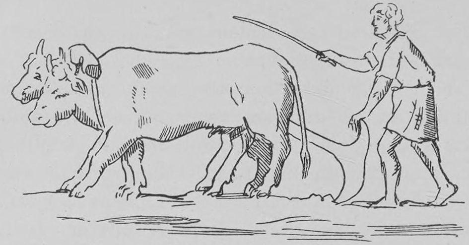

*Fig. 35. Primitiver Pflug mit Sterz.*

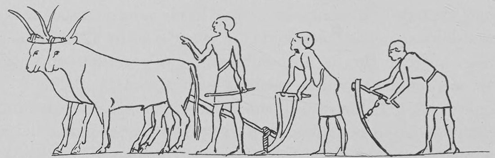

*Fig. 36. Ägyptischer Hakenpflug mit einem Seil statt Grindel.*

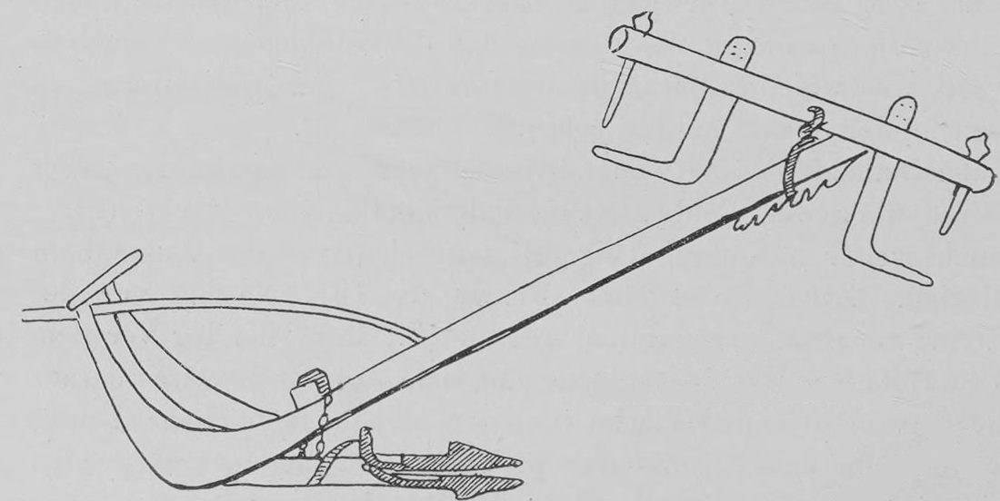

*Fig. 37. Eine moderne Zoche.*

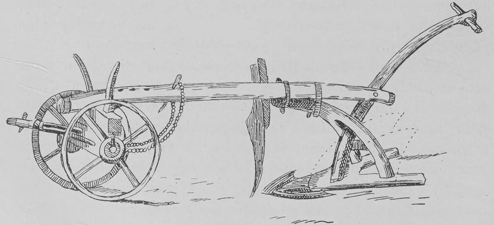

*Fig. 38. Der Pflug Virgils.*

*a buris*

*b dentale*

*c vomer*

*d stiva*

*e fulcrum*

*f aures* Garbenbinden, im Dreschen, in der Tenne, in der Kelter, im Haarschnitt (vgl. Bd. I, S. 206) und in der Aera[^166.153], so ist dennoch gerade das Pflügen erweislich von derselben Art, wie es in der ganzen alten Welt geübt wurde, nämlich ein Aufbrechen der Erde mit dem Hakenpfluge[^166.154]. Der Pflug, wenigstens in seiner besseren Ausführung, war das Werk eines Gewerbetreibenden (אומן), stellte also im Besitze des Landmannes einen Wertgegenstand dar, den er aber, obzwar er ihm unentbehrlich war, infolge der öfters berührten allgemeinen Verarmung oft verpfänden mußte; doch bestand die Vorschrift, daß der Pflug tagsüber dem Eigentümer zurückgestellt werden mußte[^166.155].

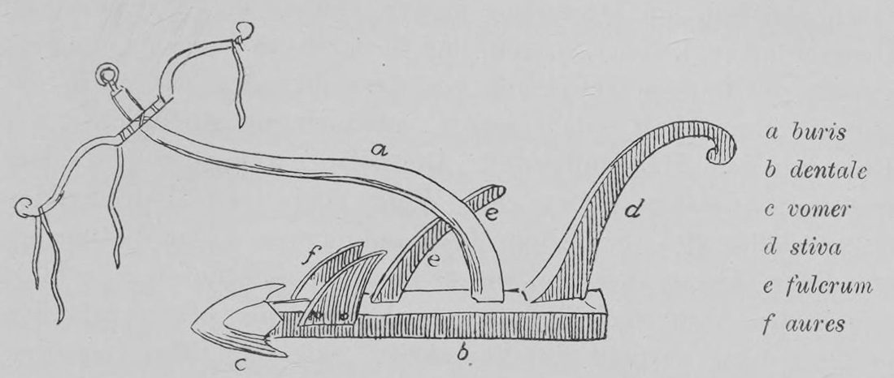

*Fig. 39. Entwickelter Pflug der Juden.*

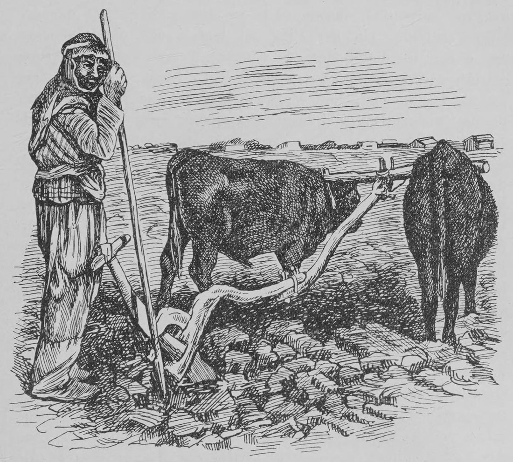

*Fig. 40. Pflügender Bauer aus Palästina.*

Der jüdische Pflug besteht aus folgenden Bestandteilen, und zwar in der Reihenfolge, wie sie sich dem Beschauer des Pfluges darbieten: 1. aus der Sterze (חרב, *stiva*), „Schwert“ genannt vermutlich darum, weil es dieses Stück ist, das der Pflüger anfaßte, um den Pflug zu lenken und die Pflugschar tief genug in den Boden zu senken; 2. aus dem knieförmig gebogenen Pflugbaum oder Grindel (בורך, *buris*), der an seinem hintern Ende, dem „Haupte“, wagerecht auf der Erde lief (יצול, *dentale*) und zuletzt die Pflugschar aufnahm, vorn aber sich aufrichtend die Deichsel bildete, an welche die Zugtiere angeschirrt wurden; 3. aus der Pflugschar (*vomer*, מחרישה im engern Sinne), auch קנקן „Krug“ genannt, vermutlich darum, weil die Schneide Kanten hatte, die etwas Erde aufgriffen, oder, wie man heute sagen würde, ein „Krümeln“ des Erdstreifens herbeiführten. Neben diesen Hauptbestandteilen hatte der entwickeltere Pflug ferner 4. ein Messer (*culter*, bh. אֵת, Plural אִתִּים, bei den Rabbinen אבויין, aram. סיכת פדנא, „Pflock des Pfluges“), das, auf dem Grindel angebracht, auf sehr festem Boden die Einschnitte vorzeichnete, die dann die Pflugschar durchbrach; dieselbe Vorrichtung (Kolter, Sech) heißt auch יתד „Pflock“ und wurde mitunter selbständig gebraucht. 5. Die Pflugschar war manchmal mit Schollenbrechern (עריים) und 6. mit nach oben gerichteten Flügeln (*aures* „Ohren“, לחיים „Kinnbacken“) versehen, welche die aufgeworfene Erde zerkleinern sollten. 7. Eine Art Keil („Stütze“ *fulcrum*, עיין) heftete das „Haupt“ fest an die Deichsel. 8. Sterze und Grindel wurden auch mittels eines eisernen Ringes (בירית) mit einander verbunden. Durch die Verbindung der Pflugschar mit der Sterze wurde der Pflug zur Arbeit eingestellt, um nach der Arbeit auseinander genommen zu werden[^166.156].

Zum Anschirren der Zugtiere diente das Joch (§ 150). Die Länge des Jochbalkens richtete sich nach dem zu bepflügenden Felde; auf hügeligem Boden wurden die Tiere enger, auf der Ebene weiter zusammengekoppelt, und so stellt das Joch auf der Ebene Saron, das zwei Ellen (etwa 1 m) lang war, einen besonderen Typus dar (עול השרוני), dem in diesem Betracht das beim Pflügen der Weinberge gebrauchte Joch (עול הכרם) ähnlich war[^166.157]. Der Ochsenstachel (מרדע, § 150) war an dem dickeren Ende mit einer kleinen Schaufel (הרחור) versehen, mit der man vom Pfluge die klebrige Erde abstreifen (נער) konnte; am Stiele des Ochsenstachels war die Schaufel mittels Öse (מקוף) angemacht. Auf großen Besitzungen hielt man zum Pflügen einen eigenen Ochsenlenker (תוורא)[^166.158].

Das Pflügen hat mehrere Arten. Abgesehen davon, daß die Bodenbearbeitung in beschränktem Ausmaß auch durch Pflanzenwuchs, also ohne Menschen- und Spannkraft, erfolgen kann, z. B. wenn die herbe Lupine (Bd. I, S. 115) als Über- oder Schutzfrucht zu einem Kürbiskern gepflanzt wird, damit sie diesem den Boden sprenge (בקע)[^166.159], wird das Feld auch dadurch anbaufähig gemacht, daß Baumsetzlinge darin ausgerissen werden (גמם, גרע), ohne den Boden auch nur einen Tefach tief aufzubrechen, und die Reinigung von Wurzeln (שֵׁרֵשׁ) kann schon nach dem Säen erfolgen[^166.160] (kahler Abtrieb und Baumroden). Weide- und Wiesenland wurde urbar gemacht, indem man die Grasnarbe mit einem Spaten abschälte (קפל)[^166.161]. Eigentlich gepflügt (חרש, aram. כרב, ܟܪܒ, im Süden Palästinas heißt heute كراب ein Pflügen zum bloßen Öffnen des Bodens, dasselbe, was im Norden mit شقاق bezeichnet wird) wurde nur ein Ackerfeld (חורש, בי כרבא)[^166.162].

Die Pflugarbeit begann noch in der heißen Jahreszeit[^166.163] mit dem Unterpflügen der Dornen und Stoppeln (קוץ), deren Entfernung übrigens auch mit der bloßen Hand geschehen konnte. Dieses erste (חרישה ראשונה), grobe Pflügen (חריש גס) war berechnet, den Boden zu wenden (הפך), damit die aufgedeckten Wurzeln des Unkrautes von der Sonne vernichtet und ihr Staub dem Boden zugeführt werde[^166.164]. In einer Betrachtung wird die außerordentliche Fruchtbarkeit des palästinischen Bodens damit erklärt, daß man ihn teils dünge, teils seine Krume umwende; würde aber die schwere Hand des Pflügers den Pflug allzutief in den Boden senken, müßte er Salpeter- und Schwefelboden aufdecken, der die Saat verbrennen würde[^166.165]. Dann erst folgt ein feineres Pflügen (חריש דק), was sich hauptsächlich in der Zahl der Furchen bekundet. Zur Ausrodung der Dornen macht man nämlich die Furchen größer, aber schon mit dem zweiten Pflügen behandelt man das Feld besser (טִיֵּב), indem ein Feld, auf welchem vorhin fünf bezw. sechs Furchen gezogen wurden, nun deren sechs bezw. sieben aufweist[^166.166]. Beim groben Pflügen ging man nicht in die Tiefe, sondern machte weite Furchen (תלם pl. תלמים), die im Volksmunde „Pferdeschweif“ hießen, mit der aufgeworfenen Erde einander berührten und eher den zur Leitung des Regenwassers gezogenen Furchen (תלמי רביעה) ähnlich sahen[^166.167]. Die Felder enthielten außerdem noch eine vierte Art Furchen, solche nämlich, die die einzelnen Joche und Beete voneinander trennten. Es waren geradlinige, durchgängige Furchen (תלם מפולש), die wegen ihrer Weite auch „Spalte“ (פתיח) hießen. Ihre Weite kam annähernd der Länge des oben genannten saronischen Joches gleich[^166.168]. Die Zeit jenes feineren Pflügens ist wohl der Beginn der Regenzeit, also unmittelbar vor der Aussaat, und nach der Aussaat wurde in Palästina mit seinem harten Boden ein drittes Mal gepflügt (כרב), denn sonst hätte man das Saatkorn nicht bedecken können[^166.169].

Wir wissen bereits, daß man in Palästina sehr flach pflügte; den Boden tiefer aufzuwühlen, hielt man für schädlich. Die Normaltiefe der Furche ist für Sämereien ein Tefach (74 mm), für Getreide etwa doppelt soviel; wenn man schädliche Sachen, wie Dornen und Glas, drei Tefachim tief in das Feld eingrub (S. 163), konnte man sicher sein, daß sie der Pflug nicht aufrütteln (עכב) werde[^166.170]. Die Furchen wurden in der Länge (אורך) und in der Breite (aram. פותיא) gezogen. Wegen der die Felder oft bedeckenden Felsen (S. 158) war ein gerades Pflügen nicht immer möglich, sondern der Pflüger mußte manchmal den Pflug ausheben (עקר) und den Felsen umgehen[^166.171]. Dort, wo er umzuwenden gedenkt, zieht der Pflüger eine Querfurche, die bh. und nh. מענה und heute noch im palästinischen Arabisch *mäʿná* heißt; das auf diese Weise umgrenzte Land wird mit einem Joch Ochsen gewöhnlich an einem Tag bepflügt, und diese Pflugstrecke heißt ebenfalls מענה. Die Rabbinen definieren sie als ein Land von 100 Ellen im Gevierte, was dem ägyptischen „Morgen“ von 100 Ellen und dem römischen *actus quadratus* von 120 Fuß im Gevierte genau entspricht; es ist ein Feld, das nach den Rabbinen mit vier סאה (Abschn. VIII) Frucht besät wird[^166.172]. Natürlich müssen diese Maßbestimmungen infolge von Terrainschwierigkeiten und nach Beschaffenheit der Spannkraft großen Veränderungen unterliegen. Im Gebirgslande gibt es Äcker, die für ein Gespann Zugtiere überhaupt keinen Raum bieten[^166.173], und das gleiche gilt wohl von allen Terrassenanlagen (s. weiter unten).

Eine Anzahl Äcker wurde ebenso wie Gartenland mit dem Karst (מעדר) oder mit der Hacke (קרדום) bearbeitet; statt Pflügen erhielten sie ein Behauen (עדר)[^166.174]. Wirkliches Gartenland erfuhr ein Behauen, das man (aram.) רפק „lockern“ nannte; doch wird hier und da auch das Behauen des Getreidefeldes so genannt, und als Effekt des Pflügens überhaupt ein Erweichen (רפה) der Erde hingestellt. Als das Werkzeug des „Lockerns“ kann der Spaten (מרא) angesehen werden[^166.175]. Wenn die Erde nur stellenweise aufzugraben (חפר) war, bediente man sich eines andern Spatens oder einer Picke (דקר, דוקרן). Eine hölzerne Schaufel (מארופה) genügte zum Graben in der lockern Erde des Gemüsegartens, doch gab es auch eiserne Schaufeln, welche die nebensächliche Arbeit, zu der man manchmal die Schaufel verwendete, nämlich Pflanzen mitsamt der Wurzel herauszureißen (עקר), gewiß besser besorgten. So konnte man auch mit dem unteren Teil des Ochsensteckens (הרחור, S. 173) die Wurzeln weghacken, die dem Pflug hinderlich im Wege standen. All die genannten Geräte dienten überhaupt auch zum Jäten (§ 167) und unterschieden sich, je nachdem sie zum Hacken oder zum Jäten dienten, zumindest durch die Länge des Stieles, doch wohl auch in andern Stücken[^166.176].

Dieselben Geräte dienten wahrscheinlich auch zum Zerstückeln der Schollen (גוש, aram. גרגושתא vgl. Bd. I, S. 260)[^166.177], die von dem Pfluge aufgeworfen wurden. Diese wichtige Verrichtung (bh. שִׂדֵּד, nh. vielleicht פרק) wurde besser durch ein eigenes Instrument, durch die Egge (קובעתא, lat. *hirpex*), verrichtet[^166.178].

[^166.151]: Tanch *Berēšith* 11 נולד נח התקין להם מחרשות ומגלות וקרדומות וכל כלי מלאכה, s. auch Midr Aggada ed. Buber und Raši zu Gen 5,29. Vgl. I. LÖW in Kfm-Gedenkbuch S. 63. Nach Jubil. 11,23 ist Abraham der Erfinder des Pfluges mit dem Saattrichter (arab. *bûḳ* ZDPV 12,161 = *bucina?* in Südarabien *ḳaṣbe* ZDPV 28,31 s. A. 156). Noa erster Landmann s. Gen R 36,3 und Lwr 2,144 unter בורגר. — „Geräte“ Tanch a. a. O. כל כלי מלאכה, häufiger כלים MPeʾa 6,2, MŠebiʿith 5,6, MBḳ 6,5, MʿEduj 4,4.
[^166.152]: TAz 6,1, 464₉ גינה שנרה בעצי אשרה, b 49ᵃ, bMenach 63ᵃ. Neuere Nachrichten s. bei VOGELSTEIN S. 26 A. 8.
[^166.153]: Num R 10,1: בחרישתן usw. Zur Form חרישה, die gut bezeugt ist, s. L 2,118; auch übertragen = Beischlaf ib. 117. 118. Umackern einer zerstörten Stadt: bTaʿan 26ᵇ. 29ᵃ. Oft bh. חריש: MŠebiʿith 1,4, TKil 1,17, 74₂₅, TBm 7,6, 386₅ (ib. Z. 9 חרישה). מחרשה (Pl. מחרשות s. A. 151) z. B. MŠebiʿith 5,6, T 3,4, 64₁₃ (VOGELSTEIN S. 26 A. 4 zitiert aus Mišna 3,7 מחרושת, das sich aber nicht findet), MʿOrla 1,3, Sifre Dt 207 p. 123ᵇ. Dagegen מחרישה של כסף bMakk 9ᵇ, מחרישה דכספא bBm 13ᵃᵇ, bKethub 68ᵃ nicht Pflug, sondern eine Art Kamm oder Bürste = מגרדת s. L 3,82. Der Aberglaube behauptete, daß, wenn man auf der Pflugschar sitze, sie zerbreche (was auch wirklich geschehen konnte) oder die Arbeit schwerer gehe (TSabb 6,8, 117₂₀).
[^166.154]: Syr. Pflüge s. WETZSTEIN, Dreschtafel (Zschr. f. Ethnol. 5); SCHUMACHER Der arab. Pflug, ZDPV 12,157—161; s. auch ib. 9,28; KREMER Ägypten 1,184; Griechen s. HERMANN, Gr. Privataltertümer² 18; Römer s. VOIGT, Privataltertümer in J. MÜLLERs Handb. IV, 2 (S. 301 f.). H. SCHÄFER, Altägyptische Pflüge, Joche und andere landwirtsch. Geräte, in The Annual of the British School at Athens No. X, Session 1903—4, London. WILKINSON, Anc. Egyptians, 2,13—16.
[^166.155]: אומן MŠebiʿith 5,6. Die angeblich von Jesus verfertigten Pflüge und Joche erhielten sich lange Zeit (Iustin Martyr, Dialog c. 88, s. JE 7,161). Verpfändung MBm 9,13 (b 113ᵃ), Sifre Dt 207 p. 123ᵇ.
[^166.156]: Hauptstellen MKelim 21,2 הנוגע . . . בחרב ובבורך וביצול טמא בעין של מתכת בלחיים ובעיראין טמא . . . בלחיים שאינן עשוים אלא לרבות את העפר und TKel bb 1,7, 591₁ החרב שפירשה עם יתידות המחרישה כו׳ והעיין שבמחרישה כו׳. Hier ist fast jeder Punkt in den Kommentaren und bei den Neueren umstritten. 1. חרב erklären Hai, RN (s. v. חרב K 3,484), RŠ und Maim. einmütig als Sterze, die der Pflüger mit der Hand anfaßt; sie erwähnen hierbei arab. سيف = חרב, welches sie also im Sinne von Sterze kannten, doch heißt heute die Sterze bei den Fellachen ذكر, weil sie die Grindel durchbohrt. So erklärt sich VOGELSTEIN S. 26 A. 9 auch חרב. Richtiger Maim., Holz, das wie ein Schwert aussieht, wobei er offenbar einen primitiven Pflug vor Augen hat (s. unsere Fig. 35), insofern richtig, als ja die Benennung aus der Zeit des primitiven Pfluges stammt. Doch ist gerade bei dem primitiven Pflug die Sterze nichts als Fortsetzung der Schar (s. RICH s. v. *bura*), nicht aber die Sterze der Grindel bloß aufgesetzt, wie Maim. sagt. Ich nehme an, daß die Benennung חרב von dem Umstande des Anfassens herzuleiten ist, denn das Anfassen bewirkt auch die Durchbohrung der Erde, ähnlich wie der Gebrauch des Schwertes. Den ferneren arab. Satz bei Hai suchen KOHUT und VOGELSTEIN zu rekonstruieren, siehe bei ihnen. Den Ausdruck ܣܦܣܪܐ ܕܦܕܢܐ d. i. „Schwert des Pfluges“ haben die Syrer zu Luk 9,62 für ἄροτρον („der da die Hand anlegt an den Pflug“ bezeichnet schon an sich die Sterze) s. Cardahi 1,444ᵃ (vollständig bei VOGELSTEIN a. a. O.), mit diesem für den Beschauer nächst liegenden Stück den ganzen Pflug bezeichnend, so richtig PSm 1364, während BROCKELM. 122 strikte *vomer* setzt. VOGELSTEIN sagt: „die Sterze (חרב), welche oben einen ösenartigen Handgriff hatte“, für letzteres auf Hai (und RN s. v. חרב) verweisend (vgl. auch L 2,404). Das ist ein Irrtum; lies (statt ידו) bei Hai und RN והוא; „es (nämlich die Sterze) steckt in dem Holze (העץ richtig ursprünglich bei RN, nicht העין Ausgabe K und bei Hai), das ist in dem Pflugbaum oder der Grindel, völlig so wie bei Maim. معلق من عود المحراث.2. בורך auch MʾOhal 17,1 בורך המחרישה (RN ברך), dasselbe auch Bar bTaʿan 25ᵇ (RG כוך, das er für Furche erklärt, ms M. כון; Gen R 13,13 p. 122 Th. כלי מחרישה, so ist herzustellen mit vielen mss., nicht כלי allein!). Dieses בורך arab. برك kann nur von der knieförmigen Biegung verstanden werden, und wird darum von RN (s. v. ברך 3 K 2,192) in 2. Erkl. und von Maim. richtig als Pflugbaum, Grindel erklärt. Maim. setzt noch hinzu: „es ist dasjenige, welches beim Pflügen sich paralell mit der Erde erstreckt.“ Da die Grindel aufwärts steht, so meint er damit wohl das wagrecht auf der Erde laufende Stück, welches gr. ἔλυμα, lat. *dentale* (deutsch „Haupt“) heißt, s. RICH s. v. *aratrum* und unsere Fig. 37. Damit identifiziere ich (entgegen allen Erklärern, die auf dieses Stück des entwickelten Pfluges nicht achteten) das יצול der Mišna und erkläre es von צול (wovon מצולה) als dasjenige, welches sich in die Erde senkt (Bildung יצול wie יבול, welches nach BARTH nicht von יבל sondern von בול gebildet ist, s. GES. Hwb.¹⁴). — Aber für בורך hat bereits Hai die Var. כורך (RN und RŠ übernehmen dieselbe), ein Wort, das aram. כירכא (RN unrichtig בוכרא), arab. כורך lauten soll, mit der Bedeutung, daß an der Sterze ein Trichter angebracht sei, aus welchem durch die Bewegung des Pfluges die Aussaatfrucht zur Erde falle. Siehe die Abbildung des I. Pfluges bei VOGELSTEIN, Anhang. In Wirklichkeit aber wird ein solcher Trichter bei den Alten (s. allenfalls A. 151) nirgends erwähnt. Zudem steht die LA בורך an den verschiedensten Stellen fest. יצול erklären Hai, Nathan (bei K 4,150), RŠ, Ašeri, Maim. u. andere für den Griff (d. i. Sterze) des Pfluges, indem sie sprachlich auf aram. צלי = neigen, lenken verweisen. Dann wäre aber die Sterze (mit חרב und יצול) in der Mišna zweimal genannt. Hai selbst stellt demgegenüber auch seine selbständige Meinung auf; danach wäre יצול die Schneide der Pflugschar, arab. אכלי آكلة (?), ähnlich K 4,150. Die Araber in Syrien meinen mit *jâsûl* (ياصول) den Pflugbaum, der die Schar mit dem Joche verbindet (vgl. وصلة, Verbindung), doch muß mit L und K konstatiert werden, daß die heutigen arab. Benennungen sich teils mit denen in der Mišna, teils mit denen bei Hai nicht decken. J lehnt יצול an אצל an. VOGELSTEIN S. 27 hält יצול für die Deichsel und vergleicht وُصلة bei SCHUMACHER.3. מחרישה im engeren Sinne = Pflugschar folgt aus יתד של מחרישה w. u. קנקן MBm 6,4 (b 80ᵃ s. RN bei K 7,140), in b mit מנא = Gerät (vgl. A. 151 כלי), vgl. LAGARDE GGA 1885, 305; D. HOFFMANN in Magazin 20,148. ܣܟܢܐ PSm 3611. Midr Ps zu 12,1 p. 53ᵃ als Typus des frechen Betruges: aus dem Joch einen Sattel, aus der Pflugschar (קנקן = Krug wäre in diesem Zusammenhange sinnlos) einen Sack (שק) machen; danach Pflugschar etwas gehöhlt. RAbD in Šitta Meḳubbezeth zu bBm 80ᵃ bekennt allerdings, daß er nicht weiß, warum das Ding קנקן heiße. RAbD polemisiert ferner mit RN, der קנקן = מנא für אֵת hält, denn was wäre dann מחרשה daneben I Sam 13,20?4. Bh. את pl. אתים ist nach jSabb 6,8ᵇ₄₇ אטין lies mit RN אבויין, nach BRÜLL Jahrb. 5,114 und I. LÖW zu Lwr 2,29 = ܐܘܟܦܐ PSm 12 *culter*, quo agricola vomerem radit, richtiger = *culter*, dessen Zweck Plin. H. N. 18,48 angibt und dessen Abbildung RICH s. v. *aratrum* und *culter* und GINZROT (unsere Fig. 38) geben. Mit dieser genauen Definition von את bzw. אבויין gewinnen auch die betreffenden Bibelstellen an Verständnis. — Trg סיכת פדניה s. L Trg Wb 2,161. So auch nach dem Zusammenhange in bGitt 32ᵃ o. סיכתא בפדנא רפיא (statt בדפנא) zu lesen. Nun ist סיכא die aram. Übersetzung von bh. יתד und somit von hieraus יתד של מחרישה bereits erklärt. In TKel bb 1,7 יתדות המחרישה (so auch Hai und RN) lies zunächst mit RŠ יתד המחרישה, da es nur einen „Kolter“ auf dem Pfluge gab; der Sinn ist: auf der Grindel steht der Kolter rechtwinklig und wäre zu Arbeiten nicht geeignet; hat er ihn aber vom Pfluge mit der Sterze abgetrennt (פירש), d. h. sichelförmig mit der Sterze vereinigt, so erhält er damit ein Gerät (eine Hacke), mit dem (der) er die Steine des Brunnenhauses (Bd. I, S. 80) reinigen (נקר) kann. Richtig also Raši bSabb 123ᵇ יתד של מ׳ = קולטרא = *culter*, *kutres* = אתים Gloss. Hébr.-Fr. ed. Lamb.-Brand. Siehe auch RŠ zu MŠebiʿith 5,6. Andere Stellen: MSabb 17,4, T 14(15), 1,130₂₇. Selbständige Verwendung Exod R 31,7 „des Morgens gibst du ihm zurück den Kolter des Pfluges“ (יתד של מחרישה). Unrichtig VOGELSTEIN S. 28 A. 18 יתד „Spitze“ der Pflugschar; er selbst zitiert aus Maim. cod. Berlin 568 السكّة الذى يحرث بها! [ܣܟܬܐ ܕܦܕܢܐ = ܐܘܟܦܐ.]5. עריים Hai, RN, Lowe, עריין Agg., עיראין Maim., wird von Hai in 1. Erkl. (s. auch RN bei K 6,256 und RŠ), Maim. علاقة richtig als Gerät zum Zerkleinern der Schollen erklärt; vgl. ערערין TKel bm 4,6, 582₂₈ und besonders עורי פילי bTaʿan 4ᵃ bei RN s. v. פל.6. Bei Hai (wie auch nach ihm bei RN und RŠ) befindet sich zu עריים noch eine Erklärung, die offenbar zu לחיים gehört. Danach sind לחיים die spitze Schneide der Pflugschar (richtiger zwei Schneiden, vgl. לחיים = שנים עצים bei RN zu חרב 3,484), wodurch die Furche erweitert wird; לחיים wäre bildlich gemeint: die Kinnbacken gehen beim Kauen auf und ab. Doch kann man sich mit dem Begriff „Wangen“ begnügen, vgl. πτερά, *aures*, *Ohren*, *Flügel*, arab. *adan* ZDPV 12,158. So bedeutet auch *bura*, *buris* eigentlich den Ochsenschwanz. VOGELSTEIN hat die Erklärungen nicht auseinander gehalten und erklärt irrig עריים für Flügel, לחיים für Streichbretter (letztere aber nirgends erwähnt). Den Zweck der לחיים gibt die Mišna ausdrücklich an: לרבות את העפר.7. Ich erkläre עיין als „Keil“ wegen עיין שבמצעד, das in T daneben steht, aber modifiziert als *fulcrum* (s. unsere Fig. 39 und RICH s. v. *aratrum*). Diese Erkl. scheint enthalten zu sein bei Hai etwas vorher Schlagwort בעין: „Es gibt Pflüge, bei welchen der Pflugbaum (עץ beibehalten, nicht in עין emendieren!) in die Pflugschar eindringt (סיכתא allgemeiner als wir es in Punkt 4 aufgefaßt haben, so gebrauchen auch alle Kommentare אֵת המחרישה für Pflugschar); dann gibt es aber einen Pflug, der (d. i. dessen Pflugbaum) mittels eines Holzes (עץ beibehalten!) [mit der Pflugschar] verbunden ist und dieses Holz ist mit עין bezeichnet“ lies (ועץ זה הוא העין); nur denkt sich Hai עין in Form eines Ringes. Auch in RN s. v. חרב ist ein Rest dieser Erkl. geblieben (von K irrtümlich zu streichen erklärt): „Das Holz (העץ, K emendiert העין!), das in die Pflugschar (אֵת) eindringt, heißt [עִיין und] im Trg (בל׳ ישמעאל lies בל׳ ירושלמי) „סיכתא פנדא“ lies ס׳ דפדנא s. Punkt 4, doch hier nicht = *culter*, sondern wie bei uns in § 150 „Jochpflock“ hier wirklicher „Pflock“ = *fulcrum*. Es ist *en-nāṭeḥ* des heutigen arab. Pfluges, „ein Winkelstück, welches in beide (in Sterze und Grindel) eingestemmt und durch einen Keil verbunden ist“, SCHUMACHER ZDPV 12,158. VOGELSTEIN S. 28 hält עין für einen Ring und rekonstruiert Hai anders, auch auf RN s. v. עין (6,192ᵇ) hinweisend, wo es sich um ein Joch handelt, was auch nach V. hieher nicht paßt.8. בירית (vgl. Bd. I, S. 205) TKel bm 5,7, 584₆ כל הבורית (l. הבי׳) טהורה ברית (l. בי׳) מחרישה טמאה. Auf die Verbindung der Pflugschar mit der Sterze dürften gehen die aram. Ausdrücke שרי und קטר in jBerakh 2,4, 5ᵃ₁₇f. שרי תורך ושרי קנקנך und קטור תורך וקטור קנקנך, vgl. Thr R zu 1,16 (wo פדן für קנקן, in RN s. v. קנקן bei K 7,140 beides vereint: שרי תורך שרי פדנך שרי קנקנך). Zur Not wurde der Kolter (קנקן) im Hause zur Verriegelung der Türe benützt, bʿErub 101ᵃ.
[^166.157]: עול השרוני MKil 2,6, T 2,1, 75₃, T ib. דומה לעול של כרמים.
[^166.158]: ניער המחרישה MʾOhal 17,2, vgl. Plinius, H. N. 18,49 *purget vomerem subinde stimulus cuspidatus rallo*. הרהור MKel 13,3 (wo auch מקוף, nicht קוף, wie VOGELSTEIN S. 33 hat), 25,2; 29,8; TKel bm 3,7, 581₂₃. תוורא bBm 30ᵃ. 73ᵃ nach der ansprechenden Erkl. des RCh, s. L 4,633. Spezialarbeiter auch z. B. רפוקא A. 175.
[^166.159]: TKil 1,13, 74₁₅ הנותן מעה של תורמוס בצד מעה של דלעת כדי שתיבקע הארץ מפניה, vgl. להבקיע jKil 3,3, 28ᵈ₁₉. Nach Plinius H. N. 18,49 kann man Bohnen nnd Wicken in nicht gebrochenes Land säen, sich also die Mühe des Pflügens ersparen. Als beste Frucht zwischen den Getreidearten, die den Boden aufbricht, wird auch heute die Lupine angesehen, s. KOPPE, Unterricht im Ackerbau und in der Viehzucht, 10. Aufl., Berlin 1873, S. 202.
[^166.160]: Folgt aus MKil 2,4 נטועה ונמלך לזורעה . . . אם רצה גומם עד פחות מטפח ואחר כך משרש, in T 1,18, 74₂₇.₂₈ ist der Ausdruck גרע Piʿel und Ḳal. TŠebiʿith 3,20, 65₁₅ מברך בחורשין alte Agg. מגדר, ursprünglich wohl מברא von bh. ברא ausroden, ib. גומם opp. קצץ mit dem Karst behauen.
[^166.161]: bSabb 152ᵇ (RN 7,164), Jalḳ Gen § 33, Jalḳ Ezech 37 הנהו קפולאי „jene Abschäler“ (so nannte man wohl die Arbeiter, die dieses spezielle Fach versahen), „die da den Boden (ארעא) des N. N. abschälten“ (קא קפלי). Es war ein Begräbnisort, also Wiesenland.
[^166.162]: Bh. und nh. חרש s. Wörterbücher und hier *passim*. כרב syr. ܟܪܒ PSm 1808 BROCKELM. 164, arab. كرب s. RN bei K 4,314, DALMAN ZDPV 28,32. חורש mehrmals bMḳ 6ᵃ. בי כרבא in dem Sprichworte: „Der Fuchs hat nichts von einem Ackerfelde“ (d. h. er frißt weder Saaten noch Gras) bJoma 43ᵇ, bNidda 65ᵇ, s. auch Raši zu Gen 48,7 (ed. Berliner, wo eine etwas abweichende Erklärung für כמה דמסיק תעלא מבי כ׳: „wie viel der Fuchs mitträgt von einem aufgebrochenen Felde“). Vgl. bJebam 63ᵃ in Rašis 2. Erkl. und s. A. 171. כרב = חרש bSanh 26ᵃ.
[^166.163]: MBm 9,1 vgl. 5,10. Varro 1,30, Colum. 2, 4,1, Pallad. 6,3, 1 empfehlen das erste Pflügen zu Beginn der warmen Jahreszeit. Auf Palästina paßt besser die Vorschrift bei Plin. H. N. 18,49, daß, wo trockene und heiße Sommer herrschen, ein kalkiger oder magerer Boden zwischen dem Sommersolstitium und dem Herbstäquinoctium gepflügt werde. Allgemeine Angaben über die Pflügezeit in שדה האילן MŠebiʿith 1,1; nach j z. St. 33ᵇ₂ wäre das Pflügen von Baumkulturen, dessen eigentliche Zeit vor Pfingsten ist, manchmal darum unmöglich, weil weder Regen, noch Bodenfeuchtigkeit (ליחה S. 152) vorhanden sei.
[^166.164]: MKil 2,3. 4 Part. Ḳal הופך, Impf. אופך (kontrahiert von *אהפך wie אוכל von אאכל; damit erledigt sich der Zwang einer Annahme von Wurzel אפך bei LEVY und die Auskunft der „Verwirrung“ bei PRÄTORIUS ZAW 2,312; anderes mehr s. Tanch. Jeruš. bei BACHER, hebr. Teil S. 14 und bei VOGELSTEIN S. 34 A. 59); ib. in 3 (von הפך = יפך wie הלך = ילך) Hofʿal יופך, auch MTerum 9,1, T 8,1, 39₁₀, TKil 1,16, 74₂₃; an letzterer Stelle ferner הפך (ed. Z. היפך; ib. Z. 30 לייפך l. להפך, ib. הפכה l. מהפה Var.).
[^166.165]: jTaʿan 4,8, 69ᵇ₃₃ (fruchtbar = חציפה) מפני שמזבלין אותה, ein anderer: מפני שהופכין את עפרה. Ib. Anekdote von einem in der Ebene Arbel, der durch tiefes Pflügen (כבש ידיה) brennende Erde hervorholte, die seine Saat verbrannte (יקד). Vgl. Plin. H. N. 17,30 *In Syria tenui sulco imprimunt vomerem, quia subest saxum exurens aestate semina*; s. auch 18,47.
[^166.166]: Der Punkt bedarf einer Sichtung. MŠebiʿith 4,2 erst שדה שנתקוצה dann שנטייבה oder שנדיירה (Bildung der beiden Worte identisch: טיב Piʿel von טוב, דיר Piʿel von דיר.) In derselben Mišna Kontroverse der Šammaiten und Hilleliten, ob man die von einem „gut behandelten“ Felde (בטובה) im Brachjahre getragenen Früchte essen dürfe; in Sifra zu Lev 25,6 p. 106ᵇ dasselbe. In Tosefta Šebiʿith 3,10, 64₂₅ nach dem Satze שדה שניטייבה אין זורעין אותה במוצאי שביעית (so lies) folgende Definition: „Was heißt „gut behandeltes Feld“? das, worin andere Leute fünf pflügen, er sechs, andere sechs, er aber sieben“. Historisches: „Šammai der Alte sagte: Wäre nur die Zeit dazu geeignet, ich würde dekretieren, daß es [dieses Feld] nicht bebaut werde“. Ein späteres Kollegium hat [in der Tat] dekretiert, daß es nicht bebaut werde (was nun im ersten Satze schon als zu Recht bestehend gelehrt wird). A. SCHWARZ (Tos. Zeraim S. 100ᵇ) z. St. folgert daraus, daß bereits zu Herodes' Zeiten die Römer das Volk nötigten, auch im Brachjahre Naturalien zu liefern, so daß Auswege gesucht wurden, auch im Brachjahre Ertrag zu erzielen. Diese historische Erscheinung wird in j z. St. (jŠebiʿith 4,2, 35ᵃ₃₉ f.) weiter ausgeführt: „Dort [in Babylonien] sagte man [שדה שנתקוצה] sei ein Feld, von dem die Dornen [mit der Hand] entfernt wurden; die Rabbinen von hier (d. i. Palästina) sagten jedoch, es sei eines, das gepflügt wurde. Nach Ansicht der Rabbinen von hier ist „besser behandeln“ (טיוב) so zu verstehen, daß während das ganze Volk einmal pflügt, er es zweimal tut (also 1. Stufe קוץ, 2. Stufe טיב). Damit stimmt überein (der Spruch): . . . dort [in Babylonien] nötigt die Regierung nicht (also wird das Brachjahr respektiert), hier aber nötigt die Regierung (und so geschieht ein erstmaliges Pflügen als Vorbereitung für das nächste Jahr; nur das zweite Pflügen, טיב, wird von den Rabbinen bereits geahndet). In früheren Zeiten, als die Regierung nötigte, lehrte RJannai, daß man das erste Pflügen (חרישה ראשונה) versehen dürfe“. Folgt eine diesfällige Erzählung. Vgl. jSanh 3,6, 21ᵇ, b 26ᵃ. Zur Sache GRAETZ, Gesch. 4³ 213, BACHER, Ag. d. pal. Am. 1,35. Siehe die interessanten Ausführungen des RABD zu Sifra a. a. O. Wir entnehmen dem Jerušalmi, daß man unter טיוב das zweite Pflügen versteht. In TBm 3,10, 391₃₂ Reihenfolge: 1. שדה . . . נירה, 2. מזבלת, 3. מטייבת. Auf Grund von TŠeb. 3,10 wollte nun VOGELSTEIN S. 33 annehmen, daß einzelne Besitzer sogar siebenmal pflügten, wogegen mit Recht ZUCKERMANDEL (Tos. Mischna u. Bor. 1,363), wie schon früher andere, den Text dahin erklärt, daß die Zahl der Furchen gemeint sei. Auf Vorstehendem beruht unsere Darstellung im Texte. — Die Vergleichung von טייב mit *bene colere, bene arare* bei Cato 6,1 (Plin. H. N. 18,49) ist ganz müßig (bei VOGELSTEIN S. 33 A. 57). Geradezu irrig ist es, wenn für *iterare* ein hebr. Äquivalent gesucht und in שנה TMenach 9,3, 525₃₆ b 85ᵃ gefunden wird (ib. S. 35 A. 67), denn שנה in jenen Stellen ist das gewöhnliche Wort für Jahr! Es heißt: Er bricht das Feld auf im ersten Jahr, pflügt es im zweiten Jahr und baut es an usw. Vgl. VOGELSTEIN selbst S. 49 A. 11. Dagegen siehe תני (= hebr. שנה) bBm 107ᵃ.
[^166.167]: MKil 2,3, T 1,17, 74₂₅ חריש . . . גם כתלמי הרביעה, ib. זנב הסוס, ib. lies (nach j 2,3, 27ᵈ₂₈) סוף עפרה של זו כו׳. Zu „Schweif“, bildlich für „unregelmäßig weit“ (vgl. unser „ausschweifen“) vgl. MKil 4,6 [גפן] אחת יוצאת זנב. Zu den Regenfurchen vergleicht VOGELSTEIN S. 52 A. 21 Varro 1,29, 2 sulcant fossas, quo pluvia aqua delabatur; Plin. H. N. 18,179; *scrobes* bei Cato 43,1.
[^166.168]: מפולש MKil 3,3 (so lies auch statt מפריש T 2,4, 75₁₄), T 2,1, 75₂ (offenbar identisch mit M 2,6 ג׳ תלמים של פתיח), T ib. Z. 21. Mehr s. bei I. LÖW, ZDMG 45,704. פלש mit „durchbrochen sein“ zu übersetzen (L 4,58, K 6,358) ist irreführend; gemeint ist die den freien Blick gewährende Linie, wie in מבוי מפולש (K 5,68), und durchgängig wie in dem Bilde der zwei Balken, die von einem Ende der Welt bis zum anderen gehen (קורות מפולשות Gen R 70,15). Zu פתיח, welches Maim. als Spalte erklärt (jedoch nicht vom Regen verursacht!) vgl. פִּתֵּחַ Jes 28,24, arab. فتح breitpflügen. Mehr s. bei VOGELSTEIN S. 35 A. 67. מלא העול השרוני MKil 2,6.
[^166.169]: bSabb 73ᵇ o. בארץ ישראל . . . ברישא והדר כרבי. Jetzt noch so; s. ANDERLIND ZDPV 9,30.
[^166.170]: Siehe A. 165. Heute noch flaches Pflügen ZDPV 9,30. Ein Tefach für זרעונין folgt aus MKil 3,2. Vgl. bBḳ 30ᵃ ג׳ טפחים כדי שלא יעכב המחרישה, TBḳ 2,6, 348₂₁ richtiger הֶעָכֵב. Vgl. drei Tefachim auch MʾOhal 18,5. Ganz wenig Pflügen brauchte die Wicke, jSabb 7,9ᵈ₇₀.
[^166.171]: bJebam 63ᵃ לפותיא opp. לאורכא (wenn כרב = ackern heißt s. A. 162). סלע über dem ganzen Feld hat zur Folge: עוקר את המחרישה usw. jPeʾa 2,2, 17ᵃ₁₀.
[^166.172]: MʾOhal 17,1. 2 מלא מענה מאה אמה (vgl. bMḳ 5ᵇ); vgl. schon I Sam 14,14 (Ps 129,3 מענית). Zum ganzen s. DALMAN, Pflügelänge, Saatstreifen und Erntestreifen in Bibel und Mischna, ZDPV 28,27 f. Doch kann sich DALMAN מענה in TŠebiʿith 3,20, 65₁₄ nicht recht erklären. Der Sinn ist: Die junge Kuh wird nur auf Sandterrain (חילת S. 157) zum Pflügen gewöhnt (לִמֵּד), doch meint ein Lehrer, auch in dem Ackerfeld eines anderen, vorausgesetzt, daß er ihr keine Grenze zieht (שלא יסמוך לה מענה), nämlich im Brachjahre, weil es dann ein Anlauf zum Pflügen wäre; auf eigenem Felde, wo er daran interessiert ist, darf er die Kuh überhaupt nicht pflügen lehren. TChull 4,6, 506₃₀ übersetzt DALMAN irrig: „Selbst wer daran ist zu pflügen“ usw. Lies: „Selbst wenn das Vieh auf dem Pflugacker (על גבי מענה) gerade im Acker steht“. Vgl. Pirḳe RE c. 1.
[^166.173]: MPeʾa 2,2 וכל ההרים . . . שאין הבקר יכול לעבור בכליו.
[^166.174]: Vgl. Jes 7,25, wörtlich auch in MPeʾa 2,2 (vgl. A. 173); מעדר ferner MKel 13,2 (השן של מעדר vgl. TKel bm 9,3, 588₅ Zinken des Karstes), TKel bb 1,7, 591₃ (המסוה שבמעדר? etwa ein um den Stiel gewundener Strick, vgl. Z. 4 המשיחות והרצועות שבמעדר). — Verb עדר MŠebiʿith 2,2 (vom Behauen des Gurkenfeldes), MBm 5,10, MNeg 2,4, TBerakh 4,21, 11₁₈, TMaʿas 2,13. 14, 83₁₉.₂₂, TBm 7,6, 386₄ (sowohl Behauen des Feldes als Behauen des Weinstockes). עדר Umrühren des Mistes mit dem Karst s. S. 168. קרדום s. Seite 85 und § 208. Als landwirtschaftliches Gerät TŠebiʿith 6,19, 70₅; bNedar 62ᵃ ק׳ להיות עודר בו. Sprichwort: „Reuben freut sich; noch ist aber Šimeōn auf dem Felde mit seiner Hacke (קרדום) beschäftigt: hat er einen Grund, sich zu freuen?“ Pesiḳta R c. 42 p. 177ᵃ.
[^166.175]: Daß רפק = עדר sieht man bTaʿan 23ᵃ u. Als Terrain wird der Baumgarten (פרדיסא) genannt bBm 103ᵃ (wo auch das Werkzeug מרה vorkommt) und bMenach 87ᵃ. Der dazu bestellte eigene Arbeiter (vgl. bBm 76ᵇ) hieß רפוקא bSota 10ᵃ, Num R 9,24 (nicht דפוקא); wiederum vom Baumgarten die Rede. Jedoch Acker bTaʿan 23ᵃ und bʿErub 25ᵃ. רפק = פרק hat auch L 4,464 zu einigen Stellen, jedoch ist רפק überhaupt so zu erklären. Effekt des Pflügens רפויי ארעא bMḳ 2ᵇ (Raši רכך), was hebr. etwa רִפָּה wäre: lose machen.
[^166.176]: יחפור בדקר MBeza 1,2 (b 2ᵃ) b 7ᵇ דקר נעוץ. Unterarten des Pflügens (תולדות) sind הפר, חרץ, נעץ jSabb 7,9ᵈ₆₇; vgl. T 9,17, 123₂. MŠebiʿith 5,6 als unentbehrlich zur Landwirtschaft gelten Pflug, Joch, Wurfschaufel und Picke (דקר). MKel 14,3 דקור s. § 208 TKel bm 3,14, 582₄ שרהוע, דוקרן und מעדיר. — מארופות MŠebiʿith 5,4. (Daneben גרופית של שקמה, Tanch. Jeruš. bei BACHER S. 60 offenbar irrtümlich מארופות של שקמה.) K 5,67 möchte nach ms. M. חרופות lesen, und auch L 4,8 setzt Stamm ארף = חרף schneiden und gleichwohl übersetzt er das Wort mit „Schaufel“. Sachlich richtig RN: eine Art Spaten. Nun erinnert aber VOGELSTEIN S. 38 A. 94 an das jetzt allgemein gebräuchliche مغرافة (GUTHE ZDPV 6,19), und da möchte man doch מארופה lieber zu מגריפה stellen. An der einzigen Stelle MŠebiʿith 5,4 dient מ׳ sicherlich nur ausnahmsweise zum Herausreißen von Wurzeln, wie auch die קרדומות daneben, und wie auch הרהור nach RŠ zu MKel 13,3. Ib. 29,7 יד הקרדום של נכוש opp. של עדיר (so lies mit ed. Lowe, nicht עדור; vgl. all die so gebauten landwirtschaftlichen Nomina bei BARTH, Nominalbild. 1,136 und bei VOGELSTEIN S. 35 A. 67, zu denen aus dem nh. Wortschatz unseres Abschnittes z. B. auch פתיח, גריד, חריש, מסיק usw. gehören).
[^166.177]: Zu גוש und גרגושתא s. L 1,315. 356. Man spricht von סירחא דגרגושתא (bSukka 26ᵃ), von dem üblen Geruch, den die aufgeworfene Erde hat (zum Geruch vgl. S. 160).
[^166.178]: שדד, Jes 28,24, am besten so zu erklären, daß das Eggen gemeint sei (s. meinen Komm. Zitomir 1905 z. St. im Namen des Kommentars Mikhlōl Jōfi), doch nicht von שדה = Feld, sondern assyrisch, oder wie ich vermute, Schreib- oder Gehörfehler von צדד, nh. applanieren. שדד ganz sicher = eggen in Sirach 38,26. Nh. מפרקין MŠebiʿith 2,2 nach RN's 2. Erkl. bei K 6,446; vgl. פרק in unserem Texte. קובעתא = Egge (L 4,241, der auf syr. ܩܘܒܥܬܐ verweist, doch findet sich bei BROCKELM. 311 nur acus clavi, uncini) jSanh 3,21ᵇ₉, jŠebiʿith 4,1, 35ᵃ₄₆ מירמי ק׳.

## § 167

**167.** **Die Aussaat.** Der Landwirt bestrebt sich, gutes Saatkorn in den Boden zu geben. Saatkorn von Sämereien (Bohnen, Kürbissen, Koriander, Rüben, Rettich usw.) zog man in eigenen hierzu bestimmten Feldern[^167.179]; von Getreidefrucht findet sich wohl nur zufällig die gleiche Angabe nicht. Das Saatkorn (bh. und nh. זרע) war ungleich geachteter als das gewöhnliche Korn; es wurde beizeiten gesondert aufbewahrt (הצניע, קִיים), mitunter jedoch auch unterschiedslos von der Tenne genommen, und wer es nicht selbst besaß, entlieh oder kaufte es zur Zeit der Aussaat (שעת הזרע)[^167.180]. Vielleicht liegt es daran, daß der palästinische Bauer am Ausgange des Paschafestes besonders arm war, denn in der Regenzeit hatte er seinen Vorrat aufgezehrt, und nun mußte er für das Sommergetreide sein Saatkorn um schweres Geld beschaffen. Der Handel mit Saatkorn blühte besonders vor und während der Aussaat und außerdem, wie angedeutet wurde, in der Paschazeit[^167.181]. Wenn nicht ausdrücklich zur Aussaat gekauftes Korn nicht aufging (לא צמח), hatte den Schaden der Käufer und der Kauf blieb rechtsgültig, weil der Verkäufer sich auf seine *bona fides* berufen konnte, er habe das Korn zum Verspeisen, d. i. zu Mehl, oder zu Heilzwecken (vgl. § 105) verkauft; bei gewissen Sämereien jedoch, deren Korn ungenießbar ist und nur zur Aussaat gekauft wird, ist in dem beregten Falle der Verkäufer ersatzpflichtig[^167.182]. Der Kauf wurde abgeschlossen auf Grund eines Musters (דוגמא = δεῖγμα), das der Händler vorlegte[^167.183]. Der Landmann selbst untersuchte (בדק) das Korn auf seine Keimfähigkeit, indem er es zu raschem Wuchse in einen mit Mist oder doch mit guter Erde gefüllten Kübel (עציץ, S. 162) säte, ein Verfahren, das man in dem *parpîsā* (פרפיסא) genannten raschen Getreideziehen im Hause auch zu völlig andern Zwecken übte[^167.184]. Weizen, Gerste, Linsen und gewiß auch andere Arten säte man durchaus in ihren Schalen oder Hülsen (קליפה), womit schwerlich die Fruchtschale, sondern die Oberhaut (*epidermis*) gemeint ist, da anderseits versichert wird, daß z. B. der Weizen „nackt“ (ערום) in den Boden gebettet werde, um dann in mehreren Hüllen (לבושין) zu erstehen; auch kam es vor, daß der Keimling (זכרות) des Weizens eingepflanzt wurde[^167.185].

Die Zeit des Winterbaues (בכיר, חרפא) wird auf die zwei Monate von Mitte Tišri bis Mitte Kislev, näher auf den Beginn der Regenzeit angesetzt. Es wurde empfohlen, die Felder in drei Absätzen zu bebauen, nämlich in der ersten, zweiten und dritten Regenperiode, da die ersten vom Hagel, die ersten und zweiten vom Rost (w. u.) heimgesucht werden könnten, wobei die dritten doch noch Hoffnung lassen. Es wurde ferner empfohlen, die Gerste, die zur Paschazeit geerntet wurde, erst siebzig Tage vor dem Paschafeste zu säen, damit sie alsbald Sonnenschein bekomme, in welchem Falle bei kurzem Halme eine lange Ähre und demzufolge viel Korn zu erhoffen war. Der Sommerbau (אפלא) sollte stattfinden, ehe die Erde die winterliche Feuchtigkeit verliere, d. i. etwa um die Paschazeit, womit übereinstimmt, daß manchmal die Frucht bis dahin noch nicht Wurzel geschlagen hatte[^167.186].

Man übte die breitwürfige und die Reihensaat. Nach der ersteren Art streute (זָרַע, הפיל זרע, הביא זרע לתוך שדה, aram. שדא) der Pflüger oder ein anderer Mann den Samen mit der Hand (מפולת יד) tunlichst ebenmäßig über das ganze Feld aus, wobei er nach eigenem Ermessen, oder wie es von der Natur teils des Saatkorns, teils des Bodens bedingt war, entweder dicht (מְעֻבָּה) oder schütter (מידק) säte. In reichen Jahren stand der Weizen so dicht, daß sich die Ähren rieben (שוף). Gleichmäßiger, von der Unebenheit des Bodens (מעלה ומורד) nicht beeinflußt, war die Saat, wenn das Ausstreuen von den pflügenden Rindern (מפולת שורים) in der Weise besorgt wurde, daß dem Grindel des Pfluges (S. 172) oder den Rindern der unten gelöcherte Fruchtsack aufgeladen war und durch die Bewegung die Körner fallen ließ[^167.187]. In beiden Fällen mußte man damit rechnen, daß der Wind das Saatkorn verwehe (סיער, הסעיר)[^167.188]. Nach der zweiten Art säte man so, daß gradlinige Reihen (שורות) entstanden; auf unterbrochenen Feldern desselben Besitzers, z. B. wenn kleine Getreidefelder, sogenannte „Rahmen“ (מלבן, *plinthus*), zwischen Ölkulturen eingebettet waren, oder beim Terrassenbau (S. 163), wo die Zerstücklung von selbst eintrat, doch auch auf größerem ebenen Gebiete, wo man zum Baue von verschiedenen Arten eine Anzahl länglicher Fluren (משר) entstehen ließ, und in dem zu Beeten (w. u.) zerstückelten Gemüsebau, setzten sich die Reihen in den abgegrenzten Feldern fort (ראשי שורות מעורבין), und nur auf unebenem Terrain wird diejenige Feldspitze entstanden sein, die man in echt bäuerlicher Art „Ochsenkopf“ (ראש תור) nannte, vermutlich nicht wegen der spitz zulaufenden Form, sondern weil das pflügende Rind zwar den Kopf vorstecken, nicht aber den Pflug nachziehen kann[^167.189]. Bei Schwarzkümmel (קצח, aram. קצחא, Bd. I, S. 118) wird der Vorteil des Einzelsetzens (שתל) gegenüber dem Säen (זרע) ausdrücklich bemerkt[^167.189a].

Die Saatmenge (נפילה) mußte teils von der Beschaffenheit des Bodens, teils von der Saatmethode abhängig sein, denn der bessere Boden z. B. braucht weniger Saatgut, und die Handbreitsaat verbraucht davon mehr als die Reihensaat. Sie muß sich ferner richten nach der Art des Getreides, und innerhalb derselben Art nach der Güte des Samens, wie auch nach andern Dingen. Dennoch stand wenigstens für Weizen ein Durchschnittsmaß fest; eine Pflugstrecke benötigte, wie wir gesehen haben, vier Saʾa Saatgut, aber sehr oft wird der vierte Teil, nämlich ein Ackerland, das éin Saʾa Saatgut benötigte (בית סאה), als Einheit genommen, und der dadurch gewonnene allgemein bekannte Begriff diente zugleich als Bestimmung eines Flächenmaßes. Die genaue Größe des betreffenden Ackerlandes kennen wir nicht, da die allenfalls gegebenen Gleichsetzungen mit andern Längenmaßen gleichfalls unbestimmbar sind[^167.190]. Eine fernere oft erwähnte Einheit ist ein Ackerland, das ¹/₄ Ḳab Saatgut benötigt (בית רובע), was sich zu der früheren Einheit von einem Saʾa wie 2500 zu 24 stellt[^167.191]. Demnach nahm man in den Ackerfeldern große Teilungen vor. Auf solche Parzellen scheint zu gehen das Schriftwort: „Er setzt Weizen ein in das abgemessene Feld“ (שׂוֹרָה = משורה, Jes. 28,25); gemeint sind Stücke Landes, die in der Sprache der Rabbinen לגנין *lignin* heißen (sing. לגנה, syrisch ܠܓܢܬܐ, arab. لجنة)[^167.192]. Namentlich war die gesegnete Ebene von Jericho (S. 157) in ganz kleine Weizen- und Gerstenfelder aufgeteilt[^167.193]. Am weitesten ging man hierin bei Gemüsepflanzungen, die durchaus in Beeten (sing. ערוגה, πρασιά) angelegt waren[^167.194]. Der in Palästina landesübliche Terrassenbau (S. 163), allenfalls auch der Anbau in Ruinen (S. 162) und die Zerstücklung durch Wasserrinnen (S. 165) ergaben von selbst die Anlegung von Beeten, und es ist begreiflich, daß wir sie auch im Getreide- und Flachsbau antreffen[^167.195]. Parzellen und Beete haben selbstverständlich viereckige Form[^167.196].

Die Trennung in Parzellen und Beete (trennen = חלק, תִּחֵם) war schon darum notwendig, weil der Kleinbauer auf die eine Saatgattung sogleich eine andere folgen lassen wollte (סמך), so sehr, daß manchmal Getreide sich auf Gemüse, und dieses sich auf Getreide neigte (נטה), ja, oft waren es bloß Reihen (שורות) von verschiedenen Gattungen, die dicht nebeneinander standen. Die Trennung bewirkte in den meisten Fällen eine tief und weit gezogene Furche, dieselbe, die auch ein ganzes Feld begrenzen konnte. Auch die Grenzfurchen ließ man nicht unbenutzt, sondern bebaute sie mit einer fremden Gattung, am liebsten mit Flachs. Als Grenzscheiden (מחיצה, גבול, גובל, מצר) von ganzen Ackerfeldern können gelten: eine Mauer (גדר), hölzerne Zäune (גדר של עצים), Baum- und Schilfhecken (אילן, מחיצת הקנים), ein Erdrücken (גפה), Wasserläufe und Wasserrinnen (S. 164), ein sich vorbeiziehender privater oder öffentlicher Weg oder auch nur Pfad, ein Felsen, ein Graben usw. Unter den lebenden Hecken gebrauchte man vorzugsweise das Kraut חצוב (pl. הצובות), etwa Himmelsschwaden, weil es schwer auszurotten war und somit die Grenzverrückung verhinderte[^167.197]. Außenteile des Feldes (פסקי בגי) werden als Reste (שירייה) angesehen und genau unterschieden[^167.198].

Gleich nach der Aussaat folgte das Einpflügen, was man ein „Bedecken“ (חִפָּה) nannte. Die Araber nennen es teils „Arbeiten“ (فلاح), teils „Ackern“ (حرات). Das Bedecken ist schon darum notwendig, weil sonst die Vögel und besonders die Tauben die offen daliegenden Körner aufpicken würden[^167.199].

[^167.179]: MŠebiʿith 2,8 פול המצרי und אפונין הגמלונין, ib. 10 דלועין Kürbisse, die er aufbewahrt zum Samen (also wohl auch welche gleich zum Samen angebaut), MMaʿas 4,5 כוסבר, T 3,7, 84₂₇ dasselbe und allgemein Kraut (ירק) und Senf (חרדל), MMaʿas 5,2 לפת und צנונות.
[^167.180]: המצניע MSabb 10,1; קיים MŠebiʿith 2,10 (s. A. 179); von der Tenne weg MPeʾa 1,6; geliehen MBm 5,8; gekauft בשעת הזרע MŠebiʿith 5,8, vgl. MDemai 1,3 הלוקח לזרע ולבהמה (s. § 151), MBb 6,1. שעת הזרע s. auch A. 181. In MTerum 9,4 זמן זרע. bBerakh 35ᵇ שעת זריעה. Das gute Saatkorn des Weizens bringt dieselbe Sorte hervor, während ein minderes hartes (גידי) und ganz spätes (סיפי סיפנים) Korn bringt (Midr Sam c. 1 p. 22ᵃ; statt אגדן lies אגורי, s. A. 482.
[^167.181]: Armut במוצאי פסח folgt aus TBm 8,27, 390₇; vgl. MBm 5,2 אם לגרן. Die drei Termine sind בפני הזרע ובשעת הזרע ובפרוס הפסח s. dazu VOGELSTEIN S. 39 A. 6.
[^167.182]: MBb 6,1, b 93ᵃ.
[^167.183]: MSabb 10,1 (vgl. A. 180) לדוגמא ולרפואה; vgl. TSabb 9,7, 122₁, TBḳ 11,12, 370₃₄ und oben Bd. I, S. 144. Aus Matt 13,27 wissen wir, daß καλὸν σπέρμα gesät wurde, um vor Unkraut (ζιζάνια) sicher zu sein. Gemeint ist der Lolch oder das Tollkorn (*lolium temulentum*). Zu קרמית = שיצניתא genauer ש׳ דמשתכחא ביני כלניתא bPesach 35ᵃ s. I. LÖW, Pfl. S. 202.
[^167.184]: TŠebiʿith 1,12, 62₅ אין בודקין את הזרעים בגללים ובעציץ (das bedeutet natürlich in dem mit Mist gefüllten Napf, opp. באדמה ובעציץ in dem mit Erde gefüllten Napf; unrichtig VOGELSTEIN S. 39 Topf *oder* Mistbeet). Ganz so פרפיסא (das ich jetzt παραφυάς gleichsetze: Nebenschößlinge aus der Wurzel, hier schnell wucherndes Kraut) bSabb 81ᵇ, nach dem von Raši im Namen der Geonim mitgeteilten Brauche, enthalten auch bei L 4,131, s. bereits Ähnliches in „Badewesen“ S. 55 A. 2 und schon oben IV A. 190. Das von VOGELSTEIN noch weiter berührte Sprießenlassen im Wasser beruht auf irriger Auffassung von TŠebiʿith 1,12, wo משיירין durchaus nicht in שורין zu ändern ist. Vgl. dagegen חיטין . . . דשדיין בכדא bBm 56ᵇ.
[^167.185]: קליפה Bar bChull 117ᵇ. 119ᵇ, bMenach 70ᵇ. — חטה . . . ערומה usw. bKethub 111ᵇ, bSanh 90ᵃ. Trotz Tosafoth und VOGELSTEIN S. 40 besteht zwischen den beiden Angaben kein Widerspruch. — זכרות jSabb 7,9ᵈ₇₁.
[^167.186]: TTaʿan 1,7, 215₁₅ (s. A. 10), bBm 106ᵇ wo auch בחרפי opp. באפלי. Gen R 61,3 בכיר opp. אפיל. Ib. 99,3 מבכרת opp. מאפלת früh und spät zur Reife bringendes Land. Zum Ausdruck vgl. שנה אפילה opp. שנה בכירה Mekh RSbJ zu Exod 12,2 p. 7 (ähnlich Mekh ed. Friedm. 3ᵃ) und oben S. 160. Zuweilen war es besser, in der zweiten Regenperiode zu säen, als in der ersten, zuweilen aber umgekehrt, bBerakh 18ᵇ. Präziser ʾAboth RN α c. 3 p. 8ᵃ, man soll in allen drei Regenperioden anbauen. Auch Xenophon, *Oecon.* c. 17 rät, alle Saatzeiten vorsorglich auszunutzen. Vgl. Plin. H. N. 18,49, Geop. 2,14, 1—5. KLEIN ZDPV 4,74 (Wintersaat reicht manchmal in den Januar hinein, Sommersaat wird erst nach der Regenzeit gesetzt), ANDERLIND ZDPV 9,30 f. Gerste, aus welcher das ʿOmer-Opfer gebracht wurde, s. TMenach 9,3, 525₃₆, b 85ᵃ. Sommerbau MŠebiʿith 2,1, j 33ᵈ₂, MMenach 10,7. Vgl. Ḳohel R 11,6.
[^167.187]: הפיל זרע gr. σπείρειν, lat. *spargere*, *semina iacere* Colum. 2,1, 10. נפל s. A. 190. שדא bBm 56ᵇ. Heute wird in Palästina der Weizen ausgestreut (بذار) und nur Durra und Hülsenfrüchte werden „gelegt“; מפולת יד (welches מעובה und מידק sein kann), opp. מ׳ שוורים Bar bʿArakh 25ᵃ, bBm 115ᵇ (ein anderes מפולת יד s. A. 418). Sifre Dt 315 p. 135ᵇ o. שיהיו הטים שפות זו בזו כו׳; was noch folgt, daß nämlich durch das Reiben an Ort und Stelle Mehl entstand, ist phantastisch. מעלה und מורד s. MʾOhal 17,1; ib. כרשינים על בורך המחרישה offenbar so gedacht, daß vom Grindel der Fruchtsack herunterhängt (FRIEDMANN, Palesztina földmivelése S. 25 geht zuweit, wenn er daraus eine Sämaschine erschließt, von der übrigens, wie wir wissen, auch VOGELSTEIN spricht); die Methode mit dem Sack auf den Rindern gibt Raši bʿArakh 25ᵃ.
[^167.188]: סיער MKel 5,7; הסעיר T 3,12, 77₂₂, alte Agg. סיער; ib. Z. 24 סייתו lies סיערתו.
[^167.189]: ראשי שורות MPeʾa 6,3. 4 (Sifre Dt 283 p. 124ᵃ), s. weiter unten. VOGELSTEIN S. 41 A. 27 belegt שורה beim Getreidebau überaus konfus, denn MKil 3,3 f. ist von Gemüsefeldern die Rede, ib. 4,7 stehen Bäume (speziell der Weinstock) in Reihen, in MDemai 7,8, MPesach 1,1 usw. sind es gar Reihen von Weinfässern im Keller! V. schreibt: „Ob Jes 28,24 ושם חטה שוֹרה hierzu zu stellen und demnach in der Mišna שוֹרה zu punktieren ist, bleibt fraglich, da die Stelle bisher noch nicht befriedigend erklärt ist“. Siehe auch meinen hebr. Komm. z. St. und ZDPV 28,32. Die Stelle wird in jChalla 1,1, 57ᵇ₁₄ (= Jalḳ Jes 28), so gedeutet: שורה sei שבלת שועל, welches gerade ist wie eine Linie (?), שעורה das ist Gerste, נסמן ist שיפון. — Der Begriff ראשי שורות מעורבי MPeʾa 3,1, T 1,9, 19₆ bezöge sich nach V. auf die unregelmäßigen Enden, die entstehen, wenn die (von ihm angenommene) Sämaschine eine Wendung mache. Aber ערב hat im Nh. zumeist den Sinn von Verbundensein! So auch hier, denn die Stellen in M und T behandeln Saatfelder inmitten von Ölkulturen, und es besteht nun die Möglichkeit, daß die einzelnen Saatreihen sich berühren. — ראש תור MKil 2,7 (ib. 3,3 von Gemüse), vgl. bSabb 85ᵇ, bBb 62ᵃ (anders MKelim 18,2). Richtig Raši zu bSabb 85ᵇ, daß ראש תור „Ochsenkopf“ heiße, u. z. rühre der Name daher, weil der Pflug am Ende des Feldes die Figur eines Ochsenkopfes beschreibe. Maim. und andere denken an תורי זהב Hl. 1,11. Über Raši hinaus dürfte anzunehmen sein, daß ראש תור (aram. statt שור, weil Landessprache) wörtlich den Ort bezeichne, wohin das Rind den Kopf stecke; vgl. ראש תור הבא בחורבה d. i. Feldspitze in der Ruine, jKil 2,8, 28ᵃ₄₄. Ib. Z. 53 תורבכינה (J 1656 emendiert תורבינה Schößling) dürfte gleich תרבוכה sein (L 4,666), etwas Wirres, „allerlei Gattungen in Unordnung“. — מלבן pl. מלבנות und מלבנים, MPeʾa 3,1 (3,3 מלבנות הבצלים, j z. St. פורגרה und צומחתה); 7,2; TPeʾa 3,10, 22₁₂. G. HOFFMANN in ZATW 2,65 vergleicht *plinthus* Ackerviereck. משר s. weiter unten. Auch nach einem Papyrus bei C. WESSELY, Karanis und SN S. 14 erntet man zwischen den Reben nicht nur σύκινα καὶ ἀφροδίσια, sondern auch λάχανα.
[^167.189a]: jPeʾa 3,3, 17ᶜ₂₃ (nach I. LÖW, Pfl. S. 367 allerdings eine korrupte Stelle).
[^167.190]: נפילה MBm 9,5 (ms. Kfm. und ed. Lowe ניפלה), MPeʾa 5,1 (Lowe נפלה, gleichfalls נִפְלָה zu lesen, demnach נפל נפלה wie סבל סבלה). Vgl. MKil 5,2 Verb נפל (הנופל לבית סאה) und הפיל A. 187. Unterschied in der Saatmethode bBm 105ᵇ. בית סאתים I Kön 18,32. בית סאה (MKil 2,3) wird (in bBb 27ᵇ) auf 2500 גרמידי oder auch (jSota 5,3, 20ᵇ₇₁) 50 Ellen im Quadrat angesetzt (demnach ein Feld von 4 סאין = 100² ib.). VOGELSTEIN S. 43 berechnet, daß auf 784 qm 13,13 l Weizen gesät wurde, und weist aus, daß auf mittleren Boden die Römer fast genau soviel säten, nämlich 5 *modii* auf 1 *iugerum*.
[^167.191]: MKil 2,3; mehr siehe in § 226.
[^167.192]: Vgl. A. 189. שוֹרה Jes 28,25 im Trg לגנין. Dasselbe Wort MTerum 9,5 לגנה RN und ed. Lowe (j לגינה). Zur Ableitung s. REJ 25,27 und Lwr 2,306 (DALMAN ZDPV 28,33 λέγνον unmöglich, wie es auch unrichtig ist, dem Worte לגנה die Bedeutung „Saatstreifen“ zu geben, wenn auch لجنة das bedeuten mag).
[^167.193]: Mekh zu Exod 17,14 p. 56ᵃ o. בקעת ירחו . . . מיישבת שדה מלאה חטים כל שהוא . . . שעורים כל שהוא (unverständlich in Sifre Dt 357 p. 149ᵇ). Der Sinn dürfte sein: Die Ebene von Jericho ist bebaut (zu ישב s. ישוב S. 160) mit ganz kleinen Weizen- und Gerstenfeldern, und doch ist sie ansehnlich, so auch zeigt ganz Palästina denselben Anblick. Das Land Jerichos zeitigt früh, während in Beth El alles spät gedeiht, Gen R 99,3 (s. A. 186). Das Tal Genesaret (A. 89) zeitigt gleichfalls früh, Gen R 99 E.
[^167.194]: Bh. *ערוגה Ezech 17,7. 10; Hl 5,13; 6,2. In GES. Hwb¹⁴ richtig „terrassenförmiges“ Beet (vgl. auch unter ערג). Man war eben durch den Terrassenbau an die Beete gewöhnt worden. Infolge des כלאים-Gesetzes nimmt die Lehre vom Anbau in Beeten in unseren Quellen einem weiten Raum ein; s. Maim., L. Heller und andere Kommentatoren mit Abbildungen zu MKil 3,1 (in ed. Neapel wurden die Zeichnungen mit freier Hand nachgetragen); Moses Cazes (oder Cases) verfaßte (Hschr.) ein Werk über ערוגה „quo totam Arithmeticam et Geometriam persequitur“ (MGWJ 49,302; ib. 50,485). Mehreres in JQR 17,284. Über die Beschaffenheit der Beete (besonders im Gemüsebau) erfährt man vieles aus MSabb 9,2, j 11ᵈ₇₀, b 85ᵇ. Auch בריז Trg I Sam 14,26 soll nach RDḲ ein Beet (ערוגה) sein, s. K 2,189.
[^167.195]: ערוגה im Gemüsebau: MKil 3,1, ib. 2 (מין זרעים und מין ירקות), TKil 2,8, 75₂₇ (Senf, Bohnen, u. z., nach alten Agg., sowohl פולין הגמלונין als פול המצרי, ferner שיפון Hafer? I. LÖW, Pfl. S. 128, was in diesem Zusammenhange überrascht), j Peʾa 2,1, 16ᵈ₅₂ (Senf und שבת d. i. Dill, I. LÖW No. 318; ib. vorher: „das früher davon Aufgeschossene wartet nicht ab das später Aufgeschossene“). Die 5 Arten Salate, die am Paschaabend gebraucht werden können, werden in Beeten angebaut: bPesach 39ᵃ, j Kil 1,1, 27ᵃ₂. Die Stelle TTerum 2,8, 27₂₂ f. פירות ע׳ זו = Bar bḲidd 62ᵇ versteht Raši mit Recht von Getreide, denn b ib. erwähnt שחת (neben אגם), ש׳ דבי שקיא und ש׳ דבי כבשא. Im Getreidebau: TTerum 2,8, 27₂₂. Flachsbau: ערוגה מלאה פשתן opp. ערוגת ירק Lev R 18,3. Auch in Ägypten legte man Gemüsegärten (λαχανιαί) in Beeten (πράσεα) an. Gartengemüse sind Kohl, Lattich, γογγύλαι (runde Rüben), Gurken und allerlei Gewürzpflanzen, wie Fenchel, Schwarzkümmel, Kapern und namentlich Senf. Auch zwischen den Rebenreihen wurden Gemüse gepflanzt, s. SUDHOFF, Ärztliches aus gr. Papyrus-Urkunden, Lpz. 1909, S. 11 f. Die Alliumarten s. bei WOENIG, Die Pflanzen im alten Ägypten, Lpz. 1886 S. 192 f. Fast dieselben Arten auch bei C. WESSELY, Karanis und SN S. 14. Vgl. die Liste in jMaʿas 1,1, 48ᶜ₅₅.
[^167.196]: Folgt bereits aus den quadratischen Messungen in A. 190. Speziell ערוגה MKil 3,1 Schulbeispiel 6 Tefachim in Quadrat. Vgl. bezüglich Getreide מרובעות TKil 2,6, 75₂₄, bezüglich Gemüse כטבלא מרובעת ib. 2,7 Z. 25.
[^167.197]: סמך MKil 2,7. 8. סמיכה „aneinanderrücken“ auch L 3,545 für die Stelle jKil 3,6, 28ᵈ₆₅ מה בינהן סמיכה . . . אסור . . . מותר לסמוך, aber S. 542 bringt er Heterogenes hierher; es gehört hierher aus jKil 2,4, 27ᵈ₃₃ סומכין עומרים בצד גפנים und ib. 3,2, 28ᶜᵈ סומכין לגדר ואין סומכין לגובל כו׳ (vgl. סמך in diesem Sinne jSabb 3,2, 5ᵈ₆₀ אפי׳ לסמוך לו; s. auch J 1000). „Wer sein Feld zu Getreidereihen und zu Reihen (שורות) von vielen Gattungen machen will, macht drei durchgängige Furchen (S. 174) von einem Ende des Feldes zum andern“ (TKil 2,1, 75₁f. viele Bestimmungen). MKil 2,11 תבואה נוטה . . . על גבי ירק כו׳, ib. דלעת יוונית. Bei der Schlingpflanze ist ein Übergreifen auf die andere Frucht nur noch begreiflicher. גומא zwischen den Reihen jŠebiʿith 2,34ᵃ₆₂. MPeʾa 2,1 ואלו מפסיקין לפאה הנחל והשלולית ודרך היחיד וד׳ הרבים ושביל הרבים. Vom privaten Steg wird gefordert, daß er ständig sei, d. i. auch in der Regenzeit als Verkehrsweg diene (ib. vgl. TŠebiʿith 7,18, 72₁₁ שבילין; דרך im Felde selbst TKethub 3,3, 263₈, דרך שדהו MKethub 13,7). Es folgen noch (ib.) Zisterne, Brachfeld, andere Saat usw. In TPeʾa 1,8, 19₁ dasselbe, ferner drei weite Furchen (פתיח S. 174) und eine ziemlich beträchtliche Wasserrinne; אמת המים auch MPeʾa 2,2. — MKil 2,7 תלם של פשתן. Ib. תלם של מין אחר. Ib. 8 die bereits berührten Grenzscheiden: Zisterne, Brachfeld, Weg, Mauer, ferner Graben (חריץ s. S. 164), ein bis zur Erde Zweige sendender Baum, Felsen und גפה. Letzteres ist nach L 1,351 Steinhaufe, Anhöhe; aber es muß etwas länglich sich Hinziehendes sein, und ist wohl ein Erdrücken (von גבב = גפף). גפה s. auch MPeʾa 6,2, T 3,2, 21₉, MBm 2,3 (Agg. und ms Kfm. הגפה, ed. Lowe הגפא). In MKil 4,7 kommen vor: privater und öffentlicher Weg und Mauer (גדר). TŠebiʿith 3,16, 65₇ ausdrücklich: Mauer zwischen zwei Feldern, u. z. entweder Holzzaun oder Steinmauer. Vgl. MŠebiʿith 2,10. Derart ist der Baumkranz (עטרה) ib. 1,6. Auch הוצא = חציצא Dornhecke bSabb 77ᵇ. MKil 4,4 מחיצת הקנים. Vgl. das Material für die Einfriedigung des Pferchs TŠebiʿith 2,19, 64₂. Grenzscheiden ferner המצר והחצב bBb 55ᵃ, ib. 56ᵃ mit der Erklärung חצובא (aram.) Meerzwiebel, womit Josua für Israel das Land abgegrenzt (תיחם) habe (vgl. תחום § 225); jPeʾa 2,1, 16ᵈ₅₅; unverwüstliche Grenze s. bBeza 25ᵇ. Zur Sache s. I. LÖW Lewy-Festschrift; „Jerusalem“ 7,366. — גבול MKil 3,1 in ed. Lowe und ms M. richtiger גובל, so auch j 28ᶜ öfter (Höhe angegeben und von einem Dach, גג, die Rede); aber RŠ hat גבול; s. L 1,294. Jenes תיחם sagte man wohl nur von der Abtrennung größerer Landstriche; sonst findet sich חלק; z. B. jKil 1,9, 27ᵇ₅₅. Auch מחיצה (etwa = lebende Hecke), גובל (גבול Grenze, etwa Erdwälle), מצר (etwa Flüsse) sind nicht ohne weiteres Synonyma, sondern bezeichnen bestimmte Arten von Grenzscheiden. Kresse (תחלי Bd. I, S. 116) pflegte an der Grenzscheide (גבול) von Flachsfeldern zu stehen (עמד) bBm 107ᵃ (ib. ואם הוקשו לזרע schwerlich = verhärten (= reifen Raši), sondern l. הוקצו, zu Samen bestimmt (A. 180), wodurch sie geachteter ist).
[^167.198]: bBb 68ᵇ שירייה Reste (einer Ortschaft) erklärt durch פסקי בגי, in j 4,7, 14ᶜ₆₅ durch בזייה, vgl. L 1,208 ביזלי. Zu בגי s. LAGARDE, Semitica 1,52.
[^167.199]: חפה TKil 1,15, 74₁₈; VOGELSTEIN S. 36 A. 69 vgl. *operire* Varro 1,29, 2. Arab. فلاح (vgl. פלח S. 161) und حرات s. DALMAN in ZDPV 28,33. Notwendigkeit des Bedeckens folgt aus MBb 2,5, vgl. Matt. 13,4; ZDPV 9,212.

## § 168

**168.** **Getreidearten und Fruchtfolge.** Von den fünf Getreidearten (תבואה, דגן, עבור): Weizen, Gerste, Emmer, Kolbenhirse und Hafer (Bd. I, S. 100) waren in Wirklichkeit nur Weizen und Gerste stark, Emmer nur mäßig, Kolbenhirse und Hafer nur in verschwindendem Maße verbreitet[^168.200]. Vom Weizen werden zwei Arten namhaft gemacht, eine helle (לבנה sc. חטה) und dunkle (שחמתית)[^168.201], aber im allgemeinen spricht man von mehreren Arten (מין) Weizen[^168.202]. In Rom wurde der syrische Weizen sehr geschätzt; unter den ausländischen Sorten gab man ihm die dritte Stelle[^168.203]. Guten Weizen lieferte das Land Benjamin (S. 160), doch den besten, den man als α (אלפא) bezeichnete, lieferten Mikhmaš und Zenōcha in Judäa, den zweitbesten ʿEfrajin im Tale, ein Ort, der wohl zu Benjamin gehörte. Der Weizen von ʿEfrajin hatte nicht nur ungewöhnlich große Ähren, sondern auch lange Halme, wie sie der Landmann gern hatte. „Stroh nach ʿEfrajin bringen“ bedeutete in jüdischem Munde soviel wie „Eulen nach Athen tragen“. Nächstdem kennt man guten Weizen aus Khorazim und Kefar-ʾAchim, deren Felder nach dem Süden zu lagen, ferner aus dem Tale ʿEn-Socher und schließlich aus dem Tale ʾArbel, sämtlich in Galiläa[^168.204].

Von der Gerste kennen wir bloß die nach der Steppe genannte Sorte (מדברית), zu der man als Gegensatz wohl die Berggerste ergänzen darf. Das gebirgige Juda galt tatsächlich als gutes Gerstenland (S. 160). Außerdem wuchs gute Gerste an der Beth-Maḳleh genannten Stelle im Kidrontale und in Gaggoth-Zerifin nördlich von Ramleh[^168.205].

Ein großer Teil der Ländereien, insofern sie nicht zur Wein- und Ölkultur dienten, war mit Gemüse, das sehr beliebt und auch in besonderen Küchengärten gezogen war (Bd. I, S. 116), mit Flachs (בי כיתנא, Bd. I, S. 139), mit dem sehr rentablen Sesam und Safran und sogar mit Waid (אסטים, Bd. I, S. 145) besät; auf andern ließ man Schilf (§ 173) wachsen. Wir wissen bereits, wie die verschiedensten Kulturen hart aneinander gerückt waren. Getreidestriche zwischen Baumkulturen waren etwas Alltägliches (S. 177), dagegen hören wir die ausdrückliche Versicherung, daß man Sämereien inmitten von Baumkulturen nicht anbaute, vermutlich darum, weil man das rasche Wachstum der Gemüsearten durch den Schatten der Bäume nicht behindern lassen wollte, und so wurden ferner auch Zwiebelbeete nicht inmitten von Grünzeug angelegt. In die Ebene von Simonias säte man nur eine Gattung[^168.206]. Das richtete sich gewiß nach der Bodenbeschaffenheit. Aber gewiß lag darin auch eine dem Boden wohltuende Abwechslung.

Schon die Bibel schreibt für jedes siebente Jahr eine Landruhe vor, und in unserer Epoche, in der die Bodenergiebigkeit im allgemeinen abnahm, war man zu der Ansicht gekommen, daß ein Brachjahr in sieben Jahren nicht genüge, daß der erschöpfte Boden vielmehr jedes zweite Jahr die sogenannte schwarze Brache (ניר, w. u.) benötige[^168.207]. In einem von Menschen dicht bevölkerten Lande wie Palästina gibt es an der Oberfläche keine jungfräuliche Erde (בתולה, vgl. Bd. I, S. 19) mehr, sondern nur in der Tiefe; dagegen sah man Brachland (שדה בור) genug, wie es die rationelle Landwirtschaft fordert; aber die Unerträglichkeit der Steuerlasten (vgl. נכסי רטושין) und die Unfähigkeit mancher Landwirte bewirkte noch mehr, und auch mancher Pächter ließ das gepachtete Feld brachen (הביר, הוביר), um sich seinen Verpflichtungen zu entziehen[^168.208]. Manchmal kamen die Pächter nur dazu, das Stoppelland (שלף) urbar zu machen (lat. *novale*, שדה ניר, Verb ניר), ohne es zu bebauen[^168.209]. In diesem urbar gemachten, aber nicht besäten Zustande ließ der gute Landwirt das Feld jedes zweite Jahr.

Man übte auch eine Art Zweifelderwirtschaft, indem man das eine Jahr die eine Hälfte des Ackers bebaute und die andere Hälfte brachen ließ, um im nächsten Jahre die beiden Hälften abwechseln zu lassen[^168.210]. Auch hielt man mehrere Jahre hintereinander Anbau und dann mehrere Jahre hintereinander Brache[^168.211]. Dem steht nahe das Verfahren, das Feld durch zwischenliegendes Brachland in eine Anzahl länglicher Fluren (משר, S. 178) zu trennen, die mit verschiedenen Fruchtgattungen bestellt waren. Es konnte jedoch zu demselben Zweck das Feld auch zu lauter viereckigen „Glatzen“ (קרחת קרחת) gestaltet werden, das heißt, es wurden in ihm zur nachherigen Bebauung mit andern Arten, besonders mit Sämereien, z. B. mit Senf (חרדל, S. 136), kahle Stellen (מקרחת) aufgespart, was so weit ging, daß z. B. in dem normalen Joch von einem Saʾa Aussaat (בית סאה, S. 178) nicht weniger als 24 Stück kahle Stellen (מקרחת), also das Stück zu ¹/₄ Ḳab (בית רובע, S. 178), aufgespart werden konnten, die nachher mit den verschiedensten Gattungen bebaut wurden, so daß das ganze Feld buntscheckig aussah, nur geht die Bezeichnung der Alten nicht von dem Schlußeffekt, sondern von der ursprünglichen Abteilung in „Glatzen“ aus[^168.212]. Wir verstehen nun gut, daß ein wahrscheinlich ununterbrochenes Getreidefeld wegen des Anblickes, den es zur Zeit der Fruchtreife gewährt, „weißes“ Feld (שדה הלבן, עפר לבן) heißt[^168.213].

Es fand auch ein Fruchtwechsel statt, als dessen Beispiel die Angabe gelten darf, ein Feld sei im sechsten Jahre des Sabbatzyklus mit Zwiebeln, im ersten Jahre des neuen Zyklus mit Gerste bebaut gewesen, doch hätten die Zwiebeln auch noch im neuen Jahre ausgeschlagen[^168.214]. Es scheint nun, daß man annahm, Zwiebel sauge den Boden allzusehr aus (כחשא דארעא, S. 159). Dasselbe gilt vom Flachs. Infolge des verschiedenen Grades, in welchem die einzelnen Pflanzen die Bodenkraft verbrauchen, war der Pächter gehalten, nur die im Pachtkontrakt vereinbarte Fruchtgattung anzubauen; er durfte höchstens eine Gattung anbauen, die den Boden minder angriff. Man nahm an, daß Sämereien (קטנית) den Boden mehr in Anspruch nehmen als Getreide (תבואה), Sesam mehr als Weizen, Weizen mehr als Gerste; doch hielt man in dem wohlbewässerten Babylonien (S. 163) den Boden in gleicher Weise für sämtliche Gattungen triebkräftig. Eben in Babylonien erblickte man schon darin eine Erholung (Verb בור, s. S. 181) für den Boden, wenn das eine Jahr Weizen, das andere Jahr Gerste, wenn das eine Jahr in der Länge (שתי, vgl. אורך S. 174), das andere Jahr in der Breite (ערב, vgl. פותיא S. 174) angebaut wurde, und vollends war es für das Feld Aufbesserung genug, wenn ihm die schwarze Brache (כרב, S. 181) und nach der Aussaat die neuere Pflügung (aram. תני = שנה *iterare*) gehörig gegeben wurde, im ganzen also eine intensivere Kultur, die auch nach modernen Begriffen die wirkliche Brache ersetzt[^168.215].

[^168.200]: Weizen und Gerste schon Dt 8,8 als Getreidefrüchte genannt. In der Mišna wird hier und da (MPeʾa 8,5, MKil 1,9, MSebiʿith 3,2; 4,5; 5,3, vgl. MBm 3,7) allenfalls noch Emmer dabei genannt. Nach einer vereinzelten Ansicht gehört zur Kategorie דגן auch die ägyptische Bohne (A. 195), nicht aber zur Kategorie תבואה (MNedar 7,2 vgl. j z. St. 40ᶜ₁, wonach מעבורה = דגן (= עבור L 3,614) die ägypt. Bohne anschließen). Wir hören jedoch, daß selbst in schlechten Zeiten Getreide nicht mit Hülsenfrüchten gemengt wurde (TTerum 10,15, 43₂₇, vgl. ZNTW 10,84; פת קטנית s. Bd. I, S. 103). In MPeʾa 8,2 wird neben Weizen und Gerste immerhin auch Bohne (פול) wie auch Reis (שעורה של אורז Reis in Stengeln) genannt.
[^168.201]: MPeʾa 2,5. 6; TTerum 2,5, 27₄, MBb 5,6, b 84ᵃ לבנה opp. שחמתית (I. LÖW, Pfl. S. 157 rötlich). In TDemai 4,23, 52₁₇ steht אגרי opp. קיסרי; ersteres = אגורי = γῦρις s. Bd. I, S. 99, letzteres doch nur caesariensisch (d. i. von Caesarea), für uns freilich kein deutlicher Gegensatz. Auch in jPeʾa 2,5, 7ᵃ₃₀, jTerum 2,41ᵈ₃, jMš 5,1, 54ᵈ₂₅, jNazir 5,54ᵃ₃₉ steht dem שחמתית (שמותית, שמתית) אגורי (nebst zahlreichen Varr.) gegenüber. Demnach אגורי gleich לבנה und viell. = קיסרי. VOGELSTEIN S. 45 A. 11 verweist auf σῖτος λευκός und μελαναθήρ Geop. 3,3, 11. Für die moderne Zeit s. ZDPV 9,1 f.
[^168.202]: MTerum 2,4, T 2,4, 27₂ כל מין חטים. In den dunklen Stellen Thr R 3,6 und Ḳohel R 1,8 ist von 500 Weizenarten die Rede (vgl. VII A. 55) und es heißt von zwei Rabbinen, daß sie im Zählen bei 60 stehen bleiben mußten.
[^168.203]: Plin. H. N. 18,65.
[^168.204]: MMenach 8(9),1, T 9,2, 525₃₃, b 85ᵃ. Zu den Städtenamen מכמס (bh. auch מכמש), זנוחה (bh. זנוח), עפרים (so ist zu lesen = עפרין Ḳre II Chr 13,19) s. bibl. Wbr und NEUBAUER Géogr. p. 154. 155. Die Stelle עושה קנה זרת ושבלת זרתיים in T (s. auch bTaʿan 5ᵃ) erklärt VOGELSTEIN S. 46 A. 17 für einen Fehler, was unerlaubt ist; s. A. 187. Vgl. auch die fabelhafte Größe der Weizenkörner des RSimon bŠetach bTaʿan 23ᵃ, bChull 119ᵇ und s. oben A. 187. עין סוכר MMenach 10(6),2. NEUB. p. 170 setzt den Ort fälschlich in Samarien an. בקעת ארבל jTaʿan 4,9, 69ᵇ₃₄.
[^168.205]: מדברית sc. שעורה MKel 17,8. בית מקלה TMenach 10,21, 528₂₁. גגות צריפין MMenach 10(6),2, b 64ᵇ, s. auch Bd. I S. 6.
[^168.206]: TDemai 7,15, 58₂₇ שדה קנים, סטים, כרם. Schilf s. auch TŠebiʿith 1,2, 61₁₁ j 33ᵇ. בי כיתנא bBm 107ᵃ. שומשמי ib. 104ᵇ, s. A. 215. jSanh 2,20ᶜ₁₁ חביבה עליו כשדה מלאה כרכום. In MPeʾa 3,4 heißt es zwar מלבנות הבצלים שבין הירק, s. jedoch j 3,1, 17ᵇᶜ das Nichtvorkommen dieses Falles, ferner ib. daß keine Sämereien (זרעים) zwischen Bäume gesetzt zu werden pflegen. jKil 2,28ᵇ₃ בקעת סימוניא . . . אין זורעין לתוכה אלא מין א׳ בלבד. Bohnen Bd. I S. 115, ägyptische Bohnen ib. vgl. SPECK, Handelsgesch. 1,341, nicht durch den Handel bezogen, sondern in Pal. angebaut.
[^168.207]: Mekh zu Exod 23,10 p. 100ᵇ, MMenach 8(9),2 T 9,3 (s. A. 166), bBm 107ᵃ Tosafoth. Zur Sache s. Varro 1,44,2 Colum. 2,9, 4. 15 und anderes bei VOGELSTEIN S. 49 A. 11.
[^168.208]: שדה ניר bMḳ 11ᵇ, bSabb 81ᵇ. Vgl. Semach 4,33, wo fast alle Möglichkeiten: 1. שדה בור, ש׳ ניר, ש׳ זרע, ש׳ אילן, [ש׳ כרם], ש׳ פרס. Zum Steuerdruck und sonstiger politischen Verfolgung s. S. 142. Danach zu erklären שדה רטושין MʿArakh 7,5 (ib. רטושי רטושין), TKethub 8,3, 270 נכסי רטושין; mehr s. bei L 4,445. Vom Pächter verlassen: Gen R 82,8 טוב מי שהוא הוכר שדה אחת ומזבלה ומעדרה ממי שהוא הוכר שדות הרבה ומובירן. Vier Kleinpächter (אריסים S. 109) schlagen die Übernahme eines Feldes aus, weil es ihnen unbewirtbar schien (קשה להם), und der fünfte, der mutigste, ließ es erst brachen (הוביר Exod R 27,9). בור Nomen s. MPeʾa 2,1, MKil 2,8; 4,9; TPeʾa 1,8, 18₃₁. בור Verb Trg Gen 47,19 (Text תשם), TAz 6,1, 469₉. Hifʿil הֵביר MBm 9,3 (ed. Lowe), TKethub 4,10, 265₃, TBm 9,12, 391₃₀. Aram. אוביר in dem Pachtkontrakt MBm 9,3, TKeth 4,10, 265₄, TBm 9,12, 391₃₁. Erklärung als Verbum פ״י s. VOGELSTEIN S. 48 A. 5. Syr. ܒܪ brachen, ܐܒܝܪ brachen lassen, arab. بوّر بار Nomen بُور (s. KLEIN ZDPV 4,71).
[^168.209]: שלף TBm 9,29, 393₅, vgl. Cant R zu 6,1. — ניר (s. A. 208) MPeʾa 2,1, T 1,8, 19₁, MKil 2,8, MŠebiʿith 4,3, T 3,11, 64₂₈, MBb 2,8, TBm 9,24, 392₂₉, Bar bMḳ 11ᵇ. — ניר Verb Jer 4,3, MMenach 8(9),2, MʿArakh 9,1, TBm 9,7, 391₁₉f., TAz 6,1, 469₉. Ob בוראות TBm 9,17, 392₁₄?
[^168.210]: TBm 9,7, 391₂₀ ib. 9,26, 393₁; vgl. bMenach 85ᵇ.
[^168.211]: TBm 9,25, 392₃₁.
[^168.212]: Den Begriff קרחת in MKil 2,9 definieren RŠ und Bert. richtig als מקום פנוי שאינו זרוע, mit dem Hinzufügen, daß es viereckige Stellen seien, während משור länglich ist (Maim. הל׳ כלאי׳ 4, vgl. L. Heller zur Mišna), letzteres schon darum notwendig, weil für משר MKil 2,6 in T 2,1, 75₁ שורות steht. RAbD hält aber קרחת gerade für die Bezeichnung der **bebauten** Stellen. Ganz unrichtig VOGELSTEIN S. 43 A. 36 „ein baumloses Stück Feld heißt קרחת“, indem er wohl von קרחת הכרם (S. 231) ausgeht. Übrigens scheint מוקרחין בתוך שדה תבואה (jKil 1,9, 27ᵇ₆₄) der Definition des RAbD recht zu geben.
[^168.213]: שדה הלבן MŠebiʿith 2,1, MMḳ 1,4, T 1,4, 229₁₈, MBb 3,1, b 122ᵃ. In MŠebiʿith 2 Ende (auch ed. Lowe) עפר לבן, RŠ שדה ל׳. Gut vergleicht VOGELSTEIN S. 43 A. 36 die Stelle Joh 4,35 [χῶραι] λευκαὶ πρὸς θερισμόν. Vgl. RŠ zu MPeʿa 3,1. Unrichtig Raši und Tosafoth bBb 28ᵃ (neuerdings auch ZUCKERMANDEL, Tos. M. und Bor. I, 369 A. 6) „baumloses Feld“. Aber arab. البيضاء heißt „unbebautes Land“, opp. السوداء (LANE), vgl. unsere „schwarze“ Brache. Vgl. MʾOhal 8,1 והעושה מקום לבנה בשבלים d. i. eine Art Laubdach in dem weißen Getreidefelde.
[^168.214]: TŠebiʿith 4,13, 66₁₈ כרם גדור usw. in Sepphoris (ed. Z.); in cod. Wien כ׳ גדול, RŠ zu MŠebiʿith 6,4 כ׳ גריד (ohne בציפורי).
[^168.215]: MBm 9,9 פשתן (vgl. MKil 2,7 und oben Bd I S. 139), TBm 9,31, 393₉. Zur Sache s. Vergil, Georg. 1,77, Colum. 3,10, 17; 14,3. — Fruchtfolge MBm 9,8 und b 107ᵃ. Ib. 104ᵇ שומשמי und כחשא דארעא. Übrigens ist bald Sesam bald Weizen rentabler (ib.).

## § 169

**169.** **Saatenwachstum und Saatenschäden.** Das in die Erde gesenkte Saatkorn geht zunächst in Fäulnis über (התליע) und fängt erst nach drei Tagen zu keimen an (הוריע), vorausgesetzt, daß es im feuchten Boden liegt, denn im trocknen Boden beginnt das Keimen später[^169.216]. Das Korn schlägt nun Wurzeln (השריש), und zwar geht die Annahme dahin, daß die Wurzeln des Weizens drei Ellen tief in das Erdreich dringen (בקע)[^169.217], und mit der Zeit geht der Halm auf (צמח, נבט, S. 152), während das Samenkorn zunichte wird (בלה, אבד)[^169.218]. Oft wird von dem Erlangen des Drittels der Reife (הביא שליש, הכנים שליש) gesprochen; die Probe darauf ist, daß in einem früheren Stadium das Korn, wenn in die Erde gesenkt, nicht zum Wachstum kommt (הצמיח)[^169.219]. Das noch auf dem Felde stehende Getreide heißt (bh. und nh.) קמה, und erst nach der Ernte heißt die Frucht תבואה oder דגן (vgl. S. 179), das einzelne Korn, wenigstens bei Gerste, ענבה (oder ענוה) „Traubenkorn“. Das Getreide, ganz zeitig bloß Gras (עשבים), später Stengel (קלח) genannt, schießt in Halm (קנה, wovon Verb אקן und daraus אקנתא), der mehrere Knoten (קשר oder מיצה) zeigt und in der Ähre (שבולת, pl. שובלין, bei beginnender Reife אביב) endet. Die Ähre trägt die Spindel (שדרה oder שורה), die Spelze (לבוש), die Grannen (מלעין, מלאין, סאסא) und die Fruchtschale (קליפה). Der ganz reife Halm heißt קש und גילא (w. u.), und „Frucht im Halm“ (תבואה בקשה) bezeichnet das noch nicht ausgedroschene Korn[^169.220]. Es mag angereiht werden, daß die Teile der Hülsengewächse teils dieselben (קמה, גילא), teils andere Benennungen (עץ Stroh, שרביט Schoten) haben[^169.221].

Das Gedeihen der Saaten ist in erster Reihe von den Witterungsverhältnissen bedingt. Regenmangel und auch zu reichlicher Regen (S. 151), Hagel (S. 153), Sturm (S. 156) und selbst der Tau (S. 154) können Schaden bringen und bisweilen die Saaten ganz vernichten. Außerdem droht ihnen Verderben von seiten gewisser Tiere. Das Schwein wühlt den Boden mit dem Rüssel auf (נבר), der Maulwurf (אישות) vergräbt sich darin, Mäuse (עכברים), die manchmal ganze Strecken heimsuchen, benagen (אכל, נצץ) die jungen Halme und verzehren auch die bereits eingesammelte Frucht, Ameisen (נמלה, pl. נמלים) fressen (קרסם) unten die Halme ab und tragen die Körner in ihre Löcher (חור), Maden (כנימה) und andere Würmer (תולעים) nisten sich in der Frucht ein und bringen sie zur Fäulnis (הרקיב), ganz besonders aber schadet den Saaten die Heuschrecke (ארבה, חסיל, גובי, חגב), die mitunter in großen Scharen von der Ferne heranzieht und zur Landplage wird, die ebenso wie die gleichartigen Kalamitäten (S. 151) öffentliche Bußveranstaltungen hervorriefen[^169.222]. Infolge der Terrassenwirtschaft besteht auch die Gefahr, daß ein Mauereinsturz die Sämereien bedeckt und erstickt (מפולת)[^169.223]. Dem Feldarbeiter selbst kann beim Umzäunen (w. u.), beim Behacken, im Schnitt, in der Wein- und Öllese die Schlange gefährlich werden[^169.224]. Die Löcher der Ameisen zerstörte man (החריב), indem man sie mit aus andern Ameisenlöchern geholter Erde verstopfte, worauf die Ameisen in Streit ausbrachen und sich gegenseitig vernichteten; gegen Maulwürfe und Mäuse stellte man in Gruben Fallen (מצודות) auf[^169.224a]. Von einer *ʾeder* (אדר) genannten Heckenpflanze (vgl. חצוב, S. 179) nahm man an, daß ihr Duft Maden und Würmer vom Getreidefelde fernhalte[^169.225]. Man kannte ferner eine Erdart (חומטון), die nach den Erklärern entweder Salpeter oder Sand war, die man in einem bestimmten Quantum zur eingespeicherten Frucht mischte (ערב), wodurch diese vor schädlichem Gewürm bewahrt blieb[^169.226]. Manche bereits eingespeicherten Getreide- und Hülsenfruchtarten werden ferner angegriffen von dem Kornwurm (*Tinea granella*, סלמנטון = ἕλμινς, -νθος), von dem Mehlwurm (דירה, כנה), von der Ameise (נמלה), von dem Linsenwurm (זיז) und von dem Erbsenkäfer (יתוש), wie auch getrocknete Feigen und Datteln gewisse Würmer (תולעין) zu Feinden haben[^169.227].

Zum Schutze gegen größere Tiere (S. 118)[^169.228] und wohl auch gegen Eindringen von Menschen zog man um das Feld einen Graben (חריץ), der etwa zehn Tefach tief und vier Tefach breit war[^169.229], einen Zaun (מחיצה, vgl. S. 179) von denselben Maßverhältnissen, der aus pfahlartig in die Erde gestecktem Schilf, aus Stroh, Pflanzenstengeln, Binsen, Zweigen, übereinander gespannten Stricken, Stacketen (ריפין) und dergleichen, doch auch aus lose aneinandergefügten Steinen gemacht war, und zwar mußte er, wenn er seinen Zweck erfüllen sollte, mindestens so dicht sein, daß ein Böcklein nicht durchschlüpfen (בקע) konnte, und es sollte ferner der aus Zweigen gemachte Zaun kreuz und quer, d. i. geflochten, gelegt sein[^169.230]. Eine lebende Hecke (סְיָג, davon Verb סוג, סַיֵּג) machte man aus zu diesem Zwecke gepflanzten Bäumen, Dornen, Disteln und sonstigen geeigneten Pflanzen (S. 179)[^169.231]. Auf den Zaun drückte zuweilen ein Zweigengeflecht (שֵׂעָר כותש) und verwischte die Grenzscheide[^169.232]. So war denn die aus Steinen gebaute Mauer (bh. und nh. גדר), die in der Regel etwa zehn Tefach hoch und entsprechend breit war, der beste Schutzwall[^169.233].

Bei der Unsicherheit der Zeiten (S. 181), wo es geschehen konnte, daß die reife Frucht von Räubern weggetragen wurde[^169.234], konnte selbst die hohe Mauer, die obendrein mit Dornen und Glassplittern gespickt war, keinen genügenden Schutz gewähren, und so setzte man in die einzelnen Felder einen Wächter (שומר), in die Gemarkung eines ganzen Ortes einen Flurhüter (סנטר = σαλτάριος = *saltuarius*, in Babylonien בר מחוונייתא) ein, der von einem erhöhten Platz aus, entsprechend dem *manṭara* der Araber, die Ländereien überblickte und jeden Angriff abwehrte; daß er ständig draußen wohnte, beweist der Umstand, daß er sich eine Feldhüterhütte (שומרה, Bd. I, S. 8) baute. Wir vernehmen die Einzelheit, daß der Hüter von Sämereien und von Gurkenfeldern (מקשאות, S. 180) die Vögel (S. 179) mit Händeklatschen und das Wild mit Hüpfen verscheuchte[^169.235]. Als höhere Verwalter hatte man den Prokurator (אפיטרופוס, S. 54) und den Aufseher (בן בית, w. u.).

Nächstdem war es notwendig, das Unkraut (עשבים), dessen häufigste Gattung der Lolch oder das Tollkorn (זון, ζιζάνιον) war, und die Dornen (S. 163) auszurotten (קטל), eine Arbeit, die man in primitiver Weise mit der bloßen Hand verrichtete, indem man das wuchernde Gras herauszog (כבכב), während die allerdings festeren Dornen (כובין) mit einer Sichel (מגל) abgehackt (כסח) wurden; zu beiden jedoch benutzte man besser eine eigene Hacke (קרדום של ניכוש), wodurch erst das regelrechte Jäten (ניכוש von Verb נכש) ermöglicht wurde. Das Unkraut wurde in Körben weggeschafft und entweder als Viehfutter oder zur Düngung benutzt, manchmal wohl auch verbrannt[^169.236]. Das Jäten war auch im Gemüsebau und Weinbau nötig[^169.237].

Gefürchtete, unabwendbare Getreideschäden sind שדפון, etwa Rost, und ירקון, etwa Brand, beide bereits in der Bibel genannt. In manchen Jahren wurde durch sie die ganze Ernte vernichtet[^169.238].

[^169.216]: MKil 2,3 עד שתתליע, T 1,16,. 74₂₄ (שיתלה l. mit ed. Wilna שתתלע), j 2,3, 27ᵈ₂₂ עד כמה היא מזרעת (nicht in מתלעת zu ändern! VOGELSTEIN S. 51 A 1), vgl. RN bei K 8,237. Siehe auch Tosafoth bPesach 55ᵃ.
[^169.217]: השריש MKil 7,7, T 14,12, 79₁₅, MMenach 10(6),7, Mekh RSbJ zu Exod 23,10 p. 156. Vgl. Jes 27,6. Ein anderes ist השריש בעלייה (z. B. Zwiebel MMaʿas 5,2), vgl. TMakhš 3,1, 675₁₄ צמח. — בקע jBerakh 9,3, 14ᵃ₂₈, jTaʿan 1,3, 64ᵃ₃₀, jAz 3,6, 43ᵃ₂₀ (nur hier richtig ג׳ = 3 Ellen, wovon in Berakh korrumpiert נ׳ = 50, dann Az חמשים = fünfzig, letzteres auch Gen R 13 Ende). Daneben die Sentenz: Die Wurzeln des schwachen Feigenbaumes durchdringen den Felsen. Was tun erst die Wurzeln der Sykomore und des Johannisbrotbaumes! (In Gen R ist die Reihenfolge unrichtig).
[^169.218]: צמח MKil 2,3, MBb 6,1, TDemai 1,23, 46₂₄. נבט bTaʿan 4ᵃ o., s. A. 22. כלה und אבד TDemai 1,23, 46₂₂.₂₄. זרעו כלה MTerum 7 Ende, ib. 9,6, T 8,4, 39₁₇.
[^169.219]: הביא שליש von Getreide: MTerum 9,1, T 2,14, 28₁₄ (wo auch die Probe; zu מצמחת, also הצמיח intransitiv, vgl. הזריע, doch steht in cod. Wien משצמחה), MChalla 1,3, MMaʿas 1,3 (הכנים שליש), j 5,4, 51ᵈ₄₀, bRh 13ᵃ. — Von Flachs; MTerum 9,1. Von Gemüse: TTerum 2,8, 27₂₂ (doch kann פירות trotz ערוגה Getreide sein, s. A. 195), Bar bḲidd 62ᵇ. — Von Oliven s. § 178.
[^169.220]: קלח z. B. MPeʾa 1,3, ib. 3,2 קלחים לחים, j 17ᵈ₇ קלח אחד ובו חמש שיבלין; jDemai 6,6, 25ᵈ₂₀; vgl. קלחי אילן MPeʾa 3,5; L 4,308. תבואה s. VOGELSTEIN S. 63 A. 56. Zu ענבה (Var. ענוה MPeʾa 1,6; 6,7) s. V. 64 A. 61, der dem Worte die Bedeutung „Ertrag“ gibt. Richtiger mit vielen alten Erklärern „Traube“, daher „Getreidekorn“. Auch von Linsen ענבה jSanh 2,5, 20ᵇ₇₃. Vgl. soeben auch קלח gemeinsam für Getreide und Baum. קמה MPeʾa 2,7; 4,7; 6,8, MʿEduj 2,4; MMenach 10(6),9, TPeʾa 1,5, 18₁₇ 12,9, 19₃₀ TBm 9,9, 391₂₂, TŠebuʿoth 3,3, 449₁₅ und oft; vgl. MKil 3,6 קמת בצלים. Es verdient angemerkt zu werden, daß Gerste aufrecht steht (זקוף), während Linsen sich zur Erde neigen (נמוכין jSanh 2,5, 20ᵇ₇₅). — קנה (vgl. *calamus*) MUḳz 1,3, Bar bTaʿan 5ᵃ s. A. 204. Zu אקון und אקנתא bTaʿan 19ᵃ u. siehe L 1,156 „in Halmen aufschießen“; anders RCh 1. שחזרו לירקותן 2. לשון חזקה (etwa = אקמי Bd. I, S. 248). — קשר (I. Löw, Pfl. S. 159 ohne Beleg), صليا. — מיצה MKel 9,8 (שיפון, קנה). — שבולת MPeʾa 5,2 ש׳ של לקט T 2,15, 20₁₃ ש׳ של קמה opp. שבקציר: ib. 2,21 Z. 25 השובלין שבקשין ושבשורות (aram. שובלא = Narde s. I. Löw, Pfl. No. 316 und o. Bd. I, S. 118). אביב MKil 5,7 (ינפץ „zerschlagen“ zeigt, daß es bereits einen brüchigen Halm hat), opp. עשבים und דגן. Zu „Gras“ vgl. V A. 926. — אביב in der Kalenderberechnung TSanh 2,2, 416₁₉ und oft. — שדרה MUḳz 1,2 (Maim. ms. bei I. Löw S. 114 שורה). — לבוש siehe S. 177. מלעין MUḳz 1,3, מלאי שבשבלים bChull 119ᵇ Hai arab. כפה = سغا. Auch כאסא und זואז Granne (s. *arista* in Raši bChull 17ᵇ = זקן השבלים, in RG שערות שבולת). — קליפה bChull 119ᵃᵇ. Mehr s. bei I. Löw S. 159. תבואה בקשה jPeʾa 4,1, 18ᵃ₅₀. תבן וקש MŠebiʿith 9,7. Vgl. bTaʿan 6ᵃ.
[^169.221]: גילי bBeza 14ᵇ (aber auch גילא דחטתא bChull 56ᵇ o.), vgl. I*, A. 51. שרביט MʿUḳz 1,5 (vgl. שרביט Raši bBeza 12ᵇ zu אסורייתא). עץ bBeza 13ᵃ (vgl. עצה Bd. I, S. 85). ענבה von Linsen jSanh 2,20ᵇ₇₃.
[^169.222]: TBḳ 1,8, 347₈ חזיר שהיה נובר והזיק בחוטמו, vgl. Ps. 80,14. — אישות MMḳ 1,4, MKel 21,3 (der Maulwurf schadet jedoch mehr den Bäumen, bMḳ 7ᵃ). — עכבר MMḳ 1,4, MBm 3,7, vgl. MBb 10,6. עכבר . . . עסקו רע THoraj 2,13, 477₈, j 3,7, 48ᵇ₆₈, b 13ᵃ (סורו רע, RN bei K 2,233 סיאורו), ib. die Bosheit der Mäuse besteht darin, daß sie selbst die versteinerten Bohnen benagen (אפי׳ גגמי גייצי s. RN 1. Erkl.), bezw. darin, daß sie selbst den Stil des Spatens benagen (אפי׳ שופתא דמרא גייצי). עכבריא אכל עיבורן jDemai 1,3, 22ᵃ₈. והיו העכברים אוכלים בתחומה של אותה העיר Dt R 3,3. In naturhistorischer Beziehung s. LEWYSOHN Zool. d. Talm. § 138. 139. — נמלה MPeʾa 2,7 קרסמוה נמלים, T 1,8, 19₃ und Sifra zu Lev 19,9, p. 87ᵇ ebenso in Sifre Dt 282 p. 124ᵃ כרסמוה vgl. כרסם Ps 80,14; dasselbe Wort in der Ölkultur, GOLDMANN S. 13. MPeʾa 4,11 חורי הנמלים שבתוך הקמה; MMaʿas 5,7; TPeʾa 2,16, 20₁₅ נקררין גזוזין. — Zur Sache s. ZDPV 9,29. — כנימה MMakhš 6,1, T 3,1, 675₁₅, vgl. כלמי bBerakh 51ᵇ, wo Raši כנים = כלמתא; s. I. Löw zu Lwr 2,292. Vielleicht auch jMaʿas 5,52ᵃ₃₅ ננעה (ed. Zit. נגעה, bNedar 37ᵇ כנעה). Mehr s. bei L 2,351, wo auch Parallelen mit תולעים. — ארבה und חסיל Bar bTaʿan 22ᵃ. Vgl. מכה מהלכת MTaʿan 3,5. גובאי und חגב TTaʿan 2,10, 218₂. קמצי bTaʿan 21ᵇ. חגב MBm 9,6. Zum ganzen Thema s. VOGELSTEIN S. 53. Schaden machen auch Tauben (V A. 978) und Vögel überhaupt, s. jTerum 8,7, 46ᵃ₁₃ צפור נוקרת בתאינה ועכבר באבטיח. Vgl. A. 373.
[^169.223]: MMaʿas 5,2, TMaʿas r 3,9, 85₇.
[^169.224]: MJebam 15,2, Bar b 116ᵇ, s. L. Heller zur Mišna. הנחש מצוי בין הגדרות und ähnliche Sätze oft, z. B. Lev R 26,2, Ḳohel R 10,11, s. M. Zs. Szemle 21,162 (wobei גדר = Feldzaun), vgl. oben S. 48.
[^169.224a]: TMḳ 1,5, 229₂₁, b 6ᵇ. — MMḳ 1,4 vgl. T 1,4, 229₁₈, b 7ᵃ.
[^169.225]: bBeza 15ᵇ u. שדה שיש בה אדר . . . ופירותיה משתמרין, Rašis 2. Erklärung. Ein אדרא s. bei I. Löw, Pfl. No. 9 und S. 59. Es kann ganz gut dieselbe Zedernart gemeint sein, denn Zedern, Wachholderarten, *Thuja articulata* u. a. widerstehen nicht nur selbst den Würmern, sondern schützen auch die Kleider vor ihnen, weshalb diese Holzarten schon im altägypt. Handel vorkommen (SPECK, Handelsgesch. 1,293), und so können sie wohl auch die Saaten schützen.
[^169.226]: Zu einem *Kor* Weizen mengte man einen *Ḳab* חימטון (bSabb 31ᵇ RN bei K 3,427, Agg. חומטין), Raši ארץ מלחה = RN 1. Erkl., aber RN 2. Erkl. = חול Sand. Mussafia und danach L 2,71 ἄμαθος, s. jedoch Fl zu L 2,205, der auf arab. خمط „scharf, salzig, bitter schmeckend“ verweist. bSabb ib. ferner: Mengen der zum Verkaufe bestimmten Frucht mit jener Erdart im angegebenen Quantum gestattet. Vgl. bSabb 54ᵃ.
[^169.227]: כלמנטון Sifra zu Lev 25,22 p. 108ᵃ, Jalḳ Lev § 661, bBb 91ᵇ s. SACHS, Beitr. 2,23; LEWYSOHN, Zool. § 422, Lwr 2,395. — TTerum 7,11, 37₂₇ (vgl. j 8,3, 45₆₈) כנה שבתבואה . . . נמלה . . . דירה; דירה und כנה auch MPara 9,2. LEWYSOHN § 413 hält דירה für die Larve, כנה für den aus ihr entstehenden Käfer (*Tenebrio molitor*) des Mehlwurmes; unwahrscheinlich, weil in T נמלה dazwischen steht. — T ib. הזיז שבעדשים, bChull 67ᵇ זיזין, j a. a. O. ebenso (aber Z. 72. 73 korrumpiert שקץ שבזיזין ובזבוזין ובהגזין כו׳) s. LEWYSOHN § 420. — T ib. יתישין שבכליסים, j יתושים LEWYSOHN § 411, doch ist כליסים zweifelhaft, s. I. Löw, Pfl. S. 392. — T und j ib. התולעין שבגרוגרות ושבתמרים. T ib. התולעים שבעיקרי אילנות (s. § 176), הקפה שבירק (§ 173), יבחושין שביין ושבחומץ (§ 184).
[^169.228]: בהמה s. MPeʾa 2,7, Sifra zu Lev 19,9 p. 87ᵇ s. A. 222.
[^169.229]: חריץ war nach MKil 2,8; 4,3; 5,3 (ohne entsprechende Länge müßte der Graben als גת = Kufe betrachtet werden), 6,1 immer als Grenze des Weingartens. Vom Felde MBb 7,4 mit 6 Tefach Breite (nicht Tiefe), ib. בן חריץ kleiner Graben von 3 Tefach Breite; in TBm 11,18, 396₁₄ fehlen die Maße. Zu בן חריץ vgl. [?] kleine Mauer (JQR 14,750). Siehe auch A. 198.
[^169.230]: MKil 4,4, T 4,3. 4, 78₁₃ f. בכל עושין מחיצה באבנים במהצלות בקנים ובקשין ובקולחות אפי׳ . . . חבלים כו׳. Ib. 5 ריפין (L 4,448). Ib. 6 קנים מדוקרנין. Ib. 7 שתי וערב; MʿErub 1,10, j 19ᶜ₂₁. Siehe in bezug auf סהר TŠebiʿith 2,19, 64₂ und o. S. 134; in bezug auf Abgrenzung für Sabbat TʿErub 3(2),1. 2, 140₅ f. Vgl. bSabb 97ᵃ u. מחיצה שהגדיים בוקעין בה.
[^169.231]: Tanch *Thissa* 2 סוגה בשושנים וכי יש אדם סג שדהו בשושנים דרך העולם גודרים שדותיהם בקוצים ובדרדרים כו׳. Ib. noch בשיתין offenbar bh. שַׁיִת. Lev R 22,1 lies סייגא למיסג גנין (Ḳohel R 5,8 סוגיא למסיך גניא). jAz 5,5, 44ᵈ₆₉ סייגין כובין. Trg Hosea 2,8 כמא דסייגין בכוביא. Mehr s. ʿArukh K 6,15. Zur Sache s. Varro 13,14. Odyss. 14,10 (HEHN, Kulturpfl. 7. Aufl. S. 127). MʿOrla 1,1 הנוטע לסייג ולקורות (T 1,1 noch לעצים) j 60ᶜ₅₇ Kennzeichen במשׁנה סדר נטיעתם לעצים ברוצף לקורות במשפה לסייג מקום הסייג מוכיח עליו. jDemai 3,2, 23ᵇ₇₂ aram. סייגא.
[^169.232]: MPeʾa 2,3, j 16ᵈ₄₃, L 2,442.
[^169.233]: MPeʾa 2,3, T 2,20 p. 20₂₄ ומניה על גבי הגדר (also ziemlich breit). MKil 2,8; 4,3. 4. 7; 6,1 (wo das Maß: 10 Tefachim hoch, aber vgl. T 2,6, 75₂₂ וגדר שנמוך עשרה טפחים), MŠebiʿith 3,6. 10, T 3,16, 65₇; Verb גדר MBḳ 3,2. Bisweilen vier Ellen hoch: MBḳ 6,4. Weinkulturen immer eingefriedigt (MKil 4,2 f.), Felder nur in der Regel (MBb 7,4), vgl. HEHN S. 122. 126. כרכתא bBm 22ᵇ sind nach RN’s 3. Erklärung (K 4,321) vom Zaun umhegte Palmbäume. Sprichwort: גודרין את הגדור ופורצין את הפרוץ das Verwahrte wird nur noch besser verwahrt, das Verwahrloste noch mehr beschädigt (Tanch B. *Waješeb* 14). גדר מהובר und אינו מהובר jPeʾa 2,1, 16ᵈ₄₂. Siehe auch A. 403.
[^169.234]: לסטים MPeʾa 2,7. 8; vgl. Sifre Dt 43 p. 82ᵇ. Vgl. GRAETZ, Gesch. 4³ 23. 391 f., VOGELSTEIN S. 55. Dahin gehört TMš 3,8, 91₂₇ הרי שנטלו בית המלך את גורנו . . . מחמת החוב . . . מחמת האונס; vgl. bChull 131ᵃ (אנפרות = ἀναφορά Lwr 2,75), bGitt 44ᵃ. Zu מציקים (מסיקים) s. BÜCHLER, Der gal. ʿAm-ha-ʾAreṣ S. 35 f., 230 f. Drohung gegen Galiläa: סופך לעשות במסיקין jSabb 16 E., 15ᵈ₆₁ (BACHER, Ag. d. Tann. 1², 24). Zu אנס s. I. Löw, OLZ 1909, 12,115. Der Getreidehaufen (כרי) wurde laut einer Anekdote einmal sozusagen von Löwen bewacht: jPeʾa 3,7, 17ᵈ₁₇, Mekh RSbJ zu Exod 35,24 p. 164. Zur Feuergefahr s. A. 261. Die Frucht wurde, um vor Dieben (גנבים) sicher zu sein, manchmal früher als sonst eingeführt (MMḳ 2,3. Schlecht bezieht das VOGELSTEIN S. 71 auf ein spätes Stadium der Feldarbeit, auf die Zeit unmittelbar vor der Aufbewahrung). Der eigentliche Besitzer des palästinischen Bodens war der Kaiser („Antoninus und Rabbi“ S. 138), des persischen Bodens der König (bBm 73ᵇ. 108ᵃ; FUNK — s. A. 312 — S. 2); in Persien konnte es vorkommen, daß man den Bauer inmitten der Ernte zum Straßenbau zwang, ihm die Pflugkuh wegnahm oder das Feld einfach einem zahlungsfähigeren Manne übergab, wenn die Steuern nicht entrichtet waren.
[^169.235]: MBḳ 3,3 והגודר את גדרו בקוצים, T 2,5, 348₁₆ vgl. MʿErub 10,8. — שומר MBḳ 10,9, MBm 7,8, TʿErub 3,9, 142₁₉, TBḳ 11,8, 370₂₃. In manchen Gegenden hatte der Wächter bis zur Hälfte, bis zum Drittel oder Viertel Anteil an dem Ertrage (TBm 9,11, 391₂₉ s. jedoch bBḳ 119ᵃ, wonach in diesem Punkte Unterschied zwischen שומר und אריס (S. 109). Die Mišna ib. (Bḳ 10,10) lehrt, man dürfe von „Fruchtwächtern“ (שומרי פירות) Holz und Früchte nicht kaufen, weil gestohlene Ware; von Holz kann nur gesprochen werden, wenn Baumkulturen bewacht wurden. Vgl. שומרי גנות ופרדיסין TSukka 2,3, 193₂₆. Vgl. zu מקושש עצים Sifre Num 113 p. 33ᵇ. Vermehrung der Wächter in Städten nahe zur Grenze s. TŠebiʿith 4,7, 65₁, Mekh RSbJ zu Exod 23,11 p. 157. Zur ganzen Frage s. KRAUSS in Rivista Isr. 3,7—12, wo auch richtige Erklärung von סנטר (gegen Lwr 2,403), MBb 4,7; σαλτάριος = *saltarius* (vgl. u. a. O. HIRSCHFELD, Die kaiserl. Verwaltungsbeamten bis auf Diokletian, 2. Aufl., S. 133). Zu בר מחווניתא bBb 68ᵃ (K 2,168) s. Raši bSanh 98ᵇ מחוזנייתא, also von מחוז! — שומר את הקישואין MBḳ 8,1. Vgl. TSabb 18,6, 138₁₂ המשמר זרעים . . . ומקשאות, wo ספק und טפח (S. 67) wohl gegen die Vögel, sein Tanzen (רקד) gegen das Wild (חיה) gerichtet ist. אפיטרופוס = ἐπίτροπος (S. 54) Prokurator im Hause und Prokurator auf dem Felde; jeder von ihnen kennt nur den Ressort, der ihm untergestellt ist (Gen R 1,3; Midr Teh. 24,2, Midr ha-Gadol ed. Schechter p. 24). Vgl. בן בית S. 193.
[^169.236]: עשבים (stets im Plural) MŠebiʿith 4,1; MSabb 12,2; MBm 9,4; TKil 1,19,74₃₀. — Zu זונין MKil 1,1, MTerum 2,6 und sonst s. I. Löw, Pfl. S. 133 f., ZDPV 12,156, oben A. 183. — קטֵל folgt aus bSabb 73ᵇ דקטֵל אספסתא (vgl. S. 131). TKil 1 Ende 74₃₁ מכרביב Cod. Wien מכבכיב, wohl mit כובין zusammenhängend. Diese Tätigkeit ist nicht so regelrecht wie כסח (ib.). Zu bh. und nh. כסח s. L 2,363 mehrere Beispiele, darunter Gen R 49,8 מגֵל כוסחת כובין, jMaʿas 3,8, 50ᵈ₅₇ ולֹא קוצים כסוחים כבחתי; s. auch MKil 2,5, jŠeḳal 5,1, 48ᶜ₇₄. כסח auch Gen R 12,1 vom Abschneiden des Schilfes, um das Terrain gangbar zu machen. Zu כובא, כובין s. K 4,179, I. Löw, Pfl. No. 148; vgl. oben A. 231. — קרדום MKel 29,7, vgl. A. 174. נִכֵּשׁ oft, z. B. MSabb 12,2, MBm 5,10; 9,4; TŠebiʿith 4,13, 66₁₉ (in TBm 7,6, 386₇.₁₀ נכיש vgl. A. 176; Var. ניכוש d. i. נִכּוּשׁ, wie gewöhnlich). Viehfutter MSabb 7,4, MŠebiʿith 4,1; Dünger Matt 13,30; דלק MKil 5,7. Vgl. עוקרין ומשליכין MŠeḳal 1,2, bMḳ 6ᵇ.
[^169.237]: מנכש בבצלים TMr 2,15, 83₂₄; s. A. 340, Weinbau s. § 182.
[^169.238]: MTaʿan 3,5. 6, b 22ᵃ (ib. 6ᵇ aram. שודפנא), MʿArakh 9,1 שנת שדפון וירקון; bBerakh 18ᵇ (A. 186). Verb. נשדפה MBm 9,6; שדפון . . . וישדפו ʾAboth RN α c. 3 p. 8ᵇ. Mehr bei VOGELSTEIN S. 56.

## § 170

**170.** **Ernte.** Der Begriff „Ernte“ (קציר, aram. חצד) wird außer auf Getreide auch auf jede andere abzumähende Kornfrucht angewendet, und man spricht z. B. von der Reis- und Hirsenernte (קציר אורז und ק׳ דוחן) ebenso wie von der Weizenernte (schon bh. קציר חטים) und demnach auch Gersten-, Emmer-, Kolbenhirsen- und Haferernte (vgl. o. S. 179), und selbst das Abschneiden des Grünfutters (שחת) heißt „Ernten“. Die Quellen selbst sorgen für die genaue Begrenzung des Begriffes „Ernte“; demnach fällt unter diesen Begriff alles, was eine Speise (אוכל) ist (wodurch z. B. der „Waid“ ausgeschlossen wird, vgl. S. 180), was gehütet wird (נשמר, vgl. o.), was sein Wachstum (גידול) von der Erde hat (wogegen Schwämme und Trüffeln ihre Nahrung aus der Luft ziehen, vgl. Bd. I, S. 116), was auf einmal eingesammelt wird (לקיטתו כאחת, wodurch eine große Klasse der Baumfrüchte entfällt, da z. B. die Feigen nach Maßgabe ihres Reifwerdens nach und nach gesammelt werden, und so sind, wie auch in unserer Sprache, für Wein- und Öllese ganz andere Begriffe in Anwendung), und endlich alles, was zur Aufbewahrung (קיום, s. § 172) eingeführt wird (הכנים), was offenbar von dem schnell welkenden Kraut (ירק) nicht gelten kann, obzwar einige Knollengewächse, z. B. Knoblauch und Zwiebeln, die Aufbewahrung sehr gut ertragen, aber der Begriff „Ernte“ bleibt dennoch auf Getreide- und Hülsenfrüchte (z. B. Bohnen und Linsen) beschränkt[^170.239].

Die Erntezeit (שעת הקציר oder ש׳ קצירה)[^170.240] fällt mit wenigen Ausnahmen[^170.241] sechs Monate später als die Aussaat[^170.242]. Am frühesten, schon in der Paschawoche, findet die Gerstenernte statt, worin es jedoch nach der Lage und der Qualität des Bodens Verschiedenheiten gibt[^170.243]. Bald darauf begann die Weizenernte, mit der man etwa in der Pfingstwoche fertig wurde[^170.244]. Die Bezeichnung „weißes Feld“ (שדה הלבן, S. 181), ferner der Umstand, daß nirgends erwähnt wird, daß man hätte nach dem Schnitt nachreifen lassen, beweist, daß man in Palästina nicht „gelbreif“, sondern „totreif“ erntete[^170.244a]. Infolge der heißen Jahreszeit, wo die Sonnenglut so schwer auf den Kopf des Menschen herniedersticht (קפח), streift der Schnitter seinen Mantel von sich ab, sucht sich vor der Hitze mit einem Lederschurz zu schützen, steht zuweilen fast nackend da, nur notdürftig mit Stroh und Ähren sich bedeckend (Bd. I, S. 129)[^170.245].

Da man das sogenannte Milchkorn aß (Bd. I, S. 94), wurden einzelne Ähren und wohl auch ganze Felder noch vor der völligen Reife abgepflückt (bh. und nh. קטף, קטיפה, קטוף)[^170.246]. Ein Abschneiden primitiver Art, jedoch vielfach üblich und als regelrechte Ernte angesehen, bestand in dem Ausreißen mit bloßer Hand (תלש, תלישה) oder in dem Ausgraben der Wurzel (עקר) mit Hilfe einer Hacke (קרדום, S. 173); nach beiden Methoden verfuhr man auch bei Flachs und Sesam[^170.247]. Letztere Art, das Ausgraben, wurde bei Wurzelfrüchten (Knoblauch, Zwiebel, Rettich) begreiflicherweise erst recht geübt[^170.248]. Aber für Getreide bestand die richtige Ernte (קָצִיר) doch nur in dem Abmähen (קצר) mit der Sichel (selten bh. חרמש, oft מגל, vgl. S. 185)[^170.249]. Der Schnitter fing die abgeschnittenen Halme in der linken Hand auf und legte sie erst nieder, wenn er den Arm voll hatte (vgl. Ps. 129,7), was ausdrücklich als Schnittersitte (דרך הקוצרים) bezeichnet wird[^170.250]. Die Arbeit wurde manchmal auch in der Nacht fortgesetzt, obzwar dann nur das Grobe (גס), nicht auch das Kleine (דק) geschnitten und zu Garben gebunden werden konnte[^170.251]. Der Landwirt konnte es kaum erwarten, den Ertrag seines Feldes veräußern zu können; nicht nur nahm er sich bezahlte Schnitter zur Aushilfe, was übrigens auch zum Zwecke der Bewältigung der Arbeit geschehen, also ein Zeichen des Wohlstandes sein konnte, sondern er verkaufte die Frucht noch auf dem Fuße und ein anderer schnitt sie ab, oder er brach den Schnitt ab und verkaufte den ganzen. teils abgeschnittenen, teils noch stehenden Ertrag bei der ersten sich darbietenden Gelegenheit[^170.252].

Im Gemüsebau wird es oft vorgekommen sein, daß die Pflanzen in Absätzen ausgerissen wurden, wodurch das Feld eine bunte, gewebeartige Gestalt erhielt (ארג), so z. B., wenn ein Teil des Zwiebels als Saisonware frisch auf den Markt gebracht, der andere aber, der eingespeichert werden sollte, bis zum Vertrocknen auf dem Feld belassen wurde[^170.253]. Im Getreidebau spricht man ganz analog von einem „gesprenkelten“ Felde (בית נמר, eigentlich „Pardelfeld“) in dem Sinne, daß bei nicht einheitlich gereifter Saat das Feld „gepardelt“ (נִמֵּר), d. h. vorerst die mit einem Strick (חבל) abgetrennten Reifstellen mit Belassung der grünen Halme (קלחים לחים, vgl. S. 183) abgeschnitten werden[^170.254]. Die Schnitter stellen sich so auf, daß in der Längsrichtung des Feldes ein jeder von ihnen einen Streifen (אומן) abmäht, um dann zu demselben Zwecke an den Vorderrand des Feldes zurückzukehren (הלך, לקצור ולשנות)[^170.255].

Dem Schnitter folgte auf dem Fuße ein anderer Arbeiter, der Garbenbinder (מעמר). Die Frucht liegt zunächst in Schwaden (bh. צבתים, nh. כִּפִּין) auf der Erde, die des bessern Trocknens wegen noch an demselben Tage gewendet werden (הפך)[^170.256]. Futterkräuter, z. B. die Mahd (שחת), *foenum graecum* (תלתן), die ägyptische Bohne (Bd. I, S. 115) usw. beließ man überhaupt lose (עמיר, פקיעי עמיר), weil man sich in der schweren Arbeitszeit nicht die Mühe nahm, sie in große Bündel (חבילות) oder gar in einzelne noch bessere Bunde (זירין) zu bringen, wohl wissend, daß das nach der Einfuhr auch zu Hause geschehen konnte[^170.257]. Bei Getreide aber werden die Schwaden zu Garben (bh. und nh. אֲלֻמּוֹת) gebunden (אִלֵּם) und in größeren Haufen (עמרים, verschieden von der einzelnen Garbe עֹמֶר) aufgestellt (עִמֵּר, nom. verb. עִמּוּר), die nach ihrer Form auch Mützen (כובעות), Bündel (כומסות, pl. von κωμύς), Kuchen oder Rad (חררה, גלגל) genannt wurden (vgl. unsere Getreidepuppen, Getreideprismen, Getreidekreuze, Kreuzmandeln, Garbenkasten usw.) und die vermöge ihrer sinnreichen Aufstellung fest genug standen, dennoch aber zu besserem Schutze vor Wind und Sturm (S. 156) auch mit einem Strick umfaßt sein konnten (כריכה); die noch nicht aufgestellten oder aus jenen Verbänden draußen gebliebenen oder herausgenommenen Garben mußten wenigstens lose gebunden sein (אגד) und hießen demzufolge „Gebunde“ (כריכות)[^170.258]. Die Größe der Einzelgarben (עומר) und danach auch die Größe der aus ihnen gebildeten Haufen war sehr verschieden; manche Garbe enthielt ein *ḳab*, manche vier *ḳab*, manche ein *saʒa*, manche zwei *saʒa* Fruchtkorn[^170.259]. Die Einzelgarben eines ganzen Feldes lagen zunächst zerstreut (מעורבב) umher, weil man noch nicht wußte, wieviel deren die Garbenhaufen, die sehr symmetrisch gebaut waren, aufnehmen und wie viel Garbenhaufen überhaupt entstehen werden; die Garbenhaufen selbst wurden nachher in Reihen auf dem Felde aufgestellt, deren Zahl von der Größe und der Fruchtbarkeit des Feldes abhing, und in dieser Beziehung ist belehrend das Schulbeispiel, daß jemand zehn Reihen (שורות) von je zehn Garbenhaufen (עמרים) hatte[^170.260]. Wenn keine Garbenhaufen errichtet wurden, sondern die Einzelgarben zur sofortigen Einführung aufgeschichtet lagen, so entstand ein Gebilde, das man (bh. und nh.) גדיש „Schober“ nannte, und zwar Weizenschober, Gerstenschober, Linsenschober usw.[^170.261]; es konnte ferner das Ackerfeld als Tenne (w. u.) dienen, und dann hieß es, daß man für die Tenne (גורן) Garben aufschichte (immer nur עִמֵּר)[^170.262]. Bei Flachs werden Haufen (קרצין) und Garben (מצבות) erwähnt (Bd. I, S. 139); Hülsenfrüchte (Bohnen, Linsen), wie auch Senf und dgl., wurden in Büschel und Gebunde (חבילין, אסורייתא) gelegt; vgl. jedoch auch „Schober“ von Linsen (o.); Zwiebel und wohl auch sonstiges Gemüse wurde in Haufen gebracht (הִמֵּר)[^170.263] und in Bunde (אִגֵּד, אגודות) gelegt[^170.264].

In Judäa erzielte man durchschnittlich fünffachen Ertrag (תבואה), doch gaben gute Ackerfelder und gute Jahre das Saatkorn sogar hundertfach zurück. In einem konkreten Falle wurden binnen sieben Jahren aus zwei *saʒa* Gerste ganze Magazine gefüllt[^170.265]. Als Ertrag wurde auch das Stroh (קש, גילא) angesehen und man rechnete auch auf das Stroh (גילא und עצה) von Hülsenfrüchten[^170.266]. Vom reinen Nutzen des Landmanns gehen bekanntlich nach biblischer Vorschrift noch auf dem Felde die den Armen zu überlassende Feldecke (פאה), die Ährenlese (לקט) und die vergessene Garbe (שכחה), hernach von der Tenne die verschiedenen Priester- und Levitenabgaben (תרומה und מעשר) ab[^170.267]. Denselben Verpflichtungen unterliegen auch die wichtigsten Baumkulturen, wie Öl, Wein, Datteln, Johannisbrot, Mandeln, Nüsse usw.[^170.268]

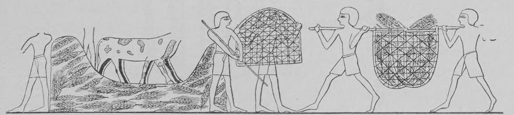

*Fig. 41. Ägyptische Arbeiter verladen Getreidebottiche auf Lasttiere.*

[^170.239]: Bh. und nh. קציר (s. GES. Hwb.¹⁴) z. B. MPeʾa 5,2, MŠebiʿith 1,4; 5,6, MJebam 15,2, MNedar 8,3. 4 (zugleich = Erntezeit, opp. בציר Weinlese, מסיק Öllese), TPeʾa 1,9, 19₄ (zugleich „das Geerntete“). קצירה das Ernten z. B. MPeʾa 4,14, MMeg 2,6, vgl. jPeʾa 1,1, 15ᵃ₃₆ קצירת שבולת הראשונה. Verb קצר speziell von der Weizenernte, z. B. TSabb 9,17, 123₃ b 73ᵇ MŠebiʿith 6,2. Von Getreide MʾOhal 18,2 זרע הנקצר, MʿUḳz 1,3 כל הנקצרים. Vgl. Varro 1,50, 1 *messis proprio nomine dicitur in iis quae metimur, maxime in frumento et ab eo ipso vocabulo declinata* (VOGELSTEIN S. 57 A. 3). Spezialisiert ק׳ שעורים, קציר חטים MNedar 8,4. So auch jPeʾa 1,4, 16ᶜ₂₃ ק׳ דוחן, קציר אורז. Definition מה קציר מיוחד usw. Sifra zu Lev 19,9 p. 87ᵇ, vgl. MPeʾa 1,4 (mit Kommentaren), T 1,7, 18₂₇, wo es heißt, daß die Bedingung לקיטתו כאחת nach einigen erfüllt werde bei שיזפין (*Zizyphus vulgaris* Lam. Judendorn, I. Löw, Pfl. S. 284), בנות שוח (I. Löw S. 335 Feigenart) und הלהלוהין (I. Löw No. 117). Siehe auch MMaʿas 1,1, bSabb 68ᵃ. — חצד s. Gen R 10,7 p. 80 Th., Lev R 22,4, Num R 18 g. E., Ḳohel R 5,8. חצדא דחיטי bMḳ 12ᵇ. Mehr bei L 2,98. — הקוצר לשחת MPeʾa 2,1, T 1,8, 19₁. Vgl. S. 130.
[^170.240]: קציר „Erntezeit“ s. A. 239. שעת הקציר jJebam 15,1, 14ᵇ₂₉. ש׳ קצירה TPeʾa 1,14, 20₁₁.
[^170.241]: Zwischen Aussaat und Ernte bloß 70 Tage TMenach 9,3, 525₃₆ b 85ᵃ s. oben s. 177.
[^170.242]: תבואה עושה פירות לששה חדשים TTaʿan 1,1, 214₁₈ vgl. 1,7, 215₁₅.
[^170.243]: Paschafest als Termin (פרק vgl. A. 181) für die Gerstenernte TSukka 3,18, 198₁. Wegen des Omeropfers s. MChalla 1,1, MMenach 10(6),7. 8, MPesachim 4,8, T 2,19, 160₄; s. Gen R 99 Ende, Tanch *Wajchi* 16. Wir ersehen aus diesen Stellen, daß auf Berieselungsfeldern, die zu einer neuen Ernte bestimmt waren (S. 164), und in dem warmen Jordantale und speziell in Jericho die Gerstenernte früher, im Gebirge, speziell bei Beth-El, später stattfand. Zur Sache s. VOGELSTEIN S. 58.
[^170.244]: TSukka 3,18, 198₂. Emmer um dieselbe Zeit, Exod 9,31.
[^170.244a]: Vgl. jedoch קמחא דאבשונא und die Erklärungen bei RN s. v. חכם (K 3,457).
[^170.245]: שאין החמה קופחת על ראשו של אדם אלא בשעת הקציר jJebam 15,1, 14ᵈ₂₉ mehr s. bei L 4,352, I. Löw ZA 23,280. — Abstreifen der Kleider folgt aus TBm 2,19, 374₂₁ טלית מונחת בצד הגדר. Lederschurz TKel bb 4,4, 594₁ siehe auf unserer Fig. 36. Siehe auch die große Tafel „Erntearbeiten, Relief aus dem Grabe des Ti“ bei JUSTI, Gesch. der orient. Völker im Altertum zu S. 66.
[^170.246]: Sifra zu Lev 19,9 p. 87ᵈ לקט קצירך ולא ל׳ קטוף, jPeʾa 3,3, 17ᶜ₂₉. TPeʾa 1,11, 19₁₀ „wenn er pflückte und in sein Haus einführte sogar sein ganzes Feld“ usw. bPesach 11ᵃ קטיפה, קטוף. L 4,287. Mehr in der Weinlese s. § 182. Ein anderes קטף s. S. 101.
[^170.247]: תלש Sifra zu Lev 19,9 p. 87ᵇ, jPeʾa 1,16ᶜ₈, bChull 137ᵃ, MPeʾa 4,10, T 2,14, 20₂₁. Zur Sache s. VOGELSTEIN S. 59 A. 26. — עקר MPeʾa 4,4, MBm 9,1, MʿUḳz 3,8, jPeʾa und bChull (wie oben). Bei Flachs תלש Bd. I, S. 139, doch למיעקר כיתנא bMḳ 12ᵇ, ib. ולמיעקר שומשמי, dagegen ib. למיקטל כשותא. Vgl. קטל A. 236. In dem neugefundenen „Kalender“ von Gezer (A. 9) soll מעצד das Werkzeug sein, mit dem man den Flachs mit der Wurzel ausgrub, s. Ephem. für Sem. Epigr. 3,41.
[^170.248]: MPeʾa 6,9 סאה תבואה עקורה כו׳, dann וכן באילן והשום והבצלים. Vgl. bChag 15ᵃ עקר פוגלא ממישרא. Anderes עקר MŠebiʿith 5,2, s. auch A. 341. Zwiebeln wurden berieselt, damit sie leichter entwurzelt werden könnten, T 2,1, 62₉ (הרביץ vgl. A. 109). TTerum 2,8, 27₂₂ f. TMr 2,16, 83₂₆. תלש Bar bḲidd 62ᵇ.
[^170.249]: חרמש fehlt bei L, kommt aber vor TKel bm 2,14, 580₃₇: מסמר . . . נתנו בחרמש שלא ישמט המשיט כו׳. Vgl. TMikw 6,21, 659₂₀ מגל שנשברה ידו מסטה ולפנים כו׳ ib. סירגה בגמי; ib. שורפה בשרף. מגלות MPeʾa 4,4.
[^170.250]: jPeʾa 3,6, 17ᵈ₄ zu Mišna 3,6. Zur Sache s. VOGELSTEIN S. 60 A. 33. Statt Arm heißt es freilich תלש מלא קמצו MPeʾa 4,10, also in der Hand. Ib. 4,10 תוך היד opp. תוך המגל, ib. אחר היד und ראש היד.
[^170.251]: MPeʾa 6,11 הקוצר בלילה והמעמר והסומא, ib. הגס, j 19ᵈ₃₂ גסין opp. דקין, s. L. Heller zur Mišna.
[^170.252]: TPeʾa 2,9, 19₃₁ ישראל שמכר קמתו לגוי לקצור. MPeʾa 5,5 המקבל שדה לקצור, T 3,1, 20₂₇. MPeʾa 2,8 קצר חציה ומכר חציה, T 1,9 קצר חציה ומכר את הקציר. Es konnte übrigens der Unternehmer seinen Anteil ebenso in Ähren als in Weizen ausbedingen (TDemai 6,6, 56₂₈ לקצור כשהוא שבלין opp. בחיטין).
[^170.253]: TPeʾa 1,9, 19₆ המארג, näher erklärt in j 3,3, 17ᶜ₂₁ (wo aber statt המירוג lies המארג, L 1,158).
[^170.254]: בית נמר MPeʾa 4,5, j 17ᶜ₈ נימרא (RŠ נמררי), Maim u. RN „das Feld nur an einzelnen Stellen besäen“ unmöglich, wegen 3,2 המנמר את שדה ושייר קלחים לחים, s. VOGELSTEIN S. 59 A. 24. Zu מלקטין על החבל M 4,5 vgl. בריכות MMenach 10(6),3.
[^170.255]: אומן ואומן MPeʾa 4,5 Maim. صفّ „Reihe“, weil Reihe um Reihe geerntet werde. Vgl. MBm 7,4 בהליכתן מאומן לאומן, MNedar 4,4: יעשה עמו באומן, ib. ברחוק ממנו. Im jerus. Trg ist אומן für פאה gesetzt. Trg Ps-Jon Lev 19,9 אומנא חדא eine auffällige Erweiterung gegenüber dem Texte; Fragmenten-Trg ed. Ginsburger S. 46 אומנא מחדיא, RN אומנא אחריא; in Tanch. Jeruš. bei Bacher S. 74 nur אומנא דחקלך. K 1,121 adoptiert in RN mit Recht die LA אומניא סחריא (gegen BACHER a. a. O.), nur ist dieses סחר׳ nicht pers. oder arab., sondern aram. סחר = חזר (L Trg Wb 2,153) = die ringsumlaufenden Reihen [Figur]; vgl. למחזור Ps-Jon ms bei Ginsburger S. 206. אומנא rein aram. אוציאתא bBb 12ᵃ (RN s. v. אמן und אצי). Die Sache wurde von V. S. 59 unrichtig, von DALMAN in ZDPV 28,34 f. nur zum Teile richtig aufgefaßt. D. verweist auf arab. امّان *immān*. Etymologisch hält er אָמָן für das „Anvertraute“, nämlich das jedem Schnitter Zugewiesene. Aber אומן dürfte in der archaistischen landwirtschaftlichen Sprache den Schnitter („Meister“) selbst bedeuten und hernach erst „des Schnitters Arbeitsfeld“. ראשי אומניות bBm 89ᵇ Raši dem Wesen nach richtig: ראשי שורות, vgl. MPeʾa 6,4 ראשי שורות, ib. שנים שהתחילו מאמצע השורה, unter Hinweis auf das Verbot בל תשוב (Dt 24,19), wo שוב offenbar = הלך (הליכה) = חזרה MBm 7,4 und לקצור ולשנות MPeʾa 3,6. Nachträglich erst sah ich in dem jüngst erschienenen Werke ZUCKERMANDELs (Tos. Mis. u. Bor. 2,109) die Feststellung, aus Jeruš. gehe hervor, „daß das Wort die Bedeutung ‚Handwerker‘ hat“. Dennoch versucht Z. andere Erklärungen!
[^170.256]: צבתים Ruth 2,16, vorher Vers 15 עמרים. MMenach 10(6),9 מניחים צבתים opp. כרעות s. A. 258. Sprachlich s. VOGELSTEIN S. 62 A. 46. LXX übersetzen sowohl עמר als אלמה mit δράγμα, Saadja Dt 24,19 עמר mit كفّة. Aber nh. כף MSabb 24,2 (cod. Hamb. 156 bei VOGELSTEIN S. 61 A. 43, s. auch D. S.) bzw. כפין (ed. Lowe) oder כיפין (Agg.) sind noch nicht richtige Garben, sondern Schwaden, wie in bPesach 40ᵃ u. ersichtlich: להנהו דמהפכי כיפי nach Raši’s und anderer allein richtigen Erklärung (s. bei K 4,294, anders RN), denn vor Pesach kann es sich nur um die soeben geschnittene Gerste handeln, die noch nicht in Garben liegt. Vgl. כפי דכיתנא Bd. I, S. 139. Siehe auch bBb 69ᵃ o., bSanh 26ᵇ u., bGitt 86ᵇ.
[^170.257]: Auszugehen hat man aus MSabb 24,2, wo אין מרסקין . . . השחת nur bedeuten kann: man lockert nicht (vgl. רסוק אברים aus der Stelle herausbringen) die Mahd (am Sabbat), offenbar nichts als Ausbreiten (falsch Bertinoro: schneiden), Befreien von der Presse, in welche das Futter durch die Einfuhr gebracht wurde. Irgendwelches Binden ist nicht da; vgl. ziemlich deutlich den Unterschied MPeʾa 6,10 תבואה שנתנה לשחת או לאלומה. Ib. vorher מתירין פקיעי עמיר Raši und Bert. שאגדן, aber schon L. Heller bemerkt, daß sie ein wirkliches Binden nicht meinen können. Vielleicht war das Futterkraut durch seine eigenen Stengel ein wenig umwickelt und lose gemacht (התיר), wenn man es dem Viehe vorwarf. In TMr 2,20, 84₅ heißt es bestimmt, daß das Futterkraut (בקיעי עמיר) eines ist, welches noch nicht in Bündel (חבילות) gebracht wurde; man tat das offenbar zu Hause. So auch Sifra zu Lev 19,11 p. 88ᵇ תעזוב לפניהם הנח תבואה בקשה תלתן בעמיר תמרים במכבדות (zitiert in jPeʾa 4,1, 18ᵃ₅₀, RŠ MPeʾa 4,1), so von *foenum graecum* auch jBb 5,1, 15ᵃ₁₅ משזרען לעמיר opp. לזרע, vgl. von der ägyptischen Bohne TŠebiʿith 2,13, 63₁₅ זרעו לעמיר. (Ägypt. Bohne s. SPECK, Handelsg. 1,341). Auch MSabb 7,4 עמיר deutlich unterschieden von תבן (man sieht dort, daß Stroh dem Rind, עמיר, entweder Mahd oder *foen. gr.*, dem [jungen] Schaf zu fressen gegeben wurde; vgl. TBm 8,4, 387₃₀, wonach das Vieh sich von פקיע עמיר so satt frißt, daß es dann das Stroh nicht mag). TDemai 1,17, 46₁₄ עמיר opp. von שעורים; TMeʿila 1,22, 558₂₆ opp. von כרשינן. Danach עמיר immer Viehfutter, vgl. den Exkurs bei VOGELSTEIN S. 74 f. Zur Form עמיר s. A. 176. In בקיעין (פקיעין, פקיע) ist wohl der Begriff des Abgeschnittenseins enthalten, vgl. בקעת, בקע, פצע bei Holz Bd. I, S. 86. — MSabb 24,1 ומפספסין את הכיפין (s. A. 256) ein loser Bund, aus dem das Futterkraut auseinandergerissen wird (פספס). Ib. weiter זירין (offenbar von זיר syr. ܙܘܪ زيّر festhalten, wovon זיירא Presse L 1,533 und nicht von זיר Kranz) nach den Kommentaren ein oben, unten und in der Mitte zusammengebundenes Futterkrautbüschel, u. z. bestand nach jTerum 10,5, 47ᵇ₁₀ (zu Mišna, wo von תלתן die Rede!) die חבילה aus je 25 זירין; auch jʿOrla 3,63ᵃ. MMaʿas 4,5 ירק וזירין wieder nur Futter. Vgl. זירין דארזי bSabb 155ᵃ mit „Bündel Reisig“ Bd. I, S. 84.
[^170.258]: Bh. אלמות s. Wbr., nh. auch sing. אלומה in MPeʾa 6,10 und in Exod R 31,7 (der Esel frißt die Garbe), אלומות TMr 2,17, 83₂₈. Verb אלם nur bh. Gen 37,7, wo Trg O. מאסרין אסרין, RN מכרכין כרכון s. K 4,321 und 6,426 (Agg. מפרכין פירוכין), LXX δεσμεύειν δράγματα (s. A. 256), Saadja نجرز جرزا. Zur Bedeutung von bh. עמר bzw. nh. עמרים (Pl. s. MPeʾa 5,8) s. VOGELSTEIN S. 61 und 63 (aber עמר einzelne Garbe, wegen Dt 24,19). MPeʾa 5,8 (Lowe ולכומסות) המעמר לכובעות ולכומסאות, s. Lwr 2,283 nach SACHS 2,184, trotz I. Löw als richtig anzusehen. Ib. להררה j 19ᵃ mit גלגל erklärt. Ib. zum Schlusse, wie gesagt, לעמרים, so alle Garbenhaufen, ohne jene speziellen Formen. — MPeʾa 6,6 eine einzige Garbe ist dem Getreideschober (גדיש) vergleichbar, zwei Garben (עמרים) jedoch dem Bund (כריכה pl. כריכות). MMenach 10(6),3 (hier jedoch במחובר לקרקע vgl. A. 254), ib. 9 opp. צבתים; TPeʾa 3,5, 21₁₆ ib. 8 Z. 30 (lies mit RŠ האוגד כריכות ועתיד לעמרן). MBm 2,1. 2, TBm 2,5, 373₂₃. Das Binden (אגד) vor der Garbenformung folgt auch aus TŠebiʿith 4,12, 66₁₄ הוא מלקט והן אוגדין על ידיו (vgl. den Passus richtiger in TChalla 2,5, 99₈), wonach der Zweifel bei VOGELSTEIN S. 62 A. 47 nicht berechtigt ist; auch sind כריכות nicht „kleinste Gebunde“ sondern „lose Gebunde“. Vgl. עומרי שובליא bSanh 11ᵇ.
[^170.259]: MPeʾa 6,1; ib. 6.
[^170.260]: MPeʾa 6,3. 4 ראשי שורות, „symmetrisch“ folgt aus העומר שכנגדו (mißverstanden von VOGELSTEIN S. 65 A. 2); T 3,4, 21₁₅ dasselbe, vorher מעורבבין.
[^170.261]: Bei GES., Wb¹⁴ גדיש „Garbenhaufen“ unrichtig; vielmehr sieht man aus MPeʾa 5,8, daß המעמר לגדיש verschieden ist von המעמר . . . לעמרים ib. (hier A. 258); ib. 6,6 עומר אחד . . . כגדיש opp. zwei Garben ככריכות. Vgl. die korrumpierte Stelle TPeʾa 3,1, 21₄, die etwa zu lesen ist: העושה כל שדהו עומרים ומעמר להן כמעמר לגדיש [יש שכחה] וההורר וזורר [כמעמר] לגדיש (vgl. A. SCHWARZ, Tos. Zeraim p. 37ᵇ), in letzterem Satze zwei ungebräuchliche Verba und darum in den Agg. verkannt: הרר von הררה (A. 258) zum runden Kegel aufhäufen und dann binden (זרר von זיר A. 257). גדיש s. noch MPeʾa 5,1; TDemai 6,11, 57₉; Sifre Dt 17 p. 69ᵃ: שמא ידליק את גדישי. Mutwilliges Anzünden des גדיש auch Jalḳ Dt § 808. TTerum 3,17, 30₁₃ מעשה שנפלה דליקה בגורנו בפרסגנא. Vgl. als Rache des Sklaven S. 97. Gen R 51,11 im Kriege שורף גדישים. Löschen durch Erstickung mit dem darüber gebreiteten Mantel (גולתא) jSabb 16,15ᵈ. Nach der Fruchtart spezialisiert: גדישין של שעורין und של עדשים bBḳ 60ᵇ. Sifre Dt 282 p. 124ᵃ nom. verb. עמור, vgl. MPeʾa 4,6. Verb עמר in MPeʾa 5,8 in drei nuanzierten Bedeutungen: 1) עמר . . . לעמרים 2) לגדיש 3) לגורן. Siehe auch jŠeḳal 5,1, 48₇₄, bSabb 127ᵃ. Anderes bezüglich גדיש s. bei VOGELSTEIN S. 65 A. 6.
[^170.262]: Siehe A. 261. Außerdem המעמר מפני הדליקה . . . אמת המים TPeʾa 3,8, 21₃₁.
[^170.263]: MʿUḳz 2,6 הבצלים שחמרן, Maim. richtig von bh. חמרים חמרים.
[^170.264]: MPeʾa 6,10 אגודי השום, ib. אגודות השום והבצלים; vgl. אגד A. 258. bBeza 13ᵃ חבילי תלתן, ib. 12ᵇ אסורייתא דהרדלא. Vgl. חבילה של לבונה jAz 1,5, 39ᵈ₃₇ (L 2,6 und o. A. 257).
[^170.265]: Fünffach bKethub 112ᵃ, ib. vieles fabelhaft. Hundertfach Gen 26,12. Belehrend Dt R 3,3 Anekdote, deren Held Pinechas b. Jair. Zur Sache s. VOGELSTEIN S. 63 A. 58. Zu תבואה „Körnerertrag“ (MSabb 18,1, MBm 6,5; 9,1 und sonst) vergleicht V. lat. *frumentum* (Varro 1,52, 2).
[^170.266]: קש MPeʾa 5,7 und oft, s. VOGELSTEIN S. 64 A. 60. קש von auf dem Felde gebliebenen „Stoppeln“ s. A. 137. Ein Ort hieß בית מקושש TJebam 1,10, 241₂₅. — גילא דחטתא bChull 56ᵇ o. גילי bBeza 14ᵇ Stroh von Hülsenfrüchten. עצה S. 183.
[^170.267]: Detaillierte Festsetzungen über diese Abgaben in den Traktaten Peʾa, Demai, Terumoth, Maʿaseroth, Challa usw. Armes Mädchen sammelt Ähren: Midr Teh 22,12 p. 93ᵇ מלקטת בשבלין; zu לקט vgl. A. 258; לקיטתו כאחת S. 186. MPeʾa 4,5 שלשה אבעיות ביום drei „Absuchungen“ per Tag, s. L 1,13.
[^170.268]: MPeʾa 1,5. Ausnahme Feigen S. 186.

## § 171

**171.** **Dreschen und Worfeln[^171.269].**

Schon der Schnitt konnte so bewerkstelligt werden, daß die abgemähte Frucht in große Bottiche (קיפות) fiel, was das Gute hatte, daß keine Ähren wegfielen, eine Engherzigkeit und Beraubung der Armen, die bei den Juden nicht geduldet wurde[^171.270]. Aber auch von der Erde wurden die in Garbenhaufen liegenden Bündel in dieselben Geräte gesammelt (נתן) oder gestopft (גדש), um auf Lasttiere (Kamel, Esel) geladen (טען) zu werden, die dann die Frucht zur Tenne (גרן aram. אדרא, ἀλωά, δῖνος, *area*) schafften[^171.271]. Die Tenne befand sich entweder auf dem Felde selbst, was den Vorteil hatte, daß durch die Überfuhr kein Korn verloren ging, jedoch den Nachteil, daß das Feld einstweilen dem Anbau entzogen war, oder auf einem hierfür besonders geeigneten, in der Regel felsigen Grundstück, das jedenfalls außerhalb der Stadt lag (weshalb dann die Frucht vor Feuersgefahr, s. weiter u., und vor Haustieren und sogar vor wilden Tieren nicht sicher war), häufig kreisrund (גורן עגולה) und dem Winde zugänglich war; da jedoch ein allzu starker Wind beim Worfeln außer der Spreu auch Korn weggetragen hätte, so zogen es manche Wirte vor, die Tenne in einer Niederung anzulegen (הקים)[^171.272]. Auf der Tenne stand die Frucht in Form eines Schobers (גדיש o. S. 188), der so groß war, daß man in ihm Ackerbaugeräte aufbewahren konnte, und es konnte in ihm auch ein Hohlraum geschaffen werden, der mehrere Menschen aufnahm[^171.273]. Manchmal wurden sogenannte Dachhaufen gemacht, d. h. zum Schutze vor Regen dem Weizenschober ein „Hut“ von Gerstengarben und dem Gerstenschober ein „Hut“ von Weizengarben aufgesetzt (חִפָּה)[^171.274].

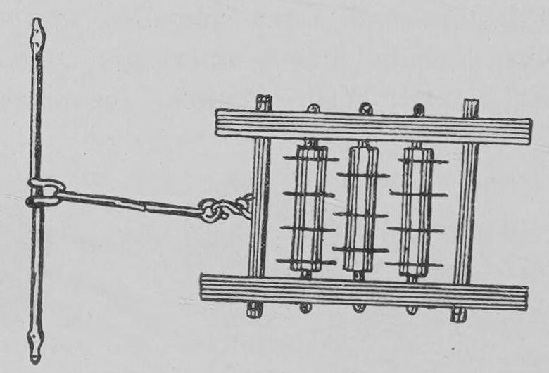

*Fig. 42. Alter Dreschwagen.*

Dieser Schutz war darum nötig, weil das Dreschen sich recht lange, manchmal bis in die Regenzeit hinein hinzog[^171.275]. Während der ziemlich langen Zeit, da der Landwirt nicht immer auf dem Felde lagern konnte, geschahen auch jene vielen Feuersbrünste auf der Tenne, von denen wir so oft hören[^171.275a]. Knapp vor dem Dreschen wurde der Schober umgeworfen und das Stroh zum Trocknen (יבש) in der Sonne freigelegt (aram. שרא)[^171.276].

Das Dreschen (bh. und nh. דוש, *nom. act.* דישה, ἀλοᾶν, τρίβειν, ἀλόησις, *terere*, *spicas excutere*, *tritura*) zur Sommerszeit verrichtete man durchaus mit Hilfe von Tieren, hauptsächlich Kühen (vgl. beim Pflügen S. 116), Ochsen und Eseln, von denen man das Getreide austreten ließ. Man koppelte zu diesem Zwecke auch mehrere Rinder, selbst das Junge mit der Mutter, zusammen (רבקה), damit die Arbeit rascher gehe. Nur anfänglich, wenn für den Hausbedarf ein kleines Quantum neuer Frucht (חדש) benötigt wurde, und wohl auch zur Winterszeit, drosch man auch mit Stöcken (מקלות, *baculum*, *fustis*), was aber der palästinische Landmann nicht Dreschen, sondern Schlagen (bh. und nh. חבט) nannte, weil es nur primitive Keulen, nicht Flegel waren, mit denen er die Halme schlug, und Stöcke wandte er auch an, wenn er Hülsenfrüchte aus den Schoten oder Färbekörner aus den Kapseln schlug (Flachs s. Bd. I, S. 139)[^171.277]. Bei Emmer und bei Hülsenfrüchten war ferner dasjenige Austretenlassen üblich, welches man רכם, רכן nannte und das vielleicht darin bestand, daß das Vieh an einen festen Mittelpunkt angekoppelt war, von dem aus es sich im Kreise drehte[^171.278]. Man hatte auch eine Dreschtafel oder Dreschwalze (bh. und nh. מורג, nh. מיטה של טורבל = τρίβολος, *plostellum*, *traha*), die, unten mit spitzen Steinen bewehrt, von den Rindern über den Getreidehaufen gezogen wurde[^171.279]. Das unter die Hufen der Tiere oder unter die Dreschtafel geschobene Getreide mußte oft gewendet werden (הפך), damit alle Ähren ausgedroschen würden. Man bediente sich dazu eines zweizinkigen Rechens (עתר, vgl. S. 107)[^171.280].

Nach einem bekannten biblischen Verbot durfte das dreschende Tier am Fressen der Ähren nicht gehindert werden (חסם), und da erfahren wir, daß der Vermieter von Dreschtieren dieselben vorher hungern ließ, damit sie sich dann auf Kosten des Wirtes sättigten; freilich konnte auch der Mieter seine Interessen wahren, indem er den Tieren vorher andres Futter verabreichte. Wollte man den Tieren die neuausgedroschene Frucht nicht lassen, so konnten ihnen Futtersäcke oder Futterkörbe (S. 126) vorgebunden werden, die jedoch Getreide von derselben Art enthalten mußten[^171.281]. Im Laufe eines Arbeitstages fraß ein Rind 6 *ḳab*, ein Esel halb soviel durchschnittlich[^171.282]. Die Drescharbeit erhitzt die Hufen der Tiere, und so läßt sie der gute Landwirt nach der Arbeit ins kühlende Wasser[^171.283].

Das ausgedroschene Getreide wird nun dem Worfeln (bh. und nh. זרה, λικμᾶν, *evannare* oder *evallere*, *ventilare*) zugeführt[^171.284]. Von den Körnern wurden zunächst Stroh und andrer Abfall mittels einer Anzahl von Gabeln oder Rechen (מלגז, מעבר, מזרה, מגוב), die fortschreitend immer dichtere Zinken aufwiesen, abgezogen und beseitigt[^171.285]. Nun erst wurde das Getreide mit der Worfschaufel (רחת, πτύον oder πτέον, *pala*, *ventilabrum*) im Winde geworfelt (זרה aram. דרא, דרי)[^171.286]. Bei Windstille mußten Reuter (כברה) und Siebe (נפוותא) aushelfen (vgl. Bd. I, S. 98); ein kleines Quantum Getreide, ferner Hülsenfrüchte, die unmittelbar dem Verbrauche zugeführt wurden, wurden in der Regel so gesäubert, Hülsenfrüchte allerdings auch so, daß man sie in eine Schüssel (תמחוי), einen Korb (קנון = κανοῦν) oder auf eine Tafel (טבלא = *tabula*) gab und die Spreu wie auch die schlechten wurmstichigen Körner von ihnen wegblies (נפח) oder mit der Hand aussonderte (ברר)[^171.287]; gab man sie ins Wasser, konnte der Abfall einfach abgeschöpft werden (שלה)[^171.288]. Von der Gerste, die man als Reibähren aß (מלילות Bd. I, S. 94), wurden die Schalen entfernt (קִלֵּף); Bohnen und dergl. wurden enthüllst (פרך) und in der angegebenen Weise gesäubert, wenn sie bald darauf gegessen werden sollten[^171.289], aber bei größeren Mengen zur Einspeicherung setzte auch da ein Dreschen und ein Worfeln ein. In das Haus wurde das Getreide durchaus nur gereutert (כבור) eingeführt, weil auch das geworfelte Getreide nachher noch gereutert wurde[^171.290]. Nun lag das Getreide vorerst in kunstlosen Haufen (צבורין) zerstreut (מפוזר) da und mußte erst in einen Haufen (כרי, ערמה) aufgeschichtet werden, der zu einem länglichen Prisma geglättet wurde (מרח, מירוח)[^171.291]. Hülsenfrüchte wurden ebenfalls zu Haufen geschichtet und geglättet, und die Bezeichnung „Haufen“ (ערמה) kommt auch bei Kräutern, Zwiebeln, Melonen und Kürbissen vor[^171.292]. Bei Getreide unterblieb manchmal das Glätten, bei Hülsenfrüchten das Reutern[^171.293], vermutlich dann, wenn man es eilig hatte. Um den Haufen zusammenzuhalten, trieb man Pflöcke (אלה, דוקרן) in die Erde, die hernach beim Einspeichern herausgerissen wurden (עקר)[^171.294]. Auch das nach dem Dreschen gebliebene und zu Häcksel zerkleinerte Stroh (תבן) und die nach dem Worfeln gebliebene Spreu (מוץ), die durch Worfeln ebenfalls gereinigt wurden, wurden in einen Haufen (ערמה) gebracht[^171.295]. Dem Prozeß des Dreschens entschlüpfen zerhackte (קטעים) und seitwärts gestrichene (שבצדדין) Ähren, und auch im Stroh bleiben noch Körner zurück, Reste, die der gute Landwirt mit in Rechnung hält[^171.296]. Das Stroh wurde in jenen bereits genannten Bottichen (קופות) im Wohnhause selbst gehalten und war zur Feuerung bestimmt, desgleichen die Spreu, die aber auch in die Düngergrube geworfen wurde[^171.297]. Aus dem ungebrochenen Stroh wurden auch Stricke (בוגא) gemacht[^171.298].

[^171.269]: WETZSTEIN Dreschtafel (Zschr. f. Ethnol. 5,1873). KLEIN, ZDPV 4,76 f., ANDERLIND ib. 9,40—46; BLÜMNER Techn. 1,2—10; VOGELSTEIN 65 f.
[^171.270]: TPeʾa 2,3, 19₂₃, vgl. Sifre Dt 43 p. 82ᵇ. קופה (s. bereits o. S. 125) wird in der Landwirtschaft oft erwähnt, z. B. auch MTerum 7,5. Viele Stellen und die Frage der Ableitung (gr. κύπη arab. قفّة) s. Lwr 2,517 f. Vgl. bei „Lasten“ § 139.
[^171.271]: MMenach 10(6),4 קצרוהו ונתנוהו בקופות, Sifre (s. A. 270) עד שגדש קופתו, vgl. גודשה לתוכה MMenach 9,5 und überhaupt die weite Verzweigung der Wurzel גדש bei L 1,305 f. Dieses גדש ist gemeint auch in TBḳ 6,24, 356₂₇ השאילו לגדוש חטין וגדש שעורין usw. „er leihte ihm [das Gerät כלי] um Weizen hineinzustopfen, er aber stopfte Gerste hinein“ usw. Kamele folgt aus jPeʾa 1,2, 16ᵇ₆₂ הבא גמלים וטעון, Kamele und Esel jDemai 1,3, 22ᵃ₇, Hunde Sifre Dt 343 p. 142ᵇ (dies alles ist VOGELSTEIN S. 65 A. 4 entgangen). — Zur Bedeutungsentwickelung von גרן im Neuhebräischen s. VOGELSTEIN S. 76. Danach bedeutet es 1) außer Tenne 2) auch die aufgehäufte Frucht z. B. MPeʾa 3,3 (vgl. S. 261), T 4,4, 23₉ אין חולקין להם על הגורן, ib. 5. 6 חילוק גרנות, ib. Ende (44₂) der volle Ausdruck אין חולקין בבית הגרנות; TDemai 5,17 55₈ מסעיין בבית הגרנות (besser als בין הגרנות Agg. und cod. Wien); 3) Ertrag, Ernte, schon Hiob 39,12; so z. B. שעת הגורן oder גורן allein (MBm 5,2, T 9,8, 391₂₁) die Zeit, in welcher die Ernte auf die Tenne gebracht wird. MPeʾa 1,6 כהן ולוי שלקחו את הגורן. Ebenso von der Zeit der Einführung auch anderer, nicht gedroschener Früchte: איזהו גרנן למעשרות MMaʿas, 1,5, vgl. TMr 1,1, 81₈, TŠebiʿith 4,14, 66₂₂. Sogar für die Zeit des Verzehntens des Viehes gebraucht: MŠeḳal 3,1; MBekhor 9,5. 6. Doch ist die Begriffsentwickelung auch so möglich, daß גורן von Haus aus gerade die Garbenhaufen bedeutete, deren Platz, ursprünglich בית גורן, dann kurzweg גורן hieß. Vgl. Fl. zu L Trg Wb 1,417ᵇ zu בית אדרי oder בית אדרא, auch L Nh. Wb 1,31 s. v. אדר. Siehe auch nächste A. בי דרי bTaʿan 3ᵇ, bBm 73ᵃ s. L 1,214.
[^171.272]: Tenne auf dem Felde selbst folgt aus המעמר לגורן MPeʾa 5,8 (A. 261), MBḳ 6,3, MʾOhal 18,2. Außerhalb der Stadt MMš 4,1, TMš 3,12, 92₅ היה מביא פירות מן הגורן לעיר, ib. דמי הבאה. TTerum 10,17, 43₃₀ מן הגורן לעיר ומן המדבר לישוב; ib. במקום שחיה ובהמה אוכלת, vgl. bChull 134ᵇ. Nach Ruth R 3,3 (c. 5,12) בנמוך של עיר, ib. אזל נפיחה, opp. בגובה שבעיר; ib. der Ausdruck הן אקימת אדרא, hebr. also הקים. Die Tenne wurde sorgfältig hergerichtet (BLÜMNER 1,4). בחצי גורן עגולה MSanh 4,3. TKil 3,12, 77₂₂ כקרן עגולה lies כגרן ע׳. bMḳ 10ᵇ (s. Raši u. RCh) מאן דמתקיל ארעא אדעתא דבי דרי שקל מוליא ושדא בנצא אדעתא דארעא.
[^171.273]: גדיש s. A. 261. Die Frucht in diesem Zustande wird gleichgestellt mit עביט של ענבים und מעטן של זתים MBm 5,7, TDemai 6,11, 57₉, TMr 3,13, 85₁₉. Ackergeräte im Schober: MBḳ 6,5, T 6,24, 358₂₅; Menschen: MSukka 1,8. Jene Ackergeräte (כלים) werden bBḳ 61ᵇ näher auf מוריגין וכלי בקר ausgelegt.
[^171.274]: TBḳ 6,24, 356₂₈. Mißverstanden von VOGELSTEIN S. 66.
[^171.275]: Lev 26,5.
[^171.275a]: Siehe A. 261.
[^171.276]: bBm 74ᵃ מהוסר משדא בחמה למיבש.
[^171.277]: Siehe L 1,388 דוש, 403 דַּיִשׁ das gedroschene Getreide, דישאה der Drescher, שעת דישה Dreschzeit. Gr. und lat. s. BLÜMNER 1,3. In der Bibel beschränkt sich דוש auf die Methode des Austretens durch Tiere; Dreschen mit Stöcken heißt חבט. Arab. داس dreschen mittels Tiertretens, درس mittels Maschine. Nh. von קלאילן (Bd. I, S. 145) zwar דוש (דשו בעצי אשרה TAz 6,1, 469₉, wo עץ ungefähr gleich מקלות MPara 3,11), aber aus MTerum 9,3, MMenach 10(6),4 sieht man, daß ein vorläufiges Dreschen von Getreide nicht דוש sondern חבט heißt. Besonders belehrend ist TTerum 10,4, 42₂₂ als Definition von חדשות (neuer Frucht): כל זמן שבני אדם רגילין לחבט מן (l. בין) הגרנות, worauf erst das Dreschen mit Rindern folgt (s. A. SCHWARZ, Tos. Zeraim S. 155ᵃ). Colum. 2,21, 4 *baculis excutere* nur winterliches Dreschen, ebenso mit *fustes*; mit Flegeln drosch man, wenn nur die Ähren abgeschnitten waren (BLÜMNER 1,7). Dreschtiere פרות bMḳ 12ᵇ, תורא (s. A. 281) (Rinder in der ganzen Welt, BLÜMNER 1,4 A. 5), Esel TBm 8,12, 388₁₈ (Maulesel selten, Pferde häufiger, BLÜMNER 1,5). Kasuistisch bBm 91ᵇ דש באווזים ותרנגולים. Bar bPesach 26ᵃ הכניסה לרבקה ודשה (Raši = *copula*, indem man 4 Kühe zusammenkoppelt), ib. בשביל שתינק ותדוש; s. noch bBm 30ᵃ, bGitt 53ᵃ, TPara 2,3, 631₁₄ (doch gibt RN bei K 7,250 für רבקה auch eine andere Erklärung: „er stellt das Tier zum Mästen ein“; s. § 152). — דשושות (VOGELSTEIN S. 67) gehören nicht hierher, s. S. 95; vgl. BACHER, Tanch. Jeruš. S. 84 A. 3.
[^171.278]: Bar bBm 89ᵇ פרות המרכסות בתבואה (TBm 8,10, 388₁₄ המרכים) opp. והדשות, nach RN (bei K 7,276), gewiß aus guter Tradition, hier תבואה auf כוסמת beschränkt. In jTerum 9,4, 46ᶜ₇₀ steht המרכין בקטניות ובתלתן, und viell. ist רכן nur aus רכס verschrieben. Das unerklärte רכס (s. MGWJ 49,691 A. 2) dürfte gleich bh. רכס „anknüpfen“ „anbinden“ sein. Zu erwähnen auch בסס (etwa „zertreten“, s. VOGELSTEIN S. 67 A. 19) in MʿUḳz 1,5 כל ידות האוכלין שבססן, s. RŠ, und danach TʿUḳz 1,5, 687₂ zu berichtigen; vgl. bSukka 14ᵃ.
[^171.279]: מורג s. Ges. Hwb.¹⁴ und Literatur daselbst. מוריגין bBḳ 61ᵇ s. A. 273, bZebach 116ᵇ, L 3,239. Identisch mit טורבל MPara 12,9 und sonst, s. Lwr 2,258; τὰ τρίβολα, auch τρίβολος BLÜMNER 1,6. In Ägypten *noreg*, welches nach RICH identisch ist mit *plostellum poenicum*; ferner *traha*, *trahea* (BLÜMNER 1,7). *Serra* Vulg. Jes. 28,27; Hieronymus in Amos 1. Der Beifügung מיטה entspricht لوح der heutigen Araber (VOGELSTEIN S. 66 A. 18). In Babylonien erklärte man (bAz 24ᵇ) מיטה של טורבל mit עזא דקורקסא „kirkassische“ (?) Ziege, vermutlich, weil die zwei Spitzen des vorn aufwärts gebogenen Dreschschlittens mit den Hörnern verglichen wurden. Mehr s. bei WETZSTEIN, Dreschtafel. Eine Dreschtafel aus Syrien befindet sich auch im naturhistorischen Hofmuseum zu Wien.
[^171.280]: Siehe Raši bSukka 14ᵃ (zu bJebam 64ᵇ unrichtig *pala*). Gen R 63,5 ולפום כן קרין ליה עתרא דאפיך אדרא. Vgl. ZDPV 9,42 f. Dem Lockenhaar verfängt sich die Spreu im Kopfe, dem Kahlen genügt eine Handbewegung, sie vom Kopfe abzuwischen: Gen G 65,15.
[^171.281]: Dt 25,4; vgl. I. Kor 9,9, I. Timoth. 5,18. תורא מדישיה קאכיל bChull 12ᵇ, bGitt 61ᵇ. Mieter s. TBm 8,4, 387₂₉.
[^171.282]: TBm 8,12, 388₁₈. Heute nimmt man an, daß ein Ochse beim Dreschen täglich 30 l Weizenkörner frißt (ZDPV 9,44).
[^171.283]: MMakhš 3,8 בשעת היחף Maim. „Müdigkeit“ (= יעף) und verweist auf arab. حفا Fußkrankheit der Tiere. RŠ liest בשעת האף zur Zeit der Hitze. Ib. בשעת . . . הדיש (ed. Lowe verderbt הריש).
[^171.284]: זרה MŠebiʿith 6,2, MSabb 7,2, MKel 16,6, TBerakh 7,2, 14₂₆, TMr 3,13, 85₁₇. WETZSTEINS Exkurs zu DELITZSCH Jesaia² 707 f.; BLÜMNER 1,8 f.
[^171.285]: מלגז MSabb 17,2, T 9,10, 122₇, Sifra zu Lev 4,27 p. 21ᵈ (davon Verb לגז „mit der Worfgabel arbeiten“), LA auch מזלג in Anlehnung an das bh. bekanntere Wort. Vgl. θρίναξ, θρινάκη BLÜMNER 1,10. MKel 13,7 המעבר והמזרה והמגוב (Hai schon kennt die Var. מעדר für מעבר, ferner gibt es die LA מגוג für מגוב s. L. Heller; מגוב hängt offenbar mit גבבה Bd. I, S. 85 zusammen), MTj 4,6. — מזרה auch MŠebiʿith 5,6 (in TKel bb 7,3, 597₆ שירי המזרה, RŠ zu MKel 29,3 המרדע, ist trotz VOGELSTEIN S. 69 A. 39 richtig).
[^171.286]: רחת MSabb 17,2, MKel 15,5. Vgl. BLUMNER 1,8 f. זרה s. A. 284, דרי, דרא bBm 74ᵃ s. L 1,424.
[^171.287]: Reutern bei Windstille BLÜMNER 1,11. Ausdrücklich בנפוותא bBm 74ᵃ, bTaʿan 3ᵇ. כברה s. MKel 27,5. קיטניות כדי שיכביר TMr 1,6, 81₂₈; ib. נוטל מתחת כברא ואוכל (l. כברה). Der Flussname כבר wurde gedeutet (Gen R 16,3): שפירותיו גסין ואינן יורדין בכברה. Demnach fiel manchmal auch Korn durch. Gr. κόσκινον, lat. *cribrum* s. RICH. MBeza 1,8 הבורר קטניות. Ib. (Bar b 12ᵇ) בורר כדרכו בחיקו בקנון ובתמחוי. Ib. כברה, נפה, טבלא. Vgl. bSabb 138ᵃ דרכו של בורר (opp. של מרקד vgl. Bd. I, S. 97 הרקדה; Mekh RSbJ zu Exod 12,16 p. 17 שאין בוררין ואין טוחנין ואין מרקדין). MMakhš 1,5 הנופה בעדשים לבודקן אם יפות הן, so auch מנפה Bar bBeza 12ᵇ = blasen, aber L 3,418ᵃ und K 5,363ᵃ ziehen מנפה (von נפה) = sieben vor. — Zu קנון s. Lwr 2,552.
[^171.288]: MBeza 1,8 מדיה ושולה.
[^171.289]: bBeza 13ᵇ המקלף שעורין (ib. aram. מקלפא). Ib. 12ᵇ ומפרכין קטניות (ib. aram. לפרוכי). bMḳ 16ᵇ ein Weib am Wege מניפה הושלאי (s. S. 130). Vgl. פירוכין Trg für גרש und כרמל L Trg Wb 2,290.
[^171.290]: jMaʿas 1,8, 49ᵃ₆₁ הכבור opp. שאינו כבור, ib. שכן דרך בעלי בתים להיות מכניסין לתוך בתיהן.
[^171.291]: TMr 2,17, 83₂₉ תבואה ממורחת עשויה כרי opp. מפוזרת. Die Gestaltung geht hervor aus TTerum 4,9, 31₁₅ כמין כי, צפון צפונו, צפונו בצפונו und בדרומו. Siehe noch כרי MBm 9,5, MʾOhal 15,7, TPeʾa 1,5, 18₁₈, TTerum 3,17, 30₉. Zu χαρια des Epiphanius, כירוון Trg II Chr 31,6 s. LAGARDE, Orientalia 2,31. ערמה MTerum 2,1, MMaʿas 1,6; 5,7; TTerum 4,15, 32₁₂ ib. 3,17, 30₉ לא מן הכרי על הערימה besagt nicht, daß כרי verschieden von ערימה, sondern ע׳ ist hier ערימת המוץ vgl. D. Pardo und weiter u. נתמרה jPeʾa 1,1, 15ᵃ₄₀; jMaʿas 1,6, 49ᵃ₅₇ תבואה משיתמרה, ib. erklärt: מן דו ישפר אפוי דכריה (L 3,248; VOGELSTEIN S. 69 A. 42). Eine frühere Stufe der Schichtung ist ציבורין TTerum 3,9, 29₁₅. Siehe die Arbeit des Glättens auf der Tafel „Erntearbeiten“ (A. 245).
[^171.292]: MMaʿas 1,6 הקטניות . . . עד שימרה Ib. 1,5. 6 ערמה von דלועים. MTerum 2,1 ערמה . . . של ירק. bBeza 13ᵇ von בצלים und andern unhaarigen Früchten.
[^171.293]: MMaʿas 1,6. Anders VOGELSTEIN S. 69.
[^171.294]: TTerum 3,11, 29₁₈ משיעקר האלה l. משיתעשר (zu אלה s. S. 310), j 49ᵃ₅₉, jSabb 6,8ᵇ₄₄ s. RN, der jedoch אלה unrichtig als עללא = Ertrag erklärt. Auch VOGELSTEIN S. 70 ist ratlos. jSabb a. a. O. erklärt אלה richtig mit דוקרן s. oben S. 175.
[^171.295]: תבן aram. תבנא, ܬܒܢܐ, تبن s. GES. Hwb.¹⁴ und VOGELSTEIN S. 67. Unterschied zwischen קש und תבן s. im Jahrbuch „Jerusalem“ 7,337. MSabb 18,1, MʿErub 8,4, MBḳ 3,3, T 2,7, 348₂₆ und oft. Geworfelt: TMr 3,13, 85₁₅ הזורה תבנו. Haufen MBeza 4,1. — מוץ MSabb 20,3, TTerum 3,17, 30₉ (vgl. A. 291), bBerakh 31ᵃ. Aram. מוצא im Trg.
[^171.296]: MMaʿas 5,4 שהתורם בלבו על הקוטעין ועל הצדדין ועל מה שבתוך התבן (ed. Lowe הקטעים), RŠ richtig שיבולות קטועות, auch zitiert er richtig קוטעין aus TTerum 3,6, 29₁ (ed. Z. קיטין), alle drei Reste auch MMaʿas 1,6. In TMr 1,6, 81₂₇ entspricht 1) שיבלים הפליטות מן הגורן 2) מהפורת של כרי 3) קצצין של קטניות.
[^171.297]: MKel 17,1 קופות . . . של בעלי בתים בתבן (gleich daneben גבבה als Heizmittel in Bädern s. Bd. I, S. 85), vgl. Gen R 36,1. Vier—fünf Bottiche mit Stroh im Privathause, die dann angekommener Gäste wegen zur Seite geschafft werden (פנה) s. MSabb 18,1. Auch Spreu verbrannt Matth 3,12, Luk 3,17; hiermit wird die Frage, was mit Stroh und Spreu geschieht (E. NESTLE M. u. N. DPV 1896, 54, vgl. ZDPV 13,201) genügend beantwortet. Nach Jes 25,10 kam die Spreu in die Düngergrube. Aus Stroh (תיבנא) und Mahd (אספסתא) machte man auch leichte Zwischenwände, bʿErub 44ᵇ.
[^171.298]: בזגא bChull 52ᵃ o., nach L 1,206 = פתכא.

## § 172

**172.** **Aufbewahrung.**

Sämtliche Arbeiten verrichtet der Landmann in der Hoffnung, die Frucht seiner Arbeit auch einsammeln (כנס, הכניס aram. כנש) zu können. Ein Scheltwort lautete: „Wast du anbaust, wirst du nicht einsammeln.“ Von dem älteren Hillel besitzen wir noch den Ausspruch: „Zur Zeit, wenn andre einsammeln, streue du aus (בדר, d. i. anbauen), und wenn andre ausstreuen, sammle du ein“[^172.299]. Von der freudigen Erregung, die der Landwirt bei der Arbeit der Einspeicherung (מלאכת הכנסה) empfand, klingt noch etwas zu uns herüber. Gern hätte er sich gewünscht, daß statt hundert *kor* Getreide zweihundert, daß statt hundert Faß Wein zweihundert eingeführt worden wären, ein vergeblicher Wunsch, der nach der Lehre der Rabbinen nicht die Form eines Gebetes annehmen sollte, doch billigten sie es, wenn der Landwirt betete: „Möchte doch in den Vorrat Segen (ברכה) einziehen und Fluch (מאירה) davon fern bleiben!“[^172.300] Die Einfuhr wurde sorgfältig gemessen (מדד). Wir kennen die Gebetsformel, die der Landwirt sprach, wenn er behufs Messens die Tenne betrat und wenn er mit dem Messen begann; für das bereits gemessene Getreide jedoch sollte keine Bitte um Segen ausgesprochen werden, denn es galt die Annahme, daß der Segen nicht einziehe weder in eine abgewogene, noch abgemessene, noch auch abgezählte Sache, sondern nur in solche, die vor dem Auge verhohlen ist (סמוי)[^172.301]. In die römische Latifundienwirtschaft versetzt uns folgende Erzählung: Ein König hatte mehrere Getreidespeicher (גרנות), die aber lauter ungesäubertes (טינוף) und mit Lolch (זונין o. S. 185) vermischtes Getreide enthielten, und so achtete er auf die Menge (מנין) des Vorrats nicht. Als er aber einen schönen Speicher besaß, da sprach er zu seinem Verwalter (בן בית): Jene Speicher dort sind ungesäubert und voller Lolch, so brauchst du auf die Menge des Vorrats nicht zu achten; aber dieses hier — nimm auf, wieviel *kor*, wieviel Säcke und wieviel Metzen (מודיאות = *modii*) darin sind[^172.302]. In jüdischen Händen treffen wir bezeichnenderweise niemals ungesäubertes Getreide an, vielmehr wird versichert, daß das Getreide bis zu Ende alle Pflege erfuhr, ehe es eingespeichert wurde[^172.303]. Namentlich gehörte auch dazu, daß die Frucht ganz trocken (יבש), d. i. ganz reif, in den Speicher kam, was ebenso auch von manchen Gemüsearten gilt[^172.304]. Die dauerhafte Sorte (מתקיים) war gleichwertig mit der schönen Sorte (יפה)[^172.305]. Die Einspeicherung verfolgte eben den Zweck der Erhaltung (כנס לקיום)[^172.306].

Das im Hause gehaltene Getreide, das nur von kleinem Quantum gewesen sein konnte, wurde in Bottichen (קיפות o. S. 189), in Säcken oder in Körben gehalten[^172.307]. Am vorzüglichsten jedoch eignete sich als Aufbewahrungsort und zugleich als Trockenplatz der Söller (עליה Bd. I, S. 32), der zu diesem Zwecke in mehrere Kammern (מגורה) geteilt war, damit Weizen, Gerste, Öl, Wein usw. ihren eignen Raum hätten; durch Zufall kam es allerdings vor, daß z. B. ein Metzen Weizen in einen Gerstenhaufen fiel (נפל)[^172.308]. Vor plötzlichem Regen wurde durch eine Falltüre (ארובה Bd. I, S. 32) das Getreide in das Untergeschoß herabgelassen (השל) oder mit großen Schutzdecken bedeckt (כסה)[^172.309]. In Form von Anbauten (יציעין) hatte man ferner beim Wohnhause selbst Strohscheunen und Fruchtkammern (Bd. I, S. 46). Wieder andrer Art sind gewisse Schuppen (סהרים, שהרים) aus Flechtwerk[^172.310]. All diese Arten von Aufbewahrung nannte man mit einem von דָּגָן selbst gebildeten Worte דָּגַן (vgl. דגר) „aufhäufen“ und דִּגּוּן „Aufhäufung“[^172.311].

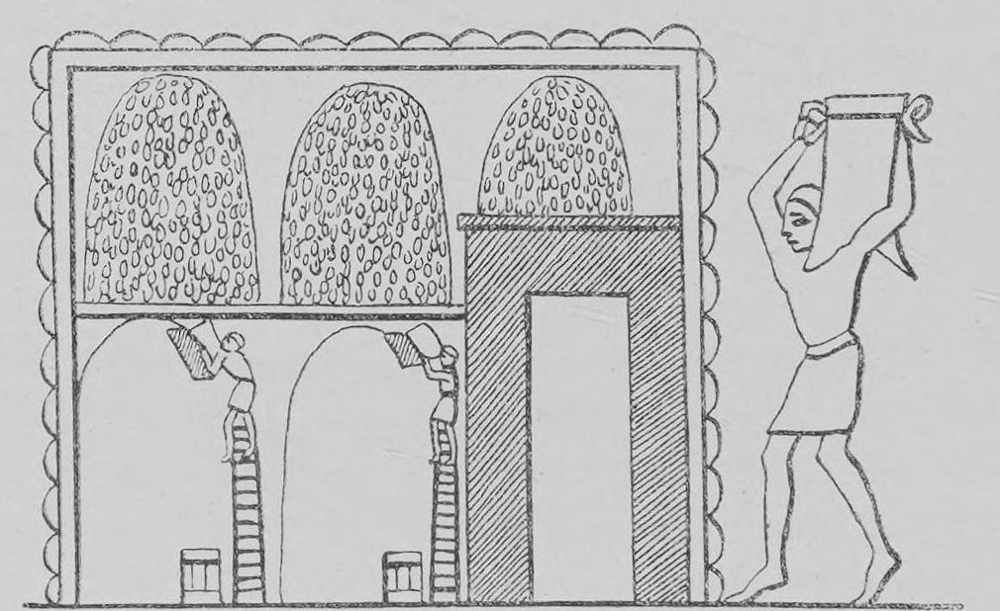

*Fig. 43. Ägyptisches Granarium.*

Solange die Juden Herren in ihrem Lande waren, wurden in öffentlichem Interesse, z. B. für das Brachjahr, für Arme usw. besondere „Stadtmagazine“ (אוצר שבעיר) angelegt, in denen von den zu Markte gebrachten Lebensmitteln, in erster Reihe von Getreide, große Quantitäten zur Einspeicherung hinterlegt wurden, und es wurden durch Ausgesandte der Behörde auch auf dem Lande selbst immer zur Saison ebensolche Mengen von Feigen, von Trauben und von Oliven requiriert, die dann in geeigneter Weise zur Aufbewahrung gebracht wurden. Mehr auf römische Verhältnisse mit der Latifundienwirtschaft weisen die oft erwähnten Scheunen (אוריות = *horrea*) und die damit identischen Feldmagazine (אוצרות שבשדה, vgl. schon I. Chr. 27,25), die groß und wichtig genug waren, um ihnen in einem eignen Wohnraum (בית דירה vgl. S. 78) einen eignen Wächter (vgl. S. 185) zu halten, weil sie ihrem Wesen und ihrem Namen nach zumeist auf offenem Felde stehende Vorratshäuser waren. Um das Haus herum hießen sie Niederlagen (אפותיקי = ἀποθήκη). Man unterschied Privat- und Regierungsmagazine (אוצר של יחיד und אוצר מלכים), letztere offenbar bestimmt, die an das römische Heer zu leistenden Naturalienlieferungen aufzunehmen, weshalb wir den bezeichnenden Zug erfahren, daß sowohl Israeliten als Heiden ihre *annona* (ארנונא) dorthin liefern (הטיל בו); auch einzelne Festungen werden genannt, in denen sich solche ärarische Magazine befanden, wie z. B. in Jabne, und es gab welche, in denen auch ausländisches, vielleicht gar überseeisches Getreide zusammenfloß[^172.312]. Eine besondere Art stellen die Schuppen (אלקטיות Bd. I, S. 7) dar. In Babylonien entsprechen die אכלבאי genannten Getreideschuppen[^172.313]. Es sind das durchaus leichte Bauten (Bd. I, S. 7), aber dem Zwecke angemessen gehörig ausgestattet. Sie erhielten frische Luft durch Fenster; da jedoch die Fenster, die allerdings die schädlichen Dünste abziehen lassen, anderseits Regen und Nässe eindringen lassen würden, so wurden sie mit einem Gitterwerk (סריגות Bd. I, S. 42) versehen[^172.314]. Das Faulen derFruchtkörner (רקב, הרקיב, faules Getreide רקבונית)[^172.315] sollte hintangehalten werden. Auch Hitze, Rauch und Ausdünstung von Viehställen wurden ferngehalten[^172.316].

Eine andre Art Aufbewahrung ermöglichten die in dem Kalkstein des Bodens Palästinas sehr häufig anzutreffenden schlauchartigen Schächte, welche die ihnen anvertraute Frucht sehr gut erhalten. Man barg also die Frucht auch in der Erde (כמן באדמה, כמר vgl. Bd. I, S. 123)[^172.317]; vgl. die *maṭmur* (*maṭmare*, unterirdische Getreidebehälter) der Araber. Auch an den Höhlen besaß man vorzügliche Vorratsräume[^172.318]. Desgleichen an der fast zu jedem Hause gehörigen Zisterne (בור)[^172.319], doch ist bei weitem gebräuchlicher die brunnenartig gebaute Korngrube (חדות, auch הדות, דות, syr. ܚܕܘܬܐ vgl. Bd. I, S. 44 und 46), mit regelrechten Wänden (כותלים), einer Randleiste (ליזבין vgl. Bd. I, S. 59) und einer Öffnung (שפה), die mit einem Brett (נסר) zugedeckt und mit einer Türe auch verschlossen (Bd. I, S. 39) sein konnte[^172.320].

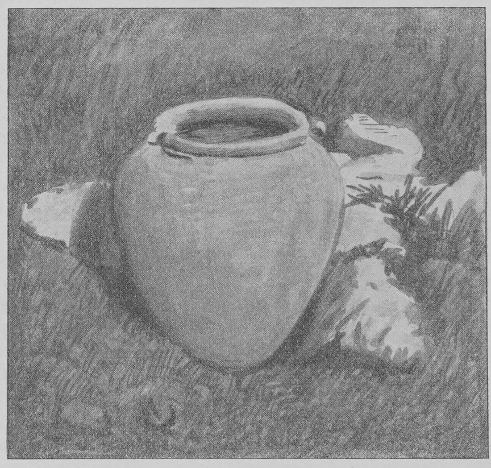

*Fig. 44. Kanaanitischer Getreidekrug.*

Öl- und Weinfässer hielt man in einem Keller (מרתף w. u.), während bei Obstgärten ein Vorratsraum (קלרין = κελλάριον) vorkommt, der zwar ebenfalls „Keller“ heißt, aber von jenem verschieden gewesen sein wird[^172.321]. Nach der Vorschrift Varros (1,13) sind Wein und Öl auf flacher Erde zu halten, während Wicken (*faba*) und Heu auf Böden (*tabulatum*) untergebracht werden sollen. Demzufolge dürfen wir auch im *martef* der Juden keinen unterirdisch gebauten, sondern in dem Flur des Hofes liegenden Vorratsraum erblicken, um so mehr, als davon die Rede ist, daß der Hausherr mit Gästen daselbst speist (übrigens auch im Hof Bd. I, S. 45 und im Magazin אוצר); eine genaue Scheidung ist übrigens nicht zu erwarten, denn nicht nur wurde Essig zusammen mit dem Wein im *martef* gehalten, sondern auch im Weizenmagazin kommen Ölkrüge vor, und ebenso finden sich Linsen und Wicken im Magazin. Dagegen dürfen wir den Dachboden (גג) der Ölkelter und des Wächterturmes (מגדל vgl. I. Chr. 27,25) als vorzüglich für Obst geeignet ansehen, nach jener Vorschrift allerdings auch für Stroh und Hülsenfrüchte. Als kleinere Bewahrungsräume kommen auch allerlei „obere“ und „untere“ Nischen oder Löcher (חורים) des Wohnhauses in Betracht, und sogar unter dem Bette wurden Holz und Stein gehalten (vgl. Bd. I, S. 63)[^172.322]. Die Einspeicherung war im landwirtschaftlichen Leben derart wichtig, daß bei einem Hauskauf es mit der Besitzergreifung gleichkam, wenn der Käufer daselbst Getreide aufhäufte (צבר)[^172.323]. Die Waren lagen dicht aneinander (מוקף, הקפה)[^172.324]. Bei Getreide und Gemüse ist nächst אוצר (s. o.) die umfassendste Bezeichnung *gōren* (גורן), ein Wort, das sowohl den Vorrat selbst als seinen Einspeicherungsraum bezeichnet[^172.325].

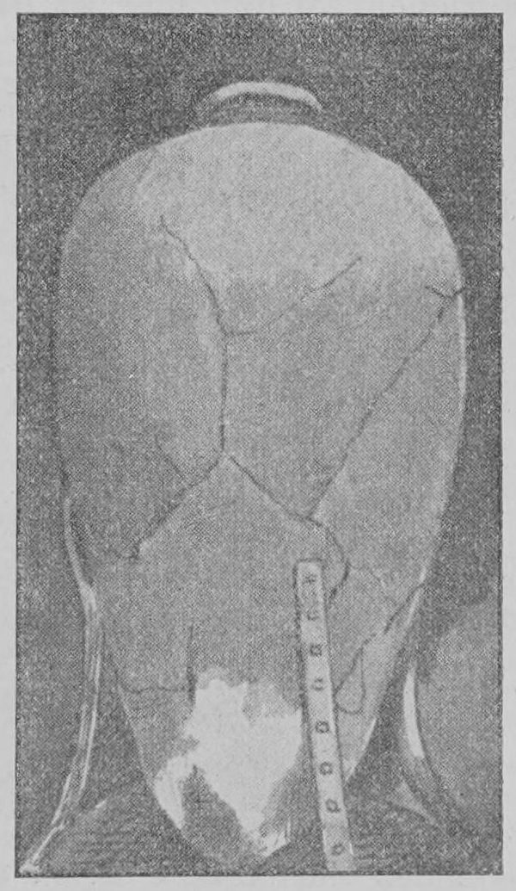

*Fig. 45. Getreidetopf aus Gezer.*

Zum Wesen der Aufbewahrung gehört, daß die Ware ständig und für geraume Zeit (קבע) eingespeichert wurde[^172.326]. Die zur Aufbewahrung bestimmten Früchte, besonders getrocknete Feigen und Rosinen, wurden vom Gebrauche ausgesondert (קצה) und hießen nun „Abgesondertes“ (מוקצה, auch מקצוע), das eben in dem Absonderungsraum (ebenfalls מוקצה) lag[^172.327]. Die Heimlichkeit des Ortes (מקום המוצנע vgl. S. 176) trug dazu bei, daß die Frucht gut konserviert wurde, während ein zugänglicher Ort (מקום תורפה) nicht zweckdienlich gewesen wäre[^172.328]. Man nahm an, daß in einem regenarmen Jahre die Früchte sich besser halten (השתמר)[^172.329]. Die Schäden, vor denen sie zu bewahren sind, kennen wir bereits (S. 184). Wurzelgewächse, wie z. B. לוף, eine *Arum*-Art, wurden behufs Konservierung in Erde gesteckt (טמן vgl. Bd. I, S. 110)[^172.330].

[^172.299]: כנס MBb 3,1, TBm 9,2, 391₁₀, MŠebiʿith 4,7—9. הכניס MPeʾa 1,4, MSabb 10,1. MMḳ 2,3, MMakhš 2,10 und oft. „Sicher falsch“ ist מוכנסו ed. Z. TMr 1,1, 81₈ schreibt VOGELSTEIN S. 71 A. 3. Agg. und cod. Wien מכנסתו (s. auch ed. A. Schwarz p. 159ᵇ), also nicht כניסה, wie V. will. Er selbst verweist auf TMr 2,20, 84₉ עשויות למוכנס und das möchte er מיכנס (das wäre aramäisch!) lesen. Es gibt auch דרך מכנס jKil 2,1, 27ᶜ₆₉ l. מוכנס „auf dem Wege der Einführung“. מוכנס muß als ein Wort wie מוקצה angesehen werden (w. u.) und heißt „Vorratsgetreide“ vgl. מכונס (l. מוכנס) bSabb 32ᵇ Raši אוצרות; TTohar 9,5, 670₁₂ zweimal רוב המוכנס; TMr 2,20 also: „Scheunen und Feldmagazine, die für das Vorratsgetreide bestimmt sind“; ib. 1,1 מלאכת מוכנסו „die Arbeit der Aufbewahrung“ (oder Einspeicherung); an der Parallelstelle bBm 88ᵇ heißt es dafür ואיזהו גמר מלאכתן מלאכת הכנסתן, mit der Bemerkung הכנסתן אפי׳ בשדה (vgl. TMr 2,20) opp. הכנסתן לבית. Sonst s. L 2,352 f. s. v. כנס. — Aram. כנש: jMš 4,55ᶜ מה דאת זרע לית את כנש (der Satz wird von einem Traumdeuter günstig gedeutet, aber der einfache Sinn bleibt ihm unbenommen). Hillel הזקן: jBerakh g. E. בשעה דמכנשין בדר ובשעה דמבדרין כנוש (so aram. auch Midr. Sam. Anf. p. 21ᵇ, nur umgestellt), in TBerakh g. E. und in b 63ᵃ hebr. כנס und פזר. L übersetzt den Satz 1,195; 2,353; 2,359 dreimal, ohne den Kern zu treffen; Hillel kleidet seinen Gedanken in eine landwirtschaftliche Regel!
[^172.300]: TBerakh 7,7, 15₁₆ f. מאירה opp. ברכות auch Maleachi 2,2; vgl. auch andere biblische Stellen. ברכה signifikant Dt 28,8.
[^172.301]: Bar bTaʿan 8ᵇ vgl. Tosafoth.
[^172.302]: Num R 4,1. Zu מודיא s. Lwr 2,324. Anschaulich Pesiḳta R c. 10 p. 35ᵇ כמה משפלות של תבן אתה מכניס לאוצר . . . קש . . . קוצים . . . להיכן הוא נותן את הקוצים באש . . . אבל מהו אומר לבן ביתו תן דעתך כמה חטים אתה מכניס לאוצר . . . שהם חיותם של עולם
[^172.303]: Folgt aus TTerum 1,7, 25₃₃ שאין הגורן נכנס אלא אם כן נתרם.
[^172.304]: MKil 7,7 תבואה שיבשה כל צרכה כו׳, vgl. damit MPeʾa 3,3 ומקיים [בצלים] יבשים לגורן כו׳ (s. A. 276).
[^172.305]: MTerum 2,4 יפה opp. מתקיים. Vgl. ואינו מתקיים בארץ MŠebiʿith 7,1. מקיים לזרע TKil 2,14 s. A. 180.
[^172.306]: jPeʾa 1,4, 16ᶜ₂₀ זית וכרם . . . ומכנסן לקיום; M 1,4 ומכניסו לקיום von Getreide und Hülsenfrüchten. TPeʾa 1,7, 18₂₇ ירק ist nicht zur Aufbewahrung geeignet, s. jedoch j 3,2, 17ᶜ₂₇, daß es nur getrocknet werden müsse, um aufbewahrt zu werden. Gewisse Obstgattungen (Datteln und dgl.) muß man in Sieben aufbewahrt haben, denn nur so ist verständlich מאן דאכיל תמרי בארבלא bMaḳk 20ᵇ, vgl. bSanh 39ᵃ.
[^172.307]: MSabb 18,1, vgl. MʾOhal 6,2. — Säcke TTerum 3,10, 29₁₇ vgl. MMakhš 1,4. — Die Matte בוריה (bSukka 20ᵇ s. I A. 53) dient bei den Arabern in Syrien zur Getreideaufbewahrung (arab. באריה Tanch. Jeruš. bei BACHER hebr. S. 21 No. 5). Tanchum hat das Wort ohne ו als בריה gelesen; arab. jedoch, aus pers. בוריא, nur בוריה (BACHER a. a. O. S. 81).
[^172.308]: מגורה (schon Chaggai 2,19, vgl. ממגֻרות Joel 1,17) MTerum 4,2; daß diese Kammer in der עליה war, sieht man aus TTerum 3,10, 29₁₇ ib. 5,12, 34₈; an letzterer Stelle und in M 4,11. 12 der viel verhandelte Fall סאה תרומה שנפלה usw.; Weizen hernach von Gerste trennen heißt קפא „abschöpfen“. Vgl. noch MBm 4,12, MKel 19,7, Bar bPesach 4ᵇ. 9ᵃ, bAz 41ᵇ, bNidda 15ᵃ. jMaʿas 3,3, 50ᶜ₆₅ (fehlt in TTohar 9,5, 670₁₂). Von Zeit zu Zeit wurde die Kammer (מגורה) ausgekehrt (כבד) MTerum 11,6.
[^172.309]: MBeza 5,1 משילין usw.
[^172.310]: TDemai 6,11, 57₁₁ שהרי שבלים j 6,1, 25ᵇ₁₄ שהרי (analog sind ib. סלי זתים und סלי ענבים). Vgl. סהר o. S. 134 und VOGELSTEIN S. 20 A. 21.
[^172.311]: אידגן bBerakh 47ᵇ, bBeza 13ᵇ, bNedar 55ᵃ, bSabb 127ᵇ u., דגון bGitt 47ᵃ, bBm 88ᵇ, s. L 1,377.
[^172.312]: האוריות והאוצרות שבשדה TMr 2,20, 84₉, bʿErub 55ᵇ, TʿErub 6,4. 5, 144₂₃.₂₆ (mit בית דירה verbunden). Zu *אוריא = *horrea* s. Lwr 2,26, wo auch andere Parallelstellen. Zu bemerken ist, daß I. Chr 27,25 אוצרות שבשדה im Trg אוריריא דבחקלא lautet, also *אוריא identisch mit jenen. Das Wort *horreum* = ὡῤῥεῖον ist außer ins Griechische auch ins Arabische übergegangen (S. FRAENKEL, Zeitschr. für Assyr. 9,1 هُرْي). אוצר oft, z. B. MBb 2,3, MKel 15,5, TBm 8,30, 390₂₈. Was alles Gegenstand der Einspeicherung sein kann, ersieht man ziemlich vollständig aus TAz 4,1, 465₂₅ אין אוצרין כו׳. Vgl. in der Hand der jüdischen Behörde das „Stadtmagazin“ TŠebiʿith 8,1, 72₁₇ (אוצר שבעיר) und siehe auch בית מחיה VIII A. 340. In der Quelle selbst wird das als einst bestehend bezeichnet. Später kannte man nur römische Einrichtungen dieser Art. Sie hießen אוצר מלכים opp. אוצר של יחיד TDemai 1,13, 46₆. Ib. אוצר יבנה שלפנים החומה, vgl. auch Z. 10 und siehe jDemai 3,23ᶜ₆₃ Gen R 76,8. T ib. Z. 4 אוצר של ישראל וגוים lies nach MMakhš 2,10 אוצר שישראל וגוים מטילין לתוכו. TDemai 6,3, 56₁₈ ושוקל לאוצר ושוקל לקיטרון. Man lieferte also die Frucht in die Hand des Centurio ab. Zu שקל abwägen s. A. 301 aus Bar bTaʿan 8ᵇ. TDemai 1,13 ferner אוצר שמטיל לתוכה מחוצה לארץ לארץ; Beispiel: אוצרה של רגב s. ZATW 28,242. Rätselhaft ist אוצרה של יבנה TMakhš Ende nach dem dortigen Zusammenhang. Zur Sache s. S. KRAUSS in Magazin f. d. W. d. J. 20,120; A. BÜCHLER, Der gal. ʿAm ha-ʾAreṣ S. 33. Zu ארנונא s. Lwr 2,133 (leider noch immer = ἔρανος Wegsteuer! bei FUNK, Beitr. zur Kulturgesch. Babyloniens, SA aus Jahrb. der j. lit. Gesellsch. Frankf. a. M. 1910, S. 3 A. 4).
[^172.313]: חיטי דקדחי באכלבאי bBm 63ᵇ; mehr s. bei K 1,77.
[^172.314]: חלונות bBb 20ᵇ; כריגות MʾOhal 13,1, T 14,3, 611₂₅. דלפא „Traufe“ (L 1,410) schadet dem Weizen (jMš 4,55ᶜ₇, Thr R zu 1,1), was אינפה „aufgedunsen sein“ heißt (ib.).
[^172.315]: TTerum 10,3, 42₂₁ המצולות והרקבוביות lies mit cod. Wien הניצולית (die „ausgeleerte“ Frucht, d. i. durch Würmer zerfressen) und רקבונית, vgl. A. SCHWARZ, Tos. Zeraim p. 154ᵇ. T ib. העלו אבק. Vgl. MMš 4,1 פירות שהרקיבו, MTerum 5,1 ירקבו, T 6,3. 4, 35₇.
[^172.316]: Folgt aus MBb 2,3, vgl. Pallad. 1,19, 1, Geop. 2,27, 2.
[^172.317]: Zum Boden Palästinas s. PROKESCH bei RAUMER Pal.⁴ S. 472. MMaʿas 4,1 המכמן באדמה (j-Agg. המכמר). Aufbewahrung des Getreides in Zisternen (außer den Belegen bei VOGELSTEIN S. 72 s. noch LAYARD, Niniveh, deutsch, S. 237) hat V. bei den Juden nicht gefunden, aber offenbar kennen sie unsere Quellen.
[^172.318]: Vgl. Simon b. Gioras Höhlen (σπηλαῖα Josephus B. J. 4,9, 4 § 512). Wundervolle Erhaltung (länger als 100 Jahre!) in Masada, ib. 7,8, 4 § 296 f.
[^172.319]: בור, jedoch nur von der Weinkufe, s. TTerum 1,8, 25₃₄, ib. בור קטן, ib. 3,6, 29₂.
[^172.320]: Schon RN s. v. דות (K 3,32) bemerkt, daß in der Mišna (er meint die von der 6. Ordnung, z. B. MKel 5,6, MʾOhal 11,8) das Wort חדות laute; dann הדות, und da ה für den Artikel gehalten wurde, דות, s. K a. a. O. und auch S. 351. Zur Erklärung s. A. GEIGER in ZDMG 12,367, ib. 4,211. Syr. ܚܘܬܐ PSm 1200 BROCKELM. S. 104. Zu MBb 4,2 (wo בור und דות nebeneinander, beides mit עומקא und רומא „Tiefe“ und „Höhe“ ausgestattet, ein Zitat aus dem aram. Verkaufsformular), wird laut Bar b 64ᵃ die Erklärung gegeben, daß בור etwas Gegrabenes sei („Tiefe“), דות hingegen etwas Gebautes („Höhe“), jedoch nicht oberirdisch (K 3,32) sondern unterirdisch (בקרקע), also brunnenartig. כותלי הדות TʾOhal 12,6 שפתי הדות M 11,9, נסר T ib. ליזביז jPesach 1,1, 27ᵇ₂₇; s. noch jAz 2,1, 40ᶜ₆₀ ויורד עמו לח׳ (opp. עלייה wobei עולה עמו), jBb 4,5, 14ᶜ₅₂ היצועין . . . (והחר׳) [וההדותין] שבתוכו. Siehe Abschnitt I A. 567.
[^172.321]: Tanch *Achărē* 6, Tanch B. 7 s. Lwr 2,531. In Midr Aggada II, 49 B. steht כל הוצאתו. Schönes Gleichnis Gen R 9,9, wo u. a. gesagt wird, der „König“ baue einen Speicher (אוצר) an die Türe des „Pardes“; Jalḳ I § 16, II § 625. Darum Früchte בפתח הפרדס Cant R 7,14,
[^172.322]: Alles nach jPesach 1,1, 27ᵇ, vgl. b 8ᵃ, T 1,2 f., j ib. 2,6, 29ᶜ₆₄ גרביין דמשח בגו אוצר׳ דחיטין; ib. גרבייא דכותחא Feigen und Öl auf dem Söller s. Sifre Dt 316 p. 135ᵇ, ZDPV 32, 155. Nach TBm 9,10, 391₂₇ gehören Bohnen zu den einzuspeichernden Dingen (כל דבר שמתקבל לאוצר); ib. „Linsen und Wicken sind wie Weizen“. Wein und Getreide im Söller jBb 10,2, 12ᶜ₃₂ . Übrigens war der *martef* in Teile (חלקות) und Stufen (מדריגות) geteilt aufgebaut: jPesach 1,1, 27ᵇ₇₁. Ib. מהוללות, אפוצות. Ein Weinfaß befand sich im Essigkeller: bSanh 108ᵃ. In Nahardea finden wir einmal 400 Faß Wein im Weinhause (בי חמרא) bBerakh 51ᵇ.
[^172.323]: jBb 3,1, 13ᵈ₄₁ כיון שצבר לתוכו פירות; ib. ובלבד פירות שראוין ליצבר; vgl. צבורין o. A. 291.
[^172.324]: MTerum 4,3, T 3,8. 10 p. 29, vgl. L 3,440.
[^172.325]: TDemai 4,13, 51₂₆ גרן אחת של פול במירון.
[^172.326]: jPesach 1,1, 27ᵇ₃₈ יין אין לו קבע שמן יש לו קבע.
[^172.327]: MMaʿas 3,2 מן המוקצה opp. מן הקופה, מן הסל. TTerum 4,2 opp. תאינים שבכלכלה. Sifra zu Lev 25,5 p. 106ᵃ תאינים . . . אין קוצים אותן במוקצה, RAbD erklärt קוצעין = קוצין unter Hinweis auf ליטרא קציעות (vgl. S. 246), was möglich, aber nicht nötig ist. Zu מוקצה bemerkt er, es sei der Ort, wo man die getrockneten Feigen hält. Vgl. Maim. zu MŠebiʿith 8,6, hingegen unrichtig RŠ und Bertinoro. Vollständig מקום מוקצה TBm 9,6, 391₁₉. jTerum 2 g. E. 41ᵈ₁₀ גרוגרות מן המוקצה, in bMenach 54ᵇ 55ᵃ steht מקצוע (s. L 3,226 und 4,359).
[^172.328]: MTerum 8,8 (vgl. L 4,205. 674), ib. 11,5; TDemai 8,9, 59₂₁. Der Begriff הצניע sehr oft, z. B. MDemai 3,3, T 4,3, 51₄, ib. 5 von כרוב; vgl. MSabb 10,1.
[^172.329]: bBb 147ᵃ, bJoma 21ᵇ.
[^172.330]: MŠebiʿith 5,2 הטומן את הלוף (zu לוף s. I. LÖW, Pfl. S. 240).

## § 173

**173.** **Gemüsebau.**

Den Gemüsebau haben wir auch schon bisher berücksichtigt (S. 176. 180), besonders soweit er feldmäßig betrieben wurde; hier ist nachzutragen, daß man oft vom Gemüsegarten (vgl. schon bh. גן ירק) und von Gartensämereien (זרעוני גנה Bd. I, S. 116) spricht. Das Gemüsekraut (ירק) stammt gewöhnlich vom Gemüsegarten, neben dem sich auch andre Gärten (גנות) befinden[^173.331]. Infolge der intensiven Kultur arbeitet hier der Wirt (בעל הבית S. 102) nicht allein, sondern hält sich einen Gärtner (גַּנָּן aram. גנאה). „Wie der Garten, so der Gärtner“, lautet ein Sprichwort[^173.332]. Als Gartensämereien gelten solche Pflanzen, bei denen nicht der Kern, sondern die eßbare Wurzel gegessen wird, also Zwiebel, Knoblauch, Lauch, Muskatnuß, weiße Rübe usw. Eine besondere Klasse machen die Salate (דשאים). Diejenigen Pflanzen, deren Samen gegessen wird, wie Bohnen, Erbsen, Linsen, Reis, Sesam, Mohn usw. heißen „Kleingetreide“ (קטנית), nach unsern Begriffen „Hülsenfrüchte“[^173.333].

Der Landwirt führt die zur Aussaat bestimmte Samenmenge (ביזרני) hinaus (הוציא), und zwar in größeren Quantitäten, denn mit 1—2 Kernen (נימא, גרעין) verlohnt sichs nicht[^173.334]. Das Feld oder den Garten teilt er für die verschiedenen Pflanzengattungen in Beete (ערוגות S. 178) ab, die wegen des *kilaim*-Gesetzes gehörige Zwischenräume haben müssen, damit sich keine Pflanze von der andern nähre (ינק); bei gewissen Pflanzen ist das Durcheinander auch so zu verhindern, daß die Blätter der einen Pflanze nach rechts, die der andern nach links geleitet werden[^173.335]. Die Anlage in einzelnen Beeten (משארי משארי), so wird versichert, geschieht auch dann, wenn jenes Zweisamengesetz es nicht erheischt, einfach aus ästhetischen Gründen (משום נוי)[^173.336]. Melonen, Gurken und Kürbisse, deren Inneres übrigens „Eingeweide“ (מעי) heißt, werden nicht gesät, sondern in Reihen (שורות) gesetzt (נטע), und man wählte als Standort dieser Schlingpflanzen aus Raumersparnis den die einzelnen Felder und Beete begrenzenden Damm (גבול S. 179), wie es die palästinischen Bauern noch heute tun, aber die Rübe (לפת) sollte auf dem Damm nicht gebaut werden, weil der enge Raum von ihren Blättern bald voll würde[^173.337]. Ähnliche Erwägungen führten dazu, Melonen, Gurken und Kürbisse in Gruben (גומא) zu setzen[^173.338]. Damit wohl erklärt es sich, daß der Sammelname „Wurzel-“ oder „Knollengewächse“ (חפורה) auch auf jene Schlingpflanzen ausgedehnt wird, weil sie aus der Grube, ihrem Standorte, gleichsam „ausgegraben“ werden[^173.339]. Düngen vor der Aussaat, Jäten und Behacken waren im Gemüsebau ebenso notwendig wie im Getreidebau. Zwiebeln wurden gelichtet (חִלֵּק, החליק, vgl. ארג S. 187), um zur Aufbewahrung (גורן S. 197) gereiftere Frucht zu erzielen[^173.340]. Kurz vor dem Ausreißen wurden die Blätter der Zwiebel und des Lauchs an den Stamm gepreßt (דכן, הִכּון)[^173.341]. Mangold (סילקא) und Kohl (כרוב) wurden gekneipt (קנב, חום), d. h. die trocknen, faulenden, äußeren Blätter wurden ihnen zur Förderung des Wachstums abgerissen. Beim Einsammeln pflegten die Gärtner mit allem Gartenkraut ein solches Abputzen (קניבת ירק) vorzunehmen, um es teils ins Haus, teils auf den Markt gefälliger zu liefern; dasselbe Abputzen war auch vor dem Verspeisen nötig[^173.342]. Bei der Zwiebel hieß dieselbe Arbeit „abschälen“ (קִפֵּל)[^173.343]. Ein Feld, das Humus (S. 158) aufgestreut (הרביץ) erhielt, trug besseres Kraut; auf einem Zwiebelfeld tat man das schon darum, damit die Knollen leichter aus der Erde gerissen werden könnten[^173.344].

Grünzeug riß man entweder aus der Erde aus (עקר) oder pflückte es ab (תלש S. 186). Der Gärtner sammelte es hierauf in den uns wohlbekannten Bottichen (קופות S. 189), die verbunden und verschlossen wurden, wenn die Frucht aufbewahrt werden sollte. Enggepreßt, wie sie lagen, schlugen die Zwiebeln schon in den Bottichen aus (הִשְׁרִישׁ), noch mehr aber auf dem Söller (עלייה S. 194), der ihr eigentlicher Aufbewahrungsort war[^173.345]. Hier lagen sie in Haufen (ערימה S. 192), doch wurden einige Kräuter zu Garben (אשפלה vgl. S. 109) geschichtet[^173.346]. Für den Markt wurden viele Gattungen, besonders Zwiebel und Knoblauch, gebunden (אגד), und das Grünzeuggebund (אגדת ירק) gehört zu den stehenden Marktwaren der Städte[^173.347]. Andres wurde zu einem Strang (צינוק) geformt[^173.348]. Knoblauch wurde, um das Geflecht zäher zu machen, mit Wasser benetzt (הרביץ) und verflochten (קלע); Gurken und Melonen wurden in Sepphoris sogar mit einem Schwamm abgewischt[^173.349]. Sie hingen an der Türe der Geschäftsläden auf Binsen aufgezogen[^173.350].

[^173.331]: Mekh zu Exod 14,21 p. 30ᵇ und Mekh RSbJ p. 49 שתי גנות זו לפנים מזו, Jalḳ I § 234, II § 873 (etwas Ähnliches im Punkte von Ziergärten bʿErub 25ᵇ ההוא בוסתנא דהוה סמיך לגודא דאפדנא נפל אשייתא ברייתא דאפדנא . . . אגודא גוייתא, gewiß nach babyl. Verhältnissen). Der gewöhnliche Ertrag ist ירק; daher z. B. wird aus dem „Siṣera“-Garten (גינתא דסיסרא) eben dieses Grünzeug geholt, jDemai 2,1, 22ᶜ₆₁ (nebstbei erfahren wir, daß der Garten auch nach dem Tode des ersten Besitzers dessen Namen führte, wie uns in neuerer Zeit auch die ägypt. Papyri lehren). In einem Falle war der Besitzer ein Heide: „es traf sich, daß einer Gartengrünzeug kaufte von einem Heiden“ (jKil 2,27ᵈ₆₃). Gewöhnlich bebaut ihn der j. Bauer, z. B. MDemai 5,7; derselbe Bauer (בעל הבית vgl. S. 102) hat auch andere Gärten (גנות אחרות ib.). TKil 1,1, 73₂₀ ושאר ירקות וירקות הגינה. Ganz so wie bh. גן ירק I Kön 21,2, Dt 11,10, vgl. Jes 61,11 וכגנה זרועיה mit dem häufigen זרעוני גינה, z. B. jMaʿas 1,1, 48ᶜ₅₅. Ib. 49ᵃ₁₈ שדי ירק, vgl. die Frage, ob ירקות שדה häufig oder rar jŠebiʿith 8,38ᵃ₇₃. Nach Josephus’ (B. J. 4,9, 8 § 541) Berichte sammelte man Grünzeug (λαχανεία) mit Leichtigkeit um Jerusalem herum. Arab. جنّة ist freilich Baumgarten. Wegen der biblischen Sprachfärbung vgl. auch ספיחי כרוב bPesach 51ᵇ o. (im Garten, גינה), מלאה של אכרוע jMaʿas 1,1, 48ᵈ₂₆ l. אכרוב, [Ginzberg p. 367] wie tatsächlich כרוב jʿOrla 1,1, 60ᶜ₇₀.
[^173.332]: הגנן Lev R 5,2, גינאה bChull 105ᵇ (häufig in *Toledoth Ješu*, s. Register in meinem „Leben Jesu“ S. 306). קופות הגננים MKel 17,1. MʿEduj 3,3, jTerum 11,4, 48ᵃ₃ גנני opp. בעלי בתים. jSanh 2.20ᵈ₁₄ כגנתה כן גננה.
[^173.333]: MKil 2,2, T 1,15, 74₂₁ (vorher זרעוני אילן), MMš 5,8, T 3,14, 86₅ (opp. זרעוני שדה), MBb 6,1, MSabb 9,7 (hier werden פול המצרי, דילועין, קשואין von den „Gartensämereien“ getrennt). Allerdings gab es extravagante Leute, die *fenum graecum*, Gerste und Bohne zu Grünzeug bauten, Bar bʿErub 28ᵃ, TKil 2,8, 75₂₇ (alte Agg. viel reichhaltiger), TŠebiʿith 2,5, 62₁₈. MKil 3,2 אפונים הגמלנים מין ירק; dasselbe, wenn glatt (שופים?) und Senf מין זרעים. Klassifikation s. I. LÖW in JE 3,332, besonders aus MBerakh 6,1, T 6,8 p. 27: זרעים, דשאים, ירקות, aber auch so: תבואה, קטנית, ירק, אילנות Sifra p. 87ᵇ.
[^173.334]: MSabb 9,7, Bar b 90ᵇ המוציא גרעינין usw. Ib. נימא, Raši beidemal mit anderm Ausdruck, weil hier נימא offenbar metaphorisch ist. Ib. 79ᵃ richtig גרעין, aber 90ᵇ גרגיר eher von Obstfrüchten gebraucht; s. allenfalls die Pflanze ג׳ in TŠebiʿith 2,9, 63₅ und Bar bʿErub 28ᵃ השחליים והגרגיר Kresse und Rauke (I. LÖW, Pfl. S. 93 mahnt גרגיר zu schreiben im Unterschiede von גרגר Beere, Korn). ביזרני zumeist von Sämereien (L 1,209), bChull 60ᵇ, Midr ha-G Gen 2,5 p. 69 Sch., und bʿErub 53ᵃ (בור) בירא der Agg. liest RCh gleichfalls ביזרא; aber bḲidd 39ᵃ מערב ביזרני וזרע dürfte von Obstkernen die Rede sein. זרעי אילן jPeʾa 1,4, 16ᶜ₁₀ gleich darauf והזורע מן החרצנים, s. Maim. הל׳ כלאים 1,6.
[^173.335]: MKil 3,2 (s. A. 194. 195), bSabb 85ᵃᵇ.
[^173.336]: bḲidd 39ᵃᵇ, vgl. bSabb 30ᵇ. Zu bBerakh 6ᵃ כי כסלא לאוגיא (RN אגיא und [כסלי[א) s. K 1,22. RN hat מישרים מישרים (Raši weniger gut עוגיות הגפנים, vgl. RNissim zu bNedar 6ᵇ ערוגה bezw. חריץ; Trg Ezech 17,7 עוגית für ערוגה).
[^173.337]: jMaʿas 1,1, 48ᵈ₄₁ מעי מלפפון לאכילה, ib. מעי אבטיה לזריעה. MKil 3,6 ליטע בתוכה שורות של דלועין. MŠebiʿith 2,1 ליטע מקשאות ומדלעות. (Da Gurken- und Melonenbau, nach den zahlreichen Erwähnungen zu urteilen, überaus florierte (vgl. auch „Antoninus u. Rabbi“ S. 36), so wird es Leute gegeben haben, die sich speziell mit diesem Zweige der Landwirtschaft befaßten, und so ist אפרים מקשאה (z. B. bSanh 39ᵇ), der Schüler RMeirs, nicht als „Disputierender“ zu bezeichnen (K 5,232, J 118, nach L 1,150), sondern als „Gurkenbauer“, wie schon eine Erklärung in Ps-Raši zu Gen R 48,14 lautet). בצל . . . שעקרו ושתלו jTerum 7,45ᵇ₁₆ bNedar 57ᵇ; Unterschied zwischen זרע und שתל bei der Zwiebel jPeʾa 3,2, 17ᶜ₂₄. Vgl. A. 419. Zu den gebräuchlichen Gemüsearten s. A. 195. Sprichwort davon, daß man jedem Menschen das Geeignete vorsetzt; also dem Weintrinker Wein, dem Schollengräber Kraut (bSota 10ᵃ יבלא, was nach Raši Grünzeug ist). כפר שחלים s. Bd. I, S. 118. Demnach TŠebiʿith 4,19, 67₇ שתלים וקרומנין mit alten Agg. שחלים = Kresse zu lesen (so auch I. LÖW, Pfl. S. 397). So ist No. 299 S. 354 bei I. Löw gelöst: קרומלין neben שחלים ist κρόμυον Zwiebel! Pesiḳta 74ᵇ גקרמונין l. קרומונין, wie bereits in Lwr 2,184ᵃ erklärt worden (vgl. ib. 565), wo ich bemerke, daß die Parallelstellen לחם Brot haben, womit ich natürlich nicht Zwiebel = Brot meine, wie I. Löw diffikultiert. Vgl. STARK, Gaza S. 562 von der κρόμμυα genannten **askalonischen** Zwiebelart (*Ascaloniae cepae*, it. *scalogna*, Schalotte); τὰ κρόμυα sind geradezu Zwiebelmärkte, wie auch jene im „Kressendorf“ ihren Lebensunterhalt (bGitt 57ᵃ פרנסה, anders Thr R 4,2, jTaʿan 4,69ᵃ) von ihrer Kresse hatten. Zu בצלצול MKil 1,3 hat die alte gr. Glosse κρομήδην (in Harkavy-Festschrift S. 70), in Anlehnung an בצל. Das Grünzeug fällt aus dem Korb (כפתה = קופה) mitunter heraus und faßt in dem Garten (גינתא) Wurzel, jMaʿas 5 E. 52ᵃ₅₇. Kresse schadet inmitten des Flachsfeldes, bBm 107ᵃ תחלי דבי כיתנא s. RN 8,215. גרגלידי דלפתא bBerakh 56ᵃ, ראשי לפתות ib. 57ᵇ, ib. בכנייהו von כן Stengel; davon denom. לִפֵּת s. I. LÖW, Pfl. 241. Zum heutigen Brauch s. ANDERLIND ZDPV 9,32: „Man baut auf **Beeten** Weizen, Gerste, Mais, südeurop. Ackerbohne, Kamellinse, Kichererbse, Hanf, Luzerne, Liebesapfel; an **Dämmen** Melone, Eiergewächs, Griechenhorn, Faḳḳus, Ḳaraʾ Saflor, Buschbohnen, Gurke und Kusa, die drei letztgenannten Gewächse jedoch auch auf Beeten“.
[^173.338]: MKil 3,5 ein Beispiel aus der Praxis.
[^173.339]: TNedar 4,3, 279₁₄ (alte Agg. noch מלפפונות, j 3,40ᵇ₇₀ noch außerdem אבטיחין, nur statt אפייה l. חפירה und st. ואסור בכל פירות האילן l. ומותר wie in T). חפירה (Lexica haben חפורה) dürfte mit J 490 Sammelname für Knollengewächse sein; „Wurzel“ ausdrücklich jŠebiʿith 3,34ᶜ₆₈ חפריתה עיקר טב למעיה, obzwar hier ח׳ eine spezielle Pflanze ist. Daß RN 3,456 zu bJebam 63ᵃ מילחא וח׳ „Grünes“ (ירק) setzt, schließt „Knollengewächs“ nicht aus. Zu חפרה bBb 124ᵃ und bBekhor 52ᵇ bemerkt RN כגון שחת (RSbM nur שחת), wohl wegen שובלי Ähren daselbst; RG חזיז (nicht חזין K a. a. O.), Raši zu bJebam 63ᵃ alle drei; שחת ירק חזיז. I. LÖW S. 155 bemerkt übrigens, daß auch in Halakh. Gedol. Berakh VI (7ᵈ Cpl, 8ᵃ o. Ven.) חזיז st. חזין zu lesen sei, und dieses ח׳ gehöre zu חפוראי ib. (ed. Ven. vl. Z. v. u. steht חפורא); zu den *Cryptogamia* gehörig I. LÖW JE 10,78. Siehe auch Raši שחת für חזיז bʿErub 28ᵃᵇ, vgl. RAPOPORT E. M. 143ᵃ. Demnach dürfte wegen der Zusammenstellung mit Gurken, Melonen usw. ein ח׳ im Sinne von „Knollengewächs“ anzunehmen sein; so auch wegen opp. חפוריות zu קטניות Pesiḳta 100ᵃ (Tanch ראה 18, Jalḳ I § 897). [Lwr 2,105].
[^173.340]: Bar bBḳ 119ᵇ עודרי ירקות, מנכשי זרעים; s. A. 237. MPeʾa 3,3 המחליק בצלים לחים לשוק ומקיים יבשים לגורן (RŠ ratlos, Maim. schneiden, es ist aber = מחליק MŠebiʿith 4,4); ib. אפון Kichererbse (I. LÖW, Pfl. S. 127).
[^173.341]: jŠebiʿith 5,2, 35ᵈ₇₀. Frage ob דיכון בעיקור.
[^173.342]: קניבת ירק oft, z. B. bSabb 114ᵇ, ib. קניבה, s. K 7,130. TDemai 4,4, 51₅ קנובת ירק (so) Abblättern im Garten (גינה), was wohl der Gärtner besorgt; dann tut es der Bauer in seinem Hause, und noch mehr ist es nötig, wenn die Pflanze voher auf dem Misthaufen gelegen war. Ib. Z. 7 כרוב, Kohl, das er abgepflückt hat (לקט), um dessen Kohlkeim (אספרגוס = ἀσπάραγος, auch κῦμα genannt, I. LÖW, Pfl. S. 51, vgl. II A. 623) herauszuschälen (קִנֵּב) und das Übrige wegzuwerfen usw. Von סלקא bSabb 73ᵇ, von כרבא ib. 115ᵃ. חזם MDemai 3,2. Vor dem Verspeisen קרטם TMr 2,15, L 4,376.
[^173.343]: MMaʿas 1,6, Erklärung j 49ᵃ₅₇ מן דו יורים פודגרא (I. LÖW, Pfl. S. 76 „Brutzwiebeln“ mit Fragezeichen, aber es kann nur eine Abschälung gemeint sein). MʿUḳz 2,5. Von einer Gattung Zwiebel heißt es, sie habe bloß eine Schale (קליפה TMr 3,15, 85₂₉).
[^173.344]: Oben A. 247.
[^173.345]: MMaʿas 1.3 התלתן כדי שתצמח. jŠebiʿith 7,37ᵇ₇₅ והדא קניבתא דירקא מסקין ליה לאיגרא והיא יבשה מן גרמה. MKel 17,1 קופות der Gärtner zu Grünzeug. MNazir 1,5 zu חרדל. MMaʿas 5,1 בצלים שהשרישו בעלייה, j 51ᵈ₂₂ = ספיחין, ib. Z. 24 השרישו בקופה; TMr 3,9, 85₄ בצלים שהשרישו זה וזה בקופות. Die Körbe wurden verbunden und versiegelt, wenn die Frucht aufbewahrt werden sollte: bNidda 17ᵃ zu שום קלוף und בצל קלוף (Korb dort סילתא Raši, Agg. סו׳). jMaʿas 3,50ᶜ₄₇ כלכלה u. z. לשוק opp. לבתים (vgl. A. 348). Auf den Markt wurde das Grünzeug ferner auf Haken getragen, denn jDemai 2,1, 22ᶜ₇₆ בלונקי (opp. מן הגינה) ist offenbar = באלונקי = אונקלי; vgl. אונקלי TMš 4,10, p. 94₂ (ib. p. 93 Z. 24). Für den Markt folgt auch aus MMakhš 6,2 כל האגודות של בית השווקים, deutlicher T 3,8, 675₂₉ כל האגדות של כפרים הבאין מבית השוקין.
[^173.346]: MMaʿas 1,6, TMr 2,19, 84₂ ערימה של בצלים u. z. auf dem Dache; nach TMakhš 3,1, 675₁₃ bringt man gewisse Sorten in Bunden (אגודות s. A. 347) aufs Dach. Ib. להיות אוגד בהן; vgl. ופול המצרי הנאגד בשיפה jDemai 2,1, 22ᶜ₆₇; ib. מינתה הנאגד בפני עצמה. ערימה של קישואין ודלועין jTerum 2,41ᵇ₄₄. אשפלה von קפלוטין jDemai 2,1, 22ᵈ₂₃; ib אשפלתה.
[^173.347]: אגודה של לפת, א׳ של צנונות jKil 1,27ᵇ₄₃. TMr 2,16, 83₂₆ פועלים . . . ואוגדין בבצלים durch Arbeiter. MPeʾa 6,7 איגודי השום, ib. אגודת השום והבצלים. MTerum 4,8 חמשים אגדות של ירק. Zur Art des Verkaufes jPeʾa 7,3, 20ᵇ₁₄ חד בר נש זרע הקלא לפת והוה מקטע ומזבין. Eine Art Definition MMakhš 1,4 שהקלה אחד ואגודה קלחים הרבה; nach T 3,8, 675₃₀ mußten sie oft gebunden werden, weil sie immerfort locker wurden (רפרף).
[^173.348]: MMaʿas 1,5 ירק הנאגד, TMr 1,6, 81₂₅ ירק שאגדו בשדה, ib. צינוק לשוק, j 49ᵃ₄₂ צ׳ קטן לשוק, ib. צינוק גדול. TMakhš 3,8, 675₂₉ אילמות Garben; s. dazu VOGELSTEIN S. 61 f.
[^173.349]: TMakhš 3,3, 675₂₀; ib. 10 ירק הנמכר עם טרכסימון לפני הנוני . . . מפני שמזלפין עליו מים בשעה שמוכרין אותם. Zu קלע s. auch TMr 1,6, 81₂₆ opp. אגד.
[^173.350]: TMakhš 3,9, 675₃₂.

## § 174

**C. Wald- und Gartenbau.**

**174.** **Schilf, Wald.**

Für das Weideland auf das Kapitel „Hirtenleben“ (§ 155) verweisend, schildern wir hier in kurzen Umrissen Schilf und Wald, die zwar zur Physiognomie des Landes gehören, aber in der Ökonomie nur wenig hervortreten.

Das frische Grün gehört nicht zu den landwirtschaftlichen Merkmalen Palästinas, obwohl es an Laubwerk nicht fehlt (Bd. I, S. 4). Nach der Regenzeit überzieht sich zwar das Land mit dem saftigsten Grün und den farbenreichsten Blumen, aber alsbald versengt die Sonne die zarten Sprößlinge, und stärkeren Pflanzenwuchs kann man nur durch Kultur erzielen. Doch wächst an vielen sumpfigen Stellen Schilf (bh. und nh. קנה, קנים *arundo*) von selbst, das in gewissem Sinne den Wald ersetzt[^174.351]. Man spricht von Rohrgebüschen (חרישת קנים) in derselben Weise, wie von Holzgebüschen oder dem Gehölze; Schilf und Dornstrauch (סנה, הגין), Binsenland (אגם, אגמא vgl. bh. אגמון *juncus* oder *scirpus*, vgl. צריף Bd. I, S. 6) und Wald (יער) gehen zusammen[^174.352]. Das Röhricht kann so groß sein, daß man darin irregeht[^174.353]. Das natürliche Röhricht (*arundinetum*, aram. אבא = עב = Dickicht) wird von dem in Kultur genommenen Schilffelde (שדה קנים vgl. S. 157) unterschieden[^174.354]. Die Kultur bestand darin, daß man das Feld lichtete, entweder so, daß die wilden Schößlinge ausgerissen (קטל vgl. S. 185) oder einzelne Rohre abgeschnitten (קצץ) wurden. Letzteres geschah mit einer Sichel (מגל S. 187), die auch zur Anwendung kam, wenn das ganze Feld abgemäht (קטל) werden sollte[^174.355]. Die zurückgebliebenen Stumpfe (אישת קנים oder חישת ק׳) zündete man an (הצית), um mit der Asche den Boden für die neuen Triebe zu düngen (vgl. S. 168)[^174.356]. Nicht sowohl das Wasserrohr, als das stärkere Holzrohr (*arundo donax*) eignet sich in gespaltenem Zustande (קרומית של קנה) zu Messern, und eine gewisse Rohrart (סימוניא דאגמא) wird sogar als zu Schlachtmessern tauglich bezeichnet[^174.357]. Ein Lehrer hebt mit Stolz hervor: „Selbst Rohr zu Pfeilen (קנים של חצים) fehlt in Palästina nicht“[^174.358]. Eine andre Art dürfte sein das Schreibrohr (*arundo scriptoria*), das die Araber nach seiner stärksten Verwendung — man macht den Schreibstift (eben das „Schreibrohr“) aus ihm (קולמוס = κάλαμος w. u.) — *kalam* (قلم) nennen. Das Rohr liefert ferner Pfähle für die Landwirtschaft (קנים הדוקרנין vgl. S. 179), wie auch Stäbe, in denen sich der arme Mann, indem er das lockere Mark (כביי) herausnahm, auf der Wanderung Wasser hielt[^174.359]. Auch Matten (מחצלת) wurden aus Rohr und einer Art Riedgras (חלפא חלף) gewonnen[^174.360]. Inwieweit Binsen und Riedgräser (גמי Bd. I, S. 263, איטן, אורבנא, שיפה oder חשיפה, מגג usw.) und auch Weiden als nützliches Binde- und Flechtmaterial (vgl. Bd. I, S. 142) Gegenstände der Kultur waren (vgl. *viminetum* und *salicetum* der Römer), entzieht sich unsrer Kenntnis; sicher ist es, daß Stricke (חבלים) aus ihnen gemacht wurden. In Babylonien wurden gewisse Ebenen nach den auf ihnen wachsenden Weiden benannt (z. B. פקתא דערבות)[^174.361]. Aus Papyrus (Bd. I, S. 141) wurden nebst vielen nützlichen Hausgeräten insbesondere auch leichte Kähne verfertigt[^174.362].

Das Schilf diente zum Versteck der wilden Tiere (vgl. Ps. 68,31) und von verfolgten Menschen[^174.363], nicht so das in unsern Quellen „Wald“ (vgl. bh. חֹרֶשׁ) genannte Gebüsch (חורש, חורשין, *silva pascua*), das vielmehr den zahmen Weidetieren, Schafen und Ziegen, als Weideplatz diente (S. 142)[^174.364]. Doch läßt der Begriff „ausroden“ (ברה בחורשין) auch hier Bäume von einiger Stärke vermuten[^174.365]. Wirkliche Wälder gab es vielleicht schon in talmudischer Zeit, außer am Libanon, am Tabor, am Karmel und auf andern Bergen, nicht, obzwar der damalige Zustand von Palästina gewiß auch in diesem Punkte günstiger war als der heutige[^174.366]. Viele Bäume soll es in Sodom gegeben haben[^174.366a]. In Babylonien herrschte die Meinung, daß gewisse Wälder von Steinpalmen seit Adams Tagen bestünden, also Urwälder seien, und das Land habe eben darum den Charakter des Kulturlandes (ישוב vgl. S. 142) gewonnen, was auch auf die Schätzung von fruchtlosen Bäumen einen günstigen Rückschluß zu ziehen gestattet[^174.367]. Die Schonung der Bäume, für Fruchtbäume (אילני מאכל) ein religiöses Gebot, kam gewiß auch den Waldbäumen (אילני סרק) zugute, von denen man übrigens sehr gut wußte, daß sie im Kriege gute Dienste leisten[^174.368]. Doch beruht ihr Wert vornehmlich in ihrer Eignung zur Feuerung (Bd. I, S. 84). „Wenn keine Waldbäume wären, woher nähme ich Holz zu Warmbädern (das. S. 219) und zu Kalköfen“, lautet ein Ausspruch[^174.369]. Desgleichen: „Woher sonst Holz nehmen, meinen Weingarten einzuzäunen“ (גדר vgl. S. 184)[^174.370]. Jeder Waldbaum in Palästina soll zwei Eselslasten Holz geliefert haben[^174.371]. Außer dem Holze liefern die Waldbäume allerlei Harz (שרף), z. B. das zur Käsebereitung dienliche Harz (§ 153), und auch der Mastix (Bd. I, S. 240) ist nichts andres als das Harz des Mastixbaumes (*Pistacia Lentiscus*), das in Palästina wie in ganz Syrien heimisch ist[^174.372]. Vgl. auch das Balsamharz (Bd. I, S. 236). Der Feind der Bäume ist der Wurm (תולעת), der z. B. auch die mächtige Zeder angreift; Ölbaum und Weinstock wie auch andere Bäume werden je von andern Würmern angegriffen[^174.373]. Bei Fruchtbäumen wurde deshalb ein Raupen vorgenommen (w. u.). Auch Fruchtbäume, wenn sie wurmig, alt oder sonst unnütz geworden waren, wurden zum Fällen (קציצה) bestimmt[^174.374]. Für das Fällen der Bäume in den dazu bestimmten Wäldern (*silva caedua*) wurden gewisse Zeiten des Jahres angesetzt, und es beschäftigten sich damit die Hauer (קצצים) berufsmäßig[^174.375]. Bauholz (§ 10), Schiffsmaterial und Holz zu Schreinerarbeiten waren in Palästina genug vorhanden.

[^174.351]: Oben A. 61. Heute gibts viel Rohr in Zawije im Golan, SCHUMACHER ZDPV 9,210. MŠebiʿith 7,5, T 5,11, TKil 3,15, j 5,30ᵃ₅₆ הקנים וההגין (s. I. LÖW, Pfl. No. 104 S. 146, s. auch S. 45), bBm 117ᵃ קנים וסנאין. Vgl. שדה קנים A. 206. WINER 2,410 *Schilf*. I. LÖW No. 291. Wegen Sapient. 3,7 denkt FONCK, Streifzüge durch die bibl. Flora, S. 35 an künstliche Rohrpflanzungen, mehreres auch I. LÖW S. 290 f., s. jedoch WIMMER, Palästinas Boden, Köln 1902, S. 36.
[^174.352]: אגם und יער bBerakh 57ᵃ, ib. אגמא (אגמון L 1,21; אפר und אגמא in Babylonien s. JUDELEWITZ חיי היהודים בזמן התלמוד „Naardea“ S. 66). TOMASCHEK Sitzungsber. Akad. Wien phil. hist. Kl. VIII, 1890 S. 86. Als Zufluchtsort bBm 86ᵃ. Aufenthalt von Wildhuhn bChull 62ᵇ. bSanh 82ᵇ בין קני לאורבני (Raši מקום יחוד), ib. בהדי קלפי דקני.
[^174.353]: חרישת קנים so groß, daß man darin irre geht, Gen R 12,1 (s. L 2,119 und oben A. 236).
[^174.354]: אבא bMḳ 12ᵇ, bSanh 39ᵇ u., s. A. 406, I. LÖW, Pfl. S. 343.
[^174.355]: Figürlich קטיל קני באגמא bSabb 95ᵃ, bSanh 33ᵃ (Raši: Schilfbrecher und Holzsammler, RCh Holzhauer). MŠebiʿith 4,6 והקוצץ קנים zum Fördern des Wachstums; ib. מגל Kultur (s. A. 351) setzt auch voraus die Stelle bSota 10ᵃ קמי רפוקא גריוא דהלפי (LAA bei K 7,294), doch wird sie von RN auf Getreidefelder oder auf Gemüsebauten bezogen. Schönes Gleichnis bSanh 105ᵃ 106ᵃ מה קנה זה עומד במקום מים וגזעו מחליף ושרשיו מרובין usw.
[^174.356]: Zu den Stellen bei I. LÖW S. 342 kommt noch jSabb 7,10ᵃ₁ המצית את האור בחישת קנים. Zu חישה aram. חישתא, zuweilen חיצת ק׳, ist auch איצא bGitt 69ᵇ zu vergleichen.
[^174.357]: M und bChull 15ᵇ קרומית, ib. מחתך בה קרבי דגים דזיגי, ib. עופא דרכיך. Ib. 16ᵇ סימונא דאגמא. T 1,5, 500₂₅, Gen R 56,6 (jSabb 11ᶜ₂₁ קלומות).
[^174.358]: Ḳohel R 2,8, Lev R 25,4. Vgl. Plin. H. N. 16,65 Anf. (ib. 66 zu Flöten).
[^174.359]: bʿErub 11ᵇ und oft, s. Lwr 2,193. Zu Stäben (II Kön 18,21, Jes 36,6, Ezech 29,6, Matth 27,29) mit Wasser MKel 17,16, T bm 7,9, 586₂₅.
[^174.360]: MKel 17,17 מחצלת. Ib. חלף s. L 2,62, I. LÖW No. 121. bSanh 44ᵃ Sprichwort אסא דקאי ביני חילפי אסא שמו. Zum Ausdruck vgl. חליפות תרדין MʿOrla 3,7, MʿUḳz 1,4.
[^174.361]: חבל של מגג MPara 3,9, I. LÖW S. 55; שיפה S. 55. פקתא von Weiden oben A. 61. איטן I. LÖW No. 20. Vgl. VOIGT, Privatalt. S. 366; *salicta*, *padimenta*, *pali*, *ridicae* GUMMERUS S. 87.
[^174.362]: תיבותא דטונס Ps-Jon Exod 2,3 für גמא, von I. LÖW S. 343 bloß erwähnt, ist wohl soviel wie Kahn aus Tanis (Lwr 2,253). [? ? L.]
[^174.363]: Oben A. 352. Vgl. חית קנה Ps 68,31.
[^174.364]: I. LÖW, Pfl. S. 342 A. 2.
[^174.365]: jSabb 7,10ᵃ₁ המברה בחרשים, korr. jŠebiʿith 4,35ᵇ₄₉. Polizeiliche Maßregeln für den Stand von Einzelbäumen: MBb 2,7, T 1,12 f., j 13ᶜ.
[^174.366]: ANDERLIND ZDPV 8,103 f. SCHUMACHER ib. 9,209. JE 9,498. Man findet δρυμός bei Septuaginta, Strabo und Josephus (WIMMER S. 25 f.), WINER 2,665 *Wälder*.
[^174.366a]: Lev R 5,2; zu vgl. die „sodomitischen“ Hütten Bd. I, S. 6. Selbst von fruchtlosen Bäumen wird manchmal der Standort angegeben, z. B. פקתא דתמרוריא (in Babylonien) bSabb 20ᵇ.
[^174.367]: צניתא דבבל bBerakh 31ᵃ. Gen R 26,6 אף אילני סרק עתידין ליתן דין וחשבון.
[^174.368]: Sifre Dt 204 p. 111ᵇ im Kriege אילן סרק קודם לא׳ מאכל, ib. מעולה ממנו בדמים. Ib. מיני מטרניאות Lwr 2,333.
[^174.369]: Exod R 7,4, Tanch B. zu Dt 1,9, Jalḳ I § 885.
[^174.370]: Tanch ib. und Jalḳ ib. und II § 41. Gen R 19,3 p. 172 Th. שלא תעשה את הגדר יותר מן העיקר שלא יפול ויקצץ את הנטיעות. TŠebiʿith 3,19.
[^174.371]: Bar bKethub 111ᵇ.
[^174.372]: שרף MMiḳw 9,2, T 6,9, 658₂₅. Mastix Susanna Vers 54. WIMMER S. 28; sehr gerühmt von Plin. H. N. 14,122.
[^174.373]: תולעת in der Zeder Tanch *Bĕšallach* 9, im Weinstock, in der Olive, deren Wurzel und deren Frucht er angreift, bChull 67ᵇ, ib. 58ᵇ בתמרים. Ib. 48ᵃ קישות שהתליע באיביה. Ib. 67ᵃ unten. jBerakh 2,5ᶜ₁₅ והתליעו תאנותיה. bSabb 90ᵃ werden einige Würmer namhaft gemacht. תולעת מ(ת)עקרת את האילן בפיה Midr Tĕhillim 22,20 p. 96ᵃ. Testament Levi, aram. JQR 19,572 vom Opferholz וּבַקַּר אינון לקודמין מן תולעא; mehr s. II A. 95. 96. Bannung von Gewürm s. REITZENSTEIN, Hellenist. Wundererzählungen S. 3. Der Perser Salomo b. Samuel faßt שבא Trg Habaḳ 2,11 als Holzwurm auf, s. GRÜNHUT נוצר תאנה S. 100 A. 3. Vgl. oben A. 222.
[^174.374]: אילן העומד לקציצה bBḳ 91ᵇ. Vgl. II A. 94 und 425. זקנות [אילנות] jŠebiʿith 1,5, 33ᵇ₅₇; ib. Mišna 4,10; 1,3, j 33ᵇ mit mehreren Bestimmungen. Wie viel vom Stamme bleiben muß, bBb 80ᵇ, bTaʿan 25ᵇ. קצצה של ארז Pesiḳta 84ᵃ.
[^174.375]: קצצים Lev R 23,3, Cant R 2,2. Schwierige Arbeit, nach dem Bilde Gen R 6,17 p. 48 Th. מקצצה ארזין (dann l. ומעקרא אילנין). זמן קציצה bTaʿan 31ᵇ.

## § 175

**175.** **Obstgärten (*pomaria*).**

Die aggadische, aber an sich wichtige Auffassung, daß der Besitz Kanaans gebunden sei an die Bepflanzung (מטע) des Landes, führte zu ausgedehnten Fruchtbaumpflanzungen, deren Standort, etwa die Hälfte des anbaufähigen Landes, als Pflanzungs- oder Baumfeld (בית נטע, שדה בית האילן, בית האילנות, שדה האילן *ager arbustus* der Römer) unterschieden war von dem Ackerland (שדה זרע) und noch mehr als dieses zum landschaftlichen Bilde des Landes gehörte. Bei dem „Baumfeld“ wird in erster Reihe an den Ölbaum zu denken sein, dessen Standort speziell auch „Olivenfeld“ (שדה זיתים) heißt, von welchem sich wieder das „Weinfeld“ (שדה כרם *vinetum* der Römer, unterschieden von כרם *vinea*) abhebt[^175.376]. Die Baumfelder wird man vornehmlich an Bergabhängen und auf Bergplateaus angelegt haben, und da sie eine intensive Kultur erforderten, so erhielten sie allmählich Gartencharakter (שדה פרדס), trotzdem sie von den Wohnungen entfernt waren[^175.377]. Waren sie nahe zu den Wohnungen, so hießen sie Gärten (גנות) und Parks (פרדסים). Da standen wohl außer Nutzbäumen auch Zierbäume (נטיעה של שמחה), die einfache Waldbäume sein konnten[^175.378]. Zur Verschönerung der Städte wurden Wäldchen oder Haine (אלסום = ἄλσος) angelegt[^175.379]. In Jerusalem stand von alters her ein Rosengarten (גנת ורדים), der bezeichnenderweise auch Feigenbäume enthielt[^175.380]. Wenn aber von „Gärten der Stadt“ (גנות העיר) gesprochen wird, oder davon, daß die Stadt von Gärten und Parks umgeben ist (הקיף), oder selbst wenn Stadt und Park zu einem Namen verbunden sind, wie z. B. in „Pardes von Bostra“, so sind nicht Zier-, sondern Nutzgärten gemeint[^175.381]. Dies erhellt schon daraus, daß zu dem Begriffe „Park“ oft auch die Fruchtart tritt, die in ihm gezogen wird, z. B. in der Bezeichnung פרדס רמונים „Granatenpark“[^175.382]. In Babylonien war mehr das persische Wort *bostan* (בוסתן) gebräuchlich, wie übrigens auch פרדס, παράδεισος der Griechen, ursprünglich aus Persien stammt[^175.383]. Immer aber sind es Baumgärten, die von den Gemüsegärten (§ 173) zu unterscheiden sind.

Es gab mitunter recht große Obstgärten. Manchmal war in den größeren Garten noch ein kleinerer geschoben[^175.384]. Zur besseren Überwachung hielt man darin einen oder mehrere Hüter (שומר vgl. S. 184), die auf Türmen (מגדלים) ihren Posten hatten[^175.385]. Sonst hüten der Eigentümer oder dessen erwachsene Kinder[^175.386]. Ein Heer von Arbeitern war in den Gärten beschäftigt, denn schon das Entdornen (S. 163) erforderte mehrere Arbeiter[^175.387]. Es wurden die Gärten auch an Pächter (§ 140) vermietet und als wertvolles Objekt auch als Hypothek gegeben[^175.388].

Was alles in einem Obstgarten war, veranschaulicht folgende Schilderung: In einem Park (פרדס) hatte ein „König“ je eine Allee von Feigenbäumen, von Weinstöcken, von Granat- und Apfelbäumen und übergab ihn einem Pächter. Eines Tages kam der König nachzusehen, was er wohl gearbeitet hätte, und fand den Park voller Dornen und Disteln. Da ließ er Holzfäller (קצצים o. S. 202) kommen, um den Garten umzuhauen. Als er jedoch zwischen den Dornen eine liebliche Lilie (שושנה) bemerkte, nahm er sie, roch daran und beruhigte sich: Wegen dieser Lilie soll der ganze Park verschont werden[^175.389]. In einem andern Falle finden wir einen Apfelbaum (תפוח) im Parke, von dem man nebst der Frucht auch den Schatten wertschätzte[^175.390]. Andere Gärten enthielten nur Feigenbäume[^175.391]. Summarisch wird oft gesagt, daß in dem Obstgarten allerlei Bäume stünden, die allerlei köstliche Früchte (bh. und nh. מגדים) gäben[^175.392]. In dem Lande des Opobalsamum (Bd. I, S. 234) wurden in den Gärten auch allerlei aromatische Pflanzen (אספרמקי) gezogen, und zwar Seite an Seite mit jenen köstlichen Früchten, und da der Ausdruck nach Persien weist, so ist ein Gewürzbau für Babylonien um so eher anzunehmen, wie er auch tatsächlich in einigen Fällen erwähnt wird. Wir kennen in diesem Betracht den Anbau von פרח לבן (פרחבילה) und von Pfeffer (Bd. I, S. 118), für dessen Bewirtung die Arbeiter am besten belohnt wurden[^175.393]. Liebhaber ließen in der ganzen Welt nach exotischen Pflanzen nachfragen[^175.394]. Darauf wohl beruht die Annahme, daß die Fruchtbäume der ganzen Erde auf dem Wege von Setzlingen (w. u.) aus dem Paradies stammten. Ein mit Namen genannter palästinischer Rabbi ließ sich die ausländischen Pflanzen mitsamt ihren Erdballen (גוש S. 175) holen und setzte sie zuhause ein[^175.394a]. Die gottgesegnete Euphratgegend wies Bäume auf, die dreißig Tage nach der Pflanzung schon Früchte trugen (עשה), mehr zu verwundern, als wenn es von derselben Gegend heißt, daß Gemüse schon nach drei Tagen hervorsprießen (עמד)[^175.394b]. Das ging schon über die Verfolgung des Nutzens hinaus und war bloß Spielerei. So hören wir auch, daß Bäume ineinander verschlungen waren (כרוך, דבוק), von andern ließ man die Zweige emporranken (מודלה), wieder andere waren teils in Gefäßen (Topfpflanzen vgl. S. 176), teils auf der Dachterrasse (*solaria*) untergebracht, lauter Zeichen einer bereits ausgearteten Gärtnerei, wie sie von den Römern betrieben wurde[^175.395].

Einige Gärten werden namentlich erwähnt, so die Parks von Bostra (oben), von Sebaste, von Jericho, von Askalon, und wir dürfen sie eigentlich Zubehör einer jeden Stadt nennen[^175.396]. Gutes Obst gab es in Skythopolis, dem alten Beth-Šeʾan, und sehr gerühmt werden die Früchte am Genesarethsee[^175.397]. Außerhalb Palästinas rühmt man die Obstgärten von Beth-Gerem in der Provinz Arabia; zwischen den Strömen, d. i. in Mesopotamien, die von Dumask; in Babylonien die Früchte am rechten Ufer des Euphrats, mit denen nur die von Harpanja wetteiferten[^175.398]. Überhaupt machte man die richtige Wahrnehmung, daß die Früchte je nach den Landteilen ein verschiedenes Aroma besitzen[^175.399].

Außer dem Obstertrag gewährte der Garten den Nutzen der angenehmen Kühlung im Sommer, wie bezüglich des Apfelbaumes bemerkt wurde (vgl. Bd. I, S. 52, eine Spur von Fenstergärten das. S. 43). Vornehme Leute hatten hier unter Laubdach ihren Speisesaal (S. 50), auch wohl ein Bad (vgl. das Bad der Susanna S. 214), wie denn überhaupt Springbrunnen den Garten belebten (w. unten). Der große Garten des Kalba Sabuʿa war mit Gold ausgelegt[^175.400].

Der Garten hatte, wenn auch nicht überall, einen Zaun (סיג) oder eine Umfassungsmauer (גדר vgl. S. 184). Fiel der Zaun oder die Mauer ein, so standen die Pflanzungen in Gefahr zertreten (vgl. Jes. 5,5) oder gar abgehauen (קצץ vgl. S. 203) zu werden[^175.401]. Die Armen durften die Gärten bis zur zweiten Regenperiode betreten (S. 150)[^175.402]. Es stand übrigens jedermann frei, aufs Feld zu gehen und sich an Trauben, Feigen, Granaten und an anderem Obst satt zu essen[^175.403]; vgl. das Gesetz Dt. 23,25 f.

Dagegen wurde das mutwillige Abhauen von Edelbaumpflanzungen (קצץ בנטיעות), schon im Hammurabigesetz, in den Zwölftafeln Roms und auch im armenischen Gesetz strenge verboten, von den Juden für einen großen Frevel gehalten, so daß der Zuruf „Baumfrevler“ (קוצץ בן קוצץ) ein großer Schimpf war[^175.404]. Für das Abhauen einer besonders edlen Dattelart (קשבא) mußte der Frevler, allerdings nach persischem Gesetz, mehr als den dreiunddreißigfachen Wert bezahlen, und als er an das jüdische Gesetz appellierte, verurteilte man ihn zu dem sechzigfachen Wert[^175.405]. Das Abhauen pflegte mit der Hacke (קרדום S. 175) oder mit der Axt (נרגא) ausgeführt zu werden[^175.406]. Am Weinstock kann die Beschädigung darin bestehen, daß teils die Ranken abgepflückt (קִטֵּף), teils die Spitzen abgeschnitten (זִנֵּב), teils auch der Weinstock selbst entwurzelt (עִקֵּר) wird. Bei andern Bäumen entsteht die Beschädigung durch Abschneiden (גרד) und Abstumpfen (גדם, גום). Auch die völlige Vernichtung durch römische Legionen, die die Bäume aushauen (גדע), vermelden unsere Quellen, gewiß mit gutem Grunde[^175.407]. Wenn das nährende Wasser freventlich abgeleitet wurde (משך), mußten die Pflanzen vertrocknen (יבש, חרב)[^175.407a]. Nicht des blinden Zerstörens wegen, sondern aus Raubsucht eigneten sich niedrige Individuen Baumzweige an; sie hießen „Baumschlitzer“ (מפסגי אילנות) und „Dornbuschstecher“ (מנקפי היגי), letzteres dann von Übel, wenn die Dornsträucher die Einfriedigung von Saatfeldern gebildet hatten (vgl. S. 184). Planmäßig können jedoch beide Tätigkeiten (w. unten) von Nutzen sein[^175.408].

[^175.376]: Lev R 25,3 „vor allem beschäftigt euch (התעסק) mit der Baumflanzung“! בית נטע opp. בית זרע Gen R 19,3, Ḳohel R 4,6; vgl. bBm 101ᵃ בשדה העשויה ליטע usw. שדה בית האילן TMḳ 1,4, 229₂₀. MBm 9,2 בית האילן. Bar bʿArakh 14ᵃ שדה האילנות, T 4,11, 547₂₉ ש׳ האילן, MŠebiʿith 1,1. MMḳ 1,4. jNazir 7,56ᵇ₉ ש׳ אילן opp. ש׳ כרם, Semach 4,27 opp. ש׳ זרע und ש׳ כרם (fehlt in bBḳ 81ᵇ und bʿErub 17ᵇ). Vgl. *ager arbustus*. Verhältnis zum Ackerfeld etwa 40 °/₀ WIMMER S. 22. ש׳ זתים TBm 9,22, 392₂₄ s. GOLDMANN, Ölbau S. 10. המטע של מטיל jSanh 10,1, 28ᵃ₃₂.
[^175.377]: ש׳ אילן offenbar = ש׳ פרדס (opp. ש׳ לבן) bBb 122ᵃ mit den Unterscheidungen בהר ובשפלה ובעמק vgl. S. 157. Felsiges Terrain MʿOrla 1,3 אילן שנעקר והסלע עמו; am Wasser ib. שטפו נהר והסלע עמו, ib. 4, vgl. MBm 8,5; 10.4.
[^175.378]: bMeg 5ᵇ, bTaʿan 14ᵇ.
[^175.379]: Lwr 2,57; ZATW 29,301. Hekatäus bei Josephus *c. Ap.* 1,1, 22 sagt, daß in dem περίβολος des Tempels zu Jerusalem keine Pflanzen und keine ἄλση existierten; vgl. STARK, Gaza S. 330.
[^175.380]: TNeg 6,2, 625₁₅, ʾAboth RN α c. 35; Bar bBḳ 82ᵇ; GRAETZ 3⁴,505; mehr s. in REJ 53,34. Der „Rosengarten“ enthielt auch Feigenbäume: MMr 2,5.
[^175.381]: TTohar 7,1, 668₈. bʿErub 53ᵇ. פרדס von Bostra jŠebiʿith 6,36ᶜ₆₆ (nicht aber Name eines Ortes, wie BÜCHLER JQR 13,700 meint). L 1,200 übersetzt bBb 61ᵇ בוסתני ופרדיסי „Baumgärten und Gemüsegärten“; aber פ׳ ist nie Gemüsegarten; richtiger L 3,441ᵃ zu bʿErub 53ᵇ גנות Gemüse- פ׳ Baumgarten.
[^175.382]: פרדס רמונים bBm 104ᵃ, Cant R 4,13. Zu bBb 12ᵃ פרדסא . . . בת ג׳ קבין sagt Raši nur darum das Äquivalent כרם, weil dies gleich darauf in der Bar erscheint. Anderes vom Maß des Gartens MBb 1,6; 7,2; JE 6,471ᵃ.
[^175.383]: Vgl. A. 331. Zu ב׳ s. Fl zu L Trg Wb 1,104ᵇ.
[^175.384]: Vgl. A. 331.
[^175.385]: שומר הפרדס Mekh RSbJ p. 161; er muß den Baumgarten von außen hüten, nicht von innen. שומרי גנות ופרדסים jBerakh 8,2, 12ᵃ₂₉. Hund als Hüter Pesiḳta R c. 12 p. 52ᵃ. Exod R 2,2 (Tanch B. Exod p. 6, Midr Prov p. 82) מגדל גבוה und שיתנו לתוכו פועלים. Von dem Umstande, daß ein oder das andere Ding behütet ist, hängen viele halakhische Bestimmungen ab; so z. B. שיתין (eine Art Feigen s. I. LÖW, Pfl. S. 392) in Sepphoris zehentpflichtig, weil sie behütet werden (jDemai 1,1, 21ᶜ₅₅). Ib. (vgl. Bar bPesach 6ᵇ) „Waren die Feigen zu Ende (נסתייפו), hütet man das Feld der Trauben wegen, nach den Trauben des Grünzeugs wegen; auch ist alles als Raub anzusehen, wobei der Bauer (= Eigentümer) darauf hält, daß ein Arbeiter sich damit beschäftige“. Der unbefugte Eindringling wird vom Wächter angeschrien, ib. Z. 60. Des „Königs“ Baumgarten. und darin war hoch hinauf ein Söller (עלייה) gebaut, zum Ausspähen (להציץ), nicht aber etwas anzurühren, jChag 2,1, 77c₆₇, T 2, 6,234₁₈. Zu dem Bau vgl. חווח Bd. I, S. 55. Daß als Eigentümer oft der „König“ genannt wird, beruht auf röm. Verhältnissen, s. ZIEGLER, Königsgleichnisse S. 286 ff. Vgl. auch MBḳ 10,9, b 119a; auch MBm 7,8.
[^175.386]: Exod R 30,9, Tanch B. Exod p. 57. Mehrere Wächter Num R 15,25, Jalḳ I § 736. Reš Laḳiš hütet den Baumgarten bMḳ 17a.
[^175.387]: Exod R 2,2, Gen R 44,4, Jalḳ I § 76, II § 449.
[^175.388]: Dt R 7,4 שני אריסים. Ḳohel R 4,5 שכיר גנה. ש׳ גנות, ib. גניין דאגיר גינה של תאינים Exod R 15,15 (vgl. A. 382), darin בית הפרס (oben S. 79); אריס usw. Gen R 22,3. bBm 106b. משכון bBm 72a, bBb 40b.
[^175.389]: Lev R 23,3, Cant R 2,2. Zu דרדר s. I. LÖW, Pfl. S. 98 und 194; zu שושנה אחת של ורד ib. 131, „wie es scheint: Rosenblüte“ I. LÖW, WZKM 22,158; ורד s. Lwr 2,237, vgl. מן סניא נפק ורדא Cant R c. 1,6; Rosengarten A. 380. Gleichnis davon, wie einer leichtfertig seinen Baumgarten (פרדס) verkauft, ohne zu bedenken, daß schon die Oliven, die Weinstöcke, die Gewürzpflanzen und überhaupt jede Gattung (מין) einen hohen Wert repräsentierten, und schon die Quellen (מעיינות) allein sind unschätzbar; Exod R 20,2 (vgl. Pesiḳta 84a). — Ib. 20,5 einer verkauft sein Feld, weil er einen Steinhaufen in ihm gefunden. Der Käufer entfernt den Steinhaufen und es sprudelt ein lebendiger Quell hervor. Da pflanzt er schöne Reihen von Weinstöcken darin, allerlei Gewürzpflanzen (בשמים), Granatäpfel (vgl. A. 382), [setzt einen Apfelbaum ein, s. רד״ל] und stützt sie alle mit Rohrpfählen (קנים vgl. S. 201), baut einen Turm hinein (A. 385) und setzt einen Wächter hin. Zu den Oliven vgl. ἐλαιῶνος παράδεισος aus einem Papyrus bei C. WESSELY, Karanis und SN p. 14. פרסיקא jPeʾa 7,3, 20a₆₄, bKethub 112a. תותין Gen R 22 p. 215 Th.
[^175.390]: Jelamdenu in Beth ha-Midraš 6,82. Apfelbaum auch vorige A.
[^175.391]: A. 388.
[^175.392]: Jalḳ I § 837. bSota 10a. Vgl. כל מיני אילנות Exod R 30,9, Tanch B. Exod p. 57; vgl. auch A. 389.
[^175.393]: Stellen s. in Lwr 2,94, doch bemerkt I. LÖW ib., daß אספרמקי nach Lagarde persisch sei. פרח לבן Dt R 6,2, Jalḳ I § 298. 846, und I. LÖW S. 319 belegt das Wort noch mit TŠebiʿith 5,4, j 37b₅₈; s. jetzt seine A. in WZKM 22,158 A. 7. בשמים A. 389. פלפל I. LÖW No. 259. Im Garten Salomos Ḳohel R 2,5 (bSukka 35a). Zum Unterschied in der Entlohnung der Arbeiter s. Tanch עקב 2: Ein „König“ besitzt einen Baumgarten, den er durch Arbeiter (פועלים) bewirtschaften läßt; doch gibt er ihnen den Lohn der Bearbeitung (נטיעות) des Weingartens (כרם) nicht kund, denn täte er das, würde jeder von ihnen die am meisten bezahlte Pflanzung vornehmen, und da wäre der Baumgarten (פרדס) halb vernachlässigt, halb in gutem Stande.
[^175.394]: jBerakh 2,5c₅, Cant R 6,2, Ḳohel R 5,11, Jalḳ II § 991. Vgl. Plin. H. N. 15,24 E. („Antoninus u. Rabbi“ S. 37 A. 1).
[^175.394a]: Pirḳe RE c. 5; ähnlich christliche Legenden. Römer s. bei VOIGT, Privatalt. S. 367. גוש jʿOrla 1,61a₁₀ (zu נציב s. A. 400).
[^175.394b]: Gen R 16,3. Riesenrettiche (פוגלין) sind in den paar Tagen zwischen Neujahr und Versöhnungstag angebaut und reif geworden, jPeʾa 7,3, 20b₈; „Antoninus u. Rabbi“ S. 27.
[^175.395]: Pesiḳta 199a, Gen R 61 (s. Parallelstellen IV. A. 471). TʿOrla 1,3 הנוטע בעציץ ובראש הגג. Vgl. Plin H. N. 12,7: in Gefäßen, welche mit Luftlöchern für die Wurzeln versehen sind. SPECK, Handelsgeschichte 1,343.
[^175.396]: Sebaste Sifra p. 114a, MʿArakh 3,2, T 2,8, 544₃₂ (Lwr 2,370). Jericho T ib. 2,8, 544₃₃. In bezug auf עיר הנדחת s. Sifre Dt 96 p. 93b, MSanh 10 E. (b 111b).
[^175.397]: bʿErub 19a. bBerakh 44a, Josephus B. J. 3,10, 8, vgl. oben A. 89.
[^175.398]: bʿErub 19a.
[^175.399]: Sifre Dt 39 p. 78a; s. *Descriptio orbis terrae* im Archiv für lat. Lexicogr. 13,551; ZATW 26,36.
[^175.400]: Zu כוורנק (so lies Trg Ps-Jon Dt 32,50 s. oben Bd. I S. 50) wird נציב „pflanzen“ gesetzt (ib.); vgl. in der Anekdote mit Hadrian Lev R 25, 5 יטעון מבושיה ויצוב ליה נציבין. Zu מבוש siehe S. 311. Bad im Garten eines röm. Großen (מציק s. A. 234) TMiḳw 6,2. טוחנין בזהב (Sinn?) Pirḳe RE c. 2. Man ging natürlich lustwandeln (טייל) in dem Garten, vgl. jChag 2,2, 77d₅₅ מטייל גו גנין גו פרדיסין גו מבועין דמיי. „Pardes“ gewissermaßen einerlei mit פונדק bSota 10a.
[^175.401]: MBb 1,2 (kein Zaun בבקעה); mehr s. A. 233. Fällt ein (נפל) s. A. 370.
[^175.402]: MŠebiʿith 9,7.
[^175.403]: Die Leute von Jericho machten Breschen im Gehege ihrer Gemüse- und Baumgärten, um in Zeiten der Not den Abfall (נשר) den Armen zugänglich zu machen (bPesach 56a, vgl. Jerusalemer bei Josephus, 5,3, 2). Ganz frei Mekh zu Exod 16,2 p. 47a Mekh RSbJ p. 74, vgl. BAUER, Volksleben² S. 164 in bezug auf die Frühfeigen. Gerade von Feigen jMaʿas 2,49c₂₇ יהבין אילין לאילין בהקלא (allerdings auch Einsammeln für den Markt), ib. Z. 48 = bʿErub 32a צא ולקוט לך עשרים תאינים משלי ואני ממלא כריסי משלך.
[^175.404]: D. H. MÜLLER, Hammurabi S. 179; derselbe in Semitica, Wien 1906, 2,16. קוצץ usw. L 4,361b. 362a. Exod R 30,17. Typisch Eliša b. Abujja jChag 2,77b o. הציץ וקיצץ בנטיעות, b 14b, gerade infolge des Bildes vom „Pardes“; nach Cant R 1,4 sind nämlich die נטיעות Kinder gewesen (L 3,381). Auch jBerakh 2,8, 5c₆ היה מקצץ כל נטיעותיו gerade vom „Pardes“; vgl. A. 393. Unter den Racheakten des Feindes Sifre Dt 17 p. 69a שמא יקצ(ו)ץ את נטיעותי. TBikk 2,16, TSukka 2,5 קוצצי אילנות טובים, Derekh ER c. 11 ק׳ אילנות. Siehe auch A. 407a. BÜCHLER, Der gal. ʿAm ha-ʾAreṣ S. 196 verweist auf Ps. Salom. 12,3. Mein Aufsatz האדם ועץ השדה in השל״ה 19, 27—36. העוקר את האילן עובר משום ג׳ לאוין Sifre Dt 203 p. 111b. Traum eines Engels, wie Engel mit Äxten einen herrlichen Garten aushauen und von allen Bäumen bloß einen lassen mit drei Zweigen, Jalḳ Gen § 44. Engel auch bMeg 16a u. im Garten des Ahasveros. Traum bezüglich Mar Zutras II. in Seder O. Zuta g. E. מזנב באשכולות Lev R 11,7 (u. z. sind אשכולות = Gelehrte); זנב s. L 1,545. Zu שיחת דקלים bSukka 28a, bBb 134a, Sopherim 16,9 s. BACHER, Tann. 1² 10. S. BACK in MGWJ 25,27, Beth ha-Midraš 2,117, השל״ה a. a. O.
[^175.405]: bBḳ 58b, K 7,22, I. LÖW S. 110.
[^175.406]: קרדומות Jalḳ Gen § 44 (s. A. 404). TŠebiʿith 3,20. 22. נרגא bMḳ 12b.
[^175.407]: קְטִף z. B. Thr R 1,12 (K 7,85 auch das regelrechte Abflücken; ein andres קטף TŠebiʿith 1,11, 62₂, GOLDMANN, Ölbau S. 13 A. 7; wieder anders TBḳ 6,21, 356₁₄ או שקיטפה לולבי גפנים). זנב A. 404. עָקַר (Ḳohel 3,2 Ḳal) z. B. Gen R 42,3: Ein Fürst (שר) besitzt einen Weingarten, über welchen seine drei Feinde herfallen; der eine beginnt die Ranken abzureißen (קטף), der andere schneidet die Spitzen ab (זנב באשכולות) und der dritte reißt (עקר) die Weinstöcke aus. Mehr s. bei K 6,251. גדו אילנא schon Dan 4,11. 20. גדד oft verschrieben גרד und גרר s. K 2,237 (I. LÖW, Pfl. S. 115). גדם ib. 245; גזם synonym ib. 266. גדע von den Legionen Seder O. Rabba c. 23. Definition von בתולת שקמה TŠebiʿith 3,15, 65₆ אילן שלא נקצצה מימיה; M 2,4. 5 הקוצץ קורות ש׳, u. z. Unterschied zwischen קצץ und גמם (גמם auch jŠeb 1 E. 33c₁₈). MPeʾa 7,4 אם נקרצת עם האשכול, vgl. jBerakh 2,8, 5c₁₂.
[^175.407a]: Sifre Dt 203 p. 111b למשוך אמת המים; ib. העוקר את האילן (s. vorige A.), ib. קצצהו (s. A. 404). In Midraš ha-G in Hildesheimer-Jubelschr. S. 23 auch מכסיה.
[^175.408]: Bar bBḳ Ende מפסגי אילנות מפס(ג)[ק]י גפנים s. RN; Tanchum Jeruš. bei Bacher S. 89 מפשחי אילנות; ib. מנקפי היגי L 3,440. MMiḳw 9,6 מפסלי אילנות (ib. קייצין), T 6,17, 659₁₃ sind rationelle Pfleger des Baumes mit מטפחת und חלוק. Rationell auch פסל MŠebiʿith 2,3 (Mekh RSbJ p. 157), M 4,5 המבקיע בזית.

## § 176

**176.** **Fruchtbäume.**

Der fruchttragende Baum bedarf ebenso der Pflege (עבודת האילן vgl. S. 161) wie das Ackerland[^176.409]. Er gedeiht besser auf einem gedüngten und berieselten Felde[^176.410]; auch Humus (עפר S. 158) wird dem Baumfelde zugeführt, besonders dann, wenn infolge der Entkräftung des Bodens (S. 182) das Baumfeld zur „Ruine“ (חורבה), das ist zur Wüste geworden, weshalb denn der Humus im Wirtschaftshofe stets bereit gehalten wurde[^176.411]. Das Entdornen kennen wir bereits[^176.412], wie auch das Entfernen von herumliegenden Steinen (סקל vgl. S. 163 u. 203)[^176.413]. Die Bewässerung besorgt ein Radbrunnen (גלגל Bd. I, S. 81) oder eine Quelle (פיגי = πήγη, vgl. מעיין S. 164), deren Wasser in schmalen Rinnen von Baum zu Baum geleitet wurde, und es konnte sich am Fuße des Stammes auch eine kleine Grube, ein Gießrand, (עוגה w. unten) befinden, in denen sich das Wasser besser hielt[^176.414]. Besonders wichtig waren dieselben Gruben (ברידין, aram. בנכי genannt) an den Wurzeln der Oliven und der Weinstöcke, die naturgemäß nur noch intensivere Kultur erheischten. Die Gruben hielten sich nur ein Jahr lang und mußten im nächsten Jahre neu aufgeworfen werden. Hauptsächlich nach diesen Grubenarbeiten sprach man von „bearbeiteten“ Weinbergen (כרמים עבודים), und die auf solche Weise zweimal im Jahre bearbeiteten Weinberge lieferten einen vorzüglichen Wein[^176.414a]. Nebst der Wurzelberieselung übte man die Ästeberieselung, besonders bei jungen Pflanzen, indem man das Wasser von oben her goß[^176.415]. Man hatte dazu eine Spritzkanne (אובלא)[^176.416]. Ferner war ein Behauen (עדר S. 175) nötig. Ein Lehrsatz lautet: Man berieselt unterschiedlos das ganze Feld, aber behauen wird man nur die lebenstüchtige Pflanze[^176.417]. Jäten war im Weinberg nötig (S. 185).

Die Bäume wurden nach verschiedenen Methoden gezogen. 1. Durch Samen (זרעי אילן), besonders beim Weinstock, der sich vielmals durch den Traubenkern (bh. und nh. חרצן) vermehrt[^176.418]. Der Keimling oder Sämling mußte nachher gepfropft werden (w. unten). 2. Durch Ableger oder Absenker (*propagines*, בריכה; שתלים, auch שתילים, vgl. bh. *שתיל)[^176.419], die gebogen platt auf die Erde gelegt werden (הבריך)[^176.420], um sie nachher, wenn sie Wurzel gefaßt haben, auszureißen (עקר) und zu verpflanzen (pikieren, נטע, נטיעה, vgl. S. 139)[^176.421]. Die Setzlinge von edlen Gattungen wurden, wie andere Aufmerksamkeiten, an befreundete Landwirte verschenkt, auf dem Markte verkauft und auch ins Ausland gesandt oder vom Ausland geholt, wie bereits berichtet wurde[^176.422]. Die fremdländischen Gewächse wurden mitsamt ihrem Erdballen (גוש S. 204) eingesetzt (aram. נצב)[^176.423]. Die Versetzung konnte einstweilen in Baumschulen (ebenfalls נטיעה) geschehen, die übrigens auch bei der Fortpflanzung durch Samen angelegt werden konnten[^176.424]. Auf diese Baumschulen wohl bezieht sich der oft erwähnte Frevel des Abhauens (קצץ S. 205). Auch der Eigentümer selbst durfte Baumschulen nicht abhauen; man begründete dies, wenigstens was den Ölbau anlangt, mit der notwendigen Rücksicht auf die Kultur (ישוב S. 201) Palästinas[^176.425]. Da die Versetzung gewisse Kenntnisse erforderte, so befaßte sich damit berufsmäßig der Verpflanzer (שַׁתָּלָא)[^176.426]. Allzu dicht sollten die Bäume nicht versetzt werden, denn nicht nur würden die Wurzeln (שרשים) des einen von den Wurzeln des andern „leben“ (חיים זה מזה), d. h. einander die Nahrung entziehen, sondern es würde bei einem Windbruch (פכר) der Fall des einen auch den Bruch des andern herbeiführen[^176.427]. Der normale Zwischenraum betrug soviel, daß ein Rind mit dem Pfluge durchschreiten konnte. Diese Ansetzung erklärt sich daraus, daß zwischen den Baumreihen sich kleine Saatstellen befanden (S. 177), die natürlich gepflügt werden mußten[^176.428]. Die Bäume standen übrigens nicht nur in Reihen (שורות), sondern auch durcheinander (מפוזר)[^176.429]. Die Art der Gruppierung war durchaus Ortsgebrauch; in manchen Orten pflanzte man Vierer-, in andern Fünfer-, Sechser- und Siebenerreihen. Die ungrade Gruppierung hat wohl den in der Gärtnerei bekannten Sinn des „Verbandes“, d. h. die Bäume einer jeden Reihe stehen vor der Mitte der Zwischenräume der Nachbarreihen[^176.430]. Mehr der Einfassung als der Bepflanzung eines Feldes kommt gleich, wenn ein Feld von einem *sĕʒah* Erträgnis (S. 175) im ganzen nur zehn Bäume (מטע עשרה) aufwies, in den Quellen übrigens nur als Maximum der seichten Bebauung erwähnt[^176.431]. Die Reihen konnten durch ihren Wuchs ein Spalier bilden und noch dazu mit Girlanden (עטרה) überzogen sein, so z. B., wenn von Baum zu Baum eine Rebe gespannt war (מתח זמורה). Ein kleiner Garten konnte ganz und gar von einer Weinlaube (עריס w. u.) umgeben sein (מוקף)[^176.432]. Wie lange die Setzlinge den Charakter einer jungen Pflanzung (נטיעה) haben, war unter den Lehrern kontrovers; der eine nennt vier, der andere sieben Jahre, was leicht auszugleichen ist, da der kleinere Zeitraum auf schnell wachsende Bäume, wie Weinstock und Feige, der Zeitraum von sieben Jahren speziell auf den Ölbaum geht, von dem es bekannt ist, daß er erst spät einen Ertrag gibt. Mit der Bemerkung, den Zeitraum ergebe der Begriff „Pflanzung“ (נטיעה כשמה), verweist ein dritter Lehrer mit Recht auf den landwirtschaftlichen Sprachgebrauch, der in solchen Fällen allein maßgebend sein kann. Für die Feige existiert außerdem eine andere Art Zeitbestimmung, nämlich die, daß sie aufhört „Pflanzung“ zu sein, wenn sie soweit erstarkt ist, daß sie den Pflug aufhält (עכב, vgl. S. 163)[^176.433]. — 3. Durch Ausreißer (*avulsio*), wenn man z. B. den Feigenschoß (יחור) versetzt[^176.434]. Daß man auf solche Weise Feigen und Weinstöcke verpflanzt, wissen wir auch aus Plinius (17,13). 4. Beim Weinstock fand ein spezielles Pfropfen statt, indem das Pfropfreis gar nicht abgeschnitten wurde, sondern, lang wie es war, zum andern Weinstock geleitet und dort eingesetzt wurde (ספוק הגפנים); der so gepfropfte Weinstock konnte von anderer Seite wieder gepfropft werden. 5. Durch Sprößlinge (חליפין) entweder der Wurzeln (*a radice*) oder des Stammes (גוע-), was man ein Selbstsprießen (החליף, עלה מאליו) nannte; das Aufsprießen aus den Wurzeln kann auf dem ganzen Raum, den der Baum mit seiner Krone beschattet, und noch darüber hinaus, erfolgen; die Quellen nennen diesen Raum „den Umfang des Feigenpflückers und seines Korbes“ (מלא האורה וסלו)[^176.435].

Nicht alle Setzlinge entwickelten sich zu Fruchtbäumen, manche Stücke blieben leer (בוראות)[^176.436]. Auf das Veredeln durch Pfropfen (*insitio* הרכיב, הרכבה, מרכבה) verstand man sich sehr gut, nur mußten die Juden infolge des Zweisamengesetzes (Lev. 19,19) acht darauf haben, nicht Heterogenes zu verbinden. Das Pfropfreis (*calamus* רכב, bei der Feige יחור oder תחוב) wurde in den Spalt (שפופרת) des zu veredelnden eingeschnittenen (חתך) Baumes eingesteckt (בלע) und die Schnittstelle mit einer Masse von feuchter Myrte, mit einem Absud von Lorbeerblatt und Gerstenmehl, das weniger als 40 Tage alt war, verschmiert, nachdem sie vorher verkocht (הרתיה) worden waren, und in drei Tagen erfolgte das Verwachsen (קלט, קליטה). Ohne dieses Verschmieren hätte das Reis sofort vertrocknen (צאוי) und absterben müssen. Man führte das Reis nicht zwischen die aufgeritzte (שטר) Rinde und das Holz ein, was wohl bei der Feige üblich war und „einhängen“ (תלה) hieß, sondern setzte es (שרא) geraden Weges in das Mark (לב, מוח) ein, aus welcher Methode nebenbei folgt, daß es nur ein Reis war, denn das Mark kann nicht mehr fassen. In beiden Fällen wurde das Reis mit dem Stamm mittels Weidenruten oder Bast verbunden (צרר). Es kommt Veredlung der Olive, des Weinstocks, des Johannisbrotbaumes und der Birne vor. Das von Plinius (17,12) hervorgehobene Wunder der Natur, daß gleich wilden Tieren auch wilde Bäume unter der Hand der Menschen zahm werden, war den Juden nicht unbekannt, denn auch sie berichten, allerdings von einem Heiden, er habe einen Edelbaum (עץ מאכל) auf einen Wildbaum (עץ סרק vgl. S. 201) gepfropft. Insbesondere erhält man durch das Pfropfen von Olivenzweigen auf wilde Bäume auch von diesen eßbare Früchte (Römer 11, 17—24). Durch jenes Verschmieren wurden übrigens auch halb abgerissene Zweige wieder mit dem Stamm vereinigt. Riß der Stamm selbst entzwei (נפשח), verband man ihn (קשר) wahrscheinlich mit Binsen, damit der Riß nicht weiter gehe, vielmehr heile (עלה); doch wurde ein solcher Baum auch umgehauen. Wenn die Rinde einer Feige abgeschält wurde (קלף), verschmierte man (טוח) die Wunde mit Ton. Heute ist das Pfropfen in Palästina nicht in Brauch, sondern das Okulieren, worüber wieder aus dem Talmud nichts verlautet[^176.437].

Das Kaprifizieren (גמז), das ist künstliche Befruchtung eingeschlechtiger Blüten, kommt bei der Feige vor; die kaprifizierte Frucht hieß גמזיות. Bei der Dattel wurde die Datteltraube (כופרא, nh. pl. כפניות) des männlichen Baumes (דיכרא) in die Blütenscheide (מתחלא) des weiblichen Baumes (נוקבתא) eingeführt (מנח)[^176.438]. In der Palmenstadt Jericho (S. 156) ließ man sichs nicht nehmen, die Dattelpalme während der ganzen Dauer des 14. Tages in Nisan, knapp vor dem Feiertage, zu befruchten, gewiß darum, weil der Baum im Frühjahr am saftigsten war und durch die folgende Festwoche nicht trocken werden sollte. Der edle Schlag der Jerichopalme wird veranschaulicht in einer Erzählung, nach der eine Palme in Amathus so lange keine Früchte trug, bis sie von einer Jerichopalme befruchtet wurde. Dagegen benötigten die babylonischen Palmen keine Befruchtung[^176.438a].

Wir lassen hier eine kurze botanische Schilderung eines Baumes folgen, um die üblichen Bezeichnungen kennen zu lernen. 1. עִקָּר Wurzel. 2. גזע Stamm (der Weinstock aram. קופא § 182). גוווא Stamm, Stumpf, Zweig. Die Rinde (חוץ של דקל) des jungen Baumes ist sehr grün. 3. נוף Zweig. Ein Geflecht von Zweigen (רובדי אילן) dient den Vögeln zum Nisten. Am Weinstocke hat man Schösse (יונקות), Spitzen (auch bei anderen Bäumen פארות), zarte Ranken (קנוקנות=ענקוקלות, auch זרגון Ranken der Trauben); Reis (שיבשא דגופנא). Myrtenreis vgl. S. 38. Ein Zweig des Ölbaums heißt גרופית (w. u.). חריות Zweig der Palme und ähnlicher Bäume (gr. באיין=βάϊον). יחור Feigenschoß; auch גרודא Auswuchs. Der biblische ʾēzōb (אזוב Origanum Bd. I, S. 118) hat folgende Teile: קלח Stengel (vgl. S. 183), גרדמים Stümpfe (d. i. was am Stengel sitzen bleibt, wenn die Köpfchen mit der Zeit abbröckeln); die Köpfchen heißen je nach dem Stadium יונקות oder תמרות; 4. גבעולין Blütenköpfchen, 5. נץ Blumenkrone. Letzteres, die Blumenkrone, auch bei verschiedenen andern Pflanzen, z. B. bei der Gurke, dem Granatapfel, der Olive, dem Apfelbaum („Der Apfelbaum bringt seine Blüte **vor** seinen Blättern hervor“). Der Blütenstand der Palme heißt כפניות, des Weinstockes סמדר (אלונתית=οἰνάνθη). 6. *אֵב (gewöhnlich mit Suffixen, z. B. באביהן) Blütenknospe. 7. Blätter (עלים) bei den verschiedensten Bäumen (vgl. o. beim Apfelbaum), auch bei Getreide und Gemüse. Die Namen der Früchte, der Kerne, des Harzes usw. behandeln wir gelegentlich[^176.438b].

Die Bäume erhielten mannigfache Pflege. Durch allzu dichtes Wachsen würden sich die Stämme in der gegenseitigen Entwicklung hemmen, und so wurde besonders bei Ölbaum und Weinstock ein Lichten (החליק vgl. bei Gemüse S. 199) vorgenommen, wobei mindestens drei nebeneinander stehende Stämme oder Stöcke entfernt wurden; weniger radikal war das Vermindern (דלל), wobei nur zerstreut stehende, ein oder zwei Stämme oder Stöcke entfernt wurden. Entfernt wurden sie entweder durch Umhauen des Baumes (גמם) oder durch Ausgraben mitsamt der Wurzel (שֵׁרֵשׁ)[^176.439]. Auch wurde der Baum gestutzt (שפה), um ihn von überflüssigen Zweigen zu befreien[^176.440]. Das Abschneiden einzelner Zweige war, nach der Verschiedenheit der Ausdrücke zu urteilen (זרד, גזם, פסל, קפץ, קטף, סתת), in der Art der Ausführung (mittels Schere, Säge oder Hacke) wie auch in bezug auf die Baumarten sehr ungleich; beim Weinstock heißt dieselbe wichtige Tätigkeit זמר[^176.441]. Dürre Zweige wurden abgebrochen (קרסם)[^176.442]. Die beschnittenen Stellen wurden mit Öl bestrichen (סוך), mit Erde (עפר) bedeckt (חפה vgl. o. טוח), zur Not auch mit Steinen und Stroh geschützt[^176.443]. Schmarotzer (יבולת) wurden von dem Stamm sorgfältig entfernt (העביר, יִבֵּל)[^176.444]. Dürre Blätter wurden abgeschüttelt (פרק, צדד בעלין), überflüssige, die etwa die Frucht verdeckt und die schädliche Regentraufe herbeigeführt hätten, abgeschnitten (גזם בעלין)[^176.445]. Es werden nämlich an dem Baume eine Menge Arbeiten verrichtet, um der Frucht die Reife (הבחיל) zu sichern[^176.446]. Bei der Olive pflegt es vorzukommen, daß sie wie auf Wurzelfüßen dasteht, da sich auf dem felsigen Boden die dünne Erdschicht leicht von ihren Wurzeln löst. Sie werden deshalb mit Erde bedeckt (אִבֵּק), die Risse (פילי, נקעים) in der Erde gefüllt (מלא) oder verstopft (סתם)[^176.447]. Ist das bei alten Stämmen notwendig, so erfordern die jungen Pflanzen (נטיעות o.) nur noch größere Pflege. Vor dem Einnisten des Ungeziefers, daß besonders für die Olive gefährlich war, schützte man sie durch Bestreichen (זהם) mit ranzigem Öl (w. u.), was nicht nur den Bestand (aram. inf. אוקמי) des Baumes, sondern auch sein Erstarken (ברויי) sichern sollte[^176.448]. Man suchte übrigens die Raupen auch durch ein Beräuchern (עִשֵּׁן) des Baumes oder direkt mit der Hand zu töten (תִּלַּע)[^176.448a]. Sodann wurden sie vor Sonnenglut und nächtlicher Kälte mit geeigneten Stoffen, etwa mit Stroh und Bast umwickelt (כרך) und bekamen gegen den Wind ein Schutzgehäuse (בית)[^176.449]. Von Zeit zu Zeit wurden sie gestutzt (קִטֵּם vgl. o.)[^176.450]. Drohte der alte Baum abzubrechen, oder sollte er vor Beschädigung geschützt werden, wurden Steine um seinen Stamm gelegt (טען, שרא), wie man es heute z. B. bei dem traditionellen Jesajabaum bei Jerusalem sieht[^176.451]. Das Beladen mit Steinen wird aber im Talmud anders erklärt: Es soll Entfettung herbeigeführt werden, denn durch übermäßige Fette fielen die Früchte ab[^176.452]. Gegen Obstfall hatten übrigens sowohl Juden als Römer die Vorkehrung, die Bäume mit roter Farbe (*rubrica*, סיקרא) zu bestreichen (סקר). Dieses sicherlich abergläubische Vorgehen legt der Talmud dahin aus, daß die Leute die Farbe sehen und für den kranken Baum beten[^176.453]. Dasselbe soll erreicht werden, wenn man dem die Frucht abschüttelnden Dattelbaume den Blütenknäuel (כובסא) anhängt[^176.454]. Bei allgemein schlechtem Stande der Obstbäume wurden öffentliche Bittgänge veranstaltet[^176.455]. Der unfruchtbare Baum wurde behauen und mit Dünger reichlich versehen (vgl. Luk. 13,8)[^176.456].

Die Arbeiten des Obstgartens versieht zumeist der Landwirt selbst, doch hält er auch Tagelöhner (S. 102) dazu, und namentlich die Fruchtlese geht besser durch fremde Arbeiter vonstatten. Die Gärten befinden sich auch oft in der Hand von Unternehmern. Immer aber muß der Landwirt fleißig nachsehen, wenn er sein Interesse wahren will, und selbst den von ihm eingesetzten Wächter (S. 203) muß er überwachen[^176.457]. In seinen Rundgängen, zuweilen auch zweimal des Tags, bemerkt er sowohl Schäden[^176.458] als erfreuliches Gedeihen. Gern entdeckt oder ließ er sich zeigen die frühreifen (בִּכּוּרוֹת) Stücke der Feige, der Granate, der Olive und des Weinstockes, die er mit irgend einem Band (משיחה, חוט), am besten mit einem Binsenfaden (גמי S. 201), bezeichnet oder in die er einen Span (קיסם) steckt (תחב), weil er sie besonders in Rechnung hält, teils um sie auf die eigene Tafel oder auf die eines von ihm zu beschenkenden vornehmen Mannes zu bringen — so ehrte auch der Pächter den Gutsherrn mit Überreichung der frühreifen Frucht — teils auch, um sie auf den Markt zu werfen[^176.460]. Am Baume hängende Früchte gab es eigentlich durchs ganze Jahr, so daß wegen gewisser religionsgesetzlicher Bestimmungen die Zeitgrenze angegeben werden mußte, wann man es mit alter und wann man es mit neuer Frucht zu tun habe. Als solche Grenze galt der 15. Šebat (Februar). Namentlich für die Feige, die in einem Jahre zwei Triebe (בריכות, דיופרא S. 167) hatte, galt der Satz, daß die bis zum 15. Šebat bis zu einer gewissen Reife (חנט w. u.) gediehenen Früchte dem Vorjahre, die nachher heranreifenden Früchte dem neuen Jahre angehören. Olive, Dattel und Johannisbrotbaum trieben nur einmal aus, dennoch aber zeigten sie bereits vor jenem Datum heranreifende Früchte[^176.461].

Von der Feige, die in vielen Fällen in unsern Quellen „der Baum“ schlechthin ist, berichtet ein erfahrener Landwirt[^176.462], daß je 50 Tage, zusammen dreimal 50 Tage, vergehen von dem Ausschlagen der Blätter (הוצאת העלין)[^176.463] bis zum Erscheinen der Fruchtknoten (פגין), von da an bis sich Abfallendes (נובלות) einstellt und von da an bis zu den wirklichen Feigen (תאנים)[^176.462]. Der Prozeß des Reifens (בִּכֵּר, חָנַט, מָזַר) ist nicht nur bei den einzelnen Baumgattungen, sondern auch innerhalb derselben bei den einzelnen Spielarten verschieden[^176.463]. Die landwirtschaftliche Erfahrung hat für jede Fruchtsorte ein andres Kennzeichen der Reife und demgemäß auch die Sprache andere Bezeichnungen, die uns heute nicht mehr verständlich sind. An Stadien der Reife werden erwähnt 1. bei der Feige: פַּגָּה (s. oben), הוריה schimmern, בָּחַל (הבחיל o.) = חָיָה hervorbrechen = sich entwickeln (daher בוחל die reifende Frucht), צָמַל die entfaltete Frucht; 2. beim Sumak (אוג) und der Maulbeere (תות): die Zeit, wenn sie rot werden (האדים), was auch für sämtliche rotfarbigen Früchte (אדומים) gilt; 3. beim Granatapfel das Erweichen (מסם, die Ableitung dieses Wortes von gr. ἡμισύ „zur Hälfte“ ist nur aggadisch); 4. bei Datteln der Zeitpunkt, wenn sie Spalten werfen wie der Teig (הטיל שאור); 5. bei Pfirsichen (אפרסקין = περσικά), wenn sie Adern (גידין) bringen, d. i. rötliche Adern hervorschimmern lassen; 6. Nüsse zeigen die Reife, wenn sie ihr „Häuschen“ (מגורה) erhalten, das ist entweder, daß sie ihre Kerben zeigen oder daß sich das Steinhaus von der grünen Hülle trennt; ein andres Kennzeichen ist, und dies für Nüsse und Mandeln in gleicher Weise, daß ihre innere Haut (קליפה) ausgebildet ist; 7. beim Johannisbrot (חרוב) beginnt die Reife, wenn es sich fleckt (הנקיד), d. h. wenn die ursprünglich grüne Schote bereits dunkle Flecken aufweist, bis sie gänzlich schwarz wird, und dasselbe Kennzeichen gilt für sämtliche schwarzfarbigen Früchte (שחורים); 8. Birnen, *Crustuminum pirum*, Mispel (פרישין) und עוזרדין, die anfangs mit Härchen überzogen sind, verraten die beginnende Reife, wenn sie kahl werden (הקריח), und dasselbe gilt für alle weißfarbigen Früchte (לבנים); dieselbe Erscheinung der Enthaarung (פִּקֵּם) zeigt die Reife von Gurken, Kürbissen und Melonen an, woraus dann auch auf die Zeit der Reife von Oliven und Trauben geschlossen werden kann; 9. bei Oliven wird ein Viertel und ein Drittel und ein zwischen beiden liegendes Stadium der Reife angegeben; Omphaziumöl z. B. wird aus noch nicht bis zum Drittel der Reife gediehenen Oliven bereitet; 10. bei Trauben spricht man von dem Erkennbarwerden der Frucht (משיוודע הפרי), doch ist das früheste eßbare Stadium, wenn die harten Herlinge (bh. und nh. בוסר) Saft (מים) bekommen; in einem späteren Zeitpunkt (הבאיש) haben sie bereits säuerlichen Geschmack. Angereiht mag werden, daß man auch das Reifen (הנץ, הכין) von gewissen Spezereien (אזוב, קורנית Bd. I, S. 118) aufmerksam verfolgt hat; beim Getreide sprach man ebenfalls vom Drittel der Reife (S. 182), bei Grasarten (z. B. תלתן S. 131) vom bloßen Wachsen (צמח)[^176.464]. Was man reife Frucht (גמור, גמורות) nannte, mußte in Wirklichkeit ganz reif sein (בשלה כל צרכה)[^176.465].

Auf die Weizenernte folgte die Weinlese (בציר), auf die Weinlese die Olivenernte (מסיק)[^176.466]. Das Einsammeln der übrigen Früchte hatte keine bestimmte Zeit und erfolgte gewiß nur gelegentlich, und zwar von Pfingsten an, in der sogenannten „Baumperiode“ (פרק אילן S. 161). Nur von dem Einsammeln der Feigen wird oft gesprochen, und auch diese Verrichtung, wie Wein- und Öllese, war mit einem besondern Namen (mit ארה = Pflücken) belegt, wenn auch mitunter andres Obst als „gepflückt“ bezeichnet wird[^176.467]. Das Einsammeln der Datteln hieß „verwahren“ (גדר)[^176.467a]. Die Früchte wurden ferner abgeschlagen (קטף, חבט, נקף) und abgerüttelt (רער, התיר)[^176.468]. Aufbewahrung s. S. 193 f., Obstverwertung s. § 188.

[^176.409]: MŠebiʿith 2,2. Vgl. den wichtigen Begriff vom „Leben“ „Gedeihen“ der Pflanze (אם יכול לחיות MʿOrla 1,3); Rabbis Wort: שרשין היין זה מזה jBikk 1,1, 63c₇₄. Ebenso charakteristisch מתו MBb 5,4.
[^176.410]: Wasser s. schon A. 389. 400. bSanh 39b משקה את הכל . . . פרדס, Lekach Tob p. 1. Siehe auch nächste A. Andres s. in A. 456. משקה בסלא jŠebiʿith 2,1, 33d₄₇. Ib. einmal משקין דיקלייא בכנישתא הדתא והרווחא.
[^176.411]: Die Wurzeln der Pflanzen machen ihren Standboden zur lockeren Erde (עפר תיחוח jŠebiʿith 1,1, 33b₂₈). עפר לגינתו ולהורבתו bSanh 59b, bBeza 8a. Bar bMḳ 2a u. וישקה לגינתו ולהורבתו, ib. שהרבה ממעיין זה ויצא לה מ׳ אחר (bʿErub 104a), s. Tosafoth mit zwei Erklärungen, wovon nur die richtig erscheint, wonach חורבה soviel heißt, daß das Baumfeld ausgestorben sei. Vgl. jDemai 6,4, 25c₁₁ אויר הורבתו.
[^176.412]: Oben A. 387. מקוסין TŠebiʿith 3,7, 64₁₉ l. מְקַוְּצִין.
[^176.413]: מסקלין T ib. MŠebiʿith 2,3, jSabb 7,10a₃; vgl. b 73b היתה לו גומא בשדה . . . וטממה (s. A. 447), vorher Gegensatz היתה לו גבשושית ונטלה. Etwas Ähnliches, nämlich Entfernen der Steine, muß auch sein עזק in bMenach 85b יושב ועוזק תחת הזיתים (Sifre 148a, Jalḳ I § 962), ein Satz, den GOLDMANN S. 15 A. 8 im Buche über den Ölbau! mit einem Worte abtut. RN 6,183 richtig הופר ומשליך את האבנים (VOGELSTEIN S. 37 „behacken“ kaum richtig). Ein „Graben“ steckt jedoch ebenfalls im Begriff עזק, darum עזקא aram. das gestochene Siegel. Darum auch MʾOhal 18,5 העוזק בית הפרס, T 17,9, 615 l. Z. עזקו (wie vorher גבשו בגבושים). Zu Jes 5,2 s. RDḲ z. St. Vgl. den Ortsnamen in פירות עזקה TDemai 5,2, 53₁₇ Bar bJebam 122a, כו״פ ed. Luncz p. 657. Überall wird עזק ungefähr sich decken mit σκάπτειν (HEHN, Kulturpfl.⁷ S. 128) = *fodere hortum* im Unterschiede von *arare agrum*. Ähnlich קשקש Sifra 105b, bMḳ 3a, nach bAz 50b von zweierlei Art. bMḳ 3a auch עדר תחת הגפנים.
[^176.414]: MMḳ 1,1. גלגל שבגינה Exod R 31,14 s. מהרז״ו. פיגי Gen R 15,2 p. 137 Th. Sonst יבשה קרקע TBb 4,9, 403₂₈ f. עוגיות T (wie in A. 412), wo ועושין ע׳ מזה לזה von GOLDMANN S. 15 falsch aufgefaßt wurde, weshalb er sagt: „Wasser in schmalen Gräben von Baum zu Baum“ leiten.
[^176.414a]: בנכי bMḳ 4b für בדידין שבעיקרי אילנות TMḳ 1,2, 229₁₅.
[^176.415]: TŠebiʿith 1,5 p. 61₂₀.
[^176.416]: Näheres s. S. 280.
[^176.417]: bSanh 39b s. A. 410.
[^176.418]: Oben A. 337.
[^176.419]: Ein Moment der Einteilung ist, ob der Baum einmal oder zweimal des Jahres (שתי בריכות) ansetze, TŠebiʿith 4,20, 67₁₄, vgl. Bar bRh 15b (L 1,267). בריכה z. B. MʿOrla 1,4, שתיל assyr. *šitlu* Sprößling, Ps. 128,3. MMr 5,1 העוקר שתלים מתוך שלו ונוטע לתוך שלו (L 4,618); Maim. und Bert. beziehen das mit Recht auf Baumsetzlinge, RŠ jedoch auf Sämereien, besonders auf Zwiebel (vgl. שתל bei Zwiebeln A. 337), wohl weil gleich darauf Rübe und Rettich steht. Mehr bei GOLDMANN, Ölbau S. 16 A. 5.
[^176.420]: הבריך oft, z. B. MKil 7,1 המבריך את הגפן בארץ; MŠebiʿith 2,6 אם נטע או הבריך או הרכיב, bRh 10b, jʿOrla 1,61a₅₂. Viele Modalitäten MBikk 1,1.
[^176.421]: עקר und נטע MMr 5,1 s. A. 419. Arten der Einsetzung überaus lehrreich geschildert in jʿOrla 1,1, 60c₅₇ s. A. 231. Erwähnenswert das Sprichwort סרכא דאוקים תאיניתא (Cant R c. 1,6) „ein Wildschoß (anders L 3,593) bringt einen Feigenbaum hervor“ (d. i. vom Schlechten wird Gutes, um so mehr vom frommen Vater ein frommer Sohn). [Lies כרנא! Zeitschr. f. Assyr. 23,289.]
[^176.422]: MMr 5,1, im Zitat j 51c₅₉ אף השולח להבירו עטנין ושתילין והבילי תלתן, TMr 3,8, 85₂ שתילין ועטינין והוצני פשתן, vorher לטען בהוצה לארץ. Vgl. TŠebiʿith 4,19 ענבים מחוצה לארץ Jenes עטינין mit „Stricken“ (אטינין L 1,60) zu erklären, ist komisch; J 42 = Setzlingen hat etwas für sich, doch ist an Oliven in der Presse (עטינין w. u. S. 220) zu denken.
[^176.423]: Oben A. 394a.
[^176.424]: Besonders oft נטע רבעי, z. B. MMš 5,5; vgl. בית נטע A. 376; נטיעות als Baumschule s. A. 404; sonst freilich נטיעות oft = Einzelbäume, z. B. MŠebiʿith 1,5 אילנות, in 6 נטיעות. MSota 8,2, b 43b, Sifre Dt 195 p. 110b. MSota ib. אחד הנוטע . . . ואחד המרכיב וא׳ הלוקח. Rabbis Pflanzung (נטיעה) am Purim, bMeg 4b. Vgl. jŠebiʿith 1,5, 33c₁₅ הדא מרביתא דתאינתא אתיא בפוריא.
[^176.425]: MBḳ 8,6, TSanh 6,1, 423₃₀, bBḳ 91b דקלא דטעין קבא אסור למקצצא. bBm 101a משום ישוב ארץ ישראל. Vgl. A. 374.
[^176.426]: שתלא bBm 109b; ib. 93a ein Gärtner des Rabina. Greise bTaʿan 23a u., vgl. HEHN, Kulturpfl.⁷ 127. Es war wahrscheinlich Sache des Pflanzers, zu achten, ob die Pflanzen bereits erkennbar oder noch ganz klein seien (הצמחין נכרין und דקיקין jMeg 1,7, 71a₂₃). Noe, Abraham, Salomo als Pflanzer, Israel als Pflanzung, s. JE 6,471.
[^176.427]: Oben A. 409. Gen R 23 p. 226 Th. פכרה רוה אחד מהם
[^176.428]: Die Last der Obsternte wurde manchmal auf Ochsen befördert, בתורי bBm 73a RCh und RN s. v. פרדס 6,413.
[^176.429]: Stellen in A. 432.
[^176.430]: TBm 9,18, 392₁₅, vgl. RSbM bBb 95a.
[^176.431]: TBb 4,11, 403₃₁ ib. Z. 34. ZUCKERMANDEL, Tos. Mischna und Bor. 1,388. 399 f. Drei Bäume MŠebiʿith 1,5; zehn ib. 6; fünf Fruchtbäume (אילני מאכל) MSota 8,2, b 43b.
[^176.432]: MŠebiʿith 1.6, wo שורה im Sinne der Erklärung Maimunis zu nehmen (RŠ und Bert. denken an שור Mauer), aber zu עטרה scheint Maim. nicht das Richtige zu geben, denn מוקפות ist mehr als der Stand in gebogener Linie, und für „Zaun“ des RŠ und Bert. wäre עטרה zu poetisch. Gemeint dürften Pflanzenwindungen sein, wodurch „die Reihe“ (שורה) erst recht zur Geltung kommt. Vgl. bʿErub 11a ומתה זמורה עליהן, ib. 11b ומתה ז׳ מאילן לאילן. MʿEduj 2,4 גנה קטנה שהיא מוקפת ערים.
[^176.433]: MŠebiʿith 1,8 RAkiba נטיעה כשמה (unrichtig RŠ בת שנתה), Maim. und Bert. „so lange es eben die Menschen נ׳ nennen“. עד שיחולו (d. i. bis sie — in vier Jahren — חולין werden) steht auch in TBm 9,18, 392₁₇, wo noch bei Feigen עד שיעכבו המהרישה. Vgl. Midraš ha-G zu Gen 1,11 p. 35 „jetzt pflanzt man einen Feigenschoß (יחור) und der verbringt sechs Jahre und noch trägt er nicht, und so ist es auch mit den anderen Bäumen“, hingegen bei der Schöpfung שלימים, תמימים, vgl. bChull 60a.
[^176.434]: יחור vorige A. MʿUḳz 3,8. — אין תולין תחובין בתאנה TŠebiʿith 1,9, 61₃₀ j 4,4, 35b₅₂. תוחבין gr. Glosse in Harkavy-Festschr. S. 71 ἐκκεντρηζοσῃν. ZUCKERMANDEL, Tos. Mischna u. Bor. 1,386. T ib. צרר und חתך. Ib. vorher טוח בטיט.
[^176.435]: MʿOrla 1,5 ספוק הגפנים וספוק על גבי ספוק אעפ״י שהבריכן בארץ. Verb סִפֵּק MKil 6,9 s. L 3,570. — הליפין MŠebiʿith 1,8 (ed. Lowe הילפים); vgl. den Namen חלף bei L 2,62 und den häufigen Namen תחליפא. Zu bh. יחליף Hiob 14,7 kommt jetzt noch תחליף Sirach 44,17; 48,7. קצץ אשרה והחליפה Sifre Dt 60 p. 87a, MAz 3,7. TBb 4,9, 403₂₇ כל שמחליפין חוץ ממלא האורה וסלו. Vgl. העולה מאיליו MʿOrla 1,2, T 1,2. T 4 בין מן הגזע ובין מן השרשים. MBb 5,4.
[^176.436]: TBm 9,18, bBb 95a בוראות, בוריות. Vgl. MZabim 3,1 כחו רע und אילן יפה, ib. 4,3; T 4,5, 679₉, MʿOrla 1,4.
[^176.437]: MSota 8,2. TRh 1,8, 209₁₅ vgl. A. 420. Wegen כלאים heißt es TKil 1,10, 74₁₁ ואין מרכיבין זיתים ברכב של תמרה (j 1,27b₂₈ dasselbe); ib. 1,4, 73₂₈ Veredelung von Birnen; jBb 4 E. 14d₁₈ ההרוב המורכב. T ib. 1,10 בלע und שפופרת. Verfahren s. bPesach 56a. קלט MŠebiʿith 2,6 und oft (L 4,309); T 2,3, 62₁₁, jʿOrla 1,61a₂₀, bRh 9b. קלט auch vom Konzipieren des Weibes Lev R 14,5; von der Farbe s. Bd. I, S. 147. Zu Römer 11,17—24 vgl. TʿOrla 1,5, 44₁₈ גוי שהרכיב עץ מאכל על גבי עץ סרק, j 1,61a₁₂ (danach GOLDMANN S. 4 A. 2 zu modifizieren). Pfropfen heute in Pal. nicht in Brauch, BAUER, Volksleben² S. 160; aber nach der Anführung bei WINER 2,171 A. 6 wird der zahme Ölbaum oft mit wildem Ölzweig gepfropft. נפשח MŠebiʿith 4,6. Daß ein beschädigter Baum auch umgehauen wurde, folgt aus Sifre Dt 317 p. 136a נפשח.
[^176.438]: גמזית TPesach 2,19, 160₁₀ TTerum 5,7, 33₆, TŠebiʿith 1,11 (alte Agg.). — כפניות TʿOrla 1,5, 44₂₀ = כופרא I. LÖW Pfl. S. 118. bPesach 56a.
[^176.438a]: Erzählung in Jalḳ II § 845 von der Palme in חמתן. In Babylonien jJebam 15,15a₁₆.
[^176.438b]: Wichtige Unterscheidung: את שהוא עולה מן גזעו מין אילן, מן שרשיו מין ירק jKil 5 E. 30a₆₄ (ib. Einwendung von כרוב). Sonst s. A. 614.
[^176.439]: החליק MŠebiʿith 4,4 (vgl. A. 340). Vgl. מוותרין ומשמטין Weinstock und Rohr (j 2,33d₂₈). דלל MŠebiʿith 4,4 von der Olive, MPeʾa 3,3; 7,5, T 1,10 p. 19 vom Weinstock. Vgl. כרם דל S. 230.
[^176.440]: שפה MBb 5,4.
[^176.441]: זרד MSabb 12,2, MAz 3,10, Sifra 105a, MŠebiʿith 2,3 זירודה. גזם Bar bAz 50b. פסל MŠebiʿith 2,3 (Sifra 105a); andere Ausdrücke T 1,11, 62₂. זמר bh. und nh. oft. קטף T 1,11, 62₂ (Var. ed. Schwarz p. 95a).
[^176.442]: MSabb 12,2, MAz 3,10, MŠebiʿith 2,3 (Sifra 105a) s. RŠ; nach Maim. wurde קרסם von Getreidesaaten gesagt, s. auch VOGELSTEIN S. 53 A. 27.
[^176.443]: MŠebiʿith 2,5 סכין את הפגים ומנקבים אותם; T 1,8, 61₂₇ ed. Z. קנה für נקב; fehlt in Mekh RSbJ p. 157; s. auch A. 446.
[^176.444]: MŠebiʿith 2,4 מייבלין ed. Lowe (Agg. und j 33d₁₅ wie auch Mekh RSbJ p. 157 korr. מזבלין, RN s. v. זבל 3,265 beides). Nach RN 6,106 von יבלית Gras, also Gras entfernen (s. jedoch s. v. זבל), richtiger RŠ trockene Äste entfernen, demnach Ableitung von bh. יבלת Lev 22,22 richtig (J 561).
[^176.445]: Mekh RSbJ p. 157. jŠebiʿith 2,33d₁₅, bMḳ 3a; s. RN 3,265 und 6,446.
[^176.446]: jSabb 7,10a₂₄ f. הנוטע המבריך המרכיב המקרסם המזרד המפסל המזהם המפרק המאבק המעשן המתלע הקוטם הסך והמשקה והמנקב והעושה בתים וכל דבר שהוא להבהיל את הפרי.
[^176.447]: jŠebiʿith 33d₁₅ mit עושה לה אבק erklärt (nach bMḳ 3a Margo „den Staub entfernen“), Mekh RSbJ p. 157 מעפקין. — נקעים TŠeb 2,7 (Sifra 105b), bAz 50b לסתומי פילי. jSabb 7,10a₃.
[^176.448]: MŠebiʿith 2,4, bAz 50b (zur Worterklärung von זהם s. GOLDMANN S. 14 A. 3); Tanchum Jeruš. bei Bacher S. 31; ZUCKERMANDEL, Tos. Mischna u. Bor. 1,375 f.
[^176.448a]: מתלעין (nicht מתליעין) Bar bAz 50b, jŠebiʿith 2.4, 33d₃₈; עשן MŠeb 2,2, j 33d₁₆, Mekh RSbJ p. 157, beides auch jSabb 7,10a₂₆. In jŠeb 33d₁₆ Erklärung מתנינן לה l. mit RN s. v. זבל (3,265) מתננין.
[^176.449]: MŠebiʿith 2,4. בתים auch A. 446.
[^176.450]: A. 446. MŠebiʿith 2,4.
[^176.451]: Stellen s. in A. 453. Zum Jesaiabaum, den ich gesehen habe, s. MOMMERT, Topogr. d. alt. Jerus., Lpz. 1900, 1,273. 289. 291. Chronicon Paschale ed. Dindorf p. 153. Vgl. שדא פיסא לדיקלא bSabb 73b, opp. אתר תמרי entlasten.
[^176.452]: bSabb 67a דליכחוש חיליה, bChull 78a.
[^176.453]: TSabb 7,15, 118₂₆ סוקרין את האילן בסיקרא וטוענין באבנים, TŠebiʿith 1,10, 61₃₁, j 4,5, 35b₅₅. (jMš 5,55d₄₀) bChull 77b, bSabb 67a. Zur Sache s. die Bemerkung I. LÖWS zu GOLDMANN S. 15 A. 3.
[^176.454]: כמאן תלינן כובסא בדיקלא bChull 78a, bSabb 67a, I. LÖW S. 120.
[^176.455]: מתריעין על האילנות MTaʿan 3,2, b 19b.
[^176.456]: Siehe Revue Sémitique 1900, 8,65. Midraš Sam p. 54 B. כשם שהעץ אם אינו נזבל ומתנכש ונחרש אינו עולה כו׳. Düngen auch TAz 6(7),1, 469₉ (wenn die Lesung richtig ist) (ל)גינה שזבלה בזבל עבודה זרה. Behacken (עדר) bei Feigen TMr 2,14 (ib. 13 ומעדרין בשדה, MNeg 2,4). גדר TMr 2,14, 83₂₂ Var. גדד, s. Tanchum Jeruš. bei Bacher S. 68 A. 1, ib. S. 82.
[^176.457]: Einer durchwandert (aram. סייר) täglich sein Feld und ordnet an: dieses Beet braucht Wasser, jenes nicht (bTaʿan 9b); ein andrer machte die Wanderung zweimal des Tages (bChull 105a; s. ib. צנורא דבדקא und den Begriff סכר). פועל בכרם bSanh 57a.
[^176.458]: 459. Vorige A.
[^176.460]: MBikk 3,1, T 2,8, 101₂₂, Sifre Dt 301 p. 128a, bSabb 17a, jŠebiʿith 5,1, 35d₁₇. Zur Überreichung seitens der Pächter s. „Antoninus und Rabbi“ S. 26. Definition TDemai 1,3, 45₁₂ הבכורות עד שלא ישימו שומר (vgl. A. 385). בכורות נאות bSanh 91a b. Der böse Pächter ißt die frühreife Frucht selbst auf und gibt dem König Spätlinge (סיפות Gen R 22,3 p. 207 Th.). Ein andrer Pächter stolziert mit großen Pfirsichen (פרסיקא) aus כרם דורון jPeʾa 7,3, 20a₆₄ (bKethub 112a).
[^176.461]: אילן שהוא עושה שתי גרנות jŠebiʿith 5,1, 35d₂₁ usw. (zu גורן s. S. 197). Gen R 10,2 p. 79 Th. כימה מעדנת את הפירות וכסיל מושך בין קשר לקשר . . . מזל שהוא ממזר את הפירות. — בִּכֵּר s. TDemai 1,3 (A. 460) j 1,1, 21c₅₁. Von Oliven jMaʿas 1,1, 49a₁₀. חנט TŠebiʿith 4,20, mehreres bRh 15b. Von Oliven Sifre Dt 306 p. 132a.
[^176.462]: I. LÖW, Pfl. S. 390 f. BÜCHLER (s. A. 467).
[^176.463]: MŠebiʿith 4,9 כל האילן משיוציא, j 35d₄₇ שיתין יומין שיתין עליין; ib. מן צאת עלין עד הפגין נ׳ יום
[^176.464]: Alles MŠebiʿith 4,9 (bemerkenswert j dazu 35c₂₇ הרובים שלשולן הוא הנטן) verbunden mit Maʿas 1,2. 3. בחל (bildlich auch MNidda 5,7) s. L 1,209, I. LÖW S. 390 f., ZDMG 50,290. אובשים σταφίς I. LÖW S. 91; vgl. TMr 1,1, 81₁₂ אפילו לא הבאיש אלא גרגר אחד באשכול. Zu משיטילו שאור j z. St. vier Ansichten; Maim. und Ašeri: wenn sie Spalten zeigen wie der Teig. מגורה s. I. LÖW S. 84 ff. קליפה TMr 1,1, 81₁₄ (auch von אלסרין und אסטרובלין und den vorhin genannten אפרסקין), dann erst האגוזין והשקדים, RJuda ausdrücklich קליפה התתונה. — Zu קרוסטמיל s. I. LÖW No. 153 S. 208, Lwr 2,566. TMr 1,2, 81₁₆ ed. Z. korr. משיקדיהו lies משיקריהו. — פקס (Lwr 2,475) freilich nur bei Gurken und Melonen MMr 1,5, aber bBm 88b wird davon auch auf Oliven und Trauben geschlossen. הכין TMr 1,4, 81₁₈, הנץ ib. und MŠebiʿith 4 Ende, vgl. Hl 7,13. Vieles jMaʿas 1,1, 48d, z. B. משיתמלא ההרץ, ferner משתפריש גרעינין מתוך האוכל und בשלה היא כל צרכה, ferner משישטחם ויהיו יפות לאכילה, ferner משיזהילו מים usw. הטיל שאור auch jDemai 1,1, 21c₆₉ jŠebiʿith 5,1, 35d₃₇.
[^176.465]: jPeʾa 3,2, 17c₃₄ und oft, s. vorige A.
[^176.466]: Siehe die A. zu S. 216 und S. 232.
[^176.467]: מלא האורה וסלו (schon o. S. 208) TBb 4,9, 403₂₆ j 5,6, 15a₅₈, bSabb 73b. ארה vom Weinstock jŠebiʿith 1,33b₁₇ (BÜCHLER, Der gal. ʿAm ha-ʾAreṣ S. 217 A.). MʿEduj 2,4 כמלא בוצר וסלו (nicht gerade vom Winzer, da גנה Garten, nicht כרם, gesagt wird).
[^176.467a]: גדר TMr 2,14, 83₂₂ neben מסק, also Einsammeln, richtiger als Var. גדד oben A. 456.
[^176.468]: נקף bh. Jes 17,6 (L 3,440), MGitt 5,9 העני המנקף בראש הזית; Verb קטף bei Weintrauben. MMakhš 1,2 המרעיד את האילן, ib. להשיר, T 1,1. 2, Mišna 3 נפל על הבירו (all das freilich in andrer Beziehung). Das farblose לקט לקיטה oft, z. B. MŠebiʿith 5,3, T 2,5. 6. 7; 4,21.

## § 177

**D. Öl- und Weinbau.**

**177.** **Ölbau.** „Die Dattelpalme und der Ölbaum sind die Hauptrepräsentanten der alten Flora des h. Landes“[^177.469]. Ihre Wichtigkeit im jüdischen Leben drückt sich auch darin aus, daß eben Dattel (כותבת) und Olive (זית) in Fragen des religiösen Lebens am häufigsten die Maßeinheit abgeben, wonach Maßbestimmungen getroffen werden, daneben allenfalls auch die getrocknete Feige, der Granatapfel, die Walnuß, Linsen und Graupen, die aber gegen jene sämtlich zurücktreten[^177.470]. Beim festlichen Zuge, der die Erstlinge nach Jerusalem brachte, wurde das Opfertier mit Olivenlaub (עטרה של זית) bekränzt[^177.471]. Das Olivenblatt ist auch Zeichen des Friedens[^177.472]. Es fällt Sommer und Winter nicht ab (נשר)[^177.473] und bleibt wohl immer grün. Syrien ist die Heimat der Olive, deren Stamm hier stärker und älter, deren Laub voller und dunkler wird als in andern Ländern[^177.474].

Der Ölbaum war zwar in ganz Palästina zu Hause, aber der beste Schlag stand in Galiläa, und hier besonders in den Orten Netofa, Šifkhon und Bešan (Skythopolis), doch zog man auch in Peräa gutes Öl, wohin auch die an Öl reichen Orte Regeb und Gischala gehören. Als „Alfa“ des Öls wurde das zu Teḳōʒa in Galiläa bezeichnet[^177.475]. Aber auch bei Jerusalem künden „Ölberg“ und „Gethsemane“ reichen Ölbau, und so gibt es auch andre Punkte im Lande, deren Namen von dem Ölbau genommen sind[^177.476]. Einigen Ölbau wies auch Babylonien auf[^177.477], doch wurde hier die Dattel mehr kultiviert[^177.478]. Im Gefolge der kriegerischen Ereignisse unter Hadrian wurde die Ölkultur des ganzen Landes Palästina verwüstet, ein furchtbarer Schlag, von dem sich jedoch das gesegnete Land bald erholte[^177.479].

Ein normaler Ölbaum trug ¹/₄ *ḳab* Öl (etwa 1 l). Dieser Ertrag verlieh ihm den Charakter des Edelbaumes (אילן טוב), von dem das Gesetz bestimmte, daß er nicht umgehauen (קצץ S. 205) werden dürfe[^177.480]. Doch wechselte der Ertrag sehr nach den einzelnen Bäumen[^177.481]. Es gab nämlich sehr viele Spielarten. Schon die oben genannten Standorte bezeichnen ebenso viele Ölsorten. Wir kennen zudem eine Art feuchter Oliven (נודיין), ferner zwei Arten אגורי und אברוסי, die vielleicht nur zu Unrecht identifiziert werden und die nach Orten benannt zu sein scheinen, und endlich kennt man auch ausländische Oliven[^177.482].

[^177.469]: L. LÖW, Graph. Requis. 1,82.
[^177.470]: Derselbe nach RITTER, MÜNTER und CREUZER nebst Symbolik des Ölbaumes. „Die Olive als Maß“ s. LÖW bei GOLDMANN S. 28 ausführlich; in der Symbolik ib. S. 4 A. 4.
[^177.471]: MBikk 3,3 (T 2,8, 101₂₇ im festlichen Aufputz der Erstlingsopfergeräte מקיף להן אשכולות של ענבים מבחוץ). Auch bei Vergil tritt Numa und der mars. *sacerdos* mit Ölzweigen geschmückt auf (HEHN⁷ 113). Der Baum ist immergrün: bMenach 53b אין עליו נושרין כו׳, Num R 8 g. E.
[^177.472]: II Makk 14,4.
[^177.473]: bMenach 53b s. A. 471; s. Kommentare zu MBikk 3,3.
[^177.474]: ANDERLIND in ZDPV 11,75.
[^177.475]: Land Ašers Sifre Dt 345 p. 148a, Bar bMenach 85b. Ferner בגלילא שנו bSabb 47a s. Tosafoth; bNazir 31b in Galiläa ist Wein geschätzter als Öl, weil dieses häufig. bSanh 11b. bNidda 6b bChag 25b s. Raši חבריא מדכין בגלילא. Bar bChag ib. עבר הירדן וגליל, vgl. רגב im Ostjordanlande MMenach 9,3; גוש חלב bMenach 85b, Sifre Dt 316 p. 135b (vgl. dazu Josephus, *Vita* c. 13; B. J. 2,21, 2; 3,10, 8, JE *Gischala*; Hieronymus Komm. in Osee proph. 12,1); MBikk 1,10 זיתי שמן בעבר הירדן, und ebenso rühmt Josephus B. J. 3,3, 3 das Öl von Peräa. גליל העליון TTohar 10,4, 671₁₄. — זית נטופה MPeʾa 7,1 T 3,9, 22₁₀; M ib. שפכוני, בישני; den Sinn dieser Bezeichnungen s. bei I. LÖW S. 137, GOLDMANN S. 8 A. 2; zu נטופה s. S. KLEIN in MuNDPV 1908 S. 33 f., derselbe in seinem „Beitr. zur Geogr. u. Gesch. Pal.“ S. 83; Šifkhon ist unbekannt. — תקוע MMenach 8,3 (zur Lage s. GRAETZ 4³,442, BACHER, Tann. 2,76 A. 2, I. LÖW bei G. S. 7 A. 5) erster Güte, רגב zweiter Güte (in T 9,5, 526₅ nach einer Ansicht *Gischala* dritter Güte). RMana hatte Öl in בית מעקה und er führte welches nach Akko, jMš 4 E., 54d₅₄.
[^177.476]: טור משחא Trg Ps-Jon Gen 8,11. הר המשחה MPara 3,6. Ὄρος τῶν ἐλαιῶν, auch ἐλαιῶνος, Apostelgesch. 1,12, Josephus Ant. 7,9, 2; heute جبل زيتون. Heute trägt der Berg wenig Ölbäume (WINER 2,172), ich selbst habe welche darauf gesehen. Mehr bei G. S. 9.
[^177.477]: bChag 25a של בית אביך in Babylonien.
[^177.478]: BERLINER, Beitr. zur Geogr. Babyloniens S. 6.
[^177.479]: jPeʾa 7,20a Z. 7 und 19; s. ZNTW 10,84.
[^177.480]: MŠebiʿith 4,10 (nicht ¹/₂ Liter G. 22).
[^177.481]: RŠ zu MPeʾa 7,1, j 20a₂₁, ib. שהוא עושה הרבה.
[^177.482]: נודיין jPeʾa 7,20a₃₁ f. s. Mussafia bei K 5,314. אברוסי Lwr 2,7; אגורי ib. 2,9. Ausländisch s. A. 512.

## § 178

**178.** **Die Olive.** Der Ölbaum (זית, זיתא, *Olea europaea* L.) liebt felsigen Boden auf sonnigen Bergabhängen, doch steht er auch auf niedriger gelegenen Orten, an denen er zwar ebenfalls gedeiht, aber der Gefahr ausgesetzt ist, von ausgetretenen Flüssen fortgerissen (שטף vgl. S. 158) zu werden[^178.483]. Er bedeckt ganze Strecken (שדה זית S. 202), doch muß er sich zuweilen mit dem Rand der Getreidefelder begnügen, wo er in Reihen steht. Umgekehrt kann auch das Getreide zwischen den Ölreihen eingebettet sein (vgl. S. 207)[^178.484]. Zu empfehlen ist das nicht, denn solche an ihrer Nahrung verkürzte Oliven liefern nur minderwertiges Öl[^178.485].

Außer „Pflanzung“ (נטיעה S. 207) heißen die jungen Ölsetzlinge auch „Stöcke“ (שבטוטין)[^178.486]. Sie erhalten all die oben angegebenen Schutzarbeiten. Ihr Wachstum wurde von der Blüte (aram. נציא) bis zur Zeit, da die Olive zum Abschlagen reif wird (חבטא vgl. unten), aufmerksam verfolgt[^178.486a]. Solange der Ölbaum fruchttragend ist, darf er nicht umgehauen werden (o.), wohl aber wird er zur Hebung seiner Tragfähigkeit in einer über das Beschneiden und Stutzen andrer Bäume hinausgehenden Weise bis auf den Stamm abgeschnitten (הבקיע בזית)[^178.487], und erst wenn er alt geworden (זקן), ganz gefällt[^178.488]. Zur Feuerung und zu Geräten scheint das Olivenholz nicht sonderlich verwendet worden zu sein, was daran liegen mag, daß man Holz und Blätter für bitter hielt; wurde der Ast (גרופית) zu Gefäßen verschnitten, mußte er früher ausgekocht (שלק) werden, damit seine Bitterkeit die zur Aufbewahrung hineingegebenen Dinge, etwa Speisen, nicht anstecke[^178.489].

Die Frucht kommt in neun Monaten zur Reife und wird vor der zweiten Regenperiode (S. 150) eingesammelt, denn die noch ausstehenden Niederschläge würden der Qualität des Öls schaden[^178.490]. Es begann nun in dem landwirtschaftlichen Kalender ein besonderer Zeitabschnitt, den man einfach „Oliven“ (הזיתים) nannte[^178.491]; doch hieß derselbe Zeitabschnitt auch „Olivenlese“, für die man nach der hauptsächlichsten Art des Einsammelns das besondere Wort *māsiḳ* (מסיק vgl. S. 214) hatte. Dieses Wort kommt von מסק = abstreifen, ein Ausdruck, der sich nur auf das Einbringen der Olive beschränkt[^178.492]. Man erstieg auf Leitern die Krone des Baumes und streifte die Beeren sanft vom Baume herab. Rascher mußte die Arbeit gehen, wenn man mittels einer Stange (מחבא), die vielleicht nur ein leichter Rohrstiel war, die Beeren vom Erdboden aus abklopfte (נקף)[^178.493]. Die abgeklopften Oliven (זיתי נקוף) waren minder gut zur Ölbereitung[^178.494]. Das Abschlagen (חבט) mußte wohl die Ölbereitung nur noch mehr beeinträchtigen[^178.495]. Zuweilen wurden die Beeren auch einzeln mit der Hand „gelesen“ (לקט)[^178.496], doch mußte dies ein langwieriges und darum selten befolgtes Verfahren sein. Die abgeschlagenen Oliven wurden zunächst zu einem Haufen (צבור) aufgeschichtet und in Botten (קופה) und Körben (סל), den bekannten landwirtschaftlichen Geräten, zur Kelter getragen[^178.497].

Man unterscheidet Öl- und Speiseoliven (זיתי שמן und זיתי אכילה). Zum Essen nimmt man die קלופסין (= κολυμβάς *colymbas*) genannte Art, die sich durch Größe und hartes Fleisch auszeichnet[^178.498]. Außerdem spricht man von einzelnen gut oder schlecht geratenen Stücken. Es gibt welche, die sich leicht vom Kern (גרעין) lösen (זיתים השלחים)[^178.499]. Andre schrumpfen und trocknen zusammen und heißen verächtlich „die Beere“ (גרגר)[^178.500]; wieder andre, die vorzeitig verhärtet waren, hießen „ausgeartete Oliven“ (פריצי זיתים)[^178.501]; zur Ölbereitung waren sie beide nicht gut tauglich. Die Oliven verzehrte man entweder frisch oder eingelegt (vgl. Bd. I, S. 114) oder auch getrocknet (s. § 188); es kam auch vor, daß man sie gekocht (שלוק) aß[^178.502].

[^178.483]: Oben A. 72.
[^178.484]: Sifre Dt 284 p. 124b הזית שהוא עומד על ג׳ שורות של שני מלבנין, MPeʾa 7,2.
[^178.485]: MMenach 8,3 s. Kommentare. Auch heute wird weder Weizen noch Gerste auf dem Olivenfelde angebaut, ANDERLIND ZDPV 11,71; BAUER, Volksleben² S. 139, G. 11 A. 8.
[^178.486]: Unten A. 614. G. 14 A. 1.
[^178.486a]: Traum jMš 4,55b₅₇.
[^178.487]: MŠebiʿith 4,5 המבקע בזית לא יחפה בעפר אבל מכסה הוא באבנים וקש; j 33d₄₄ עפר עושה לה טינא והיא גדילה מחמתה.
[^178.488]: MKethub 8,5 זיתים וגפנים זקנים, vgl. MBm 8,5, MBb 5,6.
[^178.489]: MKel 12,8, T bm 2,19, 581₈.
[^178.490]: bBekhor 8a unten. MPeʾa 8,1; G. 19.
[^178.491]: MʿEduj 1,12, MJebam 15,2 (MTohar 9,4 גמר את הזתים, T 14,4, 671₁₁, bChag 25a).
[^178.492]: TDemai 6,6, 56₂₈ מסק durchaus von Oliven (korr. TʿArakh 5,1, 549₂₅, wo בצר zu זתים, מסק zu ענבים gesetzt ist statt umgekehrt). מסיק MNedar 8,3. MChalla 3,9, T 2,5, jMaʿas 5,51d₄ זיתי מסיק opp. זיתי ניקוף. MBb 3,3 ומסק את זיתיו, dann וכנס את קייצו (קייץ Obstlese überhaupt). TMr 2,14 s. A. 467a. bSabb 73b והמסיק והאורה. Körperstellung MNeg 2,4.
[^178.493]: מחבא MPeʾa 7,2 s. Maim., Bert. מחבוא (in j 7,20a₄₃ gehen zwei Erklärungen nebeneinander: 1. „wenn er die Stange anlegt“ (ברכר l. כרכד Lwr 2,298), 2. „er läßt die verborgenen Beeren abfallen“ (l. מַשִּׁיר), und so scheint מ׳ auf den **Menschen** zu gehen, der die im Geäste verborgenen Früchte aufsucht). נקף A. 468. WINER 2,171 verweist auf Plin. H. N. 15,3 *arundine levi ictu*; vgl. HEHN, 7. Aufl. S. 116. Ernte mittels Leiter s. RICH s. v. *vindemia*.
[^178.494]: MPeʾa 8,3.
[^178.495]: חבטייא jMš 4,55b₅₇ (s. A. 486a). Sifre Dt 284 p. 124b היו חובטים זיתיהם. Aber es gibt ein חבט im späteren Verfolge der Arbeiten, wie das Verfahren gut geschildert wird, Exod R 36,1: מה הזית הזה עד שהוא באילנו מגרגרין אותו ואח״כ מורידין אותו מן הזית ונחבט ומשחובטין אותו מעלין אותו לגת ונותנין אותן במטחן ואח״כ טוחנין אותן ואח״כ מקיפין אותן בחבלים ומביאין אבנים ואח״כ נותנין את שומנן (vgl. bMenach 53b).
[^178.496]: TŠebiʿith 3,8, 64₂₁ מלקט אדם זתים (unrichtig G. 20 A. 6 „von allen Früchten“). MKerith 4,3 von Feigen und Weintrauben. Vgl. A. 468.
[^178.497]: קופה MTohar 9,4, bChag 25a. סל s. KRENGEL, Hausgerät S. 42; G. 21 A. 7. צבור MPeʾa 6,5. TBm 9,19, 392₁₉ עד שיעשם ציבור.
[^178.498]: TTerum 3,15 p. 30 Z. 1. 3. Zu קלופסין s. I. LÖW S. 137, Lwr 2,544, G. 24. Num R 8 g. E. „Oliven zum Essen, O. zum Eintrocknen, O. zum Öl.“
[^178.499]: MAz 2,7; T 4,8, 466₂₆, j 42a₇₁, b 40b.
[^178.500]: MMenach 8,3, TTohar 10,12, 671₃₇.
[^178.501]: TTohar 11,5, 672₂₀, TʿUḳz 3,6, 689₄, M 3,6, bBm 105a erklärt רשעי זתים.
[^178.502]: MMaʿas 4,1, MMenach 8,3, mehr bei G. 25 f.

## § 179

**179.** **Die Ölpresse.** Es mag eine Zeit gegeben haben, wo man die Oliven zur Gewinnung des Öles geradeso mit den Füßen trat (דרך, רמס) wie die Trauben[^179.503]. Doch mußte man bald davon abkommen. Man sah ein, daß „Trauben weich seien und ihren Wein ausschieden, während die Oliven hart (קשה) seien und ihr Öl nicht ausschieden“ (נתק), es vielmehr nur durch Zerquetschen (כתיתה) herausgäben (הוציא)[^179.504]. So hatte man also Quetsch- oder Mahlvorrichtungen und im letzten Ende auch die Ölpresse.

Noch vor der Hauptolivenlese pflegte man sich ein wenig Öl herzustellen und benutzte dazu eine in den Felsen gehauene flache Schale (בדידה), in der man mit den Händen die Oliven zerdrückte (כתש). Nach einer andern Methode zermalmte man die Oliven mit einem Stein auf der Felsplatte, setzte dann ein damit gefülltes Gefäß in eine Bodenvertiefung, goß heißes Wasser darauf, und das Öl stieg nach oben[^179.505]. Ein größeres Quantum Öl wurde durch die *kōteš* (כותש) genannte Vorrichtung gewonnen. Dem Worte nach kann diese Vorrichtung zunächst ein Mörser (vgl. מכתשת Bd. I, S. 94) sein, dessen Gebrauch genau so zu beurteilen ist wie bei Getreide: ein primitives Verfahren, das sich zuweilen neben der kunstvolleren Gewinnung einstellt. Da z. B. die Oliven, die der Baum im Erlaßjahr bringt, keine gewerbsmäßige Verarbeitung erfahren sollten, so wurden sie in primitiver Weise bloß im Mörser zerquetscht[^179.506]. Zudem sollte das für den Tempelleuchter nötige Öl durchaus nur von zerstoßenen Oliven (שמן כתית) gewonnen werden, was außer dem im Tempelkultus zu beobachtenden archaistischen Zug auch noch den praktischen Sinn hat, feineres Öl in Verwendung zu bringen, da im Mörser nur das Fleisch, nicht der harte Kern der Olive zerstoßen wurde[^179.507]. Wenn nämlich die Oliven im Mörser zerdrückt sind, legt man den Brei in einen Korb (סל), aus dessen Löchern nun das feine Öl in eine daruntergestellte Mulde (עריבה) von selbst abläuft[^179.508]. Es läßt sich jedoch nicht verkennen, daß dieselbe *kōteš* genannte Vorrichtung, für welche die Oliven vorher in einer Weidenpresse (כופש) weich gemacht wurden (מָתַן), zugleich eine Stampfmühle darstellt, in welcher die Oliven gewissermaßen gemahlen wurden (טחן), um dann in die Ölpresse zu wandern, so daß dieses Verfahren eine Vorstufe des Kelterns genannt werden kann[^179.509]. Das Gerät entspricht wörtlich und sachlich dem *tudicula* der Römer, welches eine Maschine war, in welcher die Oliven zerstampft wurden, bis das Fleisch von den Steinen losgelöst war, um dann in die Presse (*torcular*) zu kommen. Hiervon unterscheidet sich nur wenig die Ölmühle (*mola olearia*), die in unseren Quellen entweder „Ölmühle“ (רחיים של זיתים) oder ohne jede Beifügung einfach „die Mühle“ (רחיים) heißt[^179.510] und die ebenfalls auch in dem längern Verfahren in der Ölkelter gebraucht wurde, die aber auch selbständige Arbeit verrichtete, wenn das Öl nur aus dem Fleische der Olive gewonnen werden sollte, ohne einstweilen die Kerne zu berühren.

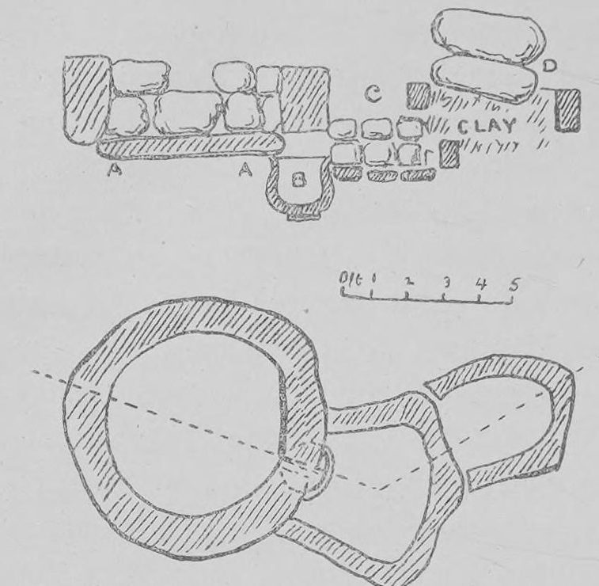

*Fig. 46. Ölpresse aus Gezer*

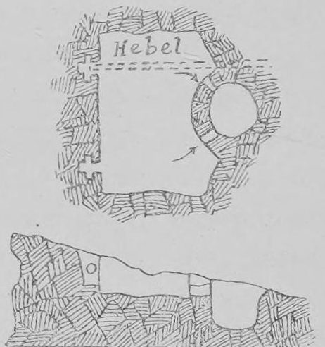

*Fig. 48. Alte Weinkelter.*

*Fig. 47. Ölmühle.*

Eine Mišna (Menach. 8,4) gibt uns sehr dankenswerte Aufschlüsse über die Ölbereitung. Danach konnten die zur Ölbereitung verwendeten Oliven auf dreierlei Weise ausgereift sein, und jede dieser Olivensorten konnte zur dreifachen Ausnützung herangezogen werden. „Bei der ersten Olive“ (הזית הראשון), d. i. bei der ersten Olivensorte, verfährt man so, daß man die Frucht von der Krone des Baumes mit der Hand herunterholt (גרגר), sie in der vorhin beschriebenen Weise zerstampft (כתש) und in einen Korb gibt, was natürlich dahin zu ergänzen ist, daß nun das Öl von selbst ausfließt; die Bemerkung eines Lehrers: „rings um den Korb“ (סביבות הסל) will besagen, daß es der Qualität des Öles keinen Abbruch tut, wenn der zurückgebliebene Olivenbrei durch Aufdrücken auf den Korbrand zu ergiebigerem Ölfluß gebracht wird. Die zweite Ausnützung wird durch Beschweren mit dem Preßbalken (w. u.) bezw. mit Preßsteinen (w. u.) herbeigeführt; da mußten auch die Kerne ihr Öl hergeben. Wird die Masse abermals gemahlen (טחן; entspricht dem כתש des ersten Preßganges) und abermals beschwert (טען), entsteht die dritte Ausnützung. „Die zweite Olive“ (הזית השני) wurde auf dem Dach zur völligen Reife gebracht (גרגר) und mit ihr wurden dieselben drei Preßgänge vollführt. „Die dritte Olive“ (הזית השלישי), d. i. nicht bloß der Behandlung nach die dritte, sondern in der Aufeinanderfolge des Pflückens auch zeitlich die dritte, demnach zu einer Zeit eingesammelt, in welcher ein Liegenlassen unter freiem Himmel nicht mehr möglich ist — und in dieser vorgeschrittenen Jahreszeit wurde die Hauptmasse der Oliven eingesammelt (s. S. 214) — mußte bereits im Hause selbst in geeigneter Weise (w. u.) aufgehäuft werden (עטן), um sie zum Faulen (לקה), d. i. zur Gärung zu bringen; sie wurde dann auf das Dach gebracht (העלה) und daselbst getrocknet (נִגֵּב), worauf mit ihr dieselben drei Preßgänge vorgenommen wurden. Das im ersten Preßgang erzielte Öl (das sogenannte Jungfernöl) war tauglich für den Tempelleuchter, während die andern beiden Preßgänge nur mindergutes Öl lieferten, das nur zu den Speiseopfern genommen werden konnte; es war das Öl des gewöhnlichen Lebens, das noch immer fein genug sein mochte[^179.511]. Genau so werden auch in dem Diokletianischen Edikt von den Preisen der Lebensmittel und andern Waren drei Ölsorten unterschieden: *olei flos* (ἔλαιον ὀμφάκινον, vgl. S. 214), *oleum sequens* (ἔλαιον δευτέρου γεύματος) und *oleum cibarium* (ἔλαιον χυδαῖον).

Das soeben berührte Aufhäufen der Oliven geschieht im Hause — bei gutem Wetter auf dem Dache oder im Söller des Hauses — oder in der Kelter. Zweck des Verfahrens ist, wie das Wort besagt (עטן = عطن), die Oliven erweichen zu lassen, dasselbe, was teils auch „faulen“ (לקה o.), teils auch „aufplatzen“ (בִּקַּע) heißt; genau so heißt es auch von den Trauben, daß sie bei längerem Liegen „aufplatzen“[^179.512]. Die heutigen Araber drücken dasselbe mit „in Gärung geraten“ (تخمّر) aus, und in der Tat wird die Masse, sobald sie in Gärung gekommen, auch von den Rabbinen כומר d. i. „erhitzter Haufen“ genannt[^179.513], einerlei, ob von Oliven, von Trauben oder von Feigen die Rede ist. Die in Behandlung stehenden Oliven (עטינין) bilden einen Haufen (מעטן), der auf irgendeiner Unterlage (ebenfalls מעטן), auf Matten oder auf einer Lederdecke (תרכוס), liegt[^179.514]. Den vollendeten Gärungsprozeß erkennt man daran, daß der Haufen, gewöhnlich in drei Tagen, Ölschaum ausschwitzt (זיעת המעטן), und die ganze Masse feucht wird. Zur größeren Sicherheit überzeugt man sich davon auch so, daß man einen Stab (קנה של זיתים) oder einen Holzspan (קסם) hineinsteckt[^179.515]. Den Prozeß zu fördern muß die Masse mit einem Spaten (יתד) einigemal gewendet werden (הפך)[^179.516]. Nun stehen die einzelnen Oliven zusammen (התחבר) und bilden eine feste Masse (גוש), nicht jedoch ohne auch losere Stellen (פרודין) zu lassen[^179.517]. Eben der Härte der Masse wegen muß hernach, wenn Teile davon in die Kelter getragen werden sollen, jeweils das betreffende Stück mit Hacken (קרדומות) losgehauen werden (קצץ)[^179.518]. Es wird nicht der ganze Schober (אם oder אום) auf einmal in die Kelter genommen (עקר), sondern immer nur soviel, wie jedesmal für einen Preßgang (בד) notwendig ist. Das abgetrennte Stück mußte auf dem Dach vorher getrocknet werden (נִגֵּב), damit der ausgeschwitzte Ölschaum nicht in das Öl gerate[^179.519]. Man formte nun aus jedem Teilstück einen Ballen, den man „Dattel“ (תמרה, vgl. תפוח in der Weinkelter) nannte, und in dieser Form wurde nun die Masse in die Ölpresse geschafft, nachdem vorher jede Ladung mit Olivenblättern bedeckt worden war (חִפָּה), vermutlich, um das fernere Schwitzen zu verhüten[^179.520].

Die **Ölkelter** (בית הבד, auch בד, aram. בדא allein, βάδδης) befand sich zumeist auf felsigem Boden in der Ölpflanzung selbst oder doch in der Nähe, ganz so wie die Weinkelter, mit der sie manchmal identisch war; doch konnte sich die Ölkelter in Form eines Anbaues (יציע Bd. I, S. 46) auch im Hofraume befinden[^179.521]. Ursprünglich bestand die Ölkelter aus einer geeigneten Höhlung oder Schale im Felsboden, in welche das durch einen Preßbalken (בד, קורה) ausgepreßte Öl floß; von diesem einzig wichtigen Bestandteil erhielt der ganze Raum den Namen *bad* (בד)[^179.522]. Die Höhlung oder die Schale hieß bh. *jeḳeb* (יקב), wovon auch noch nh. schwache Spuren vorhanden sind, und auch dieses Wort diente einst zur Benennung des ganzen Raumes[^179.523]. Mit dem steigenden Bedarf jedoch mußte die Anlage besser ausgestaltet werden; jene freiliegende, primitive Kelter hieß nun בדידה (oder בודידה) „die kleine Kelter“, während in ausgestalteter Form eine Höhle dazu diente oder ein eigenes Kelterhaus (בית הבד, selten טרקלין = τορκελλάριον, *torcularium*) gebaut wurde, ein Bau mit Lichtöffnungen und mit verschließbaren Türen, mit einem Innenraum (חלל), der die Preßgeräte aufnehmen, mit einem Dach, worauf die Olivenernte zum Gären (S. 220) ausgebreitet sein, und mit einer Kammer, in der das Öl aufbewahrt (vgl. S. 196) werden konnte[^179.524]. Der größere Betrieb zeigte sich auch in der Beschäftigung von Kelterern (בדדין)[^179.525], besonders aber darin, daß die Ölkelter nun eine Reihe von Bestandteilen aufwies, die in den Quellen selbst in feste und bewegliche geteilt werden; jene (1—6) sind notwendige, diese (7—10) nur ausgestaltende Stücke der Kelter.

1. Die Kufe (יקב, häufiger ים = Meer, von ihrer Form auch עדשה = טלפחא = Linse genannt), und zwar zunächst nur die untere Kufe (vgl. bei der Weinkelter גת התחתונה), die das fertige Öl aufnimmt; wollte man mit „Meer“ die obere Kufe bezeichnen, sagte man eben zur Unterscheidung „die Linse“. Diejenigen Erklärer, die in ים den gehöhlten Lagerstein der Ölmühle sehen, fassen die Ölmühle als selbständige Preßvorrichtung auf, wo doch Mühle und Presse klugerweise gewöhnlich miteinander verbunden waren[^179.526]. Überhaupt muß bemerkt werden, daß hier alte Ausdrücke der Landwirtschaft vorliegen, die in Palästina während unsres ganzen Zeitraums bekannt waren, daher im palästinischen Talmud gar nicht erklärt werden; erst im babylonischen Talmud erhalten sie erklärende Äquivalente, die aber nicht immer zutreffen.

2. Die obere Kufe (ממל), nach einer verläßlichen alten Erklärung soviel wie „Grube“ (בור), in der man die Oliven zerquetscht, um den Abfluß im „Meere“ aufzunehmen. Die babylonische Erklärung dafür lautet מפרכתא, d. i. (von der Wurzel פרך „reiben“, „stoßen“) der senkrechte Mühlstein, der in jenem vorhin erwähnten wagrechten Lagerstein die Oliven zu einem Brei zermalmt. Wiederum wurde hier ein Bestandteil der alten freiliegenden Kelter auf einen Teil der im Preßhause aufgestellten Ölmühle übertragen[^179.527].

3. Die Holzpfosten (בתולות, *arbores*, *sorores*, *gemelli*), in der Gemara richtig mit „Zedernpfeiler, auf welche man den Preßbalken stützt“ erklärt, sind ohne Zweifel die beiden stark in die Erde getriebenen Pfosten (*stipites*), auf denen der Preßbalken ruhte, der mittels einer Winde (*sucula*) auf die Oliven (oder die Trauben) niedergedrückt wurde[^179.528]. Der Preßbalken ruht heute bei den Arabern mit dem dicken Ende gewöhnlich auf einer Steinsäule[^179.529].

4. Ein Rutenverschlag (עקל), der zwischen den beiden Pfosten einen umgrenzten Ort schuf, in den man in Körben die Oliven (oder die Trauben) stellte und durch jene Dämme (פסים, *regulae*) derart fest zusammenhielt, daß sie trotz des Druckes des Preßbaumes nicht zur Seite ausweichen konnten. Der Verschlag war gewöhnlich aus Weidenruten (נצרים, נסרים, יצרים) und aus Weinreben gemacht, doch mag er auch aus Stricken geflochten und aus Latten (נסרים?) zusammengefügt gewesen sein[^179.530].

5. Eine Mühle (רחיים vgl. S. 219), bestehend aus zwei Mühlsteinen, einem oberen und einem unteren[^179.531]. In der heutigen arabischen Ölmühle heißen dieselben zwei Steine „Reitstein“ (حجر فرشى) und „Preßstein“ (حجر بدّ)[^179.532]; Griechen und Römer nannten den unteren Stein „Mörser“ (ὅλμοι, θυεία, *mortarium*), den oberen Stein „Rad“ (τροχός, *orbis*)[^179.533]. Unter der Mühle, die manchmal selbständige Arbeit verrichtete und gar nicht im Preßhause stand, befand sich zur Aufnahme des Öles ein großes Schaff (סאה), das in die Erde eingelassen war[^179.534].

6. Eine kleine Kufe (בדידה oder בודידה, Diminutiv von בד, vgl. S. 221) hatte denselben Zweck wie das vorhin erwähnte Schaff; sie ist das letzte Stück der **festen** Bestandteile der Kelter[^179.535].

7. עבירים (nicht עבירין!), runde Platten von festem Holz, die man über die Masse der gequetschten Oliven oder bereits mit den Füßen ausgetretenen Weintrauben (vgl. עגילין § 184) legte, wenn man sie unter die Presse tat, damit sich der Druck gleichmäßig über die ganze Oberfläche verbreiten konnte. Vgl. ὅρος und *orbis olearius* der Griechen und Römer, auch τριπτήρ d. i. der Drücker genannt, so daß dieses Werkzeug im Talmud völlig richtig als כבשי „Presser“ erklärt wird[^179.536]. Als Werkzeug ähnlicher Bestimmung hat sich daneben in schwachen Spuren das Wort עמודים = Säulen erhalten, womit offenbar zwei die Olivenmasse zusammenhaltende Pfosten gemeint sind, also ähnliche Vorrichtungen, wie wir sie in den „Dämmen“ (פסים) kennen gelernt haben[^179.537]. Wir ersehen aus diesem Umstande, daß die Einrichtung der Kelter bei demselben Grundgedanken in der Ausführung verschieden sein konnte. Der oben erwähnte Rutenverschlag (עקל) war bei Anbringung der „Säulen“ und vielleicht auch nur der „Dämme“ gar nicht notwendig.

8. גלגל wahrscheinlich die Winde oder Kreuzhaspel, vermittels welcher, wie erwähnt, der Preßbaum niedergedrückt wurde. Der Talmud, der חומרתא dafür setzt, meint offenbar dasselbe, und nicht nur hier, sondern auch bei anderen Vorrichtungen, drücken beide Worte (גלגל und חומרתא) den Sinn „Schraube“, „Winde“ zur Genüge aus. Doch muß die Möglichkeit zugegeben werden, daß die beiden rabbinischen Bezeichnungen unter sich in der Weise verschieden sein können, wie sich bei derselben Vorrichtung *sucula* (gr. ὄνος) und *cochlea* der Römer unterscheiden[^179.538].

9. Der Preßbalken (קורה *prelum*) wird als der Hauptbestandteil der Öl- und Weinpresse bezeichnet (vgl. o. S. 221), was aber nur für das ausgestaltete Preßhaus zutrifft, denn in dem Mörser (כותש o. S. 217) war die Ölbereitung auch ohne Preßbalken möglich[^179.539]. Die Spitze (*lingula*) des Balkens scheint „Skorpion“ (עקרב) geheißen zu haben[^179.540]. Dieselbe Spitze konnte mit Steinen (אבנים) beschwert sein; wenn ein Steinblock (קוטבי) organisch damit verbunden war, war das Preßverfahren viel nachhaltiger[^179.541].

10. Körbe (סלים), Botten (קופות), Säcke (שקים), Beutel (מרצופין = *marsupium*) und andere Geräte standen im Preßhause bereit[^179.542]. In ihnen trug man die Oliven in die Kelter, stellte sie unter die Presse und schaffte die Trester weg. Wie in der Weinkelter, war gewiß auch ein Schöpfgefäß (מחץ) und ein Trichter (משפך) vorhanden[^179.543]. Mit Matten (מחצלת) wurden sowohl Früchte als Öl zugedeckt, denn in beiden hätten sich sonst Würmer eingenistet[^179.544].

11—14. Feste Bestandteile, aber nicht unbedingt zur Kelter gehörig, sind ferner: a) eine Zisterne (בור) oder ein Brunnen (באר), b) eine Grube (שיח), denen man das Wasser entnahm, das für die Reinigung der Kelterer, der Kufen und der Preßgeräte nötig war (w. u.), c) Erdlöcher (הרותיות) und d) Höhlen (מערות), Orte, die zur Aufbewahrung des Öls (*cellae oleariae*) dienten[^179.545].

[^179.503]: jPeʾa 5,2, 18d₄₃ רומס הייתי זתים כו׳, ib. 6,4, 19c₅₅. דרך Micha 6,15. Vgl. MTohar 10,2.
[^179.504]: MMenach 8,4, TTerum 3,13 p. 29₂₅. כתיתה bMenach 53b.
[^179.505]: MŠebiʿith 4,9 כותש וסך בשדה; ib. 8,6 בדידה. Zugrunde gelegt ist die Darstellung von DALMAN im Palästinajahrbuch, Berlin 1908, 4,31 f. Jene in den Felsen gehauene Schale nennt man *mikr el-bedudie*; die Quetschvorrichtung heißt *medraš*.
[^179.506]: Vorige A., s. auch jŠebiʿith 8,5, 38b₂₆ und w. unten A. 541.
[^179.507]: MMenach 8,4 s. im Texte S. 219.
[^179.508]: MMenach 8,4.
[^179.509]: MTohar 9,5 המניח זתים בכותש s. Maim. (RŠ verfehlt: ein Gerät zum Tragen der Oliven); als Zweck der Handlung gilt zwar nicht unbedingt die Ölgewinnung (שימתונו שימלחם ib.), aber mitunter war das der Zweck (שיהו נוחין לכתוש ib. vorher). In TTohar 10,10, 671₃₁ steht כיפש (כופש), welches mit JASTROW 624 und G. 26 (gegen RŠ כותש) als richtig anzusehen ist, denn auch die Mišna ed. Lowe hat המניח זתיו בכופש. Vgl. כפישה S. 271. Siehe auch bSabb 23a, Raši zu Exod 25,6.
[^179.510]: RICH 657 *tudicula*. Ib. 400 *molae olcariae*, Varro r. r. 1,55, 5 (s. WINER 2,171, der jedoch קוטב, w. u. bloß Bestandteil der Kelter, hierbei nennt). רחיים w. u. oft. לטחון ברחיים opp. קוטבי jŠebiʿith 8,5, 38b₂₈. MTohar 9,8. Da in MMr 3,7 gerade von der Genesarethhütte (Bd. I, S. 6), d. i. in Beziehung zu einer ölreichen Gegend, gesagt wird, es befänden sich Mühle (רחיים) und Hühner darin, so dürfte eben die Ölpresse gemeint sein.
[^179.511]: Vgl. Sifra 103a b, Jalḳ I § 378. GOLDMANN S. 31 A. 1. Drei Kategorien des Öls auch Plin. H. N. 15,2. Die Phrase מגרגרו בראש הזית wird schon, wie es scheint, in bMenach 86a als schwierig empfunden, weshalb gefragt wird: hat es גרגר zu lauten oder גלגל; worauf ib. Bar. זית ראשון מגלגלו, und es sieht aus, daß man sich für גלגל entschied. Sprachlich trägt das nichts aus, denn die Liquidae wechseln (K 2,351 גרגר 1), aber davon liegt die Annahme nahe, daß die Gemara zweierlei Erklärungen für möglich hält. Raši in 1. Erklärung (deren Ende jedoch verfehlt ist) und RN (s. Tosafoth) halten richtig גרגר für die Bezeichnung des Ausreifenlassens, wofür als schlagender Beweis Exod R 36,1 gelten kann מה הזית הזה עד שהוא באילנו מגרגרין אותו ואח״כ מורידין אותו מן הזית, so auch MTohar 9,6 המניח זיתים לגרגרן (vgl. Trg Ps 1,3 ed. Lag. מגרגִר, Agg כגרגר), doch hat RN auch die Bemerkung, daß man hierbei die Beeren einzeln abklaubt (vgl. Jes 17,6), und dafür kann verwiesen werden auf MMr 2,6 מגרגר והולך, auch ib. 3,9, und somit sind für גרגר zwei Bedeutungen zu beobachten.
[^179.512]: MTohar 9,6. TTohar 10 E. 672₅ והעוטן בית הבד כעוטן בתוך ביתו (ib. עטן 10,4. 5. 6 oft). MMenach 8,4 ed. Lowe עוטנו בבית, Agg. jedoch (b 68a) עוטנו בבית הבד. TTohar 10,4, 671₁₃ העוטן זיתיו בין שני בדין, RŠ zu Mišna 9,3 העוטן . . . בשני בתים. Von ausländischen Oliven ebenfalls עטן TŠebiʿith 4,19, 67₉. TChalla 2,5, 99₉. — לקה MMenach 8,4 b 86a. MTohar 9,6 לקה und מרח. Jenes לקה heißt חבט Exod R 36,1 oben A. 495. S. auch A. 520. — בקע TTohar 3,2, 662₃₁ erst ענבים המבוקעות מן העבט, dann זתים המבוקעין מן המעטן (zu vgl. עביטי זיתים Midr Tannaim Dt 26,13 p. 175 H.).
[^179.513]: Vgl. HEHN⁷ 116. כומר bBm 74a (vgl. GES., Hwb¹⁴ כמר 1, L 2,346). jBerakh 2,1, 4b₅₇ כבומר הזה של ענבים שהוא זב מאיליו.
[^179.514]: Klassische Stelle ממעטנא דזיתא bSanh 11b (T 2,6, 416₃₀ מעוטני ז׳) j 1,18d₁₈ מעטני זיתיא, jMš 5,56c₁₃. Ferner MMr 4,3, T 3,7, bBm 72b. המעטן MTohar 9,9 auf dem Dache s. A. 512. In T oft מעטֵן (also nicht מעטָן). RN 6,203 vgl. bereits Hiob 21,24 עטיניו. jMḳ 2,1, 81a₅₆ עטינים opp. גרגרים, s. L 3,635, K 6,187, J 1063. מעטן = Gefäß wegen Analogie mit עביט s. A. 512 (RN 6,187) **oder** Unterlage (G. 34 A. 8 bezweifelt ersteres). So auch תרכוס (LA תרבוס) MKel 24,5 (Erklärung s. in Lwr 2,593), nicht aber ein „Gerät zum Ausdrücken von Oliven“ (G. 37).
[^179.515]: MTohar 9,1, T 11,1, 672₁₀ (Entfernung des Ölschaums folgt aus מנגב MMenach 8,4). קנה MSabb 17,3, j 16b₁₅ gut erklärt. TTohar 11,3, 672₁₆ תוחב בו הקוסמים.
[^179.516]: MMḳ 2,1 (nach b 11b ein אומן dazu erforderlich). TTohar 10,11, 671₃₅ f. (vgl. הפך bei Getreide VOGELSTEIN S. 67).
[^179.517]: גוש MTohar 3,2, T 11,1, 672₉; גושין ib. 10,11. פרודין MTohar 9,9 (T 11,3, 672₁₄ פרורין).
[^179.518]: MTohar 9,7. T 11,1 היה קוצץ מן המעטן. (קרץ ib. 11,2, das G. 35 A. 10 bespricht, gehört nicht hierher, sondern zu Teig). Zu קרדומות vgl. מקצוע aus MTerum 4,2 in Rašis Erklärung zu ליטרא קציעות bBeza 3b unten.
[^179.519]: MTohar 9,7 בד אחד או שני בדים, T 10,12, 671₃₉ (ib. 672₃ קתבו lies קוטבי, Bezeichnung des primitiven Verfahrens). Ib. vorher Z. 35. 38 אם (RŠ אום), Mišna 9,8 ed. Lowe אום s. Hai. נגב s. A. 515. MTohar 9,7 מחפה, T 10,12, 671₃₉.
[^179.520]: Sifra 103b עוטנו בבית הבד עד שילקה ומעלה ועושהו תמרה, Jalḳ I § 378 כמין ת׳. Für G. 34 A. 8 „unverständlich“, weil er den Sinn von תמרה nicht erkannt hat.
[^179.521]: בית הבד MTohar 2,8, T 1,3, 661₂₆. בתי בדין TMš 2,12, 89₂₆, Sifra 108b; vgl. בית הבדין MBb 4,7. (bSanh 95a בי בדיא als Marterwerkzeug l. mit Var. בי סדיא). בדא L Trg Wb 1,81. Mittelgr. βάδδης, SACHS, Beitr. 2,27, schon früher Epiphanius *βάδον *βάδης ZATW 27,290. Heute arab. in Pal. معصار, wohingegen rabbinisch מעצרתא (w. u.) = Weinpresse. Im Hofraum (MGWJ 6,41) MBb 4,4; auf dem Felde MPeʾa 7,1, MBm 10,4; οἰκία = ἐλαιουργίον C. WESSELY, Karanis und SN S. 3. Eine Ölpresse wurde u. a. in Gezer ausgegraben, s. PEF Quat. Statem. 1909, 92.
[^179.522]: Antiquarische Notiz des REliezer bBb 67b שלא נקרא בית הבד אלא על שום קורה (arab. بد Preßbalken), etwas verschieden jBb 14c₄₇. Darum oft בד allein, z. B. MChag 3,4 („Zeit des Ölpressens“), TBm 8,27, 390₁₁.
[^179.523]: Joel 2,24 והשיקו היקבים תירוש ויצהר wird יקב offenbar auch von der Ölkelter gesagt; in Trg schon differenziert: ויטפון נעויא חמרא (zu נעווא s. L Trg Wb 2,118; = *navia* SACHS 2,27 unmöglich), dann ובדיא משחא (nicht בידיא). Die tannaitischen Stücke TBb 3,2, 402₃ Bar b 67b, j 14c₄₉ haben noch den Ausdruck יקבים, wofür MBb 4,3 ים (zu יקב s. RN 4,153). Die יקבים, die auf Grund von Zech 14,10 besprochen und mit שיחיה דיפו = Gruben von Joppe erläutert werden (Pesiḳta 143b s. BUBER z. St.), sind Weinpressen. bBeza 19a גתו על גב בדו ובדו על גב גתו ms M und RN (2,13), T 2,7, 203₂₆. WINER 2,171 bezieht גת MPeʾa 7,1 — wohl nur der Etymologie von „Gethsemane“ zuliebe — auf die Ölkelter, unrichtig, denn dort heißt es nur, der Ölbaum stehe an der Seite der Weinpresse, was gut möglich, aber das Wort גת bedeutet mišnisch nur die Weinpresse (auch gegen G. 38 A. 3); nur einmal, Exod R 36,1 (A. 495), bedeutet גת die Ölkelter.
[^179.524]: בדידה oder בודידה (nach I. LÖW die bessere Form) TTohar 10,12, 672₂ Sifra 106a; s. ZDMG 14,385. בית הבד A. 521. טרקלרין Lwr 2,279. MTohar 10,2 פתח בית הבד, ib. 1 הנועל ב׳ הבד, ib. 9,4 המפתח, in T 10,6, 671₂₁ נעל וחתם und מפתח; ib. חורין וסדקין, ib. חלונות. Raši und Tosafoth bChag 25a. MMš 3,7 בתי הבדים שפתחיהם לפנים וחללן לחוץ und vice versa = (TMš 2,12, 89₂₆), Maim: die Ölkelter pflegen in die Stadtmauer gebaut zu sein, TʿArakh 5,15, 550₂₆. כִּפִּין MBm 10,4. In MTohar 10,3 taucht ganz unvermittelt, also als etwas Selbstverständliches, מערה = Höhle für Wein- und Ölkelter auf.
[^179.525]: בדדין MTohar 9,8; 10,1 (ib. 3 יטבולו wohl nur der Reinlichkeit wegen, nicht infolge von levitischer Unreinheit), TBḳ 11,7, 370₁₉, TMr 1,10, 82₈ (nach beiden Stellen Anteil an Öl, vgl. bSabb 19b); im Sabbatjahre sollte der Kelterlohn (שכר בד) nicht in Wein (? viell. für Öl, oder בד hier = Weinpresse) sondern in Geld bestehen, jŠebiʿith 8,5, 38b₂₉.
[^179.526]: Die Kelter (בית הבד) darf nicht (zwischen Erben) aufgeteilt werden, es sei denn, daß beide einwilligen oder daß das Areal für beide reicht (MBb 1,6, b 11a). Zum Areal ist bezeichnend MTohar 10,2 אם יש בין משקין לזיתים כדי שינגבו רגליהן (s. BÜCHLER, Der gal. ʿAm ha-ʾAreṣ S. 57 f.). TTerum 3,7, 29₈ כל בית הבד תפיסה אחת הם; als Beispiel dient: Ein Balken für zwei Gruben usw. (vorhin ebenso von der Weinkelter גת אחת לשתי בורות, wo גת etwa den Weinpreßbalken bedeutet). In Papyrus XI des Corp. Papyr. Raineri, gr. 1,34 f., wird die Ölpresse zugleich mit dem Hause verkauft; vgl. A. 521. Nach MBb 4,4 jedoch faßt der Verkauf des Hauses den Mitverkauf des im Hofe befindlichen Kelterhauses nicht in sich. MBb 4,5 bespricht nun ebenfalls anläßlich des Verkaufes die Teile der Kelter, die in b z. St. 67b weiter kommentiert werden; s. auch j 14c, T 3,2, 402₂; auf diese Texte beziehen sich unsere nun folgenden Ausführungen. — b ים = טלפחא, wozu RSbM und Tosafoth auf Bar bAz 75a verweisen: והעדשין (s. A. 640), gemeinsam für Wein- und Ölkelter; RG zu Bb מיש altfr. *mai* (das meinen auch RSbM mit עריבה = מייט, Raši bAz 75a, מייטץ Raši bPesach 15a, vgl. Tosafoth bNidda 65a). Aus bPesach geht hervor, daß man unter ט׳ = עדשה nur die untere Kufe verstand, während ים wohl beide Kufen bedeutet. Dem steht gegenüber, daß nach Hai zu MTohar 10,8 und MZab 4,2, Maim. und RŠ zur ersteren Stelle, Maim. zu Bb, Tosafist ib. und zu bNidda, unter Berufung auf RN (s. v. טלפח 4,36, auch s. v. ים 4,137: עיגול oder עדשה), ים bezw. ט׳ und עדשה eine Art Mühlstein wäre, mit dem man die ausgepreßte Frucht abermals belastete, wodann aber die Zugehörigkeit des ים zu den „festen“ Bestandteilen unerklärlich wäre (vgl. Tosafoth Bb). Die Benennung טלפחא und עדשה ist für die gaonäisch-spanische Auffassung günstig (Mussafia vgl. lat. *lenticula*), während ים selbst für die Ansicht der franz. Schule (RG, Raši, RSbM) spricht. An ersteres hält sich auch G. 41 A. 3. SACHS, Beitr. 2,27 bringt θάλασσα τῆς τραπέζης bei.
[^179.527]: ממל (ממיל, מאמל) wurde etymologisch wohl von מלל = reiben erklärt, weshalb in b als Äquivalent מפרכתא (Agg. מפרחתא, später auch dort מפרוכות wie in T und j) gesetzt wird. Bei RNs zwei ersten Erklärungen (sie rühren nach RSbM von RCh her), 1. gehöhlter Stein (s. auch RG zu bSabb 123a) — was G. 41 akzeptiert — 2. Preßstein (RSbM irrig עץ) gilt die Einwendung RSbMs, daß es bewegliche Vorrichtungen wären, während wir des Textes wegen „feste“ brauchen. Allein richtig demnach RNs dritte Erklärung, die, sich auf keiner Etymologie gründend bloß eine Tradition wiedergeben kann: ממל = obere Kufe (בור). Letzterer Sinn ist augenscheinlich enthalten auch in TTerum 3,13 p. 29₂₅ משיביא זתים בקופה ונותן לתוך הממל ומהלך בהם שתי וערב (weniger gut j 2,42b₅ תחת הממל), wo doch ממל nur eine Kufe bedeuten kann; so auch MMr 1,7 נוטל מן העקל ומן המלל . . . מן השמן j, ms M, ed. Lowe (הממיל), T 1,7, 82₂ ומן המאמל (unrichtig Mišna-Agg. ומבין הממל infolge des folgenden ומבין, b ומבית המ׳ הפצים). Zur Worterklärung von ממל s. RAPOPORT in השחר 3,103 (auch in אוצר ישראל 1,56a angeführt) und דברי שלום ואמת, Prag 1861, S. 25 f.
[^179.528]: RICH s. v. *torcular* und *torcularium*. RSbM, der einen oberen Querbalken beschreibt, meint wohl die Vorrichtung bei RICH S. 637b oben; fr. *jumelles* oder *gemelles* (*sorores* hat J 200), jedoch *gemellar* bei RICH 292 eine Ölbüchse. Zum Ausdrucke בתולות ist nebst *sorores* (K 2,216) an בתולת שקמה, בתולת הוורד und dgl. zu erinnern.
[^179.529]: Abbildung einer alten Kelter bei SCHICK in ZDPV 10,148. BAUER, Volksleben² S. 41
[^179.530]: T ed. Z. 402₂ היצידין, alte Agg. היצירין lies mit RSbM היצרים, das er richtig in הנצרים emendiert; j האסורין kann als „Presse“ für sich bestehen, doch ist es geraten, dafür הנסרין zu lesen. TAz 8,3, 473₈ und TTohar 1,16, 673₇ העקלין של נוצרין ושל בצבץ כו׳. Weinreben לעקל בית הבד bSanh 26a (die Bestimmung nötig, weil es auch ein עקל des Schiffes gibt) Raši דדורתא l. דורבתא; jŠebiʿith 4,1, 35a₃₈ aus זמר כרם. RICH 636 *regulae*. פסים MMr 1,7. חבלים Exod R 36,1 oben A. 495. Irgendein Sack אוללא bBm 105a unten, doch ist die Bedeutung unsicher, s G. 38 A. 5.
[^179.531]: b ואת הרחיים התחתונות אבל לא העליונה, richtiger j הר׳ התחתונה (auch in T, wo aber ולא את הר׳ דעליונה erst im Nachsatze steht).
[^179.532]: Abbildung in ZDPV 31,86. 88. 256; *lekid*-Stein ib. 90.
[^179.533]: C. WESSELY, Karanis und SN S. 7 ὅλμοι und θυῖαι (= θυεία); *mortarium* Cato 135,6. 7; Abbildung bei RICH S. 405; τροχός Geopon. 9,19; RICH 425.
[^179.534]: סאה MZabim 4,2, s. Maim.
[^179.535]: MŠebiʿith 8,6, Sifra 106a.
[^179.536]: Mišna und bBb העבירים, was als Wort (von העביר) einen guten Sinn gibt; aber RN כבש 3 zitiert aus M כירים, was auch MKel 12,8 steht (von RN עכר 2 angeführt, aber aus Bb in der Form עכירין, mit der Bemerkung פי׳ בתשובות עכירין בנו״ן l. עכירין בעי״ן; in einigen ʿArukh-Agg. עבידים, M ed. Lowe העיבידים! MKel ed. Lowe והכירון, in TKel bb E. 598₂ והעתידין!). In D. S. wird aus Ms M העמודין und auch העמודים verzeichnet (Ms O übrigens das von uns angenommene העבירים), und es scheint, daß עמודים neben עבירים einst in der Mišna gestanden hat, da es aber in der Gemara, als gut verständlich, nicht kommentiert werde, so galt es als nicht vorhanden und man ließ es in der M ausfallen; קורה ist allerdings trotzdem nicht ausgefallen. Hai zu MKel 12,8 hat והכירין, aber aus bBb zitiert er מאי עכירין כבשי (RSbM כיבשי) und fortfahrend: ואיכא דאמרי כירון, was bei uns wiederum ausgefallen ist. Zu *orbis olearius* usw. siehe RICH S. 425, wo auch ὄρος und τριπτήρ
[^179.537]: Siehe vorige A. Vgl. דיומדין = דיו עמודין neben פסים MʿErub 2,1 und oben Bd. I, S. 80.
[^179.538]: RSbM altfr. ויין; richtig auch RN s. v. גלגל 3 (2,286; K ib. vergleicht bereits bZebach 21b, wo גילגלא ebenfalls = חומרתא. Das Wort ח׳ sucht K 3,436 zu erklären; nach J 436 von חמר verbinden). Vgl. RICH *sucula* und *pressorium*.
[^179.539]: MMenach 8,4 s. A. 541.
[^179.540]: עקרב des Preßhauses MKelim 12,3; ungenügend, was K 6,252b von den Gaonen anführt.
[^179.541]: אבנים Exod R 36,1 s. A. 495, obzwar hier die Steine, als primitive Vorrichtung, auch selbständig, ohne den Preßbalken, funktionieren können. Aber schon der Ausdruck טען בקורה (Sifra 103a, MMenach 8,4, TSabb 1,21 p. 111₁₀, MSabb 1,9 Raši mit vorzüglicher Sacherklärung) weist auf ein Beschweren mit Steinen; daneben (Sifra, MMenach, vgl. TMenach 9,6, 526₇) אבנים Steine allein, die eben das alte primitive Verfahren darstellen. Eben die Arbeit des Steines heißt כתש, wie wir es vielfach gehabt haben, vgl. TTerum 3,13, 29₂₃ הטעין opp. הטחין, jenes Auflegen des Steines, dieses Auflegen des Preßbalkens. Im Zusammenhange erfahren wir diese Arbeiten aus Sifra zu Lev 25,5 p. 106a (wie schon mehrfach zitiert worden): אין עושים זיתים בבד ובקוטבי אבל כותש ומכנים לבדידה (MŠebiʿith 8,6 קוטב Agg., ed. Lowe jedoch, ms M und j 38b₂₇ f. קוטבי, T 6,27, 70₂₃ קינבי, קתבי l. קוטבי), wie auch RN 7,77 hat (vgl. A. 510). RN erklärt 1) ein קטב genannter Preßbalken, der mit einem großen Stein beschwert ist — bis auf den Namen קטב ganz richtig und durchaus nicht „als falsch erwiesen“, wie G. 46 A. 3 meint — 2) קפיפות (= כפיפות = Körbe?), in denen man die Oliven auspreßt (ich vermute, daß RNs Quelle ursprünglich כפין Felsen meinte, s. A. 524). In der 2. Erkl., wie auch bei Maim (גת קטן לזיתים), wurde ב׳ lokal genommen, wo es doch instrumental ist (so richtig RABD), und der Satz sagt [im Sabbatjahre] darf man die Oliven nicht **durch** Preßbalken (s. בד A. 522) und Beschwerstein (קוטבי) auspressen (עשה), wohl aber auf dem Wege des Stampfens (כתש) [durch einen Stein], und man verwahrt [das Öl] in der kleinen Kufe (בדידה, nicht in der großen); doch erlaubt es Einer auch durch einen Preßbalken zu zermalmen (טחן). Also טוחן הוא בבד Sifra ist richtig, nicht בבית הבד Mišna (fehlt übrigens in j-Agg.); in j ib. ורבותינו התירו לעשות בקוטבי instrumental, analog dem לטחון ברחיים ib. Die Veränderung geschieht infolge des Sabbatjahres; deutlich T טוחנו ברחיים שלא נטחן בהם בשאר שני שבוע, und auch jene Einzelansicht (des RŠimeon) anders in T: כותש ומקפה בעריבה, wo zu achten auf הקפה statt הכנים, auf עריבה statt בדידה; es soll eben das gewerbsmäßige Ölpressen vermieden werden.
[^179.542]: TBb und jBb ib., in b unrichtig zusammen mit עבירים genannt. Aus den Säcken usw. goß man den Olivenbrei auf die Presse (זלף MMḳ 2,1).
[^179.543]: TAz 8,1, 472₃₀.
[^179.544]: bSabb 19b. Vgl. מפצים MKel 24,10 Decken der Weinkelterer.
[^179.545]: TBb ed. Z. באר l. mit alten Agg. בור; vgl. בור TTerum 3,7, 29₉. jBb korr. חרותין l. הדותין, in T הדותיות; מערות nur in T.

## § 180

**180.** Das Preßverfahren selbst ging etwa wie folgt vor sich: Die in großen Geräten (in Körben, Botten und Mulden) herbeigeschafften Oliven wurden in der Ölmühle (רחיים) im groben gequetscht, ohne daß vorerst die Steinkerne zermalmt wurden. In diesem Stadium hatte man erst ein Mahlen (טחן) vollführt[^180.546]. Die nun in „Datteln“ (S. 221) geformte Olivenmasse wurde hierauf entweder in Körben (סלים) oder in dem Rutenverschlag (עקל) unter den Preßbalken gestellt; wenn trotz der geeigneten Vorrichtung etwas von der Masse zur Seite wich, wurde es wieder zurückgedrängt (כִּנֵּס)[^180.547]. Die Arbeit des Preßbalkens hieß „beschweren“ (טען) oder „pressen“ (כבש)[^180.548] und brachte auch aus den Steinkernen das Öl heraus. Der Preßbalken wurde gewöhnlich mittels der Winde (גלגל o.) niedergedrückt, doch auch durch unmittelbare menschliche Kraft, indem man darauf schlug (הקיש), wodurch der Balken eine schwingende Bewegung (רעדה) machte, oder mit dem Fuße darauf trat (הסיט), und echt realistisch ist auch der Zug, daß man sich sowohl auf den Balken, als auch auf den ihm angebundenen Steinblock (קוטבי o.) setzte (ישב), ja, sich auf ihnen einen Sitz zurecht machte (קבע), um sie zu beschweren, was um so leichter ging, als ja mehrere Kelterer (בדדין o.) die Arbeit versahen[^180.549]. Zur Verstärkung des Druckes, unter dem aber der Balken manchmal brach, konnten auch mehrere Balken verwendet werden, von denen einer auf den anderen drückte[^180.550]. Damit schon ergoß sich (בצץ) das Öl von allen Seiten[^180.551]. Der Druck des Balkens wurde nach bestimmter Angabe noch einmal, vermutlich aber auch mehrmals wiederholt (חזר וטחן). Der Balken mußte dann gehoben (הגביה) bezw. gelockert (פרק) werden, um die Olivenmasse neuerlich darunterzuschieben[^180.552]. Schon durch die Pressung im Rutenverschlag sickerte Öl hervor (מי זיתים), eine klebrige Flüssigkeit (מוחל, מוהל), bei der es zunächst noch zweifelhaft war, ob sie feinere Öltropfen (צחצוחי שמן) enthalte[^180.553]. Denn erst durch den Druck des Preßbalkens kam wirkliches Öl reichlich hervor, das in einer Grube (עוקה), bei richtig ausgebauten Keltern in der oberen Kufe (o. S. 222), aufgefangen wurde; zu bemerken ist, daß die Namen „Grube“ und „Kufe“ nicht gerade eine Erdhöhlung bedeuten müssen, sondern auch in die Erde eingebettete große Mulden (vgl. סאה o.) bezeichnen können, nicht anders als τριπτήρ und *lacus* der Griechen und Römer[^180.554]. Wirkliche Erdhöhlung dürfte nur mit „Zisterne“ (בור) gemeint sein[^180.555]. Hier beließ man das Öl, bis es sich klärte (נצלל)[^180.556]. Kaum war es geklärt, so nahm man bereits von dem frischen Gut zu Gebäck und zum Gericht, und namentlich taten das die gedungenen Kelterer, denen gemäß der milden Behandlung der Arbeiter (S. 104) kleine Begünstigungen gern gewährt wurden[^180.557]. Sodann wurde das Öl in die große untere Kufe (ים o. S. 221) geleitet[^180.558], der Ölschaum (*amurca*) abgeschöpft (קפה) und das nunmehr reine Öl (שמן מזוקק, זך, נקי) mittels Schöpfgefäßen und Trichter (o.) in große Ölschläuche (גרבי שמן) und Ölkrüge (כדי שמן) verschüttet[^180.559]. In der Kufe und auch in den Vorratsgefäßen bleibt Hefe (שמרים) oder Bodensatz (פקטים = πηκτός?) zurück[^180.560].

Auch die harten Oliven (פריצי זיתים o. S. 217), die der Preßbalken zuerst nicht zermalmen konnte, wurden abermals unter die Presse gegeben[^180.561]. Der sonstige Ölbrei, der nach der letzten Pressung übrig blieb, wurde zerbröckelt, in einem großen Kessel (יורה χαλκίον) mit heißem Wasser aufgegossen, von dessen Oberfläche dann das Öl abgeschöpft wurde; das so gewonnene Öl galt allerdings für minderwertig[^180.562]. Diese wenig lohnende Arbeit verrichteten Ölsieder (שולקי זיתים)[^180.563]. Minderwertiges Öl ergaben auch solche Oliven, die man, etwa weil sie eingeschrumpft waren, in Wasser weichen ließ (שמן שרוי); auch die als Speise eingemachten Oliven (כבשים) ließen ein wenig Öl ausfließen[^180.563a]. Immerhin mußte nach all dem verschiedenartigen Verfahren eine große Menge Öls erzielt werden[^180.564]. Der Rückstand von zerrissenen Schalen und zermalmten Kernen hieß wie bei den Trauben „Trester“ (גפת), und auch daraus konnte noch Öl gepreßt werden. Der noch außerdem verbleibende Rückstand diente zur Feuerung (Bd. I, S. 85) und als Viehfutter[^180.565]. Die Arbeitsverrichtungen mit den Oliven, die man ihrer Menge wegen nicht auf einmal pressen konnte (s. oben), dauerten lange, so daß die Kelterzeit (שעת הבדים) sich in den Winter hineinzog; doch war der Abschluß der Arbeiten (גמר) nach Gegenden verschieden[^180.566].

Das Olivenöl bildete einen wichtigen Handelsartikel. Es findet Verwendung als Nahrungsmittel (Bd. I, S. 118), als Salbmittel (Bd. I, S. 229), als Heilmittel (Bd. I, S. 234) und als Brennmaterial (Bd. I, S. 68), wozu es sich unter allen Ölen am vorzüglichsten eignet[^180.567]. Eben in der Frage der Tauglichkeit zu Beleuchtungszwecken werden auch andere Öle namhaft gemacht, die wir hier anhangsweise behandeln wollen.

[^180.546]: MMenach 8,4 Bar b 86a.
[^180.547]: TTohar 10,3, 671₁₃ כינסו ועשאו עיקל (RŠ zu 9,1 korr. שוקת).
[^180.548]: טען s. A. 541. Exod R 15,22 כבש s. A. 550.
[^180.549]: MKel 20,3 כסא . . . קבעו בקורת בית הבד, MZab 4,7 ישב על קורות ב׳ הבד, wofür T 4,9, 679₂₀ ישב על גבי קתבא (alte Agg. קתדרא) l. קוטבי. T ib. Z. 12 f. דקיש und הסיטה; gleich darauf נפרצת.
[^180.550]: Exod R 15,22 שיש לו עקלים של זיתים כבש את הקורה זו על זו והשמן יורד מלמעלה והש׳ יורד מלמטה.
[^180.551]: Siehe nächste A.
[^180.552]: Bar bMenach 86a וחזר ופרק טחן וטען (l. auch weiter פרק חזר וטען וטחן, Agg. טחן vor טען); vgl. קורה ראשונה MMḳ 2,1; TTohar 3,1, 662₂₈ מגביה את הקורה, ib. משקין ביצין מתחת הקורה.
[^180.553]: מי זיתים TAz 8,3, 473₁₀ TTohar 11.16, 673₁₀. bSabb 144b מוהל (מוחל) היוצא מעקל בית הבד, TTohar 10,3, 671₁₂ מעיקת ב׳ הבד l. מעיקל, ib. vorher Z. 10 מוחל היוצא מן הזיתים, vgl. MTohar 9,3. Sacherklärung RN s. v. עקל (6,246) RG und Hai. RN s. v. מחל 1 (5,109). צחצוחי שמן TTohar 10,3, 671₁₂ TMiḳw 1,3, 652₂₅, vgl. bNidda 25b שהשמן רך ומצחצחו.
[^180.554]: MMr 1,7 משירד לעוקה (vgl. jMaʿas 2,50a₁₇ TMr 1,7, 82₂ Agg. עוקל), RN 6,246 גומא, Maim חפירה.
[^180.555]: בור MBm 10,4, vgl. bBb 64a und oben A. 527.
[^180.556]: RŠ zu MMr 1,7, vgl. MTerum 1,8, TMr 1,7, 81₃₀ f. Sifre Num 121 p. 41a das Fertigwerden von Frucht, Wein und Öl.
[^180.557]: TMr 1,7, 82₂ (מיטה l. חמיטה, ib. תמחוי und מקבל בכלי) להם geht wohl auf die Arbeiter (= בדדין in Z. 8).
[^180.558]: Folgt aus den Stellen in A. 554.
[^180.559]: TMr 1,7, 82₅ f. המקפה בעריבה והמ׳ בכלי (vgl. הקפה und עריבה in A. 541). גרבי שמן z. B. bSabb 13b, bBb 73b. כד s. KRENGEL, Hausgerät S. 51. MMḳ 2,1 וגף כדרכו s. § 185. bSanh 31a לשלומי ליה חביתא דחמרא מגו חביתא דמשחא. Bar bSanh 101a שרי שמן וש׳ בצים s. Raši, ib. שמן שבכלי opp. שמן שביד.
[^180.560]: MBm 3,8, T 3,10, 376₂₉ f. שמרים opp. שמן מזוקק בלא פקטים, j 9a oben. Mehr s. G. 53 f. פקטים Lwr 2,475.
[^180.561]: TʿUḳz 3,6, 689₄ TTohar 11,5, 672₂₀.
[^180.562]: TKel bḳ 4,5, 573₄ יורה של שולקי זיתים, ib. כשיתחיל לשולקו. TJebam 14,4, 259₁ יורה . . . של שמן. MʿEduj 7,8. MMenach 8,4, 5 כבשים usw., T 9,8, 526₈ f. שמן אנפוקנין sei bloß שרף; ib. שמן השרוי והשלוק והמבושל של שמרים ושל ריח רע. Vgl. משחא שליקא bAz 38b. Zu אנפקיניון s. Lwr 2,74, G. 52 (s. auch Tanch Jeruš. bei Bacher S. 79). Erklärung שמן זית שלא הביא שליש Bar bMenach 86a, bSabb 80b, Lev R 5,3. Plin. H. N. 12,60 sagt, das *omphacium* komme von Oliven, die noch weiß sind und werde auch aus Weinbeeren gemacht; vgl. ib. 15,3.
[^180.563]: Oben A. 562.
[^180.563a]: A. 562.
[^180.564]: Einige statistische Daten aus moderner Zeit s. bei BÄDEKER, Pal. u. Syrien⁶ S. 50 der Übersicht.
[^180.565]: גפת MBb 2,1, TMš 1,10, 87₇, MKel 9,5. 6 (in TTohar 3,1, 662₂₈ Weintrester, die sonst זגים heißen); s. II A. 111.
[^180.566]: גמר MTohar 9,4, T 10,2, 671₈. Oft שעת הגתות והבדים z. B. MChag 3,4 b 25a באפלי בחרפי (ib. konkrete Beispiele: Vater des RNachman; Galiläa, s. Tosafoth).
[^180.567]: שמן schlechthin ist fast immer שמן זית. Vorzugsweise zur Beleuchtung genommen auf Grund von Lev 24,2, s. MMenach 8,5, Sifra 103b. RTarfon fordert Olivenöl auch für das Sabbatlicht MSabb 2,2, T 2,3, 111₂₈. MDemai 1,3 שמן לנר. Num R 8 fol. 48a ושמנו דולק מכל השמנים. bSanh 24a ת״ה שבא״י שנוהין זה לזה בהלכה כשמן זית (Raši liest משמנין), ib. opp. שמרורין . . . כזית s. Tosafoth bʿErub 18b und Tos. bPesach 36a; vgl. A. 489.

## § 181

**181.** **Öle.** 1. In Babylonien, wo es Olivenöl nicht gab, brannte man Sesamöl (שמן שומשמין), das auch zu Speisen gebraucht werden konnte[^181.568]. 2. Walnußöl (שמן אגוזים) brannte man in Medien[^181.569]. 3. Rettichöl (שמן צנונות, ῥαφανέλαιον, *oleum raphaninum*) in Alexandrien und wohl auch im übrigen Ägypten[^181.570], wo man übrigens auch Sesamöl und 4. Kikiöl (שמן קיק, *oleum cicinum*) oder Rizinusöl hatte[^181.571]. 5. In Kappadokien hatte man Koloquintenöl (שמן פקועות, ἔλαιον κολοκύνθινον)[^181.572] und 6. mineralisches Öl (נפט, νάφθα, Naphta)[^181.573]. Ferner besaß man 7. Teeröl (עטרן)[^181.574], 8. Fischtran (שמן דגים)[^181.575], 9. aufgelöstes Fett (חלב מבושל, חלב מהותך), besonders vom Schwanzstück (אליה) genommen, und es konnte das Fett durch eine Beigabe von Olivenöl brennfähiger gemacht werden[^181.576] Ausdrücklich wird auch das Fett der Gans (משחא דאווזא) genannt[^181.577]. Erwähnenswert ist, daß auch der Moschus (מושק, vgl. Bd. I, S. 238) als Tieröl (שמן חיה) bezeichnet wird[^181.578]. 10. „Balsamöl“ (Bd. I, S. 235). Einlegung von Sesam und Balsamholz miteinander ergab das Einlegeöl (משחא כבישא); waren sie pulverisiert und hierauf mit Spezereien gemengt worden, erhielt man das „Stauböl“ (משחא טחינא); eine noch stärkere Mischung von ölhaltigen Wurzeln mit Spezereien ergab das „zurechtgemachte“ (כשרתא) oder das Kunstöl[^181.579]. Ähnlich spricht man auch von dem „gekochten“ Öl (משחא שליקא), das nämlich durch Mischen (ערב) und Kochen (שלק) zustandegekommen ist[^181.580]. Davon ist zu unterscheiden die regelrechte Mischung (פטום) der Spezereien (Bd. I, S. 241)[^181.581]. 11., 12., 13. Myrrhenöl und Rosenöl s. Bd. I, S. 236; Nardenöl S. 237. Die letzten vier Nummern sind kosmetische Mittel. 14., 15. Pistazienöl (משח דבטנים) und Mandelöl (משח דשקדים), wovon sich ein anderes Mandelöl (משח דלווים) nur unbedeutend unterscheidet, dienten entweder rein zum Essen oder wurden mit Gerichten verkocht[^181.582].

[^181.568]: MSabb 2,2, T 2,3, 111₃, Bar b 26a. Ib. 23a Sesamöl hatte das Gute, daß es lang brannte, dennoch zog man Olivenöl vor, weil es eine reinere Flamme gab (צליל נהוריה). Zu Speisen TNedar 3,3, 278₂₀ מקום שמסתפקין בשמן שומשמין. Sesam gab es auch in Palästina viel (oben S. 180), und Bertinoro wußte das noch aus Autopsie. I. LÖW, Pfl. S. 377 bringt Belege aus Herodot und Strabo. GOLDMANN S. 75. SUDHOFF, Ärztliches aus gr. Pap. Urk. S. 30.
[^181.569]: MSabb 2,2, T 2,3, 111₃₀, b 26a. I. LÖW S. 63.
[^181.570]: An denselben Stellen. Die ersten 3 Nummern auch in Sifra p. 103a. I. LÖW S. 309. Alexandria = Ägypten s. „Antoninus u. Rabbi“ S. 7 A. 2.
[^181.571]: MSabb 2,1, Erklärungen b 21a; MGWJ 5,240, SACHS 2,25, I. LÖW S. 353. Die ägyptischen 4 Öle (Sesam, Kiki Herodot 2,94 (von der Coton-Pflanze, ebenso Raši bSabb 21a משחא דקאזא), κνήκινον, κολοκύνθινον) auch bei MAHAFFY, The Empire of the Ptolemies, London 1905 S. 146; κνήκινον ist das κ. ἔλαιον des Dioskorides (PAPE) = Saffloröl; *oleum cicinum*, NIEBUHR, Reisen S. 148; SUDHOFF a. a. O. S. 30. Die Fellachen von Oberägypten reiben sich die Haut jetzt noch mit einem Öl ein, das sie aus *ric. comm.* gewinnen; ägypt. *saḳnunu*, Hesych σάγδας, G. MASPÉRO, Hist. Anc., Paris 1895 p. 54 A. 2. Ein κικιουργός bei WILCKEN, Ostraka 1,689 f.
[^181.572]: I. LÖW S. 278. In jŠebiʿith 7,37b₃₂ wird zu מיני אדלקות als Beispiel פקועה (ed. Zit. פקיעה) angeführt.
[^181.573]: bSabb 26a; ib. 20a unten. Ib. 12b משחא opp. נפטא. RN it. *petroleo* = *petroleum* = πετρέλαιον (K 5,363).
[^181.574]: MSabb 2,2, T 2,4, b 20a 26a j 4d. TBerakh 4,16 p. 10₁₅ vgl. Gen R und Raši zu Gen 37,25. Der Samaritaner hat איטרן für לוט Gen 37,25. ב״ח zu bSabb 20b slav. דוהיט.
[^181.575]: M und T ib. bSabb 21a קרבי דגים שנימוחו, s. Raši 24b; dieses am Sabbat allein zulässig aus der Kategorie von היוצא מן הבשר T ib. Siehe auch KRENGEL, Hausgerät S. 58 f. שעוה Wachs Mišna ib. (auch זפת Pech wird erwähnt).
[^181.576]: MSabb 2,1, b 21a Amelioration durch Beigabe von [Oliven]öl.
[^181.577]: bAz 28a.
[^181.578]: bBerakh 43a.
[^181.579]: צרי TSabb 2,3, 111₂₇ b 25b Gefahren: שמא יסתפק ממנו, wodurch er das Licht am Sabbat verlöscht; ib. Feuergefahr. Ib. 26a צרי = משחא דאפרסמא; Cant R 1,3 שמן אפרסמון, s. auch Bert. MSabb 2,2 zu נפט. Die Komposita משחא כבישא usw. bBerakh 43a s. RN כשר 4,353.
[^181.580]: bAz 38b איערובי.
[^181.581]: Siehe z. B. MTerum 11,1 (פִּטֵּם את השמן s. RŠ). Zu den feinen Ölen s. Plin. H. N. 12,46 und 13,2.
[^181.582]: Gen R 91 E. wie in Trg Ps-Jon משח דבוטנין, I. LÖW S. 69. Gen R ib. משח דשקדים (I. LÖW S. 374); מ״כ merkt an, daß RN, wie in Ps-Jon steht, משחא דלוזים lese.

## § 182

**182.** **Weinbau.** Den Weingarten (כרם, S. 202) legte man mit Vorliebe auf Bergrücken und Bergabhängen an[^182.583], und vornehmlich den Zwecken des Weinbaus dienten die in Palästina so häufigen Terrassen (S. 163). Doch wird der Standort des Weinstockes in zahlreichen Fällen auch als Ebene (בקעה) bezeichnet (so unter anderm in dem. Ortsnamen *biḳʿath beth kerem*)[^182.584], und namentlich kann das an Obst so reiche Genesarethtal (בקעת גינוסר, vgl. S. 157) auch als Weinland angesehen werden[^182.585]. Auf dasselbe führt die Gegenüberstellung des Karmel- und des Saronweines[^182.586]. Die flache Saronebene, landschaftlich von dem Karmel so sehr verschieden, und weiter südlich das alte Philistäerland, waren in rabbinischer Zeit und zu Ausgange des Altertums berühmte Weingegenden, deren Produkte weit in das Ausland vertrieben wurden[^182.587]. Im Philistäerland sind die Städte Askalon und Gaza, weiterhin Lydda, das schon zur Saronebene gehört, besonders zu nennen[^182.588]. Die Mišna bezeichnet *Ḳĕruchim* und *Chătulim* als „Alfa“ (vgl. S. 215) des Weines, während im zweiten Range nach ihnen *Beth Rima* und *Beth Laban* im Gebirge, *Kĕfar Signa* in der Ebene folgen, Orte, die man am besten im Saron zu suchen hat[^182.589]. Erwähnt wird noch der Weinberg von *Kĕfar ʿAziz* und der Wein von *Pĕrugitha*[^182.590].

Weinberge in dem heutigen Sinne des Wortes gab es eigentlich in Palästina nicht, sondern nur Obstgärten (S. 202), in denen allerlei Fruchtbäume nebeneinander standen, und selbst das ausgesprochene Weinfeld (שדה כרם) wurde in rationeller Fruchtfolge (S. 181) zuweilen mit Grünzeug (ירק) besät, näher, wie in einem konkreten Falle angegeben ist, unter dem Weinstock selbst mit Rüben und Rettich bestellt, der Fälle, da sich hart neben dem Weinfelde ein Gemüsefeld befand, nicht zu gedenken[^182.591]. In dem Weinberge und zwischen den Weinstockreihen, die wir uns wohl noch als jung und ertraglos denken müssen, dehnten sich auch Weizen-, Gersten- und Safranfelder (vgl. S. 180) aus[^182.592], denn das *Kilaim*-Gesetz (S. 198) verwehrte nur das Pflanzen von Weizen, Gerste und Weinkern in derselben Setzgrube[^182.593]. Zwischen dem Weingarten und den Saatfeldern schlängelte sich ein Pfad (שביל של כרמים) hin (vgl. S. 179) und so auch zwischen den einzelnen Weinbergen und im Weinberge selbst, und da ist es, wo der vorsorgliche Landwirt sein Gut besichtigte (vgl. S. 212) bezw. an Feiertagen sich den Genuß eines Spazierganges (טייל) gönnte. Zuweilen mündete das Gäßchen der Stadt direkt in den Weinberg. In größeren Städten führten prachtvolle vierteilige Tore (טטרפליות = τετράπυλον) in den Weinberg, der gewiß der Schauplatz von fröhlichen Festen war[^182.593a]. Sonst ist nur noch daran zu erinnern, daß der Weinberg unbedingt mit einem Schutzwall umgeben war (S. 205), daß ein Wächter darin saß (S. 203) und daß eine Kelter darin stand (w. u.)[^182.594].

Der Weinberg konnte nach obigem Weinberg heißen, auch wenn kein einziger Weinstock in ihm stand. Es konnte also einer rechtsgültig den Weinberg (hier in Anbetracht der Umgangssprache aram. כרמא genannt) verkaufen, auch wenn er keine Stöcke enthielt, weil er nur den Namen (שם), d. i. bloß das Weinberg genannte Terrain, verkauft hat, und dasselbe ist mit den baumlosen Obstgärten (פרדיסא S. 202) der Fall[^182.595]. Wenn bepflanzt, hatte der Weinberg gleichwohl wenig Stöcke, etwa 3—4, denn bei fünf Stöcken war schon eine ansehnliche Menge von Frucht da, so daß man auch weniger als fünf Stöcke kannte[^182.596]. Bezeichnend hierfür ist folgende Anekdote: In einem Weinberge mit 100 Stöcken gewann man jährlich 100 Faß Wein; der Bestand fiel dann auf 50, 40, 30, 20, 10, 1 Stöcke, ohne daß der Wein weniger wurde; d. h. ein Stock trug soviel wie 100 Stöcke[^182.597]. Es wäre leicht, diese Angabe in das Gebiet der phantastischen Aggada zu verweisen, um so mehr, als sich tatsächlich exorbitante Schilderungen des Weinsegens vorfinden[^182.598]; aber die Erfahrung lehrt, daß einzelne in Höfen oder an Häusern gepflanzte Weinstöcke in der Tat den ganzen Hof überschatten oder die ganze Hauswand überkleiden, und solche Riesenexemplare von Weinstöcken schwebten wohl dem Psalmisten vor (Ps. 80,9—12), wenn er das von Ägypten nach Palästina verpflanzte jüdische Volk dem Weinstocke vergleicht, der das ganze Land überwuchert, dessen Schatten die Berge bedeckt, dessen Ranken das Meer erreichen[^182.599]. Jedenfalls lohnte der palästinische Weinberg die Arbeit und ernährte den Mann[^182.600]. Palästina war von jeher das klassische Land des Weinbaues, doch bemerken wir etwas Weinbau auch in Babylonien[^182.601].

Da in Palästina der Weinstock vorzüglich auf Terrassen gezogen wurde (o.), so war die geradlinige oder gar quadratische Anordnung von selbst gegeben, und so hatte der Weingarten eine bestimmte Form (תבנית הכרמים)[^182.602]. Die Stöcke standen in genau abgepaßten Reihen (שורות מכוונות), indem man sie wohl an Spalieren zog, und wenn sie genug erstarkt waren, ließ man sie auf dem Gitterwerk schattenspendende Lauben (ערים, *jugatae vineae*) bilden, die manchmal spitz ausliefen und wie ein Taubenturm (S. 138) aussahen. Der Zweck bestand einzig und allein in der Verschönerung des Gartens (לנוי, vgl. o. S. 198)[^182.603]. Zur Spalierbildung benützte man am besten Rohrstengel (קנים) oder Holzstäbe (דוקרין = δοκάριον, bei den Griechen χάραξ), die unten zugespitzt (שפא), oben aber gespalten (מחולק) waren, so daß sie wie Zweizinken (*forcillae*) aussahen; nicht selten mußten sie von anderswo und zwar um teures Geld herbeigeschafft werden[^182.603a]. Aber man ließ die Reben auch auf Bäume oder auf andere hobe Gegenstände, die gerade daneben standen, hinauflaufen (הדלה) und sprach dann von rankenden Weinstöcken (דלית, דליות, ἀναδενδράς, ἀμάμυξις)[^182.603b]. In einer Reihe standen, wie es scheint, zumindest fünf Stöcke, und ein regelrechter Weinberg wurde zumindest von zwei Reihen gebildet[^182.604]. Die gewünschte gerade Linie wurde durch eine an den Stämmen ausgespannte Schnur (חוט) erzielt. Nun war es freilich leichter den Stamm (כורה, כורת) in Reih und Glied zu stellen, als die rankenden Zweige (נוף), und so wurden sie verdichtet (העבה, עבָּה), d. h. an Stamm und Schnur verflochten[^182.605]. Das Verdichten wurde entweder belassen, weil man annahm, daß ein heuer üppig strotzender Weinstock künftig ertragsfähiger sein werde, oder man ließ die Ranken nur vorläufig wuchern, um zu geeigneter Zeit ein gründliches Lichten (הדל, vgl. bei Obstbäumen S. 210, bei Getreide S. 187) vorzunehmen; man erhielt damit einen „gelichteten“ Weinberg (כרם המודל)[^182.605a]. Die durch das Lichten gewonnenen Reiser, wie auch das durch das Beschneiden (זמר S. 211) gewonnene Holz, wurden entweder im Hause zur Feuerung verbraucht, oder auf dem Markte zur Pfropfung verkauft[^182.605b]. Nur die geradlinige Pflanzung ergab einen regelrechten Weinberg (כהלכתה), während er sonst „wirr durcheinander“ (בערבוביא) hieß[^182.606]. Letzteres muß immer der Fall sein, wenn man die jungen Weinstocksetzlinge am Boden hinwachsen läßt (רוגלית, χαμῖτις, *orthampelos*), oder wenn einzelne Stöcke außerhalb des Weingartens angesetzt werden[^182.607]. Die heutigen Fellachen lassen die zur Weinbereitung bestimmten Loden auf der Erde hinwachsen, während sie die zum Verspeisen bestimmten an Pfählen emporziehen[^182.608]. Der Abstand der einzelnen Stecklinge nach allen Richtungen ist bei ihnen 3 m, und ungefähr dasselbe resultiert auch von der mišnischen Angabe, daß ein Weinberg, der nach einem System von weniger als vier Ellen oder nach einem System von mehr als acht Ellen gepflanzt ist, kein Weinberg heiße, denn dann bestand die normale Entfernung etwa in sechs Ellen, was ziemlich genau 3 m ausmacht. Eine völlige Einheitlichkeit in diesem Punkte besteht heute nicht und bestand in alter Zeit nicht, wie die Latitude von 4—8 Ellen beweist; mit jener Angabe ist nur soviel gesagt, daß bei ganz kleinem Zwischenraum sich keine Reihen entwickeln, bei zu großem Zwischenraum die Reihen nicht zur Geltung kommen können[^182.609]. Die Beschränkung des Begriffes „Weinberg“ auf gewisse Formen der Anpflanzung verfolgt den Zweck, dem *Kilaim*- oder dem Zweisaatengesetz zu entgehen, da der Kleinbauer nicht umhin konnte, sein kleines Gut mit mehreren Saaten zu bestellen. So wird auch bezüglich der Gruppenpflanzung, die neben der Reihenpflanzung gewiß sehr üblich war, betont, daß nur das Gegenüber von zwei Paaren mit einem „Schweif“ (זנב [Schema: Kreise 2 – 2 – 1]) einen Weinberg bilde, und nach dieser Form wurde auch in Palästina tatsächlich bis in die jüngste Zeit hinein gepflanzt, während die Gruppierung von zwei und zwei mit einem Einschiebsel (בינתים [Schema: Kreise 3 oben, 2 unten]) oder die Gruppierung von zwei und zwei mit einem mittleren Stock (אמצע [Schema: Kreise 1 – 3 – 1]) den Begriff „Weinberg“ aufhöbe[^182.610]. Man sieht, daß die Beispiele immer auf die eingangs erwähnten fünf Stöcke lauten, in denen wir den normalen Stand eines Weingartens erkennen müssen. Der große Abstand in den Weinstockreihen ermöglichte die Bearbeitung des Reblandes mit dem Pfluge; nur in Ausnahmefällen kam die Hacke in Anwendung. Auch die Leerlassung eines beträchtlichen Raumes zwischen zwei Weingärten, den man „Umkreis“ (מחול, *confinium* der Römer) nannte, hatte ihren Grund in der Notwendigkeit, den Pflugtieren und hernach den Zugtieren in der Weinlese Raum zu lassen[^182.611]. Ein großer Weinberg (כרם גדול) wies die vorhin erwähnte Gruppierung der Stöcke nach dem Schweifsystem, und ein kleiner Weinberg (כרם קטן) wies den Umkreis nicht auf. Bei einem großen Weinberge stellte sich manchmal eine „Kahlheit“ (קרחת, vgl. S. 181) ein, d. h., die Mitte des Weinberges starb aus (חרב, vgl. S. 205, darum חורב opp. מטע) und es blieben nur 4—5 Weinstöcke — wiederum dieselbe Zahl — einerlei, ob an allen vier, an drei oder an zwei Seiten verteilt, doch bleibt der Charakter des Weinberges nur dann gewahrt, wenn wenigstens zwei der Stöcke sich gegenüberstehen (זו כנגד זו, auch מכוון, vgl. o.)[^182.612]. Beim Aussterben der Weinstöcke, was außer durch Witterungs- und Insektenschäden (vgl. S. 156 und S. 211) infolge des Alters eintreten kann, sprach man von einem „armseligen“ Weinberg (כרם דל)[^182.613]. Alt gewordene Stöcke (קופא סבא) wurden ausgerissen, um neuen Platz zu machen[^182.614].

[^182.583]: Spruch Sirachs (MARGOLIOUTH in Expos. Times 1904, 16,29) bKethub 110b ובמרום הרים כרמו. MʿOrla 1,2 גפן שעלת במקום חורשין, j 60d₈ כשנטען במקום ישוב opp. כשנטעה במקום חורשין.
[^182.584]: MNidda 1,7, T 3,11, b 20a בקעת בית כרם (ib. ב׳ גינוסר, ב׳ יטבת, ב׳ סכני dürften ebenfalls Weinbau gehabt haben). בקעת בי טרפא auf dem „Königsberg“ bei NEUBAUER, Géogr. 268 dürfte von den Weinblättern seinen Namen haben, vgl. טרפי bSabb 129a.
[^182.585]: Wein des Genesarettales bei Neub. 45. 215 kaum beachtet; s. jedoch Josephus, B. J. 3,10, 8 § 519, ROBINSON 3,515; vgl. oben A. 89.
[^182.586]: MNidda 2,7, T 3,11, b 21a o.
[^182.587]: Saron auch MBb 6,2 (vgl. Sokolow, ספר היובל S. 495 A. 2, wo statt Raši lies RSbM). Der große Keller Rišōn l'Ziōn, heute der Mittelpunkt des pal. Weinbaues, liegt in der Ebene.
[^182.588]: Besonders Askalon s. STARK, Gaza S. 561 f. In *Descriptio orbis Terrae* (im Archiv für lat. Lexicogr. 13,551) *Ascalon et Gaza . . . mittunt omni regioni Syriae et Aegypti vinum optimum*. MARQ., Pl.² 456. HEHN⁷ 84.
[^182.589]: MMenach 8,11 ed. Lowe קרוחים וחטולים אלפא ליין שניה להם בית רימה ובית לבן בהר וכפר סגנה בבקעה כו׳ (Agg. קרוחים, עטולין; ed. Neapel סגנא), siehe dazu Neub. 82 f.
[^182.590]: כפר עזיז MKil 6,3. חמרא דפרוגיתא bSabb 147b, korr. יינא דפתגותא Lev R 5,3, unrichtig „phrygisch“ Lwr 2,481, berichtigt ib. 614.
[^182.591]: MʿOrla 3,8 כרם נטוע ירק, T 1,8, 44₂₈ noch außerdem ושדה ירק בצדו. Vgl. oben A. 197. Auch die *vinea* der Römer enthielt *vinetum* und *arbustum*, s. VOIGT, Privatalt. S. 301. F. BOVET, Voyage en Terre-Sainte, Paris 1861, p. 323: la vigne, l'olivier, le figuier et les autres arbres fruitiers sont cultivés pêle-mêle; כרם also = *verger*, Obstgarten. MKil 1,9 הטומן לפת וצנונות תחת הגפן allerdings behufs Aufbewahrung, aber man wird sie auch zum Weinstock gepflanzt haben. Nach Plin. H. N. 17,37 E. schaden Rettig und Lorbeer dem Weinstocke. Einzelne stärkere Gemüsearten wird man als Stütze der jungen Rebe beigegeben haben; davon handelt המתיח זמורה של גפן על גבי זרעים אפי׳ אמה על אמה Sifre Dt 230 p. 116b vgl. MKil 7,4 j und RŠ z. St. Auch Dornen (RSbM קוצים *cardones*) oder Distelkohl, die ein Viehfutter bildeten (oben S. 131), wurden absichtlich im Weingarten belassen (קיים); dies und der Anbau von Safran (כורכמין s. I. LÖW, Pfl. S. 215), dessen Geruch den Reben jedenfalls schaden mußte, unter lebhafter Mißbilligung der Rabbinen, Sifre ib., MKil 5,8, jBb 9,17b₆ b 156b; in M ib. noch als Dinge, die möglicherweise im Weingarten stehen. הארוס והקיסוס ושושנת המלך וכל מיני זרעים; ib. הקנבס und הקינרס. Nähe von Getreide folgt auch aus MKil 7,7 הרוה שעלעלה את הגפנים ע״ג התבואה.
[^182.592]: Ein konkreter Fall bḲidd 39a חזיוה להוא גברא דקא זרע חטי ושערי בי גופני.
[^182.593]: הטה ושעורה וחרצן במפלת יד jBerakh 3,6c₅₃, bḲidd 39a, bSanh 60a, vgl. Tosafoth bChull 60a. Zum Kilʾaim-Gesetz s. Josephus, Ant. 4,8, 20, Philo II, 370 M., MICHAELIS MR 4,338 f., WINER 2,686 (wo auch Bezugnahme auf Maim. More 3,77 und die Sabier).
[^182.593a]: Lwr 2,262 טיטרפלין, JQR 14,745. Manchmal allerdings ט׳ שבכרכים, richtiger ט׳ שבכרמים, obzwar sie auch dann nur in Städten denkbar. טייל jSabb 15,3, 15a₇₄ (fehlt in b 150b). Anschaulich bSabb 17a. Schön auch Exod R 15,16 s. A. 271. שביל bʿErub 74a.
[^182.594]: TḲidd 1,11, 336₈ לכרם שמוקף גדר [ולחריץ] (ולארים) שמוקף כייג. Ib. „Wer ein Handwerk ausübt, der gleicht einem umhegten Weingarten, in welchen Vieh und Wild nicht eindringen können und dessen Frucht die Vorüberziehenden nicht verzehren können; wer aber kein Handwerk ausübt, der gleicht einem freiliegenden Weingarten (כרם פרוץ), in welchen Vieh und Wild eindringt, dessen Frucht die Vorüberziehenden verzehren, und auch sehen, was darin ist“ MKil 4,3 ואיזהו גדר, ib. מחיצת הקנים, T 3,2, 76₂₆ מחיצת הכרם, ib. 3 מחיצת הכרם שנפרצה אומרים לו גדור, ib. גדרה ונפרצה אומרים לו גדור. Siehe auch jSabb 15,3, 15a₇₄ b 150b. Vgl. Matth 21,33 φραγμός, πυργός, δοῦλοι usw. שמירה שבכרם MKil 5,3. Zum Leben und Treiben im Weingarten gehört auch die Anekdote jBerakh 3,4, 6c₂₈: Ein Weinberghüter (שומר כרמים) war im Begriffe, sich mit einem fremden Eheweibe zu vergehen; während jedoch das Paar vorerst einen zum rituellen Bad geeigneten Ort suchte, kamen Vorüberziehende und vereitelten die Sünde.
[^182.595]: jMaʿas 2,49d₇₃ כרמא . . . אעפ״י שאין בו גפנים כו׳. Gut bearbeitete Weingärten (הכרמים העבודים MMenach 8,2) bilden eine eigene Kategorie, und wurden sie zweimal im Jahre bearbeitet, lieferten sie vorzüglichen Wein (b. 87b). Ib. Ertrag des RJosef, dessen Arbeit רפק genannt wird (RN 7,294 und o. S. 175); der Weingarten lag קרנא דפרדיסא, wo ק׳ an קרן בן שמן Jes 5,1 erinnert. פרדיסא = Weingarten auch bBḳ 113b und bBm 103a (babylonisch?).
[^182.596]: TMš 5,14, 96₈ (fehlt in MMš 5,2). זמורה לנטיעה TSabb 8(9),31, 121₁₄. Nach einem ägypt. Papyrus sendet einer dem andern 2000 Stöcke (ξύλα) in seinen Ölberg, C. WESSELY, Karanis und SN S. 14. Vgl. oben A. 419.
[^182.597]: jBerakh 2,5c₃₈. Exorbitante Schilderungen auch bKethub 111b. Vgl. dazu WINER *Wein* 2,684.
[^182.598]: bKethub 111b s. vorige A. Sifre 317 p. 136a.
[^182.599]: WIMMER, Palästinas Boden, Köln 1902, S. 50.
[^182.600]: jSabb 15,3, 15b₂ ממנה היה ניזון וממנה היה מתפרנס כל ימיו; b 150b (wo כרם = שדה).
[^182.601]: bʿErub 60a s. A. 634.
[^182.602]: MKil 5,1 כתבנית הכרמים; T 3,7, 77₁₃ גפן שנטוע במדריגה, M 6,2 ערים שהוא יוצא מן המ׳. „Die mikrologischen Rabbinen“ (WINER 2,686 A. 1) streiten nicht umsonst über diese Fragen, denn erstens sahen sie solche Weingärten tatsächlich vor sich, zweitens galt es das Kilaim-Gesetz nach Tunlichkeit einzuschränken. M 5,4 גפן שהיא נטועה בגת או בנקע (גת = Kufe, Grube), vgl. ib. והבית שבכרם s. j und RŠ z. St. T 3,10, 77₁₇ Maße der „Spalte“; ib. חריץ המבורץ.
[^182.603]: Sifre Dt 180 p. 108a מכוונות כשתי שורות שבכרם, Bar bMḳ 9b, jMakk 2,7, 31d₂₃. Mekh 15,17 p. 43b ככרם זו שהיא נטועה שורות, Mekh RSbJ p. 69 שורות שורות. Dasselbe bei der Olive MPeʾa 2,2 זית שנמצא עומד בין ג׳ שורות של ב׳ מלבנים. Das wären mehrere Reihen, aber halakhisch spricht die Schule Šammais von **einer** Reihe zu fünf Stöcken (vgl. TMš 5,14 in A. 596), die Schule Hillels von **zwei** Reihen, MKil 4,5. ערים (die Stelle Hl 1,16 vergleicht schon RŠ) MPeʾa 7,8, T 3 E., MKil 6,1 ff., MʿEduj 2,4 (ms Kfm und ed. Lowe beidemal מלוא bezw. מלא, nicht כמלוא, ומלוא); Form der Laube TKil 3,5, 77₉ ערים שהיה לו (נוטע) [נטוע] כהלכתו או שהיה מכוון כשובך הזה עגול ואינו ערים, M 6,1. 2. 6. 7. 8; ib. 7,3, T 4,4. 5, ib. 4,8 חרים l. ערים; vgl. auch A. 602. I. LÖW, Pfl. S. 89. Im Sabbatjahre bezeichnete man die Weinstöcke mit einer Farbe (TŠebiʿith 1,11, 62₃ אף סימן את הגפנים, u. z. סיים von סם siehe SCHWARZ z. St. S. 95a). Zu לנוי vgl. bei ירקות Bar bMḳ 4a לייפותן. Quadratische Form folgt auch aus jʿErub 19c₁₆ s. nächstfolgende A.
[^182.603a]: Vier Rohrstäbe (קנים) abgesteckt (נעץ) in den vier Winkeln des Weingartens mit darübergezogener Binsenschnur (גמי jʿErub 1,19c₁₆); offenbar gleichfalls eine Art ערים (A. 603). Ein Papyrus erwähnt ἀκόντεια = Spieße ἐκ φύνεικος (l. φοίνικος) C. WESSELY, Karanis und SN S. 15. Zu דוקרין s. die vielen Stellen in Lwr 2,193 und die Ausführungen I. LÖWS daselbst; oben S. 201. Die von I. LÖW verlangte Bedeutung von *forcillae* ergibt sich aus der Zuspitzung der Rohre, s. bBb 69a קנים המחולקין שמעמידיב החת הגפנים (RSbM פאשילש l. פורש׳ = *forcilles*), ib. משפיין und מוקמן; aber darum ist das Rohr kein Zweizink und keine Gabel, sondern ein Pfahl, also δοκάριον. Die erste Erkl. von RN (= RG) bei K 4,412b ist nicht sachgemäß. Pfähle fürs Geld MBb 4,8. 9, MBm 9,1.
[^182.603b]: הדלה ist die *arbusti ratio* des Plinius H. N. 17,35; vgl. Varro 1,8, anderes bei I. LÖW S. 88 f., HEHN⁷ 73. 571. Beispiele: MKil 6,2 המדלה את הגפן על מקצת אפיפיירות Agg., d. h. er läßt die Weinrebe auf einen Teil (?) von zeltartig (s. Lwr 2,106) verzwickten Bäumen und Schilfen (s. Maim., Bert. und L. Heller) hinaufranken. All die Unklarheit schwindet durch die LA in ed. Lowe המדלה . . . על מקצת אילן אפיפיירות (vgl. gleich daneben על מקצת אילן סרק, ferner על מקצת אילן מאכל, dann על מ׳ תאנה usw.), d. h. er läßt die Weinrebe auf einen Teil eines zeltartig zugestutzten Baumes hinaufranken (zu der gärtnerischen Spielerei siehe S. 204), und es entsteht nun die Frage, ob er in Anbetracht des Kilaim-Gesetzes unter den übrigen Teil des Baumzeltes Sämereien — wahrscheinlich rankende Pflanzen — anbauen dürfe. Details ib. und in TKil 4,7, 78₃₀; vgl. TKel bb 5,6, 594₁₄. Verfehlt L. LÖW, Graph. Requis. 420 Note 222. Ferneres Beispiel bBm 116b דלית שעל גבי פרסק (Raši פלידא ?).
[^182.604]: A. 603. Plin. 17,35 schreibt vor: „Stets aber muß man von 5 zu 5 pflanzen, d. h. zwischen je zwei Reihen muß ein Raum bleiben, der so breit ist, als fünf miteinander verbundene Pfähle einnehmen“. Es ist der Raum כדי עבודתו, der in MKil 6,6 f. besprochen wird.
[^182.605]: TKil 3,4, 77₅ כורת מכוון ונוף אין מכוון, ib. מותח החוט על גבי גפנים (מתח auch A. 591, zu חוט vgl. גמי A. 603a, חבל או גמי M 6,9), ib. העבן ונעשו מכוונות. Für כורת oft Var. קורה s. THEODOR zu Gen R 15,9 p. 138, und so stellt es L 2,309 zu קורה (richtiger von כרת abhauen), unrichtig כורה als Grundform annehmend; K 4,208 hat beides: כורה und כורת; J 617 *ramification* unrichtig, vielmehr = גזע Stamm RŠ zu MKil 4,3.
[^182.605a]: כרם דל MKil 5,1. כרם הַמְּדָל MPeʾa 3,3 ed. Lowe und Agg. (ms. Kfm. המודל, zur Aussprache s. FRIEDMANN in Beth-Talmud 2,151), j 17c unten עיבה ע״מ להדל opp. שלא להדל (RŠ z. St.), ib. vorher במדל לשוק und במדל לבית, Zweck also manchmal die Holzgewinnung; vgl. זומר וצריך לעצים bMḳ 2b. Aber MPeʾa 7,5 nur הַמֵּדֵל בגפנים, j 20b₄₀ מתוך שהוא מעבן הן עושות יותר לשנה הבאה ein andrer Zweck. Ein Umhauen (גמם S. 211), wie bei Oliven, kommt auch beim Weinstock vor (TMš 5,18, 96₉), was auf dicke Stöcke weist. Wieder anderes ist זמר (oben S. 211), z. B. bSabb 73b, j 7,10a₃₀. Nach Einigen so עת הזמיר Hl 2,12, aber Trg mit Recht עידן קטוף בוכריא (s. קטף S. 214). כסח בכרמי bSanh 26a = זמר. Vgl. καθαίρειν Joh 15,2. jKil 7,30d₅₇ אית אתרין דמתרין טרפיהן אפילו בקייטא.
[^182.605b]: Vorige A.
[^182.606]: MKil 5,1 ונטועות כהלכתן und בערבוביא; T 3,6, 77₁₃ f. Ib. 5 Z. 10 in dem „wirren“ Weingarten besteht die Möglichkeit, je 2 Stöcke einander gegenüber zu stellen.
[^182.607]: רוגליות MPeʾa 7,8, j 20c₅₇, Sifre Dt 284 p. 124b (opp. ערים). Nach Plin. 17,35 in Syrien durchaus nur Bodenranken gebräuchlich. Von der heutigen Methode in Pal. und Syrien s. auch HEHN⁷ 573. I. LÖW S. 88.
[^182.608]: ZDPV 11,162.
[^182.609]: Abstand der Reben MKil 5,5; 6,1 (auch von MOVERS, Phön. 3,51 besprochen); T 3,5 כרם הנטוע על פחות מארבע אמות, ib. או יותר משמונה אמות.
[^182.610]: MKil 4,6 Maimûni (anders Bert. und Raši bSota 43b).
[^182.611]: MKil 4,2. 3 Definition von מחול הכרם, kürzer TKil 3,1, 76₂₄. RN חל 19 zitiert בין פרם לגדר (st. בין כרם לג׳, von K 3,391 nicht angemerkt). Siehe auch bʿErub 3b. 93a. In jKil 4 Anf. 29b אין זנב לכרם גדול ולא מחול לכרם קטן, ib. ניטל המחול. Zu *confinium* s. Plin. 17,35; XII Tafeln § 147; VOIGT S. 299.
[^182.612]: קרחת MKil 4,1, T 3,1, 76₂₃. Definition des RJochanan j 29a₅₆: קרחת הכרם ist einerlei mit כרם שחרב, nur hat man jenes in der Mitte, dieses von allen Seiten entblößt (הקריח). Ib. oft חורבן opp. מטע z. B. 29c₄₄.
[^182.613]: Oben A. 605a.
[^182.614]: bBm 109b; RCh und RN 7,156. Von der Sache spricht auch Plin. 17,35. Aus diesem Anlasse geben wir kurze Belege zur Schilderung des Baumes o. S. 210. 1. עיקר MMr 3,10 bei jeder Pflanze, auch bei Kräutern (עקר שרשין Dan 12,20. 23). Der Ungeübte, der einen Baum umhauen will, haut (קצץ o. A. 375) jeden Zweig einzeln ab, plagt sich also ab; der Gescheite hingegen deckt die Wurzeln auf (מגלה את השרשין) und haut sie ab (Num R 20,19, s. L 4,615 שרש). — 2. גזע bʿErub 100b גזעו מחליף (vgl. S. 208); כורת A. 605; סדן s. S. 301; קופא bBm 109b s. oben. גוווא bBerakh 40ab (גואזיות MPesach 4,8 Geniza-ms JQR 16,662 l. גמזיות der Agg.). חוץ של דקל TNeg 1,5. — 3. נוף und ענף Num R 20,19, נוף A. 605, ferner MMr 3,10, TMš 2,12. Auch רוכב bChull 140b, L 4,412. תורי דקל TSabb 8(9),3, 121₁₄ nach L 4,634 Palmfasern. Zu den Teilen des Weinstockes s. I. LÖW S. 89: ינקות, פארות, ענקוקלות, זרגון; bBḳ 113b שיבשא דגופנא, vgl. bBerakh 5b דלא יהיב מר ש׳ לאריסיה. MʿUḳz 1,3 זנב האשכול. יחור MʿOrla 1,8 T 1,5, TKel bḳ 1,13; גדודא bʿErub 100b o. חריות I A. 53. באיין Lwr 2,136. Bei אזוב MPara 11,7. 8. 9 und 12,1, T 11,6. 7 p. 640 und 12,1 mehrere Pflanzenteile und Stadien der Reife; s. I. LÖW, Der biblische ʾēzōb, Sitzungsber. Wien 1909. — 4. גבעולין TPara 11,7, 640₄. — 5. נץ ib. 12,1. Auch MʿOrla 1,8. — 6. כפניות MʿOrla 1,9, T 1,5. Bh. סמדר (MʿOrla 1,7) nh אלונתית Lwr 2,52; JE. 6,81a. — 6. אב MŠebiʿith 9,6. במחוברת באביה bSabb 125b. ניקורי רוטב באביהן TKel bb 5,6, 595₁₃ (vgl. MTerum 8,6 ניקורי תאנים וענבים benagte Feigen und Trauben, mehr bei L 3,442). — 7. עלים z. B. MʿOrla 1,7. — Ergänzend seien noch erwähnt: תמרים במכבדות jPeʾa 4,1, 18a₅₀ vgl. Bd. I, S. 77. קיבורא דאהיני bSanh 26b u. (Raši אשכול, s. II A. 562, I. LÖW S. 121). נובלות MʿOrla 1,8 s. S. 213. גרעינים MʿOrla 1,8 (חרצנים ib. siehe S. 232) MTerum 11,4, T 10,1, bSabb 29a. 73b s. oben A. 334. מעי vom Ethrog TTerum 10,2, ib. von אבטיח s. S. 198. שרף Bd. I, S. 114, ib. auch פצע (z. B. פצוע und שלם MTerum 10,7), קליפה (MʿOrla 1,7 ק׳ רמון, ib. אגוזים, TMr 1,1, TTerum 10,2), שומר und עוקץ (bSabb 73b, bNedar 96b) usw., vgl. זגים S. 232.

## § 183

**183.** **Trauben.** Die Arbeiten an dem Weinstock (S. 211), in dem Weinberge (S. 185), Beschreibung der Pflanze (S. 210), Stadien der Reife (S. 213) s. in den betreffenden Abschnitten. Wie bei jeder Frucht, haben wir auch hier Erstlinge (בכורים vgl. S. 212) und Spätlinge (סתיניות vgl. bei anderen Früchten סייפות und S. 177); unter דבדניות (דמדמניות, לבלוניות) will man Beeren verstehen, die von den Trauben herabfallen (vgl. נובלות S. 213) und wie Rosinen aussehen[^183.615]. Die Nachlese (bh. und nh. עוללת), die beim Bug (ארכובה) der Rebe und oft als einziges Korn (גרגר vgl. S. 217) zu wachsen pflegt, hat weder den mittleren Stil („Schulter“ כתף ὦμος, vgl. שרביט S. 183), noch den Busch (נטף, Tropfen, d. i. die an der Spitze sitzenden Beeren) der Traube, sondern sitzt nur an dem Stengel (פרביל), den auch jede Traube hat[^183.616]. Die kleine, von Blättern (φύλλον) bedeckte Traube, die bei der Weinlese übersehen wird und für den Nachleser sitzen bleibt, heißt aram. טוטליתא pl. טוטליתא, ἐπιφυλλίς[^183.617]. Dagegen besteht die normale Traube (אשכול aram. סגולא) aus mehreren Zweigchen (פסיגין sing. פסיגה), auf welchen mehrere Beeren (ענבים) sitzen[^183.618]. Mitten darin schlängeln sich zarte Ranken hin (דליות שבאשכול)[^183.619]. In den durchsichtigen Häuten (זגים) der Beeren sitzen mehrere Kerne (חרצנים)[^183.620]. So mancher Stock stand vertrocknet (טרוקטי = τρυγητή) trostlos da[^183.621]; hingegen war ein beladener Weinstock (גפן טעונה) ein freudiger Anblick und im Traume ein gutes Omen[^183.622].

Die Weinlese (בצר, בציר, בצירה) folgt auf die Ernte und geht der Öllese voran (S. 214); am Laubhüttenfeste mag sie bereits beendet gewesen sein, aber das Keltern und die Einspeicherung des Weines zog sich gewiß noch längere Zeit hinaus[^183.623]. Wie die Arbeit der Ernte und der Öllese wurde auch die Weinlese in Akkord gegeben[^183.624]. Der Winzer (בוצר) kniff die Trauben ab (עקץ), wozu er sich wohl der Winzermesser (מזמרות) bediente[^183.625]. In der Lese fiel so manche der reifen Beeren ab (נשר), die als Abfall (פרט) den Armen überlassen wurden; nun konnten sich aber auch durch die Erschütterung des Abkneifens, durch Anschlagen an Blätter und dadurch, daß der Winzer die eine oder die andere Traube zur Erde fallen ließ, Beeren loslösen, und da gebrauchten manche Landwirte die Vorsicht, große Körbe (כלכלה) unter die Weinstöcke zu stellen, was wegen Beraubung der Armen scharf getadelt wurde[^183.626]. So manche saftige Beere ging dadurch zugrunde, daß bei dem reichen Segen die Trauben ineinander bissen (נושכות), d. h. aufeinander drückten und gewaltsam getrennt werden mußten[^183.627]. Die Trauben wurden in Körben (סלין) und Botten (קופות) weggetragen[^183.628], und zwar wie die phantastische Nennung von Wagen und Schiffen beweist, gewiß auch in großen Tier- und Wagenladungen[^183.629]; vgl. die Bestimmung des „Umkreises“ (מחול S. 231). Ein Teil der Trauben wanderte als Tafeltrauben (vgl. S. 212) auf den Markt (בצר לשוק), und da wurden die weißen den schwarzen Trauben vorgezogen[^183.630], während für die Presse gewiß die schwarzen beliebt waren, so daß in rabbinischer Zeit ebenso wie zur Zeit der Bibel der rote Wein als der landesübliche angesehen werden muß[^183.631]. Wieder ein anderer Teil wurde zu Rosinen (§ 188) getrocknet. Viele der Trauben wurden sofort beim Ablesen durch Ausdrücken (סחיטה) zum Getränk gemacht und sogar aus der Hand getrunken, doch auch in einem Becher (כוס) oder sonst in einem Gerät aufgefangen[^183.632].

[^183.615]: MAz 2,7 Agg. דבדבניות (ed. Lowe דמרמניות), j דמדמניות, jBikk 1,63d₇₃ לבלוניות; I. LÖW S. 90. גורקא (גוהרקא, RCh גרקי bPesach 25b = גרגרים, nach Fl. zu L 1,432b pers. eine unreife Traube, Datte', Olive; I. LÖW S. 121.
[^183.616]: ארכובה MPeʾa 7,4, MKil 7,1. עוללות mit כתף und נטף MPeʾa 7,4. פרכיל MʿUḳz 1,3 (I. LÖW S. 89 semitisch gegen Lwr 2,489). Schönes Gleichnis Exod R 15,16: Ein Reicher (עשיר, vgl. „König“ A. 393) geht in der Obstlese (קיץ A. 492) aus und die Leute meinen, er sei auf der Tenne (גורן); als er jedoch zurückkehrend einen Rebenzweig (פרכיל של ענבים) in der Hand hielt, da wußten sie, daß er vom Weingarten komme.
[^183.617]: Kurz auch bei I. LÖW S. 89.
[^183.618]: פסיגה s. II A. 564; I. LÖW S. 89.
[^183.619]: TŠebiʿith 7,15, 71₃₂ f. (wahrscheinlich durchaus von den Trauben handelnd) רחיפין שבעכו Var. ספיחין l. חריפין (vgl. S. 177) = frühreif (zu Akko s. S. 227), ferner דיפרא (S. 167), opp. סיפווניות Spätlinge; ib. אוכלין בענבים עד שיכלו דליות שבאשכול.
[^183.620]: Durchsichtigkeit der Häute, ein Zeichen der edlen Traubenart, folgt aus einer Reifebestimmung. Schon im Stadium des בוסר (bh. und nh. s. I. LÖW S. 89, vgl. auch כפול הלבן Raši und Bert. zu MGitt 3,8, MKil 7,7, T 4,11, Sifre Dt 230 p. 116b) hatte die Beere vielen Saft (מים, vgl. מי גפנים neben סמדר MʿOrla 1,7, vgl. מי פירות oft und s. A. 623) und man aß sie frisch vom Felde weg mit Brot (MŠebiʿith 4,8, vgl. die in Gen 40,11 angedeutete Sitte und WINER 2,685 A. 6). Reifer waren die Trauben, wenn sie הבאיש waren (M ib.), in welchem Falle man sie bereits nach Hause nahm; vgl. MMaʿas 1,2 הענבים והבאשים משהבאישו (RŠ Var. הבאושים wie Jes 5,3, so auch in j-Agg., jCitat 48b₃₅ jedoch והאבשין משיבאישו und diese Futurform auch in ed. Lowe) j משיקראו באישה, wonach ein Reifestadium gemeint ist (vgl. S. 214) u. z. j Z. 37 das Stadium, שתהיה חרצינה שלהן נראית בחוץ. Wie alle Fruchtkerne (Bd. I, S. 95), wurden auch die Traubenkerne gegessen; vgl. jDemai 1,1, 21d₁₃ בראשונה היו ענבים מרובות ולא היו חרצנים חשובות usw.
[^183.621]: MNidda 9,11 figürlich, s. Lwr 2,270 טרוקטי.
[^183.622]: bBerakh 57a.
[^183.623]: MNedar 8,5 עד הקציר עד הבציר עד המסיק (mit קציר hätten wir bezüglich Wein das Stadium בוסר oder עצרה (A. 620), aber auch das frühere Stadium הוצאת סמדר bzw. פסח figuriert in MNedar 8,2. Die drei Ernten sehr deutlich Bar jJebam 15,14d₂₆, weniger gut b 116b. Ferner jSabb 7,10a₃₄, jBb 3,14a₉. Nur בוצרין und מסיקה in der historisch wichtigen Stelle bSabb 17a, pl. bBb 36b בצירות und מסיקות. Alle drei TŠebiʿith 4,12, 66₁₄ (לקט und אגד bei Getreide), בוצר und דורך bei Wein (l. בוצר והן דורכין wie TChalla 2,5, 99₈ f.), מוסק (l. ומוסקין והן עוטנין) bei der Öllese; vgl. GOLDMANN, Ölbaum S. 19 f. und oben A. 492. Am Ausgange des Hüttenfestes, wenn der kalte Ostwind anhub, befand sich der Wein bereits in Gährung (die übrigens in dem warmen Pal. schon in 6—12 Stunden nach der Kelterung erfolgt, s. Prot. RE³ 21,61 Z. 5) MGitt 3 E. בקדים של מוצאי החג (ed. Wilhermsdorf und Lowe, b 31a קידום, wo Raši רוח קדים, vgl. 31b בקידום של מוצאי החג של תקופה); b 31b in bezug auf den Verkauf פרוס החג (vorher פ׳ הפסח, פ׳ העצרת); in der Mišna sind dieselben Termine fortschreitend, d. i. von der Weinlese oder von Sukkoth an gerechnet: הוצאת סמדר, dann „die Zeit der Wasserbildung“ (vgl. A. 620). im Herling (בבוסר, am Margo und in ed. Lowe und ms Kfm לבוסר) — etwa עצרת. für Pal. nicht zu früh — usw. In Tosafoth interessante Mitteilung aus Frankreich, vgl. Tosafoth bAz 29b. Präzise jBb 6,2, 15c₁₄ die Galiläer lesen ihre Weingärten erst nach dem Hüttenfest (חגא) ab (קטף). Der aus der biblischen Zeit berühmte Winzergesang figuriert als Reminiszenz in Exod R 30,1: „Man wird doch den Weingarten nicht ablesen (קטף), bevor er reif geworden (התבשל)? Sondern, wenn er reif geworden ist, liest man ihn ab, gibt (den Ertrag) in die Presse (גת), tritt ihn aus (דרך), singt (זִמֵּר) und die Leute stimmen mit (ענה)“. Vgl. WINER 2,685.
[^183.624]: TDemai 6,6, 56₂₈.
[^183.625]: MPeʾa 7,3 היה בוצר עקץ את האשכול, ib. הוסבך בעלים.
[^183.626]: MPeʾa 7,3.
[^183.627]: bSabb 17a (L 3,450 נשך auch sonst in ähnlichem Sinne, z. B. von Feigen und Broten).
[^183.628]: MMš 3,6 סלי ענבים לגת וס׳ תאינים למוקצה; vgl. MMakhš 5,11; סלין und קופות TTohar 11,7, 672₂₅ f. סלין של גת ושל בד TMiḳw 7(8),2, 659₃₄ u. z. אוצין ib.
[^183.629]: bKethub 111b, Sifre 136a s. A. 598.
[^183.630]: TTohar 11,7, 672₂₃ הבוצר כרמו לשוק opp. לגת. Weiße Trauben bBerakh 56b u., weiße und schwarze Mekh RSbJ zu Exod 23,7 p. 156.
[^183.631]: BENZINGER Prot. RE³ 21,59 für die alte Zeit; hingegen Weißwein im frühen Mittelalter von der phönizisch-philist. Küste und überwiegend auch heute.
[^183.632]: Vgl. A. 620. bBb 97b o. Gen R 19,5 p. 174 Th. סחטה ענבים ונתנה לו. Primitiver מרס Lev R 12,4 (L 3,255 scheidet nicht gut; ein anderes מרס S. 138); noch primitiver מצמץ jBm 7,2, 11b₅₈ (vgl. jTerum 11,4, 77d₇₀). לתוך ידו opp. כוס TMr 1,9, 82₇, vgl. MTohar 3,3 (ed. Lowe שחט). Desgleichen דורס באצבע בחבית TŠebiʿith 6,28, 70₂₅, vgl. TAz 7(8),4, 471₁₉, TTohar 11,13, 672₃₈. רסק zerquetschen, so daß der Saft fließt, bei Oliven und Trauben, bSabb 145b.

## § 184

**184.** **Weinpresse.** Das Keltern als wichtige landwirtschaftliche Arbeit gab dem ganzen betreffenden Jahresabschnitt den Namen (שעת הגתות, kurz גת, vgl. bei Oliven S. 216)[^184.633]. Die Kelter (גת, בית הגת, בית גתות, aram. מעצרתא, בי מעצרתא, עצרתא)[^184.634] war gewöhnlich in dem Weingarten selbst oder hart daneben in dem felsigen Terrain angelegt[^184.635]. Am richtigsten war es, die Kufe oder die Kufen — es waren mindestens zwei Kufen da — aus dem Felsen selbst auszuhauen, wodurch man ein ideales Behältnis für die Flüssigkeit erhielt[^184.636], doch wurde auch in die Erde gegraben, in welchem Falle die entstandenen Kufen etweder mit Steinen ausgemauert (גת של אבן) oder mit Holz ausgelegt (גת של עץ) und der Risse wegen alljährlich vor der Benützung verpicht werden mußten[^184.637]. Dasselbe mußte geschehen, wenn große Krüge (קנקנים), Fässer (חביות) oder Tröge (עריבות) in die Erde eingebettet wurden[^184.638]. All diese Behältnisse hatten unten eine vergitterte Öffnung, um den ausgetretenen Saft durchfließen zu lassen[^184.639]. Die Weinkelter in ihrer alten ursprünglichen Form bestand aus einer oberen Kufe (גת oder גתה im engeren Sinne, bh. פורה, ληνός, *lacus vinarius*, doch auch deutlicher גת העליונה, προλήνιον), aus welcher der Saft in eine niedriger gelegene untere Kufe (bh. יקב, nh. גת התחתונה, ὑπολήνιον, oft auch בור = Grube genannt) floß[^184.640]; die Verbindung machte eine Rinne (צנור), die man nur verstopfen (פקק) mußte, um eine verschlossene Kufe (גת פקוקה) zu erhalten[^184.641]. In älterer Zeit lagen die Kufen frei, wie wir es auch bei der Ölkelter gesehen haben (S. 221), aber der Ausdruck „Haus“ (בית) beweist, daß man in unsrer Zeit vielfach gebaute Keltern hatte, die aber ebensogut in einer Höhle (מערה) untergebracht sein konnten. Auf diese verschlossenen Keltern bezieht sich die Angabe, daß im Raume der oberen Kufe viele aus- und eingingen — in erster Reihe die vielen mit dem Austreten und dem Herbeischaffen der Geräte beschäftigten Arbeiter (פועלים) — während der Raum der untern Kufe nur für den Eigentümer und seinen engern Kreis betretbar war[^184.642].

Die zum Verarbeiten bestimmten Trauben lagen in großen Mulden (עביט) bereit, in denen durch das Liegen und Pressen auch schon vorher sich etwas Wein zu bilden pflegte[^184.643]; vgl. bei Oliven (S. 220). Von hier wurden sie in die obere Kufe oder in die Preßfässer (s. oben) gebracht, die dieser entsprachen. Die Kufen wurden vorher sorgfältig mit Wasser gespült und gereinigt, ja, wenn es anging, wurde das Wasser direkt vom Bache hineingeleitet[^184.644]. Das Pech (זפת), mit dem die ausgelegten Kufen (s. oben) verschmiert wurden, wurde abgeschabt (קלף), und die Wände wurden getrocknet (נִגֵּב)[^184.644a]. All das fällt unter den Begriff „Reinigen“ (דכי). Durch Aufdrücken (דרס) an den Rand konnte hier schon etwas Wein erzeugt werden[^184.645]. Aber das richtige Verfahren bestand durchaus darin, daß die Trauben durch Menschen ausgetreten (דרך, עצר) oder ausgestampft (בעט, עִסָּה) wurden, wozu man sich berufsmäßige Treter (דרוכות) bestellte[^184.645], die in der Masse längere Zeit kreuz und quer einhergingen (הִלֵּךְ), bis der Saft, der erst rieselnd (התחיל להמשך, aram. מנגר) dann fließend (ירד) austritt, ganz ausgedrückt war[^184.647].

Das Austreten konnte nicht allen Saft entfernen, der sich noch in Kernen und Häuten befand. So wurden denn ähnliche Preßeinrichtungen angewandt, wie sie für die Oliven bestanden (S. 221). Dazu gehören: 1. ein Preßbalken (קורה)[^184.648]. 2. Bretter (דפין, לווחים, דפום), mit denen die ausgedrückte Traubenmasse, die vorher in eine Apfel- oder Brotform (תפוח und לחם, vgl. „Dattel“ bei Oliven S. 221) gebracht worden war[^184.649], bedeckt wurde, damit der ausgeübte Druck einheitlich sei[^184.650]. 3. Auf die Bretter kommen schwere dicke Walzen (עגולין), die in Form eines Mühlsteins von Lehm, Stroh und Flachs geknetet waren und nur von mehreren Männern gehoben werden konnten[^184.651]. Räder oder Winden, die den Preßbalken heruntergedrückt hätten, wurden nicht angewendet[^184.652]. Vornehmlich auf das Verfahren mit dem Preßbalken bezieht sich der in unsrer Zeit mehr als „Treten“ gebrauchte Ausdruck „Pressen“ (עצר, Presse מעצרתא, Presser עצורין)[^184.653]. Es konnten mit diesen Preßvorrichtungen mehrere Preßgänge getan werden; zumindest wurde zweimal gepreßt[^184.654].

Der Vorgang gestaltete sich ungefähr wie folgt: Nach dem Austreten mit den Füßen, wobei der Saft in die untere Kufe stetig abrinnt, stehen Häute und Kerne in der oberen Kufe zu einer dicken Masse zusammen (קפה), die man abschöpft (שלה)[^184.655]. Die am Boden zurückbleibenden Häute und Kerne werden mit der bloßen Hand zu einem Knäuel oder einer Kugel geformt, die entweder im ersten oder im zweiten Preßgange „Brot“ (לחם) oder „Apfel“ (תפוח) hießen. Diese kommen nun in Gruben (גוממיות), werden mit Brettern überdeckt[^184.656] und mit den Walzen beschwert (טען)[^184.657]. Der Preßbalken wird daraufgedrückt und der teure Saft nach Tunlichkeit ausgepreßt. Der Wein, der durch den Gitterboden der oberen Kufe ein wenig filtriert werden mußte (vgl. ἠθμός und *colum*)[^184.658], floß stetig ab, bis die untere Kufe von ihm voll wurde. Von da an erst hieß der Saft „Wein“ (יין)[^184.659], in der Beziehung, daß ihn die Hantierung eines Heiden zu verbotenem Libationswein (יין נסך) machte[^184.660]. Doch war er der Qualität nach vorerst nur Most (תירוש), der gewiß sehr süß war, da er zu den Süßigkeiten (מיני מתיקה, vgl. Bd. I, S. 108) gezählt wurde[^184.661]. Kein Wunder, daß ihn die Bienen umschwärmten, die mit einem Rohrstab hinausgeschleudert wurden. Es ist derselbe Rohrstab (קנה), mit dem der Weininhalt der untern Kufe, wohl auf seine Dichtigkeit hin, gemessen wurde (מדד)[^184.662]. Der Weinspiegel wurde hier und da auch von anderem Geschmeiß (שרץ) verunreinigt, das entfernt werden mußte[^184.663]. Auch in der Rinne und in der untern Kufe warf der Wein Schaum aus (קפה vgl. o.)[^184.664], und es verging einige Zeit, bis er sich legte. Sodann wurde er mittels Schöpfgefäß und Trichter (מחץ und משפך, vgl. S. 224) in große Vorratsgefäße (w. u.) verschöpft (העלה) bezw., besonders wenn man beim Rest hielt, mit der Hand hinausgetrieben (זלף)[^184.665]. Aber auch in den Vorratsgefäßen schäumte (רתח) und gährte (תסס) der Wein in einem fort und mußte oft abgeschöpft werden (שלה)[^184.666]. Zur Ausscheidung der Hefe (שמרים, pers. דורדא) wurde der Wein mehrmals in andre Krüge abgezogen (שִׁפָּה); von dieser Tätigkeit erhielt der Weinausschenker oder der Kipper einen entsprechenden Namen (שַׁפַּאי)[^184.666a].

[^184.633]: MChag 3,4, b 24b u. z. גתות = Tišri, vgl. Lev R 29,8: der siebente Monat ist gesättigt von allen Pressen (משובע בכל גיתות s. רד״ל). בין הגיתות bSabb 150b.
[^184.634]: גת MPeʾa 7,1 und oft. בית גיתות TTerum 3,7 p. 29₄ (zu תפוסה vgl. A. 526), j 2,41b₅₄ בית הגיתים (L 1,368 emendiert הגיתות). Aram. bBm 74a בי מעצרתא. Die Kufe (גת, פורה) allein מעצרא Trg Jes 63,2, die ganze Presse מעצרתא (auch עצור Ps-Jon Gen 49,11, Fragmententrg דפוס); das Verb עצר steht sowohl für שחט (סחט) als דרך (L Trg Wb 2,234). Auch עצרתא in I Trg Esth 1,10 p. 203 Lagarde in der Deutung von בגתא ואבגתא (von גת?): Der Herr der Welt wird sie zerstampfen (עסאה), wie ein Mann, der in der Presse (עצרתא) zweimal seine Trauben auspreßt (עצר). Erwähnt wird die Presse des Hauses RChanina bʿErub 60a מעצרתא (ib. 49a עצרא). Davon עֲצורא, עצורין Trg Jes 16,10, עצורי bBb 25b; Trg ib. מעצריא (fehlt bei L). Außer סחט, דרך, עצר (עסה) noch מידש bBm 74a. Syr. ܥܨܪ und Derivate recht gangbar; arab. *midbise* = *maʿṣirat* ZDPV 31,99. טטרפלין (s. A. 593a) und בית הגת in Caesarea am Meere TʾOhal 18,15, 617₁₀.
[^184.635]: Matt 21,33 ὤρυξεν ἐν αὐτῷ ληνόν, Mark 12,1, Apok 14,20. Infolge der gebirgigen Lage TBb 6,11, 406₈ „Wasser, die von den Preßanlagen (גיתות) herabfließen“, u. z. zuweilen als Landplage (מכת מדינה).
[^184.636]: גיתה, גיתות schlechthin ist nichts anderes als eine Vertiefung, Grube MPara 4,2 (L 1,368, K 2,385), darum eben auch בור TMr 1,7, 81₂₉ Bar bBm 91b, dies jedoch wahrsch. = גת התחתונה; s. auch MTohar 10,6, T 9,14, 670₃₉; 11,12, 672₃₈ ib. 14,673₃ על שפת הבור של גת; MAz 4,10, T 7(8),4, 471₂₁ (בור l. באר), Situation ungefähr wie MMš 3,13 מפתיח ומערה לגת, TMš 2 E. 91₄. Bei Öl oben A. 555. גבא A. 644.
[^184.637]: MAz 5,1, b 74b; das ist nach Raši zu MAz 4,8, b 55a das in MʾAboth 2,8 erwähnte בור סוד, das keinen Tropfen verliert.
[^184.638]: bAz 74b; vgl. כאה in der Ölkelter S. 223. עריבה MŠebiʿith 8,6, T 6,28, 70₂₅, עביט bBm 74a. חבית s. A. 632.
[^184.639]: WINER, *Kelter* 1,653.
[^184.640]: MTerum 8,9, TTohar 1,15, 673₄; in MMr 1,7, T 1,7, 82₁ nur הגת העליונה. Die gr. Ausdrücke bei WINER a. a. O., *lacus vinarius* Colum. 12,18. בור A. 636. Die **obere** Kufe hieß auch עדשה „Linse“ (vgl. A. 526), TAz 8(9),3, 473₇ הדפין והלולבין והעדשות, j 5, 45b₄₅ והעדשה, b 75a העדשין, Raši bPesach 15a גת העליונה ist gleich mit עדשים der Weinkelter; desgleichen Raši bAz 75a. Aber גורני bAz 75a erklärt Raši unrichtig für עקלים, denn dieses ג׳ kann nicht verschieden sein von גורנה jMeg 74a₆₉, wo es ein Hohlgefäß ist; vgl. Bd. I, S. 73 und siehe Tosafoth bNidda 65a. דפין s. A. 649; לולבין A. 644a.
[^184.641]: MMr 1,7, T 1,7, 82₁ bAz 56a (wo Raši צינור mit מרזב paraphrasiert), ib. 55b גת פקוקה, jAz 4,44a₆₆ f. einigemal קילוח.
[^184.642]: TTohar 11,15, 673₄ f. s. RŠ MTohar E. (lies גת העליונה רשות הרבים והתחתונה רשות היחיד אימתי בזמן שהרבים נכנסין [בזו] ויוצאין בזו [אין שם] אלא פתח אחד או פרצה אחת זו וזו רשות היחיד); „Bresche“, an und für sich eine Höhle bekundend, findet sich neben גת auch MPeʾa 7,1. Eine kleine גת faßt nicht alles; Exod R 15,22. Zwei besitzen eine *gath* MDemai 6,7, T 6,11. Ein חריץ ist manchmal einer גת vergleichbar MKil 5,3, wo auch einige Maßverhältnisse.
[^184.643]: Folgt aus MMakhš 5,11 השוקל ענבים בכף מאזנים היין שבכף טהור עד שיערה לתוך הכלי הרי זה דומה לסלי זתים וענבים כשהן מנטפים (ed. Lowe שהן; s. auch TTohar 11,6, 672₂₂). Der ganze Vorgang ist bemerkenswert; vgl. לשוק A. 630. TTohar 3,2 וענבים המבוקעות מן העבט, bSabb 17a, vgl. בקע S. 220. עביט auch MBm 5,7 ms. Kfm. und ed. Lowe עֶבֶט, MTohar 10,4, TAz 7,5, 471₂₄.
[^184.644]: MPara 6,5 המפנה את המעיין לתוך הגת, ib. או לתוך הגבים (kann nur mit גבא Jes 30,14 vgl. Ezech 47,11 zusammenhängen, nicht mit משק גבים Jes 33,4, wie RŠ will). Vgl. גובא = גת jAz 4,44a₇₄. Im Weingarten סילון MKil 7,1, חריץ ib. 5,3 s. A. 642.
[^184.644a]: 644b. MAz 5,11, b 74b; j 4,44a₆₄ Details גת שפקקה גוי מבפנים . . . ומבחוץ . . . שיפה טלולה. Das Ganze fällt unter den Begriff „Reinigen“ (aram. דכי b ib., vgl. bNidda 6b, ib. 25a חבריא מדכן בגלילא, oben A. 525, BÜCHLER, Der gal. ʿAm ha-ʾAreṣ S. 141 f. Vgl. הזולף TTohar 11,13, 672₃₈. Zur Reinigung der Kelter dürften „Besen“ gedient haben (לולבין A. 640 s. Raši bAz 75a).
[^184.645]: A. 632; ebenso Unterschied zwischen Austreten mit dem Fuße, dann im „Trog“ und zwischen der Kelter (גת) Sifra 106a, MŠebiʿith 8,6, T 6,28.[646] A. 634; selten בעט in גת בעוטה MAz 4,8 vom Zustande der Kelter. Ib. 9 דרך (Trg דרך = בעט), TAz 7,1, 471₈, MTerum 1,8. 9, T 3,14, MChalla 2,5; vgl. Jes 63,2.
[^184.647]: TTohar 11,4, 672₁₇ משהילכו בהן שתי וערב; es können ganze Ballen (גרוגרות שלימין) bleiben; vgl. TTerum 3,12 p. 29₂₀ j 3,42a₆₇ jAz 4,44b₁₁ f. דרוכות MTerum 3,4 (jAz 4,44b₉ f. דריכית l. ־ות). In der Ölkelter entspricht בדדי (BÜCHLER a. a. O. S. 141 A. 2); darum בוצרים (neben בדדין) = Treter MTohar 10,2. 3; sie baden in einer Höhle ib. Ein Wächter (שומר) neben der Presse TDemai 5,18. Viele Arbeiter nötig, wie aus den zahlreichen Angaben, daß Jude und Heide beisammen arbeiten, erhellt. התחיל להימשך bAz 55b; מנגד bBm 74a; ירד MAz 4,8.
[^184.648]: TTohar 11,5, 672₂₀ מתחת הקורה.
[^184.649]: דפין bAz 75a und bNidda 65a Raši „Türe (דלת), die man auf die Trauben drückt“; s. auch A. 640. Vgl. בי דפא bBm 74a in der Ölkelter. TAz 7(8),3, 471₁₄ לחם Var. נחתום lies לווחים. Zu דפוס s. A. 634. Vielleicht hierhergehörig המסחיט של דלת TKel bm 6,7, 585₉.
[^184.650]: תפוח MAz 4,8, T 7(8),3, 471₁₄ (das unsinnige לחם, s. vorige A., das hier dreimal vorkommt, fehlt richtig j 4,44a₆₁ כשהיה נוטל יין וענבים כאחת ונותן על התפוח; da jedoch immerhin Trauben und nicht die Preßvorrichtung auf den „Apfel“ gegeben werden, so dürfte jenes לחם dennoch einen vom „Apfel“ verschiedenen Traubenballen bedeuten). Vgl. תפוח = Haufen Asche MTamid 28b, bChull 90b. Auch עיסה bḲidd 71b Raši im Namen des RMōše רומאט. Des Ausdruckes „Brot“ in ähnlichem Sinne bedient sich auch Plin. H. N. 12,60.
[^184.651]: עגולי הגת MSabb 1,9, T 1,21 (b 18a), nach Raši erst in Verwendung, wenn Treten mit dem Fuß vorangegangen; zugleich bemerkt Raši, daß man sonst (in Frankreich) mit einer Preßschraufe (גלגל) presse. Besser erklären Maim und RŠ zu MTohar 10,8 בין העגולים לזוגין, wie auch RN, indem sie den עגול als einen Mühlstein beschreiben.
[^184.652]: Raši vorige A., vgl. GOLDMANN, Ölbaum S. 45, A. 5.
[^184.653]: A. 634.
[^184.654]: Erstes Trg Esth 1,10 in A. 634.
[^184.655]: MMaʿas 1,7, bAz 56a קפוי דבור unterschieden von קפוי דחביה; TAz 7(8),4, 471₂₀ ירד לשלות החרצנין והזגין מן באר l. בור; Häute und Kerne auch Raši zu bBm 92b; in jTerum 2,41b₇₀ erst שלה dann קפה.
[^184.656]: גוממיות jAz 4,44a₆₂. Als Grube faßt die Stelle auch L 1,339 und K 2,304 auf, doch ist der Satz מותר גוממיות שתחת האשכולות dem wenig hold. TAz 7(8),5, 471₂₂ lautet der Satz: „Ein Heide trägt (העלה) in Körben (סלין) und Botten (דרדורין) Trauben in die Weinkelter; er läßt sie in die Kelter stürzen (ניפץ), so daß der Wein über die Trauben spritzt (נִתֵּז) — [der Wein] ist zum Genusse gestattet, denn das ist nicht die Art, wie Heiden Libationen machen. Kauft jemand einen Trog (עבוט l. עביט s. A. 643) mit Trauben von dem Heiden und findet „Gruben“ (גומיות) darunter (תחתיו), so ist der Genuß des Weines verboten“. Das gibt keinen Sinn. Es dürfte Verb גמם (vgl. S. 205 L 1,342) zugrunde liegen: zerschnitten sein; גוממיות oder גומיות also „zerdrückte Beeren“, Bezeichnung einer Frucht wie גמורות, נובלות usw. oben S. 213. 214.
[^184.657]: MSabb 1,9 s. A. 651.
[^184.658]: RICH s. v. *colum*; vgl. A. 639.
[^184.659]: Im Gegensatze zu מים A. 620 und zu ענבים s. A. 656.
[^184.660]: Davon handelt MAz IV und V (s. Stracks Ausgabe) mit den entsprechenden Paralleltexten, Kommentaren und Kodifikationen; siehe auch UGOLINI, Thesaurus XXIX, 375 f.
[^184.661]: תירוש s. WINER 2,685; BENZINGER, Prot. RE³ 21,58. Zu מיני מתיקה gehörig TNedar 4,3, 279₁₄. Man trank den frischen Wein an Ort und Stelle in der Kelter: MMaʿas 4,4 שותין על הגת בין על החמין . . . הצונן. Vgl. MʾAboth 4,20 ושותה יין מגתו.
[^184.662]: MAz 4,10.
[^184.663]: TTohar 11,13. 14 p. 672 f.
[^184.664]: MMaʿas 1,7, TMr 1,7, 81₃₀ f. Sifre Num 121 p. 41a; s. A. 555. Zu קפה s. Tanchum Jeruš. bei Bacher S. 91.
[^184.665]: מחץ bAz 74b j 5,45b, T 8(9),1, 472₃₀, ib. משפך. MTohar 10,7 זולף במחץ, T 11,13, 672₃₈. (Fl zu L Trg Wb 3,309a, J 763). העלה s. A. 656; bBm 92b aram. נגד. Nach den Beweisen bei K 5,112 ist מחץ sicher ein Irdengeschirr (im Zitat aus den Gaonen das. אצבע l. oder erkläre הצבים = הצבא KRENGEL, Hausgerät S. 51). Fast überall (MPara 5,5, MTohar 10,7, MJad 1,2 RN, Bar bAz 75b j 5,45b) ein Weingerät, demnach nicht aus dem Arab. abzuleiten (L 3,78, K a. a. O.), sondern an תמחץ Ps 68,24 (vgl. חמוץ Jes 63,2) zu erinnern (wie Fl zu L 3,309a in anderem Sinne tut). Da sich שולי המחצין ושולי הפחתין (TKel bḳ 7,15, 578₄) beisammen findet, so dürfte פחת (פוחת TKel bb 7,3, ed. Z. 597₇ פחות) nicht „Hohlgefäß“ im allgemeinen sein, sondern (von פָּחַת) etwa Weinentzieher; vgl. w. unten S. 291. — משפך s. auch bSabb 78b, TKel bm 3,13, bb 5,13 מ׳ של גתות; vgl. VII A. 287 die Materie, aus der der Seiher bereitet wird. Auch TKel bḳ 7,14, TMiḳw 3,4. Es gab solche der Landwirte und solche der Händler (רוכלין), die zugleich ein Maß darstellten (MKel 2,4; in T bḳ 2,4 auch של דבלין etwa דברין? Treiber?). TTerum 3,19 ein Seiher, dessen Mundöffnung nicht so groß als ein Ei und den man auf die Faßmündung setzt; j 2,41b₆₂.
[^184.666]: חבית מרותחת MAz 4,10. תסס Stellen bei L 4,656; dazu auch TTerum 7,15, 38₁₈, wonach der Wein drei Tage gährt, s. auch תסיסה bAz 30b, dagegen oben A. 623. שלה Stellen s. A. 655. Figürlich היה גופן תוסס כהדא מרקחתא Thr R Einl. No. 5 p. 6 B. Gen R 85,2 כזה שהוא ממצה את החבית ומעמיד אותה על שמריה.
[^184.666a]: Zu שמרים s. WINER 2,685; BENZINGER a. a. O. דורדא L 1,423. שפה und שפאי L 4,594. אידתיקרימא jDemai 5,5, 24d₃₁ opp. שפייא nach J 46 korr. aus οἰνοκάπηλοι.

## § 185

**185.** **Aufbewahrung.** Die dem Wein dienenden Vorratsgeräte sind größtenteils identisch mit denen des Öls. Am häufigsten kommen vor: 1. der Schlauch (נוד), der je nach der Form verschiedene Namen führt (חמת, נבל, גרב, רוקבא)[^185.667]. In den meisten Fällen waren diese Geräte verpicht (זפף, זֶפֶת)[^185.668], wie es die Landwirte auch in Italien taten, wofür Plinius den Grund angibt, daß das schwarze Pech den Wein milde mache, und in den Most, dessen Gährung 9 Tage dauere, werde eigens Pech hineingestreut, damit der Wein davon den Geruch und einen scharfen Geschmack annehme[^185.669]. Den Verschluß bildete ein mit Bast oder Papyrus umwickelter Knochenzapfen[^185.670], doch wurden sie auch mit einer Schnur (כיסנא) verbunden, wie es namentlich bei dem *god* (גוד, גודא) genannten Schlauch erwähnt wird[^185.671]. In eben diesen Geräten wurde der Wein auch zu Markte getragen, wie es wenigstens bei einer gewissen Art Schlauch (זיקה) erwähnt wird[^185.672]. Alle Schlauchgeräte hatte das Üble, daß sie leicht rissen (בזע) oder sprangen (בקע)[^185.673]. — 2. Das Faß (חבית, auch פיטום = πίθος), wofür in Babylonien ein vielleicht anders konstruiertes Faß (דנא) im Gebrauche war. Sie sind als Ton-, nicht als Holzfässer zu denken[^185.674]. Zehn Fässer bilden bereits ein Lager (אוצר), doch kommen in einem Besitz auch 400 Fässer vor[^185.675]. Auch in großen Zubern (חצבים גדולים), die sonst vornehmlich Wasserbehälter waren (Bd. I, S. 81), hielt man Wein[^185.676]. Während jedoch alle Arten Fässer bauchige Geräte waren, hatte man in den Kübeln (דרדורין) ein Gerät, welches etwa walzenförmig gemacht war[^185.677]. Der weite Bauch (אויר) des Fasses machte es, daß der Inhalt nur so entleert werden konnte, daß das Gerät auf die Seiten (צדדין) gelegt (מוט) wurde[^185.678]. Das Faß hatte ferner einen Boden (קרקורת), lief also nicht spitz aus, wie manche Krüge, und dem gegenüber einen Deckel (כסוי)[^185.679]. Der Deckel trug einen Hals (צואר), an dessen Ende sich die Mündung (פי חבית) oder das Loch (ברזא) befand[^185.680]. Die Fässer sollten nicht nur darum nicht offen (פתוח) bleiben, weil der edle Saft herausrinnen könnte, sondern auch darum, weil das Aroma entweichen würde. Ein gelöchertes Faß wirft übrigens auch Blasen auf (בעבע). Man hat es also in den meisten Fällen mit verschlossenen Fässern (חביות סתומות) zu tun[^185.681], was ebenso von den andern Vorratsgefäßen gilt[^185.682]. So hatte denn das Faß einen tönernen Spund (מְגֻפָּה), der sich nach unten zapfenartig verlängerte und in den Hals des Gefäßes eingriff, doch ist es möglich, daß der (מגפה) genannte Verschluß ein nach unten sich verschmälerndes, oben weitbauchig ausladendes Gefäßchen war, an dem man zugleich ein Probierschälchen hatte. Beide Arten kommen im Altertum vor. Der Verschluß wurde gewöhnlich durch Gips, Lehm, Pech oder Kalk mit dem Gefäß zusammengeklebt (הגיף, שרק, שעע), was einen vollständigen Verschluß (bh. und nh. צמיד פתיל) ergab[^185.683]. Manchmal wurde das Faß mit der Mundseite zum Erdboden oder zur Mauer gestülpt (כפה) und mit ihnen verschmiert (מרח)[^185.684]. Weniger gut war der Verschluß, wenn ein Lederstück oder Papyrus über die Faßmündung gespannt war, selbst wenn sie durch eine Schnur (משיחה) um die Einkehlung befestigt waren (קשר)[^185.685]. Noch weniger galt das Verstopfen (פקק) durch einen Lappen, durch einen Binsenknäuel, durch ein Stück Holz (als Beispiel wird die Rebe genannt, weil dies naheliegt, wenn es sich um ein Weinfaß handelt), es sei denn, daß man diese Verstopfungsmittel von allen Seiten gut verschmiert hätte[^185.686]. Zinn und Blei würden nur einen Deckel (פתיל), aber keinen hermetischen Verschluß (צמיד) bilden: begreiflich, da sie sich mit dem Tongefäß nicht gut verbinden[^185.687]. Unsere Korkstöpsel kannte man im Altertum nicht, aus dem einfachen Grunde, weil die Korkeiche in den Ländern des klassischen Altertums kaum gekannt war; es ist also schwerlich richtig, wenn man in שגמין, das beim Verschluß der Ofenöffnung genannt wird, Kork erkennen will[^185.688]. Bloß überdeckt konnte die Faßmündung auch durch einen Stein (אבן) werden[^185.689], und ebenso gewiß auch durch ein Brett; ein Verschmieren wäre natürlich auch hier denkbar. In der zum Verschmieren dienenden Materie konnte vor dem Hartwerden eine Siegelform abgedrückt (חתם), oder es konnten Schriftzüge angebracht (כתב) werden, deren Unverletztheit den Besitzer oder den Empfänger völlig sicherstellt, daß ein unbefugter Eingriff nicht erfolgt ist[^185.690]. Lange vor den Juden gebrauchten schon die Assyrer Tonhüllen, mit denen sie ihre Dokumententafeln umgaben; da die Tonhüllen beschrieben und gesiegelt waren, war ein Betrug mit der innern Tafel, solange die Siegel der äußern Hülle unzerstört waren, nicht möglich. Griechen und Römer versiegelten ihre Amphoren mit Ton[^185.691]. Die Juden verschmierten (טפל) ferner Fässer und große Krüge mit einem feuchten Gras, das יבלית (arab. ثيل) heißt; doch sehen manche auch hierin eine Gattung Lehm. Die Siegelerde (אדמה), die natürlich ebenfalls gebraucht wurde, gehört mehr in das Kapitel der Schriftenversiegelung[^185.692]. Damit, daß die Verschalung abspringe (התקלף), mußte man immer rechnen[^185.693], wie auch damit, daß der gährende Wein den Spund aufstoße (פִּתַּח)[^185.694]. Manches Faß zerbrach noch in der Kelter; andere teilten sich in der Mitte oder bekamen ein Loch[^185.695]. Der Spund hatte eine Handhabe, mit der man ihn herausziehen konnte; saß er zu fest, gebrauchte man einen Nagel (מסמר) dazu[^185.696]. Die Dauer der drei Tätigkeiten, daß man ein Faß öffnet (שתם), verschließt (סתם) und den Verschluß eintrocknen läßt (נגב), bildet in unsern Quellen eine oft gebrauchte Zeitbestimmung[^185.697]. — 3. Krüge in den verschiedensten Ausführungen (כד, קנקן, צרצור, גיגית), namentlich Bauchkrüge (גולפין), von denen es heißt, daß es Brauch sei, 70 Tage vor dem Keltern sich um deren Beschaffung zu bemühen[^185.698]. Auch diese Gruppen von Vorratsgefäßen pflegten verpicht zu sein[^185.699]. Bezüglich des Kellers und sonstiger Orte der Aufbewahrung verweisen wir auf die Aufbewahrungsorte von Öl (S. 225) und von Getreide (S. 193 f.).

Der eingelagerte Wein bedurfte einer gewissen Pflege[^185.700]. Zu dem bereits genannten Abziehen gehörte eine Art Heber, der auf folgende Weise konstruiert war: Man steckte zwei hohle Röhren, deren eine lang (גשתא) und deren andere kurz (בת גשתא) war, schiefwinklig zusammen und ließ sie durch ein Loch kommunizieren. Beim Gebrauche setzte man das eine Ende des Hebers in das volle, das andre Ende in das leere Weinfaß, hielt das Loch des Buges zum Munde und zog (העלה) den Wein von einem Faß ins andre[^185.701]. Nichts andres dürfte sein der Doppelheber (דיובט = διαβήτης) der Griechen[^185.702]. Einfacher dürfte gewesen sein der „Säugerin“ (מינקת) genannte Heber, der auch nicht aus Glas wie jene, sondern aus festem Stoffe, etwa aus Bronze, verfertigt war, so daß man mit ihm die Faßwand durchboren (קדח) konnte[^185.703]. Den Trichter haben wir schon in Verwendung gefunden (S. 236).

[^185.667]: Die Schlaucharten s. S. 266. גרבי יין bSabb 23b. Der Wein wurde zunächst von der Kelter in die Stadt verführt MMš 4,1. Hals oder Spund des Schlauches heißt אונא bGitt 69b, vgl. S. 280.
[^185.668]: Schon in der Weinlese יבצרנו בקופות מזופפות bSabb 17a. Viel in jAz 2,4, 41b Z. 47 נודות הגוים גרודות . . . זפופות (TAz 4,10, 467₂ korr. גרורין, Bar bAz 33a גרורים, doch auch גרודים), j Z. 48 ריבבן b גוי עובדן ודובבן (Konjekturen bei L 1,370) lies (mit T) זופפן „der Heide macht und verpicht sie“. T und j ib. קנקנים זפופות (vgl. קנקן זפותה ʾAboth RN α c. 14 p. 58). RAbbahū j ib. berichtet: „Ich habe mich von der Verpichung der Krüge (קנקנים) überzeugt, daß man nämlich beim Verpichen keinen Essig verwendet“. Ib. Z. 61 (vgl. MKel 10,5, T bḳ 7,8, 577₂₆) die Verpichung bröckelt ab (התקלף), dem entspricht bAz 33b נשר, wie es scheint, eine Folge des abermaligen Brennens im Ofen; ib. die Vorstufe, daß das Pech locker sitzt (רפא). Ib. durch das Pech saugt das Gefäß die Flüssigkeit ein (בלע). Ib. Z. 73 כוזא (wahrscheinlich emailliertes Tongefäß, vgl. S. 290) saugt nicht ein. bMḳ 12a u. זופתין כוזתא ואין ז׳ חביתא; ähnlich jMḳ 2,2, 81b₇ זפתין גרבא ולא ז׳ כוזתא mit der Erklärung, jenes, der Schlauch, werde mit feinem Pech (זיפתא דקדקירא, wahrscheinlich דק + דקירא zu lesen), dieses, der Krug, mit grobem Pech (ז׳ גלידא) überzogen; ib. nach anderem Gesichtspunkt: der Krug erhält den Pechüberzug nur zeitweilig, der Schlauch für die Dauer. Vgl. den Zweck der Verpichung bei Plin. H. N. 14,24 und 25, Sueton, *Claud.* 16, auch GUMMERUS, Gutsbetrieb Register unter *pix*; SUDHOFF, Ärztliches S. 70 πίσση in Ägypten; WILCKEN, Ostraka 1,16; KRENGEL, Hausgerät S. 46. Bei Fischtonnen entspricht Vergipsung (גִּפֵּם) MKel 10,5, TKel bḳ 7,7, 577₂₂. Bar bBb 97b פיטסות נאות ומגופרות. Pech- und Teerbereitung s. BLÜMNER 2,351 f. Vgl. VII A. 210.
[^185.669]: In dem wärmeren Pal. dauerte die Gährung drei Tage, s. A. 666. Von dem Geruch des Weines im Keller findet sich eine Nachricht bSanh 108a u. חבית של יין . . . במרתף של הומץ במקומה ריחה נודף. Mekh RSbJ zu Exod 15,8 p. 64 מה נוד צרור ועומד . . . והיו מתעלפין מריה המים.
[^185.670]: TBm 2,4, 373₂₂ כתב בחרס ונתן על פי החבית בנייר ונתן על פי עיגול. TKel bḳ 6,13, 576₉ עצם כשעורה כרוך בסיב או בנייר.
[^185.671]: bSabb 138b גוד בכיסנא (L 1,309), RN jedoch הגוד בכסכיו (vgl. III A. 40) Riemen oder Band (L 2,365).
[^185.672]: Folgt aus jḲidd 1,4, 60b₅ ההן דנגיד בוקה כו׳, jAz 5,10, 45a₁₆ richtiger בויקא.
[^185.673]: בוע jḲidd und jAz in voriger A. bChull 14b שמא יִבָּקַע הנוד. TDemai 8,7.
[^185.674]: דנא L 1,414, z. B. bBerakh 5b, דנא דהלא bJoma 28b u., נכרי אדנא וישראל אכובא bAz 60a, und namentlich die Beschwörungsformel דני דני bSabb 67b (Agg. דוני) j 6,8c₄₈ דונו דני (s. jedoch TSabb 7,3, 118₈ und meine Erklärung in Kohut Semitic Studies p. 350). פיטום s. Lwr 2,440; KRENGEL, Hausgerät S. 52. Zerbrechlich, also aus Ton: MTerum 7,9 חבית שנשברה בגת העליונה, T 7,19, 39₁.
[^185.675]: Zehn Fässer TMš 4,10, 94₁; 400 Fässer S. 243. Zehn Reihen zu je 10 Krügen (כדים) MDemai 7,8; Öl 5, Wein 15 Krüge MŠebiʿith 5,7.
[^185.676]: MKel 9,8, MMenach 8,7, T 9,10, 526₁₅; KRENGEL S. 51.
[^185.677]: דרדורין s. A. 656; bAz 59ab. Ib. 32a הדרדורין והרוקבאות Zusammenstellung mit Schläuchen. Aber *tortura* L 1,423 unrichtig, sondern Doppelwurzel דור sich im Kreise winden, darum wohl walzenförmig. Vgl. מתגלגלין כנודות jKethub 12,35b₁₈.
[^185.678]: Siehe zu S. 278.
[^185.679]: Ausführlich S. 280.
[^185.680]: ברזא דדנא bSabb 139b, ib. 146a als Verb למיברז חביתא; wichtig דמי ברזנייתא bBm 40b. 99b, ferner שני ליה בברזא bBb 98a s. RN bei K 2,188, vgl. L 2,262, ברצא L 2,270. Franz. דוזיל in אסור והתר 22a, פרדס ms Wien § 83 s. MGWJ 52,719.
[^185.681]: שני den Spund herausziehen, was ein Entweichen des Aromas zur Folge hat, s. vorige A. TTebul Jom 2,5, 685₁₈ ובעבע יין בין העלי. MAz 5,5. 6 חביות פתוחות und סתומות.
[^185.682]: MMš 1,4 כדי יין פתוחות או סתומות, ib. 3,6, T 1,10 p. 87.
[^185.683]: MKel 3,6; 9,1. 8; 10,3 מגופת החבית המהולהלת ואינה נשמטת; ib. בית אצבע שלה. MPara 5,5, MJad 1,2, TSabb 15,2, 131₂, TKel bm 7,1, 585₃₈; von גוף, גפף MAz 5,4, MMḳ 2,2; s. auch A. 697. KRENGEL S. 50 übersetzt מגופה mit „Tondeckel“, was es aber nicht ist, sondern ein Spund oder ein Stöpselgefäß. Verschmierung und צמיד פתיל bAz 69b. שרק bBm 92b. שעע bMḳ 12a. שיעא דדנא bSabb 66b. Vgl. מסוכרא = Stöpsel bSabb 111a u. (S. 245 beim Bierbrau), wo aber RCh und RN מסוב׳ lesen; nach RCh etwas wie Werg (מוך).
[^185.684]: TKel bḳ 7,5. 6 p. 577.
[^185.685]: MKel 10,4 היתה של נייר או של עור וקשרה במשיחה. Interessant ist die Bekleidung der Vorratsgefäße mit Leder, TKel bḳ 7,11, 577₃₃ החמת מעור הדג והנייר שהלביש בו את החבית . . . עור הדג והנייר שהלביש בהן את החבית כו׳. Leder folgt auch aus „Sandalen“ jChag 3,78d₇₁. Auf צלוחית MSabb 8,2, T 8,12, jBm 1,8a₂₅.
[^185.686]: MKel 10,4 הכדור והפקעת של גמי שנתנן על פי החבית ומרח מן הצדדים, ib. מרח מלמטן למעלן (nach ed. Lowe; Agg. מירח Piʿel); ib. וכן במטלית של בגד. Ib. 6 פקקה בזמורה (זמורה *vitis* bekanntlich auch im Talmud Abzeichen der Zenturionen; vgl. Tacitus, *Annal.* 1,23; BLÜMNER, Technol. 2,294; KRAUSS, Anton. u. Rabbi S. 113).
[^185.687]: MKel 10,2.
[^185.688]: MKel 10,6 עשאן בסנים או בשוגמים ed. Lowe und Derenbourg (Agg. auch שעשאן und בשוגמין). Zu „Kork“ und dgl. s. die kulturhistorisch wichtigen Ausführungen bei HEHN⁷ 575.
[^185.689]: MSabb 21,2, j 6b 16c, b 142b; vgl. נסר MKel 10,6.
[^185.690]: bAz 29b חותם בתוך ה׳, ib. כיון דאיכא חותם לא טרח ומגיף.
[^185.691]: A. CLAY, Documents from the Temple Archives of Nippur (The Babylonian Expedition of the University of Philadelphia, Series A, Vol. XIV. XV, Philad. 1906). Interessant der Ersatz des Siegels durch Aufdrücken eines Gewandteiles (s. UNGNAD, OLZ 1906 Sp. 163 f.), s. auch Theol. Ltztg. 1907, 32, Sp. 601. 602. C. BEZOLD, Ninive und Babylon S. 17. STICKEL, Zu den morgenländ. Bleisiegeln, ZDMG 49,63. Griechen und Römer s. bei FORRER, Reallexikon unter *Amphorenpropfen.*
[^185.692]: יבלית MKel 3,6; K 4,106.
[^185.693]: התקלף A. 668.
[^185.694]: נתפתחו חביותיו bBm 92b; vgl. TTerum 5,10.
[^185.695]: נשבר s. A. 674. נִקַּב MKel 10,6, T bḳ 7,8; vgl. M 10,3 חבית מחולחלת.
[^185.696]: אצבע A. 683; מסמר MKel 12,5.
[^185.697]: MAz 5,3 שישתום ויסתום ויגוב, ib. כדי שיפתח ויגוף ותיגב ed. Lowe. Ib. 5,4. 5. 6. T 7,13, 472₁₇ שֶׁתַּם, Z. 19 חותמו ושתמו, Z. 22 שתימה (unerkannt von BACHER, Tanchum Jeruš. S. 143). גפה bNidda 6b eigentlich הגיפה, jNidda 2,49d₃₇ מכתפת; vgl. גפף b 12b.
[^185.698]: כדי יין MAz 5,3, MMš 4,1 und oft. קנקן A. 668. צרצור bSanh 106a, Sifre 47b. גיגית w. unten S. 289. גולפי bChag 25b.
[^185.699]: A. 668 bei קנקן.
[^185.700]: MGitt 3,8 s. A. 623. MBerakh 6,3 (b 40b) חומץ Essig, da er aus verdorbenem Wein entstanden, Ausfluß des Fluches (קללה).
[^185.701]: גשתא bAz 72b s. L 1,368, mit Beschreibung, K 2,384 mit zahlreichen Nachweisen, darunter daß Maim. מינקת dafür setzt, Raši hingegen דיופי, s. nebenan. Zu העלה vgl. עלת bʿErub 53b nach RCh ein Heber.
[^185.702]: דיוביט Lwr 2,198 aus jʿErub 10 g. E. 26d₈ (b 104a, TSabb 2,8 volksetymologisch דיופי, TKel bm 3,12). Vieles und sachgemäßes darüber in einem gaon. Responsum bei Wertheimer, Ḳoheleth Šelomoh p. 32 f. Hier sei erwähnt, daß ריבדא דכוסילתא (L 4,412), ein Schröpfgefäß, ähnlich konstruiert war; s. Hb. der Gesch. der Medizin 1,248.
[^185.703]: מינקת Bar bAz 58a, j 4,44b₆, TDemai 3,6, 49₂₁ (L 3,106).

## § 186

**186.** **Wein.** Vom Weine geben uns unsere Quellen überreiche Nachrichten, aus denen hier nur das Notwendigste berührt werden kann. a) Der Entstehung nach gibt es schlechte Weinsorten, die man 1. aus der Nachlese (עוללות o. S. 232), 2. aus den Trestern (גפת, vgl. S. 226, כוספא) preßte; letzteres hieß תמד = *temetum* Tresternaufguß[^186.704], aus dem auch Essig entstand (w. u.). 3. Aus der Traube des wilden Weinstockes (*Vitis labrusca L.*) bereitet man die Oenanthe (אלונתית = οἰνάνθη o. S. 210); man pflückt sie zur Zeit der Blüte (סמדר S. 210) ab, d. i. wenn sie am besten riecht, trocknet sie im Schatten auf Leinwand und tut sie in Gefäße. Die zweitbeste Sorte kommt nach Plinius (12,61) von Antiochien und Laodicea in Syrien, also von einer den Juden nahegelegenen Gegend. Als Arzneimittel, das die Oenanthe in unsren Quellen gewöhnlich ist, eignet sich am besten die medische[^186.705]. 4. Wenn man die Trauben vor dem Austreten einige Tage an der Sonne dörren läßt, was man in Hebron noch heute tut, erhält man den אליסטון = ἡλιαστόν (d. i. der Sonne ausgesetzt) genannten Ausbruch, der sehr geschätzt wird[^186.706]. 5. Wenn die Beeren von der Größe einer Kichererbse sind, d. i. sobald die Trauben weich werden (vgl. S. 214), wird ihnen der Saft genommen und an der Sonne gezeitigt; man erhält damit den Rosinenwein (יין צמוקים, *Psythia* oder *Amminea* der Römer)[^186.707]. 6. 7. Schlecht sind der Hefenwein (יין שמרים), d. i. der unmittelbar von der Hefe abgezogen wurde, und der übelriechende Wein (ריחו רע), vielleicht der, der von der oben erwähnten Verpichung oder sonstwie schlechten Geruch an sich gezogen hat[^186.708]. 8. „Dreiblättrigen Wein“ (בר תלתא טרפי) nannte man den Wein von dreijährigem Wuchs, d. i. von Weinstöcken, die bereits dreimal Blätter getrieben. Man glaubte in ihm, wie überhaupt in allem Wein, einen guten Trank im Aderlaß (Bd. I, S. 251 vgl. 257) zu haben[^186.709]. Es scheint übrigens, daß man den Wein auf die eigenen Blätter (עלין S. 210), d. i. auf Rebenblätter, zu legen pflegte[^186.710].

b) Der Herkunft nach kennen wir eine Menge Weine. 9.—11. In Palästina selbst werden hauptsächlich der Karmel- und der Saronwein (היין השרוני) erwähnt. Mit dem Saronwein fallen gewiß zusammen die Weine, die in außerjüdischen Quellen nach Askalon und Gaza benannt werden und einen mächtigen Ausfuhrartikel bildeten (S. 227). Wir haben auch Kenntnis sowohl von den im Saron als von den zu Askalon und Gaza gebrauchten eigenen Weinkrügen, was auch an sich auf intensiven Weinbau weist[^186.711]. Dunkel ist, was damit gemeint sei, daß ein „König“ seinem Sklaven verbiete, Wein von Tiberias, Caesarea und Sepphoris zu trinken, woraus von selbst folge, daß der Wein der dazwischen liegenden Orte gestattet sei[^186.712]. Andre palästinische Orte haben wir bereits oben (S. 227 f.) genannt. — Ausländische Weine werden in überraschend großer Zahl genannt, daraus folgt aber nicht, daß sie nach Palästina importiert wurden, denn dazu war gewiß kein Anlaß da, sondern nur, daß man diesen Zweig der Landwirtschaft mit großem Interesse verfolgte. Aus der Aggada, daß im Hofe des persischen Großkönigs jedem Gaste Wein seines eigenen Landes (יין מדינה) vorgesetzt wurde[^186.713], geht hervor, daß man annahm, jeder trinke den ihm gewohnten Wein am liebsten. Es ist freilich wenig wahrscheinlich, daß in allen Satrapien des weiten Reiches der Wein gedieh. Daß es in dem nördlich gelegenen Sarmatike keinen Wein gab, wußte man[^186.714]. 12. Es konnte nicht fehlen, daß der italische Wein (יין האיטלקי) mehrfach erwähnt werde Ihn tranken einmal R. Gamliel und seine Begleiter, als sie an der philistäischen Küste unterwegs waren, was damit zusammenhängen mag, daß in den Herbergen nur dieser Wein feilgeboten wurde. Ein Viertelmaß dieses Weines schon machte betrunken (שִׁכֵּר), und erst die Wegstrecke von etwa einer Stunde trieb den Rausch davon (הפיג). Die Sache stellt sich anders dar, wenn wir in der Beifügung „italisch“ nicht den Wein, sondern das Maß bezeichnet finden[^186.715]. 13. Man nennt auch den cilicischen Wein (יין קילקי) in Kleinasien[^186.716]. 14. 15. Man kannte einen prononziert weißen und einen prononziert schwarzen Wein, und man gebrauchte danach einen Ausdruck in frivoler Sprechweise für den Umgang mit einer blonden oder einer brünetten Frau. Die beiden Weine hießen nach ihrem Bezugsorte יין גורדלי und יין חרדלי[^186.717].

c) Der Farbe nach kennen wir 16. 17. den weißen, richtiger weißlichen (aram. חמר חוריין) und den schwarzen (יין שחור, חמרא אוכמא) Wein[^186.718]. Der alte, weißliche Wein fand Verwendung im Heiligtum bei der Bereitung des Räucherwerks (Bd. I, S. 237) als Ersatz für den *Kapris*-Wein (יין קפריסין), für den Fall, daß dieser nicht zu haben war. Von dem *Kapris*-Wein ist es nicht sicher, ob der Saft der Kappernfrucht oder Kyproswein gemeint sei[^186.719]. 18. Der rote Wein (חמר סומקא) wird bei seiner anzunehmenden Häufigkeit in Palästina in den Quellen zu wenig genannt. Man trank ihn im Aderlaß (vgl. No. 8) infolge der Formel: „Rotes für Rotes“ (*simile per similia*)[^186.720]. 19. Die Bezeichnung „äthiopischer Wein“ (יין כושי) dürfte schwerlich die Herkunft aus Äthiopien besagen wollen, sondern den „mohrenfarbenen Wein“, ein glänzendes Schwarz (ברק), wie in der Quelle selbst beigefügt wird. Vielleicht darf damit zusammengestellt werden die in Babylonien mit Hilfe eines persischen Ausdrucks gegebene folgende Erklärung: „Unter **süßem** Wein (מתוק) ist der *Barag*-Wein (מי בארג) zu verstehen“, wo auch das Wort מי nicht Wasser, sondern eben persisch Wein bedeutet[^186.721]. 20 21. Hier verzeichnen wir noch die allgemeinen Ausdrücke „klarer“ und „trüber“ Wein (יין צלול und יין עכור)[^186.722].

d) An dem Weine wurden eine Menge Veränderungen vorgenommen. Im Gegensatze 22. zu dem Naturweine (יין חי = roher Wein) steht 23. entweder der gekochte Wein (יַיִן מְבֻשָּׁל), bei dem man natürlich an Quantum verliert (המעיט), während man die Qualität verbessert (השביח), was sich auch im Ausmaß des Trinkens zeigen mußte, denn während man zu einer Mahlzeit normalerweise zwei *log* Rohwein trank, trank man vom Glühwein etwa nur die Hälfte[^186.723], 24. oder der mit Wasser vermischte Wein (יין מזוג, bh. מזג, lat. *miscere*, *vinum temperatum*), und den Wein zu mischen, war sogar die Regel, denn besonders den alten Wein konnte man ungemischt gar nicht vertragen. Zu einem Drittel alten Saronweine wurden zwei Drittel Wasser genommen, und da war der vermischte Saronwein noch immer so stark wie der Karmelwein in Natur. Demnach zählte der Saronwein, wie die Griechen gesagt hätten, zu den „vielduldenden“ (πολυφόρα), der Karmelwein zu den „wenigduldenden“ (ὀλιγοφόρα) Weinen. Ein durchaus einheitliches Verhältnis in der Mischung konnte demzufolge bei der Verschiedenheit der Weine nicht bestehen, dennoch aber wurde es sowohl bei Juden als bei Römern fast zur Regel, in dem oben berührten Verhältnis von 1 : 2 zu mischen. Unter „Wein“ (יין) schlechthin wollte man durchaus nur den vermischten Wein verstehen, während das biblische שכר „Berauschendes“ auf den rohen Wein bezogen wurde[^186.724]. Man mischte auch mit Schnee und Eis, die man (im Sommer) vom Libanon nahm (S. 153). 25. Auf den eingekühlten Wein bezieht sich vielleicht der Ausdruck „geronnener“ oder „erstarrter“ Wein (יין קרוש)[^186.725]. — Eine große Stelle nimmt die Veredelung (השביח vgl. o.) und die „Fettmachung“ (פטם vgl. Bd. I, S. 241 f.) des Weines ein, wodurch der parfümierte Wein (bh. יין רקח nh. יין מְבֻשָּׂם, auch חמרא ריחתנא) entsteht, der nebst dem bessern Geschmack den Vorzug hat, sich besser zu halten. Man erhielt dadurch 26. den Konditwein (קונדיטון = [*vinum*] *conditum*), der besonders mit Honig versetzt war und einen vorzüglichen Tafelwein abgab. Doch wurden auch Gewürze (תבלין), wie Pfeffer (פלפלין) und Weihrauch (לבונה), hineingegeben[^186.726]. 27. Ganz dasselbe gilt von dem Honigwein (אנומלין = οἰνόμηλον = οἰνόμελι)[^186.727]. 28. Dazu kommt noch der Kräuterwein (ירקונא), mehr bekannt unter dem Namen Wermutwein (אפסינתין = ἀψίνθιον = ἀψινθίτης), ein Wein nämlich, der auf bittere Kräuter gelegt wird und die Klasse des bitteren Weines (מר opp. מתוק o.) abgibt[^186.728]. 29. In קרינא scheint sich *carenum*, abgekochter Most, zu bergen[^186.729]. 30. Es gibt auch einen geräucherten Wein[^186.730].

Der Wein, der im Tempelkultus Verwendung gefunden, mußte bei den Juden schon darum in großem Werte stehen. Auch in der tempellosen Zeit gab es Anlässe genug, da mit dem Weinbecher (כוס יין) eine rituelle Handlung vollzogen wurde; so an jedem Sabbat- und Festtage zur Einweihung (קדוש) und zur Verabschiedung (הבדלה) des Tages, und noch besonders am Peßachabend — der zu diesen Riten verwandte Rebensaft mußte Geschmack (טעם) und Farbe (מראה) des Weines haben — im Hochzeits- und Trauerhause (S. 70) und pflichtgemäß in dem bis zum Rausch zu treibenden Purimgelage[^186.731]. Die richtige Festfreude war nach Männerart nur im Weine gelegen, während die Frauen an Kleidern ihr Genüge fanden[^186.732]. Aber das Weintrinken war den Frauen auch durch die gute Sitte nicht verboten[^186.733]. Für Kranke (Bd. I, S. 257) und alte Leute galt der Wein für sehr bekömmlich und auch gegen Magenleiden für sehr nützlich[^186.734]. Vornehmlich war es der alte Wein (יין ישן, aram. עתיק, opp. חדש), der hygienisch in Betracht kam. Man erwähnt den vorjährigen, den vier-, den fünf- und mehrjährigen Wein. Man fand, daß Wein nähre (זיין), labe (סעד) und erheitere (שמח), drei Eigenschaften, die sich weder in Öl, noch in Brot vereint fänden[^186.736a]. Gegen die Meinung, daß es Verschwendung wäre, Wein zu trinken, wenn man Fruchtsaft (שכר w. u.) hat, wird geistreich bemerkt, daß das Schwinden des Körpers durch Entziehung des Weines noch ärger wäre[^186.736b]. Vor dem Genusse pflegte man den Wein durch ein Tuch (משמרת, סודרין) oder durch ein Weidengeflecht (כפיפה מצרית) zu seihen (סִנֵּן, זקק, διυλίζειν), um ihn von Hefen und kleinen Insekten (יבחושין) zu reinigen[^186.737]. Den unbedeckt gelassenen Wein (יין מְגֻלֶּה) mochte man ebensowenig trinken, wie das unbedeckt gelassene Wasser (Bd. I, S. 252)[^186.738]. Vergifteten Wein kannte man auch in der jüdischen Gesellschaft[^186.739].

[^186.704]: TPeʾa 1,1 מקום שדורכין את העוליות; die Nachlese in Rechnung gehalten M 8,1; ebenso גפת TTerum 3,6 p. 29₂; ausdrücklich MMaʿas 5,4: man pflegte Stroh, Trester und Hülsen zu verkaufen להוציא . . . מהן משקין, um aus ihnen ein Getränk zu gewinnen. כוספא bSabb 50b nach RN 4,279 entweder Abfall von Sesam, oder Trester (Träber) davon; s. mein Bad u. Badewesen S. 2 A. 2; oben IV A. 7. In bTaʿan 24b Trester von Datteln, s. auch bAz 38b הכוספן . . . שהוחמו חמין (nicht: „welche warm gemacht wurden“ L 2,370, sondern „die dem Warmwasser zum Aufguß dienten“). תמד Lwr 2,590; auch Verb המתמד Trestern aufgießen MMaʿas 5,6, bPesach 42b, bChull 25b, ib. 87b und sonst.
[^186.705]: אלונתית = אלונטית im Bade z. B. TSabb 16,17, 136₂ („Bad u. Badewesen“ S. 55 A. 4).
[^186.706]: אליסטון Lwr 2,54; MMenach 8,6 ed. Lowe אליסטן, Agg. אליוסטין, הילוסטיון, T 9,9 יין אליסטן; bBb 97b. Tanchum Jeruš. bei Bacher S. 92. Phantastisch יין המשומר בענביו von der Schöpfung an, Num R 13,2.
[^186.707]: כפול הלבן s. A. 620. יין של צמוקים folgt aus bBb 97b.
[^186.708]: bBb 97b. Es muß jedoch angemerkt werden, daß man den gegohrenen Wein eine Zeitlang noch auf seinen Hefen liegen zu lassen pflegte (Zeph 1,12), wodurch der Geschmack stärker wurde (Winer 2,685).
[^186.709]: חמרא בר תלתא טרפי bSabb 129a. Vgl. יין לחולה או תפוח לחולה jŠebiʿith 8,38a₆₂ jAz 5,1, 44c₆₆.
[^186.710]: TTebul Jom 2,5 s. A. 681.
[^186.711]: MBb 6,2 קנקנים בשרון (ms. Kfm. קינקינים. RSbM auffallenderweise: Saron irgendein Reich! Vgl. in Sokolow-Sefer ha-Jobel S. 495 A. 2); ZATW 27,292.
[^186.712]: jMeg 1 E. 72d₆₁.
[^186.713]: bMeg 12a unten.
[^186.714]: jAz 5,4, 44d₅₀ לא אישתכח חמרא בכל סמרטיקי bedeutet unzweifelhaft, daß in einem gewissen Falle in der *Samaritike*, d. i. der Gegend von Samaria, kein Wein aufzutreiben war (so richtig Lwr 2,399); die Angabe im Texte „Sarmatike“, nach Sokolow-Fschr. S. 495, ist fehlerhaft.
[^186.715]: TPesach 1(2),28, 157₁₂ RGamliel auf der Reise כלום שתינו רביעית יין האיטלקי, bʿErub 64b. יין איטלקי jSabb 18,1, 16c₁₈ und andere Stellen, s. Lwr 2,32. Dasselbe Maß auch in dem Satze שתה רביעית יין אל יורה, wogegen ein Lehrer bemerkt, sein Verstand sei nicht klar, solange er nicht ¹/₄ Wein getrunken, bʿErub 64a. כהנים s. Lev 10,8. bSanh 70a חמרא וריחני פקחין. Ib. 70b sehr bezeichnend מביא יללה לאדם. An Wochentagen soll man einen Becher voll trinken, bBerakh 42b.
[^186.716]: TŠebiʿith 5,2, 67₂₉ (Lwr 2,531).
[^186.717]: bSabb 62b.
[^186.718]: חמר חיורין עתיק jJoma 4,5, 41d₃₄ bKerith 6a; vgl. bBb 97b. חמרא נקידא bGitt 69ab nach Raši weißer Wein; vgl. A. 630. יין שחור Abba Gorjon zu Esther 1,15, wo Buber aus Tanch יין אוכמא anmerkt.
[^186.719]: jJoma und bKerith wie in A. 718. Zur Erklärung von יין קפריסין s. Lwr 2,561. Auf Kypros hatte man tatsächlich guten Wein, Plin. 12,61.
[^186.720]: bSabb 129a יין סומקא. j 8,1, 11a₄₀ מצוה לצאת ביין אדום.
[^186.721]: bBb 97b יין כושי בורק (ב׳ nach RSbM weißer schlechter Wein und besondere Sorte; möglich jedoch Attribut zu „Mohrenwein“). Zu בארג s. L 1,188.
[^186.722]: יין צלול opp. עכורין TTerum 5,10, j 5,43d₄₀ s. T 4,3 p. 30₃₀. Gen R 80 g. E. sprichwörtliche Redensart: „Klar (צלולה) war das Faß (חבית), aber ihr habt es trübe gemacht (עכר)“, ib. umgekehrt: „Trübe war das Faß, aber wir haben es klar gemacht (צלל)“.
[^186.723]: TBerakh 4,3 יין חי opp. נתן לתוכו מים (= מזוג). MBerakh 7,4 (vgl. bBb 97b) „Man spricht den Segen über den Wein nur dann, wenn Wasser dazu gegeben wurde“ — mehr als alles charakteristisch für die Stärke des Palästinaweines, oder, wenn man will, für die zur Herrschaft gelangte röm. Sitte der Mischung. Zu gekochtem Wein im Orient bringt mehreres bei G. JACOB, Altarab. Beduinenleben² S. 249. יין מבושל MTerum 2,6, T 4,4, 30₃₃, M 11,1 המעיט und השביח. jSabb 8,1, 11a₄₀. חמרא מבשלא bʿErub 29a u., jTerum 8,5, 45c₂₈. Definitionen von יין und שכר Sifre Num 23 p. 7b.
[^186.724]: מזג MPesach 7,13. מזוג besser als Natur bPesach 118b. Mischungsverhältnis beim Saronwein MNidda 2,7, T 3,11, b 21b, s. Sokolow-Fschr. S. 495. bSabb 77a oben und bʿErub 69b על חד תלת מיא. bSanh 70a u. יין חי מזיג ולא מזיג. Lehrreich jMaʿas 3,8, 50d₅₂ (wo das Mischen viell. גמות heißt, vgl. bh. גמא, הגמיא): Wein an sich 1, kalt 2, warm 3 Teile Wasser; dann witzig: „Nicht aber haben die Weisen diese Bestimmungen getroffen für deinen Wein, der schön (נאה) ist, für deinen Becher, der klein ist, für meinen Bauch, der weit ist“ (vgl. bPesach 86b, wo יינך מתוק). bʿErub 54a, bBm 60a מזיגא דרבא. Zur Sache s. Plin. bei RELAND, Pal. S. 188.
[^186.725]: מזוג בשלג MNeg 1,2. יין קרוש bSota 48b, ib. 12a (die christlichen Armenier oder Chaldäer legen ihre Obstfrüchte noch heute in Eis, s. LAYARD, Niniveh, deutsch, S. 99). Anders יין קרוש TSukka 3,15, 197₂₀, j 4,7, 54d₁₃.
[^186.726]: פִּטֵּם MMš 2,1. Ib. נפל לתוכו דבש ותבלין והשביחו. MBb 6,2 (b 97b) יין מבושם (ed. Lowe מבוסם). bGitt 70a סומקא ריחתנא (L 4,447 *aromatorius*). bSabb 110a. קונדיטון reich belegt Lwr 2,512 (s. auch Midraš Tannaim ed. H. p. 174 korr. כנדיקון). bSanh 43a קורט של לבונה בכוס של יין.
[^186.727]: אינומלין Lwr 2,35. יינומלים MTerum 11,1; s. auch אניגרון (Lwr 2,79) TTerum 9,10.
[^186.728]: In bAz 30a u. ירנקא (L 2,267) l. ירקונא K 4,164. אפסינתין Lwr 2,111.
[^186.729]: קרינא bAz 30a, j 2,41a₄₁, jTerum 8,45c₄₉. Lwr 2,568.
[^186.730]: Bar bMenach 86b לא מתוק ולא מעושן. Vgl. ענבים מאונקות ומעושנות jBikk 1,3, 63d₇₁.
[^186.731]: bPesach 118a. Vgl. bBerakh 35a אין אומרים שירה אלא על היין. Mehr s. das Kapitel „Der Wein im j. Kultus“ bei STARK, Der Wein, S. 15 f. K. KIRCHER, Die sakrale Bedeutung des Weines im Altertum, Königsberg 1910. bʿErub 68a כל המתפתה ביינו יש בו מדעת קונו.
[^186.732]: bPesach 109a.
[^186.733]: Vgl. das Beispiel Hannas. bKethub 65b, Kalla R c. 2.
[^186.734]: 735. Zum „alten“ und „neuen“ Wein in den Evangelien s. E. NESTLE Mu.NDPV 1895 S. 55. עתיק A. 718. In jBerakh 2,1, 4b₅₉ und Cant R zu 7,10 חמר עתיק opp. קונדיטון: „wer alten Wein trinkt, dem bleibt der Geschmack (טעם) auch nach dem Trinken im Munde“. MʾAboth 4,20. bMeg 15b. bGitt 67b חמרא חדתא דמעצרתא.
[^186.736a]: bBerakh 35b. bSukka 49b כי שבע איניש חמרא מגרוניה שבע.
[^186.736b]: bSabb 140b.
[^186.737]: משמרת MTerum 8,7 (nach T 7,13 aus einem oberen und unteren Teile bestehend). MKel 25,3; 28,9; MSabb 20,1 (b 137b), j 17c₃₁ משמרת חדשה. Vgl. ציניתא bSabb 139b in A. 766. רווקא bAz 75a L 4,436. מסננת MKel 14,8, T bm 4,16 = M 25,3 מס׳ של חרדל; ib. aus קיתון (ein Trichter oder ein Heber?). bBb 97b. טיטרום Lwr 2,262. סִנֵּן L 3,556. Zur Sache s. Plin. 14,28; WINER 2,686. TTerum 7,11 המסנן את היין ואת החומץ . . . הרי זה דרך אחרת.
[^186.738]: TDemai 2,23 יין ונתגלה; jAz 2,41a₄₀. מגולה bBb 97a.
[^186.739]: Vgl. Bd. I, S. 203.

## § 187

**187.** **Essig.** Der Essig (bh. und nh. חומץ, aram. חלא, ܚܠܐ, خلّ) der Alten rührte bis auf wenigen Obstessig durchaus vom schlechten Wein (*vinum culpatum*) her, woraus sich die Redeweise erklärt, den ungeratenen Sohn eines vortrefflichen Mannes „Essig, des Weines Sohn“ zu nennen (חומץ בן יין, חלא בר חמרא)[^187.740]. Der Essig war gewissermaßen ein Zeichen des Fluches, und man merkte sich die Namen der Glücklichen, deren Wein nie zu Essig wurde (החמיץ)[^187.741], denn bei andern kam es allerdings vor, daß ein ganzer Keller von Wein verdarb, und einem wurden gar 400 Fässer Wein herbe (תקף). Dreimal im Jahre untersuchte man den Wein im Keller, ob er sich ausgäre und nicht zu Essig werde[^187.743]. Die Schäden im Weine bestehen darin, daß er kahmig wird (הקרים), d. h. auf seiner Decke sich ein Pilz bildet, der den Oxydationsprozeß herbeiführt[^187.744], und der, da er wie ein ausgegossener Teig über dem Weine liegt, auch Mehl (קמחין Pl.) heißt[^187.745], ferner darin, daß der Wein „stumpf“ wird (קהה), d. i., daß sich sein Alkoholgehalt auflöst (עקר), und zwar wußte man, daß der Auflösungsprozeß von oben, d. h. von der der Luft ausgesetzten Seite, beginne[^187.746]; vgl. die Bezeichnung ὄξος, eigentlich = scharf[^187.747].

Man bereitet jedoch den Essig auch absichtlich, indem man Gerste in den Wein gibt, ein Verfahren, das unsrem gegornem Malzauszug vergleichbar ist[^187.748]. Zur Zeit der Mišna verfuhr man in der Provinz Edom (= Idumäa) so, und daher kam der „edomitische Essig“ (חומץ האדומי)[^187.749]. Auch den Tresterwein (תמד vgl. S. 226) mag man sofort zu Essig bestimmt haben[^187.750]. Wein und Essig wurden durchaus als eine und dieselbe Nahrungsgattung angesehen[^187.751]. Der Essig galt als ein erfrischendes und stärkendes Getränk[^187.752] und wurde in der Kochkunst stark verwendet[^187.753].

[^187.740]: MGitt 3,8, MBerakh 6,3. Der Essig in Juda rührte anfänglich von תמד (oben S. 239) her, bis es die schlechten Zeiten mit sich brachten, daß er vom verdorbenen Wein entstand; MDemai 1,1, T 1,2, j 1,21d₈; vgl. Bar bPesach 42b (BÜCHLER, Der gal. ʿAm haʾAreṣ S. 18 A. 1). Vgl. MAz 2,3. חומץ בן יין bBm 83b, חלא usw. bChull 105a, jMaʿas 3,8, 50d₅₆ (L 2,51). נווטא דחלא bAz 28b.
[^187.741]: 742. שאין יינן מחמיץ bSanh 101a. RChijja war verschont bChull 86a. תקף bBerakh 5b. Thr R Einl. No. 12 aller Wein im Keller wurde zu Essig. Num R 2,3 s. A. 743.
[^187.743]: MGitt 3,8. Num R 2,3 לעשיר שהיה לו אוצר מלא יין ונכנס לבדקו.
[^187.744]: קרם (nicht קרם) MMš 4,2, bBerakh 40b, s. Tanchum Jeruš. bei Bacher S. 91; L 4,385.
[^187.745]: קמחין MMenach 8,7 (L 4,324). Vgl. קוליא של מים המחולחלת MTebul Jom 1,1 s. L. Heller z. St.
[^187.746]: bBb 96a. קהה Lev R 19,4, L 4,255. Vgl. ענבים קהות MʾAboth 4,20.
[^187.747]: יין קוסס MBb 6,10. Gen R 30,9 פתח חבית . . . ומצאה קוסס; mehr s. Lwr 2,515.
[^187.748]: Bar bPesach 42b עד שנותנין לתוכן שעורין. Essig aus סתוניות TTerum 11,3.
[^187.749]: MPesach 3,1 (zu החומץ שביהודה MDemai 1,1 s. A. 740 hat RN auch die Erklärung, daß es sich um saure Trauben, Herlinge, handelt).
[^187.750]: A. 740.
[^187.751]: Folgt aus TTerum 4,6. 7.
[^187.752]: jSabb 14,14d₁₀ החומץ מיישב את הנפש. Die *posca* ein beliebter Trank der Römer, HEHN⁷ 80.
[^187.753]: Vgl. Bd. I, S. 118. Vgl. z. B. TTerum 8,9 חומץ לתוך גריסין.

## § 188

**188.** **Obstverwertung.** Mit dem vorhin erwähnten edomitischen Essig wird zugleich als sauerteighaltig genannt 1. das medische Bier (שכר), von dessen Bereitung verlautet, es sei eine Mischung von je einem Drittel Gerste (nach andren: Weizen), die in Wasser geweicht, also notwendig zur Säuerung gebracht wurden, von gerösteten Saflorsamen und von pulverisiertem Salz, und 2. der ägyptische Zythos (זיתום = ζύθος, *zythum*), gleichfalls ein bierartiges Getränk aus Gerste, das in seinem Heimatlande ein Surrogat für Wein war[^188.754]. Auch in Babylonien gab es Orte, wo das Bier das landesübliche Getränk (חמר מדינה) und darum auch zu rituellen Handlungen (z. B. zu הבדלה S. 242) geeignet war[^188.755], doch ist die Art des gemeinten Bieres nicht sicher festzustellen. 3. Eins hieß פרוומא, das nach gewöhnlicher Annahme ein Gerstenbier war[^188.756]. 4. Die *Cuscuta* (כשות, כשותא) wächst auf einem Dornstrauch (היזמא), wurde auf diese sonderbare Weise, wie Plinius berichtet, in Babylonien eigens gezüchtet, an den Palmwein gelegt und so zu dem „Dornenbier“ (שכר של היזמי) verarbeitet[^188.757]. 5. Ihm nahe steht ein andres babylonisches Bier, das אסני (von סנה, Dornstrauch) heißt und von der Frucht des gemeinen Dornstrauches herrühren soll[^188.758]. Es dürfte aber von dem Dornstrauch selbst gezogen worden sein, wie z. B. auch das Trinken des Saftes des Dattelbaumes (מי דקלים) vorkommt[^188.759]. 6., 7. Man braute Bier von der Frucht des Lorbeerbaumes (דפנא)[^188.760]. Auch von den Blättern des *Laurus Malabathrum* (סדג) wurde Bier gemacht[^188.761]. 8. Ein Dattelbier wurde, gleichfalls in Babylonien, durch dreizehnmaligen Wasseraufguß gewonnen; es wird als gutschmeckend (בסים) beschrieben, hatte aber den Nachteil, Durchfall zu verursachen[^188.762]. Es ist zu bemerken, daß das gewöhnliche babylonische Bier eben von Datteln (שכר תמרים, φοινικίτης, Dattelwein) gezogen wurde[^188.763]. Der Bereitungsort hieß בי סודנא, d. i. Block- oder Stampfstätte; im Talmud selbst wird סודנא freilich dahin erklärt, daß in dieser Bierbereitung ein gutes Geschäftsgeheimnis stecke, denn die Brauer würden davon reich[^188.764]. Dieselbe Werkstätte hieß auch בי נוייתא, „Brauerei“, wahrscheinlich von den Kernen (Gerste oder Datteln), die gebraut wurden. Doch hieß auch der große Bottich, in welchem gebraut wurde und der mit einem Stöpsel (מסוכרא) versehen war, gleichfalls נוייתא. Zur Brauarbeit sind, wie es ausdrücklich heißt, drei Dinge erforderlich: der Bottich (כלי, Gerät), die Braumasse (אוכל, die Speise) und der Wasseraufguß (משקה, das Getränk). Zur Warmhaltung wurde der Bottich mit einer Matte abgedeckt. R. Papa, als Bierbrauer bekannt, litt einmal am Kinnladen; da ging er in die Brauerei, stieß den Bottich um (פתק), trank das gärende Getränk und wurde gesund[^188.765]. Sonst aber pflegte man das Bier erst in die Fässer zu übergießen (שפי) und vor dem Gebrauch durch ein Holzsieb (צבייתא) zu seihen (vgl. bei Wein S. 243), teils um den Satz auszuscheiden, teils um die sich etwa zeigenden Würmer zu entfernen[^188.766]. Alle Arten Bier sind als berauschend zu denken. Das biblische „Berauschendes“ (שכר, vgl. o., σίκερα, *sicera*) wird um diese Zeit von Hieronymus, einem Kenner Palästinas, wie folgt definiert: „*Sicera* heißt hebräisch jedes Getränk, welches berauschen kann, sei es nun, daß es mit Getreide oder mit Obstsaft angemacht wird oder daß es mit Honigscheiben zu einem süßen, allerdings barbarischen, Getränk abgekocht wird, wie auch, daß Palmenfrucht zu einer Flüssigkeit ausgepreßt wird, oder daß aus gekochten Früchten ein fettes farbiges Wasser bereitet wird“[^188.767]. Nach römischem Sprachgebrauch müßte man all diese Getränke „Weine“ nennen. 9. Bei den Rabbinen jedoch entspricht nur der „Apfelwein“ (יין תפוחים) dieser Forderung[^188.768]. 10., 11. Unter „Fruchtsaft“ (מי פירות, vgl. *sapa*, *passum*, *defrutum* der Römer) ist wohl bloße Auskochung ohne Gärung zu verstehen. Es kommt Maulbeersaft (מי תותים) und Granatensaft (מי רמונים) vor[^188.769]; vgl. den Saft unreifer Trauben (S. 239).

Ganz anderer Art ist die Obstverwertung auf dem Wege des Eintrocknens, wobei vornehmlich die längere Erhaltung der Früchte beabsichtigt ist. 12. Die getrocknete Dattel (כותבת), die als Maßbestimmung diente, namentlich in ihrer nach dem Orte Nimra benannten Varietät (vgl. S. 214), die aber selbst in ihrer größten Spielart kleiner als ein Ei war, bildete eine vorzügliche Speise, von der selbst ein Stück den Heißhunger stillte, und so wurde sie, wahrscheinlich eingestampft (דרס w. u.), auch als Kriegsproviant gebraucht[^188.770]. 13. Getrocknete Feigen heißen גרוגרות (*caricae pressae*), wahrscheinlich von ihrer völligen Reife so genannt[^188.771]. Sie mußten in einer Mulde oder in sonst einem Gerät fest eingestampft worden sein (דשש, דרס), da das Auseinandernehmen ein Abreißen (קצע) heißt, mit einer Hacke ausgeführt wurde, einen bestimmten Abschnitt des Jahres in Anspruch nahm (שעת קציעה) und durch gedungene Arbeiter versehen wurde[^188.772]. Man riß wahrscheinlich einheitliche Stücke zu einem Pfund (ליטרא קציעות) von der Masse ab, formte in einem Mörser (מכתשת) mittels eines Stößels (עלי) Feigenkuchen (bh. und nh. דבלה) daraus, die entweder plattrund waren, wie ein Mühlstein (פלחי דבלה), oder kreisrund, wie ein Brotlaib (עגולי דבלה), oder auch viereckig, wie ein Fensterrahmen (מלבנין)[^188.773]. Es gab kreisrunde Feigenbrote, an denen zwei Personen zu tragen hatten[^188.774]. Im allgemeinen gab es kleine und große Feigenbrote; kleine werden besonders aus der Stadt Bostra genannt[^188.775]. Die bestimmten Angaben von der Farbe (weiße und schwarze, d. i. blaue)[^188.775a], der Größe und der Form lassen vermuten, daß die Feigenbrote ein gesuchter Handelsartikel waren. Wir hören übrigens, daß es Leute gab, die die getrockneten Feigen „Most“ (תירוש) nannten[^188.776]. 14. Die Trauben wurden zu Rosinen (צמוקים, vgl. S. 239 *uvae passae*) eingetrocknet[^188.777]. Die Art des Eintrocknens der hier berührten drei Hauptfruchtarten (Datteln, Feigen, Trauben) von Palästina dürfte ungefähr gleich sein, nämlich ein Ausbreiten in der Sonne, nicht aber ein Dörren im Ofen[^188.778]; die Verschiedenheit der Ausdrücke (יבש, גרגר, vgl. bei Oliven S. 219, צמק) hängt mit dem Reichtum des landwirtschaftlichen Sprachschatzes zusammen, den wir auch sonst beobachten konnten, bedingt aber keine Verschiedenheit des Verfahrens, wie auch daraus ersichtlich, daß צמק (eigentlich „Einschrumpfen“, vgl. auch von Gerichten Bd. I, S. 123) auch von der Feige gebraucht wird. Eine getrocknete Frucht kann unter Umständen wieder aufdunsen (תפח) oder frisch werden[^188.779]. Die Zeit des Eintrocknens jedoch ist bei all den genannten Früchten, einschließlich Oliven, verschieden[^188.780].

Sehr wichtig ist die Honigbereitung vom eingetrockneten Obste. Schon das bloße Liegen von trocknen Datteln und Feigen läßt diese ein wenig in Honig übergehn, ebenso wie die Oliven in Öl, die Trauben in Wein übergehn[^188.781]. Man kannte aber einen absichtlich herbeigeführten Prozeß der Honigentstehung, den man דִּבֵּשׁ „zu Honig machen“ nannte[^188.782]; die nähere Manipulation ist leider nicht angegeben. Es kommen vor: 15. Dattelhonig (דבש תמרים), 16. Feigenhonig (דבש תאינים), 17. Johannisbrothonig[^188.783] und 18. Traubenhonig[^188.784]. Zur Erklärung der biblischen Phrase: „Land, da Milch und Honig fließt“, denkt man, was den Honig anlangt, schon längst an den Traubensyrup, den *dibs* (دِبْس) der Araber (ein Wort, das auch etymologisch mit hebr. דבש zusammenfällt); doch kann das für die alte Zeit nicht richtig sein, weil der Traubenhonig in der Ökonomie Palästinas den breiten Raum, den jene Phrase voraussetzt, nicht einnimmt, zumal auch bei den Rabbinen gerade der Traubenhonig nur schwach bezeugt ist. Dagegen sprechen die Rabbinen sehr viel von dem Dattelhonig und geben auch ausdrücklich an, daß in jener biblischen Phrase unter Honig der Dattelhonig zu verstehen sei, und da sie sowohl die authentischen Interpreten der h. Schrift als auch die besten Kenner des Landes sind, so muß ihren Worten unbedingter Glaube beigemessen werden[^188.785].

Literatur: Philosophisch s. M. B. FRIEDENTHAL, Das Eigentum und die Arbeit nach den Grundprincipien der Offenbarung (aus dem Hebr.), Lpz. 1850. — M. EHRENTHEIL, Geist des Talmud, Budapest 1887, „Die Arbeit“ S. 46—51. — L. HERZFELD, Zwei Vorträge über die Kunstleistungen der Hebräer und der alten Juden, Lpz. 1864. — J. S. BLOCH, Der Arbeiterstand, bei den Palästinensern, Griechen und Römern, Wien 1882. — M. H. FRIEDLÄNDER, Die Arbeit nach der Bibel, dem Talmud und den Aussprüchen der Weisen in Israel, Pisek 1890. — FRANZ DELITZSCH, Jüdisches Handwerkerleben zur Zeit Jesu, 2. Aufl., Erlangen 1875 (auch englisch: Jewish Artisan Life usw. London 1907). — H. GOLLANCZ, The dignity of Labour as taught in the Talmud (in The Imperial and Asiatic Quart. Review, July 1891). — S. MEYER, Arbeit und Handwerk im Talmud, Berlin 1878. — S. KRAUSS, Parallelen im Handwerke (SA 1—11 aus Vierteljahresschrift für Bibelkunde, talmud. und patr. Studien 1907, 3,67—77). — HAMBURGER, RE I. Abt. **Arbeit**. JE *labor*, *artisans* (mit den hebr. Namen der meisten im Talmud genannten Arbeiter und Verweisung auf die Artikel *agriculture*, *baking*, *baths*, *bottle*, *cooking*, *copper*, *cotton*, *dyeing*, *embroidery*, *engraving*, *flax*, *fuller*, *glass*, *iron*, *labor*, *leather*, *metals*, *pottery*, *shipbuilding*, *spinning*, *weaving*, *wool*). Die technologischen Monographien von G. LÖWY (1,78) und P. RIEGER, Versuch einer Technologie und Terminologie der Handwerke in der Mišnâh, I. Teil: Spinnen, Färben, Weben, Walken, Berlin 1894 (nicht mehr erschienen) wurden hier in Abschn. II und III verwertet. BLÜMNER s. 1,1. E. BABELON, Manual of Oriental Antiquities, including the Architecture, Sculpture and industrial Arts, new edition, London 1906. — A. KISA, Das Glas im Altertume, I—III, Lpz. 1908.

A. Allgemeines vom Gewerbe. 189. Die Arbeit. 190. Das Gewerbe. 191. Kunstfertigkeit. — B. Leder- und Holzarbeiten. 192. Gerberei. 193. Pergament. 194. Lederwaren. 195. Zimmermannsarbeiten. 196. Tischlerarbeiten. 197. Korbflechter und Seiler. — C. Ton- und Steinarbeiten. 198. Töpferei. 199. Typische Geschirrformen. 200. Besondere Tonfabrikate. 201. Glasarbeiten. 202. Steinarbeiten. 203. Ton-, Glas- und Steinwaren. 204. Malerei, Bildhauerei. — D. Metallarbeiten. 205, Die Schmiede. 206. Der Goldschmied. 207. Arten der Metallwaren. 208. Metallwaren.

[^188.754]: MPesach 3,1, b 42b. זיתום Lwr 2,247; HEHN⁷ 143; SCHÜRER 2³ 57 (2⁴ 78) mit großer Literatur. Siehe oben IV A. 484 und SUDHOFF, Ärztliches aus Papyrus Urkunden S. 17.
[^188.755]: bPesach 107a. Ib. 8a אוצרות שכר בבבל כאוצרות יין בא״י. bSabb 140b wem es möglich ist Bier zu trinken und der dennoch Wein trinkt, vergeht sich gegen das Verbot בל תשחית. Pirḳe DE ed. Friedm. 3 Tropfen Bier, Tropfen Essig, aber יין משובח שבמדינות.
[^188.756]: פרזומא bPesach 107a, und auch in bḲidd 52b liest RN bei K 6,419 פרזומא דשיכרא, was er, wie nicht anders möglich, als „ein Gerät voller Bier“ erklärt; doch scheint die LA der Agg. פרמא oder פירמא besser bezeugt zu sein, und das wäre etwa „Gerstenteig“. Unser Wort kommt als Verb vor bGitt 69a RN (fehlt in Agg.) אפרזמינהו למיא מיניה „auspressen“, die erste Arbeit zur Bereitung des Bieres. Sacherklärung von RŠ: Nachdem man den Datteln das erste Bier entzogen hatte, machte man von den Datteltrestern (s. A. 704) das פרזומא genannte Bier. Das Wesen aller Produkte dieses Abschnittes findet sich ausgedrückt MTerum 11,3, j 47d משנין אותן מברייתן die Naturprodukte erfahren eine Veränderung.
[^188.757]: bKethub 77b, s. I. LÖW, Pfl. S. 231. Hierher gehört auch כיסי bBm 42b 43a bei RN כס 10 K 4,270 = verdorbenes כשות. Vgl. bMḳ 12b כשותא חזי לשכרא.
[^188.758]: אסני bPesach 107a s. Raši; dagegen Sokolow-Fschr. S. 497.
[^188.759]: MSabb 14,3 Agg. מי דקלים (ed. Lowe דקרים), T 12(13),13, 127₁₉; die Var. wird verhandelt j 14c₃₄ b 110a u. z. דקלים zwei Palmenarten, aus denen Entleerung beförderndes Wasser gewonnen wird („Bad und Badewesen“ S. 24 A. 1), oder דקרים Bäume, in welche (eben zur Saftgewinnung) hineingestochen wird.
[^188.760]: bPesach 56a שכרא דדפנא (δάφνη Lwr 2,215). Lorbeerwein Plin. H. N. 14,19 g. E.
[^188.761]: סדג I. LÖW No. 209. bBerakh 44b סודגי s. Raši; bPesach 113a.
[^188.762]: bPesach 107a שיכרא בר תליסר מגניה, RN bei K 5,72 Var מגגי (von מגג = מוג = התמוגג weich sein) nach einem babyl. Responsum: In unserem Orte gibt man zur Bierbereitung in einen Bottich (גיגית) den ersten Tag Datteln und Kuskuta, den zweiten Tag macht man dasselbe in einem andern Bottich, in welchem bereits der Saft des ersten Bottichs aufgegossen wird; den dritten Tag dasselbe in einem dritten Bottich, der bereits den Saft der ersten zwei Tage aufnimmt und so fort bis dreizehn Erweichungen (nach einer andern Erklärung ist es ein dreizehnmal geseihtes Bier, סנן). Zu בסים s. jMaʿas 4,55c₂. bPesach ib. מיסרן ומפיים s. RN am Margo. Ib. 49a sprichwörtlich בר מך רבע.
[^188.763]: bMḳ 12b שכר תמרים opp. שכר שעורים (TMš 2,2). Ib. Bar מטילין שכר, also הטיל die Kerne in die Flüssigkeit werfen soviel wie Bier bereiten; vgl. רמא nächste A. Ein Gerstensaft, und nicht nur Gerstengraupen, ist auch טיסני = πτισάνη Lwr 2,264.
[^188.764]: bPesach 113a תמרי בחילוך לבי סדנא רהוט; vgl. zu bMenach 71a סודני die Erklärung in Raši = רמי שכרא bei K 6,25; der Ausdruck findet sich bPesach 113a RPapa: אי לא דרמאי שכרא לא איעתרי; RPapa s. auch ib. 114a, bBm 65a, bSabb 139b. RChisda bPesach 113a.
[^188.765]: Agg. נזייתא l. נוייתא bPesach 20a, alles bei L 3,364 und K 5,365 (bMḳ 12b לנזויי l. לנווי). bBḳ 35a ופתקיא לנזייתא l. לנו׳.
[^188.766]: bChull 67a לא לשפי איניש שכרא בצבייתא usw. Raši mit Recht „Bier“ schlechthin ist Dattelbier. RG hat בציביא בליליא; vgl. ib. יבחושין שסננן. RG richtig שמשים ציבי דחצבא usw. „er bringt Hölzer am Fasse an und seiht das Bier durch die Hölzer“. Dieselbe Vorrichtung bSabb 139b צינייתא בפומיה דכוזני דחביתא, wo RCh und RN richtig צבתא lesen, mit den Erklärungen 1) מוך חדש, 2) לוף של דקל, letzteres allein richtig. Vgl. A. 737. bSabb 139b שאפו שכרא ממנא למנא.
[^188.767]: WINER 2,687; BENZINGER a. a. O.
[^188.768]: MTerum 11,2.
[^188.769]: Sifra 54d מי תותים מי פירות מי רמונים haben einen Begleitnamen (שם לווי), sind nicht Wasser schlechthin. Vgl. MTerum 11,3.
[^188.770]: TBikk 1,5, 100₁₄. Gen R 42,7. L 2,436. I. LÖW S. 123.
[^188.771]: Zu גרוגרת vgl. גרגר oben S. 217. 219; GOLDMANN, Ölbau S. 31. Wichtig TTerum 7,16, 38₂₅ (p. 146a ed. Schwarz) נקר בתאינה ונעשה גרוגרת בתמרה ואינה ניכרת ונעשית יבשה. Ib. 4,16 תאינים . . . לעשותן ג׳. MMaʿas 2,3; j 50d₂ אם דרוסה הי׳ אם אינה דרוסה, ib. פעמים שהיא פוקעת תחת הגלגל. L 1,356; I. LÖW S. 392.
[^188.772]: קציעה, שעת ק׳ MMaʿas 2,7. קוצצי קציעות bTaʿan 28a, T 4(3),7, 220₅. Vgl. Bd. I, S. 114.
[^188.773]: Zur Bereitung s. bTaʿan 28a T 4,7 (vorige A.), b עגולי דבילה, T כפין של ד׳; Meg Taʿan c. 5. Zu חִפָּה ib. vgl. MMḳ 2,5 (b 13b) מחפין את הקציעות בקש; ib. מעבין aufschichten. ליטרא קציעות MTerum 4,10, j 43a₄₂, bBeza 4a, bZebach 73b. MSabb 16,4 עיגול של דבלה, b 93a o. groß. L 3,617 עגול. jBerakh 8,2, 12a₅₃ עגולה דקצי, jSabb 6,8d₆ עיגיל קצין. מלבנין MTerum 4,7.
[^188.774]: bSabb 93a oben.
[^188.775]: MBm 2,1; j 8b aus בצרה; vgl. A. 773. MTerum 4,7.
[^188.775a]: TTerum 2,4, I. LÖW S. 392.
[^188.776]: jNazir 2,1, 51d₂₃.
[^188.777]: TTerum 3,16 p. 30₄ ענבים . . . לעשותן צמוקים.
[^188.778]: Vgl. A. 771 Sinn von גרגר; bMḳ 13b בעין כרי.
[^188.779]: jTerum 2,41d₁₂ דרך התפוח לצמוק ואין דרך הצמוק לתפוח.
[^188.780]: jŠebiʿith 7,37c₁.
[^188.781]: Oben S. 234. Sifre Dt 316 p. 135b; ZDPN 32,155 A. 4.
[^188.782]: TMr 2,2. 3 תמרים ועתיד לדיבשן, jMaʿas 2,49d₃₈ ed. Krot. u. Zit. לדושן (neben תמרים והוא עתיד לדורסן); TTerum 9,8, 41₂₈ ודיבשן l. ודובשן; j 11,2, 47d₉ דִּבְּשָׁן.
[^188.783]: Belegt bei I. LÖW S. 124; KRAUSS ZDPN 32,157: MNedar 6,9; TBerakh 4,2 p. 9₁₄, Sifre Dt 197 p. 127b, MBikk 1,3; bKethub 111b. *Charrub* s. in jPeʾa 7,3, 20a₇₀ vgl. jSota 1,8, 17b₂₄.
[^188.784]: Cant R zu 3,4 דבש בריא כאבן wohl vom Traubenhonig. Gen R 91 E. ZDPN 32,158.
[^188.785]: Alles in meinem Aufsatze „Honig in Palästina“ ZDPN 32,151—164; einiges dagegen SIMONSEN ib. 33,44 f. Vgl. ib. 31,59. 74. 76. Zu dem umfassenden Sinn von דבש mag verglichen werden, daß nach einem *hadith* der Begriff خمر als Trauben-, Dattel-, Honig-, Weizen- und Gerstenwein interpretiert wurde, s. JACOB, Altarab. Beduinenleben² S. 97. J. HALÉVY, Le nom de l'Abeille et du Miel dans les langues sémitiques, in Revue Sémitique, Octobre 1910 p. 497—506.

## § 189

**189.** **Die Arbeit.** Des Preises der Arbeit sind unsre Quellen voll, und diese Lichtseite des altjüdischen Lebens wurde bereits in zahlreichen Darstellungen mehrfach hervorgehoben. Schon der weise Sirach spricht: „Hasse nicht die mühsame Feldarbeit (מלאכת עבודה vgl. S. 161) und den Landbau, der vom Höchsten ins Leben gerufen ist.“[^189.1] Gleich eindringlich mahnt ein alter Rabbi: „Liebe die Arbeit (מלאכה) und hasse die Meisterschaft (רבנות) und strebe nicht nach Herrschaft (רשות).“[^189.2] Mehrere Tannaiten führen den Spruch im Munde: גדולה מלאכה „Groß ist die Arbeit“ oder חביבה היא המלאכה „Geschätzt ist die Arbeit“, beides mit entsprechenden Ergänzungen, z. B. „Groß ist die Arbeit, denn sie ehrt ihren Meister (בעלים)“; „Groß ist die Arbeit, denn sie erwärmt ihren Meister“ (der den Ausspruch tat, schleppte schwere Balken herbei, worauf er wie im Dampfbade schwitzte; ein andrer trug Mühlsteine herbei)[^189.3]. Die Arbeitslosigkeit ist schon darum ein Übel, weil sie notwendig zur Aneignung fremden Gutes, also zu Raub führt. „Groß ist die Arbeit, denn das Geschlecht der Sintflut wurde erst bestraft, als es zu Raub schritt.“ Umgekehrt erblickt man den Wert der Arbeit darin, daß der auf dem Felde beschäftigte Arbeiter ruhig von den Feldfrüchten des Arbeitgebers essen darf (S. 205), ohne einen Raub zu begehen; durfte doch selbst dem Dreschtiere kein Maulkorb angelegt werden (S. 191)[^189.4]. Als Gott sprach: „Dornen und Disteln wird dir die Erde hervorbringen“, brach Adam in Tränen aus: Ich und mein Esel (vgl. S. 131) sollen aus éiner Krippe essen! Als er ihm aber sagte: „Im Schweiße deines Antlitzes sollst du Brot essen“, da beruhigte er sich[^189.5].

Namentlich wurde gefordert, daß der Lebensunterhalt (פרנסה, מזונות)[^189.6] nur durch Arbeit gewonnen werde, daß also weder die Gelehrsamkeit die Quelle des Broterwerbes sei, noch die Armenkasse in Anspruch genommen werde (vgl. Bd. I, S. 246). Im Namen der die edle Würde hochhaltenden Jerusalemer (S. 62) wird der Satz mitgeteilt: „Mache selbst deinen Sabbat zum Wochentag, nur daß du nicht auf Menschen angewiesen seist.“[^189.7] Paradox klingt der Satz: „Man verdinge sich selbst zum Götzendienst (nachträglich „zu einem fremden Dienst“ abgeschwächt), um nur nicht auf Menschen angewiesen zu sein“[^189.8]. Wenn nicht anders, soll man um Lohn das Fell der verendeten Tiere auf offener Straße abziehen (das Gerberhandwerk war verachtet! w. unten), und die Ausflucht, man sei ein Priester, man sei ein großer Mann, dem jene Arbeit widerstrebe, kann nicht gelten gelassen werden[^189.9]. Selbst in dem Strafausmaß für den Dieb eines Ochsen oder Lammes wird auf die geleistete Arbeit Rücksicht genommen, indem für den Diebstahl eines auf eigenen Füßen gehenden Rindes der fünffache, für den Diebstahl eines vom Menschen getragenen Lammes nur der vierfache Wert als Strafe festgesetzt wird[^189.10]. Das hohe Ansehen der Arbeit kommt am besten darin zum Ausdruck, daß sie in der Formel: „Deine Arbeit ist eine göttliche Arbeit“ geradezu mit Gott verknüpft wird, und es ist wohl nur Zufall, daß dieser Gesichtspunkt bei der Schreibung von Thorarollen bekannt gegeben wird, denn in Wirklichkeit gilt er von jeder menschlichen Betätigung. „Wer sich von seiner Hände Arbeit (יגיע) ernährt, steht höher als der Gottesfürchtige.“[^189.11]

[^189.1]: Sirach 7,15 אל תאיץ בצבא מלאכת עבודה כי מאל נחלקה (so in ed. Strack; in ed. I. Lévi הי für כי, Var. אל תקוץ בצבא מלאכה כי עבודה מאל נחלקה s. Peters).
[^189.2]: MʾAboth 1,10. Zu רבנות s. L 4,417, doch ist es nicht ausgeschlossen, daß in der Arbeit, die von einem Meister (רב) geleitet wird, רבנות Meisterschaft bedeutet.
[^189.3]: גדולה המלאכה z. B. jMaʿas 2,50a₂₅. ʾAboth RN β c. 21 p. 22b (vgl. α c. 11 p. 22b), BACHER, Tann. 2,84, BÜCHLER, Der gal. ʿAm ha-ʾAreṣ S. 240 A. מלאכה = דרך ארץ. Siehe in החלוץ 5,69. Diese Aussprüche beleuchten auch die ersten Vorgänge im Christentum, s. B. KELLERMANN, Krit. Beitr. zur Entstehungsgesch. d. Christentums, Berlin 1906, S. 58. Mühlstein und Balken (כשורי bGitt 67b). Sätze חביבה היא המלאכה s. besonders Midraš Tannaim Dt 5,14 p. 22 H. Preis der Arbeit auch bei den zeitgenössischen Kirchenvätern, s. z. B. SCHILLING, Eigentum und Erwerb nach dem *opus imperf.* in Matth (aus dem 5. Jh.) in „Theol. Quartalschrift“ Bd. 92, 1910, 214—242 besonders S. 226; dagegen Verachtung des Handels S. 231.
[^189.4]: jMaʿas 2,50a₂₆ (ו)[ש]פועל עושה כו׳ (nach dem Kommentar P'nē Mošē umsetzen שלא חרב דור המבול כו׳), ib. בן l. כן; ib. Z. 69 משום הפועלין usw. MBm 7,1, b 91b mehrereres. M ib. 7,8 הלכות מדינה opp. מן התורה. Ib. 83b wenn um 10 Uhr jemand im Geschäftslokal schläft, so kann es ein Arbeiter (פועל) sein, der seine Arbeit am frühen Morgen begonnen.
[^189.5]: bPesach 118a, s. DELITZSCH, Handwerkerleben² S. 26.
[^189.6]: Die Nahrungsfrage herrschte schon im Altertum vor. bPesach 118a RJochanan קשים מזונותיו של אדם usw., ib. REl. b. Azarja. Ib. Reš Laḳis (dunkel): אם עמדנו (שלא ע׳) בראשונה ועדיין לא פלטינן מיניה דקא אכלינן עשבא דדברא. MḲidd 4 E., j E., b 82ab, T 5,15, 343₁₃ das Wild ernährt sich ohne Plage (שלא בצער), und das sollte auch dem Menschen vergönnt sein, doch hat es sich der Menach durch seine Schuld verwirkt. Vgl. BACHER, Tann. 2,14; HAMBURGER, RE 2,1240 *Unterhalt.* In Mekh RSbJ p. 153 der Ausdruck מתפרנס בנקיות sich leicht (oder redlich) ernähren. Gebet um Nahrung (פרנסה) bBerakh 29b REl. b. RZadoḳ. Zu פרנסה vgl. TSota 7,20, 309₁₂ נתמנה לאדם פרנסה wenn der Lebensunterhalt gesichert, kaufe man ein Haus, dann ein Feld, und hernach nehme man sich eine Frau.
[^189.7]: bPesach 113a und Parallelstellen.
[^189.8]: bBb 110a.
[^189.9]: bBb 110a גברא רבא usw., RSbM כהנא אנא wie in bPesach 113a, wo noch וסניא בי מלתא. In Wirklichkeit zu finden אבא שלחא הוה bSabb 49b o.
[^189.10]: bBḳ 79b, Mekh und Raši zu Exod 21,37 (daselbst ferner Ausspruch RMeirs: כמה גדול כחה של מלאכה; Diebstahl des Ochsen, den er der Arbeit entzogen, wird an dem Dieb fünffach, Diebstahl des Lammes, das keiner Arbeit entzogen wird, wird nur vierfach gestraft).
[^189.11]: bSota 20a RIsmael zu RMeir מלאכת שמים. bBerakh 8a הנהנה מיגיעו, s. Jellinek Beth-ha-Midraš 3,125. Selbst in des Sklaven Lob: Bar bBerakh 16b הוי איש טוב ונאמן ונהנה מיגיעו.

## § 190

**190.** **Das Gewerbe.** Die so sehr verherrlichte Arbeit wird zuweilen näher als Handwerk bezeichnet, z. B. in dem Satze, der Segen ruhe nur auf dem Handwerke (מעשה ידים)[^190.12]. Die Arbeit bildet die praktische Seite im menschlichen Leben und heißt gegenüber dem Thorastudium, als der theoretischen Seite, „der Erdenlauf“ (דרך ארץ)[^190.13]. Die unbegrenzte Hingabe der Wortführer unserer Zeit an das Thorastudium hinderte sie nicht, der broterwerbenden Arbeit einen großen Wert zuzuschreiben[^190.14]. Wenn ihnen zwar als solche in erster Reihe der Ackerbau vorschwebte, so traten bereits auch das Handwerk und der Handel (עסק) genügend in ihren Gesichtskreis. Das biblische Wort: „Erwähle dir das Leben“ wurde gedeutet: „Das ist das Handwerk“ (אומנות)[^190.15]. Wer seinem Sohn kein Handwerk beibringt, lehrt ihn *eo ipso* das Räuberhandwerk (vgl. S. 19). Wer ein Handwerk besitzt, gleicht einem Weingarten, der eine Schutzmauer, und einer Grube, die einen Wall hat[^190.16].

Arbeit und Handwerk sind zunächst Mittel der Ernährung. Bezeichnend ist das Sprichwort: „Sieben Jahre mag die Hungersnot dauern, aber an die Türe des Handwerkers kommt sie nicht.“[^190.17] Das Handwerk ist eine solche Macht, daß das Nichtgelingen einer Sache sprichwörtlich wie folgt ausgedrückt wird: „Was hilft dem Meister seine Meisterschaft (אומנות)?“[^190.18] Arbeitslosigkeit führt zum Mangel[^190.19], zur geistigen Zerrüttung (S. 45), ja, für den, der an Arbeit gewohnt war, zum Zerfall der physischen Kräfte (S. 108). Die geistige Beschäftigung hat vor der physischen nichts voraus. Folgender Ausspruch war geläufig in dem Munde der Rabbinen zu Jabne: „Ich bin ein Mensch, und mein Genosse ist ein Mensch; ich habe meine Arbeit in der Stadt, und er hat sie auf dem Felde (vgl. S. 108); ich mache mich zeitlich zur Arbeit auf (השכים), und er macht sich zeitlich zur Arbeit auf; so wie er sich mit seiner Arbeit nicht groß macht, so darf auch ich mich nicht groß machen mit meiner Arbeit.“[^190.20] Man sieht hier nebenbei ein selbstverständliches Erfordernis jeder Arbeit: den Fleiß und die Ausdauer. „Fleißige Betriebe“ (אומניות שוקדות) ist eine stehende Redensart[^190.21]. Wir haben bereits gefunden (Bd. I, S. 149), daß mancher Gewerbetreibende auch bei Nacht arbeitete. Jener Jabnesche Spruch zeigt uns ferner, daß die Rabbinen die Handwerker mit sich selbst auf gleiche Stufe stellten, was in jenen Zeiten viel besagen will. Den mit den Erstlingsopfern im festlichen Zuge nach Jerusalem Pilgernden gingen die Statthalter, Fürsten und Tempelbeamten entgegen, und selbst die Gewerbetreibenden (בעלי אומניות), die doch ihre Zeit so sehr brauchten, machten Pause und standen vor ihnen auf. Dagegen brauchten sie inmitten der Arbeit vor den Gelehrten nicht aufzustehen, wozu sonst ein jeder verhalten war, denn eine Störung (בָּטוּל) in der Arbeit konnte und durfte von ihnen nicht gefordert werden[^190.22]. So wurde auf Arbeiter und Gewerbetreibende auch in der Erfüllung sonstiger religiöser Pflichten, z. B. wenn sie ihre Arbeit zur anberaumten Gebetstunde unterbrechen sollen, Rücksicht genommen; dies jedoch nur, wenn die Arbeit tatsächlich im Gange ist, nicht aber, wenn die Arbeit ruht (בטל)[^190.23], eine Bemerkung, die uns nebenbei verrät, daß man begreiflicherweise nicht den ganzen Tag fortarbeitete, sondern Pausen eintreten ließ (vgl. S. 103). Die Ruhezeit tritt uns übrigens mehr bei Feldarbeitern entgegen, weil diese als Taglöhner arbeiteten, weniger bei Gewerbetreibenden, die die übernommenen Arbeiten in Akkord ausführten und bezüglich ihrer Zeitanwendung niemandem Rechenschaft zu geben schuldeten, auch dann nicht, wenn sie, wie es gewiß in den meisten Fällen geschah, und wie es noch heute im Orient Sitte ist, die bestellte Arbeit im Hause des Auftraggebers verrichteten[^190.23a]. Auch ist nur פועל בטל „der unbeschäftigte Feldarbeiter“ eine stehende Figur, weil es naturgemäß Zeiten im Jahre gibt, in denen der Landwirt keine Feldarbeit zu vergeben hat, aber „ein unbeschäftigter Industrieller“ figuriert nie, weil die Industrie ihrem Wesen nach ohne Unterlaß immer betrieben werden kann. Unsre Quellen versäumen auch nicht, darauf hinzuweisen, daß die meisten Urprodukte an sich zum Verbrauch untauglich sind, z. B. das Getreide und die Kleidungsstoffe, und daß erst die Arbeit, eigentlich das Handwerk, kommen müsse, um sie in der dem Menschen nötigen Weise zu verarbeiten[^190.24].

Vom Standpunkte des Lebensunterhaltes ist jede Beschäftigung, in erster Reihe natürlich auch der Landbau, ein „Gewerbe“ (אומנות), und so wird ferner derselbe Begriff auf eine Reihe anderer Beschäftigungen ausgedehnt, die die moderne Sprache nicht als Gewerbe zu bezeichnen pflegt, z. B. die Arbeit des Arztes (vgl. אומן, אומנא = Bader, Chirurg Bd. I, S. 265)[^190.25] und der Handel (עסק vgl. o. 250). Oft werden die verschiedenen Beschäftigungen gegeneinander abgewogen. Während ein Lehrer die Erwartung ausspricht, daß einst alle Gewerbetreibenden sich auf die Erde stellen (d. i. stützen) würden, meint ein anderer, daß der Handel besser den Mann nähre, und einer wendet sich direkt gegen die Erde und spricht: „Sich mit Handel abzugeben, ist besser als mit dir“, gewiß der Groll eines Mannes, der von dem Ertrag seines Bodens nicht zufriedengestellt wurde[^190.26]. Ein Spruch lautete: „Hundert *zuz* im Geschäfte — gibts jeden Tag Fleisch und Wein; hundert *zuz* in der Erde — Kraut und Gras“! Ein ferneres Übel: Bei der Bodenpflege muß man auf der Erde schlafen, und sie bringt einen in Hader mit den übrigen Menschen (wegen Grenzstreitigkeiten) — ein wichtiges Moment zur Wertschätzung des Handels, der die Menschen einander näher bringt. Ein Lehrer, der vom Bierbrauen reich geworden (S. 245), empfahl dagegen: „Baue nur dein Feld immerhin an und verkauf’ es nicht, selbst wenn der Erlös der Frucht gleichkäme, denn die Frucht kann Segen erfahren, aber dein Kleid kauf’ fertig und web’ es nicht“, ein Satz, der da beweist, wie sehr sich der Produzent auf die Industrie stützte[^190.27].

Ein reinliches und leichtes Gewerbe (אומנות נקיה וקלה), als dessen Typen die Kunststickerei und die Perlenbohrerei gelten können und das demzufolge auch den Lebensunterhalt schön und leicht macht, ist einem schmutzigen und schweren Gewerbe vorzuziehen. Als verächtliches Gewerbe galt dasjenige des Esel- und Kameltreibers, des Töpfers, des Schiffers, des Hirten und des Krämers, weil es sich auf Raub (d. i. auf Betrug) richtet; schlimmer daran sind der Bader oder der Chirurg, der Badediener und der Gerber, die ein schmutziges Gewerbe betreiben; dem armen Gerber, wie auch dem Erzbergarbeiter und dem Hundekotsammler haftet noch außerdem auch körperlich der Geruch seines Gewerbes an, so daß ihn selbst die eigne Frau für abstoßend hält (vgl. S. 31). Die Welt braucht sowohl den Gerber als den Parfümhändler (Bd. I, S. 242); wohl dem, dessen Los es ist, Parfümhändler zu sein, und wehe dem, dessen Los es ist, Gerber zu sein! Eine Schlußbetrachtung, die in unsren Quellen zu erwarten war, meint jedoch, das beste Handwerk sei die Thora[^190.28]. Den Kindern tat es wehe, wenn sie die Eltern in einem schäbigen oder minderwertigen Gewerbe sahen (א׳ ירודה, אומנות פגומה)[^190.29], schon darum, weil sie gewöhnlich denselben Beruf ergreifen mußten (w. u.). Deshalb eben heißt es, daß ein Gewerbe, sei es noch so schlimm, nie ganz von der Welt verschwinde[^190.30]. Es wurde natürlich auch die Einträglichkeit des Gewerbes (אומנות מעולה) in Erwägung gezogen[^190.31]. Nur wenige waren in der glücklichen Lage, arbeitslos und müßig leben zu können (בטלנים, טיילים), waren aber nicht sonderlich geachtet[^190.32]. Auch diejenigen Gewerbetreibenden, die beruflich mit Weibern zu tun hatten, standen in Verruf (vgl. Bd. I, S. 149). Man soll den Sohn nicht zu solchen „Weiberberufen“ (אומנות הנשים) heranbilden. Als solche gelten der Beruf der Goldschmiede, der Seidenweber, der Balsamhändler, der Weber, der Walker, der Haarschneider, der Kleidernäher und der Tuchhändler[^190.33]. Für all diese Anschauungen können im Leben der Römer vollwertige Analogien gefunden werden[^190.34].

Wenn auch manches Gewerbe minder angesehen war, so war keines zu schlecht, wenn man es des Lebensunterhaltes wegen betrieb. Der Abdecker auf öffentlicher Straße steht gewiß selbst dem Gerber nach, und dennoch wurde, wie wir gesehen haben, selbst der Priester und der Gelehrte an dieselbe Beschäftigung verwiesen. In der Tat finden wir die namhaftesten Gelehrten gerade in höchst untergeordneten Berufen und nur selten in höheren Gewerben. Hillel war Holzhauer[^190.35], Jochanan ben Zakkai Geschäftsmann, Abba Chilkija Taglöhner[^190.36], Nechunja Zisternengräber, Hyrkanos Ackerbauer, Josua ben Chananja Schmied[^190.37], Abba Saul Totengräber, früher Weinhändler[^190.38], Chanan Geldwechsler, Akiba früher Hirt, dann Holzhauer, Abba Josef Baumeister, Adi Feldmesser, Jose ben Chalafta Gerber, Isaak Schmied, Meir Schreiber, Juda ben Illai Böttcher, Simon Weber oder Goldfadendreher[^190.39], Nechemja Töpfer, Chanina Straßenmeister, Juda Bäcker, ein andrer Juda Schneider, wieder ein andrer Juda Parfümhändler, Jochanan Schreiber und Siegelstecher, ein anderer Jochanan Sandalar oder Schuster[^190.40], Josua Gräupner[^190.41], Rab Marktaufseher[^190.42], Josef Müller, Iḳaʾ Weinhändler, Dimaj Dattelhändler[^190.43], Chisda und Papa Bierbrauer, Abin Tischler, Eleazar Haarschneider[^190.44] usw. Unter den bestbekannten jüdischen Personen des Neuen Testaments waren dem Gewerbe nach Jesus und sein Vater Zimmermann, Paulus Teppichmacher, Simon Gerber, Alexander zu Ephesus Schmied[^190.45]. Die Juden in der kleinasiatischen und europäischen Diaspora waren sehr oft Händler, Karawanenzügler und Seeleute; es finden sich unter ihnen auch Purpurfärber, Seidenweber, Bäcker, Goldgießer, Maurer, Schuster, Balsambereiter, Geldwechsler, Ärzte[^190.46].

[^190.12]: TBerakh 7,8 p. 15₁₉, ʾAboth RN α c. 11 p. 22b. „Händewerk“ ist hier Landwirschaft, die von Gewerbe nicht unterschieden wird. Ebenso Xenophon, *Oeconomicus* c. 20, Plin. H. N. 18,3. Vgl. אנשי מעשה MSukka 5 4 und A. 4.
[^190.13]: Kalla ed. Coronel 11b במילי דדרך ארץ, bPesach 113a מילי דעלמא; bBerakh 7b, bSabb 33b; s. REJ 36,39.
[^190.14]: MʾAboth 3,17 אם אין דרך ארץ אין תורה. Doch ib. 4,10 הוה ממעט בעסק. ʾAboth RN c. 28 p. 43b דברי תורה עיקר ודרך ארץ טפל. bBerakh 35b Rabbinen תורתן קבע ומלאכתן ארעי.
[^190.15]: jSota 9,24c₁₀ jḲidd 1,7, 61a₂₃. b 30b דאגמריה עסקא. bJebam 63a אפילו ספינות הבאות מגליא (ל)[ומ]אספמיא אינן מתברכות אלא בשביל ישראל כו׳; d. h. wohl, jene fernen Schiffe führen palästinische Waren aus.
[^190.16]: Mehrere Versionen eines Ausspruches des RGamliel TḲidd 1,11, 336₉.
[^190.17]: bSanh 29a. DELITZSCH S. 31. JELLINEK, Der j. Stamm S. 159.
[^190.18]: מאי מהני אומנא באומנותיה Ḳohel R 3,9 Punkt 1.
[^190.19]: ʾAboth RN β c. 21 RMeir, α c. 11 Dosthai; BACHER, Tann. 2,14.
[^190.20]: bBerakh 17a; vgl. II Kor 8,5, DELITZSCH S. 36. Zum frühen Aufstehen s. bBerakh 8a במטותא מנייכי לא תתחזו קמאי לא ביומי ניסן כו׳. Vgl. A. 4.
[^190.21]: TBerakh 7,2 p. 14₂₉.
[^190.22]: MBikk 3,3 s. bḲidd 33a, wonach קימה und הידור nur gefordert werden ohne ביטול und חסרון כיס, ferner ib. אין בעלי אומניות רשאין לעמוד מפני תלמידי חכמים בשעה שעוסקין במלאכתם, wo רשאין gegen Tosafoth wörtlich zu nehmen ist.
[^190.23]: MBerakh 2,4, Bar b 16a Details.
[^190.23a]: Folgt aus den zahlreichen Bestimmugen der Ersatzpflicht des Lokators bei Diebstahl und Beschädigung, s. FARBSTEIN, Das Recht der freien und unfreien Arbeiten S. 46 f. Vgl. נתחלפו כליו בבית האומן TBḳ 10,22, 368₂₄; eben deshalb die Bestimmung לא יוליכם לו [את כליו] ביום אידו TAz 1,3, 460₂₃; ib. vorher בעיר אחרת. Man arbeitete in Tageslohn oder in Akkord; Stückarbeit kommt nicht vor. Im Heiligtum vergab man die Arbeiten nur in Akkord unter Kautelen, die den Arbeiter vor Untreue am Heiligtum bewahren sollen, MKel 14,9. Akkord s. auch A. 77. Die Handwerker in Pal. kommen noch heute ins Haus, s. *Handwerk* in Prot. RE³ 7,394 Z. 55.
[^190.24]: TBerakh 7,2 p. 14₂₅, Ḳohel R 1,3; Num R 13,5 צריכים עשייה.
[^190.25]: נפל לאומנות bBb 144b scheint das Kriegshandwerk zu sein. Zu achten auf אומן מוריים und חילק אומן Bar bAz 34b. Mehr bezüglich אומן bei I. LÖW in L. LÖW, Ges. Schr. 3,375; אוצר ישראל 1,187 f. אומן Erfordernis der Stadt bSanh 17b, wo auch Var. טבח und Schullehrer. אומן לרבים mit Beispielen bMḳ 11b. Vgl. auch I A. 256.
[^190.26]: bJebam 63a s. Tosafoth.
[^190.27]: bJebam 63a; מילחא = מלוח bh Melde; חפורה I. LÖW, Pfl. S. 87 A. 1, vgl. V A. 339. Ib. דכי הדדי נינהו selbst wenn sie (Handel und Landwirtschaft) gleichwertig wären (anders Raši); ביסתרקי s. RCh in Tosafoth.
[^190.28]: אומנות נקיה וקלה MḲidd 4 E. (b 82a); in j 66d₅ אומנות קטנה. Näherei leichte Arbeit S. 90; auch bBerakh 63a und bḲidd 81ab angegeben; Perlenstecherei ib. 33a. Verächtliche Gewerbe (דזיל אומנותייהו) b ib. 81a (der Begriff bezieht sich, wie aus Derekh EZ c. 10 ersichtlich, wohl nur auf גרע בלן בורסקי (in Derekh EZ בנאי l. בלן), und von denen allein heißt es, daß man sie nicht zum König und Hohepriester mache, bzw., nach Derekh EZ, zu Gemeindevorstehern und Vormündern, s. auch Pirḳe DE ed. Friedm. p. 9; bezieht sich aber nicht auf **alle** dort genannten Gewerbe, wie in Pachad Izchaḳ א p. 64a zu lesen, weil dann ואין מעמידים mit ו׳ stehen müßte). In dem Satze, das beste Gewerbe sei die Thora, das von DELITZSCH aus jḲidd 66d (nicht 66b) zitiert wird, erblickt DELITZSCH mit Unrecht einen pharisäischen Gelehrtenstolz, s. auch in Riehms Wb s. v. *Handwerke*, und gleichwohl ist die Quelle Sirach 38,24 (auch hebr., s. ed. Smend p. 36). In T 5,14, 343₈ zu כל שעיסקן עם הנשים noch סדרין und חייטין; in j 66c₂₈ קרר und קדר. MKethub 7,10 מקמץ, צורף נחשת und בורסי, vgl. bChag 4a 7b. Anläßlich der Sentenz, daß eine Frau mit welchem Mann immer, nur nicht allein, leben wolle, werden zur Illustrierung genannt: auch wenn der Mann ein Knirps wäre, wie eine Ameise; auch wenn er ein Wollkrempler wäre (Raši zu נפצא); auch wenn dem Manne ein Makel anhaftete (Raši zu קולסא); nach Erklärung RNs (5,364): auch wenn die Männer Grünzeugwächter (נפוס von נפוס, קולסא von קולסי כרוב), also verachteten Berufes wären (andere Erklärung ib. noch von RCh und Mussafia) bJebam 118b und bKethub 75a, doch ist uns das Gewerbe des Wollkremplers (Bd. I, S. 137) und des Grünzeugwächters (vgl. oben S. 198. 203) anderseits durchaus als ehrbar bekannt; vgl. DELITZSCH S. 46. Zu בשם bḲidd 82b vgl. Juda b. Jesaja בשם TŠebuʿoth 5,12, TChull 3,7, b 55b; bChull ib. אלעזר ספרא Haarschneider. קצרא oder כובס im Kreise Rabbis bKethub 103a, bNedar 41a.
[^190.29]: bḲidd 82b; T 5,14, 343₁₀ אין לך אומנות שעברה מן העולם אלא או לו לאדם שרואה את הוריו באומנות פגומה. Vgl. או׳ ירודה des Webers TʿEduj 1,3, 455₄.
[^190.30]: T in der vorigen A. (zum Texte s. BACHER, Tann. 2,14 A. 4). b und j a. a. O. in jedem Gewerbe gibt es Reiche und Arme; das hängt nur vom Individuum ab; ausführlicher T 5,14.
[^190.31]: bḲidd 82b Rabbi, j 66d₂ RMeir.
[^190.32]: הטיילים opp. בעלי אומנות bKethub 61b. כמה בטלני איכא בשוקא bBerakh 17b. Zu עשרה בטלנים s. die Stellen bei K 2,41 und die Erklärung RNs.
[^190.33]: bḲidd 82b, T 5,14.
[^190.34]: Zum Gerber s. BLÜMNER, Technol. 1,262 A. 1. Die Gerberei wurde auch in Griechenland aus dem Bereich der Städte verwiesen, s. B. BÜCHSENSCHÜTZ, Besitz u. Erwerb im gr. Altertume, Halle 1869, S. 274 und 332. Färber und Salbenfabrikanten waren in Griechenland verachtet, Plutarch, *Perikles* c. 1; s. BÜCHMANN, Gefl. Worte 21. Aufl. S. 253. S. Lwr s. v. סימון I. SCHILLER, Gesch. der röm. Kaiserzeit 1,424. SEECK, Untergang² 330 f. SPECK, Handelsgesch. 1,135. Handwerk im allgemeinen und namentlich das Schmiedehandwerk war auch bei den alten Arabern und ist bei den Arabern heute noch verachtet, s. GOLDZIHER in Globus 1894, 66, 203—205; G. JACOB, Altarab. Beduinenl.² S. 151; weshalb denn das Gewerbe hauptsächlich von Juden ausgeübt wird.
[^190.35]: bJoma 35b, mehr in Vierteljahresschrift für Bibelkunde usw. 3,69 A. 5 („Parallelen im Handwerke“ SA. S. 3 A. 5). Daß Akiba Holzhauer war, wurde dort schlecht belegt; s. ʾAboth RN β c. 12 p. 30.
[^190.36]: Abba Chilḳija war ein Enkel des Onias המעגל (vgl. I A. 381). bTaʿan 23b o. Heimkehr nach der Tagesarbeit. Seine Frömmigkeit wird stark gerühmt. So ist es auch ein „Frommer“ (חסיד), der für die Reisenden Zisternen, Gruben und Höhlen grub, jDemai 1,3, 22a₃₂, jŠeḳal 5,2, 48d₃₆, bBḳ 50a, bJebam 121b. Vgl. נחוניה חופר שיחין MŠeḳal 5,1 (nach GRAETZ in MGWJ 34,204 hatte er für Bäder im Heiligtum zu sorgen, vgl. שיח Bd. I, S. 213).
[^190.37]: bBerakh 28a, bTaʿan 7a פחמי s. § 205. Allerdings Isaak נפחא (oft korr. בר נפחא) für „Schmied“ ein andres Wort. Sprichwort bSanh 96a טבא דנפחא מדבר נפחא. bʿErub 72b בן נפחא s. Margo. TKethub 5,1, 266₈ ר׳ מנחם בן נפח (in einigen Agg. ohne בן); s. K 3,363. Nabestehendes Gewerbe noch: Abin נגר bSabb 23b.
[^190.38]: bNidda 24b קובר מתים הייתי; s. BACHER, Tann. 2,367. גבל Bar bPesach 34a, bKethub 72a, s. „Antoninus und Rabbi“ S. 32. Den Abba Saul ben Batnith, der Weinhändler war (MBeza 3,8), hält man allgemein für eine andre Person (vgl. BACHER, Tann. 1² 50 A. 2, JE 11,78), doch läßt sich das bestreiten.
[^190.39]: פקולי Lwr 2,433 unter פוקלין; „Färber“ HAMBURGER RE 2,1241. — שוורי wird allerdings von L 4,529 nicht von Verb שזר (Bd. I, S. 157) abgeleitet, sondern von dem Ortsnamen *Šezōr*. DELITZSCH S. 77 „Sticker“ vermutet ποικιλτής, indem er auf Raši bMeg 17b verweist. יהודה הסבך s. III A. 776.
[^190.40]: Bd. I, S. 178.
[^190.41]: הגרסי II A. 253.
[^190.42]: Oben S. 373.
[^190.43]: דימי Lwr 2,207. BACHER, Ag. der pal. Am. 3,691. Dattelhändler דיקולי. Aus der Lebensmittelbranche Zakkai טבחא jMeg 4,1, 74d₆₂. Vgl. Ben Šela ראש טבחים in Sepphoris TChull 3,2, 504₇ b 50b 58b. Siehe הגרסי A. 41.
[^190.44]: A. 28 Ende.
[^190.45]: Alles in meinem Artikel „Parallelen im Handwerke“ s. A. 35.
[^190.46]: MGWJ 53,536 f. *passim.* Aufzählung der Industrien in Ägypten s. bei WILCKEN, Ostraka 1,689 f.

## § 191

**191.** **Kunstfertigkeit.** Wir hatten bereits die Angabe, daß der Vater dem Sohn ein Handwerk, wohl **sein** Handwerk, beibrachte (לִמֵּד), und sahen auch, daß den Söhnen der Beruf der Eltern zuweilen mißliebig war; daraus folgt, daß die Beschäftigung des Vaters sich gewöhnlich auf den Sohn übertrug. Dasselbe folgt aus der Redensart: Zimmermann (נגר) und Zimmermannssohn (vgl. biblisch Prophet und Prophetensohn). So sehen wir gerade in jenem sprichwörtlichen Beruf Jesus und seinen Vater als Zimmerleute; Mutter und Tochter sind Hebammen (S. 5), der Arzt überträgt seine Kunst auf seinen Sohn[^191.47]. In Jerusalem gab es ganze Geschlechter, in denen sich dieselbe Kunstfertigkeit erblich fortsetzte, z. B. die Bereitung des Räucherwerks (Bd. I, S. 241)[^191.48]. Da in alten Zeiten die Nachkömmlinge einer einzigen Familie die alleinigen Bewohner eines ganzen Ortes waren, so war demgemäß auch die Erscheinung zu erwarten, daß ganze Orte, wie ihr Name zeigt, dasselbe Gewerbe ausübten, z. B. in „Magdala der Färber“, in Bethzaida (Ort der Fischer), in „dem Dorfe der Insassen“ (d. i. Mietsbauern, vgl. S. 102) und allem Anscheine nach in Nazareth, das wohl nichts andres ist als die Zimmermannstadt[^191.49]. Das Festhalten am Althergebrachten brachte es mit sich, daß sich ein gesellschaftliches Vorurteil gegen den wendete, der den Beruf seines Vaters aufgab. An einem Beispiel wollen wir das vorführen. Einst starb ein Walker (קצר Bd. I, S. 153) und hinterließ einen Sohn. Die Mutter führte ihn einem Gewerbe zu, aber er entlief; sie führte ihn der Schule zu, aber er entlief (ערק). Da sprach sie: Nun bleibt nichts andres übrig, als daß ich ihn das Gewerbe seines Vaters lernen lasse. Sie brachte ihn zu dem Zunftgenossen des Vaters und sprach: Hier, nimm ihn und lehre ihn (אלף) das Gewerbe seines Vaters! Er führte ihn in die Werkstätte, da aber der Junge früher etwas Chirurgisches aufgeschnappt hatte, so ging ihm immer darauf der Sinn; er sagte auch richtig: Dem tut der Kopf weh (aber es tat ihm der Fuß weh), dem tut der Fuß weh (aber es tat ihm der Kopf weh) usw., da brachte ihn der Meister zur Mutter zurück und sagte ihr: Da hast du deinen Sohn, begrab’ ihn, da er einmal den Beruf seines Vaters aufgegeben hatte![^191.50] Es wird auch in Form eines Lehrsatzes eingeprägt, daß man seinen und seiner Väter Beruf nicht ändern (שִׁנָּה) möge[^191.51], und daß Gott selbst es ist, der jedem seinen Beruf schön erscheinen läßt (יִפָּה).

Die Tatsache, daß das Handwerk **gelernt** werden müsse, tritt aus all dem genügend hervor. Nach der Legende lehrt Gott selbst Adam alle Kunstfertigkeiten (אומניות, vgl. Buch der Jubil. 3, 35), sogar das Liniieren der Schriften[^191.53], und auch die Zange (§ 205), das oberste Werkzeug aller Erzarbeiten, geht unmittelbar aus Gottes Hand hervor. Im realen Leben jedoch, wie wir bereits andeuteten, erhielt der Sohn die Ausbildung vom Vater (vgl. S. 18). War ein andrer Beruf zu erwählen, was wieder vom Vater ausging, oder in den zahlreichen vom Leben gezeitigten Fällen, in denen, wie angedeutet wurde, der Vater bestimmend nicht eingreifen konnte, ging der angehende Gewerksmann zu einem fremden Mann in die Lehre, zu einem Meister (רב), dessen Schüler (תלמיד) er nun wurde[^191.54]. Beim Einstehen verabredete man die Lehrzeit. Es kann uns überraschen, daß Betriebe, die scheinbar wenig Kunstfertigkeit erforderten, wie die Walkerei (s. oben) und Auskocherei (w. unten), gelehrt und gelernt wurden. Es traf sich, daß eine Frau in Caesarea (der Mann war wahrscheinlich gestorben) ihren Sohn zu einem Auskocher (נחתום s. Bd. I, S. 93) in die Lehre gab (הוליך), indem sie zu ihm sprach: Lehre meinen Sohn das Gewerbe! Jener sprach zu ihr: Er hat fünf Jahre bei mir zuzubringen (המתין), dann lehre ich ihn 500 Gerichte aus Weizenmehl. Das ist auch geschehen. Nach fünf Jahren sprach er: Er möge weitere fünf Jahre bei mir bleiben (ישב), dann lehre ich ihn 1000 Gerichte aus Weizenmehl. Ob das geschehen, wird nicht berichtet[^191.55]. In einem andren Falle, ebenfalls in Caesarea, gab die Mutter den Sohn zu einem Zuckerbäcker (פרקונטרים = πλακηντάριος = *placentarius*), erst auf vier Jahre, dann wieder auf vier Jahre, und da lernte er je 100 Eiergerichte (vgl. § 74)[^191.56]. Lehrer und Lehrling konnten verschiedenen Konfessionen angehören; Juden lernten z. B. bei Samaritanern und Heiden[^191.57]. Aus dem Bestreben, den Lehrling je länger bei sich zu behalten, ersieht man, daß dem Meister die billige Arbeitskraft sehr erwünscht war. Mancher Betrieb erforderte also gewiß ein größeres Personal. In der Teppichweberei z. B., in welcher das Weberschiffchen stets von einer Hand in die andre geworfen wurde, mußte ein ständiges Ineinandergreifen der Mitarbeiter stattfinden, und wir vernehmen auch ausdrücklich, daß Lehrlinge oder Gesellen (שוליָן) dabei mitarbeiteten; das gleiche ist der Fall im Schmiede- und Zimmermannshandwerk (שולייא דנגרא)[^191.58]. Wenn die Rabbinen von der Herstellung der heiligen Tempelvorhänge berichten, erwähnen sie immer die gleichzeitige Arbeit von mehreren Frauen, deren Arbeit sich als Kunstwirkerei (vgl. Bd. I, S. 164) bezeichnen läßt[^191.59], zugleich einer der wenigen Fälle, in denen sich Frauen gewerblich betätigten. Daß sie Bäckerinnen und Gastwirtinnen waren, liegt in der Natur der Sache[^191.60]. Die Arbeit geht rhythmisch unter lauten Zurufen und Gesang (זמר) vor sich[^191.60a].

Die meisten Gewerke benötigen gewisse Behelfe oder Werkzeuge, die in unsren Quellen „Geräte“ (כלים vgl. S. 169) heißen; so werden z. B. speziell die Töpferwerkzeuge (כלי קדרות) und die Zimmermannswerkzeuge (כלי נגרות) erwähnt[^191.61]. Zum sehr geringen Teile sind auch die gr. Bezeichnungen ארגליא = ἐργαλεῖα und אורגנין = ὄργανον, in gewissem Sinne sogar das figürliche ὅπλα = Waffen (כלי מלחמה) eingedrungen[^191.62]. „Der Handwerker mit seinem Werkzeug“ (אומן וכלי אומנותו) ist eine stehende Redensart. Gewiß erschienen die Handwerker auf der Straße vielfach in ihrer vollen Ausrüstung, schon darum, weil zur Ausführung der bestellten Arbeit im Hause des Auftraggebers die Werkzeuge in einem Bündel (חבילה) hingetragen werden mußten[^191.63], allmählich jedoch muß sich die volle Ausrüstung zu denjenigen Abzeichen abgeschwächt haben, die wir bei einzelnen Gewerbetreibenden bereits kennen gelernt haben (Bd. I, S. 159). Wir konnten auch schon die besondern Kleidungsstücke der einzelnen Arbeiter wahrnehmen (Holzschuhe der Kalkarbeiter das. S. 19, Lederschurz und Handschuhe des Flachsarbeiters das. S. 140), und verzeichnet zu werden verdienen die Ärmelhalter (שרבלים das. S. 183), durch welche das Behindern der Arbeit durch den Leibrock verhütet werden sollte. Die Kleider der Arbeiter wurden von der Arbeit naturgemäß schmutzig; als typisch schmutzig finden wir in der Bibel und bei den Rabbinen die Kleider des Kelterers (בגדי בדד vgl. S. 221)[^191.63a]. Die Technik der Arbeit richtete sich natürlich nach der Art der Arbeit; im allgemeinen hatte jeder Künstler seinen eignen künstlerischen „Weg“ (דרך אומנות)[^191.64], der sich von dem Verfahren des Laien (הדיוט) merklich abhob[^191.65].

Das Leben stellte Aufgaben genug, um zwischen den Gewerbetreibenden eine Rivalität entstehen zu lassen; man hatte hierfür bezeichnenderweise den Ausdruck: „Einer ringt mit dem andern bis ans Leben“ (יורד עמו לחייו), z. B. wenn einer hart an die des Nachbars eine Mühle baut. Ein erbitterter Brotneid herrschte z. B. unter den Buhldirnen; in der Tierwelt kannte man dieselbe Erscheinung unter den Hunden und beim Huhn. Mit einem Heiden sollte man überhaupt nicht konkurrieren (התקנא), aus Furcht vor Gewalttätigkeit. Nur die Rivalität zwischen Schriftgelehrten (קנאת סופרים), aus edlen Motiven entsprungen, hielt man für löblich. Das Psalmwort (15,3): „Er tut seinem Nächsten nichts Böses an“, deutete man auf denjenigen, der sich nicht in seines Genossen Gewerbe begibt (ירד)[^191.66]. Wir erfahren jedoch in sehr entschiedener Weise, daß „jeder Gewerbetreibende haßt den Mitgewerbetreibenden“; vgl. das lateinische Sprichwort: *figulus figulum odit*[^191.67]. Die einzelnen Gewerke hatten in den Städten ihre besondern Gassen und Märkte, wie wir das noch beim Handel (§ 219) sehen werden; ebendort wird auch von den Werkstätten und Verkaufsläden zu sprechen sein. In der großen Basilika in Alexandrien, von der es immer mehr klar wird, daß sie keine Synagoge, sondern eine Art Markthalle war (§ 220), waren für folgende Gewerbe besondere Plätze angewiesen: den Goldarbeitern, den Silberarbeitern, den Grobschmieden, den gewöhnlichen Webern und den in Tarsiermanier arbeitenden Webern (טרסיים)[^191.67a], so daß der fremde jüdische Arbeiter sich nur an seine Berufsgenossen zu wenden hatte, um Arbeit und somit Lebensunterhalt (פרנסה vgl. o.) zu gewinnen[^191.68]. Einen ähnlichen Zusammenschluß der Gewerbetreibenden finden wir auch in Jerusalem[^191.69]. Wahrscheinlich bestanden auch organisierte Innungen oder Zünfte, was daraus zu schließen ist, daß ein Meister (רב) der vorhin genannten in Tarsiermanier arbeitenden, vornehmlich in Alexandrien einheimischen oder florierenden Weber erwähnt wird[^191.69a]. In Alexandrien bestand auch eine Müller- und eine Schifferinnung[^191.70].

Die im Talmud enthaltenen Notizen gewerbetechnischer Natur knüpfen vielfach an die Arbeiten der Stiftshütte an (vgl. S. 107), die also stets vor Augen zu halten sind. Wie die Bibel die Verfertiger der Stiftshütte und des salomonischen Tempels mit Namen nennt, so besitzen wir als Seitenstück dazu auch im Talmud die Namen einzelner Künstler, die sich bei den letzten Arbeiten des herodianischen Tempels hervorgetan haben[^191.71]. Wie ferner schon die Stiftshütte nach einer Vorlage gearbeitet wurde, so arbeitete auch in unserer Zeit z. B. der Maurer (Bd. I, S. 21), der Salbenmischer (das. S. 241) und der Arzt (das. S. 257) nach Vorlagen bezw. nach Vorschriften[^191.72]. Eben im herodianischen Tempel hat es auch z. B. für Backwerke ein Modell (דפוס das. S. 101) gegeben, und man bediente sich dessen auch im privaten Leben zu demselben Zwecke, doch auch zur Formung von Tonwaren[^191.73]. Die meisten Arbeiter haben einen Arbeitsstuhl, der מטה „Bank“ heißt — bei den in Tarsiermanier arbeitenden Webern war eine zerlegbare Bank im Gebrauche (vgl. Bd. I, S. 66) — und dem bei dem Zimmermann ein „Bock“ (w. u.) entspricht. Schuhwaren (das. S. 177) und Mützen werden über eine Form oder einen Leisten (אִמוּם arab. قالب) geschlagen[^191.74]; der Walker tat das fertiggestellte Linnen in die Presse (das. S. 154) — lauter Zeichen einer entwickelten gewerblichen Tätigkeit. Eine Anzahl Gewerbe, so sämtliche zum Baufach, zur Nahrungsmittelbereitung, zur Kleiderverfertigung (Spinnen, Weben, Färben, Walken, Schneiderei, Schusterei usw.) und zur Kosmetik gehörigen Arbeiten haben wir in den zuständigen Abschnitten behandelt; hier folgen die Arbeiten in Leder, Holz, Ton und Metall.

[^191.47]: Mišna und bḲidd 82ab. jGitt 5,8, 47b₄₅ באילין דיהבון בניהון לאומנותא. Zu נגר ובר נגר s. L 3,338; vgl. dazu נפחא בר נפחא A. 37. רופא folgt aus jRh 1,57b₂₉.
[^191.48]: MJoma 3,11, T 2,6, 184₁₂, MŠeḳal 5,1, T 2,6, 175₂₅, jJoma 41a b 38a. Erwähnt sei auch בן קטין bTamid 28b, bZebach 28b der Verfertiger eines Maschinenwerkes des Wasserbeckens im Heiligtum (K 2, 170b). Gewisse Kunstfertigkeiten blieben auch in Griechenland in manchen Familien erblich, s. BÜCHSENSCHÜTZ a. a. O. S. 330.
[^191.49]: J. HALÉVY, Revue Sémitique 11,232—239; s. auch den in A. 45 genannten Artikel SA S. 5.
[^191.50]: RJochanan bʿArakh 16b מנין שלא ישנה אדם מאומנותו ומאו׳ אבותיו, vgl. BACHER, Ag. der pal. Am. 1,291. Auch bBerakh 43b כל אחד ואחד יָפֶה לו הקב״ה אומנותו בפניו. Sehr schön Midraš Sam 13,5 p. 43a B.
[^191.51]: 52. Siehe vorige A.
[^191.53]: Adam (nicht Abraham JE 7,590) אומניות Gen R 24,7. Zu ib. סרגול ist zu beachten, daß der *libellarius* (לבלר) ein sehr gesuchter Gewerbetreibender war (vgl. λιβράριος ἀναγκαῖος aus Baalbek opp. κουρεύς = Coiffeur in Revue Arch. 1899, 35,51); s. Meir S. 254 und vgl. bSanh 17b. Nach gr. Henokh 24,26 lehrte Azazel die Waffenschmiedekunst; andre Engel in ähnlicher Rolle s. Synkellos p. 20—23; allgemein die γρηγοροί Sibyll. 1,91—103 ed. Geffken p. 10. Vgl. A. 371.
[^191.54]: Gutes Verhältnis zwischen Meister und Lehrling mit sicherer Verwahrung des Lohnes des Lehrlings Dt R 3,4. MBm 2 E. (b 33a) רבו שלמדו חכמה auszuschließen רבו שלמדו אומנות, wie richtig in TBm 2,30, 375₂₂, wogegen b allerlei hineinträgt. Vgl. THoraj 2,5, 476₆. Nebst למד, אלף und גמר auch der Ausdruck אִמֵּן את יד bSabb 103a, jTerum 1,40bc.
[^191.55]: Thr R zu 3,6; Ḳohel R 1,8. bNedar 50b: Einer übergab (יהב) seinen Sklaven einem Genossen, damit er ihn tausend Gerichte (אלפא מיני לפדי) lehre (aram. גמר); da er ihn jedoch bloß achthundert gelehrt hatte, verklagte er ihn vor Gericht. Daß gerade der Sklave unterrichtet wurde, ist gewiß dem Leben abgelauscht; vgl. o. S. 90; vgl. A. 57. Phasitas (Phaidas) schrieb ein Kochbuch besonders für Kuchen, Kallimachos' Katalog bei Athen. XIV p. 643.
[^191.56]: Thr R zu 3,6 פרכוטס l. פרקונטרים Lwr 2,495; RN und ed. B. haben מגירום μάγειρος Koch (Lwr 2,322).
[^191.57]: Heiden vgl. z. B. TAz 1,8, 461₆, vgl. ib. 1,3, 460₂₀. Hierher gehört TDemai 2,14, 48₁₂ עבד חבר שלמד אצל עם הארץ, bAz 39a, was nach H. P. CHAJES in Riv. Isr. 6,40 auf das Lernen einer Profession geht; er verweist auf Riv. Isr. 3,85 und jMeg 4,3.
[^191.58]: bSabb 96b. bGitt 58a, bPesach 108a u. Schon in der Kinderschule jChag 2,77b₁₅. בר נגרא bBb 73b.
[^191.59]: נשים האורגות בפרכות bKethub 106a; jŠeḳal 4,68a₂₅, Cant R 3,6 Punkt 2. Pesiḳta R c. 26 p. 131a s. JQR 16,201. Interessant Gen R 56,11 משל לאשה שנתעשרה מפלכה. Siehe auch V A. 237 f.
[^191.60]: Bd. I S. 93 und S. 122.
[^191.60a]: Bd. I, S. 12 A. 133 beim Bau. זמר (S. 140) bSota 48a, s. J. PERLES, Beitr. (1893) S. 9. Die Theorie der rhythmischen Arbeit ist eine der fruchtbarsten Ideen der Neuzeit. Extrabelohnung für „schöne“ Arbeit (עבידתא שפירתא) bBm 83a u. vgl. ib. 76a. In der schönen Parabel jBerakh 2,8, 5c Z. 20—27, Cant R 6,12 Auszeichnung des klugen Arbeiters; vgl. Matt 20,1—6; B. HELLER in REJ 49,199.
[^191.61]: כלי נגרות jRh 1,57b₂₇ (L 3,338, wo auch aram. נגרותא Kunstfertigkeit zu zimmern). כלי קדרות Ruth R c. 2,1 (Num R 16,1 nur קדרות); Jalḳ Jos § 7. Auch כלי קיואי bSabb 140b o. Webergeräte (Raši).
[^191.62]: ארגליא, כלי א׳ Lwr 2,126; אורגנון ib. 596. Zu τὰ σκεύη, ἐργαλεῖον, ὄργανον, ὅπλα, *instrumentum*, *ferramentum* s. BLÜMNER 2,187.
[^191.63]: כלי אומנותו bKethub 24b. אומן וכלי אומנותו בידו ʾAboth RN α c. 22 β c. 31 p. 67. MMḳ 2 E. (b 13a) אין מביאין כלים מבית האומן. Zu הבילה s. L 2,6b, RN bei K 3,333, J 419. [Späteres Sprichwort אין אומן בלא כלים I. LÖW].
[^191.63a]: Thr R zu 1,1; BACHER, Ag. der pal. Am. 3,538 A. 2. מטפחת der Verpicher und Töpfer s. A. 210. Zurüstung der Frau zur Arbeit הגרה מתניה קשרה כתפיה Sifra 43d.
[^191.64]: Fast sprichwörtlich אומן דרך אומנותו TSabb 1,8, 110₁₃.
[^191.65]: MMḳ 1,10 (b 11a). Vgl. אומנות opp. מיני מדינה bPesach 42b.
[^191.66]: יורד עמו לחיין bḲidd 28a, bAz 71a; Mühle bBb 21b, vgl. Raši und RN 3,376. Vgl. den Ausdruck חיי נפש jNedar 11,42c₃₉; חיי עיר היאת ib., חיי נפשות oder nur חיים z. B. jGitt 4,46b₄ מפני חייו עשה. שלא ירד לאומנות חבירו bMakk 24a, bSanh 81a. בכל אדם מתקנא חוץ מבנו ותלמידו bSanh 59b. 105b. bPesach 113b ג׳ אין חייהם חיים usw. Ib. ג׳ שונאים זה את זה usw. Müller, Fischer, Krämer, Laden neben Laden, Konkurrenzbad usw. bBb 21b; vgl. VIII A. 341 und 408. Sifre Dt 278 p. 123b מלאכה שאין עושה בנפשו כגון גרדי וסורק.
[^191.67]: כל אומן שונא בני אומנותו Tanch zu Gen 3,5 (Midraš Tehillim 1,9 halb, Gen R 19,4 ganz aramäisch; Parallelen bei BACHER, Ag. der pal. Am. 2,360).
[^191.67a]: Zu טרסיים s. Erklärungsversuche in MGWJ 39,54; Lwr 2,276. Erst die Papyri brachten Aufschluß, aus denen die Stellen verzeichnet sind bei C. WESSELY, Zur Palaeogr. u. Papyruskunde I, Lpz. 1901 S. 2. „Ein *Tarsikarios* ist ein Industrieller, der sich mit der Herstellung von sogenannten „tarsischen Gewändern“ befaßte, eine Industrie, die nicht auf Tarsus beschränkt blieb, sondern auch in Ägypten blühte; so handelt das 26—28. Kap. des Ed. Diocl. von den Preisen der κεφαλοδεσμίων ἀπὸ λίνου Ταρσικοῦ Ἀλεξ(ανδρινοῦ) . . . ὡραρίων Ταρσικῶν Ἀλεξανδρεινῶν.“ Tarsisch = alexandrinisch MOMMSEN RG 5⁴, 574 A. 1.
[^191.68]: TSukka 4,6, 198₂₆ (b 51b ms M בורסיים l. טרסיים, vgl. j 55b₆). bAz 17b רבן של טרסיים RN (Agg. תרסיים). מטה של ט׳ bSabb 47a.
[^191.69]: Folgt aus בית הכנסת של טרסיים bMeg 26a; in T 3,6 אלכסנדריים (aus A. 67a verständlich).
[^191.69a]: Oben A. 68. TBm 11,24. 25, 397₂ f., namentlich רשאין . . . לעשות רגיעה ביניהם s. L 4,426; בוסיא s. S. 343. DELITZSCH, Handwerkerleben² S. 37 A. 44. ראש לחבורה Midr Tehillim 12,1 gerade bei Eseltreibern.
[^191.70]: ZNTW 4,213; πρεσβύτεροι in Ägypten ib. S. 235. Ein κοινόν der Messerschmiede in Sidon auf einer Inschrift vom J. 47 v. Chr. s. Revue Archéol. 1899, 35,48 A. 1. Wollmarkt, Kleidermarkt, Bazar der Schmiede (χαλκεῖον) s. Josephus, B. J. 5, 8,1 und oben III A. 101. Vgl. schon Nehem 3,32; I Chr 4,21.
[^191.71]: Stellen in A. 48.
[^191.72]: מגלת סממנין Bar bJoma 38a u.
[^191.73]: דפוס und טופס τύπος s. Lwr 2,215. 258; vgl. BLÜMNER 2,216 bei Tonwaren; 2,163 in der Kuchenbäckerei. Vgl. פורמא *forma* Lwr 2,434.
[^191.74]: Zu מטה im Texte vgl. חמור של נפחין MKel 24,3 nach RN 3,433 (ebenso RŠ, ohne RN zu nennen, anders Maim. arab. אלקרב, ein Gestell, auf dem man die gebogenen Ränder der Erzgeschirre hämmert. Vgl. Bl. 2,191). אמום Stellen bei RN 1,119 = דפוס, arab. קאלב (Tanchum Jeruš. bei Bacher S. 90 קלב), *forma*, Leisten; καλόπους BECKER, Charikles² 3,221.

## § 192

**B. Leder- und Holzarbeiten.**

**192.** **Gerberei**[^192.75]. Bereits die Bibel enthält Berichte über die Bearbeitung des Fells zu Geräten. In talmudischer Zeit haben wir uns die Lederindustrie als sehr bedeutend vorzustellen. Sie lieferte Geräte (Schläuche, Säcke usw.), Kleider (Mäntel, Pelze, Schuhe usw.), Schreibstoffe (Pergament usw.). Es waren an ihr beteiligt der Gerber, der Schuster, der Riemer und andre Arbeiter.

In jeder Bauernwirtschaft mußten durch Schlachten und Verenden von Haustieren oder durch Erjagen von Feldtieren recht viel Häute sich vorfinden (עורות בעל הבית); sie waren auch ohne jede Bearbeitung zu Decken, Eßtischen und Lagern geeignet[^192.76]. Aber in der vorgeschrittenen jüdischen Gesellschaft blieb es nicht bei der häuslichen Verwendung, sondern die meisten Felle kamen in die Hand des Gerbers (עובדן von עבד = arbeiten als Terminus der Lederbearbeitung, vgl. θεραπεύειν soviel wie βύρσας ἐργάζεσθαι, μαλάττειν), der mit einem griechischen Ausdrucke בורסי = βυρσεύς hieß[^192.77]. Gewöhnlich ließ der Landwirt bei ihm die Felle in eigner Regie ausarbeiten, und nur weniges übernahm der Gerber selbst zum Wiederverkauf[^192.78].

Noch ehe das Fell zum Gerber kam, war es Gegenstand des Handels von Leuten (sie hießen גלדאי), die mitunter so zahlreich in einem Orte ansässig waren, daß man eine Gasse nach ihnen benannte. Vielleicht haben wir die berufsmäßigen Abdecker (vgl. S. 253) oder Schinder in ihnen zu erkennen, die wegen des üblen Geruches, den ihre Ware verbreitete, nur unter sich und nur außerhalb der Stadt wohnen durften[^192.79]. Das Abdecken (הפשיט, etwa δέψειν *depsere*) wird übrigens, da es auch unter den Arbeiten der Stiftshütte figurierte (s. oben), zum Range einer selbständigen Arbeit (אב מלאכה) erhoben[^192.80]. Da auch die Gerberei ein verachtetes Gewerbe war (S. 253), so mußte die Gerberwerkstätte (בורסקי = βυρσική) 50 Ellen von der Stadt (vgl. S. 139) entfernt sein[^192.81]. Vielleicht liegt es daran, daß wir vernehmen, das Haus des Gerbers Simon in Joppe sei am Meere gelegen gewesen, doch mag diese Lage auch darin ihren Grund haben, daß zum Betriebe einer Gerberei eben Wasser nötig ist, indem die Häute eine Wasserspülung (שטף המים) erfordern, und so kommt es, daß nächst Joppe wir wiederum aus einer Seestadt, aus Sidon, eine alte positive Nachricht von einer Gerberei haben. Die Bearbeitung im Wasser bewirkt es ferner, daß die Gerberei im Punkte der Unreinheit mit dem Walkersumpf und dem Bade zusammengestellt wird[^192.82]. Diejenigen Lederarbeiter, die צַלָּעִין heißen (von aram. צלא = עור), waren vielleicht bei diesem frühen Stadium der Lederbearbeitung, nämlich beim Spülen im Wasser, beschäftigt. Von ihnen ging ein Sprichwort: Sowohl das große Fell (צלא) als das kleine Fell (צללא) zahlt beim Gerber 4 *zuz*. Auch sie wohnten in einer besondern Gasse (שוקא דצלעי). Eine Art Bett (ערסא דצלא), dessen hervorstechendes Merkmal ein in den Bettrahmen gespanntes einziges Stück Leder (statt Riemen oder Gurten s. Bd. I, S. 66) gewesen sein mag, war wohl ihre Arbeit oder ein ihnen eignes Möbelstück[^192.83].

Die rohe, feuchte Haut (בִּשׁוּלָה)[^192.84] wird im primitiven Verfahren seitens des Landwirtes einem gründlichen Zertreten (דרס) dadurch ausgesetzt, daß er sie auf der Straße so ausbreitet, daß die Tritte der Menschen darüber gehen[^192.85]. Diese, bei Griechen und Römern nicht nachweisbare, recht mangelhafte Methode mußte wohl alsbald dem Klopfen (חבט) mit Stöcken weichen, wie wir es auch bei den klassischen Völkern finden[^192.86]. In der Hand des Gerbers entspricht dem das vorhin erwähnte Spülen im Wasser (שטף), immer zu dem Zwecke, die Lösung der Lederhaut („Blöße“) von der Oberhaut und das Entfernen der Haare vorzubereiten. Gründlicher geschieht die Weichung in Weichkasten oder Mulden (עריבת העבדנין)[^192.87]. Das „Abpälen“ (d. i. Enthaaren גלש = ܓܠܫ), das in unsren Quellen nicht erwähnt wird, folgt dennoch aus dem Umstande, daß Schweine- und Hundekot als Dinge bezeichnet werden, in welche gegebenenfalls Häute gelegt werden, was nur den Sinn haben kann, daß sie Mittel des Abpälens sind; die Griechen benutzten den Harn dazu. Mit dem Sammeln des erforderlichen Schweine- und Hundekotes und wohl auch mit der Ausführung der Schabarbeit beschäftigte sich der für überaus verächtlich gehaltene מקמץ genannte Arbeiter (S. 253), aus dessen Namen wir auch die uns fehlende Benennung dieser Tätigkeit (קִמֵּץ = קִמֵּט = abschaben, vgl. כווץ w. u.) abstrahieren können[^192.88]. Da die Alten außer der Mistbeize gerade so wie heute auch noch eine Vegetabilienbeize (Maulbeerblätter, Zaunrübe, *vitis alba*, heute Gerstenschrot oder Kleie) zum Abpälen benutzten, so ist ein gleiches auch bei den Juden anzunehmen, nur scheint bei ihnen etwa Gerstenschrot oder Kleie ausgeschlossen gewesen zu sein, denn das abgeschabte, aber noch nicht gegerbte Leder nannten sie, freilich figürlich, „ungesäuertes“ Leder (עור מצה), unter ausdrücklicher Betonung, daß auch dasjenige Brot „ungesäuert“ heiße, welches keinen Sauerteig bekommen, während die moderne Technik die Kleienbeize gerade mit Sauerteig anmacht. Schon der Erklärer Raši macht darauf aufmerksam, daß durch die Hundekotbeize Kordovanleder (vgl. auch unser Saffian) entstehe, was uns einen Begriff von der Feinheit des Leders der Alten beibringt[^192.89]. Wir hören auch, daß das Fell zu irgendeinem Zweck gekocht oder gedünstet wurde (שלק)[^192.89a]. Die bereits enthaarte Haut (שלח) fand übrigens im Haushalte die mannigfachste Verwendung[^192.89b]. Das noch unberührte, nasse Fell eines Zickleins wurde über Kasten, Kisten, Schränke und andre Holzmöbel gebreitet (פרס), weil es ein etwaiges Feuer von ihnen abhielt[^192.89c].

Nun erst beginnt das eigentliche Gerben (עִבֵּד), das im wesentlichen eine Loh- oder Rotgerberei ist, da der Gerbstoff zumeist eine Beize aus Galläpfelstaub oder aus Mehl ist; doch kennt man auch die Salzbeize, wohl mit Alaun vermengt, also die Weißgerberei, während von der Sämisch- oder Ölgerberei in dem ölreichen Palästina auffallenderweise nichts verlautet[^192.90].

Man nennt drei Häute: 1. die „ungesäuerte“, d. i. ungegerbte Haut (מצה s. oben), die weder „gesalzen“ (מליח), noch „gemehlt“ (קמיח), d. i. weder in Salz, noch in Mehl gebeizt wurde; 2. die „gebeizte“ Haut (חִפָּה), die die Salzbeize, nicht aber die Mehl- und Galläpfelbeize (עפיץ mit Galläpfelstaub gebeizt) erfahren hat; 3. die Diphthera (דפתרא = διφθέρα), nach den Rabbinen diejenige zubereitete Tierhaut, die in Salz und Mehl, nicht aber in Galläpfelstaub gebeizt wurde[^192.91]. Inwieweit diese Festsetzungen technisch richtig sind, steht dahin. Sicher ist es danach, daß man nach der Gerbart mehrere Leder unterschied. Da man die genannten Galläpfel-, Mehl- und Salzbeizen sicherlich auch kombiniert verwendet haben wird, so ergibt sich daraus eine fernere Sorte Leder, etwa das Leder (עור) schlechthin[^192.92]. Das Einbeizen geschieht in dem vorhin erwähnten Weichkasten (עריבה), der von der Gerbsäure der frühern Verwendungen so sehr imprägniert ist, daß das hineingegebene Mehl zu säuren beginnt, noch ehe die zu gerbende Haut hinzukommt; der Prozeß des Säurens setzt mit dem Einlegen der Häute (עורות) — es sind deren immer mehrere — um so stärker ein[^192.93]. Die durch die Beize und auch durch die natürliche Vertrocknung zusammengeschrumpfte Haut (כווץ, חלם)[^192.94] wird entweder in einem Rahmen faltenlos ausgespannt (מתח) oder mit schweren Walzen geglättet, bestrichen (שוף, מחק) und getrocknet (נגב)[^192.95], worauf der Gerber mittels Schneidemessers (אומל = σμίλη, auch κολαπτήρ, *scalprum*, vgl. Bd. I, S. 177) die Haut in richtige Form schneidet (חִתֵּךְ), indem er Fetzen und Lappen (תלושין, קצועין, κοσκυλμάτια, λάθαργοι, πεττύκια) davon abnimmt (קִצֵּעַ, מִעֵט) und auch etwaige Risse und Löcher (ברוי), die beim Ausweiden des Tieres in der Haut entstanden sein mögen, entfernt[^192.96]. Das Ausschneiden wird in der Mišna zu den Hauptarbeiten gezählt und schien auch den Griechen so wichtig, daß sie den Gerber eigentlich den Lederschneider (βυρσοτόμος, vgl. σκυτοτόμος) nannten[^192.97]. Ein bereits in der Bibel genanntes Schneidewerkzeug (תער גלבים) dürfte ebenfalls von dem Gerber gebraucht worden sein[^192.98], nur dürfte es speziell das zum Abpälen (viell. גרב, wovon גריבה Gerbergrube)[^192.99] gebrauchte Messer gewesen sein. Vgl. den Namen des Schlauches (גרב w. u.). Das fertige Leder wurde mit Öl bestrichen (סוך, סיכה)[^192.100].

Schon die Lohstoffe färben, u. z. schwarz, wie wohl das meiste Leder beschaffen war; aber es konnte im Stadium der Glättung die Haut direkt beliebig gefärbt werden (צבע vgl. Bd. I, S. 144), besonders mit Vitriol (חרת), das schwarz färbte (das. S. 147), mit andren Mitteln rot (bh. אִדֵּם nh. שרבט = rot färben), grün oder weiß[^192.101]. In der Schreibstoffbereitung (w. unten) war es etwas allgemeines, das Leder besonders purpurn zu färben[^192.102].

[^192.75]: BLÜMNER 1,257—287; WINER Rwb *Gerber* 1,408, *Leder* 2,14. JE *Artisans.* ROSENZWEIG, Kleidung S. 68 f. L. LÖW, Graph. Requis. 1,110 f.
[^192.76]: MKel 26,8 עורות בעל הבית s. RŠ und Maim. Daß dort Leder des Diebes und des Räubers erwähnt wird, zeigt, daß das Fell etwas Geachtetes war. Häusliche Arbeit BLÜMNER 1,256. אדר = Fell Septuaginta Mikha 2,3 s. A. BÜCHLER in ZATW 30,64.
[^192.77]: עובדן Nominalform פועלן (s. in dem Werke „Abraham Geiger“ S. 410). MKel 26,5; 15,1; MSabb 1,8; 7,2; Bar b 49b עורות בין עבודין בין שאין עבודין, vgl. ib. 79a. Aus MSabb 1,8 אין נותנין כו׳ (vgl. כובס ib.) geht hervor, daß der Landwirt die Felle in eigner Regie ausarbeiten ließ, doch arbeitete der Gerber gewiß auch in selbständiger Unternehmung zum Weiterverkauf; b 49b wird er אומן genannt. בורסי Lwr 2,146. Mussafia: Was in Mišna עבדן, ist in Gemara בורסי *coriarius.*
[^192.78]: Siehe vorige A. Verkauf folgt aus ʾAboth RN α c. 11 חנותו של בורסי; s. weiter u. S. 364.
[^192.79]: שוקא דגלדאי bChull 48ab, bBm 24b, bMḳ 27a, bSanh 20a babylonische Zustände. גלדא kommt jedenfalls von גֶּלֶד جلد (A. 81), nur weiß man nicht, ob das Wort den Riemer oder den Fellhändler bezeichnet (L 1,331); doch haben die Riemer den wohlbekannten Namen רצענין.
[^192.80]: MSabb 7,2 והמפשיטו. Zu הפשט, הפשטה s. L 1,488.
[^192.81]: בורסקי *βυρσική (sc. τέχνη) Byz. Zschr. 2,516, Lwr 2,146 (manchmal = *βυρσικός Gerber). MBb 2,9 מרחיקין את הנבילות . . . מן העיר, j 13c₂₀ עד מקום שעושה גלד (Subjekt der Mensch, wie im Satze עד מקום שעומד ומריח); Mišna ib. ואת הבורסקי, ib. die Gerberwerkstätte nur im Osten der Stadt anzulegen, nach einer Ansicht überall, nur nicht im Westen der Stadt. Cant R zu 1,4. Der βυρσεύς mußte auch in Athen mit Käse- und Honigverkäufern außerhalb der Stadt (A. 34) hausen, s. *Dictionn. des Antiquités* 1,1505 („Honigverkäufer“ wirft einiges Licht auf דבש דצליין in A. 83). Ib. Aufzählung der Lederbranchen.
[^192.82]: Simon Apostelg. 9,43; 10,6. 32 (WINER 1,408; 2,465; JAHN 1,1, 402, DELITZSCH S. 7). In Sidon TʾOhal 18,2, MKethub 7,10. שטף המים TBḳ 11,16, 371₈ und so lies mit Raši auch Bar bBḳ 119b. Unrein MSabb 1,2, Sifre Dt 258 p. 120b, bBerakh 22b. 25b. ביב Abzugskanal ʾAboth RN α c. 19. Wasser in der Gerbergrube zeigt שלה Ḳohel R 10,8 bei גריבה s. A. 99; vgl. שולה מן המשרה MMḳ 2,3.
[^192.83]: bBb 5a Sprichwort ארבעה לצלא ארב׳ לצללא (RN 7,17 liest ארבעי 40, doch kommt das weiter nicht zur Geltung). Rašis 1. Erkl. ist = RN 2. E. פ״א = RG, nur hat RN אושכף für צלא, Raši, der es „gehört“ hat, רצען. 1. Erklärung: Sowohl der reiche als der arme Riemer brauchen vier Laib Brote zur Mahlzeit. 2. E.: Das Leder selbst kostet nicht mehr als der Riemer (צללא). Am richtigsten wohl RTam: Sowohl das große als das kleine Fell zahlt beim Gerber 4 *zuz*. Eine 4. E. in RN: צלא (von צָל) der in der Sonnenhitze Arbeitende, צללא der sich im Schatten gütlich tut, der Herr. ערסא דצלא bSanh 20a (daß es sich um Lederindustrie handelt, geht auch daraus hervor, daß gleich dabei gesagt wird, RTachlifa wäre in שוקא דגלדאי versiert gewesen). In bNedar 56b steht dafür בשוקא דצלעי, wo Ps-Raši עור דצ׳, während RNissim gleich Raši zu Sanhedrin; die Mitte hält RN 7,17. עור im Trg צלא (arab. صلاة) oft, s. L Trg Wb 2,325; darum בית האצל Mikha 1,11 בית צלאי, wie בית הבורסקי bJoma 11ab. Zu דבש דצליין jPeʾa 7,4, 20b₂₇, jSabb 7,2, 10b₄₇, das etwa „Lederhonig“ bedeutet, d. i. Honig von Früchten, die auf Leder getrocknet wurden, s. ZDPV 32,153 A. 2. S. auch A. 81.
[^192.84]: בישוּלָה bSabb 79a Agg., RN בושלא, wozu L 1,273 syr. ܒܘܫܠܐ stellt. Nach Raši = feuchte Haut, eine Spur des Einweichens der Häute, wie von BLÜMNER 1,260 mehr auf Grund der heutigen Technik als aus sicheren Nachrichten gelehrt wird.
[^192.85]: Folgt aus דורסן MBeza 1,5 (Bertin. בית הדריסה?), was in Raši b 10a als דורסין erklärt wird, wo doch דורסן sicherlich ein Nomen wie עובדן A. 77, vgl. auch Raši bNidda 55a. Der Begriff דרס darauftreten erfährt nähere Erklärung durch הִלֵּךְ in MChull 9,2 וכולן שעבדן או שהילך בהן כדי עבודה (ed. Lowe שיעבירם l. שֶׁיַּעַבְּדֵם), b 122b כמה כדי עבוד mit der Festsetzung ארבעת מלין s. bPesach 45b, 46a, Raši bNidda 56a s. Margo; vgl. RCh bei RN s. v. גבל 2,225.
[^192.86]: MMakhš 5,6 החובט על השלח. TKel bb 1,14, 591₂₅ דפין שחובטין עליו את השלח[י]ן; Daß Felle mit Stöcken geschlagen wurden, erwähnt BLÜMNER 1,266 skeptisch. משבא L 3,277.
[^192.87]: MKel 15,1, Sifra zu Lev 11,32 p. 52d, Bar bPesach 45b, T 2(3),2, 158₉.
[^192.88]: מקמץ s. A. 28 MKethub 7,10, b 77b, j 31d, T 7,11, 269₂₇ איזה הוא המקמץ זה הבורסי ויש אומ׳ המקמץ את הצו(ע)[א]ה; bChag 4a s. Raši; vgl. LEWYSOHN, Zool. S. 84b; Urin bei BLÜMNER 1,261. „Mistbeizen“ gibt es auch heute, s. Meyers Konv.-Lex. 6. Aufl. „Leder“ S. 308a unten. Schweine- und Hundekot Bar bBerakh 25a; in T 2,16 p. 5₂ fehlt חזירים, fälschlich, infolge der Annahme, Juden hielten keine Schweine; doch s. oben S. 112. קמט (besonders von Erscheinungen der Körperhaut s. L 4,325) = קמץ.
[^192.89]: Vorige A. und A. 91.
[^192.89a]: I. LÖW in WZKM 23,369. Vgl. A. 114.
[^192.89b]: טומנין בשלחין bSabb 49a RCh und RN (8,80): geschwemmte, enthaarte Felle, die noch nicht gegerbt sind (aber die folgenden Stellen werden je anders erklärt); die Stelle zeigt zugleich, daß das Fell bis zu diesem Stadium vom Wirt selbst, dann aber vom Handwerker (אומן) bearbeitet wurde. Ib. 49a אבא שלחא sagte: הביאו שלחין ונשב עליהן. TSabb 8,1, 119₁₈ הגוזז . . . מן השלח. Sonst s. A. 86 und 94; L 4,560; oben I* A. 2. 3; vgl. WELLHAUSEN, Skizzen 4,157; HELLWALD, Haus und Hof S. 46; KRENGEL, Hausgerät S. 8.
[^192.89c]: MSabb 16,5 עור של גדי.
[^192.90]: עבד A. 85. עפץ und קמח s. A. 91. עפץ L 3,675. Zur Salzbeize vgl. MSabb 7,2 המולחו והמעבד את עורו, b 75b Frage היינו מולח והיינו מעבד, worauf עייל שרטוט; nach j 10c₆₃ ist עבד nicht geradezu = שרטט, sondern es wird nur dessen Äquivalent in den Arbeiten der Stiftshütte gesucht. Ohne die Gemara möchte man aber in עבד der Mišna die Arbeit des Gerbers, nicht die des Libellarius erblicken.
[^192.91]: Die wichtige Angabe שלשה עורות הן bSabb 79a, bGitt 22b: מצה וחפה ודפתרא, nebst der von ʿUlla (oder von den Redaktoren) herrührenden Erklärung, findet sich im wesentlichen bereits Sifra 53b und 68c עור המצה und עור האיפה (wo איפה natürlich = חיפה, wie in Jalḳut, RAbD z. St. und RŠ zu MKel 17,15); doch fehlt דפתרא (L. LÖW S. 118 also irreführend, s. auch L. BLAU, Buchwesen S. 28). RAbD begründet das Fehlen von ד׳ damit, daß Galläpfelbeize nur bei קְלָף-Leder nötig sei, während anderes Leder nur Mehl- und Salzbeize bekomme. Raši bGitt 22a begründet wiederum, warum nicht auch קְלָף genannt werde. Raši bSabb 79a Galläpfelstaub entspricht dem, was hier (in Frankreich) die Fichtenrinde ist, die man zum Gerben (*tanner*) nehme. Zu עפצא s. I. LÖW, Pfl. S. 73. מצה nach dem Wortlaut in b דלא מליח ודלא קמיח soviel wie „Ungesäuertes“, und RN 3,463 scheint noch die LA zu haben מה מצה דלית בה שאור usw., so auch Raši und L. LÖW a. a. O. Ausgetreten und ausgeklopft mußte die Haut bereits vor dem Beizen gewesen sein, so daß in Sifra p. 53b שלא נעשה בהם מלאכה RAbD גמר מלאכה erklärt; richtiger wäre מלאכתן. MDemai 1,3 קמח לעורות, T 1,25 p. 46₂₈ ferner שנתן שם עורות und מותר ליתן לתוכן עורות אחרים; vgl. Bar bPesach 45b, T 2,2, 158₉.
[^192.92]: Vgl. Sifra 53b Gegensatz עורות רצועות וסנדלים.
[^192.93]: Bar bPesach 45b, T 2,2 (s. A. 91).
[^192.94]: כווץ L 2,308. Vgl. vom Fell der Gazelle (צבי) bGitt 57a. חלם bMenach 35b כל היכא כי מיתלו ביה בשלחא והדר חלים (die Stelle fehlt bei L 2,61). Ein *tentipellium* kennt BLÜMNER 1,276 erst bei der Schuhmacherarbeit.
[^192.95]: ממחק Piʿel im Zitat bSabb 75b (nicht מחק in der Mišna, s. L. Heller); jSabb 10c₆₆ מחיקה, als Beispiel dient שהיו שפין את העור ע"ג העמוד; zu שוף (gegen Raši) s. RCh in Tosafoth und bei RN. נגב folgt aus bJoma 28b לשטוחי עורות s. RN 6,153. Vorher wurde das Fell herausgeholt (שלח s. A. 82 und A. 96) und gespannt (מתח A. 96).
[^192.96]: חתך MSabb 7,2, j 10c₅₁ קריעה בבגדים וחיתוך בעורות usw. אזמל MKel 26,9 wohl erst bei Sandalen, doch schon für das Leder anzunehmen; vgl. BLÜMNER 1,273 σμίλη oder σμίλιον, 274 ἄρβηλος; RICH S. 543 Abbildung; eines abgebildet bei WILKINSON 1,350, Fig. 55c, u. z. halbkreisförmig, ganz wie heute. מעט MKel 26,9; קצע TKel bb 4,10, 594₂₃; הקצועין והתלושין TBḳ 11,16, 371₇ und so lies auch bBḳ 119b s. Raši und vgl. Raši zu יקציע Lev 14,41 bei BERLINER S. 448 = *rogner*, richtiger altfr. *royner* LAMBERT-BRANDIN Glossaire (s. A. 98), falsch *radere* K 7,176; Raši dasselbe auch zu חִתֵּךְ bSabb 146b. TKel bb 4,10, 594₂₂ אצבע (l. ערצבא S. 127) das er schneiden (קצע) und dessen Schweif (זנב) er abzunehmen gedenkt. Ib. וכולן שהן מחוסרין לשלות למתח ולנגב כו׳. Vgl. קצע auch MKel 27,4. 5. ברזי bSabb 117a, אברזין bBḳ 66b, s. RCh und RN 2,188. Vgl. עורות לבובין MAz 2,3 und 5,9, T 4,7, 466₂₄, b 32a. Anders זכרים . . . לבובין MSabb 5,2, j 7b₄₅ עור מבורסינון. Vgl. I* A. 3.
[^192.97]: BLÜMNER 1,269. Schuster (σκυτεύς) und βυρσοδέψης fallen zusammen, s. WILCKEN, Ostraka 1,293 f. und 689 f.
[^192.98]: Vgl. III A. 884. „Gerbermesser“ L. LÖW S. 113, auch Raši zu Ezech 5,1 *parcheminier*, wie auch in Glossaire Hébreux-Français ed. LAMBERT-BRANDIN p. 93.
[^192.99]: גרד ist als Terminus der Lederbearbeitung anzusprechen (vgl. Hiob 2,8), besonders wegen jSabb 12,13c₄₁ הגורד (gleich darauf העובד את העור), T 11(12),3, 125₅ הקודח והגורר l. הגורד, wie oft so zu berichtigen, s. L 1,356. — Damit verwandt גרב (vgl. auch גרב Krätze) in גרב Schlauch; so auch גריבה Ḳohel R 10,8 wahrsch. = גומץ, Gerbergrube, in welche eine Leiche geworfen wird. In Gen R 79,6 nebst anderer Wortfolge minder gut שוקא דגרגינא, was nach K 2,349 גרגי, eine Keltergrube (richtig גורני V A. 640) sein soll; richtiger etwa *גרבן wie עבדן und שוקא דג׳ wie o. ש׳ דגלדאי. Senkgruben in der Gerberei mit Wasservorrichtungen kennt BLÜMNER 1,279 f. aus Pompeji, nicht aber aus literarischen Quellen.
[^192.100]: MŠebiʿith 8,9 עור שסכו בשמן. TKel bb 4,10, 594₂₄ מחוסרין סיכה.
[^192.101]: In der Bibel עורות אלים מאדמים Exod 25,5, vgl. bMenach 35a bei Phylakterien. MNeg 11,3 העורות והבגדים הצבועים (nicht בידי שמים, obzwar auch das vorkommt, s. RŠ). jSabb 7,10c₉ שהיו משרבטין בבהמה בעורות אלים מאדמים (L 4,608 die Tiere peitschen; aber mit der Zeit wird שרבט geradezu „färben“ bedeutet haben, wie bKethub 61b משרבט את השפתים). Färbestoffe (außer den Lohstoffen, die auch schon färben) bei BLÜMNER 1,266 Rinde des Lotosbaumes, Krapp, Scharlach, Kupfervitriol. Zu לכא (יניבא bChull 28a o. Raši) s. LEWYSOHN, Zool. § 102, K 5,40, oben III A. 225.
[^192.102]: Farbige Membrana, besonders aus christl. Kreisen, BLÜMNER 1,267; Isidorus, Or. 6,11, 4 *aut candida, aut lutea, aut purpurea.* Die beschriebene Seite wurde gefärbt und darauf mit Gold oder Silber geschrieben. Vgl. JQR 2,102; *Alexander Lysimachos* JE 1,354. BLAU, Buchwesen S. 31, hat allerdings farbiges Pergament bei den Rabbinen nicht erwähnt gefunden.

## § 193

**193.** **Pergament.** Zur Herstellung von Schreibstoff war die Appretur der Haut verschieden und wurde zum Teil von dem Schreiber (לבלר = *libellarius*) selbst besorgt. Abgesehen von der Diphthera (o.), die nach Angabe der Rabbinen mit Salz und Mehl gebeizt wurde, die aber zu Urkunden nicht gern verwendet wurde, weil sie, vermutlich auf dem Wege des Abschabens, gefälscht werden konnte[^193.103], wurden die enthaarten Felle nur mit Kalk gebeizt, aber nicht in Lohstoffen gegerbt, so daß sie steif blieben. Wenn sie durch Glätten auf beiden Seiten zum Schreiben eingerichtet waren, hießen sie bei den Juden *gĕvil* (גויל = גביל)[^193.104], auch [Schreib]leder (עור) schlechthin[^193.105], weil es das gewöhnliche Material war, auf welches namentlich auch die umfangreichen Bibelrollen geschrieben wurden. Die Diphthera war bedeutend roher und billiger, konnte wohl nur auf einer Seite beschrieben werden und war hauptsächlich im profanen Leben im Gebrauche. Dagegen wurden heilige Texte kleinern Umfangs, wie Phylakterien, Türkapseln und Amulette, auf ein viel teureres Pergament geschrieben, das sich von jenem wesentlich darin unterschied, daß es aus gespaltener Tierhaut (קָלַף) bereitet war. Die äußere, stärkere Narben- oder Haarseite (מקום השיער, פני העור) ergab dasjenige Pergament, welches die Rabbinen *kĕlāf* (קְלָף) nannten, während die dünnere, innere Fleischseite (מקום הבשר), auch Anliegeseite (מקום נחושתו) genannt, ein noch feineres Pergament lieferte, das sie דוכסוסטוס (= δίσχιστος entzweigespalten) nannten: konventionelle Benennungen, denn im Grunde besagt das gr. Wort nichts andres als hebr. קלף. Wenn man es tun konnte, wurde die Bibel erst recht auf dieses bessere Pergament geschrieben, und es wurde für das heilige Buch, wie bereits bemerkt worden, die beschriebene Seite auch gefärbt und darauf mit Gold- oder Silbertinte geschrieben[^193.106].

Zu Schreibmaterial nahm man Häute von rituell reinen Haustieren, in Babylonien besonders Kalbshaut, und von rituell reinen Feldtieren, z. B. von Hirsch und Reh, achtete aber nicht darauf, ob die Tiere geschlachtet oder verendet waren[^193.107]. Das gewöhnliche Leder zu Schuhwaren wird von den Fellen der Haustiere genommen worden sein[^193.108]. Zu andern Utensilien aber kommen eine Menge andrer Häute in Betracht: von Seetieren, von Amphibien, von Vögeln, von Schlangen, und es werden diese Häute kasuistisch auch als Schreibmaterial in Erwägung gezogen[^193.109].

[^193.103]: Die alte Etymologie von סֵפֶר Buch „abscheren, abrasieren“ (von der geglätteten Tierhaut) wird in GES. Hwb¹⁴ aufgegeben (noch bei L. LÖW S. 114, BLAU, Buchwesen S. 22). Der סופר selbst bearbeitete die Haut zu גויל bGitt 60a. אין כותבין . . . על הדיפתרה מפני שהיא יכול להזדייף MGitt 2,4; MSota 2,4, Sifre Num 16 p. 6a.
[^193.104]: Zur Etymologie von גויל = גביל (s. I A. 144) s. L. LÖW a. a. O. und BLAU S. 23; in MBb 1,1 גויל bekanntlich ein Stein. Stein war eben das älteste Schreibmaterial, und man übertrug dessen Ausdrücke auch auf das Leder; SACHS, Beitr. 2,188. So nannten die Jonier den Papyrus διφθέρα; vgl. גבל = Βύβλος, während später βίβλος = Papyrusstaude = *liber* Baumbast (BLAU S. 12 f.). Aber διφθέραι des Aristeas haben einen weiteren Sinn (L. LÖW S. 118), und BLAU (S. 23) beruft sich umsonst darauf. Verwendung von גויל und קְלָף bMenach 32a. Rab kauft גוילי bSanh 28b (Raši קלפים).
[^193.105]: MSabb 8,3 עור כדי לעשות קמיע opp. קְלָף zur Aufnahme des „kleinen“ Abschnittes שמע, vgl. BLAU S. 22 A. 3; nämlich nicht Umhüllung der Amulette (L. LÖW S. 118), sondern der Schreibstoff ist gemeint; Umhüllung kommt allerdings vor, s. Raši zu bGitt 22a חפה; TKel bm 1,12, 579₁₇ כרך. Zu קמיע vgl. noch MSabb 8,3, MMiḳw 10,2, MKel 23,1, TKel bb 2,6, 592₁₃ und oben Bd. I, S. 204. Vgl. auch חלש **Los**, eigentlich abgezogenes Fell, L 2,67.
[^193.106]: Entstehung von קְלָף jMeg 1,71d₂₂, bMenach 32a; מקום השיער gleichbedeutend mit פני העור jSabb 8,11b₄₆. דוכסוסטוס ausführlich L. LÖW S. 124, I. LÖW in Lwr 2,189, BLAU S. 26 f. BLAU hält קְלָף und ד׳ für identisch; aber sein Beweis aus bMenach 32a hält nicht stand, denn במקום שיער bei ד׳ heißt die Seite, die **ehemals**, solange die Haut ungespalten war, die Haarseite hieß.
[^193.107]: jMeg 1,71d₂₄, bSabb 108a, BLAU S. 30. Kalbshaut bBb 14a. צבי dient als Beispiel MSabb 7,3. Wildhaut in der Praxis jMeg 4,74d₆₀, bKethub 103a, bBm 85b. Hirsch- und Rehfelle BLUMNER 1,267. TBb 4,7, 403₁₆ ספר של צבאים opp. של גויל.
[^193.108]: Sifra 53b עורות רצועות וסנדלים, ib. עורות אוהלים. Vgl. MKel 24,12.
[^193.109]: עורות הים MNeg 11,1; MKel 15,1; 17,13. 14, T bm 7,4; Fische MKel 10,1; 24,11; vgl. כלי הים Mekh RSbJ p. 142. Robben BLÜMNER 1,267. עור עוף jSabb 14,14c₁₃ (מזוזה wohl darum, weil Vogelhaut nicht auf mehr langt), b 108a תפלין. TKel bb 4,14, 594₃₅ כל החוצלים . . . ובין של צפור. Mehr bei BLAU S. 32.

## § 194

**194.** **Lederwaren.** Für die Anwendung der Felle lassen sich aus den Quellen selbst drei Rubriken aufstellen; sie dienten a) zum Ausbreiten (שטיח), b) zum Bund und zu Hüllen von Geräten (מכריך), c) zu Riemen (רצועות) und Sandalen (סנדלים), wozu noch d) die Erzeugung von Ledergefäßen kommt. Wir ersehen daraus eine starke Verwendung des Leders im Hausrat[^194.110].

a) Einzelne Waren: 1. שטיח Tischleder, doch auch Sitzdecke und Betteinlage[^194.111]; überhaupt jede Lederplatte, die man z. B. in der Ernte als Brustwehr trug vor der Sonne, oder als Knieleder und unter den Sohlen[^194.112]. Die Tiere hatten eine Decke daran (S. 126), deren besondere Ausführungen teils ערצבא (S. 127), teils איירטין = *averta* Felleisen hießen. Aus der Lederplatte entstand ein Schlauch und wiederum aus dem Schlauch, wenn er aufgetrennt wurde, eine Lederplatte. Man konnte nämlich durch entsprechende Veränderung (שִׁנָּה) aus jedem plattgestreckten Zeuge (פשוט) ein zur Aufnahme (קבול) von trocknen oder flüssigen Dingen dienendes Gerät beschaffen[^194.113]. 2—11 סקורטיא = *scortea* Lederschurz, קטבוליא = καταβολή Unterlage, Polster, עור החמור und עור החמר die Lederdecke des Esels und seines Treibers, Lederschurz des Flachsarbeiters und des Krämplers, Leder, auf das die gekrämpelte Wolle und das Spinngarn der Frauen fällt, Achselschurz des Lastträgers, Arbeitsschurz des Chirurgen. 12—15. Das Wiegenleder des Kindes, das Brustleder des Kindes, Kissen- und Polsterleder (עור הכר ועור הכסת). 16. Ledermatte (מחצלת)[^194.114].

b) Als Band-, Wickel- oder Packzeug (תכריך), Futteral (תיק = θήκη), Hülle (עב, עוב) oder Decke (חִפּוי) hat das Leder mannigfache Verwendung. 17—22. Es kommen vor die Hüllen von Gewand (עב כסות) und Purpur (עב ארגמן) und ebenso die Bunde von Gewand und Purpur (תכריך ארגמן), bei denen man die Innenseite (תוך), Öffnung und äußere Fläche (פשוט) unterschied. Der Purpur wird immer besonders aufgeführt, weil er als kostbarer Stoff nur um so mehr der Schutzhülle bedurfte, und vielleicht sind es Stoffe ähnlicher Art, zu denen speziell die weichen Hüllen (עבים רכים) verwendet wurden[^194.115]. Unter עובי (ה)צור sind vielleicht tyrische Hüllen zu verstehen, woraus folgen würde, daß naturgemäß der Handel und der Luxus sich auch dieser Artikel bemächtigte. Die vorhin genannte *averta* war selber eine ausländische Ware und somit auch die dazu gebrauchte Hülle[^194.116]. 23—25. Schutzbehältnisse waren auch Kasten, Kisten und Truhen aus Leder[^194.117]. 26—29. Andrer Art waren die aus Leder verfertigten Decken (חפוי) von Geräten, z. B. von Gewichten, die vor Abreibung geschützt werden sollten, ebenso hatten auch Flaschen- und Becherkasten (Bd. I, S. 74) ihre Schutzdecken, wahrscheinlich um sie auf die Reise mitnehmen zu können. Lederne Ränzel kommen schon in alter Zeit vor (ἀσκοπήρα Judith 10,6); auch die Rabbinen kennen den Ränzel (פורה = πήρα) als Träger von Marktwaren[^194.118]. 30. Ganz allgemein ist auch die lederne Warendecke (מטפחת)[^194.119]. 31—34. Futterale (תיק) hatten Bücherrollen, Musikgeräte, chirurgische Instrumente und überhaupt alle Schneidewerkzeuge (Schwert, Messer, Dolch, Pfeil)[^194.120].

c) Die wichtige Verwendung zu Schuhen und Sandalen haben wir im Abschnitte „Kleidung“ (Bd. I, S. 176 f.) behandelt. Sehr wichtig ist auch die Riemenfabrikation, die in der Hand des Riemers (רוצען *lorarius*) ein eigenes Gewerbe darstellte. 35—42. Er verfertigte Riemen (רצועות *loramenta*) zu Schuhen und Sandalen, zu Phylakterien, zur ledernen Geißel, zu Fesseln und zu sonstigen Zuchtmitteln (S. 95), Stränge für die Tiere (S. 124) und zu Wagen (S. 123), Bänder und Schleifen für Frauen (S. 46), Lederschnüre (שנצות) und Schleuder (S. 143)[^194.121]. Einige dieser Arbeiten mögen sich in der Hand von besondern Gewerbetreibenden spezialisiert haben; so scheint z. B. ערקי speziell der Riemenschneider (von ערקתא Bd. I, S. 180) zu sein[^194.122]. Auch die verschiedenen Handschuhe, Beinschienen, Aermelpressen, Gürtel aus Leder (Bd. I, S. 175) mögen sein Werk sein. Ein wesentlicher Behelf seiner Arbeit (doch auch des Zimmermannes § 195) war der **Leim** (קולן של רצענים = κόλλα, *gluten*, *glutinum*), den er aus Häuten von Rindern, aus Lederabfällen, aus altem Leder auskochte und auch aus Fischen gewann (ἰχθυόκολλα)[^194.123].

d) Behältnisse: 43. Schläuche (נאד, חמת, נבל, גרב, רוקבא, זיקקא), mit deren Verfertigung und demzufolge auch mit deren Vertrieb sich besondre Arbeiter, die „Schläucher“ (זקקין) beschäftigten[^194.124]. 44. Die Hirten- und Wandertasche (תורמיל) war ein wichtiger Gegenstand. Die Enden wurden eingesäumt (חסם) und miteinander vernäht (תפר), die überschüssigen Lederstreifen und Lappen abgezwickt (קנב), Täschchen (קיתות, manchmal כיס) ihr angenäht und Henkel (אזנים) ihr aufgesetzt. Bänder (ציצית) von derselben Materie hängen von ihr herunter, die beim Zubinden in Schlingen oder Schleifen (טבעות) von derselben Materie eingeführt werden; in der Öffnung durchziehen sie Lederschnüre (שנצות)[^194.125]. Es gab deren von verschiedener Größe und Ausführung; die der Armen hießen גנונת Ränzel[^194.126]. Aus dem Schlauch (חמת) konnte man eine Hirtentasche machen (vgl. o. S. 264)[^194.127]. Der aus einer ganzen Tierhaut gemachte Schlauch hat *eo ipso* Seitentaschen an den Hoden (בצים) des Tieres[^194.128]. Die Art und Weise der Verfertigung auch der übrigen Ledergeräte ist dem mehr oder weniger ähnlich, so z. B. die der Kissen und Polster, und einige Bestandteile, z. B. die Henkel, kommen auch bei flachen Waren (z. B. bei קטבוליא No. 3) vor[^194.129]. 45. Beutel, speziell Geldbeutel (כיס) s. § 232. 46—52. Vorratsäcke (שקין), Packsäcke (מרצופין S. 125), Futtersäcke (קרסטל S. 126), Reisetasche (כריסית), Rucksack (רבצל), Bindsack (מורה) usw.; Ampullen oder deren Überzüge usw.[^194.130].

[^194.110]: Vgl. A. 96 und 89b. Übersicht in MKel 24,12. Bei Römern MARQUARDT, Pl.² 331 f., BLÜMNER 1,268 f.
[^194.111]: Oben I* A. 3; hier A. 89b. Zu אצבע A. 96 vgl. אצבעתא jMš 4,9, 55c₁₄ und s. I* A. 109; doch dürfte überall ערצבא, ערצבעתא herzustellen sein.
[^194.112]: TKel bb 4,4, 594₁.
[^194.113]: MKel 28,5; vgl. TKel bb 6,1, 596₃ und bChull 123a בשטיח (RN 8,63) und Tosafoth z. St., ferner vgl. I* A. 4.
[^194.114]: Oben I* A. 4—10. בקורטיא (Lwr 2,410) in bNedar 55b als כיתונא דצלא erklärt. קטבוליא (Lwr 2,523) bSabb 79a arab. سفارة. Viele Stellen bei KRENGEL, Hausgerät S. 24 A. 8. Sehr zu beachten bNidda 28a ששרפו על גבי קטבלא nach Raši „gekochtes hartes Leder (s. A. 89a), das bei der Leichenverbrennung nicht verbrennt“; nach Tosafoth enthielt das Leder sogar die Umrisse eines menschlichen Körpers. Zu אפודרים ib. s. I A. 436. MKel 26,5 ed. Lowe, RŠ und TKel bb 4,8, 594₁₂ עור החמור und עור החמר, in Agg. und RN nur עור החמור bezw. עור החמר. Ib. עור הכתן (T korr. הפתן) Lederschurz des Flachsarbeiters nach RN, Maim. und RŠ (anders RIEGER, Techn. S. 10). Ib. עור הכר und עור הכסת s. I* 111 f., daselbst auch תוברות Quasten?, die man auf ledernen Kissen, Polstern, Säcken und Packsäcken hat. Ib. עור העריסה s. I* A. 134. Ib. fortfahrend עור הלב של קטן nach RŠ Brustwehr des Kindes gegen den Anfall der Katze (warum dann מתני הקטנים?), richtiger Maim. Schutz gegen Verunreinigung des Kindes wie das vorangehende „Bettleder“; T 594₁₃ עור הלוף של קטן „Wickelleder“ dürfte richtiger sein. T ib. ועור שהבנות טוות עליו. T Z. 24 מחצלת.
[^194.115]: MKel 26,6 עב כסות, nach Maim. ein Kasten oder Kisten zur Aufbewahrung von Kleidern, nach RN 6,153 ein Filz (לבד), aus dem das Kleid gemacht wird, עב ארגמן wäre dann gefärbter Filz, doch merkt schon RŠ, daß nach TKel bb 4,9, 594₁₆ עור שעשאו להכריך nur von einer Hülle die Rede sein könne (עב = עובא = חובא). Die Kontroverse der Šammaiten und Hilleliten ist überhaupt nur nach T zu verstehen: Der erste Tanna meint, jedes Lederpackzeug, wenn noch so klein, sei als wichtig und wertvoll anzusehen; darauf REl. b. RJose: dies gelte nur von der Hülle (עב) und dem Bund (תכריך) des kostbaren Purpurs, und ebenso Hilleliten: winzige Hüllen und Bunde vom Kleiderzeug (כסות) haben keine Bedeutung. MKel 28,8 העבים הרכים, vgl. jSabb 2,3, 4d unten.
[^194.116]: T ib. עובי הצור ואוירטין, wo עובי auch auf או׳ bezüglich (doch kann או׳ selbst die Hülle sein); אוירטין s. Lwr 2,18.
[^194.117]: T ib. Zu אצבע ib. (wofür RŠ MKel 26,7 עוצבא) s. A. 96.
[^194.118]: Zu חפוי MKel 26,6 vgl. קסיא של שולחנות I* A. 37. TKel bb 4,11,594₂₅ חפוי Decke von Flaschen- und Becherbehältern. Ib. 12 als חפוי bezeichnet auch das vor dem Gesichte des Esels hängende Leder. פורה Lwr 2,433. 613; vgl. Sueton, *Nero* 45; Abbildung bei RICH S. 58 *ascopera*.
[^194.119]: MKel 26,9 מטפחת aus Leder (was auch aus opp. כסת folgt, vgl. ib. 28,5, MChag 2,7).
[^194.120]: תִּיק Lwr 2,588.
[^194.121]: Zur Form רוצען s. A. 77 עובדן und siehe III A. 659; jMḳ 1,80d₅₉ הרוצענין מלבין במועד. BLÜMNER 1,272 *lorarius*; auch ἡνιοποιεῖν, ἡνιοποιός, χαλινοποιός usw. Tätigkeitswort רצע gehört zu רצועה Strafriemen, also mit dem Riemen züchtigen, s. L 4,466, K 7,297; Verfertigung תפר (nicht ארג) MKel 27,1. Anders bh רצע, welches zu מרצע Pfriemen gehört; dazu talmudische Erläuterungen bei L 4,466, K 7,297. רצועות מנעל וסנדל MNeg 11,1, vgl. A. 108; zu Phylakterien bMenach 35b, ib. גרדומי רצועות. Lösen der Fesseln oft in der Phrase הותרה הרצועה jBikk 1,64a₃₂ jSota 7,22a₉ jḲidd 4,66b₁₈, Lev R 28,1 mit der Fortsetzung לית דין ולית דיין (vgl. התיר von Schuhriemen Bd. I, S. 181). שנץ s. III A. 677. משיחות der Schleuder TKel bb 4,14, 594₃₂.
[^194.122]: ייסי ערקי jKil 8,5, 31c₅₈ s. MGWJ 51,180, wonach = Jose, der Riemenschneider. Andres Lederzeug s. III A. 726 und 729a.
[^194.123]: MPesach 3,7 קולן של סופרים (vgl. j 29d₄₉ אמבטיות של בצק in ק"ע jedoch אבטיות); b 42b קולן של רצענים. Zur Sache s. Plin. 11,94 E., BLÜMNER 1,287, ib. 2,308 ξυλόκολλα *gluten fabrile*, ib. 309 ἰχθυόκολλα.
[^194.124]: גרב (s. A. 99) im Trg für bh נבל = ἀσκός, ܙܰܩܳܐ الخراب *saccus coriaceus* Fl zu L 1,285b. Verwendung s. KRENGEL S. 47 und oben S. 236. Außerdem: Gen 21,14 חמת מים in Trg Ps-Jon זיקין דמיא L Trg Wb 1,228; Trg Jos 9,4. 13 זיקין דחמר. jḲidd 1,4, 60b₆ ההן דנגיד בזקה. bBeza 12b גרבא דחמרא, jTerum 8,45c₇₂ גרב דחמר, jBm 3,7, 9b₁ ג׳ דכותח, MTerum 10,8 גרב für Fische, bBb 73b dreihundert גרבי משחא. TKel bḳ 2,9, 571₁₄ נבלי יין. Zu רקובה, רוקבא s. KRENGEL S. 47, BACHER ZATW 20,308—310. זקקין ed. Lowe זיקקים MMiḳw 9,5 nach Hai Schlauchträger, besser Maim. Verfertiger und Händler von Schläuchen. ניאב jNazir 1 E. 51c₄₄ l. נאד (L 3,321). TKel bḳ 2,9, 571₁₇ l. הסקין והנא[ד]ין. Vgl. مسك Schlauch = משכא Haut (L 3,277) ZDMG 50,613.
[^194.125]: תורמיל von رمل, L 4,671, L. LÖW S. 225 N. 520. Gewöhnlich zusammen mit dem Hirtenstab (מקל). Trg I Sam 17,40 für ילקוט (s. Hai zu MKel 19,5), bBeza 25b, bSabb 31a, MJebam E., TBeza 3,17, 206₂₃, TBm 8,17, 389₂, jŠebuʿoth 8,38c₆₇. „Henkel“ (אזנים) hat auch חמת MMiḳw 10,3, vgl. אודני דגרבא jMš 4,54b₆₇; sonst MKel 16,4.
[^194.126]: MKel 16,7 גנונת Maim. (der darum an Schutzzelt, *parasol*, denkt, von גנן ausgehend, was J 257 annimmt; aber der Zusammenhang verlangt mit RŠ die Bedeutung תורמיל), Agg., RN, Lowe גנוגנת.
[^194.127]: MKel 28,5.
[^194.128]: MKel 19,8 (bei תיבה entspricht מגורות ib. vorher).
[^194.129]: MKel 20,1; 24,11; vgl. A. 125.
[^194.130]: Sämtlich in MKel 20,1, vgl. T bb 4,13, 594₃₀ מרצופין. Zu כריסית s. I. LÖW in Lwr 2,297 (von כרס Magen, Beutel, in ed. Lowe jedoch כריתית). Für מזרה (von זרר vgl. מזרן) hat Maim. unrichtig מזודה, das er mit זוודין zusammenstellt. Koffermacher aus Leder, θαλιοποιοί, s. BLÜMNER 1,271, Ampullen ib. 273, ib. auch *utricularii.*

## § 195

**195.** **Zimmermannsarbeiten.** Der altbiblische Name für Zimmermann und Tischler ist חרש, ein Wort, das von Haus aus jede Art Handwerker bedeutete — vgl. τέκτων und *faber* — weil eben im grauen Altertum viele Arbeiten vereint in einer Hand lagen; nh. aber lebt חרש nur in wenigen Verbindungen[^195.131]. Gebräuchlicher ist die Bezeichnung *naggar* (נגר), dieselbe, die auch im Assyrischen, Syrischen und Arabischen vorkommt[^195.132].

Das Fällen des Holzes besorgten zwar die Hauer (קצצים S. 203), aber der Zimmermann wird hier und da auch schon diese Arbeit verrichtet haben[^195.133]. Die Nutzhölzer haben wir beim Hausbau (Bd. I, S. 16) kennen gelernt. Die gefällten Bäume lagen als Holzblöcke (כופת, כורת, ξύλα στρογγύλα) vor ihm, die er mit der Axt (כשיל, מעצד, קרדום, חצינא) und dem Beil (דקור) zunächst von der Rinde befreite (חשף, φλοίζειν, λοπᾶν, *decorticare*) und grob behackte (קרסם), um sie dann zu glätten (חלק, החליק) und abzuhobeln (שוף, שפה)[^195.134]. Dabei fallen Späne (שפויין) und Splitter (קיסם aram. קיסא) ab[^195.135], während der Stamm sich zu einem viereckigen oder runden Balken (קורה, δοκός, *trabs*) gestaltet[^195.136]. Dieser Umstand tritt uns bezeichnend entgegen in der Redensart: „Nimm den Splitter aus deinen Augen . . . nimm den Balken aus deinen Augen“[^195.137]. Ein Span hinter dem Ohr war das Abzeichen des Zimmermannes[^195.138]. Die natürlichen, runden, bloß abgeschälten Stämme, wie sie sich namentlich von der Zeder ergaben, dienten im Baufach als hohe mächtige Säulen (כלונסות pl. von *columnae -as*), bei denen bloß die Spitzen zu bearbeiten waren, indem man sie abschnitt (גדד, הקציע); dasselbe mußte geschehen, wenn niedrige Holzblöcke durch Höhlung (חקק) zu einer Sitzgelegenheit hergestellt wurden[^195.139]. Die Schneidestelle wurde mit Rötel und Krokus bezeichnet (סֶרֶק, כרכם)[^195.140]. So machte es der Zimmermann gewiß auch, wenn er die Säge ansetzen wollte, und dasselbe gilt auch vom Tischler. Sie bedienten sich, ebenso wie die Baumeister, auch des Senkbleis und des Zirkels (§ 208). Sonst gehörten auch zwei Arten Bohrer (מקדח, קושטנית), die Klamme (רהיטני) und die Zange (חוליץ) zu ihren Werkzeugen[^195.141].

Wollte der Zimmermann aus dem Holzblocke Latten (נסרים) oder Bretter (קרשים) oder sonstiges geebnetes Holz gewinnen, legte er ihn auf einen Bock (wörtlich „Esel“, חמור של חרשים, κιλλίβας, *vara*), zersägte ihn (נָסַר) mit einer großen Säge (מַסֹּר *serra*) oder schnitt ihn ein (גרר) mit einer kleinen Säge (מגירה), und zwar wurde die große Säge von zwei Männern bedient[^195.142]. Die Flächen des Holzes wurden schließlich mit dem Hobel (רוקני s. § 208) geglättet[^195.143]. Da all diese Arbeiten längst nicht mehr Sache des Privatmannes oder des Landwirts (בעל הבית) waren, er diese vielmehr bei Übergabe des Rohstoffes von dem berufsmäßigen Zimmermann ausführen ließ, so mußte genau festgesetzt werden, was von dem Abfall dem Eigentümer und was dem Arbeiter gehöre. Man bestimmte: Was der Zimmermann mit der Axt herausbringt (הוציא) und was er durch die kleine Säge abreißt (פסק), gehört dem Eigentümer; was aber unter dem Bohrer und unter dem Hobel hervorgeht — es führt den besondern Namen Zimmermannsabfall (נסורת של הרשין) — und was durch die kleine Säge mitgeschleppt wird (נגרר), gehört dem Arbeiter, aus leicht erklärlichen Gründen, denn jene sind von Wert, diese geringfügig[^195.144].

[^195.131]: L 2,118 und K 3,508 belegen חרש = Zimmermann je mit éinem Zitat; J 507 hat deren zwei (aber חרש Dt R 2,30, der das Bild des Königs macht, das zwar aus Holz war, könnte man als Bildhauer ansprechen, vgl. § 204), es gibt aber einige feste Verbindungen, die das Vorkommen des Wortes sicherstellen: חמור של חרשים, דקור של חרש, חוט של חרשים, wie w. unten angegeben; s. auch TBḳ 10,8, 367₁₀ f. erst נגר dann חרש, in b 98b beidemal חרש; TMeʿila 1,25, 558₃₅ שלקחו חרש לעצים; s. ferner I A. 1 und 259. Das gr. τέκτων bedeutet Zimmermann, Schiffbauer, Schreiner, Drechsler usw., später auch Metallarbeiter; lat. *faber* sogar vorwiegend = Metallarbeiter, BLÜMNER 2, 165. Bezeichnungen von Joseph, Jesu Vater, s. in Vierteljahresschrift für Bibelkunde usw. 3,68 f. DELITZSCH, Handwerkerleben² S. 81. HERFORD, The Christianity in the Talmud S. 48. Vgl. in der Ahnenreihe Hamans Sopherim 13 בר נגר.
[^195.132]: נגר (s. vorige A.), נגרא (z. B. bChull 60a), assyr. *naugaru* (s. A. ROSENZWEIG, Das Wohnhaus S. 8 A. 11), ܢܰܓܳܪܳܐ نجّار FRAENKEL S. 254. So wahrsch. auch נגרי bSanh 106a l. Z. Rašis 2. Erkl., L 3,338. Zu bPesach 28a s. Raši und Pachad Izchaḳ s. v. נגרא p. 6b = Schmied, desgleichen ib. 111b רישפי דבי נגרי (Agg. איגרי). Hingegen jSabb 6,8c₁₅ Goldschmied oder Künstler überhaupt; vgl. כלי נגרות A. 61 und אשיין נגרא jAz 3,1, 42b₇₁.
[^195.133]: Holzfällen BLÜMNER 2,244. Vgl. das Beispiel des neutestamentlichen Joseph, wie in A. 131 angeführt worden. bMḳ 12b zeigt, daß man den Baum fällt (קצץ), um den Abfall (נסורת) zu gewinnen; s. A. 144.
[^195.134]: Besonders Akazienbäume; אעין דשטין jPesach 4,30d₆ jTaʿan 1,6, 64c₃₂ Gen R 94,4; שטים Tanja § 96 Anf. Zu כורת s. oben VI A. 605. TKell bb 2,1, 591₃₀ כופת חלק (MKel 22,9 nur כופת). Hieraus und aus חליקי אגוזים MPeʾa 4,1 ist die Tätigkeit החליק glätten zu entnehmen (nach RNs 1. Erkl. werden die Nußbäume darum „glatt“ genannt, weil sie keine Knoten und Zweige hätten; s. die Zitate aus Sifra und j bei K 3,412). Vgl. קנים המוחלקים bBb 69a o., דשקיל חלקיה bMḳ 13b, alles nach RNs Erklärung. Synonym damit שוף in אפונים השופין MKil 3,2; שוף = שפה vielfach bei L 4,594: jʿOrla 1,60c₅₈ לקורות במשפה, jGitt 5,47a₇₀ משופה und שִׁפָּה, jSukka 1,52c o. mehrmals במשופין לכלים. bAz 42ab. Siehe auch A. 139. TJad 1,7, 681₁₆ קרסם שפן ועשאן כלי. Die Werkzeuge s. bei A. ROSENZWEIG, Wohnhaus S. 9; w. unten § 208.
[^195.135]: שפוי ונביה bTem 31b, שפוי und נמיא (nicht שפוד und מנוייה) TMeïla 1,25, 558₃₄. Davon etwa (gegen L 3,564a o.) jSabb 7,10d₂₀ ספיין l. שפוין opp. דפין. Aram. und syr. קיסא von קוס = גוז (vgl. גווזא Stamm = כורת), nh. קיסם s. A. 137.
[^195.136]: קורה s. Bd. I S. 25 A. 220 f.
[^195.137]: bBb 15b טול קיסם מבין עיניך usw. (bʿArakh 16b מבין שניך, was nebstbei zeigt, daß man die Zahnstocher kannte, s. übrigens MBeza 4,6); vgl. Matth 7,3.
[^195.138]: TSabb 1,8.
[^195.139]: כלונסות Lwr 2,288. jSabb 7,10c₇₆ הגורד ראשי כלונסות l. הגודד, b 75b המגרר l. המגדד (vgl. VI A. 407), nicht einfach schneiden (חִתֵּךְ), auch nicht „abkratzen, spitzmachen“ (L 1,356), sondern ebenmäßig abrunden (Raši שוין והדין). הקציע TKel bb 2,5, 592₁₁. Ib. עד שיחוק. TSabb 13,17, 130₂₀ כרפת alte Agg. כופת l. כיפת Holzblock בין הקוק בין שאינו הקוק. Dasselbe כִּפֵּת als Verb TKell bb 2,1, 591₃₁: באחד שכיפת שתי כיפין של תמרה u. z. zum Zwecke, daß man darauf sitze. Gleich nebenan zum Sitzen גריפות של זית שהוא משופה כמגדל.
[^195.140]: MKel 22,9 סירק und כרכם nur Bezeichnen mit Rötel und Krokus, nicht Färben, was vor der Höhlung (חקק) keinen Sinn hätte (Maim. unrichtig Wandüberzug). Ib. עשאו פנים auf der Vorder- oder Oberseite glatt machen (nicht glatt im allgemeinen, RŠ, falsch auch L 2,392b), MSabb 12,3 רושם Zeichen auf den Brettern לידע איזה בן זוגו.
[^195.141]: TKel bb 2,2 (A. 139) ראש כלינים שהוא נטול ברהיטני (l. כלונס); ib. 3 שני כתיפין l. כפיסין (s. I A. 191), wie ib. חקוק zeigt (unrichtig L 2,301b). Zu den Werkzeugen s. § 208. קשטנית MKel 21,3, TSabb 13,17, 130₁₉ ולא יקדיח בקשתנית (gut erklärt von J 1430). מכבש MKel 16,7; 21,3; T bb 1,8, 591₅. משקולת MKel 29,3, T bb 7,2, 597₂. פרגל MKel 29,5.
[^195.142]: חמור של חרשים zunächst ein Marterwerkzeug Gen R 65,22, Jalḳ Gen § 115, desgleichen Gen R 70,17 (in Pesiḳta 15a מכתש nach Prov 27,22, dennoch fraglich, ob nicht מכבש Presse zu lesen? Jalḳ II § 201. 961). So stirbt nach der Legende auch Jesaia durch die Säge bJebam 49b. Zu Zwecken der Schöpfung des weiblichen Prinzips wurde Adam durchsägt (נסר Gen R 8,1, Lev R 14,1). חמור in dem hier erforderlichen Sinne in mehreren Fällen bei RN 3,432 f. Dazu kommt noch חמרין im jerus. Trg für אדנים (ib. 434). Abbildung s. RICH s. v. *vara.* מגרה und גרר im Steinbruche s. I A. 143, מסר und נסר im Schleifen der Edelsteine und Perlen ib. A. 148; beides ib. auch A. 151. גרר TBḳ 11,5, 371₆; נסר L 3,40, K 5,355. MKel 13,4; 21,3; T bb 1,8, 591₆; MSabb 17,3, T 14,1. bJoma 20b כחרש המנסר בארזים; jBerakh 1,1, 2c₅₀ החמה נוסרת ברקיע, Gen R 6,7 כמסר הזה שהוא נוסר בעץ. Im Trg ist auch Verb מסר gebildet. Siehe auch Tanchum Jeruš. bei Bacher S. 69.
[^195.143]: A. ROSENZWEIG, Wohnhaus S. 10; ib. auch מפסלת.
[^195.144]: MBḳ 10 E. אף הנסרים richtiger Mss, ed. Lowe und RN (5,355) נסורת RN Var. auch נסורות (s. auch A. 133), was von נסרים נסר verschieden ist. TBḳ 11,15, 371₅ (die Besitzer umgekehrt zu nehmen wie in Bar bBḳ 119b); den Widerspruch mit der Mišna מה שהחרש מוציא במעצד הרי אלו שלו ובכשיל של בעל הבית löst man ib. richtig so, daß der durch die gröbere Arbeit, d. i. durch das gröbere Werkzeug, herbeigeführte Abfall immer dem Lokator gehört: „im Orte unsres Tanna gibt es zwei Äxte (הציני); den größeren nennt er כשיל und den keineren מעצד; im Orte des auswärtigen Tanna hingegen gibt es nur einen und den nennt er מעצד.“ Das grobe Werkzeug liefert große Späne (Raši, der übrigens für מקדח und רהיטני franz. Namen gibt). Nach bSabb 49a j 4,1, 6d₆₆ steht נסורת an Verwendung dem Werg (נעורת) nahe.

## § 196

**196.** **Tischlerarbeiten.**

Bohlen (לחי *assis*), Latten (נסרים σανίς) und Tafeln (לווחין, טבלא, πίναξ) müssen, nach ihrer häufigen Erwähnung zu urteilen, auch an und für sich vielfache Verwendung gefunden haben, z. B. als primitive Bank, als Deckel von Gefäßen, als eine Art Fußsteig im Hof, wenn in ihm viel Kot liegt[^196.145], aber ihre Wichtigkeit erhalten sie doch erst als Material der mannigfachen Holzmöbel, die in jedem Haushalte notwendig waren (Bd. I, S. 75). Ihr Verfertiger war noch immer der Zimmermann, es läßt sich jedoch annehmen, daß der dabei häufig genannte Künstler (אומן)[^196.146] bereits der Tischler war, weil im Lauf der Zeiten sich die Arbeiten spezialisieren müssen, und der „Schreiner“ (קובטרא = κιβωτάριος) kommt wenigstens unter fremdem Namen vor[^196.147]. Aus den ihm übergebenen Flachstücken (פשוטין vgl. o.) oder Holzkloben verfertigt er zunächst die in Böttchermanier gehaltenen Werkstücke (גולמין), die übrigens ebenso die Grundlage der Metallarbeiten bilden, schneidet behufs Zusammenfügung die Werkstücke ein (חרץ), steckt sie ineinander (השקיע), verbindet (הלחים) sie mittels Dübeln (סינין), macht ihnen Zapfen (יתדות) und Randleisten (לזבזין), leimt sie (הדביק) und schlägt (קבע) wohl auch Nägel (מסמר) hinein, damit die Bretter (דפים) zusammenhalten[^196.148]. Wenn es sein muß, zieht er die Nägel mit der Zange (o.) wieder heraus. Hierbei muß er die Werkstücke nach Bedarf höhlen (חקק vgl. S. 267, חטט), schnitzen (כרכב), schneiden (גדד) und schaben (גרר)[^196.149]. Als besondere Bestandteile hängt er ihnen an die Basis (כן) oder den Fuß (ארן), den Rand (הוגן, אוגן) und den Henkel (אונים vgl. S. 266)[^196.150]. Zuletzt folgen Verschönerungsarbeiten: stanzen (שבץ), glätten (חלק, שוף), bestreichen (הטיח)[^196.151], und das Werk ist fertig. Der Gang der Arbeiten kann je nach dem Gerät verschieden sein, und es kommen manchmal auch weitere Zubehöre (so z. B. ist ein Metzen, סאה, erst fertig, wenn ihm die Fäden angebunden waren)[^196.152], aber in der Hauptsache bleibt die Arbeit immer dieselbe. Aus einem einzigen Dorf hat man einst anläßlich einer bestimmten Frage mehr als 60 Mulden (ערבות) vor das rabbinische Kollegium gebracht[^196.152a], und so waren es zweifelsohne nicht Gebrauchs-, sondern Marktstücke.

Interessant ist, daß die Werkstücke gewisser Holzarten — wir wissen es von der Olive und dem Buchsbaum — gekocht wurden (שלק, שליקה)[^196.153]. Die Rabbinen kennen die Verwendung von solch kostbaren Holzen, wie es das Ebenholz (אבלינה = ἐβέλινος), das Sandelholz (אלמוג vgl. Bd. I, S. 202), das Teakholz (teils unter dem gr. Namen אכסלגום lies σαγάλινος, teils unter dem aram. Namen שאגא, arab. سج, indisch *sagun*) und das *sâsam*-Holz sind, deren überseeische Herkunft sie zum Teile ausdrücklich hervorheben[^196.154]. In die Stelle, wo ein Brett von einem Wurm ausgefressen war, gab man geschmolzenes Blei (אבר) und verstopfte (סתם) das Loch[^196.155].

[^196.145]: לחי L 2,492; נפל לחיא bʿErub 15a u. In Trg Hosea 8,6 נסרי לווחין = שבבים. Verb לוח, d. i. aus Stücken zusammenfügen, TKel bm 8,6. s. I* A. 85. In TKel bm 10,4, 588₃₆ nebeneinander, aber dennoch verschieden נסר (im Bade), לווחין, טבלה. Zu לווחין של סטיכס (l. סטיבס) TSabb 13,15 s. Lwr 2,410 und Bd. I, S. 66. Zu נסר bildet den Gegensatz שלם „ganz“ bSabb 98b; doch s. die 2. Erkl. in RN 5,355 סדוקות; in demselben Zusammenhang oft קרש, קרשים in Anknüpfung an das Wüstenheiligtum; hiervon תרט, טרט (z. B. jSukka 1,52a₆) s. S. 310. Speziell נסר חלק MʾOhal 5,6 (vgl. A. 134). In dieser Mišna und in TʾOhal 12,5 sind es Deckel von Brunnen, Gruben und Gefäßen, TʾOhal 7,2, 604₃ und MZabim 3,1. 3 eine primitive Bank; im Bade MKel 22,10, T 10,4, jSabb 3,6a₂₉ b 40a; Fußsteig TSabb 14,4, 131₁₆ (נסורת l. mit alten Agg. נסרים und vgl. A. 144); der ganze Satz etwa so zu berichtigen: נסרים בין [של] בית האומן [בין של בעל הבית] ששיגמן [ושהן] משופין [ושהן] מתוקנין מטלטלין אותן und wir erfahren mehrere Arten der Zurichtung von Latten.
[^196.146]: אומן vorige A.
[^196.147]: קובטריא jAz 2,1, 40c₇₂ Lwr 2,501; vgl. קבוטין = κιβώτιον ib. 499 (597).
[^196.148]: MKel 2,1. פשוטין und גולמים bChull 25a, כלים opp. גלומים Sifre Num 158 p. 60b l. mit Jalḳut גולמים. Pesiḳta R c. 33 p. 155a in der Deutung von עצי אלמגים „jenes Holz war vorerst in Werkstücken (גלומי[ם]) da; als ihm jedoch der *šamir* (s. I A. 117) gezeigt (= nahe gebracht) wurde, zerrann es wie ein Schilf“ (מגג K 5,72, oben S. 201). TKel bm 2,17, 581₂ (vgl. M 12,8, bCchull 25a) גולמי כלי עץ . . . כל שהוא עתיד לשוף לגרר [ל]כרבב ליטול בטינם. Verb חרץ und der Ausdruck השקיע הזכר בתוך הנקבה = Bretter falzen, סינין, ferner עובין של קרשים opp. כלין והולכין und viel Technisches s. in Bar von der Stiftshütte Anf. (p. 3 f. ed. Flesch). Zu יתדות erläutert durch חווקין ib. (Var. חמוקין) s. bBb 59a. Ib. שתי שפופיות aus Gold. Num R 20,18 הקובע מסמר בלוח usw. Ib. 14,4 Nägel befestigen die Bretter (דפין) der Türe. הלהים und הדביק Lev R 3,3. נגר שקבע מסמר usw. TBḳ 10,8, 367₁₀; ausziehen durch הוליץ TKel bm 4,5, 582₂₃.
[^196.149]: TKel bm 2,17 (vorige A.) כרבב, Raši zu bChull 25a kerben und ritzen, wie man es mit Deckeln von Stühlen und Kasten macht; vgl. Raši zu Exod 27,5 כרכוב des Altars (J 669 denom. von כרוב unrichtig). Ib. beides richtig גרר und גדד (vgl. A. 139). T ib. 18 סאה שהוא עתיד לגור l. לגוד; dem entspricht in b מחוסר הטיטה (also הטט) und als Beispiel dient דחק קפיזא בקבא (also חקק, vgl. A. 139).
[^196.150]: אדן A. 142. רגלים TKel bb 2,5, 592₁₃. אוזן, אוגן, כן bChull 25a.
[^196.151]: Zu שוף führt Raši als Beispiel *asprele*, Schachtelhalm (I. LÖW, Pflnn bei Raši No. 30) an. Zu שבץ erinnert er an Toilettekästchen der Damen. Zu להטיה בטונס verweist Raši auf bSanh 100a, vgl. auch MKel 16,1 und I* A. 116. שופין ῥίνη *lima* Feile MKel 30,1 s. BLÜMNER 2,228, ib. 4,276.
[^196.152]: TKel bm 2,18 וסאה משיקש(ה)[ר] בה את המשוחות.
[^196.152a]: TKel bb 11,2, 589₁₅.
[^196.153]: MKel 12 E., TKel bm 2 E. (wo auch המיר l. המריר bitter machen); s. I. LÖW in WZKM 23,369.
[^196.154]: Alles Nötige I. LÖW in Lwr 2,45 אכסלגום und in „Berichten der Deutsch. Bot. Gesellsch.“, Berlin 1901, S. 127 f. Vgl. SPECK, Handelsg. 1,123.
[^196.155]: bSabb 102b.

## § 197

**197.** **Korbflechter und Seiler.**

Aus dem Umstande, daß ein eigner Arbeitsstuhl (מטה S. 259) der Flechter (סרגין) erwähnt wird[^197.156], deren Tätigkeit, das Flechten (סרג, סרד), mit dem Binden oder Drehen von Gespinnsten keineswegs zusammenfällt (Bd. I, S. 142), ergibt sich das Vorhandensein einer fernern Gruppe von Holzarbeiten. Im römischen Gutsbetrieb bildete das *salicetum*, d. i. das Land, wo die den Weinreben als Stützen dienenden Weidenruten gezogen wurden (vgl. S. 201), einen wichtigen Gegenstand der Fürsorge, und mit den Weidenruten wurde auch ein beträchtlicher Handel getrieben[^197.157]. In Palästina entsprechen dem die Palmenruten (צרי דקל), doch liegt deren Wichtigkeit nicht in der Landwirtschaft, sondern in der Industrie, indem sie das Material der so notwendigen Korbgeräte bildeten, wie namentlich in כפישה מצרית „Rutenkorb“ (צור = נצר = מצר, vgl. den Ausdruck סלי נצרים) ersichtlich[^197.158]. Eine wesentliche Arbeit war die Verschnürung (חסם) des Randes und das Abzwicken (קנב) der Spitzen der Ruten; nur beim Korbe aus Palmruten pflegte man die Rutenspitzen zu belassen (קיים), und es war auch nichts daran gelegen, wenn sie unabgeschnitten blieben in den Körben gröberer Ausführung, wie es diejenigen waren, die den Flaschen und Bechern als Behälter dienten (בית הכוסות, בית הלגינין). Die כלכלה genannte größere Korbart konnte solange nicht als fertig angesehen werden, als sie nicht einen Hänger (תלויה) erhielt[^197.158a]. Die großen קנון = κανοῦν genannten Körbe und die großen Blätterkörbe (סוגין bezw. סואים, auch סנניות) mußten ferner zwei Reife (דירים), die zum Strohtragen bestimmten großen Bottiche (קופות S. 189) zwei geflochtene Bänder (צפירות) an ihrem Leib (רחב) haben, die sie zusammenhielten[^197.158b]. Ähnlich wurden auch Sieb und Reuter mit einem Rahmen umspannt (Bd. I, S. 98). Die auf den Markt gebrachten Körbe pflegte man frisch zu überstreichen oder zu schnitzen (צלומי), damit sie neu aussähen, und man erblickte hierin keinen Betrug[^197.158c]. Speziell der Korbflechter (דיקולאה, vielleicht auch דייקלירא) wird seine Waren zugleich in den Handel gebracht haben, wie der *viminarius* der Römer[^197.159]. Nächst ihm verarbeiten dieselben Ruten der Seiler, der Stricke aus ihnen, wie übrigens auch aus Stroh (S. 192), dreht (חבלי דצורי). Beiderlei Arbeiten sind auch in der Hand der heidnischen Babylonier vereint vorhanden an dem Korb von Palmenruten (חלתא דדיקולי), die mit Rutenstricken verflochten (חייט) sind[^197.160]. Da man auch aus Palmenbast (סיב, סיבים, vgl. Bd. I, S. 142) Stricke drehte, noch allgemeiner aber aus Flachssträhnen, so ist es begreiflich, daß wir denselben Korb (חלתא) auch in der Ausführung der Bast- und Flachsverstrickung finden[^197.161]. Der also genannte Korb wurde in der Wirtschaft als Weinseiher (vgl. S. 243) benützt; wenn er in Beziehung zu Bienen genannt wird, scheint er nicht so sehr der eigentliche Bienenkorb (S. 136), als vielmehr das Schutzdach darüber zu sein, denn nur dann ist es begreiflich, daß gegebenen Falls eine Frau beim Haarkämmen darunter sitzt. Der Hauptsitz der Palmenkorbverfertigung in Palästina scheint Skythopolis gewesen zu sein, und die Waren wurden in Damaskus gut abgesetzt[^197.163]. Die Korbflechter arbeiteten mit einer Spindel (כוש של ארבן), die von der der gewöhnlichen Weberei (Bd. I, S. 148) verschieden war, und da eine Spur vorliegt, wonach diese Spindel in der galiläischen Stadt Arbela gebraucht wurde, so fügt sich dieses gut an die betreffende Industrie in Skythopolis an[^197.164]. Schließlich ist zu vermerken, daß die Mattenflechterei zu demselben Kreise der Arbeiten gehört.

Jetzt erst können wir sämtliche Holzarbeiten überschauen, von denen wir wenigstens die hauptsächlichsten Produkte in großen Gruppen der bereits begonnenen Aufzählung (S. 264) der Geräte (כלים) anreihen wollen. 53—59. Möbel, wie Tische, Stühle, Betten, wie auch Schränke und Truhen (§§ 39—42), zu denen auch die Särge (S. 58) gehören, ferner hölzerne Beleuchtungsgeräte (§ 44). In Palästina konnte man all diese Geräte aus Coniferen machen; in Babylonien jedoch, so hören wir ausdrücklich, machte man Geräte, Tische und Leuchter aus Palmholz[^197.165]. 60—62. Böttcherwaren, wie Fässer, Bottiche, Mulden (vgl. ערבות o. S. 261)[^197.166]. 63—69. Körbe, wie die in unsern Darstellungen häufigen סל (S. 169), קופה (S. 189), קנון = κανοῦν (S. 270), קלתה = κάλαθος, צנא (vgl. bh. צנצנת und טנא), משפלת (S. 169), כלכלה (S. 270), כפיפה (vgl. S. 39), כפישה (oben), דקולי (oben, im Namen schon verratend, daß das Material Palmenruten, wie auch bei den verwandten Geräten) usw.[^197.167]. 70—74. Papyrus- und Bastwaren (פיפייארות, סיב vgl. Bd. I, S. 141), u. z. Geflechte, Behältnisse, Körbe, Matten (מחצלת, תובלא), Stricke[^197.168]. 75—79. Blätter der Bäume, besonders der Palme, lieferten Körbe, Netze, Stricke, Besen (vgl. Bd. I, S. 77) und Kleider[^197.169]. 80—86. Landwirtschaftliche Geräte, als da sind: Pflug (S. 172), Sieb, Reuter (§ 56), Joch, Holzstiele von Eisengeräten (§ 208), Rahmen, Gestelle usw. 87—95. Küchengeräte, wie Mörser (§ 54), Anrichtebretter, Rollhölzer (Bd. I, S. 101), Hackbrett (das. S. 94 עלי), Küchenmöbel (§ 46), Wassergefäße (Bd. I, S. 81) usw.; Schüsseln (תמחוי), Tafeln (טבלא s. beides S. 192), insoweit sie von Holz waren. 96—100. Gerüste aus Holz (§ 14), Leiter, Treppen (Bd. I, S. 35), Türen (das. S. 36), Riegel (das. S. 40) usw.

[^197.156]: MKel 24,8 (nicht auf Weber zu beziehen, RIEGER, Technol. S. 36 A. 77, sondern mit L 3,587 auf Geflechte); vgl. bh. שׂרג, שׂוֹרֵק سرج; סורג im Heiligtum MMidd 2,3; סריגות I A. 551; סרג bei Betten s. Bd. I, S. 65; סרד L 3,587, namentlich לוי הסרד bJoma 85a (Agg. הסדר). שחלא, שהר s. A. 342, zu vgl. mit שחלא Eierstock L 4,532 von שחל verwebt sein. Ein Flicken (טלה z. B. von קופה מהוהא) kommt vor MKel 24,17. דיקולא ומהדק bAz 31a (SCHWARZ, Mischneh Thorah S. 90).
[^197.157]: GUMMERUS, Gutsbetrieb S. 21. 24.
[^197.158]: צור = נצר wie כוג = נסג s. RN 7,45, KRENGEL, Hausgerät S. 44. כפיפה מצרית (in Ms Kfm und ed. Lowe zumeist קפיפה vgl. קופה) MKel 26,1; MSota 2,1; 3,1; כפישה מצרית MTebul Jom 4,2 (L 2,391); MʾOhal 5,6. 7; 11,8. 9, T 12,5, 610₅. צרי דקל bSabb 90b. Stricke של נצרים bʿErub 57b, חבלי דצרי bAz 75a u. hierher gehört wohl הגודל כלי צורה jSabb 7,10d₂₂ f. (s. jedoch III A. 192). Dasselbe Verb bPesach 82a דקא גדיל שישורא. Auch gr. πλέκειν *nectere* BLÜMNER 1,289, doch auch *texere* wegen der Ähnlichkeit mit dem Weben. סל s. KRENGEL S. 42; עקל aus Weidenruten s. oben S. 222. Tanchum Jeruš. bei Bacher S. 143. Siehe *corbis* in *Dict. des Antiquités* 1,1504.
[^197.158a]: MKel 16,2 (L 2,89). Neben תלויה kommt אוזן Henkel der Korbgeräte vor TSabb 9,10, 120₁₁ j 8,11b₂₄ b 78b (ausnahmsweise כפיפה Var. קופה ohne Henkel bʿErub 21b u.).
[^197.158b]: קנון MKel 16,3; 17,4; Lwr 2,552 und KRENGEL S. 44 mehrere Stellen. Mekh RSbJ p. 25 נוניא l. קנוניא. ʾAboth RN α c. 26 p. 82 הקנים l. הקנון (anders BACHER, Tann. 1² 272). סוג, סוגין (z. B. Sifra 52d 53a סיגים l. סוגים vgl. Mekh RSbJ S. 16, MKel 16,3, MDemai 5,6), nebst Var. סאין, סואים (TKel bm 5,1, 583₂₁ ib. 5,13, 584₂₄) s. KRENGEL S. 45; סגניות (ed. Lowe סיגניות l. סו׳) MKel 16,5. מסאנא K 5,191.
[^197.158c]: bBm 60b.
[^197.159]: דייקלירא jBerakh 3,6d₅₂ Lwr 2,203; *vimina, vimineus, viminarius,* οἰσυοπλόκος oder οἰσυουργός BLÜMNER 1,290. 292. דיקלון L 1,420 Flechtwerk in jSabb 2,5a₁₁ (aber זקוקה ist nicht „ein Gefäß“ im allgemeinen, sondern l. זיקקה = זיקה Schlauch oben A. 124).
[^197.160]: bAz 75a (s. A. 158).
[^197.161]: 162. bSanh 107a (L 2,54). Gen R 41,1 aus Dattelruten (סנסנים) wird die Reuter, aus dem Bast (סיב) werden Stricke verfertigt.
[^197.163]: RELAND, Pal. S. 997.
[^197.164]: כוש של ארבן MPara 12,8; T 12(11),16 כוש הארבלי s. L 1,158; 2,310; RIEGER S. 15; oben III A. 261. Matten wurden mit dem Schiffchen gewebt ZDPV 30,163. Seilerrad, etwa συμβολεύς, heute „Lehre“ genannt, BLÜMNER 1,302.
[^197.165]: Gen R 41 Anf. Midraš Tĕhillim 92,11, Jalḳ II § 845; I. LÖW, Pfl. S. 113, BACHER, Ag. d. pal. Am. 3,466 A. 5.
[^197.166]: Juda b. Illai Böttcher s. oben S. 254.
[^197.167]: A. 158 und 161. Vereinzelt טריינא bPesach 88a, wofür bTaʿan 9b צנא דתמרי s. K 4,81.
[^197.168]: אפיפיירות Lwr 2,106 פיפיירות ib. 451. MKel 17,3, TKel bm 6,6, besonders aber TSabb 14,3 ein Zimmerschmuck im Gebälke, in welchem man Brot und dgl. hielt; jPesach 1,1, 27b₃₁ nach ק"ע ein netzartiges Gerät, das nur Apfel und dgl. hält, nicht Fruchtkörner; vgl. *carnarium* und *furca* RICH 285b. מחצלת MKel 17,17 (aus Stroh), T bm 7,12; M 20,7; bKethub 61a und oft, besteht aus קרומיות bSabb 125a o. לכסויי ביה עפרא (nach Raši צואה oder gegen Staub); ארוגה Bar bSukka 20a; Verfertigungsorte Uša und Tiberias ib. 20b; s. KRENGEL S. 23 A. 10, BÜCHLER, Der gal. ʿAm ha-ʾAreṣ S. 155 A. Vgl. פסתיון = ψιαθίον = Matratze Lwr 2,473; ψιαθοποιός oder ψιαθοπλοκός, *tegetarius* BLÜMNER S. 191 f. תובלא L 4,624. כלתא (ed. Krot. סלטא) jTerum 8,45d₇₀. Körbe wurden mit Blättern (עלים) oder Laub zugedeckt (חִפָּה) MMaʿas 1,5, j 3,50c₃₀, und auch gewaschen (הדיח) MMiḳw 7,3.
[^197.169]: Bd. I, S. 141.

## § 198

**C. Ton- und Steinarbeiten.**

**198.** **Töpferei.**

Der Beduine muß heute noch die Leder- und Holzwaren dem gebrechlichen irdenen Geschirr vorziehen, denn die Töpferei setzt bereits Ansässigkeit voraus. In der Bibel sind Töpferei und Schreinerei die einzigen gewerbsmäßig betriebenen Industrien; alles andre wurde mehr häuslich hergestellt. Infolge richtiger Entwicklung gewinnt nun die Töpferei in talmudischer Zeit eine ungemeine Ausdehnung, und so haben wir es immer mit einem Töpfer (bh. und nh. יוצר, aram. פחרא, χυτρεύς, κεραμεύς, *figulus*) zu tun, der gewerbsmäßig arbeitet, der also mit unsern Quellen als Künstler (אומן) zu bezeichnen ist, wenn es auch vorkommt, daß der Landwirt selbst seine Töpfe macht[^198.170].

Die ersten Arbeiten des Töpfers verlaufen so wie die des Ziegelbrenners (Bd. I, S. 14 f.). Im Unterschiede von dem Ziegelbrennerton sucht sich unser Arbeiter den Töpferton (טיט היוצרין), wie ihn auch die Griechen unterschieden (πηλὸς τῶν χυτρέων, γῆ κεραμική, ἄργιλος)[^198.171], den er wahrscheinlich leicht findet. Verbreitet war nur die schwarze „Erde“ (עפר שחור, vgl. lat. *humus*, *pulvis*, *terra*), die man z. B. in ausgiebiger Menge fand in Kephar-Chananja und Kephar-Šichin (letzterer Ort, כפר שיחין, mag sogar seinen Namen „Grubendorf“ von der Erdausbeutung haben), zwei in Obergaliläa gelegenen Orten, deren Bewohner zugleich Geschirrhändler (קדרים, unterschieden von יוצרים!) waren, und Töpfe nach Kephar-Chananja bringen, hieß ungefähr soviel wie Wasser in den Fluß tragen (vgl. S. 180). Heute noch wird in jenen Gegenden das *bardak* genannte poröse Geschirr fabriziert, in welchem sich das Wasser in der heißen Jahreszeit sehr gut hält, wie denn auch der Talmud empfiehlt, Wasser und Wein durchaus nur in Irdengeschirr zu halten, als welches eben das landläufige Schwarzgeschirr anzusehen sein wird[^198.172]. Es gab jedoch auch eine weiße „Erde“ (עפר לבן), die wegen ihrer Seltenheit gesuchter und teurer war als jene[^198.173]. Der Fundort dieser weißen Erde wird nicht angegeben, doch wissen wir im allgemeinen, daß die Landschaft Juda das Erzeugungsgebiet gewisser Gefäße war — andre rührten aus Tiberias, also aus Galiläa, aus Sidon, aus Alexandrien und auch aus Babylonien her (w. u.) — und da fügt es sich gut, daß man heute um Jaffa und Jerusalem herum Töpferwaren in der natürlichen, rötlichgelben Farbe hat, welcher Umstand zugleich Aufklärung gibt über den Begriff „weiße“ Erde, die wir uns demnach durchaus nicht als wirklich weiß vorzustellen haben, sondern als rötlichgelb, wie es die Natur des Tones ist, und die von den Rabbinen in andrer Beziehung als rötlich bezeichnet wird (S. 167)[^198.174]. Die Rabbinen unterschieden in dem Töpferton nur die zwei Grundfarben schwarz und weiß, während die Römer vier Farben angeben, allerdings nicht so sehr den natürlichen Ton, als das fertige Gefäß vor Augen haltend[^198.175]. Daß in Palästina tatsächlich aus mehreren Erdarten gearbeitet wurde, erhellt daraus, daß nach einer Angabe Weinkrüge von Ölkrügen infolge ihres verschiedenen Erdmaterials unterschieden werden können[^198.175a]. Die in Massen gefundenen ägyptischen Scherben sind durchwegs von braunroter Farbe; dieselbe Farbe wurde durch die gesuchten etruskischen und calenischen (aus Cales in Kampanien stammenden) Fabrikate im ganzen Altertum vorherrschend[^198.176]. Daraus erklärt sich bei den Juden die Bevorzugung der „weißen“ Erde.

Der zum Ausbeuten bestimmte Tonboden (בית היצירה)[^198.177] wurde von dem Töpfer vom Grundbesitzer gemietet; war es schwarzer Boden, gewöhnlich auf zwölf Monate (da er immer Arbeit findet), war es aber weißer Boden, nur auf die Zeit der möglichen Ausbeutung, denn sobald der Ton alle ist, muß er weiterziehen oder, wie die Quelle sehr anschaulich sagt, seine „Tenne“ zusammenpacken und verschwinden. Eine Menge Scherben bleibt zurück und bezeichnet weiter den Platz (vgl. die prähistorischen Funde!)[^198.178]. An seiner rasch wechselnden Niederlassung baut er sich eine Hütte (סכת היוצרין vgl. Bd. I, S. 6), deren innern Teil er als Wohnstätte, deren äußern wohl als Magazin für die fertige Ware benutzt[^198.179]. In Babylonien gab es Orte, in denen der Grundbesitzer selbst den Ton einführte (aram. עלל) und an den Töpfer teuer verkaufte[^198.180]. Der Töpfer kauft sein Material auch in Form von Tonklumpen (w. u.), und er mußte auf den Ankauf so bedacht sein, daß er noch vor Formung des Klumpens den Schluß machte (פסק)[^198.181].

Bezüglich der vorzunehmenden Arbeiten ist zunächst die summarische Angabe des Talmud zu verzeichnen, daß die Verfertigung eines Fasses (חבית, *dolium*, Arbeit des *doliarius*) 7 Arbeiten erfordert, die von den Kommentaren richtig wie folgt angegeben werden: Tonschollen zermalmen und zerkleinern, grobe Kiesel daraus zu entfernen, reutern oder sieben, im Wasser anrühren, den Tonklumpen formen, den Brennofen heizen, das Gerät brennen — abgesehen wohl von der Formung des Gerätes, was ja manchmal durch bloßen Fingereindruck erfolgen kann[^198.182]; sollte ein Ofen gemacht werden, erfolgt eine Arbeit mehr. nämlich Ankleben des Überzuges (vgl. Bd. I, S. 87). Im einzelnen gestaltet sich die Arbeit wie folgt: Der Töpfer weicht (שרה) und rührt (גבל ὀργάζειν) den Ton — in einer Mulde (עריבה λεκάνη), in einer Erdvertiefung oder auf einem platten Felsen[^198.183] — und macht Klumpen daraus, die wegen ihrer Form Töpfereier (ביצת היוצרים) heißen; eine verwandte Materie, der Gips (w. u.), wurde ebenfalls in Klumpen gelegt (ב׳ הגיר). Wir bemerkten schon, daß in dieser Form der Ton in Handel komme, und da erzählt wird, daß einmal der Töpferlehrling dem Meister den Klumpen gestohlen habe, so ersehen wir daraus, daß er einen Wert darstellte, und vielleicht ist auch der Schluß berechtigt, daß bis hierher die Arbeit von dem Lehrling ausgeführt wurde[^198.184]. Vor dem Meister liegen zwei Gestelle (מגופת היוצרים); auf dem einen formt er roh, auf dem andern stellt er das Gerät fertig[^198.185], wobei er auf einem Holzblock (סדן § 195) sitzt. Vom Hocken, vom Treiben der Töpferscheibe und vom Wühlen in der Erde wird der Töpfer frühzeitig krumm, und es springen ihm die Hände auf[^198.186]. Den Klumpen formt er (aram. לפף) mit bloßer Hand oder dreht ihn auf der Töpferscheibe (bh. אָבְנַיִם, τροχός, aram. גיגלא, סדנא דפחרא, auch טורנוס = τόρνος)[^198.187], um ihm die Höhlung und die gewünschte Gerätform zu geben, trocknet ihn (יִבֵּשׁ) auf der Luft und gibt ihn in den Brennofen, um ihn zu brennen (שרף, צרף w. u.)[^198.188]. Vorher stopft er die Höhlung mit Stroh u. dgl. aus, damit die Wände durch die plötzliche Hitze nicht einfallen; das Füllsel wird dann aus dem gebrannten Geräte herausgenommen (פִּחֵת)[^198.188a].

Der Brennofen der Töpfer (כבשן של יוצרים), der von dem der Ziegel-, Kalk- und Glasarbeiter ein wenig verschieden war[^198.189] und mit dem Backofen der Alten absolut keine Ähnlichkeit hatte[^198.190], hatte eine ovalrunde Form (vgl. die Funde, κάμινος und *fornax*) und war außerhalb der Stadt (vgl. S. 71 und S. 260) erbaut, den Berichten nach infolge einer polizeilichen Maßregel, richtiger wohl darum, weil er an dem Erdbruch gelegen war, der sich natürlich außerhalb der Stadt befand[^198.191]. Der Ofen mußte gut geheizt werden (vgl. Sirach 28,30 „und seine Sorge geht auf die Heizung des Ofens“), verbreitet großen Rauch und zündet wohl Saaten auf dem Felde an[^198.192], weshalb er denn nach getaner Arbeit sofort ausgelöscht wird[^198.193]. Zu der Brennarbeit dürfte die Glut (רמץ) tauglicher gewesen sein als die lohende Flamme (אור vgl. Bd. I, S. 86)[^198.194]. Die Geräte, die über der Feuerstelle in mehreren Reihen (סדר) auf dem Boden standen[^198.195], werden gebrannt (הסיק), oder wie auch der Ausdruck lautet, geläutert (צרף)[^198.196]. Das Gerät bräunt sich (wörtlich „rötet sich“ האדים) und reift aus (גמר); mit dem Brennen hat die Fabrikation des Irdengeschirres ihr Ende erreicht (גמר מלאכה)[^198.197]. Doch kam auch ungebranntes Irdengeschirr auf den Markt[^198.198].

In der Töpferei von Gaza besteht heute der Gebrauch, daß die Geschirre anfänglich nur in der untern Hälfte vollendet werden, was man dieselben „öffnen“ nennt; die obere Hälfte wird erst nach einigen Tagen in Angriff genommen. Funde bestätigen gleichfalls, daß die Geschirre vorerst in halbfertigem Zustande einem bestimmten Hitzegrade ausgesetzt wurden, um dann weiter bearbeitet zu werden[^198.199]. Daraus erklärt sich, daß die Rabbinen sehr oft ein Gerät erwähnen, welches seinem Namen nach (גסטרא = γάστρα = γαστρίον) ein regelrechtes Geschirr ist, das sie aber gleichwohl für ein unfertiges, in zwei Teile geteiltes Gerät erklären. Es kann nämlich jener Unterteil auch unversehens mit den fertigen Waren in den Brennofen gekommen sein (נמצא בכבשן), weil er aber ungenügend lufttrocken war, so springt er (נסדק) im heißen Ofen, und darum behaupten die Rabbinen, daß die meisten Scherben (חרסין) von solchen Teilgeschirren (גסטראות) herrühren; auch liegt es nahe, daß bei schlechter Zusammenfügung Unter- vom Oberteil sich löst, die nun der Töpfer in seinem Unmut zerbricht[^198.200]. Sinnig ist es nun, daß solches Teilgeschirr mit Wasser gefüllt in Trauerhäusern steht: es versinnbildlicht die Auflösung von bestandenen Zusammenhängen[^198.201].

Es ist begreiflich, daß dem Töpfer auch sonst nicht jedes Stück gelingt; er muß darum beim Herausholen aus dem Ofen durch Klopfen (κρούειν) jedes Stück untersuchen (בדק), ob es nicht etwa gesprungen sei[^198.202]. Er öffnet (פתח) die Türe des Brennofens, holt die gebrannten Geschirre heraus und stellt sie auf den vor dem Ofen befindlichen Schwellen (סִפּוֹת)[^198.203] so auf, daß die wertvollen großen Geschirre, wie Wein- und Ölfässer (vgl. o. חבית), einzeln wohlgezählt sein Auge erfreuen, während die kleinen, unscheinbaren Näpfe ineinandergeschnürt (חרז) werden, wie sie auch auf den Markt kommen (w. u.)[^198.204]. Größere Töpfe (קדרות) und Krüge (קנקנים) schichtet er (סִדֵּר) zu einer Säule (עמוד) bezw. zu einer Wölbung (כפה) auf, und zwar so fest, daß er auf ihnen stehen kann[^198.205]. Von dieser seiner erhöhten Stellung holt er (שלה) mittels eines Hakens auch diejenigen Geschirre heraus, die im Grunde des Ofens in einer Versenkung (שקוע) gebrannt wurden; es sind das die aus weißem Ton bereiteten besseren Geschirre, die wahrscheinlich einen längern Brennprozeß erfordern. Die längste Zeit sind wohl drei Tage[^198.206]. Von einem abermaligen Brennen wurde in der Regel abgesehen — die prächtigen griechischen Vasen, denen Farben aufgetragen wurden, wurden zweimal gebrannt —, es kam aber immerhin vor, und die Wirkung war, daß die Geräte im Feuer glühten (התלבן)[^198.207]. Bemalte Geräte kennen auch die Juden, die sie im Gegensatze zu den häßlichen und darum verachteten Kochgeschirren die wertvollen und geschätzten, also etwa Prunkvasen nennen (vgl. Bd. I, S. 75)[^198.207a]. Ein abermaliges Brennen wandte man auch dann an, wenn aus bereits benützten Gefäßen eine eingesogene Flüssigkeit, z. B. Wein, herausgebracht werden sollte; dasselbe erreichte man, wenn man in dem Gefäß selbst Späne brennen ließ[^198.208].

Die Juden kannten die Glasur (גלד) und wandten sie an (vgl. קוניא w. u.)[^198.209]; allgemeiner war es aber, die Gefäße von innen — zuweilen auch von außen — zu verpichen (זִפֵּת), was Sache der Pecharbeiter (זַפָּתִין) war[^198.210]. Man verpichte alle Geräte — Trinkbecher, Flaschen, Schüsseln, Teller — die eine Flüssigkeit aufnehmen sollten, und dasselbe findet sich auch in der übrigen antiken Welt[^198.211]. Das Pech diente nebst andern verwandten Mitteln, wie Lehm, Ton (מרקה), Ziegelstaub, Erde, Kalkmörtel, Gips, Kreide, Schwefel, Wachs, Hefe, Teig, Mist usw. (vgl. Bd. I, S. 90) auch zum Verschmieren von schadhaft gewordenem Geschirr. Vom siedenden (רותח) Gips (גיפסום = γύψος) wird ausdrücklich gesprochen, wie auch vom siedenden Kalk (vgl. Bd. I, S. 18); daraus folgt, daß auch Gips im Ofen gebrannt und pulverisiert wurde, denn nur so war er als Binde- oder Schmiermittel tauglich. Daß Gefäße aus ihm gemacht wurden, wird nirgends gesagt, es scheint jedoch, daß die als Larve gebrauchte „Forma“ (פורמא = *forma*) aus Gips gemacht wurde[^198.212].

Es ist interessant, daß geborstenes (נזיז vgl. o. נסדק) und zerbrochenes (נשבר, aram. מתבר) Geschirr eigens gekauft wurde, um sie in die Hand der kleinen Kinder zu geben, die ja sonst ihren Mutwillen mit ganzem Geschirr getrieben hätten[^198.213].

[^198.170]: אומן opp. בעל הבית TMiḳw 6,15, 659₅.₆.
[^198.171]: MMiḳw 9,2. Tonarten ebenso bei Platon, Theaet. p. 147 A ὁ πηλὸς ὁ τῶν χυτρέων . . . τῶν ἰπνοπλαθῶν . . . τῶν πλινθουργῶν s. H. BLÜMNER in HERMANN, Lehrb. der gr. Ant.³ 4,409; derselbe, Technol. 2,7.
[^198.172]: עפר שחור, עפר לבן TBm 6,3, 383₂₅, ib. 8,27, 390₁₂ j 8, 11d₂₉, vgl. טיט הלבן TPara 5,2, 634₂₂, Bar b 74a. In b ib. die Angabe, daß man die Erde (עפרא) einführt (עלל) und daß sie teuer ist (עשיק עפרא s. L 3,711). עפר auch bSabb 18a. Gen R 14,7 „Der Töpfer nimmt männliche und weibliche Erde (jenes עפר, dieses אדמה, d. i. groben kieseligen Ton, der sich mit dem feinen staubigen Ton gut verbindet) damit seine Gefäße stark (בריא) werden“. Zu Kephar-Chananja und Šichin s. NEUBAUER, Géogr. 226 und 202; letzteres auch bei S. KLEIN, Beitr. zur Geogr. u. Gesch. Gal. S. 69. Erdarten s. auch I A. 171 f., oben S. 159. Vitruv 2,4, 1 *nigra, cana, rubra, carbunculus*; Geop. 2,3; GUMMERUS, Gutsbetrieb S. 70; BLÜMNER 2,8; Farbe der fertigen Gefäße ib. 2,59. Nach Befund der Ostraka WILCKEN, Ostr. 1,15 f. waren in der Ptolemäerzeit hellgelbe oder graugelbe Farben, doch auch rote, braune und rotbraune Muster, in der röm. Zeit rot und braun vorherrschend. Die Erzeugnisse von Cales s. in Lit. Zbl. 1910 No. 1. In Jaffa und Jerusalem hat man heute Töpferwaren in der natürlichen rötlichgelben Farbe, in Gaza jedoch sind sie grauschwarz, was dadurch bewirkt wird, daß man den Brennofen mit Kamel- und Schafmist heizt, ZDPV 8,71.
[^198.173]: TBm 6,3, ib. 8,27.
[^198.174]: MKel 2,2, TKel bḳ 2,2, 570₃₁ ib. 3,11, 572₁₇. Orte der rötlichen Erde TNidda 3,11, 644₇ f.
[^198.175]: A. 172.
[^198.175a]: Zu MŠebiʿith 5,3 j 36a₂₁ נכרות הן s. Pnē Mōše.
[^198.176]: A. 172.
[^198.177]: TBm 8,27, 390₁₁ יצירה l. mit j 8,11d₂₉ בית הי׳, wie auch TKel bḳ 3,8, 572₅.
[^198.178]: TBm 8,27 כונס את גורנו ומסתלק; Scherben TKel bḳ 3,8. bBm 74a.
[^198.179]: TMr 2,21 p. 84₁₁.
[^198.180]: bBm 74a s. A. 172.
[^198.181]: TBm 6,3.
[^198.182]: bSabb 74b האי מאן דעבד חביתא, ib. תנורא.
[^198.183]: שרה und גבל bei Ziegelfabrikation s. Bd. I, S. 15. bSabb 74b. Ib. 18a עפר דבר גיבול הוא. bTaʿan 19b מתגבל, מְגַבֵּל. TKel bḳ 3,6, 572₂ גבלו על גבי הסלע. Vgl. גבל bei der Schöpfung Adams Pirḳe RE c. 11 p. 6c ed. Prag.
[^198.184]: ביצת היוצרים MPara 5,6, הביצים של יוצר MBm 5,8, T 6,3, 383₂₄, Erzählung in Lev R 23,12 (in Gaza hat der Töpfer keine Gesellen, sondern arbeitet mit Weib und Kind, ZDPV 8,72). Vgl. vor allem RICH s. v. *figulus,* dann ביצת הסיד TSota 15,9, 322₇, ביצת הגיר Bar bBeza 15a, bSabb 80b RN (2,151) nebst Ableitung von ביצה Ei (s. auch L 1,221, J 164) Agg. jedoch ביצת הסיד. Raši aber geht nicht von ביצה Ei aus, sondern von bh und nh בִּצָּה Sumpf, denn Raši bBm 74a setzt *maresc* = *marais* (vgl. מרישק Raši Gen 41,2), Raši bSabb 80b מטונס = *mottons* (so zu lesen auch bBm 72b) und zu קלא bPesach 62b. Tätigkeitswort für dieselben Stoffe בִּצָּה opp. הבט TSabb 8(9),20, 120₂₈. Übrigens auch in ביצה Ei Wurzel בצץ Fl zu L 1,285b.
[^198.185]: MKel 2,4 s. Maim., TKel bḳ 2,3, 570₃₄ (andres מגפה s. S. 237).
[^198.186]: Sirach 38,29 f. syrisch מפקען Bar Bahlûl.
[^198.187]: לפופי und יבושי bBm 74a (Raši vgl. לפף beim Kinde, oben S. 8), Trocknen bei BLÜMNER 2,43. אבנים (Sept. liest אֳבָנִים) Jerem 18,3 (in Strack-Siegfried Wb wird daran gezweifelt, ob die Töpferscheibe den Alten bekannt war). Anacharsis soll der Erfinder der Töpferscheibe und des Blasebalges sein, Seneca ep. 90, Hermes 28,343, BLÜMNER 2,36 f. Jetzt bereits 2000 v. Chr. bei den Assyrern nachgewiesen, s. Mitt. d. deutsch. Orient-Gesellsch. 1904 No. 25 S. 53; 1905 No. 27 S. 29 f. und vgl. Memnon, Lpz. 1907, 1,95. Schon Sirach 38,29 Sept. τροχός syr. ܣܕܢܐ (richtiger vorher ܓܝܓܠܐ SMEND, Die Weisheit des J. Sirach, Berlin 1906 S. 350), ib. ἐν πόσιν αὐτοῦ, syr. genauer ܒܦܪܣܬܗ. bSota 11b (Exod R 1,14) der Töpfer dreht die Töpferscheibe (סדן) zwischen beiden Beinen (ירך); Trg Jerem 18,3 סדנא, bChull 16a סדנא דפחרא; K 6,24. Pesiḳta R c. 21 p. 100b מורנס l. טורנוס = τόρνος Lwr 2,259 = *rota figularis* (Abbildung bei RICH S. 526), vgl. ebenso vom Rad (אופן) Gen R 93,2 מראה פנים מכל צד, so daß es verfehlt ist, in מורנס myrrhin. Gefäße zu erblicken (WINTER, Koch- und Tafelgeräte S. 72). Mit Fußbetrieb noch heute z. B. in Gaza ZDPV 8,69 f. Aber die Scheibe bildet nicht die einzige Art der Bereitung und auf den Ostraka z. B. bemerkt man auch die Bildung mit der freien Hand (WILCKEN 1,16), und auch altes Irdengerät in Engedi soll die Herstellung mit der Hand verraten ZDPV 30,82.
[^198.188]: bBm 74a (franz. Verhältnisse in Tosafoth ib., daß sich die Töpfer gegenseitig lieben, denn es gebe ihrer viele).
[^198.188a]: MBeza 4,5 (b 32a) אין פוחתין את הנר nach Raši den Tonklumpen höhlen, fr. *creuser*, richtiger Tosafoth die Füllung entfernen.
[^198.189]: כבשן MKel 8,9 opp. פורנה (noch mehr verschieden תנור gegen K 4,194), Mekh RSbJ zu Exod 22,5 p. 141 כבשונות. bBm 74a אתונא.
[^198.190]: Nach Bd. I S. 87 ist תנור eigentlich ein irdener Topf, während der כבשן ein Bau ist. Bar bSukka 7b סוכה העשויה ככבשן mit Abbildung, nach Raši und RN (4,194) rund. K s. v. כיבוש verweist auf كبس „Feston der Gebäude“, näher liegt كبس maison en boue (BELOT) = כבש stampfen; vgl auch כבש Rampe und auch כבש (durch Schanzen usw.) eine Stadt bezwingen. Abbildung bei RICH S. 275. Nach BLÜMNER 2,24 der Feuerungsraum mitunter viereckig.
[^198.191]: TBb 1,10, 399₁ כבשנית entfernt von der Stadt (עיר), Bar bBḳ 82b von Jerusalem; ib. begründet משום קוטרא (vgl. Gen 19,28; Exod 19,18).
[^198.192]: Mekh RŠbJ p. 141.
[^198.193]: Ib. הבעיר und כבה.
[^198.194]: אור und רמץ TKel bḳ 7,3, 577₁₀ (beim Untersuchen des schadhaften Geschirres).
[^198.195]: MPara 5,1, T 5,1, 634₁₉ כדר, vgl. Abbildung bei RICH S. 275. Bei KISA, Das Glas S. 37 werden als Abteilungen des Ofens Schmelz-, Brenn- und Kühlofen erwähnt.
[^198.196]: הוסק oft, z. B. TKel bḳ 2,9, 571₁₆, ib. 3,1 Z. 21, ib. 6 Z. 36; Gen R 14,7. Derselbe Ausdruck in bezug auf die von dem Docht gebrannte Lampenöffnung MKel 3,2. צרף, הצטרף TKel bḳ 3,13, 572₂₂, ib. צרפן אפי׳ בגפת, was RŠ zu MKel 4,4 vom Heizen des Ofens mit Trestern versteht. שרף s. Raši bBm 74a und A. 207. הכשרו באור Gen R 14,7.
[^198.197]: האדים TKel bḳ 2,6, 571₁₅. Nach MKel 4,4 ist צרף und גמר מלאכה dasselbe, nicht so in TKel bḳ 3,13, 572₂₁.
[^198.198]: Folgt aus RMeirs Worten TKel bḳ 3,13 (vorige A.). Gen R 14,7. Primitives Geschirr blieb ungebrannt, BLÜMNER 2,44.
[^198.199]: Gatt in ZDPV 8,70. Vgl. KISA, Das Glas S. 26.
[^198.200]: Stellen und Erklärungen s. Lwr 2,180. 181 גסטרא, wo auch arab. Formen, s. auch جسطر Napf, it. *scodella* VOLLERS ZDMG 50,624. Tanchum Jeruš. bei Bacher S. 82. Das Wesen von גסטרא bezeichnet RN 2,329 gut mit den Worten: פי׳ חצי כדה, ib. כי עיקר ג׳ כלי שנחלק לשנים, womit erklärt ist MKel 4,2 וכן ג׳ שנתרועעה . . . שאין שירים לשירים. RN ist nur dahin zu berichtigen, daß das Gefäß nicht nachträglich in zwei geteilt wurde, sondern gleich ein halbes geblieben ist. Vgl. folgende Stellen: ג׳ שנמצאת בכבשן MKel 2,6; ג׳ שנסדקה בכבשן TKel bḳ 2,6, 571₃ (wo der Fall שלא נגמרה מלאכתה vorgesehen), also durchaus nicht zerbrochenes, sondern unvollendetes Geschirr; T ib. ferner אם היו שבריה שוין usw. T ib. 3,8, 572₅ חזקת חרסין . . . רובן מן הגסטראות. Dem ist ähnlich ib. Z. 9 חבית . . . שנחלקה כמין שתי ערבות, gleich darauf ואם היתה גסטרה; vgl. MKel 4,2. T ib. אי זו הוא גסטרא ist nicht Definition dieses Geschirres, sondern des angenommenen Falles, das irdene Faß habe sich nach Art des *gastra* geteilt. Auf solche Teilung geht הכהו בסייף ועשהו ג׳ bChull 21a und לישויה ג׳; derart sollen gewesen sein die Untaten der Juden auf Kypros unter Trajan und vgl. auch Uhlands Gedicht: Schwäbische Kunde „Schwabenstreich“. תחתית הכלים Maim MKel 2,6, RŠ, RAšer, Mussafia und andere für unser Gerät ist also ziemlich richtig. Damit entfällt SACHS 1,112 A., ib. 2,183 und K 2,329.
[^198.201]: Hesych s. v. ὄστρακον; SITTL, Arch. der Kunst 255 (andererseits findet sich für dasselbe Gefäß ἀρδάνιον, s. PAULY-W. RE 3,335).
[^198.202]: בדק Mekh RSbJ p. 100; offenbar so gemeint wie an der anschaulichen Stelle Gen R 32,3 und 55,2, wo auch הקיש. Vgl. κρούειν BLÜMNER 2,46. Sirach ἐναρίθμιος (hebr. gewiß במספר vgl. Jes 40,26) s. SMEND S. 350.
[^198.203]: פחה folgt aus MPara 5,1, T 5,1, 634₁₆. M ib. ולן על הכבשן, T deutlicher עם הכבשן überwachen. הרוזות Mekh RSbJ p. 100 (am Margo נקובות scheint unrichtig zu sein). ספות TKel bb 7,7, 597₂₅ (anders L 3,579), s. RŠ zu MKel 30,1.
[^198.204]: Mekh RSbJ p. 100 und Sirach s. A. 202.
[^198.205]: עמוד TʾOhal 10,2, 606₃₈ vgl. אגודות MTohar 7,1. TMakhš 1,6, 673₃₅ המסדר קנקנים בכיפה, ib. מחוסנות befestigt? Vgl. חיבור TKel bḳ 3,14, 572₂₅. Zu סדר vgl. דייר גולפי bḲidd 81a Raši.
[^198.206]: Den Ausdruck שלה urgiert RŠ zu MPara 5,1, so lies (nicht שלח) auch in TPara 5(4),2. 3. 634₂₂ f. מקום ששם משקעין את הנאות בטיט הלבן. Ib. והחבר עומד על שיק[ו]עו s. LA des RŠ (עמד על. wahrsch. wie לן על A. 203). Korrekter TKel bḳ 3,14, 572₂₅. Herausholen mittels Hakens schon darum nötig, weil das warme Geschirr mit der bloßen Hand nicht angefaßt werden konnte. Zwei Stäbchen sieht man auf der Abbildung bei BLÜMNER 2,52, deren Zweck angeblich der ist, daß durch Anfassen der Firniß des Gerätes nicht beschädigt werde. Formen und Brennen zusammen dauert in Gaza 14 Tage ZDPV 8,71. Das gebrannte Geschirr wurde zugedeckt, wie aus גילה חפאין (TKel bḳ 3,14, TPara 5,2) hervorgeht.
[^198.207]: bAz 33b החזירן לכבשן האש ונתלבנו, ib. קינסא; ib. שרף. Von den gr. Vasen s. BLÜMNER 2,45 und 59.
[^198.207a]: TAz 5(6),1, 468₄ f. מכובדין opp. בזוין, jAz 3,1, 42c₇₂, b 41a.
[^198.208]: bAz 33b s. A. 207.
[^198.209]: Glasur vermutet schon JAHN 1,1, 401 aus כֶּסֶף סיגים מצופה על חרש Prov 26,23; χρίσμα Sirach 38,30; WINER 2,627 A. 5. Heute wissen wir bestimmt, daß die alten Ägypter die Glasur kannten. In Gaza heute kein Glasieren, wohl aber werden die Trinkgeschirre mit Ockerfarbe überzogen, ZDPV 8,71. Glasur nh. etwa גלד Lev R 7,5; aber die Stellen Sifre Num 49 p. 14b קערה גלדה עבה מזרק גלדו דק, Num R 13,13, Trg Ps-Jon Num 7,13 und 19 werden von der Platte und der Materie des Gerätes gedeutet von L 1,331, K 2,292, J 245. גלד s. auch VI A. 668. S. „Die Glasur“ bei M. WINTER, Koch- und Tafelgeräte S. 40 f.
[^198.210]: Zu VI A. 668 s. noch MMiḳw 9,5, besser T 6,15. 16, 659₄ f. זפת שבכוס ושבצלוחית, ib. בתמחוי ובקערה u. z. sowohl מבית האומן als מבית בעל הבית möglich. Daher מטפחת של זפתין ושל יוצרין MMiḳw 9,7 (RŠ 1. Erkl. זופתי חבית, weniger gut 2. Erkl. עושי זפת). לכברויי סלי bBerakh 27b.
[^198.211]: WILCKEN, Ostraka 1,16 s. VI A. 668.
[^198.212]: פורמא s. Lwr 2,434. Zu all dem s. BLÜMNER 2,141. 146. 434.
[^198.213]: bJoma 78b מאני דפחרא נזיזי (Agg. גזיזי, L 3,364).

## § 199

**199.** **Typische Geschirrformen.**

Die Tonwaren, diese in jedem Hause reichlich vorhandenen Geräte, können an Höhe und Weite, an Stellung und Aufbau je nach ihrem Zweck und je nach dem Geschmack des Zeitalters, des Landes, des Künstlers und des Besitzers, abgesehen von der Verschiedenheit des Materials, unendlich mannigfaltig gestaltet sein, doch kehren gewisse typische Formen bei allen wieder, und dies gilt auch von den den Tonwaren so nahe verwandten Glas- und Steinwaren und vielfach auch von den Holzwaren (S. 266) und von den Metallwaren.

a) Selbst die einfachsten und plumpsten Geräte (כלים), hier natürlich auf die Hohlgeräte der Haushaltung zu beschränken, erhalten 1. eine Standfläche (שולים) oder ein Gestell (כֵּן, vgl. **Basis** der Lampe Bd. I, S. 171 und Fuß der Schränke S. 268), auch Unterteil (Platte, תחתית) genannt, auf dem sie stehen; 2. Wände (Seiten, Bauch, דפנות), die ihr Volumen bilden; 3. Mund oder Öffnung (פה), auch Lippe (Rand, Kelch, שפה) genannt, beide Namen vom menschlichen Körper entlehnt[^199.214]. 4. Die Innenseite der Standfläche heißt Boden (קרקרת), bei einem Schiffe, das als Gerät betrachtet wird, „Grund“ (קרקעית)[^199.215], beim Ofen und der Kohlenpfanne „Erz“ (נחשת), immer den Begriff der Festigkeit ausdrückend[^199.216]. Nun gab es Irdengefäße von kleinem Kaliber (הדקין שבכלי חרס), die gar nicht so „fest“ standen, sondern nur hingelagert waren; dafür hatten sie das Gute, daß, wenn sie in Bruch gingen, Böden und Wände, auch ohne gestützt zu werden (סמך), „sitzen“ (ישב) d. i. stehen (עמד kommt ebenfalls vor) konnten[^199.217]. Es gab galiläische Krüge (פכין) und judäische Fäßchen (אובינות), die nur Böden und keine Wände hatten, die also vermutlich walzenförmig waren. In der Tat hören wir von Geräten — als Beispiel wird genannt das „Viertel“ (רובע) und Halbviertel —, die in der Mitte weitbauchig waren, an den beiden Enden jedoch so spitz ausliefen, daß ihr Inhalt nur durch berechnete Neigung des Gerätes entleert werden konnte[^199.218]. Ja, der in biblischer und talmudischer Zeit allgemein verbreitete Wasserkrug (כד, κάδος der Griechen), von dem es auch eine kleinere Gattung (aram. כדנא, vgl. vorhin אובינות) gab, und der schon darum an die „Kleinwaren“ (דקין) erinnert, hatte, wie es scheint, rundes Gestell und konnte selbständig ebensowenig auf der Spitze stehen, wie ein Ei, sondern mußte auf der Schulter der Wasserträgerin in irgend ein Tuch, auf dem Tische in irgendein Gerät, in der Vorratskammer etwa in Sand gesteckt werden[^199.219]. Gerade durch diese Eigentümlichkeit dürfte sich der Wasserkrug als altertümlich erweisen, denn im Tempelkultus zu Jerusalem, der so gern das Alte wahrte, waren Schalen (Pateren, בזיכין) in Verwendung, von denen versichert wird, daß sie keine Stehränder hatten[^199.220]. 5—8. An den Wänden (No. 2) unterscheidet man naturgemäß zwischen der Außenseite (אחוריים) oder dem Rücken (גב) und der Innenseite (תוך), die den Hohlraum (אויר) des Gerätes umschließt. Der Hohlraum, auch Aufnahmeraum (בית קבול, מקבל) genannt, ist das Wichtigste im Geräte, das erst dadurch eigentlich zum Geräte wird. Der noch unausgearbeitete Tonklumpen (s. oben), der den Aufnahmeraum noch nicht empfangen hat, ist nichts als Werkstück (פשוט vgl. S. 268), dem der Charakter eines Gerätes nicht zukommt[^199.221]. 9—10. Zu dem Munde (No. 3) ist zu bemerken, daß der Ausguß manchmal durch eine Schnauze oder einen Schnabel (זרבובית) erfolgte, von dem wiederum verschieden die Flüssigkeit auch durch eine untere Gußröhre (זבורית) austreten konnte[^199.222]. Manche Flaschen (צלוחית) hatten einen wulstigen, ausholenden Lippenrand, in welchem die Öffnung so vertieft war (שקע), daß der Inhalt sich nur schwer ergoß; derart waren namentlich auch die im Privatgebrauch befindlichen, in moderner Zeit „unverschüttbar“ genannten Tintenfässer (קלמרין = καλαμάριον), die ihres Inhalts nur dann entledigt werden konnten, wenn man sie an der Seite (צד) durchlöcherte[^199.223]. Sodann gab es Flaschen, deren Lippenrand nach unten herumgebogen war (שפע). Solchen krummgebogenen Rand nannte man „Ringwall“ (הוגן, אוגן), wie ihn auch jeder ordentliche Brunnen und in gewissem Sinne auch der ganze Tiberiassee hatte[^199.224]; nun konnten aber bei einer Flasche — die Lagena (לגין = *lagena*) war gewöhnlich so — die Achseln (כתפות) des Gerätes derart erhöht (גבה), der Lippenrand derart eingedrückt (מעך) sein, daß, in einen großen Wasserschwall eingetaucht, das Wasser darüber hinwegfloß, es sei denn, man neigte sie zur Seite, um Wasser eindringen zu lassen[^199.225]. Von der Lagena kannte man ferner eine Art, deren Lippenrand statt nach auswärts nach innen gezogen war (חזר לתוכו); natürlich erschwerte auch dies das Austreten der Flüssigkeit[^199.226].

b) Weitere Ausgestaltungen des Gerätes sind 11—12, die Anbringung jener vorhin genannten Achseln, die vermutlich die Kapazität des Gerätes vermehren sollten, und an die sich, nach Art des menschlichen Körpers, der Hals (צואר) anschließt[^199.227]. 13—15. Sehr wichtig ist die nachträglich an der „Gußstelle“ (מקום הנצוק) erfolgte Anbringung von „Ohren“ (אונים, אוזן), d. i. von Henkeln (vgl. *ansa* der Römer), ohne die namentlich ein größeres Gerät nicht recht angepackt und nicht vom Platze getragen werden könnte, weshalb man sie außerdem auch mit Ketten (שרשרות), oder, wie wir es beim Metzen gesehen haben (S. 268), mit Stricken (משיחות) ausstattete, die entweder um Hals oder Bauch des Gerätes liefen oder in seine Henkel eingriffen. Passend heißen die Henkel auch Arme (ידות), gewöhnlich im Plural, weil sie von zwei Seiten angebracht waren, woneben jedoch auch der einzelne Henkel vorkommt. Mit Henkeln war auch das vorhin genannte Teilgeschirr (גסטרא S. 275) versehen, entweder in seiner Eigenschaft als selbständiges Gerät, oder als Unterteil des herzustellenden ganzen Gerätes, das also seine Henkel in der untern Hälfte bekommen hätte[^199.228]. Merkwürdig ist die Angabe, daß der Henkel so manchen Gerätes so viel Buckeln (הדור) aufwies, daß das Gerät davon aus dem Gleichgewicht kam und nicht stehen konnte[^199.229]. Wir dürfen daraus schließen, daß der Henkel vorwiegend der Träger des Aufputzes war, der sich aber gewiß auch über den Bauch des Gerätes verteilte. An dem Henkel wird namentlich auch das Siegel (חותם vgl. Bd. I, S. 75) des Besitzers angebracht gewesen sein[^199.230]. Wesentlich anderer Art war die Anfassungsstelle (בית הצביטה) genannte Vorrichtung, die, aus der Bauchwand ausgespart, nur einen Handgriff gestattete, ohne Zwischenraum zu bilden; sie war, wie richtig bemerkt wird, vornehmlich bei großen, hölzernen Trögen am Platze, doch fehlte sie manchmal auch den Trinkbechern nicht[^199.231]. Wieder anders sind die Hänger (תלוי vgl. Bd. I, S. 74, תלויה), die dazu dienten, namentlich Küchenmöbel und Kochgeschirre an die Wand zu hängen[^199.232].

c) Eine dritte Art von Gerätbestandteilen bilden die Anhängsel, die, mit dem Gerät nicht organisch verbunden, ihm von außen angehängt werden. 16. Dazu gehört vornehmlich der Deckel (כִּסּוּי) (bei Holzgeräten entspricht חפוי Bd. I, S. 61), der den meisten Kochgeschirren, dem Wasserwärmer, dem Kochtopf, dem Napf und auch den Tempelpateren (o. S. 278) aufgesetzt erscheint[^199.233]. Vom Standpunkte des Stilgefühles ist bedeutsam die Äußerung, man mache zum Bauchfaß (גיגית) weder einen silbernen, noch einen goldenen, noch auch einen kupfernen Deckel, sondern einen irdenen, damit dieser mit dem Hauptgerät desselben Stoffes sei[^199.234]. Bei dem irdenen Vorratsfaß entspricht der verklebte Deckel (מגופה), bei geflochtenen Körben der Hohldeckel (כבכב Bd. I, S. 102). Der Deckel der Kochgeschirre seinerseits konnte mit einem Handgriff (בית יד) oder einem Schwenkel (מטוטלת) versehen sein, teils um ihn anpacken, teils um sich dem erhitzten Dinge nähern zu können[^199.235]. 17. Die Walker hatten ein mit einem netzartig durchlöcherten Hahn versehenes Gerät (אובלא דקצרי), aus welchem sie beim Bleichen Wasser auf die Zeuge spritzten[^199.236]. 18. Geradezu als Weinkanne mit zwei Hähnen, die auf einmal in den Mund genommen werden, kann man das Gefäß (קנישקנין = κανισκέλια) bezeichnen, das sich wohl nur in vornehmen Häusern befand — wir finden es im Hause des babylonischen Exilarchen — und aus dem zu trinken als Vergnügen (תענוג), aber keine Freude (שמחה) bezeichnet wird[^199.237]. Die ledernen Wein- und Ölschläuche (נודות S. 266) waren auch allgemein so beschaffen, daß sie zwei Zapfen (aram. אוני = אודני = hebr. אונים) hatten — leicht zu bewerkstelligen, da sie durch die Fußstellen der Tierhaut von Natur gegeben waren — von denen der eine Zapfen gleich unseren Gummischläuchen bloß gedrückt zu werden brauchte, um das Getränk beim andern austreten zu lassen[^199.238]. Auch ein Fleischkochtopf (קדרה) war so eingerichtet, daß er einen Hahn hatte, der in diesem Falle שלבא (d. i. Ast) hieß und der es ermöglichte, das Fleisch selbst dem verbunden bleibenden Topfe zu entnehmen[^199.239]. Die Anbringung solch äußerer Teile geschah wohl auf die nämliche Weise wie die Anbringung von Henkeln: man setzte sie an der „Gußstelle“ in das Gerät ein (הכנים) und verklebte die Stelle mit Pech oder Wachs; daß sie nicht lange hielten, sondern alsbald abbrachen, geht aus den häufigen Erwähnungen von Henkelbrüchen hervor[^199.240]. 19. An der Weinflasche (צרצור) befand sich ein löcheriger Deckel, der infolge der Form des an ihm angebrachten Handgriffes „Kamm“ (מסרק) genannt wurde. Der Deckel war wohl darum gelöchert, damit er ein Ausschütten des Gewürzweines ohne Öffnen der Flasche ermögliche, wodurch ein Verrauchen des Duftes vermieden wurde. Die Zähne jenes Kammes werden eben so in den Deckel eingegriffen haben, daß sie einen Verschluß bilden konnten[^199.241]. 20. An der Weinflasche war auch ein „Verdichter“ (מעבה) und ein „Verdünner“ (מידק) angebracht, deren Zweck dem der vorhin genannten Vorrichtung ähnlich gewesen sein wird. Alle drei Vorrichtungen gehörten übrigens auch zu Wasserflaschen, und da wird man an Gewürzwasser denken müssen[^199.242]. Die Anhängsel des Leuchters s. Bd. I, S. 71.

[^199.214]: שולים z. B. MKel 30,1 (L 4,519). Bei Glas TKel bb 7,9, 597₃₃; bei Glas-, Bein- und Holzgeräten TPara 5,8, 634₃₆. TDemai 8,14 שולי חבית, ib. שולי קדרה; ersteres auch 8,20. 21. כני כלים MKel 11,3; ib. 25,6. Von Holzgeräten היו מחוסרין כן הוגן אוזן ויד TKel bm 2,17, 581₃. כן oft = Postament, z. B. MJoma 5,4 (b 53b u.) L 2,347. כן = Fußbank vor dem Bette s. KRENGEL S. 26. Siehe auch I A. 267 und 275 (Tanchum Jeruš. bei Bacher S. 142). תחתית של צורפין MKel 17,17, vgl. A. 200. — דופן, דפנות oft, z. B. MKel 2,2, T bḳ 2,2, 570₃₁, TʾOhal 10,9, 608₅. כותל s. A. 217. Zu חבית דפונה MKel 2,3 s. L 1,417. Maim. zu MKel 5,4 definiert שפה, זר, ליזביז, דופן s. KKENGEL S. 7 A. 1. פי חבית MKel 9,1 vgl. allgemein ib. 10,1 und KRENGEL S. 49. פי קדרה TDemai 8,14. — שלשה שפיות MKel 4,4. שפה unterschieden von פה TMiḳw 6,23, 659₂₅. Bei Glas פה MKel 30,4. Bei Holzgeräten קרן Kante, z. B. קרן טבלא TʾOhal 15,2, קרנות MʾOhal 15,2. Vgl. A. 238. 239.
[^199.215]: קורקורות MʾOhal 9,16, קורקרת T 10,9, 608₁. MKel 2,2 und oft, s. L 4,392. קרקעית bJebam 16b, bChag 23a s. L 4,390; aram. קרקעיתא ib.
[^199.216]: נחושתו של תנור MKel 8,3 (RŠ setzt שולים); bei אנטיכי s. I* A. 275. Beim Altar Lev R 7,5. Sonst s. L 3,374.
[^199.217]: הדקין MKel 2,2 (vgl. כלי שאין בו טפח על טפח TʾOhal 6,1, 603₁₃). Hierher gehört wohl פיילי = φιάλη (Lwr 2,443) nach jNidda 2,50b₁₁ „die kleine Phiole (פייליתא) macht ihren Wänden (כתלים) keinen Schatten“.
[^199.218]: TKel bḳ 2,2, 570₃₀ (קרקרנות l. קרקרות A. 215). Ähnlich ib. 3,11, 572₁₆ שולי הקפראות ושולי הקיסום (קו׳ .l) הצידוניים וכלי חרש ששוליו חדין . . . הכוז והקוד הבבלי . . . לישב שלא מסומכין (die ersten zwei auch in MKel 4,3). Lwr 2,521 קורפי; ib. קורפדייא. Wegen רובע s. TMiḳw 6,22, 659₂₃.
[^199.219]: Folgt aus ראשה אחד כד כו׳ bAz 40a u. bChull 64a o. wie aus dem Verb כדר ib. (Raši כדר) s. L 2,295.
[^199.220]: בזיכין, teils golden, teils silbern, MPesach 5,5 (b 64a) s. RN שלי 8,83.
[^199.221]: MKel 25,1 כל הכלים יש להם אחוריים ותוך, ib. 25,7. Speziell Irden- und Natrongeschirr ib. 2,1, u. z. sieht man dort, daß אחוריים etwa die Höhlung des Stehrandes oder sonstige aufnahmsfähige Stellen der Außenseite, während גב die flache Außenseite bedeutet; allerdings muß RŠ konstatieren, daß אחוריים manchmal mit גב zusammenfällt. Ib. פשוטיהם opp. מקבליהם, und nach 25,6 gibt es aufnahmsfähige Stellen (מקבלים) auch an den Postamenten, Lippenrändern, Henkeln und Griffen. Ib. 2,3 כל שאין לו תוך . . . אין לו אחוריים. TKel bm 1,4, 578₃₄ המקבל. TMiḳw 6,16, 659₈ מתוכן, מאחוריהן. Oft אויר z. B. MKel 2,1, T bḳ 2,1, M c. 25 und T bb c. 3. Vgl. A. 334. Bei Metallgeräten MKel 11,7.
[^199.222]: זבורית MMiḳw 10,1 wohl Nebenform zu זרבובית Lev R 5,3, Num R 10,3 (L 1,552), Schnabel (vgl. מרזב), und bedeutet weder den Griff (syr. ܙܒܘܪܐ, das L 1,511 verzeichnet, bedeutet ihn auch nicht, sondern ist ein Gerät, s. Brockelm. 90), wie RN (3,267), Maim. Bert. annehmen, noch ein gutes Tauchen (RN 2. Erkl.). צנור eines (metallenen) Bechers (כוס) TKel bm 1,9, 579₁₃.
[^199.223]: MMiḳw 10,1. קלמרין Lwr 2,546 (Abbildung bei Maim.).
[^199.224]: TMiḳw 6,23, 659₂₅.
[^199.225]: TMiḳw 6,22.
[^199.226]: T ib. 6,24.
[^199.227]: כתפות T ib. 6,22 (fehlt bei L 2,439). צואר (fehlt in diesem Sinne ebenfalls in den Wörterbüchern) MMakhš 4,1, T 2,5, 674₁₇ ib. 2,14, 675₅.
[^199.228]: TMiḳw 6,19, 659₁₇ f. מקום הנצוק (anders aufgefaßt von RŠ zu MMiḳw 10,1). אזן MKel 25,6, T bḳ 3,9. M 4,3 גסטרא mit Henkeln. Raši bChull 25a u. *ansa* s. RG. ידות TMiḳw 6,19, wo die Angabe: הכניסן כדרכן, aber das Ankleben mittels Pechs oder Wachses gilt nicht als regelrechte Anbringung, die übrigens entweder במקום הנקב oder במקום הניצוק sein kann. Ib. 20 ידות von Holzgeräten. Vgl. MKel 25,6.
[^199.229]: MKel 4,1 הדוד Agg. und ed. Lowe; RŠ liest הדד (vgl. ung. *csecs*), aber nur הדור bh. הדורים dürfte richtig sein. MKel 2,5 הדוד richtig; ebenso TKel bḳ 2,5, 571₁.
[^199.230]: Siehe MuNdDPV 1909, Jg. 34, S. 40 f.
[^199.231]: MKel 25,7 בית הצביעה auch mss und ed. Lowe, Var הצביטה RŠ (von bh. צבת) s. L 4,163. MChag 3,1 ed. Lowe הצביטה. TKel bb 3,9. 10. 11. 12 מקום אחיזתו שם צביעתו. bChag 22b מקום שצובטו, ib. צובעין. Vgl. טבעת הכלים MKel 12,1; bei Tischen s. Bd. I, S. 60.
[^199.232]: תלא, תלאי MSabb 8,2 (b 78a), MʿEduj 3,9, MKel 6,12; 15,4. L 4,645. KRENGEL S. 40 verweist auf ܬܠܝܐ Brockelm. 397.
[^199.233]: כסוי von Schränken und Truhen s. KRENGEL S. 32 und 37; vom Fasse (חבית MKel 2,5) ib. S. 52; MKel 2,5 auch von Wein- und Ölkrügen, von לפס, ib. 14,3 כל הכסוים, darunter של מיחם (dieses auch MPara 12,10), in TKel bḳ 2,5, 570 f. außer von כד, חבית und אלפס auch noch כסוי כבכב (Bd. I, S. 102), welches ein Korbgerät ist. Ebenso TKel bm 2,9, 580₁₇ כסיטנא lies nach ib. 4,11, 583₁ f. כסוי טני (auch MKel 12,3. 6; 14,6); ib. 2,9 כסי קמיא l. nach 4,11 כסוי קביא; 2,9 כסוי קמטרא; 4,11 בית הדיו. Berechnung von כסוי קדרה bTaʿan 10a. MSabb 4,2 und oft. בזך MTamid 5,4. אלפס Gen R 1,15, Lwr 2,58a und 318.
[^199.234]: Gen R 33,1, Lev R 27,1 (L 1,298).
[^199.235]: בית אצבע des Tondeckels (מגופה) MKel 10,3, KRENGEL S. 50. בית יד bSabb 125a. מטוטלת MTamid 5,4 (vgl. oben V A. 888). Vgl. עוקץ Stiel und אונקלאות Haken des רחוש genannten Kochgerätes (L 4,443 vgl. A. 366) TKel bm 1,9, 579₁₀. יד der Metallgeräte TKel bm 2,10, 580₂₃ (fehlt in M 11,3).
[^199.236]: K 1,11 und oben S. 206.
[^199.237]: bSabb 62b קנישקין RN, Var כנושכניז, bAz 72b 73a mss Agg. immer קנישקנין; sonstige Stellen, Varr und Erkl. s. in Lwr 2,554 (s. auch A. SCHWARZ, Mischneh Thorah S. 90; arab. בזל), aber nur κανισκέλια dürfte entsprechen; vgl. τὰ κανὰ κανισκέλια καλεῖ Epiphanius bei LAGARDE, Symmikta I sowohl im 1. als im 2. Fragment.
[^199.238]: bSabb 112b תרתי אוני. Zu אונא s. L 1,41, z. B. אונא דהצבא bSabb 108a o. אונא דזיקא bGitt 69a. Vgl. אוזן A. 214.
[^199.239]: שלבא bSabb 112b (Raši fr. ברצון) s. RN 8,77 und D. S. (Agg. שלכא), nach L 4,557 ein Krahn. Vierhenkliges Gerät s. A. 454, wahrsch. wie תמחוי המזנון zu verstehen S. 295.
[^199.240]: TMiḳw 6,19 s. A. 228; gleich dabei ib. 6,20 כל ידות הכלים שנשתברו, allerdings nicht von Irdengeschirr, sondern vom Stile der Sichel und des Messers. Vgl. jedoch נטלה האוזן TKel bḳ 3,9, 572₈.
[^199.241]: MKel 2,8, TʿEduj 2,1, 457₄, TKel bḳ 2,8, 571₁₁, ib. Z. 16 צרצורין und שיקורין (s. A. 317). מסרק s. L 3,180 (ein anderes מסרק als Vorrichtung an der Lampe TKel bm 4,9, 582₃₅, welches im Prinzip ebenso gebaut ist, s. KRENGEL S. 60). Durch den Kamm wird der Wein auch filtriert worden sein. Plinius erwähnt Becher, in denen das Trinkwasser durch Wolle filtriet wurde; s. L. Darmstaedters Hb. zur Gesch. der Naturwissenschaften und der Technik 2. Aufl., Berlin 1908, S. 33. Vgl. bei משפך (A. 287 und VI A. 665) TSabb 8,10 סיב . . . כדי ליתן על פי מ׳ לסנן בו.
[^199.242]: jSukka 4,54d₁₅ המעיבה של מים והמידק של יין (anders bʿArakh 25a).

## § 200

**200.** **Besondere Tonfabrikate.**

Bei Tonwaren muß naturgemäß mit der Möglichkeit des Zerbrechens stark gerechnet werden. Von den Scherben wird viel gesprochen, was seinen Grund darin hat, daß selbst Scherben (חרס, aram. חסף), wenn nur irgendwie verwendbar, zu den Hausgeräten zählten; ja, selbst zu gewissen Tempeldiensten erklärte man sie für geeignet[^200.243]. Es muß nicht gerade ein ganzes Gerät (כלי שלם) gewesen sein, dessen man sich im Hause bediente, sondern es tat es auch ein halbes Gerät (חצי כלי); Beweis hierfür das oben besprochene Teilgeschirr (גסטרא), das nicht aufhörte Gerät zu sein und das außerdem unter dem Namen חרסן (vgl. oesterr. „Scherbel“) als Nachttopf (vgl. Bd. I, S. 62) diente[^200.244]. So wurde auch ein schadhaft gewordenes Gerät (רעוע opp. בריא) nicht gerade hinausgeworfen, sondern nach Möglichkeit instand gesetzt, wie z. B. ein zerbrochenes großes Wasserfaß (חצב vgl. Bd. I, S. 81), das wieder „geheilt“ (רפא) wurde, wahrscheinlich so, daß es um und um verbunden wurde (aram. אצטמיד, vgl. bh. צמיד)[^200.245]. Die andern Heilungsmittel bestanden in den Schmierstoffen (o. S. 276), mit denen der Schade „repariert“ (עשה) wurde. Die Art der näheren Manipulation richtet sich teils nach dem Schmierstoffe (זִפֵּת verpichen, גִּפֵּם vergipsen, דִּבֵּק verleimen von דבק S. 268), teils nach der Natur des zu behebenden Schadens (מֵרַח mit Lehm, Teig usw. verschmieren, טָפַל vgl. טפלה Bd. I, S. 87 mit Lehm, Teig usw. überziehen, פָּקַק vgl. סָתַם eine Öffnung, ein Loch, einen Riß verstopfen oder verkleben, namentlich auch Stroh- und Weidengeflechte mit verwandten Zeugen verstopfen, הִקִּיף Metall-, Holz- und auch Tongeräte mit Zinn, Blei, Erz verlöten bzw. flicken, הָדַק Kürbisrinden und dgl. durch Flicken befestigen, שוף mit Kreide und dgl. verkitten)[^200.246], eine stattliche Reihe von Reparaturarbeiten, zu denen schließlich hinzukommt die Art und Weise, wie man das Fruchthonigfaß (מוסתקי), das zur Herausnahme seines Inhalts oft zerbrochen werden mußte (Bd. I, S. 114), reparierte, nämlich mit Harz (שרף, *resina*, wahrscheinlich *resina pini* Fichtenharz), weil dieses der Ware keinen schlechten, vielmehr einen guten Geruch mitteilte[^200.247]. Daneben bestand noch das Mittel, Geräte, deren Stoff es erlaubte, z. B. Stroh- und Weidenkörbe, zusammenzupressen (אפין), um den Riß zu verdecken; bei Tonwaren war wenigstens ein Anpressen an andre Geräte oder an die Erde möglich[^200.248], und endlich verschmähte man auch nicht das probate Mittel, ein wackliges Gerät zu stützen oder Scherben durch einen Nagel einen Halt zu geben[^200.249]. Erst das völlige Zerbrechen (שבירה) benahm dem Geräte den Charakter der Brauchbarkeit[^200.250]. Bezüglich eines am Irdengeschirr entstandenen Loches (נקב) wurde die Beobachtung ausgesprochen: „Jedes Irdengeschirr, das Wasser einläßt (הכנים), läßt es auch aus (הוציא); es gibt aber welches, das ausläßt, aber nicht einläßt.“ Erprobt konnte die Sache werden, wenn man in eine mit Wasser gefüllte Mulde einen Topf stellt, oder den Topf mit der Mündung darin aufstellt und Wasser darüber gießt, oder so, daß man den Topf ans Feuer stellt, weil das Feuer die Natur hat, ein Loch zu verstellen (העמיד), so, daß ein kleines Loch allerdings ausläßt aber nicht einläßt; sicherer ist die Sache, wenn man den Topf auf Kohlen stellt; auch wenn der Topf einen Tropfen nach dem andern entsendet (טרד), ist es ein Zeichen, daß Wasser nicht nur aus-, sondern auch zuströmen kann[^200.250a].

1. Die unbrauchbaren Scherben wurden zerstoßen (שחק) und pulverisiert, und man erhielt von ihnen, wie auch von zerstoßenen Ziegeln, den Ziegelsand oder Scherbenstaub (חרסית), der als Bindemittel im Bauwesen (Bd. I, S. 18) und als Schmiermittel (S. 276) vorzügliche Dienste leistete, hierdurch den Gegenstand einer eignen Industrie bildend, mit der sich, wie es scheint, der חַרָּס „Scherber“ genannte Gewerbetreibende beschäftigte[^200.251]. Die Erdart, die aus zerstaubten Scherbenresten entstand, kam für den Ackerbau in Betracht (S. 158).

2. Man kannte und bezog Töpferwaren aus der Stadt Hadriani (Ἀδριανοί, חרס הדרייני) in Mysien[^200.252].

3. Die *hirnea* genannten römischen Küchengeschirre, die wahrscheinlich nach einem Fabriksort so genannt werden, nannten die Juden ebenso (חירניות, אירוניות)[^200.253].

4. In unsren Quellen stehen häufig beisammen die drei Gerätarten a) כלי גללים, b) כלי אבנים, c) כלי אדמה[^200.254]. Von diesen verdient die zweite Art, die Steingeräte umfassend, eine besondere Behandlung (§ 202), während die dritte Art, wörtlich „Erdgeräte“, leicht zu erkennen ist, indem offenbar mit „Erde“ schlechthin, in deren hebr. Etymologie der Begriff „rot“ (אדום) bereits enthalten ist, der Rötel oder der Rötelschiefer gemeint ist, ein intensiv rot gefärbter, sandiger Schieferton, aus dem also den Quellenberichten zufolge in ausgedehntem Maße Geräte verfertigt wurden, und der u. a. auch die Siegelerde abgab[^200.255]. Die Rötelgeräte waren wohl ungebrannt, denn die Mišna spricht von der Möglichkeit, daß Pflanzenwurzeln in ihnen aufgehen können[^200.256]. Es ist auch möglich, daß der Name „Erdgerät“ überhaupt nur auf die Herstellung aus ungebranntem Material hinweisen will, so daß der Name unterschiedslos allen ungebrannten Tonwaren zukäme.

5. Schwer hält es, den richtigen Sinn von כלי גללים herauszufinden. Viele Erklärer erblicken darin Marmorgeräte (die nicht einfach unter Steingeräten zu subsumieren wären), und man hat auch schon an Schildpatt (gr. χελώνη) gedacht[^200.257], doch scheitert beides an dem unbestreitbaren Sinn des Wortes גלל, welches bh. (z. B. Ezech. 4, 12) und nh. (vgl. S. 131) den Tierkot bedeutet. Wir kennen den Tierkot unter demselben Namen bereits als Schmiermittel (S. 276), das doch nur ein weicher Stoff sein konnte. So muß es also bei der bestverbürgten traditionellen Erklärung[^200.258] bleiben, wonach aus Rinderkot verfertigte Geräte gemeint sind. Für sich allein erscheint der Rinderkot zur Verfertigung von Geräten allerdings untauglich, es hat sich jedoch die Kunde erhalten, daß man einen Stoff namens חלמה dazu mischte (טרף), der wohl ein dicker Ton oder Schlamm, vielleicht gar Zement war, ein Stoff, der dem Rinderkot jedenfalls Halt geben mußte[^200.259]. Daß die aus diesem Gemengstoff verfertigten Geräte ungebrannt blieben, können wir ebenso wie in No. 4 erschließen und ist an sich durch die Natur des Rinderkotes gegeben. Dasselbe folgt auch aus der Zusammenstellung mit Erd- und Steingeräten. Dafür aber scheint ein Kochen (בשל) im Ofen mit ihm vorgenommen worden zu sein, wenigstens erfahren wir dies von den סיכתא genannten Exkrementen des Kleinviehs[^200.260]. Noch sei bemerkt, daß heute in Gaza die Brennöfen mit Kamel- und Schafmist geheizt werden, wodurch der an sich rötlichgelbe Ton (o. S. 273) eine schwarze Farbe bekommt[^200.261].

6. In מדרא (syr. ܡܕܪܐ, nh. viell. מֶדֶר) besaß man ein ferneres Material zur Erzeugung von Geräten (מנא דמדרא). Das Wort erlaubt sowohl an Dreck als auch an feuchte, fette Erde (beides auch lat. *lutum*) oder an eine Mischung beider zu denken. Die Mischung der beiden Stoffe erscheint mit den Erklärern das annehmbarste, und so dürfte für die Technik dasselbe gelten, was für No. 5. In שדה מדרון (vgl. S. 159) d. i. feuchttonigem Ackerland hätten wir dann ebenso einen landwirtschaftlichen Gesichtspunkt zu beachten wie in No. 1[^200.262].

7. Die מאני דפקיסנין sind nach gaonäischer Erklärung mit Lack verklebte Geräte. Aber nach ebenso authentischer Erklärung stellten sie das Produkt einer dritten Mischung gleicher Art mit der früheren dar. Danach wären sie aus Rinderkot (vgl. das beim Mästen gebrauchte Wort פקם S. 132 פקץ = פקע mit bh. צואה aus יצא) und Erde gemischt und wohl wie die verwandten Geräte ungebrannt. Sie springen (פקע) auseinander, wenn man sie mit Wasser gefüllt der Sonne aussetzt[^200.263].

8. Mit מאני דקוניא betreten wir ein anderes Gebiet der Technik. Dem Worte nach (קוניא = κονία) sind es entweder Geräte mit Glasüberzug (mit Glasur) aus Kalkstaub, oder Geräte mit einem Überzuge aus Bleiglanz. Doch scheint die talmudische Erklärung einen Alaunüberzug (צריף vgl. Bd. I, S. 155) zu meinen. Die so verfertigten Teller und Schüsseln sind weiß, schwarz oder gelb (die gelben ziehen die Speisen stark an), sind glatt (שיעי), schwitzen leicht und bekommen Spalten (קרטופני)[^200.264].

9. Die Geräte mit Pechüberzug (כלי זפת) sind mit denen in No. 8 von gleicher Art, und da sie als besondere Kategorie hingestellt werden, so ist technisch kunstvoll ausgeführte Verpichung anzunehmen und nicht eine nachträgliche, *ad hoc* geschehene Verpichung (זִפֵּת S. 233) wie man sie irdenen Weingeräten (vgl. S. 236) gerne angedeihen ließ und kupfernen Geräten, in denen man Wein halten wollte, angedeihen lassen mußte[^200.265].

10. Nitrumgeräte (כלי נתר), d. i. mit Nitrum überzogene Tongeräte werden vom Talmud wiederum (s. No. 8) als Geräte mit Alaunüberzug erklärt, und in der Tat ist das zu Geräten verarbeitete Nitrum entweder Alaun oder Arsenik (זרניך). Wie hier und in No. 8 nach der ausdrücklichen talmudischen Erklärung der Name von dem Überzug herrührt, so war auch in No. 9 „Pechgeräte“ von dem Überzug und nicht von der Materie des Gerätes zu erklären[^200.266]. Eben infolge des Überzuges ist der Talmud in der Lage, zu behaupten, daß Nitrumgeräte den Metallgeräten gleichgestellt sind, wie es auch mit Glasgeräten der Fall ist[^200.267].

[^200.243]: חרס (bh. חרש) absolut = Scherben z. B. MKel 3,4 החרסין, ib. 9,5 חרסין שנשתמש בהן. jBḳ 3,2, 3c₃₇ מתכוין לחרסין. Thr R 4,2. TKel bḳ 3,8, 572₄. Ib. 9 Z. 5 חרש Scherben, der sich abgelöst hat (פירש) von der Wand des Fasses, von der Wand des Topfes usw. Im Tempelkult TKel bḳ 7,17, 578₁₁ וממלאין בהן ומקדשין ומזין. Oft כלי חרס z. B. MKel 2,1 f., ib. 3,1, bPesach 30b, bSabb 16a. Aram. חספא s. besonders jNedar 1,37a₄ חרס לא חספא הוא. Ib. die Nabatäer mit ihrer schlechten Aussprache sprechen חספא „Scherben“ wie כספא „Silber“. L 2,90. K 3,458.
[^200.244]: חצי כלי opp. שלם TKel bḳ 2,1, 570₂₄. MKel 3,5 בריא opp. רעוע, ib. 4 שנתרועעה. TTerum 10,13, 43₂₁ חרסן entspricht den גסטריות MMakhš 2,3 (fehlt bei L und K, s. jedoch J 504, wo noch jTerum 11,48a₃₀ הריוסן, TTohar 5,3).
[^200.245]: Von הצב Faß אצטמיד opp. אתבר bBerakh 22ab. שבר oft, z. B. ושבירתן זו היא טהרתן MKel 2,1, T bḳ 7,14, 578₂. הצבא פגימא bPesach 106a, ib. כסא פגימא.
[^200.246]: זִפֵּת Piʿel, jedoch auch Part. Ḳal z. B. להיות זופת בהן TKel bḳ 3,2, 572₂₄; ib. vorher היקירן שטפלן (etwa *cera* Wachs), der Effekt ist ein Anheften (הִבּוּר) ib. Ib. מיחם שטיפלו. Ib. 3 בהידוק קרויה הברויה (MKel 3,5 und bChull 57b חידוק של קרויה) nach Raši ein Flicken von Kürbisrinde (ברה viell. von בורית eine Kalipflanze). Ib. 4 הזפת הבור בכלי מתכות; ib. Beispiel קיתון שניקב ועשאו בזפת, ib. חבית שניקבה ועשאה בבעץ ובק(נ)[ס]טרין ובגפרית ובזפת ובסיד ובגפסית הבור, ib. שאר כל הדברים (leider ungenannte Bindemittel, vgl. ib. vorher כשות). Ib. בשל עץ das Flicken von Holzgeräten mit Stoffen gleicher Art. In MKel 10,2 noch Ziegelscherbenpulver, Lehm, Ton, Kot. Blei zum Flicken von Tongefäßen BLÜMNER 4,376. Salz, Kalk, Schwefel (s. ZDPV 2,113—123) TKel bḳ 7,14, 578₃. Ib. 3,2, 571₂₂ יבלות (oben S. 238) und „Erde“ (אדמה). Ib. 4,11, 573₂₅ außer den bereits genannten Stoffen, wie Pech, Schwefel, Dreck (גללין auch MKel 3,4), Erde, Ziegelscherbenpulver, Ton, Kalk, Gips — noch Wachs, Hefe, Teig. MKel 3,7 Lehm (הומר) und Ziegelscherbenpulver. MMiḳw 9,5, T 6,15 מור neben Pech. קירא דנשתרופי zerflossenes Wachs bSabb 110b, L 4,613. Zu קרדם oder קרטס s. Lwr 2,567; in MKel 30,1 daneben או שפן בשופין, TKel bḳ 3,12, 572₁₉ und 7,15. 16,578₁₀ f. שהן l. שפן. ארתה כופרא bSabb 74b. זפת שנטפה MKel 3,8. Bei Lehm etwa גבל oben S. 274. דִּבֵּק TKel bḳ 3,1, 571₂₀. טִפֵּל TKel bḳ 3,1. 2. 3, MKel 4,5. 6, T ib. 3,3 הטפיל Hifʿil. הדק (חדק) s. hier oben. הקיף MKel 10,1, T bḳ 7,7, 577₂₁. מֵרַח oft, z. B. TKel bḳ 7,9. 10, ib. 4,12. אפץ TʾOhal 6,1, 603₁₃ f. (Stroh anpressen L 1,147). פקק z. B. von Pech MKel 3,8; vgl. Gen R 70,12 מעביר פקק מעל פי צלוחית. Allgemein עשה reparieren, z. B. MKel 3,3. 7, T bḳ 2,10, ib. 3,2. Zu beachten עשה und נתן in MSabb 8,4 Pech und Schwefel כדי לעשות נקב, Wachs כדי ליתן על פי נקב קטן, Ziegelscherben כדי לעשות usw.
[^200.247]: bBeza 33b s. Raši; K 2,136; 5,198. בכתקא דדובשא bChull 49b, RG בסתוקא.
[^200.248]: אפץ A. 246.
[^200.249]: TKel bḳ 7,14, 578₃ ואפילו קבעו במסמר מלה וסיד וגפרית.
[^200.250]: Siehe A. 245. Gen R 14,7 staunend אית הספין מתדבקין. Ib. ungebranntes Irdengeschirr kann hergestellt werden (הזר).
[^200.250a]: Bar bNidda 49ab.
[^200.251]: ההן דשחק . . . הסף jSabb 7,10b₄₉. חרסית (zur Bildung vgl. קסמית von קיסם bBerakh 15a) z. B. MSabb 8,4 (b 78b) s. A. 246. Nach Raši bBḳ 69a zerstoßene Ziegel, nach Maim. MKel 10,2 zerstoßene Scherben, nach RN 2. Erkl. jedoch eine besondere Kalkart, s. ausführlich K 3,496. L 2,113 dürfte recht haben, wenn er beides, Töpferlehm und zerstoßene Scherben annimmt (schon darum, weil bChull 88ab beides: שחיקת הרסית und הרסית לְבֵנָה vorkommt), denn הרסית ist jedenfalls auch eine Erdart, s. oben S. 158. MMš 5,1 eine Mauerverkittung. Handwerker חרס in Jelamdenu bei RN (3,495, vgl. L 2,113), Num R 16,1 חרש (in Tanch *Šĕlach* Anf. und Tanch B. ib. חרס), immer mit קדרין erläutert, ist nur *ad hoc* Bildung.
[^200.252]: חרס הדרייני MAz 2,2 (ms Kfm אנדריאני, ed. Lowe אדרייני), T 4,8, 466₂₆, j 41b₂₄, b 29b (ib. 32a unrichtig als Geschirr des Kaisers Hadrian erklärt, was wieder RCh abenteuerlich, aber interessant erklärt; danach hätte Hadrian in jungfräulicher Erde den dort gewachsenen Wein in weißen Krügen vergraben, sie einsaugen lassen, zerbrochen, um den Wein in Scherben überall mitführen zu können; s. auch P. KRÜGER in seiner Mišna-Ag. Az 1,3), Abkürzung aus כלי חרס und einzig richtig bloß die Erkl. Lwr 2,222: Töpferwaren aus ʿΑδριανοί in Mysien; S. auch H. LEWY in Philologus 52,571; M. WINTER, Koch- und Tafelgeräte S. 44 f.
[^200.253]: אירונית Lwr 2,42. RICH *hirnea* Küchengeräte.
[^200.254]: MKel 10,1 (bSabb 58a), MJad 1,2, MPara 5,5, TSabb 13(14),17, 130₂₀, Sifre Num 126 p. 45ab. Vgl. RN 2,283.
[^200.255]: Vgl. A. 246. Die Römer sagten für Tongefäße *vasa terrena,* Plin. H. N. 35,46; die aus rotem Ton (*terra sigillata*) werden davon unterschieden.
[^200.256]: MʿUkz 2,10 כלי גללים וכלי אדמה שהשרשים יכולים לצאת בהן.
[^200.257]: Marmor setzt Raši bSabb 16b (die Meinung wird abgewiesen von Maim. zu MKel 10,1), aber verfochten auch von KRENGEL S. 11 A. 11, weil nicht anzunehmen sei, daß man Stühle aus Tierexkrementen (s. auch Sifra zu Lev 15,4 p. 75d) verfertigt habe — ein unberechtigter Schluß, weil nicht nur kasuistisch, sondern in Wirklichkeit eine Sitzgelegenheit aus festgestampftem Tierkot (vgl. A. 246) genau so denkbar ist, wie solche aus Erde und Stein ib. Schildkrötenschale oder Schildpatt s. Lwr 2,177 גללים, vgl. ib. גלים von I. LÖW abgewiesen.
[^200.258]: Hai Maim. RŠ zu MKel 10,1, RN und Raši zu bSabb 58a, Tanchum Jeruš. bei Bacher hebr. Teil S. 21 No. 6.
[^200.259]: MKel 11,4, TKel bm 1,5, 578₃₆ (nach Hai und RN 1. Erkl. dicker Ton oder Schlamm, nach RN 2. Erkl. von חלמות, חלמון Dotter des Eies, s. auch Maim). Zu Bienenkorb aus Rinderkot mit חלמא gemischt (T ib.) s. MAINZER, Über Jagd usw. S. 59.
[^200.260]: סיכתא bAz 38a s. RN 6,50a 2. Erkl.
[^200.261]: Oben A. 172.
[^200.262]: מנא דמרדא bAz 75b s. Raši: Mischung von Erde und Rinderkot, Tanch B. חקת 2 מנא דמרדתא (Rif מנא דמרמרא, Šeʾeltoth מטות § 137 דפחרא, was bereits eine Erklärung darstellt, vgl. auch ה"ג bei K 5,243). Das Wort wurde schon von RŠ zu MNeg 12,6 mit מרד (l. מדר) Sifra 73c zusammengestellt; RN 5,91 l. das. מדר und erkl. arab. = קוזות אדמה, RAbD l. unrichtig מרד; vgl. zu מדר, מדרא syr. ܡܕܪܐ gleba terrae, lutum PSm 2020 Brockelm. 180.
[^200.263]: bAz 33b מאני דפקוסנא (ms M פוקסמין, RN 6,401 פקיסנא) nach Raši aus Rinderkot (J 1209 reproduziert Raši schlecht, denn von Mischung steht dort nichts, wohl aber in RN, s. L 4,91), aber RCh denkt teils an פקסינא = פסקינון = πύξινον Lwr 2,473, also Buchsbaum, was in den Zusammenhang nicht paßt, teils an einen Lack als Bindemittel. Rašis Ansicht dürfte durch פקס L 4,91, פקטז ib. 90, Fl zu L 4,227 etymologisch zu begründen sein. Zum Springen an der Sonne bAz ib. vgl. Gen R 14,7. Becher (כוסות) springen von Hitze und erstarren vor Kälte ib. 12,15. In einer Feuersbrunst platzen (התבקע) die mit Wasser gefüllten irdenen Geräte und tragen zum Löschen des Feuers bei MSabb 16,5.
[^200.264]: bAz 33b מאני דקוניא s. SACHS, Beitr. 2,171, Lwr 2,513. Raši mit כלי הרס מצופה באבר (fr. פולמיד *plombé*) und desgleichen zu bKethub 107b, bZebach 54a, bPesach 30b, bAz 75b, meint Glasur, desgleichen RG und RNissim bei K 7,135, s. RN, was die Tosafisten mißverstanden haben; ähnlich RG bCull 47b u. כלי חרש שמעורבת אבר, besser שועין באבר Tanchum Jeruš. bei Bacher S. 25 A. 6. Für קרטופני hat Maim. הל׳ מאכל׳ אסור׳ 11,19 מקום מגולה. צעא דקוניא bChull 47b, bPesach 111b. Vgl. צעי הקלייתא bBeza 32a. M. WINTER, Koch- und Tafelgeräte S. 85.
[^200.265]: זפת bZebach 54a neben קוניא. MKel 3,7 כלי זפת, daneben כלי נחשת;
[^200.266]: כלי נתר MKel 2,1; 10,1, T bḳ 2,1, 570₂₂. In bAz 33b mit כלי מהפורת של צריף erklärt; ib. הני כיבי דפומבדיתא, also mehr in Babylonien gebraucht. Nach Maim. aus dem Stein אלטפל, s. Tanchum Jeruš. bei Bacher S. 28. Richtiger Hai Toharoth Anf. und im Nachtrag S. 47. RIEGER, Technol. S. 42. Zu זרניך s. SPECK, Handelsg. 1,119.
[^200.267]: Nach TKel bḳ 2,1 (vorige A.) כלי נתר הרי הן ככלי חרש, aber bNidda 17a כלי נתר ככלי מתכות דמי. bAz 75b zerbrochenes Glasgerät läßt Reparatur (תקנה) zu (vgl. A. 270) und ist demzufolge als Metallgerät anzusehen.

## § 201

**201.** **Glasarbeiten.**

Der Glaser (זַגָּג) wird oft mit dem Topfhändler (קדר S. 272) zusammengenannt, war also wie dieser weniger der Verfertiger als der Verschleißer seiner Ware, doch wird er auch mit dem Töpfer (יוצר) zusammengestellt, so z. B. in dem merkwürdigen Falle, daß einer drei Gewerbe verstand: er war Goldschmied, Töpfer und Glaser[^201.268]. Des Glasarbeiters (עושה זכוכית) Materie ist nebst Wasser, Soda oder Nitrum der feine Sand (חול), der sich ja gerade in der Nähe von Palästina an den Ufern des Belus in vortrefflicher Qualität vorfindet und der bekanntlich auch die Phönizier, wie man lange Zeit glaubte, zu den ersten und größten Erzeugern des Glases im Altertum werden ließ[^201.269]. Zum Schmelzen des Sandes (מסך) hatte man einen eignen Ofen (כבשן vgl. S. 274), der die Masse dünnflüssig machte, die man nach dem Erkalten und Zerstückeln zur völligen Läuterung abermals brannte, um dann mit der Hand die Geschirre zu formen. Schon kannte man jedoch auch die lange Glasmacherpfeife (שפופרת *virga*), aus der man die schönen runden Glasgefäße herausbläst (נָפַח), eine Tätigkeit, die von Aggadisten nicht übel mit Gottes Einblasen des Odems in den menschlichen Leib verglichen wird und die in der Tat für die Glasherstellung so sehr charakteristisch ist, daß die ägyptischen Darstellungen immer diese Seite der Arbeit hervorkehren[^201.270]. Von der heißen Masse zwickt man das zu formende Stück mittels einer Zange (כלבה, צבת) ab und läßt es auf einer bereitstehenden Bank (מטה) erstarren[^201.271]. Die Ware heißt כלי זכוכית „Glasgerät“ oder nur זגוגיתא „Glas“, beide Ausdrücke (vgl. auch o. זגג) vom Vorgange der Läuterung und Kristallisierung ausgehend[^201.272].

Besondere Erzeugnisse der stark entwickelten Glaskunst waren: 1. Das weiße Glas (זכוכית לבנה, זגוגיתא חורתא), das zusammengerollt werden konnte (התקפל) und dessen Rarheit aus der Klage hervorgeht, daß es seit der Zerstörung des ersten Tempels aus dem Besitze der Juden verschwunden sei[^201.273]. Die Klage hört sich an, wie das Bekenntnis der Modernen, daß die alte Glaskunst der neueren weit voraus sei. Die alte Glaskunst erzeugte Gefäße aus mehreren übereinandergelegten Lagen, welche dann wie Stein geschnitten und geschliffen wurden (*toreumata vitri*)[^201.274]. Hieraus erklärt sich das rabbinische Wort vom Zusammenrollen. Mit „weißem“ Glas meinen sie wohl das *amorphe*, farblose Glas, das zu erzeugen den Alten ungemein schwer fiel, weil sie den Flußsand von den natürlichen Zusätzen (Kupfer, Eisen, Manganoxyd) nicht säubern konnten, weshalb sie, wenn sie reines Glas haben wollten, zu pulverisiertem Quarzkiesel greifen mußten; so waren denn ihre meisten Gläser buntfarbig und undurchsichtig. Ein rötlichbraun durchschimmerndes Glas (*gallienum*) hat man in den syrischen Gräberfeldern gefunden[^201.275]. Aus jenem opaken Glase waren die meisten Hausgeräte hergestellt; „weißes“ Glas war etwas Seltenes. 2. Die Technik des gefärbten Glases hatte nicht viel zu bedeuten (זכוכית צבועה)[^201.276]. 3. Als ein besonderes Kunststück der Glasschneider galten die eiförmigen Becher, deren ganze Außenseite in durchbrochener Arbeit hergestellt war, die also gleichsam von einem Glasnetz umgeben waren (דיוטריטא = [*vasa*] *diatreta*). Dieselben konnten mit einem gewissen Recht auch Mosaikgläser (כוס פסיפס) genannt werden[^201.277]. Dieses oder ein ähnliches Glas (aram. כסא = bh. und nh. כוס) mag es sein, das die Leute Prunkglas (כסא דמוקרא) nannten und von welchem das Sprichwort ging: „Einen Tag nur Prunkglas haben, morgen mag es zerbrechen.“ Eines, das zur Eindämmung der übermäßigen Hochzeitsfreude zerbrochen wurde (vgl. S. 41), hatte 400 *zuz* gekostet[^201.278]. Zu bemerken ist, daß Trinkbecher und Trinkflaschen gewöhnlich aus Glas waren. Wenn von größeren Glasgefäßen, z. B. einem gläsernen Trichter, oder von größeren Alabastervasen, z. B. von der Foliatum-Flasche (S. 38), das Mundstück abgebrochen war, so lief man Gefahr, daß die schneidige Kante die Hand oder den Mund verletzte (סרח)[^201.279]. Gläser (כוסות) springen vor Hitze und erstarren vor Kälte[^201.280]. Eine typische Becherform war unter dem fremden Namen כליך (= *κάλυξ* = *calyx*) bekannt[^201.281]. 4. Die Ägypter und Phönizier verstanden große Säulen aus Glaspasten herzustellen, die sie z. B. in ihren Tempeln aufstellten. Diese Glassäulen heißen bei den Rabbinen בולוס של זכוכית = βῶλος, d. i. Klumpen von Glas; auch erwähnen sie (vgl. Bd. I, S. 68) aus Glasklumpen gemachte Spiegel[^201.282]. 5. Hieraus erklärt sich das Vorkommen von Smaragdgefäßen (מאני דומרגד), unter denen man eigentlich Gefäße aus großen, grünen Glaspasten zu verstehen hat, wie auch z. B. Theophrast und Plinius „Smaragd“ sagen, aber Glas meinen[^201.282a]. 6. Die Rabbinen kannten auch Perlen (חוליא) aus Glas, aber offenbar als etwas Neues, denn sie lassen selbst den erfahrenen Geldwechsler darüber stutzig werden[^201.283]. Da das Glas manchmal an Goldes- und Silbers Statt verkauft und bezahlt wurde, so ist ein Wägen (שקל) des Glases begreiflich, weshalb wir denn eine Wage der Glashändler erwähnt finden[^201.284].

Die übrigen, unendlich vielen Gebrauchsgegenstände aus Glas verdienen nur einen flüchtigen Blick: Bett, Stuhl, Bank, Kathedra (Bd. I, S. 62), Tisch, Schüssel (אסקוטלה), große Schüssel (תמחוי, dieses Gerät wie manch andres auch aus אספקלריא *speculare* Marienglas)[^201.285], Löffel (תרווד), Krug (קיתון)[^201.286], Trichter (vgl. o.)[^201.287], Laterne (פנס Bd. I, S. 72), Wage und Gewichte[^201.287], Tintenfaß (S. 278) und Schreibstift[^201.288], Lineal[^201.289].

[^201.268]: הקדרין והזגגין bBḳ 31a. ג׳ אומניות Num R 2,17. In TKel bm 3,10, 581₃₁ זגגין (die etwa erst mit dem Sand zu tun hatten oder auch die fertigen Waren verkauften) verschieden von „Glasarbeiter“.
[^201.269]: עושה זכוכית TKel bm 2,11, 581₃₃. חול bMeg 6a = זו זכוכית לבנה, vgl. Trg Ps.-Jon Dt 33,19, Num R 2,13. JE *glass* 5,677. Plin. H. N. 36,25; Josephus B. J. 2,10,2. WILKINSON, Manners p. 240, Anc. Egypt. 2,58; KISA, Das Glas S. 3 f. Bei den Juden bSabb 15b, j 7,4, 10d₂₂.
[^201.270]: כבשן MKel 8,9; vgl. κάμινοι ὑαλουργικοί BLÜMNER 4,389. Der Salamander soll so entstehen, daß die Glaser (זגגין) den Ofen sieben Tage und sieben Nächte unausgesetzt heizen, Tanch וישב 3. שפופרת der Goldschmiede, Glaser, Schmiede und Glasarbeiter TKel bm 3,10 (s. A. 268). המנפה bSabb 75b, הנופה j 7,4, 10d₂₂ f. Ausgeführt in Gen R 14,7: Des Irdengeschirrs „Schöpfung“ erfolgt aus Wasser und die Vollendung (הכשר) im Feuer; der Glasgeräte „Schöpfung“ aus dem Feuer und Vollendung im Feuer; jenes zerbricht und hat Reparatur (תקנה), diese zerbrechen und haben keine Reparatur: warum? Doch nur darum, weil sie mittels Blasens (נפיחה) entstanden sind. bSanh 91a o. ש׳ מלן ברוה בשר ודם. Num R 2,13. Vgl. BLÜMNER 4,393 f. und die Vignette bei KISA S. 3 (an der Blattspitze).
[^201.271]: כלבה (vgl. χηλαί zu anderem Zwecke, nämlich zur Bearbeitung, BLÜMNER 4,393 f.) TKel bm 2,11 (s. A. 269). ספות s. A. 203. מטה MKel 24,8.
[^201.272]: jSabb 7,4, 10d₂₂, Gen R 14,7 (s. A. 270) und oft. זגוגיתא L 1,512.
[^201.273]: זכוכית לבנה Bar bSota 48b, jSukka (zu M 4,7) 54d₁₄ (wo erklärt מתקפלת). bMeg 6a. bChull 84b, bBerakh 31a כסא דזוגיתא היורתא. „Weißes“ (*album*) Glas zusammen mit *murrhinum* Plin. H. N. 36,67 (KISA S. 549); zu den myrrh. Gefäßen s. auch SPECK, Handelsg. 1,120.
[^201.274]: MARQ., Pl.² 759.
[^201.275]: FORRER, Reallexikon s. v. *Gallienum.*
[^201.276]: Tosafoth bSabb 72b, bSanh 61b, bMeg 24b. BLÜMNER 4,391 f.
[^201.277]: דיוטריטא Lwr 2,199. BLÜMNER 4,400. Auch im Wiener Kunsthistor. Hofmuseum. — לכוס שיש לו פסיפס und לכוס שאין לו פ׳ ʾAboth RN α c. 24 (bedeutet durchaus nicht, daß das Gefäß durch ein Steinchen im Gleichgewicht gehalten wurde, wie M. WINTER, Koch- u. Tafelgeräte S. 70 meint). נטלי in bBerakh 51a u. scheint Becher zu bedeuten, s. Raši, L 3,380a, K 5,334. — Zum Ganzen s. KISA „Vasa Murrina und Vasa Diatreta“ in Das Glas S. 501—692.
[^201.278]: bBerakh 31a Agg. כסא דמוקרא (von יקר, ms M דמן יקר; RN דמנקרא scheint weniger gut), ib. 28a o. כסא דכספא bBḳ 117b. סופקא s. Lwr 2,378, M. WINTER, Koch- u. Tafelgeräte S. 74. Gläser mit Goldgrund in den röm. Katakomben s. BLÜMNER 4,406; Goldgläser s. KISA S. 834—867.
[^201.279]: TKel bb 7,10, 597₃₆ ib. 11 Z. 37. MKel 30,4. In dem hier genannten צלוחית pflegte man (im Gegensatze zu חבית) Wasser zu halten, TMeʿila 1,24, 558₃₄.
[^201.280]: Vgl. A. 263.
[^201.281]: Lwr 2,289. Wortform nicht befriedigend erklärt. Beda, *de loc. sanct.* c. 2 will in Jerusalem den *calix* gesehen haben, dessen sich Jesus beim Einsetzen des Abendmahles bediente; er hatte zwei Henkel und maß einen gallischen sextarius (MALLET, Archéologie religieuse, Paris 1873, p. 32 n. 5).
[^201.282]: בולס s. Lwr 2,141; MGWJ 49,677. Pasten KISA S. 44. Rein hebr. entspricht גוש (beim Ziegel TKel bḳ 3,7, 572₄, mehrmals bm 7,1, 385₃₇ jNidda 2,50b). גוש עפר s. L 1,315.
[^201.282a]: מאני דזמרגד Trg Prov 25,12 s. Lwr 2,248; L Trg Wb 1,225. Plin. 39,74. 75 (aus Theophrast) von KISA S. 44 mit Recht auf Glas gedeutet.
[^201.283]: Num R 21,12 s. L 2,33. Zum Punkte Geldwechsler vgl. die Wage der Glashändler שוקלי זכוכית MKel 29,6.
[^201.284]: Vorige A. bBb 89a, bBḳ 31a.
[^201.285]: MKel 30,1—4, ib. 11,8, TKel bḳ 3,11, 572 Z. 16—20; viel in TKel bb 7,7—11 und Ende 597/598. bSabb 149a. אסקוטלה s. Lwr 2,95. MKel 30,2 ותמהוי שעשאו אכפקלריא Glasur (nicht direkt Glas, wie RS will); in T bb 7,7, 597₃₄ neben תמהוי auch קערה, wahrsch. gleichfalls aus Glas. Marienglas oder -erde am Euphrat s. SACHAU, Reisen in Syrien usw. S. 239.
[^201.286]: תרווד MKel 30,2, deutlicher T bb 7,8 s. RŠ: aus Metall, Holz, Knochen und Glas, T auch של שעם. Krug (קיתון) TKel bb 7,9.
[^201.287]: MKel 30,4 אפרכס, vgl. משפך MKel 3,8 und TKel bḳ 2,4, 570₃₅ (vgl. A. 241 und VI A. 665): aus Metall, Holz, Knochen, Glas. Wage und Gewichte (s. § 228) TKel bb 7 Ende.
[^201.288]: TKel bb 7 Ende.
[^201.289]: Ib. Vgl. I A. 267.

## § 202

**202.** **Steinarbeiten.** Die bereits erwähnten Steingeräte (כלי אבנים S. 283) ertragen gewiß die Auffassung, daß es wirkliche steinerne Gefäße waren, doch neigt man auch zu der Annahme, daß sie nur uneigentlich „steinern“ waren, etwa wie unser Steingut, in Wirklichkeit aber etwa härtere Tonwaren[^202.290].

Ausdrücklich heißt es einmal, daß die aus weichem Stein hergestellten Geräte die Speisen an sich ziehen (שאב vgl. S. 285) wie irdenes Geschirr[^202.291], und da müssen es wirkliche Steingeräte sein, und die Bemerkung bezeugt zugleich das Vorhandensein von Geräten aus hartem Stein. Im Tempelkultus, der soviel altertümliche Züge aufweist (vgl. S. 278), finden sich steinerne Aschenurnen (קלל, קללות) in Verwendung, doch gibt es auch tönerne Gefäße desselben Namens[^202.292]. Die Steingeräte wie auch die ungebrannten Erdgeräte hatten das Gute, daß sie levitisch nicht unrein wurden. Im privaten Leben hielt man gern Wasser in ihnen[^202.293].

Anhangsweise mögen Erwähnung finden die Arbeiten in Bein, Elfenbein, Horn, Klauen[^202.294] und die in Perlen und Korallen (Bd. I, S. 200). Bestbekannt sind das Schallhorn (קרן, שופר w. u.) und Trinkgeräte aus Tierhorn. Der Löffel תרווד (vgl. Bd. I, S. 266) wurde mitunter sogar aus Menschenknochen gemacht[^202.295]. Schildpatt ist vertreten durch קונכי = κόγχη Muschelschale[^202.296]. Die Kürbisschale (קירויה) in Eimer- und Schlauchform diente zum Wasserschöpfen[^202.297].

[^202.290]: Erkl. s. RN 2,283 [כלי אבנים] כלים מן הטיט, wenn die Ergänzung richtig. Wahrscheinlich machte man auch Gefäße aus אבן מסמא TKel bḳ 6,2, 575₁₅.
[^202.291]: TMakhš 1,2, 674₈.
[^202.292]: קלל = קלה in אפר מקלה, weil für die Asche der „roten“ Kuh bestimmt. MPara 3,3, T 3,4, 632₁ קליליות של אבן, doch auch קלל דפחר s. L 4,311. TPara 3,3 כוסות של אבן.
[^202.293]: Folgt aus MBeza 2,2 שמשיקין את האבן בכלי אבן. Der Wasserkrug der Arbeiter hieß קולתא jTerum 8,45d₅₀ (jSabb 1,3d₁₀ קלותא). Irden empfohlen bTaʿan 7a.
[^202.294]: כלי עצם MKel 2,1. Ib. 10,1 עצמות הדג ועורו; ib. עצמות חיה שבים. TJad 1,7, 681₁₆. Siehe auch A. 286. 287. Nach bChull 25b teuer und doch nicht so prächtig wie Metall. Vgl. ἀστράγαλοι, *tali.* Verwendung von Walfischknochen? zu Häuserbauten legendarisch bBb 73b, viell. Hippopotamoszähne BLÜMNER 2,375. bChull ib. קרנים, טלפים. Gleich bei Beingeräten שופר und קר TKel bm 6,3, 584₃₇. Betten aus Elfenbein Amos 6,4, vgl. KRENGEL S. 19 A. 1; BLÜMNER 2,362 f.
[^202.295]: תרוודות (s. A. 286) aus Menschenknochen MJad 4,6.
[^202.296]: Schildpatt s. A. 257. קונכי Gen R 60,12 s. Lwr 2,513.
[^202.297]: MSabb 17,6 האבן שבקרויה. MPara 5,3 s. A. 246. MKel 3,5, T bḳ 3,3; bm 7,12; mehr bei K 7,197.

## § 203

**203.** **Ton-, Glas- und Steinwaren.** Die hierher gehörigen Gebrauchsgegenstände lassen sich etwa in fünf Gruppen unterbringen: 1. Gegenstände der Wohnungseinrichtung, wie Ziegel, Hohlziegel, Röhren, Back- und Bratofen, Möbel (Tisch, Stuhl, Bank, Vorlesepult)[^203.298] usw.; 2. Vorratsgefäße, u. z., wie ausdrücklich angegeben wird, sowohl für Speisen als für Getränke[^203.298a], sehr groß und Gegenstand eines lebhaften Handels, der sich in viele Zweige spezialisiert, denn wir hören von einem eignen Krughändler (כַּדָּר, vielleicht auch כנדוקאה von כד)[^203.299]; 3. Koch- und Eßgeschirre, mittelgroß, überaus zahlreich; als hervorragende Stücke verdienen genannt zu werden der Wasserwärmer, der Kessel, der Tiegel und die Pfanne, besonders aber der Kochtopf (קדרה), der, unmittelbar am Feuer stehend, von Rauch und Ruß unvermeidlich an seiner ganzen Außenseite schwarz wird (השחיר), was zu der Redensart Anlaß gab: Des und des Antlitz schwärzt sich (erhält einen traurigen Ausdruck) wie der Boden des Topfes[^203.300]. Der Geschirrhändler (קַדָּר) hat von diesem wichtigen Gegenstand den Namen. Erwähnenswert ist, daß eine Anzahl Koch- und Eßgeschirre griechischen Namen hat (לפס, מגם, קומקמום, טיגן, מוליאר), von den Juden also von außen angenommen wurde. Gegenüber den Schmucksachen werden die Kochgeschirre, die infolge ihrer Verwendung häßlich werden (מאס), samt und sonders als geringwertige Geräte (בזוין) bezeichnet[^203.301]; 4. Nippsachen (הדקין S. 277), Vasen (bemalte Vasen s. S. 276), Phiolen (פיילי = φιάλη), Schmink- und Salbgeräte (Bd. I, S. 243); 5. die Erzeugung von Tonlampen (נר) kann sowohl dem alltäglichen Bedarf als dem Luxus dienen[^203.302].

Wir führen nun eine Anzahl Ton-, Glas- und Steinwaren namentlich auf und setzen damit die Aufzählung der Hausgeräte (S. 271) fort. 101—175. אלפס s. לפס. Dazu gehört vielleicht אלפסנה, ein größerer Kübel, der Flaschen und dgl. aufnehmen kann[^203.303]. אפרכס = πρόχοος Trichter. בוסתקי (= מ׳ S. 282). בי דוגי (vom Stamme דגג tröpfeln, sickern), ein Gefäß, das das tröpfelnde Blut des geschlachteten Tieres aufnimmt (in dem Falle, wo דוגית das Gefäß ist für getrocknete Feigen, dürfte gr. δοχή gemeint sein)[^203.304]. Man kann übrigens den Namen des Gefäßes an בי דגים „Fischbehälter“ anlehnen (auf בי = בית = Haus im Sinne von „Gefäß“ ist zu achten; vgl. auch בי דודי Kessel). ביצה eiförmiges Gerät[^203.305]. גובתא Röhre, z. B. die Schminkbüchse (Bd. I, S. 242), manchmal aus Kupfer. גולפא aram. pl. גולפי (wahrsch. von גלף aushöhlen, vgl. חקק und חטט S. 268) Krug (zur Kelter gebraucht S. 238), in großer Anzahl vorhanden, ein Teil in schwarzer, ein andrer Teil in weißer Farbe gehalten[^203.306]. גיגית Rundfaß, ein sehr gewöhnlicher Weinbehälter, und es gab welche auch aus Gold (vgl. S. 238). Zur Entnahme des Inhaltes wurde dieses Gerät wahrscheinlich umgestürzt oder gestülpt (כפה), daher die Redensart: über jemands Kopf das Rundfaß (eine Mulde, einen Topf usw.) stürzen[^203.307]. גסטרא s. S. 275. דודא Kessel (Bd. I, S. 156), zumeist aus Kupfer, doch auch aus Ton. דקורי kleine Krüge aus Harpanja in Babylonien[^203.307a]. דרוכות und דרוסות scheinen seltene Worte der Landwirtschaft zu sein, in welcher sie die Gefäße bedeuten, in denen die Dattelkuchen eingestampft bezw. eingetreten wurden, Gefäße, die im sonstigen Leben nicht erwähnt werden[^203.308]. דיופי (= דיוביט) S. 239. דנא S. 236. זיר (arab. زِير = großer Krug) ist ein in Ägypten, Nordafrika und Ḥaḍramaut verbreitetes Wort, wahrscheinlich dem ägyptischen *sirus* (= σιρός, σειρός) entlehnt, das die Getreidegrube bedeutet, mit der Zeit jedoch die zur Getreideaufbewahrung dienenden Fässer (πίθος, *dolium*), denen das arabische *sir* ähnlich ist, mitbezeichnet haben mag, und diese stets gleichgroßen Vorratsgefäße können dann zur Maßbestimmung dienen[^203.309]. Mehr oder weniger diente übrigens jedes Hohlgerät als Vorratsbehälter, für kleines Quantum Getreide z. B. auch der Trinkbecher[^203.310]. Des ferneren ist zu beobachten (vgl. w. unten), daß eine große Anzahl von Gefäßen, die ursprünglich zum Hausrat gehörten, mit der Zeit zu ebensovielen Hohlmaßen geworden sind[^203.311]. חבית Faß S. 236 (חביונה kleines Faß S. 277). חצב Wasserfaß S. 236. טבלא Tisch, Tafel aus Glas, und so auch andre Hausmöbel (S. 287), doch auch aus Ton, wie merkwürdigerweise auch das Vorlesepult (ἀναλογεῖον)[^203.312]. טיטרום (= διάτορος durchbohrt) ein Seiher. טפי, טפיה Kanne[^203.313]. יורה Kessel, ein sowohl in der Haushaltung (Bd. I, S. 122) als in dem Industriebetriebe (z. B. Bd. I, S. 147) stark verwendetes großes Gerät, das an der Mauer befestigt oder in der Erde eingebettet (קבע) zu sein pflegte, doch auch beweglich (עקר) war, je nachdem, ob es groß oder klein war; die Araber gruben ihre Kessel in die Erde ein, verklebten sie mit Ton und hatten einen Ofen daran[^203.314]. כד (aram. כדא), ein zur Aufbewahrung von Wein, Öl, Honig, Datteln, Getreide usw. dienendes großes Gerät, der Fruchtkrug, wie man ihn aus dem Altertum gut kennt (vgl. S. 197); kleiner war der Wasserkrug (S. 278). Bezüglich der Größe ist belehrend die Reibe: große Fässer (חביות), kleine Fässer, mittelgroße Krüge (כדידיות), ein Typ, der aus Lydda stammte[^203.315]. כובא (aram.) Krug, Kanne; es ist dasjenige Gerät (vgl. auch קנקן), mit dem man dem großen umgestülpten Fasse (vgl. o. כפה) nach und nach den Wein entnahm, zu welcher Arbeit naturgemäß zwei Männer gehörten: einer, der das Faß, ein andrer, der den Krug bediente. Von diesem Gerät heißt die Weinschenke „Krughaus“ (בי כובא)[^203.316]. כוז war ein im Tempel zu Jerusalem gebrauchter Krug, von dem gesagt wird, daß er dem großen goldenen Humpen (קיתון = κώθων) der Griechen ähnlich sah. Der Kōthōn, ursprünglich ein lakonisches, irdenes Trinkgeschirr mit gewundenem Halse, war eine vorzügliche Lagerflasche der Soldaten, die Zeugin vieler Trinkgelage, weshalb sie der Kneipe der Griechen ebenso den Namen gab, wie der „Krug“ des vorangehenden Punktes der der Juden.

Wie jener Krug, war auch der *kūz* ein Weinentzieher, nur war er dann von kleinerer Ausführung (er hieß כוזנתא oder כוזתא), war verpicht und hatte in der Öffnung ein Geflecht von Zweigen (ציניתא), das den durchfließenden Wein zugleich seihte. Von diesem Verhältnis des *kūz* zu dem Fasse erklärt sich der Gedankengang des Juden, wenn er den kleinen Mann *kūz*, den angesehenen Mann Faß (כדא) nennt. Doch wurde der *kūz* auch als Wasserbehälter benützt und hing im Hause durch seinen Henkel am Nagel (מסמר) oder an Pflöcken (סיכתא). Er gab, nach der bereits beobachteten Erscheinung, bei Juden sowohl als bei Syrern zugleich ein Maß ab, von welchem in Huzal in Babylonien einst verordnet wurde, daß er genau ein Viertel Log enthalten solle. Das Vorkommen des Namens dieses Gerätes im hellenistischen Griechisch (χοῦς, χουζᾶ), im Syrischen (ܟܘܙܐ), im Persischen (کوزه) und im Arabischen (كوز) — bei den Arabern heute ein aus schwarzer Erde verfertigtes und mit einer Schnauze versehenes Trinkkrüglein — berechtigt uns, in diesem Hausgerät ein uraltes Gut der semitischen Kultur zu erblicken. Das (bh. und nh.) so sehr gebrauchte כוס = Becher (vgl. S. 286), auch in den verwandten Sprachen vorhanden (assyr. *kâsu*, כָּסָא كأس ܟܣܐ), wird davon nicht zu trennen sein. Im Heiligtum hatte man goldene und steinerne Becher; im privaten Leben wird Ton und Glas herrschend gewesen sein; doch kommt auch hier silberner Becher vor. Auch die rituelle Verwendung am Paschaabend erhebt dieses Hausgerät zu eminenter Bedeutung. Man nennt davon mehrere Typen: Tiberiensische, sidonische, alexandrinische Pokale, jenen bereits genannten Prunkbecher (S. 286) und Becher aus „weißem“ Glas. Ein Gefäß ähnlichen Namens (קיסא) soll aus Holz gewesen sein[^203.317]. — כן Lineal aus Glas (o.). כרוז (קרוז) = κρωσσός Krug (Wasserkrug, Krug des Aderlassers, Nachttopf)[^203.318]. כף Kochlöffel (Bd. I, S. 122). כרנבאות pl. von χερνίβιον ein Becken, Wasser hineinzuschöpfen oder hineinzugießen. Dasselbe Wort ist auch von den Arabern angenommen worden (كرنيب), bei denen es ein Wassergefäß aus Kürbis (vgl. קרויה S. 288) bedeutet. Das Gefäß dient neben Bechern, Kōthōnen (w. u.) und Flaschen als Beispiel derjenigen Dinge, die nach der Schrift (Num. 31,23) nicht in Feuer, sondern in kaltem Wasser gereinigt werden, weil auch ihre Benützung nur kaltes Element in sie führt, ist also ein typisches Irdengeschirr. Dagegen sind *cucuma* (w. u.), Wasserwärmer und Kesseln (יורות) die Beispiele für Dinge, die zu Warmem benützt werden und zur Reinigung gebrüht werden (הגעיל) müssen[^203.318a]. Geräte, die in der rituellen *Miḳwa* (Bd. I, S. 219) eine Reinigung erhalten können, wie es übrigens die Tonwaren nicht sind, werden zu der gemeinsamen Kategorie כלי שטף „Spülgeräte“ (vgl. Bd. I, S. 76) zusammengefaßt[^203.318b]. Die Sache kommt zur Sprache, wenn von Heiden Gebrauchsgegenstände (כלי תשמיש) gekauft werden, und die vorhin erwähnten sidonischen und alexandrinischen Tonwaren waren allem Anscheine nach heidnisches Fabrikat. Kauf selbst gewöhnlicher Tonwaren von Heiden war gewiß nicht zu vermeiden, aber daraus zu schließen, daß die Juden nicht selbst ihre Tonwaren hergestellt hätten, ist ebenso gewiß nicht gestattet[^203.318c]. לגין = *lagena* (S. 278) in größeren und kleineren Ausführungen, von denen der mittlere Typ größer war als der Becher, aber kleiner als das Faß. Darauf beruht die Bezeichnung der größeren Weintrinker als Faßmänner, der mittleren als Flaschenmänner (בעלי לגין), der kleineren als Bechermänner. Wahrscheinlich holten sich die Trinker in dieser Flasche den Wein und trugen die Kaufmünze in der Flasche mit; darum das Sprichwort: „Der Stater in der Flasche macht klipp klapp.“ Die Lagena war nämlich in erster Reihe ein Weinbehälter und war in Hunderten von Exemplaren, wie auch der Becher, im Hause vorrätig; um nun mehrere von ihnen zusammenfassen zu können, hielt man sie in einem groben Korb (S. 270)[^203.319]. לפס (אלפס) = λοπάς, auch לפדא = λοπάς-άδος Tiegel, Napf, Schüssel, ein sehr gewöhnliches Küchengerät, von dem man manche Exemplare von der *hirnea*-Fabrikation (S. 283) kannte und wiederum andre aus dem Fabrikort Kephar-Chananja (S. 272), die sich, wie es scheint, durch Größe auszeichneten, indem eines auch hundert Seʾa Linsen fassen konnte. Die Bemerkung läßt erkennen, daß man in diesem großen Napf vornehmlich Linsen kochte, und was noch mehr, das Gekochte darin auch auftischte, kein Wunder, daß einmal ein heruntergekommener Reicher, der an Besseres gewöhnt war, sich vor Ekel davon erbrach. Die hier angedeuteten Quantitäten konnte man in einem gewöhnlichen Kochtopf gar nicht kochen. (Damit ist zu vergleichen, daß man z. B. Melonen nicht in dem gewöhnlichen Kochtopf, sondern im Kessel kochte). Nebst Linsen kochte man in ihm auch Gemüse und Fische, billige Speisen, die auch der Arme reichlich haben konnte; wer sich besser stand, kochte im gewöhnlichen Kochtopf (קדרה), und damit ist bereits gesagt, daß er besser kochte[^203.320]. מגים (מגם) = μαγίς Backtrog, Schüssel[^203.320a]. מדוכה Mörser und Stößel aus Ton (Bd. I, S. 94). מחץ Schöpfgefäß in der Weinkelter (S. 236). מיחם Wasserwärmer (Bd. I, S. 210). משמרת Seiher (S. 243). משפך (vgl. אפרכס) Trichter, aus Holz oder Ton, unten mit engem Mund, bestimmt in den Spund des Weinfasses eingeführt zu werden; seiner bediente sich auch der Weinhändler, wenn er vom Faß in die Flasche des Käufers ein abgemessenes Quantum übergoß. Ungebraucht hing der Trichter auf einem Nagel (vgl. S. 291)[^203.321]. משבילתא (S. 37), משיכלא, מתיכלתא prunkvolle Waschbecken[^203.322]. נר (S. 289). ספל (bh. und nh.) Trinkschale, Ölschale, Lampenbecken (Bd. I, S. 72), gewöhnlich Ton, doch auch Silber[^203.323]. עביט (עבט) Weinkufe, zuweilen Nachttopf, gewöhnlich Ton, doch auch Kupfer[^203.324]. עדשה Gefäß in Form einer Linse (zu der Nachahmung eines Naturgegenstandes, einem Zeichen des guten Geschmackes, vgl. „Ei“ oben), wegen seiner Form besonders geeignet, mit Warmwasser gefüllt auf den Bauch eines Kranken gelegt zu werden, auch ist ein Gefäß dieser Form die geeignetste Wagschale, nur daß dann die gewölbte Seite nach unten gekehrt ist[^203.325]. עציץ Kübel (S. 176). פיטום Faß (S. 236). פך Krug (Bd. I, S. 230). פלסגר Var. zu אלפסנה (s. d.). פמוט (Bd. I, S. 70). פתיא ist gewiß nicht ein irdenes Geschirr im allgemeinen, wie man hat behaupten wollen, sondern ein bestimmtes Gerät etwa in Plattenform (von פתי, פתא weit sein, vgl. lat. *patera patella* von *pateo*, auch im Jüdischen vorhanden in dem Lehnwort פטל und פטיליא = πάτελλα)[^203.326]. פתיא אוכמא „schwarze Platte“ ist eine spöttische Bezeichnung von bösen Menschen. Schwarz ist die Platte gewiß vom Feuer (vgl. קדרה), somit haben wir es mit einem Kochgerät zu tun. Demnach kann das Wort höchstens nur nebensächlich auch die Kürbisrinde bedeuten[^203.327]. Es scheint, daß man in den Zollämtern Scherbenmarken ausgab, die ebenso „Platten“ hießen (פתיותא דבי מכסי)[^203.328]. — צְלוֹחִית (bh. auch צַלַּחַת, aram. צליחיתא pl. צלוחיין, auch syrisch und christl. paläst. vorhanden), ein altes, gemeinsemitisches Wort, welches (wie גולפא) noch Zeugnis ablegt von der Technik der Herstellung: צלח spalten, durchdringen, wodurch eben die Tonmasse ihre Höhlung erhält. Das Wort bezeichnet Flaschen von besserer Ausführung, Alabasterkannen (Bd. I, S. 230), Schmink- und Balsamvasen (das. S. 243)[^203.329]. Es bezeichnet jedoch auch die Wasserflasche[^203.330]. Die Nachricht, daß dieses Gerät mit Papyrus (נייר) verbunden wurde (צרר), ist eine wertvolle Bereicherung unserer Kenntnisse und ist gewiß auch auf andre Geräte auszudehnen[^203.331]. צרצור Weinflasche (S. 281). קבוטין, קבותים, als Behälter von eingepökelten Fischen erwähnt und an κιβώτιον = Kiste anklingend, dürfte gleichwohl ein irdenes Gerät sein und von קבב (wovon bh. und nh. קב) „höhlen“ (vgl. גולפא) abzuleiten sein[^203.332]. קדר, קדרה der gewöhnliche Fleischkochtopf (S. 293). Oft ist die Rede von „am selben Tag (d. i. heute) gebrauchten Topfe“ (קדירה בת יומא), welcher unzweifelhaft das nachher gekochte Gericht ein wenig anstecke (פגם) — umsomehr ein vor Tagen gebrauchter, nicht gereinigter Kochtopf — und es ging das Sprichwort: „Koche nicht in dem Topf, in welchem dein Genosse gekocht hat“ (heirate nicht die geschiedene Frau eines andern)[^203.333]. קוד, in der Mišna ausdrücklich als babylonischer Provenienz bezeichnet, ein größeres Kochgerät. קולתא Wasser- und Milchkrug (S. 134). קומקם, קומקמום = *cucuma* bezw. *cucumis*, bei den Römern noch heute als *cucuma* im Gebrauche: Gefäß zum Wasserkochen. Bei den Franzosen stammt davon *coquemar* Kürbisflasche, aus dem ersten Sinn von *cucuma* zu erklären, doch s. כרנבאות[^203.335]. קיתון = κώθων (s. oben), Trinkgeschirr aus Ton, Silber, Gold[^203.336]. קלפי = κάλπη Urne zum Losen, stand u. a. im Tempel zu Jerusalem in Verwendung[^203.337]. קנקן Wein- und Ölkrug, eines der gebrauchtesten Geräte. Der Umstand, daß man mit ihm geradeso, wie in früheren Fällen bemerkt worden, Wein aus dem großen Faß abzapfte, gab zu dem schönen Worte Anlaß: Gott schafft Regen und zugleich Wolken als Spender des Regens, wie einer, der jemandem ein Faß Wein zum Geschenk schickt und zugleich den Krug mitsendet. Diese Krüge standen in großer Anzahl (vgl. לגין) im Keller bei den Weinfässern bereit, und es wird eine drollige Geschichte erzählt, wie Diebe in den Weinkeller eindrangen, mittels eines Kruges Wein zapften und tranken und vom Eigentümer überrascht wurden, der ihnen zurief: Wohl bekomm's euch, es schmecke euch und sei süß, doch gebet den Krug an seinen Platz[^203.338]! קסטא = ξέστης ein Gefäß und zugleich ein Maß[^203.339]. קערה Schüssel, ein stark gebrauchtes Hausgerät. Von der Form erhält man einigen Begriff durch die Sage, Alexander der Große sei so hoch in die Lüfte gestiegen, daß ihm die Erde wie ein Ball und das Meer wie eine Schüssel schien; es gebe auch ein Götzenbild, das einen Ball in der Hand halte, aber das Symbol der Schüssel komme ihm nicht zu mangels der Herrschaft über das Meer. Auch der Ausdruck: Die Schüssel über die Öffnung stürzen, heißt die Welt umkehren[^203.340]. קפיז (pers. *kaviž*) ein kleines Gerät und Hohlmaß[^203.341]. רובע „Viertel“ (des *ḳab*) und „Halb Viertel“ (S. 178). שופרזי längliche Weinbecher, nach Raši = fr. *maderins*[^203.341]. שחיל großer Wasserständer[^203.342]. שיקורין, an einer Stelle neben „Boden der sidonischen Becher“ genannt, dürfte nach vorliegenden Spuren שולי קופרין „Boden von kyprischen Bechern“ zu lesen sein, so daß wir auch Kypros als Bezugsort der jüdischen Glaswaren ansehen müßten[^203.343]. שפופרת nicht bloß ein Rohr an der Mündung des Schlauches, sondern auch selbständige Röhre, die vielfache Verwendung fand (vgl. auch Bd. I, S. 219). In R. Gamliels Besitze befand sich ein Tubus, der ihm zu astronomischen Untersuchungen als Fernrohr diente[^203.344]. תמחוי eine oft erwähnte große Schüssel, die mehrere Fächer (*compotière*) enthielt, wie es auch mit dem אפיקולין = *ferculum* der Römer der Fall war (Bd. I, S. 74), in denen verschiedene Speisen aufgetragen wurden (ת׳ המזונן). Die Armenküche bediente sich klugerweise dieses Gerätes, da es ein ganzes Menu enthalten konnte[^203.345]. תנור Ofen (S. 273). תרווד Löffel (S. 288) in größerer Ausführung im Gebrauche der Ärzte (Bd. I, S. 266) und kleiner im Hausbrauche, der beim Anrichten immer auf den Tisch kam. Der Hauslöffel wird teils dahin bestimmt, daß er so groß sei wie der Handteller (vgl. כף), teils dahin, daß er eine handvoll fasse[^203.346]. תרקב = τρίκαβος Dreikab, ein Maß, das 3 *ḳab* enthält.

[^203.298]: In Gaza werden die Brüstung der Terrassen, Kuppeln und Gewölbe der oberen Räume aus Tonröhren hergestellt, ZDPV 8,69. סילון של יוצר TMakhš 2,2, 674₉; TJad 1,14, 681₃₁ סילון neben מוליאר; jKil 7,1, 30d₄₉ ס׳ של חרס opp. של אבר, auch aus Holz, Bein, Glas (TMiḳw 5,5, 657₁₀ lies ושל זכוכית). MKel 2,3 neben Röhren ausdrücklich aus Ton auch טבלא. In TKel 2,3, 570₃₂ neben Röhren und Dachziegeln (קרמודין) noch או לולגין l. אנאלוגין = ἀναλογεῖον Lwr 2,73, und ebenso waren ib. auch Stuhl und Bank aus Ton.
[^203.298a]: Z. B. בית תבלין של חרס MKel 2,7 (auch aus Holz T bḳ 2,7). כסי Becher bAz 33b, mit Raši nach dem Kontext gewiß irden (nicht Glas). Allgemein כלי חרס u. z. לאוכלין und למשקין MKel 3,1.
[^203.299]: כד מבית חכדד bMḳ 13b o. בית הכדד ms M (Agg. הכדר) bPesach 55b. ישיבת . . . הכדדין TKel bm 10 E. (L 2,295) in ed. Z. 589₄ wohl richtiger הגרדין. Allem Anscheine nach nur in Babylonien heimisch und pers. Ursprungs ist das Wort כנדי bPesach 30a (L 2,348 leitet es jedoch von כדא ab); bChull 49b Minjomin כנדוקא nach Raši = Krügeverkäufer; syr. ܟܢܕܘܩܐ jedoch, wovon كندوك nebst mehreren Formen im Arabischen, bedeutet nach den Ausführungen Fls zu L 2,452 f. nur „ein großes Gefäß aus Lehm, welches mit Feld- und Gartenfrüchten angefüllt wird“, wonach also Bedeutung des rabbinischen כנדוקא ganz unsicher.
[^203.300]: Kochgeschirre MKel 2,3 alle „verächtlich“ (בזוין) TʿAz 5,1, 468₅. שהושחרו ... בשולי קדרה bMeg 11a, vgl. bMḳ 9a. MBḳ 3,5 (b 31a): Zwei Geschirrhändler (קדרים) gehen hintereinander; da kann es geschehen, daß der eine strauchelt und fällt und der zweite strauchelt an dem ersten und zerbricht seine Ware. Ib. ein ähnlicher Fall, daß einer seinen Krug (כד) bezw. sein Faß (חבית) an dem vom anderen getragenen Balken zerbricht. Transport und Zerbrechen s. Anekdote bei DELITZSCH, Handwerkerleben² 48 N. 49; s. auch A. 315. Ob der Stein (כפה) auf den Topf (aram. קדרא), oder der Topf auf den Stein fällt, immer ist Wehe den Topfe, Esth R c. 7,10. MChag 3,5 הקדר שהוא מוכר הקדרות; b 26a. Vgl. MBm 5,7. Bereits auf dem Markte MTohar 7,1. Ebenso in Gaza Geschirrhändler verschieden vom Fabrikanten, ZDPV 8,72. Siehe auch חֶרֶם A. 243. Aber MŠebiʿith 5,7 verkauft der Töpfer (יוצר) die Öl- und Weinkrüge. M. WINTER, Die Koch- und Tafelgeräte in Palästina zur Zeit der Mischnah, Dissertation Berlin 1910, namentlich II. „Das kleine Kochgeschirr“ S. 30—52 und III. „Das Trinkgerät“ S. 78—86 konnte nur mehr zur Korrektur benutzt werden.
[^203.301]: Vorige A. Vgl. den Begriff מוקצה מחמת מאום bSabb 44a, 157a s. L 3,225.
[^203.302]: MBeza 4,5 b 32a.
[^203.303]: Siehe I* A. 152.
[^203.304]: בי דוגי bChull 111b o. (s. L 1,376; דוגית s. Lwr 2,186).
[^203.305]: ביצה MSabb 2,4 gewöhnlich auf wirkliches Ei erklärt, und da soll שפופרת (s. Maim. und Bert.) die äußere Eischale sein! Aber dort steht ausdrücklich אפילו היא של חרס. S. auch EHRENTREU in Jahrb. der j. lit. Ges. Frankf. a. M. 6. Jg. S. 68 und WELLESZ in M. Zs. Szemle 27,359. Vgl. ביצה als Hohlmaß bei „Handel“ S. 393. Vgl. in Haḳedem 2,9. Die im alten Ägypten angefertigten Gefäße haben die Form des Straußeneis und so wird eben das Motiv geblieben sein.
[^203.306]: גולפי חיורי bAz 32a. Ib. 34a (L 1,338). גולפי חדתי bSabb 42b (Raši glossiert חביות, RCh קנקנים).
[^203.307]: bSabb 18b o. גיגית נר וקדרה. Ib. 157b ג׳ כדוקה. bSanh 77a כפה עליו גיגית, vgl. bSabb 88a, bAz 2b; ähnlich auch וכפונון על רישיהון jChag 2,2, 77d₇₂. גיגייתא דסדרא רבא jSabb 1,3d₈; jTerum 8,45d₄₈ ib. 45c₅₂. גיגיות של זהב bSukka 45a. L 1,298 von גג, richtiger wohl = syr. ܓܓܝܬܐ Brockelm. 49.
[^203.307a]: דקורי דהרפניא bSabb 127a nach Raši כדין (s. noch bBm 84a und Tosafoth bChull 4a דקורא), RCh: Krüge, die man in Harpanja verfertigt, die klein sind, je zu dreien in einem Bottich vereinigt, so daß der kleinste Krug 1, der mittlere 1½, der größte 3 *sea* beträgt. Hai zu MKel 3,6 definiert sie als rund, während die קנקנים länglich seien. KRENGEL S. 52 A. 14 kennt assyr. *diḳaru*, große tönerne Trinkgefäße.
[^203.308]: דורכאות TMš 1,10, 87₅ (alte Agg. ריתכאות s. ed. Schwarz p. 173a) l. דרוכות, wie ib. ופטליאות ודרוסות של תמרה (L 1,427 דורכה), vgl. דרס MTerum 4,10.
[^203.309]: זיר Lwr 2,247; زير VOLLERS in ZDMG 50,631; σιρού WILCKEN Ostraka 1,652.
[^203.310]: A. 305. כסי כסי Becher bBeza 13b. Selbst große Schreine, s. TKel bm 4,1, 582₁₁ כלי מתכות הבאות במדה כגון השידה והתיבה והמגדל; dann lies: [ו]הבאין [שלא] במדה כגון השולחן והטבלה והדלופקי של מתכות. Das sind natürlich ganze, nicht zerbrochene Geräte, s. RŠ zu MKel 14,1.
[^203.311]: Es seien genannt: 1. אנבג (nach ZUCKERMANN, Talm. Maße u. Gewichte *ambiga*? richtiger von נבג = נבע RN 5,299; vgl. auch bSukka 53b, wo Agg. ונפקי מיא; ebenso פך Krug von פכך quellen; RN ib. נבג = כוס = אנטל aus bBerakh 51b; אנבג bloß Erkl. zu אנטל, und אנפק bloß Glosse zu אנבג). 2. גרב (A. 124) in der Form גריו. 3. לוג. 4. מודיא = μόδιος. 5. ברזינא (s. ZUCKERMANN S. 54, HERZFELD, Metr. 2,101). 6. קטנית MKel 17,4 ein Maß. 7. קפיזא z. B. bBb 90b, bChull 25a u., s. HERZFELD 2,100 (nach ZUCKERMANN S. 38 = *capis*, das nach Duc. Lat. ein kleines Gefäß ist; nach VOLLERS ZDMG 50,647 jedoch قفيز direkt aus [pers.] *kaviz*, nicht aus gr. καπίϑη). — Umgekehrt wird Maßgerät als einfaches Gerät angesprochen MKel 17,4 ושאר כל הכלים כו׳ כגון הרובע והצי הר׳. Vgl. auch אביק (Tanchum Jeruš. bei Bacher S. 80).
[^203.312]: חבית, חביונה (MKel 2,2, in TKel bḳ 2,2, 570₃₀ אובינות) s. KRENGEL S. 51. Auch חביה MMiḳw 2,10. Die in Betlehem (להמיות) erzeugten waren größer als die in Lydda (לודיות), MKel 2,2, T bḳ 2,2, ib. bm 7,1; Sifra 53d. Sonst s. A. 298.
[^203.313]: טיטרום Lwr 2,262. טפיה MSabb 24,5; Jalk II § 363. טפי MKel 2,3 טפי שהתקינו לענבים, ib. 3,1. MNeg 12,5. L 2,179; vgl. Bd. I, S. 81 und unten A. 334.
[^203.314]: jSabb 1,4a₂₇ יורה עקורה und יורה קבועה. MKel 5,10 יורות הערביין usw. MMenach 5,9. Vgl. II A. 209.
[^203.315]: Für die Verwendung und Aufstellung des כד als Weinvorratsgefäßes ist belehrend MDemai 7,8: zehn Reihen von je 10 Krügen, לוכסן schief, זויות in Winkeln. Vgl. MPesach 1,1, b 8b. Im Keller eben, bei Untersuchung des Weines (S. 243), wird die Überleerung erfolgt sein: MTerum 11,8 המערה מכד לכד, ib. הרכין und מִצָּה. Auch Feigenkuchen im Krug: ib. 4,10 בדורס ליטרא קציעות על פי הכד. Größe s. Bar bBeza 15b (aber in MDemai 7,8, MBḳ 3,1. 5; ib. 10,4, b 27a wird כד und חבית als durchaus gleichwertig behandelt; vgl. Bar jBḳ 3,3d₆₈ כד, wofür TBḳ 3,7, 351₁₆f. חבית; zum Zerbrechen durch Steinwurf s. A. 300). כדידיות TMenach 9,10, 526₁₅ vgl. b 87a und zum Ganzen KRENGEL S. 51 f.
[^203.316]: bSabb 48a כובא (Raši glossiert קנקן), ib. נטלא (= אנטל s. A. 311); ib. 139b האי פרוונקא אפלגיה דכובא, bAz 30a. Maim. הל׳ שבת 22,23. L 2,301.
[^203.317]: כוז im Heiligtum (zur Öllampe gehörig) Sifre Num 60 p. 16a (bMenach 29a). Vergleich mit קיתון MTamid 3,6. In TKel bḳ 3,11, 572₁₆f. in bemerkenswertem Zusammenhange: שולי הקפראות ושולי הקיכום הצידוניים וכלי חרש ששוליו חדין ferner הכוז והקיד הבבלי. Danach כוז als Tempelgerät ebenso ohne Stehränder gebaut wie ביך oben S. 278. Die „sidonischen“ Becher und ein anderes verwandtes Gerät, das nach RŠ zu MKel 4,3 gleichfalls nach einem Ortsnamen (etwa *Kypros*) benannt sein muß, auch in MKel 4,3; in TKel bb 7,10, 597₃₆ dürfte הכוסות bereits Glosse zu קיצין sein. Siegesbecher aus Sidon (New York) abgebildet bei KISA S. 602; Reliefgläser aus Sidon KISA S. 695—722. An einem Glashenkel im Österr. Gewerbemuseum zu Wien wird ein sidonischer Künstler genannt. Jenes *קפרי, קופרי (Lwr 2,521, oben A. 241) dürfte auch stecken in TKel bḳ 2,8, 571₁₆ השיקורין l. שולי קפרין; die dabei genannten צרצורין (S. 238. 281), da sie ammonitischen Wein enthielten, dürften Ammon zur Heimat haben. Weinkrüge aus Gaza und Askalon s. S. 240. Zu vgl. MKel 2,2 הפכים הגלילים, so zu lesen auch in TKel bḳ 2,2. MKel 3,1. MNeg 12,5. Dazu auch zu stellen פסכתר (Lwr 2,472), ein großes Kühlgerät, das (wahrsch. am Henkel) an zwei Ketten fortbewegt wurde und das im Heiligtum Verwendung fand (MTamid 5,5). כוזה Raši bSabb 77b. Ib. 137b כוזא בסיכתא. bʿErub 15a כוזא דמיא. jḲidd 1,4, 60b₁₃ כוזניתא. Arab. *kuz* s. F. A. KLEIN ZDPV 3,114. FRAENKEL S. 73. Epiphanius II. Fragm. Z. 23 bei LAGARDE, Symmikta 2,194 χοῦς ἐστὶ χουζᾶ. כוס ist offenbar verwandt damit (assyr., syr., arab. s. GESENIUS Hwb und KRENGEL S. 60). כוסות משובחים TSota 3,4, 296₃. Alexandrinische Becher bMenach 28b (Raši scheint zu lesen פשוט [של זכוכית] und „einfach“ setzt noch eine andere Art voraus). Interdialektisch damit verwandt Pl. קוסים, קוצין oben, vgl. קייכא bBerakh 44b (nach RN aus Holz). Lev R 5,3 קלודיא (vgl. A. 281), ib. כוסות קטנים und Becher mit זרבובית (A. 222 s. auch כרזבא Lwr 2,297). שולי הכוס MDemai 7,2, T 8,5. bʿErub 98b. Siehe auch A. 278. 298a.
[^203.318]: Lwr 2,296. Lev R 10,5. Gen R 19,11 (קרידם und andere Varr. l. קרוז), THEODOR zu Gen R p. 180.
[^203.318a]: Sifre Num 158 p. 60b (fehlt in bAz 75b) כרנובאות, Trg Ps-Jon Num 31,23 כהנבתא l. כרנבתא, Lwr 2,300.
[^203.318b]: כלי שטף bZebach 31b. bChull 25a (L 4,543), s. auch TKel bḳ 2,1, 570₂₃ (von כלי נתר), ib. 6,11, 576₁, TZabim 3,3, 678₂₁, TTebul Jom 1,6, 684₃₀.
[^203.318c]: MAz 5 E. (b 75b). Im Heiligtum war die Bestimmung der einzelnen Geräte (תשמיש הכלים) durch Inschriften an den Fenstern kenntlich gemacht, MTamid 5,3.
[^203.319]: לגין L 2,475, Lwr 2,305. Größenverhältnisse bSabb 139b. בעלי לגינין Bar bBeza 15b. אסתירא בלגינא bBm 85b. בית הלגינין MKel 16,2. Ib. 30,4 לגינין גדולים. Infolge des Gleichklanges erscheint לגין auch mit לקנא = λεκάνη Becken verwechselt, s. Lwr 2,319. In Verbindung mit חבית TDemai 8,22. 23, ib. 24. bʿErub 71b. לגין TTerum 5,7.
[^203.320]: לפס, לפסא L 2,519, Lwr 2,318. Aus Kephar-Chananja jPeʾa 7,3, 20a₆₅ (bKethub 112a כפר הינו). Kochen bChull 84a, jŠebiʿith 6 g. E. 37a₁₂, jNedar 6,39c oft, u. z. opp. קדרה z. B. auch MMaʿas 1,7, MKel 3,2. לפס, לפין ist oft geradezu = Speise, Mahl, Gericht; vgl. מגים nebenan.
[^203.320a]: מגים als Backtrog s. Bd. I, S. 101. מגיסא Speise, Brot überhaupt Lev R 28,2 (תבשילא Ḳohel R zu 1,3). MKel 16,1 המגס וקוד הבבלי, TKel bm 5,10 nur הקוד והקערה. Im Tempelkult MJoma 6,7, MPesach 5,10, T 3,10, j 32a₁₅, b 65b.
[^203.321]: Siehe VI A. 665.
[^203.322]: מתיכתלא (משיכלי?) bCull 46b. 55b: מ׳ חיורי nach Rašis Lehrer irden, מ׳ שחומי erzen, nach RG ersteres kühl (דקרירי), letzteres warm (דחמימי), aber beides irden. Ib. 47b משיכותא דמיא, am Margo משיכלי. Vgl. משכילתא oben S. 37.
[^203.323]: שני ספלים של כסף im Tempelkult bSukka 48a. Auch TKel bm 4,1, 582₁₆ ספסל (l. ספל) aus Metall (wegen המפה und לטישה ib.). bSabb 29b ספלים של שמן, vgl. beim Tempelkandelaber MSukka 5,2. Jedoch gewiß irden, wenn ספל ein Nachttopf (KRENGEL S. 17) und ein Wasserbehälter (Num R 10,4 כספל הזה שהוא מתמלא בין שעתו ומתפנה בין שעתו).
[^203.324]: עביט oben S. 234. Als Nachttopf s. I* A. 76; s. bKethub 82b, wo Tosafoth עביט של נחושת lesen. L 3,609.
[^203.325]: RN עדש 1 und 3, K 6,177, L 3,624. In TʿErub 11,21, 150₁₁ אין ממלאין בעדשה zeigt schon מלא (vgl. Bd. I, S. 81), daß es ein zum Wasserschöpfen gebrauchtes Gefäß ist, noch mehr aber zeigt es חבל und משיחה ib. („warmes“ Wasser also bei L 3,625a unrichtig). עדשה in der Ölkelter S. 221.
[^203.326]: K 6,464 pers. Ableitung unrichtig, s. vielmehr J 1253; bei L 4,158 „Korb“ unrichtig, denn die Tradition gibt immer כלי חרס an; so Raši bBerakh 50a zu פתיא אוכמא (dient auch als spöttische Bezeichnung, vgl. bAz 16b. bPesach 28a, bMeg 14b, bBekhor 45b, doch RN anders: ופתיא היא קרויה), RG zu bBb 8a, in bAz 33b sogar in den Text gedrungen, in manchen Agg. הני כלי חרס פתוותא), RCh ib. Vgl. bGitt 69b. Jenes פתוותא דבי מכסי übers. L „aus Be Michse“, richtiger „im Zollamt“. פטל פטילייה s. Lwr 2,437. 438 und oben A. 308.
[^203.329]: מפליג לה צלוחין צלוחין jŠebiʿith 9,39a₁₈. צלוחית של מים jTerum 8,45c₇₂. Num R 9,24 אבדה צליחותו (so).
[^203.331]: Siehe VI A. 685.
[^203.332]: Gegen Lwr 2,499, obzwar es sich herausstellt, daß FRAENKEL bei KRENGEL S. 48 A. 12 die gr. Ableitung Mussafias annimmt. L denkt an einen Dual von קב, dem aber natürlich קבב zugrunde liegt.
[^203.333]: קדירה בת יומא bAz 67b. Viele Stellen, aber bei weitem die Quellen nicht erschöpfend, bei L 4,248f. Siehe auch oben A. 300. Sprichwort bPesach 112a. Nach TKel bm 5,10 (s. nächste A.) größer als תמחוי, s. auch MKel 17,2.
[^203.335]: קוד MKel 16,1, T bm 5,10, 584₁₇ (wo noch קערה, אונפיל, תמחוי, von denen allen gesagt wird, daß sie auch vermöge ihrer Wände aufnahmsfähig sind, vgl. A. 221) קור l. קוד, TKel bḳ 3,11, 572₁₆ קיד l. קוד (vgl. A. 317). Das Wort dürfte (mit RN s. v. קד bei K 7,63) von יקד „brennen“ (vgl. מיחם von יחם) abzuleiten sein, also verwandt mit מקידה (dieses wieder verwandt mit מקדה MKel 17,12, RN 7,64, aber nicht vom Stamme קדח durchlöchern, sondern von bh. קדח brennen, nh. RN 7,65). Vgl. רידה für ירידה (aber קידא Trg Amos 6,10 bei K 7,64a kein Beispiel, denn dort steht יקידא). קוד verhält sich zu מקדה, wie טפי zu טפיה oben A. 313; vgl. auch den Eigennamen בן בטי = בן בטיה TKel bḳ 7,2, TʾOhal 7,5. Davon zu trennen קוד, קודו, קונדו, גונדו κόνδυ pers. Becher, Lwr 1,225. 229; 2,511; in bSanh 20ab גונדו allerdings = מקידה. Zu קומקם s. I. LÖW, Lwr 2,511.
[^203.336]: Im Tempelkult goldener Kothon MJoma 4,5. Golden, silbern und irden bSanh 52b. Mehr s. in Lwr 2,540.
[^203.337]: MJoma 3,9 und sonst, s. Lwr 2,549; κάλπις Urne zum Losen oder die Stimmen aufzunehmen, Arist. *rep. Athen.* p. 36; Lucian, *Herm.* 40.
[^203.338]: קנקן MʾAboth 4,20. Räuber im Keller Gen R 85,3. Verpicht s. VI A. 668; vgl. vergipst MMš 3,12, TMš 2,18 p. 90₂₇ (גפן bezw. גפם l. גִּפֵּס). Siehe auch A. 307a. L 4,342; KRENGEL S. 52.
[^203.339]: Lwr 2,535 (gehört zu den Maßgeräten S. 290).
[^203.340]: Zu קערות Exod 25,29 wird bMenach 97a bemerkt אלו דפוסין. Alexander jAz 3,42c unten, Num R 13,14. להפוך קערה על פיה bBb 16a. L 4,348.
[^203.341]: קפיז und רובע s. A. 311 und A. 339. שופרזי bKethub 65a s. Raši dazu und auch zu bMenach 28b, zu Gen 44,2 und zu Exod 25,31.
[^203.342]: Bd. I, S. 81. L 4,532 kennt שהלא דהוצי, einen Korb, aus Halākhōth Gedōlōth bSabb g. E. Aber das wird einerlei sein mit שהרי ענבים jDemai 6,1, 25b₁₄ vgl. T 6,11 שהרי שבלין, ib. סלי ענבים und סלי זיתים.
[^203.343]: Siehe A. 317.
[^203.344]: שפופרת Belege bei KRENGEL S. 46; s. noch TKil 1,10, 74₁₁ ואין נותנין שני מינין בשפופרת אחת כדי שיבלעו זה מזה, wo unter „Röhre“ offenbar die Setzgrube der Pflanzen zu verstehen ist. שפופרת in MSabb 2,4 ist durchaus nicht „Eierschale“ (L 4,598, KRENGEL a. a. O.), sondern wirkliche Röhre eines Irdengerätes, s. A. 305. Fernrohr Bar bʿErub 43b. Nach Gen R 63,8 scheint man Perlen in ש׳ genannten Büchsen verwahrt zu haben.
[^203.345]: תמחוי reich belegt in Lwr 2,590f., besonders auch von I. LÖW ib., wo auch die Frage der Ableitung des Wortes erörtert wird. תמחוי המזנון MKel 16,1, vgl. TKel bb 3,2, 592₃₃ המזנין absolut (ib. תוכו, אחוריו, הרחב שלו). Sammelstelle der Armenspeise MPeʾa 8,7 (opp. קופה), T 4,9, 23₂₁f. Silbern jMeg 4,1, 74d₄₅; vgl. Pesiḳta R c. 23 p. 19b (KRENGEL S. 2 A. 5).
[^203.346]: MKel 17,2. bNazir 50b מלא מיסת היד, ib. מלא חפניו. L 4,669 תרווד, vgl. 2,374a כף. כוכליאר = κοχλιάριον s. Lwr 2,282. Siehe auch A. 286. Im Heiligtum הכף דומה לתרקב גדול של זהב MTamid 5,4. Vgl. ib. 3,6 הטני דומה לתרקב של זהב.

## § 204

**204.** **Malerei, Bildhauerei.** Sowohl Malerei als Plastik standen nach antiken Begriffen der Töpferei nahe, hat doch der Töpfer (πλαστήρ = πλάστης)[^204.347] auch Figuren und Statuen zu bilden, wie er anderseits seine Gefäße auch mit Figuren bemalt.

Nach rabbinischer Auffassung ist Gott der größte Bildner, in dessen schöpferischer Hand, z. B. bei der Schöpfung des Menschen, Töpferei, Plastik und Malerei zusammentreffen, da er den Menschen aus Erdenstaub bildet und ihm teils sein eignes (Gottes) Bild (כלקטורין = χαρακτήριον = דמות), teils das seiner Väter aufdrückt (צור = יצר)[^204.348]. Die Ausdrücke יוצר = Töpfer und צייר = Bildner, Maler fallen lautlich, begrifflich und in der Anwendung zusammen. In dem Falle von zwei Bildnern (ציירין), von denen jeder dem andern die Figur (דמות) bildet (צור)[^204.349], ist es durchaus nicht entschieden, ob sie das plastisch oder in Farben tun, und derselbe Zweifel trifft auch die Einzelheiten der hierher gehörigen Arbeiten. Immerhin aber wird bei der bekannten Bilderscheu der Juden, die vor plastischen Werken gewiß größer war als vor Malereien, der Plastik weniger Raum zukommen als der Malerei. Die Gebilde der Kunststickerei ferner, die ebenfalls ein „Bilden“ heißt (ציור Bd. I, S. 164), wie z. B. die gewirkten Cherubim (כרובים דצורתא), scheiden aus diesem Zusammenhange ebenfalls aus und auch die Figuren (צורתא) der Münzen, die allerdings etwas Plastisches wären, aber nicht die Arbeit von Juden waren. Dagegen war das Malen bei den Juden ziemlich verbreitet, wofür außer den reichen Daten, die unten folgen, angeführt werden mag, daß die Zeugen von Urkunden statt ihres Namens oft gewisse Zeichen (סימנים) setzten, nicht mangels Schreibfähigkeit, sondern zur Sicherheit ihrer Identität; welcher Art die Zeichen waren, lehrt das Beispiel von einigen Rabbinen, die bald einen Fisch, bald einen Palmzweig und bald eine Schiffsflagge malten (צייר), und sie pflegten das in freundschaftlichem Briefwechsel solange zu tun, bis dieser ihr Namenszug allgemein bekannt wurde[^204.350]. Es gab auch Fälle, in denen die Besitzergreifung von Liegenschaften durch Anbringung von Figuren markiert wurde[^204.351].

Der Maler arbeitet mit Farben (צבעים), die er sich aus gewissen Farbstoffen (סם, סממנים) bereitet, denselben, deren sich auch der Färber bedient (Bd. I, S. 145), zu denen jedoch noch Bohnen- und Lupinenschalen kommen[^204.352], immer nur so bereitet, daß die Stoffe geweicht (שרה) und in ein richtiges Verhältnis zueinander (פספוסיא = ψήφωσις) gebracht werden[^204.353]. Die Farben sind schwarz, weiß, rot, grün (gelb) oder etwas Mittleres (בינוני) von allen; immer aber sind es viele Farbstoffe[^204.354]. Man spricht auch von den Farbstoffen des Bildhauers, was natürlich nur bildlich gemeint sein kann[^204.355]. Ein מטה = Bett genannter Behelf dürfte bei dem Maler die Staffelei, bei dem Bildhauer die Arbeitsbank sein (vgl. S. 257)[^204.356]. Er malt bezw. meißelt Glied für Glied, bis er die ganze Gestalt fertig hat; ein unausgeführtes Bild ist nichts wert[^204.357]. Das Bild wird zu dem Bildner immer in Beziehung gebracht (מדמין צורה ליוצרה)[^204.358].

Häufig findet sich in den Quellen folgende Betrachtung. Das Schriftwort „Es gibt keinen Hort wie unser Gott“ (I. Sam. 2,2, wo צור aggadisch umgedeutet wird) besagt: Es gibt keinen Bildner (צייר) wie unser Gott. Der Mensch formt nicht Bildnis inmitten eines andern Bildnisses, er formt nicht in Wasser und braucht viel Farbstoffe, während Gott den Menschen bloß aus einem Stoffe formt; gleichwohl ist die Pupille schwarz und ihre Umgebung weiß, die Zähne sind weiß und ihre Umgebung ist rot. Das vom Menschen herrührende Gebilde überlebt den Bildner; aber das Gebilde geht nicht vom Orte weg, sieht und hört nicht. Er kann es im Finstern nicht formen, auch kann er ihm keinen Rücken geben und ebensowenig die Eingeweide (anders Gott). Der Mensch fängt an den Kopf, die Ohren oder sonst ein Glied zu machen, bis er alles fertig macht (גמר), Gott aber macht den Menschen (von diesem ist immer die Rede!) auf einmal. Der menschliche Künstler rühmt sein Gebilde (preist es an), um es verkaufen zu können, und so ernährt er sich von ihm (während der Mensch umgekehrt von Gott lebt)[^204.359]. So heißt es auch von dem Silberarbeiter (כַּסָּף w. u.), der die Bildsäule gießt, daß die Schöpfung den Künstler überlebe[^204.360]. Die Malerei (צירה) wird nämlich mit der Zeit von selbst blaß (מטושטש) und verliert sich gänzlich[^204.360a].

Malereien hatte man an Gefäßen (S. 276), an den Wänden des Zimmers[^204.361], an dem Geschäftsladen (weil die Leute Gefallen daran haben)[^204.362] und in Form von Tafelbildern. Letzteres gibt Anlaß zu folgender Betrachtung: Nimmt einer ein Stück Holz (עץ, auch טבלא) und will viele Figuren anbringen, wird er alsbald gewahr werden, daß ihm der Raum (מקום) fehle; wählt er sich aber die Erde als Arbeitsfeld, so kann er ins Unendliche gestalten[^204.363]. Die Erde als Arbeitsfeld gehört natürlich Gott an, aber auch der Mensch (der Mikrokosmos) ist sein Gestaltungsgebiet, und für Gott gibt es keine Beschränkung des Raumes[^204.364]. Aus Holz, wie vorhin, werden auch Standbilder (איקונין = εἰκόνιον) durch den gleichnamigen Künstler (צייר) gemacht, die dann im Palaste aufgestellt werden (העמיד); man wählt das beste Holz dazu, und in einem mitgeteilten Falle war das beste Holz merkwürdigerweise nur im Badehause zu finden. An dem Holze waren vorerst Herrichtungsarbeiten vorzunehmen (תקן), und das mag der Grund sein, weshalb wir als Hersteller des Standbildes (איקונין) auch den Zimmermann (חרש) finden. Manchmal wurde kein ganzes Bild, sondern nur eine Büste (פרוטומי = προτομή) aus dem Holze geformt. Obzwar nun Holz als Material — wir finden kein besseres Material — und die Beschränkung auf die Büste ganz armselig aussieht, so hören wir dennoch, daß das Bild im „Palaste“ aufgestellt wurde, also einem reichen Mann, ja, nach dem Sprachgebrauche der Rabbinen geradezu dem „Könige“ gehörte, worunter zumindest römische Große zu verstehen sind, und in der Tat finden wir die Standbilder immer in Beziehung zu den heidnischen Großen erwähnt[^204.364a]. Es mögen Ebenbilder (Portraits) gewesen sein, die sich allerdings auch aus Holz nur Reiche leisten konnten. In manchen Fällen bedeutet übrigens איקונין = εἰκόνιον nicht ein plastisches, sondern ein gemaltes Bild[^204.365]. Erst die אנדרטין = ἀνδριάς -άντος = Andarten genannten Bildsäulen waren Werke von größerer Bedeutung — wir hatten oben eines aus des Silberarbeiters Hand — die die Juden am ehesten als Kaiserstatuen und Götzenbilder (צלמים) kannten, die in den hellenistischen Städten aufgestellt waren; im Hause der Juden waren sie begreiflicherweise nicht zu sehen (Bd. I, S. 75)[^204.366].

Man bestellte sich sein eignes Bild oder das des Vaters — dieser Fall wird einigemal erwähnt, und da ist vielleicht an die Mitgabe als Totenbild zu denken — wobei es hauptsächlich auf das Gesicht (פרצוף = πρόσωπον) ankam, und das Original befand sich entweder leibhaftig oder im Bilde vor dem Künstler[^204.367]. In devoter Untertanentreue wurde auch das Bild des regierenden Kaisers oft bestellt. Einmal „saß“ (ישב) der Künstler und arbeitete an dem Standbild (איקונין) des „Königs“, und während der Arbeit wurde ihm berichtet, es sei ein Regierungswechsel eingetreten; da kam er in Verlegenheit, ob er erst das Bild des frühern oder des gegenwärtigen „Königs“ bilden (יצר) solle[^204.367]. Von dem Lohne des Künstlers ist ausdrücklich die Rede[^204.368]. Von der öffentlichen Statuenpflege vernehmen wir manch interessanten Zug: die Kaiserstatuen wurden gerieben (מרק) und abgespült (שטף); gegen die Schädigungen des Wetters wurden sie mit Teppichen bedeckt (S. 148), und nicht nur sie, sondern auch die Säulen der Städte wurden bei feierlichen Anlässen mit Vorhängen (קיטיות pl. von κοίτη), Teppichen und Tüchern (סדין) teils behangen (תלה), teils umwickelt (כרך), teils bedeckt (פרס)[^204.369]. Aber auch Zeichen der Mißachtung fehlten nicht: sie wurden mit Steinen beworfen, umgestürzt, zerstoßen, zermalmt und in alle Winde zerstreut. Die Juden zerbrachen (שבר) viele Standbilder, wenn sie es ungestraft tun konnten. Nur mit den Hermen (Merkurstatuen), die mit ausgestreckter Hand als Wegweiser auf den Landstraßen standen, scheinen sich die Juden befreundet zu haben (§ 210)[^204.370].

[^204.347]: פלסתר Lwr 2,461 im Sinne von „Fälscher“. Umfassende Bedeutung von πλάσσω und Derivaten BLÜMNER 2,2f.
[^204.348]: Lev R 23,12 erst צר כל קטורין שלו (= χαρακτήριον Lwr 2,291) wie ein Bildhauer, dann das Beispiel vom Töpfer (יוצר) mit dem Schlußsatze הריני צר כל קטורין, zuletzt משל לצייר, im Verlaufe יוצר, אָצוּר und צָר. Dieselben Verba bei der Malerei, z. B. bBerakh 10a. Vgl. Ḳohel R zu 2,12 צִיֵּר נאה, ib. ... ראו צורה שציירתי.
[^204.349]: Lev R 14,9. דמות Ebenbild in Plastik oder in Farben; vgl. bBerakh 60a. צייר sicher = malen in bGitt 36a.
[^204.350]: כרובים דצורתא bJoma 54a (vgl. bBb 54a); צורתא von Münzen bBm 45b. Namenszug in Bildern bGitt 36a.
[^204.351]: bBb 54a, Tosafoth bJoma 54ab, Šerirabrief ed. Neub. p. 29. An den Wänden des Heiligtumes auf goldenem Grunde waren angeblich allerlei Figuren von Fruchtbäumen aufgetragen, Num R 11,3.
[^204.352]: Ein König besitzt ein schönes Bild (איקונין נאה) und wünscht von seinem Hausaufseher (בן בית), daß er ihm ein Pendant anfertigen lasse; da aber dieser Furcht hat, das neue Werk würde nicht treu genug sein, sagt ihm der König: Du arbeite immerhin mit deinen Farben (אתה בסממניך); meine Würde bleibt darum ungeschmälert (Exod R 35,6). Ein Philosoph bemerkt spöttisch: Was doch euer Gott für ein großer Bildner (צייר) ist! Es standen ihm ja gute Stoffe (סממנים) zu Gebote: Tohu u-bohu, Finsternis, Luft, Wasser, Meerestiefen! (Gen R 1,9). Vgl. סמנין bNidda 31a, bBḳ 101a. TSabb 11,14, 126₂ המצייר בקליפי פולין ובק׳ תורמוסין.
[^204.353]: MSabb 1,5, T 1,20, 111₉ (סממנים bezw. סמנים). BLUMNER 4,426 f. Midraš Sam c. 5,6 בשר ודם צר צורה והוא נותן פ[ס]פוסיא לתוך סמניו s. Lwr 1,291; 2,464. Auch Mekh RSbJ p. 67 פאפוסיא. Lev R 23,12 הסמנים. Gen R 4,7 סמים.
[^204.354]: MNeg 2,1 סם בינוני. Midraš Sam c. 5,6 כמה סמנין, Midraš Tĕhillim 18,26 הצייר הזה אינו יכול לצייר אלא מתוך סממנין הרבה בלבן ושחור וירוק ואדום וכל סימן. Num R 9,34 צורות ... שחורות או לבנות. Bunte Bilderreihen auf den Panieren (דגלים) des Wüstenzuges ib. 2,7. Grüne, rote, schwarze und weiße Farben die Regel: Gen R 4,7.
[^204.355]: Gen R 1,9 s. A. 352.
[^204.356]: TKel bb 2,9, 592₂₂ ושל סיירין ושל ציורות (d. i. עריסות, vorher מטות, vgl. מטה MKel 24,8); סיירין lies etwa סרגין wie in Mišna; ציורות l. ציירות = ציירין wie in ed. Zolk. richtig steht. „Bett“ bei L 4,187 unrichtig.
[^204.357]: TSabb 11(12), 3,125₆ עד שיצור את כלה (gleich daneben הצובע), ebenso j 7,10c₁₁, wo für die Technik wichtig הצר צורה הראשון כו׳ Vorzeichnen, was mit כתב „Schreiben“ einerlei, dann erst דצובע.
[^204.358]: Gen R 24,1; 27,1; vgl. Dt R 10,3.
[^204.359]: Zugrunde liegt Midr Sam c. 5,6 p. 30a B., vgl. Midr Tĕhillim 18,26, bBerakh 10a, bMeg 14a, Mekh zu Exod 15,11 p. 42a, Mekh RSbJ p. 67, Midr ha-G Gen 2,2 p. 60 Sch., Pirḳe RE c. 9.
[^204.360]: Midr Tĕhillim 102,3 p. 216b. Auch in den Stellen in A. 359 מכשף (bJoma 18b כשף), was etwa כַּפָּף ist. Vgl. Cant R 8,9.
[^204.360a]: Cant R zu 8,9. L 2,200 unter טשש. Infolge der Verwandtschaft des Malens mit der Schrift auch bei der Schrift derselbe Ausdruck, z. B. bMeg 18b, bBb 168b.
[^204.361]: Num R 9,34 (A. 354). bBerakh 10a; bMeg 14a על גבי הכותל. Ein Werkzeug der Zimmermaler חוט משקולת ... של ציירין MKel 29,3; vgl. A. 356.
[^204.362]: bBm 69b חנות לצור בה צורתא דצבו בה אינשי.
[^204.363]: Exod R 15,22, Tanch *Chajje* 3, ʾAboth RN α c. 31 p. 46a (der Text ist ausgezogen bei ZIEGLER, Königsgleichnisse I No. 57). טבלא zusammengehalten mit כותל in A. 361 ergibt zweierlei Gemälde: Wand- (*fresco*) und Tafelgemälde (*tempera*) BLÜMNER 4,431; πίναξ und *tabula* nehmen im Laufe der Zeit die Bedeutung „Gemälde“ schlechthin an (ib. 432); die Holzarten waren Zypresse, Tanne und Lärche (ib. 437).
[^204.364]: Stellen s. A. 359 und 364a; ferner bNidda 31a.
[^204.364a]: Lev R 23,12 שהיה יושב וצר איקונין של מלך, ebenso Num R 9,1, ib. ferner בא לגמור הפרצוף. Lev R 14,9 ein Maler malt den andern. איקונין auch Midr Tĕhillim 103,2; mehr Stellen s. in Lwr 2,40 und bei ZIEGLER a. a. O. I No. 33—58. Exod R 15,17 להעמיד את האיקונין, ib. את העץ שיש במרחץ, ib. פרוטומי (Lwr 2,485. Dazu ist zu bemerken, daß Cant R 1,6 Punkt 2 מרימות של סוסים, nach אבום = ארוות = מ״כ, nach J 843 מרכבה zu lesen, richtig nur פרוטומי sein kann). In Dt 2,30 wird das Bild (איקונין) von einem חרש gemacht. Vgl. כשורא לצלמי bKethub 86a, L 4,194. Sancherib verfertigt sich ein Bild aus einem Brett (דפא) der Noëarche, bSanh 96a.
[^204.365]: Exod R 15,17 s. vorige A.
[^204.366]: Ein Vorfall aus dem röm. Leben Mekh zu Exod 20,17 p. 70b: Ein König zieht in eine Provinz, läßt sich Bilder (איקונות) und Standsäulen (צלמים s. auch A. 364a) aufstellen und Münzen schlagen; im Laufe der Zeit werden seine Bilder umgestürzt (כפה vgl. Exod R 42,3 und V A. 495), seine Standsäulen zerbrochen (שבר), seine Münzen für ungültig erklärt, so daß des Königs Person (דמות) herabgewürdigt wird (מִעֵט). צלם זהב כדמותו Tanch *Bĕrēšith* 7. Technische Ausdrücke der Standsäulenbereitung: גלופה opp. אטומה (vgl. oben S. 80) Mekh zu Exod 20,4 p. 67b; גלף s. Lwr 2,178. Vgl. noch פרצוף, דופרצוף, דיוקנא, קלסטר in Lwr. Darstellung Alexanders des Großen s. oben S. 295. Viele heidnische Darstellungen werden erwähnt TAz 5(6),2, 468₁₅f. (zu רהוש ib. vgl. TKel bm 1,9, 579), jAz 3,42d. Vgl. פרצופות TKel bm 1,10, 579₁₄ Standsäulen? oder Siegel? פרצוף הדקה *bas-relief*?
[^204.367]: Das Bild wird bestellt אצל עושה צלמים Mekh zu Exod 15,11 p. 42a. — Der devote Künstler (צייר) Lev R 23,12, Num R 9,1 (ZIEGLER 1 No. 56). Vgl. Verb צלם bBm 60b לצלומי גירי, ib. לצלומי דקולי (oben S. 270).
[^204.368]: שכר דיוקנאות bBm 115a. Vgl. כתב המהלך תחת הצורות ותחת הדיוקנאות TSabb 17(18),1, 136₁₈, b 149a. Lwr 2,202.
[^204.369]: Gen R 33,1, Lev R 27,1 (מסוסטולא s. Lwr 2,345); ib. 34,3 = ʾAboth RN β c. 30 p. 66 איקונין של מלכים מורקן ושוטפן. Vgl. קיטא Lwr 2,528 und s. „Antoninus und Rabbi“ S. 114.
[^204.370]: שבר s. A. 366. זרק אבן באיקונין Exod R 30,7 (außerdem viel in den Texten bei ZIEGLER I No. 42—58). Mekh RSbJ p. 23 דיוקני ... נדוקת ונשחקת ונזרית. Andriante wird mit ehernem Spitzmeißel zerstört Exod R 51,5. Zerstörung von Standsäulen (צלמייא) im Badehause s. Bd. I, S. 218. bMḳ 25b (s. V A. 495) אתקצצו כל אנדרטיא (ib. vorher צלמנייא opp. מהלציא d. i. glatt ohne פרצוף). Assyrischer Steinlöwe (ארי של אבן) Num R 14,3.

## § 205

**D. Metallarbeiten.**

**205.** **Die Schmiede.** Bereits die Bibel verehrt in Tubal-Kain den ersten Schmied (Gen. 4,22) — davon aram. קינאה (ܩܝܢܝܐ, قين) — und hinterher kommen die Apokryphen und nennen auch die Urheber der verwandten Arbeiten (Henoch z. B. Erfinder der Waffenschmiedekunst)[^205.371]. Von Bergwerken und Minen unter den Juden ist so gut wie nichts bekannt, aber die Metalle selbst und die aus ihnen verfertigten Waren kannten die Juden sehr gut, denn es werden z. B. das vorzügliche indische Eisen und die indischen Schwerter erwähnt. Aus dem alten Indien jedoch kennt man nur **Bronzen**, d. i. Kupferzinklegierungen; die alten Ägypter stellten ihre Gefäße, Werkzeuge und Waffen durchaus nur aus Bronze her, zu der sie das Kupfer aus den Bergwerken der Sinaihalbinsel nahmen, und dieselbe Technik blieb bis in die römische Kaiserzeit hinein die einzig geübte im ganzen Altertum, so daß wir das „Eisen“ (ברזל, פרזלא) der Juden nur auf die Bronze beziehen können. Sie kannten aber ein härteres Eisen (פרזלא), welches gewöhnliches Eisen schneidet. Außer den in der Bibel genannten Metallen (Gold, Silber, Kupfer, Eisen, Zinn, Blei, Antimonium oder Stibium, Elektron), die zum Teil einen andern Namen führen (statt עפרת Blei z. B. אבר, אברא) und deren Kunde, wie zahlreiche Einzelheiten beweisen, sich erheblich verbreitet hat, finden wir in den rabbinischen Schriften noch die Erze Arsenik (S. 285), Asimon (ἄσημον), Baʿaz (בעץ eine Art Zinn), Chalkanthos (χάλκανθος Eisensulfat), Chalkōma (χάλκωμα Erz, darunter auch das berühmte korinthische Erz), Karkemīšā (eine Art Blei), Martĕkā (מרתכא Silberglätte), Millēlā (מללא Goldbarren, wie sie in den Minen gebrochen werden), Niska (נסכא Gold- oder Silberbarren), Obryzon (ὄβρυζον reines Gold), Palīzā (פליזא eine Art Bronze), Stomōma (στόμωμα Stahl), deren Zusammenfassung in dem Worte מתכת (von מתך = נתך schmelzen) erst in der rabbinischen Literatur auftritt, in welcher übrigens auch das Fremdwort מטלון (= μέταλλον = *metallum*) existiert[^205.372]. Während jedoch die Bibel über das Schmelzen des Erzes ziemlich reiche Daten enthält, schweigen die Rabbinen von dieser Seite der Arbeit, die in ihren Tagen von den Juden offenbar nicht betrieben wurde, und setzen gleich mit den Schmiedearbeiten ein. Dem Werte nach rangieren bei ihnen die Erze wie folgt: עשת (w. u.), Gold, Silber, Baʿaz (s. oben), Blei, Zinn[^205.373].

Der Schmied (נַפָּח), näher der „Eisenschmied“ (נפחא מפרזלא), hat seinen nh. Namen von der charakteristischen Seite seiner Arbeit, daß er das Erz in durch Blasen angefachtes Feuer (אש נפחה) geben muß. Das Blasen (נפח) mit bloßem Munde wäre zu beschwerlich und ungenügend, und so bedient er sich dazu eines Blasebalges (bh. und nh. מפוח, aram. מפוחא, מפחין דאשתא, φῦσα φυσητήρ, *follis fabrilis*), der eine Röhre hat (שפופרת vgl. bei Glasarbeiten S. 285), durch die er mit Fußtritten den Balg voller Luft (זיקא) setzt[^205.374]. Die schwarze oder die Holzkohle (פֶּחָם) bereitete sich bei den primitiven Verhältnissen des Altertums wohl der Schmied selbst, weshalb denn פֶּחָמִי sowohl der Köhler als der Schmied, פַּחָם sowohl Köhlerhütte als Schmiede ist, und der arme Mann hatte gewiß eine schwere Arbeit; doch muß bemerkt werden, daß man beim Schmelzverfahren des Goldes nicht sowohl Holzkohlen als Stroh verwendete, was die Arbeit wesentlich erleichterte. Auf diesem Unterschiede in der Feuerung beruht die Verschiedenheit des Zurufes: „Machet die Kohlen rot, ihr Schmiede; zündet an die Streu, ihr Goldarbeiter“ (auf daß ich mich wärme, vgl. Bd. I, S. 87)[^205.375].

Der kleine Industrielle wird die Schmiedearbeit in seinem Wohnzimmer gemacht haben, wie es von R. Josua b. Chananja, dem Nadelverfertiger, gesagt wird, dessen Behausung eben darum berußt und geschwärzt aussah (vgl. die von Ruß geschwärzten Kochgeschirre S. 293)[^205.376]. Nebenbei folgt aus dieser Nachricht, daß die Schmiedekunst in mehrere Branchen zerfiel, denn außer den Nadelverfertigern bilden auch die Kesselschmiede (חשלי דודי w. u.) und die „Stähler“ (חסמי w. u.) besondere Gruppen. In der Regel mußte jedoch der Schmied seine eigne Werkstätte (בי נפחא) haben, wo er seinen Glüh- oder Schmelzofen und seinen Tiegel (bh. und nh. כור, auch תנור, χόανος, τήγανον), seinen Blasebalg, seinen Ambos und all die schweren Werkzeuge, die er nötig hatte, aufstellen konnte. Oft flankierte die Schmiede die offene Straße und war eben darum für vorübergetragene, leicht entzündbare Waren durch die herausspringenden Funken (גץ, ניצוץ) eine stete Gefahr[^205.377]. Auf der gegenüberliegenden Seite der Straße konnte sich ebenfalls eine Schmiede befinden, die sogar von dem Sohne oder einem Lehrling des Meisters betrieben wurde, leicht erklärliche Angaben, da alle Gewerbe sich in gewissen Straßen konzentrierten (o. S. 258)[^205.378]. Im Schmiedehandwerk war die Verlegung in ein bestimmtes Quartier auch darum nötig, weil die Ortsinwohner den ewigen Lärm des Hammers nicht leiden mochten[^205.379]. In der Werkstätte, zugleich dem Verkaufsladen (חנות), stand der mit Eisen überzogene, von dem Blockverfertiger (סראה) gelieferte mächtige Holzblock (סַדָּן), der ihm als Ambos (ἄκμων, *incus*) diente, daneben der Wasserkübel (מיא דבי נפחא, *lacus*), um das glühende Eisen löschen und auch Stahl (אצטמא = στόμωμα s. oben) daraus machen zu können[^205.380]. Mächtig saust in seiner Hand der Hammer (קורנים, פטיש) auf den Ambos nieder, so daß der Ambos manchmal birst (נבקע), und so ist der Hammer gewissermaßen ein Wahrzeichen der Arbeit, weshalb der Ausdruck „Hämmern“ (מכה בפטיש) die Arbeitsverrichtung überhaupt bedeutet[^205.381]. Ebenso wichtig ist ihm die Zange (צבת), mit der er das geglühte Eisen hält, und ein anderes zangenartiges Gerät, etwa ein Haken (כלבה vgl. S. 286), mit dem er entweder das Feuer schürt, oder der von dem Lehrling und Gehilfen gehandhabt wird; außerdem benützt er einen kleinen „eisernen“ Hammer (מרזפתא), der, den Vorschlagehämmern gegenüber, etwa als Setzhammer anzusprechen ist, die Axt (מעצד), mit schmalen, halbrunden Bahnen, um das Strecken des Eisens zu ermöglichen, und den Bohrer (מקדח), mit dem er in die erweichte Masse Löcher macht[^205.382]. Die aus seiner Hand hervorgehenden Erzgeschirre erhalten die gebogenen Ränder und überhaupt die letzte Ausgestaltung auf einem Bock (חמור), der vielleicht nichts andres ist als das Amboshorn, und werden, da sie noch heiß sind, auf eine eiserne Bank (סדור, מטה) gestellt, die zugleich in dem Laden das Warengestell bilden mag[^205.383]. Für feinere Arbeiten war noch der Schmelztiegel (o.) nötig.

Im einzelnen dürfte der Gang der Arbeiten folgender sein. Das Roheisen (vielleicht סיגה, סילאנה)[^205.384] wurde im Schmelzofen von den Schlacken (ἐκβολαί, σκωρία, *scoria*), „Metallkohlen“ (גחלת של מתכת) genannt, gereinigt (צרף)[^205.385]. Wie das zuweilen auf dem Lande noch heute geschieht, wurden die noch glühenden Schlacken anstandslos auf die Straße geworfen, und die Rabbinen bestimmten, daß sie zum Schutze der Passanten auch am Sabbat mit Wasser überschüttet oder in Erde erstickt. aber jedenfalls gelöscht (כִּבָּה) werden dürften[^205.386]. Die sabbatliche Schmiedearbeit mußte natürlich von Nichtjuden herrühren. Das Reinigen von Schlacken ist gleichbedeutend mit dem Schmelzen (נתך vgl. o.) des Erzes; phönizisch kommt נַסָּךְ בַּרְזֶל „Erzgießer“ vor, derselbe, der in der Mišna מְצָרֵף נְחֹשֶׁת „Erzläuterer“ heißt und wegen seines schweren Gewerbes von der Gattin zur Scheidung verhalten werden konnte, nur konnte man sich in späterer Zeit darüber nicht einigen, ob der so unschuldig Verschmähte einer sei, „der das Erz von der Wurzel an schneidet“ (d. i. ausgräbt) oder Kessel schmiedet[^205.387]. — Nun liegen die Metallstücke in großen Barren (עשת, עשתות) da, die man in „Kuchen“ (חררה *panes aeris*, vgl. auch bh. כִּכָּר) zu formen pflegt, denselben, welche die Altertumswissenschaft „Eisenluppen“ nennt und nach Form und Gewicht genau kennt, weil sie in großer Menge gefunden werden, zum sichern Beweis dafür, daß das Roheisen in dieser Form aus den Eisenhütten in den Handel und von da in die Schmiede kam[^205.388]; doch wird, wie gesagt, der kleine jüdische Schmied auch die Schmelzarbeit selbst verrichtet haben. Barren und Eisenluppen bilden die Werkstücke (גולמים) des Schmiedes wie die Holzkloben die des Zimmermannes (S. 268)[^205.389]. Aber der Schmied muß nicht gerade neues Eisen verarbeiten, sondern nimmt oft „altes“ Eisen her: einen Reif des Rades, Schüsselplatten, Beschläge, Gerätgestelle, Ränder und Henkel von Geräten, Abfälle (שחולת), Abgebrochenes (גרודות), Abgeschnittenes (קצוצות), Bruchstücke von Metallgeräten (שברי כלים), Trödelware (גרוטים, גרוטות pl. von γρύτη) und Nägel (מסמרות), Dinge, gegenüber denen sich das Neueisen allerdings als hart (מין קשה) auszeichnet, die aber gleichwohl tauglich sind und so wenig verachtet wurden, daß sich mit ihrem Verkauf ein eigner Händler (γρυτοπώλης, גרוטי) befaßte[^205.390]. Es haben, wie mehrfach hervorgehoben wird, Metallwaren (כלי מתכת) überhaupt das Gute, daß sie nicht völlig vernichtet werden können. sondern eine Reparatur ermöglichen (w. u.). Genau genommen kann es sich wieder nur um Bronzestücke handeln, denn Brucheisen kann nicht mehr verarbeitet werden[^205.391]. Nun beginnt die eigentliche Schmiedearbeit (חשל); der Schmied stählt (חִסֵּם auch צרף) zunächst die geglühte Masse, was er durch Eintauchen in Wasser (s. oben) erreicht (zuweilen löscht er das Eisen draußen im Regen), streckt oder schlägt das Eisen dünn (רדד, bh. und nh. auch רקע), an andern Stellen schlägt er es dicht (רצף „staucht es“), höhlt oder vertieft es (חקק, חטט vgl. S. 289, גלף = γλύφω?), bricht, sprengt oder schneidet es ab (גרד, בקע, קצץ), bohrt es (קדח) an den erforderlichen Stellen ein und setzt, wenn es ein Gefäß werden soll, die Henkel ein[^205.392]. Basis und Rand muß er bereits durch Hämmern — die getriebene Arbeit (מקשה) der Bibel — verfertigt haben, für das Gerät die wichtigste Arbeit, in den Quellen „Schlagen“ genannt (חטיפה, חטף = טפח = הקיש) und für unentbehrlich gehalten[^205.393]. Es folgen die verzierenden Arbeiten: glätten (שוף), schneiden (גדד), schnitzen (כרכב), schaben (גרר), wie bei Holzarbeiten (S. 268), und stanzen (שבץ)[^205.394]. Manchmal folgen noch: schleifen (שחז) und glänzen (לטש)[^205.395]. Geräte, die Wein aufnehmen sollten, werden verpicht (זִפֵּת S. 276)[^205.396]. Im Sinne von „Wie man sich bettet, so liegt man“ sagte ein Sprichwort: „Mit dem Löffel, den der Meister (נגרא vgl. S. 254) gehöhlt hat (חטא = חטט), wird er Senf schlürfen“, d. h. wenn die Fläche rauh, verletzt er sich selber die Zunge[^205.397].

Da die vorhin erwähnte getriebene Arbeit auch in dem erkalteten Material vor sich gehen kann, so ergeben sich für die Schmiedearbeiten im ganzen drei große Kategorien: a) Verarbeitung des Erzes in festem, kaltem Zustande, b) in flüssigem Zustande, c) Löten. Herstellung von Gußeisen war den Alten unbekannt. Es kommt jedoch ein Mengen (בלל) von Erzarten vor, was bereits durch den Gebrauch der Bronze bedingt ist[^205.398]. Bei Blei erfolgte ein vollständiger Guß (התיך), der mit dem Kochprozeß verglichen wurde. Eben das Blei diente auch zum Verschweißen (התיך) der Ansatzteile, weshalb denn Henkel, Griffe, Füße, fest verbundene Deckel u. dgl. bei Metallwaren den besondern Namen יַתִּיכִין „Angeschweißtes“ führen. Mit Blei konnten auch Bruchstellen verschweißt (wieder התיך, doch auch speziell אִנֵּךְ באנך „verzinnen“ bh.) werden, doch wird das Verlöten (רִתֵּךְ verwandt mit נתך) als einigermaßen verschiedene Arbeit von dem Verschweißen unterschieden[^205.399]. Zu diesen Arbeiten diente der Schmelztiegel (כור o.), den ausdrücklich auch der Schmied besaß; doch wird das Verlöten mehr als Arbeit des Goldarbeiters (צורף w. u.) hingestellt, vermutlich darum, weil die Reparatur sich nur bei feinerer Ware lohnte, während sonstige Metallgefäße zum Gerümpel geworfen und als „altes“ Eisen verkauft wurden[^205.400]. Der Schmelztiegel stand auf einem Untersatz (תחתית) oder auf einem dreifüßigen Feuerbock (אפטט) und hatte zum Ausgießen des geschmolzenen Bleies eine Röhre (איטני)[^205.401]; bezeichnend für das Handwerkerleben ist die Angabe, daß er manchmal auf die Erde gestellt, mit Lehm vermacht und als Herd benutzt wurde, auf dem der Arbeiter sein frugales Essen kochte[^205.402].

Manche aus der Schmiede hervorgegangenen Werkzeuge (Beil, Hacke, Messer, Lampe) erhielten einen hölzernen Griff, Stiel oder Schaft (יד, קופינא, קתא, שופתא), der in das am Rumpfe des Werkzeuges (פדא) befindliche Loch (קופא, קופינא) eingeführt wurde; manchmal stieß das Eisen in den Holzgriff und dann war das Holz ausgebohrt (קדוח)[^205.403]. Es wird berichtet, daß König Monobazos alle am Versöhnungstage zur Verwendung kommenden Gefäße des Heiligtums mit goldenen Stielen versehen ließ[^205.404]. Bei Beilen, Äxten, Dolchen usw. waren Schneide oder Spitze oft aus Stahl gearbeitet und mit dem übrigen aus gewöhnlichem Schmiedeeisen bestehenden Stück zusammengeschweißt, doch nicht in unlöslicher Weise, wie die Fälle vom Fehlen der „Stählung“ (נטל חסום) beweisen[^205.404a]. Das Metallgerät selbst erscheint oft aus mehreren Stücken zusammengesetzt (הרכיב vgl. Leuchter Bd. I, S. 71), so daß bei ihm mehr ein Auseinandergehen (נחלק) der Glieder (פרקים, חוליות) als ein Zerbrechen stattfindet[^205.405]. Dagegen ist oft die Rede vom Schartigwerden (נפגם) der Schneidebahnen der Erzwerkzeuge[^205.405a]. Ein Mittel dagegen ist teils das Schärfen (חדד) eines am andern, indem eins auf das andre geführt wird (השיא), teils das Reiben (שוף) mit irgend einem harten oder rauhen Gegenstand, teils aber richtiger das Schleifen (שחז) an dem Schleifrad (משחזת, θήγανον, ἀκόνη, *cos*), das entweder Stein oder Holz war und teils mit Öl, teils mit Wasser benetzt wurde[^205.405b]. Auch ein Zuspitzen (פִּרְזֵל) im Feuer kommt vor[^205.405c]. Und auch ohne Reparieren, in zerbrochenem Zustande, sind die restlichen Metallgeräte eher zu Arbeiten verwendbar als Tonwaren; so ein Eimer, wenn schon nicht zu schöpfen, so doch wie aus einem Becher Wasser aus ihm zu trinken; ein gelöcherter Topf (קומקמוס S. 294) kann in dem unversehrten Teile noch heißes Wasser aufnehmen; der große Kochnapf (לפס S. 292) kann (zum Abwaschen oder zum Aufbewahren) kleine Krüge (קיתוניות S. 294) fassen; Krüge können wenigstens Kupfermünzen enthalten, Wein- und Ölmeßgeräte ein kleineres Quantum von Wein und Öl, und so fort, den Namen „Gerät“ dann verdienend, wenn von der Art der frühern Verwendung noch etwas verbleibt[^205.406].

*Fig. 49. Weinpresse.*

*Fig. 50. Altpalästinische Krüge.*

*Fig. 51. Typisches Querprofil eines Kylix.*

*Fig. 52. Frührömisches bronzenes Wärmebecken.*

*Fig. 53. Silber- und Bronzevasen aus einem Grabe in Gezer.*

*Fig. 54. Blaseröhre mit kleinem Feuerherd aus Theben.*

*Fig. 55. Glasbläser (Beni-Hassan).*

*Fig. 56. Äxte aus Bronze. a) pers. b) syr.*

*Fig. 57. Bronzener Stuhl der röm. Kaiserzeit aus Syrien.*

Dagegen zeigt sich bei Metallwaren der Nachteil, daß sie im Laufe der Zeit (על ידי שהות) Rost ansetzen (העלה חלודה), oder, wie der Ausdruck auch lautet, verrosten (השתכה vgl. S. 154), wie man es namentlich auch an den Münzen (§ 229) hat beobachten können, und das geht so weit, daß die verrosteten Münzen auch den Metalltopf, der sie umschließt (s. oben), angreifen und zerstören[^205.407]. Das Reinigen s. Bd. I, S. 76.

[^205.371]: קיני, קינאה s. L Trg Wb 2,395 (wo aber die Ableitung verfehlt ist, vgl. DELITZSCH² 31), namentlich I Trg Esth 5,14 ואייתי ית נגריא וית קינאי, ib. קייצאי (l. קיינאי), die da verfertigen (תְּקַן) eiserne Nägel (סכין דפרזל). Henokh s. oben A. 53. The Book of the Bee ed. Budge c. 19: Cainan and Tubal-Cain ... were the first who invented the three tools of the art of working in iron, the anvil, hammer and tongs.
[^205.372]: Mein Artikel *Metals* in JE 8,513—518; s. auch *Mines* ib. 8,596. Metall (μέταλλα) aus den nahen Gebirgen „Arabiens“ (d. i. der Sinaihalbinsel) bezogen, Aristeas ed. Wendland § 119. „Die ägyptischen Sinaibergwerke“ s. in „Antoninus und Rabbi“ S. 8 f. BLÜMNER 4,70. SPECK, Handelsgesch. 1,348. ROSENZWEIG, Kleidung S. 165 f. Bergwerke für Kupfer hatte einst König Herodes auf Kypros gepachtet gehabt, Josephus, Ant. 16,4. 5. Indisches Eisen bAz 16a s. Lwr 2,228 הינדוא. Indisches Schwert Tanch B. *Waʾethchannan* 5, Dt R c. 9,6, Jalḳ Dt § 541, mein „Attilas Schwert“ ungar. in IMIT Évkönyv 1899, 298—309. Hartes Eisen, welches anderes Eisen schneidet (שליט בפרזלא) bSanh 96b o. Ib. 104a זין אוכל זין. Korinth. Erz s. Lwr 2,543 קלונית, BLÜMNER 4,183; *Dict. des Antiquités* 1,1507. Bezüglich קסטיטירין = κασσίτερος Zinn s. Stellen und Literatur in Lwr 2,556 f., dazu noch BLÜMNER 4,84 f., ib. 4,376 f., MOVERS, Phön. 3,63 (syrisches Produkt), S. REINACH in L'*Anthropologie* 1893, 567; J. HALÉVY in *Revue Sémitique* 8,180 f.
[^205.373]: Vgl. Num 30,22. Sifre Num 61 p. 16b Gold, Silber, Eisen (Kupfer fehlt), Blei, Holz, Ton. Zu צנצנת Exod 16,33 wird in Mekh p. 51a bemerkt [ergänzt mit Mekh RSbJ p. 80]: Es kann zweifelhaft sein, ob jene „Flasche“ [aus Gold], aus Silber, aus Kupfer, aus Eisen, aus Blei oder aus Zinn (בדיל fehlt in Mekh RSbJ) gewesen sei; aber צנצנת ist sicherlich etwas, was schimmernder ist (מציץ) als das andere, und das kann nur irden sein (כלי חרס, d. i. Glas, s. Friedmanns Note z. St. und vgl. Glas wie Metall geachtet o. A. 267). Trotzdem bleibt der Sinn von מציץ ziemlich unklar. In Mekh RSbJ steht dafür מציין יותר מחברו, wofür Hoffmann מצנן konjiziert, denn Irdengeschirr hält die Getränke gut kalt. Es gab sogar Kochgeschirre aus *stannum*, das nach BLÜMNER 4,375 A. 4 eine Mischung aus Blei und Zinn war. bMenach 28b (JE 8,518a; zu der dort beschriebenen Rangordnung s. SPECK a. a. O. 1,347, wonach Silber in Ägypten mehr wert als Gold). Silber in alter Zeit das edelste Metall: MOVERS, Phön. 3,1, 27f. BLÜMNER 4,28f. WIEDEMANN, Gesch. von Alt-Egypten, Calw u. Stuttg. 1891 S. 180.
[^205.374]: חרש ברזל Jes 44,12 in Trg נפחא מפרזלא, ib. 54,16 und sonst in Trg. סיר נפוח Jerem 1,13, כור נפוח Sirach 43,4. אש שאינה צריכה נפוח bBb 79a, אש שנפחה, opp. שלא נופחה Semachoth c. 8. אנפח בה נורא ואכלתה bSabb 26a, הבעיר וכבה בנפיחה אחת jSabb 2,2, 5a₅₀ gleich darauf נפח בכלים ושברן. Dem Schmiede entzündet sich der Bart, bSanh 96a. Bh. מפֻּח Jerem 6,29 (sollte nicht bezweifelt werden, wie in GES. Hwb.¹⁴ geschieht, wogegen andere auch in Prov 26,21 מפח für פחם lesen). Nh. TBeza 3,15, 206₁₉ b 34a; aram. Trg Ps 11,6 מפחין דאשתא; bTaʿan 12a מפוחא דמליא זיקא, bJoma 45a u. T ib. שפופרת, TKel bm 3,10, 581₃₁ ש׳ ... של נפחין. Zu נַפָּח s. oben A. 37 und w. u. A. 377. BLÜMNER 2,191; ägypt. Abbildung ib. 4,140; RICH 271. W. FOY, Zur Gesch. des Gebläses und der Herkunft der Eisentechnik, Globus 97 No. 9 (1910, 142 f.); am ehesten ein Schlauchblasebalg (*lamus*) anzunehmen; s. auch *Dict. des Ant.* 2,1227 Fig. 3132.
[^205.375]: Bh. פחם s. Ges., Hwb. פח 2. MSabb 19,1 (b 130a) כורתין עצים לעשות פחמין לעשות ברזל. TMakhš 2 E. 675₁₁, TBeza 3,14, 206₁₈ פחמין werden gemacht (עשה) von einem Scheit (בקעת) Holz; in MBeza 4,5 (b 32a) bezieht sich מפני שהוא עושה כלי nicht auf die Kohlenbereituug, die nun als „Gerät“ anzusehen wären (L 4,22a nach Raši), sondern nur auf die Höhlung der Lampe, wie in T. Ḳohel R 7,1 זה עוסק בשדהו וזה עוסק בפחמו (Ruth R Anf. בפוצמו s. L 4,86b, K 6,394). Ib. 9,8 נפח לפחמו. Ib. 1,8 Kohlen, wie es scheint, in einem Schlauch (חמת) gehalten; vgl. BLÜMNER 2,347 f. Kohlenbereitung; ib. 4,220 ἀγγεῖον, auch κάλαθος ein Gefäß zum Schmelzen des Eisens. Nach demselben 4,134 verwendete man zu Gold Stroh, zu Kupfer Holzkohlen (ib. 168) und ebenso bei Eisen (ib. 214 f.). Daraus erklärt sich bʿErub 53b אתריגו לפחמין RCh, ib. ארקיעו לזהבין (falsch L 4,470). Vgl. רשפי Funken bPesach 111b. שיחור „Schwarzes“ scheint = פחם zu sein jTerum 8,45d₄₉, Exod R 42,3, s. L 4,537. Interessant die Gegenüberstellung von Perlen mit Kohlen, was an unsere Bezeichnung „schwarze Diamanten“ gemahnt: Exod R 42,3. שיחור übrigens als „verloschene“ Kohle gut verständlich; Gegensatz wohl גחלים עוממות Bd. I, S. 86.
[^205.376]: bBerakh 28a מכותלי ביתך אתה ניכר שפחמי אתה; in j 4,7d₂₀ עביד מחטין sieht man, daß der Rabbi speziell Nadelerzeuger war. Der dem gebrauchten Kochgeschirre (z. B. dem קומקמוס) anhaftende Ruß heißt MMiḳw 9,2 פחמין (ed. Lowe פיחמין); darum jPesach 6,1, 33a₆₄ מה הקומקום ... ומפחם בו, mehrfach in jSota 2,1, 7d₇₀. Esth R 1,4. Zu פחם פנים s. Bd. I, S. 239 und dazu A. 291; vgl. noch von Cham (Stammvater der Mohren) כעור ומפוחם Gen R 36,7; auf der Wanderung נתפחמו פני הנשים מן השמש ib. 18,5. Daher eben die bekannte Häßlichkeit des RJosua b. Chananja; wie ferner dessen Haus von Ruß geschwärzt und häßlich war, so sollen Götzentempel geschwärzt werden s. I A. 729. Andererseits kann das Frauenhaar, das mit der von Ruß geschwärzten Hand bearbeitet wird, an Schönheit noch gewinnen, während die Wand und das Mosaik davon schmutzig werden, Dt R 1,10.
[^205.377]: בי נפחא bGitt 69b; aber בית מפח bei L 3,198b aus TBb 2,17, 401₁₉ bloß unrichtige alte LA, lies mit ed. Z. בית מפויחה (s. I A. 729). In jBb 2,13b₃₉ ולא של נפחין ist תנור „Ofen“ zu ergänzen (der Ofen darf gestellt werden, wenn der Mieter gleich anfangs ein Waffenschmied. קיני, oder ein Grobschmied, נפח, war). Gen R 84,4 משל לנפח שהיה [פתחו] פתוח באמצע פלטיא ופתח בנו זהבי פתוח כנגדו (den Anfang emendiert J 923 zu stark wie folgt מ׳ לנפח שהיה [מפוחו] פתוח ... ופָתַח בנו [מפוח] כנ׳; in Tanch *Vajeseb* 1 und Tanch B. 4 ist zwar von מפוח die Rede, dafür aber die Art der Werkstätte nicht angegeben). Tanch B. זהבי und תלמיד, ebenso Ag. Bereš. c. (58) [59] p. 117 B. (nebst Varr.), s. auch Leḳach Tob und Raši zu Gen 37,1 הפחמי; Jalḳ I § 140, II § 549. Gen R גץ, Tanch B. גץ יוצא מן הכור הזה, Tanch und Raši ניצוץ, Ag. Bereš. ניצוץ אחד מן הכור; vgl. ניצוצות TBḳ 6,26, 356₃ und oben A. 375 רשפי; גץ Mekh RSbJ p. 141. Zu beachten der Ausdruck נתזה גחלת מתוך הכבשן Midr ha-G zu Gen 11,28 p. 191 Sch., vgl. Gen R 38,13 und Leḳach Tob z. St. (נתז in diesem Sinne fehlt bei L 3,455).
[^205.378]: Vorige A.
[^205.379]: MMš 5,15 (MSota 9,10). Verbot des Hohenpriesters Jochanan.
[^205.380]: חנותו של נפח TBḳ 6,26, 356₃. Sprichwort bPesach 28a סדנא בסדני יתיב (Var סדאה L 3,478, bei RN 6,24 auch נגרא, in Jalḳ I § 201 סדנא) usw. Ib. כפא דחטא נגרא s. Raši (zur Bezeichnung נגר s. A. 132). סדן (arab. سندان oder سندال = Ambos angeblich pers. Entlehnung ZDMG 50,643; richtiger von nh. סדן; Stellen s. L 3,479. Untersuchung des unzerstörbaren Knochens auf dem Ambos Gen R 28 Anf. (Lev R 18,1, Ḳohel R 5,7, Pesiḳta R c. 32 p. 148a und Cant R 5,14 Untersuchung eines zum Kauf angebotenen Saphirs in Rom). Kübel Wasser bGitt 69b; vgl. Abbildung bei RICH 338b s. v. *lacus* No. 6. Schönes Wort bSabb 41a: „Wer da warm badet und sich nicht kalt abspült, gleicht dem Eisen (ברזל), das, in Feuer gebracht (הכניס), des kalten Wassers ermangelt“. Stahl s. BLÜMNER 4,333 f., Probleme ib. 345 f. אצטמא Lwr 2,120 f., vgl. اسطام gute Sorte Eisen (DOZY), dessen Etymologie VOLLERS ZDMG 50,628 gleichwohl befremdlicherweise unklar findet.
[^205.381]: MSabb 12,1 (b 102b) המכה בקורנס על הסדן, T 11(12),2, 125₂ erst המכה בפטיש dann המכה בקורנס על הסדן בשעת גמר מלאכה, mit der, wie gewöhnlich, vom Stiftszelte genommenen Begründung: שכך מרדדין טסין. Die Vollendung des Schöpfungswerkes, die nach der Schrift sich teils an den sechsten, teils an den siebenten Tag knüpft, wird veranschaulicht: wie einer, der auf den Ambos schlägt mit dem Hammer (ק׳), den er am Tage in die Höhe gehoben hatte (הגביה), den er aber plötzlich in der Nacht herabsausen läßt (הוריד, Ps-Raši weniger gut הדר, Gen R 12,9). נבקע Gen R 28 Anf. (s. A. 379). Die Tatsache des in Brüchegehens des Ambos weist vielleicht auf einen hölzernen, oder wenigstens dem Kern nach hölzernen Ambos (סדן ist ja in erster Reihe der Baumstamm, vgl. Deutung von עמק השדים, הַשֵּׂדִים gelesen, als מגדל סדנים Gen R 42,5). TKel bm 2,15, 580₃₉ הסדור והסדן של מתכת beweist eben, daß der Ambos nicht immer metallen war. RN 6,24 freilich definiert ihn als metallen (it. *ancudine*, *incudine*). TAz 2,4, 462₁₉ סדן neben Fesseln und dgl. korrupt, denn alte Agg. haben סדין Linnen. Zu מכה בפטיש (bSabb 73a, ib. 75b) s. L 4,34; s. Raši, Tos., Bert. und L. Heller zu MSabb 12,1; nach Maim zu Bauarbeiten gehörig — vielleicht auf Grund von bMḳ 11a — s. A. SCHWARZ, Mischneh Thorah S. 100 A. 1. פטיש bh. und nh., פטישא aram., syr., arab. s. GES. Hwb. Einige Arbeiten bMḳ 11a ... הציר והצינור והקורה והמנעול והמפתח שנשברו מתקנין על ידי פ׳. Metonymisch פטיש החזק bBerakh 28b, d. i. großer Hammer, der bedingt ist auch durch בן פטיש MKel 29,7 = פ׳ קטן RN 6,322. Ebenso unterscheidet auch BLÜMNER 2,194 f. zwischen dem großen Hammer des Grobschmieds und dem kleinen des Goldschmieds; σφῦρα, κέστρα, κροταφίς (ῥαιστήρ), *malleus*, *malleolus*, *marcus* usw. יד M ib. = *manubrium*.
[^205.382]: כלבה TKel bm 3,11, 581₃₄ (ib. מנקב l. מנקר: Kohlen gründlich beseitigen, vorher חתה schüren). מעצד und מקדח MSabb 12,1 (wenn auch nicht gerade in der Schmiede; doch vorher פטיש). צבת MʾAboth 5,6, bPesach 54a, MʿErub 10,3, T 11,23 (vgl. A. 474), jʿErub 10 E. 26d (mehr bei L 4,168 f.). Hammer und Ambos sind auch für BLÜMNER 2,187 die wichtigsten Werkzeuge überhaupt, nicht bloß der Schmiede. מרופתא דנפחא bBerakh 34a o. (bMeg 25a מ׳ Raši und RN, Agg. ארזפתא, wie auch Trg Ri 4,21, bGitt 56b, hingegen מ׳ Tanch *Chukkath* 1); L 3,248, J 840.
[^205.383]: סדור A. 381. חמור A. 74.
[^205.384]: סיגה Bar bBekh 51a (Raši und Tosafoth opp. מבוע, s. jedoch RN סג 6 bei K 6,16 = RG und vgl. bh. כסף סיגים). Vereinzelt aram., syr. סולאנא s. K 6,56. Tosafoth a. a. O. nennen auch נסכא s. Raši bBm 26a, Tanchum Jeruš. bei Bacher S. 131 und JE 8,515b. So auch *scoria* allem Anscheine nach auch das Erz selbst, s. Mommsen bei BLÜMNER 4,166 A. 3.
[^205.385]: גחלת של מתכת opp. ג׳ של עץ bSabb 42a; RCh: weil Eisenschlacken heiß und schwarz sind, läuft man Gefahr, sich daran zu beschädigen; anders Holzglut. Raši פסולת של ברזל. Gr. und röm. Ausdrücke BLÜMNER 4,110. Zu bh. und nh. צרף vgl. κάϑαρσις *purgare* ib. MKel 12,5 צרף vom Nagel (מסמר) gesagt, der freilich als Türschließer auch von Gold sein konnte; Maim. faßt צרף übrigens als „schärfen“, „spitzen“ auf.
[^205.386]: bSabb 42a s. vorige A. Schönes Gleichnis von der hingeworfenen Feuerkohle (גחלת מושלכת), die von dem Unerfahrenen für glänzenden Edelstein angesehen wird, Dt R 1,8.
[^205.387]: נַסָּךְ ברזל MOVERS, Phön. 3,69. Erzbergarbeiter oben S. 253; bKethub 77a. Zum Verfahren vgl. Num R 15,4 השליכהו לאור, ib. מכה בפטיש usw. von ככר זהב. ברזל קשה אור מפעפעו bBb 10a (L 4,83). Mekh RSbJ p. 141 ונפח שהניח גץ על גבי ברזל ויצא והזיק. Löschen im Regen TMakhš 2,16 לכבותו, ib. לצורפו.
[^205.388]: עשת (שן) Cant 5,14 wurde wegen der späteren Bedeutung des Wortes in Cant R z. St. so gedeutet, daß man יתדות und רמחים daraus mache; in Raši zu Exod 25,31 einmal dafür ככר s. vorige A. So vielleicht auch עשתא in Assuan Papyri, s. jedoch MGWJ 51,624. עשת, עשתות bezeichnet das bereits geläuterte, vielleicht auch schon gegossene Metall oder Eisen, also „Eisenluppen“ (FORRER, Reallexikon), s. auch JE 8,515b, keineswegs ein Stück Eisen, wie es aus dem Schacht kommt (Maim. und L 2,117a s. v. חררה, vgl. 3,712 s. v. עשת), sondern den bereits bearbeiteten Barren, dasselbe, was man bei Blei „Werk“ nennt; *stagnum* (*stannum* ist auch dem Etymon nach soviel als Wurzel עשת); vgl. auch „Blicksilber“, BLÜMNER 4,153. Sifre Num 160 p. 61a כלי ברזל opp. עשתות וגולמים. Bar bʿErub 26a עששית (Raši „große Stücke Eisen“) lies oder erkläre גשתות jʿErub 8,28a₄₄ (nicht נשתות), etwas wie יתד ib., also zu גשיש (L 1,368) zu stellen, nicht zu עשתות (K 5,396). MKel 11,3 העושה כלים מן העשת ומן החררה ומן הסובב של גלגל ומן הטסין ומן הצפויין מכני כלים ומאוגני כלים מן השחולת ומן הגרודות ... אף מן הקצוצות משברי כלים מן הגרוטים ומן המסמרות — Rohstoffe und altes Eisen. חררה von חרר glühen, g. machen, brennen, also bereits bearbeitet; חררה bekanntlich = Kuchen (s. Maim.), vgl. *panes aeris* Plin. H. N. 34,107 = Kupferkuchen BLÜMNER 4,177; Funde ib. 4,203 A. 1. קצוצות und גרודות auch TKel bm 1,1, 578₂₄, natürlich Metall, nicht Holz (L 4,364). Metall wohl auch קצוצות in TChull 6,11, 508₁₄, wo auch שחולית (ad normam חרסית, LA שחולת ad normam פסולת, נסורת, נעורת). שחל s. L 4,432 herunterreißen, herabfallen, vgl. bh. שחלת beim Räucherwerk. עששיות של ברזל bJoma 34b, עששות j 3,40c₃₀ (s. Ratner zu Joma S. 32) L 3,712, vgl. oben Bd. I, S. 72 עששית.
[^205.389]: גולמים Sifre in A. 388. Sifre Num 158 p. 60b. TKel bḳ E. 578₁₂.
[^205.390]: Siehe A. 388. גרוטים Lwr 2,183; zu „Händler“ vgl. γρυτοπώλης WILCKEN, Ostraka 1,381. גרוטי opp. מין קשה = מין הככר Sifre Num 61 p. 16b.
[^205.391]: BLÜMNER 4,54. Was in MKel 11,3 (A. 388) gesagt ist, erinnert an Plin. H. N. 34,97: *mox in proflatu additur tertia portio aeris collectanei, hoc est usu coempti* (Bl. 4,181 A. 3). חִסּוּם MKel 13,4 s. L 2,89b. Eleazar חַסְמָא Stahler. חשל in חשלי דודי bKethub 77a u. Eisenbarren, aus denen man Waffen schmiedet (aram. חשל bAz 16a o. LA Rašis bChull 17b, Agg. חלש, s. L 2,124, K 4,516). Reparatur s. TKel bḳ E. 578₁₃ שברי כלי מתכת.
[^205.392]: I Kön 7,29 מוֹרָד l. מוֹרֶד wahrsch. von רדד KITTEL, Stud. zur hebr. Arch. S. 221. רדידים mit לסוטות übersetzt jSabb 6,8b₆₉ s. Lwr 2,318. רדד A. 381; vgl. Bar bSabb 103a. רדודי רדיד bBm 83b. S. auch A. 420. רקע vornehmlich bei טס S. [?]09. Vgl. A. 420. רצף L 4,467. גלף = γλύφω Lwr 2,178, vgl. BLÜMNER 2,167; rein sem. etwa חקק, vgl. Trg O und Ps-Jon zu פתוחי חותם Exod 29,36. בקע folgt aus der Tätigkeit des *šamir* (s. I A. 117) TSota 15,1, 321₇ והברזל נבקע לפניו. Verb קדח MSabb 12,1, T 11,3, b 103a. Vgl. A. 387.
[^205.393]: טפיחה TSabb 11,2, 125₃; dasselbe wohl המהוסר הטיפה MKel 14,1 (s. A. 395) nach einer Erkl. bei RN = הקיש; doch auch גרידה von גרד in bChull 25a (Agg. Var הגפה = Deckel, s. RŠ, weil in bChull מהוסרין כסוי steht).
[^205.394]: Bar bChull 25a, TKel bm 2,10, 580₂₂f. Vgl. שוף beim Messer MKel 14,5, MAz E.
[^205.395]: שחז (L 4,530) MKel 14,5, TAz 12,4, 462₁₈. Vgl. A. 405b. לטש MKel 14,1 המהוסר לטישה, T bm 4,1, 582₁₃; L 2,499.
[^205.396]: MKel 3,7 כלי נחושת שזפתן ... לייך.
[^205.397]: bPesach 28a s. A. 380.
[^205.398]: MKel 11,4 בלל.
[^205.399]: jSabb 7,10b₅₇ המתיך אבר. jAz 3,43b₄₀ המתיך כוס (L 3,456 richtig *löten*), ib. 4,44b₁₇f. המתיך am Margo (vgl. L 2,277) המיותכין, wovon Überbleibsel המיות 43b₄₀ ed. Krot., wo aber schon in der folgenden Z. המתיך; demnach יִתֵּךְ und הַמַּתִּיךְ Part. (oder הִמְתִּיךְ Perf.) von מתך (vgl. מסך neben נתך) zwei verschiedene Dinge. MKel 14,7 נשברו dann התיכן, TKel bm 4,14, 583₉f. ebenso. Das Nomen מתכת stammt von נתך oder מתך. Daneben bAz 52a רִתֵּךְ, besonders als „löten“ erwiesen durch bSabb 16b ושברתן ונתנן לצורף וריתכן ועשה מהן כלים חדשים, aber der Grundbedeutung nach kann רתך auch das erste Gießen oder Schmelzen sein. BLÜMNER 4,291 κόλλησις, ib. 278 χέειν, *fundere*. אִנֵּךְ TKel bm 1,3, 578₂₉. Hingegen נסך der erste Schmelzprozeß; s. jBerakh 1,2d₃ נוסך כלים (l. בולוס), Gen R 12,13 (s. Lwr 2,73 אננקי). יתיכין (L 2,277) MKel 12,3, T bm 2,10, 580₂₄ definiert: der Auskocher (הנווני) rührt damit den Fleischtopf auf; ib. פרכין s. II A. 219.
[^205.400]: עליל Ps 12,7 viell. Schmelzofen, Trg z. St. כורא; mišnisch עליל = gereinigt, klar, offenbar dasselbe. Derart auch מכתש Zeph 1,11, wo gleich dabei נטילי כסף (anders Prov 27,22). כור sowohl Feuerherd als Schmelzofen K 4,310b; χόανος, κάμινος (קמין Lwr 2,551 in anderem Sinne), *fornax* s. BLÜMNER 4,108. טיגן Lwr 2,261. Vgl. Midrašstellen zu Gen 37,1. MSabb 8,4 חרסית verwendet zum Verkleben der Öffnung des Tiegels der Goldgießer; ib. סובין.
[^205.401]: MKel 17,17 תחתית הצורפין ... ושל נפחין, T bm 7,8; doch auch auf der Erde: TKel bḳ 6,16, 576₁₈ כור של נפחין שהוא עומד בארץ. Zu אפטט und איטני s. I A. 117; Lwr 2,103. TKel bm 1,12, 579₁₉ אפטט שיש בו מתכות.
[^205.402]: TKel bḳ 6,16 s. A. 401.
[^205.403]: MPara 12,8 כל ידות הכלים הקדוחות; RN 7,64 gebraucht neben יד noch נצב und קתא. Von מרא Haue gibt es קופינא opp. פדא bBḳ 27b, bGitt 32a o., bSabb 102b. שופתא bGitt 32a, bSabb 102b (L 4,271). MMakk 2,1 ed. Lowe נשמט הברזל מקנתו also קנת (L 4,343), Agg. מקתו, aram. oft קתא A. 405c s. L 4,401. עושף usw. s. A. 478. Bei קרדום und מקור hören wir, daß der Stiel sowohl vorn als hinten sitzen kann, MKel 29,4. 5; T bb 7,6, 597₂₀; T ib. את שדרכו לאחוז בידו אחת; ib. מגרפה wird mit zwei Händen angefaßt; vgl. die Säge S. 267.
[^205.404]: MJoma 3,10.
[^205.404a]: MKel 13,6 עץ המשמש את המתכת, ib. והמתכת המשמשת את העץ, ebenso TKel bm 2,11, 580₂₅, an beiden Stellen verschiedene Beispiele. T ferner 1,3, 578₃₀ von der Hacke (קרדום) עשפו (nicht עשהו) mit der Regel: הכל הולך אחר עושה מלאכה opp. מהסומית (RŠ zu MKel 11,4 הסימה = die Schärfe; s. auch J 762). Siehe A. 446a.
[^205.405]: A. 462. מספורת של פרקים bSabb 48b. TKel bm 3,2. 3.
[^205.405a]: פגימת סכין bChull 17b f. Von Scheren und dgl. heißt es, daß, da sie leicht schartig werden (כיון דמיפגמא), so nimmt man es damit genau und verleiht sie nicht (L 4,5 f.). Von manchen spitzen Instrumenten sagte man נרצף oder נרצם, z. B. vom Spieß bBeza 28b, bNidda 25a, vgl. L 4,466; auch bZebach 95a דרציף ליה מירצף, bSabb 16b (Raši unklar, s. RCh). נפגם wird MKel 13,4 auch von מעצד, אזמל, מפסלת und מקדח gesagt. bBeza 28b סכין שעמדה. סכינא דהליש פומה bChull 48a. Gegensatz das wohlbekannte חריף, z. B. bChull 77a, bBb 111b, bJebam 122a.
[^205.405b]: MKel 14,5 הסייף משישופנו והסכין משישחיזנה (die Aufteilung auf Schwert und Messer rein kasuistisch, wie TKel bm 3,10 beweist); vgl. bBm 84a Tosafoth. משחזת und Verb שחז (Raši *aiguiser*) MBeza 3,7, wo auch משיאה ע״ג חברתה; b 28a Stein- und Holzschleifzeug. Ib. לחדדה, ib. להעביר שמנוניתה. Ib. 28b o. מעבר לסכינא אפומא דקולא, ib. אשפתא דרחיא. MKel 17,17 משחזת mit Ölaufnahmestelle; T bm 7,10, 586₃₃. Auch der Bratspieß (שפוד Bd. I, S. 120) mußte geschliffen (חדד) werden jMeg 1,8, 71a₂₅; bBeza 28b דמפשיט בידיה mit der Hand strecken. חדד auch bTaʿan 7a. M. WINTER, Koch- und Tafelgeräte S. 80. BLÜMNER 4,353; vgl. 2,250.
[^205.405c]: L 4,107, K 6,419, J 1223 verzeichnen פַּרְזֵל = glühen nicht, und nachträglich finde ich es in meinen Notizen nicht; s. bPesach 30b קתייהו בטינא ופרזלייהו בנורא: Stiel in Ton, Eisen im Feuer.
[^205.406]: MKel 14,1 (נתרועעו ist mit RŠ aus TKel bm 4,1, 582₁₄ zu ergänzen; s. auch Hai und RN). Die Verwendbarkeit für סלעים und פרוטות stellt eine Wiederholung dar; daher richtiger T in einem Falle כדי לשמש בו את האורחין. In T folgt noch ספסל l. mit RŠ ספל, um darin den einen der Füße zu waschen. M ferner מדות יין ביין ומדות שמן בשמן, T Z. 18 שיעורן במשקין (nach REliezer בפרוטות), T ib. Kontroverse bei Lampe (נר). Zu מדות vgl. A. 305.
[^205.407]: TKel bm 3,10, 581₃₀ העלו חלודה. jBerakh 1,2d₃, Gen R 12,13. חלודה *rubigo* Rost; השתכה bTaʿan 8a s. L 4,617b, RN bei K 8,183.

## § 206

**206.** **Der Goldschmied.** Allem Anscheine nach dürften Gold- und Silberarbeiter (זהבים, כספים) zahlreich sich unter Juden befunden haben, zahlreicher als die Grobschmiede[^206.408].

Die Gilde der Gold- und Silberarbeiter war, wie in Griechenland, getrennt, doch schließt das nicht aus, daß derselbe Arbeiter in beiden Stoffen arbeitete[^206.409]. Mit Verwischung des Unterschiedes heißt er צורף, „Läuterer“, mit einem Namen, der von seiner hauptsächlichsten Tätigkeit, vom Schmelzen des Goldes und Silbers, hergenommen ist. Wir haben schon bemerkt, daß unter dem Tiegel der Goldschmiede Strohfeuer, besonders wohl das von Gerstenstroh, brennt[^206.410], und des nähern erfahren wir, daß sie das zu schmelzende Gold in einer Tonschale in Kohlen und Ziegelstaub stecken und eine mehrfach durchlöcherte Tonplatte darüber stürzen, aus deren Löchern nun das Feuer in schönen lebhaften Farben hinausschießt[^206.411]. Das Silber hingegen wird direkt im Feuer geläutert und von Schlacken (bh. und nh. סיג, סיגים) befreit. Doch werden Gold und Silber nicht lange im Feuer belassen, sondern herausgenommen und abermals — bis siebenmal — geläutert (זקק), bis sie ganz schlackenlos sind (צרוף). Eine andre Methode besteht darin, daß sie, vielleicht jedoch nur das Gold, auf schweren Handmühlen zermalmt und geschlämmt werden (d. h. man übergießt den Staub mit Wasser, so daß die Erdteile zusammenstehn), worauf man sie mehreremal durchsiebt (סִנֵּן διασήθειν), bis das edle Metall rein wird (ברור)[^206.412]. Reingold heißt mit einem fremden Namen אובריזין = ὄβρυζον = *obryza*[^206.413]. Daraus nun werden Schmucksachen gemacht, und da die Goldschmiede infolgedessen viel mit Frauen zu tun haben, so stehen sie in Verruf[^206.414].

Goldwaren waren sehr teuer, dafür aber sehr haltbar, anders als das Glas. Das Wort „Schwer zu erwerben wie Goldwaren (כלי זהב) und leicht zu vernichten wie Glaswaren“ findet sich häufig im Munde der Rabbinen[^206.415]. Besonders das Silber war typisch als mehrmals erneuerungsfähiges Material bekannt, natürlich indem man es von neuem goß (צרף), doch hat es einmal auch damit ein Ende, denn schließlich schlägt es der Mensch absichtlich zusammen (פרך) und es wird kein Gerät mehr daraus[^206.416]. Die Königin Salempso (vgl. S. 17) hatte einst ihre goldnen Tischgeräte absichtlich zerbrochen, damit deren levitische Unreinheit aufhöre; dann ließ sie sie vom Goldschmied schnell reparieren. Wahrscheinlich hatte sie kein andres Tafelgeschirr und mußte ehrenhalber mit der Herstellung eilen[^206.417]. Sonst aber wird immer nur silbernes Tafelgeschirr erwähnt, u. z. einfach unter dem Namen „Silber“ (ארגנטון = *argentum* = *argentarium*)[^206.418].

[^206.408]: In der Diaspora s. S. 254. Zu beachten Cant R 5,5.
[^206.409]: Gold- und Silberarbeiter getrennt BLÜMNER 4,303. Bar bSukka 51b und TSukka 4,6, 198₂₅ זהבין, כספין und נפחין getrennt voneinander (vgl. j 5,55b oben). הצורפים Bar bḲidd 82a. Trg O Gen 36,39 מי זהב gedeutet מצרף דהבא. MSabb 8,4 צורפי זהב.
[^206.410]: bʿErub 53b s. A. 375.
[^206.411]: סיג s. A. 384. Midr Sam 4 Anf. p. 27ab B ומסננו פעם ראשונה כו׳ (siebenmal steht im Schrifttexte), s. BLÜMNER 4,129. 148. 167 διαστήϑειν, διακρίνειν usw. (Bl. will jedoch bloß ein Seihen nach dem Schmelzen gelten lassen). BUBER liest מסגסגו (von סיג) entschlacken, wo doch dieses Verb sonst umgekehrt „zu Schlacken werden“ besagt, s. RN סג 6. Ein dreimaliges Entschlacken freilich kennt auch die alte Technik, Bl. 4,131. Pesiḳta R c. 14 p. 58a שהכסף צרוף נכנס לכור ומצ[ט]רף ומסתונן עד שהוא עומד ביופיו, ib. כך היא התורה מסתוננת ומזוקקת. Ib. c. 43 p. 181a שהצורף הזה מכניס את הכסף לאש ואת הזהב לכור ואינו משהה בהם. K 6,87a סִנֵּן. Lev R 31,2 der Goldschmied (צורף) bringt das Gold zwei- bis dreimal in den Tiegel (כור), bis er es geläutert hat (זִקֵּק L 1,550). Merkwürdig ist das Läutern — eine Art Schlämme — durch den Magen des Straußvogels, Num R 12,4 Bar bChag 13b כאור היוצא מבין החרסים (fein erklärt von Raši).
[^206.413]: Lwr 2,14. BLÜMNER 4,131.
[^206.414]: Bar bḲidd 82a (fehlt in TḲidd 5,14, 343₈).
[^206.415]: jChag 2,1, 77b₅₃.
[^206.416]: Exod R 31,10 ושוב נצרף usw.
[^206.417]: bSabb 16b. Vgl. MKel 11,1 s. RŠ.
[^206.418]: Lwr 2,126 ארגנטין. BACHER, Ag. der pal. Am. 3,208.

## § 207

**207.** **Arten der Metallwaren.** Die Metallwaren nehmen im altjüdischen Leben einen großen Raum ein. Sie können etwa in folgenden Rubriken untergebracht werden: 1. Als feste Teile am Hause, in den Quellen „zum Boden gehörig“ (נעשה לקרקע), zum Teil auch „der Befestigung wegen angebracht“ (עשוי לחזוק) genannt: Schloß, Riegel, Schlüssel, Türe, Nägel, und auch gewölbter Ofen, insofern er eisern[^207.419]. 2. Schmucksachen aus edlerem Metall, aber auch aus Bronze (s. oben). 3. Küchengeräte, Behälter, Möbel usw. 4. Landwirtschaftliche Geräte (Pflug, Haue, Hacke, Axt usw.). 5. Werkzeuge und Waffen (s. § 208). 6. Münzen, Wage, Siegel. 7. Musikinstrumente. 8. Eherne Standsäulen (§ 204). Verbindung mit Holzteilen s. oben. Teile der Hohlgefäße dieselben wie bei Tonwaren S. 277. Die Mitte zwischen fertigen Geräten und dem Zubehör zu denselben nimmt die Goldplatte (טס πέταλον, *petalum*, *lamina*, *lamella*, auch λεπίς, *bractea*) ein, das Goldblech, das mehr noch als sonstige Metallwaren auf dem Wege des Plattschlagens oder Streckens (רדד o.) zustande gekommen ist. Es ist die Technik, mit der die Goldbeläge der Geräte der Stiftshütte (טסין רדידין) hergestellt wurden. Das Strecken des Metalls erfolgt durch das bloße Niedersausen des Hammers auf den Ambos, eine kunstlose Arbeit, aus welcher die Rabbinen die Existenz der bloßen Handfertigkeit (אֻמָּן את יד) ableiten. Sie ergibt gleichwohl etwas Fertiges a) in jenen Belägen (רקועין), b) in dem goldnen Stirnblech des Hohepriesters (ציץ, geradezu *petalum* genannt, vgl. auch das Fremdwort פיטלון), das in den goldnen Stirnblechen (טסין), die die Frauen als Schmuck tragen (Bd. I, S. 198), tausendfältig Nachahmung findet, c) in dem „Bart“ des Hausschlüssels. Wegen letzterer Verwendung ist anzumerken, daß außer Goldblech auch gewöhnliches Metallblech (טס של מתכת) verfertigt wurde. Dieses ist eben das Zubehör zu den verschiedensten Geräten. In der Verarbeitung zum Gerät schreitet man von dem Strecken (ἐλαύνειν, *ducere*) zu einer erhabenen, getriebenen oder geschnitzten Arbeit vor (τορεύειν, davon τορευτής, טרט), die wenigstens in der Steinmetz-, Bildhauer- und Tischlerarbeit auch in unseren Quellen figuriert. Das Goldblech liefert ferner die Fäden zu den Goldstickereien (Bd. I, S. 142)[^207.420].

[^207.419]: נעשה לקרקע mit entsprechenden Beispielen MKel 11,2 (was aber RŠ das. aus Sifre Zuta anführt, gehört nicht in diese Kategorie), TKel bm 2,11. 12 p. 580 לשמש עם הקרקע. Ib. Z. 39 עשוי להיזק. Zum „Schloß“ gehört auch קופליות (Lwr 2,517), wovon Gen R 48,19 והוליכן אצל נפח.
[^207.420]: Zu טס s. A. 381. 388. 392; Fl zu L Trg Wb 1,427a, L 2,169, K 4,49. MSabb 12,1, T 11,2, Bar b 103a. Zu רדד = ἐλαύνειν s. BLÜMNER 4,233. Trg O Num 17,3 טסין רדידין (s. A. 392), Ps-Jon רדידי טסין. Trg Exod 39,3 für רקע. Darum zu תרקיע Hiob 37,18 מלמד שהן עשוין כטס jBerakh 1,2c₇₄. (Trg Nehem 3,17 טסך l. etwa טכסיסך. In Trg Prov 28,8 ed. Lag. היך ניסקא דכיפא, also nicht דטסא L Trg Wb 1,311). רקע selbst häufig, z. B. MŠeḳal 4,4 רקועי זהב צפוי לבית קדשי הקדשים, Sifre 121a ריקועים; bTam 30b, bʿErub 83a (vgl. רקע flicken L 4,470). צפוי auch MKel 11,3 s. A. 388. Golden, silbern, gläsern usw. bedeutet oft nur den Überzug mit jenen Stoffen, s. Bd. I, S. 62, vgl. KISA, Das Glas S. 45 und unser „Emailschmuck“, „Reliquienschrein“ usw. ציץ s. III A. 766. פיטלון Lwr 2,441; vgl. BLÜMNER 4,230. Josephus Ant. 3,7, 4 τελαμών. טס של מתכת jSota 9,24b₅₀. טס Flickstück auf dem Spaten bSabb 94b. השן שבטס MKel 13,6; T bm 3,16, 582₉ והטס שעל גבי שינים vom Schlüssel. Zu den Goldfäden vgl. bAz 24b רקמי זהב (L 4,470); FORRER, Reallexikon unter „Gewandbleche“.

## § 208

**208.** **Metallwaren.** Die Zählung der Hausgeräte (von S. 289) aufnehmend, führen wir alphabetisch die wichtigsten Metallwaren auf, sofern sie zur Klasse der Werkzeuge und Waffen (§ 207) gehören. 176—250. אולר ein Federmesser zum Schnitzen der metallenen Schreibfeder, wahrscheinlich nichts andres als ארדן (s. unten)[^208.421]. אזמל = σμίλη (vgl. S. 262) ein Schuster- und sonstiges Messer, das entweder gebogene Spitzen (קרנים wörtlich Hörner) oder runde Schneidebahn hat. So hieß auch das zum Hobel gehörige Eisen (S. 267)[^208.422]. אלה eine Holzkeule, deren Spitze entweder mit einem Metallhut (חפוי) oder mit eisernen Nägeln bewehrt ist (in der Tenne s. S. 192)[^208.423]. אסקוטא = *scutum* Schild[^208.424]. ארדן (auch ערדן, vgl. עריים S. 172) krummes Messer[^208.425]. בורטיא = βηρύττα = *verutum* Spieß (den Bratspieß s. Bd. I, S. 120) mit einem hölzernen Heft (קתא s. S. 304)[^208.426]. בורמא = *parma* Schild[^208.427]. גזירין (auch גיזרא דפרולא) Axt, Beil, die zum Holzfällen und Holzhacken dienten, aber auch die Waffe zur Tötung eines Menschen abgaben[^208.428]. גיון (nicht גינין!) und גיססין = γαισός Wurfspieß[^208.429]. דיוסטר = διώστρα Stoßstange[^208.429a]. חולץ Zange (S. 267). חטיטום = καταίτυξ [??] Schwert[^208.430]. חכים eiserne Haken oder Rechen zum Zerren schwerer Gegenstände[^208.431]. חלילין (sing. חלילא, חללא, חיללא) Hammer, Beil[^208.432]. חליף (nur in בית החליפות Kammer dieses Werkzeuges im Heiligtum) Schlachtmesser, in späterer Zeit allgemein חלף[^208.433]. חצינא Axt, Beil[^208.434]. חרב s. סייף. כדומין (wahrscheinlich verwandt mit bh. כידון = Spieß), lange Stangen mit eisernem Haken am untern Ende, ein aus Askalon stammendes Werkzeug, mit dem man die in den Brunnen gefallenen Eimer heraufholte[^208.435]. כידון, wie soeben erwähnt, ein Speer, ein Spieß, figuriert als Spezimen von Waffen (כלי מלחמה) überhaupt, zu denen noch der Mauerbrecher, Beinschienen, Wangenbänder, Helm, Panzer, Streithammer und der Zerhauer gehören, doch sind aus dieser Liste noch mehrere Geräte in dieselbe Kategorie zu stellen, die sich also als ziemlich umfangreich erweist, obwohl diesen Dingen im Leben der Juden der damaligen Zeit wenig Bedeutung zukommt. Doch verdient hervorgehoben zu werden, daß es in Šichin (vgl. S. 272) jüdische Waffenschmiede gab, und daß einige Waffen als zur ständigen Tracht gehörig hingestellt werden (Bd. I, S. 205)[^208.436]. Eine an bh. כילפות (Ps. 74,4) anklingende starke Wortsippe (nh. sing. כילוף, כולב, קולב, כלובין, vielleicht auch כלבום) bedeutet, von dem gemeinsamen Begriff „Anfassen“ aus (vgl. כלבה Zange S. 286 und כלב nähen Bd. I, S. 158) gewisse Zerstörungswerkzeuge, wie Hacken, Mauerbrecher, Holzfäller[^208.437]. כשיל, bh. neben vorigem stehend, bedeutet in rabbinischer Zeit teils die Axt des Zimmermanns, teils den militärischen Streithammer[^208.438]. לונכי s. weiter unten. לסוטה pl. לסוטות = ἁλυσιδωτός (sc. θώραξ) [??] Kettenpanzer, Ketten, dasselbe, was hebr. שרשרות = Ketten und hebr. רדידים (vgl. Verb. רדד strecken o.). Metallene Ketten (abgesehen von Schmuck Bd. I, S. 203) sind auch קופליות und קופלי pl. von *copula*, ferner שלשלאות (S. 96 und 124)[^208.439]. — מארופות s. מגרף. מגירה (bh. und nh. von גרר = נסר, wovon מסור S. 267) die Säge (πρίων, πρίστης, *serra*), das gewöhnliche Werkzeug des Zimmermanns. Sie hatte ein im Stiele befestigtes Sägeblatt (סיט vgl. bei Sichel, τάρσος, *lamina*), das voller Zähne (שנים ὀδόντες) war; an der Reibfläche kamen Sägespäne (נסורת S. 268, πρίσμα, *sarrago*) hervor[^208.440]. מגל (bh., nh., syr., arab.) ist die gewöhnliche Erntesichel (S. 187), als solche (מגל קציר) von der Handsichel (מגל יד), die mit einem Hänger (תלוי vgl. S. 270) versehen und im Hause in Gebrauch war, unterschieden. Das Sichelblatt (מסיט = משיט) war an dem Stiel durch einen Nagel (מסמר) befestigt, damit es nicht locker werde (שמט)[^208.441]. מגן (bh.) Schild[^208.442]. מגפיים Beinschienen (Bd. I, S. 182). מגרף Hacke oder Karst (S. 169). Sehr oft in der Form מגרפה (מגריפה), ein Werkzeug, das bald eine Schaufel, bald ein Feuerschürer (Bd. I, S. 86), bald auch eine schneidige Hacke ist. Das Schaufelblatt (סיט vgl. bei Säge), das unten eine Schneide (פה) hat, steckt mittels einer Öse (כף) an einem Stiel (יד); wenn die Öse fehlt, hat die Schaufel das Aussehen eines Hammers[^208.443]. מחט Nadel (s. Bd. I, S. 157). מכוש (von נכש = נקש vgl. הקיש S. 303 schlagen) ein Hammer der Maurer oder der Bildhauer und der Grabscheit der Bergbauer, doch auch der „Schlögel“ der Schelle, was zu der Grundbedeutung gut paßt[^208.444]. מכירין = μαχαίριον Messer[^208.445]. מנפס „Zerstörer“, eine Streitaxt[^208.445a]. מסמר (bh. und nh.) Nagel (aram. סיכין vgl. S. 172, auch אלום = ἧλος), eines der wichtigsten Erzeugnisse der Schmiede, der die Nägelerzeugung ausdrücklich zugeschrieben wird. Zur Verbindung von Holz und Erz ist der Nagel unbedingt notwendig (vgl. o. Sichel), so z. B. machen einen Galgen die Zimmerleute, aber die Schmiede beschlagen ihn mit Nägeln (der Nagel eines Gehängten diente zu abergläubischen Praktiken). Der Nagel findet sich ferner im Schuhwerk (Bd. I, S. 180), an der Spitze der Keule (oben) und des Stockes (w. u.), in der Haustüre (Bd. I, S. 39) und ist auch ein selbständiges Werkzeug z. B. des Barbierers, des Webers, des Geldwechslers und überall, wo die Hand selbst nicht hinlangt; er wird ferner an der Sonnenuhr angebracht[^208.446]. מספורת, מספריים Scheere (s. Bd. I, S. 157). מעצד (bh. u. nh.) Axt, Hacke (S. 267); eine besondere Art war die Streitaxt der Legionen[^208.446a]. מפסלית Hacke, von kleinerer Art, denn sie ist bloß der Vorsatz, auf den der Hammer oder die Axt niederschlägt[^208.447]. מקבת (bh. und nh.) Hacke[^208.447a]. מקדח (τρύπανον, τέρετρον, *terebra*) Bohrer (S. 267; vgl. Bd. I, S. 266). מקור (von נקר wühlen) Bohrer, Reiniger[^208.448]. — מקל (bh. und nh.) Stab, Stock, ein überaus wichtiges Werkzeug in den verschiedensten Lagen des Lebens. Der Stock, wie wir ihn aus den rabbinischen Schriften kennen lernen, wurde nicht etwa vom ersten besten Strauch abgerissen, sondern aus gutem Holze (auch aus Zedern) durch Künstlers Hand gemacht[^208.449]. Aus dem krummen Stab macht er einen geraden, indem er ihn entweder in Feuer herrichtet (תִּקֵּן) oder in einer Walze (מעגילה) drechselt (כִּוֵּן); doch kann er ihn auch mit der Axt (מעצד o.) schnitzen oder gerade machen (פִּתֵּל) und sodann in Feuer härten[^208.450]. Der Stab ist nämlich durchaus kein Zierstück, sondern eine brauchbare Waffe, die außer im Gerichtsverfahren als Züchtigungsmittel (vgl. S. 95)[^208.451] auch zum Angriff dient, wenn der Gegner am Kopfe getroffen werden soll; wenn auch der Gegner mit einem Stock kämpft, kreuzen sich (התיז) die beiden Stöcke wie im Fechten[^208.452]. Bei diesem Gebrauche haben wir an eine Stabkeule zu denken, und wenn in den Stiel noch ein eiserner Pflock (מסמר vgl. o.) gesteckt wurde, entstand eine Art Axt (חצינא vgl. o.), mit der man zum Schlage (הכה) ausholen konnte; doch konnte der Nagel auch eingetrieben sein, um Griff und Stiel (מקום הדיש = Scharrstelle) aneinander zu festigen, und wenn die Nägel in 1—3 Reihen eingetrieben waren, so dienten sie blos zum Schmuck (נוי). Der Pflock konnte auch in eine Rille (מינקת) eingelassen werden, und da entstand eine Art Stilett, oder es konnte mit ihm die untere Stabspitze beschlagen sein, und da diente er bloß dazu, das an die Erde anschlagende Holz vor Fäulnis zu schützen[^208.453]. Der Stab gehörte zur notwendigen Ausrüstung des Hirten und des Wanderers, die an ihm eine Waffe hatten[^208.454]. In einer Höhlung, etwa oben am Griff, konnte Wasser mitgenommen werden, und dieselbe Höhlung war auch gut, um darin Amulette, Perlen (die man vor der Verzollung) und Geld (das man vor fremden Augen verbergen wollte) zu verstecken[^208.455]. Der Stock war auch die Stütze der Alten (מקל זקנים) und der Verstümmelten[^208.456]. Auf dünnen, feinen, geästelten Stäben, die zwei Männer über den Schultern hielten, wurden im Heiligtum die Opfertiere ausgeweidet (vgl. S. 106), und im privaten Leben konnte dieselbe Vorrichtung zur Lastenbeförderung dienen[^208.457]. Wir erfahren ausdrücklich, daß, wenn die Leute von einem dünnen Stab (מקל דק) oder von einem dünnen Rohr (קנה דק) sprachen, sie sowohl dünn und kurz als auch dünn und lang meinten[^208.458]. Der dünne Stab diente wohl zum Spazierstocke, und wir können ihm auch das Rohr anreihen. Da es noch außerdem viele Benennungen für den Stab gibt (aram. חוטרא Stock, שוט Rute, שרביט Gerte, *בקלם = *baculus*), so läßt sich vermuten, daß mehrere Arten in Gebrauch gewesen sind[^208.459]. Es gab auch einen direkt aus Metall oder doch mit Metall beschlagenen[^208.460], und einer, der ebenfalls aus Eisen war, hieß geradezu „der Hauer“ (קטו = קטותא von קטע) und war eine furchtbare Waffe[^208.461]. — מרא Spaten (S. 175). מרזף (aram. ארזפתא) Hammer (S. 301). נַגָּר, נַגָּרָא Haue, Hacke (vgl. S. 266), mit zwei Schlagseiten (wie wahrscheinlich auch die übrigen Hacken konstruiert waren), und es war möglich, auch mit der schmalen, abgerundeten Seite (mit der Finne, קופא vgl. S. 304) zu schlagen[^208.461a]. ניקון = νίκων Mauerbrecher[^208.461b]. סייף = ξίφος [?] Schwert (das Lehnwort existiert auch in den verwandten Sprachen neben dem einheimischen חרב, חרבא). Schwert, Messer, Dolch, Lanze bilden eine ständige Reihe. Sie alle haben eine Spitze (ראש), wohl das eigentliche Werkzeug, und einen Schaft (יד), der in jener steckt, sich aber davon loslösen kann (נחלק). Schwert (etwa *gladius*, daneben auch אספתי = *spatha*), Messer (סכין etwa *culter*) und Dolch (פוגיון = *pugio*) stecken ferner in einer Scheide (תיק = θήκη), aus der sie zum Gebrauche herausgenommen und gezückt werden (שמוט סייפים, vgl. bh. הריק). Die gezückten Schwerter blinken oder erglänzen in der Sonne (צחצוח חרבות); die Schwerter werden in Wasser, mit Kreide (vgl. Bd. I, S. 76) und anderen Mitteln auch eigens blank gemacht (צחצח)[^208.462]. Die Juden kannten die indischen (S. 299) und syrischen Schwerter[^208.463]. סיכין s. מסמר. סירה (aram. = סריון = שריון) Panzer[^208.464]. Ein anderes סירה (in der Natur ein Dorn an Hecken) bedeutet als Werkzeug (der Lederarbeiter, vgl. מרצע mit S. 265 und in der Heilkunst) ein spitzes Eisen, ein Öhr[^208.464a]. סיקורא = σικούριον = *securis* Beil[^208.465]. סכין Messer, ungemein häufig (vgl. auch o.) und der Typus derjenigen Werkzeuge, deren Reinigung im Feuer vor sich geht (vgl. S. 292) u. z. durch Glühen (לִבּון)[^208.466]. Vorzüglich bei diesem stark gebrauchten Hausgerät, mit der Geltung jedoch auch für alle Schneidewerkzeuge, finden sich die Begriffe stumpf werden (עמד), schartig werden (o.), Schärfe verlieren (חליש פום), scharf sein (חריף)[^208.467]. סניף pl. סניפין, nägelartige Ansätze (z. B. an Balken) und Stützen (z. B. die gabelartig zugespitzten Säulchen aus Gold, mit denen im Heiligtum die Schaubrote gestützt wurden)[^208.468]. ספסיר = σαμψήρα (aus pers. *samser*) Schwert[^208.469]. עדיר Karst (S. 175). פגיון *pugio-onis* Dolch (s. oben). פַּגָּש Streitaxt[^208.470]. פרועא (aram.) Beil (vgl. פרעה Schnittwunde Bd. I, S. 254)[^208.471]. פטיש Hammer (o. S. 301). פסל (aram. פיסלא) Pflock (vgl. bh. יתד), oft aus Holz[^208.472]. פילקין = πελέκιον Beil[^208.473]. צבת (pl. צבתות πυράγρα, *forceps*), Zange, Zangen (S. 301), wie die Scheere ein zweischenkliges Werkzeug (זוג)[^208.474]. קופים, קופיץ = κοπίς Hackmesser[^208.475]. קורנום = *κέαρνος Hammer, Karst, das gewöhnliche Werkzeug der Holz- und Metallarbeiter (S. 301), doch hatten es die Goldarbeiter in einer eigenen Form[^208.476]. קינטרה = κέντρον Senkblei, doch auch Spieß, wie in Verb קנט = κεντέω stechen[^208.477]. קרדום (bh. und nh.), Spaten, Hacke, zum Graben, zum Holzfällen, zum Holzhauen, zum Behacken und Jäten der Pflanzen, eines der meist gebrauchten Werkzeuge, weshalb wir ganze Bündel (מחרוזות) davon finden, weil sie in Massen auf den Markt kamen. Die Schneidefläche (בית בקוע) mit der Stählung (חסום o. S. 307) sind besonders wichtig; der Stiel steckte in einer Öse (מקוף vgl. S. 173)[^208.478]. קשטנית Bohrer (S. 267). — רהיטני Klamme, mit welcher der Zimmermann die zu behauenden Balken fixiert, und so heißt auch die Kneipzange zum Ausrupfen der Haare[^208.479]. רומח (bh. und nh.) Lanze, gr. לונכי = λόγχη Lanze, eigentlich bloß Lanzenspitze, die allein von Eisen war. Eine Unterart ist die persische Lanze[^208.480]. רוקני = ῥυκάνη Hobel[^208.481]. רמצא (aram.) eiserner Nagel[^208.482]. שחור ein Rasiermesser[^208.483]. שריון (bh. und nh.) Panzerhemd, von dem in den Quellen bloß die Art der Auflösung verhandelt wird: es trennt sich (נחלק vgl. o.) der Länge oder der Breite nach, es zerfetzt sich (בלה) oder es wird absichtlich eine Masche herausgenommen (שפת), um daraus zum Schmuck einen Reif (חוליא vgl. Bd. I, S. 203) zu machen[^208.483a]. תרים = θυρεός Schild[^208.484]. תרקם = θώραξ = *thorax* Brustharnisch, von Vornehmen in vergoldeter Ausführung getragen[^208.485].

[^208.421]: אולר MKel 12,8 RN 1. merkwürdigerweise עץ Holz, mit dem man die Feder schneidet, 2. eine Art Zwickschere zu demselben Zwecke. 3. Nach Hai Holz inmitten von Holz (Stößel), die Tinte zu rühren; die Spitze der Feder wird von dem schrägen Holze geschnitten (wohl nur geschabt). Etymol. s. I A. 121.
[^208.422]: אזמל Lwr 2,28. Zu א׳ של רהיטני bSabb 48b. 58b kommt auch א׳ של דיקני vor (l. ריקני = רוקני) TKel bm 3,9, 581₂₇. Gr. ξίφη, lat. viell. *plana* BLÜMNER 2,227. קרנים bChull 31a. BLÜMNER 2,212 f. A. ROSENZWEIG, Wohnhaus S. 10.
[^208.423]: אלה MKel 16,8 ursprünglich wohl verwandt mit bh. אַלָּה אֵלָה Terebinthe, Eiche (vgl. אליתא II A. 88), also Keule, Kolben, dann Waffe, mit derselben Logik, nach der auch מורנית eine Waffe, s. Fl zu L Trg Wb 2,569ab, I. LÖW, Pfl. S. 249, Lwr 2,329. RN freilich „aus Eisen“ und חפוי hieße, daß die Keule selbst mit Nägeln beschlagen sei. In bSabb 63a wird קופל (nicht קולפה) dafür gesetzt, s. RN 1,86 und 7,164; Raši, RN, RŠ, Bert. *massue*, während חפוי nach RN arab. und pers. دبوس (Bert. korr. דבוס). RN noch צליבה nach K *clava*? אלה in Trg Cant 8,5 und Prov 7,23 etwa zum Pfeil gehörig, wie auch in MKel 16,8 und MSabb 6,4 neben קשת. bPesach 57a אוי לי מאלתו (nicht ἐλάτη K 1,108). Vgl. קופנה = κόπανον Schlägel L 4,271, Lwr 2,517.
[^208.424]: Lwr 2,95.
[^208.425]: A. 421 und I A. 121.
[^208.426]: Lwr 2,145.
[^208.427]: Thr R zu 3,12, s. Lwr 2,145.
[^208.428]: גזירין MSanh 9,6, b 81b. 82b פוצעין את מוחו בג׳, vgl. TKel bḳ 1,6, 569₂₅, s. auch גיזרא דפרזלא bBḳ 81b, also Axt, Beil, überh. Eisenwerkzeug (RN 2,268 in der 1. Erkl.) und nicht Scheit Holz (L 1,320, BÜCHLER MGWJ 50,667, nach RN 2. Erkl.); vgl. auch גזיזא bBḳ 5a. 42b (L 1,317a) und aram. גזר vom rituellen Beschneiden. Vgl. auch II A. 123.
[^208.429]: גיזון TKel bm 3,1, 581₉ (nicht גיגין), S. FRAENKEL in ZDMG 55,356. גיסכין Trg II Sam 18,14 s. Lwr 2,172:
[^208.429a]: Weitläufig behandelt in Lwr 2,200. Zu δίστομος und δεστράλιον ib. vgl. BLÜMNER 2,201.
[^208.430]: Stellen Lwr 2,250; Erklärung oben III A. 842.
[^208.431]: Sifre Num 44 p. 13b חכי ברזל.
[^208.432]: Trg I Kön 6,7 s. L Trg Wb 1,261; L 2,59; K 3,391a.
[^208.433]: MMidd 4,7; bJoma 36a.
[^208.434]: Stellen und Ableitung s. Lwr 2,252 (semitisch). RSbM bBb 73b (Agg. הציצא) schwankt zwischen גרזן und מעצד. Häufig mit מרא beisammen, z. B. Bar bBḳ 119b, vgl. A. 144.
[^208.435]: MKel 13,17; MTebul Jom 4,6; RN 4,199. L 2,297 stellt es vermutungsweise zu הכדמת TMenach 9,10, wo in ed. Z. 526₁₃ הכרמת. Siehe meine Bemerkung in ZATW 28,243.
[^208.436]: כידון MKel 11,8 (nach Maim. ein kleiner Speer in der Hand der Könige) = *pilum* s. Kriegsaltertümer in I. Müllers Hb IV, 2,261; vgl. T bm 3,1, 581₉. Von Absaloms prächtigem Haar heißt es, es wäre nicht wie Speer (כידון), sondern wie Baumzweige (בדין בדין, d. i. dicht), beschaffen gewesen jSota 1,17b₂₀, Num R 9,24. Waffen in שיחין s. Graetz 4³ 145; S. KLEIN, Beitr. zur Geogr. u. Gesch. Gal. S. 64. Ganz nach römischem Vorbilde spricht man von der Friedenstoga (עטופים לשלום) im Gegensatze zum Waffenkleide (מזויינין למלחמה) Num R 20,3. Von 15 Waffen, darunter אלה (A. 423) wird gesprochen jSabb 6,8b₄₂, doch fehlt die Aufzählung; vgl. A. 438. 442. 446a. 462.
[^208.437]: כילוף (TKel bb 7,3, 597₇ יד הכולף ובין הכ׳, wobei L 2,319 berichtigt wird von K 4,241, was בין anlangt, l. כן, aber כילוף kann wegen bh. כילפות richtig sein). T ib. Z. 8 יד בין חולף ... ושל חולף l. nach MKel 29,14 יד כן ח׳. Ob = חליף A. 433? K verweist auf MKel 29,8 יד מקבת של מפתחי אבנים. Beim babyl. Turmbau כולב opp. מגרופי Gen R 38,10 (RN im Schlagwort כלב, im Zitat כובל l. כולב, das er für كلّاب = Zange = כולבוס erklärt); Agg. קולב (s. I* A. 244). So auch jSabb 6,8b₃₈, wo מעמידים „Seitenstücke“ der Zange erwähnt werden. Aber jenes כולב ist richtiger ein Maurerwerkzeug. Es wird auch zum Abbrechen der Mauer gebraucht (Pesiḳta 22b כלובין). Zu קרדום I Sam 13,20 hat Trg כולביה (RN כולביה), Agg. auch כלוביה, wie auch Pešittha ܟܘܠܒܐ Brockelm. S. 158. כלבום Lwr 2,288 nach I. LÖW semitisch.
[^208.438]: כשיל bh. Ps 74,4; nh. MBḳ 10,10, b 119b, L 2,423. Werkzeug des Zimmermanns auch Sifre Dt 337 p. 141a (vgl. p. 111a) כשלים וקרדומות. Milit. Waffe MSota 8,6, b 44a; vgl. A. 436.
[^208.439]: לסוטות s. Lwr 2,318 und o. A. 392. קופלאות Lwr 2,517, syr. PSm 3693.
[^208.440]: מגרה MKel 13,4 (RŠ שיאה = *sega*), ib. שינים und מלא הסיט; in T bm 3,8, 581₂₆ steht מלא הסיט bei מגרפה, was auch in Mišna vorher steht. Bar bBḳ 119b והנגרר במגרה. BLÜMNER 2,218.
[^208.441]: MPeʾa 4,4. 10, MŠebiʿith 5,6; MChull 1,2, MMenach 10(6),1. 3; MKel 13,1; ib. 15,4; in TKel bm 2,14, 580₃₇ הרמש. Ausführlich VOGELSTEIN, Landwirtschaft S. 60.
[^208.442]: Thr R 2,2 übertrieben 80,000 goldene Schilde (Leḳach Tob zu Gen 21,17 und Sekhel Tob ed. B. p. 57 לבושי שריונים). Ein Ort im Pal. hieß „Schildehaus“ (בית המגינייא MKil 6,3, בית המגינין TKil 4,7, 78₃₁), vgl. בית החצים S. 143.
[^208.443]: מגרפה (beim Baue eine Kelle, wie Maim. richtig erinnert), nach Trg מגרופיתא (für היעים Exod 27,3; Num 4,14) gewiß eine Schaufel zum Kehren und Schüren (L Trg Wb 2,8), ist nach Maim. ein eiserner Kochlöffel zum Schüren und Umrühren, nach RŠ eine Schaufel des Herdes und des Ofens, nach RN 5,82 beides, je nach den Stellen; s. auch גרף 2,375. MKel 13,4 כפה. TKel bm 3,8, 581₂₅ פה, ib. מלא הסיט. MŠebiʿith 5,4 מארופות ed. Lowe und RN 5,67, ms M הרופות, u. z. של עץ, wonach es sonst ehern war. K 3,500b vermutet מחרופות und leitet es von חרף „scharf sein“ ab (unrichtig wiedergegeben von VOGELSTEIN, Landwirtschaft S. 38).
[^208.444]: מכוש bAz 19b. קורדום של מכוש jNedar 4,1, 38c₂₄. Klöppel oder Schlägel Midraš Tĕhillim 7,10. Aram. מכושה Gen R 44,16 (מ״כ aus RN מקל), ib. Verb הכיש und כתש. L 3,116.
[^208.445]: מכירין Lwr 2,338. Zur Wortform vgl. μαχαῖριν = μαχαίριον Papyrus Leiden bei DIETRICH, Abraxas S. 170 Z. 17.
[^208.445a]: MKel 11,8, T bm 3,1 (s. A. 436) מנפש l. ־ץ oder ־ם.
[^208.446]: Interessant der Nagel mit dem Kopf (שושנה), der eben darum leicht herauszuziehen (שלף) ist, Num R 14,3; ib. מקומו ניכר und mehreres. דנקיט בסיכי bBeza 15a s. Raši, s. RN 6,50a. Lwr 2,14 אהולין, 53 אלים. Annagelung der städtischen Tische TKel bm 10,6. Den Galgen machen נגרייא, die eisernen Nägel jedoch קיינאי, I Trg Esth 5,14 p. 213 ed. Lag. (vgl. II Trg 1,2 g. E. קיניגיא l. קינייא, vgl. A. 371); vgl. ib. den merkwürdigen Lohn: die Schreiner bekommen Geld, die Schmiede ein Mahl. מסמר הצלוב MSabb 6 E. (67a) s. L 3,372. Aus Nägeln entstehen allerlei Geräte (כלים) MKel 11,3, T bm 1,2. MKel 12,4 מ׳ הגרע (T bm 2,11, 580₂₉ מ׳ הגרוע l. הגרע), Mišna ib. מ׳ הגרדי, ib. 5 מ׳ של שולחני, ib. מ׳ של אבן השעות. Interessant כיפא מסמרא jChag 3,78d₃₂. Ähnlich גולת הנווני שכולה מסמרים TKel bm 2,1, 580₂₅. Vgl. A. 468. BLÜMNER 2,229. 231.
[^208.446a]: יד המעצד של לגיונות MKel 29,6. Neben Hammer und Bohrer eines der vielen Hau- und Zerstörungswerkzeuge MSabb 12,1. נפגם MKel 13,4; ib. נטל הסומן (vgl. A. 404a) RN 3,456: Kante aus Stahleisen. „Namentlich war bei Beilen, Axten, Dolchen usw. die Schneide oder Spitze meist besonders aus Stahl gearbeitet und mit dem übrigen aus gewöhnlichem Schmiedeeisen bestehenden Stück zusammengeschweißt“ BLÜMNER 4,352.
[^208.447]: MKel 13,4. TSabb 13,17, 130₁₉. K 5,211.
[^208.447a]: TSabb 13,17 (vorige A.) ולא יכה במקבת על גבי מפולת ... כדרך שעושה בחול. MKel 29,7 מקבת של סתתין vgl. Bd. I, S. 11. מקבא L 3,217.
[^208.448]: מקדח MKel 13,4. TSabb 13,17. Bar bBḳ 119b. Ärzte MʾOhal 2,3, bChull 45a. BLÜMNER 2,222f. יד המקור MKel 29,6 (vor קורנס, weshalb es die Alten, Hai, RN 5,230, RŠ mit Recht für gleichartig halten, freilich auch die Etymologie von קורנס darin findend).
[^208.449]: Aus Zedernholz Sifra 70c. Sifre Dt 308 p. 133b; מקל או שרביט MAz 3 E. Stab und Gerte vom Baume. Von Interesse die manneshohe Gerte TʿArakh 3,1, 545₂₅. Stab, Vogel oder Kugel Symbole der Herrschaft in der Hand der Götterstatuen MAz 3,1, b 40b, j 42c unten. מקל ורצועה bSanh 7b.
[^208.450]: Sifre a. a. O. (A. 449) מקל מעוקל ונותנו לאומן לתקנו מתקנו באור ואם לאו מכוונו במעגילה, ib. ואם לאו מפתלו במעצד ומשלימו לאור (s. in Friedmanns N. die LA des Pes. Z. = Leḳach Tob 5,56a ed. B.). Wie hier אומן, so erwähnt M. F. CHABAS, L'Usage des bâtons de mains chez les Hebreux et dans l'ancien Egypte (Annales du Musée Guimet 1,35—48) p. 46 ägypt. Meister (*abu*). CHABAS schreibt *mittah* מַטֶּה!
[^208.451]: TSanh 9,1. b 8a טול מקל והך על קדקדם. Vgl. Stabkeule der Assyrer LAYARD, Niniveh (deutsch) S. 365; ib. 402 aus Herodot. Oben A. 423 אלה.
[^208.452]: bSanh 102a כשתי מקלות המתיזות זו את זו.
[^208.453]: MKel 14,2, deutlicher T bm 4,3, 582₁₉f.
[^208.454]: Vgl. den Hirtenstab S. 140. Demnach סנדל und מקל TNeg 8,2, 628₁₀ irgendwie hierhergehörig. Stock und Sandale für die Wanderung der Seele in der Unterwelt in Ägypten uralt, s. R. REITZENSTEIN, Hellen. Wundererzählungen S. 112. MBerakh 9,4 vgl. T 7,19 p. 17₁; Stab, Schuh, Geldkatze offenbar von den Festpilgern. תרמיל des Hirten z. B. Bar bBeza 25b. Die כלי גולה Ezech 12,3 werden auf Schlauch, Kissen, Schüssel, bzw. auf ein großes vierhenkeliges Gerät gedeutet in Thr R 1,2 (BACHER, Tann. 2,524).
[^208.455]: MTohar 8,9, TTohar E., ib. 5,11, 665₁₇. מזוזה barg man darin im Hause Monobazos: TMeg 4,30, bMenach 32b (פונדקאות, nicht פולמסיות, ist zu lesen auch jMeg 4,75c₅₅ gegen BÜCHLER in JQR 16,150). Schwerlich rituelle Mezuzas, sondern Amulette, etwa wie heute Heiligenbilder gegen Reisegefahren mitgenommen werden (in TKel bm 7,8, 586₂₂ steckt die rituelle, an die Wand, כותל, zu bringende Mezuza in einem Tubus, שפופרת, aber im Stocke, מקל, ib. Z. 26, ist von keiner Wand die Rede); T ib. und MKel 17,16 Mezuza und Perlen. Lev R 25,1 קמיע.
[^208.456]: מקל של זקנים bSabb 66a u. בעלי קבין bChag 3b Mekh RSbJ p. 158. חוטרא דסמיותא bBḳ 31b, vgl. KOTELMANN, Ophthalmologie S. 303.
[^208.457]: MPesach 5,9, b 64a.
[^208.458]: MNeg 10,1; L 2,525. Zu שושילתא und קניא דרבא bGitt 68a s. Zschr. העולם Jg. 1 No. 24.
[^208.459]: חוטרא s. A. 456; auch Lev R 18,1 חוטרא ותרתין ריגלי (Bild des Alters). שוטא bMḳ 25b. שרביט A. 449. זמורה s. VI A. 686. בקלס Lwr 2,162 (bZebach 105a sprachliche Bemerkung Rašis). JUSTI in ZDMG 50,661.
[^208.460]: MKel 11,6.
[^208.461]: Num R 12,3, Thr R zu 1,3; L 4,280.
[^208.461a]: bSabb 123b, bBeza 33b ms M und RN קתתא דנגרי וחציני (Agg. נרגי), bJoma 37b (s. J 876a, fehlt bei L 3,338); davon wohl auch נגר טורא Auerhahn (nicht von נגר Handwerker). Vgl. קופינא (bBḳ 27b) und שופינא (ib. 98a) der Haue (מרא Ableitung in Lwr 2,350 unrichtig, denn das Wort findet sich im Assyrischen).
[^208.461b]: MKel 11,8, Lwr 2,363.
[^208.462]: סייף Lwr 2,382. MKel 13,1 הסייף והסכין והפגיון והרומח; ib. נחלק, also aus Gliedern (חוליות) bestehend s. RŠ; ib. ראש und יד; TKel bm 8,4, 587₁₃ bb 7,3, 597₅ יד הסכין, TMiḳw 6,20, 659₁₉ יד המגל ויד הסכין können manchmal in der nämlichen Weise gebraucht werden, wie wenn das Gerät noch ganz war. תיק MKel 16,8; s. dazu I. Müllers Hb. 4,263. פוגיון Lwr 2,421, Hb. 263; אספתי Lwr 2,94. 407. 612, Hb. 263. Für die Kriegsaltertümer wichtig MSota 8,1, Sifre Dt 192 p. 110a. Zu צחצוח חרבות ib. vgl. Midraš Tĕhillim 18,8 מיני צחצוחין של ברזל etwa „Blinken“ „Blitzen“ (L 4,182). bBm 84a Verb צחצח במים. Ib. לסטאה בלסטיותיה ידע offenbar im Sinne des Läuterns im Ofen. Da der „Spiegel“ von Metallblech war, heißt es auch אספקלריא מצוחצחת Lev R 1,14. Reinigen durch Glühen, לבון, bChull 8a, Num R 8,4, vgl. Sifre Num 158 p. 60b. Vgl. A. 405c.
[^208.463]: „Indisch“ s. A. 372; Jalḳ Dt § 821 חרב צורי.
[^208.464]: L Trg Wb 2,190; L 3,519.
[^208.464a]: Bar bḲidd 21b, bŠebuʿoth 4b, bBekhor 51a מרצע der Schrift nach Rabbi durchaus nur ein Metallwerkzeug (מיוחד של מתכת, Mekh 77b מין מתכת), während nach RJose auch סול (Raši in Ḳidd בורקא, in Bekhor „gespitztes Holzstück“), סירה (Raši קוץ Dorn, tatsächlich Sifre Dt 122 p. 99b הקוץ nebst Glas und gespaltenem Rohr), Nadel (מחט) und Bohrer (מקדח) zulässig sind. Doch ist סירה, wie מחט und מקדח zeigen, nicht bloß Dorn (an Hecken, während סול Stachel an Bäumen K 6,55), sondern ein spitzes Eisen, Öhr (Mussafia bei K 6,133b f.). Sifre ib. מרצע גדול. Ḳidd Šebuʿoth Bekhor ib. noch מכתב, vgl. מכתובים als Waffe jTaʿan 4,69a₁₅. Dazu dürfte auch gehören איסטילין Midr Sam 11,2 (Lwr 2,80b).
[^208.465]: Aus Trg Ps-Jon Lwr 2,391.
[^208.466]: A. 462. Sifre Num 158 p. 60b כל דבר אשר יבוא באש כגון הלכוסין והסכינים.
[^208.467]: A. 405a.
[^208.468]: TKel bm 3,12, 581₃₇ המסמרות והסניפין שבו. MMenach 11,6 (b 96a), s. L 3,558a. Derart auch אונקלאות Haken Lwr 2,23.
[^208.469]: ספסירא Lwr 2,408.
[^208.470]: פגש TKel bm 3,1 ed. Z. p. 581₉ dürfte gegen פגיון der alten Agg. richtig sein (gegen Lwr 2,421).
[^208.471]: L 4,10.
[^208.472]: פסל (Lwr 2,473) aus Metall folgt aus TKel bm 1,11, 579₁₈ dadurch, daß angenommen wird, es werde ein Amulett darauf geschrieben oder ein Ring (חוליא) daraus zum Schmuck (תכשיט) verfertigt. יתד s. Lwr ib. = πάσσαλος *paxillus*.
[^208.473]: פילקין besser = πελέκιον (THUMB) als πέλεκυς Lwr 2,449. BLÜMNER 2,200.
[^208.474]: צבת aus Holz MʿErub 10,3 (s. A. 382), aber auch aus Eisen TSota 2,3, 294₂₀. bʿErub 95b צבתים. Syr. ܨܒܬܐ, mand. צאות NÖLDEKE, Mand. Gramm. S. 161. Ableitung von הצבתים Ruth 2,17 s. Raši z St. und Saadja im *Tafsir* bei EWALD-DUKES, Beitr. 2,114. In der Bedeutung „Zange“ f. ZATW 28,147. BLÜMNER 2,192 πυράγρα, *forceps* mit Abbildungen.
[^208.475]: Stellen s. in Lwr 2,517; auch zweimal קפים Mekh RSbJ p. 164.
[^208.476]: Lwr 2,521. Sifre Num 72 p. 19a מעשה קורנס, ib. 61 p. 16a. Vgl. A. 381. ק׳ של בשמים, קורנס של זהבים bSabb 123a; vorher 122b ק׳ של אגוזים und ק׳ של נפחים.
[^208.477]: Lwr 2,533.
[^208.478]: קרדום zu graben (חפר) MʾAboth 4,5. Zum Holzspalten s. II A. 121. In der Landwirtschaft s. VOGELSTEIN S. 37 und 55 (zu קרדום של ניכוש MKel 29,7 s. auch jMeg 1,71b₅). מהרוזות jBm 2,2, 8b₆₇. קרדומות של מתכת MŠebiʿith 5,4. MKel 13,3 עושפו (vgl. A. 403), ib. בית בקועו, ib. מקוף, ib. חסום, T bm 3,7. Der Stiel (יד) ein מקל MKel 20,3, T bm 11,5. Wertvoll, denn es wurde Gott geweiht (TNidda 5,16, 646₃₆) und gestohlen (ib. 6,14).
[^208.479]: Alles bei I. LÖW in Lwr 2,575 רהמני (MMakk 3,5 ms Kfm und ed. Lowe ריטני). Vgl. A. 144.
[^208.480]: Lwr 2,311 viele Stellen; in Num R 23,13 korr. לולינות l. לונכיות. bGitt 70a לונכי פרסאי RN (Agg. אלונכי). חפוי der Lanze (רומח) MKel 16,8. Araber mit der Lanze bTaʿan 22b u.
[^208.481]: רוקני MKel 13,4. Vgl. A. 422. Lwr 2,578. A. ROSENZWEIG, Wohnhaus S. 10.
[^208.482]: רמצא דפרזלא bSabb 103a, bNidda 62a. L 4,456; J 1483.
[^208.483]: L 4,536.
[^208.483a]: MSabb 6,2 מגפיים, קסדא, שריון. קסדא s. Bd. I, S. 186. Pal. syr. nicht bei Schultheß, wohl aber bei DRÜSING. מגפיים ib. 182. Schäden des Panzers MKel 11,8. Zu חוליא ib. vgl. A. 472. לחיים MKel ib. wahrscheinlich Wangenbänder (vgl. mit Helmhaube I. MÜLLER, Hb. 4,2 Tafel I Fig. ᵉ), von Menschen vgl. RŠ, aber RN denkt an die in MKel 11,5 erwähnten לחיים von Tieren; Maim. (von לוח) Tafeln, mit denen man die Brust schützt.
[^208.484]: Lwr 2,593.
[^208.485]: Lwr 2,589a o

## § 209

**VIII. Handel und Verkehr.**

Literatur: L. HERZFELD, Handelsgeschichte der Juden des Altertums, Braunschweig 1879. — IGN. SCHIPPER, Anfänge des Kapitalismus bei den abendländischen Juden im früheren Mittelalter, Wien und Leipzig 1907. — HAMBURGER RE **Welthandel**. JE *alienation*, *commerce*, *duress*, *fraud and mistakes*, *ona'ah*. — W. HEYD, Gesch. des Levantehandels im Mittelalter, I. II., Stuttg. 1879. — F. C. MOVERS, Die Phönizier I, Bonn 1841, namentlich III. Teil, Berlin 1856, **Handel und Schiffahrt**. — E. SPECK, Handelsgesch. des Altertums I—V, namentlich I. Bd. Lpz. 1900, **die orientalischen Völker**. — FRIEDRICH DELITZSCH, Handel und Wandel in Altbabylonien, Stuttg. 1910. — S. KRAUSS, Der Jahrmarkt von Batnan, ZATW 29, 294—311. — M. STARK, Das biblisch-rabbinische Handelsgesetz (aus Prager Tagblatt (1900?) No. 128, 155, 176). — HAMBURGER, RE **Zoll**. — WINER, BRWb³ 2, 739 **Zoll**. — L. GOLDSCHMID, Les impôts et droits de douane en Judée sous les Romains, REJ 34, 192—217. — S. FUNK, Gesch. der Juden in Babylonien, 2, 12. 21. — Erste Zusammenstellung der talmudischen Maße und Gewichte s. in Eleazar Ḳalirs Schlußgedicht für Sabbat **Šeḳalim**; auch Josef ibn ʿAḳnin, Estori Parchi und andere. — J. C. EISENSCHMID, *de Ponderibus et Mensuris veterum Romanorum, Graecorum, Hebracorum, nec non de valore Pecuniae veteris*, disquisitio; Argentorati (Straßb.) 1737. — B. ZUCKERMANN, Das j. Maßsystem (in Jahresber. des j. theol. Seminars in Breslau 1867). Derselbe, Über talm. Münzen und Gewichte, 1862. — L. HERZFELD, Metrologische Voruntersuchungen, II. Lieferung, Lpz. 1865; derselbe in seiner „Handelsgeschichte“ (s. oben; „nicht streng wissenschaftlich“ ZDPV 3, 63). — Ch. J. SCHEFTEL, ערך מלין (Wörterbuch) der Maße der schriftlichen und mündlichen Lehre, der Münzen, Hohlmaße, Gewichte, Längenmaße und Zeitrechnungen, Berdytschew 1904 (hebräisch; s. ZfhB 1905, 9, 135). — WINER, BRWb³ 2, 40 **Maße**. JE 12, 483 *weights and mesures*. Bezüglich **Münzen** s. Literatur bei E. SCHÜRER, Gesch. d. j. Volkes im Zeitalter J. Chr. 3.—4. Aufl. laut Index unter **Münzen und Münzwesen**. Besonders: M. A. LEVY, Gesch. d. j. Münzen, Lpz. 1862; MADDEN, Coins of the Jews, London 1881 (hier zugrunde gelegt). — HULTSCH, Griech. u. römische Metrologie² Berlin 1882 S. 456 ff., 602 ff. — SCHIAPARELLI, Die Astronomie im A. T., übers. von W. Lüdke, Gießen 1904. — L. M. LEWYSOHN, Gesch. und System des j. Kalenderwesens, Lpz. 1853. — A. SCHWARZ, Über d. j. Kalenderwesen, Breslau 1872. — A. EPSTEIN in מקדמוניות היהודים 1—22. — B. ZUCKERMANN, Materialien zur Entwickelung der altj. Zeitrechnung im Talmud, Breslau 1882. — JE 3, 498 f. *Calendar, history of*. — Ch. L. IDELER, Handb. d. mathem. u. technol. Chronologie, Berlin 1825—26, neuer Abdruck Breslau 1883.

A. Reisemittel. 209. Reisen. 210. Straßen. 211. Brücken. 212. Sänfte. 213. Reiten. 214. Kamel- und Eseltreiber. 215. Wagen. 216. Schiff (Typen, Bau, Bemannung, Befrachtung, Reise). — B. Handel. 217. Anfänge des Handels. 218. Ausbreitung. 219. Märkte. 220. Geschäftsstellen. 221. Geschäftsgebahren. 222. Marktbehörde, Steuer, Zölle. 223. Waren und Preise. — C. Maße, Gewichte, Münzen. 224. Von Maßen und Gewichten überhaupt. 225. Längenmaße. 226. Flächenmaße. 227. Hohlmaße. 228. Gewichte. 229. Münzen. 230. Geldprägung. 231. Geldwechsel. 232. Geldaufbewahrung. — D. Zeitrechnung. 233. Von der Zeitrechnung. 234. Zeiteinteilung.

**A. Reisemittel.**

**209.** **Reisen.** Der aktive und passive Handel der Juden der talmudischen Zeit ist viel bedeutender, als man im Hinblick auf den ackerbautreibenden Charakter des Volkes gemeiniglich annimmt (vgl. § 189). Darauf weisen nicht nur die unendlich vielen handelsgesetzlichen Bestimmungen der Quellen hin, sondern, was mehr bedeuten will, die zahlreichen positiven Nachrichten aus dem geschäftlichen Leben. Den Aufschwung des Handels begünstigte zunächst die über die ganze zivilisierte antike Welt sich erstreckende Diaspora der Juden, deren Teile untereinander und mit dem Mutterlande in regem geschäftlichem Verkehre standen, ferner die Nachbarschaft der Phönizier und Syrer, der hauptsächlichsten handeltreibenden Völker des Altertums, deren Namen (*Phoenices* und *Syri negotiatores*) der Öffentlichkeit gegenüber auch die Juden deckten, ferner der Überfluß des Landes Palästina an Naturprodukten einerseits und dessen Armut an Erzeugnissen der Industrie und des Luxusbetriebes anderseits, so daß ein gesundes Verhältnis zwischen Angebot und Nachfrage entstehen mußte, endlich die günstige Lage des Landes für den Zwischenhandel, da sowohl der Landhandel aus den reichen, gewerbtätigen Ländern des alten Orients, als der Seehandel über das völkerverbindende Mittelländische Meer Wege nehmen mußten, die durch Palästina gingen oder seine Küste berührten[^209.1]. Die Handelstätigkeit der Juden gibt sich kund in dem Bezuge der vielen ausländischen Waren, die wir so oft verzeichnen konnten, ferner in ihrer Bekanntschaft mit den Sitten, Gebräuchen und Einrichtungen der entfernten und überseeischen Völker, dann auch in den weiten Reisen und der Schiffahrt, die besonders hervortritt, und endlich in den nicht wenigen Äußerungen über den Segen und den Nutzen, den der Handel bringe[^209.2].

Der Handel, selbst der nachbarliche und binnenländische, setzt Reisen voraus. Man reiste gewiß weniger als heute, besonders zum Vergnügen nicht, obzwar es auch daran nicht fehlte[^209.3], aber berufsmäßige Reisende, Boten, Esel- und Kameltreiber, Geschäftsleute, Schiffer gab es genug, und selbst durch die zwischen Palästina und Babylonien hin- und herreisenden Rabbinen mußte sich der Verkehr heben. Bezüglich der überseeischen Reisen finden wir ein dreifaches Ziel angegeben: man reist entweder des Lebensunterhaltes (מזונות) oder des Gewinnes (רווחא) oder des Herumstreifens (שוט), d. i. „des Vergnügens wegen“[^209.4], und dasselbe gilt wohl auch von den Landreisen, nur hat man den Begriff „Gewinn“ immer mit den überseeischen Reisen verknüpft[^209.5]. Wir betrachten zunächst die Landreisen.

Als typisch stellen wir folgende Reiseschilderung hin[^209.6]. Ein „König“ zieht (הָלַךְ) des Weges (דרך) einher und führt (הנהיג) seinen Sohn vor sich hin; da kommen Räuber (לסטים) ihn gefangen zu nehmen, und so zieht er den Sohn von vorn weg und bringt ihn rückwärts unter; kommt der Wolf von rückwärts, bringt er ihn vorn unter; kommen Räuber von vorn und Wölfe von rückwärts, nimmt er den Sohn auf die Arme; da leidet aber der Sohn unter der Sonne, und so breitet der Vater sein Kleid über ihn aus, stillt seinen Hunger und löscht seinen Durst. In der Tat sind die an den Wegkreuzungen (w. u.) lagernden Räuber, die die Menschen anfallen (קִפֵּחַ), die erste Gefahr, mit der auf der Reise zu rechnen ist; gleicher Art mit ihnen sind dem Juden gegenüber die Heiden (גוים) und auch nur der einzelne Zwingherr (אַנָּס, מֵצִיק), ferner der Wegelagerer (צודה, אורב), der Feind (אויב), Streifscharen (גיים, גייסות), von denen ein ganzer Landstrich (מדינה) in Unsicherheit versetzt (שִׁבֵּשׁ) werden kann[^209.7]. Sodann hat man sich in unbewohnten Gegenden vor Scharen von wilden Tieren (גדודי חיה) zu fürchten; einmal ist es der Wolf, das andre Mal der Löwe, die Schlange, die den Menschen angreifen und manche Zielpunkte zu einem gefahrvollen Ort (מקום סכנה) gestalten[^209.8]. In der Wüste (מדבר), die nicht gerade die furchtbare, große, syrisch-arabische Wüste sein muß, sondern als Ödland sich im Lande selbst ausdehnen kann, ist es die Sonne (חמה) und die Sonnenglut (שרב vgl. S. 148), die dem Menschen gefährlich wird; man vergeht vor Hunger und verschmachtet vor Durst[^209.9]. Auch der plötzliche, in jenen Gegenden oft recht stürmische Regen überfällt den Menschen in gefährlicher Weise, und nicht minder der starke Wind[^209.10]. Bekannt ist das Schulbeispiel, mit dem übrigens auch römische Juristen operieren, wie zu verfahren sei, wenn zwei Männer in der Wüste reisen und nur einer von ihnen ein Krüglein Wasser besitzt, das wohl hinreicht, um den einen so lange bei Kräften zu erhalten, daß er ins bewohnte Gebiet (ישוב vgl. S. 161) gelangen (הגיע) könne, aufgeteilt jedoch so wenig genügt, daß beide in der Wüste verkommen müßten[^209.11]. Kein Wunder, wenn man sich eine Reise wohl überlegte (הִמָּלֵךְ), und wenn man vor ihrem Antritt um Gelingen, nach glücklichem Ende dankerfüllt zu Gott betete, vor dem Antritt wohl auch das Testament machte und der Frau für alle Fälle, um sie bei nicht rechtzeitiger Wiederkehr vor jahrelanger, quälender Ungewißheit zu behüten, den Scheidebrief gab[^209.12]. Für Frauen mußte die Reise besonders gefahrvoll sein, und wir hören, daß selbst in der Nähe der großen Stadt Bostra der Sohn der Mutter wegen Reisegefahr (סכנת דרכים) entgegenreist[^209.13].

Das erste, was man zur Begegnung der Gefahr unternehmen zu müssen glaubte, war, in Begleitung von Genossen zu reisen; allein (יחידי) zu reisen, war ernstlich verboten[^209.14]. Zu größeren Reisen, z. B. von Palästina nach Antiochien, der Hauptstadt Syriens, wohin man oft die Schritte lenken mußte, schloß sich ein ganzer Kreis (קולר = *corolla* = *corona*) von Menschen zusammen, zur Wüste zu, ganz wie heute, hielt man sich eine Begleitmannschaft (בני לויה), die sich in den meisten Fällen aus Arabern (טעייא), den Söhnen der Wüste, zusammensetzte[^209.15]; große Herren ließen sich von einer Heeresabteilung (דורגון = δροῦγγος) eskortieren[^209.16]. Weite Geschäftsreisen zu Lande machte man in Karawanen, und eigentlich sah man bloß das Reisen in Karawanen und allenfalls auch das Einschiffen zur See als echte Reisen an[^209.17].

Die Karawane (שיירה שיירתא = syr., arab. سَيَّارَة) besteht zumindest aus drei Personen, deren Mitglieder sich an einem bestimmten Orte als Ausgangspunkt einfinden. Sie treffen unter sich Vereinbarungen und halten zur eignen Sicherheit gewisse Satzungen (מנהג שיירא) strikte ein[^209.18]; auch senden sie von Etappe zu Etappe einen bezahlten Kundschafter (תייר) vor sich aus[^209.19]. Ihr Zug geht durch die Wüste. Wenn sie nun von einer Beduinenschar (גיים S. 318) überfallen werden, die sie auszurauben (טרף) gedenkt, so daß ein Lösegeld nötig wird, so wird dieses im Verhältnis des Vermögens der Beteiligten ausgeworfen und nicht nach der Seelenzahl[^209.20]. Das Vermögen (ממון) ist wohl die Ware, die sie mitführen. Sie tragen sie auf Lasttieren (Kamel, Esel). Als Lagerstätte, besonders für die Nacht, wählen sie einen Hügel (תל), eine Niederung (נקע, בקעה) und wohl auch einen Garten (גנה). Diese Stätte ist dann einem militärischen Lager ähnlich, denn sie erhält ein Gehege (גדר, הקיף) von den Geschirren und den Wagen der Tiere, von Stricken (חבלים) und von Rohr (קנים); innerhalb des eingefriedeten Raumes werden die Zelte aufgeschlagen[^209.21].

Zumeist reiste man erst nach Aufhören der Regenzeit (S. 150), da in der Regenzeit Straßen und Brücken unwegsam waren (w. u.), und da man auch vor Schneeverwehungen nicht sicher war[^209.22]. Die Reisenden wünschten sich immer schönes Wetter, und gegen ihre Regenscheu richtete sich ein Satz im Gebete des Hohepriesters am Versöhnungstage: „Nicht gib Gehör dem Gebete der Reisenden“[^209.23]. Das offizielle Regengebet am Laubhüttenfeste (S. 150) sollte nach einer Ansicht 14 Tage verschoben werden, damit auch der letzte Pilger in Israel an den Euphrat, in seine babylonische Heimat, gelangen könne[^209.24]. Wir erfahren daraus in erwünschter Weise, daß eine Reise von Jerusalem nach Babylonien, eine Reise von Männern ohne Troß und ohne geschäftliche Verrichtungen, 14 Tage dauerte. Aber in Syrien und Babylonien mehrere Orte zu berühren, mußte länger dauern, denn die in Nisan und Tišri von Jerusalem ausgehenden Neumondsboten, die in jenen Ländern die Fixierung der Feiertage (Pesach, Sukkoth) angeben sollten und zu diesem Zwecke über 14 Tage verfügten, durften auch den Sabbat dazunehmen, weil sonst die Zeit nicht ausgereicht hätte[^209.25]. Die Strecke von Modiim nach Jerusalem, eine Entfernung von 15 röm. Meilen (1 מיל = 1¹/₂ *km*), die heute ein mittelmäßiger Fußgeher in 4—5 Stunden zurücklegt, galt schon als „weiter Weg“ (דרך רחוקה)[^209.26]. Ein mittelmäßiger Mensch, so heißt es, gehe durchschnittlich 10 Parasangen = 40 röm. Meilen = 60 *km* den Tag, was auf die Stunde, den Tag der Frühlings- und Herbstgleiche auf 12 Stunden angesetzt, 5 *km* ausmacht; in wärmeren Tagen muß sich der Tagesmarsch verringert haben, denn man reiste nur in den Morgen- und Abendstunden je 5 röm. Meilen, zusammen also 15 *km* weit. Die Distanzen werden gewöhnlich nach dem Tagesmarsche angegeben, wie das noch heute fast in allen Ländern geschieht[^209.27]. Für die modernen Karawanenmärsche hat man in tropischen Gegenden 37, in Ägypten 22—52 *km* den Tag berechnet[^209.28], wonach also jene 60 *km* der Juden teils auf besseres Land, teils auf gepäcklose Reisen mit dem Esel zu beschränken sein werden[^209.29]; eine Änderung in der persönlichen Beweglichkeit ist nicht anzunehmen, da die Berechnungen ergeben haben, daß die Marschtüchtigkeit der Karawanen seit zwei Jahrtausenden dieselbe geblieben ist. Die gewöhnliche Geschäftsreise der Karawanen dauerte, entsprechend der Dauer der regenlosen Jahreszeit, 6 Monate[^209.30]. Es gab natürlich auch größere Reisen; eine solche nach Medien war schon etwas Besonderes, und für eine Reise von Palästina nach Apamaea nahe am persischen Meerbusen nahm man ein volles Jahr an[^209.31]. Als Gegensätze werden Beth-Phagi bei Jerusalem und ein Ort in Persien angenommen; jenes: leichte Reise; dieses: beschwerliche Reise[^209.32].

Für den glücklichen oder unglücklichen Ausgang der Reise hatte man, so wie heute, gewisse Omina. Begegnung mit Mädchen aus der fremden Stadt bedeutet Glück[^209.33], Entsinken des Stabes aus der Hand, oder ein Hirsch, der einem quer über die Straße läuft (bei Fuchs und Schlange muß die Querung gerade durch den Schwanz erfolgen), bedeutet Unglück[^209.34]. Furcht vor der Reise, die ja je länger, desto gefahrvoller, machte glauben, daß den heil angekommenen Frommen der Vorzeit Verkürzung des Weges (קפיצת הדרך) zuteil wurde, indem ein Engel ihnen den Weg abschnitt (קדר)[^209.35]. Andrer Art ist die Abkürzung durch Einschlagen des allerkürzesten Weges (קפנדריא = [*via*] *compendiaria*), auf dem Felde durch Seitenwege, in der Stadt durch Übersetzen über Höfe und Bauten[^209.36]. War einem der Weg unbekannt, so schien er nur noch unheimlicher; oft passierte es, daß man nach dem Wege fragen mußte und daß man auch in der aufgesuchten Stadt keinen Menschen zum Bekannten hatte[^209.37]. Da man sich vor den Nachtreisen besonders fürchtete, machte man sich gewöhnlich zeitlich morgens auf den Weg[^209.38].

Die Reiseausrüstung (אצטרכיא) bestand aus dem Stab (S. 312)[^209.39], aus dem Tornister (תרמיל vgl. S. 266)[^209.40] und aus der Wegzehrung; als Geräte der Auswanderung (כלי גולה) oder des Exils werden genannt Schlauch, Kissen, Schüssel[^209.41]. Die Wegzehrung (צדה לדרך, מזוד, aram. זוודתא) bestand in Wasser, das man etwa in einem Krug (קיתון, גולפא S. 289), in einem Schlauch (גוד, משכא), in besonderen Reisetüten aus Horn (קרנים) und auch in dem gehöhlten Stab mitnahm[^209.42]. Als feste Nahrung nahm man Brot und in einem Schlauch (נאד), den man über die Schulter warf, auch Mehl mit[^209.43]. Als Ersatz für Brot können gelten Sangen, Nüsse und sonstiges Obst, das ja für den an gewisse Speisegesetze gebundenen Juden sehr in Betracht kommt (Bd. I, S. 113)[^209.44]. Das Obst nahm man in Körben mit; Feigen war ratsamer halbreif mitzunehmen, denn die reifen hielten sich nicht[^209.45]. Trotz aller Ausrüstung war es geboten, mit dem Proviant sparsam umzugehen und etwa bei jeder zurückgelegten Parasange nur ein Stück Brot zu essen, ganz so, wie in den Jahren der Hungersnot[^209.46]. Auch die nötigen Kleider müssen mitgenommen werden[^209.47]. Wer all das nicht tut, setzt sich Entbehrungen aus (הסתגף)[^209.48]. Angesehenen Reisenden wurde aus den von ihnen berührten Orten frisches Obst entgegengetragen[^209.49]. Es ging ein Sprichwort: So du nur auch aufs Dach gehst, nimm dir dein Mahl mit; kosten hundert Kürbis auch nur 1 Gulden in der Stadt, hab' Sorge, daß du sie unter deinem Gewand mitführst[^209.50].

R. Akiba reiste in der Nacht mit einem Huhn, einem Esel und einem Lichte; eine Katze fraß ihm das Huhn, ein Löwe den Esel auf, und der Wind verlöschte das Licht; zum Glücke, denn eine Räuberbande hatte in derselben Nacht den Ort, in welchem er keine Herberge erhalten hatte, verheert, und auch er wäre ihnen ohne jene scheinbaren Unglücksfälle in die Hände gefallen[^209.51].

Man hielt es für vorteilhafter, beschuhten Fußes zu wandern als barfuß[^209.52]. Eine größere Reise, wie sie z. B. die Jerusalempilger machten, hüllte den Fuß in Staub ein (אבק)[^209.53]. Die Reise ist zwar keine Arbeit im Sinne einer Handverrichtung, aber man quält sich durch sie unbedingt ab (הסתגף, הצטער), bricht zusammen (התלבט), zerreibt sich (כִּתֵּת) die Füße und macht sie schwielig (קהה)[^209.54]. Trotzdem ging man vergnügt einher und summte ein Liedchen[^209.55]. Die ermatteten Füße wusch und badete man in der Herberge (Bd. I, S. 209).

[^209.1]: MOVERS, Phön. 3,2 nennt für die jüngere Zeit ohne weiteres auch Juden; s. auch, was er 3,112 A. 19 *l* von Hieronymus mitteilt; vgl. ib. 113 A. 21. *Syri negotiatores* s. MOMMSEN RG 5,467 f. SEECK, Untergang 1² 328 Noten S. 550; CUMONT, Mystères de Mithra S. 263 f. HAMBURGER RE 2,1270. Vgl. den Ausdruck „Samaritaner“ für die Konstantinopler Geschäftsleute im Mittelalter in JE 3,451b.
[^209.2]: Vgl. VII A. 15.
[^209.3]: Vgl. יצחק סחורה jMeg 3,6, 74b₂₃. דימי = אבודמא נחותא BACHER, Ag. der pal. Am. 3,691; s. auch אוצר ישראל 1,16 f. Auch פרגריטא Lwr 2,479 (gegen I. LÖW ib.).
[^209.4]: bMḳ 14a, vgl. L. LÖW, La 341 f.
[^209.5]: Vgl. Gen R 13,16 הפרגמטוטין מרויחין; der Pragmateutes ist immer Seefahrer.
[^209.6]: Mekh zu Exod 14,19 p. 30a מהלך בדרך, Mekh RSbJ p. 49 שהיה מהלך בדרך ובנו עמו במדבר.
[^209.7]: bSanh 72a יוצא לפר׳ דרכים ומלסטם את הבריות, j 8,7, 26b₇₆ ויושב לו בפר׳ דרכים ומקפח כו׳. Akibas Schüler wurden von Räubern überfallen bAz 25b. TAz 1,16, 461₁₉ גוים, ליסטין, רוח רעה, vgl. MSabb 2,5. Was auf dem Festlande die Räuber, sind auf der See die Piraten (Lev R 25,1 אפירטין pl. von πειρατής Lwr 2,108); abergläubisches Schutzmittel ein Amulett im gehöhlten Stock s. VII A. 455. So nahm man auch eine Tora mit MʾAboth 3,9. Der kluge Geschäftsmann (סוחר) überlistet den Räuber Exod R 30 E., der beherzte Mann haut ihn gut durch (כתת Gen R 22,6). אנס TMš 1,7 vgl. VI A. 234. אויב ואורב בדרך bBerakh 29b. צודה MRh 1,9. Ib. 2,5 להציל מן הגיס. MJebam 16,7 שהמדינה משובשת בגייסות. TBm 8,25, 389₂₂; Num R 20,2 und oft. — מקום סכנה MBerakh 4,4. Bar b 29b Tiere und Räuber; ib. Gebet, ib. 30a o. Ib. 29b וכשאתה יוצא לדרך הִמָּלֵךְ בקונך. Ib. 13a. Ib. 33a Schlange. Auch כת של כלבים Gen R 84,5. Räuberisches Gesindel bei Gaza s. Ach. Tat. 3,5 bei STARK, Gaza S. 564. Die Essener bewaffneten sich auf Reisen der Räuber wegen, Josephus B. J. 2,8, 4 § 125.
[^209.9]: Mekh s. in A. 6. Den Frauen schwärzt sich das Gesicht infolge der Sonne, Gen R 18,5; vgl. VII A. 376.
[^209.10]: שדא מטרא עלויה bJoma 53b. אתא מטרא bTaʿan 24b. Wind s. A. 7.
[^209.11]: Sifra zu Lev 25,36 p. 109c s. BACHER, Tann. 1² 60 A. 1 Hinweis auf Cicero.
[^209.12]: A. 7—8.
[^209.13]: jŠebiʿith 6,2, 36c₇₂ jBerakh 3,1, 6a₇₆.
[^209.14]: MʾAboth 3,4 המהלך בדרך יחידי. jSabb 2,3, 5b₂₇ המהלך בדרך בעצמו.
[^209.15]: קולר = *corolla* (noch nicht erkannt in Lwr 2,508) TJebam 14,7, 259₂₀, b 122a. bḲidd 72b. Ein „König“ hält sich Schutzwächter (שומרים) auf der Reise; als aber die Räuberschar (גיים) die Wächter getötet hatte, zittert er bereits um sein eigenes Leben (Num R 20,2, L 4,478). Eine Matrone wird von einer Cortège (זין) in die Mitte genommen (Exod R 30,3). בני לויה und טעייא bChull 7a.
[^209.16]: Stellen s. L 1,387; Lwr 2,194; besonders Jelamdenu zu Num 12,1 bei RN; Exod R 1,27; s. auch mein „Leben Jesu“ S. 47.
[^209.17]: MTebul Jom 4,5; MGitt 6,5. Vgl. TPesach 1,4, 155₆ Bar b 6a. Statt שיירא haben wir הולכי מדברות neben מפרשי הים jMeg 2,3, 73b₁₂ ib. 4 E. 75d₁. In den ältesten Zeiten war aller Handel Landhandel (SPECK, Hg. 1,17).
[^209.18]: TʿErub 3,5, 140₁₉ j 1,19c₅₈ (vorher בית סאתים anormaler Raum, also rechnete man mit viel größeren Karawanen). מנהג שיירא TBm 7,13, 387₂, ebenso jBm 6,4, 11a₃₇, aber bBḳ 116b מנהג החמרין. jGitt 4,2, 45c₂₄ סלקית לשיירא (falsch L 4,549a in die Karawane eintreten, vielmehr sich zum Ausgangspunkt der K. begeben).
[^209.19]: TBm 7,13 s. A. 18. תייר ferner von Aron jJoma 1,38ᵇ₂₇ jSota 1,17ᶜ₁₇ s. L 4,640ᵇ. Geeignete Routen werden gesucht; bSabb 69ᵇ זמנין דמשכה שיירתא, bBm 18ᵇ מקום שהשיירות מצויות.
[^209.20]: TBm 7,13 s. A. 18.
[^209.21]: MʿErub 1,8, T 3,1—3, 140₅f. j 19ᵇᶜ Bar b 15ᵇ 16ᵃ Kamele, Sattel, עביטין, שליפין (in T entspricht שקין). קנים (in T noch קולחות). Vgl. HERZFELD, Hg. 157.
[^209.22]: Folgt aus MTaʿan 1,3 כדי שיגיע אחרון שבישראל לנהר פרת b 22ᵇ in einem regenreichen Jahre . . . habet acht auf eure Brüder in der [babyl.] Diaspora (dann falscher Zusatz שלא יהיו בתיהם קבריהם). MMiḳw 1,4 erst שעת הגשמים, ib. פסקו, ib. דרך, ib. עד שיהלכו רוב בני אדם. TMakhš 1,5, 673₃₂ Haar und Kleider naß vor Regen. Bar bSanh 11ᵃ das Fest muß verschoben werden מפני הדרכים ומפני הגשרים. Ib. 96ᵇ „es ist Winter, und wir können vor Schnee und Regen nicht kommen“; ib. Möglichkeit des Zuges an der Bergspitze. Vgl. Matth 24,40, NOWACK, Arch. 1,49. In Persien waren die Straßen tatsächlich an den Bergspitzen geführt; MERCKEL, Ingenieurtechnik S. 224.
[^209.23]: bJoma 53ᵇ, bTaʿan 24ᵇ u., jJoma 5,3, 42ᶜ₁₈, Lev R 20,4.
[^209.24]: MTaʿan 1,3 (s. A. 22), b 10ᵃ, ib. 4ᵇ.
[^209.25]: MRh 1,3 f.
[^209.26]: MPesach 9,10, b 93ᵇ. Vgl. Mekh zu Exod 16,13 p. 48ᵇ.
[^209.27]: jBerakh 1,1, 2ᶜ₃₂. Die *sikka* Poststation der Araber schwankt zwischen vier und sechs Meilen (die arab. Meile enthält 4000 Ellen à 24 Finger); in der Wüste schätzt sie Jâḳut durchschnittlich auf zwölf Meilen, in Syrien und Chorasan nur auf sechs Meilen; s. STRECK, Die alte Landschaft Babylonien nach den arab. Geographen 1900, 1, S. XIV. SPRENGER, Post- und Reiserouten des alten Orient, Lpz. 1864 (veraltet).
[^209.28]: SPECK, Hg. 1,56.
[^209.29]: Wie die Fälle in MPesach 9,10 s. A. 26. HERZFELD, Metr. 2,35 f. ZUCKERMANN, Maße u. Gew. S. 31.
[^209.30]: Folgt aus MKethub 5,9; Gen R 76,7. Nach Plin. H. N. 6,26 erfolgt die Rückfahrt von Indien im Dezember und Januar. Vgl. ZATW 29,310 und s. A. 243.
[^209.31]: MBm 4,7 מדי. MBb 3,1 אספמיא (ed. Lowe und ms Kfm אספניא), s. Lwr 2,90, JE *Apamea* 3 in Mesene. Vgl. אסתנדרא דמישן bḲidd 72ᵇ.
[^209.32]: Mekh zu Exod 23,14 p. 101ᵇ, Mekh RSbJ p. 158, bChag 3ᵃ.
[^209.33]: Auszug und Einzug soll am dritten Wochentag stattfinden (כי טוב bPesach 2ᵃ u., bBḳ 60ᵇ, bTaʿan 10ᵇ). Begegnung mit Mädchen Pirḳe RE c. 36.
[^209.34]: Sifre Dt 171 p. 107ᵃ (ופסק זנבו את הדרך kann sich sowohl auf die Schlange als auf den Fuchs beziehen), deutlicher TSabb 7,13, 118₂₁ bSanh 65ᵇ. Auch נפלה מקלי מידי Sifre ib. dürfte die Reise meinen wollen.
[^209.35]: bChull 91ᵇ (Jakob). bʿErub 43ᵃ, bJebam 116ᵃ. — bSanh 95ᵃ ג׳ קפצה להם הדרך RN (Agg. הארץ). jBerakh 1,2ᶜ₃₆ המלאך היה מקדד לפניהן הדרך ed. Ven. und Luncz (ed. Krot. מקדר).
[^209.36]: קפנדריא MBerakh 9,4 (opp. אסרטיא), j 1ᵇ₆₉ ib. 14ᶜ₁₀ bMeg 29ᵃ, alles in der Stadt; in MAz 5,4 außerhalb der Stadt. Stellen s. Lwr 2,561; s. auch A. SCHWARZ, Mischneh Thorah S. 91.
[^209.37]: bʿErub 53ᵇ am Scheidewege (פרשת דרכים) fragt man באיזה דרך נלך לעיר, ib. die geistvolle Antwort זו קצרה וארוכה וזו ארוכה וקצרה. Die Frage wurde an ein Kind gerichtet, ib. Frage an eine Frau. MDemai 4,6 הנכנס לכרך ואינו מכיר אדם שם. Bei Eintritt der Dunkelheit gibt es auch in der Stadt keine Passanten (עד שתכלה רגל מן השוק bSabb 21ᵇ, Soferim 20,4, vgl. Tosafoth bZebach 56ᵃ).
[^209.38]: TBerakh 3,19 p. 8₁₃ היה משכים לצאת לדרך, ib. היה משכים לישב בקרון או בספינה.
[^209.39]: אצטרכיא Gen R 60,11 (L 1,154), ib. כסות; s. auch A. 243.
[^209.40]: Oben VII A. 454.
[^209.41]: Thr R 1,2 s. VII A. 454.
[^209.42]: מזוד MKel 20,1, Tanchum Jeruš. bei Bacher S. 85; s. L 1,519 s. v. זודא RN zu bḲidd 12ᵃ זוודא דאודדי. bKethub 67ᵇ „die Reisevorräte sind gering, wo doch der Weg gar weit“. צידה לדרך Gen 42,25 in Trg O. זוודין לאורחא. Oft זוודתא im Sinne von Sterbekleidern, metonymisch, und es war von RN unnötig, drei Artikel זווד zu setzen, s. K 3,268. קיתון של מים Sifra 109ᶜ (s. A. 11). גולפא ומשכא bMeg 26ᵃ u. („Haut“ etwa als Sack, Ranzen aufzufassen, gegen Raši, vgl. זוודא bḲidd 12ᵃ L 1,519 wie oben). Bar bSabb 138ᵃ הגוד והמשרת s. Raši; b ib. גוד בכסנא; L 1,309. Bei Salomos Wanderung bSanh 20ᵇ מקלו und וגונדו; letzteres nach Hai und Raši = מקידה, worüber ausführlich L 3,217; vgl. VII A. 334—335. קרנים MPara 12,9 RN und RŠ (nach Maim. schöpft man Wasser damit).
[^209.43]: נאד של קמח bJoma 35ᵇ (dieser Zug braucht nicht legendarisch zu sein).
[^209.44]: קליות ואגוזים Gen R 60,11.
[^209.45]: כלכלה של פירות TTerum 2,8, 27₁₈. Feigen bChag 5ᵃ.
[^209.46]: bTaʿan 10ᵇ. 11ᵃ mehrere Sätze.
[^209.47]: Gen R 60,11.
[^209.48]: Gen R 60,11. Vgl. סגף oben S. 130.
[^209.49]: TMr 2,1, 82₁₄.
[^209.50]: bPesach 113ᵃ.
[^209.51]: bBerakh 60ᵇ u.
[^209.52]: Bar bMḳ 15ᵇ יצא לדרך נועל usw. jBerakh 2,7, 5ᵇ₅₁. Schuhe der Jerusalempilger s. III A. 659.
[^209.53]: MBerakh 9,4, T 7,19 p. 17₁.
[^209.54]: Reise keine Arbeit Tosafoth bChag 17ᵇ. הצטער ʾAb RN β c. 27 p. 28ᵃ. „Drei Dinge macht der Weg: er nützt die Kleider ab, bricht den Körper zusammen und verringert den Stuhlgang (Midr Těhillim 23,3 p. 99ᵃ). הסתגף s. A. 48. התלבט Sifre Num 84 p. 22ᵃ s. REJ 45,39; unrichtig L 2,465. bBb 8ᵃ o. מכתתים רגליהם; bBerakh 63ᵇ s. L 2,442. רגליו קהות jBerakh 2,7, 5ᵇ₅₀.
[^209.55]: Folgt aus bSanh 7ᵃ ליזמר זמר כו׳.

## § 210

**210.** **Straßen.** Die Reisen und mit ihnen der Handel sind wesentlich bedingt von dem Zustand der Straßen. Im Bereiche wenigstens des jüdischen Verkehrs von Palästina finden wir ausnehmend schlechte Straßen, und in Babylonien steht es auch nicht besser. Bald hemmt (עִכֵּב) ein Fluß den Schritt, wo dann Menschen und Tiere bis an den Hals im Wasser waten — besonders schlimm sind die Frauen daran, da sie den Blicken der Männer ausgesetzt sind — bald ist es eine Grube, ein Sumpf, an die man gerät, und stieß der Fuß nicht an einen freiliegenden Stein an (bh. נגף רגל, nh. נכשל), so verletzte man sich an einem Dorn (קוץ), denn auf manchen Straßen wucherte unbehindert das Gestrüpp. Oft stand ein beträchtlicher Hügel (תל) auf offener Straße, das Publikum trat ihn nieder (בקע), aber entfernt wurde er nicht[^210.56]. Doch kann man sich das alte Kulturland nicht ohne Kunststraßen denken, von denen bereits in der Bibel gesprochen wird, und die, weil sie uralt sind, der Fürsorge Josuas zugeschrieben werden[^210.57]. Auch war es unvermeidlich, daß auch die folgenden Regierungen der Perser, Ptolemäer, Seleukiden und der einheimischen Regenten manches zum Bessern wendeten, aber abgesehen von der aus Babylonien nach Jerusalem führenden Pilgerstraße, für welche gut gesorgt war, gab es nur zu größeren Handelsemporien gute Straßen, und die fallen bereits in außerjüdisches Gebiet. Erst die Römer bauten auch in Palästina ein Netz von guten Straßen aus, und wäre das nicht gleichbedeutend gewesen mit der Erhebung von drückenden Zöllen, hätten auch die Rabbinen diese ihre Tätigkeit als Segen und Kulturarbeit empfunden[^210.58].

Auf die Römerstraßen nun — denn auch der einheimische Name דרך weicht alsbald dem amtlichen אסטרט (pl. אסטרטיאות) — στρᾶτα = Straße — bezieht sich das wenige, was wir vom Baue der Straßen wissen. Zwar ließ auch die jüdische Behörde, solange ihr eine solche Befugnis zustand, Straßen und Plätze instand setzen (תִּקֵּן) und die Wege (דרכים) — wahrscheinlich die Fußwege — von Dornen säubern (קִוֵּץ vgl. S. 163), aber diese ihre Sorge bezog sich offenbar auf die Pilgerstraße und beschränkte sich, wie aus der Einzelheit des Entdornens hervorgeht, nur auf Kleinigkeiten[^210.59]. Anders die Römer. Zunächst ist es der Brückenbau (§ 211), der immer nur ihnen zugeschrieben wird, sodann tragen sie Erdbuckel ab, schütten die Bahn auf und stampfen sie fest (כבש)[^210.60], verbrennen Dornen und Hecken und machen den Weg eben (מיושר) und glatt (שפוי)[^210.61], reinigen ihn von Steinen (סִקֵּל), um die Reisenden vor Schaden zu behüten[^210.62], endlich erweitern sie ihn (הרחיב), um den Verkehr bequem zu machen[^210.63]; dennoch aber gab es verdorbene Straßen (אסטרטיאות מקולקלות) auch unter ihrem Regime. Die Straße sollte zumindest die Last eines mit Steinen beladenen Wagens ertragen können[^210.64]. Von einer Zufahrt verlangte man eine Weite, die den Wagen und Karossen das Einfahren ermöglicht[^210.65]. Bei dem regen Verkehr kam es vor, daß die mit großen Stücken beladenen Kamele und die vielen Wagen den Weg versperrten[^210.66]. Auf einem engen Wege passiert es zuweilen, daß der Wagen umstürzt (נהפך), die Insassen herausfallen, sich Hand und Fuß brechen und das Auge ausschlagen[^210.67]. Bezeichnend ist der Ausspruch: „Es gibt keinen Weg, der keine Krümmungen (עקמימיות), keinen, der nicht Schlupfwinkel (כמנות) und keinen, der nicht Kreuzungen (פרשות) aufwiese“[^210.68]. Vor dem bepackten Esel und vor dem von ihm gezogenen Wagen mußte man oft ausweichen (העביר)[^210.69]. In der Mitte lag der Fahrdamm (רוחב), an den Seiten der Fußsteg oder das Trottoir (מקום הדריסה)[^210.70], auch einfach als Mitte (אמצע) und Seiten (צדדים) unterschieden, die wahrscheinlich nach Römerart (vgl. *agger* und *margines*) durch Bordsteine voneinander getrennt waren[^210.71]. Auf den Feldwegen beließ man einzelne erhöhte Trittstellen (יתדות דרכים), um in der Regenzeit auf ihnen gehen zu können[^210.72]. Längs der römischen Straßen, die nach Analogie von bh. „Königsstraße“ (דרך המלך) zuweilen „Straßen des Königs“ (אסטרטיא של מלך) heißen, standen die Hermen des Gottes Merkur mit ihrem eigentümlichen Dienste[^210.73]; als Wegweser dienten menschenähnliche Statuen (S 299) mit ausgestreckter Hand oder einfache Stelen (אסטליות = στῆλαι) mit entsprechenden Aufschriften[^210.75]; die Strecken wurden durch Meilensteine (מיל), die Grenzen (תחומים) durch Marksteine bezeichnet[^210.76]. Bäume spendeten Schatten längs des Weges[^210.77], und vor den Toren der Städte zogen sich an der Straße lange Gräberreihen (vgl. S. 72) hin[^210.78]. Schon sorgte man auch für die Straßenreinigung, indem man die Straße fegte (כבר, כנש) und spritzte (זלח)[^210.79]; in der Stadt selbst waren die Straßen auch gepflastert (vgl Bd. I, S. 14)[^210.80]. Neben den großen Reichsstraßen gab es gewiß auch Gemeindestraßen, deren Bau und Instandhaltung von den einzelnen autonomen Gemeinden besorgt wurde; Feld- und Landstege haben wir bereits gefunden, und auf diese letztern Kategorien sind wahrscheinlich die Klagen von der schlechten Straßenbeschaffenheit zu beziehen[^210.81].

In den Städten selbst, wahrscheinlich infolge der gebirgigen Lage, gab es Steigungen (מעלות) und Senkungen (מורדות), für Mensch und Vieh sehr nachteilig, so daß es hieß, sie würden vorzeitig aufgerieben[^210.82]. Ein Greis, dem man zumutete, in einen bestimmten Ort (aram. אתר פלן) zu gehen, erkundigte sich zuvor ängstlich: Gibt es dort Steigungen (מסקן), gibt es dort Senkungen (מחתין)?[^210.83] Die Begriffe „Steigung“ (מסוקיתא) und „Senkung“ (מחותיתא) kehren so häufig wieder, daß man berechtigt ist, daraus auf den Zustand der Straßen zu schließen. Außerdem ist in Ansehung einer Reise ins Küstengebiet naturgemäß immer vom Absteigen die Rede, daher der Ausdruck: נחותי ימא (bh. יורדי הים) „Seefahrer“[^210.84], und ein gleiches findet statt, wenn man von Palästina nach Babylonien reist, weshalb manch nach Babylonien gewohnheitsmäßig fahrender Lehrer den Zunamen נחותא „der Hinabfahrer“ bekommt, im Gegensatze zu einem, der umgekehrt aus Babylonien nach Palästina „hinaufgeht“ (סלק)[^210.85]; vgl. den biblischen Sprachgebrauch עלה und ירד in der Relation Kanaan-Ägypten. Bergauf, bergab führende Straßen, also Gebirgswege, deren es in Palästina viele gab, hielt man nicht für wirkliche Straßen von öffentlichem Charakter (רשות הרבים), da sie den Durchzug von 600000 Mann, wie der Wüstenzug der Israeliten geartet war, nicht ermöglichten[^210.86]. Eben in Anbetracht der großen Publizität, die einer öffentlichen Straße eigen ist, wird jeder andre Raum, auch wenn er nicht gerade Privateigentum ist, „Privatbereich“ (רשות היחיד) genannt; zwischen beiden existiert ein Mittelding, das den bereits den talmudischen Autoritäten nicht durchsichtigen Namen כרמלית, etwa „Flur, Aue“, führt und als ein Raum bezeichnet wird, welcher den allgemeinen Zutritt (דריסה) zum öffentlichen Verkehrsweg behindere (עִכֵּב), was z. B. auf ein offenes Feld, auf das Meer, auf einen Säulengang (אסטוונית) zutrifft, ohne daß man es darum mit einem Privatbesitz zu tun hätte[^210.87]. Berühmt als Gebirgsstraßen sind die „Tyrische Leiter“ (סולמא דצור, Κλίμαξ Τυρίων), die an der Küste eine wichtige Verbindung Syriens mit Palästina darstellte und deren Wesen darin bestand, daß sie Gebirgskämme umging (הקיף)[^210.88], ferner die „Abstiege“ (מחתנא) in Gadara und die Gebirgspässe von Beth-Choron[^210.89]. In Babylonien erwähnt man die „Euphratleiter“[^210.90] und die Lage der Städte Vardina, Be-Bari und „Markt“ Nareš, die, weil am Bergabhange gelegen, von der einen Seite durch Abstieg (ירידה), von der andern Seite durch Aufstieg (עליה) erreicht wurden[^210.91].

In Ermangelung talmudischer Nachrichten, die außer jenem Wege an der phönizischen Küste, ferner einem Wege von Akko nach Ekdippa, also an der philistäischen Küste, dann einem Wege durch das Gebiet der Samaritaner, an welchem mehrere Städte lagen, endlich dem „großen“ Wege, der in die Wüste Chešbons führte[^210.92], nichts Nennenswertes bieten, seien aus anderweitigen Nachrichten die Hauptstraßen von Palästina wie folgt skizziert: 1. Zwischen Ägypten und Syrien an der Meeresküste über Gaza; bei Askalon trennte sich die Küstenstraße ab und lief einerseits nach Jerusalem, anderseits nach Lydda. 2. Südlich von Gaza über Elusa und Gerasa direkt bis Aila am gleichnamigen Meerbusen, also über die sinaitische Halbinsel. 3. Straße zwischen Jerusalem und Jaffa. 4. Römische Straße von Ptolemais nach Antiochien. 5. Straße von Abila bis Damaskus[^210.93]. In Babylonien, diesem kleinen Teile des großen persischen Reiches, gab es von alters her 1. die berühmte „Königsstraße“ von Susa nach Ephesus in einer Länge von 2600 *km*, eine der hervorragendsten Bauten des Altertums; 2. den bei Holwan die Königsstraße kreuzenden Handelsweg, der aus Syrien kam, den Euphrat bei Zeugma[^210.94] überschritt, sich von dort nach Harrân wandte, dann südwärts nach Nikephorion, dem Euphrat bis jenseits des Einflusses des Nahr-Malka folgend, um dann quer durch die Ebene nach Seleukia zu führen[^210.95]. Berühmt ist der persische Postdienst (אנגריא = ἀγγαρεία), den die in den einzelnen Orten stationierten Reiter (בי דואר) besorgten[^210.96]. Der Verkehr wurde außerdem durch Schnelläufer (רטנין) vermittelt[^210.97], denen bei den Römern, die überhaupt den persischen Postdienst nachahmten, die *curiosi* (קוריוסי) genannten Boten entsprechen[^210.98]. Boten (שלוחים), die mit Aufträgen, Briefen, Waren und Geschenken von Ort zu Ort, von Land zu Land reisten, waren eine alltägliche Erscheinung[^210.99].

Die Römerstraßen waren an den Landesgrenzen und beim Rande der Wüste durch militärische Wachposten geschützt, die in Burgen (בורגנין = *burgi* vgl. Bd. I, S. 7 und 55) stationiert waren, in befestigten Bauten, die den Reisenden, den ärarischen Boten, den hohen Beamten und den Kaisern selbst Unterkunft gewährten[^210.100]. An geeigneten Punkten gab es auch überall Gasthäuser (פונדקאות pl. von πανδόκιον), die den heutigen Karawansereien, Konaks und Chans entsprechen; der Reisende erhielt in ihnen zu essen und zu trinken, fand mitsamt seinem Vieh zur Nachtzeit auch Unterkunft, so daß sich in den Gasthäusern außer der Auskocherei (vgl. קפּילא w. unten) auch noch sonstiger Handelsverkehr einstellte, den der Gastwirt (פונדקי = πάνδοκος) mit Hilfe seiner Frau, der Gastwirtin (פונדקית), abwickelte; letztere, die demnach zur Nachtzeit mit zahlreichem fremden Volke zu tun hatte, sank im Urteile der bürgerlichen Gesellschaft alsbald zur Buhlerin herunter, zumal es Frauen gab, die auch selbständig Gastwirtschaften führten[^210.101]. In Persien kannte man die Herberge und den Wirt unter den Namen *ošpiza* (אושפיזא, Gastwirt auch אושפיזכן, Gastwirtin אושפיזכתא)[^210.102]. Die Gastwirte verfuhren recht betrügerisch und gewalttätig mit ihren Gästen; für die Juden war die Sache auch darum von Übel, weil die fernen Gastwirte gewöhnlich Heiden waren[^210.103]. Ständige Gäste hatte man lieber als zufällige; man unterschied den verweilenden Gast (אורח) von dem „dahinfliegenden“ (פרח)[^210.103a]. Da mochte es dem reisenden Fremden (אכסנאי = ξένος) für vorteilhafter und geradezu als Glück erscheinen, wenn er bei einem Geschäftsfreund gastliche Aufnahme, Herberge und Ruhestätte (אכסניא = ξενία) finden konnte, und da war das Verhältnis zwischen Gastgeber und Gast rein freundschaftlich, das sich unter anderm in den Höflichkeitsbezeugungen, die sie austauschten, und namentlich in der Aufmerksamkeit, die der Fremde der Frau des Hauses entgegenbrachte, kundgab[^210.104]. In Städten gab es Einkehrwirtschaften (אטלין, עטלין = κατάλυσις), in denen sich infolge des zahlreichen Besuches ein regelrechter Markt entwickelte. In entlegenen Gegenden, wo es weder Gastfreunde, noch Gasthäuser gab, mußte ein selbstgewählter Ort als Nachtquartier dienen (מלון, מקום לינה, דיורא)[^210.105]. Die kleinen Binnenhändler blieben nicht gerne über Nacht aus, sondern durchstreiften 4—5 Dörfer und kehrten in ihr Heim zurück; wenn das nicht anging, so wickelten sie ihre Geschäfte lieber bei der ersten Gelegenheit ab, um nur in einem nahen, befreundeten Hause übernachten (לון, בות, schlafen ישן, גנא) zu können[^210.106]. R. Akiba, der auf einer Reise in einem Orte kein Nachtquartier bekam (S. 322), sah sich gezwungen, in der Wüste zu übernachten. Außer der Nachtruhe gab es alle paar Tage eine größere Rast, die man auf einem Rastplatz (מקום שביתה) zubrachte[^210.107].

Flüchtig erwähnen wir noch einige wichtige historische Reisen, die teils zu Lande, teils zur See vor sich gingen. Mehrere Reisen von Prinzen und von Lehrern gingen nach Antiochien[^210.108]; ganze Deputationen von angesehenen Männern und Lehrern gingen nach Rom, wobei der Umstand, daß sie in der Hauptstadt Freunde, Gönner und Beschützer haben, immer wieder hervortritt[^210.109]; bedeutsam sind auch die Reisen R. Akibas in die Länder der Diaspora[^210.110].

[^210.56]: המרין Eseltreiber waten über den Strom (נהר) MMakhš 3,7. עובר עד צוארו במים Bar bJoma 77ᵇ. Fluß גינאי und RPinechas b. Jair s. jDemai 1,3, 21ᵃ₁₇ bChull 7ᵇ. Dem Babylonier wurde in Palästina zugerufen: Drei Ströme hast du übersetzt, ohne etwas erreicht zu haben (jSabb 7,1, 9ᵃ₂₂ jJebam 8,3, 9ᶜ₃₃ L 2,221 s. v. יד). ערקומא דמיא bMeg 15ᵃ. 28ᵃ. bJoma 78ᵃ, bḲidd 71ᵃ s. L 3,706. Wucherung der Pflanzen Thr R Einl. No. 26 p. 30 ed. B., s. I. LÖW in JE 3,334ᵇ. וכל העובר אחרי אשה בנהר bBerakh 61ᵃ, bʿErub 18ᵇ; vgl. A. 117. בצעי מים bSanh 96ᵃ. Hemmung folgt aus MNedar 3,3 או שעכבו נהר. Ein Kurzer und ein Langer waten über einen Fluß (in Babylonien) bBm 81ᵇ. Auf dem Wege nach Nehar-Peḳod lag Wasser, der gemietete Esel starb und es entstand ein Prozeß bKethub 27ᵇ o. Elia R I c. 23 האבן שנכשלים בה (ib. ? ויתד מן התלויים על העץ). bNidda 31ᵃ ישב לו קוץ לאחד מהן . . . טבעה ספינתו כו׳. Von zwei Pfaden ist der eine voll von Dornen und Geröll (קוצים וצרורות Ḳohel R E., Lev R 4,3, vgl. Sifre Dt 53 p. 86ᵃ). סיכים ואטד TSota 4,2. Dornen, Bruchgeschirr, Glassplitter auf der Straße von polizeilichem Standpunkte s. MBḳ 3,1 f. Der Mist (זבל) wird in den Straßen der Städte von Mensch und Tier gestampft TBḳ 2,7; vgl. bBḳ 30ᵃ. Vgl. MSabb 11,5. Breite (Platt-) Füße der Afrikaner, weil sie zwischen Sümpfen wohnen bSabb 31ᵃ. Bezeichnend . . . תל ורבים בוקעין בו bʿErub 22ᵇ. Vgl. A. 162.
[^210.57]: bʿErub 22ᵇ (Ausdruck תֶקֶן דרך).
[^210.58]: bAz 2ᵇ vgl. in Tosafoth den Hinweis auf bSabb 33ᵇ; s BACHER, Ag. der pal. Am. 1,565.
[^210.59]: MMḳ 1,1 ומתקנין את הדרכים ואת הרחובות. Bar b 5ᵃ יוצאין לקווץ את הדרכים ולתקן את הרחובות (תקן wie in A. 57). Ib. ואת האסטרטאות. Ib. 6ᵃ. Vgl. MŠeḳal 1,1. ויתקן דרכים ו[ס]טרט(ר)אות Derekh ER c. 10 E. als eminent öffentliche Angelegenheit behandelt.
[^210.60]: כבש TSota 11,1, 314₁₇, vgl. דרך כבושה bʿErub 53ᵇ (opp. Weg durchs Feld, und es sind Räuber, die ein Feld durch Überquerungen zurichten, Derekh EZ c. 6). כבש ungemein häufig im Trg, z. B. Trg Jes 40,3 מכבש כבישין (ib. בית גידודין); Trg Ps-Jon Gen 46,28 למחויא קדמי אורחא ולמכבושא ית עמוריא usw. ed. Ginsb. (ed. Wien עמודיא s. Komm.). Das Nomen כיבש z. B. Trg II Sam 18,4 „Bahn“ „Weg“ pleonastisch neben אורח, wie bh. מעגל רגל, fehlt bei L Trg Wb 1,352 f. Vgl. כבש Rampe (des Altars) L 2,292 und oben VII A. 190.
[^210.61]: TSota 4,2, 298₂₉ (s. A. 56), Lev R 4,3, Ḳohel R E. (שפוי L 4,594ᵇ). Zu מיושר in T vgl. מישור bh. und Sifre Dt 53 p. 86ᵃ. Der Straßenbau des röm. Heeres vom Skopos bis zum Herodesmonument bei Jerusalem wird anschaulich beschrieben von Josephus B. J. 5,3, 2 § 107 f.
[^210.62]: סקל mehreres TBḳ 2,12, 349₁₃ (ib. 13 Anekdote), TŠebiʿith 3,5, 64₁₅. In Lev R 9,2 מסלקי דרכים l. מסקלי.
[^210.63]: Sifre Dt 161 p. 105ᵇ להרחיב לו טרסיאות l. mit Jalḳut סרטיאות (s. סרטיא Lwr 2,413). Vgl. MSanh 2,4. MERCKEL, Ingenieurtechnik S. 230. אסטרטיאות מקולקלות Mekh zu Exod 16,13 p. 48ᵇ (s. Lwr 2,83). אסטרטיא של מלך TʿEduj 3,2, 459₁₉, bʿErub 26ᵃ, אסטריא bMenach 103ᵇ. Vgl. A. 86. דרך המלך bBerakh 29ᵇ דרך הרבים TNedar 2,9, 278₈. Vgl. βασιλικαὶ ὅδοι STARK, Gaza S. 564, MOVERS, Phön. 3,132 f. MERCKEL S. 225. Vgl. auch אבן המלך II Sam 14,26 und Kommentare dazu.
[^210.64]: MBb 3,8, b 27ᵇ, 60ᵃ.
[^210.65]: Cant R 4,2 שיהו עגלות וקרניות נכנסות בו. Die Normalbreite einer röm. Straße betrug acht röm. Fuß, so daß zwei Wagen (darum *viae*) nebeneinander passieren konnten; dann gibts *iter*. *Semita* (סימטא Lwr 2,385) ist halb so breit: 1½ Fuß; s. MERCKEL, Ingenieurtechnik S. 230.
[^210.66]: bPesach 94ᵃ.
[^210.67]: Sifre Dt 26 p. 70ᵇ ומהלכים בקרו(נ)[כ]יא usw. I. LÖW meint, ק׳ bedeute Wegspuren, wie man sie aus dem Altertum kennt.
[^210.68]: Sifre Dt 20 p. 69ᵇ. Zu כמנות vgl. זויתא etwa Schlupfwinkel jTerum 8,40ᵇ₇₀. Zur „Wegkreuzung“ s. auch Sifre Dt 53 p. 86ᵃ „er saß an der „Wegkreuzung“ (פרשת דרכים) und hatte zwei Pfade (שבילים) vor sich“ usw. (vgl. A. 61). Anschaulich bPesach 111ᵃ. Zu Ezech 21,26 Ḳohel R 12,7 שמתוֹכֶת לשני הדרכים כו׳; ib. der eine Weg ging zur Wüste, der andere zum bewohnten Land (ישוב). פונה מימין ומשמאל TʾOhal 18,3, 616₂₂. Exod R 30,20 (s. מהרז״ו). Tot geborenes Vieh wurde aus Zauberei an der Wegkreuzung begraben: M und bChull 77ᵃ, bezw. auf Bäume gehängt, ib. In positiver Weise bei Städtenamen, z. B. jŠebiʿith 6,36ᶜ₂₄ פרשת חומות מגדל שר, ib. 36ᵈ₂ פר׳ אשקלון. Ähnlich zu erklären פרשת העִיבור MBerakh 4,4, b 29ᵇ (Literatur s. bei BACHER, Tannaiten 1²165), u. z. ist עִבור der Schneidepunkt von zwei Stadtgebieten, s. Raši MʿErub 5,1, b 60ᵇ, T 3,14 p. 143, ib. 6,7. 13, j 22ᵃ עבורי עיירות; bSukka 3ᵇ ואין עושין אותו עבור בין שתי עיירות (s. Raši und Tos.; RSbM will nur עבור לעיר lesen, in j חבור!; offenbar kannte man Sifre Dt 229 p. 116ᵃ nicht, wo עִבור לעיר steht). — Das oben erwähnte שביל bedeutet sonst **städtische** Straße; s. MTohar 6,6, T 7,9 (bʿErub 22ᵇ RCh בית גדגוד s. RN גלגל 3 bei K 2,287), ebenso מבואות TTohar 7,10 (in bʿErub wird dies zitiert, nicht die Mišna, wie die Randglosse will). — Wegkreuzung bh. בית נתיבות Prov 8,2 syr. בית אורחתא PSm 480, vgl. GES., Hwb unter בית; διέξοδοι τῶν ὁδῶν Matt 22,9.
[^210.69]: jBerakh 5,9ᵃ₅₄ (korr. T 3,20, s. BÜCHLER in MGWJ 48,198 A. 1).
[^210.70]: רחבו של דרך bNazir 63ᵃ, bPesach 81ᵇ. מקום הדריסה opp. תהום jBikk 1,1, 63ᵈ₆.
[^210.71]: אמצע und צדדים TBḳ 2,12 (s. A. 62); s. auch A. 72. Vgl. אמצע פלטיא und צדדים Gen R 22 p. 215 Th.
[^210.72]: יתדות דרכים MMiḳw 9,2 (L 2,277 vgl. oben I A. 172); eine Art Definition TMiḳw 7 Anf. (6,14, 658₃₅ ed. Z.); aber die Sache bleibt unklar, und besonders dunkel ist der Satz jBerakh 2,5ᵈ₄ מסתלקין לצדדין מפני יתדות דרכים (in Bar bBḳ 81ᵃ לצידי הדרכים und Institution Josuas vgl. A. 57), es sei denn, מפני ist nicht kausal, sondern lokal: man darf, von der Oberfläche der Trittstellen herab, sich seitwärts begeben (also im angebauten Feld gehen). Raši zu bBḳ unklar; L 2,277 „um den Erdstreifen, Pfützen zu entgehen“; aber die Erdstreifen selbst sind ja da, um den Pfützen zu entgehen!
[^210.73]: MAz 4,1—2. Sifra zu Lev 26,1 p. 110ᵇ לא תקימו אלו המרקולים שעל גבי הדרכים (ib. eine andere Ansicht: Das sind die Sonnensäulen an den Dachspitzen; zu חמנים s. GES., Hwb.) — markante Erscheinungen des syrisch-römischen Heidentums. Mehr s. in Lwr 2,353, ferner in KRAUSS, The Mishnah Treatise Sanhedrin (zu 7,6) S. 45. Wegebezeichnung s. auch PALMER, Wüstenwanderung S. 196. Zu „königlichen“ Straßen s. A. 63.
[^210.75]: Jelamdenu zu Dt 4,30 bei RN עשה אסטולי וכתוב עליה, Num R 23,13 אסטליות; mehr s. in Lwr 2,80. Vgl. Bar bMakk 10ᵇ.
[^210.76]: מיל Lwr 2,334 f. überaus häufig. Besonders למסלה שלא היו בה מילין Deut Zuta c. 15 Jalk I § 907. תחום L 4,637, besonders תחום שבת (vgl. hier S. 391).
[^210.77]: Folgt aus MʿOrla 1,2 הנוטע ברה״ר, T 1,2 הנוטע לרבים, Bar bPesach 23ᵃ o. (Raši richtiger als Tosafoth). bMḳ 5ᵇ wenn die Bäume an den Gemarkungen (גבולין) stehen, befinden sich Gräber nur innerhalb, nicht außerhalb der Allee. Schatten der Bäume am Wege Thr R 1 p. 80 B.
[^210.78]: Darum ציון קברות für die Jerusalempilger. Es war die vornehmste Art, an den Straßenzügen zu bestatten, s. NISSEN, Pompej. Studien S. 540; MARQ., Privatl.² S. 361; LIEBENAM, Städteverwaltung S. 37.
[^210.79]: בנושאי זלוהאי bChull 60ᵃ. אין מכבדין לא בדרכים ולא בגשרים bBerakh 40ᵇ.
[^210.80]: Pflaster s. I A. 435—441. Pflasterung in Jerusalem s. I A. 163. Vgl. WINER, BRwb 2,520 s. v. *Steine*.
[^210.81]: Vgl. A. 72 und oben VI A. 353.
[^210.82]: bʿErub 56ᵃ כל עיר שיש בה מעלות ומורדות usw., Beispiel: Maultiere von Be Beri und Be Nareš (in Babylonien). Der Aufstieg bezw. Abstieg zu und von denselben Städten und zu und von Vardunja (Neub. Géogr. 366) bSota 10ᵃ. Vgl. bSanh 32ᵇ zwei Kamele, die auf die Steigungen (מעלות) von Beth-Choron (in Pal.) gingen. Vgl. מחותית הורונים Trg Jes 15,5 (L Trg Wb 2,26) mit den Stellen in A. 83. In bʿErub 22ᵇ מעלות ומורדות שבא״י steht als Beispiel מעלות בית מרון, aber RCh wohl richtiger בית חורון, der berühmte Gebirgspaß bei Jerusalem.
[^210.83]: Lev R 18,1, Ḳohel R zu 12,5, s. L 3,83. Zu מהתנא דגדר s. ZUNZ, Ges. Schriften 2,271. Zu achten auf מעברתא (nicht nur Furt w. u. sondern auch) Durchgang, *transitus* L 3,182; zu Mabortha bei Sichem s. MONTGOMERY, The Samaritans S. 20.
[^210.84]: נחותי ימא bSabb 20ᵇ. 90ᵃ, bBm 85ᵃ und oft, s. L 3,376.
[^210.85]: אבודמא נחותא s. L a. a. O. und oben A. 3. כי סליק ר׳ אבא bBeza 38ᵃ und oft, s. L 3,536. נחת opp. סלק Gen R 85,6.
[^210.86]: Bar bSabb 6ᵃ ד׳ רשויות לשבת רה״י ורה״ר וכרמלית ומקום פטור כו׳ TSabb 1 Anf. dasselbe. Ib. ib. רה״ר erklärt סרטיא ופלטיא [גדולה] s. auch TBerakh 3,20 (aber אסטרטיא s. A. 63 ist darum durchaus nur Straße und erst פלטיא = πλατεῖα Lwr 2,456 ist ein freier weiter Platz; die Stelle bʿErub 26ᵃ, s. A. 63, wird also von L 1,121 falsch übersetzt). Zug von 600 000 Mann Ansicht Einzelner in Šulchan ʿArukh O. Ch. 345,7. Diokletian zieht auf pal. Straßen mit einem Heer von 1 200 000 Mann (JE 4,607 120 000) jNedar 3,2, 37ᵈ₄₅. Es sei bemerkt, daß man in den Straßen der Stadt natürlich auch lustwandelte (טייל, vgl. auf dem Felde S. 161), denn אסלטין jBerakh 5,1, 9ᵃ₄₃ אסרטין jJebam 12,12ᵈ₁₈ ist nichts anderes als die Straße (Lwr 2,97); vgl. jKil 9,32ᵈ₃. Die Ausdrucksweise jBerakh 2,8, 5ᶜ₂₂ und sonst טייל ארוכות וקצרות scheint von dem Wandeln in den Straßen genommen zu sein.
[^210.87]: Siehe vorige A. Zu כרמלית s. L 2,410. אסטוונית oder אצט׳ s. Lwr 2,118 (TTohar 7,12 סטיו).
[^210.88]: סולמא דצור und אקיף bBeza 25ᵇ; vgl. STARK, Gaza S. 463; PIETSCHMANN, Phön. S. 76. Ähnlich סולמא דפרת bSukka 53ᵇ.
[^210.89]: A. 82 und 83.
[^210.90]: A. 88.
[^210.91]: A. 82.
[^210.92]: ההולך מעכולכזיב TʾOhal 18,14, 617₁₁ oder המהלך usw. jŠebiʿith 6,1, 36ᵇ₆₈, bGitt 7ᵃᵇ, s. BÜCHLER in JQR 13,706. TDemai 1,11 כל עיירות כותים שעל יד הדרך; opp. הר המלך = Judäa s. BÜCHLER in JQR 16,185; vgl. jDemai 2,22ᶜ₄₈. Zu יד s. A. 56, ferner ידות דרכים Cant R zu 7,2 s. L 2,220ᵇ. „Große Straße“ nach Chešbōn jŠebiʿith 6,1, 36ᶜ₃₀. Jesus Reise über sam. Gebiet s. RIX, Tent and Testament S. 24. 39.
[^210.93]: RITTER, Erdk. 14,78 ff., 91 ff., STARK, Gaza S. 563 (Straße zwischen Jerus. und Gaza Apostelg. 8,26 f., STARK S. 510 ff., wo auch Ansichten von ROBINSON und RAUMER; von hier gings nach Asdod ib.). Zwischen Jerus. und Jaffa s. SCHICK in ZDPV 10,134. Von Gaza nach Aila über Elusa und Gerasa s. RITTER und STARK, auch PALMER, Wüstenwanderung S. 226. „Sicher“ vorröm. Straße auf dem Karmel ZDPV 31,25 (danach Phönizier die Erfinder? des Straßenbaues, s. Serv. zu Veget. Aen. 1,422; Isidor. *orig*. 15,16). Von Antiochien nach Ptolemais s. Mélanges de la Fac. Orient. Beyrouth, 2,336—345. Von Madeba bis Petra nebst den angrenzenden Routen s. BRÜNNOW-DOMASZEWSKI, Die Prov. Arabia 1,15—124. Zwischen Ägypten und Babylon in alter Zeit s. E. MEYER, Gesch. des Altertums 1. Aufl. 1,222. Im röm. Reiche überhaupt s. LIEBENAM, Städteverwaltung S. 147 f.; interessant z. B. Bau auf Kosten der Stadt Abila CIL III, 199 vgl. VIII, 10296, ib. S. 148. Die Straße Abila-Damaskus auch bei MERCKEL S. 254; *via Antoniana* bei der Mündung des Nahr-el-Kelb und reiche Reste der Straßen im Hauran ib. Allgemein HERZFELD Hg. S. 141; Hastings Dict. Bible suppl. vol. *roads* und JE 10,434 *roads* mit Karte.
[^210.94]: Siehe Lwr 2,330 מזיגא in der Verbindung מזיגת קפוטקיא.
[^210.95]: RITTER und andere in A. 93. MERCKEL, Ingenieurtechnik S. 224. SPECK, Hg. 1,50 und 288.
[^210.96]: אנגריא Lwr 2,63. דוור, דואר und בי דואר s. L 1,387. רטנין bSabb 147ᵃ (s. Bd. I S. 167 und ib. A. 530ᵇ). Vgl. דרומוס = δρόμος Rennbahn bḲidd 63ᵃ (Lwr 2,217). Gleichnis bSanh 96ᵃ. Ib. 94ᵃ große Leistung eines verfolgten pers. Beamten. Zwei isr. Männer aus Jerus. zeichneten sich durch große „Raschheit der Füße“ aus (ὠκύτητι ποδῶν Josephus B. J. 4,4, 1 § 230). דואר (Etym. s. LAGARDE, Semitica 1,59) ist persisch, während בלדר = βερηδάριος = *veredarius* (Lwr 2,155) römisch ist; ebenso קורייסי Lwr 2,519. Siehe *cursus publicus* in DAREMBERG-SAGLIO, Dict. und bei LIEBENAM S. 88 f., bei MERCKEL S. 225.
[^210.99]: Siehe שליח (z. B. שלוחו של אדם כמותו bḲidd 41ᵇ) und שליחות bei L 4,559. Auch פרסתק = Bote s. LAGARDE, Semitica 1,67; פרוונקא LAGARDE, Ges. Abh. S. 77, L 4,104: פרונק braucht Ephraem . . . als Glosse zu ταβελλάριος. Vgl. טבלרא Lwr 2,225. Aber פרוזבוטים = πρεσβευτής L 4,105, Lwr 2, 482 hat eine politische und staatsrechtliche Bedeutung. אסטנדרא (oder אסת׳ Depeschenträger) L 1,120.
[^210.100]: Stellen Lwr 2,143 בורגין. Infolge von I. LÖWs Einspruch ib. muß ich φρούριον aufgeben, und die folgenden Daten zeigen, daß die Gleichung mit *burgus* gut möglich. Im neuen Thes. linguae Lat. 2250 wird lat. *burgus* (= gr. πύργος) aus *titulis* vom E. des II. Jhs. belegt; aber die Entlehnung (aus germ. oder kelt. Kreisen) datiert mindestens vom 1. Jh., denn unter Hadrian gibt es in Dakien bereits ein *numerus burgariorum*. Zur Definition dienen: CIL VIII, 2494 *burgum speculatorum Antonianorum . . . fieri jussit*. Veget. *mil*. 4,10 *castellum parvulum, quem burgum vocant*. Orosius *hist*. 7,32, 12 *crebra per limitem habitacula constituta burgos vulgo vocant Burgundiones*. Orosius *orig*. 9,4, 28 *burgarius*. — Pesiḳta 61ᵃ „Ein Gleichnis von einem Könige, der sich auf der Reise befindet und zum ersten *burgan* (בורגנין) gelangt, allwo er ißt und trinkt; kommt er zum zweiten *burgan*, ißt er und trinkt er dort und übernachtet auch.“ Lev R 7,4, Pesiḳta R c. 16 p. 84ᵃ und an anderen Parallelstellen dasselbe. Vgl. ZIEGLER, Königsgleichnisse S. 305 f. bʿErub 21ᵃ אין בורגנין בבבל. Thr R 1,4 מבלי באי מועד erklärt מבלי בורגנין.
[^210.101]: Stellen Lwr 2,428; besonders Tanch *Bemidbar* 9 „Läden (חנויות) und Gasthäuser (פונדקאות) außerhalb der Stadt auf der Straße“. MAz 2,1, TAz 3,2 „man darf Vieh einstellen (העמיד) in die Gasthäuser der Heiden“. MḲidd 4,9 zweimal וישן עמהן בפונדקי. פונדק Gen R 10,8. MGitt 8,9. bBerakh 60ᵇ. TBm 8,28, 390₁₃f. פונדק ללינה opp. לשביתה. jBerakh 3,5, 6ᵈ₂₄ man sitzt im Fondaḳ am Abend und vermutet Unrat in dem Maße, daß heilige Handlungen unstatthaft. Gastwirt ein נכרי s. bʿErub 65ᵇ, ausdrücklich באגא d. i. auf dem Felde s. RCh bʿErub 73ᵃ (anders Raši). Die Gastwirtschaften im pers. Reich erwähnt schon Herodot; s. MERCKEL, Ingenieurtechnik S. 224 f. Zu פונדקיתא פונדקית (Lwr 2,429) vgl. oben S. 256. In demselben Sinne ein Gaon רחב הזונה . . . רוסתקיאתא הות ולא מז׳ גוים הות bei K 7,287, d. i. von pers. und talm. רסתק, was nach LAGARDE, Semitica 1,67 die Hauptstraße bedeutet; Rachab also eine Marketenderin. פונדקית MDemai 3,5. Vgl. Unzucht der midjanitischen Verkäuferinnen Sifre Num 131 p. 47ᵇ. Genau so wurden in Griechenland Mädchen und Frauen, die sich dem Kleinhandel ergeben hatten, gleich feilen Dirnen angesehen; s. B. BÜCHSENSCHÜTZ, Besitz u. Erwerb im gr. Altertum, Halle 1869, S. 279.
[^210.102]: אושפיזא, אושפיזכן s. L 1,180 (wo syr. und pers. Formen, auch für die Etym. hinreichend, vgl. LAGARDE, Semitica 1,51, während *hospes* des Mussafia, s. auch K 1,321, irreführend); J 35 unrichtig vom hebr. נשף. bʿErub 53ᵇ jemand erkundigt sich nach dem Wirt. bZebach 61ᵇ vom Altar, der in provisorischen Stätten untergebracht, bald hier bald dort sich befand.
[^210.103]: bMeg 26ᵃ בעלי אושפיזין נוטלין אותו בזרוע. Diebstahl bBm 24ᵃ. קפילא ארמאה s. A. 348. Vgl. שהיה התגר גוי jDemai 2,1, 22ᶜ₁₉.
[^210.103a]: אורחי ופרחי bKethub 61ᵃ s. L 4,109ᵃ. אכסנא דאקראי bʿArakh 16ᵇ. Ib. der Rat, daß man sein Gastquartier nicht ändern möge, es sei denn, man werde geschlagen oder es würden einem die Requisiten nachgeworfen. Ib. Sprichwort אכסנאי פוגם ונפגם.
[^210.104]: אכסנאי und אכסניא s. Lwr 2,48. Num R 10,5 מנהג האכסנים. bBm 87ᵃ, Raši zu Gen 18,9. Zur Sache s. SPECK, Hg. 1,47. Essener s. Josephus, B. J. 2,8, 4 § 125.
[^210.105]: Lwr 2,30 אטלים, ib. 415 עטליז (s. jetzt Mekh RSbJ zu Exod 14,2 p. 41 מקום עטלי(ן)[ז]), קטלזון ib. 525. Zu πανδοχεῖον (A. 101) und κατάλυμα, *caravanserai*, *counai* (sic) s. Shaws Reisen Vorrede S. 13 A. 2; PALMER, Wüstenwanderung oft, z. B. S. 313. 327. 356. Esel des Pinechas b. Jair im Gasthause (פונדקא bChull 7ᵃ). Eseltreiber (חמרייא) starben einmal an den im Gasthause genossenen Linsen (jTerum 8,46ᵃ₃₀). In der Wüste konnte man nur mit Wein und Feigen aufwarten; im Palast (פלטין) hätte man weit mehr gegeben (Lev R 2,1). In demselben Sinne לפי הפונדק, לפי הדרך opp. פלטרין (Num R 13,1). Berühmt ist der dem kühlenden Baum, dem labenden Quell, an denen man eine Herberge (פונדק) gefunden, vom dankbaren Gaste erteilte Segen (Num R 2,12, bTaʿan 5ᵇ). Vgl. bBerakh 63ᵇ, Cant R zu 2,5. Die gut bezeugte Sitte, daß man sich in der Herberge durch Inschriften zu verewigen suchte, tritt uns entgegen in bSota 35ᵇ f. אבנים . . . במלון, s. LUZZATTO zu Dt 27,2. — מלון bSabb 127ᵇ. ʾAboth RN c. 8. כאן ישננו כאן הוקרנו Num R 23,3, Tanch *Masʿe* Anf., Tanch B. 2. Unterschied zwischen מקום לינה und מ׳ שביתה MMaʿas 2,3, TMr 2,1, 82₁₅f. j 49ᵈ₂₂ der Mensch plagt sich (גלגל) um das Nachtquartier, nicht aber um des Rastplatzes wegen. Ib. Beispiel der kleinen Händler von Kefar-Chananja. Ib. Lieber absolviert man seine Geschäfte im ersten Hause, das man antrifft, um dort übernachten zu können (פלח עסק ed. Zit., in ed. Krot. פגע korr.). דיורא und למיבת (von בות) bSanh 109ᵃ. Trg Ps 104,26 בסעודת בית מדוריה bTaʿan 21ᵃ גנא בההוא דיירא s. כו״פ ed. Luncz p. 644. אושפיזא s. A. 102. אטימסיאה = ἑτοιμασία Num R 16,27 s. Lwr 2,29. אונא bTaʿan 11ᵃ s. Raši und K 1,45; vgl. syr. בית נוהא אוניא = Karawanserei ZDMG 60,96.
[^210.106]: Vorige A.
[^210.107]: A. 105.
[^210.108]: REJ 45,39; vgl. o. A. 15 TJebam 14,7.
[^210.109]: GRAETZ, Gesch. 4³ 110. BACHER, Tann. 1² 79. 165.
[^210.110]: Rapoport in בכ״הע 5584 S. 70; ע״מ S. 185ᵇ; GRAETZ 4³ 136; DERENBOURG, Essai S. 418.

## § 211

**211.** **Brücken.**

Über die Flüsse (z. B. über den Jordan und den Arnon), über seichte Stellen der Binnenseen (z. B. des Toten Meeres, des Tiberiassees) und über die zahlreichen Kanäle Babyloniens führten zunächst Furten (bh. und nh. מעברות) und Fähren (מעברא pl. מעברתא, auch מברא, christl. pal. ܡܥܒܪܢ, nh. מעבורת), auf denen man, wie es scheint, um ein Denar befördert wurde[^211.111]. In Babylonien sind z. B. bekannt die Furt oder die Fähre über den Kanal Jofti[^211.112] und die von Gizma (גיזמא)[^211.113]. Letzterer Ortsname scheint, wie das Zeugma (o. S. 327) der Griechen, nichts andres zu bedeuten als Furt, Überfahrt (vgl. מגיזא, מגיזתא, auch מזיגה)[^211.114], weil an den Übergängen mit der

*Fig. 58. Römische Brücke bei Kiakhta über den Eufrat in Syrien.*

Zeit naturgemäß Orte und Städte entstehen mußten, die ihren Ursprung im Namen bewahrten. An den Übergängen ferner und mithin auch an den Brücken, die an ihnen errichtet wurden, saßen in eignen Amtshäusern Steuer- und Zolleinnehmer (דייני דמגיסתא), die wegen ihrer Übergriffe und willkürlichen Entscheidungen von Streitfällen berüchtigt waren[^211.115].

Den Beginn der Brückenbauten und die immer wiederkehrende und noch heute gebräuchliche primitive Art derselben können wir darin erblicken, daß ein Balken, ein Brett, ein Steg (גודא) über den Fluß oder den Graben gelegt werden[^211.116]. Es ist ein wackliges Gebilde, das nebst der Unsicherheit und dem Winde, der darauf herrscht, darum ungenügend ist, weil es kaum 2—3 Menschen auf einmal betreten und die Passanten sich kaum ausweichen können; Frauen, denen man auf einer solchen Brücke begegnete, wurden unsanft zur Seite geschoben[^211.117]. So sah man sich gezwungen, feste Brücken (גֶּשֶׁר, גשרא, ܓܫܪܐ, جسر) zu erbauen, wie solche über den Euphrat bei der Stadt Babylon, ferner in Šebistĕnā und aus Ronag sogar deren zwei erwähnt werden[^211.118], und es gab deren natürlich auch in Palästina genug[^211.119]. Die Römer waren groß im Brückenbau und berühmten sich mit Recht: Wir haben viele Brücken geschlagen (Verb גָּשַׁר)[^211.120], jedoch mit der klugen Berechnung, an ihnen Zölle zu erheben, so daß sie zur Brücke gleich ein Wohnhaus (בית דירה vgl. S. 78) bauten, in welchem der Beamte saß[^211.121]; auch scheinen sie einen ärarischen Brückner (גַּשָּׁר) angestellt zu haben, der die Waren diesseits der Brücke übernahm und sie jenseits absetzte[^211.122]. Zum Brückenbau gehören die zwei Säulen (עמודין) oder Pfeiler (כיפין) an beiden Ufern, die die Brücke tragen (beides finden wir am Euphrat und Tigris); die Brücke selbst ist ein-, zwei- oder mehrschiffig; bei der Brücke von Machuza wird der zweite Bug (ארבא) erwähnt[^211.123]. Die Brücke soll die genaue Fortsetzung der beiderseitigen Straßen bilden; eine Brücke, die dieser Forderung entspricht, heißt „durchlaufende“ Brücke (גשר מפולש)[^211.124].

[^211.111]: מעברא für die Henne bBeza 7ᵇ = Brücke. Sonst מעברא (zusammengezogen מברא) = Furt. bKethub 112ᵃ לא אשכח מברא למעבר. bBerakh 54ᵃ מעברות הים; ib. über den Jordan und Arnon mitsamt seinen Bächen. Vgl. Bridges over the Jordan PEF Qu. Statem. 1879 p. 138 f. Gefährlichkeit der Fähre in drei Aussprüchen bSabb 32ᵃ (s. A. 118); ib. 139ᵇ. bChull 95ᵃ אמברא דאשתטית. Ib. 95ᵇ מברא (nach Raši = מעבורת) Flut ein Omen; ib. בדיק במברא.
[^211.112]: bʿErub 64ᵃ.
[^211.113]: bḲidd 71ᵇ.
[^211.114]: מגיזא (= מזיגא), מגיזתא s. L 3,14, wo aus bBm 30ᵇ דייני דמגיזתא.
[^211.115]: מגיסתא L 3,19 „Schüsselrichter“, durch eine gaon. Stelle vergebens zu halten gesucht durch I. LÖW in Lwr 2,322; aber auch *magistratus* Lwr ib. ist verfehlt, da offenbar von **persischen** Zuständen die Rede; vgl. bBḳ 114ᵃ o. דינא דמגיסתא opp. בי דוואר o. S. 327. Die Sache erklärt sich einfach durch die bloße Zusammenstellung מגיזתא Brücke und דינא דמגיסתא. Die Mißwirtschaft wird illustriert durch bGitt 28ᵇ מקבלי שוהדא, ib. פורסי שנמג.
[^211.116]: bJoma 72ᵇ אגודא דנהר פפא אמברא דהצדד. bḲidd 70ᵇ חדא כרעא אגודא וחדא . . . במברא bSanh 7ᵃ לגודא דגמלא. bSabb 100ᵇ, bChag 15ᵃ; RN נימלא, was נמל = λιμήν wäre (L 1,299). אגמלא דנרש bBm 93ᵇ s. V A. 827.
[^211.117]: זיכא bSabb 119ᵃ. Wackelig s. bSabb 32ᵃ (nächste A.). bʿErub 18ᵇ נזדמנה [אשה] usw. Mann und Frau bBerakh 61ᵃ. bMḳ 25ᵇ o. בי מטו אגשרא קמו גמלי (weil Brücke schmal).
[^211.118]: bSabb 32ᵃ בשעה שעוברין על הגשרים, ib. כעין גשר. bBerakh 59ᵇ הרואה פרת אגשרא דבבל usw. bBb 73ᵇ תרי גשרי דרונג (Agg. רוגנג). Alte Tigrisbrücke bei Djezireh im Bilde s. LEHMANN-HAUPT, Armenien einst und jetzt, Berlin 1910, 1. Bd.
[^211.119]: Brücke über den Jordan und andere Flüsse (vgl. A. 111) TPara 9,9, 638₂₄.
[^211.120]: bAz 2ᵇ הרבה גשרים גשרנו (ib. תקנו שווקים von den Römern! vgl. bSabb 33ᵇ תקנו שווקים תקנו גשרים (vgl. A. 58). bBḳ 113ᵇ דקטלי דקלי וגשרי גשרי von den Persern.
[^211.121]: Zoll bSanh 109ᵇ (Sodom = Rom). בית דירה (MʿErub 5,1) TʿErub 6,4.
[^211.122]: גַשָׁר Gen R 76 g. E. (L 1,367).
[^211.123]: כיפי bMḳ 25ᵇ u. (RN 4,289ᵇ). LA Šeriras in Resp. שערי צדק No. 30 p. 15ᵇ עד ארבא תנינא דגשרא דמחוזא aus bḲidd 72ᵃ, s. GRAETZ, Gesch. 4³, 251.
[^211.124]: גשרים המפולשין . . . לבקעה . . . לרה״ר jʿErub 2,20ᵇ₃. Die Übergänge zu Schiffe auf den Flüssen waren die notwendige Fortsetzung der Straßen, s. MERCKEL, Ingenieurtechn. S. 224.

## § 212

**212.** **Sänfte.**

In der Stadt selbst ließen sich reiche, vornehme und alte Leute wie auch Frauen (vgl. Bd. I, S. 231) in

*Fig. 59. Ägyptische Sänfte.*

Sänften tragen. Man hatte deren, nach den verschiedenen Namen zu schließen, mehrere. Bei allen aber waren die Seiten von erhabenen Brettern (דפין) gebildet, die mehr oder weniger verziert waren (w. u.); die Bretterfügung bildete einen Kasten, der auf Füßen stand und durch Stangen (גשישין, *asser*, *struppus*) getragen werden konnte[^212.125]; die Brautsänfte (S. 38) und wohl auch andre Frauensänften konnten durch Vorhänge vollständig geschlossen sein[^212.126]. Als Träger fungierten gewöhnlich die Sklaven, doch gab es auch eigne Sänftenträger (*lecticarii*), die in Rom eine besondere Zunft bildeten, und die unter dem fremden Namen פרייפרין (= φορειαφόροι) wenigstens bei Leichenbegängnissen gegen Bezahlung auch von den Juden in Anspruch genommen wurden[^212.127]; außerdem pflegten sich beim Braut- und Leichenzuge (S. 64) auch freie und sogar vornehme Leute zu dem Liebesdienst zu drängen.

1. Eine Art Sänfte trägt den griechischen Namen פוריון = φορεῖον; sie ist es, die im Brautzuge verwendet wurde und demzufolge als prächtig gedacht werden muß[^212.128]. 2. Eine andere Art, die recht häufig genannt wird und gleichfalls den Frauen diente, trägt den lateinischen Namen לקטיקה (גלוגדקא = *lectica*) und figuriert vornehmlich im Leben der Römer[^212.129]. 3. Schlichter und einfacher als beide dürfte der einheimische Tragstuhl (כסא, etwa *sella gestatoria*) gewesen sein, den sowohl Männer als Frauen benutzten, Lehrer namentlich auch dann, wenn sie ins Lehrhaus getragen wurden, und als gewöhnliches Hausmöbel war er auch immer zur Hand, wenn kleine Ortsveränderungen erfolgen sollten (z. B. wenn eine schwächliche Person vom Schatten in die Sonne und umgekehrt getragen werden sollte), doch benutzte man ihn auch, wenn ein andrer nahe gelegener Wohnort aufgesucht werden sollte[^212.130]. Zum Unterschiede von der wirklichen Sänfte wurde der Tragstuhl einfach auf die Schulter genommen (כִּתֵּף)[^212.131]; für darin sitzende Frauen war das keine angenehme Lage[^212.132]. Die Vorrichtung (pers. אלונקי, vgl. *arculus* der Römer), die dabei erwähnt wird, dürfte ein Polster oder ein Kragen sein, welche der Lastträger benützte, um den Druck auf die Schulter zu mildern[^212.133]. 4. Ebenso diente auch ein andres Hausmöbel, das Bett (מטה) oder das Kinderbett (עריסה) zum Tragen von Menschen[^212.134]. 5. Desgleichen der Lehnstuhl (קתדרא Bd. I, S. 62). 6. 7. Wieder aus fremden Kreisen stammen die keltische Basterna (בסטרנא = βαστέρνα = *basterna*)[^212.135] und die סקיפסטי (= σκεπαστή) genannte griechische Sänfte, die vornehmlich damit charakterisiert ist, daß sie auch oben mit einer Decke versehen war[^212.136]. 8. Eine dem Namen nach aus Persien stammende Sänfte (גוהרקא) muß besonders prachtvoll gewesen sein, da sie zumeist als „golden“, d. i. mit Gold verziert, bezeichnet wird[^212.137]; demgegenüber ist zu bemerken, daß in Rom selbst den Senatoren nur silberne Sänften zustanden[^212.138]. Außer dem Reichtum im Stoff der Gewandung konnten alle Sänften auch im Innern mit Tapeten, Matten, Unterlagen (סטרומטין = στρώματα) und Polstern (נמורקין) reichlich ausgestattet sein[^212.139].

[^212.125]: TKel bm 8,3, 587₈f. הדפין של קיטליאקי, alte Agg. קיטליזקי s. Lwr 2,529, wo mehrere Vorschläge (dazu noch J κοιτωνίσκοι), mit KRENGEL, Hausgerät S. 31 am besten für *lectica* zu erklären. Ib. הגשישין. Ib. Vier Füße an den vier Ecken (זוית) nebst anderen Füßen. RICH *asser*; *struppus* 2.
[^212.126]: Folgt aus bSota 49ᵇ; vgl. Num R 12,4 אפיריון . . . כמין כילה; ib. Gleichsetzung mit פאפיליון = *papilio* Zelt.
[^212.127]: RICH *lecticarii*. MBm 6,1 ed. Lowe פריה פרין s. Lwr 2,489.
[^212.128]: MSota 9,14 אפריון (oder אפיריון), T 15,9, b 12ᵃ הושיבה באפי׳ (auch Midraš Aggada zu Exod 2,1), s. Lwr 2,114 אפריון und ib. 433 f. פוריא, פוריומא, פוריון; s. auch פורין Totenbahre jTaʿan 3,4, 66ᵈ₁₁. פוריא zu 60 kleinen Ellen bSanh 7ᵃ. Auch פרון Trg Jes 49,22 = φορεῖον s. FRAENKEL in ZDMG 55,355.
[^212.129]: גלוגדקא Lwr 2,174, לקטקה ib. 319. Beim Sklaven s. V A. 596. Reihenfolge der von Sklaven getragenen Sänften 1. פוריון, 2. כסא, 3. לקטקא Mekh zu Exod 21,2 p. 75ᵇ. In Mekh RSbJ zu 19,12 p. 97 גלוגתקא. Rabbis Hände wurden aus der Sänfte (גלוגוקין) sichtbar jBeza 5,2, 63ᵃ₄₈; vgl. ריש גלותא ib. 1,60ᶜ₆₅. Alter Mann bBeza 25ᵇ (Raši: Faltstuhl). Anderwärts hören wir aber, daß ganz alte Leute auf der *lectica* nicht getragen werden, sondern auf dem בורתידא l. בורתירא = φέρετρον Tragsessel, Lwr 2,147) Cant R zu 4,8, mehr ausgeführt Midraš Těhillim 87,6: sie können nicht auf die *lectica* geladen werden (הטען), sondern man verfertigt ihnen eine Art Tragstangen (אסלאות von ἄσιλλα Lwr 2,89), auf die man Melote-Polster breitet, und also trägt man sie auf den Schultern, indem man ihnen auch die Hände stützt (vgl. BACHER, Ag. der pal. Am. 3,190).
[^212.130]: bBeza 25ᵇ. Vgl. nächste A. Wie כסא so auch קתדרא, das bei Wagen steht MKel 24,2.
[^212.131]: bBeza 25ᵇ כתף; auch bSanh 7ᵇ, bJoma 87ᵇ.
[^212.132]: bBeza ib. שאני [ילתא] (אתתא). Vgl. von den Alten A. 129.
[^212.133]: אלונקי pers. K 1,101 (in RN 3 Erklärungen, von denen die dritte — übrigens auch in Raši — in א׳ nur eine besondere Methode des Tragens sieht; J 72 על ענקא). Vgl. RICH. *arculus*; ung. *tekercs* fr. *coussinet*.
[^212.134]: עריכה bḲidd 71ᵃ.
[^212.135]: Lwr 2,160. Nach RICH s. v. *basterna* von Maultieren getragen.
[^212.136]: אסקפסטי Lwr 2,96, סקיפטי und סקיפסטי ib. 410.
[^212.137]: גוהרקא pers. J. PERLES, Et. St. S. 29, K 2,252, KRENGEL S. 13 A. 13. bTaʿan 20ᵇ, bBm 73ᵇ. 85ᵇ דמנפשי סליק ומנפשי נחית, bGitt 31ᵇ. Wohl auch נמורקין Ḳohel R 3,9 (K 5,348 גמורקין, J 219 *carruca*) persisch.
[^212.138]: MARQ., Pl. 730.
[^212.139]: bGitt 31ᵇ ופרים עליה סרבלא דכרתי (Raši ungenau צבע תכלת) vgl. *vela*, *plagae* bei RICH. s. v. *lectica*. סטרומטין (Lwr 2,380). Ḳohel R 3,9; ib. נמורקין s. A. 137. Vgl. כרים Midraš Těhillim 87,6 (A. 129).

## § 213

**213.** **Reiten.**

In der Stadt pflegte man nicht zu reiten (רכב)[^213.140], wohl aber auf der Reise, und namentlich wurden Frauen und Kinder oft auf Kamelen befördert, besonders auch zur Nachtzeit, und da der Absturz von dem hohen Rücken des Kamels gefährlich gewesen wäre, so wurde das Tier auch von Frauen nach Männerart geritten, um für Hände und Füße einen Halt zu haben[^213.141]. Eine gesetzliche Bestimmung verfügt, daß ein Esel, der zum Ritt eines Mannes gemietet wurde, nicht von einer Frau geritten werden dürfe; wurde er für den Ritt einer Frau gemietet, so kann er auch von einer Schwangeren und Säugenden geritten werden[^213.142]. Der Vermieter darf das Tier (בהמה) nicht vertauschen; hat er z. B. einen Esel vermietet, darf er den Mieter nicht auf ein Maultier, hat er ein Maultier vermietet, nicht auf ein Pferd, hat er ein Pferd vermietet, nicht auf einen Wagen setzen (הושיב)[^213.142]. Auf den gemieteten Esel darf der Mieter sein Kleid, seine Wegzehrung und seine Utensilien aufladen, was darüber hinausgeht, kann der Vermieter, der gewöhnlich der Eseltreiber ist, verhindern; umgekehrt darf der Eseltreiber Gerste und Stroh, d. i. das Futter des Tieres (S. 131), und seine eigne Wegzehrung (darunter auch ein Krüglein Wein) aufladen, bis man zur Nachtherberge (לינה vgl. S. 328) kommt, was darüber hinausgeht, kann der Mieter verhindern (עכב)[^213.143]. Als Reittiere gelten in diesen Bestimmungen Kamel, Esel, Maultier, Pferd; andre Tiere kommen höchstens als Kuriosum in Betracht[^213.144]. Die Füße des Reiters berührten gewöhnlich die Erde nicht; das wird freilich anders, wenn ein hochgewachsener Mann einen kleinen Esel (גיידור) reitet[^213.145]. Auf der Brücke übers Wasser zu gehen, macht den Tieren Angst[^213.146]. Das Reisen mittels Reittieres ist bedeutend bequemer als zu Fuße[^213.147]. Am Sabbat durfte man nicht reiten; das wird damit begründet, daß man möglicherweise vom Baume eine Reitgerte (זמורה) abschneiden könnte, woraus der Gebrauch der Reitgerte gefolgert werden kann[^213.148]. Einen Steigbügel (משורתא) kannte man in talmudischer Zeit noch nicht recht[^213.149].

Ein Mittelding zwischen der Sänfte und dem Reiten auf dem Tiere bildet das Getragenwerden auf der Schulter, was in unsren Quellen ebenfalls Reiten (רֹכב) heißt, und das namentlich bei kleinen Kindern vorkommt (S. 11). Auch Lehrer (vgl. o.) wurden von Dienern oft auf die Schulter gehoben (כִּתֵּף) und gleichsam über den Köpfen der auf sie harrenden versammelten Menge ins Lehrhaus getragen[^213.150].

[^213.140]: bBm 9ᵃᵇ שאין דרכן של בני אדם לרכוב בעיר, ib. רכוב בשדה ומנהיג בעיר.
[^213.141]: bPesach 3ᵃ u. ביעתותא דגמלים, ib. 3ᵇ משום בניו, ib. ביעתותא דליליא. Vgl. bNidda 14ᵃ רוכבי גמלים כולם רשעים.
[^213.142]: TBm 7,10, 386₂₉, Bar bBm 79ᵇ (b ib. kommt von der schwangeren Frau auf den großbauchigen Fisch zu sprechen, der nach Gewicht gekauft wird), s. Tosafoth. Im b ib. wird ausdrücklich bemerkt, daß es einerlei sei, ob die Frau klein oder gewachsen. T ib. 11 נותן כיסתו l. mit b 79ᵇ כסותו; b ib. לגנותו l. לגינו, wie in MAz 5,2 steht.
[^213.144]: Ein Skorpion reitet auf einem Frosch (bBb 73ᵇ bNedar 41ᵃ, s. Lwr 2,125, wo richtiger קרוקיתא anzusetzen wäre; Erklärung s. I. LÖW ib.). Reiten auf Krokodilen s. R. REITZENSTEIN, Hellen. Wundererzählungen S. 5 A. 3.
[^213.145]: TPara 9,9, 638₂₂ רכוב auf einem Menschen oder auf einem Tiere; ib. מקום שאין רגליו נוגעות בארץ. In bNedar 41ᵃ reitet Rabba b. Šela, ein hoher Mann, auf גירדונא זוטרא s. V A. 811 (unrichtig Ps-Raši Maultier). Vgl. den interessanten Fall bBm 81ᵇ.
[^213.146]: bNedar ib. (ein Fall, daß der Esel den Reiter abwirft, so daß er stirbt). Das Reitpferd tritt fast ein Kind nieder (Pesiḳta R c. 42 p. 176ᵇ, wo auch כלינום oben S. 124).
[^213.147]: Mekh zu 17,3 p. 52ᵃ, Mekh RSbJ p. 80 בהמתו של אדם היא חייו usw.
[^213.148]: Am Sabbat s. Meg Taʿan c. 6 E. MBeza 5,2, b 36ᵇ זמורה. Wenn das Tier zur Seite weicht (סחר), wird es geschlagen (לקה) Num R 13,4. Vor dem Aufsitzen wird das Pferd von einem Knappen gehalten (folgt aus bMeg 16ᵃ o. וסוסיא מיהד בידיה).
[^213.149]: משורתא bSanh 64ᵇ; Steigbügel s. Resp. in JQR 16,652.
[^213.150]: bSanh 7ᵇ שלא יפסע על ראשי עם קודש; vgl. A. 131.

## § 214

**214.** **Kamel- und Eseltreiber[^214.151].**

Auf dem Landwege wurden die Waren gewöhnlich auf Lasttieren, auf Kamelen, Eseln und Maultieren, befördert, denen mitunter recht schwere Lasten (משא כבד opp. משא קל, vgl. S. 120) aufgeladen (טען) werden und die erst in der Herberge oder am Bestimmungsorte abgenommen werden (פרק vgl. S. 106)[^214.152]. Das Aufladen und Abladen war selbst eine schwere Arbeit, die ohne Handfertigkeit nicht möglich war (S. 125 f.)[^214.153]. Die Ware besteht gewöhnlich aus Naturalien, aus Getreide, Öl, Wein usw.[^214.154]. Nur bei Kaufleuten mag es vorgekommen sein, daß sie ihre Waren auf ihren eignen Tieren beförderten[^214.155], aber der Verkäufer von Naturalien, d. i. der Bauer (בעל הבית vgl. S. 102), verfügte äußerst selten über Lasttiere, und so mietete er sie (שכר) gewöhnlich von dem Eseltreiber (חַמָּר) oder dem Kameltreiber (גַּמָּל), die ein recht rentables Gewerbe hatten und sich zu einer Zunft zusammenschlossen, was sich unter anderm darin bekundete, daß derjenige, dem ein Esel verendete, von den andern einen Ersatz erhielt, es sei denn, das Tier wäre durch grobe Fahrlässigkeit (בוסיא = ܦܫܝܐ) verendet[^214.156]. Die Treiber drücken im Orient bis auf den heutigen Tag dem ganzen Landhandel ein eignes Gepräge auf, denn nicht nur der Bauer bedarf ihrer, sondern auch der die Naturprodukte aufkaufende Händler[^214.157]. Man mietete entweder ihre Tiere allein, oder, was gewiß die Regel war, auch sie selbst, damit sie mit den Waren mitzögen[^214.158]. Den Phönikern wurden die Warenführer gewöhnlich von den nomadischen Stämmen ihrer Nachbarschaft, von Israeliten, Syrern und Arabern gestellt, und auch die jüdischen Händler unsrer Zeit bedienten sich vornehmlich der Araber (aram. טעיא), doch gab es auch Juden genug, die dieses Gewerbe trieben, und sie trieben es unterschiedslos sowohl im Dienste von Glaubensgenossen als auch von Heiden[^214.159]. Die Art und die Schwere der Last wurde genau vereinbart, da weder der Eseltreiber sein Tier unmäßig belasten, noch der Mieter an Zeit und Bequemlichkeit einbüßen wollte, wie aus den oben berührten gesetzlichen Bestimmungen hervorgeht. Der Preis richtet sich natürlich auch nach der Wegstrecke. Für 10 persische Meilen bezahlte man 1 *zuz*, für 11 Parasangen jedoch schon 2 *zuz*, so daß man nach Etappen oder Zonen gezahlt zu haben scheint[^214.160]. Bemerkenswert ist folgende Anekdote. Zu Hillel dem Alten, der wahrscheinlich zu Fuße von Babylonien nach Jerusalem pilgerte, sprach spöttisch ein Eseltreiber: ‚Sieh nur, um was es uns besser geht als euch; ihr plaget euch auf diesem großen, langen Wege, ich aber verlasse mein Haus auf meinem Tiere und schon übernachte ich in den Toren von Jerusalem‘. Eine Weile zögerte noch Hillel, dann aber sprach er: „Wie teuer vermietest du mir deinen Esel von hier nach Emmaus“? ‚Um einen Denar.‘ „Und bis Lydda?“ ‚Um zwei.‘ „Und bis Caesarea?“ ‚Um drei.‘ „Also sehe ich, daß je weiter der Weg, desto größer dein Lohn?“ ‚Ja, entsprechend dem Wege der Lohn.‘ „Nun sollen meine Füße nicht Lohn verdienen, wie die Füße deines Tieres?“ So kam Hillel zu dem Spruch: Gemäß der Plage der Lohn[^214.161].

Die Warenführer hatten unter der Schlechtigkeit der Straßen und ihrer Unsicherheit (S. 318) viel zu leiden[^214.162], und so schien es ihnen vorteilhaft, geschlossene Esel- und Kamelzüge (חמרת, גמלת) zu bilden, wodurch sich ihre Sicherheit heben mußte[^214.163], und für die Dichtigkeit dieser Züge ist bezeichnend die Annahme, es könnten, wenn ein Eseltreiber strauchelt und fällt, hundert andre, die ihm nachfolgen, über ihn straucheln und fallen[^214.164]. Ihr Reiseziel ist eine der größeren Städte, wo die Ware verkauft oder verfrachtet wird[^214.165]. Als Herberge wählen sie sich natürlich lieber einen billigen als einen teuren Ort[^214.166]. Für ihre Nahrung und ihre Herberge sorgen sie selbst; wenn aber der Mieter mitreist, kann auch er für beides sorgen, indem er ihnen die Herberge anweist, für Speise und Trank eine gewisse Summe Geldes in die Hand steckt oder dieselben wohl auch in Natur verabreicht, wie denn die Bezahlung der Treiber seitens des Bauern überhaupt in Naturalien erfolgen konnte, nicht nur in Geld, wie wir es bisher gefunden haben[^214.167]. Das für die Lasttiere nötige Futter erhielten sie zuweilen ebenfalls vom Mieter; mußten sie es kaufen, durfte er sie nicht auf eine bestimmte Einkaufsquelle verweisen (vgl. S. 105)[^214.168]. Daß die Herberge manchmal in einem Privathause genommen wurde, lehrt folgende Anekdote. Einst kamen Eseltreiber zu R. Šimeon, um in dem Orte Getreide zu kaufen. Die Hausfrau buk Brot, und sobald sie eines ausschoß, verzehrte es ihr Sohn, der nachmalige R. Eleazar, auf der Stelle, bis der ganze Vorrat verzehrt war. Die Eseltreiber, die wohl selber auf das Brot gerechnet hatten, bemerkten laut, so daß es der Sohn hörte: Wehe, eine böse Schlange haust in dem Magen dieses Menschen; der bringt noch Hungersnot in die Welt! Aus Rache nun nahm Eleazar ihre Esel, während sie im Orte ihre Geschäfte abwickelten, und trug sie auf den Dachboden hinauf. Als sie kamen, suchten sie ihre Esel und fanden sie nicht. Der Vater, dem sie die Sache klagten und der seinen Sohn kennen mußte, sprach zu ihnen: Vielleicht habet ihr ihn beleidigt? Sie sagten: Nein, Herr, aber das und das hat sich zugetragen. So? Also habet ihr ihn mit Mißgunst angesehen; hat er denn etwa Eures gegessen? oder habet **ihr** für sein Auskommen zu sorgen? Der ihn erschaffen, hat ihm wohl auch die Nahrung erschaffen! Dennoch aber, saget es ihm in meinem Namen, und er wird euch eure Tiere herunterbringen! Das letztere Wunder war größer als das erstere, denn hinauf hatte er die Tiere einzeln getragen, aber herunter trug er sie zu zweien (als er sich aber dem Thorastudium ergeben hatte, konnte er selbst seinen Mantel nicht ertragen)[^214.169]. Der Weg führte die Eseltreiber oft nach Tyros und Sidon, den großen phönikischen Emporien, ohne daß wir wüßten, ob zum Dienste des dortigen Marktes, oder zur Verladung auf die Schiffe. In einem Falle kaufen sie in Galiläa ein und ziehen über Ekdippa nach Tyros[^214.170]. Manche Provinzen waren geradezu auf die Getreidezufuhr der Eseltreiber angewiesen[^214.171]. Die Eseltreiber besorgten den Dienst auf kürzeren, die Kameltreiber auf längeren Strecken, so daß diese länger von ihren Familien abwesend waren[^214.172]. Esel- und Kameltreiber, wie auch Kärrner und Schiffer, waren auffallenderweise als Räuber verschrieen und standen auch sonst in üblem Rufe[^214.173].

[^214.151]: Siehe den Artikel *Zug- und Reittiere* in Prot. RE³ 21,745 ff. ZDPV 4,70. HERZFELD, Hg. S. 156 f. SPECK, Hg. 1,487. Literatur bei VOIGT, Privataltert. S. 302 A. 82.
[^214.152]: MZab 3,2. TBm 7,10 f. p. 386 über Vermehrung der Last. עור החמר S. 264. קשר הגמלין MSabb 15,1 s. S. 124.
[^214.153]: Vgl. die Abhandlung über פריקה und טעינה bBm 31ᵃ 32ᵃ und s. L 2,174; 4,138.
[^214.154]: bMenach 85ᵇ, Sifre Dt 355 p. 148ᵃ; Honig bSabb 154ᵇ. Vgl. MGWJ 48,204. MAz 5,2 s. A. 142. Zuweilen allerdings auch Kleider, Gold und Silber und allerlei Zeug auf Maultieren, s. Josephus, *Vita* c. 26 § 127. Pesiḳta 90ᵇ עלון המריא לקרתא l. richtiger mit Cant R 5,14 עיבור מן קרייתא Frucht von den Dörfern.
[^214.155]: MDemai 4,7 bedeutet שלי opp. של חברי allerdings „meine Ladung“ opp. „des Genossen Ladung“, aber Eignes mag vorgekommen sein.
[^214.156]: TBm 11,25, 397₃ bBḳ 116ᵇ (Agg. כוסיא), s. L 1,243 בסיא.
[^214.157]: bMenach 85ᵇ (hier neben Kamel und Esel auch פרד, und, was selten, Pferd; Sifre 148ᵃ nur גַמָּל, חַמָּר). Aram. חומרייא jBerakh 4,7ᶜ₅₇. bGitt 65ᵃ אבינא מהמרא דנהר פניא (s. ʾOzar Israel 1,44) nach Raši = Wein, nach Heilprin in ס״ה Eseltreiber.
[^214.158]: Folgt aus den Stellen A. 142—143. TBm 4,8, 379₂₇ חמרים מקבלין מבעל הבית; s. auch Bar bMm 58ᵇ. TMr 2,1 החמרין ובעלי בתים שהיו עוברין ממקום למקום.
[^214.159]: MOVERS, Phön. 3,128 f. טייעא oder טייא s. L 2,156; z. B. bBb 73ᵇ. bSabb 155ᵇ ההוא טעייא דאכלה כורא כו׳, s. Tosafoth zu bBm 80ᵇ Schlagwort סתמא. Sabbatai b. Ulos vermietet seinen Esel an eine Heidin bSanh 64ᵃ. Umgekehrt חמרי גוים TDemai 4,7, 52₂₆ (ib. wichtig חזקת המשתמר, wonach die Eseltreiber das ihnen anvertraute Gut gut bewahrten).
[^214.160]: bChag 9ᵇ.
[^214.161]: ʾAboth RN β c. 27 p. 28ᵃᵇ; vgl. α c. 12.
[^214.162]: Vgl. A. 56 und 82. ליסטין TBm 8,25, 390₁ j 6,3, 11ᵃ₄₂. MBm 6,3 vgl. b 78ᵃᵇ Unterschied, ob der Esel für einen Berg- oder einen Talmarsch gemietet wurde; auf dem Berge kann er ausgleiten (החליק), vom Tale auf den Berg hinauf kann er sich erhitzen (החם). Mit הבריק ib. (als נהוריתא bezeichnet) dürfte eine von der Sonne herbeigeführte Erblindung oder gar der Sonnenstich gemeint sein; b ib. אבזקא Einnisten von Würmern in die Füße. Ib. אנגריא plötzliche Wegnahme zum Frohndienst. jBm 6,3, 11ᵃ₁₅ דבזק l. אבזק. Ib. auch Schaden von der Luft, Schlangenbiß usw.
[^214.163]: MSanh 10,5 החמרת והגמלת העוברת ממקום למקום, bBb 8ᵃ, Sifre Dt 94 p. 93ᵃ. TDemai 1,10 p. 45₂₇ (s. Erklärung in ed. Schwarz p. 49ᵃ) הלוקח מן החמרת בצור ומן המוגירות בצידון, ib. חמרת opp. חמר אחד; j 1,22ᵃ₅₇.
[^214.164]: TBḳ 2,9, 348₃₂.
[^214.165]: Vgl. Tyros und Sidon in A. 163.
[^214.166]: Folgt aus TBm 4,8 ומעמידין במקום היוקר כשער הזול, b 73ᵃ o. Gewöhnlich nur עיר z. B. TDemai 4,26, s. auch A. 170. Aus ʿArab nach Sepphoris jBerakh 4,7ᶜ₅₇.
[^214.167]: לכו אצל פלוני TBm 3,25, 378₁₂ Bar bBm 58ᵇ. Bezahlung in Naturalien TŠebiʿith 6,26 p. 70₂₁ החמרין והגמלין והספנין שהיו עושין בשביעית שכרן שביעית. TMr 2,1 אם יחד להן ב״ה בית ב״ע אם לנין שם כו׳. TDemai 5,14 צאו ואכלו בדינר זה, ib. צא ואכול ככר זה ואני נותן דמיה, ib. צא ושתה usw.
[^214.168]: Vgl. bSabb 155ᵇ (A. 159).
[^214.169]: Pesiḳta 90ᵇ f. Cant R 5,14.
[^214.170]: TDemai 1,10 s. A. 163 und 165. MDemai 4,7 החמרין שנכנסו לעיר.
[^214.171]: Gen R 8,2 משל למדינה שהיתה מסתפקת מן החמרין; ib. מה שברון נעשה למדינה היום.
[^214.172]: Folgt aus MKethub 5,6 (b 61ᵇ). Einmal im Jahre nach Jerusalem jBerakh 9,13ᵈ₁₄.
[^214.173]: MḲidd 4,14; bNidda 14ᵃ.

## § 215

**215.** **Wagen.**

Die Wagen hielt man im Altertum teils zu wirtschaftlichem Gebrauche (vgl. S. 231), teils zur Anfuhr von Baumaterialien (Bd. I, S. 12), teils zu militärischen Zwecken, teils auch zum Reisen, nicht aber zum Personenverkehr in Städten[^215.174]. Je nach dem Zweck gab es deren mehrere. 1. Kinderwagen (עגלה של קטן), d. i. entweder ein Spielwagen oder eine Gehschule für Kinder[^215.175]. 2. Lastwagen (עגלה, als Transportmittel gewöhnlich mit dem Schiff zusammengenannt); Hauptbeförderungsmittel der schweren Bausteine[^215.176]. Er war wohl sehr roh gezimmert und durchbrochen, so daß er selbst Granatäpfel nicht hielt, demnach etwa ein Leiterwagen (vgl. *clabulare* der Römer, aber der gewöhnliche Lastwagen der Römer hieß *plaustrum*)[^215.177]. 3. Eine Unterart davon war der Wirtschaftswagen (סרגלא = σαράγαρον = *sarracum*)[^215.178]. 4. Überaus häufig wird der *karon* genannt (קרון = κάῤῥον = *carrus*), bei den Römern ein zwei- oder vierräderiger Packwagen zu militärischem Gebrauche,

*Fig. 60. Ägyptischer Wagen.*

bei den Juden jedoch vornehmlich ein landwirtschaftlicher Lastwagen zu Wein und Öl, mitunter auch ein Staatswagen, doch scheint dann eine Verwechslung mit No. 7 vorzuliegen[^215.179]. 5. Den *karon* kannten die Juden auch als Kriegswagen (קרוני מלחמה)[^215.180], aber in diesem Sinne sind mehr die reinhebräischen Namen רכב, רכב ברזל, מרכבה gebräuchlich[^215.181]. Die Kriegswagen heißen aramäisch auch רתיכין, im Namen und Wesen uns nicht zur Genüge bekannt[^215.182]. Die Kriegswagen heißen ferner auch רדוותא, pl. von ῥεδίον = *rheda*, vierräderige, starke Fuhrwerke, deren sich die Gallier und nach ihnen die Römer auf Reisen zur Gepäcksbeförderung bedienten und welche die Regierung als Postwagen benutzte; letzterer Umstand wohl bewirkte es, daß sie von den Juden für Kriegswagen gehalten wurden[^215.183]. 6. Umgekehrt war das *essedum* ursprünglich ein gallischer Streitwagen, der aber im römischen Reiche Privatleuten, und auch bei den Juden (אסדא pl. *esseda*), als Reise- und Packwagen diente[^215.184]. 7. Von den mannigfachen Staats- und Prunkwagen, die die Römer hatten, kannten die Juden bloß die *carruca* (קרוכין = *καῤῥούχιον), einen vierräderigen Wagen, der nach des Plinius’ Zeugnis mit silbernen Reliefplatten beschlagen war, weshalb ihn die Juden geradezu golden und silbern und allenfalls den kostbaren (מיוקר) nennen. In ihm fuhren hohe Militärs und Würdenträger aus, nicht selten an der Seite von leichtlebigen Frauen, in beiderlei Hinsicht den Juden ein verhaßter Anblick. 8. Auch das Viergespann (טטראמולין = *τετράμουλον *quadriga*) kommt nur vor, wenn von den Römern die Rede ist[^215.187].

Manche Wagen waren bloß zum Sitzen, manche auch zum Schlafen eingerichtet, was die Mišna so ausdrückt, daß sie wie ein Lehnstuhl bezw. wie ein Bett gemacht waren[^215.188]. Doch spricht man gewöhnlich nur davon, daß man im Wagen sitzt (ישב), bezw. davon, daß man in den Wagen gesetzt (הושיב) oder gesenkt (השקיע) wird[^215.189]. Als ihr Verfertiger hat der Schreiner (§ 196) zu gelten, schon darum, weil die Hauptsache der hölzerne Wagenkasten war, und auch Deichsel, Räder usw. von Holz waren. Doch kommen für die Polsterung auch Webstoffe in Betracht[^215.190]. Der Kasten oder das Gestell (vgl. „Stellmacher“) war ziemlich breit, so daß von ihm die Straße gesperrt erschien[^215.191], und auch ziemlich hoch, zu erschließen nicht daraus, daß in einem Schulbeispiel ihm die Höhe von 10 Tefachim gegeben wird, sondern aus dem gangbaren Ausdrucke „Wagenspitze“ (ראש העגלה)[^215.192]. Der Kasten saß auf Rädern (אופן, גלגל, טירכא = τροχός), die entweder breit oder schmal waren; im ersteren Falle drückten sie auf den Boden auf (כבש), im zweiten Falle ritzten sie ihn ein (חרץ)[^215.193]. Sie liefen um eine Achse (bh. und nh. סרן)[^215.194] und waren mit einem ehernen Reifen (סובב) beschlagen[^215.195]. Die Deichsel (שוק, aram. שקא eigentlich Schenkel) wird nur in Verbindung mit דיספק genannt, das entweder ein Wagen oder eine Sänfte war[^215.196]. Im allgemeinen gehören noch mehrere Dinge (כלים) zum Wagen[^215.197], aber damit scheinen Geschirre und Geräte der Bepackung gemeint zu sein. Hingegen muß mit דרדור עגלה bei einem speziellen Wagen ein stehendes Zubehör gemeint sein, etwa der Wagenkorb (*sirpea* der Römer)[^215.198]. Bedeckte, richtiger gewölbte Wagen (קמרוטון = καμαρωτόν sc. ἅρμα), gleichbedeutend mit gebälkten Wagen (מקורות), werden für die Zeit der Wüstenwanderung angenommen und müssen auch den spätern Geschlechtern zu Gesicht gekommen sein[^215.199]. Man spricht von den Seiten (צדדים) der Wagen und von dem Raume, der unter, hinter und zwischen ihnen ist[^215.200]. Die hochaufgetürmten Waren mußten mit Gurten, eisernen Reifen (אטבעי, מסגרות) und Stricken (עבותות) festgebunden werden[^215.201]. Auf dem primitiven Lastwagen befand sich für den Kärrner (קרר) ein nur im Bedarfsfalle angebundener (קשר) Sitz (ישיבה), den wir uns als eine übergeschlagene Latte denken müssen, wahrscheinlich im Vorderteile des Wagens, doch gab es eine ähnliche Sitzvorrichtung auch in seinem Hinterteile, in beiden Fällen als quälender Sitz (ישיבת צער) bezeichnet[^215.202].

Bei den Römern wurde vornehmlich das *carpentum*, ein zweirädriges, mit einem Zelt überspanntes Fuhrwerk, von zwei Maultieren gezogen, und so lassen auch die Juden namentlich den *ḳaron* von Maultieren (vgl. טטראמולון) gezogen sein, einerlei, ob er eine Kutsche oder ein Lastwagen ist. Doch finden wir in denselben *ḳaron* auch Kamele, Esel und Pferde eingespannt[^215.203], und auch ihr Lenker (מנהיג, מריץ vgl. S. 128) führt immer nur denselben Namen *ḳarar*[^215.204]. Lastwagen wurden auch vom Rind gezogen[^215.205]. Nach Befahren der vom Regen aufgeweichten und schmutzigen Straßen wurden die Räder und das Geschirr des Zugtieres am Bache gereinigt[^215.206], eine Prozedur, die man auch den Tieren nicht vorenthielt (vgl. S. 191).

[^215.174]: SPECK, Hg. 1,64. 71. 75. MARQ., Pl.² 726 f. VOIGT, Privatalt. S. 302 (woraus hier der erste Satz). Wagenbau s. BLÜMNER, Technol. 2,324 f.
[^215.175]: MBeza 2 E. (b 23ᵇ s. Raši und Tosafoth, letztere auch bSabb 66ᵃ). Vgl. *vehiculum manibus actum*, auch *chiramanium* genannt, s. RICH S. 676.
[^215.176]: Nach RMeir Num R 12,18 waren die Wagen (עגלות) der Stiftshütte zu seinen Zeiten (wohl nur in der Nachbildung) noch vorhanden. Sonst s. MKel 24,2: zwei Wagen, die wie eine Kathedra (zum Sitzen) oder wie ein Sofa (zum Liegen) gemacht waren. Vgl. bei Sänften den Unterschied zwischen *sella gestatoria* und *lectica* (MARQUARDT S. 736). Mehrbelastung mit drei *seʾa* s. TBm 7,10, 386₂₈. Durchbrochen bSabb 84ᵃ. Steuergelder (*τῖμος Lwr 2,264ᵃ) auf Wagen befördert jTaʿan 4,69ᵃ₄₈ Thr R zu 2,2.
[^215.177]: Lwr 2,462 פלצור unrichtig als *plaustrum* erklärt.
[^215.178]: סרגלא Exod R 15,22, Tanch *Chajje* 3 s. Lwr 2,413.
[^215.179]: קרון Lwr 2,565, BÜCHLER in MGWJ 48,202 f. Neben „Schiff“ MAz 5,4, TBm 7,14, 387₄, j 6,11ᵃ₃₄, TBerakh 3,19, Semach c. 13. Zu Wein MAz 5,4; bSabb 122ᵃ; zu Öl und Wein bBb 146ᵃ. Goldene קרונות bSanh 21ᵃ, bḲidd 76ᵇ, bMenach 109ᵇ, silberne קרונין Cant R c. 3,3. Eine Art Wappen bSanh 96ᵇ o. „sein Ebenbild hatte er an seinem Kriegswagen ausgemeißelt“ (חקק).
[^215.180]: bGitt 57ᵃ קרוני מלחמה RN (Agg. קרני).
[^215.181]: Mehrere Stellen s. in „Antoninus und Rabbi“ S. 1 f.
[^215.182]: L Trg Wb 2,441; es findet sich indisch *ratha* = *rota* SPECK 1,72.
[^215.183]: L Trg Wb 2,408 (in ed. Ginsb. p. 33 st. תוותיהון richtig רדוותהון), vgl. BUXTORF 2214 und K 7,258. RICH s. v. *rheda*. Hesych: ῥηδίων · καρούχων, fehlt in Duc. Gr., jedoch in Lat. s. v. *Rheda*; s. auch FORCELLINI, Thesaurus und die Note bei RUINART, *Acta Martyrum*, Verona 1731 fol. 39.
[^215.184]: Stellen s. Lwr 2,77; zur Sache RICH S. 247, MARQ. 733.185/186. Lwr 2,564. BÜCHLER, MGWJ 48,207; 49,675. שגלונות וזונות bSanh 95ᵇ. מיוקר Num R 23 E. bBerakh 32ᵇ u. ראה קרון בא כנגדו fremd, opp. אַנָּס. Vgl. Apostelg. 8,28.
[^215.187]: Lwr 2,260; vgl. „Anton. u. Rabbi“ S. 29.
[^215.188]: MKel 24,2 s. A. 176.
[^215.189]: MKil 8,3 היושב בקרון. Gen R 75,10 יושבי קר[ו]נות. Bar jKil 8,31ᶜ₂₃ שֶקֶל. TBm 7,9, 386₂₅ הושיב. Mekh RSbJ 12,33 p. 24 שֶקַע; vgl. Mekh p. 14ᵃ.
[^215.190]: שדה Ḳohel 2,8 wird von Raši z. St. nicht ohne Berechtigung gleich Wagenkasten gedeutet. Vgl. bGitt 68ᵃ in Pal. deutete man es als שדתא = Kiste (L 4,511). Wenn nun RJochanan ib. tradiert: „Dreihundert Arten Kasten (שדים) gab es in Šichin (vgl. VII A. 172), aber שדה selbst — ich weiß nicht, was es ist“, so dürfte der Sinn sein: allerdings gab es (vor nicht langer Zeit, etwa vor dem Bar-Kochba-Kriege) 300 Prachtwagen in Šichin, ich weiß aber nicht, ob שדה in Ḳohel 2,8 so zu deuten sei. In der Parallelstelle jTaʿan 4,69ᵃ u. heißt es (von einem anderen Tradenten): 80 metallene Kasten gab es in Šichin (zu den Zahlen 300 und 80 vgl. A. 368), worauf RJannai (ר״י wohl für ר״י Jochanan) bemerkt: „Kasten (שדה) gibt es nicht in unseren Tagen“, so besagt das wieder nur, daß der Prachtwagen verschwunden sei aus Israel. Vgl. Bar bSota 48ᵇ dasselbe vom eisernen Kriegswagen. Anders BÜCHLER in JQR 16,201 und S. KLEIN, Beitr. zur Geogr. u. Gesch. Gal. S. 65. Polster folgt aus נימי מרכב TZab 4,5 (ib. עץ של מרכב). Ebenso Midraš Těhillim 18,15 מציעין לו את הקרון, was sogar viel Zeit erfordert.
[^215.191]: bPesach 94ᵃ s. A. 66. Vgl. bʿErub 67ᵇ מכניס ומוציא גמלים וקרונות. TBḳ 1,6, j 1,2ᵃ₃₉, b 17ᵇ בהמה . . . והזיקה . . . בעגלה שהיא מושכת.
[^215.192]: MSukka 2,3 neben Schiff, Baum, Kamel nicht על העגלה sondern ראש העגלה. T 1,1 עגלה 10 Tefachim hoch; ib. הישן תחת הע׳. BÜCHLER MGWJ 48,205 A. 1 meint, dies setze ziemlich kleine Räder voraus; es ist aber durchaus nur vom Kasten allein die Rede.
[^215.193]: טירכא Lwr 2,266. אופן, אופנא bei L 1,145 und גלגל ib. 329 zufällig nur figürlich. bBeza 23ᵇ, jSabb 3,6ᵃ₈ כבש und הרץ.
[^215.194]: GES., Hwb¹⁴ סרן auch syrisch (J 957, MANDELKERN Konkordanz und L Trg Wb 2,146 סדנא mit *d*). סרן kann übrigens auch die Büchse oder Nabe sein (*modiolus* = χοινίκη usw. RICH 398).
[^215.195]: MKel 11,3; ib. 14,5.
[^215.196]: דייספק RN (Agg. ריספק) bGitt 55ᵇ 57ᵃ, bChull 79ᵃ u. (nicht „Fuß“ der Sänfte ist שקא, L 1,400; 4,601, sondern Deichsel, *temo*, ῥυμός).
[^215.197]: MKel 14,4. 5, MSabb 5,6.
[^215.198]: דרדור MKel 15,1 (Sifra Lev 11,32 p. 52ᵈ erst דרור dann richtig דרדור עגלה). Daneben קיסטות המלכים (Sifra קסתות) schwerlich ein Gefäß (Lwr 2,535) sondern irgendein prächtiger Kutschkasten. Zu דרדורין als Gefäß s. V A. 677. Zu vgl. סיטונין d. i. Pl. von σατίνη (Lwr 2,382) Streitwagen in Trg Jes 21,8. Ib. 10,32 גוספנין nach I. LÖW (in Lwr a. a. O.) *capsus* Kutschkasten, vgl. A. 190.
[^215.199]: קמרוטון Lwr 2,551 (ἅρμα καμαρωτόν Athen. IV, 139 f. s. FRAENKEL in ZDMG 55,357). מקורות bSabb 98ᵃ.
[^215.200]: צדדי קרון MKil 8,4 (Sifre Dt 230 p. 116ᵇ צידי הקרון, ib. לאחר הקרון). TKel bb 1,13, 591₂₂.
[^215.201]: Hierher gehört wohl die Kette (שלשלת) der Fruchtgroßhändler (s. A. 311) MKel 12,1, T bm 2,3. אטבעי bSabb 98ᵃ Agg. (besser als אטבי RN), mehr s. L 1,58 (aber nicht Klammern an den Brettern, sondern über den Brettern, s. RCh und RN, die das Wort מסגרות brauchen). עבותות (vgl. Jes 5,18) s. bSukka 52ᵃ, s. auch THEODOR zu Gen R p. 210.
[^215.202]: ישיבת הקארר TKel bb 1,13, 591₂₂.
[^215.203]: RICH 112 *carpentum*. MBb 1,1. MKil 8,4. bʿErub 67ᵃ גמלים וקרונות; Esel MBm 6,1, TBerakh 3,20, j 5,9ᵃ₅₄; Pferd bPesach 94ᵃ (s. MGWJ 48,196 f.). bBḳ 17ᵇ עגלה מושכת בקרון, vgl. A. 191. Kasuistisch bBḳ 17ᵇ הנהיג בעזא ושבוטא.
[^215.204]: קרר s. A. 202 und Lwr 2,571 (in TBeza 4,6, 207₂₂ פרה כרגלי קדר ist nicht קרר am Platze, BÜCHLER MGWJ 48,199 A. 1, sondern בַקָּר, s. REJ 53,38 A. 3). MBm 6,1. TBerakh 3,20 p. 8₁₆. מנהיג MKil 8,3, Sifre Dt 231 p. 116, Bar bBm 8ᵇ, T 1,3 (gegen L 3,347ᵇ Antreiben des Viehes).
[^215.205]: A. 191 und 203.
[^215.206]: MMakhš 3,8.

## § 216

**216.** **Schiff (Typen, Bau, Bemannung, Befrachtung, Reise).**

Zum Esel- und Kameltreiber (§ 214) gesellt sich oft der Schiffer (סַפָּן, aram. ספנא pl. ספונאי), der aber einen bessern Ruf genießt als jene, aus dem für ihn nicht sehr schmeichelhaften Grunde, daß er fromm sein müsse, weil ihn die Gefahren seines Berufes dazu zwängen[^216.207]. Der Name *sappan* = Schiffer leitet sich von ספינה ab, demjenigen Worte, das am häufigsten zur Bezeichnung des Schiffes dient, das aber gleichwohl einen gewissen Typ von Schiffen bezeichnet. Es gibt nämlich mehrere Schiffsnamen, aus denen auf ebensoviele Schiffstypen zu schließen ist.

**a) Typen.**

1. ספינה ist das Schiff überhaupt, aber in erster Reihe das das Meer befahrende Kauffahrteischiff, dasselbe, das auch die Piraten (w. u.) zu ihrem dunklen Gewerbe benützen. Man kannte es in mehreren Ausführungen, wie die Bezeichnung „groß“ und „klein“ vermuten läßt[^216.208]. Das Schiff dieses Typs kam auch beim Fischfange, als dessen Schauplatz der Tiberiassee zu denken ist, in Verwendung (S. 145). 2. Auch אלפא (syr. ܐܠܦܐ) ist ein seebefahrendes Schiff, aber, wie es scheint, von minder solider Bauart[^216.209]. 3. ארבא, etwa ein Boot, dürfte bedeutend kleiner sein und als Frachtschiff bloß auf Gewässern des Binnenlandes oder längs der Küste gebraucht worden sein; auf hoher See finden wir es niemals[^216.210]; ferner beschränkt sich sein Gebrauch bloß auf Babylonien[^216.211]. 4. מברא die Fähre o. S. 328. 5. סוחי, kleines Fahrzeug zum Übersetzen von Flüssen, kaum mehr als ein bloßer Rutenkorb (vgl. סואים S. 270)[^216.212]. 6. Ebenso haben wir in דוגית (vgl. S. 289) einen gemeinschaftlichen Namen für ein Hausgerät und für ein Fahrzeug, das etwa bloß ein hölzernes Faß war[^216.213]. 7. In Babylonien wurde derselbe Typus mit בִּצִּית bezeichnet, das dem Worte nach ein Sumpfkahn ist; man befuhr mit ihm die seichten babylonischen Kanäle[^216.214]. 8. Die mit der Stadt Askalon verknüpften und wenig bekannten נדידיא, wörtlich „Schaukler“, waren ganz kleine Kähne, die man beim Auf- und Abladen der Waren zur Hälfte ans Land zog, um sie dann in die See zu stoßen[^216.215]. 9. Die עריבה, wörtlich Mulde, wird wenigstens ursprünglich kaum mehr gewesen sein als der Einbaum, also das primitivste Fahrzeug, das aber auf dem Jordan dennoch zum Getreidetransport diente[^216.216]. Die letzteren zwei Typen können wir als speziell palästinische Fahrzeuge ansehen, denen gegenüber die folgenden Typen sich durch ihre Namen als ausländisch erweisen. 10. אסכדיא = σχεδία Floß (*ratis*), mißbräuchlich jedoch auch jedes Fahrzeug[^216.217]. 11. דרומן = δρόμων „Läufer“, ein leichtes Schiff der byzantinischen Zeit[^216.218]. 12. אסקפא = σκάφη Schleppkahn[^216.218a]. 13. לבורני, auch בורני, *λιβυρνή = *liburna*, oft mit der Bezeichnung „große Liburna“, woneben ausdrücklich auch „kleine Liburna“, ist das bekannte Kriegsschiff der Römer, das eben darum den Juden großen Respekt einflößte; doch nannten die Juden auch andere Schiffe so[^216.219]. Als großes Schiff galt dasjenige, welches durch Menschenkraft nicht umgekippt werden konnte[^216.219a].

**b) Bau.**

Die aus unsren Quellen zu gewinnenden Daten über den Schiffbau dürften nur große Schiffe betreffen. An dem hauptsächlichsten Material des Schiffbaues, nämlich an Holz, war Palästina reich genug (vgl. S. 202). Der Kiel, dieses Rückgrat des ganzen Schiffsgerippes, tritt uns bei den Rabbinen nur so weit entgegen, als sie richtig angeben, das Schiff (ספינה) „tanze“ (רקד) förmlich auf dem Wasser, denn es laufe unten spitz zu (חד), um sich allmählich zu erweitern[^216.220]. Aus der Arche Noas folgerte man, daß ein Schiff richtig gebaut ist, wenn die Breite desselben = ¹/₆ der Länge und die Höhe desselben = ¹/₁₀ der Länge ist. Die Rippen (Spanten) des Schiffes bestehen zunächst aus Bohlen (קורות, מרשות), unbekannt aus welchem Holze, die als Bekleidung eine Haut von Zedern erhalten[^216.221]. Doch muß angemerkt werden, daß einerseits die Rabbinen auch tönerne Schiffe kennen (vgl. S. 162), wie man sie namentlich am Nil kennt[^216.222], und anderseits große eherne Schiffe, worunter nur Schiffe mit Kupferbeschlag verstanden werden können[^216.223]. In der Längsrichtung über dem Kiel liegt ein schwerer Balken (das „Kielschwein“, עקל), um das Schiff zu verstärken („beschweren“ הכביד). Quer über dem Kiel liegt die „Schwelle“ (Bodenwrange, אסקופה), auf die sich senkrecht die Rippen stützen, um die Seitenwände (יציעין) zu bilden; oben sind die Rippen an wagerechten Deckbalken (ישיוין) befestigt[^216.224]. Die Deckbalken werden ebenfalls verkleidet und bilden das Verdeck (ספנא, κατάστρωμα, *tabulatum*) des Schiffes[^216.225]. Das Schiff führt auch lose Bretter (לווחין) mit[^216.226], mit denen man für die Schiffsladung Verschläge und Überdeckung bilden und im Notfalle auch Schäden des Schiffes reparieren kann[^216.227]. Auf dem Verdeck sind für Schiffsmannschaft und Reisende Kajüten (בתים) gebaut, gewöhnlich in je einem Häuschen am Bug und Heck; wir hören jedoch auch von sechzig „Häusern“ mit ebensovielen Pfühlen oder Betten (בסתרקי)[^216.228]; gleichwohl haust ein Teil der Reisenden (אכסניא), die natürlich ein Fahrgeld zahlen müssen, unter freiem Himmel, gleichsam im „Hofe“ (חצר) des Schiffes[^216.229]. Zum Schutze vor Regen und Sonne wurde auf Schiffpfeilern (כיפי דארבא) zeltartig ein Dach ausgespannt und nach Belieben wieder abgebrochen[^216.229a]. Wenn zwei oder mehrere Kastenkiele nahe am Ufer durch eiserne Haken (הוגנים) und Reife (עשתות) fest aneinander gekoppelt (קשר) werden, konnte selbst ein palastartiger Bau auf ihnen aufgeführt werden, Wunder (מנגנון = μάγγανον) der Bautechnik, in der sich namentlich phönizische und hellenistische Könige gefielen; doch bestand immer die Gefahr, daß sich die Koppelung löse[^216.230]. Zum Stehen gebrachte Schiffe wurden auch der Festigkeit wegen aneinander gebunden[^216.231]. Eine Schiffsleiter (כבש, אסכלא = *scala*) dient zum Ein- und Aussteigen[^216.232], und ebenso führt ein großer Seefahrer entweder als Rettungsboote oder zur Erleichterung des Verkehrs mit dem Festlande auch eines der oben genannten kleinern Fahrzeuge (דוגית, בצית, אסקפא) mit. In einem Behälter (בור oder בית) wird Trinkwasser mitgeführt[^216.233].

**c) Bemannung.**

Die Triebkraft des Schiffes gibt entweder das vom Wind gespannte Segel (קלע), das mittels der Rahe (אסקריא = ἱστοκεραία) auf dem Mast (bh. und nh. תורן) oder auf der Segelstange (bh. und nh. נם, aram. אדרא) ausgespannt (פרס) ist[^216.234], oder das Rudern (שוט) der Schiffsmannschaft (נוטים =

 

*Fig. 60. Altägyptisches Ruderschiff.*

ναῦται = nautae), genauer der Sklaven (עבדים), die in der ganzen antiken Welt zu dieser schweren Arbeit verdammt waren[^216.235], oder auch beides zugleich. Einer der Maste trägt eine Fahne (מכותא)[^216.236]. Die Takelung erfordert eine Menge starker Taue (חבלים), und von den großen Seefahrern ging die Meinung, daß sie nach Zahl der Jahrestage 365 Taue benötigten[^216.237]. Die Taue der Segel laufen durch kunstvoll gemachte Knoten (קשר הספנין) oder Tauösen (אסתרדירא = τέρθρα), deren gefällige Verknotung die Pracht des Schiffes sehr hob und von den Rhedern in geschäftlichem Interesse angestrebt wurde[^216.237a]. Mast, Segel, Taue und Ruder werden unter dem Namen „Treiber“ (מנהיגים) zusammengefaßt[^216.238], doch führen die Ruder (משוטות) auch einen besondern Namen (מורדיא, אלה)[^216.239]. An dem Steuer sitzt der Steuermann (קברניט = κυβερνήτης, rein hebr. חובל)[^216.240]. Vorn am Schnabel pflegten Ahnenbilder oder totemistische Tiergestalten (als Galionbild) angebracht zu sein, z. B. ein Widder (aram. אילא), der geeignet war, den Schutz gegen Seegang zu symbolisieren. Ein derartiges, losgelöstes und an die Küste geworfenes Schnabelbild aus kostbarem Material hatte den R. Akiba reich gemacht[^216.241]. Für die Bemannung und die Reisenden wurde natürlich Proviant mitgeführt bezw. bereitet (darum Erörterung des Falles, daß man auf dem Schiffsverdeck, ראש הספינה, ein Tier schlachtet)[^216.242], wozu auch die Mitnahme von Trinkwasser gehört (o.). Die an rituelle Kost gebundenen Juden behalfen sich vornehmlich mit Obst (Bd. I, S. 113). Die Verköstigung war Sache des einzelnen, und jeder nahm sich Vorrat mit. Als einst R. Josua und R. Gamliel (wahrscheinlich nach Rom) zu Schiffe reisten, hatte letzterer nur Brot, ersterer Brot und Mehl mit. Dem R. Gamliel ging das Brot aus, und so mußte er sich mit dem Mehle R. Josuas aushelfen. Verwundert fragte er ihn: Wußtest du denn, daß die Verzögerung (עכובא) so viel sein wird? Antwort: Einmal in 70 Jahren werden die Schiffer (ספנים) von einem Stern irregeführt, und so dachte ich mir, vielleicht geschieht es auch diesmal (und es geschah wirklich). Diese erstaunliche seemännische Erfahrung bei einem sonst ganz schlichten Manne wird bei weitem überholt durch die Versicherung, Gamliel habe zwei Schüler gehabt, die mathematisch die Zahl der Meerestropfen berechnen konnten und die gleichwohl nichts zu essen und nichts anzuziehen hatten (zur Armut vgl. Bd. I, S. 135)[^216.243]. Wir erfahren aus dieser Begebenheit, daß sich die Schiffer in ihren Fahrten vom gestirnten Himmel leiten ließen und nur selten fehlgingen. Die Gebundenheit an die erprobten Seestraßen zeigt sich in der Bestimmung, daß die Schiffer, die, eine Art Zunft bildend, sich gegenseitig versicherten, ein gestrandetes Schiff dem Geschädigten zu ersetzen, mit der groben Fahrlässigkeit (בוסיא vgl. S. 333) und beim Befahren von ungewohnten Wegen eine Ausnahme machten[^216.243a].

**d) Befrachtung.**

Der Fassungsraum der Schiffe des Altertums war kein großer (ein normales Schiff faßte nur dreißig Kor Getreide)[^216.244]; immerhin aber konnten bedeutende Warenmengen mitgenommen werden. Die Schiffsladung (אנתיקי = ἐνθήκη) oder einfach die Ware (עסקא) konnte über das ganze Schiff verteilt sein[^216.245]; doch wissen wir bereits, daß eigene Warenräume (בתים) vorhanden waren, in denen die Güter in Packsäcken (מרצופים vgl. S. 266) oder mit großen Umschlaggurten (כרכי דזוגי) verbunden lagerten[^216.246]. Das Schiff wurde mit den Waren angefüllt (מלא), bepackt (טען), um dann gelöscht (פרק) zu werden; überlastet durfte es nicht werden[^216.246a]. Die Waren mußten sowohl vor Regen- als Seewasser durch Decken geschützt werden; etwa eingedrungenes Wasser wurde durch Pumpmaschinen (אנטליא S. 166) entfernt. Auch die Mäuseplage kannte man schon damals[^216.246b].

Zur Beförderung gelangten außer Menschen (auch toten Menschen) und Tieren (einmal ist ausdrücklich vom Befördern eines Esels die Rede)[^216.247] die verschiedensten Gebrauchsgegenstände des Menschen, vornehmlich jedoch Lebensmittel, als da sind: Getreide (vgl. die Jordanschiffe S. 339), Feigen, Wein, Öl, Fische, Fleisch, sodann auch allerlei Importwaren, wie Kleider, Schmuck, Glas, Gold, Silber, feines Holz, Korallen, Perlen[^216.248].

**e) Reise.**

Bevor das fertige Schiff in die See stach, wurde es in die See bugsiert (מלח)[^216.249], um es wasserdicht zu machen (צרף)[^216.250], und probeweise ließ man es kurze Strecken schwimmen (הציף)[^216.251]. Fertige Schiffe waren natürlich auch Gegenstand des Handels und der Miete[^216.252]; und zwar pflegten es die Schiffbauer, die infolge der letzten an dem Schiffe vorzunehmenden Arbeit, der Verpichung (זִפֵּת), Pechleute (בני כופרא) hießen, so zu machen, daß sie den Mietslohn (אגרא) gleich bei der Übernahme (משיכה) durch den Mieter (שוכר) einhoben, und es stand ihnen nachträglich auch eine Entschädigung (פגרא) zu, wenn das Schiff strandete[^216.253]. In vielen Fällen waren jedoch die Kaufleute selber die Schiffsherren, und wir müssen in den Händen der Juden zahlreiche Schiffe vermuten. Der reiche Eleasar b. Charsom soll gar tausend Schiffe besessen haben. Dem oben genannten R. Josua wurde von Kaiser Hadrian ein Schiff geschenkt. Die Mišna spricht hyperbolisch von dem Falle, daß einem Myriaden von Schiffen als Erbteil zufallen[^216.254].

Die Juden betätigten sich in hervorragender Weise in der Schiffahrt. Sie befuhren alle Wasserstraßen des Altertums (das Mittelmeer, das Salzmeer, den Nil, den Euphrat, den Jordan usw.) und hatten viel mit dem Schiffswesen zu tun. In Ägypten waren sie Fluß- und Küstenwächter (אקטורין = ἀκτωροί) und pachteten den Flußzoll[^216.255]. Als Zollpächter brachte es der Alabarch, das Oberhaupt der jüdischen Gemeinde von Alexandrien, zu großem Ansehen[^216.256]. Die Rabbinen kennen sehr gut die Schiffe von Alexandrien (w. u.). Im Ausgange des 4. Jahrhunderts wurde zugunsten der Juden und Samaritaner ein eigenes Navigationsgesetz gegeben[^216.257], und im 5. Jahrhundert fand sich ein Schiff nach Kyrene, dessen Eigentümer (ναύκληρος) ein Jude war[^216.258]. Nicht zu verkennen ist das Bestreben der makkabäischen Fürsten, bis zum Meere vorzudringen und an der Schiffahrt zu partizipieren; das Makkabäerdenkmal in Modiim wies Schiffsbilder auf, und auf den jüdischen Münzen finden sich Anker und Dreizack abgebildet[^216.259]. In Tarichaea am Tiberiassee erwähnt Josephus nicht weniger als 230 vierruderige Schiffe[^216.260]. Der Asphalt des Toten Meeres war ein vorzügliches Mittel, die Fahrzeuge zu verpichen, und demselben Zwecke diente auch das Pech, wie bereits erwähnt[^216.261]. In Babylonien waren gerade die Handelsstädte wie Ktesiphon, Seleukia, Zeugma stark von Juden besetzt, und zahlreiche Äußerungen der Rabbinen bekunden ihren regen Schiffsverkehr auf den Flüssen und Kanälen des Landes, trotzdem zur Zeit der Sassaniden die Klage auftaucht, daß die Juden zu Kanalwärtern (רישי נהרא) nicht ernannt wurden[^216.262]; der Handel hat sich wohl bis nach Indien erstreckt[^216.263].

Der überseeische Handel Palästinas ging von den Hafenstädten Joppe, Caesarea, Askalon, Akko und Anthedon aus[^216.264]; das Reiseziel waren Rom (mit Brundusium und Puteoli als Zwischenstationen), Gallien, Hispanien, Kilikien (vornehmlich Tarsus und Zephyrion) und Kleinasien[^216.265].

Eine Seefahrt zu unternehmen (הפליג, הפריש בים, daher מפרשי הים = Seefahrer) galt immer als ein großes Wagnis[^216.266]. Die Bewohner der babylonischen Landschaft Mesene, die so günstig am Persischen Golf gelegen war, hatten den Entschluß gefaßt, nie auf die hohe See zu gehen, und was die Väter gelobt hatten, hielten noch die Nachkommen[^216.267]. In der Tat war eine Seereise mit den mannigfachsten Gefahren verbunden. Schon die Beschaffung der Lebensmittel war, wie wir gesehen haben, schwierig. Ein Lehrer, so wird erzählt, gab einst den Schiffern Geld, damit sie ihm was (zu essen) kauften, und sie fanden nichts. So kauften sie ihm einen Affen (in jenen Gegenden gewiß ein exotisches Tier), der aber entlief und in eine Erdhöhle kroch. Als die Männer, um ihn einzufangen, die Erde aufdeckten, fanden sie zu ihrer Überraschung, daß er auf Perlen gelagert war![^216.268] Ein Beispiel für viele, wie schon damals die Seefahrten reich waren oder für reich gehalten wurden an abenteuerlichen und wunderlichen Vorfällen[^216.269]. Die Seefahrer (נחותי ימא vgl. S. 325) waren besterfahrene Männer in allen Lagen des Lebens, und ihre Aussagen wurden für die Warenkunde von den Lehrern oft eingeholt[^216.270]. Die Matrosen, als stets in Gefahr schwebende Leute, hielt man für fromm (vgl. S. 339). — Selbst die Missetat, daß einer mit einem Bohrer das Schiff in den Grund bohren (קדח) könnte, so daß das Wasser über die Menschen eindringt (הציף), hielt man für möglich[^216.271]. Auch sonst bekommt das Schiff manchmal ein Leck[^216.272]. Andere Gefahren bestehen in der Irrfahrt (vgl. oben), in dem Auffahren auf Sandbänke und auf wasserlose Stellen, in dem Zusammenstoß zweier Schiffe, besonders aber in dem ungünstigen Wind und in dem Sturm (סער, נחשול), der das Meer aufpeitscht, das Schiff hin- und hertreibt, bis es zerschellt (נטרף), verloren ist (אבד) und sinkt (טבע). Stürme kamen selbst auf dem Tiberiassee häufig vor. An der palästinischen Küste weht der Nordwind, der bei Joppe der „schwarze“ Nordwind (μελαμβόρειον vgl. S. 155) genannt wurde. Es kann zwar die Ladung über Bord geworfen (הקל משא)[^216.273], aber auch so die Gefahr nicht immer beschworen werden. Wir haben Kunde davon, daß manches gestrandete Schiff in Jaffa angetrieben und die Schätze gehoben wurden[^216.274]; vgl. auch die Erzählung vom Reichtume R. Akibas (o.). So wurden denn für die Seefahrer fromme Gebete verrichtet, und sie selbst sprachen ein Dankgebet, wenn die Reise glücklich abgelaufen war[^216.275]. Unter den Privatfesten der Heiden erwähnt die Mišna auch den Tag der Landung; sie zielt damit auf die ἐκβατήρια genannten Opfer[^216.276].

Die Flußfahrten sind zwar sicherer, aber doch nicht ohne Gefahr. Am Nil z. B. hat man mit den Katarakten zu rechnen[^216.277]. In den Flüssen gibt es auch zahlreiche Krümmungen (עקולי ופשורי) und Stromschnellen (חריפא), die man beachten muß[^216.277a]. Flußregulierungen (כרה, קדח) kamen allerdings vor; wird doch sogar von der Regulierung der Tiber gesprochen! So z. B. wurde von den Persern der Euphrat oberhalb Be-Šaburs und oberhalb von ʾIhi Daḳira reguliert (שנה)[^216.278], und im Kanalsystem Babyloniens entstanden immer neue Veränderungen (im 5. Jh. z. B. ergossen sich der Naar-Goza und der Naar-Gamda in den Euphrat, was früher nicht der Fall war), auch waren manche Kanäle so gebaggert, daß in Ermangelung eines natürlichen Bodens gewisse Fischarten in ihnen nicht existieren konnten, und dasselbe war der Fall, wenn die Einströmung in den Hauptstrom allzuheftig (רדיף) war[^216.279], dafür mußten aber die zahlreichen Schleusen (סכרי), die zu Bewässerungszwecken dienten (vgl. S. 166) und die von berufsmäßigen Arbeitern (סַכָּרִין) bedient wurden, der Schiffahrt große Hindernisse bereiten, hatten doch die Dämme von Susiana und Mesopotamien, deren einer heute noch *Sukr-el-Nimrod* heißt, selbst die Flotte Alexanders des Großen an der Beschiffung der dortigen Flüsse gehindert. Die alten assyrischen Könige hatten sogar absichtlich Steinmauern in die Flüsse gelegt, um ihr Land vor dem Eindringen von Schiffen zu sichern. Die Ruinen jener Bauten, wie auch die Ruinen von verfallenen und die Pfeiler von bestehenden Brücken (אטמא) hemmten die Schiffahrt sehr empfindlich[^216.280]. Selbst der Hauptkanal, der alte Naar-Malka, wurde einmal von Dämmen verstellt (אסתכר), was allerdings als Seltenheit bekannt war. Drei Rabbinen, die einst den von ihnen gekauften Sesam auf dem Wasserwege des Naar-Malka befördern lassen wollten, konnten das nicht, weil der Kanal plötzlich verstellt wurde; sie verlangten nun von den Ruderern (מלחין), die vertragsmäßig für jedes Ungemach aufkommen mußten, daß sie nun die Beförderung auf gemieteten Eseln ausführen möchten, und da sie nicht einig werden konnten, entschied ein Lehrer zugunsten der Ruderer, denn an eine solch außerordentliche *vis major* konnten diese nicht denken[^216.281]. Der Ortsname Sikhra (סכרא) beweist, daß an den Schleusen ganze Ansiedlungen entstanden[^216.282]. Die Kanäle mußten ferner seicht werden und unschiffbar sein, wenn das Wasser, was wohl häufig geschah, anderswohin geleitet (שחף) wurde[^216.283]. Interessant ist die Nachricht, einer der jüdischen Könige habe den Siloa, da er keinen größeren Wasserstrahl hatte als ein römisches Ass, erweitern lassen (הרחיב), in der Meinung, nun werde das Wasser reichlicher fließen, aber das Gegenteil traf ein: das Wasser verminderte sich[^216.284]; begreiflich, da es sich nun träge im Bette ausbreitete. Erweiterungsarbeiten dürfen wir auch zu Schiffahrtszwecken annehmen

Das Schiff wurde an Stricken durch tierischen Vorspann vom Ufer aus gezogen, soweit nötig durch Menschen, die man „Fortschlepper“ (נגדי) nannte. Wenn nun an beiden Ufern des Flusses, dort, wo die Schlepper gehen sollten, sich dichter Wald befand, so durfte das notwendige Terrain gelichtet werden[^216.285]. Bekanntlich hatte man auch zerlegbare Schiffe, wodurch z. B. in der Römerzeit auch die mächtigen Hindernisse der Nilkatarakten überwunden wurden[^216.286].

Das Schiff schwimmt (שוט) auf dem Wasser; soll es halten (העמיד), muß es angebunden (קשר)[^216.287], beim Landen verankert werden (הוגין, עוגין, הוגנין). Man stellt es als Gepflogenheit hin, daß Mastbaum und Anker je aus einem andern Ort gebracht werden[^216.288]. Der Mensch sitzt (ישב) auf dem Schiffe wie in einem Wagen (o.). Das Schiff ruht eigentlich, und nur das Wasser bewegt sich. Dem Seefahrer liegt die Welt offen da, sein Horizont ist groß, so daß er z. B. den Aufgang des Neumondes besser sieht als auf dem Lande; auch sieht man vom Schiffe aus manches vom Leben der See[^216.288a]. Das Wasser darf nur den Mindesttiefstand von 10 Tefachim (74 cm) haben; nur kleine Schiffe gehen auch im Schlamme (רקק)[^216.289]. Das Schiff soll den Boden nicht berühren (גשש). Ein Staken oder Peilstock (גשוש) diente zur Bestimmung der Wassertiefe; diese Stangen (κόντοι) kannte man schon im alten Ägypten, weil sich im Nil infolge der wechselnden Lage der Sandbänke das Fahrwasser fortwährend verschiebt, und man kann ihrer auch heute noch nicht entraten. Die Tiefmesser (גשושי) scheinen dem Schiffe in einer Barke vorangefahren zu sein[^216.290]. Ein kleines Fahrzeug darf sich auch im Schilf (חישתא) nicht verfangen[^216.291].

Das Schiff strebt dem Hafen zu (gr. לימין = λιμήν auch נמל, aram. pl. פרוותא), um seine Passagiere ans Land steigen zu lassen (ירד, נחת) und seine Ladung zu löschen (פרק)[^216.292]. Auch die ausfahrenden Schiffe liegen im Hafen und harren des günstigen Windes; das eine braucht Nord-, das andre Südwind[^216.293]. Ebendaselbst befindet sich auch die Schiffswerfte (νεώρια, *navalia*)[^216.294]. Ein Gleichnis: Betrachten wir zwei seefahrende Schiffe; das eine verläßt den Hafen, das andre geht in den Hafen ein. Das ausfahrende Schiff wird von der Menge mit Jubel begleitet, das einfahrende wird kaum beachtet. Ein Verständiger jedoch, der anwesend war, rief aus: Verkehrte Dinge sehe ich! Gerade dem auslaufenden Schiff sollte man nicht entgegenjubeln, denn man weiß ja nicht, welches Geschick (פרק) ihm widerfährt, welche Wellen daran schlagen und welche Stürme es treiben werden; hingegen sollte man sich des einfahrenden Schiffes freuen, das unversehrt zurückgekommen ist[^216.295] (angewendet auf den Tag der Geburt und des Todes). Es wird lebhaft geschildert, wie der im Hafen angelangte und bald wieder weiterreisende Seefahrer schnell aussteigt, um sich in der Stadt des längst entbehrten Anblickes von Speise, Trank und Wohlleben zu erfreuen[^216.296].

Der zu bezeichnende Hafen wird gewöhnlich mit dem Stadtnamen verbunden, z. B. Hafen von Joppe, Hafen von Caesarea, denn jeder Hafen trägt einen ausgeprägten Charakter, nicht nur der Lage nach, sondern auch der Ware wegen, die in ihm ein- und ausgeführt wird; so z. B. nennt man zwei römische und einen persischen Hafen; in jenen gelangen Korallen, in diesem Perlen zur Verladung (vgl. Bd. I, S. 200)[^216.297]. Die Art der Verladung des Sandelholzes — mit ausländischem Luxusholz wurde starker Handel getrieben — wird ausführlich beschrieben; danach wurde das Schiff von mehreren tausend Menschen erst mit Sand beschwert, bis es sank (שכן), worauf ein Taucher (אמודא) schwere Hanfstricke, die mit einem Ende an das Schiff befestigt waren, um den Sandelbaum (oder um die Korallen) band; sodann warf man den Sand nach und nach heraus und das emporschnellende Schiff entwurzelte und zog in dem Maße, daß es frei wurde, die kostbaren Hölzer (oder Korallen) an sich[^216.298]. Man wog sie angeblich mit doppelt sovielem Silber auf[^216.299]. So hat uns dieser Zug bis in den persischen Meerbusen, die Stätte der Perlenfischerei, geführt, denn die Schiffahrt ist es, die die weitesten Fernen überwindet.

[^216.207]: Schiff und Wagen beisammen s. A. 179. Bar bMḳ 11ᵇ Esel- und Kameltreiber und Schiffer (von allen heißt es ib., daß sie von anderen gemietet, gepachtet oder als Akkordarbeiter gehalten wurden). MKethub 5,6, Mekh RSbJ p. 124 (Raši zu Gen 32,15), TŠebiʿith 6,26, TḲidd 4,14 (סַפָּר ist störend), jḲidd 4,66ᶜ₂₇ (für קדר l. בקר s. A. 204). כלם צדיקים bNidda 14ᵃ o. TŠebiʿith 6,26, TḲidd 4,14 חסידים, ebenso bḲidd 82ᵃ.
[^216.208]: ספינה bh. nh. und aram. (auch ספינתא) allem Anscheine nach von Verb ספן bedecken, täfeln (s. GES., Hwb¹⁴), schon darum etwas Festgefügtes und Haltbares. ספינות של פירטין Exod R 17,5 (s. Lwr 2,452). ס׳ קטנה MKelim 15,1, opp. ס׳ גדולה TSukka 3,7, 196₈. Piraterie in Joppe s. Josephus, B. J. 3,9, 2 § 414.
[^216.209]: אילפא (von ילף syn. mit לפף, vgl. L 1,65, zusammenfügen, demnach schwächer als das getäfelte Schiff in der vorigen A.). אילפא heißt auch der Brustkorb z. B. eines Vogels, Thr R 1,1 p. 24ᵃ B.
[^216.210]: Folgt aus bSabb 66ᵇ 67ᵃ: שבעה כופרי מז׳ ארבי.
[^216.211]: Nur in babylon. Stellen: bBb 34ᵇ, bBm 101ᵇ, bPesach 111ᵇ, bBekhor 27ᵃ, bBm 72ᵇ (s. L 1,157); s. noch bSabb 67ᵃ, bTaʿan 24ᵇ, bBerakh 56ᵃ u.
[^216.212]: TSukka 3,6, 196₇f. regelrechte Klimax: 1. סוכַי (Var. סהוי, סהו), 2. kleines Schiff, 3. großes Sch. (s. A. 208), 4. בורני גדולה; demnach סוכי nicht = bh. סחו schwimmen (J 970), sondern gleich סוגין, סואים L 3,488, KRENGEL, Hausgerät S. 45 A. 7. Rundes Fahrzeug, sogenannte *kuffe*, im alten und neuen Babylon abgebildet bei DELITZSCH, Handel und Wandel S. 9.
[^216.213]: דוגית bBb 73ᵃ. 78ᵇ also nicht von „Sumpf“ abzuleiten (L 1,376), sondern als Gerät aufzufassen. TBb 4,1.
[^216.214]: bBb 73ᵃ s. L 1,251; anders J. Perles (s. A. 218) S. 10. בוציאתא דמישן d. i. Mesene bBb ib., bSabb 101ᵃ.
[^216.215]: jSabb 4,7ᵃ₂₉ נדידייא דאשקלון (ed. Krot. נדיר׳), s. L 3,341. Mit יורדי אשקלון שקעוה Ḳohel R zu 1,15 ist offenbar dasselbe gemeint.
[^216.216]: עריבת הירדן jSabb 4,7ᵃ₂₄ Ḳohel R zu 1,15; vgl. HERZFELD, Hg. S. 78. עריבה auch bBerakh 57ᵃ (fehlt bei L 3,695) u. z. kleine und große Mulde; daß aber in דמדליה דלוייה ib. Befahren der hohen See (Raši) gesagt wäre, steht in den Worten nicht, sondern daß sich die Mulde in Fahrt befindet.
[^216.217]: אסכדיא Lwr 2,86. Zur Bedeutung s. Isidor. *orig*. 19,1; E. ASSMANN, Die Schiffsbilder von Althiburus und Alexandria, Jahrb. d. deutsch. arch. Instituts, 1906, 21,107—115.
[^216.218]: Arab. אלדראמין pl. von byz. δρόμων setzt Saadja zu Num 24,24; das Wort ist nämlich ins Syr. und Arab. gedrungen (FRAENKEL S. 221); fehlt zufällig in unseren Texten. Vgl. J. PERLES, Beitr. zur rabb. Sprach- u. Altertumskunde (SA aus MGWJ 37), Breslau 1893 S. 8; GRÜNHUT, Abhandlungen (Jerus. 1906) S. 84 A. 1; OLZ 1900, 413.
[^216.218a]: TBb 4,1, j 5,1, 15ᵃ₉ s. Lwr 2,28; J. PERLES a. a. O. S. 10.
[^216.219]: TSukka 3,8 und sonst, s. Lwr 2,302, wo auch Literatur; s. auch J. PERLES S. 8, GRÜNHUT (A. 218) S. 82 f.
[^216.219a]: MZab 3,3. Verhältnis der Last zur großen Liburna wie 1 : 3, ib.
[^216.220]: bMenach 94ᵇ, Num R 4,14; L 3,568.
[^216.221]: Berechnung der Arche s. Gen R 31,10 (in ed. Wilna geben die Kommentare Berechnungen und Abbildungen). Ib. 12,12 „Der irdische König, der ein Schiff (ספינה) verfertigt, bringt zunächst Bohlen קורות), dann Zedern, sodann Haken (הוגנים) und zuletzt bestellt er dazu die Schiffer (נוטים)“. Die Bohlen heißen auch מרישות, ein Wort, welches zur Erkl. von העבים Ezech 41,25 dient (bBḳ 67ᵃ, L 3,264ᵃ und 604); da nun העובין jBb 5,1, 15ᵃ₉ unter Schiffsbestandteilen steht (vgl. A. 218ᵃ), so erleidet es keinen Zweifel, daß עובין Schiffsbohlen sind. In TBb 4,1, 402₃₂ entspricht ישיוין (w. u.). Zu Zedern s. SPECK Hg. 1,28. Gleichfalls von der Arche דבהכי הוא דקיימא bSanh 108ᵇ.
[^216.222]: MKel 2,3, jSabb 9,2, 11ᵈ₆₉ b 83ᵇ 84ᵃ; HERZFELD Hg. S. 157. Moses, Erfinder des Schiffbaues s. Artapanos bei FREUDENTHAL, Hellen. Studien S. 233.
[^216.223]: Esth R c. 2,1 fol. 5ᵃ ספינות גדולות של נחושת. Anfänglich herrschte so großer Silberreichtum in Spanien (s. SPECK Hg. 1,463), daß nach Aristoteles die Phönizier ihre Gerätschaften, selbst ihre Anker, aus Silber verfertigten, s. HEEREN, Ideen 1,54. Kupferbeschlag SPECK Hg. 1,28.
[^216.224]: עקל TKel bm 1,1, 578₂₂, MMakhš 5,7. אסקופה TBb 4,1 (Var איקפה), ib. יציעין j 15ᵃ₉ יצועין (etwa δρύοχοι Rippen) s. J 588; ib. ישיוין s. A. 221 (unrichtig J 600 Balancesteine, die zum Anker gehören würden). קורשא דספינתא ein Brett von dem im Meere zerschellten Schiffe dient einem Schiffbrüchigen zur Rettung, Ḳohel R 11,1.
[^216.225]: ספנא דתיבותא bSanh 108ᵇ (gegen Raši).
[^216.226]: TSabb 10,17, 124₂₀.
[^216.227]: Ib. מכסין בהן פירות או אוכלין. Gewiß aber auch zum Reparieren der Schäden.
[^216.228]: Ib. 10,16, 124₁₉. MʾOhal 8,3(5). bBekhor 8ᵇ שתין בתי, ib. בסתרקי (das dort genannte Schiff fährt nach Athen).
[^216.229]: TSabb 10,16. jBerakh 9,1, 13ᵇ. שכר s. bNedar 38ᵃ; s. auch MŠebiʿith 8,5. Vgl. auch A. 246ᵃ und A. 252.
[^216.229a]: bʿErub 102ᵃ (Raši *cercles*); s. RN 4,289ᵇ.
[^216.230]: TSabb 10,15 ספינות קשורות זו בזו; ib. הותרו. MNeg 12,1 בית הבנוי בספינה, ib. באסקריא (ed. Lowe אסכרייה l. אסכדיא s. Seite 339); T 6,4, 625₂₁ הבית שבים, ib. Z. 23 הבית שבספינה (vielleicht in dem Sinne von A. 228). Sifre Dt 346 p. 144ᵃ zwei Schiffe werden mittels Haken und Reife (בהוגנים ובעשתות, Midr Tannaim p. 213 H. במסמרים ובהגנים) verkettet und umgestürzt (העמידן על גביהן), so daß Paläste (פלטורים s. Lwr 2,455) darauf gebaut werden; solange nun die Schiffe verkettet bleiben, bestehen die Paläste; trennen sich (פרש) die Schiffe, bestehen die Paläste nicht. Vgl. Num R 15,18 und Tanch *Běhaʿalōthěkha* 11. Ib. *Běrēʾšith* 7 Chirams durch Zauberei (מגנון) bewerkstelligter Bau zwischen der Adria und dem Ozean. Lwr 2,342 מנגנון. Zum Ausdruck „zwischen der Adria und dem Ozean“ s. meine Schrift Magyarországi Régiségek, Budapest 1893, S. 8 f. Vgl. die schwimmenden Ziegel bei Vitruv 2,3, 4 und was in Rodes Übers., Lpz. 1796, 1,72, darüber mitgeteilt ist; ferner BLÜMNER 2,18; DURM² 2,189; „Bauten im Meer“ FRIEDLAENDER, Sitteng.⁸ 3,91 (volkstümlich 7. Aufl. 2,202). Auf dem Verdeck des Schiffes konnte die rituelle Laubhütte errichtet werden, Bar jʿErub 1,19ᵇ₄₆ bSukka 23ᵃ.
[^216.231]: TSabb 10,15 (s. vorige A.). MSabb 11,5.
[^216.232]: MSabb 3,3 על הכבש ועל הקורה, ib. 16,9 (b 122ᵃ) ועשה נכרי כבש לירד בו, T 13,11 p. 130₅ s. dazu I. Löws Bemerkung zu Lwr 2,88 אסכלא. TBb 4,1, 402₃₁ b 73ᵃ.
[^216.233]: TBb 4,1 בית המים, b 73ᵃ בור המ׳, auch MʾOhal 8,1. 3. MKel 15,1 בור ספינה (ib. שולים), ib. בור ספינה קטנה, bSabb 35ᵃ. אנטליא MMakhš 3,4 s. Lwr 2,71.
[^216.234]: Gen R 22,6 (p. 210 Th) כקלע הזה של ספינה. TBm 8,17, 363₂ Verb פרס; ib. ויעמיד את הספינה. Aus Linnen (סדין) TKel bm 11,9, 589₃₉. MNeg 11,10. — אסקריא (s. Lwr 2,96 und 600) für תורן bBḳ 73ᵃ und sonst. — Gen R 55,1 נס, s. auch Pesiḳta R c. 12 p. 50ᵇ. In Dt R 2,16 נס ein Leuchtturm oder Hafen? נס durch אדרא erklärt bBb 73ᵃ (L 1,32 gr. unrichtig). Den Satz פיטורי בפי וושט s. Lwr 2,441; Spuren einer LA mit ק, etwa פיקורין = ἐπίκριον Rahe. Danach wird gesagt: Die Bräune (s. Bd. I, S. 253 אסכרה) tötet den Menschen in der Weise, wie das Segel aufhört von Luft gefüllt zu sein, wenn die Rahe im Mastloche (פי וושט) zusammenklappt. Raši zu bBerakh 8ᵃ hat folgende nicht einleuchtende Erklärung: Im Weltmeere gibt es Punkte, wo man kein Eisen verwenden kann; so werden also die Schiffsbohlen nur durch Stricke und Taue verkettet, die nur durch schweren Druck in die Bohlenlöcher hereinzubringen waren (פיטורי sind dann Stricke, פי וושט ist das der animalischen Luftröhre gleichende Loch).
[^216.235]: שוט L 4,517, davon שַׁיָּט, שיטים MKel 2,3, L 4,545, namentlich aram. שיוטא bJoma 77ᵇ. נוטים Gen R 12,12 s. A. 221 und Lwr 2,355.
[^216.236]: bGitt 36ᵃ, bBb 161ᵇ, bKethub 69ᵇ u. (L 3,112).
[^216.237]: Midr Těhillim 19,11 und Jalḳut ib. (es ist dort teils ein Schiff von קרקוניא richtiger אכרמוניא = Karmanien, teils solches von Alexandrien genannt).
[^216.237a]: קשר הספנין MSabb 15,1; b 111ᵇ durch אסטרידא (Lwr 2,85) erklärt; l. אסתרדירא; s. SPECK, Hg. 1,29. Taue dienen übrigens auch zur Festigung des Schiffes selbst, s. JACOB (A. 265) S. 258. Möglichkeit der Verzierung folgt auch aus MZab 4,1 כלים שבראש הנס שבספינה, T 4,4 נץ.
[^216.238]: MBb 5,1, b 73ᵃ משוטין, vgl. Ezech 27,29, ib. 6 משוט. — משוטות MMakhš 5,7. MZab 4,3.
[^216.239]: K 1,108 s. v. אלת. מורדיא bBm 87ᵃ. מנא דמרדא bAz 75ᵇ J 837. Auch das verschollene Wort הגה, s. BACHER in MGWJ 1897, 41,501 f. Zu bMeg 16ᵇ Soferim 13,7 מורדיא דלברות s. J. PERLES a. a. O. S. 6 und Lwr 2,302ᵇ.
[^216.240]: קברניט Lwr 2,500. bBerakh 28ᵃ ק׳ opp. מנהיג.
[^216.241]: אילא דספינתא bNedar 50ᵃ (Var מין עינא L 3,641ᵃ unrichtig) s. RNissim und J. PERLES a. a. O. S. 11.
[^216.242]: Bar bChull 13ᵇ (T 1,4, 500₂₄ nur בספינה).
[^216.243]: bHoraj 10ᵃ, Midraš ha-G 1,15 p. 38 Sch; vgl. VOIGT, Privatalt. S. 385 A. 96. Zwei Saisons: Von Pfingsten bis zum Laubhüttenfest und von da bis Chanukka, jSabb 2,5ᵇ₃₂, Gen R 6,5; s. auch A. 30 und VI A. 10. Zur barmherzigen Ernährung von Schiffsgenossen s. עיגול = Brot und אצטרכיא (A. 39) Ḳohel R 11,1.
[^216.243a]: Bar bBḳ 116ᵇ.
[^216.244]: סתם ספינות בת תלתין כורין MZab 3,3. Vgl. TSabb 10,24, 124₁₄ zehn Tefachim hoch. bPesach 111ᵇ טולא דארבא. Einiges s. bei LIEBENAM, Städteverwaltung S. 26 A. 1 und S. 510. C. WESSELY, Karanis und SN S. 33.
[^216.245]: אנתיקי MBb 5,1, b 77ᵇ s. Lwr 2,76; b ib. עיסקא דבגווה; vgl. Abstractum עסק MʾAboth 4,10. ספינתא דכולה עסקא bNedar 50ᵃ s. RN גז 12 K 2,262.
[^216.246]: כריכי דזוזי bSabb 156ᵇ, Raši im Namen der Gaonen: זוזי aram. = Schiffe; s. Joël Müller, Einl. in die Resp. der Gaonen S. 298 und J. PERLES a. a. O. S. 10. RCh (s. RN 2,13 בד) liest זוגי und erklärt מהצלאות הכרוכות זוגות זוגות. bʿErub 55ᵇ בית שעשוי לפנות בו כלים שבספינה.
[^216.246a]: מלא bTaʿan 24ᵇ, טען TBm 7,10, 386₂₈; פרוקה opp. טעונה TBḳ 2,10 p. 349, j 3,3ᵈ₂₇. bBm 69ᵇ אבל אין מפריז לא על חנות ולא על ספינה, ib. טפי אגרא טפי ספינתא und sonst vieles. Führen heißt העביר MPara 9,6 לא יעבירם בנהר ובס׳, aram. bGitt 73ᵃ. Phantastische Lenkung und Schätze s. Wertheimers Bote Midrašoth 2,10 f.
[^216.246b]: bBerakh 18ᵃ.
[^216.247]: bBerakh 18ᵃ.
[^216.248]: MAz 5,3. 4. bBm 101ᵇ. bBb 22ᵃ. jChalla 4,60ᵇ₃₅. Salz bBḳ 117ᵇ s. L 3,126ᵇ.
[^216.249]: Wie „Ruderer“ מַלָּח bGitt 73ᵃ, bTaʿan 24ᵇ o., so auch Verb anzunehmen. jBm 4,9, 9ᵈ₆₇ ר׳ אבדומא מלחא (in jSukka 2,5, 53ᵃ₂₇ korr. מלתא) kann der Berufsname „Ruderer“ bedeuten (s. Lwr 2,2) und nicht „Salzhändler“ (L 3,127). In der Schrift „Bibliogr. der Schriften W. Bachers“ (von L. Blau), Frankf. a. M. 1910 S. 64 wird aus Ag. der pal. Am. 1,566 (l. 567) מלחא als Ortsname angeführt, was Bacher gar nicht gemeint hat.
[^216.250]: MMakhš 5,7.
[^216.251]: Kriegsschiffe auf dem Euphrat Ḳohel R 12,7 הציף ספינות usw.
[^216.252]: Vgl. ספינה נקנית במשיכה TḲidd 1,7, 335₁₈. Miete um 4000 Golddenare bNedar 38ᵃ; vgl. A. 246ᵃ. Manchmal gehört einem das Schiff, nicht aber die Ware (פרגמטיא); gehört die Ware ihm, besitzt er das Schiff nicht, Midraš Těhillim 24,2.
[^216.253]: זפת bʿErub 90ᵇ. בני כופרא bBm 70ᵃ o. Vgl. Asphalt des Toten Meeres Josephus B. J. 4,8, 4 § 480 τῷ μηρύματι τὸ σκάφος.
[^216.254]: El. b. Charsom (vgl. bʿErub 86ᵃ) bJoma 35ᵇ, jTaʿan 4,69ᵇ₄₈, Thr R 2,2. רבוא ספינות MʿArakh 4,3. RJosua s. BACHER, Tann. 1² 168.
[^216.255]: אקטורין Mekh zu 14,5 p. 26ᵃ (opp. דורכיות d. i. דידכאות = διάδοχοι Aufpasser Lwr 2,198), Mekh RSbJ p. 42 קטרין, ebenso ib. p. 45, in Midr Aggada z. St. noch weiter korr. פטרונין. Zur Sache s. Lwr 2,123; MGWJ 49,688 f. SCHÜRER 3³ 90; WILCKEN, Ostraka 1,283; DEISSMANN in Theol. Ltztg. 1901 S. 68. Sonst s. A. 260.
[^216.256]: Mein *Alabarch* in JE; s. Fragment Appians bei REINACH Textes 1,153 f. Mehreres auch bei L. LUCAS, Zur Gesch. d. Juden im vierten Jahrh., Berlin 1910, 1,33.
[^216.257]: Mein *Arcadius* in JE. Das Wesen der *navicularii* erörtert MARQ. S. 406 f. SEIPEL, Die wirtschaftseth. Lehren der Kirchenväter S. 18 f.
[^216.258]: Epistel des Synesius in MGWJ 50,55 f.
[^216.259]: I Makk 13,29; 14,5. LEVY, j. Münzen S. 58—73. Auch die römischen Siegesmünzen Josephus, B. J. 7,5, 5 § 134. Häfen und binnenländische Handelsstädte (Skythopolis, Gadara) s. Ant. 13,15, 4 § 395 und 14,4, 4 § 75; HERZFELD, Hg. 77.
[^216.260]: B. J. 2,21, 8 § 635. Schiffahrt auf dem Tiberiassee und dem Salzmeer s. TSukka 3,9, TBḳ 8,17 (aber nach bPesach 28ᵃ wurde das Salzmeer nicht befahren). Auf dem Jordan bChag 23ᵃ, bJebam 116ᵇ, bSabbat 60ᵇ; s. auch Strabo XVI und Josephus B. J. 4,7, 6. Auf dem Euphrat Sifre Dt 6 p. 66ᵇ נהר פרת . . . שעוברים אותו בספינות, vgl. bBekhor 55ᵇ, Gen R 16,3. Auf dem Naar-Malka-Kanal bGitt 73ᵃ. Für die spätere Zeit s. M. GRUNWALD, Juden als Rheder und Seefahrer, Berlin 1902. גליא Gallien und אספמיא Hispania s. REJ 25,14; ib. 60,310. Die Radaniter, d. i. Leute von der Rhônegegend, handeln in Berytus, s. ib. 54,141.
[^216.261]: Siehe A. 253.
[^216.262]: bTaʿan 20ᵃ, bSanh 25ᵇ.
[^216.263]: Siehe A. 265.
[^216.264]: כפי ברבריאה, יפו, עכו Gen R 23,7 (Lwr 2,163). Caesarea TDemai 1,11 p. 46₁ (nicht Sepphoris), MNedar 3,6. Ḳohel R 11,1. Askalon folgt aus dem Schiffstypus No. 8 S. 339. Anthedon s. Josephus Ant. 18,6, 3; STARK, Gaza S. 516 A. 3. אסיא Gen R 6,5 p. 45 Th. jSabb 2,5ᵇ₃₂.
[^216.265]: מגליא לאספמיא bJebam 63ᵃ, Tarsus Ḳohel R 7,11. פרנדין MʿErub 4,1. Indien s. המלתא bBerakh 36ᵇ Ingwermus? Eisen bAz 16ᵃ (zum Handel mit indischen Schwertern s. auch G. JACOB, Altarab. Beduinenl.² S. 149); vgl. S. 299.
[^216.266]: Man sitzt (ישב) im Schiffe wie im Wagen (MBerakh 4,4, MZab 3,1, TBerakh 3,19). Das Schiff ruht eigentlich, und nur das Wasser bewegt sich, bBm 9ᵇ. Die Juden schifften sich auf Seereisen drei Tage vor Sabbat ein; s. TSabb 13,10 אין מפליגין לים הגדול usw. Zu פרש s. A. GEIGER in ZDMG 25,523. פרוש „eingeschifft“ und אילפא מורכא לך das Schiff verweilt jMḳ 2,3, 81ᵇ₁₉. מפרשי הים Gen R 23,5. Ib. 6,5 הפרשת הים הגדול. jSabb 2,4ᶜ. 5ᵇ. MGitt 6,5.
[^216.267]: jPesach 4,1, 30ᵈ.
[^216.268]: bNedar 50ᵇ o.
[^216.269]: Schiffsabenteuer auch Ḳohel R zu 11,1.
[^216.270]: Z. B. bSabb 20ᵇ. 21ᵃ. 90ᵃ. jKil 9,2, 32ᵃ₁₆.
[^216.271]: Lev R 4,6.
[^216.272]: Folgt aus Lev R ib. מאי אכפת usw., s. auch A. 273.
[^216.273]: סערה L 3,562. סער Midraš Tannaim S. 173₃ H. Stellen aus Josephus und N. T. s. bei WINER 2,691. Scheu vor Winterfahrten s. SPECK 1,31. Zusammenstoß (Verb פגע) Bar bSanh 32ᵇ; ib. עוברות, טובעות. Gen R 5,7, Midr ha-G 1,9 p. 30, Lev R 10,9. Ḳohel R 11,1 נטלה הרוח והוליכה למקום שאין בו מים מהלכין. Anekdote jBerakh 9,1, 13ᵇ סער גדול und שתק הים. TNidda 5,17 נחשול, jBm 6,4, 11ᵃ₃₇; ib. והיקל ממשואה. Oft ספינה המטרפת בים z. B. Sifre Num 76, MGitt 3,4, ib. שאבדה, Ḳohel R 11,1; TSabb 13,1. טבע bNidda 31ᵃ. דובן לאבד bBb 153ᵇ. Über Bord werfen auch bei den Nikanortüren jJoma 3,41ᵃ.
[^216.274]: Sifre Dt 354 p. 147ᵃ. Vgl. Bote Midrašoth 2,10 f. Nikanortüren jJoma 3,41ᵃ.
[^216.275]: Nächstfolgende A., ferner jSabb 2,5ᵇ₃₂, Gen R 6,5.
[^216.276]: MAz 1,3 s. Blaufuß, Röm. Feste u. Feiertage S. 35. Vgl. צריך להודות bBerakh 54ᵇ. BLAU in הקדם 1,21. Diabaterien bei Philo, Leben Mosis 2,224 s. MGWJ 54,509.
[^216.277]: קטרקטין in anderem Sinne Lwr 2,527.
[^216.277a]: bBb 24ᵃ.
[^216.278]: Von Daniel wird bSanh 93ᵃ ausgesagt למכרא נהרא רבא בטבריא lies mit D. S. z. St. בטברא *Tiberis*. bMḳ 4ᵇ לאקדוחי נהר בורניץ (RN בורצנין s. L 4,246) vgl. ib. שחף den Kanal ableiten (L 4,534). והאידנא דשניוה פרסאי vom Euphrat bBerakh 59ᵇ (vgl. Rapaport in ע״מ S. 34). Ähnlich bAz 39ᵃ האידנא דקא שפכי ביה נהר גוזא ונהר גמדה. Vgl. PICK, Assyrisches u. Talmudisches S. 12. Mehrere Kanäle s. in Monumenta Jud. 2. Heft S. 7. „Das Kanalsystem des ʿIrâḳ“ s. bei STRECK a. a. O. 1,22 f., wo auf le Strange, JRAS 1895 1—76 verwiesen wird. FUNK im Jahrb. d. j. lit. Ges., Frankf. a. M. 1908, 6,333 f.
[^216.279]: bBb 24ᵃ חריפא דנהרא.
[^216.280]: *Sukr-el-Nimrod*, auch *El-Avajih*, s. LAYARD, Ninive und seine Überreste, deutsch von W. Meissner, Lpz. 1850 S. 12 A. 1. Ib. 13 A. 1 Dämme in den Flüssen von Susiana und Mesopotamien hinderten die Schiffe Alexanders d. Gr. (nach Strabo). Diese Hindernisse (*barrages*) hatten anderseits den Nutzen, daß sie das Wasser zur Berieselung aufstauen machten, s. in Memnon, Lpz. 1907, 1,93. Ib. Ort Khānuka angeblich von חנק Einengung, s. OLZ 1906, 2. MERCKEL, Ingenieurtechnik S. 67. 223. NÖLDEKE, Gesch. d. Perser u. Araber S. 33. SPECK, Hg. 1,301. אטמא im Kanal Naar-Malka bḲidd 70ᵇ (L 1,60ᵇ), vgl. אוטם Bd. I, S. 27. סכרא bChull 94ᵇ u. סכרא דנהרא Rab in jSabb 13,5, 14ᵃ₇₆ (jBeza 3,1, 62ᵃ₄ סוכרא); Beispiel כהדיא דטסים. סכרין MKel 23,5. Ort סיכרא s. A. 282.
[^216.281]: bBm 106ᵇ s. L 3,529.
[^216.282]: bAz 40ᵃ Ladung Fische auf einem ארבא-Schiff nach Sichra. Mehrere Lehrer stammten aus סיכרא s. L 3,530ᵃ.
[^216.283]: Siehe A. 278.
[^216.284]: bʿArakh 10ᵇ.
[^216.285]: נגדי bSota 48ᵃ (viell. auch bSanh 106ᵃ u.). Terrainlichtung bBm 107ᵇ. Ziehen der Boote in Assyrien s. LAYARD, Ninive deutsch S. 179; SPECK Hg. 1,41; DELITZSCH, Handel und Wandel S. 8.
[^216.286]: Plin. H. N. 5,10, vgl. SPECK, Hg. 1,42. 380.
[^216.287]: MʾOhal 8,5 וספינה שהיא שטה על פני המים (vgl. A. 235). Ib. wenn das Schiff angebunden wurde (קשר s. A. 230) mit etwas, wodurch man es zum Stehen bringen kann (העמיד s. A. 234). Nebst שוט auch צוף, z. B. bBb 24ᵃ.
[^216.288]: MBb 5,1 ed. Lowe und j und RN הוגן. Agg. עוגין b z. St. 73ᵃ Pl. עוגינין (anders L 3,619) RN עגינין, Jalḳ II § 367 עיגונין. Sifre p. 144ᵃ (s. A. 230) הוגנים (sing. also הוגן s. L 1,451). TSabb 14,1, 130₂₈ korr. אגוז l. mit Var. אוגן = עוגן. Schon in bBb 73ᵃ mit bh. עגן (die Frau an den Mann fesseln) zusammengestellt. תורן ממקום אחד והוגין ממקום אחר RN (Agg. הוגנין) Gen R 83 Anf. (vgl. Exod R 37 Anf.) s. L 1,451; BACHER, Ag. der pal. Am. 2,228.
[^216.288a]: Siehe A. 266. דמגלי להוא עלמא bRh 21ᵃ. Phantastisches bBb 73ᵇ. Sprichwort bBerakh 51ᵇ מהדורי מילי von Reisenden (kommt) Geschwätz (Ulla pflegte von Pal. nach Babylonien zu reisen, s. GRAETZ 4³, 302).
[^216.289]: Euphrat schiffbar (s. A. 260) infolge seines Wasserreichtums. Ḳohel R 11,1 מקום שאין מים. bSabb 100ᵇ „wir wissen, daß ein Schiff in weniger als 10 Tefachim tiefem Wasser nicht fährt“ (הִלֵךְ)! במהלכת ברקק bʿErub 43ᵃ bei kleinen Schiffen.
[^216.290]: MChalla 2,1 בזמן שהספינה גוששת TChalla E., j 58ᶜ o.; גשוש bSabb 125ᵇ (RCh arab. עירים ספינות), ib. 100ᵇ גשושי אזלי קמה, ib. מורשא (vgl. A. 221). Im Nil s. Globus 1908 Bd. 94 S. 123. Vgl. SPECK, Hg. 1,29.
[^216.291]: bPesach 40ᵇ (חישתא nach Raši Name des Flusses; vgl. vielmehr חישה קנים oben S. 200).
[^216.292]: לימן Lwr 2,314 (s. auch REJ 41,178); נמל ib. 364. bChull 95ᵇ פרוותא Raši *port* Hafen, s. L 4,104. ירד s. bei Schiffstreppe A. 232. נחת z. B. כד נחתית מן אילפא jʿOrla 3,63ᵃ₂₂, jAz 3,15, 43ᶜ₈. פרק ספינתו בלמן jBm 6,1, 11ᵃ₆. TBm 7,2. Auch מיימס = μαιουμᾶς Lwr 2,334; s. STARK, Gaza S. 513 f.
[^216.293]: Esth R zu 1,8 (L 2,501).
[^216.294]: Zu ναυπηγεῖν, νεώρια *navalia* s. BLÜMNER 2,317 f. נווסין Gen R 16,4 möglicherweise Pl. von ναῦς s. Lwr 2,355.
[^216.295]: Exod R 48 Anf. (L 2,501).
[^216.296]: Ḳohel R zu 6,5 (L 2,502).
[^216.297]: למינה של קיסרין und למינה של יפו und ebenso פרוותא דלול שפט usw. s. Wörterbücher wie in A. 292. תלת פרוותא הווין usw. bRh 23ᵃ. Zu Perlenfischerei s. SPECK, Hg. 1,532.
[^216.298]: bRh 23ᵃ.
[^216.299]: bRh 23ᵃ.

## § 217

**B. Handel.**

**217.** **Anfänge des Handels.**

Die Zeit, deren Verhältnisse wir erörtern, ist dem Handel überaus günstig. Das jüdische Volk der talmudischen Epoche, auf eignem Land und Boden allerdings noch immer dem Ackerbau ergeben, war in seinen weithin über die Erde versprengten Teilen dem Handel zugeführt worden (vgl. § 190), und gerade seine Zerstreutheit machte es geeignet zu ausländischen Handelsverbindungen. Die Anleitung dazu erhielten die Juden von den benachbarten Phöniziern und Syrern, den beiden handelstüchtigsten Völkern des Altertums, von denen namentlich die Syrer als *Syri negotiatores* in der ganzen römischen Welt herumkamen. Ihr Name deckte vor der römischen Öffentlichkeit gewiß auch die Juden[^217.300]. Trotz des starken semitischen Einschlages jedoch bewegte sich in unsrer Zeit der Handel durchaus in griechischen Formen, wie schon die Herübernahme des Wortes פרקמטיא = πραγματεία = Pragmatie = Handel und andrer Geschäftsausdrücke (סיטון, מנפול, פלטר, פנקס w. u.) beweist und noch mehr der Umstand, daß die meisten importierten Waren (w. u.) unter ihrem griechischen Namen in Umlauf kamen[^217.301].

Ein nennenswerter Handel bei den Juden in Palästina ist überhaupt erst in der hellenistischen Zeit bemerkbar. Ein Werk dieser Zeit, das Buch Sirach ist es, das zuerst den Großhändler und den Krämer (סוחר) erwähnt, und es würde, wie auch später die Rabbinen, nicht so oft auf Ehrlichkeit im Handel dringen, wenn eben kein starker Handel betrieben worden wäre. Um 200 v. Chr. erfahren wir von Josephus, daß Tierhäute, um 180 von den Rabbinen, daß ausländische Glaswaren und etwas später selbst Weizen aus Alexandrien nach Jerusalem eingeführt wurden[^217.302]. Aristeas läßt große Mengen von Aromen, Edelstein und Gold nach Jerusalem verhandelt werden und rühmt den Handel des Landes[^217.303]. Zugleich treten mit Namen genannte, unternehmende Großkaufleute, wie der Bankier Arion in der Hyrkanosgeschichte des Josephus, auf den Plan, und wir sehen, welche Macht dem Unternehmen und dem Gelde schon damals innewohnte[^217.304]. Daß dieser Geist dem Judentum anfänglich ganz fehlte, beweist nichts so sehr als der Umstand, daß die konservativen **Essener** keinen Groß- und keinen Kleinhandel und kein Schiff kennen und von Kauf und Verkauf überhaupt nichts wissen wollten[^217.305]. Infolge der schrecklichen Katastrophen vom Jahre 70 und 135 muß in der gewerblichen und geschäftlichen Tätigkeit der Juden ein gewaltsamer Stillstand eingetreten sein, aber für die Dauer konnte es dabei nicht bleiben, ja, die stärker einsetzende Diaspora der Juden und die relativ friedlichen Zeiten mußten dem Handel zugute kommen[^217.306]. Die Wichtigkeit des Handels gelangt auch darin zum Ausdrucke, daß der Hohepriester im Versöhnungsgebet unter anderm auch um ein glückliches Geschäftsjahr betete, und darin, daß analog andern Kalamitäten (S. 151) es zu einer Bußveranstaltung führte, wenn der Handel (פרקמטיא) gehemmt war, näher dann, wenn in Palästina für Wein und Öl, in Babylonien für Linnenwaren kein Absatz war, denn was nützte dem Bauer sein Reichtum, wenn er nicht andre Bedürfnisse dafür einhandeln konnte[^217.306a].

Rabbinische Aussprüche und Bestimmungen, die dem freien Handel entgegenzuarbeiten scheinen, wie die Lehre: „Mache dir mit Handel (עסק) wenig zu schaffen“, oder: „Man darf in Palästina mit Dingen, an denen das Leben hängt (z. B. mit Wein und Öl) keinen gewinnsüchtigen Handel treiben (השתכר)“, oder, wie es auch heißt, diese Dinge nicht in das Ausland führen (הוציא), ferner die Beschränkungen im Verkehre mit Heiden (w. u.), namentlich auch das Verbot, ihnen noch am Boden haftende Frucht oder ihnen Häuser zu verkaufen, Häuser auch nur zu vermieten, vom Verkaufe von Feldern nicht zu reden und dgl. mehr — müssen auf ihren wahren Wert reduziert werden; teils blieben sie im Kreise der Rabbinen selbst nicht unwidersprochen; teils waren sie nur die Äußerungen einer momentanen Verstimmung, teils aber waren sie geradezu undurchführbar[^217.307].

[^217.300]: Äußerungen über Ausbreitung des Handels im talm. Zeitalter (von SOMBART, von KIESSELBACH [Stelle und Rolle der Phönizier], der auch die *negotiatores Syrici* [oben A. 1] urgiert, von Fr. DELITZSCH [Handwerkerleben² 25], von L. GOLDSCHMIDT [Universalgesch. des Handelsrechts, 1891, 1,52 „ein Handelsvolk war das j. Volk nicht“] usw.) wurden zusammengestellt von IGNAZ SCHIPPER, Anfänge des Kapitalismus bei den abendl. Juden im frühen Mittelalter, Wien u. Lpz. 1907 S. 5—15 (aus Zschr. für Volkswirtschaft, Sozialpolitik u. Verwaltung XV. 1906). SCHEFFER-BOICHORST, Zur Gesch. der Syrer im Abendlande (Mitt. des Instituts für Öst. Geschichtsforsch. VI). Nach E. LAMBERT in REJ 51, 218 gab das Sikarikonwesen und der Niedergang des Landbaus Anlaß zur Ausbreitung des Handels. HAMBURGER RE 2,1270 **Welthandel**. JE 10,647 *sale*.
[^217.301]: Siehe den Ausweis über „Handel und Verkehr“ in Lwr 2,634 f. und vgl. אמפורין A. 313, wozu auch כלי אנפוריא = ἐμπορία Handelsware (Lwr 2,74) gehört. Kanaan ארץ של פרקמטיא Num R 23,10. Zu dem Kanaaniter Šuʿa heißt es Gen R 85,4 (s. Komm.) בר גברא תִגרא בוצינא.
[^217.302]: Sirach 26,20 (29); 27,2; 37,11; 42,4. Wichtig Josephus, C. Ap. 1,12 s. HERZFELD, Hg. 80. Derselbe Ant. 12,3, 4 § 146 εἰσφέρειν Fleisch von gewissen unreinen Tieren und deren Felle. Glas bSabb 14ᵇ (HERZF., Hg. 75). Weizen TMakhš 3,4, 675₂₂; vgl. Josephus, Ant. 15,9, 2 § 307.
[^217.303]: Aristeas § 114 ed. Wendland. Die ἀρώματα und die στακτή (πολυτελέστατον μῦρον) der arab. Gegenden erwähnt auch Polybios; andere nennen λιβανωτός, σμύρνα, *larimna*, Schildkrot usw. s. STARK, Gaza S. 391 und 563f.
[^217.304]: STARK S. 418. 423. Zu Joseph dem Steuerpächter s. BÜCHLER, Die Tobiaden und die Oniaden, Wien 1899, S. 74 f.
[^217.305]: Philo II, 457 M., Josephus, B. J. 2,8, 4 § 127.
[^217.306]: Folgt aus אוכלוסין = Menge von Leuten auf dem Tempelberg bezw. in Jerusalem TBerakh 7,2, 14₂₄ j 9,2, 13ᶜ₁₂ b 58ᵃ. Sklavenmarkt nach 135 s. oben S. 85.
[^217.306a]: bBb 91ᵃ (falsch in הקדם hebr. 3,25). Gebet des Hohepriesters jJoma 5,3, 42ᶜ₁₇.
[^217.307]: MʾAboth 4,14 הוי ממעט בעסק (LA s. bei TAYLOR, Sayings² Appendix p. 158). Verbot des Handels mit Früchten des Sabbatjahres und ähnlichen Dingen MŠebiʿith 7,3. TAz 4,1, 465₂₉ man treibt keinen Handel mit Getreidefrucht, wohl aber mit Wein, Öl und Hülsenfrüchten; man erzählte sich über REl. b. Az., daß er all seine Tage mit Wein und Öl Handel trieb. Ib. 2 Z. 31 אין מוציאין מסוריא (l. לסוריא wie in Z. 32): Dinge, an denen das Leben hängt, wie Weine, Öle und Mehle führt man nach Syrien nicht aus (Rabbi gestattete den Weinausfuhr); ib. מהפרכיא להפרכיא. Bar bBb 91ᵃ (wo die ersten Sätze etwas anders lauten) noch אין משתכרין פעמים בביצים (s. RSbM), was dahin erläutert wird, daß man nicht zu 100⁰/₀ (vgl. A. 323) daran gewinnen möge, oder daß nicht Zwischenhändler (תגר לתגרא) sich darauf werfen sollen — bekanntlich auch heute ein Grund der Lebensmittelverteuerung. MAz 1,8 אין מוכרין להן במחובר לקרקע, Waffen b 16ᵃ. Zur Sache s. WEISS דדו״ד 2,99. פרגמטיא של כלום Sifre Dt 315 p. 135ᵃ ist nach BÜCHLER, Der gal. ʿAm ha-ʾAreṣ S. 243 A. 2 Lebensmittelhandel.

## § 218

**218.** **Ausbreitung.**

Anläßlich der Schiffahrt (S. 347) kam es bereits zum Ausdrucke, daß man sehr richtig als fernern Nutzen der Reisen die Erweiterung der menschlichen Kenntnisse hinstellte, und dieselbe Anschauung hegte man vom Handel überhaupt, der den jungen Mann vom Hause hinausführe und ihm weitgehende Erfahrungen vermittle (S. 19). Auch der Handel sollte und mußte erlernt werden[^218.308]. Berechnungen, Verträge, Schuldverschreibungen, Buchführung, Warenkunde, Kenntnis der Münzen, Geldwechsel usw. waren schon damals in hohem Maße notwendig. Noch florierte allerdings der Tauschhandel (חלפין), und es wird die Regel aufgestellt: „Alle mobilen Güter (מטלטלין) erwerben (קנה) eins das andre“, d. h. die Übergabe der Tauschware macht das Geschäft perfekt, und wir hören z. B. daß Getreide um Getreide, Getreide bezeichnenderweise auch um eine Axt, Gold um Silber, Silber um Gold eingetauscht wurden, aber schon treten auch im Tauschhandel Schmuck und Perlen als Wertmesser hervor, um dem geprägten Gelde endgültig den Platz zu räumen[^218.309].

Zumeist ist es der Bauer, der Urproduzent, der seinen Überfluß gegen die ihm sonst notwendigen Waren in der Stadt eintauscht oder zu Geld macht. Sodann gibt es berufsmäßige Händler, die den Ankauf und Verschleiß von Waren betreiben. Der Kleinhändler (סוחר S. 349) verrichtet seine Geschäfte durchaus in eigner Person; mit seiner wenigen Ware zieht er von Ort zu Ort, vom Dorfe in die Stadt, von einem Landteil in den andern, z. B. von Galiläa nach Judäa und umgekehrt: das ist alles; er bleibt im Lande und befriedigt die lokalen Bedürfnisse. Wir hören, daß diese Art Krämer ein paar Dörfer und Weiler der Umgebung bereisen (הָלַךְ, סָחַר, daher סוחר = Krämer) und zur Nächtigung noch an demselben Tage in ihren Wohnort zurückkehren[^218.310]. Der eigentliche Geschäftsmann (תַּגָּר) dehnt seine Tätigkeit viel weiter aus; er macht Reisen, bedient sich zu seinen Unternehmungen andrer Geschäftsleute als zweiter und dritter Mittelpersonen, hält sich Boten (שליח) und Makler (סרסור) und beschäftigt mehrere Personen. Ein *taggar* wird überhaupt dahin definiert, daß er mit seiner Ware (מלאי) ein-, zwei- und dreimal auf dem Marktplatze erscheinen müsse, was der bäuerliche Produzent nicht tut; selbst wenn der *taggar* drei Fuhren (משואות) auf einmal auf den Markt setzt, ist es nicht dasselbe, als wenn er wiederholt mit den Waren kommt. Der Krämer (חנוני w. u.) ist dadurch von ihm unterschieden, daß er in offenem Laden als ortsansässig gedacht wird. Dagegen sind die רוכלין, wie schon ihr Name zeigt, wandelnde Krämer, die ihren verschiedenartigen Kram, in erster Reihe Frauenputzsachen, in ihrem Fächerkasten (קופה) auf die Dörfer hinaustragen (vgl. Bd. I, S. 242). Wiederum anders ist der Weizengroßhändler (סיטון = σιτώνης), der sich jedoch auch mit dem Verkaufe von Grünzeug und Obst abgibt[^218.311]. Es kam oft vor, daß man die Geschäfte eines andern besorgte, und namentlich wurde es für verdienstlich gehalten, für den still seinem Studium ergebenen Schriftgelehrten die Geschäfte auszuführen und ihm den Gewinn zuzuführen[^218.312]. Großkaufleute, die ihrerseits den *taggar* in Pflicht nehmen, werden durchaus mit griechischen Namen (לופרין = ἔμποροι und פרגמטיוטין = πραγματευταί) benannt, ein Zeichen, daß sie entweder Fremde waren oder doch im Banne des griechischen Welthandels standen. Diese Großkaufleute werden geradezu als „Fürsten“ bezeichnet; ein Zeichen ihres Reichtums und ihres Ansehens. Man muß an die reichen phönikischen Kaufleute und die kleinen arabischen Dynasten denken, an letztere in dem Sinne, daß sie mit dem von ihnen als Monopol betriebenen Weihrauchhandel zugleich politische Macht in Händen hatten[^218.313]. Näher kennt man ihre Wohnsitze nicht; es ist auch nicht notwendig, sie in Städten zu suchen, vielmehr spricht alles dafür, daß sie echte Nomaden waren. Hingegen werden die gewöhnlichen Kaufleute als durchaus in Städten ansässig geschildert; man kennt Kaufleute (תגרים) von Jerusalem, von Lydda, von Harrân usw.[^218.314]

Schon die Seltenheit des Geldes in alter Zeit nötigte, wie noch heute im Orient, die kleinen Leute, ihr Geld zusammenzuschießen und gemeinsam Handel zu treiben; zum Schlusse wurde dann berechnet, ob sie einen Verlust erlitten (פחת) oder Nutzen davontrugen (הותיר)[^218.315]. Man spricht gewöhnlich von drei Kompagnons, und demgemäß wurde auch der Vers Kohel. 4,9f. wie folgt kommentiert: „Besser zwei als einer“, d. i. wenn zwei sich im Geschäfte betätigen (נשא ונתן, daher משא ומתן w. u.), nicht aber jeder für sich, weil doch, wenn der eine fällt und (auf der Reise) in Gefahr kommt, der Genosse ihn aufrichtet; „der dreifache Faden aber reißt nicht bald“, d. i. wenn ihrer drei sind[^218.316]. Im wirklichen Leben jedoch finden wir gewöhnlich zwei Gesellschafter. So z. B. handeln R. Chijja und R. Simeon in Seide nach Tyros; R. Jochanan bespricht ein Projekt mit ʾIlfa; zwei Brüder, Simeon und ʿAzarja sind verbunden, und obzwar Simeon der ältere, ist dennoch ʿAzarja mehr angesehen, weil ʿAzarja das Geschäft betrieb (עסק) und „jenem in den Mund gab“; in der Aggada ist Zebulun der bekannte Typus des Erwerbenden, „der sich hinwegbegibt (פרש vgl. S. 345) von seinem Wohnsitze (ישוב), Geschäfte betreibt und dem Isakhar in den Mund gibt“[^218.317].

Laut Anschauung unsres aggadischen Satzes wird der Händler in erster Reihe durch Reisen charakterisiert. Der richtige Handel, wie ihn die Schiffahrt und die Karawanenzüge voraussetzen, ist eben der überseeische oder doch ausländische Handel[^218.318]. Das Ziel ist in vielen Fällen Rom (vgl. S. 328). Sehr richtig ist die Erwägung, daß man durch stetes Abgeben (הפך והתהפך) auch im Kleinhandel (פרגמטיא קליל) den Gewinn des Großhandels (פרגמטיא סגי) erlangen könne; da ferner die inländische Ware in kurzer Zeit umgesetzt werden kann, diejenige nach Rom jedoch jedenfalls längere Zeit braucht, so fühlt sich der kleine Kapitalist auch aus diesem Grunde mit dem großen Kapitalisten ebenbürtig[^218.319]. Warum man gerade eine Stadt wie Rom und andre große Städte mit den besten Waren aufsuchte, ist leicht zu erraten: den Händler lockte die Hoffnung auf großen Umsatz. Auch in diesem Punkte war man eifersüchtig auf die Ehre Jerusalems. Es wird erzählt: Ein Mann aus Beth-Gubrin (Eleutheropolis) ging einst mit Wolle nach Jerusalem, mußte aber schlafen gehen, ohne sie verkauft zu haben (sie war, wie es auch heißt, אפרגים = ἀπραγής unverkäuflich). Voll Bitterkeit brach er aus: Ist das die Stadt, die ihr „Wonne der ganzen Erde“ nennt? Aber kaum ward es Morgen, als er bereits die Waren verkauft hatte[^218.320]. Ebenso hob man mit Stolz hervor, daß es in Jerusalem auch eine Art Börse (כפה w. u.) gab. Der stete und rasche Austausch der Waren (משא ומתן, נשא ונתן vgl. oben, שקיל וטרי, syr. ܡܣܒܐ ܘܡܬܠܐ) vgl. „Geben und Nehmen“, מקח וממכר „Kauf und Verkauf“ macht das Wesen des Handels aus[^218.321]. In dem mehr bäuerlichen Palästina konnte kein schwunghafter Handel erhofft werden. Darum läßt sich ein Rabbi, der sein Auskommen (פרנסה) finden will, ins Ausland ein Empfehlungsschreiben (איגרא דיקר) geben[^218.322]. Aber den Juden galt „das von den Seeprovinzen (מדינות הים) kommende Geld“ für fluchbeladen, für eines, woran kein Segen ist, mit der Begründung, man dürfe Gott nicht versuchen (d. h. jede überseeische Schiffahrt geschehe mit Einsetzung des Lebens). Und doch war anerkanntermaßen nur der überseeische Handel ausnehmend lukrativ. Plinius schätzt den Gewinn der Seefahrt auf 100 Prozent. Hingegen sagt der weise Ben-Sira: „Den nahen Handel genießt der Herr, der ferne Handel genießt (verzehrt) den Herrn.“ Und die Rabbinen lehren, daß selbst, wenn man mit einer Karawane mitzieht, man nach Tunlichkeit rasch die Geschäfte abwickle, um das Herumwandern (גלגל) je eher los zu werden. So verpönten sie denn, trotz der ungestüm auftretenden Frage: „Was verdienen“ (השתכר)? viele nach ihrem Urteil unehrbaren Geschäfte, z. B. desjenigen, der, die Notlage seiner Mitmenschen ausnützend, mit dem für Weinpfähle nötigen Rohr (S. 201) und den in der Weinpresse so nötigen Krügen (S. 238) Handel treibt[^218.323]; man verlangte offenbar, das derartige zum landwirtschaftlichen Leben notwendige Dinge freundnachbarlich in Umlauf kommen.

Die Händler (תגרנים, סחרנים) galten für geldgierig und vor allem für ungelehrt. Manche hatten gar kein Geld und liehen es sich aus, nur der Eitelkeit wegen, um Großhändler genannt zu werden. Solche Leute gerieten leicht in die Hände von Wucherern, und da das Zinsennehmen (רבית) bei den Juden verboten war, so mußte ihnen das ganze Gebaren verhaßt sein. Das strenge gehandhabte Zinsverbot mußte dem Handel der Juden überhaupt hinderlich sein. Die authentische Interpretierung des Gesetzes bestimmt z. B.: Wenn du deinem Genossen geliehen hast (הלוה), bedränge ihn nicht; wenn er also ein Feld oder einen Weingarten hat, sage ihm nicht: Hier hast du eine Mina, mache damit Geschäfte, verschreibe mir jedoch eine Hypothek auf dein Feld und auf deinen Weingarten[^218.324]. Offenbar gingen durch Geldgeschäfte viele Kleingrundbesitzer zugrunde. Anders ist es, wenn man über ein liegendes Kapital verfügt, da wird der Rat gegeben, daß man ein Drittel des Kapitals im Handel fruktifiziere. Man hatte dafür den Ausdruck: Den Denar reich machen (עַשֵּׁר דינר)[^218.325]. Es heißt: Besser, mit den einzigen 10 Dukaten, die man hat, Geschäfte zu machen und sich redlich ernähren (התפרנס), als sich auf Zinsen Geld zu borgen; auch das Sprichwort sagt: Wer auf Zinsen sich Geld borgt, verliert sowohl seines als das fremde[^218.326]. Das eine stand jedoch fest, daß der Handel lukrativ sei; הרויח = Nutzen haben ist soviel wie Geschäfte machen. Der Gewinn heißt רווח Nutzen und נפקותא Ergebnis. Doch kannte man neben dem guten Geschäfte (עסק טב) auch ein schlechtes Geschäft (עסק ביש), und eine verlorene Sache heißt geradezu „verlorenes Geschäft“ (פרגמטיא האבוד), und ziemlich oft hören wir, das Geschäft habe nichts eingetragen (הועיל). Manche Waren gingen eben gut, manche nicht; manches Geschäft gedieh und wuchs (פרה ורבה), manches nicht. So mußte also der Kaufmann auch mit dem möglichen Schaden (הפסד, פסידא) rechnen. Beides, Nutzen und Schaden, wurde gebucht[^218.327]. Im Geschäftsleben kommt vieles auf den Zufall an (הזדמן), man hat also die gute Gelegenheit auszunützen. Auch empfiehlt man, ein wohlfeiles Geschäft sich ja nicht entgehen zu lassen[^218.328]. Für den gewöhnlichen Binnenhandel ist durchaus kein großes Kapital nötig; mit 50 *zuz* macht man schon Geschäfte[^218.329].

Bei den geschilderten Anschauungen der Juden muß man annehmen, daß die vielen ausländischen Waren, die zu ihren Lebensbedürfnissen gehörten, nicht auf dem Wege des aktiven, sondern auf dem Wege des passiven Handels zu ihnen gelangten, d. h. sie wurden den Juden durch fremde, besonders durch phönizische und griechische Händler vermittelt. Die reiche Liste der ausländischen Waren, die wir nun folgen lassen, gibt uns ein sicheres Maß für die Bewertung des in Palästina stattgehabten Handels[^218.330]. Diese Waren gehören den drei Gebieten der Nahrungsmittel, der Kleidung und der Hausgeräte an. a) An Nahrungsmitteln kamen von auswärts der babylonische Brei (כותח), das medische Bier, edomitischer Essig, ägyptischer Zythos (S. 244), ebenso ägyptische Fische, ägyptischer Senf, Kürbis, ägyptische Bohnen und Linsen, ferner kilikische Bohnengrütze, griechischer Kürbis, griechischer und römischer Ysop (Majoran), spanischer Kolias (ein Fisch); ausländische Namen haben die Feigbohne, die persische Nuß (Pfirsich), die Fischlake (muries) usw. b) An Kleidern sind fremden Ursprungs: Pelusische und indische Leinen- oder Baumwollgewebe, kilikisches Filztuch, das *sagum*, die *dalmatica*, das *paragaudion*, die *stola*, das Schweißtuch (*sudarium*), der Filzhut (*pilium*), die Filzsocken, die Sandalen usw. c) An fremden Hausgeräten finden sich: Die ägyptische und die tyrische Leiter, sidonische und alexandrinische Schalen, die Bank, der Lehnstuhl, der Vorhang (*velum*), der Spiegel, die Eßplatte (*tabula*), der Teller (*scutella*), die Schale (φιάλη), das Faß (πίϑος), der Kasten (γλωσσόκομον), die Kiste, die *capsa*, der Packsack (*marsupium*) usw.

[^218.308]: Nach zwei Angaben in Bar bBb 52ᵇ vererbt sich das Geschäft vom Großvater sowohl auf männliche als auf weibliche Enkel. Ib. אונות ושטרות יוצאין על שמו.
[^218.309]: MBm 4,1; b 46ᵇ נקנה בחלפין; bḲidd 13ᵃ. 22ᵇ. 25ᵇ. 28ᵃᵇ und oft, s. L 2,62. Bezeichnend קורדום TŠebiʿith 6,19, 70₅. Die tausend Sklavenhändler I Makk 4,23f., Josephus, Ant. 12,7, 3 § 299, STARK, Gaza S. 486. Bekanntlich kannten die alten Araber nur den Tauschhandel, s. G. JACOB, Altarab. Beduinenl.² S. 146.
[^218.310]: סחר L 3,498. MMaʿas 2,3 המעלה פירות מן הגליל ליהודה. Der Begriff der Wanderung ist unlöslich mit dem Wesen des Handelsmannes verknüpft; vgl. Bar bMḳ 26ᵇf. ההולך ממקום למקום אם יכול למעט בעסקו usw. Ib. יגלגל עמהן, also in Gesellschaft.
[^218.311]: קופת הרוכלין MSabb 9,7, b 91ᵇ בצדרי nach Raši Spezereien, nach RCh Bündel (Geschmeide und Perlen, die man in Bündeln verbunden hält). MMaʿas 2,7 והר. המחזירין בעיירות. Verordnung Ezras Bar bBḳ 82ᵃ, jMeg 4,1, 75ᵃ₂₄. Verrufenes Gewerbe bḲidd 82ᵃ vgl. bJebam 24ᵇ u. (ähnlich das Solonsche Gesetz bei Boeckh 1²66). Da sie jedenfalls auch Gewürze verkauften, gehört hierher אחלויי A. 341ᶜ. S. auch Lev R 16,2 und vgl. A. 341ᵉ. Ihre Kiste tragen sie auf Haken (אונקליות), an denen dieselbe entweder nach vorn oder nach rückwärts herunterhängt (MKel 12,2). Der Spruch פצעי רוכל usw. bSanh 100ᵇ wurde schon von BUXTORF, Florileg. Hebr. p. 36 im Sinne von רכיל „Zwischenträger“ aufgefaßt. Interessant die abfällige Beurteilung jBb 9,2, 17ᵃ₉, wo נפק לשליחותא gleich ist mit יצא ללייסטיא; vgl. b 52ᵇ. סרסור MBb 4,10. jŠebiʿith 5,36ᵇ₂₈ בשמכרו לסרסור (opp. ארים und טבח, weil deklariert), jPesach 4,30ᵈ₇₃ סרסור und ברא דמסרסרא. Besorgung durch Briefe (אגרתא) z. B. bTem 14ᵃ. TBikk 2,15 zu פרגמטיוט Großhändler: הן ותגריהן ותגרי תגריהן. Bar bBm 51ᵇ gibt Aufschluß über das Verhältnis des Angestellten zum Auftraggeber: הנושא והנותן באמנה, ib. שכרו משלם, ib. nach Verkauf des groben Tuches (צרדא S. 57) erhält der Sensal 4⁰/₀. Zum Begriff השתכר (s. A. 307) vgl. Bar bPesach 54ᵇ ואין אדם יודע במה משתכר. תגרי ירושלים jPesach 10,3, 37ᵈ₁₀, b 116ᵇ. Assyr. *tamkaru* und *tamgaru* = Kaufmann, *šamallu* = Kommis, womit Fr. DELITZSCH, Handel und Wandel in Altbabyl. S. 57 talm. שְׁוּלְיָא (oben S. 256) vergleicht. Altarabisch *tâgir* bezeichnet speziell den Weinhändler (G. JACOB, Altarab. Beduinenleben² S. 99), doch auch den Gewürzkrämer (ib. S. 258), vgl. bPesach 116ᵃ in A. 314 (s. auch A. 348), und von Hieronymus wissen wir, daß viele Juden *caupones* waren (ep. 52 ad Nepot. vgl. in Amos 2,12: neque possunt more *Judaicorum cauponum* miscere aquam vino, s. JQR 6,226). Der am meisten genannte Krämer (חנווני) verkauft zwar zahlreichem Volke auch Getreidefrucht (פירות Lev R 9,2), dennoch aber wird MDemai 2,4 einerseits unterschieden zwischen Krämern und Bäckern, andererseits aber bilden eine besondere Kategorie diejenigen, „die in großem Maße verabfolgen (השפיע), z. B. die סיטונות (s. Lwr 2,382) und die Getreideverkäufer“. Ein allgemeiner Name ist זבונא = Käufer, Kaufmann, von זבן kaufen, זבינתא Ware, L 1,510f.
[^218.312]: מטיל מלאי לכיס ת״ח ולעושה פרקמטיא לתלמיד חכם bBerakh 34ᵇ, bSanh 99ᵃ. bPesach 53ᵇ. Verhältnis Zebulons und Isakhars in der Aggada s. Lev R 25,2; Gen R 99,9; s. auch Wertheimers Bote Midrašoth 3,26.
[^218.313]: אמפורין Lwr 2,61; לופרין ib. 312. STARK, Gaza S. 233; MOVERS, Phön. 3,108 und 118: ἔμποροι und κάπηλος; ἀρχέμποροι in Palmyra CIGr 4485. 4486. Mekh Exod 19,6 p. 63ᵃ אי שרים יכול פרגמטוטין. Vgl. pers. خواجة *ḥawaǧa* = Herr, Kaufmann und s. auch A. 408. Vgl. תגרא דערביא Gen R 79,7; ib. תלי הדין יהבא עלי (wo יהב = משוי). Nur der König der Gebaniter hat das Recht mit Zimt zu handeln, Plin. H. N. 12,42. Die Stadt כרכא דקיטור II Trg Esth 1,3 p. 231 Lagarde heißt sicherlich wegen ihres Weihrauchhandels so; s. auch P. CASSEL (A. 323) z. St. RITTER, Erdk. 12,356.
[^218.314]: תגרי ירושלים jPesach 10,3, 37ᵈ₁₀, b 116ᵃ. Den תגרי לוד wird gute Geschäftskenntnis nachgerühmt MBb 4,3, b 49ᵇ. 51ᵃ. Statt תגרי חרך bPesach 116ᵃ l. הרן s. ZATW 29,307; MEZ, Gesch. d. Stadt Harrân 1892.
[^218.315]: MKethub 10,4 שלשה שהטילו לכים usw. s. Bert. und L. Heller.
[^218.316]: Ḳohel R 4,9.
[^218.317]: Gen R 77,2 (s. III A. 163). bTaʿan 21ᵃ. Lev R 25,2 (s. Raši bZebach 2ᵃ).
[^218.318]: Hierher gehört ein Satz in Ben Sira ק ed. Ven. 1544 p. 14ᵇ קריבא סחורתיה אכלתיה מריה ורחיקא אכל מריה. — מעות הבאות ממדינת הים z. B. bPesach 50ᵇ (vgl. BÜCHLER, Der gal. ʿAm ha-ʾAreṣ S. 243 und 253 A. 3), Derekh EZ c. 10, Pirḳe DE ed. Friedm. p. 9. מפרשי הים und פרגמטוט Pesiḳta R c. 15 p. 67ᵇ. bʿErub 5ᵃ (s. A. 323). מעשה שיצא חוצה לארץ ובא עשיר Exod R 52,3, Parallelstellen s. Buber in Tanch *Pĕḳūdē* 7.
[^218.319]: jBḳ 4,1, 4ᵃ₆₃, jKethub 10,1, 33ᵈ₇₀. Sprichwort זבין וזבין תגרא איקרי bBb 90ᵃ.
[^218.320]: Thr R zu 2,3, Pesiḳta R c. 41 p. 173ᵃ, vgl. Midraš Tĕhillim 48,2. Verkauf eines Saphirs direkt nach Rom Cant R 5,14.
[^218.321]: Auch اخذ وعطا I. Löw in ZDMG 31,538.
[^218.322]: jChag 1,76ᵈ₂.
[^218.323]: bʿErub 55ᵃ (s. A. 318) ולא מעבר לים היא לא תמצא לא בסחרנים ולא בתגרנים; Raši definiert ס׳ als auswärts Handelnde, ת׳ als in der Stadt selbst Wohnhafte, nach b 54ᵃ נראה ואינו נראה, aber תגר handelt unbedingt auch nach auswärts und nur חנוני ist ortsansässig. Siehe A. 310 und 311. Der Handel nach bJebam 62ᵃ lukrativ; Seefahrt bringt Gewinn zu 100⁰/₀ Plin. H. N. 6,23; vgl. A. 307. Übrigens verdienten auch die altarab. Händler bisweilen 100⁰/₀ s. G. Jacob, Altarab. Beduinenl.² S. 150. Dagegen bSabb 80ᵇ וכי אדם עושה מעותיו אנפרות (= ἀναφορά Feldertrag s. Lwr 2,75) nur der Ausdruck dafür, daß der Landbau (in alten Zeiten) kein Betriebskapital brauche. Bar bPesach 50ᵇ המצפה לשכר אשתו ורחיים; ib. המשתכר בקנים ובקנקנים. Ganz kleine Händler dürften gewesen sein die Fettbodensatzverkäufer (מוכרי רבב bSota 49ᵃ, L 4,412), wie auch die Wachshändler (Trg Šeni Esth 3,8 p. 248 Lagarde; s. dazu die Bemerkung von P. CASSEL in „Zweit. Trg“, Berlin u. Lpz. 1885, S. 48f., s. auch bSanh 95ᵃ und vgl. A. 301), wie denn nach der Schilderung der römischen Autoren die Juden in Rom ganz kleine Bettelhändler waren (s. VOGELSTEIN-RIEGER, Gesch. d. Juden in Rom 1,63).
[^218.324]: רבית verpönt MRh 1,8; s. H. L. STRACK *Wucher* (auch im Talmud) in Prot. RE 21,518f. Anleihe Exod R 31,6. Ḳohel R 4,5 und Lev R 3,1 רעותיה דמתקרי פרקמטיוטא (s. A. 326). Nach MŠebuʿoth 7,5, T 6,4, 453₁₅ scheint sich der Krämer (חנווני) keines besonderen Vertrauens zu erfreuen.
[^218.325]: jBḳ 4,1, 4ᵃ₆₀ עִשֵׁר (fehlt bei L 3,711). Vgl. den Begriff הפרה in bBm 69ᵇ מפרין על שדהו, ib. מפרין על חנות וספינה (L 4,113 פרי und 105 פרז); TBm 5,13, 382₉. Das Wort עסקא (z. B. bḲidd 60ᵇ) verträgt auch den Sinn: Geld zu gemeinsamem Handel, s. REJ 52,40. bBm 42ᵃ לעולם ישליש אדם מעותיו usw.
[^218.326]: Ḳohel R 4,5; Lev R 3,1 (s. A. 324).
[^218.327]: רווחא, להרויחא bMḳ 14ᵃ. נפקותא bNedar 7ᵃ (L 3,424); vgl. A. 323. פסידא opp. רווחא bBb 90ᵃ. Dem Raba wird ein Traum ausgelegt: פסיד עסקך, dem Abaj מרווח עסקך bBerakh 56ᵃ. Ib. 57ᵃ: Manche Waren ergiebig, andere weniger: פרי עסקיה כרמונא gleich זוטרי, opp. רביה עסקיה gleich רברבי; ib. פלגי; ib. פרי ורבי וקאי עסקיה כזתים. bMeg 6ᵃ אינו מועיל בפרקמטיא שלו כלום. bMḳ 10ᵇ פרגמטיא האבוד. bBḳ 99ᵇ עסק ביש in פנקס geschrieben. עסקא = Ware s. S. 343. Häufiger מלאי (L 3,120) z. B. TPesach 1,17, 156₁₉, jChalla 3,59ᵇ₂.
[^218.328]: bSabb 127ᵇ פרקמטיא בזול נזדמנה לך ולקחת בהן.
[^218.329]: MPeʾa 8,9; vgl. MKethub 5,8 und s. dazu L. Heller.
[^218.330]: Alles bei SCHÜRER 2³57f. (2⁴77f.).

## § 219

**219.** **Märkte.**

Der Begriff „Messe“ (יריד) haftet immer an einem Ort von städtischem Gemeinwesen (כרך), als welche auf palästinischem und zum Teil auch auf babylonischem Boden nur die phönizischen Küsten- und die hellenistischen Handelsstädte gelten können, weshalb denn in unsern Quellen selten versäumt wird, von „heidnischer“ Messe (יריד של גוים) zu sprechen. Diese Städte waren götzendienerisch, und wie das ganze öffentliche Leben, hing auch ihr Marktwesen aufs innigste mit dem im Orte heimischen Kult zusammen, so sehr, daß manche Messen geradezu einer Gottheit zu Ehren abgehalten wurden. Märkte (שוק, שוקים), auf denen man Lebensmittel, Kleider und sonstige Erzeugnisse der Hausindustrie feilbot (als notwendige öffentliche Einrichtung auch דימוסיא [τὰ] δημόσια = forum genannt), gab es wohl in jedem nur irgendwie volkreichen Orte Palästinas — auch in Dörfern — vor allem in Jerusalem, in Samaria, in Sichem usw., aber „Messen“ (ירידים), mit Zulauf zahlreichen fremden Volkes, mit großem kultischen Festgepränge (πανηγυρίς = חינגא = Markt, bei den Rabbinen *per kakophemismum* איד Schicksalstag genannt), mit Karawanen, die ausländische Waren, Spezereien, Salben, Sklaven, Luxusgegenstände, Werke der Kunstindustrie usw. auf den Markt brachten, gab es in Ansehung von Palästina nur in den bezeichneten nichtjüdischen Städten, deren Märkte nun infolge ihres götzendienerischen Charakters von den Juden nur unter starken Kautelen besucht werden durften[^219.331]. Einen eigentlichen Markt gab es also nur in Städten wie Emmaus, Askalon, Gaza, Akko, Antipatris, Tyros, Skythopolis und Caesarea[^219.332]. „Es gibt nur drei Messen (die diesen Namen verdienen), die von Gaza, die von Akko und die von Batnan, und die ausgeprägteste von allen ist die von Batnan.“ Letztere Stadt, von den Römern **Batne** genannt, lag in Mesopotamien auf römischem Gebiet, unfern vom Euphrat, in der Mitte der großen Landstraße zwischen Mabug und Ḥarrân (*Carrhae* = חרן vgl. S. 352), alle ebensogut bekannt von ihrem blühenden Handel und ihren Messen, wie von ihrem uralten heidnischen Kult, auf welch letzteren Umstand die Rabbinen besonders zu achten hatten und tatsächlich achteten. Nur die Sitze von stabilem örtlichen Kult wurden an Markttagen gemieden, nicht aber die unbeständigen Feste der Beduinen (חגתא דטעייא), deren Produkte (Weizen und Öl) von den Juden unbedenklich gekauft wurden[^219.333]. Von diesen armseligen Märkten mit ihren bäuerlichen Waren unterscheiden sich jene Messen auch in der Beschaffenheit der Waren, die zum Kaufe gelangten. Die Hauptkategorien sind: Vieh, Sklaven, Sklavinnen, Häuser, Felder, Weinberge, deren Kaufschlüsse schriftlich in den Archiven der betreffenden Städte niedergelegt wurden[^219.334]. Die ganze Veranstaltung galt den Rabbinern als ausgesprochen heidnisch, eine der vielen Maßnahmen Roms, die scheinbar Segnungen der Gesittung darstellten, im letzten Grunde jedoch die Bevölkerung moralisch und finanziell ruinierten. Du (Esau-Rom) hast Messen (ירידים), er (Jakob-Juden) hat Märkte (שווקים), lautet ein Ausspruch[^219.335]. Die Messe wurde in jenen Städten entweder in der Stadt (immer כרך) selbst, oder in einem seiner Haine (אלסום S. 203), oder in den Vororten (z. B. hinsichtlich von Gaza in dem Küstenorte Majuma = מיומס = μαιουμᾶς) oder außerhalb der Stadt abgehalten; reiste man in einer Karawane, die naturgemäß sich an die Handelsstraßen halten mußte, war es kaum möglich, diese an der Handelsstraße gelegenen Städte zu vermeiden. Von religiösem Standpunkte hatte man nur Bedenken gegen die aus dem heidnischen Kultleben heraus gehaltenen Messen; völlig unbedenklich jedoch war der Besuch von Märkten, die von der Regierung, von der Provinz oder von einzelnen Großen eingesetzt wurden[^219.336].

Der Besuch der Märkte ist mit Reisegefahren (vgl. S. 319) verbunden, die ein Rabbi geradezu „Krieg“ nennt, vermutlich, weil die Karawane um ihre Existenz mit den Angreifern völlig kämpfen muß[^219.337]. Im „Königsgebirge“ wurden die Juden oft von den Samaritanern befeindet[^219.338]. Selbst auf dem Marktplatze war ein Mord nicht unerhört[^219.339]. In Palästina und Babylonien hatten die von Juden bewohnten Städte feste Markttage (יומי דשוקא), die in alter Zeit, wie eine Quelle berichtet, wöchentlich am Freitag stattfanden, nicht so sehr des Sabbats wegen, sondern mehr infolge der geschichtlichen Entwicklung, denn die alten phönizischen Städte Tyros und Sidon, nach denen sich die Juden unzweifelhaft richten mußten, scheinen ihren wöchentlichen Markttag am Freitag gehabt zu haben. Später, u. zw. schon zur Zeit der Mišna, kamen jedoch bei den Juden Montag und Donnerstag als wöchentliche Markttage auf, an denen das Landvolk in die Stadt strömte, um seine Lebensmittel abzusetzen, bei der Gelegenheit jedoch auch im Gerichts- und im Lehrhause sich einfand, je nach Notwendigkeit und Neigung[^219.340]. Die Dörfler sahen es als ihr gutes Recht an, in der Stadt sowohl am Stand (קבע) als auch auf dem Wege des Hausierens (aram. אהדורי) in den Häusern ihre Waren zu verkaufen, doch suchten die städtischen Konkurrenten letzteres zu hintertreiben[^219.341]. Den Markt charakterisiert die große Volksmenge (אוכלום w. unten), die da schreit und feilscht, wie es im Orient noch heute besonders lärmend zugeht; dabei sind viele da, die zwecklos auf dem Markte bloß herumschlendern (טַיֵל). Gedrängt (מצומתין) sitzen sie da, bis ein Ordner kommt und ihnen befiehlt: Zerstreut euch! In Rom gab man Hornsignale (vgl. S. 288) behufs Ankündigungen, und ein rabbinischer Ratschlag knüpft wie folgt daran an: Wenn in Rom das Horn ertönt — Sohn des Feigenverkäufers, eile davon und verkaufe deines Vaters Feigen anderswo![^219.341a] Alle Welt ist mit dem Markt beschäftigt (טרוד) und achtet auf nichts andres. Inmitten der Juden erscheinen auch Fremde, und da wurde besonders empfohlen, auch ihnen freundlich zu begegnen. Es gab nämlich auch Streit, Schimpf und Schlägerei auf dem Markte. Der nach Palästina eingewanderte Babylonier R. Zeʿira wurde auf einem Markte, als er es wagte, dem Verkäufer zu sagen: Gut wiegen, gut wiegen! mit den Worten beschimpft: Troll dich davon, Babylonier, dessen Väter uns das Heiligtum zerstört haben![^219.341b] Zur Hervorhebung der Bedeutung des Reš Laḳiš heißt es, daß demjenigen, der von Reš Laḳiš auf offenem Markte angesprochen wurde, Waren (ohne Geld und) ohne Zeugen verabreicht wurden. Wie allüberall, kannte man auch auf den palästinischen Märkten einzelne Typen teils an ihrem Gesichte, teils an der Kleidung, an der Sprache, an den Waren usw. Eine ständige Figur war der Araber (טעיא), kenntlich an seinem üblen Geruche, denn er pflegte sich auf dem Markte mit Tierfellen und mit Harzpech (עטרן S. 226) einzufinden, und der wenige Weihrauch, den er mitführte, war eben bestimmt, den unangenehmen Duft seiner Waren zu vertreiben; allerdings handelten auch viele Araber direkt mit Weihrauch und Wohlgerüchen (vgl. S. 352). Die Araber sind es auch, denen das Tragen der schwersten Lasten zugemutet wird, unter anderm auch lebenden Kleinviehes, das sie an die jüdischen Fleischer verkauften. Nächstdem finden wir auf dem Markte die Aramäer (Syrer? Heiden? Römer?) und den Samaritaner (סוחר כותי), von dem es in einem Falle heißt, er überbiete stark seine Waren, sodann, wie im Falle R. Zeʿiras, die Babylonier, deren Anwesenheit in einer Handelsstadt wie Sepphoris auch durch ihre dortige Synagoge bezeugt ist, und endlich all das bunte Volksgemisch, dessen Schauplatz damals Palästina war. Im allgemeinen sind mehr Männer als Frauen auf dem Markte, und es wird z. B. auch Fleisch und Gemüse durchaus nur von Männern gekauft[^219.341c]. Man darf sich nicht stellen, als ob man kaufen wollte, ohne ernstlich daran zu denken, denn das ist Täuschung (גניבת דעת). Der Käufer darf nichts unternehmen, was den Markt verderben würde (הפחיד את השוק), z. B. den Kredit des Verkäufers untergrübe, wenn er die von ihm gekaufte Frucht als verdächtig demonstrativ verzehnten würde[^219.341d]. Hier schreit der Bauer laut: Wer kauft Windeier, wer kauft echte Eier? Dort schreit der Hausierer: Wer kauft Nadeln, wer kauft Pfriemen? Andre bieten ebenso laut Salz, Pfeffer und andres Gewürze aus[^219.341e]. Mit den Waren wird übrigens nicht bloß der Laden (w. u.), sondern der Platz selbst geschmückt (עטר)[^219.341f]. Ein fürchterliches Durcheinander wird man demnach schwerlich geduldet haben. Die zum Verkaufe bestimmten Waren standen geordnet auf einer Bank, auf der wohl auch der Verkäufer saß. Das „Hocken“ auf dem Markte war aber bei weitem üblicher, und so werden die Fruchthändler geschildert, „wie sie sitzen und verkaufen, mit den Körben vor sich und der Wage in der Hand“[^219.341g]. Die gefällige Art der Feilbietung der Marktwaren werden wir noch sehen (§ 223). Rab, der ein Agoranom war (§ 222), gab seinem Sohne folgende Ratschläge für den Markt: Solange du noch Staub auf den Beinen hast, verkauf deine Ware (d. i. suche raschen Absatz zu erzielen; vgl. S. 353), alles, was du verkauft hast, magst du bereuen (viell. wäre es später teurer geworden), außer den Wein, (denn er verdirbt leicht); mache auf deinen Säckel, öffne deinen Sack (erst stecke das Geld ein und dann gib die Frucht); besser ein *Ḳab* auf der Erde, als ein *Ḳor* auf dem Dache (besser in der Nähe ein kleiner Gewinn, als in der Ferne ein großer)[^219.341h].

*Fig. 61. Moderne Obsthändler in Jerusalem.*

*Fig. 62. Moderne Händler in Jerusalem.*

[^219.331]: יריד höchst wahrscheinlich von ورْد Abstieg zum Wasser (G. HOFFMANN in ZA 11,24, mehr ausgeführt von I. LÉVI in REJ 43,192f., besonders in seinen Beziehungen zum heidnischen Kult; gegensätzlich zu עליה schon L 2,264; HERZFELD, Hg. S. 134). An כרך geknüpft z. B. TAz 1,5f. p. 460, s. meine Ausführungen in ZATW 29,302. Zu כאשר תריד Gen R 67,7 ירידים (also nicht ירוד L a. a. O.). דימוסיא Lwr 2,205ᵇ. חינגא bSabb 51ᵃ s. RCh und vgl. WELLHAUSEN, Reste² 110 A. 2. Um den Tempel von Jerusalem herum s. DELITZSCH, Handwerkerleben² S. 25. Zu איד MAz 1,1 s. BLAUFUSS, Röm. Feste u. Feiertage S. 6; bAz 13ᵃ ms M הנושא ונותן ביריד של גוים (Agg. שוק). Ib. und Gen R 47,10 Bar הולכין ליריד של עכו״ם, jAz 1,39ᵇᶜ nur ליריד. Vgl. הלך = marktfahren Sifre Dt 306 p. 132ᵃ.
[^219.332]: Nachgewiesen in ZATW 29,300. Zum Markte (κατάλυσις) von Emmaus s. auch MKerith 3,7.
[^219.333]: jAz 1,4, 39ᵈ₂₇, Gen R 47 E., weitläufig besprochen und בוטנה bezw. בטנן identifiziert in ZATW 29,305f. חגתא דטעייא bAz 11ᵇ. Vgl. Knoblauch aus Baal-Bekhi TMakhš 3,3, 675₁₉. Weizen in Hini und Šili bBm 72ᵇ; Widder (דכרי) in Mebarakhta bʿErub 47ᵇ.
[^219.334]: bAz 13ᵃ, j 1,4, 39ᵈ, Gen R 47,10 (ואין לוקחין **nicht** kaufen TAz 1,8, 461₂ ist ein Druckfehler, l. ולוקחין).
[^219.335]: זנות bAz 2ᵇ. Gen R 67,7 (daß שווקים Glosse zu ירידים, bemerken schon Ps-Raši und מ״כ), Jalḳ I § 115. תִּקֵּן bAz 2ᵇ, bSabb 33ᵇ, Trg Ezech 23,40.
[^219.336]: TAz 1,5. 6, 460 Z. 29—32, ZATW 29,302f.
[^219.337]: מלחמה nach dem Zusammenhang in Lev R 25,2.
[^219.338]: Öl jSabb 1,13ᵈ₁₈, jAz 5,41ᵈ₅₃ vgl. ib. 44ᵈ₄₇ und bChull 6ᵃ Wein; zur Sache BÜCHLER in JQR 16,186 A. 2 und oben A. 92.
[^219.339]: Num R 20,17 באין להרוג בני אדם. Darum die Furcht vor den Brüdern Josefs in Ägypten, Tanch B. *Mikḳez* 10 und 17 vgl. Parallelstellen.
[^219.340]: יומא דשוקא bBb 22ᵃ. Freitag folgt aus bPesach 50ᵇ u. במעלי שבתא: die Leute von Bešan gingen Freitags nicht von Tyrus nach Sidon. TBm 3,20, 377₃₀ שכן דרך השוק להיות עומד בעיירות מערב שבת לע״ש. Dagegen יום הכניסה MMeg 1,1f., שני וחמשי ib. 3,6. HERZF., Hg. S. 75. 76. 133. Mehr darüber s. in meinem Aufsatze עיר כרך וכפר „Stadt, Festung und Dorf im Talmud“ in העתיד 3,1—48. Bedeutung von שוק assyr., aram., arab. s. GES., Hwb.¹⁵. Gleichbedeutend רחוב und חוץ; für רחוב setzen die Targume פלטיות d. i. πλατεῖα (A. 86) und bh. קרית חוצות wird im Midraš (Num R 20,17) mit Recht auf Märkte gedeutet; s. ZATW 28,270. Demgemäß heißt es in Tanch *Bĕchukkōthai* 3 „wo wird die Perle verkauft? Doch auf der Straße“ (חוץ, Tanch B. 4 חוצה). Ib. ferner (viell. Glosse) „Edelsteine und Perlen — wo werden sie verkauft? Doch auf einem bestimmten Platz! Man trägt sie nicht auf den Platz von Grünzeug, Zwiebeln und Knoblauch (st. לבעלי ירקות l. למקום ירקות), sondern [trägt sie] zu den Händlern auf der Straße (במקום סוחרים usw. lies etwa אלא יקחום לסוחרים לבעלי חוץ). Unterschied zwischen שוק של עיירות Markt von kleinen Landstädten mit schwankenden Preisen und dem דורמוס (Lwr 2,195), d. i. der Rennbahn, wo die Anwesenheit zahlreichen Volkes gleicher Art und die Gebundenheit an einen bestimmten Termin sofort die Preise bestimmt. Sehr wichtig aber leider vereinzelt שווקים ובית מחיה Sifre Num 159 p. 60ᵇ; vgl. VI A. 312.
[^219.341]: bBb 22ᵃ (bNedar 62ᵇ), ib. Rabbinen, Exilarch, דיקולאי, עמוראי usw.
[^219.341a]: טייל s. A. 375. מצמתין standen die Babylonier Cant R 8,9. Hornsignale bBerakh 62ᵇ.
[^219.341b]: בשוקייהו טרידי bGitt 6ᵃ. אפי׳ עם נכרי בשוק bBerakh 17ᵃ. RZeʿiras Fall Cant R 8,9. מקח רע und Streit bSanh 109ᵇ u.
[^219.341c]: Reš Laḳiš bJoma 9ᵇ. טעיי s. A. 313. ערביים mit Tierfellen und Harzpech TBerakh 4,16 p. 10₁₅; Mekh zu Exod 14,22 p. 31ᵇ auch Erwähnung von Kamelen, opp. שקים מלאים בשמים וכל ריחנין טובים, Wohlgerüche, die den unausstehlichen üblen Geruch aufheben sollen (nach Mekh RSbJ p. 51 fährt der Wind über die Wohlgerüche, um sie wirken zu lassen). Ebenso Plin. H. N. 12,40: den unangenehmen Duft ihrer eigenen Rauchwerke vertreiben die Araber von ihren Viehherden durch den scharfen Geruch des aus Syrien stammenden Styrax. Araber verkaufen Widder an jüd. Fleischhauer in Ziḳonja, bChull 39ᵇ. שוקא דארמאי jNedar 4,9, 38ᵈ₂₄ (viell. „Gasse“ und nicht „Markt“). סוחר כותי bSanh 107ᵃ. כנשתא דבבלאי jSabb 6,8ᵃ₄₂. Männer kaufen Gemüse MMḳ 7,4, vgl. BAUER, Volksleben² S. 115.
[^219.341d]: אונאת דברים MBm 4,10, T 3,25, b 85ᵇ, Sifra 107ᵈ. גנב דעת bCull 94ᵃ, bŠebuʿoth 39ᵃ; jSanh 6,23ᵈ₇₅. Siehe dazu LAZARUS, Ethik des Judent. 1,304—308; F. PERLES, Boussets Religion des Judent. S. 75f. שלא להפחיד את השוק TMš 4,10 (ed. Z. 94₃ הפחית).
[^219.341e]: Berühmt im Midraš ist das Angebot von Lebenselixir (סם חיים Lev R 16,2, Parallelstellen bei BACHER, Ag. der pal. Am. 1,37). Einer ruft (הכריז) Purpur aus, Dt R 1,7. In einem späten, wohl aus arab. Zeit und aus arab. Gegend stammenden Midraš (in Wertheimers Bote Midrašoth 4,36) schreit der Wasserverkäufer: „Hier ein Krug mit Rosenwasser versetzt (מסובך) und ausgegossen — kühlendes Wasser der darbenden Seele auf den ersten Schluck (קסקס?), Heil dem, ders trinkt!“ צווח TDemai 5,2, vgl. bJebam 122ᵃ o. לא נתכוון אלא להשביח מקחו. Feilschen MNedar 3,1. ביעי דפחיא למאן usw. bBeza 7ᵃ. מאן בעי מחטין usw. jJebam 12,12ᵈ₆₆ (RAkiba hört es im Gefängnis). Vgl. den von WETZSTEIN beschriebenen Markt von Damaskus ZDMG 11,475f.
[^219.341f]: MAz 1,4 (b 12ᵇ). TMš 5,14. Bar bBeza 5ᵃ.
[^219.341g]: מטה Bank (oben S. 259) als Verkaufstelle TKel bm 9,1; bb 2,9. „Der Sessel (ספסל) der Heiden“ in TMḳ 2,14, 231₁₃ jPesach 4,1, 30ᵈ₁₃ (b 51ᵇ, BACHER, Tann. 1² 85) ist allem Anscheine nach ein Marktsessel. Ein „Hocken“ wird erwähnt bBḳ 119ᵃ. Vgl. *dukkan* der Araber.
[^219.341h]: bPesach 113ᵃ.

## § 220

**220.** **Geschäftsstellen.**

Der Schauplatz des Marktes in den Städten war der *šuḳ* (שוק), d. i. „Platz“ oder „Gasse“, je nachdem, ob sich der Raum zu einem wahren Marktplatze erweiterte, wie z. B. vor den Toren der Fall gewesen sein wird, oder infolge der engen Bauart der orientalischen Städte, wie sie noch heute beobachtet werden kann, der gewöhnliche schmale Verkehrsweg war, der nun einzeln oder mitsamt den Nebengassen von dem Marktvolke besetzt war. Wenn sich der Marktverkehr auf mehrere Gassen verteilte, war es von selbst gegeben, daß die Waren von gleicher Art denselben Stand erhielten, was sich dann im Namen der betreffenden Gasse ausdrückte; so z. B. gab es in Jerusalem eine Wollhändlergasse, eine Schmiedegasse, eine Salbenmischergasse usw.[^220.342], und dasselbe ist der Fall in andern Städten. Einen *šuḳ* (hier und da בית השווקים = Marktplatz genannt) gab es z. B. auch in Sichem, in Sepphoris, in Antipatris, in Lydda, in Meron usw.[^220.343] In größern Städten, z. B. in Jerusalem und in Sepphoris, finden sich in den einzelnen Stadtteilen besondre Plätze, die man etwa in der Form von „oberm“ und „unterm“ Markt unterschied[^220.344]. Manche Händler wurden in Seitengassen und zwischen Säulengänge gedrängt und hießen „Kleingassenhändler“ (תגרי סימטא von *semita* = Fußweg, schmale Gasse). In hellenistischen Städten treffen wir die bekannte Agora (אגורא = ἀγορά) als Marktplatz an[^220.345]. In Babylonien treffen wir mehrmals die *disḳartha* (דסקרתא) als Marktplatz an, die wohl ein Vorort der betreffenden Stadt war[^220.346]. Was von behördlicher Seite zur Instandhaltung der Marktplätze geschehen sein mag, wissen wir nicht, und so wird man nicht fehlgehen, es für sehr wenig zu halten; immerhin aber mögen einige basarartigen Gebäude (w. u. No. 4, 5, 6) von den Behörden errichtet worden sein. In Jerusalem gab es auf dem Marktplatze den sog. Verluststein (אבן הטועים oder אבן הטוען), d. i. ein Postament, auf dem die gefundenen Gegenstände niedergelegt wurden, damit sie der rechtmäßige Eigentümer reklamieren könne, ferner den Auktionsstein (אבן המקח oder א׳ המכר oder א׳ הלקח), auf welchem die Sklaven (S. 87) ausgeboten wurden[^220.347]. An Einzellokalen gab es keinen Mangel.

1. חנות (bh., nh., syr., targ., palmyr., mand., arab. von חנה „sich niederlassen“) ist der meistgenannte Verkaufsladen, in welchem der Ladeninhaber (חנוני) steht, der, namentlich in der Lebensmittelbranche, nach den Hauptwaren, die er führt, verschiedene Namen hat: נחתום oder נחתומר = Bäcker oder Auskocher, חליטר = Zuckerbäcker, טבח = Fleischer, קפילא = κάπηλος Marketender, Garkoch, שפאי = Weinschenker, Kipper[^220.348]. Der Verkaufsladen ist ein verschließbarer Raum, der auf dem Markte, auf dem freien Platze oder sonst in der Straße stand, zuweilen auch in den Markthallen (Basiliken w. u.), in einer Reihe mit den übrigen Buden, weshalb denn eine jede Bude, um kenntlich gemacht zu werden, den Namen des Besitzers (w. u.) erhalten muß[^220.349]. Der Verkaufsladen hat einen Fensterstein (תרים = ϑυρεός) von verschiedener Konstruktion, der bei Tage herabgelassen als Auslage dient, in der Nacht aber, wie der ganze Raum, verschlossen wird[^220.350]. Im Hintergrunde, hinter einem Pult (תיבה), wo auch der Eigentümer (בעל החנות) seinen Sitz (מקום ישיבה) hat, befinden sich die Waren, während der Vorderraum von Kauflustigen gefüllt wird[^220.351]. Zuweilen wurde von den reichlich vorhandenen Waren etwas auch vor die Ladentür (פתח החנות) gestellt, wahrscheinlich auf eine Mastaba (Bd. I, S. 38), da sie sonst von den Tritten der Passanten gelitten hätten[^220.352]. Die Innenwände schmückt der kluge Kaufmann mit zierlichen Figuren (צורות), wohl wissend, daß die Leute daran Gefallen finden und daß der Umsatz sich dadurch vergrößert (vgl. beim Schiff S. 342)[^220.353]. Auch sonst gibt man viel auf das gefällige Äußere, und so behängt man den Eingang mit grünem Laub und sogar mit Rosenkränzen, abgesehen davon, daß auch die Waren geschmackvoll zur Schau gestellt werden[^220.354]. An der Tür hängt auch eine Matte (מחצלת), die sowohl den Inhaber als die Waren vor der Sonnenglut schützt[^220.355]. Die Dunkelheit wird durch Lampen und Leuchter erhellt[^220.356]. Der Verkaufsladen befindet sich nicht immer auf dem Marktplatze, sondern im eignen Hause der Straße zugekehrt oder im Hofe, und wohltuend klingt es uns entgegen, daß der Herr über die kaufmännische Ehre seines Ladens wacht[^220.357]. Manchmal setzt er einen Kompagnon (שותף) oder einen die Hälfte des Nutzens beanspruchenden Genossen (חבר) in das Geschäft ein, in welchem manchmal auch die Frau und die Töchter sitzen[^220.358]; das sind Zeichen eines gut gehenden Geschäftes, das aber von neidischen Rivalen gestört zu werden (בַּטֵּל) versucht wird[^220.359]. Der Verkaufsladen birgt die mannigfachsten Waren; bald verkauft man darin Weizen, allerdings in kleinen Quantitäten, da mit dem Weizenhandel sich andre Kaufleute befassen, bald Brot, Leckerbissen und Fleisch, bald Öl und Wein (die Araber bezeichnen mit *chanut* geradezu die Weinschenke), Eier, Nüsse, Pfirsiche, Granaten, Ethrog, Grünzeug, also alle möglichen Speisen, die im ganzen recht billig sein mußten, und da stellte sich auch die Notwendigkeit des Geldwechsels ein[^220.360]. Von dem Umsatze erhalten wir einen Begriff, wenn wir hören, daß manche Leute ihren ganzen Lebensmittelbedarf im Verkaufsladen deckten, und wir wissen bereits, daß auch der Arbeitgeber seine Arbeiter an den Krämer zu weisen pflegte (S. 105)[^220.361]. Unter demselben Namen kennen wir auch den offenen Laden der Gewerbetreibenden, die also in diesem Raum teils ihre Werkstätte, teils ihre Verkaufsstelle von fertigen Waren hatten, und dieser Raum war mitunter so groß, daß völlige Versammlungen in ihnen abgehalten wurden. Kleine Leute allerdings konnten nur einen kleinen Laden (חנות קטנה) eröffnen[^220.362]. Mit Namen finden wir erwähnt den Verkaufsladen der Bäcker, Färber, Schmiede, Weber, Glaser, Zimmerleute, Flachshändler, Gewürzkrämer usw.[^220.363] Vier Verkaufsläden befanden sich unter zwei Zedern auf dem Ölberg, und sie scheinen dem Synedrion zum Sitz gedient zu haben[^220.364]; sie sind vielleicht identisch mit den Verkaufsläden (חנויות) der Kinder Ḥanans[^220.365]. Diese waren gewiß vornehme Leute, wie wir denn im Verkaufsladen als Krämer, Fleischer usw. auch Priester[^220.366] und Gelehrte (Pazzi, ʾOšaja, Eudemos, Zadok, Abba Šaul) finden[^220.367]. Aus Magdala in Galiläa dringt zu uns die Kunde von 80 Weberläden, desgleichen aus Kĕfar-ʾImra, und was Städte anlangt, so finden wir Verkaufsläden ferner in Skythopolis, in Tiberias, wie auch in Machuza aus der Reihe der babylonischen Städte[^220.368]. Interessant ist, daß versichert wird, daß, wenn auch hundert Läden in einem Orte sind, die Kunde ihren Bedarf (פרנסה) doch nur bei einem Krämer zu decken pflege, daß man ferner zu dem gewohnten Krämer gehe[^220.369], gewiß, weil man sich Vorteile davon versprach. Es fehlt jedoch an Anzeichen nicht, daß sich mancher Krämer keines besondern Vertrauens erfreute, und in dem Urteile der Zeit stand mancher Krämer als geldgierig da, der den in seine Hände geratenen Trunkenbold zugrunde richte und sein Haus leer mache. Von ihm und von dem *taggar* nahm man an, daß er bei Gelegenheit den bäuerlichen Käufer (בעל הבית) betrüge (רִמָּה)[^220.370]. Ein Käufer kostete gar in sieben Läden die Speisen, die er erstehen wollte. Nächst Erwachsenen und zwar vornehmlich Männern finden wir im Laden des Krämers häufig Kinder, die eine Kleinigkeit nach Hause holen[^220.371]. Ein Sprichwort sagte: An der Türe der Verkaufsläden stellen sich viele Vettern und Kameraden ein[^220.372], eine gewiß zutreffende Wahrnehmung. Darum also können die Insassen eines Hofes die Errichtung eines Ladens in ihrer Mitte verhindern, sprechend: Wir können vor dem Lärm der vielen Aus- und Eingehenden nicht schlafen[^220.373]. Darum auch zur Regenzeit viel Kot und viele Gruben vor den Läden auf der Straße[^220.374]. Es gab eben immer viele Müßiggänger (בטלנין) auf der Straße, oder Eckensteher (יושבי קרנות), wie man auch sagte[^220.375]. Die Kauflustigen werden manchmal geradezu „Pöbel“ oder „Menge“ (אוכלום = ὄχλος) genannt[^220.376]. So ist es nun verständlich, daß an Fasttagen sich die Landestrauer (um ausgebliebenen Regen) auch darin kundgab, daß die Läden geschlossen wurden (נעל), wie denn überhaupt eine Verminderung des Handelsverkehrs von selbst eintritt, auch wenn ein formelles Verbot nicht bestehen würde[^220.377]. Vor Sabbateingang verkündeten sechs Posaunentöne das Einstellen (הבטיל) der Ladentätigkeit[^220.378].

*Fig. 63. Grundriß von Geschäftsläden in Pompeji.*

2. פלטר = πωλητήριον (zu unterscheiden von פלטר = πωλητήρ = Verkäufer), Verkaufsstelle von Brot, Kraut und wohl auch von andern Lebensmitteln; nähere Daten fehlen[^220.379].

3. סטיו = στοά, die städtische Säulenhalle, die fast in allen hellenistischen Städten arkadenartig Plätze und Straßen umschloß, bot auch den Händlern einen vorzüglichen Stand[^220.380].

4. Die Säulenhalle endete in der Regel in einem mächtigen Gewölbe (כִּפָּה), das auch an sich ein Warenhaus war[^220.381]. Es wird eines genannt aus Jišub und Antipatris. In Jerusalem, so berühmte man sich, existiere auch eine Rechnungshalle (כפת החשבונות), in der die Geschäftsfreunde ihre Rechnungen miteinander ordneten und die also den modernen Börsen ähnlich war[^220.382]. Gewölbte Kaufhallen stellen auch die „Bogen“ (קובות) dar[^220.383].

5. Das oft genannte מקולין = μάκελλον = *macellum*, vornehmlich eine Fleischhalle (aram. מסחתא), war nach gr. und römischen Berichten ein viel prächtigeres Gebäude, als es die rabbinischen Quellen ahnen lassen; vor allem ist es nicht ein einzelner Laden, sondern eine ganze Markthalle (wovon bei den Rabbinen die dunkle Spur, daß sie von *makullin* immer in der Mehrzahl sprechen)[^220.384].

6. Alle aber überragte an Pracht und Großartigkeit die בסילקי = βασιλική = Basilika, ein Gerichtsgebäude und eine Kaufhalle in einem. Es war, soweit wir den Worten der Rabbinen entnehmen können, ein dreischiffiger Säulenbau, mit großen Toren, die sich im Mittelschiff gegenüberlagen, so daß jeder Ein- und Austretende von einem Tor bis zum andern gesehen werden konnte, nicht so in den beiden Seitenschiffen, die demzufolge von den Rabbinen als Privatraum angesehen wurden. Es gab auch Basiliken, in denen die großen Tore sich nicht gegenüberlagen. Die Rabbinen kennen dreierlei Basiliken: die der Könige, der Bäder und der Warenhäuser (אוצרות); letztere ist eben unser Marktgebäude. Die berühmteste Basilika war die von Alexandrien (S. 258). Doch werden Basiliken (in der Mehrzahl) auch aus Askalon genannt; sie waren dem Weizenverkauf gewidmet, was uns den Charakter der Basiliken zur Genüge verrät. Nach neuester Annahme soll auch die berühmte Basilika des Konstantin in Jerusalem nicht eine Kirche, sondern eine großartige Markthalle gewesen sein. In der Tat dürfen Basiliken mehr oder weniger für alle Städte hellenistischer Bauart angenommen werden, ebenso wie die Stoa. Unglücklicherweise ist bezüglich Askalons, wo eine Quelle deutlich Basiliken nennt, in den andern Quellen das Wort in סירקי und סידקי verschrieben worden, und so auch in bezug auf Sepphoris und andre Städte, weshalb das Wesen dieser zum Leben des damaligen Palästina gehörigen Einrichtung nicht genügend erkannt werden kann. Als Königspalast erscheint die Basilika ganz selten, etwas häufiger als die das öffentliche Bad umgebende Säulenhalle[^220.385].

7. Aus der Pracht der römischen Gesittung führen uns die Umhänge (קלעים) genannten Zeltkaufstellen in das primitive, aber um nichts weniger rege Marktleben der Nomadenvölker[^220.386].

8. אטליז (עטליז, קטליז) = κατάλυσις ist der improvisierte Markt, der sich an den Karawanenstationen einzustellen pflegt (vgl. S. 328), an denen das umliegende Nomadenvolk von Fall zu Fall in hellen Scharen erscheint, um seine Waren auszutauschen. Solche Waren sind: Vieh, Wein, Apfelwein, Fleisch usw.[^220.387]. Ebenso stellt sich, wie wir bereits wissen, ein Markt ein in der Herberge (פונדק S. 327) der großen Heerstraßen.

[^220.342]: שוק של פטמין MʿErub 10,9 ist entweder Markt der „Viehmäster“ (Bert. vgl. Raši), der „Vogelmäster“ (RN und Alfasi), oder auch der „Viehhändler“ (HAMBURGER, RE 2,1271). Ib. שוק של צמרים. Vgl. VII A. 79. שוק של טבחים TNidda 6,17, 648₂₁ b 57ᵇ 58ᵇ. שוק של חמרין bChag 9ᵇ. שוק של זונות s. oben IV A. 318; של סיטונות und של קטנית s. mein „Leben Jesu“ S. 262. Bei Grünzeug s. nächste A. Holzmarkt in Jerus. Josephus B. J. 2,19, 4; Woll-, Schmiede- und Kleidermarkt ib. 5, 8,1.
[^220.343]: בית השווקים MMakhš 6,2, T 3,8, 675₂₉. Sichem bSabb 33ᵇ שווקים (Gen R 79,6 הטליסין, Ḳohel R 10,8 אטלים, in beiden Stellen zugleich mit der Beifügung, daß auf den Märkten wohlfeil verkauft wird). Sepphoris siehe A. 334. TDemai 1,11 ושוק של פטרוס vorher כיפת אנטיפטרים. MBm 4,3 תגרי לוד. TDemai 4,13, 51₂₆ Meron.
[^220.344]: In Jerusalem Josephus B. J. 2,14, 9; 5,4, 1; 2,15, 2; 2,16, 2 und sonst; in Sepphoris bJoma 11ᵃ und bʿErub 54ᵇ (s. mein *Sepphoris* in JE 11,198ᵇ); s. auch Jalḳ Dt § 844 und Midraš Tannaim p. 175 H. = Sifre Dt 177 p. 107ᵇ.
[^220.345]: תגרי סימטא (vgl. Lwr 2,385) bPesach 50ᵇ (in TBikk E. p. 102₁₃ dasselbe, in alten Agg. שמיטה). אגורא Lwr 2,9.
[^220.346]: Richtig wohl רסתק s. A. 101; s. jedoch K 3,104ᵃ. — רסתקא von Machuza bBb 12ᵇ. דסקרתא des Exilarchen bʿErub 59ᵃ, ib. ד׳ דנתזור nach RN war Nithzor (oder wie sonst der Name lauten mag) ein Handelsmann, der allein die Frequenz jener Straße herbeiführte. bGitt 40ᵃ. bBb 81ᵃ.
[^220.347]: אבן הטועים oder הטוען MTaʿan 3,8 s. dazu j 66ᵈ u., bBm 28ᵇ, L 1,12 (Stelle beim Ecce-Homo-Bogen s. ZDPV 2,50). Von der Verkaufsstelle des Sklaven (s. oben S. 87) erst שלא יעמידנו בסמטא, dann ויעמידם על אבן המקח Sifra zu Lev 25,42 p. 109ᵈ; אבן המכר Sifre Dt 26 p. 70ᵇ; אבן הלקח Jalḳ I § 667 (s. אוצר ישראל 1,59).
[^220.348]: חנות bh. Jerem 37,16 s. GES., Hwb. HERZFELD, Hg. S. 130. 324. ח׳ של נחתומין MBb 2,3 (vgl. TBb 1,4, 398₁₃), TJad 2,16 in Lydda. MBb 8,8; T 8,27, 390₇ vom Auskocher und Färber: עיסקן מרובה. jBb 2,13ᵇ₅₃ נחתומר; ib. Z. 45 חליטר; jJebam 12,12ᵈ₂₁ חנותא דהליטרא s. L 2,57 (andere Auffassung s. III A. 710). חנות Getreidehandlung Lev R 28,6. jŠebiʿith 7,4, 37ᶜ₁₈f. der Grünzeug kochende Krämer (חנווני) berechnet seinen Profit nebst dem Grünzeug (ירקות) auch auf den Wein, das Öl und die Zeiteinbuße. Ib. umgekehrt die Zuckerbäcker (חליטרייא) berechnen ihn in erster Reihe auf das Öl, nebstbei auch auf Weizen (Mehl). Weizen, Grünzeug und kleiner Geldwechsel MŠebuʿoth 7,5; TMakhš 3,9, 675₃₃; ib. 10 ירק und Eier. Gleichfalls Eier, Nüsse, Pfirsiche, Granaten, Ethrog Bar bBeza 29ᵇ. Fleisch bChull 95ᵃ. Zu טַבָּח s. Bd. I, S. 122 und L 2,134. טבח אומן bBeza 28ᵃ o. Charakteristisch bḲidd 82ᵃ הכשר של טבחים שותפו של עמלק. In TBm 11,30, 397₁₇ ist von dem Wasserverbrauch der Auskocher (נחתומים) und Garköche (קפילאות) die Rede; sonst s. Lwr 2,560 קפילא neuarab. قبيل (ZDMG 50,610). שפאי s. oben S. 236. קפילא ארמאה bSabb 51ᵃ. Waren in den קפילין genannten Schenken s. Gen R 19,1 p. 170 Th: gebratenes Fleisch, weißes Brot, guter Wein, Mangold usw. Nur einmal begegnet כרופא pl. כרופייתא bMḳ 13ᵇ u. s. RN, in welchen L 2,415 Gewürzhändler (doch auch Trödler) vermutet. bBb 75ᵇ (nach der richtigen LA) 80,000 מוכרי ציקי קדרה (Agg. 180,000 שוקים) in Sepphoris. Vgl. Pfeffer und dgl. auf dem Markte von Tyrus jAz 1,4, 39ᵈ₁₉.
[^220.349]: חנותו נעולה usw. Mekh RSbJ p. 160, bSabb 35ᵇ, vgl. Ḳohel 12,4. Verwahrung des Schlüssels TʿErub 10,1, 150₂₇; nach MʿErub 10,9 (b 101ᵃ) ein konkreter Vorfall auf einem der Marktplätze Jerusalems. Zur Sache s. Bd. I, S. 41. Gegensatz החנות פתוחה MʾAboth 3,16, vgl. A. 363.
[^220.350]: תרים Stellen in Lwr 2,593, aber „Türstein“ unrichtig, wie auch „Tafel“ HERZFELD, Hg. S. 130, vielmehr „Fensterstein“; Konstruktion bBeza 11ᵇ. Vgl. קולב bSabb 60ᵃ Raši, nach RCh jedoch ein Schmuck. S. auch A. 377.
[^220.351]: תיבה MBm 2,4 (b 26ᵇ). בעל החנות MMaʿas 2,4; TBḳ 6,25, 656₃₁; TBm 2,14, 374₉, wo auch Zutrittsraum der Käufer.
[^220.352]: MBḳ 2,2. MMaʿas 2,4 בשער או בחנות. jBb 2,3, 13ᵇ₄₅ אסטיב; korr. אצטיורא TBḳ 6,28, 357₅ Var. אצטבא und אצטווא; TSabb 1,4 אסטוונית neben אסקופה.
[^220.353]: bBm 69ᵇ חנות לצור בה צורתא.
[^220.354]: TʿUkz 1,4, 687₂ קנה של שבולת usw. TBḳ 6,28, 357₈ מסככין על פתחי חנויותיהם usw. Rosenkränze Meg Taʿan c. 2. חנויות מעוטרות MAz 1,4; ib. besonders in Beth-Šean = Skythopolis. Vgl. TMakhš 3,9, 675₃₃ Gurken und Melonen an Binsen (גמי) über den Ladentüren aufgehängt (תלה).
[^220.355]: jSukka 1 E. 52ᶜ₅₂ (neben Matten von Uša und Tiberias eine dritte Art Matten, die an den Ladentüren hängen).
[^220.356]: מעשן לפני חנותו עששית jBerakh 8,12ᵇ₅₂, vgl. נר MBḳ 6,6, T 6,28, 357₄, j 5ᶜ; s. auch TTerum 10,9, 43₄ j 11,48ᵇ₅, jedoch Mechuza bBb 29ᵇ.
[^220.357]: TBb 2,15, 404₅ לא יפתח אדם חנות כנגד חצרו של חבירו . . . אלא זה פותח לרשות הרבים usw. MBb 2,3, T 1,4, 398₁₇ j 13ᵇ, ferner TBb 3,1, 402₁ Bar b 67ᵃ; TʿErub 10,1. Siehe Figur 63. TDemai 3,10 במוכר בחנותו על פתח ביתו, j 2,4, 23ᵃ₃₀, s. auch ib. או בחנותו שהוא סמוך לפלטר. TBm 11,7 בוש על פתח ביתו usw. מן החנות דרך סטיו לפלטיא TSabb 10,1 b 5ᵇ s. WIESNER, Scholien 2,2. TBm 11,3 חנויות הפתוחות לסטיו; bMḳ 13ᵇ. Ganze Reihen jBerakh 6,10ᵃ₅ בי חנוותא. bSabb 129ᵃ שב חנותא. Vgl. den Begriff קבוע bei L 4,239. TAz 1,6, 460₃₃ ed. Z. והנויות המבוללות לו מכל מקום l. mit Agg. המוכללות.
[^220.358]: MBm 5,5, T 4,11. 12. 13; vgl. A. 308 und 348. Miete MBm 8,8, T 8,27, 390₄. Ferner s. TDemai 3,8. 9. 10; TTerum 10,9.
[^220.359]: jBm 5,5, 10ᵇ₃₈ המבטל ספינת חבירו וחנות חבירו, ib. vorher כיס חבירו, vgl. oben A. 315. Mehreres jBb 2,3, 13ᵇ mit den Ausdrücken פִּנָּה und מחא das rivalisierende Geschäft verlegen oder aufheben.
[^220.360]: A. 348; vgl. A. 311. Fleisch s. auch Tanch *Balaḳ* 15, Tanch B. 24, Num R 20,21 und vgl. Raši zu bChull 106ᵃ o. מעשה בחנווני. Wein und Öl folgt auch aus חבית MDemai 2,4, T 5,1; s. auch Lev R 12,1.
[^220.361]: jDemai 2,2, 22ᵈ₅₇. Vgl. MBm 3,11 ob חנווני = בעל הבית oder שולחני; zum Geldwechsel vgl. פרט מעות MŠebiʿith 5,8, TMš 4,9.
[^220.362]: bMḳ 15ᵃ.
[^220.363]: חנות של נחתומין A. 348; an denselben Stellen ח׳ של צבעין; MBb 2,3 לא יפתח אדם usw. „einen Laden öffnen“. פתח übrigens auch Lev R 28,6, vgl. A. 357. נגר und נפח TBḳ 6,25. 26. 656₃₀f. Weber s. A. 368. זגג Gen R 19 p. 175. Th. חנותא דכיתנא jPeʾa 1,1 ed. Zitom. (soll nach dem Komm. eine Gesellschaft sein), ed. Krot. 16ᵃ₃₂ כותנאי Flachshändler. חנותו של בשם jBerakh 9,13ᶜ₆₄ (T 6,8 p. 14₁₀ של בושם); vgl. IV A. 318.
[^220.364]: jTaʿan 4,69ᵃ₄₂, bBm 88ᵃ, bSabb 15ᵃ s. in J. Lewy-Festschr.
[^220.365]: Sifre Dt 105 p. 95ᵇ, jPeʾa 1,16ᶜ₅₆, bBm 88ᵃ; vgl. SCHÜRER 2³ 212f. BÜCHLER, Der gal. ʿAm ha-ʾAreṣ S. 17.
[^220.366]: חנות של כהן TTerum 10,9; jPeʾa 1,5, 16ᶜ₆₀ טבח כהן; ib. Z. 64 חנווני כהן.
[^220.367]: של פזי TʾOhal 18,18. Ošaja in Tiberias jTaʿan 1,2, 64ᵇ₄₆ jMeg 3,74ᵇ₇₀ jSabb 6,8ᵃ₄₃. אבודמא . . . הוה דמך קומי חנותיה jSukka 2,53ᵃ₂₇; vgl. A. 249 und Lwr 2,2 (zum Eigennamen ist jetzt auf Ἀβούδεμμος zu verweisen in einer Inschr. in Ephem. für sem. Epigraphik 1,189). Zadok und Abba Saul waren Krämer (חנונים) in Jerusalem und den Käufern gegenüber überaus gewissenhaft TBeza 3,8, 205₂₇.
[^220.368]: In מגדל צבעייא (s. dazu S. KLEIN, Beitr. zur Geogr. u. Gesch. Gal. S. 84) jTaʿan 4,69ᵃ₆₀, ib. Z. 61 כפר אמרא (in Midraš Thr R zu 2,2 sogar 300 Läden). Skythopolis s. A. 354. Tiberias s. A. 367. חנותא דמחוזא bBb 29ᵇ.
[^220.369]: TNedar 7,2, 283₂. MBeza 3 E. אצל חנווני הרגיל אצלו, vgl. Bar b 29ᵇ.
[^220.370]: Lev R 12,1. רַמָּה TBm 3,19, 377₂₅. Betrug mit קלאילן s. III A. 216.
[^220.371]: MBb 4,11, T 5,2, vgl. TMakhš 3,10, 675₃₆. Das Kosten der Speisen bSabb 129ᵃ. Vgl. die Redensart תהי ליה בקנקניה bBb 22ᵃ.
[^220.372]: bSabb 32ᵃ אבב חנותא נפישי אחי ורחמי s. RN bei K 2,4ᵇ (Fortsetzung des Satzes: אבב בזיוני לא אחי ולא רחמי hingegen im Falle, daß einer wegen Zolls und sonst von Regierungs wegen bestraft wird, gibt es weder Brüder noch Freunde). Der *taggar* zahlt natürlich Steuer bAz 13ᵃ.
[^220.373]: MBb 2,3; T 1,4, 398₁₄.
[^220.374]: TMiḳw 1,5, 652₂₈.
[^220.375]: בטלנין bBerakh 17ᵇ, bPesach 51ᵇ. 55ᵃ. יושבי קרנות bBḳ 82ᵃ (s. RN 7,204), bBerakh 28ᵇ (bedenklich als Richter bSanh 3ᵃ). Für יושבי שער Trg Ps 69,13 בי קרנאתא. Trg Cant 3,2 בקרון ובפלטייתא l. קרן. ʾAboth RN α c. 21 p. 74 (nach RN 6,31 Gemara zu MʾAboth 3,10), vgl. bBb 95ᵇ, RN 6,444. Gegensatz קרן אורה bBerakh 17ᵃ. Die realistisch geschilderte Vereinigung mit den verführerischen Ammoniterinnen (vgl. A. 386) beginnt damit, daß einer arglos spazieren geht (טייל) und so zum Kauf einkehrt (Sifre Num 131 p. 47ᵇ bSanh 106ᵃ).
[^220.376]: אוכלוסין jDemai 4,1, 24ᵃ Z. 14 und 32. Num R 20,17.
[^220.377]: MTaʿan 1,6 ונועלין את החנויות (ib. מטין von הטה bezieht sich wohl auf תרים A. 350); ib. 7 ממעטין במשא ובמתן.
[^220.378]: bSabb 35ᵇ. Vgl. Kanonenschuß am Ausgange des Ramaḍan.
[^220.379]: פלטר Lwr 2,458, מנפול ib. 344, auch oben Bd. I, S. 93, wonach in erster Reihe ein Bäckerladen (so auch HERZFELD, Hg. S. 131, aber S. 324 verweist er selber auf jŠebiʿith 7,4, 37ᶜ₁₇ (s. auch T 6,22, 70₁₂), wonach in diesem Laden Kraut und dgl. verkauft wird. In dem פ׳ als Bäckerladen spielt die in Rom gemachte interessante Beobachtung, daß gewisse kluge Hunde sich schlafen stellen, worauf auch der Bäcker arglos einschlummert, und da werden ihm die Brötchen (עגולא) eines nach dem andern listig gestohlen (Gen R 22,6). Zum Worte מנפול vgl. das Monopol der Juden im Papyrushandel bei SCHLATTER, Zur Top. u. Gesch. Pal. S. 182.
[^220.380]: סטיו Lwr 2,379, TTohar 7,1; TMḳ 2,12; vgl. A. 352 und 357.
[^220.381]: Bd. I, S. 27.
[^220.382]: TDemai 1,11 p. 46₁ כיפת הישוב וכ׳ אנטיפטרים (ed. Z. כופת). כפה של חשבונות s. I A. 336.
[^220.383]: Bd. I, S. 27. ʾAboth RN α c. 1 p. 2ᵃ.
[^220.384]: Lwr 2,349; s. auch A. 386. מקולין וטבחי ישראל bChull 95ᵃ. Ib. 92ᵇ die Noachiden wiegen (und verkaufen) nicht das Fleisch eines toten Tieres (viell. eines toten Menschen, s. L 3,223). Vgl. מסחאתא (L 3,165 und oben Bd. I, S. 108) bBḳ 23ᵇ, bŠebuʿoth 42ᵃ, bChull 132ᵇ. 133ᵇ. Dasselbe auch בית מטבחים im Heiligtum MʾAboth 5,5 (daß keine Fliege darin gesehen wurde, ist wohl der Ausdruck des nationalen Stolzes gegenüber den Römern, die da behaupteten, in den Tempel des Herkules auf dem *forum boarium* in Rom komme weder Fliege noch Hund, Plin. H. N. 10,41). *Macellum* in Ephesus s. LIEBENAM, Städteverwaltung S. 161 A. 8.
[^220.385]: Stellen s. in Lwr 2,161 (dazu noch jKil 2,27ᶜ₆₈ צרר לן בסירקי in Komm. Var. סידקי, Erklärung חנות; etwas anderes dagegen jDemai 2,1 כהדא סורקיא ed. Zit., wo Pnē Mōše den Ortsnamen בורכיא liest und erklärt, ed. Krot. 22ᶜ₅ כורכיא; so auch [Pseudo-] jChull 2ᵃ ed. Friedl. בכולה בסלקה, richtiger סמרטיקי s. Hakedem 1,71). Besonders שערי בסלקאות Sifre Dt 36 p. 75ᵇ. MTohar 6,8; T 7,12, 668₁₁; T ib. בסילקי mit nicht vis-à-vis gelegenen Toren, mit Beispielen von Höfen aus Beth-Gĕdi (גבי l. גדי) und Chamtha (d. i. Gadara), also ein Bad wie in bAz 16ᵇ. In Askalon TʾOhal 18,18, 617₂₃ (vgl. in Gaza bei STARK, Gaza S. 599), verfehlt jŠebiʿith 6,1, 36ᶜ₃₅ und jJebam 7,2, 8ᵃ₆₇ סירקי ed. Zit., סידקי ed. Krot., indem ב׳ als vermeintliches Affix weggelassen und für ל׳ ein ר׳ oder ד׳ geschrieben wurde. So auch שער סירקי של צפורין jBm 5,8, 10ᶜ₄₂. Mit Unrecht sieht also I. LÖW in Lwr ib. in סירקי den *saracenischen* Getreidehöker und „übertragen den Platz, auf dem ein ס׳ seine Ware feilbietet“. Schon HERZFELD, Hg. 132 und 325 hält סירקי של אשקלון für identisch mit בסילקי derselben Stadt (vgl. auch den Königspalast zu Askalon bei Josephus B. J. 2,6, 3 § 98; arab. Kaisarije ist die überwölbte Bazarhalle). Midraš Tĕhillim 22,3 p. 91ᵃ man zündet das Licht an in seinem Palast (בסילקי), vgl. נר S. 363 im Laden. Zur Sache s. LIEBENAM, Städteverwaltung S. 161; H. WURZ, Zur Charakteristik der klass. Basilika, Straßb. 1906. Zur Konstantin-Basilika s. S. MERRILL, Ancient Jerusalem, London 1908 p. 313; PEF Quart. Statem. 1909 S. 201 A. 1. Art des Einkaufes ersichtlich in Ruth R c. 1 E. (man sendet die Magd mit einem Bottich dahin), wo zugleich erhellt, daß in der Halle (סידקי) zur Zeit der Not eingekauft wird. Genau so heißt es auch: Wer Brotfrucht vom Markte (שוק) kauft — dem bedeutet es ein Sinken (ירידה), Tanch B. *Mikḳez* 10. [Auf die lange Reihe von Stellen — 13 mal — gestützt, an der סירקי nachgewiesen ist, muß ich die Erklärung βασιλική trotz Schlatter, Verkanntes Griechisch 56, abweisen. I. Löw.]
[^220.386]: קלעים bSanh 106ᵃ s. Raši (Sifre Num 131 p. 47ᵇ מקולים, Pirḳe RE c. 47 חנויות). Die Szene mit den Midjaniterinnen erinnert lebhaft an das Abenteuer des Parsondes (Nic. Dam. fr. 10, Suidas s. v. Παρσώνδης; LAYARD, Niniveh, deutsch S. 359).
[^220.387]: HERZFELD, Hg. S. 325 No. 8. Dunkel ist die Verkaufsstelle פיקטני (Lwr 2,475) neben המוכר בקטלזון בשוק TBb 5,4, 404₃₁ (שוק viell. Glosse).

## § 221

**221.** **Geschäftsgebaren.** Ein Kauf wird in der Regel durchs bloße Wort (auch ohne Barbezahlung) abgeschlossen, und ein Zurücktreten war moralisch verpönt; juristische Folgen jedoch erwuchsen erst durch die feste Übernahme seitens des Käufers, u. z. bei Liegenschaften durch faktische Besitzergreifung (חזקה vgl. bei Sklaven S. 87), nach anderer Ansicht auch mittels Geld (מעות קונות), bei beweglichen Gütern mittels Ansichziehens (משיכה), beides auch gegen Kaufbrief (שטר), die von eignen Notaren (s. Abschn. X) aufgesetzt wurden; die Urkunde wurde gewöhnlich bei einem Dritten oder in den amtlichen Archiven (ערכאות = ἀρχεῖον pl.), wie sie in den hellenistischen Städten bestanden (S. 357), hinterlegt[^221.388]. Der Kaufbrief hieß bezeichnenderweise auch „Wegnahme“ (אשקלתא), und wenigstens bei Dingen, die nicht sofort weggeschafft werden konnten, z. B. bei Feldern, wurde vom Verkäufer vorläufig eine schriftliche Deklaration (מודעא) abgegeben[^221.389]. Doch gehören diese Dinge in das weit ausgesponnene rabbinische Zivilrecht. Zum festen Kauf war erforderlich die Nennung der zu bezahlenden Geldsumme (פסוק דמים, סכום מקח). Dazu ist wieder erforderlich, daß die Ware vorher, je nachdem, gemessen, gewogen und gezählt worden sei (s. § 224). Doch wird manches auch in Bausch und Bogen (אכסרא = ἐνσχερῷ) und auch auf dem Wege der bloßen Abschätzung (אומדות, עומדות) gekauft[^221.390]. Gegenüber dem Gelde als Kaufinstrument wird die Ware, welcher Art immer sie sei, Frucht (פרי aram. פירא) genannt, welche Erscheinung wir darauf zurückführen können, daß in alter Zeit das gewöhnliche Kaufobjekt tatsächlich „Frucht“ (nämlich Weizen, Obst usw.) war. Hierbei tritt uns die interessante theoretische Erörterung entgegen, ob gegenüber Gold das Silber die Ware sei oder umgekehrt: Silber das Geld, Gold die Ware. Gold nämlich steht jedenfalls höher im Preise als Silber und kann darum eher als Kaufmittel angesehen werden, aber dagegen hat Silber den Vorzug, eine Kurrentmünze zu sein, während die Goldmünze (vgl. § 229 No. 3) als ein Kleinod gehütet wurde. Ein anderer Gesichtspunkt ist, daß Silber sehr den Preisschwankungen ausgesetzt ist, und das setzt es in gewissem Sinne selbst gegenüber dem Kupfer herab[^221.391]. Mit Interesse vernehmen wir auch, daß Probekäufe (לניסיון) gemacht wurden[^221.392].

Die Verordnungen in merkantilen Angelegenheiten sind sehr zahlreich und laufen alle auf die Forderung vollkommener Ehrlichkeit im Handelsverkehr hinaus. Eine Übervorteilung (אונאה *dolus* = דולוס) wurde darin erblickt, daß die Ware um ein Sechstel (שתות) zu teuer oder zu billig bezahlt wurde, einerlei, ob der Betrogene ein Laie oder ein Kaufmann, der Käufer (לוקח) oder der Verkäufer (מוכר) war; die Übervorteilung zog die Annullierung des Kaufgeschäftes nach sich; bei Dingen, die gemessen, gewogen oder gezählt werden, konnte man bei welch kleinem Betrag immer zurücktreten[^221.393]. Es war nicht gestattet, die Preise künstlich in die Höhe zu treiben (הפקיע); namentlich gilt dies von den notwendigsten Lebensmitteln. Lebensmittel seien überhaupt nicht zum Gewinne da[^221.394]. Es war verboten, auf Getreide, dessen Preis (שער) sich im öffentlichen Verkehr — eigentlich durch die Großkaufleute — noch nicht fixiert hatte (יצא), Lieferungen abzuschließen (פסק); maßgebend hierbei war der Marktpreis der nächstgelegenen Kreisstadt, z. B. Tiberias für die ganze Umgebung[^221.395]. Es war auch verboten, verschiedene Arten desselben Getreides ineinanderzumischen (ערב), selbst neues mit neuem nicht, um so weniger neues mit altem, und daß dabei Getreide genannt wird, hängt nur mit den bäuerlichen Verhältnissen des Landes zusammen, denn in Wirklichkeit war jede Fälschung verboten. Dagegen durfte man starken Wein mit schwachem versetzen, weil er dadurch nur verbessert wurde (השביח S. 241); mit Wasser gemengter Wein durfte im Laden (חנות S. 364) nicht verkauft werden, es sei denn, der Käufer wüßte davon; dem Wiederverkäufer (תגר S. 351) auch dann nicht, denn der würde damit andre betrügen (רִמָּה S. 365). Die Skrupel gingen soweit, daß ein Lehrer nicht zugeben wollte, daß der Krämer (חנווני S. 352) den Kindern geröstete Körner und Nüsse, also Leckereien, gebe, um sie an sich zu gewöhnen (הרגיל vgl. S. 364), weil das unlauterer Wettbewerb sei, doch drang er damit nicht durch. Als derselbe Lehrer meinte, auch der Preis dürfe nicht heruntergedrückt werden, meinten die andern: Um so besser! Bei größern Mengen soll die obere Schicht nicht entfernt werden dürfen, damit das Gefällige obenauf komme, denn das wäre eine Augentäuschung (גנב את העין). Aus demselben Grunde dürfen Sklaven (vgl. S. 86), Tiere und Gerätschaften (S. 270) nicht aufgeputzt werden[^221.396]. Wir kennen auch manche der hier gemeinten betrügerischen Praktiken (רמאות), wie sie uns die Rabbinen getreulich überliefern; war es doch von den Rabbinen geradezu gefordert, von den Praktiken genau unterrichtet zu sein, damit sie den Betrügern (רמאין) an Schlauheit nicht nachstünden. Die Betrügereien wurden zum Teil mit den Gemäßen (w. u.), zum Teil mit den Waren geübt. Dem Viehe z. B. gab man Kleienwasser zu trinken, wodurch es aufgebläht wurde und fett aussah, oder striegelte man das Haar zur selben Täuschung. Der Krämer spritzte seinen Laden mit duftendem Öl und Wein auf, damit die Käufer meinten, der Wein, den sie kaufen, dufte so. Johannisbrotsamen diente zur Verfälschung von *foenum graecum*, mit Sand vermehrte man Bohnen, mit Essig Öl (doch heißt es andernteils auch, daß, wenn auch bei allen Dingen, so doch bei Öl eine Fälschung nicht möglich sei), mit Glaucium wiederum Öl, und so mischte man auch מי מאון und desgleichen Mehl zu Honig, Eselsmilch zu Balsam, Gummiharz zu Myrrhe, Traubenblätter zu Phyllon (Malabathrum), Rötel zur Fischlake, Linsenwicken zu Pfeffer usw.[^221.397]. Die Art des Auftreibens der Preise sei an folgender Erzählung illustriert. Im Orte des R. Jonathan standen Linsen, eine beliebte Nahrung (Bd. I, S. 115), teuer (צפצף), wie man denn überhaupt die Teuerung (יוקר) jedesmal als etwas Furchtbares empfand[^221.398]. Da ging er zu einem Verwandten in eine nahe Stadt, und der versprach ihm, so oft er käme, wolle er ihm um so und soviel Linsen verschaffen. Eines Tages kam er wieder zu ihm, und da bedeutete ihm die Frau, der Verwandte sei auf dem Felde. Der Verwandte ließ vergeblich auf sich warten. So wandte sich nun der Rabbi an andre Ortsbewohner, fragend, ob Linsen erhältlich seien? ‚Nein; aber Weizen kannst du haben.‘ „Ich will aber Linsen!“ ‚Dann bezahle dafür so und soviel.‘ Er mußte viel mehr bezahlen, als der Verwandte angegeben hatte. Endlich kam der Verwandte vom Felde heim, und der Rabbi klagte ihm sein Leid. ‚Ja, gewiß hast du sofort Linsen zu kaufen gesucht und so sprachen sie dir von Weizen; du hättest erst Weizen suchen sollen, dann hätten sie dir schon Linsen in Menge angetragen, denn sie sind eben falsch!‘[^221.399]. Wir hören auch, daß die Bewohner eines und desselben Ortes in Interessengemeinschaft miteinander lebten (גמל זה את זה), so daß der eine den Käufer in einem Artikel an den Geschäftsfreund, dieser in einem andern Artikel den Käufer an den ersten wies[^221.400].

Die meisten Waren hatten wenigstens annähernd einen bestimmten Preis — wurde doch in Rom durch Kaiser Diokletian sogar ein sehr detaillierter Maximaltarif der Waren eingeführt, von dem die palästinischen Juden am Ende des 4. Jhts. allerdings eximiert gewesen sein sollen[^221.401] — so daß gar grober Betrug wenigstens in diesem Belang nicht verübt werden konnte. Häufig finden wir den Ausdruck, daß die Waren abgehen mittels Kaufs oder Kaufscheines (אוני = ὠνή) um den ihnen zukommenden Wert (טימי = τιμή), doch wußte man sehr gut, daß manche Dinge, z. B. ein Sklave oder eine Sklavin oder eine unschätzbare Perle, auch noch einen Affektionswert besitzen und bei ihnen von einem Betruge durch Überhalten nicht gesprochen werden könne[^221.402]. Doch hat das Geschäftsleben soviele Seiten und die Händler sind zu allen Zeiten so egoistisch, daß auf die verschiedensten Kaufschlüsse geachtet werden mußte. Eine Art Terminhandel hieß אמנה, d. i. Handel auf Vertrauen. Man verkaufte nämlich die Ware um den festen Preis, bevor sie noch existierte oder bevor sie noch der Verkäufer besaß. Namentlich machte man Schluß auf noch nicht eingeführtes Getreide — nur der Preis mußte bereits fixiert worden sein — ohne zu befürchten, daß die Ware hernach teurer werde und das im vorhinein gegebene Geld gleichsam Zinsen trage, denn, „wenn der’s nicht hat, hat’s ein andrer“, so daß für das Geld die Ware auch faktisch zur Stelle geschafft werden kann. Es kam auch vor, daß der Käufer vorerst eine Angabe machte für die Zeit, da die Ware faktisch zu beheben sein werde[^221.403]. Eine andre Kaufform hieß (pers.) טרשא „Verzug“ (in Palästina קליטו שלים). Man verkauft danach Ware auf Borg um den spätern voraussichtlich teuren Preis, obzwar sie gegenwärtig niedrig im Preise steht; der Verkäufer redet sich nämlich dahin aus, daß er die unverderbliche Ware ganz gut hätte bei sich liegen lassen können, bis sich der Preis hebt, denn das Geld benötigt er nicht und hat es auch faktisch nicht bekommen; so tut er eigentlich dem Käufer einen Gefallen damit, wenn er ihm die Ware früher abgibt. Ein andrer Verkäufer redet sich dahin aus, daß es dem Käufer etwas wert sein müsse, die Ware im gegenwärtigen Augenblick übernehmen zu können, weil sie jetzt zollfrei sei — die Handelsleute (בעלי סחורה) erhielten temporäre Steuerfreiheit (דרור) — und auch den Markt behaupten könne[^221.404]. Es gab übrigens von dem Verzugsgeschäft mehrere Arten, die in unsren Quellen immer nur von dem Gesichtspunkte besprochen werden, ob mit ihnen Wucher verknüpft sei oder nicht. Die Eseltreiber pflegten Schulden zu kontrahieren an Orten, in denen das Getreide teuer war (מקום היוקר) und gingen die Verpflichtung ein, auf ihren Tieren Getreide herbeizuschaffen von einem billigen Orte (מקום הזול), nur um des eingebildeten Vorteils willen, daß sie dadurch ihre Geschäftserfahrung in der Erkundung der Preise vermehren, oder daß sie hierdurch den Anschein von Großhändlern gewännen und die Preise herunterdrücken könnten[^221.405].

Produzenten und Großhändler mußten oft auf Barzahlung verzichten und sich mit Raten oder späterer Deckung begnügen. Besonders mußte der Krämer (חנווני S. 352) auf Borg geben (הקפת החנווני, הקיף) und sein Geld durch eigne Boten einkassieren (גבה)[^221.406]. Mittlerweile standen die Schulden im Geschäftsbuch (פנקס S. 349) verzeichnet. Während aber sonst bei Geldstreitigkeiten derjenige zu schwören hatte, welcher zu zahlen verklagt war (נטען), war in gewissen Fällen der Krämer berechtigt, die Eintragung seines Geschäftsbuches zu beschwören[^221.407]. Nächstdem hat, wie schon mehrfach angedeutet (S. 363), der Händler unter dem Neide (קנאה) seiner Konkurrenten zu leiden[^221.408].

Der Kaufmann mußte darauf sehen, billiger einzukaufen, als er losschlug. Aus Josephus wissen wir, daß Johannes von Gischala 4 Amphoren Öl für 4 syrische Drachmen kaufte, um für je eine halbe Amphore soviel einzunehmen[^221.409]. Die Einkaufsquelle (מכנס) bilden entweder Juden oder Heiden[^221.410]. Hat man schlecht eingekauft, ängstigt man sich (החנק) und oft „ist traurig (עצב) der Verkäufer und ist fröhlich der Käufer“[^221.411]. Bezüglich des Verkehrs zwischen Krämer und Kunde verdient folgende Mišna mitgeteilt zu werden. Einer spricht zum Krämer: „Gib mir Frucht um einen Denar!“ Jener gibt sie ihm und spricht: ‚Nun gib mir den Denar!‘ „Aber ich habe ihn ja schon gegeben, und du hast ihn in deinen Beutel getan.“ In diesem Falle schwört der Bauer (בעל הבית, bezeichnend für den Kreis, aus dem sich die Kunden des Krämers rekrutieren). Hat er aber erst den Denar gegeben und spricht: „Nun gib die Frucht.“ ‚Ich habe sie ja schon gegeben, und du hast sie nach Hause geführt!‘ In diesem Falle schwört der Krämer. Das ist (so wird hinzugefügt), wenn der Getreidebottich inmitten beider steht; wenn er aber soeben aus der Hand des einen in die des andern übergeht, so ist die Sache noch in Streit (מחלוקת)[^221.412]. Ein regelrechtes Feilschen (S. 358) hören wir aus folgender Mišna heraus. Wenn jemand eine Sache (חפץ) verkauft und spricht: ‚Fürwahr, ich lasse sie dir nicht unter einem *selaʿ* (Dukaten)‘; und der andre sagt: „Ich aber, fürwahr, gebe dir nichts über einen *šeḳel*“, so sind sie beide einverstanden mit drei Denaren[^221.413]. Die Kaufleute bestimmen selbst den Preis ihrer Ware. Genau so auch in der Wüste: die eine Karawane verkauft billiger, die andre teurer[^221.414]. Das macht eben der Wettbewerb.

An Geräten (מאני חנותא) finden wir in der Hand des Krämers außer Maß und Gewicht (§ 224) und dem Geldpult (תיבה S. 363) die hölzerne oder eherne Schöpfkelle (גְּלָה), wahrscheinlich zu Öl und Wein, den Heber (מינקת, אגר) zu denselben Flüssigkeiten, ein Maß in Form eines Eis (ביצה), wohl zu trocknen Dingen, allerlei Geräte, Säcke, Ketten, Stricke, Faden, Lappen und Papier (zum Einpacken) usw.[^221.415]

[^221.388]: MBm 4,2 מי שפרע . . . ממי שאינו עומד בדבורו. b 46ᵇ דבר תורה מעות קונות. MŠebiʿith 10 E. כל המטלטלין נקנין במשיכה. Zu den *tabelliones* = νοτάριοι und zu Hinterlegung der Urkunde bei einem Dritten s. MITTEIS, Volksrecht u. Reichsr. S. 175f.
[^221.389]: bBb 48ᵇ טאבא תלא לפאפי אבינרא וזבין וחתם . . אמודעא ואאשקלתא, nach RN s. v. אשקלתא 1,322 = שטר המקנה, während K an den Ausdruck שקל וטרי denkt. Siehe auch RN s. v. דע 3,106f.
[^221.390]: סכום מקח bSabb 151ᵃ, bBeza 29ᵇ, ib. auch סכום מדה (bezw. סכום מנין RCh s. Tosafoth); ib. 27ᵇ אין פוסקין דמים usw. אכסרה MMš 4,2, T 3,6 s. Lwr 2,49. Für אומדות haben ms Kfm und ed. Lowe der Mišna stets עומדות, was richtiger ist, denn die Phrase עמד על bedeutet eben erwägen, bestimmen; auch Verb אמד (z. B. MSanh 9,1) richtiger Var. עמד s. K 1,114.
[^221.391]: Frucht als Ware κατ᾽ ἐξοχήν erhellt aus der stereotypen Phrase (z. B. bBm 46ᵇ) נשרפו חטיך בעלייה. Sonst s. A. 649.
[^221.392]: TAz 2,1; jPesach 4,30ᵈ₆₇.
[^221.393]: Vgl. *Chošen Mišpat* § 227—237. HERZFELD, Hg. 162f. FRIEDLANDER, Die Arbeit Kap. IV S. 28f. אונאה (L 1,41) oft, z. B. MBm 4,3 u. z. sowohl für den Käufer als für den Verkäufer, ferner אי׳ להדיוט אי׳ לתגר. bBb 70ᵃ כל דבר שבמדה ושבמשקל ושבמנין אפי׳ פחות מכדי אי׳ חוזר. jBm 4,9ᵈ o. wer da Geschäfte abschließt mit der Bedingung, daß er sich von Übervorteilung nicht enthalten wolle, so ist er dennoch dem Gesetze der Übervorteilung unterworfen. שתות ib., bBḳ 90ᵃ und oft. דולוס = δόλος Lwr 2,190. MBm 4,10 לא יפחות את השער. Der Verkäufer pflegte die erlittene Übervorteilung erst zu merken, wenn ihm eine seiner Ware ähnliche andere Ware in die Hände fiel, bBm 59ᵃ.
[^221.394]: MTaʿan 2,9, bBb 90ᵇ, Derekh EZ c. 2, vgl. bMeg 17ᵇ. Tadel der תגרי סימטא (S. 362) Bar bPesach 50ᵇ נותנים עיניהם בחלק יפה. Gen R 13,12 Deutung von אד: die Nässe bedeutet den Sturz der Preisspekulanten (בעלי שערים), vgl. einen ähnlichen Midraš in ZATW 27,43. Siehe auch BÜCHLER, Der gal. ʿAm ha-ʾAreṣ S. 241. Vgl. oben A. 307. Neben הפקיע auch העלה = den Preis in die Höhe treiben, z. B. jḲidd 3,1, 63ᶜ₂₀: RZeira fluchte demjenigen, der, wenn er jem. etwas kaufen sieht, ihm den Preis höher treibt. Demgegenüber השווה aram. אשוי (s. L 4,518 שוי) den richtigen Preis einhalten; s. bPesach 30ᵃ אשוו זביני אבנדיכי.
[^221.395]: MBm 5,7 mit Beispielen. Der in der Markthalle von Sepphoris sich festsetzende Preis hört nicht mehr auf (פסק), und die Orte bei Tiberias richten sich nach dem Markte von Tiberias jBm 5,8, 10ᶜ (s. A. 385).
[^221.396]: TBḳ 7,8 המעוול במדות והמשקר במשקלות, ib. ferner והמערב את הגירה בתלתן ואת החומץ בשמן s. nächste A. MBm 3,9 שמן מזוקק opp. Öl mit Hefe (שמרים). Sifre Dt 295 p. 127ᵃ אין מערבין פירות בפירות . . . אפי׳ סאה בדינר [סאה] בדינר וטריסית usw. (s. jedoch TTerum 10,15 p. 43₂₇ und ZNTW 10,84).
[^221.397]: רמאות z. B. wenn jem. beauftragt wird eine Ware zu kaufen und er kauft sie für sich TJebam 4,4, 244₂₃. RJoch. b. Zakkais Kenntnisse bBb 89ᵇ שמא ילמדו הרמאין usw., vgl. TKel bm 7,9, 586₂₇. נפח vom Vieh bBm 60ᵇ (vgl. המנפח את שוקיו jPeʾa 8,9, 21ᵇ₉) s. L 3,418ᵃ, LEWYSOHN, Zool. S. 132; bBḳ 47ᵃ opp. פיטומה. bAz 43ᵇ, bTemura 30ᵃ. שרבט TBḳ 3,20 nebst andren Praktiken. Ib. 27 ולא ירביץ usw. פרקס MBm 4,10. Vieles in Sifra p. 28ᵃ, Ḳohel R (und Z) zu 6,1, ib. 9,13 s. Lwr 2,154 בלבק, ib. 320 מאון, I. Löw, Pfl. S. 317 und zu Lwr a. a. O. Nach Mekh RSbJ p. 98 ist Betrug bei Öl ausgeschlossen. Von dem betrügerischen Pferdehändler Δανοοῦλος in Ägypten, der viell. Jude war, handeln SCHÜRER 3³ 23 und 46; STAHELIN, Der Antisem. des Altertums, Basel 1905 S. 36.
[^221.398]: Siehe A. 447.
[^221.399]: Midraš Tĕhillim 12,1 p. 53ᵃ.
[^221.400]: MDemai 4,5 siehe j z. St.
[^221.401]: Bekannt ist die Gründung des Marktes (יריד) zu Tyrus durch Diokletian jAz 1,4, 39ᵈ, s. RAPAPORT, E. M. S. 162 und 230; GRAETZ, in MGWJ 28,6; I. LÉVI in REJ 43,196f. Unter ihm hatten Juden und Christen eigne Gerichtsbarkeit, s. SCHILLER, Gesch. d. röm. Kaiserzeit 2,118. Vgl. A. 429.
[^221.402]: Eine Perle unschätzbar jBerakh 9,1, 12ᵈ₅₅, ib. כל שמשבח בה פוגמה. באוני א׳ ובטימי א׳ Gen R 2,2.
[^221.403]: אמנה bBm 63ᵃ s. L 1,99. Vgl. den Begriff אשרא, אשרתא, אשראי bGitt 14ᵃ, bBm 63ᵇ, bBb 22ᵃ, bPesach 113ᵃ L 1,181. Ähnliches im Getreidehandel bei SEIPEL, Die wirtschaftseth. Lehren d. Kirchenv. S. 30.
[^221.404]: טרשא L 2,200, hebr. Zschr. Haḳedem 3,26. קליטו L 4,309, doch nimmt er jBm 5,8, 10ᶜ₇₁ קליטו של ים an, wo doch richtig שלים im Texte steht. bMeg 12ᵃ שקרא דרור לכל בעלי סחורה.
[^221.405]: bBm 73ᵃ ניחא להו דמגלו להו תרעא, ib. דמוזלי גבייהו, ib. תגרא חדתי s. Raši, Tosafoth und Haḳedem a. a. O. S. 27. bBm ib. feine Unterschiede bei Gerümpel (גרוטאות), bei Leinenwaren und beim Obstgarten.
[^221.406]: Vgl. MʾAboth 3,16. MŠebuʿoth 7,5 החנוני על פנקסו, ib. תן לבני סאתים usw. j z. St. לא במקיף; T 6,4, 453₁₅ ausdrücklich חנוני על פנקסו ולא במוקף. M ib. 10,1, T 8,3 הקפת החנווני. TBm 8,27, 390₇ כדי שיגבה הקיפו.
[^221.407]: MʾAboth 3,16; MŠebuʿoth 7,5 wie in voriger A.
[^221.408]: Siehe A. 341 und oben VII A. 66. Dem Sabbathai b. Marinus wurde in Babylonien ein Geschäft (עסק) und selbst Speise nicht gegönnt, bBeza 32ᵇ; vorher עתירי בבל wahrsch. Geschäftsleute im Sinne von A. 313. Ähnliches vom Geldwechsler (und wohl jedem Händler) Sifre Dt 13 p. 67ᵇ.
[^221.409]: MMš 4,2 כמות שהחנוני לוקח ולא כמות שהוא מוכר. bBerakh 63ᵃ ein Rat Bar Kapparas: קנה מינה (RN קפוץ) זלת קבוץ s. Raši. Josephus, B. J. 2,21, 2. Eine Karawane verkauft billiger als die andre, jMḳ 2,2, 81ᵇ₁₃.
[^221.410]: jDemai 2,1, 22ᶜ₁₄; zu מכנס vgl. VI A. 299.
[^221.411]: מוכר עצב ולוקח שמח bBerakh 5ᵃ. Mehrmals התחיל המוכר ליחנק Mekh p. 26ᵇ. 27ᵃ.
[^221.412]: MŠebuʿoth 7,6 s. j z. St. und T 6,4, 453₂₂. Ähnlicher Streit auf dem Markte jḲidd 3,64ᵃ₂₇, wo einer seinen Krug (קיתון) von dem andern verlangt, jener aber den Denar, den er ihm geliehen hat, haben will.
[^221.413]: MNedar 3,1 (Beteurungsformel קונם, ed. Lowe קונס). Feilschen auch A. 341ᵉ.
[^221.414]: Oben A. 409.
[^221.415]: מאני חנותאי bildlich bSanh 7ᵇ. גולת חנווני TKel bm 2,11, 580₂₅. ביצה TMakhš 3,10, 675₃₄; vgl. VII A. 305. מינקת und אגד (nicht אגן) TBb 5,4, 404₃₂ vgl. TDemai 3,6 p. 50 und s. oben VI A. 665. שלשלת של סיטונות MKel 12,1, ib. קשר חלזון בראשה; TKel bm 2,2 שלשלת דוסיקאות, ib. משיחות und חוט. Die Verkaufstelle אסטווה (A. 352) mit 12 Lappen (?מרקען) jMš 4,55ᵇ₇₁.

## § 222

**222.** **Marktbehörde, Steuer, Zölle.** Zur Aufrechterhaltung der Ordnung und zur Wahrung staatlicher Interessen mußten über das geräuschvolle Getriebe des Marktes staatliche Aufsichtsorgane gesetzt werden. In seinen Jugendjahren war selbst der nachmalige König Agrippa I. Marktaufseher (Agoranom) von Tiberias gewesen[^222.416], so daß wir das Amt als vornehm und einträglich ansehen müssen. In Babylonien wurde der große Lehrer Rab vom Exilarchen zum Agoranom eingesetzt[^222.417]. Es scheint, daß auch in Palästina die Einsetzung der Agoranomen ein wertvolles Recht der autonomen jüdischen Behörden, in letzter Reihe des Patriarchen war, und dies stimmt mit dem oben (S. 370) erwähnten Marktprivileg der Juden überein. Nach den Quellen wird die Besetzung dieses Amtes zu den wichtigsten Aufgaben der jüdischen Behörden zu rechnen sein[^222.418]. Der Marktaufseher (in Inschriften רב שוק, nh. בעל השוק, häufiger jedoch mit dem offiziellen Namen אגרינימוס und אגרדמוס = ἀγορανόμος, dasselbe, was in den westlichen Teilen des römischen Reiches **Aedil** = שלטון)[^222.419] hatte im Auftrage des Gemeinderates die Kornzufuhr und den Verkauf von andern Lebensmitteln zu ordnen und zu überwachen, Maße und Gewichte zu kontrollieren, die Preise in normaler Höhe zu erhalten und nötigenfalls durch gelinden oder starken Druck den Produzenten zu billigerem Verkaufe zu veranlassen, die Qualität der feilgebotenen Gegenstände festzustellen, namentlich die des Weines, den er mittels Binsenröhre oder Heber oder auch in einem eignen Becher (vgl. S. 237) direkt verkostete (טעם), minderwertige Waren zu vernichten, die sich Widersetzenden zu strafen und durch untergeordnete Beamte überhaupt die Marktpolizei auszuüben[^222.420]. In Sura treffen wir Marktbeamte (שוקאי) an[^222.421]. Es gab auch offizielle Schätzmeister (שום nh., aram., syr. = schätzen), die auf offenem Markte die Preise feststellten (שִׁעֵר בשוק), was nötig war bei undeklarierten Waren (אין דמיו ידועין), z. B. wenn das Getreide zu faulen anfing, der Wein kamig, die Münzen rostig wurden[^222.422], und oft übten, allerdings in wichtigen Sachen und durchaus nur in ihren Amtslokalen, selbst angesehene Vorsteher (פורסי = ἔφορος) und Synedristen das Amt des Schätzens aus[^222.423].

Haben wir in den Agoranomen die Hüter des Volkswohles, die Erhalter der gesellschaftlichen Ordnung, die in zahlreichen Inschriften gefeiert und gepriesen werden, zu erkennen, so begegnen uns umgekehrt in den Steuereinnehmern und den Zöllnern die verhaßtesten Menschen der antiken Gesellschaft. Die Steuer, als politische Einrichtung, kann hier nur gestreift werden. Rom erhob 1. ארנונא (אנונא, אנונס = *annona-as*) jährliche Abgaben an Naturalien; 2. דימוסיא (= δημόσια pl., daher דימוסיות) fiskalische Steuer (bekannt ist der *fiscus Judaicus*); 3. גלגלת Kopfsteuer; 4. אנגריא = ἀγγαρεία Frohndienst (vgl. den Spanndienst S. 108; selbst Lieferung von Frauen kommt vor, Schriftgelehrte wurden nicht verschont, Mensch, Tier und Sache unterschiedlos dienstbar gemacht); 5. זימיא (= ζημία eigentlich Geldstrafe) irgend eine vexatorische Steuer; 6. ליפס (= λοιπάς Steuerreste), rückständige Steuer, bei der großen Steuerlast eine begreifliche Erscheinung, und es wurde als große Wohltat empfunden, wenn der eine oder der andre Kaiser beim Regierungsantritte die Steuerreste erließ (פנה) und die Steuerrolle (שטר, auch טימוס = τόμος) verbrannte. 7. Von dem Worte κῆνσος = *census* bildete sich bei den Juden geradezu das Wort קנס, welches „mit Geld strafen, strafen“ überhaupt bedeutet. 8. כלילא *aurum coronarium*, στέφανος, Krönungssteuer. In byzantinischer Zeit tritt noch das כריסרגירון = χρυσάργυρον, eine Gewerbesteuer, auf[^222.424]. In Persien treffen wir zum Teil dieselben Steuern an (1. כרגא Kopfsteuer, 2. Frohndienst, 3. Naturalienabgaben an das Heer), zum Teil eigenartige Steuern (4. Huldigungsgeschenke, 5. טסקא Grundsteuer, 6. Beitragsleistungen zur Ausbesserung der Stadtmauer, Ankauf eines Reittieres für den Stadtwächter und von Waffen für die Besatzung)[^222.425]. Die Steuern wurden wagenweise in die Haupt- oder Kreisstadt an den Fiskus (טמיון = ταμεῖον) abgeführt[^222.426]; ihre Eintreibung wurde von untergeordneten Organen (גבאים, בַּלָּשִׁין *exactores*, *portitores*, vgl. בלשת Erhebungstruppe) in schroffer, die Bevölkerung tief kränkender Weise im Auftrage der Steuerpächter (דימוסנאי = δημοσιῶναι = *publicani*) ausgeführt[^222.427]. Es finden sich mitunter sowohl im römischen als im persischen Reich auch jüdische Steuerpächter und Steuerbeamten, von denen selten etwas Gutes zu berichten ist[^222.428].

Syrien bildete in der Kaiserzeit ein eignes Reichszollgebiet, und der Reichszoll ward nicht bloß an der Küste, sondern auch an der Euphratgrenze, insonderheit bei Zeugma (vgl. מגיסתא S. 329), erhoben[^222.429]. Aber Palmyra, das im Jahre 137 den berühmten Zolltarif erließ, ein Dokument der Handelsgeschichte, das auch für die nahen Juden von Interesse und für uns ebendarum aufschlußreich wie keines sonst ist, erweist sich dadurch als selbständiges Zollgebiet, was auch für die Palästina so nahen Städte Bostra nnd Petra und andre Städte mehr anzunehmen sein wird. Die Juden hatten also mit dem Reichszoll und den autonomen Stadtzöllen zu rechnen, und da sich ihr Handel nur nach den Städten bewegte (S. 356), so ist es begreiflich, daß sie mit den Zöllen viel geplagt wurden. Die Römer pflegten ihre Zölle (מכסים von מכס, τέλη, *vectigalia*, *portoria*), d. h. die Abgaben von den ein- und ausgeführten Waren, provinzweise an Pächter (*publicani* vgl. o.) ritterlichen Standes zu verpachten, die nun ihrerseits den Zoll mit unerbittlicher Strenge durch Unterzollbeamten (מוכסים τελῶναι *visitatores*) eintreiben ließen. In Jericho z. B. war wegen der dortigen Balsamgärten ein Oberzollbeamter (ἀρχιτελώνης) angestellt[^222.430]. Diese das Volk aussaugenden Beamten werden schon im Munde Jesu mit Sündern zusammengestellt. Die Rabbinen stellen sie auf eine Stufe mit Straßenräubern und sonst ehrlosen Menschen; insofern sie Juden waren, sprechen sie ihnen die Fähigkeit zu gerichtlichem Zeugnis ab[^222.431]. Von ihrem Kasten soll man sich kein Geld wechseln lassen, weil geraubtes Gut darin sei; ihren Umgang soll man, wie den der Sünder, meiden, wie denn die Zöllner den Rabbinen weit verwerflicher erschienen als die Steuereinnehmer[^222.432]. Bezeichnend für das von ihnen getriebene Unwesen ist der Umstand, daß sie Diener (eigentlich „Nachläufer“ רהוטי מכסא) hielten, welche den Reisenden nachliefen, mit der falschen Behauptung, der Zoll sei noch nicht entrichtet[^222.433]. Mit ihrem Stab (מקל בלשין) wühlten sie die Waren auf, damit ihnen ja nichts Verzollbares entgehe[^222.434]. An den Brückenköpfen (S. 329) und den Straßenkreuzungen, wo sie ihr Amtslokal (בית מוכס, τελώνιον) hatten, entging ihnen wohl niemand. Bei Flußübergängen und auch sonst quittierten sie den entrichteten Zoll mit einer beschriebenen oder gesiegelten Marke (קשר של מוכסין), die der Reisende drüben vorzeigen konnte[^222.435]. Hauptsächlich war es auf die Kaufleute abgesehen, während der bäuerliche Produzent (vgl. S. 371) hier und da von dem Zoll befreit war (הניח aram. שבק). Über Empfehlung des hochangesehenen R. Abbahu wurde einst einem Rabbi der Zoll auf 13 Jahre erlassen[^222.436]. Das verhaßte Geschäft lag zuweilen durch Generationen in der Hand derselben Familie. Es erregt unsre Heiterkeit, wenn wir hören, daß es Leute gab, die sich eigenmächtig zu Zöllnern machten und Zoll erhoben. Dabei gab es Waren, die keine feste Zolltaxe (קצבה) hatten, der Willkür also großen Raum gewährten. Soviel steht sicher, daß man für Bohnen weniger zahlte, als für Pfeffer, für Pfeffer weniger als für Gold[^222.437]. Es werden Zölle namhaft gemacht von Getreide, Öl, Grünzeug — was uns eigentlich überrascht, da in Palmyra z. B. Lebensmittel (βρωτά) zollfrei waren — Sklaven, Vieh, Kleidern, Schiffen, Perlen usw.[^222.438] Kein Wunder, wenn man den ungerechten Vexationen entgehen wollte und sich auf Schmuggel verlegte; so wurden z. B. die teuren und dennoch leicht verbergbaren Perlen im hohlen Wanderstab (S. 313) mitgenommen, der Kleiderhändler bekleidete sich selbst mit zehn Anzügen, einen Sklaven gab man für einen Sohn aus usw. Wehe dem, der dabei ertappt wurde! Einer bestahl (גנב) bezw. beschmuggelte (הבריח עצמו) das Zollärar und wurde ergriffen (איתצד); gern hätte er schon seine ganze Habe, die er mit sich trug, hingegeben, aber man rief ihm höhnisch zu: Meinst du denn, wir halten dich fest bloß um das eine Mal? Du wirst uns zahlen für viele Fälle, denn du bist ein gewohnheitsmäßiger Hehler! Daher wohl stammt die Redensart: Wehe wenn ich’s sage, wehe wenn ich’s nicht sage! Ähnlich: Wehe dem Schiffe, das, ohne Zoll entrichtet zu haben, fährt! Einmal reiste an einem Zollamt der Kaiser selbst vorbei und er befahl seinen Dienern, den Zoll zu entrichten. ‚Wozu das, der ganze Zoll gehört ja dir!‘ „Aber an mir sollen sich alle Reisenden ein Beispiel nehmen und sich nicht durchschwindeln.“[^222.439]. Von großem antiquarischen Wert aber nicht recht aufgeklärt ist die Angabe, daß an gewissen Tagen infolge einer besondern kultischen Feier der Zoll erlassen wurde; die Kultteilnehmer und ihre Tiere waren an einem von Weihrauch durchdufteten Kranz kenntlich[^222.440].

[^222.416]: SCHÜRER 2⁴ 219.
[^222.417]: jBb 5,11,15ᵃᵇ.
[^222.418]: Sifre Dt 294 p. 126ᵇ bBb 89ᵃ; Lwr 2,11. Vgl. LIEBENAM, Städteverwaltung S. 362f., 539—542.
[^222.419]: שלטון Jalḳ Dt § 808 (L 3,377ᵃ zitiert חשבון) offenbar = Aedile, wie בעל השוק Num R 20,18, wo zu achten auf דורון, שולחני, שקר במשקולות und sonstige Umstände.
[^222.420]: jDemai 2,1, 22ᶜ₂₆ אגרונימוס גדול ודחוק עליו להיות מוכר בזול. TKel bḳ 6,19. TAz 7,6, 471₂₅. Zu βαπτισμός Marc 7,4 s. HEHN, Rom u. Romanismus in gr.-röm. Osten S. 262.
[^222.421]: שוקאי דסורא bBm 111ᵃ (nach Raši Marktleute).
[^222.422]: שום L 4,519f. מידי דמזבן (מ)[ב]שומא opp. מתקלא bChull 44ᵇ. שער ib. 591, bBb 89ᵃ מעמידין אגרדמין בין למדות בין לשערים. Gen R 9,8 משער בשוק. MMš 4,2 Fälle von undeklarierten Waren.
[^222.423]: פורסי Lwr 2,435. פ׳ דבבל bJebam 45ᵇ. Ihr Wesen geht hervor aus bJoma 9ᵃ מכרו בזול. Synedristen MSanh 1,1, b 14ᵇ. Vgl. Beistellung von Rechtskundigen (ἐπιστάται und οἰκονόμοι) Josephus c. Ap. 2,18.
[^222.424]: Alles in REJ 34,192f. Zu פרס, möglicherweise = φόρος, s. L 4,124 und vgl. MADDEN, Coins S. 291f. Zu τέλος (= *vectigal*) und *census* im NT s. ebenfalls MADDEN S. 290f. SCHÜRER 1³ 508—543; SACHS, Beitr. 1,167. JE 5,402 *fiscus Judaicus*. Chrysargyron s. bei GRAETZ 4³ 315 und in Lwr 2,298. אנגריא belehrend bBm 78ᵇ; selbst ein Schiff wurde in Frohndienst weggenommen Pesiḳta R c. 42 p. 177ᵃ; Gelehrte bSota 10ᵃ; Frauen Jalḳut II § 1051 s. Lwr 2,63.
[^222.425]: טסקא bBb 55ᵃ, bBm 73ᵇ, ib. כרגא; ib. 106ᵇ מנת המלך. In der Kreisstadt abzuzahlen כסף גלגלתא bJebam 17ᵃ. Vieles bBb 8ᵃ, K 4,76. Brot für das Heer in Machuza bPesach 5ᵇ, vgl. ib. 30ᵃ und bTaʿan 20ᵇ, bSabb 147ᵇ Geräte. Mehr bei FUNK, Babyl. 2,12 und 21.
[^222.426]: טמיון Lwr 2,268. Wagen s. oben A. 176.
[^222.427]: בלשת MAz 5,7; bSabb 145ᵇ, bBeza 21ᵃ; L 1,237. גבאין MʾAboth 3,16. גבאי טמיון (s. vorige A.). bBḳ 94ᵃ הרועין והגבאין והמוכסין; L 1,293. דימוסנאי Lwr 2,206 (auch im Steuertarif von Palmyra, Hermes 19 Z. 4). Vgl. A. 372.
[^222.428]: Zeiras Vater war 13 Jahre Steuereinnehmer, bSanh 25ᵇ.
[^222.429]: Palmyra (s. A. 427) s. LIEBENAM, Städteverwaltung S. 25f., MOMMSEN RG 5,428 A. 1. An den Brücken bSabb 33ᵇ. Städtischer Zoll jAz 1,4, 39ᶜ unten. Strenge des Herodes Josephus Ant. 17,8, 4; ib. 18,4, 3 nach gekauften Früchten von Vitellius erlassen. Vgl. HERZFELD Hg. S. 159. REJ 34,201 A. 1.
[^222.430]: Lwr 14,1. REJ 34,202 A. 3.
[^222.431]: TBm 8,26, 390₃ הגבאים והמוכסים תשובתן קשה, jBm 6,6, 11ᵃ₄₅, s. auch A. 427. MBḳ 10,1. bSanh 25ᵇ. jNedar 3,5, 38ᵃ₄₂ נשבע את להרגין ולחרמין ולמוכסין. Tantalusqualen des verstorbenen Sohnes eines Zöllners (מעין מוכס jChag 2,2, 77ᵈ₅₆).
[^222.432]: תיבה MBḳ 10,1. Ein Gefäß לגבות בו את המכס TKel bm 1,1.
[^222.433]: bSabb 78ᵇ s. REJ 34,201 A. 5 und 6. מית בר מעיין מכס jSanh 6,23ᵃ₃₂ s. bSanh 44ᵇ und Tosafoth bChag 16ᵃ.
[^222.434]: MKel 15,4. Vielleicht so auch מחט של מוכסין TKel bm 3,5 (in MKel 13,5 nur מחט).
[^222.435]: בית המכס bBb 127ᵇ (vgl. A. 439); s. auch בזיוני bSabb 32ᵃ RCh. קשר מוכסין MSabb 8,2, T 8,11, 120₁₂, b 78ᵇ (wo RCh bemerkt, die gr. Schrift sei größer als die unsere), TBm 7,12, 386₃₄, TDemai 2,16, Bar bBekhor 30ᵇ. Siehe BÜCHLER, Der gal. ʿAm ha-ʾAreṣ S. 8 A. 2 (Oesterr. Wochenschr. 1906 17. Nov.), REJ 34,201 A. 4.
[^222.436]: שמחלו להם מוכסים TBm 8,25, 390₂ j 6,6, 11ᵃ₄₃.
[^222.437]: Erblich nach Sifra zu Lev 20,5 p. 91ᶜ; bŠebuʿoth 39ᵃ משפחה . . . כולה מוכסים . . . לסטים. Eigenmächtig zu Zöllnern geworden und Erhöhung der Zölle bNedar 28ᵃ. קצבה bNedar 28ᵇ, bBḳ 113ᵃ. Taxen von Bohnen, Pfeffer, Gold s. Tanch *Lekh Lĕkha* 5 und Parallelstellen.
[^222.438]: Perlen MKel 16,17, ib. אוי לי אם אומר usw. (ed. Lowe אילי). Sklaven bBb 127ᵇ, bAz 13ᵃ. Schiffe bAz 10ᵇ (vgl. Dt R 2,24) ווי ליה לאלפא דאזלא בלא מכסא (aber die vielen Zöllner am See von Tiberias Matt 9,9f. rühren nicht daher, wie HERZF. S. 161 glaubt, sondern von dem regen Landhandel mit Obst, Getreide usw.). Grünzeug MʿOrla 1,3; Sprichwort bMenach 85ᵃ למתא ירקא ירקא שקול s. A. 429. Vieh bBḳ 114ᵃ.
[^222.439]: גנב MKil 9,2; bPesach 112ᵇ הבריח. Sklavenschmuggel bBb 127ᵇ jBb 8,8, 16ᵇ₆₀ jḲidd 4,7, 66ᵇ₄₁. MBḳ 10,2 נטלו מוכסין את חמורו. Der „König“ selbst zahlt den Zoll: bSukka 30ᵃ, Jalḳ II § 364.
[^222.440]: Bar bAz 13ᵃ יום שע״א מנחת בו את המכס; ib. בלוקח מן התגר. HERZF. S. 162.

## § 223

**223.** **Waren und Preise.** So weit es die Quellen ermöglichen, wollen wir bei einigen wichtigen Bedarfsartikeln die Art und Weise, wie sie auf den Markt gebracht wurden und zugleich ihre Normalpreise zu ergründen suchen. Wir wissen bereits, daß man auf die gefällige Darbietung der Ware mit Recht Wert legte, und so wurden namentlich die Lebensmittel rein, geputzt, in entsprechenden Behältern oder doch gebunden, gehäuft, appetitlich dargeboten (w. u.). Bezüglich der Preise wissen wir bereits (S. 368), daß sie erst bei fortgeschrittener Jahreszeit fixiert wurden, während es sonst heißt, der Preis (שער, aram. תרעא) sei noch nicht stehend (עמד), und die Preisschwankungen können recht beträchtlich sein, so daß die notwendigste Ware, nämlich die Brotfrucht, in einer gewissen Einheit von einem *selaʿ* auf zwei steigen und ebenso von zwei *selaʿ* auf einen sinken kann. Weil von der Fixierung der Preise abhängig, mußten für gewisse Waren Saisons eintreten, so z. B. die Paschazeit für Saatkorn (S. 176), für Flachs Purim. Das Unterlassen der Arbeit am Halbfeiertage des Laubhüttenfestes treibt die Preise doppelt so hoch in die Höhe[^223.441]. In der Bemessung des Kaufgeldes (דמים) kommen bei Getreide in Betracht der Geschmack (טעם), der Geruch (ריח) und das Aussehen (מראה), und ähnliche Merkmale hatte man wohl auch bei andern Waren[^223.442]. Am Fasse Wein roch man; auch kostete man den Wein (vgl. S. 373), und wenn man es schlau machte, kam ein netter Trunk heraus. Ebenso verkostete man Datteln[^223.443].

Die Preisbestimmung gestaltete sich von selbst durch den Marktbetrieb (שער Preis zugleich = Tor, Markt; vgl. ἀγοραστικὴ τίμη)[^223.444]; doch gab es Fälle, wo die Bewohner einer Stadt die Preise unter sich vereinbarten (התנה)[^223.445]. Jeder irgendwie bedeutende Ort normierte seinen eigenen Preis (שער המקום), und diesbezüglich gab es Orte, die als teuer (מקום היוקר), andere, die als billig (מקום הזול vgl. S. 371) galten. Außerdem gab es einen mittelmäßigen Preis (שער בינוני, vgl. שער הגבוה „hoher“ Preis). Infolge der Preisunterschiede gab es ein ewiges Hin- und Herfahren zwischen den einzelnen Orten, um womöglich mehr als den Wert (שווי) herauszuschlagen (השתכר). Die Marktpreise beurteilte man durchaus nicht von agrarischem Standpunkte, d. h. im Interesse des Produzenten, dem es lieb sein könnte, daß seine Waren hoch im Preise ständen, sondern von volkswirtschaftlichem Standpunkte, d. h. im Interesse des Konsumenten, dessen Leben ja davon abhing, daß ihm die Lebensmittel erschwinglich seien. Im Jahre der Not darf also der Produzent weder Wein, Öl und Mehl aufspeichern (האציר), noch eine kleine Quantität Johannisbaumfrucht (die auch zur Volksnahrung gehörte, Bd. I, S. 113), „weil man dadurch Fluch (מאירה) in die Preise bringen würde“, eine Ansicht, mit welcher man sich offenbar auf Seite des Konsumenten stellt[^223.446]. Wenn man von bitterer Teurung (יוקר S. 369) spricht, meint man immer die Teurung der notwendigen Lebensmittel[^223.447].

Es gibt Naturprodukte, die ständigen Preisschwankungen unterliegen, während andre feste Tendenz (קוץ) zeigen. Auch im gegenseitigen Verhältnis bleibt ihre Stellung immer dieselbe; Geflügelfleisch ist teurer als Rindfleisch, Salz ist ungleich billiger als Pfeffer, Datteln in Babylonien und Kürbis waren selbst in den Städten typisch billig[^223.448].

1. Getreide, das (wie auch Bohnen, Gewürz, Weihrauch usw.) zuweilen in Säcken, meistens jedoch in dem Fruchteimer (סאה S. 270) verkauft wurde, wies große Preisschwankungen auf, wie bereits bemerkt worden. Der normale Preis von 4 *seʾa* **Weizen** war 1 *selaʿ*, 1 Eimer ging also um 1 Denar. Zwei Eimer um 1 *selaʿ* mußte demnach für teuer erscheinen, und wenn gar für 1 Eimer 1 *selaʿ* gefordert wurde, so war die Zeit der Not da[^223.449]. 2. Von feinem Weizenmehl kostete normal 1 Eimer 3—4 Denare, das Mehl war also bedeutend teurer als der Weizen[^223.450]. 3. Von **Gerste** kostete nach II. Kön. 7,1 ein Eimer ½ Šeḳel[^223.451]. 4. Ein Laib Brot (ככר) von Weizen, von dem 1 Eimer, wie angegeben (No. 1), 1 Denar kostet, wurde um 1 *pondijon* (d. i. *dupondius*) verkauft; eine andre Ansetzung dafür ist 10 Follare. Ein kleiner Wecken (גלוסקין Bd. I, S. 105) kostete 1 Ass[^223.452]. 5. Vom **Vieh** kostete 1 Ochs ungefähr 1 Mina (100 Denare), doch beträgt nach einer andern Ansetzung der Preis 1—2 Mina, wobei man etwa an einen Mastochsen oder an ein Pflugrind denken muß. Ein Ochs im Werte von 2 Minen, der ungeschlachtet verendet, ist noch immer 50 Denare wert. Eine Kuh wird ebenfalls mit 100—200 Denaren berechnet, doch kommt auch der Preis von 30 Denaren vor. Ein Kalb kostete nicht ganz 20 Denare, da jedoch in einer Ansetzung 100 Kälber 100 Golddenare kosten, so kommt ein Stück auch auf 25 Silberdenare zu stehen[^223.453]. Ein Widder kostete nicht ganz 2 *selaʿ* oder 8 Denare, doch auch volle 2 *selaʿ*, und die Preisschwankung kann sich sogar von 1 bis 2½ *selaʿ* bewegen. Zwischen 1—3 *selaʿ* schwankt auch der Preis eines jungen (noch nicht einjährigen) Schafes und einer jungen Ziege, die also wegen ihrer Wolle bezw. wegen ihrer Milch etwas teurer waren als der Widder. Ein Lamm von Schaf und Ziege kostete nur ⅙ Denar[^223.454]. 6. Ein Pfund (*litra*) **Fleisch**, unbestimmt welcher Art, kostete 1 Denar (im Edikt Diokletians ½ Denar)[^223.455]. 7. Das Paar **Tauben** stieg einst, wegen der enormen Nachfrage als Opfer, zum Preise eines Golddenars auf; als aber bedeutet wurde, daß auch weniger Opfer genügten, sank der Preis auf einen Silberdenar herab. Aus Matth. 10, 29 und Luk. 12, 6 wissen wir, daß 2 Sperlinge 1 Ass, 5 Sperlinge 2 Ass kosteten[^223.456]. Die Art des Auftriebs des Rindviehs auf den Markt siehe S. 124; das Geflügel wurde wahrscheinlich paarweise zusammengebunden, in Körbe (צנא דקוריא) gelegt, oder im Käfig (S. 144) gehalten. Fleisch, Fische usw. lagen in Tonnen (קופות); in zerhacktem Zustande wurden die Stücke (חתיכות) über Stangen (מוטות) gehängt oder in Schläuche (גרבין) verpackt. Man band sie auch in Bündel und versiegelte sie oder machte Stränge (חרווין, מחרוזות) daraus, was namentlich bei Fischen üblich war. Zum Geschenk schickte man Vieh und Geflügel sowohl lebend als tot, und so werden sie auch auf den Markt gebracht worden sein[^223.457].

8. Feigen gingen per Stück, und man kaufte 3—4, vielleicht auch 5—10 um 1 Ass. Ebenso kaufte man frische Trauben, Granatäpfel, Melonen und getrocknete Feigen stückweise um 1 Ass, doch wird für 1 Granatapfel auch 1 Peruta (Kupfermünze = ⅛ Ass) und für 1 Ethrog (Zitronat-Zitrone) 1—2 Peruta angegeben. Von Datteln hatte man welche, die direkt zum Verkauf bestimmt waren (תמרי דעיסקא). Sämtliches **Obst** (auch Rosinen) hatte man auch in Körben (סל, כלכלה), und man kaufte es mitsamt dem Korbe. Es hat sich auch die Einzelheit erhalten, daß Feigen und Trauben auf dem Markte von Fliegen umschwärmt wurden[^223.458]. 9. Die **Weine** waren natürlich sehr verschieden im Preise. Den ganz gewöhnlichen Ausschankwein erhielt man den Xestes (d. i. *sextarius*) um 4 Stück der kleinen Münze *lumi* (νουμμίον § 225), während ebensoviel Fischlake (*muries* Bd. I, S. 112) nur 1 *lumi* kostete. Diese Zusammenstellung hat folgenden Ursprung. Ein Schiff (ארבא S. 339) voll *muries* wurde in den Hafen von Akko gebracht, wo sie der Empfänger, ein Rabbi, bewachen ließ. Als man ihn fragte, wer sie denn bis jetzt bewacht habe (und wer gut dafür stehe, daß die Lake nicht von verbotenen Fischen herrühre), sagte er, daß nichts zu besorgen sei, denn daß man etwa (Libations)wein dazugemengt (und sie also gefälscht, vgl. S. 369) habe, sei nicht anzunehmen, denn von der Fischlake koste der *sextarius* nur 1 *lumi*, vom Wein ebensoviel 4 *lumi*. Dagegen wurde noch immer eingewendet, daß die Lake möglicherweise von der Küste von Tyros komme, wo der Wein sehr billig sei; worauf die Antwort, daß diese Küste (wahrscheinlich infolge der Klippen, עקולי ופשורי S. 346) unbefahrbar sei[^223.459]. Nach einer andern Ansetzung kostet ein Xestes Wein 10 Follare[^223.460]. 10. Über den Preis des Olivenöls (vgl. S. 226) erfahren wir nur soviel, daß 100 Schläuche (גרבין) davon 10 (Gold)denare kosteten[^223.461]. Es ist erwähnenswert, daß die Getreidefrucht auch in Form der ganzen Tenne (גרן), also des ganzen Ertrags, und als Schober (גדיש S. 188), Trauben und Oliven, so wie sie für die Presse bereit lagen (als עביט bzw. מעטן S. 220) angekauft wurden[^223.462]. 11. **Grünzeug** (vgl. S. 199) wurde in Bündeln, Flechten und Strängen (אגודות, חבילות, אסורייתא, קליעה, כרך) zu Markte gebracht und entweder einzeln per Bund oder mehrere Bündel zusammen verkauft; doch finden wir Grünzeug auch in Tonnen (קופות), während Melonen und Gurken frei vor dem Kaufmann lagen, woraus man sieht, daß die Art der Feilbietung nach den einzelnen Gattungen variierte[^223.463]. 12. Flachs wurde in Garben (אניצי פשתן) verkauft[^223.464].

13. **Kleider** brachten die Kleiderhändler (מוכרי כסות) entweder in Ballen auf der Schulter oder über Stangen gehängt oder über den Rücken geworfen (הפשיל S. 106) auf den Markt; kleinere Stücke brachten und hielten sie wohl auch in Kisten[^223.465]. Purpur hielt man in Streifen und Strängen (לשונות, משיחות)[^223.466]. Von Seide machte man Stränge (aram. מחיילא)[^223.467]. Ein **Hemd** kostete 4—5 Silberdenare, doch auch viel teurer, nämlich ½—1 Golddenar[^223.468]. Andre Preise haben wir gelegentlich gefunden (S. 57 und Bd. I, S. 132). Ein *tallith* (Bd. I, S. 167) kostete 12, 20 und sogar 50 Denare, ein Kopfband 4—5 Denare[^223.469]. Auch der Sklave erhielt bereits ein Kleid, das 30 Denare kostete, und es ist nicht befremdlich, wenn das eine oder das andre Kleid auf 100—200 Denare zu stehen kam[^223.470].

14. **Geräte** kommen für den Markt entweder an sich in Betracht, oder als Behälter von andern Waren, wie wir es z. B. bei den Obstkörben gefunden haben. Um so mehr mußten flüssige Dinge, wie Wein und Öl, in Fässern und Schläuchen zu Markte gebracht werden, und da erfahren wir, daß es Orte gab, in denen die Fässer verschlossen, vielleicht versiegelt, verkauft wurden, wobei anzunehmen, daß dem Verkäufer Vertrauen entgegengebracht wurde; das Umgekehrte war wohl der Fall, wenn die Fässer in andern Orten geöffnet verkauft wurden. Wir bemerkten schon (bei Fleisch S. 379), daß auch andre Waren versiegelt zu werden pflegten[^223.471]. Von Nadeln und Pfriemen machte man „Stangen“ (כרין), d. i. Bündel, von Beilen machte man Stränge (מחרוזות), und Töpferwaren wurden ineinander aufgeschichtet[^223.472].

15 **Korallen** wurden mit dem doppelten Gewichte Silbers bezahlt[^223.473]. Mehrmals konnten wir schon die Liebhaberpreise für **Perlen** (vgl. S. 370) erwähnen, und auch der kostbare Schmuck erzielte hohe Preise (vgl. Bd. I, S 200). Manche **Glaswaren** wurden sehr teuer bezahlt (S. 286), doch war Glas im allgemeinen wohlfeiler als Kupfer[^223.473].

16. Die Preise der **Sklaven** haben wir an andrer Stelle (S. 85) behandelt und dabei auch gefunden, daß begreiflicherweise der Preis nach Geschlecht, Alter, Schönheit und Fähigkeiten sehr stark variiert. Dasselbe gilt ungefähr von den Last- und Reittieren. Ein **Esel** kostete 100—200 Denare[^223.474].

17. Der Preis von Liegenschaften wird nur selten angegeben, namentlich fehlt es an Möglichkeit, den Preis eines Joches **Feld** zu bestimmen. Wir wissen jedoch, daß Weinland teurer war als Fruchtland[^223.475]. Ein **Haus** konnte man merkwürdigerweise schon für 10 Denare erhalten, aber selbst zugegeben, es sei ein ganz kleines Haus gewesen, und daß in Palästina im allgemeinen die Häuser unscheinbar waren, so ist der Preis doch so gering, daß wir an Golddenare denken müssen[^223.476]. Dies folgt schon daraus, daß schon die **Miete** ziemlich teuer war (Bd. I, S. 58). Von der Miete eines Hofes, eines Bades, von Werkstätten und Kaufhallen haben wir gelegentlich gesprochen.

18. Den durchschnittlichen **Tagelohn** siehe S. 105, den Lohn der Lastträger siehe S. 108. 19. Der Eseltreiber ließ sich nach Wegstrecken bezahlen (S. 334). 20. Der Arzt und die Hebamme (Bd. I, S. 266) ließen sich gut bezahlen, und ihre Dienste werden mit denen der Gewerbetreibenden zusammengestellt, wie es auch mit denen der Toraschreiber, Notare, Schullehrer usw. geschieht. Den Lohn der Gewerbetreibenden haben wir in den betreffenden Abschnitten kennen gelernt (vgl. Bd. I, S. 145).

Im allgemeinen war das Leben in Palästina ziemlich teuer; wird doch selbst von der Möglichkeit gesprochen, daß man auswandert, weil im Ausland (d. i. in Babylonien) die Brotfrucht nur halb so viel koste, und selbst die nahen phönizischen Städte werden als ausnehmend volksernährend (ארצות החיים) bezeichnet[^223.477]. Zur Beurteilung bieten sich uns dar die im Edikte Diokletians für das ganze römische Reich festgesetzten und noch näher die aus Ägypten bekannt gewordenen Preise, und da stellt es sich heraus, daß das gesegnete Palästina mindestens so teuer lebte, als die übrigen Länder des römischen Reichs, jedenfalls aber teurer als die Juden in Babylonien. Dies stimmt mit der von uns oft berührten Verarmung und sogar Not des Landes überein. Aber ein völlig sicheres Urteil wäre nur zu erlangen, wenn die talmudischen Maße und Geldwerte identifiziert werden könnten, eine Aufgabe, die der Spezialforschung überlassen werden muß[^223.478].

[^223.441]: Schwanken im Preise der Brotfrucht MMš 4,6; anläßlich des Halbfeiertages bMḳ 10ᵇ; vgl. ZNTW 10,83 A. 3. Drei Saisons (פרקים) zum Ankauf des Anbaukorns TBm 4,18, 380₂₇ (vgl. MChull 5,12, T 5,9, 507₂₀). Flachs jBm 5,8, 10ᶜ₅₅ (merkwürdig: Israel sehnt sich nach Flachszeug! כלי פשתן bSanh 106ᵃ, ביסנין j 10,28ᵈ₇ s. Bd. I, S. 104). TDemai 4,13, 51₂₆ נתמעט וחזר השוק ליושנה (ib. Wetteifer der Bäcker s. II A. 233). bBḳ 7ᵇ in Babylonien.
[^223.442]: TDemai 4,11 p. 51₁₉; zum Geruch vgl. A. 443; טעם vgl. MSota 9,12. Folgende Bestimmungen gewähren einen Einblick in das Geschäftsgebahren: „Wer da seinem Genossen wann immer im Jahre Wein oder Öl verkauft, muß sie ihm in dem Zustande hinstellen (העמיד), wie er sie [zur Verspeisung] in dem Wirtshause (קטלזון s. A. 105) hinstellen würde; demnach darf er das Faß nicht um drei Preise (שערים) verkaufen (erfährt einen Sinn durch Punkt 14 ib. [es geschah], daß ein Faß zu drei Preisen in Jerusalem verkauft wurde: die Öffnung, der Boden und die Mitte); hat er aber verzogen (מסביב ?) und einen Rest noch nicht abgeliefert, darf er den Rest um welchen Preis immer abgeben.“
[^223.443]: Siehe A. 371. MKel 2,4, TKel bḳ 2,3. bSabb 108ᵃ, bSukka 52ᵇ. Schlaues Vorgehen bSabb 129ᵃ.
[^223.444]: Vgl. C. WESSELY, Karanis und SN S. 17.
[^223.445]: bBb 8ᵇ.
[^223.446]: MMš 4,1. 2, T 4,14, 94₁₈, vgl. 3,1. 4. שער הגבוה MBm 5,8, T 6,14, 384₂₇ ש׳ בינוני, ib. ש׳ הזול, ib. ש׳ היוקר. TAz 4,1, 465₂₉ מארה (vgl. S. 193); bSabb 32ᵇ מארה משתלחת בשערים; ib. יוקר; ib. kein Verdienst; die Leute jagen ihrem Erwerb nach und gelangen zu nichts.
[^223.447]: יוקר (vorige A.) bSanh 97ᵃ, vgl. ZNTW 10,88.
[^223.448]: bSabb 148ᵇ באתרא דקיץ דמיה; s. auch bBm 44ᵃ. Geflügelfleisch bKethub 67ᵇ. קרי bPesach 113ᵃ. In Pum-Naara bBb 88ᵃ. Datteln bTaʿan 9ᵇ, bPesach 88ᵃ. jHoraj 3 g. E. 48ᶜ o. מים בזול ויין ביוקר, ib. מלח בזול פלפלין ביוקר.
[^223.449]: MMakhš 1,4 שק מלא פירות (ed. Lowe סק), ib. 3,1. 7; T 1,3. 4 שק מעודר. Gewürze in Säcken s. A. 341ᶜ. פורה S. 265. מקטורה s. III A. 513. מוכרי תבואה MDemai 2,4; T 3,15. Preise s. MPeʾa 8,7, MʿErub 8,2, MBm 5,1; bBb 91ᵃ; im Auslande TAz 4(5),4, 466₅. Vgl. MUNK, Pal. p. 398f. FRANCOTTE, le pain a bon marché et le pain gratuit dans les cités grecques, in Mélanges Nicole, Genf 1905. S. auch ZNTW 10,81f. שני בצורת bGitt 35ᵃ und Parallelstellen.
[^223.450]: MŠeḳal 4,9 teure Preise, s. jedoch MMš 4,6.
[^223.451]: Nach Polybios 2,5 kostete Gerste halb soviel wie Weizen; in ed. Diocl. ist das Verhältnis 60 : 100; in Apok. 6,6 ¹/₃ : 1.
[^223.452]: ככר MŠebiʿith 8,4, T 6,21; MKel 17,11; MʿErub 8,12; MPeʾa 8,7. גלוסקין TDemai 5,11.
[^223.453]: MMenach 13,8 s. jedoch MBḳ 3,9. Nach TŠeḳal 2,8, 176₁₀ kostete eine Kuh 1 Mina; andre Preise TʿArakh 4,3, 547₁f., in bBm 69ᵇ nur 30 Denare. Kalb s. MMenach 13,8, s. jedoch TBm 5,2, 381₁₅.
[^223.454]: MMenach 13,8 s. jedoch MKĕrith 5,2; ib. 6.6; T 4,7, 566₁₉f. Schaf MMenach ib., MŠeḳal 2,4, TKĕrith ib. Lamm MChag 1,2, bBekhor 11ᵃ.
[^223.455]: Folgt aus den zehn Follaren in Gen R 49,4 (vgl. A. 460).
[^223.456]: MKĕrith 1,7.
[^223.457]: צנא דאנקוריא (so lies) bChull 57ᵃ RG ein Korb voller Vögel, deren Füße abgeschnitten wurden; so auch Raši in 1. Erkl., doch siehe aus Responsen der Gaonen! L 1,115. דקולא דבשרא bChull 98ᵃ und oft; vgl. חייתא = Sack ib. 45ᵃ. דקוריא של צפרים ib. 4ᵃ o. nach Raši fr. *résaux* = מחרוזות, richtiger Tosafoth = סל (unrichtig L 1,421 *decuria*!); vgl. Körbe in Raši bBm 84ᵃ, Krüge bSabb 127ᵃ (zu vgl. mit טפיח V A. 973). Bei Beförderung in andere Orte wurde das Fleisch verbunden und versiegelt (worüber mehreres bChull 95ᵇ). קופה MMakhš 6,3. Ib. חתיכות אלתית; vgl. חתיכה L 2,127. Nicht מחרוזות מחר׳ sondern חתיכות חת׳ על גבי מוטות TŠebiʿith 5,8. מחרוזות von Fleisch TMakhš 1,8, von Fischen MBm 2,1, auch von Fleisch T 2,3; bChull 95ᵇ u. חרוזין. Vgl. בית יד בבשר bBeza 28ᵃ. Details s. Mišna und bBeza 14ᵇ. גרבין TAz 4,11, 467₁₉.
[^223.458]: Preise TŠebiʿith 6,17 p. 70₂. TMr 2,10 p. 83; MMaʿas 2,5 (in 6 von zehn Feigen); Orangen um ein Ass Cant R zu 2,3. Sifre Dt 295 p. 127ᵃ גרוגרת שאין אחד מן מאה באיסר האיטלקי. Ib. Dt 23 p. 69ᵇ Feigen und Trauben um ein Ass. bPesach 88ᵃ טריני דתמרי drei um einen Gulden. — סל MDemai 2,5. כלכלה TŠebiʿith 6,17, vgl. TTerum 3,15. Fliegen Tanch *Vaješeb* zu Gen 39,1, s. BACHER, Tann. 2,528. חותלה mit Datteln jKethub 8,32ᵇ o. zweimal. צנא bTaʿan 9ᵇ. צנא ופירי bBm 25ᵃ (L 4,202, s. auch o. A. 457). Ein לולב kostete auf dem Schiffe einen Golddenar, TSukka 2,11.
[^223.459]: bAz 34ᵇ.
[^223.460]: Gen R 49,4, vgl. A. 455 und קסיט דחמר Pesiḳta 122ᵇ. Zehn Follar auch Lev R 27,2; Taglohn Gen R 70,14.
[^223.461]: jBm 4,2, 9ᵈ₁₄ (freilich גרבין allein, ohne Angabe, daß es Ölschläuche waren). Vgl. GOLDMANN, Ölbau S. 57f. „Öl als Handelsartikel“.
[^223.462]: TDemai 4,13f. p. 51₂₆f. MBm 5,7; TMr 3,13 p. 85.
[^223.463]: MMakhš 1,4 אגודה, ib. 6,2 אגודות של בית השוקים. MMš 4,10 אגודות, אונפלי, אונקלי, ib. 4,11 כרך. MŠebiʿith 8,3; T 4,15, 67₁; ib. 5,10. bSukka 8ᵇ אסורייתא דסירא; ib. אגד binden „bloß zum Zählen“. חבילה, חבילות L 2,6. קליעה של שום TʿUḳz 1,7; ib. חבור אתרוג. MʿUḳz 2,1 כשות של קשות לפני התגר. bBb 86ᵃ o. מתאכלי דתומי. MDemai 2,5 קופות für Grünzeug. S. auch VI A. 337 und 345f.
[^223.464]: MBm 2,1.
[^223.465]: MKil 9,5; Sifre Dt 232 p. 117ᵃ קופה; gefaltet auf der Schulter TSabb 1,9. Anderes Detail bBeza 14ᵃ. Genauigkeit im Kleiderhandel (vgl. MOVERS, Phön. 3,96f.) bʿErub 53ᵇ דייק בלשנא טלית יש לי למכור . . . מאי גוון טליתך כו׳. Zu צדר, צדרויא s. K 7,10f.
[^223.466]: MBm 2,1; MPara 3,11. Vgl. Jos 7,21. 24 (aber noch fehlt in den Wörterbüchern die Angabe, daß nach alten Funden Zeuge und Stoffe tatsächlich Zungenform hatten, wie ich irgendwo gelesen habe).
[^223.467]: Gen R 77,2 s. III A. 163 (nach P. CASSEL, Aus Lit. u. Gesch. S. 17 (des Textes von Trg Šeni) ist חל pers. und arab. gleich Decken und anderem Gerät.
[^223.468]: MMeʿila 6,4; anders TŠebiʿith 6,25 p. 70₁₇ und besonders bMḳ 27ᵇ.
[^223.469]: *Tallith* s. TŠeḳal und TʿArakh (wie in A. 453). Kopfband bBḳ 119ᵃ.
[^223.470]: MʿArakh 6,5; s. jedoch Mekh zu Exod 22,26 p. 96ᵇ.
[^223.471]: MMš 3,13, vgl. ib. 1,2. Auch TAz 4,13, j 3,42ᵃ, b 39ᵃᵇ (mit Angabe von konventionellen Zeichen). Dagegen חבית . . . כמות שהיא TŠebiʿith 6,17. רושמא דחביתא bPesach 110ᵇ. מוכרי משקה MMakhš 6,3 (sie machen die Eier naß); ib. מוכרין עמהם פירות יבשים.
[^223.472]: jBm 2,1, 8ᵇ₆₆f. Kleine Lampen konnten im Wohnhause stehen, um mit ihnen Handel zu treiben, jSabb 3 g. E. 6ᶜ₆₁.
[^223.473]: bRh 23ᵃ; vgl. oben S. 349. TPeʾa 4,11, p. 23₃₀.
[^223.474]: MBḳ 10,4.
[^223.475]: Vgl. Jes 7,23. Andere Erwägungen oben S. 142.
[^223.476]: jKethub 4,14, 29ᵇ₃₁.
[^223.477]: jKil 9,32ᶜ₁₅. Der Wein z. B. war in Tyrus billig, bAz 34ᵇ דשוי חמרא. Preisunterschiede zwischen Tiberias und Kuthanjin jMš 4,54ᵈ₈; ib. zwischen Pal. und Rom; ib. Arbela.
[^223.478]: Mehreres bei HERZFELD, Hg. S. 185f., s. auch JE 4,189. WESSELY, Karanis und SN p. 17f. von Preisen in Ägypten.

## § 224

**C. Maße, Gewichte, Münzen.**

**224.** **Von Maßen und Gewichten überhaupt.** Die im Talmud in großer Anzahl auftretenden Maße und Gewichte schließen sich durchaus an das biblische Altertum an, wie denn ihrerseits auch die althebräischen Maße und Gewichte wenig Eigenart zeigen, sondern sich in das im ganzen Altertum vorherrschende ägyptisch-babylonische Maßsystem einfügen[^224.479]. Dieser Tatbestand lebte mehr oder weniger auch im Bewußtsein der Rabbinen, die nicht müde werden zu betonen, daß die von ihnen aufgestellten Maßbestimmungen (שִׁעוּרִין) und ihre Lehren von den das rituelle Baden behindernden Trennungen (חציצין) und von gewissen ähnlichen Verhältnissen (מחיצין) direkt auf Moses zurückgehen[^224.480]. Zu dieser richtigen antiquarischen Bemerkung kommt hinzu, daß gerade bei einem Hohlmaße, dem als ägyptisch und althebräisch bekannten *hin* im Munde des obersten Trägers der rabbinischen Tradition, im Munde Hillels des Alten, die Ansicht erscheint, daß der Schüler sich der Ausdrucksweise des Lehrers, die nachfolgende Generation also der Ausdrucksweise der Altvordern, bedienen müsse[^224.481], und ebenso die Erkenntnis, daß im mišnischen Zeitalter gegen früher die Maße (מדות) größer geworden seien (הגדיל)[^224.482]. Die Notiz reicht so weit ins Altertum zurück, daß wir sie mit dem von dem biblischen Chronisten berichteten Auftreten eines neuen Maßes (vgl. II. Chr. 3, 3 מדה ראשונה) in direkten Zusammenhang bringen können[^224.483]. Aus dem Buche des Arztes Afrikanos „Von den Gewichten“ erfahren wir überdies, daß in der antiken Welt nebst attischen, italischen und ptolemäisch-ägyptischen Maßen auch **syrische** Maße im Gebrauch waren, so daß die bei den Juden aufgekommenen Veränderungen am besten als Adoptierung von syrischen, will sagen phönikischen, Maßverhältnissen zu erklären sind, so daß die diesbezüglichen, reichlichen rabbinischen Nachrichten ein über das Judentum hinausgehendes, allgemein archäologisches Interesse beanspruchen können[^224.484]. Längenmaße, Hohlmaße und Gewichte führen vorwiegend rein hebräische und sogar biblische Namen und nur selten griechische und lateinische; da aber der Handel eine Abschließung nach Nationen und Sprachen nicht kennt, besteht bei den Rabbinen nicht minder als bei Josephus die Tendenz, das Biblische aut Griechisches und Römisches umzurechnen, ja die Rabbinen bekennen ausdrücklich, daß ihre Ansetzungen bei Hohlmaßen beider Kategorien, nämlich bei Trocken- und Flüssigkeitsmaßen, nach dem italischen Maßsystem (איטלקי) berechnet sind. Damit ist aber kaum mehr als eine Angleichung behauptet; denn die Namen bleiben vorwiegend die alten[^224.485]. Und gerade bei Hohlmaßen geben sie auch Kunde von zwei einheimischen Systemen, nämlich von dem jerusalemischen und dem sepphorensischen (vgl. S. 360), die nach der soeben gemachten Wahrnehmung von dem gangbaren italischen System nur wenig abweichen konnten. Auf Grund geschichtlicher Verhältnisse läßt sich ferner annehmen, daß Sepphoris, das übrigens der Vorort ganz Galiläas war, maßbestimmend erst aufkam, als Jerusalem, d. i. Judäa, für das Leben des Judentums jede Bedeutung verlor, und nur dem konservativen Charakter und der pietätvollen Erinnerung des jüdischen Volkes ist es zu danken, daß selbst in unsrer Epoche noch vom jerusalemischen Hohlmaß gesprochen wird. Ein Hort alter Erinnerungen und Bewahrer früherer Zustände war auch der Tempelkult zu Jerusalem, in welchem es uns nicht wundernehmen kann, das jerusalemische und das Wüstenmaß **gleichzeitig** in Verwendung zu finden, da dem draußen pulsierenden Leben Eingang gewährt werden mußte; merkwürdig genug nur muß uns erscheinen, daß das Hohlmaß der Wüste (מדה מדברית) überhaupt noch bekannt und gebraucht war, und in einer Linie steht damit im Punkte der Längenmaße die sogenannte Moseselle, die mit der heiligen Elle (אמה של קדש) möglicherweise zusammenfällt[^224.486]. Beides, das Mosesmaß und das heilige Maß, werden übrigens genau so auch in hellenistischen Schriften genannt, und auch aus Josephus folgt, daß die altisraelitischen Maße in Palästina bis in die letzten Zeiten des Staatswesens üblich waren[^224.487]. Die Mišna berichtet, daß in dem Šūšān genannten Gebäude des Heiligtums zwei Musterellen aufbewahrt wurden — ein gleiches findet sich auf der Akropolis zu Athen und auf dem Kapitol zu Rom — von denen die im ostnördlichen Winkel befindliche die Moseselle um einen halben Finger, die im ostsüdlichen Winkel befindliche dieselbe Moseselle um einen ganzen Finger übertraf, infolgedessen man im Heiligtum gewissermaßen mit zweierlei Maß maß; es wurde nämlich den Werkleuten das Rohmaterial mit der kleineren Elle übergeben, aber nach der größeren Elle von ihnen abgefordert, um sie vor der Veruntreuung von heiligem Gut zu bewahren[^224.488]. Gemeint sind die letzten Bauten im Heiligtum, und die Werkleute sind sicherlich die Maurer[^224.489].

Im Handelsgetriebe war je nach der Ware eine der drei Festsetzungen: das Hohlmaß (מדה), das Gewicht (משקל) und die Zahl (מנין) unbedingt erforderlich, weshalb man denn von gemessenen, von gewogenen und von gezählten Waren sprach (vgl. S. 193). Doch gab es Waren, deren Quantum mit allen drei Behelfen festgesetzt werden konnte, und da hören wir, daß man vor dem Schätzen in dem landwirtschaftlichen Gerät, wie es gewöhnlich das Hohlmaß war (w. unten), den Vorzug gab dem Zählen, noch mehr dem Messen, ganz besonders aber dem Wägen, daß man also in der gesuchten Genauigkeit bereits die Anschauungen unsrer modernen Zeit teilte. Es gab leicht bestimmbare Waren, z. B. Eier und Nüsse, von denen es nicht feststand, ob sie durchaus nur auf dem Wege des Zählens (את שדרכו למנות) oder nebstbei auch auf anderem Wege verkauft zu werden pflegten, und das rührt daher, daß, während der bäuerliche Produzent diese Waren in gewohnter Einfachheit zu **zählen** pflegte, der Krämer ((חנווני S. 364) sie **wog**, eine Erscheinung, die bis in unsre Tage hineinreicht[^224.490]. Schon pflegte auch der Produzent, um so mehr der Händler, sein eigenes Maß und Gewicht zu haben, doch messen beide auch mit fremden Gemäßen, und in strittigen Fällen sieht man nur darauf, in wessen Maß gemessen wurde, um daran die Tatsache des Kaufes festzustellen[^224.491]. Eine Veränderung, speziell Vergrößerung der Maße ist seitens der Stadt nur um ⅙ erlaubt, und zwar nur in dem Falle, wenn andre, nächst stehende Maße, mit denen eine Verwechselung stattfinden könnte, entweder überhaupt nicht vorhanden sind oder gründlich beseitigt wurden. Ein Rabbi namens Papa b. Samuel, der bezüglich eines Hohlmaßes (aram. כיילא = מדה) eine Neuerung einführte (תִּקֵּן), ließ es von seinem Wohnorte (wahrscheinlich Machuza in Babylonien) aus in Pumbeditha antragen, wo man es abschlug; dann sandte er es nach Papunja, wo man es annahm (קִבֵּל) und „Papas Geheimnis“ (רוז?) nannte[^224.492]. Vom Konstruieren (תִּקֵּן, עשה) von Maßen und Gewichten ist auch sonst die Rede, und wir sehen nun, daß die Einführung von der Stadtbehörde oder einer autoritativen Person ausging. Überwacht wurden sie von dem Agoranomen (S. 373). Die hierbei befolgte Peinlichkeit erhellt aus folgendem Satze: „Ein mangelhaftes Hohlmaß darf man nicht im Hause behalten, auch wenn es nur ein Nachttopf wäre.“ Doch gilt das nur von Orten, in denen keine „Siegelung“ (חתם = Eichung) von Hohlmaßen stattfindet, denn wo geeicht wird, kauft man einfach aus ungeeichtem Maße nicht. Aber selbst ungeeichtes Hohlmaß hat nichts auf sich, wenn die Einrichtung einer zeitweiligen behördlichen Kontrolle besteht, die man in Persien „überrechnen“ (הנדס vgl. S. 166) d. i. „überprüfen“ nannte. Die Sache fällt für den Käufer nur dann schlimm aus, wenn Abenddämmerung herrscht, oder wenn das Geschäft in Hast und Eile abgewickelt wird; da ist geeichtes Geschirr allerdings die beste Gewähr für genaues Maß.

Die drastische Bemerkung, daß möglicherweise der Nachttopf das Maßgeschirr abgibt, illustriert so recht, woher in einfach bürgerlichen Verhältnissen die Maße stammten. Der Mensch las sie entweder von seinem Körper ab oder benutzte eines seiner Hausgeräte dazu. Wo es auf exakte Genauigkeit nicht ankam, bediente man sich unbestimmter naheliegender Größen, wie z. B. מלא אצבעות soviel die Finger fassen, מלא קומץ oder מלא עומס Handvoll, Griff, מלא לוגמא ein Backen oder Mund voll, ein Schluck, in bezug auf die Entfernung מלא עין soweit das Auge reicht[^224.494]. Hierher gehört auch die Bemessung nach der Olive (S. 214), nach dem Granatapfel, der Linse, der Gerste (S. 215), der Bohne, nach dem Ei (Bd. I, S. 125) usw. Die Gliedmaßen des menschlichen Körpers und der Schritt ergeben die natürlichsten Längenmaße (§ 225). Bei Hohlmaßen hatte man es besonders leicht, indem das Hausgerät zugleich ein Maß war (מנא דכיילא, כלי של מדה), wie bereits bemerkt wurde; so auch die allbekannten landwirtschaftlichen Geräte: der Fruchteimer (סאה S. 378), der Korb (סל), der Bottich (קופה), der Obstkorb (כלכלה S. 379), vgl. schon bh. קב *ḳab* (von קבב gehöhlt sein, also eine hölzerne Mulde) und שליש „Drittel“, Drittelmaß einer größeren Einheit, wie denn in rabbinischer Zeit all die genannten Geräte auch zur Hälfte, zum Drittel und zum Viertel geteilt vorkommen[^224.495]. Die Teilung konnte ferner an Kerben oder Einschnitten (שנתות) abgelesen werden, wie sie sowohl die Tempelgeräte als die profanen Maße aufwiesen[^224.496]. Die hohlen Hausgeräte, einerlei ob von Ton, Holz oder Leder, pflegten gleich in normierter Größe verfertigt zu werden[^224.497]. An einigen Geräten hatte man auch Doppelmaße; so z. B. konnte ein Holzblock in der unteren Hälfte zu einem ganzen „Viertel“ (רובע vgl. S. 295), in der obern Hälfte zu einem halben „Viertel“ ausgehöhlt sein (חקק vgl. S. 289); daraus folgt aber von selbst, daß wenigstens die Hohlmaße alle von derselben Form waren. An solchen Geräten konnte der eine oder der andre Teil verstopft und vernagelt sein, wenn man die Doppelgestaltigkeit aufheben wollte[^224.498]. Wenn, wie oben (S. 379) berichtet wurde, die Ware mitsamt dem Behälter verkauft wurde, z. B. Obst mit dem Korbe, was eigentlich dem Betruge Tür und Tor offen läßt, half man sich auch schon in alter Zeit so, daß man den Korb erst voll, dann leer abwog und die Differenz feststellte[^224.499]. Bei Flächenmaßen und Gewichten gingen viele dieser Möglichkeiten ab. Die von den Dimensionen des menschlichen Körpers ausgehenden Längenmaße hatten auch das Übel, daß sie jeweils nach dem betreffenden Menschen veränderlich waren[^224.500]. Die Verknüpfung zwischen Längen- und Hohlmaß war den Alten wohlbekannt, denn es werden z. B. 40 *seaʾ* zu drei Kubikellen angegeben[^224.501].

Von einer Meßkunst als einer höheren Aufgabe können wir nur im Flächenmaß sprechen. Man bediente sich noch immer eines Strickes (חבל) von 50 Ellen Einheit mit einer Untereinheit von 4 Ellen, letzteres wahrscheinlich zur Bestimmung der Quadratelle. Infolge dieser primitiven Art des Messens lehrten die Rabbinen, daß eine Bodenbemessung (מדידת קרקע), die zwei Personen gilt, z. B. zwei sich in die Erbschaft teilenden Brüdern oder zwei Kompagnons, die ein Gut gemeinsam gekauft hatten, nicht so vorgenommen werden dürfe, daß dem einen im Sommer, dem andern im Winter sein Teil zugemessen wird, nach den Erklärern darum, weil im Sommer der Strick zusammenschrumpfe, oder auch, weil er im Sommer in die Risse des Bodens einsinke und größeren Raum beschreibe[^224.502]. In der Tat erforderten die Unebenheiten des Bodens eigne Kunstgriffe, die man technisch קדר „durchstechen“ nannte, freilich nur bildlich, indem z. B. der Feldmesser, an einen Berg angekommen, die hügligen Stellen als durchstochen ansieht und als Ebene berechnet (הבליע), an ein abschüssiges Tal angelangt, sowohl die Hebung als die Senkung als durchstochen ansieht und demgemäß berechnet. Nicht deutlich ist, was in einem solchen Falle damit gemeint ist, daß „der Untere“ (der in der Senkung stehende Mann) die Meßschnur an sein Herz, „der Obere“ (der auf der Hebung stehende Mann) sie zu seinen Füßen halte[^224.502a]. Da der Strick auch משיחה heißt und da er überhaupt beim Messen gezogen (משח) wurde, so hieß der geübte (מומחה) Feldmesser (aram.) משוחאה (hebr. pl. משוחות) „Strickzieher“. Er trat in Tätigkeit nicht nur beim Bemessen von größern Realitäten, sondern auch bei Aufteilung der Felder in die einzelnen Beete und bei den Wasserleitungsarbeiten zu Berieselungszwecken, also in der Landwirtschaft[^224.503]. Dem vorhin erwähnten Übelstande kann er allerdings entgehen, wenn er den Strick fest anspannt (מתח), zu welchem Behufe in gewissen Abständen Stäbe oder Pflöcke (מקלות, יתדות) eingerammt waren, und noch besser, wenn er statt des hanfenen oder sonst rissigen Strickes sich eiserner Ketten bedient. Auch bedient er sich eines Feldzirkels (דיופטין pl. von διαβήτης) und des gewöhnlichen Zirkels (פרגל Bd. I, S. 21)[^224.504]. Der כַּיָּל genannte Feldmesser war ein staatliches Organ[^224.505].

[^224.479]: Dies zeigt schon das Sexagesimalsystem der j. Maße, s. A. GEIGER, jZ V, 98. 117; vgl. HULTSCH, Metrol. 1. Aufl. S. 92.
[^224.480]: bʿErub 4ᵃ und Parallelstellen.
[^224.481]: MʿEduj 1,3, vgl. A. 578.
[^224.482]: MʿEduj 1,2(3) ומשהגדילו המדות.
[^224.483]: Siehe dazu Gaon in JQR 16,665.
[^224.484]: In der Schrift Περὶ στάθμων Z. 6 (bei LAGARDE, Symmikta I) ἔστι μὲν οὖν ἐν χρήσει πολλοῖς τά τε ἀττικὰ καὶ τὰ ἰταλικά, τισὶ δὲ καὶ συριά τε καὶ αἰγύπτια τὰ πτολεμαϊκὰ καλούμενα usw. Ausführlich über Julianus Afrikanos s. JE 11,211. Siehe auch die Prolegomena in *Metrologic. Scriptores Graeci* ed. Hultsch (Teubner) 1,180; ib. 2,142f. Fragmente des Afrikanos. Umgekehrt die Rabbinen, die sich wieder ans Römische anlehnen: MKel 17,11 מדות הלח והיבש שעורן באטלקי (ib. מדברית זו eine Glosse?). Vgl. MSanh 8,2. TKethub 5,8, 267₄ כלן במדה האטלקי.
[^224.485]: Schon Theodoret zu Exod 29 sagt von Josephus πιστευτέον usw. (bei EISENSCHMID S. 86). Von Interesse sind auch die Fragmente des Epiphanius, worüber HULTSCH in den Proleg. (1,140f.). Die biblische Tendenz hat Zm. 6f. besonders an (קתא) קסטא bPesach 109ᵃ gezeigt.
[^224.486]: מדה ירושלמית, מ׳ צפורית MMenach 7,1 (nach HERZF. S. 79f. war das sepphorensische Maß überhaupt in ganz Galiläa gebräuchlich, wie sich's denken läßt): אמה של קדש bʿErub 48ᵃ. Epiphanius hat gewiß etwas Ähnliches von Juden gehört (ed. Dindorf c. 21 E. p. 27), nur meint er, das ἅγιον μέτρον sei nichts anderes als κβ´ ἔργα, die Gott in der Schöpfungswoche vollführt habe. Zu אמה של משה vgl. Josephus, Ant. 8,3, 8; nach ihm die „sogenannten“ Maße Mosis von Salomon angefertigt. Aus Ant. 3,15, 3 ersieht man, daß das altisr. Maß bis in die letzten Zeiten in Pal. üblich war; s. WINER 2³ 43 A. Vgl. auch SPECK, Handelsg. 1,133. Gleichzeitigkeit folgt aus bJoma 44ᵇ בכל יום כו׳, Zm. S. 35.
[^224.487]: MKel 17,9; s. auch bPesach 86ᵃ, bMenach 98ᵃ, bBekhor 40ᵃ.
[^224.488]: MKel 17,9.
[^224.489]: Vgl. Bd. I, S. 22 und *passim*.
[^224.490]: MŠebiʿith 8,3 (j 38ᵃ), ib. אגודות (oben A. 463) T 4,18, vgl. ib. 6,17. MTerum 1,7; 4,3, T 3,4. את und כל שדרכו למנות MʿOrla 3,7, bBeza 3ᵇ. MBeza 3 E. zeigt, daß nur der Bauer (בעל הבית) Eier und Nüsse zählte; folglich **wog** sie der Krämer. Wägen bevorzugt MTerum 4,6, mehr in T 3,4 p. 28₂₅ j 1,7, 40ᵈ₅₂. Zum Reiche des Aberglaubens gehört כל מידי דצייר וחתים וכייל ומני לית לן רשותא bTaʿan 8ᵇ, s. Tosafoth bChull 105ᵇ.
[^224.491]: MKel 29,5 חוט מאזנים של בעלי בתים opp. של חנוונים. Vgl. Pflichten des Bauers (opp. סיטון) auch Sifre Dt 294 p. 126ᵃ. TBb 5,1, 404₁₄ (wo vor במה דברים אמורים etwas fehlt) במוכרין . . . במדה שאינה של שניהם, ib. ברשות הרבים und ברשות הלוקח.
[^224.492]: 493. bChull 107ᵃ נטלא בת רביעתא . . . אתקין und כוזא בת ר׳ . . . אתקין (vgl. A. 583), heißt nicht einführen, denn אנטל stand ja fest, sondern konstruieren, wie Raši richtig sagt (gegen Zm. 50). עשה TBb 5,10, 405₁₆ b 89ᵇ, תקן ib. 89ᵃ. Ib. 90ᵇ תקון כיילא; ib. רוז פפא (wofür in Tosafoth bJebam 79ᵃ דין פפא). Ib. 89ᵇ אתרא דחתימי usw. Ib. 90ᵇ; vgl. 8ᵇ להתנות על המדות. jChag 1,2, 76ᵇ₃₅ שמא יעמוד בית דין אחר וישנה עליו את השעורין. Zu הנדם bBb 89ᵇ s. K 3,222.
[^224.494]: Oft מלא נימא Haaresbreite, z. B. bSabb 30ᵃ. מלא עיניו bḲidd 33ᵃ. מלי אצבעיה רבתי ומ׳ אצב׳ זוטרתי bAz 29ᵃ, vgl. bh. מלא קומצו nh. bei L 4,329 (besonders MPeʾa 4,10 מלא יד, מלא קומצו). Ähnlich auch כונא (בונא?) bSabb 67ᵃ 110ᵇ und oft, s. Zm S. 47; in bGitt 29ᵇ בוני שרגושי bemerkt Raši תרווד, und das wäre = Handvoll; s. A. 587. Vgl. מלואו של דלי jSukka 1,51ᵈ und ähnliches (L 3,120). מלא עומסו bSanh 100ᵃ (anders WINER 2³ 40). מלא לוגמיו MKel 17,11 (L 2,476f.). Zu MKel 17,1 שעורן כרמונים. ib. 5 הרמון, 7 גרוגרת, 8 זית, שעורה, עדשה; vgl. bʿErub 4ᵇ זתים, כותבת usw.
[^224.495]: כלי של מדה MBeza 3 E. (b 29ᵃ), s. ZUCKERMANN (= Zm) S. 35; in bBeza 29ᵃ מנא דכיילא und es wird Wein darin offeriert. משפך של מדה MKel 2,4, TKel bḳ 2,3. MTerum 1,4. Ib. 1,7; קופות auch TKel bm 5,1, 583₂₁. כלכלה MTerum 4,6, T 3,4 p. 28₂₈ (nach genauem Vorgehen שוקל כלכלתו מלאה usw.; vgl. TŠebiʿith 6,18, wonach Verkauf von Obst im Korb einen Betrug involviert). קב bḲidd 79ᵇ, bJebam 17ᵃ. Vgl. bh. שליש Jes 40,12 (HERZF. 2,44 vermutet ¹/₃ Efa) vom Begriff „Höhlen“, darum ארץ שלישה aufzufassen wie מיכל המים II Sam 17,20 niederes Land. Jenes קבא רבא, קבא זוטא bJebam 17ᵃ klingt ganz so wie כיילא רבא, כיילא זוטא bBm 40ᵃ, also = Maß im allgemeinen; κύλη Zm. S. 38 A. 119 ist unrichtig.
[^224.496]: Vgl. רובע הקב schon II Kön 6,25. Nach einer Ansicht TMenach 10,4, 527₁₇f. אין מדה במקדש משמשת תחת חברתה, nach einer anderen jedoch ושנתות היו בהן כו׳; s. auch MMenach 9,2 (b 87ᵇ), bBb 86ᵇ, bSabb 80ᵇ. Teilung MTerum 1,7 in Hälften und Drittel; ib. בסאה . . . חציה מדה. Siehe die bei HULTSCH, Gr. u. röm. Metrologie 1. Aufl. S. 93 A. 21 mitgeteilte Galenstelle (Synth. Pharm. p. 616) ein Ölgefäß (μέτρον) ἐντετμημένον γραμμαῖς διαιρούσαις τὸ συμπὰν εἰς μέρη ιβ´ (so besonders auch bei der Hemina im Gebrauche der Ärzte). Selbst beim Eimer eine Maßbestimmung anzunehmen, s. MMiḳw 10,5 דלי . . . עד מקום המדה.
[^224.497]: Folgt aus den Stellen in A. 495.
[^224.498]: MKel 25,4. Da in bBm 105ᵃ gesagt wird אילן . . . כל שאין בעיקרו לחוק רובע, so folgert man (bei SCHEFTEL S. 10) daraus mit Recht, daß die Hohlmaße éine Form gehabt haben müssen. Nach Raši zu bSabb 35ᵃ sollen die Hohlmaße die Form des „salomonischen Meeres“ gehabt haben, was aber kaum zu halten ist; SCHEFTEL S. 10.
[^224.499]: TTerum 3,4 in A. 495.
[^224.500]: Dt 3,11 אמת איש, ebenso אמה דידיה bʿErub 48ᵃ. MKel 17,11 הכל לפי מה שהוא האדם.
[^224.501]: Bar bChag 11ᵃ (Parallelstellen am Margo); HERZF., Metr. Vorunters. S. 49; s. noch Josef Karo zu Jore D. § 201.
[^224.502]: MʿErub 5,4; j 22ᵈ₈ נקמז ומפסיד nebst anderen Nachrichten. Das Ganze heißt מדידת קרקע (Hai zu MKel 14,3 מדת) bBb 89ᵇ. MBb 7,3 מדה בחבל אני מוכר לך unbestimmtes Maß.
[^224.502a]: MʿErub 4 E. b 56ᵇ, 58ᵃᵇ: מקדיר, ib. יקוב הכותל, s. auch j 22ᵈ. Richtig wohl קדר L 4,244.
[^224.503]: MʿErub 5,4, T 6,13, 145₂₅, b 58ᵃ חבל של אפסקימא (RN אפקימא), b ib. erklärt נרגילא, dieses דקלא דחד גברא s. RCh. Ib. [חבל] של פשתן למדידה. Ib. שלשלאות של ברזל. M ib. 5,5 מומחה. MKel 14,3 (zu שלשלת s. Hai und RN 8,93), jBb 7,15ᵈ₅ כמין מקלות נמדד עמה, ib. היו עשוי כמין קתדריות. bʿErub 56ᵇ משוחאה, s. Tanch. Jeruš. bei Bacher S. 132, L 3,270 משח und 274 משוחאה. RAda ein Feldmesser bBm 107ᵇ.
[^224.504]: קובע דיופטין Sifre Dt 6 p. 66ᵇ, s. Lwr 2,201. פרגל Lwr 2,478.
[^224.505]: TBm 9,14, jBm 9,1, 12ᵃ₃₂ s. L 2,318.

## § 225

**225.** **Längenmaße.** Durchaus vom menschlichen Körper ausgehend, erweisen sich die jüdischen Längenmaße als sehr alt und mit fremden Elementen unvermischt.

1. אֶצְבַּע = Fingerbreite, das kleinste Längenmaß. In der Bibel noch wenig gebraucht, erscheint dieses Maß in unsrer Zeit ziemlich häufig, jedoch ohne exakte Festsetzung, denn das Wort „Finger“ kann im Talmud sowohl den Daumen, als den Mittel- und auch den kleinen Finger bedeuten, was der Talmud selbst im Verhältnis zu Tefach (w. u.) wie folgt ausdrückt: „Der von den Rabbinen gemeinte Tefach ist gleich 4 Daumen, oder 6 kleinen Fingern, oder 5 Mittelfingern“, wobei immer an die Fingerbreite gedacht ist. Der Natur der Sache nach eignet sich zum Maß am besten der Daumen, und somit ist ein „Finger“ = ¹/₄ Tefach, nach welchem sich die genauere Rechnung richten muß[^225.506].

2. טֶפַח (bh. auch טֹפַח) = Handbreite, ein überaus häufig gebrauchtes Maß, daß unter anderm auch als Definition der „Elle“ (w. u.) dient. An sich ergibt die Handbreite kein sicheres Maß, weil die Finger sowohl lose (טֶפַח שׂוֹחֵק) als gepreßt (ט׳ עצב) gehalten werden können[^225.507]. Aramäisch (schon in den Assuan-Papyri) und syrisch ist in demselben Sinne פשך (פושכא) im Gebrauche[^225.508].

3. אַמָּה bh. und nh. = Elle ist die Grundlage des Längenmaßes. Sie ist das natürlich gegebene Maß vom Ellbogen bis zur Spitze des Mittelfingers. Das sind 6 natürliche Handbreiten. Hierin besteht jedoch der Unterschied, daß bei Bauten und andren gestreckten Messungen der steife Vorderarm (bh. זרוע, während rabbinisch זרוע der Oberarm) angelegt werden konnte; bei Zeugen jedoch, die beim Messen mit der Hand gefaßt werden mußten, ging etwas von dem Mittelfinger ab, und so entstand eine Elle von 5 Handbreiten[^225.509]. Beide Ellen (אמת הבנין = Bauelle, אמת הכלים = Zeugelle) wurden unterschiedlos gebraucht, und neben ihnen noch die „Grundelle“ (אמה יסוד) und die „Ringselle“ (אמה סובב)[^225.510]. Da die mit der Bau- und Zeugelle zugleich genannte Moseselle, zu der auch jene Musterellen (S. 384) in Verhältnis gesetzt werden, uns sonst unter dem Namen „mittlere“ Elle (אמה בינונית) begegnet, die sowohl nach der rezipierten Mišna (Kelim 17,9) als nach einem Ausspruch R. Meirs mit Ausnahme von vier dort genannten Dingen die „Elle“ schlechthin ist, der noch außerdem die natürliche Länge von 6 Handbreiten gegeben wird, so haben wir im wirklichen Leben nur mit dieser sechspalmigen Elle zu rechnen und die Bauelle allein zu berücksichtigen[^225.511]. Dies bedeutet eigentlich ein Zurückgehen auf archaistische Verhältnisse, was in diesem Falle bewußt geschehen zu sein scheint, denn noch Raba im 4. Jh. in Babylonien stellt den Kanon auf, daß nach verschiedenen Richtungen stets die sechspalmige Elle gemeint sei[^225.512]. Derselbe Rabbi spricht zwar auch von einer reichlichen (אמה שוחקת) und von einer kargen (אמה עצבת) Elle (vgl. auch מכוונת, מצומצמת genau abgepaßt), aber damit ist keine Verschiedenheit des Maßes selbst bedingt, sondern nur die Möglichkeit verschiedener Ausführungen, wie sie noch bedeutender bei Hohlmaßen besteht (w. unten). Auch Josephus setzt die Elle seiner Zeit, die er von der mosaischen nie unterscheidet, zwei Spannen gleich, und dies sind 6 natürliche Handbreiten[^225.513]. Daß sich diese relative Gleichartigkeit festgesetzt hat, bedeutet gewiß eine Angleichung an das herrschende griechisch-römische Maßsystem, wie die Rabbinen in gewissen Fällen selbst betonen (S. 383), und somit können wir bei diesem grundlegenden Punkte die römischen Maße einfach herübernehmen.

אצבע = δάκτυλος *digitus* 18,5 mm

טפח = παλαιστή *palmus* (4 × 18,5) = 74 mm

אמה = πῆχυς *cubitus* (6 × 74) = 444 mm = 0·44 m

Danach wurden schon bisher alle Ansetzungen umgerechnet. Zu bemerken ist, daß auch die Berechnungen andrer Autoren sich in diesem Rahmen bewegen: Herzfeld (nach Boeckh) 443,61 mm; Benzinger für die kleine Elle 450 mm; Lauterbach für die sechspalmige gemeine Elle 56 cm. Wegen des kleinen Unterschiedes, der allenfalls gegenüber der römischen Elle bestanden haben mag, ist die Aufstellung eines selbständigen rabbinisch-jüdischen Maßsystems nicht notwendig, und man geht sicherer, wenn man den Berechnungen die allbekannten römischen Maße zugrunde legt[^225.514]. Häufig erscheint das Maß „vier Ellen“ (vgl. o. S. 387 und bei der Statur des Menschen Bd. I, S. 248), von dem man leicht den Übergang zum „Klafter“ hat[^225.515], wie man ihn namentlich in Ägypten kannte. Man erwähnt flüchtig auch die thebaeische Elle (אמה תביקון)[^225.516]. Die Armhöhlenelle (אמת שחי), d. i. die Länge von der Armhöhle bis zum Mittelfinger, wurde äußerst selten gebraucht[^225.517]. Ganz selten figuriert auch die „königliche“ Elle (אמת מלך), wie man sie auch von den Ägyptern und Babyloniern und nachmals von den Persern kannte. Die Juden meinten damit wohl die persische Königselle (vgl. S. 325). Sie war siebenpalmig, was sich nach einem Rabbi daraus erklären würde, daß die Handbreite (טפח) ausschließlich zu 4 Daumen (nicht Fingern) berechnet wurde[^225.518].

4. גמד bh. heißt in aramäischer Färbung und im Talmud גרמידא *garmida.* Entweder als Elle schlechthin, oder doch als der Ellbogen ohne Finger erklärt. Letzteres scheint richtig zu sein. Es ist also eine kleine Elle, die man אמה גרומה (Raši) bezeichnen könnte. Diese kleine Elle besagt ungefähr dasselbe wie die „karge“ Elle (o.), und man kann sie für fünfpalmig halten. Sie entspricht etwa dem πυγμή oder dem πυγμών der Griechen; jenes = 18 Finger = 346,8 mm, dieses = 20 Finger = 385,3 mm. Nehmen wir letzteres an, so wäre die *garmida* im ganzen (444—385,3) um 58,7 mm weniger als die sechspalmige Elle[^225.519]. Merkwürdigerweise figuriert die *garmida* fast ausschließlich als Quadrat- und Kubikmaß[^225.520].

5. זרת bh., זרתא aramäisch, in Septuaginta σπιθαμή = Spanne ist ein nur in der Bibel gebrauchtes Maß, dessen nähere Bestimmung erst die Rabbinen geben; danach betrug es die Hälfte einer sechspalmigen Elle, und dasselbe ergibt sich auch aus Berechnungen und aus Josephus[^225.521]. Bei den Rabbinen ist sonst זרת der Name des kleinen Fingers[^225.522].

6. סיט nur nh. (von שוט = שָׂטָה entfernen) = Entfernung, u. z. nach den Auslegern entweder die Weite zwischen Daumen- und Zeigefinger oder, weniger gut, zwischen Zeige- und Mittelfinger, eine Differenz, die wahrscheinlich schon aus der Sprache der Amoräer folgt, die von einem gebogenen und einem gestreckten Zeiger (מחוי כפוף opp. פשוט) sprechen. Die Ausdrucksweise lautet immer *sit*-Weite (מלא הסיט) oder *sit*-Breitenweite (מלא רוחב הסיט)[^225.523]. Das *sit* läßt sich mit gr. διχάς vergleichen = ²/₃ Spanne, demnach einfaches *sit* = ¹/₆ Spanne; die Spanne = ¹/₂ Elle = 0.22 m; ¹/₆ Spanne 3⁴/₂₂ cm[^225.524].

7. Die Meßschnur (חבל S. 387) diente zum Ausmessen von Feldparzellen, Wasserleitungen, Stadttoren, Stadtplätzen und vornehmlich zur Bestimmung der Sabbatgrenze (תחום שבת)[^225.525]. Die Meßschnur von 4 Ellen (4 × 0.44) = 1.76 m, die von 50 E. (50 × 0.44) = 22.00 m.

8. Die Sabbatgrenze, d. i. die Distanz, die ein Jude am Sabbat von seinem Wohnort aus nach jeder Richtung gehen darf, wird von den Rabbinen einerseits oft mit מיל *mil* = *mille passuum* = μίλιον = Meile, anderseits mit 2000 Ellen gleichgesetzt, und das stimmt zu der Angabe, *mil* sei = 7¹/₂ Stadien (w. u.), also (0.44 × 2000) = 880 m[^225.526]. Nun bedeuten aber die tausend Schritte der römischen Meile bekanntlich ebenso viele Doppelschritte (wo nämlich derselbe Fuß wieder auftritt), so daß die rabbinische Ansetzung doppelt zu nehmen ist: 2 × 880 = 1760 m, während die römischen „tausend Schritte“ auf 1478,70 m berechnet werden. Dennoch besteht das Plus in der jüdischen Meile bloß in Ziffern, denn ihr liegt allem Anscheine nach der mittlere Schritt (פסיעה בינונית w. u.) zugrunde, der kürzer ist als der römische Passus, so daß im ganzen die jüdische Meile der römischen ziemlich gleichkommen mag[^225.527]. Des fernern ist zu beachten, daß *mil* bei den Rabbinen häufig als Zeitmaß dient (man berechnet sie gewöhnlich auf 18 Minuten)[^225.528], daß ferner מילין auch Meilenzeiger sind[^225.529].

9. פסיעה = der Schritt bildet ein Längenmaß und wird auf eine Elle angesetzt[^225.530].

10. Manchmal werden die Entfernungen mit dem allem Anscheine nach persischen *ris* (ריס) angegeben (wie auch פרסה die Parasange persisch ist)[^225.531], wovon 7¹/₂ gleich einem *mil* sind (ungenau auch 7 = *mil*)[^225.532]; demnach 1 *ris* = ²/₁₅ *mil* oder (²/₁₅ × 2000 = ⁴⁰⁰⁰/₁₅) = 266²/₃ Ellen. Manche haben sogar die Lesart רוס und erkennen in dessen Zahlenwert die Angabe 266. Das *ris* ist offenbar = Stadium, weshalb denn „das Königstal“ (Gen. 14,17) in der aramäischen Paraphrase als „des Königs Stadium“ und „das Roßtor“ (Jerem. 31,39, Nehem. 3,28) in derselben Paraphrase als „Stadium“ (בית ריסא) gedeutet wird, offenbar in Ansehung des „königlichen“ Spiels, dessen Schauplatz das Stadium, und in Ansehung der Pferderennen, die daselbst abgehalten wurden. Auch die Anlage eines rabbinischen Lehrhauses wird in einem Falle als Stadium bezeichnet[^225.533]. Die „Wegstrecke“ (כברת ארץ Gen. 48,7) wird in der Septuaginta mit Hippodrom (ἱππόδρομος) wiedergegeben, wonach also solche Bezeichnungen ein ungefähres Längenmaß bildeten[^225.534].

[^225.506]: אצבע MJoma 5,2 (vgl. א׳ צרדה ib. 1,7), MMenach 11,4, MʾOhal 4,3; nach MMiḳw 6,7 und T 5,4, 657₆ erweisen sich die dort genannten „zwei Finger“ als die Mittelfinger. Unterschiede zwischen גודל, קטנה, תילתא usw. siehe bMenach 11ᵃ, ib. 41ᵇ, bKethub 5ᵇ, promiscue bBekhor 39ᵇ; רברבתא opp. זוטרתא bʿErub 10ᵇ. Siehe I. LÖW in Kaufmann-Gedenkbuch S. 73f.
[^225.507]: MKel 17,10. TKel bm 6,12, 585₂₈ אצבע מארבעה אצבעיים בטפח. bBekhor 39ᵇ תנא אצבע שאמרו אחד מארבעה בטפח של כל כאדם. RPapa bMenach 41ᵇ „der biblische Tefach hat 4 Daumen-, 6 kleine, bezw. 5 Mittelfinger“. In bPesach 109ᵃ RChisda scheint Raši zu „Finger“ noch ברברבתא gelesen zu haben (HERZF. S. 7 A. 1), aber טפח kann, wie H. ib. erweist, nur die vier Finger außer dem Daumen bedeuten.
[^225.508]: פשך L Trg Wb 2,305 s. auch L 4,149. Assuan Papyri D 6.
[^225.509]: Zu זרוע s. SCHEFTEL S. 12f. Zu אמת הבנין opp. א׳ הכלים MKel 17,9. 10 vgl. „schwarze Elle“ der Araber im Khalifenreich (zu 27 Fingern), für Stoffe und Bauten von El-Maʾmûn eingeführt; s. STRECK, Die alte Landschaft Babylonien 1 S. XIV.
[^225.510]: bʿErub 4ᵃ.
[^225.511]: s. RŠ zu MKel 17,9 auf Grund von bMenach 97ᵃ. Vgl. TKel bm 6,12, 585₂₉ טפח משׁשה טפחים באמה (ib. Z. 30 allerdings sämtliche Maße beim Weinberg, Elle zu 5 T.). Wenn es ib. weiter heißt, die mittlere Elle habe 5 Tefachim. so muß das in 6 T. emendiert werden, was SCHEFTEL S. 15 A. 29 schon in älteren Schriften gefunden hat; s. auch Zm. S. 17 A. 31, HERZF. S. 12 A. 1 und S. 25.
[^225.512]: bʿErub 3ᵇ (s. auch BOECKH S. 267, SPECK, Hg. 1,133, HERZF. S. 15, gegen Zm. S. 19). מצומצמת, מכוונת bʿErub 4ᵃ.
[^225.513]: Ant. 3,6, 5 und 6.
[^225.514]: Hier namentlich nach den Tabellen in Lübkers Reallexikon 7. Aufl.
[^225.515]: Zm. S. 25; ägypt. Klafter (ὄργυια) s. BENZINGER, Arch. S. 181, 2. Aufl. S. 190f.
[^225.516]: Zm. 21f. I. LÖW in Lwr 2,583 (nicht κυβικόν); s. auch H. LEWY, Sem. Fremdwr. im Gr. S. 100. Epiphanius παρὰ μόνοις θηβαίοις μετρεῖται (bei LAGARDE, Symm. I, 91 A 15; c. 24 D ed. Dindorf ʼαπόρρυμα).
[^225.517]: MTamid 3,6, jHor 3,48ᵇ₂₂ (nach Zm. 21 = 10 Handbreiten, aber SCHEFTEL S. 19 erhebt wichtige Einwände gegen die Auffassung von א׳ השחי als Maß; andere wieder wollen auch אמות אצילה Ezech 41,8 so auffassen).
[^225.518]: אמת מלך Trg O Dt 3,11 (nach RMbN z. St. ist mit מלך Og gemeint, im Sinne von אמה דידיה oben A. 500) s. bMenach 41ᵇ. „Königliche“ Elle der Babylonier s. Benz. S. 178; ägypt. kön. E. ib. 179; SPECK, Hg. 1,406.
[^225.519]: גמד Ri 3,16, Trg גרמידא (unrichtig LXX σπιθαμή); אמתה Exod 2,5, Trg O ית אמתה, Trg Ps-Jon גרמידה (vgl. dazu bSota 12ᵇ. RDḲ אמה aus Saadja ומדת דרעהא, in ed. Derenb. jedoch פמדת ידהא s. Note dazu), vgl. SCHEFTEL S. 12 A. 22; ib. S. 57ᵇ u. ersieht man, daß das Wort bei Dezisoren wiederkehrt. RN: 1. אמה schlechthin, 2. אמה ohne Finger, so beiläufig auch RSbM bBb 100ᵃ, Raši אמה גדומה. Da גדם bPesach 111ᵃ, bGitt 57ᵃ (wie im Bh, in Ezech 27,11 freilich korrumpiert) kurz sein bedeutet, so wäre „kurze Elle“ auch etymologisch begründet. In jŠeḳal 6,6, 50ᵇ₃₅ hat man אמה גדומה opp. אמה שוחקת, also ungefähr = א׳ עוצבת oder מצומצמת. Raši zu bZebach 62ᵇ setzt dazu א׳ קצרה, aber RN liest א׳ גרומה von גרומין, was gerade = Zusatz wäre. Mehr bei SCHEFTEL S. 16f.
[^225.520]: bBb 27ᵃ. bʿErub 14ᵇ.
[^225.521]: Aram. זרתא (auch Trg Ps-Jon Exod 39,9, und nicht פשך, wie Zm. 22 angibt). TKel bm 6,12, 585₂₉ „Das זרת der Thora (ed. Z. korr. בתוכה) ist = ¹/₂ Elle zu 6 Tefachim“ (zitiert auch von RDḲ s. v. זרת); s. auch bʿErub 21ᵃ; Josephus, Ant. 3,6, 5, Zm. 23.
[^225.522]: bKethub 5ᵇ, bMenach 11ᵃ, L 1,556.
[^225.523]: כיט von nh. סוט, was bh. שוט (Nebenform von שטה) wäre: Entfernung von zwei Fingern der Hand voneinander; syr. ܣܘܛܢ [?] ist das Spatium zwischen Daumen- und Mittelfinger. Doch auch an סחיט von סחט = שחט zu denken möglich: auseinanderdrücken; vgl. המסחיט של דלת TKel bm 6,7, 585₉. In JE 12,487 ungeschickt *hasit* umschrieben. Stellen MʿOrla 3,2. 3, MSabb 13,4, T 9,3, 121₂₃, b 79ᵃ, 106ᵃ, MKel 13,4, und zwar מלא הסיט ganz eins mit מלא רחב הסיט (vgl. MKil 3,2 מלא רחב הפרסה im Unterschiede von der Länge der Fußsohle), gegen Maim. und andere Ausleger und Dezisoren, die sich in diesem Punkte vielfach widersprechen; s. HERZF. 1,29, Zm. 23f., SCHEFTEL 91f. מחוי כפול (RN כפוף) und מחוי פשוט (s. L 3,70) Raši bSabb 106ᵃ.
[^225.524]: Zm. 24. HERZF. 1,29 (vgl. Zm. A. 172) נובא bMenach 69ᵇ, das sowohl nach Raši als RN (ערי 6,172) = טפח (שני in Raši falsch), aber RN hat auch רוסנין Var. רוזינקא, und nur dieses scheint richtig zu sein, vgl. bTaʿan 23ᵇ RN (Var. in RN und Agg. עבורא Glosse) = Getreide, Proviant, wie im Syr. s. J 1458 und vgl. אוזינקא Bd. I, S. 20. Ib. חיטי l. mit J דחיטי (also nicht Glosse, wie K 6,172 sagt), wohingegen רום allerdings ein Maß neben sich erfordert.
[^225.525]: Oben A. 502f. מדת התחום TʿErub 6,13, 145₂₅. MSota 5,4(3), MʿErub 4,3. 7. 8, b 51ᵇ (ib. 42ᵃ Sabbatgrenze andererseits auf 2000 mittlere Schritte anberaumt). Mekh zu Exod 16,19 p. 51ᵃ, Num R 2,9. Vgl. Apostelgesch. 1,12. Inschrift bei SCHÜRER 1³,246.
[^225.526]: מיל bJoma 75ᵇ, bʿErub 55ᵇ, vgl. Matt 5,41. Sifre Dt 222 p. 114ᵇ מלא מיל. Ib. שיערו חכמים אחד משבעה [ומחצה] במיל שהוא רים (vgl. TBm 2,25, 375₁₁). MJoma 6,8 (b 67ᵃ, j 40ᵇ) von Jerusalem nach צוק = 90 *ris*, 7¹/₂ auf jeden *mil* (s. Raši), bPesach 93ᵇ, 94ᵃ. Mekh zu Exod 12,37 p. 14ᵇ. Lwr 2,335.
[^225.527]: Zm. S. 29.
[^225.528]: Z. B. bPesach 46ᵃ כדי שילך אדם . . . מיל, ib. 93ᵇ. Berechnung s. bei SCHEFTEL S. 79f. HERZF. 2,41.
[^225.529]: Dt Z c. 15, Jalḳ Dt § 907.
[^225.530]: Stellen s. bei L 4,76. Berechnung s. SCHEFTEL s. v.
[^225.531]: פרסה = 4 *mil* bPesach 93ᵇ, 94ᵃ, vgl. Mekh 14ᵇ (A. 526) und Tosafoth bBb 23ᵃ. Die Parasange berechnet KIEPERT auf 5,56 km; zu 4 × 880 = 3520 m. Nach HULTSCH, Metrol.¹ S. 37 = 30 Stadien.
[^225.532]: MJoma 6,8, Sifre 114ᵇ in A. 526, s. auch bBm 33ᵃ, bBḳ 83ᵃ, bBb 23ᵃ, MBḳ 7,7 (j z. St. 4 *mil* = 1 *ris*); die *gematria* רום = 266 gibt RN. Raši (aus einem Midraš oder aus bJoma 67ᵃ) zu Gen 14,17 behauptet, 1 *ris* enthalte 30 Ruten (קנים), so auch El. Kallir zu Šeḳalim, u. z. sei die Rute = 6 Ellen und 1 Spanne; so lies auch in RDḲ zu Jerem 31,39.
[^225.533]: Onḳelos zu Gen 14,17. Auch Neh 3,28 שער הסוסים Trg בית ריסא, s. Z. FRANKEL in MGWJ 1856, 383. Cant R zu 1,2 כמין רים, s. GRAETZ 4³ 41; vgl. auch ZDPV 3,215 A. 2; HULTSCH, Gr. u. röm. Metrol.¹ S. 272.
[^225.534]: Vgl. شوط الفرس der Araber (WINER 2³,43), BENZINGER, Arch. S. 181.

## § 226

**226.** **Flächenmaße.** Die Meßschnur (S. 391) dürfte auch als Flächenmaß gedient haben[^226.535]. Eigens als Flächenmaß konstruierte Behelfe gibt es weder in der Bibel noch im Talmud. Man gibt, durchaus nur im landwirtschaftlichen Leben, vielmehr an entweder 1. צמד das Joch, also die Pflugstrecke eines Rinderpaares, 2. מענה gleichfalls Pflugstrecke (S. 175), oder die Menge der Aussaat, die in einem Felde erforderlich ist, u. z. 3. לגנה die Parzelle (S. 178), 4. בית סאה Feld von einem *seaʾ*, oder בית סאתים Feld von zwei *seaʾ* Aussaat (S. 178), häufig auch בית רובע Feld von ¹/₄ (Ḳab) Saatgut (בית קב ist das Vierfache davon, und von diesem ist wieder בית ארבעה קבין das Vierfache), ferner בית כור Feld von einem Kor Saatgut (Kor = Chomer, folglich בית לתך, das die Hälfte des Chomer ist, zugleich auch die Hälfte des Kor)[^226.536]. Das Feld von einem *seaʾ* Aussaat wird auf 784 qm berechnet; die Tagesarbeit des Pflügers betrug vier solche *bet seaʾ*[^226.537].

[^226.535]: Vgl. II Sam 8,2, Zekh 2,5. MʿErub 5,4. SCHEFTEL S. 25ᵃ. HERZF. 2,32.
[^226.536]: Bedenken s. bei HERZF. 2,31; er meint, wirkliches Messen wäre üblich gewesen, Bar bBm 61ᵇ.
[^226.537]: Berechnung s. bei BENZINGER, Arch.² 191; NOWACK 1,203. — Stellen: צמד MBb 5,1. — בית רובע MKil 2,3, T 2,6, 75₂₃ (statt מרובעות haben ältere Agg. und RN על עשר אמות ומחצה mehr, aber מר׳ hat schon RŠ zu MKil 2,9, s. auch RŠ zu MPeʾa 3,6). בית סאה Sifra 114ᵃ, MKil 3,2, T 1,15, bBb 27ᵇ, jSota 5,5, 20ᵇ₇₁. בית סאתים bʿErub 23ᵇ. — בית לתך Sifra 114ᵃ, TBb 6,27, 407₁₁ ib. 28 Z. 16 (ib. בית זרע יד, vgl. שתי ידות TPeʾa 4,2 p. 23₅, nicht bei L 2,220), ביה כור MBb 7,1, T 6,19, 406₂₄, bʿArakh 25ᵃ, bʿErub 23ᵃ. Mekh Exod 14,5 p. 26ᵇ (Mekh RSbJ p. 43 בית בור). — מענה MʾOhal 17,2; לגנה MTeruma 9,5; Lwr 2,306; ZDPV 28,27—34 und 221.

## § 227

**227.** **Hohlmaße.** Die rabbinische Tradition schreibt den im Heiligtum gebrauchten Flüssigkeitsmaßen größere Heiligkeit zu als den Trockenmaßen[^227.538]. Sowohl für trockene als flüssige Gegenstände bildet in der Bibel der Chomer (חמר) die Maßeinheit; nach Ezech. 45,11 ist *ʾefa* (אפה) eine obere Einheit für trockne, *bath* (בת) eise solche für flüssige Dinge, sonst aber sind sie gleich. Die Rabbinen jedoch lassen die beiden Aggregatsformen nicht ohne weiteres ineinander übergehen, sondern stellen den Satz auf: 2000 *bath* flüssig macht 3000 *bath* trocken, oder: 40 *seaʾ* flüssig macht 2 *kor* trocken. Das ist: die Kapazität von Gefäßen für Flüssiges zeigt zu der von Gefäßen für Trocknes ein Verhältnis wie 4 : 6 (2 : 3), nach Raši darum, weil trockne Dinge gehäuft (גדיש, גודש) gemessen werden können und dies ein Dritteil des Inhalts ausmache. Auch die Griechen sprechen von gehäuften Maßen (μόδιος γέμων, auch γομός, ὑπέργομος, lat. *cumulatus*). Der Gegensatz dazu ist „gestrichen sein“ (מחוק); darunter versteht man, daß man mit irgendeinem Stab oder Lineal über das im Gefäße liegende Getreide fährt. Man hatte bei dem ausgebreiteten Getreidehandel eigene Abstreicher (מחוק), die man aus gutem Oliven-, Nußbaum-, Sykomoren- und Buchsbaumholz verfertigte; ein Melonenstengel sollte es nicht sein, weil er zu leicht, ein Erzstab auch nicht, weil er zu schwer wäre und einfiele. Doch hatte man zu goldnen und silbernen Gemäßen entsprechende goldene und silberne Abstreicher. Der Abstreicher sollte ferner gleich dünn oder gleich dick sein, nicht an einem Ende dünn, am andern dick. Zahlreiche andre Vorschriften ähnlicher Art suchen den Handel und Wandel zu regulieren[^227.539]. Eine Umrechnung geben die Rabbinen ferner in Sachen des Verhältnisses des Wüstenmaßes zum jerusalemischen und sepphorensischen (vgl. S. 383). a) 6 *seaʾ* der Wüste machen 5 *seaʾ* jerusalemisch, oder jerusalemisch ist um ¹/₆ größer als das Wüstenmaß, oder auch: jerusalemisch ist 1¹/₅ des Wüstenmaßes. b) Sepphorensisch ist 1¹/₅ jerusalemisch[^227.540]. Wir erhalten nun folgende Umrechnungen:

5 *seaʾ* j = 6 *seaʾ* W oder 1 s. j = 1¹/₅ s. W

7,2 Viertelḳab W = 6 Viertelḳab j = 5 Viertelḳab s. (oder)

1 „ „ = 6/7,2 = 1/1,2 = 5/6 „ „ = 5/7,2 = 25/36 „ „

A. Trockenmaße. 1. ביצה = Ei dient oft als Maßbestimmung, u. z. hat man dabei, wie ausdrücklich mitgeteilt wird, weder ein großes noch ein kleines, sondern lediglich ein mittelgroßes Ei vor Augen (große Eier heißen auch „lachende“, ביצים שוחקות vgl. S. 389), und es wird auch eine Anleitung zur Bestimmung des Eiumfanges gegeben: Man gibt Wasser in ein Gefäß, legt das Ei hinein, und soviel Wasser das Ei verdrängt, beträgt das mit „Ei“ gemeinte Maß[^227.541]. Ferner wird das Ei mit ¹/₂₄ Ḳab gleichgesetzt, und dasselbe folgt auch aus der Berechnung, wonach *seaʾ* der Wüste = 144 Eier; folglich, da 1 *seaʾ* = 6 Ḳab (w. u.), 1 Ḳab = 144/6 = 24. Da nun ferner 1 Ḳab = 4 Log, so ist ein Log = 6 Eier. Umrechnungen finden statt auf „Finger“ (Längenmaß) und auf Gewichte (eigentlich Münzen)[^227.542].

2. קב Ḳab (S. 386) mit den Unterabteilen חצי קב Halbḳab, רובע הקב (oder kurz רובע vgl. § 226) Viertelḳab, חצי רובע Halbviertel, also ¹/₈ = תומן (w. unten), dagegen das Vielfache תרקב = τρίκαβος Dreiḳab (und dessen Hälfte und Viertel)[^227.543]. Da 1 *seaʾ* = 24 Log, so ist 1 Ḳab = 4 Log[^227.544]. Das מלוגנאה genannte Ḳab (worin irgendein Ortsname steckt, etwa Magdala) war = 5 sepphor. Viertelḳab, oder mit andren Worten: 1,8 mal so groß wie das gewöhnliche Ḳab[^227.545]. Von den eben genannten ortsüblichen Ḳabs weicht ab das tiberiensische Ḳab (קב טבריני), und auch die große Stadt Nahardea in Babylonien besaß ihr eigenes Ḳab (קבא דנהרדעא), was wahrscheinlich auf ein eigenes Maßsystem zu deuten ist[^227.546]. Ein gewöhnliches palästinisches Ḳab entspricht übrigens nach Josephus 4 ξέστης d. i. 4 Sextarien[^227.547]. Jenes Achtel (תומן, תומנתא) erscheint auch als „tiberiensisches Achtel“ (שמינית טברנית), und es knüpfen sich daran folgende antiquarische Notizen: Der biblische Log entspricht dem „alten“ (עתיקתא) Fischlakenachtel in Sepphoris; da will nun ein Rabbi wissen, daß im Hause des R. Jannai (in Sepphoris) Honig darin gemessen wurde, wogegen jedoch eingewendet wird, daß es das tiberiensische „alte“ (ישנה) Achtel war; auch soll die Bezeichnung „alt“ nur auf eine Generation zurückreichen, und man tradiert bei dieser Gelegenheit, daß es früher klein, dann groß und wieder klein war, doch nicht so klein, wie es ehedem war[^227.548]. Es sei bemerkt, daß das Ḳab auch ein Flüssigkeitsmaß war, wie nicht minder das ihm verwandte „Ei“[^227.549] und das nun folgende *kapiza*[^227.550].

3. קפיזא *kapiza* (pers. *kawiz* = gr. καπίθη) war ein in Babylonien (vgl. S. 385) gangbares kleines Hohlmaß. Es war, wie aus vielen Daten hervorgeht, kleiner als das Ḳab[^227.551]. Die Frauen in Babylonien pflegten zu jedem Backen ein *kapiza* Mehl zu nehmen, und da dies weniger als „Zehntel“ (עשרון), so war es nicht teighebepflichtig, also war es auch weniger als 43¹/₅ Eier. In diesem Belange war es übrigens mehr ein Hausgerät als ein Maß[^227.552]. Die genaue Größe steht bei den Auslegern nicht fest; sie vermuten Gleichheit mit ¹/₄, ²/₃ und ³/₄ Ḳab. Offenbar fügt sich *kapiza* in das palästinische Maßsystem nicht ein[^227.553].

4. סאה, bh. und nh. gleich stark gebraucht, gr. σάτον, ist der bisher von uns häufig erwähnte Fruchteimer[^227.554]. Die Mišna nimmt mit dem *seaʾ* häufig Berechnungen vor. Danach ist ¹/₁₈ s = ¹/₃ Ḳab, d. h. 1 s = 6 Ḳab, oder auch 1 Ḳab = ¹/₆ s, wie auch 5 s = 30 Ḳab[^227.555]. Nach Josephus ist 1 s = 1¹/₂ it. *modius* (מודיא der Rabbinen S. 193); der *modius* aber enthält 16 *sextarii*, und 24 *sextarii* machen ¹/₃ *ʾēfā* (אפה). Die Septuaginta setzen für *seaʾ* μέτρον, somit ganz richtig 1 *ʾēfā* = τρία μέτρα = 3 Maße[^227.556].

1 *modius* = 8,754 l

1¹/₂ „ 13,131 l

1 Ḳab = 13,131 : 6 = 2,1885 l

1 Log = 2,1885 : 4 = 0,547125 = 55 cl[^227.557].

Es findet sich auch Umrechnung des *seaʾ* auf Handbreiten und Ellen, und es kommt *seaʾ* auch als Gewicht vor, ja, aram. סאתא scheint „Maß“ überhaupt zu bedeuten[^227.558]. Häufig findet sich namentlich der Wassergehalt des rituellen Bades auf 40 *seaʾ* angegeben (Bd. I, S. 219). Schon daraus folgt, daß *seaʾ* auch Flüssigkeitsmaß ist[^227.559]. Es wird auch ein nach der galiläischen Stadt Arbela benanntes *seaʾ* erwähnt (סאה ארבלית)[^227.560].

5. Der מודיא (= *modius* s. No. 4) wird an einer Stelle ungenau mit dem *seaʾ* gleichgesetzt. An andern Stellen ist „Maß“ überhaupt gemeint[^227.561].

6. עוכלא (אוכלא *ʾukla*, unbekannter Bedeutung)[^227.562] erscheint unter den Teilen des Ḳab, und zwar als ¹/₅ des Viertelḳab (רביע = רובע No. 2) = 1 Log, der *ʾukla* also = ¹/₅ Log oder = ¹/₂₀ Ḳab; nach einer andern Ansetzung jedoch = ¹/₈ Log oder ¹/₃₂ Ḳab[^227.563].

7. Ein *ʾēfā* (s. No. 4) ist nach bestimmter Überlieferung = 3 *seaʾ*[^227.564]; nun ist aber nach Ezech. 45,11 ein *ʾēfā* = ¹/₁₀ *chōmer*, und Ezech. 45,14 setzt *chōmer* = *kōr*, also 1 *ʾēfā* = ¹/₁₀ *kōr*, oder 1 *kōr* = 10 *ʾēfā* = 30 *seaʾ*; nach obiger Berechnung 30 × 13,131 = 39,3930 l, somit *ʾēfā* das größte Maß für trockne Gegenstände[^227.565].

8. לתך bh. und nh. ein Fruchtmaß (eigentlich Eselslast S. 106). Aus Gleichungen geht hervor, daß 1 *lethekh* = ¹/₂ *kōr*. Es kommt auch der halbe *lethekh* vor[^227.566]. Er wird auch mit der Kapazität des Geräts פסכתר (= ψυκτήρ) gleichgesetzt[^227.567].

9. ארדב = ἀρτάβη war auch nach Epiphanius ein „hebräisches“ Maß[^227.568]. Raši (zu bBm 80ᵇ) setzt *lethekh* für ארדב, der Verfasser des ʿArukh jedoch (= 7¹/₂ *seaʾ*) ¹/₂ *lethekh*: ein Sinken um die Hälfte! Trotz dieser Schwierigkeit läßt sich die Artabe feststellen, denn *chōmer* ist = 30 *seaʾ* und Septuaginta setzen Jes. 5,10 *chōmer* mit Artabe gleich (6 Artaben ist ein Fehler), demnach Artabe = 30 *seaʾ*. Offenbar ist weder von der persischen noch von der medischen Artabe die Rede, sondern von der ptolemäisch-ägyptischen, die auf 4¹/₂ *modii* angesetzt wird[^227.569].

1 *modius* = 8,754 l,

4.5 „ = 39,293 l.

Das ist nur um weniges geringer als für *kōr* (No. 7) berechnet wurde, so daß es sich auch von hier aus bestätigt, daß *chōmer* = Artabe.

10. גרב und גריו, zwei offenbar identische Maße, hergenommen von dem in bestimmter Größe verfertigten Lederschlauch (גרב S. 266), bedeuten zuweilen das Maß überhaupt, mehr jedoch ein bestimmtes Hohlmaß[^227.570]. Wenn z. B. gesagt wird: 30 *gareb* Wein, so hat Raši das Recht, es mit 30 *seaʾ* auszulegen, des fernern auch mit *chōmer* = 30 *seaʾ*. Ausdrücklich wird auch gesagt: Das *bath* (S. 392) enthält 3 *seaʾ*, so daß 2000 *bath* der Bibel = 6000 *seaʾ* = 6000 *gareb*. Also *gareb* völlig gleich mit *seaʾ*[^227.571]. Wenn *gareb* als Feldmaß gebraucht wird, so geschieht es in dem Sinne, daß das Feld soundso viel *gareb* Aussaat erfordere[^227.572], wie wir es bereits aus § 226 kennen.

B. Flüssigkeitsmaße (מדות של לח opp. של יבש), nach den wichtigsten Dingen auch Wein- und Ölmaße genannt[^227.573].

11. לוג Log, ein aus der Bibel wohlbekanntes Flüssigkeitsmaß, wird von der gr. Bibelübersetzung mit κοτύλη, von der lateinischen mit *sextarius* wiedergegeben. Der Log enthielt 6 Eier (No. 1)[^227.574]. Unterabteile sind: Halblog, Viertellog (רביעית לוג, oft gekürzt nur רביעית, dasselbe, wie gr. טטרטון = τέταρτον), Achtellog, Halbachtellog = ¹/₁₆, ¹/₆₄ Log (= קורטוב)[^227.575]. Das Tetarton war ein attisches Maß, das von den Metrologen auf 0,137 l angesetzt wird und ¹/₄ des ξέστης war[^227.576]. Der Log entspricht dem Gewicht von 2 Pfund (ליטרא w. u.)[^227.577].

12. Das biblische הין *hin* (vgl. S. 382) wird mehrfach mit 12 Log gleichgesetzt. Im Heiligtum gab es davon gewisse Unterabteile, und dasselbe ist zu vermuten auch für das private Leben, wie nicht minder größere Einheiten, und in beiden Fällen müssen gewisse Einheiten schlechterdings *hin* geheißen haben, denn nur so erklärt sich die folgende Kontroverse von alten Autoritäten. Hillel sagte: Ein *hin* voll zu 12 Log geschöpften Wassers macht das rituelle Bad untauglich; Šammai sagte: Ein *hin* voll zu 36 Log usw.; die Weisen sagten: 3 Log (ohne Erwähnung von *hin*) usw. Jene Lehrer kannten also eine *hin*-Einheit zu 12 Log, zu 36 Log (das Dreifache) und zu 3 Log (das Viertel)[^227.578].

13. קוטית, von den Rabbinen für משורה (Lev. 19,35) gesetzt, scheint = κοτύλη zu sein (s. No. 11) = Log im Sinne von Maß überhaupt[^227.579]. Tatsächlich wird משורה auch von andrer Seite mit μέτρον = Maß gleichgesetzt, welches freilich auch ein bestimmtes Maß sein kann[^227.580]. Mit der ersten Annahme steht im Widerspruch der Umstand, daß dasselbe משורה von den Rabbinen mit ¹/₃₆ Log berechnet wird[^227.581].

14. קורטוב = ¹/₆₄ Log (No. 11) hat oft den Sinn: Kleinigkeit[^227.582].

15. אנטל, auch נטלא, war ein verbreitetes Hausgerät (S. 295), das, ¹/₄ Log enthaltend, ein bestimmtes Maß geworden ist[^227.583].

16. 17. אנפק, אנבג (נבגא) sind desselben Charakters wie das vorige und auch von derselben Größe[^227.584].

18. קייסא *ḳajsā*, wahrscheinlich nur Hausgerät (vgl. קסיא Bd. I, S. 60), das auch in diesem Fall, wie schon oft bemerkt wurde, zum Maß bestimmt wurde. Nach Raši war es ein Log, nach dem Verfasser des ʿArukh ein spezieller Löffel (תרווד vgl. S. 295), der aus Holz verfertigt war[^227.585]. Der Löffel (כף), so benannt wie die Handhöhle (כף, vgl. מלא פיסת היד eine Handfläche voll, מלא חפן Handgriff S. 386) konnte aber sicherlich nur ein unbestimmtes Maß sein[^227.586].

19. Mit dem Löffel (תרווד) nun wird identifiziert ein in Babylonien gebrauchtes, nur einmal erwähntes Maß, das *šargeš* (שרגש pers.) hieß und nichts als ein Kochlöffel war[^227.587].

20. המינא = ἡμίνα *hemina*, ein Maß, das ¹/₂ sextarius enthielt. Ein Becher in der Größe von 4—5 Heminen hieß (pers.) *pithḳā* (פיתקא)[^227.588].

21. מטרתא = μετρητής (wörtlich „Messer“), ein Maß, das 72 attische Xestes enthielt. Die Rabbinen erblicken in ihm nicht nur ein Flüssigkeits-, sondern auch ein Trockenmaß; die Ausleger ihrer Worte lassen es einen ledernen Sack sein, der dann von einer bestimmten Größe (vgl. No. 10) sein müßte[^227.589].

22. ברוינא (wahrscheinlich verwandt mit ברזא S. 237 Weinfaßspund), etwa ein Becher zum Weinkosten, war ein nur einmal in Babylonien erwähntes kleines Maß, das von den Auslegern auf ¹/₃₂ Log angesetzt wird[^227.590].

23. כוזא (S. 290), ein Becher, der ziemlich oft als Maß figuriert. Der attische χοῦς enthielt 6 Xestes; aber nach dem Talmud hat R. Aši in Huzal eins eingeführt, welches ¹/₄ Log, d. i. ¹/₄ Xestes enthielt[^227.591].

24. Der oft erwähnte Xestes kommt ebenfalls häufig vor (קיסטא = ξέστης *sextarius*, hebraisiert קסט *ḳeset*, auch קסיסטבון = ξεστίον)[^227.592], der aber ursprünglich wieder nur ein Gerät war und diesen Charakter auch noch später bewahrte. Josephus berechnet das biblische *bath* auf 72 Xesten[^227.593].

25. נזבא *nizbā*, ein einziges Mal zur Messung einer Lage von Weizen gebraucht, wahrscheinlich so gemeint, daß man den Daumen in die Frucht hineinsteckt. Es ist darum kein Längenmaß, sondern, in Anbetracht der übrigen mit der hohlen Hand ausgeführten Messungen, sonst wohl ein durch Aufdrücken des Fingers an die Handfläche erreichtes Hohlmaß[^227.594].

[^227.538]: Sifre Num 44 p. 13ᵇ מדת הלח נמשחו מבפנים ונמשחו מבחוץ opp. מדת היבש.
[^227.539]: Verhältnis von Trocknem und Flüßigem s. MKel 15,1, T bm 5,1, Sifre Num 42 p. 13ᵇ ארבעים סאה בלח שהם כוריים ביבש. bʿErub 14ᵃ, j 1,5, 19ᵃ u., s. Raši bSabb 35ᵃ. Zm. S. 3, HERZF. 2,97. — גדש (L 1,305f.) z. B. bJoma 48ᵃ גדושות opp. מחוקות; γέμων s. A. 556. Epiphanius (bei LAGARDE Z. 14) Σάτον ἐστὶν . . . μόδιος κομουλάτος, Z. 15 γομός. Derselbe c. 21 ed. Dindorf p. 27 μόδιος ὑπέργομος. Im Heiligtum wurde alles Trockne gehäuft gemessen (bis auf עשרון des Hohepriesters) MMenach 9,5. מחוק מחק MKel 17,6, TKel bm 7,9, 586₂₄f. und besonders bBb 89ᵇ. Goldene und silberne Abstreicher jJoma 1,38ᵇ u. (L 3,82f.).
[^227.540]: Umrechnungen MMenach 7,1, T 8,16, 524₁₆, bʿErub 83ᵃᵇ; TʿEduj 1,3, 454₃₀ שיערו חכמים שבעה רבעים ועוד מדברות שהן חמש רבעים בצפורין שהן קב ומחצה ירושלמית. ZUNZ, Zur Gesch. u. Lit. S. 549 meint, das röm. Maß sei dem Jerusalemer gleich (s. dagegen HERZF. 2,72, skeptisch HERZF. in Hg. 183. 184 A.); dagegen sucht HERZF. 2, 57—63 den Beweis zu führen, daß das röm. Maßsystem mit dem sepphor. identisch sei, u. z. sei „römisch“ von „italisch“ verschieden (S. 69).
[^227.541]: ביצה MKel 17,6 u. z. בינונית (ähnliche Mitteldinge, nicht immer, s. Gaonen bei SCHEFTEL S. 24); Tur O. Ch. § 456. Weitläufig HERZFELD, 2,48f. Unnütze Sorgen macht sich WINER 2³, 41.
[^227.542]: Umrechnung des *Ḳab* auf Eier jTerum 5,5, 43ᶜ; des *seʾa* s. bʿErub 83ᵃ. Andres bei SCHEFTEL S. 23ᵃ.
[^227.543]: MKel 17,4 רובע und חצי ר׳; ib. 25,4. 5. Mehreres TBb 5,9, 405₁₅ b 98ᵇ, s. RŠbM zu bBb 89ᵇ. תרקב überaus oft z. B. MTamid 5,4, TSota 3,1, 295₂₂, Sifra 75ᵈ, Sifre Dt 294 p. 126ᵇ (ib. auch ¼ und ½ *tarḳab*), s. auch bBb 98ᵇ und TSota 3,1. Nach Raši = תרי וקב HERZF. 2,45; nach Zm. 38 jedoch = τρίκαβος.
[^227.544]: S. nächstfolgende A.
[^227.545]: bPesach 48ᵃ קבא מלוגנאה (bei dem vorhin berührten engen Verhältnis des *Ḳab* zu *Log* ist es nicht ausgeschlossen, daß מל׳ bedeutet: Der auf Log berechnete *Ḳab*), aber in RN מלוגנאה, s. HERZF. 2,46.
[^227.546]: קב טבריני jChalla 2,5, 58ᶜ₇₅. קבא דנהרדעא bKethub 54ᵃ, s. HERZF. 2,101; JUDELEWITZ, Nahardea S. 14.
[^227.547]: Ant. 9, 4,4 (WINER 2³, 42); κάβος s. auch bei LAGARDE, Symm. 2,190.
[^227.548]: תומן, תומנתא (תמונתא, תמנייתא) bBb 89ᵇ, bSota 8ᵇ, j 17ᵇ, T 3,1 p. 295 Var. Antiquarische Notiz jSabb 8,1, 11ᵃ (Parallelstellen und Erklärung s. bei Zm. S. 51, HERZF. 2,80, SCHEFTEL S. 132ᵇ A. 265).
[^227.549]: MʿEduj 1,3 (HERZF. 2,47).
[^227.550]: bSabb 110ᵇ, bSanh 29ᵃ.
[^227.551]: Kleiner als Ḳab. ergibt sich aus bChull 25ᵃ und bSabb 103ᵃ; jedenfalls weniger als 3 Ḳab, da es sonst kein neues Maß wäre: bBb 90ᵇ.
[^227.552]: bPesach 48ᵇ. An dieser Stelle mehr Gerät als Maß (gegen SCHEFTEL S. 122ᵃ), denn nur so kann es in Halakhoth Gedol. heißen: קפיזא דהוה בה שיעור חלה.
[^227.553]: RG zu bBb 90ᵇ ק׳ = 1 Log (s. RSbM 2. Version; RSbM meint; קפיזא = Ḳab weniger 1 Log, also = 3 Log; so auch Raši bSabb 110ᵇ, bSota 39ᵇ; hingegen in bGitt 70ᵃ drei Viertel d. i. ¾ Ḳab = 3 Log, in bMenach 78ᵃ = ½ Ḳab).
[^227.554]: Z. B. σάτον Matt 13,13; Luc 13,21. Κόλλαθον (s. II A. 213. 287) ἐστὶν παρὰ τοῖς Συροῖς τὸ ἥμισυ τοῦ ὑγροῦ σάτου ὅ ἐστι ξεστῶν κε΄ Epiphanius bei LAGARDE, Symm. 1,93 B 5.
[^227.555]: MPara 1,1. MTerum 4,7 (mehr in j 10,47ᵇ₂₄f.). MMenach 7,1.
[^227.556]: Josephus, Ant. 9, 4,5. Die Notiz des Hesych, daß סאה ein μόδιος γέμων oder = 1½ it. Modien gewesen, bespricht HERZF. 2,63. Zu LXX s. LAGARDE, Orientalia 2,2. אפה übrigens nur biblische Reminiszenz, s. Zm. 42, SCHEFTEL S. 9ᵇ. Auch עשרון kann hier übergangen werden, s. Zm. 43; allerdings findet sich ἀσάρ = ἀσάριον bei Epiphanius (LAGARDE, Symm. 2. Fragm. Z. 46).
[^227.557]: BENZINGER, Arch.¹ 184 berechnet den Log = 0,5062 l.
[^227.558]: bPesach 109ᵇ umgerechnet auf Ellen, Tanch *Ḳorach* 12 auf Tefach; סאה als Gewicht bSota 34ᵃ, Tanch *Tazriʿa* 8. Siehe ferner bBb 89ᵇ. Num R 20,7 כמי שמנכה usw. jSanh 10,27ᵈ₄₂ Sprichwort והא סאתא usw.
[^227.559]: Z. B. TBerakh 2,12 p. 4₁₈.
[^227.560]: jPeʾa 7,4, 20ᵃ, jSota 9,13, 17ᵇ (nach Pnē Mōše Weizen).
[^227.561]: Stellen s. in Lwr 2,324. Verbindung mit *seaʾ* bSabb 83ᵃ מודיא דקונרס, u. z. nicht in bezug auf den Inhalt, sondern auf das System (HERZF. 2,63 A.); in jSabb 12,13ᶜ₅₂ Maß überhaupt. Nach HULTSCH ¹ 94 *modius* Hauptmaß des Trockenen.
[^227.562]: עוכלא (in El. Kallirs Gedicht כלא) nach Zm. 42 von כלי oder κοῖλον, nach HERZF. 2,50 von *cochlear*, nach SCHEFTEL 4ᵇ von כיל messen; alles unrichtig.
[^227.563]: bBb 89ᵇ וכמה היא ע׳ אחד מחמשה (TSota 3,1 p. 295 Var. עוכלא neben Teilen des Ḳab, j 1,7, 17ᵃ₃₂ orthographiert אוכלא), s. noch bʿErub 29ᵃ, bKethub 53ᵃ, bBb 85ᵇ, RSbM zu bBb 89ᵇ. Berechnungen s. Zm. 42, HERZF. 2,45. 70. Trotz bKethub 53ᵇ מחי ליה . . . בעוכלא ist mit RN, Raši und andren ע׳ immer nur ein Maß, nicht, wie RSbM will, auch ein Gewicht, s. bei SCHEFTEL S. 102ᵇ.
[^227.564]: אפה = 3 *seaʾ* bMenach 77ᵃ; darum das Beispiel bBb 86ᵇ. 105ᵃ סאה בסלע und כור בשלשים; vgl. TBb 6,25, 407₇ רובע לסאה = 7½ Ḳab, d. i. 30 × ¼ Ḳab = 7½ Ḳab.
[^227.565]: ¹/₂₀ Ḳab ist = ¹/₁₀ *ʾefa*, denn Mekh Exod 16,36 p. 51ᵇ bestimmt ¹/₁₀ *ʾefa* auf 7 Viertelḳab und ¹/₂₀ Ḳab.
[^227.566]: MŠebiʿith 6,3, MBm 6,5, MTamid 5,5; zu 1 *lethekh* = ½ *kōr* paßt *corus dimidius* der Vulgata (WINER 2³,42). Siehe noch bŠebuʿoth 43ᵃ, bBm 80ᵃᵇ. חצי לתך bʿArakh 25ᵃ, bBb 103ᵃ.
[^227.567]: MTamid 5,5.
[^227.568]: Bei LAGARDE, Symm. 1,90 A. 6. ארדב Lwr 2,127. Nach Zm. 46 unbestimmbar. Aber SCHEFTEL S. 4 verweist mit Recht auf Bar bBm 80ᵇ, j 6, 11ᵃ₃₄, wonach 3 *seaʾ* offenbar = ארדב. Übrigens liest RN תרקב לכתך für קב לכתך der Agg., s. HERZF. 2,96 A. Wie Sch. bezüglich Jes 5,10 sagen kann, daß dort von Flüßigem die Rede sei, ist unbegreiflich, da doch זרע חמר steht; s. er selbst S. 26ᵃ.
[^227.569]: Zu 6 Artaben der LXX vgl. jedenfalls Eupolemos bei HERZFELD 2,83. Ähnlicher Fehler in Raši bʿErub 29ᵃ, ליטרא sei = 1 Log, wo doch dieses = 2 Log ist; s. bereits die Alten bei SCHEFTEL S. 72ᵃf. Didymos (HERZF. 2,56) sagt ausdrücklich, die Artabe seiner Zeit enthalte bloß 4½ Modien, also ein stetiges Fallen anzunehmen; vielleicht auch darum unterschieden, weil hier von trocknen Dingen die Rede.
[^227.570]: Was bBm 15ᵃ גרב, ist bBḳ 96ᵃ גריו. Vgl. LAGARDE, Abhandlungen 29,15; Studien § 536; Semitica 1,59. bAz 53ᵃ vom Sarapis: er nimmt seinen *gareb* (גריו) und mißt. Das Gerät bildet ein Maß, s. Tosafoth bBm 23ᵇ, SCHEFTEL S. 30.
[^227.571]: Raši bKethub 111ᵃ und bGitt 69ᵇ (in bPesach 36ᵇ איפה Maß überhaupt); *gareb* = *seaʿ* folgt aus bʿErub 14ᵃᵇ.
[^227.572]: bBḳ 96ᵃ, bBm 110ᵇ (ib. 15ᵇ), bBb 106ᵇ. jSota 5,5, 20ᵇ₆₈ ארבע גרבין.
[^227.573]: MMenach 9,2, T 10,2, 527₆. מדות היין והשמן MKel 14,1, TKel bm 4,2.
[^227.574]: Septuaginta und Vulgata Lev 14,12.
[^227.575]: חצי לוג MMenach 9,2, T 10,2, 527₆f. רביעית s. RSbM bBb 89ᵇ. טטרטון jPesach 10,1, 37ᶜ₂₃ (jSabb 8,1, 11ᵃ₃₁ und jŠeḳal 3,1, 47ᵇ₆₆ ט׳ ורביע, s. Lwr 2,262; nach Zm. 49 zu übersetzen: ein τέταρτον **oder** ein Viertellog, aber HERZF. 2,69 glaubt auch das Zusammenrechnen rechtfertigen zu können). רובע רביעית bSabb 76ᵇ.
[^227.576]: Auch ἡ τετάρτη. Vgl. unser Quart.
[^227.577]: HERZF. 2,72 verweist darauf, daß auch der Armenier Anania den Italern einen ξέστης von 2 Litren zuschreibe.
[^227.578]: Exod 30,24 gilt הין in Trg Ps-Jon = „zwölf Log“; so auch MMenach 9,3, vgl. T 7,1, 521₁₄, b 89ᵃ, bHoraj 11ᵃ, bKerith 5ᵇ, jŠeḳal 6,1, 49ᶜ₅₉. Darum das Beispiel bBb 86ᵇ הין בשנים עשר סלעים und לוג בסלע. Unterabteilungen im Heiligtum MMenach 9,2, T 10,2, 527₇. Siehe aber auch MʿEduj 1,3, T 1,2, 454₂ (SCHEFTEL S. 48ᵃ zeigt, daß Hal. Gedol. und RCh in Beth-Šammai das Wort מלא הין nicht gelesen haben).
[^227.579]: קותית Sifra Lev 19,35 p. 91ᵇ (Erklärung s. I. LÖW in Lwr 2,503; unrichtig *guttus* Zm. 52, κύαθος SCHEFTEL S. 119ᵇ, s. auch HERZF. 2,47 und 81).
[^227.580]: המשרה Jes 9,5 Akylas μέτρον, vgl. Hieronymos 4,134ᵃᵇ ed. Vallarsi; aber seine Bemerkung (von LAGARDE, Semitica 1,16 merkwürdigerweise aufgegriffen) *mensuram . . . quae et hebraice et latine eodem appellatur nomine* — ist des H. eignes Wort und nicht A. Grund (der vielmehr מְשׂוּרָה liest oder erklärt).
[^227.581]: bBb 89ᵇ, bBm 81ᵇ.
[^227.582]: קורטוב bBb 90ᵃ, TBb 5,10, 405₁₉ (ib. Z. 8 = Kleinigkeit). Stellen und Etymologien bei Zm. S. 51, SCHEFTEL S. 120ᵇ. Vgl. damit טפה und נטופיתא Tropfen (bSabb 108ᵇ, bTaʿan 23ᵃ, bGitt 69ᵇ) und קרט (sehr oft).
[^227.583]: bBb 58ᵇ. נטלא bChull 107ᵃ. Vgl. A. 492.
[^227.584]: bBb 58ᵇ, bḲidd 70ᵃ, bSabb 109ᵇ, bGitt 69ᵇ, bBm 86ᵃ.
[^227.585]: שיתא קייסא bBerakh 44ᵇ nach Raši = Log, nach RN (unter קס) gar kein Maß (unter גלגל liest er אונקי), sondern = תרווד, u. z. aus Holz (wahrsch. wegen קיסא, קיסם, wo doch mit Zm. 52 richtiger an כוס, כוז χοῦς zu denken).
[^227.586]: bNazir 50ᵇ (aus TKel bm 7,1, 585₃₆ TʾOhal 2,2, 598₃₇).
[^227.587]: bʿErub 29ᵇ; RN schreibt es Pumbeditha zu (weil gleich dabei תרי בוני דפומבדיתא, vgl. A. 494).
[^227.588]: המינא Lwr 2,229. Epiphanius bei LAGARDE, Symm. 1. Fragm. Z. 59 ὁ δὲ ξέστης διαιρεῖται κοτύλαις δυσίν, ἃς ἡμίνα καλοῦμεν. פתקא Trg Šeni Esth 1,8.
[^227.589]: מטרתא Lwr 2,333. In bMenach 110ᵃ Sprichwort הפוכי מ׳ למה לי; in bAz 10ᵇ für Trocknes; Raši beidemal „lederne Säcke“ und auch RN שליפין של שק von bestimmtem Maße; s. auch mein „Antoninus und Rabbi“ S. 43 A. 5.
[^227.590]: J 191; JE 12,490.
[^227.591]: A. 492. JE 12,490.
[^227.592]: Lwr 2,535. 558 sowohl Maß als Gefäß, s. SACHS, Beitr. 1,166; Zm. S. 55 (auch S. 6 f.), SCHEFTEL 119ᵇ und 121ᵇ (aber קסט und קיסט ist dasselbe).
[^227.593]: Ant. 8,2, 9; s. HERZF. 2,56 f. und 80 A.
[^227.594]: Oben A. 524.

## § 228

**228.** **Gewichte.** Ebenso wie bei den früheren Gemäßen kommt auch hier ein primitives Wägen in Betracht. Man wiegt (שקל) z. B. mittels Balancierens in der Hand, oder ein Stück gegen das andre (besonders bei Fleisch), oder ein Stück Fleisch gegen ein Gerät, wobei die Fleischhacke (קופיץ S. 314) am nächsten liegt, und auch so, daß man das Fleisch ins Wasser tut und das Steigen des Wassers von den Kerben des Gefäßes abliest, und endlich etwas komplizierter auch so, daß man das Wasser durch das fragliche Stück überlaufen läßt und das abgelaufene Wasser wiegt; wenn nämlich jemand „das Gewicht seiner Hand“ dem Heiligtum zu geben gelobt, schafft man ein mit Wasser gefülltes Faß herbei, gibt die Hand bis zur Achsel hinein, wodurch natürlich Wasser verdrängt wird; in dessen Schwere gibt man nun von Fleisch, Knochen und Sehnen bestehendes (mit der Hand gleichartiges) Fleisch vom Esel hinein, bis das Wasser das Faß wieder füllt[^228.595]. Aber dabei bleibt es natürlich nicht, sondern man bedient sich eines zum Wägen geeigneten Geräts (עומד למדה) und konstruiert schließlich eins, das direkt den Zwecken des Messens dient (כלי המיוחד למדה)[^228.596].

Alte Gewichte hat man selbst in dem alten Niniveh gefunden, und es gibt auch altisraelitische[^228.597]. Die Rabbinen sprechen oft von den Gewichten (bh. und nh. משקלות), von der Wage (מאזנים aram. מודנא, מסחתא S. 365, gr. קרצטיון = χαριστίων eine große Wage) und von deren Konstruktion[^228.598]. An die „Königselle“ (S. 390) gemahnt der „Königstein“ (אבן המלך II. Sam. 14,26), den noch die Rabbinen kennen, denn das Gewicht κατ᾽ ἐξοχήν ist eben der Stein (אבן schlechthin), der selbst im Namen der Münze סלע (eigentlich Fels) nachklingt[^228.599]. Die neuerdings in Palästina gefundenen Gewichtsteine sind aus gelblichem Stein mit bräunlichen Adern[^228.600]. Wenn laut Angabe auch aus andern Gründen, so geschieht es dennoch auch aus unbewußtem Konservatismus, daß die Rabbinen verlangen, daß die Gewichte nicht gemacht werden sollen weder aus Baʿaz (S. 300), noch aus Blei, noch aus Zinn, und überhaupt nicht aus irgendeinem Metall, sondern nur aus Stein und höchstens aus Kiesel und Glas; der Grund ist, daß jene abwetzen, diese nicht. Die Legende will jedoch wissen, daß in des Königs Salomo Zeiten, wo man an Gold und Silber so großen Überfluß hatte, sämtliche Gewichte aus Gold gemacht waren, und man wäre nicht auf die Idee gekommen, wenn nicht auch das wirkliche Leben Goldgewichte aufgewiesen hätte[^228.601]. Die Gewichte, wie überhaupt alle Maße, vornehmlich die gebrechlichen Hohlmaße, konnten natürlich auch zerbrechen (נשתבר), und dem waren die Steingewichte mehr ausgesetzt als die metallenen. Die Bruchstücke wurden nicht weggeworfen, sondern zusammengefügt oder zu kleineren Gewichten verarbeitet[^228.602]. Kleine Gewichte wurden in Leder eingewickelt (צרר), damit sie nicht wetzten oder sich abbröckelten (חִסֵּר)[^228.603]. Die Rabbinen, wie gesagt (S. 369), legten großen Wert darauf, allen Kniffen und jeglichem Schwindel des Geschäftslebens aus eigner Kenntnis begegnen zu können, und so unterließen sie es auch nicht, zu lehren, daß man die Gewichte (der Beschwerung, richtiger der durch Salzfraß herbeigeführten Verminderung wegen) nicht in Salz legen dürfe; bei Hohlmaßen entspricht dem der Kniff, daß man das Gefäß zur Seite neigt und das Getränk (Wein, Öl) aufschäumen läßt[^228.604]. Ferner lehrten sie, daß man die Unterabteile ebenmäßig machen soll; von einem Pfund also halbes Pfund und Viertelpfund, weil das der Kunde kontrollieren kann, nicht aber ein Drittel- und ein Fünftelpfund, eine Lehre, die vielleicht auch so gemeint ist, daß man mit den Unterabteilen bis zu einem Viertel heruntergehe, weiter aber nicht, weil sich die Leute in den kleineren Maßen nicht auskannten[^228.605]. In ihrer Fürsorge für den Käufer rieten sie ferner, daß man sich ³/₄ Pfund Fleisch nicht viertelweise zuwägen lassen solle (weil dann der Schwindel dreimal einsetzen könnte), sondern ein ganzes Pfund mit einem Viertelbeschwerer in der Fleischwagschale. Desgleichen, wenn der Käufer zehn Pfund Fleisch verlangt (בִּקֵּשׁ), soll er nicht zugeben, daß es ihm pfundweise selbst mit Zugabe (הכרעה, Verb הכריע w. u.) zugewogen werde, sondern verlangen, daß ihm die zehn Pfund mit entsprechender Zugabe auf einmal abgewogen werden. Es bestand nämlich in vielen Orten die Sitte, die Kunden mit einer kleinen Zugabe sicher zu stellen, während in andern Orten die Zugabe ausblieb und nur genau gewogen wurde (כִּוֵּן משקלת auch עִיֵּן)[^228.606].

Je nach dem Zweck gab es außer der gewöhnlichen Wage des Bauern (בע׳ הבית) mehrere Wagen. 1. 2. 3. 4. Die Setzwage der Maurer, Kalkarbeiter, Maler und Zimmerleute (Bd. I, S. 21. 56; Bd. II, S. 267). 5. 6. 7. 8. Die Wage der Krämer, der Seiden- und Wollhändler und der Purpurverkäufer. 9. 10. Die Wage der Glashändler und der Goldarbeiter. 11. Eine eigene Art dürfte sein טורטני = τρυτάνη, vielleicht die Schnellwage (*statera*) der Goldarbeiter und Geldwechsler, eine viel spätere Erfindung als die gewöhnliche Wage (מאזנים *libra*, σταθμός, τάλαντος). 12. Außerdem dürfte auch קרצטיון (oben) eine besondere Art darstellen[^228.607].

Aus der Konstruktion sind uns folgende Punkte bekannt: Die Schale (כף *lanx*), deren es gewöhnlich zwei gab, hing von dem Balken (קנה *jugum*) an Ketten (aram. מתנא) herunter; in der Mitte des Balkens befand sich als Handhabe (*ansa*) ein (hanfener?) Faden (חוט), der je nach Art der Wage 1—2 Tefach lang war; der Zeiger oder die Zunge, in einem Kloben (צבת, *agina*) untergebracht, hieß bezeichnenderweise „die Seele“ der Wage (נפש מאזנים)[^228.608]. Die gewöhnlichen Wagen standen wohl auf der Erde und differierten sehr stark in der Höhe; mehrere jedoch, und besonders die Schnellwage, hingen an einem Haken von der Zimmerdecke oder von der Zimmerwand herunter, was bei Fleischwagen schon darum nötig war, damit die Mäuse nicht herankonnten. Große Wagen, mit denen man Kupfer und Eisen wog, waren vornehmlich am Balken des Hauses befestigt, was eigentlich nicht recht verständlich ist[^228.609]. Die Schnellwage (טרוטני) der Rabbinen scheint keine Schalen (*lances*) gehabt zu haben, sondern nur Haken (אונקליות pl. von ἀγκύλη), um die zu wiegende Sache darauf zu hängen, und manchmal waren auch die Bauernwagen so gemacht. Die Haken konnten sich so verdichten, daß sie einen kleinen Fassungsraum (בית קבול) bildeten, der zur Not wenigstens Geld aufnehmen konnte[^228.610]. Es scheint, daß jener bei den Hohlmaßen auftretende Abstreicher (מחוק S. 393) auch bei der Wage gebraucht wurde und gleichfalls einen Geldbehälter enthielt[^228.611].

Das Wägen (שקל aram. תקל)[^228.612] ging natürlich so vor sich, daß man die Ware in die eine, das Gewicht in die andere Wagschale gab, die beiden Beschwerer gegeneinander abwog (שקל כנגד), bis die Schalenstränge straff wurden (שנץ) und die Warenwagenschale herabsank (הכריע)[^228.613]. Es genügte jedoch nicht, ein Gleichgewicht herzustellen, sondern man wog reichlich (השפיע) oder gab nach erfolgtem Wägen einen Zuschuß (גירומין) dazu; in einigen Orten bestand die Sitte, noch im Verlauf des Wägens die Warenwagenschale stärker sinken zu lassen, somit also eine Zuwage (הכרע oben S. 400) zu geben. Dieser scheinbar freiwillige Zuschuß des Verkäufers wurde in denselben Orten durch feste Sitte geregelt; er sollte von trocknen Dingen ¹/₂₀, von flüssigen Dingen ¹/₁₀ des Gesamtgewichts betragen; die Zuwage sollte sich nach jenem Faden (חוט) der Wage richten und sollte bei der gewöhnlichen Wage und bei der Schnellwage gleichmäßig eine in Gewicht umgesetzte Handbreite (טפח S. 388) betragen, was schon an sich bei flüssigen Dingen 2 Handbreiten wäre; doch will ein anderer Lehrer nach Maßgabe jenes Fadens bei den einzelnen Wagetypen immer andere Zuwagen festsetzen[^228.614]. In Orten, wo man knapp wog, konnte der Verkäufer zum Gewähren einer Zugabe nicht genötigt werden, und so durfte er auch nicht den Preis erhöhen, falls er die Zugabe gewähren wollte; umgekehrt durfte er die Zugabe nicht entziehen, selbst wenn er den Preis herabsetzen wollte[^228.615], denn offenbar sollte der Käufer die Basis seiner gewohnten Berechnung nicht verlieren. In allen diesen Fällen handelte es sich, wie bemerkt, hauptsächlich um den Fleischverschleiß. Bei diesem notwendigen Lebensmittel hatte man mit den Fleischern manchen Verdruß auszustehen (vgl. Bd. I, S. 110), und da erfahren wir die Einzelheit, daß, während sonst das dem Juden unerlaubte Fett zum Schaden des Verkäufers, die ausgeschnittene Spannader zum Schaden des Käufers abgerechnet wurde, ein Lehrer in Caesarea einführte, daß beides zum Schaden des Käufers geschehe, damit die Fleischer in dieser rituellen Angelegenheit mit voller Gewissenhaftigkeit vorgingen[^228.616]. Reichlich maß man (השפיע s. S. 401) übrigens auch beim Hohlmaß, jedoch nur, wenn in großem Quantum (מדה גסה opp. דקה) gemessen wurde, wie es z. B. die ausländischen Weizengroßhändler (סיטונות S. 352) und sonstige Spezialisten des Fruchthandels taten; als großes Quantum galten bei Frucht, also bei einer trocknen Ware, drei Ḳab (S. 393), bei flüssigen Dingen der Einkauf von einem Golddenar[^228.617]. Feigen, Trauben und Gemüse wurden körbe- und bottenweise oft in Pauschale verkauft, und da fiel das ungefähre Maß durchaus nur reichlich aus[^228.618].

*Fig. 64. Römische Schnellwagen nach Mustern in Pompeji.*

Gewichte und Münzen standen in alter Zeit sehr nahe zueinander, so daß die Geldstücke zugleich ein Gewicht waren. Wirkliche Gewichte hat man nur wenig, und auch die haben einen fremden (griechisch-römischen) Namen.

1. Das gangbarste Gewicht ist die *litra* (ליטרא = λίτρα lat. *libra*)[^228.619] oder das Pfund, das in Halb- und Viertelpfund (vgl. S. 399) zerfällt[^228.620]. In Sepphoris war ein etwas größeres Pfund im Gebrauche (vgl. bezüglich des Hohlmaßes S. 393)[^228.621]. Die Waren, die man auf Pfund kaufte, lassen sich aus gewissen fixen Redewendungen ermitteln. Es kommen vor ein Pfund Gold, ein Pfund getrockneter Feigen (S. 246), ein Pfund Gemüse, ein Pfund Fisch, ein Pfund Fleisch[^228.622]. Daß Fleisch in erster Reihe nach Gewicht gewogen wurde, ist bereits bemerkt worden. Ein Pfund Fleisch kostete, nach stereotypen Beispielen zu urteilen, einen Denar (S. 378). Am Feiertag (außer Sabbat), an dem natürlich die Versorgung mit Lebensmitteln gestattet war (vgl. S. 108), sagt man dem Fleischer (טבח S. 363) nicht, wie gewönlich: Wäge mir Fleisch ab um einen Denar, sondern der Fleischer teilt jedem das ihm nötige Stück zu. Bei dieser Gelegenheit erfahren wir die Sprechweise gewisser babylonischer Städte. In Sura sagte man: Gib ein Drittel und halbes Drittel (ohne ausdrücklich „Pfund“ zu sagen); in Nareš: einen Teil und halben Teil (= Hälfte und Viertel); in Pumbĕditha: ein Sechstel (אוזיא = ἑξᾶς; möglicherweise אוקיא = Unze w. u.) und die Hälfte davon; in Nĕhar Pĕḳōd und in Matha Mĕchasja: Viertel und Halbviertel[^228.623]. Aus Pumbĕditha wird sonst vom „Viertel des Viertels“ berichtet[^228.624]. Aus *litra* scheint auch *ritla* (pl. ריטלין, im Orient noch heute *rutl*) gebildet zu sein, ist jedoch mit jenem an Gewicht nicht gleich[^228.625]. Die *litra* wird im Talmud mit 100 *zuz* gleichgesetzt, ist also gleich mit *mana* (w. u.) = 100 Denar. Josephus freilich läßt die μνᾶ „bei uns“ gleich 2¹/₂ *litra* sein[^228.626].

2. ככר = τάλαντον = Talent scheint nur in biblischen Reminiszenzen zu leben. Es diente Gold, Silber und Kupfer damit zu wägen[^228.627]. Nach Exod. 38,25 beträgt 1 *kikkar* = 3000 *šeḳel.* In einem Disput, den R. Jochanan b. Zakkai mit einem heidnischen Fürsten diesbezüglich hatte, behauptete der Rabbi, das heilige *kikkar* sei doppelt (כפול) zu nehmen. Es gab also 1. ein heiliges *kikkar* = 3000 *šeḳel* oder 120 *mana* zu 25 *šeḳel*, 2. ein profanes *kikkar* = 1500 *šeḳel* oder 60 *mana* gleichfalls zu 25 *šeḳel.* Anderseits wird der Disput auch so mitgeteilt, daß das Talent (hier קנטרא w. u. genannt) gleich 100 *litra* zu nehmen sei (das römische Talent hatte in der Tat 100 *litra*) d. i. = 2500 *šeḳel*, an jener Bibelstelle also zusammen = 250 000 *šeḳel*, was zu 300000 ein Manko von einem Sechstel bedeutet[^228.628].

3. קנטרא, קנטינר = κεντηνάριος = *centenarius*, Zentner (s. No. 2 und w. u.).

4. אונקיא = οὐγκία = *uncia*, Unze, mit den Unterabteilen Halbunze פלג אונקא d. i. ἡμιόγκιον *semuncia* und Fünftelunze; wegen seiner Kleinheit mit dem Nebenbegriff „klein“, „wenig“[^228.629].

Römische *uncia* = 27,288 gr

*libra* = 12 *uncia* = 327,45 gr

5. טרטימר = τριτημόριον = *triens*, d. i. (bei Römern) ¹/₄ *libra* = 3 Unzen. Aber der Talmud läßt es = ¹/₂ *mana* (d. i. = ¹/₂ *litra* s. No. 1) sein, d. i. 6 Unzen, was aber bei einem biblischen Gebot der Fall ist, entprechend dem Kanon (s. No. 2), daß „heilige“ Gewichte doppelt so groß seien als profane[^228.630].

[^228.595]: MBeza 3,6 (28ᵃ) לשקול בשר ביד, ib. מנה כנגד מנה. Ib. 28ᵃ לשקול בשר במים, in einem Gerät, das nach Raši שנתות (S. 386) hatte. Ib. בשר כנגד הכלי וכנגד הקופיץ. MʿArakh 5,1 ממלא אדם חבית מים usw.
[^228.596]: bBeza 28ᵃ.
[^228.597]: Abbildungen bei BENZINGER, Arch. S. 186, in JE 12,484, besonders aber bei Th. IBEL, Die Wage im Altertum u. im Mittelalter, Erlangen 1908, S. 1—187, mit vielen Literaturnachweisen. MADDEN, Coins S. 285 kennt jüdische Funde nicht. Siehe neue Funde in PEF Qu. Statem. 1903, 195, ZDPV 29,92 f. aus Gezer, MuNdDPV 1909, 42 „eine Menge Gewichte, zum Teil mit Inschriften נצף, צד [vgl. dazu GUTHEs Funde in Jerusalem]“.
[^228.598]: Die Bezeichnungen s. in den Wörterbüchern. קרצטיון Lwr 2,570 (in Thr R 1,5 p. 35ᵃ ed. B. כריסטיונא), s. auch Ibn Ezra zu Jes 40,12 פלס. Über *peles* der Hebräer und *ḳarasṭun* der Araber s. IBEL S. 22. מודנא s. A. 613; Trg Ps-Jon Lev 19,36 מודנוון (Buxt. מאדנון mit erhaltenem א׳, was aber nach FRAENKEL ZDMG 59,252 „eine gelehrte aramaisierende Rückbildung nach dem Hebräischen“ wäre). L Trg Wb 2,14.
[^228.599]: II. Sam 14,26 wird für Glosse gehalten. Angeführt wenigstens in ms W der Toseftha Sota 3,16, 297₂₂, vgl. Bar bBb 89ᵃ und Sifre Dt 294 p. 126ᵇ. Assuan Aram. Papyri G Z. 16 und oft, s. Glossary.
[^228.600]: Siehe in A. 597 ZDPV 29,94.
[^228.601]: Bar bBb 89ᵇ (in TBb 5,9, 405₉ Wortlaut weniger gut, auch fehlt צונמא; s. dazu RN צנם und vgl. SITTL, Arch. d. Kunst S. 191). Aus Glas s. TKel bb E. p. 598, s. ib. bm 2,5 Holz, Bein, Glas. Die Achtellitra (רבעא דרבעא) in Pumbeditha (bSabb 79ᵃ) war aus Blei verfertigt, weil andres Metall wetzen würde (s. Raši; aber nach RCh im Namen Hais war es ein steinernes Gewicht, u. z. כדי שלא יחסר, vgl. TBb 5,7 מפני שהן חסרין und auch b 89ᵇ). Salomos Gewichte Ḳohel R zu 2,8; vgl. die goldnen Abstreicher A. 539.
[^228.602]: TKel bm 2,16, 581₁ (statt ייחוד lies יחד מהן חצאי ליטרין שלישי ל׳ רביעי ל׳ usw., ursprünglich also ganze Litra).
[^228.603]: bSabb 79ᵃ כדי לצור בו משקולת קטנה.
[^228.604]: TBb 5,3, 404₂₈f. Bar bBb 89ᵇ.
[^228.605]: Bar bBb 90ᵃ; vgl. bSabb 79ᵃ und A. 603.
[^228.606]: TBb 5,3 (s. A. 604), bBb 90ᵃ (A. 605), Sifre Dt 294 p. 126ᵇ (zu ib. שלא יעיין במקום שמכריעים vgl. המאזנים מעוין Pesiḳta R c. 5 p. 14ᵇ). כִּוֵּן bSabb 22ᵇ.
[^228.607]: MKel 29,2 f. TKel bb 7,2, 597₂f. Vgl. MKel 12,2 של סרוקות, T bm 2,4, 580₄ של סריקות. Bar bBb 89ᵃ. Zu טורטני s. Lwr 2,259, wo auch טרטין balanzieren bNidda 14ᵃ. Vgl. RICH *libra* 352 und *statera* 583.
[^228.608]: כף של מאזנים oft (in MKel 24 E. und in TKel bb 2,12, 592₂₈ zum Flicken verwendet) z. B. MBeza 3,6. קנה MKel 12,2 (nach Maim. aus Holz), T bm 2,4 (s. A. 607), MKel 17,16, T bm 7,9, 586₂₄ (das בית קבול im Wagbalken zur Aufnahme von Metall, wie ib. die *asilla* mit derselben Vorrichtung zur Aufnahme von Geld, bezieht sich wohl auf kleinere Wagen, die man im Gürtel mit sich zu tragen pflegte, s. IBEL S. 22). Die beiden Arme des Wagbalkens mußten der richtigen Äquilibrierung wegen gleich lang sein, TBb 5,5, 404₃₄. Größe der Schnur MKel 29,2 f. מתנה Bar bBb 89ᵃ (s. RN 5,368, auch מתן 289, wo noch מיתנא). Ib. נפש מאזנים = *examen*, s. RSbM, der es als Kloben = *agina* definiert, richtiger RN 5,368 הלשון שבתוך הצבה (arab. s. K ib. 369 A. 3). Ib. auch של טורטני [נפש].
[^228.609]: Bar bBb 89ᵃ נפש מאזנים תלויה באויר ג׳ טפחים וגבוה כו׳, RSbM z. St. große Wagen, mit denen man Kupfer und Eisen wägt, sind an dem Dach (oder dem Balken) des Hauses befestigt, s. bBb 89ᵇ o. דיגרומי und vgl. מסמר השולחני w. u. § 231, wie auch bBeza 28ᵃ לשמרו מן העכברים und דתליא בתריטא (Var. טריטא). Diese Erklärung läßt viel zu wünschen übrig. Vielmehr ist von der genauen Äquilibrierung die Rede, die es im Interesse des Käufers wünschenswert erscheinen ließ, daß die Wagzunge freischwebend, die Spitze 3 T. von der Zimmerdecke entfernt und ebenso die Basis 3 T. hoch über dem Boden sei, woraus IBEL S. 24 mit Recht schließt, daß die Zunge der j. Wage nach oben gerichtet war und daher wahrscheinlich in einer Schere schweben mußte. Das Wort ῥοπή der LXX im Sap. Salom. 11,23 wurde von Luther mit „Zünglein“ übersetzt; nach Neueren ist es jedoch = Stäubchen (שחק Jes 40,15).
[^228.610]: Nach MKel 12,2 werden der Wage der Wollkrempler immer, der Wage der Bauern manchmal „Unzen“ (אונקיות), d. i. Gewichte, aufgehängt; nach TKel bm 2,4, 580₄ hängen der Wage der Wollkrempler sowohl Gewichte als Haken (אונקלאות = ἀγκύλη Lwr 2,23) an; vgl. unsre Fig. 64. T ib. spricht von dem Fall, daß sich die Haken losgelöst haben (פרש). T ib. 5 Z. 6 Schnellwage, die einen Geldbehälter hat (vgl. A. 608); s. dazu RICH 684 *statera*. Ib. Fortsetzung הכיפין שלו msc. scheinbar auf ein andres das. genanntes Ding bezüglich, doch ist auch Beziehung auf die Schnellwage möglich, und dann ist הכפין „die Schalen“ zu lesen, schon darum, weil dann חברן לקנה וקנה לטורטני folgt.
[^228.611]: Folgt aus der Zusammenstellung des Wagbalkens mit dem Abstreicher MKel 17,16, T bm 7,9 (s. A. 608) und auch in TBb 5,5, 404₃₄; s. L 3,81.
[^228.612]: שקל L 4,602; תקל ib. 662.
[^228.613]: Vgl. bildlich MʾAboth 2,8; dasselbe in Trg Ps-Jon Exod 1,15 ganz Ägypten lag in der einen Wagschale (בכף מודנא חדא), ein junges Lamm (= Israel) in der andern, und da senkte sich (כרע) die Wagschale des Lammes. bBm 119ᵃ הוה תקיל ויהיב הקיל ושקיל. jMeg 3,8, 74ᵇ₇₄ שניץ (שחץ?) ונחית כהדין קנטרה s. L 4,587ᵃ. שוקל כנגדו bSabb 22ᵇ.
[^228.614]: MBb 5,10 חנוני . . . וממחה משקלותיו פעם א׳ בשבת (eine überaus gerechte Forderung der Redlichkeit; zu מחה s. L 3,72). Ib. ומקנה מאזנים על כל משקל ומשקל. Ib. וחייב להכריע לו טפח. Ib. היה שוקל עין בעין נותן לו גירומין; weitere Details in TBb 5,3, 404₂₇, u. a. מקום שנהגו שלא להשפיע ושלא להכריע, ib. נותן לו גירומין (nicht גרומין, wie L 1,361 aus bBb 88ᵇ nach RN zitiert und aus dem Gr. erklärt, sondern גירומין Piʿel-Bildung von גרם, הגרים L 1,359 = Übergewicht, Zuschuß). Zu עין בעין vgl. Verb עין A. 606.
[^228.615]: Sifre Dt 294 p. 126ᵇ, bBb 89ᵃᵇ.
[^228.616]: jDemai 2 E. 23ᵃ₅₈.
[^228.617]: MDemai 2,4, MBb 5,10, T 5,3, Sifre a. a. O.
[^228.618]: MDemai 2,5.
[^228.619]: לטרא Lwr 2,313. Verhältnis zu Log siehe S. 396.
[^228.620]: Sifre Dt 294, TKel bm 1,16, TBb 5,9, b 89ᵃ und oft. Lwr a. a. O. wird δεκάλιτρον, ἡμίλιτρον usw. dazu gestellt.
[^228.621]: Sifre Dt 317 p. 135ᵇ als etwas Merkwürdiges hingestellt; bKethub 111ᵇ. Ib. 67ᵇ und TPeʾa 4,10, 23₂₉ (gegen אגרות שד״ל No. 271 p. 676; s. Zm. S. 4).
[^228.622]: ליטרא זהב MŠebuʿoth 10,3, auch Gen R 17,7, vgl. ל׳ דדהב jBḳ 8,8, 6ᶜ₁₅. ל׳ כסף Tanch *Achre* 11. ל׳ קציעות TTerum 5,11. ל׳ בשר Sifre Dt 116, bKethub 67ᵇ, Pesiḳta 191ᵇ, 193ᵇ. ל׳ דקופד jBerakh 2,8, 5ᶜ₅₄ (ib. ליטרתא). ל׳ ירק bʿErub 29ᵃ. ל׳ בצלים bNedar 59ᵃ.
[^228.623]: bBeza 29ᵃ.
[^228.624]: bSabb 79ᵃ s. A. 601.
[^228.625]: ריטל Lwr 2,578; zu erwähnen, daß mehrmals in Josippon so gerechnet wird, s. VOGELSTEIN-RIEGER, Gesch. d. Juden in Rom 1,192 A. 6. Gewicht s. jKethub 5,8, 30ᵇ₆₁ ארבעה ריטלין.
[^228.626]: Berechnung in jTerum 10,7, 47ᵇ₂₅ ל׳ = 100 זוזין (so lies für זוגין ed. Ven., wo aber daneben zweimal זין, für זינין ed. Krot., und noch in JE 12,486 figuriert זין, sklavisch nach Zm. S. 6!), s. schon RN bei SCHEFTEL S. 54ᵇf. Josephus, Ant. 14,7, 1.
[^228.627]: Allerdings ככר לחם MʿErub 8,2. Sonst I Chr 29,7; vgl. bSukka 51ᵇ, bAz 44ᵃ.
[^228.628]: bBekhor 5ᵃ, jSanh 1,19ᵈ₅. Vgl. MADDEN, Coins S. 287; SCHEFTEL S. 68ᵇf. Zu קנטרא s. Lwr 2,532 und 553.
[^228.629]: Lwr 2,22. Raši und andre erwähnen die kölnische Unze, s. SCHEFTEL S. 4ᵇ. Vgl. KÖNIGSBERGER, Fremdspr. Glossen S. 19. פלג אונקא Thr R 1,1. Im Sinne von „wenig“ jTaʿan 4,68ᶜ₅, Exod R 43,2, vgl. bSanh 102ᵃ und s. oben S. 397 קורטוב.
[^228.630]: טרטימר Lwr 2,271, Zm. S. 8. חצי מנה bSanh 70ᵃ (j 8,2, 26ᵃ₆₂ חצי ליטרא). SCHEFTEL S. 39ᵇ bezieht den Ausdruck ט׳ τριτημόριον = *triens* auf ⅓ alex. Mina; vgl. JE 12,486.

## § 229

**229.** **Münzen.** Das altjüdische Münzwesen ist sehr gut erforscht[^229.631], so daß wir uns hier auf die hauptsächlichsten rabbinischen Daten beschränken können. Allgemeine Benennungen sind 1. ממון (im N. T. μαμωνᾶς) nicht so sehr Geld, als Vermögen, Geldeswert; 2. דמים Kaufpreis, Geld; 3. hauptsächlich מעות Geld (von מעי מעה wie bh. גרה = Kern, Bohne, im Hinblick auf die kleinen runden Umgangsmünzen), bh. גרה wird mit richtigem Gefühl und aus sicherer Tradition aram. mit מעין, in Septuaginta gr. mit Obolos wiedergegeben; 4. wie schon in der Bibel כסף eigentlich Silber, dann Silber als Kaufmittel = Geld; 5. מטבע die geprägte Münze (w. u.)[^229.632].

Mit einem gewissen Rechte konnte behauptet werden, daß in Jerusalem **alle** existierenden Münzen gangbar seien, denn von den jüdischen Festwallfahrern flossen die verschiedensten Münzen dort zusammen[^229.633]. So gelangten denn zur Kenntnis der Rabbinen außer 1. dem palästinischen Gelde (מעות ארץ ישראל), das in beschränkterem Sinne auch „jerusalemisches“ Geld genannt wurde und als landläufiges Geld (מעות מדינה. etwa *moneta nostras*) namentlich der tyrischen Prägung (w. u.) gegenüberstand, 2. babylonisches, 3. elamitisches, 4. medisches, 5. kappadokisches Geld[^229.634]. 6. Eine Zeitlang sprach man auch von dem revolutionären (מטבע מרוד) Bar-Kochbageld (מעות כוזביות), die natürlich bald außer Kurs gerieten[^229.635]. 7. Viele Gelder werden nach dem jeweiligen Kaiser, dem obersten Prägeherrn, benannt, (neronisches, trajanisches, hadrianisches, severianisches, gordianisches Geld, mit genauer Angabe der Münzsorte, die von dem einen oder dem anderen Kaiser in Umlauf war)[^229.636]. Man bezeichnete die Kaisermünzen mit dem Namen des Prägeherrn (שום מלכים)[^229.637]. Bei dem raschen Wechsel dieser Art Münzen, wobei der neuantretende Herrscher die Prägungen seines Vorgängers für ungiltig zu erklären (פִּסֵּל) pflegte, wie auch wegen des Materialschadens, den die Münzen erleiden konnten (w. u.), war sehr darauf zu achten, ob die Münze auch gangbar sei (bh. כסף עֹבֵר II Kön. 12,5 vgl. Gen. 23,16, nh. יצא = aram. סגי, aram. ferner חריף, daher פריטי חריפי gangbare Kupfermünzen)[^229.638].

In geschichtlicher Beziehung sind von großem Werte einige von den Rabbinen aufgestellte antiquarische Lehrsätze. „Anfänglich, als die Juden aus dem babylonischen Exil nach Hause gingen, trugen sie ihren Pflichtšeḳel in Drachmen (דרכונות w. u.) ab, dann begannen sie ihn in Silberlingen (סלעים), wieder später in Prägestücken (טבעים d. i. in Halbsilberlingen), endlich in Denaren abzutragen.“ „Alles ‚Silber‘ (כסף) in der Bibel ohne nähere Bezeichnung meint ‚tyrisches Silber‘ (כסף צורי), während „Silber“ der Rabbinen das landläufige Silber ist“. „Tyrisch“ ist ferner identisch mit „Jerusalemisch“. Insbesondre gibt es tyrische *mana*, tyrisches *selaʿ* und tyrischen Denar. Dies ist nun nicht dahin auszulegen, daß „das im Orient kursierende Silber größtenteils aus den tyrischen Bergwerken stammte“ (Movers), sondern von der den Markt allein beherrschenden Art der tyrischen Prägung, weshalb denn der *šeḳel* = *keseph* = ἀργύριον den Wert hatte, den ihm Tyros gab. Ein tannaitischer Text rechnet: 6 *maʿah* (מעה) Silbers macht 1 Denar; nun gehen aber 4 Denare auf 1 *selaʿ*, wonach 24 *maʿah* = 1 *selaʿ*, und das ist eben der tyrische Münzfuß (Boeckh). Die tyrische Silbermünze wiegt 14,34 gr, ¹/₂₄ davon also = 0,5975 gr, und das ist das rabbinische *maʿah.* Die Auszahlung des der Frau gebührenden Witwengeldes (S. 44) und der 5 Silberlinge der Erstgeburtsauslösung (S. 18) hatte durchaus nach dem alten tyrischen Münzfuß zu erfolgen[^229.639]. Sehr häufig ist der Lehrsatz: Alles „*šeḳel*“ des Pentateuchs meint Silbermünzen (סלעים), der Propheten hingegen *litras* (Pfunde) und der Hagiographen Zentner (S. 403), was deutlich zeigt, wie sehr man sich dessen bewußt war, daß die Währung dem Wandel der Zeiten unterworfen ist[^229.640]. Der *šeḳel* enthielt (nach Exod. 30,13) 20 *gera* = 11,95 gr. Aber den rituell und geschichtlich so wichtigen Halbšeḳel (מחצית השקל) bestimmt man anderseits auf 6 גרמסין (= γραμμάριον = *scrupulum*), das ist auf ¹/₂₄ der Unze = 1,137 gr (die Unze 24 × 1,137 = 327,45 gr). Nach obigem ist aber ¹/₂ *šeḳel* = ¹/₄₈ *libra*, 1 š also = ¹/₂₄ *libra*, wonach er 13,65 gr wiegen sollte, und es ergibt sich ein Unterschied von 1,70 gr. Als Erklärung mag dienen, daß auch das Didrachmon des Josephus erweislich gesunken ist, und selbst das Tetradrachmon sank auf phönizisches Didrachmon (auf die Hälfte!) herunter. Der gemeine *šeḳel* war tatsächlich auf die Hälfte des heiligen *šeḳel* gesunken und folgerichtig = ¹/₂ *selaʿ* (s. bei *kikkar*)[^229.641].

1. Die *mana* (מנה μνᾶ, μινᾶ) figuriert oft als Einheitsgewicht von Feigen, Spezereien, Wolle, Fleisch und dgl.[^229.642]. Besonders ist darauf zu achten (wegen Dan. 5,25), daß ihm פרס = Hälfte zur Seite steht[^229.643]. Eine Art wird „italische“ Mina (מנה איטלקי) genannt[^229.644]. Die italische Mina enthält 100 Denare, während das römische Pfund deren bloß 96 enthält. Die jüdische Mina ist also = 1¹/₂₄ röm. Pfund. Anderseits 1 *mana* = 25 *šeḳel* (s. oben), oder auch 1 *šeḳel* = 12 *scrupula*, 1 *mana* also (12 × 25) = 300 *scrupula*, wonach wieder j. mana = 1¹/₂₄ röm. Pfund, denn dieses hatte nur 288 *scrupula.* Daneben gab es eine *mana*, die 40 *šeḳel* oder *selaʿ* enthielt, ferner eine von 50 *šeḳel* (die heilige Mina war eben doppelt)[^229.645]. Rein als Geld betrachtet ist *mana* = 200 *zuz* (w. u.).

2. Der *selaʿ* (s. Seite 399) entspricht dem Tetradrachmon oder dem Stater. Er enthielt, wie aus vielen Daten hervorgeht, 4 Denare[^229.646]. Er galt in Judäa doppelt soviel als in Galiläa (vgl. die doppelte Währung des Heiligtums). Dies erklärt sich vielleicht daraus, daß *selaʿ* gewissermaßen „Geld“ überhaupt war, und es pflegten die Leute, wie ausdrücklich gesagt wird, auch den halben *zuz* einen *selaʿ* zu nennen, und somit waren 10 *zuz* in Judaea = 5 *selaʿ* in Galiläa[^229.647]. Es kommen vor: Syrische, landläufige, neronische, severianische und gefälschte (סלעים מהגניות?) Silbermünzen[^229.648].

3. Der Golddenar (דינר זהב = δηνάριον) ist der [*denarius*] *aureus* der Römer und enthält 25 Silberdenare. Er war, etwa wie unsre Dukaten, sehr geschätzt, weil er seinen Wert unvermindert beibehielt, und war eben darum keine Kurrentmünze[^229.649].

4. Der Silberdenar (דינר כסף), oft schlechthin nur Denar, ist identisch mit dem *zuz* (זוז) und steht in starker Verwendung[^229.650]. Wie nicht anders zu erwarten, kommt auch der Denar des tyrischen Münzfußes vor[^229.651], und außerdem kennen wir noch den trajanischen, hadrianischen und den gordianischen Denar[^229.652] und auch den typischen Kaiserdenar (דינר קיסראנא), d. i. den Denar mit der Aufschrift Καίσαρος „des Kaisers“, der in Palästina kursierte, bei Anlässen immer neu geprägt und herumgezeigt wurde, berühmt geworden durch die Evangelienstelle: „Gebet dem Kaiser, was des Kaisers ist“[^229.653]. Aus dem Auslande kennt man den arabischen Denar (vermutlich eine Prägung der Nabatäerkönige) und die *sianki*-Denare (vermutlich nach einem südarabischen Volke genannt), Anzeichen, die auf die Wichtigkeit des arabischen Weihrauchhandels (S. 359) weisen[^229.654]. In דינרין קר[מ]טין können wir vielleicht die Geldwechslermünzen (= κρεματιστής) erkennen[^229.655]. Die Namen von zwei außer Kurs gesetzten Denaren (דינר אניגרא und דינר אנקא) sind uns nicht durchsichtig[^229.656].

5. זוז *zuz* (etwa „das Schillernde“) ist mit dem Silberdenar identisch und wird auch mit dem Viertelšeḳel gleichgesetzt; doch scheint es auch einen *zuz* gegeben zu haben, der doppelt so groß, das ist = ¹/₂ *šeḳel* war, es sei denn, daß, nach unsrer einigemal gemachten Wahrnehmung, in der betreffenden Angabe, die sich auf den biblischen Halbšeḳel bezieht, auch dessen Äquivalent doppelt hoch gerechnet wurde[^229.657]. Dies kann auch durch den Ausdruck „judäischer *zuz*“ gestützt werden (judäisch-jerusalemisch-heilig)[^229.658]. Infolge überaus häufiger Anwendung des Ausdruckes *zuz* (im Mittelalter heißt jede Art Geld *zuz*) scheint *zuz* auch im Talmud den Sinn von „Geld“ überhaupt zu haben, wenigstens wäre das die einfachste Erklärung für זוזי פשיטי = kleine oder Scheidemünzen[^229.659]. Der gewöhnliche *zuz* beträgt 6 *maʿah*, und die *maʿah*, im Werte von ¹/₆ Silberdenar, auch dem Obolos entsprechend (S. 404), wird ausdrücklich als die kleinste Silbermünze (סוף מטבע בכסף) bezeichnet[^229.660]. Von da an haben wir es bloß mit Kupfermünzen zu tun.

6. Die gewöhnlichste Kupfermünze ist der Ass (*as*, altlateinisch *assarius* gr. ἀσσάριον = איסר, zuweilen ausdrücklich als „italisches“ איסר bezeichnet)[^229.661]. Der Ass wird von den Rabbinen = ¹/₂₄ des Silberdenars gesetzt, aber in Rom hatte der Ass den ¹/₁₆ Teil des Silberdenars gebildet, so daß die Rabbinen wohl den größeren tyrischen Denar meinen müssen[^229.662]. Es ist auch davon die Rede, daß der Ass teurer geworden ist (aram. אוקיר), wohl eine Folgeerscheinung der finanziellen Mißwirtschaft der späteren Kaiser, die das wertvollere Gold- und Silbergeld in einemfort fälschten und aus dem Kurs zogen, wodurch das Kupfergeld von selbst im Werte steigen mußte[^229.663].

7. Ein Zwei-Asstück hieß *dupondius*, und das ist der פונדיון der Juden (vgl. S. 378). Daß er zwei Ass enthielt, bemerken die Rabbinen ausdrücklich; auch berechnen sie, daß 1 *selaʿ* = 48 *pondjōn*, da aber 1 *selaʿ* = 24 *maʿah*, so ist 1 *pondjon* = ¹/₂ *maʿah*, und damit stimmt die andre Berechnung: 2 *pondjon* = 1 *maʿah*[^229.664]. Das Geldstück wird auch ausdrücklich „italisch“ bezeichnet[^229.665].

8. Die kleinste Kupfermünze ist die *pĕruta* (פרוטה, aram. pl. פריטי), die nämlich nur ¹/₈ Ass beträgt[^229.666]. Ihr entspricht im N. T. das λεπτόν = das Kleine. Sie fügt sich nicht ins römische Münzsystem, wie auch der Name semitisch ist, und somit kann angenommen werden, daß sie im Lande selbst geprägt wurde; tatsächlich hat sie sich noch in mehreren Exemplaren aus makkabäischer und herodianischer Zeit erhalten[^229.667]. Sie war jedenfalls geprägt, während eine Unterart, namens פרוטטות, keine Prägung trug[^229.668]. Ihr Charakter als heimische Münze macht es erklärlich, daß diese Münze in vielen Fällen des religiösen und des merkantilen Lebens (z. B. bei Angelobung einer Frau S. 35), in den Vordergrund tritt, und daß die Phrase „keine *pĕruta* wert“ (vgl. keinen Pfennig wert) in aller Leute Mund lebt[^229.669]. Auch muß *pĕruta* einfach den Sinn von „Geld“ überhaupt angenommen haben, denn nur dann konnte man wie folgt sprechen: „An vier Geldern (פרוטות) haftet kein Segen“, wobei von unredlichem Erwerb die Rede[^229.670]. Im römischen Münzsystem würde מסימים = *semis* (¹/₂ Ass) und *quadrans* (¹/₄ Ass, auch bei den Rabbinen und im N. T. vorhanden: קדריונטס = κοδράντης) entsprechen[^229.671].

9. Die טריסית = *tressis* ist soviel wie 3 Ass. Die Zugehörigkeit zu diesem System wird in der Mišna wie folgt ausgesprochen: Wenn jemand sagt: „Du hast von mir nur zu fordern einen Silberdenar, eine Tressis, ein *pondjōn* und eine *pĕruta*“ — so ist er zu zahlen schuldig, denn all das ist **eine** Münzgattung (מין מטבע אחד)[^229.672]. Es gab eine sepphorensische und eine tiberiensische Tressis[^229.673].

Unsere Quellen haben die folgenden Schemata von Kupfermünzen bewahrt[^229.674]:

A. Die *pĕruta* = ¹/₈ Ass

1 Ass = ¹/₂₄ Silberdenar zu je 6 *maʿah*

1 *maʿah* Silber = *dupondius* (*pondjōn*)

1 Ass = 2 *semis* (*semissis*)

1 *semis* = 2 *quadrans*

1 *quadrans* = 2 *pĕruta*

B. Die *pĕruta* = ¹/₆ Ass

1 *maʿah* = 2 הרדסין (= *hordeum*)

1 הרדס = 2 הינצין lies ביצין (= bes = ¹/₃ Ass)

1 *bes* = שמנין (etwa = Achtel, d. i. ¹/₈ *maʿah*)

1 *šamen* = 2 *pĕruta*

10—15. Vereinzelt kommen noch in der Mišna vor: טרפעיק = τροπαϊκά lat. *victoriatus* = ¹/₂ Denar oder Quinar; אספר = ἄσπρον (= לקן = λευκόν weiß, vgl. w. unten לבן); דרכון der Δαρεικός = *Daricus*, bekannte persische Goldmünze (bh. אדרכן S. 405); im Midraš und Talmud: סיסטרטין pl. von *sestertius*; פולס und פולר = φόλλις = *follis* und φολλάριον; häufig אסתיר = στατήρ Stater (S. 292)[^229.675]. 16. לומא, לומין = νουμμίον = *nummus*, eigentlich = Münze überhaupt, gilt als eine bestimmte kleine Münze[^229.676]. 17. רגיא, vielleicht persisch, eine Münze im Werte von 3 zuz[^229.677].

[^229.631]: Literatur bei SCHÜRER *passim* s. Index S. 70. Hauptwerk: MADDEN, Coins of the Jews, London 1881. Th. REINACH, Les Monnaies Juives 1887 (in Actes et Conférences SÉJ, auch englisch vermehrt durch G. F. Hill 1903). Derselbe *Numismatics* in JE 9,350—356 (mit Liter. und Abbildungen); s. auch REJ 51,217—244. SPECK, Handelsg. 1,130.
[^229.632]: Für גרה Exod 30,13, Lev 27,25 setzt Onḳelos מעין (wobei שקל mit סלעא wiedergegeben wird), s. bBekhor 50ᵃ. Trg **Jon** so auch für אגורה I Sam 2,36, Septuaginta für גרה und אגורה ὀβολός; גרה selbst lebt nicht mehr.
[^229.633]: jMš 1,2, 52ᵈ₁₇ כל המטבעות היו יוצאות בירושלים (ed. Zit. המעות); s. TŠeḳal 2,13, bBḳ 97ᵇ.
[^229.634]: מעות ארץ ישראל MKethub 13,8, T E. 275₁₆, TBb 11,3, 413₁₆ (dasselbe wohl מנה מדינה opp. מנה צורי bBḳ 90ᵃ, כסף מדינה opp. כסף צורי bBekhor 50ᵇ o., wo noch כל כסף קצוב). — מעות ירושלמיות TMš 1,6, 86₂₂, bBḳ 97ᵇ. — מ׳ בבל TKethub E., b 110ᵇ, TBb 11,3, 413₁₆, TMš 1,6, j 1,2, 52ᵈ₁₅. Vgl. Mekh RSbJ Exod 21,32 p. 133 כסף יכול בבליות ועלמיות וקפטקיות . . . בשקל הקדש unter Vergleich mit Lev 27,25. — מ׳ קפוטקיא MKethub 13,8 (T scheint das mit כל מקום שירצה [כסף] auszudrücken, so daß „Kappadokien“ bloß ein Beispiel wäre für *ultima Tule*); s. SCHEFTEL S. 86 A. 180, 7.
[^229.635]: מעות כוזביות TMš 1,6 ib. vorher מטבע מרוד SCHÜRER 1³ 769 (zur Technik der Überarbeitung s. FORRER, Reallexikon unter *Contremarken*). Wie GRAETZ 4³ 141 (noch in 3. Aufl.) *matbea sche-marad* (Verb) schreiben kann, ist unbegreiflich; lies ש[ל]מֶּרֶד in éinem Worte, wie stets in alten Mss. Vgl. מעות של סכנה Zm. S. 32.
[^229.636]: S. in Lwr Sachregister unter Münzen (S. 636).
[^229.637]: TMš 1,6 מטבע היוצא לשום מלכים הראשונים, vgl. bGitt 79ᵇ לשום מלכות L 4,521.
[^229.638]: פסל besonders MBḳ 9,3 גזל מטבע ונפסל erläutert in b 97ᵃ שפסלתה מדינה opp. פסלתה מלכות. bSanh 104ᵇ נפסלה מטבע זו (L 4,72), Zm. S. 33. יצא bBḳ 97ᵃ. TMš 1,6 מטבע היוצא, ib. vorher שאינו יוצא; s. auch A. 633. אינו מהלך jMš 1,2, 52ᵈ. חריף bBm 44ᵃ. סגי ib. 46ᵇ s. A. 656. Vgl. זוזי חריפתי bKethub 100ᵇ.
[^229.639]: דרכונות MŠeḳal 2,4. — MKethub und TKethub E. Sifre Dt 238 p. 118ᵃ, MBekhor 8,7 (b 49ᵇ) b 50ᵇ; jḲidd 1,3, 59ᵈ. LEVY, Gesch. d. j. M. 155. TKethub E. ausdrücklich איזהו כסף צורי זה ירושלמי. bBḳ 90ᵃ מנה צורי; ib. 36ᵇ סלע צורי opp. ס׳ מדינה; bBekhor 50ᵇ כסף צ׳ s. A. 634. Berechnung Bar bBekhor 50ᵃ; s. Raši im Namen der Gaonen. BOECKH p. 59. HULTSCH, Metrol.¹ S. 271: „Früher herrschte in Syrien die kleinasiatische Währung, die in der Prägung von Tyros, Sidon und Arados auch unter der Seleukidenherrschaft bestehen blieb . . . Von den Römern wurde, wahrsch. nach der Anordnung des Pompejus, die tyr. Drachme dem Denar gleichgestellt, wie Josephus (B. J. 2,21, 2) und der Alexandriner bezeugen.“ Der makkab. שקל ישראל war dem tyr. Tetradrachmon nachgeprägt, Josephus, Ant. 3,8, 2 (ib. 273). Tyr. Silbergeld s. MOVERS, Phön. 3,57 f.
[^229.640]: jḲidd 1,3, 59ᵈ₅₄, bBekhor 50ᵃ (dort כל שקלים, hier כסף האמור בתורה סתם, vgl. SCHEFTEL S. 69ᵇ), bBḳ 36ᵇ, Exod R 31,17, Tanch *Vajeraʾ* 4, *Behar* 1, *Reʾeh* 10 und sonst häufig, s. ZUNZ, Zur Gesch. u. Lit. S. 535 f.
[^229.641]: גרמסין Lwr 2,185. סלע = ½ *šeḳel* MMš 2,8. 9. Der gemeine *š* ist die Hälfte des heil. *š* MNedar 3,1, bBm 52ᵃ. Ursachen der hier besprochenen Erscheinung s. bei FRANKEL in MGWJ 1855, 4,158 f.; Zm. S. 13; HAMBURGER RE Suppl. 1,71; JE 12,485. Erklärt sich besser von der Natur des Didrachmon, s. MADDEN S. 290 und 292; SCHÜRER 2³ 55 A. 171.
[^229.642]: מנה דבלה MKethub 5,8; MPeʾa 8,5. bChull 37ᵇ. bKerith 6ᵃ. Die Gewürze Exod 30,23 f. bestimmt Trg Ps-Jon in מנין, obzwar im Texte בשקל הקדש steht; s. auch jŠeḳal 6,1, 49ᶜ₅₃ und SCHEFTEL S. 84ᵇ, der hier מנין mit סלעים gleichsetzt.
[^229.643]: MʿEduj 3,3, T 1,16, 456₂₈ (vgl. bChull 137ᵇ, bTaʿan 21ᵇ) מנה מנה ופרס = 75 *selaʿim*. Siehe CLERMONT-GANNEAU, Recueil 1,141 ff. Lwr 2,492ᵃ.
[^229.644]: MŠebiʿith 1,2. 3.
[^229.645]: שקל ohne weiteres = סלע Mekh Exod 21,32 p. 87ᵇ שאם יפה מאה מנה נותן שלשים סלעים להחמיר עליו שאם לא שוה אלא דינר נותן ל׳ סלעים, s. auch Mekh RSbJ p. 133. Eine *mana* zu 40 *šeḳel* bChull 137ᵇ, 138ᵃ. TKel bm 6,6, 585₉ מארבע למנה שהוא ארבעים בסלע, s. LA des RŠ zu MKel 17,1, der da meint, daß das gal. *selaʿim* seien; s. auch SCHEFTEL S. 84ᵇ, wonach סלע צורי mit ס׳ גליל zu identifizieren sei. 1 *mina* zu 50 *šeḳel* bBekhor 50ᵃ, wo noch ומנה של קדש כפול היה. Figuriert besonders in der Kethubba, z. B. MKethub 1,2; auch als Belohnung, wenn die Frau dem Manne ein Kind schenkt TBb 9,4, 410₂₇. מנה לבן, מנה שחור bSanh 30ᵇ, 31ᵃ.
[^229.646]: jḲidd 1,1, 58ᵈ₄₄; dasselbe folgt aus MBm 4,5 כמה תהא הסלע חסרה usw. (bʿErub 82ᵇ) und aus MMš 2,9 הפורט סלע . . . בשלשה דינרין כסף ודינר מעות; dagegen TMš 4,2, 92₃₁ הפודה בסלע נותן ה׳ דינרים (alte Agg. שקל statt סלע), ib. חומשה של ס׳.
[^229.647]: MTerum 10,8, T 9,1; Sifre Dt 166 p. 106ᵇ, bChull 137ᵇ. MKethub 5,9. Erklärt sich viell. durch bBekhor 50ᵇ ולא תימא סלע ארבע זוזי אלא פלגא דזוזא „denn die Leute nennen den halben *zuz* סלע“.
[^229.648]: סלעים מהגניות jKethub 1,2, 25ᵇ₁₃ (s. Lwr 2,323; eine fernere Spur dieser Münze liegt viell. vor in TMš 4,13, 94₁₆ נולגית Var. גולנית viell. Gaulan = Dekapolis). ס׳ סבירינות j ib. — נירונית MKel 17,12, TBm 2,10, 374₁, bBekhor 37ᵇ, s. SCHÜRER 2³,54.
[^229.649]: MKethub 10,4, MBḳ 4,1, TBm 3,13, 377₆; s. Lwr 2,208; Zm. S. 19; MADDEN, Coinage 233, Coins 285; SCHEFTEL 37ᵇ; SCHÜRER 2³53; REJ 51,225. Fehlerhaft Bar jḲidd 1,1, 58ᵈ und MMeʿila 6,4, wo der Silberdenar der ¹/₂₄ Teil des Golddenar ist; Ausgleichung s. bei SCHEFTEL S. 38. Gegenseitiges Verhältnis von Gold und Silber s. MBm 4,1, T 3,13, b 44ᵃ Rabbi war der Meinung, daß Gold, das geachtete, Münze sei, Silber hingegen, das weniger geachtete, sei Ware (פירא S. 367), oder umgekehrt: Silber, das gangbar ist, sei Münze usw. Ib. טבע הוה משער מידי דקוץ opp. דאוקיר וזיל; vgl. jḲidd 1,1, 58ᵈ₄₀ נחשא באתריה קיים כספא זליל כספא יקיר. Zu קוץ vgl. כסף קצוב A. 634 und שקלים יש להם קצבה MŠeḳal 2,4. REJ 51,228 f.
[^229.650]: [כסף] דינר Lwr 2,208; MADDEN, Coins S. 295; SCHÜRER 2³ 54; SCHEFTEL 37ᵇ f. (der u. a. einige Widersprüche bei den Dezisoren bespricht, ob „Denar“ schlechthin eines von Gold oder Silber sei); REJ 51,227 f. Identität mit זוז TBm 1,20, 373₁₀ 800 + 200 *zuz* = 1000 Denar.
[^229.651]: ʾAboth RN α c. 6 ודינר צורי של זהב, dann natürlich auch Silberdenar; in bKethub 66ᵇ übrigens nur דינר. Vgl. A. 639.
[^229.652]: bAz 52ᵇ s. D. S., ebenso דינר גורדיון s. Lwr 2,169 (dagegen ib. unrichtig aus jGitt 47ᵇ₄₂ דינר אגרמא in Gordianus emendiert, s. vielmehr ib. 12 אגרמא = γράμμα Skrupel). Siehe ferner Lwr 518 קורדיינא, 519 קורדיקיני, doch ist jḲidd 2,5, 62ᵈ₃₀ bChull 54ᵇ viell. von **Korduene** zu deuten; vgl. auch A. 659. SCHEFTEL S. 39. 43. 44. REJ 51,244. Man kennt in dieser Weise den *argenteus Aurelianus* und *Antonianus*, MADDEN, Coins S. 295.
[^229.653]: ד׳ קיסראנא bAz 6ᵇ (nicht „aus Caesarea“ [in Kappadokien] Lwr 2,208ᵃ und 537ᵃ nach Zm., sondern nach Matt 22,20. 21, Marc 12,16. 17 vgl. Luc 20,24. 25 zu erklären (s. schon Raši und L 1,520 unter זוז), SCHEFTEL S. 45ᵃ, MADDEN, Coins S. 292.
[^229.654]: דינרי ערבא bBekhor 49ᵇ, nach Raši = ¹/₇ des gewöhnlichen Denar, oder der gewöhnliche D. = 1³/₇ des arabischen D., s. SCHEFTEL S. 43ᵇ. bBekhor 50ᵃ (ein gaon. Stück) כ״ח זוזא ופלגא פלגא דנקא (ob von **Dinak**? Frau des Jezdegerd II. „Königin der Königinnen“. Pehlewi-Siegel bei MORDTMANN in ZDMG 28,201; 31,582; NÖLDEKE, Sassaniden S. 118 A. 2). Dem Laute nach ist ähnlich דינרי סיאנקי bKethub 67ᵇ, nach RN זיינקי = gut, wahrscheinlicher mit Raši Ortsnamen; Vermutungen bei SCHEFTEL S. 43ᵃ.
[^229.655]: דינרין קרטין jŠeḳal 2,4, 46ᵈ₁₅ (Lwr 2,566 קרט).
[^229.656]: דינר אניגרא und ד׳ אנקא (vgl. דנקא A. 654) bBm 46ᵇ (s. Lwr 2,63, 358, SCHEFTEL 39). Die Stelle verdient bemerkt zu werden: תנן כל המטלטלין קונין זה את זה . . . ואפילו כים מלא מעות בכים מלא מעות (ganze Säckel Geld als Zahlungseinheit im Altertum s. MADDEN, Coins S. 7 f.). Ib. תרגמא ר׳ אחא בדינר אנקא ואניגרא אחד שפסלתו מלכות ואחד שפסלתו מדינה . . . משום דלא סגי כלל . . . ואין מטבע נקנה בחליפין . . . דלא סגי ליה לא בצנעא ולא בפרהסיא.
[^229.657]: Wichtig in der Kethubba und im Get MBb 10,2. 3 (T 11,2, 413₆f. andere Geldsorten). TMš 5,5 f. p. 95. bBb 166ᵇ שש מאות וזוז אחד. Gleichsetzung mit ¼ *šeḳel* Silber Trg I Sam 9,10. bḲidd 11ᵇ ולא תימא מאי סלע ארבע זוזי. Ib. 12ᵃ הא דאוקיר איסר קום עשרים וארבע בזוזא. Siehe jedoch Esth R 7,19 מאה זוזים . . . דהיינו חמשין שקלים (s. SCHEFTEL 51ᵇ). זוזא חיורא bSabb 66ᵇ nach RN *zuz* aus geläutertem Silber, nach Raši neuer *zuz* aus geläutertem Silber. Gegensatz etwa זוזא מכא bSabb 129ᵃ, bBḳ 37ᵃ: ein schlechter Denar, weil er abgewetzt ist (Raši) oder keine Prägung hat (RN).
[^229.658]: Folgt aus MTerum 10,8 משקל י׳ זוז ביהודה s. A. 647.
[^229.659]: זוזי פשיטי bKethub 65ᵇ, 67ᵃ. Zm. S. 6 und 24. Vgl. bChull 54ᵇ bezüglich דינר קורדיינא (A. 652) והוי כפשיטא זוטרתי (ein Ms פשיטי רברבתי), ib. ומשתכחא ביני פשיטי דפומבדיתא. Zu פשיטא syr. ܦܫܝܛܐ s. L 4,148 z. B. פשיטי דספרא bBm 16ᵇ. Sprichwörter mit זוז (bChag 5ᵃ, bBḳ 11ᵃ, bBm 63ᵇ, sämtlich bei L 1,521) zeigen am besten die Verbreitung dieser Münze.
[^229.660]: bBekhor 50ᵃ (gaon. Text). jḲidd 1,1, 58ᶜ₆₀. E. LAMBERT REJ 51,231 konstatiert daraufhin für מעה drei Bedeutungen: 1. kleine Silbermünze (nach ihm = Sesterz, weil sonst das Fehlen dieser Münze auffallen würde, s. aber allenfalls S. 409), 2. Scheidemünze (MMš 2,6. 8. 9, MʿEduj 1,9), 3. מעות Geld überhaupt.
[^229.661]: Stellen in Lwr 2,38 f. איסר האיטלקי jḲidd 1,58ᵈ₃₀, Sifre Dt 295 p. 127ᵃ und oft. SCHEFTEL S. 6. MADDEN, Coins S. 297 f. (mit Stellen aus NT), SCHÜRER 2³ 54; REJ 51,230.
[^229.662]: איסר אחד מעשרים וארבעה לדינר TBb 5,11, 405₂₀ jḲidd a. a. O. bBm 44ᵇ; aus TBm 3,13, 377₈ folgt zugleich, daß איסר eine Kupfermünze war.
[^229.663]: bḲidd 12ᵃ דאיקור איסורי l. איסרי.
[^229.664]: פונדיון = 2 Ass s. MBb 5,9, TMš 4,13, 94₁₅. Nach bBekhor 50ᵃ *selaʿ* = 48 *pondjōn*. Berechnung jḲidd a. a. O. und bḲidd 12ᵃ. Stellen s. Lwr 2,427. Zur Sache s. SCHURER 2³ 54 (2⁴ 74); SCHEFTEL 108 f. Zu unterscheiden zwischen Ass und *pondjōn* bBerakh 53ᵇ.
[^229.665]: MKel 17,12.
[^229.666]: MḲidd 1,1, MʿEduj 4,7. MADDEN, Coins S. 302 f. SCHÜRER 2³ 55; HULTSCH, Metrol.¹ 273; REJ 51,239. Das Recht der Prägung in den Provinzen s. SEECK, Untergang 2,209 f.
[^229.667]: SCHÜRER a. a. O., vgl. Literatur A. 631. Ich selbst habe frisch gegrabene Kupfermünzen aus Jerusalem mitgebracht. Ausdrücklich פריטי דכספא לא עבדי אנשי bBb 166ᵇ, bKethub 110ᵃ (in bMenach 107ᵃ und bBb 45ᵇ פריטי דכספא Geld überhaupt).
[^229.668]: Geprägt gegen RN bei SCHEFTEL S. 112ᵇ. Hingegen von פרוטות bBm 46ᵃ דליכא עלייהו מטבע.
[^229.669]: שוה פרוטה oft.
[^229.670]: bPesach 52ᵇ. Vgl. עד שתכלה פ׳ מן הכיס bSanh 97ᵃ, Sifre 139ᵃ.
[^229.671]: מסימים Lwr 2,346. קדריונטס ib. 500.
[^229.672]: טריסית Lwr 2,273. MŠebuʿoth 6,3.
[^229.673]: TMš 4,13, 94₁₄.
[^229.674]: A aus TBb 5,11. 12, 405₂₀ (vgl. bḲidd 12ᵃ, j 1,1, 58ᵈ₃₃) nach den Rabbinen; B ib. T Z. 22, j Z. 47 nach RSim. b. Gamliel. הינצין Lwr 2,228 ἑνάς? auch ἐννεάς, richtiger E. LAMBERT in REJ 51,232 *bes* = ⅔ Ass, was hier zum Ausdruck kommt, denn wenn שמן = 2 *pĕruta*, so ist בוצין = 4 *pĕruta*, d. i. (da פרוטה im System RSim. b. Gaml. = ⅙ Ass) = ⅔ Ass. Die von E. LAMBERT S. 233 A. 3 angeführten sonstigen Stellen jedoch enthalten keinen Beweis, weil dort ביצה nicht = *bes*, sondern = Ei. שמין nach RN = ⅛ מעה s. SCHEFTEL 132ᵇ, das Wort demnach wie bh. שמינית und תומן S. 394.
[^229.675]: Sämtlich in Lwr 2 unter den betreffenden Schlagwörtern. Obzwar schon der *selaʿ* dem Stater (Tetradrachmon) entspricht, so kannte man dennoch dieselbe Münze auch als Stater (אסתירא Lwr 2,98, SCHEFTEL 7ᵇ; s. auch BÜCHLER, REJ 50,161 f. über den Betrag der Kethubba nach Angabe der Gaonen und E. LAMBERT, REJ 51,235). Die Leute pflegen den halben *zuz* Stater zu nennen: bḲidd 11ᵇ, bBekhor 50ᵇ, bBḳ 90ᵃ, bKethub 64ᵃ. Also ⅛ des phönikischen Stater, den man um diese Zeit nicht mehr prägte. Zum Unterschiede אסתירי פשיטי (סלע מדינה) = זוזא פשיטא bKethub 65ᵇ, bBm 69ᵇ = ⅛ Denar. Nur von Babyloniern erwähnt und sogar ausdrücklich אסתירא פרסיא bBekhor 49ᵇ. Follar s. A. 460.
[^229.676]: לומין Lwr 2,311, wo auch Literatur.
[^229.677]: רגיא bBekhor 11ᵃ. Zm. S. 27. SCHEFTEL S. 127ᵃ.

## § 230

**230.** **Geldprägung.** Die Technik des Prägens wird nur wenig erörtert. Von dem Begriffe Prägen (טבע) erhält die Münze den Namen „Prägung“ (מטבע, vgl. מוניטא = *moneta*= Münze)[^230.678]. Der Rohstoff dazu ist Metall (נסכא), und Münzstempel heißt entweder „Siegel“ (חותם) oder „Pflock“ (סכתא), doch kann letzteres der Hammer sein („ging von unter dem Hammer hervor“)[^230.679]. Zwei Lehrer debattieren darüber, wie das Prägeverfahren aufzufassen sei. Nach dem einen bewirkt der hohlgravierte Prägestempel, daß dessen Zeichnungen der Metallplatte eingedrückt (חרין) werden; nach dem andern erfolgt ein Heraustreiben (כנף) der der Gravierung gegenüberliegenden Metallteile[^230.680]. Von der Einheit des Menschengeschlechtes sprechend, wird sinnreich bemerkt, daß der Mensch mit einem Stempel viele Münzen erzeuge, die einander aufs Haar ähnlich seien, während Gott zwar alle Menschen das Gepräge Adams tragen lasse, aber kein Mensch dem andern völlig gleichsehe[^230.681]. Außer der Wertangabe befindet sich auf der Münze gewöhnlich der Name des Prägeherrn (vgl. S. 404) und eine Figur (צורה, צורת מטבע, צורתא דזווא, vgl. S. 296), die manchmal auch ein Emblem des heidnischen Kults (Sonne, Mond, Drache, Merkur, Serapis) sein kann, und die Kaiserbilder selbst genossen ja göttliche Verehrung. Kein Wunder, daß ganz rigorose Männer das Bild einer Münze wegen dieser Beziehungen nicht ansehen mochten, und daß von den Essenern berichtet wird, daß sie keine Münze bei sich trugen[^230.682]. Nach einer ansprechenden Vermutung war die „Gefahrmünze“ (מטבע של סכנה) eben darum verpönt, weil sie das Bild des zur Colonie Aelia Capitolina verurteilten Jerusalems trug, und der Talmud selbst spricht sich dahin aus, daß die hadrianischen Denare zu verbieten seien, weil sie das Gepräge (טבע) Jerusalems zeigten[^230.683].

Geld ohne Gepräge (vgl. פרוטטות S. 408) heißt אסימון = ἄσημον, vielleicht auch דימנוס (dessen Worterklärung nicht sicher), beidemal als Bademarke (vgl. lat. *tessera* und Bd. I, S. 225) tauglich[^230.684]. Man spricht von häßlichem und schönem Gelde (z. B. bezüglich der Silberlinge und der Tressis), wie es bei jedem Münzsystem in Erscheinung tritt, besonders aber in dem absichtlich schlechtem Gepräge der römischen Kaiserzeit. So kannte man auch den „elenden“ *zuz* (זוזא מכא) als schlechtes Gepräge[^230.685]. Das soeben aus der Münze herausgekommene Geld, das neue (חדש), bot natürlich einen schöneren Anblick dar als das alte; jenes hieß „weiß“ (לבן), dieses „schwarz“ (שחור), was namentlich für Silbermünzen eine zutreffende Bezeichnung ist[^230.686]; vgl. auch דינר אנקא (S. 407). Aus hygienischen Gründen soll man Kupfergeld nicht in den Mund nehmen[^230.687], verständlich gerade bei diesem abgegriffenen Gelde (gr. ῥυπαρός). Man wußte sehr gut, daß die Regierung falsch präge und vom Metallgehalt abziehe (חִסֵר)[^230.688]. Mit der Zeit wetzt und reibt sich das Gepräge von selbst ab (שוף, שחק), die Münze bricht entzwei (נסדק) und setzt Rost an (החליד, החליא)[^230.689]. Die Schäden werden manchmal auch absichtlich herbeigeführt, indem man mutwillig die Münzen mit einer Feile bearbeitet, durchsticht und sprengt. Der Räuber wird sie einfach zu Metall geschlagen haben. Wie schlecht muß es um die Prägung bestellt gewesen sein, wenn angenommen werden kann, der Räuber raube Metall und mache Geld daraus[^230.690]. Schadhaft gewordenes Geld gebrauchen Mädchen als Halsschmuck (Bd. I, S. 203), oder man führt sie ihrer ursprünglichen Bestimmung, dem Wägen, zu[^230.691]. Unechte Münzen, Medaillen und Amulette gab es auch in alter Zeit[^230.692].

[^230.678]: טבע L 2,137, מטבע L 3,84. מלוזמא = νόμισμα Lwr 2,239. bBekhor 53ᵇ „Damit er unterscheiden könne zwischen tiber. und sepphor. Gepräge“. פרכרגמא = παραχάραγμα = falsche Münze Lwr 2,490 (findet sich nur in übertragener Bedeutung).
[^230.679]: נסכא bBḳ 86ᵇ. חותם MSanh 4,5, j 22ᵇ₇₁ שמחותם אחד טובע כל החותמות (l. המטבעות). סכתא bBḳ 99ᵇ; J 993 s. ZATW 1,336.
[^230.680]: bGitt 20ᵃ; L. LÖW, Graph. Requis. 1,49 f.
[^230.681]: MSanh 4,5 (b 38ᵃ), L 2,137.
[^230.682]: צורתא bBm 45ᵇ (L 3,84); pflegt sich zu verlieren (ib.). צורתא דזוזא bPesach 104ᵃ, bAz 50ᵃ. Sifre Dt 107 p. 96ᵃ וצרת הכסף בידך . . . דבר שיש בו צורה פרט לאסימון usw. MʿEduj 3,2, MMš 1,2, TMš 1,4, bBm 47ᵇ, bḲidd 11ᵇ. Kultbilder MAz 3,3, T 5,1, 468₆; s. REJ 51,243. Essener s. Hippolyt, *refut.* 9,26; vgl. Nahum jMeg 1,13,72ᵇ, Menachem b. Simai bP
[^230.683]: jMš 1,2, 52ᵈ₉ מעות של סכנה; s. REJ 51,240 f. Deshalb hören wir, daß man hadr., trajan. usw. Geld aus dem Gebrauche ziehen wollte (גנז), מפני טבעה של ירושלים wegen der beschämenden Prägung zum Andenken an den Fall Jerusalems. So soll man auch nicht beten, wenn irgendeine Münze (מין מטבע) in der Hand, jBerakh 2,5, 5ᵃ₆₆. Ähnliches auch bei den ersten Christen.
[^230.684]: אסימון Lwr 2,86; s. auch A. 682. Vgl. PSm 2494 ܣܐܡܘܢ, gaon. Resp. JQR 16,652 f. דיסגנים Lwr 2,208.
[^230.685]: רעה und יפה TMš 4,2, רע TBḳ 10,10. זוזא חיורא und זוזא מכא A. 657.
[^230.686]: מנה לבן und מנה שחור bSanh 30ᵇ. דינר חדש TMš 4,12, ib. סלע, TBm 2,10 Stater.
[^230.687]: jTerum 8,45ᵈ₅. Zu ῥυπαρός s. C. WESSELY, Karanis und SN S. 20.
[^230.688]: Pesiḳta 122ᵇ „in früherer Zeit hatte man sich der Silbermünzen bedient; seitdem aber die Betrüger so sehr überhand genommen haben, verordnete man, daß man sich der mit Silber überzogenen (חפה) Kupfermünzen bediene“. חסר MBm 4,5, T 3,17; ein Betrug nur bei Silber (weil Silber eben der Münzfuß) TBm 3,19.
[^230.689]: bBḳ 98ᵃ השף מטבע usw. MBḳ 9,3 גזל מטבע ונסדק, T 10,3, 366₂₈ מ׳ ונפסל, ib. Z. 32 מ׳ ונישוף ונתשו, vielleicht so auch שייפא bAz 52ᵇ; in שפא glätten, polieren zu sehen (LEVY, Gesch. d. j. M. 129), ist unrichtig. הלודה TMš 1,1. מעות שהחליאו MMš 4,2, מעות מהלידין TMš 3,6. שחקים TPeʾa 4,10, 23₂₄ opp. חדשים.
[^230.690]: Räuber bBḳ 86ᵇ.
[^230.691]: Schmuck MKel 12,7, TBm 3,19, bBm 52ᵃᵇ. MKel ib. zum Gewicht verwendet; ib. יקוץ, um die Leute vor Betrug zu hüten. Vgl. SEECK, Untergang 2,206.
[^230.692]: bBḳ 97ᵃ. Gen R 39,11 (s. מוניטא Lwr 2,326). LEVY, Gesch. d. j. M. 159—163. Counterfeit Jewish Coins, MADDEN p. 314 ff.

## § 231

**231.** **Geldwechsel.** Die dem Tauschhandel (S. 351) entgegengesetzte Stufe der Entwicklung ist der Geldhandel; das Geld, d. i. die Münzen werden als Ware ge- und verkauft, Fremdes auf Einheimisches umgetauscht, große Schatzstücke auf kleine Kurrentmünzen eingewechselt, schadhaft oder ungültig gewordenes Geld als bloßer Metallstoff zu verwerten gesucht. All diese Geschäfte besorgt der Geldwechsler (שולחני, aram. פתוראה, gr. טרפסיטים = τραπεζίτης, auch κερματιστής vgl. S. 407 und κολλυβιστής, letzteres nahe verwandt mit קלבון = κόλλυβον w. unten, ein Wort, das möglicherweise mit חלף = wechseln zusammenhängt; doch kommt חלפן im Sinne von „Geldwechsler“ erst in der späteren Literatur vor)[^231.693]. Sein kleiner Laden (שולחנות) hatte zur vornehmlichsten und unumgänglichen Ausstattung einen Tisch (שולחן, פתורא, τραπέζα), von welchem die entsprechenden Namen des Geldwechslers hergenommen sind (vgl. unser „Bank“, „Bankier“, *banque, banquier*) und der wohl auch einen Geldschrank (תיבה) enthielt; doch wird dasselbe Möbelstück auch כסא = Sessel, Regale genannt[^231.694]. Nötig ist ihm ferner eine feine Wage (S. 400), die er an einem Pflock (מסמר) hängen hat[^231.695]; seine Geschäfte bezw. Rechnungen trägt er in ein Notizbuch (פנקס S. 371) ein[^231.696]. In seine Kasse als einen sicheren Ort hinterlegt der Landwirt seine kleine Barschaft; dafür hat er das Recht, seine Arbeiter auf diesen seinen Bankier zu verweisen (S. 105). Mit dem anvertrauten Gelde macht dieser bei günstiger Konjunktur Geschäfte und entlohnt den Auftraggeber mit einem Teil des Gewinnes; er entleiht auch Geld, um seinen Laden (S. 364) damit zu schmücken (התעטר), was wohl den Sinn hat, daß es ihm zum Nutzen gereicht (התנאה), den Kunden gegenüber als vielbeschäftigter Mann mit großem Umsatze zu erscheinen, ein Standpunkt, den wir auch im sonstigen Geschäftsleben bemerken konnten (S. 371); rares ausländisches Geld leiht er sich ferner aus, um es zu studieren (התלמד) und wohl auch zu prüfen (*probatio*)[^231.697]. Ein Studium der Münze ist eben notwendig, weil auch dieses Geschäft erlernt werden will; jeden Irrtum, den er dabei begeht, muß er auf seine Kosten gutmachen, weil nach rabbinischer Auffassung der Geldwechsler ein bezahlter Arbeiter ist wie jeder andere[^231.698]. Und nicht nur die Münzen muß er studieren, sondern auch die Edelsteine und Perlen und wohl auch Schmucksachen, die gleichfalls durch ihn gekauft, verkauft und abgeschätzt werden, so daß wir in ihm einen überaus kenntnisreichen Kaufmann und klugen Ratgeber vermuten müssen[^231.689]. Außer der Warenkunde ist sein Fach auch das Rechnen und Umrechnen (נִכָּה)[^231.700]. Er etabliert sich nur in Städten (כרכין S. 356) hellenistischen Charakters, in denen es ein reges Marktleben gibt; doch war sein Geschäft in früheren Zeiten auch für Jerusalem sehr notwendig, weil er den von den Juden der Diaspora in den verschiedensten Münzen gebrachten Pflichtšeḳel (S. 405) und das Zweitzehntgeld einwechseln mußte, und kaum ging man in der hadrianischen Zeit wieder an den Tempelbau, als durch Pappos und Julianos wieder im ganzen Lande Geldwechselstühle aufgestellt wurden. Bekanntlich hat auch Jesus die Geldwechsler aus dem Tempel vertrieben[^231.701]. Da der Mann sich gut bezahlt machte und es mit den allerfeinsten Waren zu tun hatte, muß er in den meisten Fällen vermögend gewesen sein, und unsre Quellen geben ihm ohne weiteres die Bezeichnung „reich“ (שולחני עשיר)[^231.702]. Als vielbeschäftigter Mann konnte er seine Geschäfte nicht allein abwickeln, und so hielt er sich einen Gehilfen; so war Rab der Gehilfe seines Onkels R. Chijja[^231.703]. Unter den Rabbinen waren Geldwechsler ferner R. Eleazar b. Pĕdath und Chanan (חנן פתוראה). Als Muster in gewisser Beziehung werden auch genannt Danko und ʾIsōr, doch ist es fraglich, ob das nicht beigelegte Namen seien (von נכה = abziehen s. oben und Assarion = Ass s. oben)[^231.704]. Als Abzeichen trug der Geldwechsler einen Denar hinter seinem Ohre, dieses Geldstück wohl als hauptsächlichsten Gegenstand des Einwechselns[^231.705].

Das Geschäft des Geldwechslers wickelt sich ungefähr wie folgt ab. Den Gold- oder Silberbarren (עשתות), die Gold- oder Silbermünze, den Schmuck, den Edelstein, die Perle, die man ihm vorlegt, wägt der Geldwechsler auf seiner Wage ab, bestimmt ihren Wert und gibt den Gegenwert in Kurrentmünze[^231.706]. Ein andermal handelt es sich um wirklichen Geldwechsel; es soll nämlich das Goldstück (זהוב) oder der Silberling (סלע) auf kleine Kupfermünzen „vereinfacht“ werden (פרט vgl. פרוטה); mit dem Kleingelde kann man eben weit mehr Einkäufe besorgen (הוציא יציאות)[^231.707]. Umgekehrt kommt es auch vor, daß das Kleingeld, das für die weite Reise eine Last bilden würde, zu Großgeld vereinigt wird (צרף); so wurden z. B. die Pflichtšeḳel zu Dareiken (S. 409) gemacht, um die Reise- und Transportbeschwerlichkeit zu vermeiden[^231.708]. Den Zweck des Geldwechsels erfahren wir aus folgendem Beispiel: „Einer geht nach Caesarea (zu Markte) und benötigt 100 oder 200 *zuz* (o.) zu Auslagen (הוצאה); würde er sie als Kleingeld (פְּרָט) nehmen, würden sie ihn belasten und er könnte sich (auf dem Wege) nicht helfen; wenn er sie jedoch zu Silberlingen vereinigt (צרף), wechselt er sie hernach (פרט) und gibts aus (הוציא) überall, wo er nur will; so auch, wenn einer nach dem Stadtwäldchen (S. 203) zu Markte geht und 100 Minen oder 20 000 Minen benötigt und sie nur zu Silberlingen vereinigen würde, würden sie ihn belasten und er könnte sich nicht helfen; wenn er sie jedoch zu Golddenaren vereinigt, wechselt er sie hernach und gibts aus überall, wo er nur will“[^231.709]. Bei Umtausch auf Großgeld, ein Geschäft, das, wie mehrfach bemerkt wurde, namentlich für die Beförderung des Pflichtšeḳels nach Jerusalem nötig war, hatte der Geldwechsler das Recht, ein Agio (קולבון = κόλλυβος oder κόλλυβον) zu nehmen, dessen Höhe nach einem Silberling (סלע) von einigen Lehrern auf ¹/₂₄ desselben, d. i. auf 1 *maʿah* (d. i. 4,2 ⁰/₀), von andern Lehrern auf ¹/₂ *maʿah* (d. i. 2,1 ⁰/₀) angesetzt wurde[^231.710]. Da die *maʿah* = *pondjōn* ist (S. 408), so ist es dieselbe Rechnung, wenn gesagt wird, daß nach 49 (bezw. 48) Silberlingen, die dem Heiligtum zu zahlen sind, ein Agio von 49 (bezw. 48) *pondjōns* zugeschossen wird, so daß also die Geldgeschäfte des Heiligtums gleich mit dem Gewinn des berufsmäßigen Geldwechslers abgewickelt werden. Der Ausdruck lautet: „Dieser *pondjōn* hat den Charakter eines Agio für die Einzelzahlung“ (פרוטרוט), d. h. das Agio wird geleistet, weil das Heiligtum in die Lage kommt, statt runder 50 *šeḳel* einzelne 49, 48 usw. Silberlinge nehmen zu müssen[^231.711]. Demnach muß auch im privaten Leben die Annahme von vielem Kleingeld ungern geschehen sein.

Der Kunde reicht das große Geld hin, das der Geldwechsler einsteckt, um dann mit dem Kleingelde zu dienen; er gibt nämlich so lange nicht den Ass, solange er nicht den Denar erhalten hat[^231.712]. Die Aufzählung des kleinen Geldes, das ziemlich lange dauert, heißt „abliefern“, „verabfolgen“ (הרצה) und geschieht so, daß der Geldwechsler die Münzen aus seiner Hand in die Hand seines Kunden gleiten läßt. Zur Nachtzeit erfolgt die Zuzählung bei Lampenlicht[^231.712]. Der ganze Vorgang ist von den Rabbinen auch auf die Übermittlung von Lehrsätzen übertragen worden; so sagt R. Akiba, als R. Eliezer, der Depositär vieler Lehren, starb: „Ich habe viel Kleingeld (מעות), es fehlt mir jedoch der Geldwechsler, dem ich es (behufs Umtausch auf Großgeld) abliefern (הרצה) könnte“[^231.713].

[^231.693]: SPECK, Hg. 1,9. E. LAMBERT in REJ 51, 217—244; 52,24—42. שולחני L 4,560. טרפסיטים Lwr 2,278. פתוראה L 4,161. Janssin et Savaignac, Mission Archéologique en Arabie Paris 1909 p. 189 nab. Inschr. CIS II No. 201 (No. 29 in Mission) מלכיות פתורא „reste toujours à expliquer“ . . . ist aber unzweifelhaft M. der Geldwechsler. Vgl. die Deutung von פתורה Num 22,5 in Tanch *Balaḳ* 4, Tanch B. 5 „er war wie ein Geldwechsler, mit dem sich alle Könige berieten, wie ein Geldwechsler, dem Alles Geld vorlegt“ (הריץ). In Num R 20,7 ferner כמי שמנכה, noch von der Tätigkeit des Geldwechslers. Entsprechendes aus NT s. bei MADDEN, Coins S. 304 f., wo auch Forschung über κόλλυβος oder κόλλυβον im Zusammenhange mit חלף, nach LAGARDE, Orientalia 2,27, wo auch syr. Formen. ערף = פרט phön. s. Midraš Tannaim zu Dt 32,2 p. 184 H. Ein Terminus scheint auch zu sein שַׁנֵּה umändern, z. B. אין משנין במעות פורים jMeg 1,6, 70ᵇ₇₄, obzwar dort nicht gerade auf Geld, sondern auf Gebrauchsgegenstände umgewechselt wird; vgl. bBm 78ᵇ. Aram. חלף bBḳ 99ᵇ unten.
[^231.694]: שולחנות REJ 51,219 aus TKel bm 6,4 angeführt (?). כסא MBm 2,5. שולחן Tisch als Geschäftsstelle geht hervor aus bKethub 80ᵇ s. RN 8,81 in der 1. Erkl., s. auch bḲidd 60ᵃ. תיבה folgt aus TBḳ 10,22, 368₂₃.
[^231.695]: MʿEduj 3,8, MKel 12,5.
[^231.696]: bBḳ 99ᵇ unten; vgl. oben S. 349.
[^231.697]: Betrauung folgt aus jBm 4,1, 9ᶜ₅₅ אזל סמכיה גבי טרפסיטים (so lies, s. Margo). MḲidd 3,2. MBm 3,11. bBm 43ᵃ דאי אתרמי ליה זביני כו׳. bḲidd 60ᵇ אע״ג דנקיט דמי בעסקא; s. REJ 52,40. Prüfung MBm 4,5. 6, T 3,20, 377₂₉, Sifra p. 107ᵈ. השתמש MMeʿila 6,5, T 2,11, 566₁₈. להתעטר, להתלמד, להתנאות, ליהנות TMš 1,1, 86₁₂ TBm 4,2, 379₇.
[^231.698]: TBḳ 10,10, 367₁₉ מפני שהוא כנושא שכר. jKil 7,4, 31ᵃ. jŠeḳal 1 E. 46ᵇ₆₈ בשכרן. Num R 4,6 אותו השולחני חייב קטבליטון (καταβλητόν L 4,279, Lwr 2,524).
[^231.689]: אבן טובה Exod R 52,3 (BACHER, Tann. 2,531 A. 4). הוליא Num R 21,12.
[^231.700]: Siehe A. 693 und A. 704.
[^231.701]: כרבין Sifra 107ᵈ, MBm 4,5, T 3,20. מחצית השקל-Geschäfte MŠeḳal 1,3. Jesus Matth 21,12, Marc 11,15 f. Pappus und Julianus Gen R 64,10. Ebenso מעשר שני, פדיון הבן und dgl. s. A. 707.
[^231.702]: ש׳ תגר, שולחני עשיר Sifre Dt 13 p. 67ᵇ.
[^231.703]: Num R 20,7; ib. 21,12; bBḳ 99ᵇ unten.
[^231.704]: R El. b. Pedath jSanh 3,13, 21ᵈ; Chanan bChull 54ᵇ. Dankō und ʾIsōr bBḳ 99ᵇ.
[^231.705]: TSabb 1,8, 110₁₇ j 1,3ᵇ und 6,8ᵇ.
[^231.706]: jHoraj 3,48ᶜ₂₃.
[^231.707]: פרט L 4,110 (Kleingeld für Großgeld eintauschen ist nicht richtig, denn das ist צרף). MMš 2,8 הפורט סלע ממעות מ״ש. Exod R 35, 1 יש אדם פורט זהוב אחד והוא מוציא ממנו כמה יציאות. Num R 21,12. Vgl. MKel 2,6 כמוציא פרוטות.
[^231.708]: MMš 4,2 כמות שהשולחני פורט ולא כמות שהוא מצרף, TMš 3,3, 91₉ מצריף. MŠeḳal 2,1 מצרפין שקלים לדרכונות מפני משוי הדרך, jBm 4,9ᵈ. L 4,221. Vgl. ܨܪܘܦ (A. 693), صرّاف.
[^231.709]: Sifre Dt 306 p. 132ᵃ, Jalḳ I § 942.
[^231.710]: MŠeḳal 1,7. 8, Berechnung in T 1,8, 174₁₆ s. Lwr 2,504 קולבון, SCHEFTEL 121ᵃ, REJ 52,26.
[^231.711]: Sifra zu Lev 27,17 p. 114ᵃ, bBekhor 50ᵃ; s. L 4,113 פרוטרוט.
[^231.712]: MŠebuʿoth 7,6 mehrere Fälle, besonders אין דרך השולחני להיות נותן איסר usw. bʿErub 18ᵇ המרצה מעות לאשה מידו לידה, L 4,465. כנגד נר usw. bSabb 22ᵃ.
[^231.713]: bSanh 68ᵃ; ʾAboth RN α c. 25.

## § 232

**232.** **Geldaufbewahrung.** Das Allereinfachste war, wie bereits in der Bibel angedeutet und von den Rabbinen oft berichtet wird, auf der Reise das Geld (die Perle, den Schmuck usw.) in den Zipfel des Kleides (כנפים), in ein Tuch (סודר), in Linnen (סדין) usw. einzubinden (bh. und nh. צרר) oder aus allen diesen Stoffen ein ständiges Bündel (צרור, aram. pl. צררי) zu machen und seinen Knoten nötigenfalls zu versiegeln (צרר בחותם)[^232.714]. In dem Falle, daß das Geld in dem Hemd oder dem Leibrock stak, wurde der betreffende Zipfel vorn über die Brust geworfen und gewissermaßen am Herzen getragen[^232.715]. Von da an ging man leicht dazu über, das Geld in dem Gürtel (פונדא Bd. I, S. 175), diesem unausbleiblichen Stück der orientalischen Tracht, zu verwahren[^232.716]. Aber die vielen Geldstücke, aus denen die Barschaft bestand, wurden dennoch weit besser in einem ledernen oder aus Papyrus gefertigten Beutel (bh. und nh. כיס) verwahrt, der seit den ältesten Zeiten in Verwendung stand und in den man das Geld nur hineinzuwerfen hatte (הטיל, השליך). Der Beutel konnte mittels Riemenbändern (שנצות) in geeigneter Weise verengert und mit einer Schnur (קשר aram. קטר) verbunden und wohl auch versiegelt werden. Es gab kleine und große Beutel, und zwar wurden die kleinen Beutel erst recht am Halse oder geradezu „auf dem Herzen“ getragen und von dort im Bedarfsfalle herabgenommen (שרה), während die ganz großen Beutel, die mit Geld gefüllt eine Last bedeuteten, mitunter an Bändern am Boden nachgeschleppt wurden[^232.717]. Ganz von der nämlichen Art war der spezielle Geldbeutel (אונקלי oder אונכלי = ἄγκαλος)[^232.718] und die Geldtasche (ארנקי = ἀρνακίς); die letztere Art scheint mehr in Babylonien gebraucht worden zu sein — es kommen Geldtaschen von Be-Machuza vor — und wurde aus schwarzem oder aus weißem Leder gemacht[^232.719]. Zur größeren Sicherheit oder zur Unterbringung von mehreren Geldsorten stak auch ein Beutel in dem andern, oder es wurde gleich ein Doppelsack (דיסקיא S. 125) verwendet; letzteres Stück mochte wohl auch des leichtern Tragens wegen gewählt worden sein, da man es über die Achsel geschlagen vorn und hinten herabfallen lassen konnte[^232.720].

Im Hause hielt man das Geld in Kasten, Kisten und Schränken (תבה, שדה, מגדל Bd. I, S. 66), in Kästchen (קופסא = κάψα), in einer Truhe (גלוסקום = γλωσσόκομον), in einem Behältnis (דרופתקא = δρύφακτος) und in einem besondern Geldschrank (aram. כספתא, vgl. bh. ארגז), von denen wir bereits wissen, daß sie gut verschließbar (נעל) waren, und es konnte wohl auch der Raum, in dem sie standen, gut verschlossen sein. Die Römer hatten bekanntlich gleichfalls Truhen zur Geldaufbewahrung[^232.721]. Auch ein geflochtener Korb (קרטליתא von קרטל = κάρταλος) und eine Binsenhütte (צריפא דאורבני vgl. Bd. I, S. 6) dienten dazu[^232.722]. Man hielt ferner das Geld in Geschirren, z. B. in Flaschen (קותון S. 294, לגינא S. 292), in Pokalen (כוס, אספקא = σκύφος) und selbst in deren Scherben[^232.723], sodann im Bette (מטה) und in Bettstellen (אודיא), was aber wohl bereits ein Verstecken bedeutet[^232.724], und eigentümlicherweise in der Türschwelle[^232.725]. So schützte man seine Habe vor Dieben und vor Feuer[^232.726]. Der Wanderer und der arme Mann bargen ihre sicherlich kleine und um so ängstlicher gehütete Barschaft in einem hohlen Rohr oder Stabe[^232.727], und mit nicht mißverständlicher Deutlichkeit wird gesagt, daß der arme Mann (עני) eine Grube (גומא) grabe, um seine Pfennige (פרוטות vgl. S. 408) zu verstecken (הצניע)[^232.728]. Ganz entsprechend dem aus dem Evangelium stammenden geflügelten Worte „sein Pfund vergraben“[^232.729], fanden es auch die Rabbinen für gut, auszusprechen, für Geld gebe es bloß eine einzige Verwahrung (שמירה): die Erde. Und gleichwohl hat man zu bemerken, daß „jetzt“, nämlich in den unruhigen Zeiten Babyloniens vom 3. Jh. an, wo es „Umwühler“ (גשושאי), d. i. die Erde mit eisernen Spießen aufwühlende Räuber gebe, das Geld bloß im Gebälke, „jetzt“, wo es „Aufreißer“ (פרומאי) d. i. Balkenplünderer gebe, nur zwischen den Mauerlagen, und endlich „jetzt“, wo es „Klopfer“ (טפוחאי), d. i. die Mauer auf ihre Hohlheit prüfendən Spürnasen gebe, nur in der nächsten Nähe des Fußbodens oder in der nächsten Nähe des Gebälkes gut aufbewahrt sei. In der Tat finden sich konkrete Fälle, in denen das Geld in der Mauer, in einem Schutthaufen, in der Erde, namentlich auch im Felde vergraben wurde[^232.730]. Manche mochten sogar die Hinterlegung in einer Festung für geraten halten[^232.731]. Es verhielt sich in den Zeiten des Sinkens der römischen Macht draußen im Reich nicht anders[^232.732]. Solches von der Erde bedeckte Geld mußte erst recht Rost (חלודה) ansetzen, wovon oben die Rede war, und die Münzen mußten nachher gereinigt, bezw., wenn sie sich mit dem Staub vermischten, ausgesucht und durch Sieben herausgefunden werden[^232.733].

Reiche Leute und Fürsten besaßen eigne Schatzhäuser (אוצר, תיסורין, גנזים, בי גזא, vgl. bei Schmuck Bd. I, S. 200, bei Balsamen das. S. 244)[^232.734].

Das Geld pflegte man turmartig aufzuschichten, was daraus hervorgeht, daß es auf der Landstraße entweder zerstreut oder zu Türmen gehäuft gefunden werden konnte[^232.735]. Vom Finden verlorenen Geldes, gewöhnlich im Beutel, ist oft die Rede[^232.736]. Bemerkenswert ist, daß der Geizhals bezeichnet wird als „Maus, die auf den Denaren liegt“; offenbar behütete man sein Geld auch so, daß man sich darauf warf; auch gefundenes Geld bedeckte man mit dem Körper und breitete den Mantel darüber aus[^232.737].

Auch gemeinsame Kassen werden gewöhnlich als „Beutel“ (כים) bezeichnet[^232.738]. Im Heiligtum und in den Lehrhäusern hielt man das durch fromme Widmungen aufgebrachte Geld in Tüten oder Büchsen (שיפרות aram. שיפורי)[^232.739], aber die Armenkasse wird gewöhnlich „Bottich“ (קופה) genannt[^232.740].

[^232.714]: Sifre Dt 107 p. 96ᵇ דבר שדרכו ליצרר. Sifra p. 27ᵃ סלע צרורה לו בכנפיו. TSabb 1,10 במעות הצרורות לו בסדינו. bBerakh 23ᵇ סודרא . . . למיצר בה פשיטי. bBeza 15ᵃ צררי דפשיטי opp. דבזרני. MKel 26,2 T bb 4,3 צרור המעות und צרור המרגלית. jBm 3,12, 9ᵇ₂₆ צרורין בחותם.
[^232.715]: Siehe A. 717.
[^232.716]: MKel 29,1 והפונדה; Hai glossiert אספיקטורין = σφικτούριον = *strictoria* FRAENKEL in ZDMG 55,356 (Duc. 1498). Zu פונדה s. Lwr 2,101. 427; BACHER in Keleti Szemle 1,30. TKel bb 6,6, 596₁₇ בפונדיין צרור בה. jSanh 5,22ᵈ₃₄. TMš 4,9, 93₂₁. Sifra 109ᶜ. אפונדא auch für Dokumente MSanh 3,8.
[^232.717]: כיס opp. צרור jSanh 5,22ᵈ₃₀. b 48ᵃᵇ. השליך MŠebuʿoth 7,6. TMš 1,6; 4,3. 12; 4,4. 5 כיסין. jAz 3,6, 42ᵈ₇₄ כיסים של מעות. MNedar 3,2. jḲidd 1,5, 60ᵈ₃₂ כיסיא רברבייא דארחיהון מתגררה b 86ᵃ. גדול und קטון TMš 4,5. 6. MKethub 10,4 (s. A. 315) הטיל. Ib. 6,5. Aus Leder oder Papyrus MKel 17,15. Dagegen TKel bm 6,4, 585₃ „mit der Nadel gewebt“ erläutert an dem Beispiel des Geldbeutels. דעביד כי כיסתא bSabb 105ᵇ. Auch im Hemd (אפקרסות) u. z. Geld zusammen mit Tefillin, also mit einem Amulett, bBerakh 23ᵇ 24ᵃ; in j 2,3, 4ᶜ₇₀ כיס של טפה ונותנן על לבו. Zu „Herz“ vgl. כיס על צווארו bBerakh 32ᵃ o. שרי כיסך bPesach 113ᵃ. jBm 2,9ᵇ₁₉ „wenn er bewahrt hat nach Art der Bewahrer: ordentlich versperrt, ordentlich verschnürt (קשר), in die Funda gegeben, in sein Linnen (סדין) gebunden (צרר) und vor sich geworfen“ (השליכן לפניו). Zu קשר vgl. bBeza 11ᵃ [כיס] דמתעכל קטרייהו. Interessant שגנבה את כיסי TGitt 4,3, 327₁₁. חסרון כיס Sifre Num 1 p. 1ᵃ, bḲidd 32ᵇ und oft. S. auch A. 670 und 738.
[^232.718]: אונקלי (אונפלי, s. האונפיל TKel bm 5,10) s. Lwr 2,23 (zu MŠebuʿoth 7,6 באונפלי anzumerken אנפולי ms Kfm und ed. Lowe).
[^232.719]: ארנקי Lwr 2,133. bBerakh 53ᵇ, bSabb 142ᵇ. א׳ לבנה, א׳ שחורה bSanh 30ᵇ. א׳ דבי מחוזא bKethub 67ᵃ. jPeʿa 1,15ᶜ₇₄ lies השלך את הארנקי לים.
[^232.720]: כיס לתוך כיס MKel 26,2 T bb 4,2. דיסקיא jSabb 16,15ᶜ₆₈ b 142ᵇ.
[^232.721]: תיבה (vgl. S. 411) TMš 2,11. שדה תבה ומגדל ib. 5,11. 12. MKel 18,2, bSanh 30ᵃ. Vgl. ארון II Kön 12,9 f. LXX κιβωτός. דלוסקום TMš 3,18, ib. 4,4. 5. Vgl. γλωσσόκομον LXX II Chr 24,8 f. für ארון. Hierher gehört auch פלמנטרין jTaʿan 2,6, 65ᵈ₂₈ s. Lwr 2,459 *diplomatarius*; vgl. Dokumente in A. 716. קופסא Midraš Tĕhillim 12,1 p. 52ᵇ B. כספתא bBḳ 62ᵃ (Raši ארגז, vgl. auch zu קרטליתא bBm 42ᵃ אשקרא it. *scrigno* fr. *écrin*. ארגז I Sam 6,8 bei Josephus γλωσσόκομον, s. MADDEN, Coins S. 309 A. 7. Ib. θέμα θεμέλιον s. Lwr 2,587 zu תימליום). bGitt 14ᵃ אספקא דכספא RN 1,191 σκύφος. דרופתקי zweimal bSanh 99ᵇ s. Raši. Vgl. *sanduk* ZDPV 3,115.
[^232.722]: קרטליתא s. vorige A. צריפא דאורבני bBm 42ᵃ (Maim. הל׳ שאלה ופקדון 4,6 מהיצה של קנים). Das Geld wird Erwachsenen übergeben, ib.
[^232.723]: שברי כלים besonders קיתון MKel 14,1, T bm 4,1. Sprichwort bBm 85ᵇ אכתירא בלגינא.
[^232.724]: אודיא דדינרי bBm 28ᵇ (L 1,37 Gefäß, Kasten). מטה שיחדה למעות bSabb 44ᵃ.
[^232.725]: bBerakh 18ᵇ צנורא דדשא.
[^232.726]: bBm 42ᵃ גנבי und נורא.
[^232.727]: Oben S. 313. אסל MKel 17,16, T bm 7,9, 586₂₅; קנה und מקל ib. ib.
[^232.728]: bSabb 102ᵇ שכן עני חופר גומא להצניע בה פרוטותיו.
[^232.729]: Matth 25,18. BÜCHMANN, Geflüg. Worte²¹ S. 66.
[^232.730]: bBm 42ᵃ (zu טפוחאי s. L 2,177). Vgl. SEECK, Untergang 2,201. Auch die Jerusalemer verbargen ihre Schätze in der Erde, Josephus, B. J. 7,5, 2 § 115 κατὰ γῆς ἀποτεθησαυρίκεσαν. Vgl. M und bBm 25ᵇ גל und כותל.
[^232.731]: TMš 1,6 מעות טמונות בקסטרא או בהר המלך, ib. 5,10 זוית Winkel; 5,12 שדה Feld und noch allgemeiner מקום irgendein Ort. Eigentümlich ist die Phrase הניח מעותיו על קרן הצבי MKethub 13,2 (b 107ᵇ) s. dazu L. Heller.
[^232.732]: Siehe A. 730.
[^232.733]: bBm 26ᵇ נפל זוז . . . בי הלתא, ib. ארבלא.
[^232.734]: MADDEN, Coins S. 308 f. Über angebliches γάζα im Stadtnamen Gaza bei den Alten trägt mehreres zusammen STARK, Gaza S. 50.
[^232.735]: TBm 2,7, 373₂₆ עשויות מגדלות und מפוזרות, ib. „Turm“ dann, wenn zumindest drei Münzen übereinander geschichtet sind. jBm 2,3, 8ᵇ₇₅ עשוין גודלין. Dt R 2,8 לאחד שנתפזרו מעותיו במקום אפלה usw.
[^232.736]: MBm 2,1—3, TBm 2,7—8 (s. A. 735). bAz 70ᵃ כמה כיסי קא משתכחי בשוקא (wegen Sabbats, s. MSabb 24,1).
[^232.737]: עכברא דשכיב אדינרי bSanh 29ᵇ. Vgl. MPeʾa 4,2 נפל לו עליה, ib. ופירס טליתו עליה.
[^232.738]: MKethub 6,5 צדקה = כיס. bBḳ 113ᵃ כיס של גבאין. bBerakh 58ᵇ לא שקיל ידא מן כיסא דסבר דלמא אתי עני בר טובים ואדמטי ליה לכיסא קא מכסיף. Gen R 1,14 אם נתת מכיסך צדקה. jHoraj 3,48ᶜ₂₈ כלם נוטלין שכרן מכיס אחד.
[^232.739]: שופרות MŠeḳal 6,1. 5; שיפורא bGitt 60ᵇ s. L 4,600; JQR 17,383; MADDEN, Coins S. 309; ROSENZWEIG, Kleidung S. 109.
[^232.740]: MPeʾa 8,7 und oft, s. L 4,270.

## § 233

**D. Zeitrechnung.**

**233.** **Von der Zeitrechnung.** Alle Semiten, darunter nach allgemeiner Annahme auch die Juden, zählten ihr Jahr nach dem Monde, und daß es die Juden wenigstens im talmudischen Zeitalter so taten, bestreitet niemand[^233.741]. „Die Völker zählen nach der Sonne, Israel nach dem Mond“, lautet ein klarer Satz[^233.742]. Diese Wendung trat jedenfalls mit der Rückkehr aus dem babylonischen Exil ein, aus welchem Lande auch die Monatsnamen stammen, und es besteht die Möglichkeit, daß selbst Josephus mit seinen makedonischen Monatsnamen stets die entsprechenden jüdischen Monate meine[^233.743]. Die Wandlungen, die hierbei stattfanden, gehören in den Bereich der Geschichte, und die Sache selbst bildet eine eigene Disziplin: das jüdische Kalenderwesen[^233.744]. Die Bestimmung des Neumondes, eine tief ins religiöse Leben einschneidende Maßregel, von der unter anderem das Datum der Feste abhing, beruhte anfänglich auf dem Erspähen (ראיה) der Neumondssichel, welches man in Zeugenaussagen zur Kenntnis der religiösen Behörde brachte, die daraufhin feierlich den Neumond „heilig“ sprach und durch Signalfeuer wie durch Boten den dafür eingesetzten Tag den Bewohnern des Landes und der syrischen und babylonischen Diaspora zu wissen gab[^233.745]. Vom 4. Jh. an trat an Stelle des Erspähens die Berechnung (חשבון), und man glaubt, daß nach den zwei Berechnungssystemen (תקופות) des Mar Samuel Jarchinai (d. i. des Mondkenners) und des ʿAdda ben ʿAhaba die Grundlagen der Berechnung schon früher feststanden[^233.746].

Das zwölfmonatige Mondjahr wurde durch ein alle zwei bis drei Jahre wiederkehrendes Schaltjahr, d. i. durch ein dreizehnmonatiges Jahr, mit dem Sonnenjahre ausgeglichen. Das Jahr zerfiel in vier Perioden (תקופות vgl. S. 149), und am 1. Tage der Nisan- und am 1. der Tišriperiode wurde die Tagnachtgleiche beobachtet[^233.747]. Dementsprechend legte man vier „Neujahre“ (ראשי השנה) fest: der 1. Nisan bildete das Neujahr für Könige (d. i. Datierung der Regierungsjahre) und den Festzyklus, der 1. Elul für Viehzehent, der 1. Tišri für wirklichen Beginn des Jahres, für Erlaß- und Jobeljahr, für Baumpflanzungen und Gemüse, der 1. (bezw. nach der rezipierten Ansicht der 15. Šebat) für Baumfrüchte (wie S. 212 ausgeführt wurde)[^233.748]. Schon die Assuan-Papyri bekunden ein dem völlig ähnliches Mondsonnenjahr, doch verlegen sie den Jahresanfang auf das Frühjahr[^233.749]. Auch der Verfasser des I. Makkabäerbuches rechnet die Monate vom Frühjahr an, wohingegen die Seleukidenära (w. unten) vom Herbste an datiert. Jene Mišna nun, die den 1. Tišri für den Jahresanfang hält, was ja in gewissem Sinne bis auf den heutigen Tag so geblieben ist, steht unter dem Banne der Seleukidenkultur. Zweifellos klar stellt sich die Sache durch Josephus dar (Ant. 1,3, 3); danach war Nisan bloß zu religiösen Zwecken (für den Zyklus der Feste usw.) der Jahresanfang, während bei Datierung von Dokumenten über Käufe, Verkäufe und andere Geschäfte (das, was die Mišna mit „Neujahr der Könige“ sagen will) Tišri als Jahresanfang betrachtet wurde[^233.750].

Für diese rechtskräftigen Dokumente nun, die die Regierungsjahre des betreffenden Herrschers enthielten, war die Ära der Seleukiden (mit 311 v. Chr. als Beginn), bei den Juden „Ära der Griechen“ (מנין יונים) und „Ära der Dokumente“ (*aera contractuum*, מנין שטרות) genannt, das Mittel der Datierung; doch rechnete man auch nach der Zerstörung des Tempels und nach der Erschaffung der Welt[^233.751].

[^233.741]: IDELER 1,205. EPSTEIN מקדמוניות S. 4 f.
[^233.742]: TSukka 2,6, Exod R 15,27.
[^233.743]: jRh 1,1 s. JE 3,499 *calendar*. SCHÜRER, Grundzüge des j. Kal., Beil. III zu seiner Gesch. 1 3. 4. Aufl. besonders S. 757; s. jedoch SCHLATTER, Zur Topogr. u. Gesch. Pal. 360—367.
[^233.744]: Zur Literatur auf S. 316 f. Th. REINACH REJ 18,93, I. LOEB, REJ 19,202 f., J. BACH, Zeit- und Festrechnung der Juden, Freib. i. Br. 1908. A. FISCHER, Tag und Nacht im Arabischen und die sem. Tagesberechnung (Abh. der phil. hist. Kl. der Kgl. Sächs. Ges. d. Wiss. Bd. 27 No. 21, S. 741—758). „Zeitrechnung, kirchliche“ in PRE³ 21,914 f.
[^233.745]: משואות MRh 2,3 f. (T 2,2, 210₁₈ מסעיות), j 28ᵃ b 22ᵇ, s. L 3,266. Aeschylos erwähnt in seinem „Agamemnon“ des (zu seiner Zeit im pers. Reich üblichen) Feuertelegraphen (Angaron), der den Fall Trojas von Insel zu Insel nach Argos gemeldet habe, s. L. Darmstaedters Hb. zur Gesch. der Naturwiss. u. der Technik², Berlin 1908 S. 10. Ferner als Signal zum Gottesdienst s. A. J. WENSINEK in „Der Islam“ 1910, 1,100 f.
[^233.746]: Astronomisches s. Barajtha di Sam. ha-Ḳatan 3,11 ed. Frankf. a. M. 1863. Pesiḳta R c. 6 p. 24ᵇ פריטה סרטו לו על כותל כשתבא השמש לכאן (Parallelstellen s. in der Note daselbst). Exod R 12,3. MRh 2,8 דמות צורות לבנות . . . בטבלא ובכותל. Pirḳe RE c. 6—8. ברייתא דשמואל s. ZUNZ GV 92 (2. Aufl. 97), Ges. Schr. 3,242. STEINSCHNEIDER in Sachs' היונה 17—35. SCHWARZ, Der j. Kal. S. 20. EPSTEIN a. a. O. S. 19; ib. 20 f. über תקופות ר׳ אדא. SLONIMSKI יסוד העבור Wilna 1852. PINELES, דרכה של תורה S. 211 f.
[^233.747]: jBerakh 1,2ᶜ. bʿErub 56ᵃ. TŠebiʿith 2,5.
[^233.748]: MRh 1,1, T 1,6 f. p. 209₉f. Vgl. TTerum 2,6.
[^233.749]: REJ 53,200. BLAU in M. Zs. Szemle 24,237.
[^233.750]: SCHÜRER 1³ 32—40.
[^233.751]: JE 11,164, ib. *era* 5,198. PRE a. a. O. Besonders bAz 9ᵃ Rechnung nach Zerstörung des Tempels und nach der Erschaffung der Welt. Ib. 10ᵃ למלכי אומות העולם usw., nach jRh 1,56ᵇ₁₀ אף למלכי אומות העולם אין מונין אלא מניסן.

## § 234

**234.** **Zeiteinteilung.** Die Hebräer und auch die Juden der talmudischen Epoche hatten ein *nychthemeron*, das ist: sie verlegten den Anfang des Tages auf den Abend (ערב, erweitert עתותי ערב = Abendzeiten)[^234.752]. Die Abenddämmerung (דמדומי חמה) währt vom Untergange der Sonne (הערב שמש, aram. ערבא שמשא, Verb איערב)[^234.753] bis zum Sichtbarwerden der Mondsichel am Neumondstage, eine Zeitdauer, die für die Breiten Palästinas auf eine halbe Stunde angesetzt werden kann; analog, d. i. vom Verschwinden der Sonne bis zur völligen Dunkelheit, ist der Zeitraum, den die Rabbinen בין השמשות „zwischen den Sonnen“ nennen; doch gibt man dafür auch die Wegstrecke von einem halben *mil* (S. 391) an, während einer ihn sogar mit einem Augenblick (w. u.) gleichsetzt[^234.754]. Die Dauer des Abends ist durch das Erscheinen der Mondsichel einerseits und den völligen Eintritt der Dunkelheit anderseits, d. i. etwa das Ende der ersten Stunde nach Sonnenuntergang, in zwei ungleiche Teile geteilt, die unter dem althebräischen Namen בין הערבים „zwischen den beiden Abenden“ zusammengefaßt werden. Der Sonnenuntergang (שקיעת החמה, aram. מטמועי שמשא) ist nur ein Moment des Abends, der mit dem Aufgehen der Sterne (צאת הכבבים) abschließt; die Nacht beginnt, wenn mindestens drei nur bei Nacht erkennbare Sterne sichtbar werden[^234.756]. Der Abend als Eröffner des ganzen kalendarischen Tages heißt *per antithesin* „Feuer“, „Licht“ und „Glanz“ (אור, aram. אורתא, pl. נגהי *ad normam* לילי), doch kennen bereits die Talmudisten den wirklichen Sinn dieser offenbar volkstümlichen Ausdrücke nicht recht, konstatieren auch gewisse ortsübliche Differenzen im Sprachgebrauch und wissen namentlich das gegenseitige Verhältnis der mit diesen Worten bezeichneten Zeitpunkte nicht anzugeben. Soviel ist jedoch aus der herrschenden Redeweise sicher, daß diese Worte in Beziehung stehen zu dem nachfolgenden Tage; man sprach z. B. so: Nacht (אורתא) des 13. Nisan zum Anbruch (נגהי) des 14. Nisan[^234.757]; daher אור ערב שבת „Nacht zum Sabbatvorabend“ nach unserm Sprachgebrauch soviel als Donnerstag Abend[^234.758]. Es war nämlich etwas durchaus Gewöhnliches, den Vortag eines Feiertages in der soeben angegebenen Weise als „Abend“ desselben zu bezeichnen (vgl. „Sonnabend“); also ערב שבת = Freitag, ערב יום טוב der dem Feiertage vorangehende Tag, ערבי (ערב) פסחים der dem Paschafest vorangehende Tag, und für Freitag, der so oft wiederkehrt, blieb (aram.) der Name „Vorabend“ (ערובתא) haften[^234.759]. Die ganze Schwierigkeit der komplizierten rabbinischen Abendbestimmung geht aus folgenden Sätzen hervor. „Solange der Rand des Ostens (מזרח) sich noch rötet (האדים), ist noch Tag (יום), erblaßt er (הכסיף), so ist „zwischen den Sonnen“ (oben), wird er schwarz (השחיר), so daß der Horizont oben und unten gleichmäßig finster wird, so ist Nacht“ (לילה)[^234.760]. Rabbi sagte: „Zur Zeit des Neumondes (kann man’s beobachten): die Sonnenkugel beginnt zu sinken (שקע) und die Mondsichel beginnt aufzugehen (עלה) — das ist „zwischen den Sonnen.“ Das wird mit einem Satze des sternkundigen Samuel (s. oben) ergänzt: „Der Mond scheint nicht (זרח), solange die Sonne im Sinken begriffen ist, und er sinkt nicht, wenn die Sonne bereits im Erstrahlen begriffen ist.“ Die Zeitdauer jener vorhin genannten halben Meile sucht man wie folgt zu bestimmen: „Die Zeit, da die Sonnenkugel zu sinken beginnt, was man von der Spitze des Karmelberges besonders gut verfolgen kann, von wo man in die nahe See hinuntergeht, ein Tauchbad nimmt, und ans Ufer steigt — das ist jenes Maß“ (שעור vgl. S. 382). In radikaler Weise negiert aber ein andrer Lehrer all diese Bestimmungen und hält בין השמשות für den Zeitraum eines Augenblicks (הרף עין), „den die Weisen gar nicht bestimmen könnten“; das veranschaulicht er an einem Blutstropfen, der, auf die Schwertesspitze gegeben, sich daher und dorthin spaltet. Der spätere Amoräer Raba äußerte sich seinem Hausgesinde gegenüber: Ihr, die ihr jenen von den Rabbinen gemeinten Zeitraum nicht kennet, müsset (Freitag abends) die Lichter anzünden, solange noch die Sonne über den Baumwipfeln schwebt; am bewölkten Tage (יום המעונן S. 155) sieht man in der Stadt, wann sich die Hühner legen, auf dem Felde, wie es die Raben tun, oder aber merkt man den Abend an der Malve (אראני), deren Blätter nämlich sich nach der Sonne wenden, am Abend jedoch sich senken[^234.761]. Eine ungefähre Zeitbestimmung für die ganze „Wende“ und „Weite“ des Abends (פניא und פתי רמשא) bildet auch die Zeit der Torsperre der Städte (נעילת שערים)[^234.762].

Die Nacht (לילה, aram. לליא) wurde bereits in biblischer Zeit — nach dem Vorbilde der Babylonier — in drei Wachen (משמרת, אשמורת) geteilt; da jedoch Griechen und Römer sie in vier teilten, sind einige Rabbinen für die Vierteilung[^234.763]. Mitternacht (חצות) und Mittag (צהרים) werden gleichfalls mit biblischen Ausdrücken bezeichnet[^234.764].

Der Morgen (bh. בקר, nh. auch שחרים, שחרית, vgl. bh. שחרים Eigenname und שחרות etwa Morgenröte)[^234.765] hatte ebenfalls mehrere Phasen: 1. Aufgehen des Morgensterns (bh. und nh. עלה עמוד השחר und איילת השחר aram. איילתא דשחרא, dies also ein lebender Ausdruck, von dem jedoch der Talmud behauptet, daß es ein Irrtum wäre, darunter einen Stern zu verstehen)[^234.766]; 2. Lichtwerden am östlichen Himmel (אור המזרח aram. אנהר, ein Moment, den man altertümlich auch mit ברקאי (ברקת, ברוק) „Lichtaufblitzen“ bezeichnete; 3. Erstrahlen der Sonne (הָנֵץ הַחַמָּה)[^234.767]. Das allmähliche Hellwerden suchte man auch dadurch zu bestimmen, daß man gleichartige Gegenstände oder Tiere bei anbrechendem Tageslichte unterschied (הכיר בין); Purpurblau und Grün; Wolf und Hund (vgl. fr. *entre chien et loup*)[^234.768]. Zwischen der ersten und zweiten, wie auch zwischen der zweiten und dritten Phase verstreicht so viel Zeit, daß ein Mann vier *mil* gehen kann[^234.769]. Die ganze Morgenzeit hieß auch (aram.) צפרא „Morgen“ und קריצתא „Anbruch“, und wie am Abend, kann man auch da vom Dämmern der Sonne (דמדום) sprechen. Gleichfalls wie am Abend sprach man auch davon, daß die Sonne auf den Spitzen der Berge ihre Strahlen ausgieße (טפטף), und infolge der Beobachtung so vieler Morgenphasen ist es nur begreiflich, daß nicht nur der Dual שחרים, sondern auch בין השחרים (*ad normam* בין הערבים) gebraucht wurde[^234.770]. Hierauf „wuchs“ der Tag (צמח יומא)[^234.771]. Nach dem am Morgen fälligen Morgengebet nannte man den Vormittag auch שחרית, wie man auch bh. den Nachmittag nach dem fälligen Opfer מנחה (bei den Rabbinen פלג המנחה) zu nennen pflegte[^234.772].

Der Tag ist zu groß, als daß der Einschnitt des Mittags genügen sollte. Gleichwohl kommt in der Bibel ein Begriff wie „Stunde“ noch nicht vor, denn שעתה (Septuaginta ὥρα, Vulgata *hora*) im Buche Daniel bedeutet nur „Zeitpunkt“, wie auch noch später[^234.773]. Aber im Talmud findet sich שעה auch im Sinne von „Stunde“, und zwar hatte der Tag (wie in Italien und zu kirchlichen Zwecken noch heute) 12 solcher Stunden (שעות), worunter aber **temporäre** Stunden zu verstehen sind, deren Dauer nach der Jahreszeit verschieden war. Man bestimmte sie nach dem Stande der Sonne, und das war nicht jedermanns Sache. Wenn z. B. in einem Mordfalle die darüber berichtenden Zeugen differieren, indem der eine die Tat in der zweiten, der andre in der dritten Stunde geschehen sein läßt, so gilt die Annahme, daß sie gleichwohl übereinstimmen, denn nicht jeder kenne sich in den Stunden aus, es sei denn, daß sie um zwei und mehr Stunden differieren. Besonders steht es um ihre Glaubhaftigkeit schlimm, wenn der eine die Tat auf die fünfte, der andre auf die siebente Stunde ansetzt, denn in der fünften Stunde steht die Sonne am östlichen, in der siebenten bereits am westlichen Himmel![^234.774]. Nebstbei sei bemerkt, daß in der sechsten Stunde (zu Mittag) die Sonne im Zenith (aram. קרנתא eigentlich Spitze) steht[^234.775].

Die Stunde hat die Unterabteile von einer halben und einer Viertelstunde, zusammen von vier Viertelstunden (ידות). Der 24. Teil der Stunde hieß עונה „Zeitraum“, dessen 24. Teil ist עת „Zeit“ und dessen 24. Teil רגע „Augenblick“, wofür man auch הרף עין (s. oben, eigentlich „Augenwegblick“) sagte[^234.776]. Wir haben es, wie man sieht, mit einem duodezimalen System zu tun, doch wird mit עונה, עת und רגע im praktischen Leben wenig gerechnet. „Von Zeit zu Zeit“ (מעת לעת) bedeutet einen vollen Tag.

Die primitivste, aber sicherste Art, die Tageszeiten zu bestimmen, ist, wie wir gesehen haben, der Stand der Sonne. Eine Sonnenuhr kannte man schon in biblischer Zeit; die Mišna nennt sie den „Stundenstein“ (אֶבן השעות) und erwähnt den Zeiger mit der Benennung „Pflock“ oder „Nagel“ (מסמר)[^234.778]. Am Eingangstore des Tempels zu Jerusalem wurde als Geschenk der Königin Helena eine Metallscheibe (נברשתא, mit קונכיתא erklärt) so angebracht, daß die Strahlen der aufgehenden Sonne gerade auf sie fielen und den Priestern die richtige Zeit (עונה) des Šĕmaʿlesens angaben[^234.779]. Ein andrer Zeitmesser heißt צרור שעה „Stundenkiesel“, was nach glaubwürdiger Überlieferung folgendes besagen will: ein Standbild hält 24 (richtiger 12) Steine in der Hand, und infolge eines sinnvollen Mechanismus wirft es nach Ablauf jeder Stunde je einen Stein in das unter ihm befindliche metallene Becken, dessen Klang in der ganzen Stadt vernehmbar ist[^234.780]. Etwas Derartiges müssen wir uns auch unter dem von den Rabbinen oft erwähnten Horolog (אורלגין = ὡρολόγιον) denken, der, wie der fremde Name zeigt, sicherlich nur in hellenistischen Städten zu sehen war, wie wir tatsächlich einen besonders kunstvollen aus der Stadt Gaza kennen[^234.781]. Außerdem erwähnen die Rabbinen die Klepsydra (חלף סדרא = κλεψύδρα) oder die Wasseruhr, die man ursprünglich wohl für die Nachtzeit konstruierte, die aber auch bei Tage, wenn die Sonne umwölkt war, gute Dienste tat[^234.782]. Aber neben den Kunstuhren bediente man sich zu allen Zeiten auch der von der Natur gegebenen Anleitungen, von denen in unsren Quellen der Hahnen- und Eselschrei, das Hundebellen, Verhalten gewisser Blumen (vgl. o.), Erblassen und Erglänzen gewisser Steine, das Flackern und Sinken der brennenden Lampe und vornehmlich der Stand des Schattens erwähnt werden[^234.783].

Nach dem Tage ist die nächste Einheit die **Woche** (bh. und nh. שבוע d. i. siebentägige Periode, nh. oft שבת gr. σάββατον, d. i. die zwischen zwei Sabbaten liegende Zeit). Die Tage der Woche werden zunächst nur numeriert: 1. 2. 3. 4. 5. 6. 7. Tag, und zwar entweder allein, oder mit Hinzufügung des Wortes „Sabbat“, z. B. אחד בשבת vgl. τῆς μίας σαββάτων = Sonntag, beides sowohl im neuhebräischen als im aramäischen Idiom; namentlich häufig werden erwähnt Montag und Donnerstag (שני וחמשי)[^234.784]. Aber begreiflicherweise überwiegt statt 7. Tag der das Wesen der Sache bezeichnende Name שבת aram. שבתא und שבא „Sabbat“, ein Tag, der seine Heiligkeit gewissermaßen auf den Vortag projiziert, der demgemäß ערב שבת „Sabbatabend“ (vgl. προσάββατον = Vorsabbat) oder ערובתא (vgl. S. 419) heißt, in jüdisch-hellenistischen Kreisen auch παρασκευή d. i. Zurüstung (nh. etwa הכנה) zum Sabbat[^234.785]. Der Freitag heißt auch מעלי שבתא „Eingang des Sabbat“, und dem entspricht מוצאי שבת „Ausgang des Sabbat“ für den Sabbatabend und wohl auch für den ganzen Sonntag[^234.786]. Am Beispiele des Freitags sieht man, wie der bedeutsame Abend dem ganzen vorherigen Tag den Namen gibt, und das erklärt den Ausdruck *cena pura* „reines Mahl“, d. i. das bessere Mahl am Sabbateingang, mit welchem man in lateinisch sprechenden Kreisen den Freitag ebenfalls bezeichnete[^234.787]. Es konnte jedoch nicht fehlen, daß nebst der Numerierung (vgl. die Monate!) mit der Zeit die einzelnen Wochentage auch mit besondern Namen belegt wurden, wofür uns in יום נוצרי „Christentag“ für Sonntag eine interessante Spur vorliegt[^234.788]. Die sieben Tage der Woche wurden auch von den Juden unter die Herrschaft der sieben Planeten gestellt, von welcher Erscheinung bekanntlich die europäischen Namen der Wochentage stammen[^234.789]. Hierin und in der Hervorhebung von außergewöhnlichen Sabbaten (z. B. שבת הגדול σάββατ ἡ μεγάλη)[^234.790] als Vorläufer von Festzeiten wandelt das Judentum durchaus in den Bahnen aller andern Völker.

[^234.752]: SCHIAPARELLI S. 61. Siehe auch E. KÖNIG in ZDMG 60,619 f., VOGELSTEIN ib. 61,142 f. M und bChull 83ᵃ 91ᵃ, bTemura 14ᵃ. לעתותי ערב TPeʾa 2,5, p. 19₂₅, TAz 7,10, 472₈. jBerakh 2,8, 5ᶜ₂₃.
[^234.753]: Stellen bei L 1,412; besonders jPesach 5,1, 31ᶜ₆₇ של בין הערבים עם דמרומי חמה, jSanh 2,20ᵃ₄₁, jBerakh 4,1, 7ᵇ₅₅. ערבא שמשא bBerakh 2ᵇ. Ib. 2ᵃ wie die Leute sagen: איערב שמשא ואדכי יממא.
[^234.754]: 755. SCHIAPARELLI 83; mehreres auch bei SCHEFTEL 22ᵇ; CHWOLSON, Passamahl 2. Aufl. S. 47; GRÜNHUT נצר תאנה S. 9 f. MNeg 2,2 שחרית, בין הערבים, צהרים.
[^234.756]: TBerakh 1,1. j 1ᵇ כמה כוכבים יצאו ויהיה לילה, Antwort: wenn drei Sterne aufgegangen, ist gewiß Nacht. Ib. zweierlei Sterne, solche, deren Bahn auch bei Tag sichtbar, und solche, bei denen das nicht der Fall. Vgl. bSabb 35ᵃ. מטמעי שמשא jTerum 8,46ᵇ₇₆. מטמעי יומא דערובתא Gen R 63,8. L 3,91.
[^234.757]: MPesach 1,1, b 3ᵃ אור לשמנים ואחד, TZab 1,9 לאור שמיני. Aram. אורתא bPesach 2ᵃᵇ, bBerakh 3ᵇ. נגהי = אור Früh bPesach 2ᵃ, ib. Sprichwort צפרא נהר, ib. 3ᵃ an einem Orte sagte man נגהי, an einem anderen לילי. Siehe L 1,45ᵇ; Trg Wb 1,46; L 3,334. SACHS 1,81 f. BACHER in REJ 44,286.
[^234.758]: jBerakh 8,6, 12ᵇ₆₈.
[^234.759]: ערובתא arab. und äthiop. s. ZDMG 50,220 und 224.
[^234.760]: jBerakh 1ᵇ. Vgl. ungenau bSabb 34ᵇ (Raši כִּפָּה zu עליון), aber ib. 35ᵃ כרמל usw. in Babli besser.
[^234.761]: j a. a. O. bSabb 35ᵇ. אראני s. I. LÖW, Pfl. S. 360.
[^234.762]: jAz 1,39ᵃ. Gen R 65,16 כל פתי דמשא דשבא, ib. 20 (p. 186 Th). נעילת שערים MTaʿan 4,1. TBerakh 3,2. Wenn die Menschen sich in ihren Häusern befinden, ist Abend, bPesach 4ᵃ. bʿErub 29ᵇ צפרא opp. פניא = Abend. bJoma 19ᵃ להדי פניא. bTaʿan 20ᵇ כל פניא ומעלי שבתא. bBeza 27ᵇ o. L 4,62.
[^234.763]: MBerakh 1,1, b 3ᵃ, j 2ᵈ, T 1,3. SCHIAPARELLI 84.
[^234.764]: MBerakh 1,1. MNeg 2,2 (s. A. 754).
[^234.765]: שחר, שחרא, שחרית L 4,537 f. שחרים (nicht שחרית) MBerakh 3,4 ed. Lowe und ms Kfm.
[^234.766]: jBerakh 1,1, 2ᶜ₃₈, jJoma 3,1, 40ᵇ, Midraš Tĕhillim 22,1 p. 90ᵇ.
[^234.767]: הָנֵץ (nicht הֶנֵּץ L 1,481) Stellen wie in A. 766, auch bJoma 28ᵇ. jBerakh 1,5, 3ᵃ₆₉; b 8ᵇ 9ᵇ 25ᵇ 26ᵃ. Mekh zu Exod 14,22 p. 31ᵃ, Mekh RSbJ p. 50. MMeg 2,4.
[^234.768]: MBerakh 1,4, T 1,4, b 9ᵇ, j 3ᵃ.
[^234.769]: bPesach 94ᵃ vgl. oben A. 29.
[^234.770]: קריצתא L 4,388 (Stellen wie in A. 766). טפטף jBerakh 3ᵇ o. T 1,4 וכבר נראית החמה על ראשי ההרים. Vgl. bʿErub 56ᵃ חמה יוצאה . . . ושוקעת. Zu שחרים s. A. 765; vgl. nom. propr. שחרים I Chr 8,8. SCHIAPARELLI 85.
[^234.771]: עם מצמחיה יומא Lev R 24,3.
[^234.772]: פלג המנחה MBerakh 4,1, T 3,1 p. 6 וכמה הוא פלג המ׳ אחת עשרה שעה חסר רביע s. L 4,46.
[^234.773]: SCHIAPARELLI 86. 90. RN שע 8,119. Zur Aussprache שָׁעַת שלום mit festem *a*-Laut (weil ܫܳܥܬܳܐ ساعة) s. J. BARTH in OLZ 1910, 13,152.
[^234.774]: bSanh 38ᵃ שתים עשרה שעות הוה היום. Auch TNazir 1,3, 284 כשעות ביום = 12. Aber 24 Stunden heißt es noch in JE 6,463! Einige Rechnungen: MBerakh 1,2 (9ᵇ) עד ג׳ שעות שכן דרך מלכים לעמוד, vgl. Mekh p. 31ᵃ, Mekh RSbJ p. 50 H. Ib. 8ᵇ דאיכא אינשי דקיימי בההיא שעתא, ib. 9ᵃ דגנו בהאי שעתא. Ib. 4ᵃ „Alle Könige des Ostens und des Westens schlafen bis zur 3. Stunde“ d. i. bis 9 Uhr. Ib. 27ᵃ „Welche ist die Stunde, in der die Sonne warm und der Schatten kühl? Doch nur die 4. Stunde“, d. i. 10 Uhr. MNeg 2,2 mehrere Stunden des Tages. bʿErub 56ᵃ dritte und neunte Stunde; חצי שעה. — MSanh 5,3, T 9,1, 428₁₅f.
[^234.775]: bPesach 12ᵇ שית יומא בקרנתא קאי (wo יומא = Sonne), s. RN 7,204ᵃ.
[^234.776]: 777. עונת שמע jMḳ 3,5, 83ᵃ, Ḳohel R 4,17 בעונתה. MNidda 1,5 עונות Perioden der Frau, u. z. 30 Tage b 9ᵇ; ג׳ עונות מעת לעת ib. 4ᵇ. Eine עונה von 12 Stunden ib. 65ᵇ, bAz 75ᵃ. Vgl. פרק L 4,137. Berechnung TBerakh 1,3 p. 1₇ j 1,1, 2ᵇᶜ b 2ᵇ, ib. 3ᵇ עתים ורגעים, Berechnung des רגע ib. 4ᵃ, SCHEFTEL 127ᵇ. ידית Jalḳ Gen § 76 aus Pirḳe RE.
[^234.778]: SPITZER, Die Uhr bei den Alten, 1885. אבן השעות (und מסמר) MKel 12,4, MʿEduj 3,8. Mekh RSbJ p. 22. אבן שעיא Trg II Kön 20,11, Trg Jes 38,3. Maim in M-Komm., K 1,13; Abbildung JE 6,464 *horology*.
[^234.779]: MJoma 3,10, T 2,3, 183₁₇, j 41ᵇ, b 37ᵇ, JE 6,464.
[^234.780]: MKel 26,4, RN 1. Erkl. 7,42.
[^234.781]: Lwr 2,27. STARK, Gaza 601.
[^234.782]: Lwr 2,252. JE 6,464 mit Abbildung. Vgl. אדק bʿErub 104ᵃ und o. VI A. 702 den Hinweis auf ein gaon. Responsum.
[^234.783]: SPITZER, Die Uhr S. 33—43.
[^234.784]: GRÜNBAUM, Ges. Aufs. S. 293. E. SCHÜRER, Die siebentägige Woche im Gebrauche der christl. Kirche der ersten Jahrhunderte, ZNTW 6,1—66 (auch SA) — erschöpfend; Lightfoot und Otho wurden benutzt. DALMAN, Gramm. des pal. Aram. 1. Aufl. S. 196. MGWJ 54,414. שבוע (zu unterscheiden von שבוע = 7 Jahre, z. B. TMr 3,11 p. 85) s. L 4,499. Vollständige aram. Aufzählung der Wochentage Pesiḳta R c. 23 p. 115ᵇ, Gen R 11 E., Trg Šeni Esth 2,9, bSabb 156ᵃ (wo auch Horoskop), s. auch bSabb 129ᵇ, bʿErub 56ᵃ. שבת MTamid 7 E. Vgl. אינו מוציא שבתו Lev R 20,6. שבת, שבתות = Woche auch von Christen beibehalten, s. SCHÜRER S. 8 A. 2. בשני ובחמשי MMeg 3,6; 4,1. שני וחמשי ושני MTaʿan 2,9.
[^234.785]: Überschriften in LXX zu den Psalmen (z. B. 24 [23]) τῆς μίας σαββάτων usw.) παρασκευή SCHÜRER S. 7 aus Josephus und NT. προσάββατον LXX 93 (92), Judith 8,6, Marc 15,42.
[^234.786]: מעלי שבתא bGitt 77ᵃ s. L 3,193. מוצאי שבת J 746. Alles drehte sich um Sabbat; Mekh 69ᵃ זוכרו מאחד בשבת, ib. תהא מונה לשם שבת.
[^234.787]: BACHER in ZNTW 6,200. Oben II A. 401.
[^234.788]: bAz 6ᵇ 7ᵃ, s. BACHER in ZNTW 6,202.
[^234.789]: bSabb 156ᵃ; meine Ausführungen in הגרן 7,32.
[^234.790]: LIGHTFOOT, Apostol. Fathers, Part II Vol. 1² p. 708.

## § 235

Literatur: A. ROSENZWEIG, Geselligkeit und Geselligkeitsfreuden in Bibel und Talmud, Berlin 1895. — S. MÜHSAM, Essen und Trinken der alten Hebräer, Wien 1866. — S. SPITZER, Über Sitte und Sitten der alten Völker, namentlich der Hebräer, Griechen und Römer, Budapest 1886. Derselbe: Das Mahl bei den Hebräern, Preßburg 1877. Allgemein: MARQUARDT, Privatleben² 250 f. „Das tägliche Leben“. BECKER-GÖLL, Gallus 3, 316 f. „Die Mahlzeiten“. WINER, Bibl. Rwb.³ *Gastmahl* und *Mahlzeit*. M. WINTER, Die Koch- und Tafelgeräte in Palästina zur Zeit der Mischnah, Berlin 1910, besonders das Tischgerät S. 78—86. Für Gebärden und Gesten fehlt es ganz an Vorarbeiten; s. neuestens A. WÜNSCHE, Der Kuß in Talmud und Midrasch, in Lewy-Festschrift, Breslau 1911, S. 76—109. Über denselben Gegenstand schrieb viel früher I. Löw, *A csók* (= Der Kuß), Szeged, 1882, ungarisch (wird auch deutsch erscheinen). Zum Armenwesen Literatur bei SCHÜRER 2³ 441 Note 40 (2⁴ 514). Besonders: J. S. BLOCH, Armenpflege und Heimatsrecht, Wien 1884. D. CASSEL, Die Armenverwaltung im alten Israel, Berlin 1887. J. WEISSBURG, Armenwesenverwaltung bei den Juden im talmudischen Zeitalter (ungarisch in IMIT Évkönyv 1895 S. 249—257. M. WEINBERG, Die Organisation der j. Ortsgemeinden in der talmudischen Zeit, in MGWJ 1897,41 besonders auf S. 678 f. J. LEHMANN, Assistance publique et privée d'après l'antique législation juive, *Conférence*, erschienen in REJ 35, 1897. J E 3,667 f. *charity*. Bei Christen s. WINER Bibl. Rwb.³ 1,45 *Almosen*; Prot. RE³ 2,92 f. *Armenpflege*; I. SEIPEL, Die wirtschaftsethischen Lehren der Kirchenväter, Wien 1907, „Das Almosen“ S. 209 f.

A. **Umgangsformen**. 235. Anstand. 236. Gesten und Gebärden. 237. Der Gruß. 238. Geschenke. 239. Nachbarn, Freunde und Bekannte. 240. Gastfreundschaft. — B. **Das Mahl**. 241. Mahlzeiten. 242. Rituelle und festliche Mahlzeiten. 243. Gastmähler (Einladung, Empfang, die Tafel, Bediener, Eßzeug, Sitzordnung, Eßordnung, Reinlichkeit). — C. **Armenwesen**. 244. Arme, Bettler, Betteln. 245. Armenverwaltung. 246. Armenunterstützung.

**235.** **Anstand**. Des Aristoteles Wort, der Mensch sei von Natur ein geselliges Wesen[^235.1], gilt in hohem Maße auch von dem jüdisch-religiösen Menschen der talmudischen Epoche. Das jüdische Volk dieser Epoche gliederte sich nicht nur nach den zahlreichen von ihm bevölkerten Dörfern und Städten in ebensoviele gesellschaftliche Gemeinschaften, sondern gruppierte sich noch außerdem nach Alter und Stand, nach Beruf und Neigung in viele geschlossene Kreise, von denen wir die gewerblichen Innungen bereits kennen gelernt haben (Bd. II, S. 258). Namentlich war es der Gelehrtenstand (vgl. Bd. II, S. 32), der sich seine besondern Lebensregeln schuf, und was uns in dieser Hinsicht aus den Quellen bekannt geworden ist, rührt eben aus dem gegenseitigen Verkehr der Schriftgelehrten her[^235.2]. In den stark bevölkerten Hochschulen von Palästina und Babylonien, die weit mehr gelehrte Gesellschaften als Stätten des Unterrichts gebildet haben, mußte sich in dem täglichen Verkehr der Mitglieder ein besonderes Leben ausgestalten, das sich in bestimmten Formen bewegte. Etwas Ähnliches erscheint in den Regeln der christlichen Klöster und den Satzungen der mittelalterlichen Universitäten.

All das, was zur praktischen Lebensführung, zum Anstand, zum guten Ton und zu den gefälligen Umgangsformen gehörte, wurde als „Erdenweg“ (דרך ארץ), „Lebenspfad“ (אורח חיים) oder „Weltbrauch“ (מנהג עולם) und mit einem Fremdworte auch als „Sitte“ (נימוס=νόμος) bezeichnet[^235.3] und bildete eine große Kategorie von Satzungen, deren Wurzeln man im reinen Menschentum fand, wenn man auch nicht verfehlte, für die eine oder die andere Sitte auch in den Offenbarungsschriften eine Stütze zu suchen. Wie alle ihre Lehren, trugen die Rabbinen auch die Anstandsregeln mit nachdrucksvollem Ernste und im Bewußtsein ihres hohen sittlichen Wertes vor, und die Kenntnis dieser rein menschlichen Satzungen diente ihnen als Maßstab, den sie selbst an die größten Gelehrten ihres Faches anlegten, so sehr, daß nach einer Mischnastelle der Mensch, der weder Schrift- noch Mischnagelehrsamkeit, noch auch Anstand besaß, gar nicht zur gesitteten Welt (ישוב) gehörte. „Bestimme deine Handlungen nach den Gesetzen des Anstandes“ lautet ihre Parole[^235.4]; sie beobachteten die herrschende Sitte und sogar den Ortsgebrauch[^235.5], und wie sehr es ihnen, den ganzen und vollen Gelehrten, fern lag, den Sonderling zu spielen, zeigt der Satz, den sie als oberste Regel hinstellen: Nicht soll man abweichen von dem Brauche (מנהג) der Leute![^235.6] Kraft dieser Regel forderten sie: Nicht sei man wach unter den Schlafenden, nicht schlafend unter den Wachenden; nicht weine man unter den Lachenden und nicht lache man unter den Weinenden; man sitzt nicht, wenn andere stehen und steht nicht, wenn andere sitzen. Es handelt sich also durchaus nicht darum, sich selbst in ein gutes Licht zu setzen oder auf den anderen einen günstigen Eindruck zu machen, sondern nur um die Schonung des Mitmenschen, um die sinnige Teilnahme an den Geschicken des anderen und namentlich um Vermeidung all dessen, was dem Nächsten ein Ärgernis sein könnte. All die Anstandsregeln, deren großer Teil sich auf das Verhalten beim Gastmahle, im öffentlichen Bade, auf der Straße und im Lehrhause bezieht[^235.7], bezwecken einzig und allein die herzliche Rücksichtnahme auf die Mitmenschen. Es ist klar, daß die Anstandsregeln als ein Ausfluß der Nächstenliebe betrachtet werden, weshalb wir denn auch in diesem Werke im Anschlusse an die Gastmähler gleich das Armenwesen behandeln. Ein anderer allgemeiner Gesichtspunkt in allen Wohlverhaltungsregeln ist die Wahrung der Ehre (כבוד) des Nächsten, die unter allen Umständen unverletzlich bleiben muß, und bei der im ganzen untergeordneten Stellung der Frau (Bd. II, S. 45) konnte es nur von Nutzen sein, wenn auch die Wahrung der Ehre der Frau mit allem Nachdruck gefordert wurde[^235.8].

Die Nichtbefolgung der geforderten Anstandsregeln dient dem Gelehrten zur Schande (גנאי)[^235.9]. Wer gewisse Anstandsregeln nicht hält oder nicht kennt, verdient nicht etwa die Bezeichnung eines Toren (בור) oder eines Mannes vom Volke (עם הארץ), sondern gilt als der rohe ungeschlachte Mensch (גולם), dessen Menschentum gar nicht ausgebildet ist[^235.10]. Der Weisenjünger, so heißt es, ergreift nicht das Wort in Gegenwart dessen, der an Weisheit und Rang größer als er; auch fällt er nicht seinem Gefährten (חבר) ins Wort, überstürzt sich nicht im Antworten, fragt sachgemäß und antwortet im Sinne der Vorschrift, spricht vom ersten zuerst und vom letzten zuletzt, bezüglich des Nichtvernommenen sagt er freimütig, er habe es nicht vernommen (und wisse es also nicht) und gesteht die Wahrheit ein (wenn er eines Besseren belehrt wurde) — und das Entgegengesetzte ist der Fall mit dem ungeschlachten Menschen[^235.11]. Diese nicht so sehr moralischen als Schicklichkeitsregeln beziehen sich zwar auf das Schulleben, sie konnten aber natürlich in all den Lagen des Lebens, in denen sich einer seinem Mitmenschen gegenüber befindet, in Anwendung kommen. Schon der nächste Satz weist uns auf den alltäglichen Lebensgang hin: Der Gelehrte muß züchtig sein (צנוע vgl. Bd. II, S. 48) im Essen und Trinken, im Baden und im Salben, in der Fußbekleidung, im Gehen und in der Anlegung des Oberkleides, in seiner Stimme (die nicht allzu laut oder allzu grimmig sein darf), im Ausspucken (vgl. Bd. I, S. 251) und überhaupt in seinen Taten[^235.12].

Die Züchtigkeit, die namentlich im Punkte der Kleidung (vgl. Bd. I, S. 162) beim Manne von Stande genau von derselben Art sein sollte wie die Züchtigkeit der Frau, äußert sich auch in der Mäßigung beim Essen und Trinken[^235.13], indes die Forderung, in Anwesenheit anderer nur mit abgewandtem Gesichte zu trinken[^235.14], erscheint nur noch bei der schamhaften Braut als stehende Sitte (Bd. II, S. 41), wie denn auch die weitgehenden Forderungen der Schamhaftigkeit bei Benutzung des Bades[^235.15] und des Abtrittes[^235.16] nur noch bei der Frau wiederkehren[^235.17]. Daß sich ein „Fürst“ (d. i. ein Geistesfürst) in den Schenken herumtreibe[^235.18], wird auch in einem Kettenspruche verpönt, den man im Namen des alten Ben Sira mitteilt, und nichts ist bezeichnender für die Art, wie man sich ein sittsames Verhalten dachte, als die Verbindung jenes Spruches mit den ferneren Forderungen, daß der Mann von Stande nicht jähzornig[^235.19], nicht anmaßend[^235.20], nicht pöbelhaft[^235.21] sein und auch nicht plötzlich, d. i. unangemeldet, in des Nächsten Haus treten dürfe[^235.22], letzteres gewiß aus Rücksicht gegen die Frauen des Hauses, abermals eine Forderung weitgehendster Züchtigkeit. Selbst in das eigene Haus soll man nicht plötzlich eintreten[^235.23], wie denn auch die anderen Tugenden, z. B. die Demut, auch gegen die eigenen Hausleute eingeschärft wird[^235.24]. Unsere Regel involviert notwendig die gute Sitte, beim Eintreten in ein fremdes Haus vorher anzuklopfen (s. Bd. I, S. 41). Nach dieser Richtung hin gipfelt das Erfordernis des züchtigen Anstandes in dem Satze: „Halte dich fern von Häßlichem (כעור) und allem, was ihm ähnlich ist“[^235.25], woran es in dieser Darstellung, die nur Wichtiges und Bezeichnendes hervorheben kann, genügen möge.

An Äußerlichkeiten, die man sich selbst, auch ohne von anderen gesehen zu werden, schuldig ist, verzeichnen wir noch folgende Regeln: Nicht esse man stehend und lecke Wasser mit den Fingern[^235.26], nicht trinke man aus Bächen, Flüssen und Teichen mit dem bloßem Munde oder mit der einen Hand[^235.27], nicht esse man auf offener Straße[^235.28]. Dagegen war das Urinieren auch vor Fremden erlaubt, aus dem einfachen Grunde, daß die Unterlassung gesundheitlich schaden würde, und was die Notdurft anlangt, so war die alte biblische Phrase „die Füße bedecken“ (הסך רגל) noch immer im Gebrauch, ein Beweis, daß auch jetzt die wallenden Kleider die entblößten Körperteile bedecken konnten[^235.29]. Man tadelte denjenigen, der rücklings (פרקיד), d. i. auf dem Rücken liegend, schlief[^235.30].

Einige Forderungen tragen zur Festigung des Charakters bei: Wenig Geschwätz (שיחה)[^235.31], wenig Gelächter[^235.32], wenig Schlaf[^235.33], wenig Vergnügen (תענוג)[^235.34], wenig „Ja Ja!“ wenig „Nein Nein!“ Man drücke den Mund zu (חשק) und überstürze sich nicht (בהל) im Antworten[^235.35]. Wohlanständig ist das Schweigen (שתיקה) den Weisen und erst recht den Toren[^235.36], wogegen der geschwätzige Mensch (פטיט)[^235.37] und umsomehr der Schmeichler und Schmarotzer[^235.38] verachtet werden. Behufs vertraulichen Gesprächs wandte man sich mit dem Genossen zur Seite[^235.38a].

Anderes verlangt die Stellung und Würde, und nichts ist sicherer als daß auch in der jüdischen Gesellschaft, ihr orientalisches Wesen nicht verleugnend, ein gewisses Zeremoniell gefordert wurde. Für das Zeremoniell prägte man den Ausdruck שורה של גדולה (kurz שורה) „Linie der Würde“, vermöge welcher z. B. es dem hohen Herrn nicht gut ansteht, selber seinen Reitesel zu satteln oder seine Kutsche einzuspannen, weil das von Sklaven besorgt werden sollte[^235.39]. Auch die römische Sitte der täglichen Aufwartung der Klienten beim Patron hat sich in gewissem Betracht bei den Juden festgesetzt[^235.40]. Ein bekannter, oftmals wiederholter Spruch empfiehlt geradezu, sich der Obrigkeit gegenüber willfährig und im Punkte der staatlichen Abgaben unterwürfig zu zeigen[^235.41], während man den Geringeren gegenüber sich nichts vergeben soll[^235.42]. Man kennt und bespricht weitläufig das staatliche Zeremoniell des Vorantragens des Leuchters und die Reihenfolge der hohen Würdenträger[^235.43], was in Persien z. B. zu der Erörterung der Frage führt, wer beim Könige den Vortritt habe, der Feldherr, der Argapet oder der jüdische Exilarch[^235.44]. Der in Rom weilende jüdische „Philosoph“, der den Besuch des Patriarchen mit noch anderen drei Rabbinen empfängt, gerät bezüglich der Grußformel in große Verlegenheit, bis er sich folgende Formel zurechtlegt: „Friede über euch, ihr Weisen Israels und über den Patriarchen insbesondere!“[^235.45] Peinlich genau war es geregelt, wie sich der Schüler gegenüber dem Lehrer benehmen soll (darunter die Sentenz, daß, wer im Gehen die gleiche Linie mit dem Lehrer einhält, ein Grobian, wer hinter ihm geht, ein Hoffärtiger sei, vielmehr habe er zur Rechten des Lehrers einherzuschreiten)[^235.46], und nicht minder genau nahm man es mit dem Zeremoniell des Hausherrn gegenüber dem Gaste[^235.47].

Der Gang des Gecken oder des Stutzers wird wie folgt beschrieben: Er treibt ein Augenspiel (zwinkert mit den Augen), tändelt mit dem Haare und äquilibriert an der Fußferse[^235.48], geht auf den Zehenspitzen, stößt mit dem Fuße auf der Erde an, fuchtelt mit den Händen, ächzt und girrt wie die Tauben[^235.49] und führt wohl eine gedehnte Sprache, wegen deren man ihn spöttisch den Speichelzieher (מושך הרוק) nannte[^235.49a]. Der echte Stutzer bewegt sein Kinn (סנטר) seitwärts, stülpt die Mütze (קובע) auf den Hinterkopf und stößt an die Hüfte des Kameraden an, mit dem er Arm in Arm einherwandelt[^235.49b].

[^235.1]: Aristoteles, Polit. 1,2; s. BÜCHMANN, Geflüg. Worte, 21. Aufl. S. 397.
[^235.2]: Dies erhellt aus den ausdrücklichen Angaben im Traktat *Derekh ʾErez*, in denen die besprochenen Anstandsregeln und Sitten den Schriftgelehrten zugewiesen werden; so z. B. zu Beginne des Derekh EZ (= *Erez Zuta* im Unterschiede von R = *Rabba*) דרכן של תלמידי חכמים (dagegen auch דרכן של בני אדם Derekh ER 11 g. E.), ib. 4 Anf. תלמידי חכמים נאים בחבורה, ib. 5 Anf. מי שהוא ת"ח לא יאכל מעומד כו׳. Mehr s. in meinem Artikel *Le Traité Talmudique* „Dérech Ereç“ in REJ 36,27—46 205—221 und 37,45—64, wie auch in meiner Schrift *Talmudi Életszabályok*, Budapest 1896 (ungarische Übersetzung der beiden vorhin genannten Traktate). Die meisten Punkte dieser deuterokanonischen Traktate lassen sich bekanntlich auch in den übrigen Teilen des Talmud nachweisen, so daß auch bei Anführungen aus Derekh E ein echter talmudischer Stoff vorliegt.
[^235.3]: Oft Wendungen wie וילמדו כל אדם ד"א מן המקום Derekh ER 5. Ib. 3 nach LA des RE Wilna אורחות חיים (vgl. bBerakh 28ᵇ, ib. 62ᵇ אורח ארעא). Oft מנהגו של עולם namentlich im Midrasch, oder בנוהג שבעולם z. B. in Pesiḳta R c. 21 p. 100ᵇ (wo der frühere Satz יש לך ללמוד מדרך הארץ lautet). Wie man מילי דעלמא sagte (bPesach 113ᵃ, bBerakh 7ᵇ, bSabb 33ᵇ), so auch מילי דד"א (Kalla ed. Coronel 11ᵇ, ed. Wilnaer Talmud fol. 53ᵈ). S. nächste A.
[^235.4]: Derekh ER 7 RAkiba לבדוק אתכם אם יש בידכם דרך ארץ אם לאו, mehr s. in REJ 36,210. Zu achten auf den Ausdruck בקי בד"א bGitt 70ᵃ. MḲidd 1 E. (b 40ᵇ) וכל שאינו ... בד"א (vgl. ʾAboth RN β c. 35, REJ 36,38 und s. auch Lev R 9,3; ד"א danach „Anstand“, und nicht „praktische Arbeit“, wie A. PERLS in Magyar Izrael 3,170 will); ישוב der Mischna entspricht dem gr. οἰκουμένη = bewohnte Erde. Derekh EZ 3 Anf. חשוב מעשיך בדרך ארץ, vgl. Hălākhōth Gĕdōl. ed. Berlin p. 649, Kalla ed. Cor. c. 3 p. 11ᵃ לדרך ארץ, was vielleicht richtiger ist. Textwort דרך ארץ lautet in Trg Ps-Jon Gen 19,31 כאורח כל ארעא, aber im Fragmenten-Trg כנימוס כל ארעא. Wichtig Gen R 48,14 עלת לקרתה הלך בנימוסה. Mehr s. in Lwr 2,360.
[^235.5]: Vgl. z. B. MPesach 4,1 מקום שנהגו. Bezüglich der Lohnarbeiter s. Bd. II, S. 104.
[^235.6]: Derekh EZ 5 E. (auch R 7 E.) כללו של דבר אל ישנה אדם ממנהג הבריות; vgl. MʾAboth 2,4 אל תפרוש עצמך מן הצבור. Zu dem entsprechenden, aramäisch gehaltenen und größeren Satze in Elia Zuta c. 16 s. REJ 36,45. Dasselbe besagt bKethub 17ᵃ לעולם תהי דעתו של אדם מעורבת עם הבריות von ערב verbunden sein (nicht ערב lieblich sein).
[^235.7]: נאים בחבורה Derekh EZ 4 Anf. (s. A. 2), wo „Gesellschaft“ nichts andres als gesellschaftliches Mahl. Ib. 8 g. E. הנכנס למרחץ (einiges s. in Bd. I, S. 229 und 231), ib. fortsetzungsweise היוצא מן הכסא als Beispiel für die vielen Verhaltungsregeln im Anstandsorte, mit welchem nur die öffentliche Latrine (Bd. I, S. 48) gemeint sein kann. Zum Erscheinen auf der Straße gehört die Warnung Derekh EZ 6 Anf. ולא יצא כשהוא מבושם, ib. 5 die Art der Kleidung (עטיפה), die Vorschriften betreffs des Gehens an der Seite des Lehrers (Derekh ER 4 = bChull 91ᵃ, bJoma 37ᵃ, bʿErub 54ᵇ), die Gruß- und Abschiedsformel (§ 237) und dgl. mehr. Vgl. auch Derekh EZ 3 (= R 4 Anf.): der Gelehrte ist anständig in seinem Aus- und Eingehen (נאה בביאתו ergänze mit RE Wilna נאה ביציאתו), gleich darauf חסיד בישיבתו, was auf das Verhalten im Lehrhaus geht, ein Beispiel für Vieles.
[^235.8]: והזהרו כל אחד איש בכבוד חבירו Derekh ER 3 = bBerakh 28ᵇ. הוי אוהב את הבריות ומכבדן Derekh EZ 1, לכבוד עני ib. 9. Negativ ausgedrückt ib. 6 ואינו מתכבד מקלון חבירו. Bar bJebam 62ᵇ = Derekh ER 2 von der Frau והמכבדה יותר מגופו.
[^235.9]: גנאי לתלמידים Derekh EZ 6 Anf.
[^235.10]: Derekh EZ 7 Anf. (vgl. MʾAboth 5,7, ʾAb RN α c. 37) „Sieben Dinge gibt es beim rohen und sieben beim gelehrten Manne“ (גולם s. L 1,336 opp. חכם, was hier sicherlich = תלמיד חכם, wie vorhin in A. 9 תלמידים = תלמידי חכמים). Zu בור, das man erwarten würde, s. Bar bJoma 37ᵃ.
[^235.11]: Fortsetzung der Stelle Derekh EZ 7 Anf. (in der vorigen A.).
[^235.12]: Derekh EZ ib. Zu עטיפה s. A. 7. קול bedarf der im Texte gegebenen Erklärung. Am Schlusse des Satzes dürfte הטובים neben מעשיו zu streichen sein, denn מעשים allein ertragen eine Beschränkung, nicht aber die „guten“ Taten. Vgl. immerhin מעשיו ההגונים ib. 2.
[^235.13]: Derekh EZ 6 לא נוקדן ולא עומקן ולא גרגרן, ib. 5 „an vier Dingen erkennt man die Schriftgelehrten: an ihrem Geldbeutel, an ihrem Becher, an ihrem Zorn und an ihrer Kleidung“ (statt עטיפתן hat es ursprünglich wohl כסותן gelautet, womit die Alliteration כיס, כוס, כעס vollständig wird); in bʿErub 65ᵇ fehlt das vierte Wort; s. auch ʾAb RN β c. 31 und REJ 36,44. Warnung vor unmäßigem Essen auch in dem sonst dunklen Satze Derekh EZ 1 Mitte: אל תבוש מן השנים (Var. מפיך) שמא תאכל יותר מדאי, ganz ähnlich auch c. 2 ib.
[^235.14]: Derekh EZ 6 הופך פניו לצד אחר.
[^235.15]: Derekh EZ 8 g. E. Der ganze Abschnitt 10 in Derekh ER ist eine Badeordnung. Bloß angemerkt soll werden die Schamhaftigkeit im Eheleben (s. A. 21).
[^235.16]: Siehe A. 7. Derekh ER 7 הנכנס לבית הכסא usw.
[^235.17]: Bd. I, S. 48 mit A. 630 und 631; ib. S. 226.
[^235.18]: שר הנרגל בבית המשתאות bNidda 16ᵇ s. Raši. Es muß bemerkt werden, daß בית המשתה im Texte nur darum mit „Schenke“ wiedergegeben wurde, um die Sache unseren Begriffen anzupassen; in Wirklichkeit aber bedeutet בית המשתה das Hochzeits- oder doch das Gastmahlhaus (vgl. MSota 9,11 und TSanh 12,10 s. V A. 333), in denen sich der Gelehrte einem Publikum oder der Öffentlichkeit gegenüber befindet.
[^235.19]: bNidda ib. ואמרי לה שר הנרגן (auch שר הנרגז). Zu vgl. כעס in A. 13; s. auch A. 112 חֵמָה.
[^235.20]: bNidda ib. והמושיב שבת במרומי קרת; nach Raši besagt das, daß der Gelehrte seine Schule nicht am erhabensten Punkte der Stadt balten soll, weil dies wie Überhebung aussieht, abgesehen davon, daß ihn auch die des Weges Einherziehenden stören müßten. Jedenfalls warnt der Satz vor dem Gelehrtenstolze. Dessen aber, daß der Gelehrte nicht stolz (גס הרוח) sein dürfe, sondern bescheiden, demütig und Unrecht ertragend (עניו, שפל רוח und עלוב) sein müsse, ist unser Traktat DE voll; siehe z. B. Z Anf., ib. 3 Ende; vgl. ib. 5 Anf. ולא יגסה מפני חבירו; Derekh ER 2 g. E. וגסי הרוח כנגד כולן. Von den Schülern Hillels wird tatsächlich berichtet, daß sie sanftmütig (נוחין) und Unrecht ertragend (עלובין s. L 3,649) waren, bʿErub 13ᵇ. Vgl. הנעלבין ואינן עולבין Derekh ER 2, bJoma 63ᵇ und sonst.
[^235.21]: bNidda ib. והאוחז באמה ומשתין מים. Zu Rabbis Verhalten in diesem Punkte s. mein „Antoninus und Rabbi“ S. 134 A. 1. Ähnliches s. noch bNidda ib. im Ausspruche des RŠimeon bJochai, wo auch המשמש מטתו בפני כל חי usw.
[^235.22]: bNidda ib., auch in Derekh ER 5 וטפח על הדלת, woran man den Gelehrten erkennt.
[^235.23]: bNidda ib. RJochanan. Anläuten (נענע) bPesach 112ᵃ, Lev R 21,8, Pesiḳta 177ᵃ s. BUBER z. St.
[^235.24]: Derekh EZ 1 Anf. שפל לאנשי ביתו.
[^235.25]: TChull 2,24, 503₂₉, wo durch Anführung von Prov 5,8 die geschlechtliche Beziehung noch klar ersichtlich ist, und ebenso in Derekh EZ 1 durch den Nachsatz שמא יחשדוך אחרים בעבירה, während in den zahlreichen Parallelstellen (s. REJ 36,41) dieser Sinn verwischt ist. Infolge des Ausdruckes verbindet sich damit auch die Anstandsregel Gen R 60,14 (L 2,373) שכעור לאיש להיות מהלך אחר האשה (vgl. bBerakh 61ᵃ).
[^235.26]: Derekh EZ 5 Anf. לא יאכל מעומד ולא ילקלק באצבעותיו (unrichtig „die Finger ablecken“ I. Löw im Kfm-Gedenkbuch S. 78); der Ausdruck לקלק wurde gewiß im Hinblick auf die Natur des Hundes gewählt, vgl. bSanh 68ᵇ אפילו ככלב המלקק מן הים und s. לקלק bei L 2,526, zwei Stellen in j, die da besagen, daß der Hund Öl und Wasser leckt, wie auch לקק in der Bibel in diesem Sinne. Dadurch wird auch die folgende Regel illustriert. „Wer auf der Straße ißt, gleicht dem Hunde“ Bar bḲidd 40ᵇ; vgl. jMaʿas 3,50ᵈ₈ שאין שבחו של תלמיד חכם להיות אוכל בשוק. Stehend essen und trinken ist gefährlich, Bar bGitt 70ᵃ.
[^235.27]: Derekh ER 11 Anf. (ומהמדברות lies ומהבריכות), begründet mit der Gefährlichkeit der Sache, דנימא שירא, das nach dem Margo etwa so viel heißt, daß sich in dem Wasser Würmer befinden mögen. Zu der angedeuteten Art des Trinkens s. Bd. I, S. 80. Daß nebst der Warnung auch eine Anstandsregel gelehrt wird, ergibt sich aus dem Zusammenhange.
[^235.28]: Siehe A. 26.
[^235.29]: bBekhor 44ᵇ משתינין מים בפני רבים כו׳ s. L 4,618 (Frauenaberglaube bSabb 67ᵇ המשתנת בפני קדרתה usw.). הסך רגליו schon I Sam 24,4 und Richter 3,24 in GES Hwb richtig so erklärt, daß man sich mit dem Gewande bedeckt (wie ich es in Pal. auf dem Felde von bucharischen Juden gesehen habe), während L 3,522 in הסך רגליו einen Euphemismus für פרע רגליו erblicken möchte. Ein anderer Ausdruck ist נפנה L a. a. O.
[^235.30]: bNidda 14ᵃ s. Raši und Tosafoth daselbst und zu bPesach 108ᵃ. Zur Worterklärung s. L 3,138 פרקדן und F. PERLES in JQR 16,355. Zur Sache vgl. המתהפך משנתו על הצדדין Derekh ER 11 g. E.
[^235.31]: Sämtliche Sätze mit dem Beginne מעוט Derekh EZ 5. Mit שיחה ist wahrscheinlich das unnütze Geplauder mit einer Weibsperson, also ein Flirten, gemeint; vgl. Derekh ER 1 = MʾAboth 1,5; s. auch bʿErub 53ᵇ unten und Num R 10,2. Von zehn Metzen Geplauder, die der Welt gegeben wurden, haben sich neun die Frauen angeeignet bḲidd 49ᵇ. Es gibt allerdings auch ein harmloses Geplauder unter Männern, und besonders zu erwähnen ist das gleichgültige Gespräch (שיחת חולין) der Schriftgelehrten bSukka 28ᵃ (L 4,545).
[^235.32]: שחוק wird in Exod R 42 Anf. als das „Spiel“ von Götzendienst, Inzest und Mord bezeichnet. Ein שחוק im Sinne von Flirten (also wie שיחה in A. 31) s. in Bd. II, S. 25. Vgl. besonders MʾAboth 3,10. Doch kann auch bloßes Scherzen gemeint sein, nach der Stelle in bʿErub 65ᵇ (s. A. 13), wonach der Mensch auch an seinem Scherzen erkannt wird.
[^235.33]: Vgl. MʾAboth 3,7 שינה של שחרית neben שיחת ילדים (s. A. 31) und neben dem „Sitzen in Versammlungsorten des gemeinen Volkes“; letzteres auch Derekh EZ 6 ולא ירבה בישיבתן של עמי הארץ.
[^235.34]: תענוג sind wahrscheinlich unnoble Passionen.
[^235.35]: Vgl. bBm 49ᵃ שיהא הן שלך צדק ולאו שלך צדק (L 1,465). Sachlich vgl. damit Derekh EZ 3 = bBerakh 4ᵃ למוד לשונך לומר איני יודע usw. Bar bAz 35ᵃ חשוק שפתיך זו בזו ואל תבהל להשיבני (L 2,124).
[^235.36]: TPesach 9,2, 170₂₀ j 9,7, 37ᵃ₆₂ b 99ᵃ Derekh EZ 7 s. REJ 36,217. Vgl. den Lobpreis des Schweigens auch in MʾAboth 1 E.
[^235.37]: Gen R 93,8 (פטט eigentlich „Schnattern“ der Gänse, s. L 4,25). Vgl. die Redensart פתפותי בצים יש כאן Cant R zu 2,5; jSanh 2,3, 20ᵇ₂₇ פקפוקי דברים.
[^235.38]: „Sage nicht: Dem will ich schmeicheln (חנף), daß er mir zu essen, dem, daß er mir zu trinken, diesem, daß er mir anzuziehen, jenem, daß er mir umzuwerfen gebe“ (Derekh EZ 2) — der richtige lobhudelnde Klient, wie er aus Rom auch zu den Juden gelangt ist, s. A. 40. כת חנפים bSota 42ᵃ (mehr s. bei L 2,84). קוסיטרפיזין = κοσσοτράπεζοι Thr R c. 2,25 p. 61ᵃ B. siehe Lwr 2,515.
[^235.38a]: נפנה לאחוריו Derekh ER 6. Vgl. hinter geschlossenen Türen bSabb 127ᵇ, Pirḳe RE ed. Friedm. 7 (s. A. 139).
[^235.39]: Der volle Ausdruck שורה של גדולה bSanh 105ᵇ, weniger gut שורה allein Gen R 55,8, an beiden Stellen mit entsprechenden Beispielen. Gen R 93,9 כהוגן וכשורה עשה nach Gebühr und Billigkeit handeln (s. L 4,525); bBm 73ᵇ נהג כשורה. JELLINEK, Der j. Stamm S. 163.
[^235.40]: בולווטייא ופגנייא jSabb 12,3, 13ᶜ₆₉ jPeʾa 1,1, 16ᵃ₃₄, s. BÜCHLER, Jewish Community of Sepphoris p. 16 A. 3; mein „Antoninus und Rabbi“ S. 124. Einem großen Manne, besonders denen aus dem Patriarchenhause, pflegte man zu schmeicheln (חנף s. A. 38) bKethub 63ᵇ und 84ᵇ.
[^235.41]: MʾAboth 3,12 קל לראש ונוח לתשחורת nach der Erklärung in Kalla ed. Coronel 10ᵃ und den Ausführungen in REJ 37,53, besonders auch auf Grund von bBerakh 56ᵃ משחרי לך פרסאי. Derselbe Satz in Derekh EZ 2 (vgl. ib. 9 מלאך התשחורת), Derekh ER 2 ונוחין לתשחורת.
[^235.42]: Folgt aus Derekh EZ 5.
[^235.43]: bAz 11ᵃ s. REJ 34,220; Antoninus und Rabbi S. 56.
[^235.44]: bŠebuʿoth 6ᵇ, j 1,1, 32ᵈ₃₈ jBerakh 2,5, 5ᵃ₄₆ s. ZDMG 18,89 f. FUNK, Die Juden in Babylonien 1,32 f.
[^235.45]: Derekh ER 5; REJ 36,209.
[^235.46]: Bar bJoma 37ᵃ המהלך כנגד רבו הרי זה בור אחורי רבו . . . מגסי הרוח, vgl. Derekh ER 4 E. und s. REJ 36,208. Vorsichtsmaßregeln, wenn man an der Seite eines Heiden des Weges einherzieht, TSanh 3,4, 463₂₃ נותנו לימינו ואין נותנו לשמאלו usw.
[^235.47]: Derekh EZ 6 Anf. R 7 Anf., vgl. § 243.
[^235.48]: Alles oben III A. 747. Verziehen der Augenbrauen scheint bei Frauen Ausdruck des Stolzes gewesen zu sein, G. JACOB, Beduinenleben² 164.
[^235.49]: Derekh ER c. 2 בועטין ברגליהם ebenso vom Gange wie המהלכין בראש אצבעותיהן. Ib. ההוגים כיונים והמנ[ה]מין. Ib. והמפפין בידיהם etwa והמנפין zu lesen, vgl. Bd. I, S. 205.
[^235.49a]: מושכי הרוק TSota 4,8, b 47ᵇ (L 3,275). Vgl. מפטירי שפה מחליקי לשון Derekh ER 2 Anf. und siehe A. 65.
[^235.49b]: Ungefährer Sinn des Satzes in Derekh ER 11 סנטרו לצדדין (s. L 3,555), ib. וקובעו לאחוריו, ib. וירכתו על חבירו.

## § 236

**236.** **Gesten und Gebärden**. Die natürliche Lebhaftigkeit des Orientalen äußert sich auch in den zum Teil recht ausdrucksvollen und sogar heftigen Gesten und Gebärden, die wir in der rabbinischen Literatur erwähnt finden. Sie sind entweder der Ersatz für den sprachlichen Ausdruck oder der Ausfluß von Gemütszuständen, die entweder freudiger oder trauriger Natur, entweder von Liebe oder von Haß verursacht sind[^236.50].

a) **Mit den Fingern weisen** (הורה oder הראה באצבע) ist allgemeiner Menschenbrauch; wollte man einen gewissen Umfang beschreiben, wurden die Fingerspitzen entweder auseinandergespannt (פרש) oder zusammengepreßt (קפץ), oder es wurde mit dem auf den Daumen gelegten Zeigefinger beider Hände ein Kreis gebildet. In einem Falle, da eine schöne Frau den Umfang eines Weinbechers mit einer Geste beschrieb und zufällig ihren Arm entblößte, wurde ihr die Sache von einer Rivalin als Koketterie ausgelegt[^236.51]. Die Perser, die sich beim Mahle schweigsam zu verhalten pflegten, verständigten sich (חוי) durch Winke (מחוג). Eine gewisse Berühmtheit erlangte das Pantomimenspiel eines Rabbi und eines Ketzers vor einem römischen Kaiser, wie auch das eines anderen Rabbi, der, inmitten des Gebetes das Sprechen sich versagend, Jesu einen freundlichen Wink gab, den aber dieser mißdeutete und als eine Verstoßung auffaßte. Man spricht hierbei von einer mit beiden Händen ausgeführten abwehrenden Bewegung (דחף), die aber offenbar sich wenig unterschied von dem Zeichen, das zur Annäherung einladen sollte. Infolge jenes bedauerlichen Irrtums, so heißt es, lehrten die Rabbinen, daß immer, wenn die Linke abwehrt (דחה), die Rechte herbeiwinken (קָרֵב) möge. Selbst religionsgesetzliche Bescheide wurden von den Rabbinen in der Schule mitunter durch Winke erteilt. War in der Schule ein Wort gefallen, das für unannehmbar galt, sahen sich die Mitschüler bedeutsam an und winkten sich (רמז) gegenseitig zu. Beim Taubstummen ersetzt der Wink und das Zusammenziehen der Lippen die Sprache; es wird gelehrt: Der Taubstumme (schließt einen Kauf ab), indem er winkt (רמז) und man ihm zuwinkt, oder indem er den Mund zusammenpreßt (קפץ) und auch der Partner dasselbe tut[^236.52]. Manchmal war es ein Gebot der Klugheit und war auch im politischen Leben gang und gäbe, sich einer Zeichensprache (רמיזה) zu bedienen[^236.53]. Mit dem Finger auf etwas hinweisen oder als Zeichen der Bejahung den Kopf senken, war manchmal die Geste eines Schwerkranken, dem das Sprechen schwer fiel[^236.54]. Der Patriarch RJuda hebt vor seinem Tode zu Zwecken einer Beteuerung alle zehn Finger empor[^236.55]. Unter Umständen hat schon das eine Wort ימין „die Rechte“ oder שמאל „die Linke“ die Kraft eines Schwures[^236.56]. Ein Schwur bildet auch unter Verschwörern ein starkes Band[^236.57]. Bemerkenswert ist die Phrase „Jemandem den Finger in den Mund stecken“, der gewiß irgendein physischer Vorgang zugrunde liegen muß; „Jemandem den Finger zwischen die Zähne stecken“, wie die Phrase auch lautet, bedeutet jedenfalls, daß der Finger gebissen werden kann, u. z. gebissen durch eigene Schuld, indem man ihn in den Mund eines Fremden gesteckt hat[^236.58]. Sooft man den Finger ins Auge führt, thränt das Auge[^236.59]. Der figürlich angewandten Phrase: „alle zehn Finger in die Erde bohren“ (נעץ) liegt etwa die Vorstellung der Ohnmacht und der Tatenlosigkeit zugrunde[^236.60].

b) Eine andere stumme Sprache wird mit dem **Kopfe** geführt. Zum Zeichen der Bejahung und des Einverständnisses neigt man (הרכין) den Kopf leicht zur Brust zu und wiederholt die Geste dem größeren Nachdruck zuliebe sogar dreimal. Dieselbe Geste bedeutet auch ein freundliches Zuwinken und eine liebevolle Ermunterung[^236.61], und das gleiche wird ausgedrückt, wenn man den Kopf niederbeugt (המך)[^236.62]. Daneben gibt es ein sehr leichtes Schütteln des Kopfes, das ein Zunicken (כרכש) bedeutet[^236.63]. Auch das sich Beugen und Ducken, um einer plötzlichen Gefahr zu entgehen, nannte man ein Schütteln (נענע) des Kopfes, weil jene Absicht notwendig eine Bewegung des Kopfes herbeiführte[^236.64]. Die Geste des Kopfschüttelns (ebenfalls נענע), im biblischen Schrifttum ein Ausfluß des Bedauerns, kommt in unserem Zeitalter als Zeichen des Spottes und des Hohnes vor[^236.65]. Durch ein leichtes Kopfnicken (הבהב) gab man zu erkennen, daß man einer Aufforderung möglicherweise nachkommen wolle[^236.66]. Der Handschlag (bh. und mittelalterlich תקע כף, תקיעת כף) kommt in unserem Schrifttum nicht vor, was ein Zufall sein mag. Damit betreten wir das große Gebiet der Rechtssymbolik, welche in unserem Schrifttum ihrem ganzen Wesen nach stark verbreitet sein muß. Gleichwie im römischen Recht die „Hand“ (*manus* = יד) ein Symbol des Besitzes ist, so gebrauchen auch die Rabbinen unzählige Mal dieselbe Symbolik. Auf ein zu erwerbendes Gut wirft man sich (נפל) mit der ganzen Körperlänge hin, als wollte man gleichsam den Besitz mit dem Körper verteidigen (vgl. Bd. II, S. 416), oder aber warf man einen Wertgegenstand, z. B. einen Mantel, darüber. Vor dem Richter faßten (אחז, תפס, תקף, ארק) beide Parteien den strittigen Gegenstand mit der Hand an — genau so wie in Rom. Auch der Eid wurde unter denselben Formen geleistet[^236.66a]. Passend wurde demzufolge die Uneigennützigkeit mit „Zurückziehen der Hände“ (משך יד) bezeichnet[^236.66b]. Der Tauschhandel (Bd. II, S. 351) wurde allgemein so besiegelt, daß der Käufer als Gegenwert symbolisch ein Tuch überreichte (קנין סודר)[^236.66c]. Vgl. das rechtsgültige Kaufverfahren des Taubstummen (oben S. 7).

c) Freundschaft und Liebe äußern sich in einer ganzen Reihe von Gesten und Gebärden. Das Nächste ist, die liebgewonnene Person auf den Kopf zu **küssen** (נשק), wie es Lehrer mit Genossen, Schülern und auch mit Fremden, die ihren Gefallen erregten, häufig tun[^236.67]. Kleine Kinder werden von Müttern und anderen Frauen oft so liebkost, daß sie sie umarmen (חבק = גפף) und küssen[^236.68], eine Zärtlichkeit, die manchmal auch leblosen Gegenständen gespendet wird[^236.69] und die seitens der Götzendiener den Götzenbildern gegenüber ein Ausdruck der Verehrung war[^236.70]. Ein Lehrer pflegte, sooft er aus der Schule nach Hause kam, seine Schwestern auf die Hand oder auf die Brust zu küssen[^236.70a]. Man küßte auch auf den Mund[^236.71] und auf die Knie[^236.72], letzteres im Sinne der Unterwürfigkeit. Von den Medern (oder Persern) heißt es, daß sie nur auf die Außenseite der Hand küssen[^236.73]. Einen König küssen zu dürfen ist das Vorrecht des Höchstgestellten im Reiche[^236.74]. Die mit dem Küssen verbundene Umarmung hatte es manchmal auf diebischen Eingriff in den Geldbeutel abgesehen; in Babylonien sagte man: Wenn dich ein Naršäer küßt, zähle deine Backenzähne[^236.75]. Küßte ein Mann eine Frau oder gar ein junger Mann ein junges Mädchen, so hatten sich die Leute gleich etwas zuzuraunen (לחש)[^236.76]. Eben wegen der Unkeuschheit der Sache sprachen die Rabbinen die Sentenz aus, daß jeder Kuß etwas Eitles (תפלות) sei, höchstens daß sie zugaben, daß der Verwandte die Verwandte küsse (nach Gen. 29, 11), wogegen sie in dem Kuß, den (nach I. Sam. 10,1) die Einsetzung in eine neue Würde, das Wiedersehen nach langer Trennung (Exod. 4,27) und das Abschiednehmen (Ruth 1,14) erheischten, allerdings einen Sinn fanden[^236.77]. Natürlich küßte auch der Vater den Sohn, die Mutter die Tochter[^236.78]; Jakob aber küßte den Josef nicht, weil er sich Gottes Schickung unterwarf[^236.79].

Jemand beim Barte fassen ist eine freundliche Geste[^236.80]. Dem steht nahe, daß bei inständiger Bitte der Gebetene beim Kleide gefaßt wird (תפס), mit dem Bedeuten: Ich lasse dich nicht los (הניח), ehe du meine Bitte gewährt hast[^236.81]. Die große Anhänglichkeit zeigt sich darin, daß man sich dem verehrten Menschen zu Füßen wirft und sich gleichsam an den Staub seiner Füße kettet (הִדָּבֵק), und so wird dem Schüler geraten, sich im Staube der Füße der Gelehrten zu wälzen (התאבק), woraus abgeschwächt auch wir noch sagen, man sitze zu den Füßen des Meisters[^236.82]. Bei der überschwänglichen Art des Orientalen darf es buchstäblich genommen werden, daß der Schuh an den Füßen des Angebeteten mit der Zunge beleckt wurde (לחך)[^236.83]. So war auch das Salben der Füße das Zeichen der hohen Ehrerbietung, mit der man einer Person begegnete[^236.84].

d) Wir gelangen damit zum Kapitel der **Höflichkeitsbezeugungen** (zwischen Gastgeber und Gast s. Bd. II, S. 328), in denen der Orientale unerschöpflich ist. Sich bücken oder verneigen (השתחוה), ein auch im Gebete beibehaltener und geforderter Ritus, war allgemein im Gebrauche und wurde auch unter Gleichgestellten geübt[^236.85]. Der Untergebene pflegte viel weiter zu gehen, indem er sich zu den Füßen des Höhergestellten ganz niederstreckte (שטח), wie sich auch der Bittsteller vor dem Angefleheten völlig niederwarf (התחבט)[^236.86]. Man konnte in dieser Beziehung nicht vorsichtig genug sein, und es bildete sich das Sprichwort: dem Fuchs zu seiner Zeit bücke dich (aram. סגד), d. i. zeige dich unterwürfig auch dem kleinen Menschen, wenn er zur Macht gelangt ist[^236.87]. Der Diener vor seinem Gebieter und auch der Schüler vor seinem Meister sollte durchaus stehend (עמד) der Befehle gewärtig sein; sitzen (ישב) durften sie nur über Aufforderung und bei gegebener Erlaubnis (vgl. S. 16)[^236.87a]. In richtiger Erwägung, daß es hauptsächlich Stumme (אלמים) nötig haben, sich der Gebärdensprache zu bedienen, wird berichtet, daß ein „König“ von den stummen Dienern seines Palastes mittels Winkes (רמיזה), Fingers (אצבע) und Tuchschwenkens (מנטולין) begrüßt wurde[^236.87b]. Beim Gehen pflegten sich Frauen, alte Leute und Vornehme auf Diener bezw. Dienerinnen zu stützen (סמך), und dasselbe war auch in Rom Sitte; Gelehrte, die auch sonst die Vorrechte des Alters genossen (vgl. S. 4), pflegten sich auf ihre Jünger zu stützen (vgl. Bd. II, S. 90) und zogen ihre Hände zurück, wenn sie ihnen grollten[^236.87c]. Der Sklave pflegte vor seinem Herrn mit gefalteten Händen zu stehen (פכר יד)[^236.88]. Die Orantenstellung, aus der Bibel, aus dem christlichen Ritus und aus der christlichen Kunst allbekannt, scheint merkwürdigerweise außer Übung gekommen oder gesetzt worden zu sein, denn I. Kön. 8,54 „seine Hände ausgebreitet“ wird an dem Beispiele der **heidnischen** Tempeldiener (נקרום = νεωκόρος) verdeutlicht[^236.89]. Eine Ehrenbezeigung war das im Gesetz gebotene Aufstehen vor bejahrten Leuten (einschließlich der Gelehrten), was manche Lehrer auch heidnischen Greisen gegenüber übten; manche reichten ihnen die Hand, damit sie sich darauf stützten; andere ließen sie zu demselben Zwecke durch Diener und Boten und sogar durch bewaffnete Schutzleute einholen und kräftigen[^236.90]. Als einmal in Sepphoris ein Archont an RJochanan vorüberging, der gerade im Gesetze gelesen hatte und nicht aufstand (קום), wollte man ihn unterbrechen, doch ließ es der einsichtsvolle Herr nicht zu[^236.91]. Jüdische Große aber wichen aus, wenn sie einen Zug von Menschen herankommen sahen, um ihre Mitmenschen nicht zu belästigen[^236.92].

e) Dem stehen gegenüber Akte der **Geringschätzung** und der Beschimpfung, in erster Reihe das **Schlagen** des Nächsten, wovon drei Arten erwähnt werden: Einer schlägt den andern entweder mit geballter Faust (תקע) oder mit der flachen Hand (סטר) oder aber mit dem Handrücken (לאחר יד). Letzteres, nämlich das Schlagen mit dem Handrücken, wie auch das Schlagen mit Papyrus, mit der Schreibtafel, mit ungegerbtem Leder und mit einem Dokumentenbündel, die man gerade in der Hand hält, will offenbar gar kein schmerzhafter, sondern ein beschämender Schlag (מכה של בזיון) sein, unterliegt aber dennoch einer Geldstrafe und auch der moralischen Verurteilung[^236.93]. Während jedoch nach den Evangelien die Demut es verlangt, daß, wenn die eine Wange geschlagen wird, man auch die andere hinhalte, heißt es einmal bei den Rabbinen, daß die Lenden bereit seien, Schläge zu empfangen[^236.94]. Eine der bezeichnendsten Gesten ist wohl das Entgegenstrecken des Fußes (פשט הרגל), wenn z. B. eine Schuld gefordert wird und der Schuldner dem Mahner den Fuß entgegenstreckt, mit dem Bedeuten: Hol’ dir den Kot und den Staub, der sich an meine Sohlen angesetzt hat[^236.95]. Der so aufgewiesene Fuß wird wohl manchmal auch den Gegner getroffen haben (aram. בטש), eine ziemlich rohe Geste, die auch von Frauen ausgeführt wurde, und so verstehen wir den Satz: Hab’ keine Furcht vor dem, der größer ist als du, und zertritt den Schenkel deines Widersachers[^236.96]. Der Begriff „mit den Füßen ausschlagen“ (bh. und nh. בעט, auch aram. oder syr.) wird so häufig angewendet, daß er, wie unser „mit den Füßen treten“, schließlich den Sinn erhält „etwas verächtlich behandeln“[^236.97]. Zur bloßen Phrase ist herabgesunken die kräftige Gebärde, jemand mit der Ferse treten (דוש בעקב)[^236.98], die ursprünglich nichts anderes bedeutete als der verwandte Ausdruck „die Ferse auflegen“ (הניח עקב). So wurden auch in Rom nicht Fuß-, sondern Fersentritte gegeben[^236.99]. Natürlich gab es viele Fälle, wo man es mit bösen, charakterlosen, minderwertigen Menschen überhaupt nicht zu tun haben wollte, wird uns doch ausdrücklich berichtet, daß ein großer Mann mit einem Manne unter dreißig Jahren nicht zu verkehren pflegte[^236.100]; wie sehr jedoch auch in solchen Menschen das Gute, das in ihnen etwa schlummerte, geachtet wurde, zeigt die allbekannte Erzählung, daß RMeir, der sich nicht scheute, mit einem gelehrten Apostaten zu verkehren, dies tat, „wie einer, der einen Granatapfel findet, von dem er das Innere ißt, die Schale aber wegwirft“[^236.101]. Vor jemandem ausspucken (רוק) war ein großer Schimpf, besonders wenn ins Gesicht oder gar in die Augen gespien wurde. Dieser Schimpf wurde nach einer artigen Geschichte dem großen Lehrer RMeir von einer Frau sogar siebenmal angetan; und wenn wir hören, daß ihn der Rabbi geduldig und sogar freudig ertrug, so fühlen wir uns an ähnliche Vorstellungen in der römischen Gesellschaft erinnert, in welcher es ebenfalls weise Männer gab, die diesen großen Schimpf willig über sich ergehen ließen. Sehr wirksam zeigte man die Verachtung, wenn man sich in der Kehle räusperte (חכך) und schließlich Speichel auswarf (זרק) oder gar die Nase schnäuzte (גרף) und den Schleim hinwarf (הישליך)[^236.102]. Im Sinne unseres „die Nase hängen lassen“ (vor Verdruß) sagte man damals „mit zerzausten Ohren (אזנים מקטפות) ausgehen“, und es hätte sich die Redensart nicht gebildet, wenn es nicht wirklich zerzauste Ohren (vgl. צרם אוזן) gegeben hätte, wie denn z. B. ein schlimmes Kind tatsächlich so bestraft wurde, daß man es beim Ohr und beim Haar zerrte (תלש), während es beim Erwachsenen eine strafbare Beschimpfung war, wenn man ihm das Haar ausraufte[^236.103]. Unser „die Nase hochtragen“ findet sich nicht, dagegen sagte man „die Nase gegen jemand emporrichten“ (זקף), d. i. jemand die Stirne bieten[^236.104]. Vor Gestank wurde die Nase gerümpft (עקם)[^236.105], was auch die Geste der Verachtung sein konnte. Selbstverständlich wurde man auch gehörig ausgelacht (צחק ב׳), und nicht ohne Interesse ist es, daß die Begebenheit, aus der wir das erfahren, sich zwischen einem Gesetzeslehrer und einem Knaben zutrug, denn namentlich Kinder sind zu diesem Verhalten leicht bereit[^236.106]. Merkwürdig ist die Geste, daß dem Lästermaul eine Tracht Sand an den Mund geworfen wurde[^236.107]. Fand sich jemand beschimpft, wenn er z. B. „Hund“ genannt wurde (vgl. Bd. II, S. 122), packte er wohl (תפס) den Beleidiger und schüttelte ihn fest[^236.107a]. Die zivilrechtliche Seite der Beschämung oder des Schimpfes (בשת), die man jemand angetan, namentlich auch das Vergehen an der Frauenehre, wird in unseren Quellen weitläufig erörtert. Von ethischem Standpunkte ist wichtig die Anschauung, daß mehr zu verdammen sei derjenige, der den Nackten beschämt (בייש), z. B. wenn einem das vom Wind derangierte Kleid noch mehr aufgehoben wird (דלה), als der, der den Bekleideten beschämt; mehr derjenige, der einen im Bade beschämt, als der ihn auf der Straße beschämt; mehr derjenige, der einen Unbescholtenen (יקר) beschämt, als einer, der einen Makelhaften (פגום) beschämt; schwerer ist zu beurteilen, wenn ein Großer oder ein Adeliger, als wenn ein Kleiner oder ein Gemeiner beschämt wird; einen Blinden oder einen Schlafenden zu beschämen, gilt besonders als verdammenswert[^236.107b].

f) Der Haß und die **Feindschaft** pflegen mit Rivalität (תחרות) und Neid (קנאה, vgl. Bd. II, S. 257) verbunden zu sein, die zu einem mit Hartnäckigkeit (עורף) geführten Kampfe ausarten[^236.108]. Dem steifen Nacken steht nahe die „Festigkeit“ des Gesichts (עזות פנים, als Verb העז פנים), eine in unserem Schrifttum überaus häufige Redeweise, die den Begriff der Frechheit in sich schließt[^236.109]. Der Haß äußert sich zuweilen in einem kräftigen Fluch (aram. לטותא, Verb לטט)[^236.110]. Eine Mutter, die bei ihrem Sohne nichts ausrichten konnte, entblößte ihre Brüste, sprechend: Siehe diese Brüste, aus denen du gesogen hast![^236.110a] Zahlreich sind die Zornausbrüche. Dem Gegner schleudert man zuweilen einen Topf, ein Faß oder eine Mulde an den Kopf. Eine jähzornige Dame schlägt auf ihre Rivalin mit dem Kastenschlüssel los und verjagt sie aus der Stadt[^236.110b]. Der Zürnende knirscht mit den Zähnen (bh. und nh. חרק שינים)[^236.111], brüllt (שאג) mit lauter Stimme, stampft (רפש) mit den Füßen, so daß manchmal das ganze Haus erzittert, holt auch mit den Füßen aus (בעט vgl. oben) und wirft um und zerstört, was ihm entgegenkommt, zerreißt (קרע) wütend seine Kleider und wirft sie von sich[^236.112]. Die Mäßigung im Zorne (כעס) war ein charakteristisches Merkmal der Schriftgelehrten (vgl. S. 4). Der Zürnende kann durch Geld, Weinen und Worte besänftigt werden (פִּיֵּם, פִּיּוּם)[^236.113].

g) **Trauerkundgebungen** erfolgten nicht nur in der öffentlichen Totenklage (Bd. II, S. 67 f.), sondern auch bei anderen traurigen Anlässen, z. B. bei Landeskalamitäten, in Gefangenschaft, im Bewußtsein der Sünde usw. Zur Abwendung des sichtbaren göttlichen Zorns schreit (צעק) und weint (בכה) man, veranstaltet ein Fasten (vgl. Bd. II, S. 150), wälzt sich (bh. und nh. התפלש) in Staub, bestreut sich mit Asche, hüllt sich in Sackgewänder und betet tränenden Auges[^236.114]. Den zur Kreuzigung verdammten Sohn beweinen Vater und Mutter, rufen ihr Wehe über ihn aus und die Mutter wirft sich darob zu Boden (התחבט)[^236.115]. In großem Schreck und als Zeichen der Reue wurden die Hände zusammengeschlagen[^236.116]. Gesenkten Hauptes (כובד ראש) einhergehen ist die Attitude des Leidtragenden und Trauernden, und dieselbe demutvolle Haltung geziemt auch dem Betenden[^236.117]. Zum Zeichen der Trauer — auch für Fremde — sitzt man zu Hause (ישב) und verhält sich still (דמם)[^236.118] oder führt höchstens eine klagende Stimme (קול עציב)[^236.119].

[^236.50]: SITTL, Die Geberden der Gr. und Römer, Lpz. 1890. GOLDZIHER, Über Geberden- und Zeichensprache bei den Arabern, Zschr. für Völkerpsychol. 16,369—386. G. JACOB, Altarab. Beduinenleben, 2. Aufl., 164 f. I. LÖW, Die Finger, in Kfm-Gedenkbuch S. 61—85 (SA 1—25). W. WUNDT, Völkerpsychologie, Lpz. 1900, 1,131—238 „Die Geberdensprache“. Die Kirchenväter schelten die Juden theatralisch (s. Hieronymus in Ezech 34,31 und JQR 6,234), wovon so viel richtig sein wird, daß die Juden lebhaft gestikulierten.
[^236.51]: Bh. Prov 6,13; Jes 58,9. מירין באצבע Pesiḳta 85ᵃ, Thr R Einl. No. 12; in Tanch B. תשא 13 מראין s. I. LÖW S. 4. הראן באצבעו TMs 5,8, 95₂₃. Beim Messen TKel bm 7,2, 586₁ פורש ראשי אצבעותיו ומראה, ib. קופץ, ib. dunkel מניח אצבעו על גדולו כופל חוזר ומוריד. — מראה בעוקצו Gen R 1,10. כי האי mit der entsprechenden Geste (בהדי דקא מחויא ליה) bKethub 65ᵃ.
[^236.52]: מחוי ליה במחוג bBerakh 46ᵇ (Raši רמיזה) s. Nissim, der bereits auf die Szene mit dem Ketzer verweist bChag 5ᵇ (Literatur bei BACHER, Ag. der Tann. 1² 170). Jesus bSota 47ᵃ, bSanh 107ᵇ s. L 2,22 חוי und 3,70 מחוג. In der Schule bBm 7ᵃ. Vgl. auch A. 51. Ein Mißfallen bTaʿan 9ᵃ unten s. Raši, der statt מרמזי אהדדי des Textes אחוו להדדי hat. Taubstumme s. MGitt 5,7 (b 59ᵃ), L 4,356.
[^236.53]: Beispiele s. in „Antoninus und Rabbi“ S. 46 f. Auch מרמזי אהדדי bTaʿan 9ᵃ unten.
[^236.54]: TMš 5,8 s. A. 51.
[^236.55]: bKethub 104ᵃ, I. LÖW S. 9, Ant. und Rabbi S. 31.
[^236.56]: Bar bNazir 3ᵇ (der Vers aus Daniel 12,7 wird auch in jTaʿan 1,1, 63ᵈ₇₀ angeführt). Vgl. L. LÖW, Zsidó Eskü (= Jüdischer Schwur) Pest 1868, S. 15 f. Man mußte nicht direkt bei Gott schwören, sondern gebrauchte Umschreibungen oder nannte das Heiligtum (מעון L 3,185, היכלא, העבודה) und dgl.
[^236.57]: bSanh 109ᵇ הוי בעצה ואשתבעי לי בהדייהו.
[^236.58]: Gen R 80,7 Jalḳut 1 § 134 נותן אצבעו בתוך פיו usw. bKethub 71ᵃ j 7,31ᵇ₃₄ = TNazir 3,13, 287₃ הוא נותן אצבע בין שיניה. Zur Erklärung s. BACHER, Ag. der pal. Amor. 2,34 A. 2, I. LÖW S. 3, doch wird bei ihnen auf den physischen Vorgang nicht eingegangen.
[^236.59]: bNidda 13ᵃ. I. LÖW S. 3.
[^236.60]: bŠebuʿoth 18ᵃ נועץ עשר צפרניו בקרקע von der Abtötung der fleischlichen Lust. Umgekehrt bei Josef נתפזר זרעו ויצא דרך צפרניו Gen R 87,7.
[^236.61]: הרכין בראשו MGitt 7,1, הרכנת הראש j 48ᶜ₂₀. TMš 5,8, 95₂₄ s. A. 51. Zuwinken jNedar 1,1, 36ᵈ₅₈. Dreimal jTerum 1,1, 40ᵇ₁₅. Mehr s. bei L 4,452. Vgl. Num R 12,1 הרכין אזנו.
[^236.62]: Für הרכנתי Sifre Num 22 p. 7ᵇ und jNedar 1,1 (s. vorige A.) steht הימכתי TNazir 4,7, 289₁₄ (fehlt bei L 3,112 unter מכך).
[^236.63]: וכרכיש ליה ברישיה בי מדרשא bNidda 42ᵃ, bBb 143ᵃ o., L 2,407.
[^236.64]: Vor den gefahrbringenden Wellen des Meeres duckt sich RAkiba jedesmal (וכל גל וגל שבא עלי נענעתי לו ראשי), woraus die Lehre, daß man vor Überfall von bösen Menschen sich auf diese Weise schützen könne (Bar bJebam 121ᵃ); nicht ganz richtig L 3,413.
[^236.65]: Pesiḳta R c. 37 p. 163ᵃ אומות העולם מחרקין שיניהם ומרמזים בעיניהם ומנענעים בראשיהם ומפטירים בשפתותיהם — lauter biblische Reminiszenzen und noch dazu in einer jungen Stelle. In Bar bBerakh 3ᵃ unten מנענע בראשו offenbar Geste der Meditation oder auch des Selbstbedauerns. So etwas auch vom Engel jKethub 12,1, 35ᵇ₃₃ אחרוק בשינוי.
[^236.66]: מהבהב bBerakh 34ᵃ (Raši ננער לעמוד wird dem Worte nicht gerecht) offenbar von aram. יהב halbwegs zustimmen, das Gewünschte „beigeben“; L 1,447 sehr gewunden über den Begriff „sengen“ „rösten“ hinaus.
[^236.66a]: Nur סיטומתא bBm 74ᵃ (nach Raši und Maim. הל׳ מכירה 7,6 = רושם) wird von RCh (bei Ašeri), der übrigens סיתומיתא liest, als Handschlag erklärt, wodurch ein Kauf perfekt wird (Mitteilung von A. SCHWARZ). Zu יד und zu allen sonstigen Gesten des Erwerbens findet man Beispiele genug in bBm Anfang; z. B. ib. Mischna 1,1 אחז, b 2ᵇ תפס, 6ᵃ תקף, 7ᵃ אדוקין בשטר; Mischna 1,3 נפל und החזיק בה, b 10ᵃ זרק על השאר. Eid vgl. Apokal. 10,5 und oben S. 7. SITTL S. 129—145.
[^236.66b]: הצנועים מושכין את ידיהם Bar bCbull 133ᵃ vgl. Bar bJoma 39ᵃ. Ein andres משך יד s. A. 87ᶜ. Zu משך יד opp. פשט יד im Mahle s. weiter unten A. 257.
[^236.66c]: Vgl. z. B. bBm 11ᵇ (auch § 275).
[^236.67]: נשקו על ראשו z. B. TNidda 5,15, 646₃₄. bʿErub 53ᵇ, Derekh ER c. 6. bSota 13ᵃ. bRh 25ᵃ. bChag 14ᵇ. Sifre 7ᵇ TNazir 4,7 siehe A. 62. Rührend והיה מגפפו ומנשקו ובוכה jSabb 2,6, 5ᵇ₇₁. ʾAboth RN α c. 12 p. 25ᵃ גפפו ונשקו זה לזה. Trg גפף für חבק L Trg Wb 1,151. So z. B. Lev R 14,4 והכל מחבקים אותו ומנשקים אותו (s. V A. 65) im Sinne der Stellen von der nächstfolgenden A. an; s. auch bKethub 103ᵇ.
[^236.68]: jʿErub 3,1, 20ᵈ₆₂ aram. נסתיה l. נחתיה oder נסבתיה sie nahm ihn (den Knaben), וגפפתיה umarmte ihn, ונשקתיה und küßte ihn, u. zw., wie dort gesagt wird, weil sie der Mutter freundlich gesiont war (רחם). TTohar 3,8, 663₉ מגפפות אותו ומנשקות אותו. Jeremias küßt die unglücklichen Kleinen seines Volkes: היה גוח[ה](ן) לארץ ומנשקן Pesiḳta R c. 26 p. 131ᵇ; ib. גפפן ונשקן.
[^236.69]: Pesiḳta R c. 26 p. 130ᵇ והיו מגפפות את העמודים.
[^236.70]: MSanh 7,6 (60ᵇ); bJoma 66ᵇ.
[^236.70a]: bSabb 13ᵃ, bAz 17ᵃ (Raši: wenn die Leute aus der Synagoge kommen, pflegen sie Vater und Mutter und die Vornehmen auf die Knie oder auf die flache Hand zu küssen).
[^236.71]: וקם ונשק על פומי jBerakh 1,8, 3ᵈ₂₃. ששפותיך מנושקות Cant R 1,2. Tod in Begleitung eines göttlichen Mundkusses Dt R 11 E. bBb 17ᵃ, bBerakh 8ᵃ. אליהו נשקן Derekh ER 1. Die Seele des Toten meinten auch die Römer mit dem Munde aufzufangen, und sie küßten auch den Toten, SITTL S. 73.
[^236.72]: נשקיה אכרעיה bSanh 27ᵇ. ונשק ריגלוי jḲidd 1,7, 61ᶜ₄. Pesiḳta 122ᵇ. „Die Knie des Menschen werden bei einigen Völkern heilig verehrt“ Plin. H. N. 11,103 mit einem Erklärungsversuch aus abergläubischen Vorstellungen; auf solche darf zurückgegriffen werden, auch wenn die Geste mit der Zeit eine bloße Formel geworden ist. Fürsten den Fuß zu küssen, war im Orient, namentlich in Persien, Zeichen der Huldigung; s. WINER 1,688 *Kuss*; SITTL S. 78.
[^236.73]: bBerakh 8ᵇ, Tanch *Chukkath* 6, Tanch B. 11 Medier bezw. Perser (in Gen R 74,2 und sonst „Söhne des Ostens“). Vgl. PREUSS, Die Mundhöhle und ihre Organe nach Bibel und Talmud S. 3. BACHER, le baisement des mains dans le Zohar, REJ 22,137; ib. 23,133; ib. 24,151. I. LÖW, A csók (= Der Kuß), Szeged 1882. Die Araber halten es für eine besondere Gunst, wenn sie jemand auf die Augen küssen dürfen, NOLDE, Reisen S. 110.
[^236.74]: Folgt aus Gen R 90 Anf. zu Gen 41,40. Begrüßung der Beamten durch Kuß war in Rom gesetzlich geregelt, SITTL S. 79.
[^236.75]: bChull 127ᵃ נרשאה נשקך מני ככיך (vorher schon, daß die Bewohner der Stadt Nareš gottlos seien). Echt volkstümlich, wie auch die darauffolgenden Sätze: Gesellt sich ein Naar-Paḳodäer zu dir, so geschieht es des schönen Rockes wegen, den er auf dir erblickt hat. Begleitet dich ein Pumbedithäer — machs rasch und wechsle deine Herberge. Die *puncta extraordinaria* auf וישקהו Gen 33,4 sollen nach der Aggada andeuten, daß Esau den Jakob nicht küssen (נשק) sondern beißen (נשך) wollte, Gen R 78,9.
[^236.76]: Gen R 70,12.
[^236.77]: Gen R 70,12, Ruth R c. 2,20 und an zahlreichen Parallelstellen. WINER a. a. O. schilt deshalb die Rabbinen herzlos! Eine Klassifikation der Küsse findet man auch bei Ibn Ezra zu Hl 1,2 in beiden Versionen des Kommentars, s. auch den Komm. in Steinschneider-Festschr. hebr. S. 164. Küssen aus ganzem Herzen (בכל לבו) wird im Gegensatze zu der Verdächtigung in A. 75 von Esau durch einen anderen Aggadisten ausgesagt, Gen R 78,9.
[^236.78]: bGitt 57ᵇ u. אנשקיה פורתא.
[^236.79]: Derekh EZ 1; vieles darüber Kalla R c. 3 fol. 53ᵃ, aber, wie es scheint, unsachlich.
[^236.80]: bBb 58ᵃ; s. oben III A. 858.
[^236.81]: bBerakh 32ᵃ (vgl. I Sam 15,27; anders I Kön 11,29).
[^236.82]: הדבק בעפר רגל Gen R 93,1. התאבק MʾAboth 1,4, vgl. Derekh EZ 1 ומטנף כסותו לפני רגלי תלמידי חכמים (nicht ומתעטף Var.). Vgl. S. 206.
[^236.83]: Esth R zu 4,15 כי לוחך הייתי מנעל רגליו (L 2,493).
[^236.84]: Siehe IV A. 242.
[^236.85]: L 4,530 שחח, 532 שחי. Siehe *Adoration* in JE 1,210.
[^236.86]: Beim Gebete finden wir יצחק שטוח כאן והיא שטוחה כאן Gen R 63,5. Im privaten Leben haben wir die Attitude der Pĕnina gegenüber ihrer siegreichen Rivalin Hanna: באתה פנינה ונשתטחה על רגליה Midr Sam c. 5 p. 31ᵇ B. (besser אל רגלי חנה in Bote Midrašoth ed. Wertheimer 4,7, wo vorher פרעה ראשה Pĕnina entblößte sich den Kopf); in Pesiḳta R c. 43 p. 182ᵃ steht nur הלכה ובקשה מן חנה. Der Rabbi, der einen von ihm beleidigten Mann um Verzeihung bat, warf sich vor ihm nieder (Derekh ER 4 משתטח לפניו). bChag 22ᵇ נשתטח על קברי ב"ש, s. L 4,540. התחבט Beispiele bei L 2,3, vgl. weiter u. A. 115.
[^236.87]: bMeg 16ᵇ, Raši zu Gen 47,31. Fuchs als Typus der Gemeinheit kommt auch sonst vor, s. L 4,589 שועל und 657 תעלא.
[^236.87a]: Nach der häufigen Phrase שמשתי . . . עומדות מה שלא שמשת ישיבות (z. B. jChag 3,1, 78ᵈ₂₁, vgl. ישיבה und עמידה bChull 54ᵃ, worüber mehreres H. EHRENTREU in Jahrb. der j. lit. Gesellsch. Frankf. a. M. 1909, 6,95 f.).
[^236.87b]: Gen R 5,1, ib. 28,2; Thr R c. 1,52 p. 40ᵃ B. (wo סודרין), Jalḳ II § 848 מטולין l. מנטולין = μαντίλιον s. Kommentare und Lwr 2,343. Tücherschwenken s. SITTL S. 62.
[^236.87c]: מיסמך z. B. jDemai 3,2, 23ᵇ₇₀ ib. Z. 73. jChalla 3,59ᵇ₄₅. jŠebiʿith 6,1, 36ᶜ₃₈ משך ידיו er zog die Hände zurück; früher nämlich hatte er sich auf N. N. gestützt gehabt.
[^236.88]: bSabb 10ᵃ ופכר ידיה ומצליה כעבדא קמיה מריה, nach Raši heißt das so viel, daß der Sklave die Hände mit den Fingern verschlängelt, nach Maim. הל׳ תפלה 5,4 so viel, daß die Hände gebunden auf dem Herzen liegen, wozu A. SCHWARZ (Mischneh Thorah S. 81) mit Recht bemerkt, daß Maim. infolge seiner Landessitte so spricht. Vgl. ISSERLES in Šulchan ʿArukh O. Ch. 91,5: Zur Zeit der Bedrängnis soll man im Gebet die Hände falten (חבק).
[^236.89]: jBerakh 1,8, 3ᶜ₇₂ s. Lwr 2,367; BACHER, Ag. der pal. Am. 3,71 A. 2. Außerdem s. Tertullian *de oratione* bei CRUTWELL, Lit. Hist. of early Christ. p. 578: it was the practice of some not only to lift up their hands in prayer, but to spread them out in imitation of the Saviour’s attitude on the cross.
[^236.90]: Alles in bḲidd 32ᵃ f., besonders 33ᵃ unten (s. Raši).
[^236.91]: jBerakh 5,1, 9ᵃ₃₂.
[^236.92]: Num R 15,17 סיעה של בני אדם usw.
[^236.93]: MBḳ 8,6 (b 90ᵃ), T 9,31, 366₈; s. L 3,501 סטר (s. oben III A. 721) und 4,664 תקע.
[^236.94]: Thr R zu 1,1 תקין חרציה למחאתא (L 2,116ᵃ).
[^236.95]: MKethub 13,6 nach der unzweifelhaft richtigen 1. Erkl. in Bert. (wo noch andere zwei Erklärungen); s. auch WEISS, Mišpat l’šōn ha-Mišna S. 54.
[^236.96]: Berurja tritt verachtungsvoll einen Schüler ihres Mannes (בטש bʿErub 54ᵃ oben). בטש ביה bSabb 156ᵃ. Etymologien bei L 1,213 unrichtig und unnötig. ʾAboth RN β c. 34 p. 76 וְעֲשֵׂה שוק בעלי דבבך (von עשה II bei Ges Hwb¹⁴, wo auf mišnisch עשה = pressen verwiesen wird = עסה Mal 3,21). In REJ 36,215 habe ich den Satz noch nicht verstanden, und auch BACHER (Tann. 2,503) begleitet ihn mit einem Fragezeichen. RTarfons „rauhen und heftigen“ Ausdruck bNidda 13ᵇ תקצץ ידו על טבורו und מוטב תבקע כרסו usw. bespricht BACHER, Tann. 1² 343; bSabb 15ᵃ und sonst die Phrase אקפח את בני.
[^236.97]: בעט בפילקי Exod R 30,11, s. Lwr 2,448. המבעט ברבותיו bSota 22ᵃ. Mehr bei L 1,246. Auch ובעטו בארץ Gen R 93,7. Vgl. S. 200.
[^236.98]: Z. B. Lev R 27,8 Pesiḳta 78ᵃ, L 3,682.
[^236.99]: הנח עקבך עליו Derekh ER 7 (s. REJ 37,51) im physischen Sinne, jedoch bereits figürlich. Vgl. SITTL S. 106.
[^236.100]: jSanh 7,24ᵇ₆₂ דלית אורחא דגברא רבא מהלך עם בר נש פחות מל׳ שנין.
[^236.101]: bChag 15ᵇ רמון מצא usw., vorher אכל תחלא ושדא שיחלא לברא. JELLINEK, Der j. Stamm S. 162. Unser „Zur Erde werfen“ kommt, wie in der Bibel, so auch bei Rabbinen vor: גיא חזיון שהשליכו דברי חוזים לארץ Thr R Einl. No. 14.
[^236.102]: RMeir und die Frau, die ihn über Geheiß des Mannes öffentlich beschimpft: Lev R 9,9; vgl. in Rom bei SITTL S. 105 f. So war es genau so auch in Rom verboten, im Tempel auszuspucken. Auch sich selbst beschimpft man, wenn man ausspuckt und den Auswurf vor einem andern zertritt (טוש) TBḳ 9,30, 366₁₂. Gen R 67,4 (s. L 2,47 חכך). Ib. 67,11 התחילה גורפת מחוטמה (s. L 1, 364 גרף, vgl. גרף של רעי ib.). Ib. 67,10 נחרתיה (s. L 3,372 = אף Nase, Zorn). Zum Speichel vgl. MBḳ 8,6 הגיע בו רוקו. Zuhalten der Nase bei widrigem Geruch, SITTL S. 87; Ausspucken ib. 91.
[^236.103]: יצא ראובן ואזניו מקוטפות Gen R 99,6 (nicht ganz richtig L 4,287), von קטף abreißen, hier das Ohr ziehen. תלש Pesiḳta R c. 23 p. 115ᵇ. Beschimpfung s. III A. 826 aus MBḳ 8,6, wo auch צרם באזנו; etwas anders צרם לו באזנו TPara 3,8, 632₂₁ s. L 4,220; ferner הראה באזן die Geste des Ohrenziehens vormachen, Semach 2,3. 4 (vgl. XII, A. 189). „Das Zupfen des Bartes ist durch den Senator und den Gallier historisch geworden“, SITTL S. 105.
[^236.104]: זקפה חוטם בו Exod R 1,13.
[^236.105]: עקם חוטמו Lev R 12,5.
[^236.106]: Derekh ER 6 = bʿErub 53ᵇ, REJ 37,51. SITTL S. 98.
[^236.107]: Cant R 1,6 ספא חלא ויהב בפומיה, s. L 3,563.
[^236.107a]: Folgt aus Lev R 9,3.
[^236.107b]: MBḳ 8,3, b 86ᵇ, T 9,12, 364₁₄.
[^236.108]: Nach der Stelle in Derekh ER 2 g. E. = bChag 15ᵃ, bBerakh 17ᵃ. עורף ist offenbar bh. קשי עורף, etwa den Nacken bieten, wie unser „die Stirne bieten“. עִפּוּי leiten Raši und RN richtig von עייפות = Müdigkeit ab, dem natürlichen Gegensatz von „Nacken“ = Ausdauer; gleich darauf עכבה Saumseligkeit. Allein Maim. zu MSanh 10 (Maxime 3) fand in עורף und עפוי philosophische Begriffe, die L 3,675. 705, K 6,236, J 1073 nachschreiben zu müssen glauben.
[^236.109]: Zahlreiche Beispiele bei L 3,631, K 6,181.
[^236.110]: לטייה bSanh 105ᵇ; ib. 48ᵇ (s. L 2,498). Die Leute pflegen so zu sprechen: Verflucht seien die Brüste (ביזיא Lwr 2,149), die Diesen gesäugt haben! Gen R 5,9 und Parallelstellen.
[^236.110a]: bBb 9ᵇ oben; mehreres darüber in Juchasin ed. London p. 174 unter עולא משגש אורחתא דאימיה; s. auch L 4,509; K 8,28. Vgl. SITTL S. 173.
[^236.110b]: Siehe Bd. II, S. 289 mit A. 307. קולפא דשידא bKethub 65ᵃ. Den eigenen Sohn zu Boden geworfen und getötet siehe S. 38.
[^236.111]: חרק שניו Num R 20,17; oben A. 65 und oft, s. L 2,116. Arabisch *ḳarʿuʾs-sinn* Ausdruck der Reue, G. JACOB, Beduinenleben² 164. Im N. T. ist „Zähneknirschen“ (ὁ βρυγμὸς τῶν ὀδόντων, *frendere*) die Geste der wütenden Verzweiflung der Verdammten (Matt 13,42).
[^236.112]: Alles in der Schilderung des Zornes Judas vor Josef Gen R 93,6 f. und an Parallelstellen. Ib. der Ausdruck מעלה חמה und, was freilich nur von Juda gilt, שערות לבו בוקעות כליו sein Brusthaar durchbricht die Gewänder. Ib. רפש חד רפש (s. L 4,464) Geste des Menasse. Ib. 7 שאג בקול גדול. Ib. von Josef: die steinerne Säule, auf der er saß, stieß er um und machte sie zum Steinhaufen. Ib. Juda zerriß alle fünf Gewänder, die er anhatte. Dieser Zug findet sich häufig: MSabb 13,3 הקורע בחמתו; TTerum 1,3 מקרע את כסותו (Zeichen des Schwachsinns); Sifre Num 131 p. 47ᵇ ומשליכים ומקרעים בחמה; bḲidd 32ᵃ קרע שיראי באנפי רבה בריה. ʾAboth RN α c. 3 Anf. „Wer in der Wut sein Brot zur Erde schlägt (חבט) oder sein Geld ausstreut“ (פִּזֵּר) usw. Ib. „Wer seine Kleider zerreißt, seine Geräte zerbricht“ (שִׁבֵּר) usw.
[^236.113]: Zusammenhängend mit Judas Zorne פיים Gen R 93,9. Ib. בבכיה. bBerakh 28ᵇ לפייסו בדברים ולשחדו בממון. bBb 9ᵇ. Mehr bei L 4,40 f.
[^236.114]: Alles in Derekh ER 2 E., vgl. MTaʿan 2,1 f.
[^236.115]: Sifre Dt 308 p. 133ᵇ (התחבט als Trauergeste fehlt bei L 2,3). Asche und Linsen in der Trauer bezeugen die Kirchenväter, s. JQR 6,227.
[^236.116]: Tanch *Běrešith* 11 von Lamekh טפח שתי ידיו בחרטה (viell. חרדה zu lesen).
[^236.117]: MBerakh 5,1 (b 30ᵇ) כובד ראש (L 2,285 ungeschickt „Kopfbeschwerde“) zwar eine Geste des Gebetes, aber nach jAz 1,4, 39ᵈ₁₄ und vollends nach bMḳ 21ᵇ offenbar auf eine Trauergeste zurückzuführen, weil doch die Trauer selbst nichts anderes als Selbstdemütigung vor der Gottheit sein soll.
[^236.118]: Bar bMḳ 23ᵃ יושב ודומין (l. דומם). Vgl. Symbolik der Linse, die geschlossen ist wie der Mund des Trauernden, Gen R 63,14.
[^236.119]: Trg Ps-Jon Exod 32,5 וקרא . . . בקל עציב. Dieses Beispiel fehlt bei L Trg Wb 2,233, wo ganz analog בקל עצב Trg Esth 4,1. Am 9. Ab und in der privaten Trauer ist es bekanntlich ebenfalls Sitte, die Stimme zu senken; s. in letzter Analyse Šulchan ʿArukh O. Ch. § 554 Punkt 20 mit den Ausdrücken שפה רפה und כובד ראש. Vgl. A. 129.

## § 237

**237.** **Der Gruß** des Morgenländers, allen voran des Juden, ist eigentlich ein Segensspruch; in biblischer Zeit sagte man geradezu ברך „segnen“ für grüßen, und die zu allen Zeiten gebräuchliche Formel שלום „Friede“ enthält ebenfalls einen Wunsch, in dem man mit dem verkürzten Zuruf den Satz ausspricht: Heil dir! Heil euch! Mit diesem Zuruf begrüßt der Genosse den Genossen (חבר), der Vater den Sohn, der Sohn den Vater, der Schüler den Lehrer, der König den Untergebenen, und derselbe Gruß wird auch im Namen Gottes kundgegeben[^237.120]. Privatbriefe enthielten oft nichts anderes als die Entbietung des Grußes[^237.121]. Nach dem ursprünglichen Sinn des Zurufes bat man (שאל) um den „Frieden“ des Begrüßten (welche Phrase allerdings auch den Sinn haben kann, daß man sich nach dem Wohlbefinden des Mitmenschen erkundige, wie es besonders im brieflichen Verkehr geschieht), doch sagte man auch, daß man den Gruß gebe (נתן, יהב), worauf der Angeredete den Gruß erwiderte (השיב) oder zurückgab (החזיר)[^237.122]. Demjenigen, der einen zu grüßen pflegte, sollte man mit dem Gruße zuvorkommen (הקדים שלום), und man schalt den einen Räuber, der den Gruß nicht zurückgab[^237.123].

Außer dem Gruß, der einem jedem Menschen zu entbieten ist, gibt es einen Gruß, den man aus Ehrerbietung (כבוד) gibt, z. B. der Schüler dem Lehrer, der kleine Mann dem (im Range) Großen, und einen, den man aus Furcht (יראה) erstattet, wenn z. B. ein heidnisch-staatlicher Machthaber an einem vorbeizieht[^237.124]. Namentlich wurde eingeschärft, daß man „der friedlichen Sitte zuliebe“ auch den Heiden den Gruß entbieten möge, und von einem großen Rabbi erzählte man sich, daß ihm niemand im Gruße zuvorkommen konnte, und daß er es auch mit dem Fremden auf der Straße so tat[^237.125]. Die Arbeiter auf dem Felde begrüßte man mit „werde stark!“ (יישר), zu einer beherzten Tat gratulierte man mit den noch heute vielfach üblichen Worten: „Es wachse deine Kraft!“ Dem Niesenden rief man „Zur Genesung“ (מרפא) oder „Lebe“ (gr. זט = ζῆθι) zu[^237.126]. Die Babylonier aber erblickten darin ein Gebot des Anstandes, daß der Geringe, der eines großen Mannes ansichtig wurde, ihn nicht grüßte, sondern sich scheu vor ihm verbarg, bis er etwa gerufen oder angesprochen wurde[^237.127]. Der Vorübergehende hat den Sitzenden zu grüßen und nicht umgekehrt, doch wurde, wie es scheint, der Vornehme zuerst gegrüßt, auch wenn er es war, der zu seinem Nächsten eintrat[^237.128]. Da Gruß und Gegengruß eine Lebensbetätigung sind, sollte der zur Untätigkeit verdammte Trauernde den Gruß nicht erwidern, weshalb denn der Gruß auch am Trauertage des 9. Ab zu unterbleiben hat[^237.129]. Einer Frau soll kein Gruß zugerufen werden, auch sollte der Schuldner dem Gläubiger, wenn er ihm sonst nicht zu grüßen pflegte, keinen Gruß geben, weil dies leicht als eine Art Wucherzins angesehen werden könnte[^237.130].

Die Grußformel konnte Wendungen annehmen, welche die Namen und die Qualitäten des Begrüßten enthielten und ihn zugleich für den Grüßenden einnehmen sollten. So wurde ein Lehrer im Traume wie folgt begrüßt: „Guten Frieden dem guten Lehrer vom guten Herrn (Gott), der in seiner Güte Gutes tut seinem Volke“[^237.131]. Unverkennbar ist hierin die Neigung zur poetischen Ausschmückung der Ansprache. Begrüßte ein Schriftgelehrter einen Kollegen mit „Frieden dir, mein Lehrer!“ so gab dieser „Frieden dir, mein Lehrer und Unterweiser!“ zurück. Dem Lehrer gegenüber war der bloße Zuruf „Heil!“ ohne ehrenden Titel ganz unstatthaft[^237.132]. Dem gesprochenen Gruße gingen allerlei ehrenbezeugende Gesten voran. Man trat ehrfurchtsvoll drei Schritte zurück[^237.133], verneigte und verbeugte sich (oben S. 10), und Leute gleichen Standes oder Verwandte umarmten sich auch und küßten sich (oben S. 9). Männern gegenüber, denen man Ehre erweisen wollte, ließ man es auf kein zufälliges Begegnen ankommen, sondern suchte „ihr Antlitz“ eigens auf (שִׁחֵר), sandte zu ihrer Begrüßung Diener aus und ging selbst ihnen entgegen; die feierliche Art, mit der man Königen, Hochgestellten und selbst Freunden entgegenging, hieß אפנטי = ἀπάντησις[^237.134]. Man machte auch regelmäßig wiederkehrende Aufwartungen (הקביל פנים), und namentlich erforderte es die gute Sitte, den Lehrer an jedem Feste (רגל) aufzusuchen[^237.135]. Der Hausherr empfängt die Gäste mit freundlichem Gesichtsausdruck (סבר פנים יפות)[^237.136] und heißt sie mit den Worten willkommen: Eure Ankunft sei in Frieden, ebenso wie er auch den Scheidenden zuruft: Euer Ausgang sei in Frieden[^237.137]. Der Wirt heißt den Gast vor allem sich in Frieden setzen (ישב), beginnt mit ihm ein Gespräch, das sich in sehr höflichen Formen bewegt, so namentlich darin, daß der Begehr des Gastes mit dem Worte „dein Wille ist's“ (רצונך) gutgeheißen wird[^237.138]. Auch der Gast ist natürlich bestrebt, dem Hausherrn willfährig zu sein (§ 240). Das Gespräch, namentlich bei Staatsaffären, wurde bei geschlossenen Türen geführt[^237.139].

Das Scheiden (הפטרה, אפטרתא) geschieht ebenfalls unter Förmlichkeiten. Vor allem wird dem von seinem Genossen Scheidenden (נפטר), wie bemerkt, der Friedensgruß zugerufen, und da geht eine mehr künstlich zurechtgelegte als in der Natur der Sache begründete Ansicht dahin, daß man nicht sage „Ziehe hin in Frieden“, sondern „Ziehe hin zum Frieden“, denn nur bei letzterem Spruche nehme der Scheidende ein günstiges Omen mit auf den Weg[^237.140]. Scheidet der Schüler vom Lehrer, so soll er das Gesicht nicht auf einmal wenden (החזיר), sondern allmählich zur Seite richten (צִדֵּד); auch ist es passend für ihn, so lange rückwärts zu gehen, bis ihm der Lehrer unsichtbar wird. Scheidet der Lehrer vom Schüler, so bleibt dieser in gebückter Stellung solange auf seinem Platze stehen, bis ihm der Lehrer entschwunden ist[^237.141]. Es gebührt sich auch, dem Scheidenden, namentlich wenn er sich auf eine Reise begibt, das Geleite zu geben (לְוָיָה, Verb לִוָּה) und ihm sogar etwas Speise mitzugeben[^237.142].

[^237.120]: Bar Ḳinjan ha-Thora 9 ופגע בי אחד ונתן לי שלום והחזרתי לו שלום. bJebam 97ᵇ שלמא לך ברי. König folgt aus MBerakh 5,1. Gott bTaʿan 24ᵇ. jBerakh 2,1, 4ᵈ₂₉ כדי שאילת שלום בין אדם לחבירו. Zuruf שלם עלך für die Reise: Ḳohel R zu 4,8.
[^237.121]: jMḳ 3,4, 82ᵃ₅₃ אגרות של רשות werden definiert als שאילת שלום.
[^237.122]: שואל בשלומו MBerakh 5,1, s. שאילת ש׳ in A. 121. Auch אמר שלום in Gruß und Gegengruß Bar bBerakh 3ᵃ. Ib. 6ᵃ unten נתן ש׳; bTaʿan 23ᵇ יהב שלמא. jBerakh 5,1, 9ᵃ₂₉ משיב שאילת שלום; dasselbe החזיר in A. 120. שואל ומשיב MBerakh 2,1, b 13ᵇ אהדורי.
[^237.123]: bBerakh 6ᵇ unten.
[^237.124]: MBerakh 2,1, b 13ᵇ, 14ᵃ.
[^237.125]: MŠebiʿith 5 E., j 4,35ᵇ₃₀. bGitt 61ᵃ. Kalla R c. 3 fol. 52ᵈ. bBerakh 17ᵃ.
[^237.126]: j ib. Z. 30 אישר, s. andere Stellen bei L 1,72 und vgl. Bd. II, S. 104. יישר כחך bJebam 62ᵃ und Parallelstellen am Margo. מרפא Bar bBerakh 53ᵃ Raši אסותא; zu זט jBerakh 6,6, 10ᵈ₂₂ s. Lwr 2,246 (Agg. זיים). Mehr s. in JE 2,255 *Asuta*.
[^237.127]: jBerakh 2,1, 4ᵇ₃₄, jŠeḳal 2,7, 47ᵃ₁₇.
[^237.128]: Derekh EZ 6. Erzählung in Derekh ER 5.
[^237.129]: Im letzten Grunde s. Šulchan ʿArukh O. Ch. § 554, 20. Vgl. A. 119.
[^237.130]: bḲidd 70ᵃ. bBm 75ᵇ. Mekh RSbJ zu Exod 22,24 p. 151.
[^237.131]: bTaʿan 24ᵇ.
[^237.132]: Folgt aus Bar bBerakh 3ᵃ (vgl. Derekh ER 6). Ib. 27ᵇ s. Raši und Tosafoth.
[^237.133]: Folgt aus bJoma 53ᵇ.
[^237.134]: Folgt aus Derekh EZ 4 פמליא שלי תצא לשחרך usw., s. REJ 36,43. Das Verb שחר ist bei L 4,537 kaum belegt. Klatschen der himmlischen Wesen s. SITTL S. 60. אפנטי reich belegt in Lwr 2,109. Morgengruß צפרא דמרי טב s. תלמידי הר"י zu Alfaßi bBerakh 14ᵃ, דברי חמודות zu Ašeri Berakh § 6 (APTOWITZER mündlich).
[^237.135]: bSabb 152ᵃ und oft. Erklärung der Phrase הקביל פנים (da man = bh. בא לראות פנים erwarten würde) s. bei L 4,236. In Derekh ER 5 hat man קִבֵּל פנים. Vgl. מיחמי אפוי דשמואל jSabb 6 g. E. 8ᶜ₆₉ = איזיל איחזייה bChull 95ᵇ.
[^237.136]: MʾAboth 1,15. Cant R zu 2,5. L 3,471.
[^237.137]: בואך בשלום Derekh EZ 4. בריך מתייך לשלום bSanh 14ᵃ. ליזלו רבנן בשלמא bTaʿan 9ᵇ (in ʿEn Jaḳob לשלמא, vgl. A. 140).
[^237.138]: Derekh ER 6.
[^237.139]: RMeir bei der Matrone Bar bSabb 127ᵇ, Pirḳe DE ed. Friedm. 7.
[^237.140]: bBerakh 64ᵃ; dagegen הנפטר מן המת usw. ib. bediene sich der Formel לך בשלום. Das Ganze wird durch den Hinweis auf A. 137 umgestoßen.
[^237.141]: Alles in bJoma 53ᵃ. Hierher gehört der Bericht, daß ein Rabbi fast getötet wurde, weil er, im Abschiede von einem hohen Beamten, plötzlich „den Hals wandte“ (הפך קדל jBerakh 5,1, 9ᵃ₃₉).
[^237.142]: MSota 9,6, b 46ᵇ; mehr s. bei L 2,483 f. Oft Angaben wie „RMordekhai begleitete (aram. אלווי) den RŠimi b. Aši“ (bBerakh 31ᵃ), s. auch bSota 46ᵇ.

## § 238

**238.** **Geschenke.** Freunde erwiesen sich Aufmerksamkeiten durch Sendung und Austausch von Geschenken. Die starke Verbreitung dieser echt orientalischen Sitte wird am besten dokumentiert durch die ansehnliche Anzahl von Ausdrücken, die diese Freundschaftsbeweise bezeichnen: bh. und nh. משאות[^238.143] Tischgeschenke, תקרובת Darbringungen (in unserem Falle natürlich nicht Opfer, sondern profane Geschenke), aram. קורבן Opfer (ebenfalls im profanen Sinne), איקרין Ehrengaben, סיבולת Beisteuer zu einem gemeinschaftlichen Mahl, gr. דוריא = δωρέα Ehrengeschenk, pers. פרדישנא Gegengeschenk und pers. דסתנא Gabe — lauter Gaben, die man dem Freunde ins Haus schickte (שלח, שגר) oder ihm sonstwie einhändigte (aram. אמטי)[^238.144]. Gesandt wurden a) Lebensmittel, als da sind: lebendes Vieh und Geflügel, Fleisch und Fische, Kornfrucht, Obst, Brot und Backwerk, Grünzeug usw. b) Kleider, c) Pflanzensetzlinge und gewiß auch Anbausamen. Veranlassung sind Sabbate, Feste, Hochzeiten u. dgl. Die Sender und Empfänger sind, wenigstens nach unseren Quellen, Rabbinen und ihre Genossen; doch werden Geschenke auch der Frau und den Kindern gesandt, und ebenso von selbständigen Frauen an fremde Männer, und wir kennen Liebesgaben, die von Juden an Heiden und auch umgekehrt ergingen.

Viele Anzeichen sprechen dafür, daß diese Ehrengaben nicht ganz aufrichtig gemeint waren, daß sie vielmehr nichts als konventionelle Höflichkeiten, Gunsthascherei und den Großen gegenüber sogar ein notwendiges Übel darstellten. Als einer, der „den Sinn der Menschen bestiehlt“ (גונב דעת), wird der hingestellt, der seinen Nächsten zu Gaste nötigt (סרהב, סרב), ohne ihn wirklich laden zu wollen, und ebenso einer, der viele Darbringungen offeriert, wohl wissend, daß sie jener nicht annehme (קִבֵּל)[^238.145]; auch soll man dem Freunde nicht ein Weinfaß schicken, das obenauf mit Öl gefüllt ist[^238.146]. Dem „König“ (d. i. dem Grundherrn) pflegten Pächter und Gutsverwalter jeden Morgen die Ehre zu erweisen (כִּבֵּד), was, wie unmißverständlich sofort bemerkt wird, darin bestand, daß sie eine Ehrengabe (סִדּוּר)[^238.147] überreichten, die der große Herr gnädig annahm; nur wenn ein Unabhängiger kam und ihn auf dieselbe Weise begrüßte, ließ er einen Sessel bringen und hieß den Gast sich setzen[^238.148].

Die Sache wird religionsgesetzlich in Verknüpfung mit den Feiertagen verhandelt: ein Beweis, daß namentlich die erhöhte Lebenslust des Feiertages an den größeren Aufwand an Speisen und Kleidern denken ließ (vgl. Bd. II, S. 107), woran man weder ändern mochte noch ändern konnte, nur sollte die ganze Hausbescherung höchstens von zwei Menschen getragen werden, nicht aber von drei, was ganz marktmäßig ausgesehen hätte[^238.149], und hieraus folgt von selbst, daß die Ehrengeschenke manchmal einen Umfang hatten, der an Wochentagen den Dienst von drei und noch mehr Männern in Anspruch nahm. Die rigorose Schule Šammais wollte am Feiertage nur das Senden von Portionen (מנות, vgl. Esther 9,19) gestatten, d. i. von Fleisch und Fischstücken, die, wenn man Gäste bekommen hat, sofort zur Verwendung kamen und nicht für einen späteren Verbrauch aufgehoben wurden; aber die milden Hilleliten gestatteten auch das Senden von rituell genießbarem Vieh, Wild und Geflügel sowohl in lebendem als in geschlachtetem Zustande, und so geht die Verhandlung weiter, aus deren Inhalt wir hervorheben, daß man ferner sich zuschickte Kornfrucht (Weizen und Gerste), Mehl, Hülsenfrüchte (z. B. Linsen), Weine und Öle; an Kleidern sowohl genähte als ungenähte Zeuge, namentlich auch Schuhe, und überhaupt alles, was zum unmittelbaren Gebrauch dienen kann, nicht zu vergessen des Hausviehes, dem z. B. die oben erwähnte Gerste zugedacht war[^238.150]. Namentlich wurden auch die priesterlichen Abgaben, wie Teig- und Fruchthebe, mit Vorliebe am Feiertage abgeliefert[^238.151]. Die Forderung, daß der übersandte Gegenstand derart sei, daß er sofort in Gebrauch genommen werden könne, kam auch an Wochentagen darin zum Ausdruck, daß nach guter Sitte zu einem gespendeten Faß Wein auch der Krug hinzugehört, in den man den Wein abzapft und aus dem man trinkt (s. Bd. II, S. 293). Schönes Obst, z. B. Feigen, wurden direkt mit der Absicht des Präsentierens gepflückt und in einen stattlichen Korb getan, und da die Beschenkung gewöhnlich zu Ehren des Sabbats zu erfolgen pflegte, so bildete sich der besondere Begriff „Sabbatkorb“ (כלכלת שבת) heraus[^238.152]. Wir befinden uns noch immer im Festzyklus, wenn wir vernehmen, daß die Jerusalempilger von dem allerneuesten Ertrag ihres Obstbaues an Nachbarn, Verwandte und Bekannte zu verteilen (חִלֵּק) pflegten und allenfalls auch auf guten Absatz rechnen durften, wenn sie mit der Frucht den Marktplatz „schmückten“ (vgl. Bd. II, S. 361). Fast mit den nämlichen Worten erfahren wir auch von einer andern „Verteilung“ von Früchten; die Früchte des Sabbatjahres wurden nämlich außer an Arme auch an Nachbarn, Verwandte und Bekannte verteilt; der Rest wurde zur Haustüre geschafft, wobei der Hausherr feierlich rief: Brüder in Israel, wer nehmen will, nehme! Was dann noch blieb, nahm er ins Haus und verzehrte es gänzlich[^238.153].

Ebensooft wird die Sitte der Beschenkung mit frischer Frucht in der Beziehung behandelt, daß sie möglicherweise noch nicht verzehntet sei: ein Beweis des liebevollen Eifers, mit der man die Beschenkung vornahm. Es wird ausdrücklich festgesetzt, daß die Versendung noch in unverzehntetem Zustande zu erfolgen pflegt, u. z. nicht nur, wenn sie vom Mann des Volkes (עם הארץ), sondern auch, wenn sie von dem in solchen Dingen rigorosen pharisäischen Parteigenossen (חבר) ausgeht. Als versendete Gegenstände werden hierbei genannt Trauben- und Olivenmulden, Setzlinge und Fönnkrautbündel[^238.154]. So pflegte man auch edle Weinreben zu verehren[^238.155]. Die Pächter pflegten den Gutsherren die frühreife oder die sonstwie (durch Größe, Geschmack und dgl.) ausgezeichnete Frucht ihrer Landwirtschaft zu präsentieren[^238.156]. Den Reisenden wurde von der freundlich gesinnten Landbevölkerung frische Frucht, z. B. Feigen, entgegengetragen[^238.157]. In einem Falle sendet ein Rabbi dem anderen einen Korb (קרטיל bezw. כלכלה s. oben) voll Feigen[^238.158]. Ein anderer Rabbi sendet dem jüdischen Patriarchen eine frische Ethrogfrucht aus Caesarea, in welcher Stadt sie offenbar vorzüglich gedieh[^238.159]. Nicht ohne Interesse ist eine aus Babylonien berichtete Sitte, wonach der ortsansässige Rabbi dem zu Gaste in der Stadt eingetroffenen Rabbi den Fruchtkorb, den wir nunmehr nach der häufigen Erwähnung als zum guten Brauche gehörig bezeichnen können, durch den Sohn zusendet (אמטי), damit dieser Gelegenheit habe, von dem fremden Rabbi die Art der Ausführung von religiösen Gebräuchen zu erlauschen[^238.160].

Aus der Menge der zu Geschenken verwandten Gegenstände, die uns gewiß nur zu geringem Teile bekannt sind, verdienen noch verzeichnet zu werden: die Hüfte oder der Schenkel (ירך aram. אטמא) und überhaupt schöne Fleischstücke des geschlachteten Viehes, von denen es oft heißt, daß sie geeignet seien ehrenhalber dem Gaste vorgesetzt zu werden (התכבד)[^238.161]; Brot und Wein[^238.162]; Grünzeug (z. B. Artischocken)[^238.163]; Schwämme und Trüffel (bezeichnenderweise von einem Sarazenen geschickt)[^238.164]. Fälle von Kleidergeschenken s. Bd. I, S. 132.

Die Geschenke werden in vielen Fällen höher stehenden Personen gewidmet; nicht nur ist das zu merken, wenn, wie erwähnt wurde, der Beschenkte irgendein verehrter Lehrer ist, sondern auch, wenn er richterliche Funktionen ausübt, z. B. in der Anekdote, daß eine Frau dem RJonathan Feigen verehrte (aram. אוקר), dieser jedoch sie ausschlug und sie schnell wegzunehmen bat, wobei er bemerkte: Ich bitte dich, hast du sie offen hereingebracht, trage sie auch offen weg; hast du sie zugedeckt hereingebracht, trage sie auch zugedeckt weg, damit die Leute nicht sagen, sie hat ihm Geld gegeben, er aber verehrt ihr Feigen[^238.165]. Dasselbe trifft sich, wenn der Pächter, wie erwähnt wurde, dem Gutsherrn etwas anbietet, und zu demselben Kreise gehört es, wenn der jüdische Patriarch von dem einen oder dem anderen Rabbi, der möglicherweise sein Pächter war, beschenkt wird[^238.166]. Ein grelles Licht auf die Zeitverhältnisse wirft der Umstand, daß oft heidnische Machthaber beschenkt werden; schon die Verhandlung der Frage, daß ein **Heide** überhaupt beschenkt wird, gibt zu denken[^238.167], vollends aber, wenn der Heide als Gewaltmensch (אנס vgl. Bd. II, S. 184) geschildert wird, der den Juden zwingt und auffordert: Trage dies oder jenes und überreiche es im Amtshause[^238.168]. So oft RJonathan einen Herrscher in die Stadt einziehen sah, sandte er ihm Ehrengaben (איקרין), damit er Prozesse von Waisen und Witwen gnädig behandle[^238.169]. Solche Geschenke beanspruchten übrigens auch jüdische Große, z. B. der Exilarch in Babylonien[^238.170].

Aber nicht diese Pflichtgeschenke, sondern die Freundschaftsbezeugungen sind für das gesellige Leben von Wichtigkeit. Sie werden geradezu als Wohltat (גמילות חסדים) bezeichnet, mit der Rechtsbestimmung, daß z. B. Wein- und Ölkrüge, die einer dem andern in Freundschaft zusendet, nicht zurückgezahlt werden müssen, anders die Bräutigamsgeschenke (סבלונות s. Bd. II, S. 42), die in gewissen Fällen gerichtlich zurückgefordert wurden[^238.171]. Als purer Freundschaftsakt gilt auch die Beschenkung am Purim[^238.172]. Völlig zur Wohltat wird das Geschenk, besonders das an Lebensmitteln, wenn es vom Reichen dem Armen gegeben wird. Ein solches Geschenk scheint in Persien den speziellen Namen *dastan* (דסתן) geführt zu haben. Solche Geschenke pflegte u. a. der Exilarch den Rabbinen auszusetzen[^238.173]. In jener Zeit, in der selbst Weib und Kind oft auf schmale Kost gesetzt waren (vgl. Bd. II, S. 18), wurden Speise und Trank auch ihnen oft in Form eines Geschenkes (מתנה) verabreicht[^238.174]. Für das Geschenk (דשנא) erwartete man natürlich ein Gegengeschenk (פרדשנא), doch haben die in diesem Betracht uns bekannt gewordenen Fälle zumeist einen politischen Beigeschmack[^238.175], und ausgesprochen in die Verwaltungsgeschichte gehört die Angabe, daß der Statthalter, der zu Jericho sitzt, seinem „König“ in „Babel“ getrocknete Feigen (also von der Frucht des Landes), hingegen dieser ihm Geschenke (דוריות) sendet[^238.176].

[^238.143]: משאות שולחן Kalla R in ed. Romm fol. 51ᵈ (nicht verzeichnet in den Wörterbüchern).
[^238.144]: Belege folgen unten in den einzelnen Anmerkungen.
[^238.145]: TBḳ 7,8, 358₁₉ המסרב בחבירו לאורחו usw. und המרבה לו בתקרובת usw., dem Sinne nach dasselbe auch TBb 6,14, 406₁₃, Mekh zu 22,3 p. 89ᵇ, Bar bChull 94ᵃ (wo אל יסרהב usw.) und in Derekh ER 8. Siehe auch jDemai 4,6, 24ᵃ₆₃ und jAz 1,3, 39ᶜ₅₅.
[^238.146]: bChull 94ᵃ (wie in A. 145) ולא ישגר . . . חבית של יין ושמן צף על פיה (ein derartiger Fall hat einmal den Tod eines Mannes herbeigeführt, ib., und das ist es wohl, was in Derekh ER 8 mit שזו דרך המיתה gemeint ist).
[^238.147]: סרוד erinnert stark an Ausdrücke des Tempelkultus s. L 3,482 (wo unsere Stelle fehlt), vgl. תקרובת.
[^238.148]: Lev R 9,4; zu סלירא (Jalḳut Lev § 493 סלריא) = σελλάριον s. Lwr 2,395. Der Ausdruck כַּבֵּד auch Thr R zu 3,7; ib. Strafe desjenigen, der zuletzt gekommen: תיסתם חביתו (unverständlich).
[^238.149]: Bar bBeza 14ᵇ.
[^238.150]: MBeza 1,9.10, b 14ᵇ, s. Kommentare.
[^238.151]: Folgt aus MBeza 1,6.
[^238.152]: MMaʿas 4,2, j 51ᵇ₃₇ f. vgl. MʿEduj 4,10. Zu Faß Wein mit dem zugehörigen Kruge (oben Bd. II, S. 293) vgl. Bar bBm 24ᵇ חבית יין, wozu in der Debatte קנקן hinzutritt, nur verständlich, wenn man den Krug als Zubehör des Fasses ansieht.
[^238.153]: TMš 5,14, 96₁₀ j 5,2, 56ᵃ₁₀ (wo st. מעשר lies מעטר את השוק wie in T). Ähnlich in bezug auf שביעית TŠebiʿith 8,2, 72₂₄.
[^238.154]: jMaʿas 5,1, 51ᶜ₆₈ אף השולח לחבירו עטנין ושתלין וחבילי תלתן. Ib. שכן דרך בני אדם usw. Vgl. MDemai 3,3, T 3,13.
[^238.155]: Oben VI A. 596.
[^238.156]: Oben VI A. 460.
[^238.157]: jDemai 3,1, 23ᵇ₂₄ פירות, TMr 2,1, 82₁₄ תאינים. MBm 2,5 (26ᵇ) או ששילח לו חבירו פירות (offenbar aus der Sitte des Beschenkens heraus).
[^238.158]: Gen R 60,8 קרטיל דתאינין, jDemai 1,3, 21ᵈ₆₀ מסאנא דתאינים (Mathnoth Kehunna מטנה also bh. טנא vgl. Bd. II, S. 271), Salomon ben ha-Jathom zu bMḳ 4ᵃ p. 9 ed. Chajes כלכלה. Die Erzählung läßt den Beschenkten auf der Reise befindlich erscheinen.
[^238.159]: TDemai 3,14 p. 50₁₉ jDemai 3,3, 23ᶜ₂₅. Was ib. Bar Kappara sagt: אין דרך בני אדם להיות משלחין לחביריהן דברים חסירין stimmt mit dem Satze in A. 154 nicht überein.
[^238.160]: bPesach 104ᵇ, ein Fall, der verallgemeinert werden darf.
[^238.161]: MChull 7,2, b 93ᵇ 94ᵃ, T 7,3, 508₂₃. Ib. 8ᵃ אטמי דקיימין לקורבנא, (vgl. bSanh 59ᵇ) nach Raši Hüfte, Schulter und Brust RAWICZ in seiner Übersetzung S. 34 Fleischstücke.
[^238.162]: jMeg 1,6, 70ᵈ₃₀.
[^238.163]: bGitt 59ᵃ; s. auch bʿErub 83ᵃ.
[^238.164]: jBeza 5 E. 63ᵇ₆₈.
[^238.165]: jBb 2 E. 13ᶜ₄₇ (nach dem Zusammenhang war der Beschenkte ein Richter).
[^238.166]: הרין פוגלין jBb 9,7, 17ᵃ₃₂ jPeʾa 7,3, 20ᵇ₈ (s. „Antoninus und Rabbi“ S. 27).
[^238.167]: Z. B. MChull 7,2 s. A. 161.
[^238.168]: bBḳ 117ᵃ דרי ואמטי בהדן.
[^238.169]: jAz 2,8, 41ᵈ₄₅ איקרין (nicht איקלין, wie SACHS Beitr. 2,199 und L 1,70 zitieren), ebenso jSabb 1,5, 3ᶜ₇₆.
[^238.170]: Vgl. bSukka 31ᵃ und den Artikel *Exilarch* in JE 5,288 f.
[^238.171]: MBb 9,4.5.
[^238.172]: Vgl. ברחמיה מסיק ליה Machzor Vitry p. 584 Z. 1 (nach bAz 4ᵃ). Vgl. auch jMeg 1,6, 70ᵈ₂₈ (wo עטם = אטמי in A. 161).
[^238.173]: bBerakh 42ᵃ ms M שדר להו ריש גלותא דיסתנא. Ib. 50ᵇ פתק דסתנא. Andere Stellen, Lesarten und Erklärungen s. bei L 1,415 und K 3,105.
[^238.174]: bBerakh 51ᵇ ומשגרו לאנשי ביתו במתנה.
[^238.175]: bSanh 94ᵇ (s. RN bei K 3,167 und 6,413 und auch L 1,430). bMeg 13ᵃ unten. פרדשני der Perser bAz 71ᵃ.
[^238.176]: Gen R 85,14 (s. Kommentare) כותבת und דוריות, Cant R zu 8,1 דורוניות, Jalḳ Jos § 18 דורונות, s. Lwr 2,195.

## § 239

**239.** **Nachbaren, Freunde und Bekannte.** Im obigen hatten wir mehrfach Veranlassung, das Verhältnis zwischen Freunden und Genossen zu berühren, ein Verhältnis, das naturgemäß zur Geselligkeit führt. Ein Verkehr bildet sich ebenso naturgemäß auch mit dem Nachbar (שכן, מגיר, שיבבא)[^239.177] aus, besonders, wie es zuweilen vorkam, wenn derselbe Mann sowohl auf dem Felde als auch im Hause der Nachbar war[^239.178]. Von Feindseligkeiten zwischen Nachbarn wird in unseren Quellen zumeist dann gesprochen, wenn der Jude einen Heiden, einen Römer oder gar einen Soldaten zum Nachbar hat[^239.179], was freilich nicht ausschließt, daß zuweilen auch Juden böse Nachbarschaft hielten. Einen guten Nachbar zu besitzen, wurde sehr hoch eingeschätzt, schon des Beispiels wegen, das der Nachbar liefert, und so wurde z. B. selbst die sittliche Verfehlung der Frau (vgl. Bd. II, S. 51) zum Teile dem Einfluß der bösen Nachbarschaft zugeschrieben[^239.180]. „Wehe dem Frevler, wehe dem Nachbar; gut gehts dem Frommen, gut gehts dem Nachbar“ — war ein besonders in seinem ersten Teile viel angewandtes Sprichwort, was anschaulich auch mit dem volkstümlichen Worte ausgedrückt wurde: „Durch den Dorn (den man auszieht) leidet auch der Kohl“[^239.181]. Da die Nachbarn genau wissen, was in jemands Hause vorgeht[^239.182], so können sie ebensowohl eine unliebsame Aufsicht ausüben, wie sie im Notfalle vor Gericht auch hilfreiche Zeugenschaft abgeben können. Nach den häufigen Erwähnungen zu urteilen, kam es oft vor, daß ein Schadenfeuer unentgeltlich von den Nachbarn gelöscht wurde[^239.183]. Besonders oft wird das Verhältnis von Nachbarinnen zueinander berührt; wir erfahren, daß man oft zur Nachbarin ging, den Teig zu kneten und zu backen und wohl auch das Essen bei ihr zu kochen; häufig kehrt auch der Zug wieder, daß man sich gegenseitig Ofen und Herd, Sieb und Reuter lieh, und wir wissen, wie übel es vermerkt wurde, wenn man das zum Kochen nötige Salz nicht geliehen bekam[^239.184]. Zur Sentenz, daß es manche Frau versteht, sich etwas zu leihen, manche nicht, wird folgende Erzählung angefügt: Eine Frau geht zur Nachbarin (aram. מגירתא), deren Tür sie offen findet. Dennoch klopft sie an (vgl. oben S. 4) und spricht zu ihr: Gruß dir, Nachbarin! Was machst du, was macht dein Mann, was machen deine Kinder? Hierauf sagt sie: Ist es dir recht, daß ich eintrete (על)? Jene antwortet: Tritt ein! Was ist dein Verlangen? Hierauf diese: Du besitzest dieses oder jenes Zeug (מקימה); gib mir's doch geliehen! Jene: Gewiß. Die Frau aber, die nicht so verständig ist, geht zur Nachbarin, findet die Türe zugeschlossen und öffnet eigenmächtig; wenn sie nun fragt: Hast du dieses oder jenes Zeug? so lautet die Antwort: Nein![^239.185] Es traf sich überaus häufig, daß ein Bauer dem andern die Arbeitskuh lieh (שאל) und auch selber zur Aushilfe mitging. Einer, der sich behufs Mithilfe in den Pflanzungen (נטיעות Bd. II, S. 207) mit seinem Nächsten verbindet (התחבר), geht in dessen Hause aus und ein, wird gewissermaßen ein Hausverwalter und vergeht sich schließlich an den Mägden des Hauses (vgl. Bd. II, S. 52)[^239.186]. Unser Bild wäre nicht vollständig, wenn wir nicht verzeichnen würden, daß die lieben Nachbarinnen die Tochter des Nachbarhauses zuweilen in üblen Ruf brachten[^239.187].

Wie es einen guten und einen bösen Nachbar gibt, so gibt es auch einen guten und einen bösen Genossen (חבר, חברא, רֵעַ)[^239.188], ein Begriff, der namentlich in Schriftgelehrtenkreisen prägnant zum Ausdrucke kam, so sehr, daß das Wort „Genosse“ zugleich das Mitglied einer Gesellschaft (חבורה) bezeichnete, die sich zu einer bestimmten frommen Lebensführung verpflichtet hatte. Doch haben wir es hier nur mit den Erscheinungen des privaten Lebens zu tun, in welchem der Besitz von Freunden und Genossen zunächst nur das Mittel zum geselligen Leben war; denn nicht nur war Kameradschaft (חברות) einerlei mit Geselligkeit, und nicht nur bildeten Liebe, Brüderlichkeit (אחוה), Friede und Geselligkeit (רעות) das Ziel, auf das sich täglich das Herz des Beters richtete, sondern es ging sogar das Sprichwort: „Entweder Kameradschaft oder Tod“, etwa in dem Sinne, daß der gesellschaftliche Boykott für die Betroffenen den Tod bedeute[^239.189]. Allezeit suche man den Umgang mit einem guten Genossen; die hierin getroffene Wahl bestimme, so behauptete man, das Geschick des Menschen. Man zitiert oft den Spruch des weisen Ben Sira: „Jeder Vogel läßt sich dort nieder, wo er seine Art vorfindet — so halten sich auch die Menschenkinder zu ihresgleichen.“ „Nicht umsonst geht der Star zum Raben: er gehört eben zu seiner Art“ — lautet ein Sprichwort. Selbst der rein halakhische Satz (MKel. 12,2) „Alles, was sich mit dem Unreinen verbindet, ist unrein; alles, was sich mit dem Reinen verbindet, ist rein“ — wurde in moralischem Sinne angewandt: oder ist es der ursprüngliche moralische Sinn, der den Satz auch zu Zwecken der Halakha geeignet erscheinen ließ? Wir können es nicht wissen. Wie immer auch — des war man überzeugt — aber ein verworfener Mann und ein verworfenes Weib müssen sich schließlich finden[^239.190]. Auch im Eheweibe sah man eben die Genossin, die sich der Mensch erwählt; in frivoler Gesprächsweise nannte man die Dirne, mit der man lebte, „den Genossen“ (חבר, so in männlicher Form, nicht חברת), und die Gecken fragten einander: Hast du es mit einem guten (schönen) oder mit einem schlechten (häßlichen) „Gesellen“ zu tun gehabt?[^239.191] Es gibt natürlich ganze Gesellschaften (חבורות), die dem Bösen dienen — es wird z. B. eine Verbindung von Sikariern (d. i. Räubern) namhaft gemacht — und die Frevler lieben es, unter sich zu sein[^239.192]. Hatte man auch nur einen Freund, so stand man schon mitten im Leben, wie das Sprichwort sagt: Dein Freund hat einen Freund, und der Freund deines Freundes hat wiederum einen Freund usw.[^239.193]. Hatte das unstreitig das Üble, daß z. B. ein Gerücht immer weitere Wellen schlug, so wird dadurch auch die Geselligkeit günstig beeinflußt; denn es wird z. B. ausdrücklich erwähnt, daß man es gut findet, ein Geschenk dem und dem, aber auch dessen Freunde und dem Anhängselfreunde (חברורא) zu verabreichen[^239.194].

Die oben (§ 238) berührten „Bekannten“ werden uns durch besondere Züge nicht vorgeführt. Das wenige, was wir von der Kategorie der „Bekannten“ erfahren, bezieht sich bezeichnenderweise auf die Bekannten (מַכָּר, מַכִּיר, מַכָּרָא) im Priester- und Levitenstande, denen man, zur Zeit des Tempelbestandes und zur Zeit ihres gesellschaftlichen Vorranges (vgl. Bd. II, S. 30), manche Gefälligkeiten erwies[^239.195], während es, ebenso bezeichnend, heißt: „Gibt es denn für den Armen einen Bekannten?“[^239.196] Dasselbe ist ungefähr mit dem Verwandten der Fall: den reichen Verwandten anerkennt man, den armen verleugnet man; ist der Verwandte ein „Philosoph“ (d. i. ein Richter), so berühmt man sich seiner und spricht: N. N. steht uns nahe[^239.197]. Selbst in die Halakha hat sich der uns so wohlbekannte Satz eingeschlichen: Der Mensch steht sich selbst am nächsten[^239.197].

[^239.177]: Siehe L 4,553 שבן; ib. 494 שיבבא; 3,14 מגיר.
[^239.178]: jBb 3 g. E. 13ᶜ₃₉ f.
[^239.179]: נכרי bSabb 119ᵃ. רומיי jBb 3 g. E. (s. vorige A.). בריוני (= φρούριον Lwr 2,165) bBerakh 10ᵃ, bTaʿan 23ᵇ. Vgl. bSanh 96ᵇ; Thr R zu 1,5.
[^239.180]: MʾAboth 2,9 שכן טוב. MSota 1,4 (b 7ᵃ) הרבה שכנים רעים עושים.
[^239.181]: bSukka E., s. Raši, der dasselbe Sprichwort aus Sifra zu Lev 14,40 (p. 73ᶜ) anführt. Siehe ROSENZWEIG, Geselligkeit S. 10. — בהדי הוצא לקי כרבא bBḳ 92ᵃ s. Raši.
[^239.182]: bBb 29ᵃ. Vgl. jSabb 3,2, 5ᵈ₆₄ ובלחוד לא ידעין מגיריית; auch in der Erzählung Lev R 9,9 מגירתא.
[^239.183]: jJoma 8,5, 45ᵇ₃₃ jSabb 16 g. E. 15ᵈ₄₆ jNedar 4,9, 38ᵈ₃₃; ib. vorher eine Löschhülfe, die bezahlt wurde, die aber, wie bemerkt wird, unentgeltlich gemeint war.
[^239.184]: Lev R 6,3. Im Übrigen vgl. Bd. I, S. 98 und 120.
[^239.185]: Lev R 5,8 (Fortsetzung s. in Bd. II, S. 110). Zum Pochen an der Türe einer Nachbarin vgl. bSanh 97ᵃ.
[^239.186]: MBm 8,1 f. Num R 10,1 aram. ומתחבר בחבריה בנטיעותיו (in Lev R 25,8 „er jätet mit ihm“, dann ומתעבד ברביי, ebenso Cant R zu 5,15).
[^239.187]: bNedar 21ᵇ.
[^239.188]: MʾAboth 2,9, vgl. bSabb 63ᵃ oben.
[^239.189]: חברותא bJebam 96ᵇ in dem noch heute verstandenen Sinn der ungebetenen Vertraulichkeit. bBerakh 34ᵃ o. חברותא כלפי שמיא מי איכא. In Derekh EZ 4 Anf. תלמידי חכמים נאים בחבורה ואין עמי הארץ נאים בחבורה bedeutet חבורה den geselligen Umgang, in welchem nur die Gelehrten schöne Formen an den Tag legen. Gebet um רעות usw. jBerakh 4,2, 7ᵈ₆₈; s. auch Lev R 2,7 und vgl. מריעות bMḳ 22ᵇ. — או חברותא או מיתותא bTaʿan 23ᵃ (Raši merkwürdig), bBb 16ᵇ. Scharfe Abweisung der Vertraulichkeit mit den Worten אפילו תואר חברות אין עלינו לרעה jBerakh 5,1, 9ᵃ₄₄. — Auch צבתא (צוותא L 4,168, J 1267; vgl. unten XII A. 196) bedeutet: Gesellschaft; z. B. „der Weg ist weit, aber unser Zusammensein ist süß“ (בסימא) bSukka 52ᵃ unten.
[^239.190]: MʾAboth 1,6; ib. 2,14. Sonst alles in bBḳ 92ᵇ; vgl. bChull 65ᵃ; Gen R 65,2 f. siehe L 1,553 זרזיר. Mehr bei ROSENZWEIG S. 11.
[^239.191]: bSabb 63ᵃ oben.
[^239.192]: Gen R 87,2 חבורה של צדיקים opp. ח׳ של רשעים. Ḳohel R 1,15. bSanh 70ᵇ סריקין l. סקריקין s. Lwr 2,392.
[^239.193]: bBb 28ᵇ und 29ᵃ חברך חברא אית ליה usw. (L 2,9).
[^239.194]: bKethub 65ᵃ (חברורא L 2,10 nicht sinngemäß wiedergegeben. Gemeint ist ein Freund, der sich gewissermaßen der Freundeskette anschließt).
[^239.195]: bChull 133ᵃ, jSota 9,11, 24ᵃ₇₁.
[^239.196]: ויש מכר לעני jGitt 3,7, 48ᵃ₃₇. Vgl. Esth R zu 1,4 (L 1,46ᵇ): O Rabbi, euch bringt eure Thora (אורייתא) Ehrenbezeugung (מוקרא), hingegen wir — hätten wir kein Geld, würde uns niemand achten (הוקיר).
[^239.197]: jBerakh 9,1, 13ᵇ₄₀ f.[197a] bSanh 9ᵇ; s. L 4,369.

## § 240

**240.** **Gastfreundschaft.** Die Teilnahme an Freud und Leid des Genossen ist ein vorherrschender Zug der jüdischen Gesellschaft. An Gelegenheiten fehlte es nicht. Wir kennen bereits (s. Bd. I, S. 264) den Krankenbesuch (בקור חולים)[^240.198], die Teilnahme an Hochzeiten und Begräbnissen und an allerlei Familienfesten aus den betreffenden Abschnitten. Auch der bloße Höflichkeitsbesuch (Verb בקר) war gleichfalls im Schwange; Lehrer besuchen die Schüler, Schüler besuchen die Lehrer[^240.199]; der Pächter besucht den Grundherrn, der Hirt den Auftraggeber, die Frau die Nachbarin usw., und was besonders hervorgehoben zu werden verdient, ist die ausdrückliche Versicherung, daß auch Heiden an ihren Hochzeits- und sonstigen Festen besucht werden[^240.200], ganz in dem Sinne, wie ihnen auch der Gruß zuteil wurde (oben S. 15). Die Sitten und Gebräuche jedoch, die wir kennen lernen wollen, treten hauptsächlich bei den Gastmählern zutage, und so ist vorerst die Tugend der Gastfreundschaft ins Auge zu fassen.

Die Gastfreundschaft (הכנסת אורחים)[^240.201], dem Morgenländer angeboren, war in unserer Zeit durch das menschenfreundliche Wesen und durch das feine Taktgefühl der Rabbinen zu hoher Blüte gebracht worden. Als Prototyp galt ihnen Abraham, dessen Zelt stets offen stand, die Ankömmlinge aufzunehmen, und das nach allen Seiten Türen hatte, um den Wanderern das Eintreten leicht zu machen[^240.202]. Als edler Menschenfreund wurde auch Hiob gefeiert[^240.203]. Einer der ersten Sittensprüche lautet: Dein Haus sei weit geöffnet, und Arme mögen deine Hausleute sein![^240.204] Als besonders verdienstlich galt die freundliche Aufnahme und die Bewirtung von Gesetzeslehrern und Gesetzesjüngern[^240.205]. Damit aber der Gastgeber infolge des verdienten Rufes nicht überlaufen werde, war es erlaubt, seine Gastfreundlichkeit ein wenig herabzusetzen[^240.206]. Auch bleibe man nicht lange zu Gaste; denn man würde je länger je weniger Ehre genießen und mit Recht, denn nach einer sehr guten Zeichnung geriert sich, der anfänglich als Fremder (אכסניי vgl. Bd. II, S. 328) kam, morgen schon als Gast (אורח), um sich schließlich zum Herrn (בעל הבית) aufzuwerfen. Man findet es darum für natürlich, daß, wem am ersten Tage Geflügel vorgesetzt wird, am zweiten nur Rindfleisch, am dritten nur Fische, am vierten gar nur Gemüse gereicht bekommt[^240.207]. Ganz unstatthaft ist es, mit sich einen anderen Gast (אורח) einzuführen (הכניס)[^240.208]. Die Frauen, so meinte man, hätten einen besonderen Sinn für die Würdigkeit des Gastes, aber eben sie seien auch weniger bereit, die Wünsche des Gastes zu erfüllen[^240.209]. Der gewohnheitsmäßige Parasit, der bei jeder möglichen und unmöglichen Gelegenheit am Tische seines Nächsten erschien, fand in den Augen der Rabbinen kein Erbarmen, und ganz besonders nicht, wenn er zum Gelehrtenkreise gehörte[^240.210]. Man dränge sich ja nicht als Gast auf[^240.211], sitzt man aber bereits beim Mahle des Gastgebers, genieße man bis zur Sättigung von allem, was vorgesetzt wird, lasse sich's aber ja nicht einfallen, etwas mit nach Hause zu nehmen. Es darf dazu gestellt werden, was sich uns aus einem fremden Kreise, aus den syrisch überlieferten Sprüchen des Menander, erhalten hat: „Nicht bewirte den Pfaffen (כומרא), damit er dich nicht verachte. Lädst du den Pfaffen, in dein Haus einzutreten: beim Eintreten segnet er dich, beim Hinaustreten flucht (oder murrt) er. Setzest du ihm Speise vor — eine Hand führt er zum Munde, die andere packt die Speise und läßt sie in den Sack gleiten, um sie seinen Kindern zu bringen. Läßt der Pfaffe Speise übrig, flugs bringt er sie seinen Kindern und flucht (murrt) noch obendrein“[^240.212]. In alter Zeit wurde dem Gaste auch die nächtliche Unterkunft gewährt; Zeuge dessen ist die Mahnung, daß der Gast nichts esse, was zur Besudelung des fremden Bettes führen könnte, auch maße er sich nicht an, das (manchmal einzige) Kleid des Wirtes als Nachtdecke zu benützen[^240.213]. Reist der Gast weiter, erfordert es der Anstand, ihn mit Speisen auszurüsten und ein Stück Wegs zu begleiten[^240.214]. Der Gast dankt in bewegten Worten für die gastliche Aufnahme, und wenn er ein Gelehrter ist, tut er das in der damals beliebten Aggadamanier[^240.215], und ebenso wird auch er unter lebhaften Segenswünschen entlassen[^240.216].

[^240.198]: בקר auch MSabb 1,4, T 1,16, 111₃. Sifre Dt 32 p. 73ᵇ ebenfalls בקר, ferner סמכוני stützet mich! Aufforderung des Kranken an die Besucher. Verdienstlichkeit s. jTerum 11,48ᵃ₄₆ bNedar 39ᵇ. Anstandsregel: Man wartet im Triklinium, ob der Kranke zu sprechen sei, bSanh 68ᵃ. Mehr bei ROSENZWEIG, Geselligkeit S. 15.
[^240.199]: Vgl. z. B. jTerum 10,47ᵇ₇₄.
[^240.200]: jDemai 4,3, 20ᵃ₇₁ [לבקר אותם] יום משתה של גוים מהו.
[^240.201]: JE 6,481 *hospitality*. LÖHR, Gastfreundschaft im Lande der Bibel einst und jetzt, in Pal.-Jahrbuch 2,52—63.
[^240.202]: Gen R 48,7; Jalḳ Hiob § 917; vgl. bSota 10ᵃ. In ʾAboth RN α c. 7 von Hiob gesagt.
[^240.203]: Hiob 31,12; vgl. Röm 12,13; Hebr 13,12. KOHLER in Kohut Semitic Studies p. 280 f. Viel in ʾAboth RN α c. 7.
[^240.204]: MʾAboth 1,5. ʾAboth RN α c. 7 merkwürdig ausgelegt: ולא בני ביתך ממש אלא שיהיו [עניים] משיחין מה שאוכלים ושותים בתוך ביתך usw.
[^240.205]: bSabb 23ᵇ; bBerakh 10ᵇ. Mehr bei ROSENZWEIG S. 19.
[^240.206]: bBm 23ᵇ 24ᵃ, vgl. bʿArakh 16ᵃ.
[^240.207]: bKethub 61ᵃ (ib. 67ᵇ Hühnerfleisch teuer). Num R 21 E. (Midrasch Tehillim 23,3 ausführlicher). Zur Abstufung der Speisen vgl. jŠebiʿith 6 E. 37ᵃ₁₂: Gäste verlangen ein Gemüse von Grünzeug, da aber der Wirt der Meinung war, in Akko sei ירק verboten, bekamen sie den ersten Tag Fettfleisch (קופד), den andern Tag ein Huhn (תרנגולתא). Anmaßung des Gastes s. Gen R 22,6 p. 210 Th. (bildlich vom Überhandnehmen der Sünde).
[^240.208]: אורח מכנים א׳ Derekh EZ 8. Nach bBb 98ᵇ Spruch Ben-Siras.
[^240.209]: bBerakh 10ᵇ. bBm 87ᵃ, vgl. Derekh ER 6.
[^240.210]: bPesach 49ᵃ.
[^240.211]: Sirach 29,30.
[^240.212]: bCull 99ᵃ. Vgl. Menander in LAND, Anekdota Oxon. IV, 68—73 p. 69; „verachten“ ebenso בסר bei L 1,245; „Sack“ תרמל vgl. Bd. II, S. 266; „murren“ רטן s. L 4,445 insbesondere vom leisen Murmeln des Zauberers, von Menander also mit Recht vom „Pfaffen“ ausgesagt, der im ganzen Satz als verächtlich hingestellt wird.
[^240.213]: bJoma 18ᵇ (vgl. bKethub 65ᵃ); das angenommene Beispiel לא יאכל בצים ist wegen Gefahr der Pollution (vgl. Bd. I, S. 125). Ib. ולא יישן בטליתו של בה"ב, vgl. Bd. I, S. 134. Der Grund kann auch hier die mögliche Verunreinigung durch Pollution sein. Ähnlich die Angabe, es sei nicht anständig (לאו אורח ארעא vgl. A. 3), die Leibwäsche durch die Quartiergeberin (אושפיזא vgl. Bd. II, S. 327) waschen zu lassen, denn wenn sich „etwas“ darauf zeigte, müßte er sich vor ihr schämen.
[^240.214]: MSota 9,6 (zur Lesart s. D. HOFFMANN in Jahrb. der j. lit. Ges. Frankf. a. M. 1910, 7,303) j z. St. und b 46ᵇ. Vgl. bBerakh 31ᵃ.
[^240.215]: bBerakh 31ᵃ; ib. 63ᵃ פתחו כלם בכבוד אכסניא ודרשו; vgl. Cant R zu 2,5.
[^240.216]: bBerakh 64ᵃ.

## § 241

**B. Das Mahl.**

**241.** **Mahlzeiten.** In diesem Abschnitt haben wir es mit den Mahlzeiten des schlichten Mannes zu tun, der in unserer Epoche entweder ein schlichter Bauer oder Hirte, im besseren Falle ein Gewerbetreibender war, der infolge seiner Beschäftigung selten mehr als zwei Mahlzeiten des Tages einnehmen konnte: die eine zu Beginn, die andere am Ende seiner Tagesarbeit. Wir werden jedoch andere Berufsarten und Kategorien kennen lernen, die sich auch drei bis vier Mahlzeiten des Tages gönnen konnten und bei denen namentlich auch die Zeit der Mahlzeiten ganz anders angesetzt war. In den vornehmen Gesellschaftskreisen war man zwar auch an feste Sitten gebunden, aber die Häufigkeit der Mahlzeiten und die Wahl der Speisen war durch nichts beschränkt.

Die feste Mahlzeit (מאכל, סעודה aram. שירותא, שירו), zur größeren Deutlichkeit auch „regelmäßige“ Mahlzeit (סעודת קבע) genannt, muß natürlich von der „zufälligen“ Mahlzeit (סעודת ארעי), deren es viele an einem Tage geben konnte, unterschieden werden, wie denn ebenso natürlich das schlichte bürgerliche Mahl im Hause keinen Vergleich aushält mit dem feierlichen Gastmahl (סעודה im prägnanten Sinne, auch אריסטון = ἄριστον genannt), das, einen ganzen Kreis von Menschen vereinigend, im Zeitpunkte, im Raume, in den Speisen und überhaupt in der ganzen Veranstaltung eigenen Gesetzen unterliegt[^241.217]. Als Regel gilt, wie gesagt, ein zweimaliges Essen des Tages; dies zeigt sich z. B. darin, daß einer, der Speisen besitzt, die für zwei Mahlzeiten langen, nicht als so arm gilt, daß er die Armenküche beanspruchen dürfte; oder darin, daß der rituelle *ʿerub*, d. i. die Veranstaltung, vermittels welcher man an der Sabbatgrenze (Bd. II, S. 391) sich eine virtuelle Rast (שביתה) erwirbt, darin besteht, daß man an jenem Punkte Speisen (gewöhnlich Brot) im Ausmaß von zwei Mahlzeiten hinterlegt[^241.218]; oder darin, daß in den sieben Tagen des Laubhüttenfestes vierzehnmal in der Laubhütte gespeist werden soll[^241.218a]; und in demselben Sinne wird bemerkt, daß die Israeliten an dem aus Ägypten mitgenommenen Vorrat fast 31 Tage zehrten, daß sie also einundzechzigmal davon aßen und noch an demselben Tage nach Brot verlangten, wie aus dem Datum des Fallens des Mannas hervorgeht[^241.219]. Hiervon machte bloß Sabbat eine Ausnahme, an welchem vor Abend noch eine Mahlzeit, zusammen also drei Mahlzeiten gefordert wurden; was aber das Quantum der Speisen anlangt, so reizen allerdings die besseren Sabbatgerichte zu stärkerem Verbrauch an, dafür aber kommt in Erwägung, daß die Pflicht, drei Mahlzeiten mit gutem Appetit einzunehmen, für die einzelnen Mahlzeiten von selbst eine gewisse Einschränkung eintreten läßt, so daß die einzelne werktägige Mahlzeit jedenfalls stärker ausfällt als die einzelne sabbatliche Mahlzeit[^241.220], was wir auch dahin ergänzen können, daß der arbeitende Mensch wohl mehr verzehrt als der feiernde. Die Ansicht, die am Sabbat vier Mahlzeiten verlangt, ging nicht ins Leben über[^241.221].

Wie lieb dem Juden sein Morgen- und Abendimbiß war und für wie alt diese Einrichtung galt, beweist die Annahme, diese beiden Essenszeiten (זמן סעודה) seien von Moses eingesetzt (קבע); denn nicht sollte Israel „den Hühnern gleichen, die den ganzen Tag den Misthaufen nach Futter absuchen“[^241.222]. Ein Spruch der Rabbinen lautet: „Zeitlich morgens iß: Sommers wegen der Sonne (die einen schlaff macht), Winters wegen der Kälte“ (die dem genährten Körper weniger zusetzt als dem vom Hunger geplagten), und so sagte auch das Volkssprichwort: „Sechzig Leute laufen im Trab und erreichen nicht den Mann, der früh am Morgen sein Brot gegessen“[^241.223]. Darum nun finden wir im Munde der Rabbinen das „Morgenbrot“ (פת שחרית) als festen Begriff, etwa wie wir vom Abendbrot sprechen; man schrieb ihm dreizehn wohltuende Folgen zu, darunter die Eigenschaft, das es vor Sonne und Kälte schütze und die „Laus“ in den Eingeweiden (d. i. die Bandwürmer, s. Bd. I, S. 253) töte[^241.224]. Zum Brot gehörte natürlich auch ein Schluck Wasser[^241.225]. Diesen Morgenimbiß nannte man kurzweg „verkosten“ (טעם), d. i. den nüchternen „faden“ Magen auffrischen[^241.226]. Die „Mahlzeit“ (סעודה) κατ' ἐξοχήν, z. B. am Sabbat, an welchem auf diesen Umstand Wert gelegt wurde, ist die Morgenmahlzeit, die, was den arbeitsfreien Sabbat anlangt, entweder des Morgens (שחרית) oder zu Mittag (חצות, צהרים) stattfand, und nicht heißen „Mahlzeit“ die an diesem Tage gleichfalls pflichtgemäßen Abend- (Freitags am Abend) und Nachmittagsimbisse[^241.227]. Dasselbe geht hervor aus dem Lehrsatz eines babylonischen Lehrers: „Wer eine „Mahlzeit“ zu verzehren hat, verzehre sie durchaus nur am Tage“, und als ihm entgegengehalten wurde, daß es anderseits als Anstandsregel (דרך ארץ, S. 2) gilt, Fleisch nur am Abend zu essen, da erwiderte er: „ich meinte, damit ‚fast‘ am Tage“, d. i. die Mahlzeit halte man nicht spät in der Nacht[^241.228]. Größere Mahlzeiten wurden auch nach Josephus (B. J. 1, 17,4 § 331; *Vita* c. 44 § 222), wenn auch nicht immer, in den Abendstunden abgehalten; so hielten es auch die konservativen Essener (B. J. 2, 8,5 § 130), und dieselbe Sitte herrscht noch heute bei den Orientalen. Auch wissen wir positiv, daß gewisse Mahlzeiten, z. B. das Hochzeits- und das Beschneidungsmahl, zuweilen bis Mitternacht währten[^241.228a], was gewiß sehr ungewöhnlich war. Es gab Mahlzeiten, die sehr lange dauerten, so daß ein Teil der Gesellschaft sich unter irgendeinem Vorwand davonmachte. Dies wird namentlich in bezug auf das Paschaabendmahl oft verhandelt, weil da die Einheit der Tischgesellschaft besonders gefordert wurde. Es traf sich aber einmal auch beim babylonischen Exilarchen, daß ein Teil der Gäste die Geduld verlor und davonging, sehr zum Ärger des Hausherrn[^241.228b]. Man sieht, daß man völlig in Verlegenheit kam, wenn man Fleisch zu essen hatte, so sehr war es etwas Ungewöhnliches. Man aß nämlich auch abends nur Brot und trank Wasser dazu, und noch ist uns die Redeweise des am Abend müde von der Feldarbeit nach Hause kehrenden jüdischen Bauern erhalten: „Ich eile nach Hause, will ein wenig essen, ein wenig trinken“, und bald übermannt ihn (חטף) der Schlaf[^241.229]. Eben darum, weil in den Stunden vor Abend Essenszeit war, hören wir die Forderung, daß man am Sabbatrüsttage „von der *Mincha* (s. Bd. II, S. 421) an und weiter“ nichts essen möge[^241.230], damit die Eßlust für den Sabbat aufgespart werde[^241.231], was allerdings anderen nicht erforderlich schien. An den auf Sabbat und auf andere Feiertage folgenden Abenden, nach Tagen, an denen man vieles, z. B. frisch gebackenes Brot, frisch gepflücktes Obst und Grünzeug und dgl. entbehren mußte, setzte, wie es scheint, eine besondere Mahlzeit ein, um das Versäumte nachholen zu können, und daraus ward für Sabbatausgang allmählich ein solennes Mahl[^241.232].

Die soeben verzeichneten Andeutungen lassen erkennen, daß als Zeit des Morgenbrotes der ganze Vormittag bis zur Mittagstunde, als Zeit des Abendbrotes der ganze Spätnachmittag bis zum Dunkelwerden zu gelten hat. Doch gibt es auch nähere Zeitbestimmungen. Namentlich ist die vierte Stunde, d. i. von 6 Uhr an gerechnet vormittags um 10 Uhr, eine für sämtliche Gesellschaftsklassen gültige Essenszeit des Morgenbrotes, von der sich die Zeit einzelner Kategorien wie folgt abstuft: Um 1 (= 7 Uhr) speisen die Gladiatoren (Bd. I, S. 247), um 2 (= 8 Uhr) die Räuber, um 3 (= 9 Uhr) die sorglosen Besitzer ererbten Vermögens (d. i. die Reichen), um 4 (= 10 Uhr), wie gesagt, alle gewöhnlichen Menschen, um 5 (= 11 Uhr) die Taglöhner auf dem Felde, um 6 (= 12 Uhr) endlich die Schriftgelehrten[^241.233]. Angenommen, man habe um 6 Uhr morgens die Lagerstätte verlassen, hätten die Schriftgelehrten volle sechs Stunden bis zu ihrem Morgenimbiß gewartet, was wohl damit zusammenhängt, daß sie vorerst beteten und studierten. Am Sabbat kam man auch allgemein wegen des Synagogenbesuches nicht dazu, vor der sechsten Stunde das Frühmahl (ἄριστον) einzunehmen (Josephus, *Vita* c. 54 § 279). Da nun, wie es anderwärts heißt, die Könige um 3 (= 9 Uhr) aufzustehen pflegten, so hat auch König Agrippa sechs Stunden bis zu seinem ersten Mahle gewartet, da von ihm berichtet wird, er habe erst um 9 (= 3 Uhr nachmittags) gespeist[^241.234]. Es läßt sich nun denken, daß des Königs Abendbrot entsprechend spät ausfiel, und in der Tat erfahren wir, daß die Mahlzeit der Könige (סעודת מלכים) um Mitternacht stattfand[^241.235]. Ein hoher Verwaltungsbeamter des Königs Agrippa hatte die Gewohnheit, nur einmal täglich zu speisen, da man aber, wie erwähnt, in der Laubhütte täglich zwei Mahlzeiten einnehmen sollte, so riet ihm ein zeitgenössischer Rabbi, der ihn sehr gut kennen mußte, er möchte doch auch zu Ehren Gottes jene Appetiterreger (פרפראות vgl. Bd. I, S. 105) anwenden (המשיך), die er so oft aus Privatvergnügen anzuwenden beliebe[^241.236]. Diese Art Bemerkungen lassen uns in das Treiben der Großen der Zeit sehr tief blicken. Merkwürdig ist die in Verknüpfung mit den Essenszeiten vorgetragene Äußerung, daß ein Speisen nach 12 Uhr mittags nicht mehr bedeutet, „als wenn einer einen Stein in einen Schlauch werfen würde“, d. i. als wenn einer den Weininhalt eines Schlauches dadurch heben wollte, daß er einen Stein hineinwirft, wodurch, objektiv gesehen, der Wein doch nicht mehr geworden ist. In so später Stunde, so scheint die Meinung zu sein, nützt dem ausgehungerten Magen keine Speisezufuhr, was aber, wie dazu bemerkt wird, nur dann seine Richtigkeit hat, wenn der Magen völlig nüchtern geblieben ist; wurde aber zeitlich morgens auch nur das mindeste genossen, hat der Verzug nichts zu bedeuten[^241.237].

Nach der Äußerung des hohen Verwaltungsbeamten, daß er nur einmal des Tages zu essen pflege, darf uns ein zweimaliges Essen, das wir als die Regel ansetzen, nicht zu wenig erscheinen. Auch die alte römische Sitte kannte nur das Frühstück (*jentaculum*), das in der dritten oder in der vierten Stunde genommen wurde (in der Stunde, in welcher nach den Rabbinen **alle** Menschen zu speisen pflegten), und die Hauptmahlzeit (*cena*), das größere Mahl, das etwa in der Mittagsstunde genossen wurde, und erst die lange andauernden städtischen Geschäfte brachten es mit sich, daß die Hauptmahlzeit auf den Nachmittag oder gar an den Abend verlegt, dafür aber um die Mittagsstunde ein zweites Frühstück (*prandium*) gegessen wurde[^241.238]. Eben diese feinere städtische Sitte spiegelt sich in dem *ariston* (אריסטון = ἄριστον) wieder, das bekanntlich dem *prandium* der Römer entspricht, und das wir bei den Juden nur in Gelehrtenkreisen, nicht bei der bäuerlichen Bevölkerung antreffen. Weil das *ariston* um die sechste Stunde, d. i. um Mittag, vor sich ging, ermahnte ein Lehrer seine Schüler, das Minchagebet zu absolvieren, ehe sie sich zu dem *ariston* begeben (aram. סלק)[^241.239]. Die Zeit dieses Mahles ist also mehr oder weniger die sechste Stunde; die es genießen sind Männer des Gelehrtenstandes, dieselben, von denen wir vorhin berichteten, daß sie auch ihr erstes Frühstück um die sechste Stunde einnahmen, so daß die Einheitlichkeit der Sitte hiermit durchbrochen wird. Zu einem *ariston* waren übrigens mehrere Leute zugezogen[^241.240], so daß wir es hier mehr mit einem gesellschaftlichen Zwange als mit der Lebensweise des einzelnen zu tun haben. Der Landmann wird in der zwischen dem Morgen- und Abendbrot liegenden Zeit gleichfalls nicht gehungert haben, sondern danach gelangt haben, was ihm zur Hand lag, was namentlich dann leicht war, wenn er im Obst- oder im Weingarten arbeitete; das ist eben dasjenige Essen, das man als „vorübergehendes Mahl“ bezeichnete. Nach dem praktischen Sinn, den die ländliche Bevölkerung immer bekundet, wurde ein langes Hungern, wie wir gesehen haben, sogar für schädlich gehalten, und dieser Anschauung entsprechen die volkstümlichen Sätze: „Solange du Hunger spürst, iß; solange du Durst hast, trink'; solange dein Fleischtopf siedend ist, schütt' ihn aus!“[^241.241]

Der Früh- und Abendimbiß bestand, wie gesagt, wesentlich aus Brot, das mit Salz gewürzt wurde (Bd. I, S. 104); doch konnte zum Brot auch ein Zugemüse aus Hülsenfrüchten, wie auch frisches oder getrocknetes Obst gegessen werden[^241.242]. Das Quantum des auf einmal verzehrten Brotes läßt sich aus dem oben erwähnten *ʿerub*-Ritus bestimmen; das zu diesem Ritus genommene Brot, das zwei Mahlzeiten bilden sollte, wurde aus einem Viertelḳab (Bd. II, S. 393) Weizenmehl bereitet und kostete in normalen Zeiten beim Krämer einen *pondjōn* (Bd. II, S. 408); nun ist aber ein Viertelḳab = sechs Eier, das Brot einer Mahlzeit mithin = drei Eier, was mit der Wahrnehmung übereinstimmt, daß man sich in vielen Fällen mit der Verspeisung von wirklichen zwei bis drei Eiern begnügte. Diese auf dem Wege der Teilung (פרס) des gangbaren Brotweckens gewonnene Maßbestimmung von drei, nach anderen von vier Eiern überträgt sich auch auf die Zeit, in welcher eine Speise dieses Quantums verzehrt werden kann, und mit ihr wurde das Zeitmaß „*pĕras*-Verspeisung“ (אכילת פרס) gewonnen, mit welchem die Rabbinen in einer ganzen Reihe von rituellen Verhältnissen operieren[^241.243]. Auch bezüglich des Quantums anderer Eßwaren stehen uns Daten zur Verfügung. In dem Schlußmahle (סעודה המפסקת) vor dem Fasten des neunten ʿAb soll man sich der Trauer wegen bereits Veränderungen der Lebensweise (שִׁנָּה) auferlegen: pflegte man sonst ein Pfund Fettfleisch zu essen, so esse man diesmal halb soviel, einen Sextarius (Bd. II, S. 398) Wein zu trinken, so trinke man jetzt halb soviel[^241.244]. Da ferner für dasselbe Schlußmahl gefordert wird, daß es nicht aus zwei gekochten Gerichten (תבשילין) bestehe — roh genießbare Dinge, wie Milch, Käse, junge Hülsenfrüchte, Obst und dgl. unterliegen auch gekocht nicht diesem Verbote — und da umgekehrt die Rigorosen verlangen, daß der das Kochen für Sabbat ermöglichende und am Rüsttage des dem Sabbat vorangehenden Feiertages herzustellende *ʿerub* (עירוב תבשילין) aus zwei Gerichten bestehe, so kann daraus gefolgert werden, daß das Mahl der städtischen Bevölkerung aus zwei Gerichten zu bestehen pflegte[^241.245]; als solche können wir Koch- oder Bratfleisch (oder Fisch) und irgendein Gemüse annehmen; von den zwei Gerichten, die einmal bei RAkiba serviert wurden, heißt es ausdrücklich, daß eines roh, das andere gekocht (נא opp. מבושל) war[^241.246]. Eine große Mannigfaltigkeit in der Wahl der Gerichte, die hier scheinbar so natürlich wäre, können wir nicht annehmen, weil eine alte Quelle betont, daß Israel im Gegensatze zu anderen Völkern durchaus die eine und dieselbe Speiseordnung (מאכל אחד) habe[^241.247]. Bezüglich einer Zwiebelart, die in der Stadt gezogen wurde, heißt es, daß sie vorzüglicher sei als die auf dem Dorfe gezogene, weil sie die Speise der Städter (מאכל פוליטיקין) bilde[^241.248]; die Juden müssen sich demnach im Punkte der Speisen als Bauernvolk gefühlt haben.

In der Kunst des Essens reichten die Rabbinen, willig wie es scheint, die Palme den Persern, u. z. in doppelter Hinsicht, sowohl was die Eßtüchtigkeit anlangt („die Perser essen und trinken wie die Bären“)[^241.249], als, was viel besagen will, was das schickliche, dezente Betragen betrifft, so sehr, daß einmal der babylonische Exilarch den Rabbinen zurief: „Obgleich ihr alte Rabbinen seid, so sind im Punkte des Mahles (צרכי סעודה) die Perser dennoch erfahrener (בקי) als ihr“[^241.250]. Was nun die Eßtüchtigkeit anlangt, so ist natürlich ein Unterschied zu machen zwischen der Speise (מזון) des normalen Menschen (בינוני) und der des Kranken (חולה), des Schwächlings (אסתנים s. Bd. I, S. 252), des Kindes (קטן) einerseits und der des Gefräßigen (רעבתן) andererseits. Der Gefräßige war in der Gesellschaft nicht gern gesehen, und der notorisch gefräßige Taglöhner kam sogar schwer zu einem Posten. Ein Zeichen der Gefräßigkeit war es z. B., wenn man die Köpfe von Knoblauch und von Zwiebeln aß, und so gab es auch unter den Juden verdauenskräftige Leute (עזים), die z. B. auch die herbe trockene Lupine vertragen konnten[^241.251]; auch ging aus ihrer Mitte ein Räuber namens Ben-Drusaj hervor, der einen typisch guten Magen hatte (s. Bd. I, S. 247) und in dieser Beziehung den ethisch verwandten Gladiatoren (vgl. o. S. 29) gleichstand; aber auch im Kreise der Rabbinen traf sich ein starker Esser (אכלן), von dessen weitem Bauche (כרס) man sich Wunder erzählte[^241.252], und von einem Mitglied der ehemaligen Priesteraristokratie, der man alles mögliche anschwärzte, erzählte man sich, es habe allein im Nachtische 40 *seʾa* junge Tauben verzehrt, nachdem das eigentliche Mahl 300 Kälber und 300 Schläuche Wein erfordert hatte — ein Unmaß von Speisen, das nur von einem großen Hausstand bewältigt werden konnte[^241.253]. Ein „lukullisches“ Mahl wird von den Rabbinen auf Grund biblischer Reminiszenzen „salomonisches“ Mahl genannt; auch scheint man anzunehmen, daß ein „palästinisches“ Mahl besonders vorzüglich sei, vorzüglicher als ein persisches[^241.254].

Man ist im Judentum den soliden Tafelgenüssen durchaus nicht abhold. Zwar lehrt ein rabbinischer Ausspruch: „Immer esse und trinke man in minderem Maße, als es das Vermögen erlaubt“ — während man für anständige Kleidung entsprechend dem Können, für Weib und Kind sogar über das Können hinaus sorgen soll[^241.255] — aber andererseits kennen wir den Ausspruch, daß man gleichsam Rechenschaft schulde für all das, was man hätte genießen können, das man aber nicht genossen hat, und selbst die Phrase „Nicht jeder Mensch kann zweier Tische (שולחנות) — des diesseitigen und des jenseitigen Lebens — teilhaftig werden“ bekundet den gesunden Sinn für Tafelfreuden[^241.256]. Vor einer Überfüllung des Magens wurde wie folgt gewarnt: „Ein Mahl, das dir ausnehmend mundet — laß' davon ab“; oder so: „Bis zu einem Drittel iß dich voll, bis zum zweiten Drittel trink dich voll, aber das letzte Drittel laß' leer, so kannst du hoffen, daß du, auch wenn du zürnst, deine Füllung (מְלוֹא) bewahrst“ (ohne zu erbrechen)[^241.257]. Wie der Römer sein *carpe diem!* schuf, so rief auch ein Lehrer dem anderen zu: „Greif' zu (חטף) und iß, greif' zu und trink', denn diese Welt, aus der wir bald scheiden werden, gleicht einem großen Hochzeitsgelage!“[^241.258] Als unumstößliche Sentenz gilt das Wort: „Ohne Essen und Trinken keine Freude“[^241.259]. Lange bei Tische zu sitzen (האריך על השולחן) gehört zu den Dingen, die einem das Leben verlängern[^241.260]. Der Kranke und die schwangere Frau (s. Bd. II S. 3) sind natürlich auf eine bessere Kost angewiesen. Dies hat zivilrechtlich die Folgen, daß, wenn einer schwangeren Frau durch den Schlag eines Fremden das Kind abgeht — ein Schaden, der nach biblischer Vorschrift bekanntlich vergütet werden muß — beim Schadenersatz die Kosten der besseren Speisen, die nun unnötig geworden sind, abgerechnet werden (נכה); umgekehrt, wenn einer einen anderen körperlich beschädigt, so daß er krank darniederliegt, bekommt der Geschädigte auch den Ersatz für die besseren Speisen, auf die er nun angewiesen ist; er kann nämlich behaupten, sonst habe er mit Linsen und Grünzeug fürlieb genommen, könne aber jetzt nur Eier und Hühner vertragen. Hierzu folgt die kulturhistorisch merkwürdige Nachricht, daß der kranke Römer so lange nicht in den Krieg ziehe, bis er nicht einbringt, was er an Essen Tag für Tag verloren hat[^241.261]. Grünzeug und Hühner, die hier soeben berührt wurden, bezeichnen den Gegensatz zwischen der armen und reichen Kost; darum der Spruch: „Iß Zwiebel (בָּצֵל) und du sitzest unbehelligt im Schatten (בְּצֵל); nicht aber iß Gänse und Hühner, denn dann wird dein Herz immerfort gelüsten“; und in Palästina ging das Sprichwort: „Wer das fette Schwanzstück (אליתא) ißt (vgl. Bd. I, S. 109), wird sich alsbald (vor den Gläubigern) in der Dachstube (עליתא) verbergen müssen; ißt man aber Kräuter (קקולי), wird man bald (als Richter) am öffentlichen Platz der Stadt (קיקלי דמתא) sitzen können“[^241.262].

[^241.217]: מאכל prägnant bSabb 10ᵃ, L 3,4. סעודה s. L 3,561. ארעי MSukka 2,4; b 26ᵃ sucht den Begriff zu bestimmen: „Zufälliges“ (oder vorübergehendes) Essen heißt etwa, daß einer zwei — drei Eier ißt. Aber sehr oft begnügen sich doch die Menschen mit diesem Quantum! Sondern etwa so viel, was der Lernbeflissene (בר בי רב, in MVitry p. 407 צורבא מרבנן) [des Morgens], ehe er zur Lehrversammlung (כלה) geht, auf den nüchtern Magen zu sich nimmt (aram. טעם); d. i. aus Furcht, der Lehrvortrag könnte sich in die Länge ziehen, nimmt er etwa einen Mund voll zu sich, trinkt und geht (Raši). ארעי auch TMr 2,3. 4. 5 p. 82. — שירו, שירותא ܫܪܘܬܐ bSabb 9ᵇ, bBerakh 39ᵃ, bTaʿan 11ᵇ und oft im Trg. Siehe auch Raši zu Gen 43, 15: Twt בצהרים aram. בשירותא d. i. erste Mahlzeit, fr. *déjeuner* (nach BERLINER S. 443 *disner* zu Mittag essen), wie oft im Talmud. Mit Rašis „Frühstück“ (vgl. engl. *breakfast* und die Definition von *jentaculum* bei Isid. 20,2, 10 *jentaculum est primus cibus, quo jejunium solvitur, unde et nuncupatum*) stimmt überein die von BERNSTEIN, Lex Syr. Chrest. zu ܫܪܘܬܐ gegebene etymologische Erklärung: *solutionem jejunii famisve significat* (s. auch PSm 43,14, BROCKELM. 387), während L 4,609 an das Auflösen des Gürtels, J 1569 an den Begriff „Rast, Ruhe“ denkt. Feierliche סעודה z. B. סעודת מצוה L 3,561. In MʾAboth 3,16 ist סעודה das ewige Mahl im Jenseits; s. auch Pesiḳta R c. 41 p. 174ᵇ. אריסטון Lwr 2,129. משתה (Hochzeitsmahl) und סעודה werden unterschieden TDemai 3,6, 49₂₀ f., j 2,2, 22ᵈ₆₁.
[^241.218]: MPeʾa 8,7 מזון שתי סעודות (Details s. j 20ᵈ und bʿErub 29ᵃ ᵇ); MʿErub 8,2, j 25ᵃ. MKel 17,11. Bei Früchten des Sabbatjahres kommt Austeilung von drei Mahlzeiten vor (מזון שלש סעודות MŠebiʿith 9,8, T 6,20, ib. 8,1).
[^241.218a]: MSukka 2,6 (b 27ᵃ) REliezer.
[^241.219]: Mekh zu Exod 16,1 p. 46ᵇ, Exod R 25,4 (in Jalḳut 60 Tage, in Cant R zu 1,13 noch mehr fehlerhaft 62 Mahlzeiten).
[^241.220]: MSabb 16,2. MʿErub 8,2 und MKel 17,11 (wie in A. 218). Gedankengang RMeirs und RJudas; s. Kommentare und besonders Maimûni, wonach nach RMeir am Sabbat mehr gegessen wird, weil die Gewürze die Verdauung fördern, nach RJuda aber umgekehrt weniger, weil am Sabbat auch Wein und dgl. getrunken wird, die den Magen schwächen.
[^241.221]: Bar bSabb 117ᵇ unten. Vorausgesetzt in Bar bSabb 118ᵃ und j 15,3, 15ᵇ₇.
[^241.222]: bJoma 75ᵇ.
[^241.223]: Ib. Die Zahl 60 nach Tosafoth hyperbolisch (oder gebräuchliche runde Summe); gleichwohl רהוטי „Läufer“ nicht recht verständlich. Zu כרך Brot brechen s. A. 359. Parallelstellen bPesach 112ᵃ, bBm 107ᵇ.
[^241.224]: bBm 107ᵇ. פת שחרית auch bGitt 69ᵇ. Frugal פת דגן וקטנית bSanh 70ᵇ. Bis zum 40. Lebensjahre ist das Essen, hernach das Trinken bekömmlich, bSabb 152ᵃ.
[^241.225]: קיתון של מים bBm 107ᵇ. Vgl. auch Raši bSukka 26ᵃ (in MVitry p. 407 für „trinken“ in Raši סבל „dulden“, aushalten), s. A. 217.
[^241.226]: bSabb 10ᵃ טעים מידי בצפרא. Darum השרוי בתענית מהו שיטעום bBerakh 14ᵃ (mehr bei L 2,171, der jedoch טעם im speziellen Sinne „des Morgens sich Speise zuführen“ nicht anmerkt). Vgl. auch A. 217 und s. SACHS, Beitr. 1,84.
[^241.227]: Geht deutlich hervor aus TSabb 12(13),16, 128₁₅, wo סעודה schlechthin opp. ist zu לילי שבת und zu מנחה, bereits verwischt in j 15,3, 15ᵇ₇ und b 118ᵃ (s. A. 221), wo statt סעודה teils שחרית und חצות, teils שחרית und צהרים steht.
[^241.228]: bJoma 75ᵇ.
[^241.228a]: MBerakh 1,1; Dt R 9,1, Ḳohel R 3,2, Jalḳut II § 947.
[^241.228b]: Siehe MBerakh 7,4 (b 50ᵃ), T 4,9, p. 9₂₀ להסך את רגליו. Vgl. bBerakh 50ᵃ ריש גלותא. Siehe auch A. 408. Ebenso zu beurteilen der Fall, daß Gäste so lange beim Mahle verweilen, daß über sie der Sabbat hereinbricht, TBerakh 5,3. Ib. für Unterbrechen der Ausdruck עקר, vgl. עקירת שולחן oben S. 56.
[^241.229]: TBerakh 1,1 משעה שבני אדם נכנסין לאכול פתן בלילי שבתות, dasselbe auch Bar b 2ᵇ, wo aber vorher andere Bar: משהעני נכנס לאכול פתו במלח עד שעה שעומד ליפטר מתוך סעודתו (hier סעודה allerdings auch vom Abendbrot); נכנס in diesen Texten offenbar = בא מן השדה בערב ib. 4ᵇ mit der ganzen Sprechweise des Feldbauers. Nur auf diesen werktägigen Abend paßt „Brot“ als Speise, während es für die Sabbatabende bloß die Bedeutung einer stereotypen Redewendung hat.
[^241.230]: TBerakh 5,1 p. 11₂₂, jPesach 10,1, 37ᵇ₄₃, b 99ᵇ.
[^241.231]: Der Begriff „Appetit“ (תאוה) oder „Eßlust“ (תיאבון) kommt in den zu unserem Thema gehörenden rabbinischen Aussprüchen oft vor. Vgl. auch bChull 84ᵃ.
[^241.232]: Folgt aus TŠebiʿith 4,4, 65₂₇ מוצאי החג und מוצאי פסח. Am Sabbatausgang פת חמה bSabb 119ᵇ s. oben II A. 417; vgl. Bad oben Bd. I, S. 227.
[^241.233]: Bar bPesach 12ᵇ und bSabb 10ᵃ ausgeglichen mit der Behauptung des babyl. Lehrers RPapa רביעית זמן סעודה לכל אדם. In Rom wurden die dritte, sechste und neunte Stunde öffentlich verkündet, VARRO, *De lingua Lat.* 6,89. Daran knüpfen sich die Gebetsstunden der ersten Christen, s. ZNTW 1911, 12,99.
[^241.234]: bPesach 107ᵇ s. Tosafoth. MBerakh 1,2 שכן דרך מלכים לעמוד; s. auch b 8ᵇ 9ᵃ und o. VIII A. 774.
[^241.235]: jBerakh 1,1, 2ᵈ₂₅ scheinbar von David, in Wirklichkeit doch nur Erscheinung der römischen Zeit; ib. opp. סעודת עצמו (allein speisend, aß David wie ein Bürgersmann beim anbrechenden Abend, durchschlief die Nacht und stand mit dem Morgengrauen auf). Zu סעודת מלכים vgl. den oft angewandten Begriff סעודת שלמה in A. 254.
[^241.236]: bSukka 27ᵃ.
[^241.237]: bSabb 10ᵃ (s. A. 233).
[^241.238]: MARQ., Pl.² 265; in Gallus 3,320 f.
[^241.239]: jBerakh 4,1, 7ᵇ₄₆.
[^241.240]: Folgt z. B. aus jSanh 3,9, 21ᶜ₆; s. auch Lev R 28,2, Ḳohel R zu 1,3.
[^241.241]: bBerakh 62ᵇ oben, s. Raši, der, wie es scheint, alles auf die Entleerung bezieht; alles in ethischem Sinne Hai Gaon bei RN s. v. כפן K 4,296; das hindert aber nicht, jene Sätze im Wortlaut aufzufassen.
[^241.242]: Folgt aus MKethub 5,8 המשרה את אשתו usw. (zum Ausdruck vgl. Bert. richtig שרותא oben A. 217).
[^241.243]: Grundlage MʿErub 8,2 s. Berechnungen von Bert. und von anderen Kommentatoren; TMiḳw 7,6; TTerum 7,3; TNeg 7,10; Dual פרסיים, Plural פרסים jSabb 1,1, 2ᵇ₆₅ f. Raši bPesach 44ᵃ (s. meine Bemerkung zu SCHEFTEL ערך מלין Wörterbuch der Maße usw. S. 114 in Zschr. f. hebr. Bibliogr. 9,136); L 4,123. תרתי או הלת ביעי bSukka 26ᵃ; Tur O. Ch. § 612. Bezüglich זמון (s. § 242) gilt כזית oder כביצה MBerakh 7,2. Nakdimon b. Gorion gab jedem seiner Gäste מזון ג׳ סאים קמח Pirḳe RE c. 2. Manchmal waren auch zehn Feigen nicht genug, TMr 2,7. Die Angabe, daß das aus ⁷/₄ Ḳab gebackene Brot die Kost eines gesunden (בריא) Menschen, und daß man gefräßig sei, wenn man mehr, magenkrank (s. A. 251), wenn man weniger esse (bʿErub 83ᵇ s. Berechnungen in Raši und Tosafoth), läßt sich mit Mischna 8,2 schwer ausgleichen. Berechnung des Normalquantums von **Fleisch** s. bei J. PREUSS, Biblisch-talmudische Medizin S. 659.
[^241.244]: MTaʿan 4,8; j 4,10, 69ᶜ₁₃; b 30ᵃ (statt קסט steht hier לוג, ferner: wenn er gewohnt war, nach der Mahlzeit Rettig oder eingesalzenen Fisch zu essen, ist ihm das unbenommen). Berechnung des Quantums Wein, das ein Mensch vertragen kann, s. bei PREUSS a. a. O. S. 676.
[^241.245]: MTaʿan 4,8. MBeza 2,1.
[^241.246]: Nach dem Beispiel in MBeza 2,1 דג וביצה שעליו, ferner nach dem Beispiel ליטרא דקופר in jTaʿan 69ᶜ₁₃ (A. 244) und nach bChull 84ᵃ. Vgl. den Vorfall in RAkibas Hause Derekh ER c. 7.
[^241.247]: Sifre Dt 354 p. 147ᵃ.
[^241.248]: MTerum 2,5; s. REJ 53,23.
[^241.249]: bMeg 11ᵃ, bAz 2ᵇ, bḲidd 72ᵃ.
[^241.250]: bBerakh 46ᵇ. Vgl. im Punkte des Abtrittes Bd. I, S. 48.
[^241.251]: TʿErub 9(6),4, 148₁₉; fast dieselben Kategorien jSabb 16,15ᵈ₆. Taglöhner MBm 7,5 (b 92ᵃ) אבל מלמדין את האדם שלא יהא רעבתן. Zeichen der Gefräßigkeit bBeza 25ᵇ vgl. Derekh ER c. 7 und bChull 105ᵇ. עזים s. MSabb 18,1 vgl. oben II A. 580. Dagegen מקולקל במעיו ein Mensch mit verdorbenem Magen bʿErub 83ᵇ.
[^241.252]: REleaz. b. RSim. jMaʿas 3,50ᵈ₅₀; vgl. bBm 83ᵇ. Esaus Essen Gen R 63,12. Man nimmt z. B. auch drei Feigen auf einmal in den Mund, TMr 2,7.
[^241.253]: bPesach 57ᵃ s. Margo. Vgl. bSanh 94ᵇ von Peḳach b. Remaljahu.
[^241.254]: Z. B. MBm 7,1, TSanh 11,6, 431₂₈, jTaʿan 4,10, 69ᶜ₁₇.₂₁, b 29ᵇ, weitläufig bei Jellinek, Beth-ha-Midraš 2,86 f. Vgl. A. 235. סעודת ארץ ישראל Esth R zu 1,4 beim Mahle des Ahasveros, s. רד"ל.
[^241.255]: bChull 84ᵇ. Vgl. bPesach 114ᵃ, Gen R 20,12 und oben I A. 573 (Bd. I, S. 353).
[^241.256]: jḲidd E., Jalḳut Psalm 22. L. G. LÉVY, Une religion rationelle et laique, Dijon 1904, p. 56. לא כל אדם זוכה לשתי שולחנות bBerakh 5ᵇ, Derekh EZ 4.
[^241.257]: Ersterer Satz von RChijja, zweiter Satz Rat Elias an RNatan in bGitt 70ᵃ. Zum Ausdruck משך יד im Mahle vgl. Cant R 5,1 (L 3,275ᵇ), wo opp. פשט יד; vgl. auch A. 66ᵇ.
[^241.258]: bʿErub 54ᵃ.
[^241.259]: bMḳ 9ᵃ.
[^241.260]: bBerakh 54ᵇ unten.
[^241.261]: bBḳ 59ᵃ, j 8,1, 6ᵇ₄₅ f. נכאי מזון (so lies auch T 9,3, 363₂₃), immer Ansicht des Ben ʿAzzai; s. L 3,393. Erholung des kranken Schülers an Speise und Trank oben S. 206.
[^241.262]: Alles in bPesach 114ᵃ. Die Wortspiele sind im Text angedeutet worden. Der Gegensatz zwischen קקולי = Kräuter und קיקלי (aram. = אשפות s. Raši und RSbM) ist sehr künstlich, und nur der mutmaßliche Sinn konnte im Texte angegeben werden; der Misthaufe scheint nämlich den öffentlichen Platz zu bezeichnen, wie in שער האשפות Neh 2,13.

## § 242

**242.** **Rituelle und festliche Mahlzeiten.** Trotz der gedrückten Lage der Juden gab es Anlässe genug, wo sich Familien und Gesellschaften zu besseren Schmäusen zusammenfanden. Die meisten Festmahle fallen unter den Begriff der rituellen oder gebotenen Mahlzeit (סעודת מצוה), da auch Familienfeste, wie Verlobungen und Trauungen, von Mahlzeiten begleitet waren, die einen religiösen Charakter hatten. Im einzelnen kennen wir folgende Mahle: 1. Das Beschneidungsmahl, 2. das Mahl bei der Auslösung der Erstgeburt (Bd. II, S. 12 und 18), 3. das Verlobungs- und 4. das Hochzeitsmahl (ib. S. 34 und 40), 5. Das Mahl im Trauerhause (ib. S. 70), 6. 7. das Schlußmahl (סעודה המפסקת oben S. 32) vor dem Beginn des Fastens am 9. Ab und des großen Versöhnungstages, jenes durchaus traurigen Charakters, dieses ganz dem Wohlgenuß gewidmet; 10. das סעודה κατ' ἐξοχήν genannte vormittägige Mahl des Sabbats (oben S. 28), zu welchem wir auch die übrigen Mahlzeiten des Sabbats und der anderen Feiertage zählen können, und namentlich auch das mit besonderen Riten ausgestattete Abendmahl am ersten Pesachabend; 11. das beim Heiligsprechen des Neumondes von dem dazu berufenen Kollegium begangene Mahl; 12. das Purimmahl; 13. Abschiedsgastereien (vgl. אגסיטריון = ἐξιτήριον Abschiedsgruß); 14. Mahl zur Feier der von auswärts zu Besuche heimgekehrten verheirateten Töchter eines „Königs“, desgleichen bei der Genesung eines guten Freundes oder eines angesehenen Mannes; 15. Jubelgastereien zum erreichten 60. oder 70. Geburtstage; 16. Gastmähler beim Abschlusse der Studien oder eines Teiles derselben, wie auch bei Fertigstellung (שכלל) eines Hauses, eines Palastes u. dgl.[^242.263] 17. Ein Essen und Trinken und überhaupt einen Feiertag (יום טוב) gab es auch, wenn nach anhaltender Dürre sich plötzlich der ersehnte Regen einstellte[^242.264]. 18. Mahlzeit nach erfolgtem Aderlaß[^242.265]. 19. Heidnische Kultgemeinschaften pflegten gemeinsame Mahlzeiten abzuhalten[^242.266]. 20. Der ausgediente römische Soldat gab den Bewohnern seiner Dienststadt ein Abschiedsmahl und bereitete ihnen einen Feiertag[^242.267]. Bei den meisten Festgelagen aber, denen wir den nächsten Abschnitt widmen werden, wird ein Zweck oder Anlaß gar nicht angegeben, und wir müssen annehmen, daß sie bloß der Geselligkeit und dem Frohsinn dienen sollten.

Alle Festgelage, zumeist auch die Mahlzeiten der religiösen Feiertage, insbesondere das Paschaabendmahl, sind durch zwei Züge charakterisiert: an ihnen nimmt eine ganze Gesellschaft (חבורה) teil, und immer ist man der Ankunft von Gästen (אורחין) gewärtig. Die Tischgesellschaft kann aus 3, 5, 6, 10, 20, 100 und auch aus 1000 Leuten bestehen, ein Umstand, der rituell in dem gemeinsamen Tischgebet der Geladenen (זִמּוּן) und in der das Tischgebet einleitenden und im Chor zu sprechenden Segensformel zum Ausdruck kommt. Im Anschlusse an die rituelle Verrichtung gelten als „geladen“ auch der Samaritaner und der Bediener (שַׁמָּשׁ), sofern es ihm vergönnt ist, mindestens in der Höhe einer Olive (vgl. Bd. II, S. 214) an dem Mahl zu partizipieren; und das wohl auch all die erschienen unerwarteten Gäste. Nicht aber gehören dazu ein Heide, Frauen, Sklaven und minorenne Kinder, mit denen also gewissermaßen keine Gemeinsamkeit eingegangen wurde[^242.268]. Der Bediener tritt, wie aus den zahlreichen Angaben über ihn hervorgeht, in jedem Festmahle bedeutsam hervor, da die vielen Tischgenossen, die aller erdenklichen Ehren teilhaftig werden sollen, naturgemäß eine Bedienung erheischen. Zahlreiche Angaben besitzen wir auch darüber, daß in demselben „Hause“ (בית), d. i. in demselben Raume, zwei oder mehrere Gesellschaften speisten, und umgekehrt, daß dieselbe Gesellschaft infolge Platzmangels oder infolge der starken Kopfzahl in zwei oder mehreren Räumen untergebracht war, und es fanden Anschlüsse, oder, wie man sagte, Vermischungen (Verb ערב, התערב) statt von Gesellschaft zu Gesellschaft und von Haus zu Haus[^242.269]. Bei großen Sälen von fürstlichen Häusern wurde ernstlich die Frage aufgeworfen, ob so ein Saal als einziger Raum angesehen werden könne, was man dann als gegeben betrachtete, wenn die Leute zueinander übergingen (עבר)[^242.270]. In einem großen Lehrhause wurde in einem positiven Falle die Verbindung so hergestellt, daß man einen (bedienenden) Mann in die mittlere Türe stellte, wonach also drei Räume miteinander verbunden wurden[^242.271]. Wir wissen bereits, daß man in großen Häusern einen eigenen Speisesaal (טריקלין Bd. I, S. 49) besaß, und daß man, wenn es nötig war, eigens auch leichte Zubauten aufführte (Bd. I, S. 44).

Die unerwarteten Gäste, von denen wir sprachen, sind nicht immer Wanderer, Zugereiste oder das ortsansässige Bettelvolk — obzwar sich das alles traf, und begreiflicherweise je größer das Haus, in desto größerer Anzahl — sondern Männer, die mit dem Hausherrn gleichen Ranges und gleichen Standes und sogar befreundet sind, deren Besuch jedoch den Hausherrn unvorbereitet trifft. Oft treffen sie zufällig an einem Feiertag ein (קלע), und da gilt es, schnell zu backen und zu kochen oder doch die Vorräte hervorzuholen. Da man auch von Heiden Besuche erhielt (w. unten), wurde die Frage der feiertägigen Arbeit nur noch schwieriger, und so empfingen manche Lehrer den Heiden gleich mit dem Vorbehalt: Gibst du dich mit dem, was wir leisten, zufrieden, ist's gut, aber wisse, daß wir besondere Mühe (טרחא) dir zuliebe uns nicht auferlegen können[^242.272]. Wie die Nachbarn und guten Freunde bestrebt waren, das buchstäblich heimgesuchte Haus aus der Verlegenheit zu ziehen, indem sie ihm Eßwaren zu Geschenke machten, haben wir oben (§ 238) gesehen. Der Aberglaube wollte wissen, daß, wenn die Öllampe Funken fallen läßt, man Gäste bekommen würde[^242.273]: ein Zeichen, wie sehr man mit dem Überfall rechnen mußte. Glatter lief die Sache ab, wenn die Gäste ihre Portionen (מנות vgl. S. 18) mitbrachten[^242.274].

Was eine regelrechte Mahlzeit werden sollte, mußte gehörig vorbereitet (עשה, aram. עבר, התקין תַּקֵּן) werden[^242.275]. Anläßlich einer nicht einmal großen, sondern nur mittelmäßigen Gasterei werden als Lieferanten ein Auskocher, ein Fleischer, ein Fischlakenhändler und ein Senfbereiter namhaft gemacht. Die Jerusalemer, die soviel auf ihre Würde hielten (s. Bd. II, S. 41), pflegten die ganze Sorge des Mahls (סעודה) einem Fleischer (Bd. II, S. 363) zu überlassen (מסר), der bestraft wurde (ענש), wenn etwas im Mahl verdorben war (התקלקל), u. z. mußte er, wie es scheint, nicht bloß den Materialschaden, sondern auch den Gegenwert der Schande (בושת vgl. oben S. 13) ersetzen, die Hausherr und Gäste ob der mißlungenen Gasterei empfanden, ein Gegenwert, der sich jeweils nach der Standesehre (כבוד s. Bd. II, S. 43) richtete[^242.276]. Jeden Hausherrn überkam die Scham, wenn er den geladenen Gästen nicht genug tun konnte. Einer, dem ein Faß Wein geschenkt wurde, so aber, daß obenauf Öl schwamm (vgl. S. 18) und er nun glauben mußte, er könne den bereits anwesenden Gästen mit Wein nicht aufwarten, erhängte sich vor Scham. Einer, der zur Zeit der Dürre drei Gäste zu sich lud, denen er je ein Ei vorsetzte, kam hinzu, wie sein Sohn, der von den Gästen mit je einem Ei beschenkt wurde, ein Ei in der rechten, das andere in der linken Hand und das dritte im Munde hielt; da erfaßte ihn maßloser Zorn, überwarf den Sohn in seiner ganzen Höhe und schlug ihn zur Erde, so daß er starb; die Mutter, die das sah, stürzte sich vom Dach und starb, und dasselbe tat schließlich auch der Vater[^242.277].

Eine normale Mahlzeit bestand zumindest aus zwei, gewöhnlich aber aus drei Teilen, die sich wie folgt aneinander reihten: 1. der Vorkost (פרפרת pl. פרפראות, lat. *gustus*, *promulsis*), 2. der eigentlichen Mahlzeit (סעודה, מזון, היסב, lat. *cena*), 3. dem Nachtisch (gleichfalls פרפרת, aber mit der Hinzufügung שלאחר המזון, was nach dem Speisen gegessen wird, auch קנוח סעודה „Abwischen der Mahlzeit“ genannt, lat. *mensae secundae*)[^242.278]. Der Nachtisch, der nie fehlte, hieß bei Griechen und Römern auch *epidipnides*, und mit einem Worte ähnlicher Bildung und Bedeutung, nämlich mit אפיקומן = ἐπίκωμον, wird für den Ritus des Paschaabendmahls der Satz gelehrt: „Nach dem Pascha macht man nicht mit *epiḳōmon* den Beschluß“[^242.279], so daß jenes Abendmahl das eigene hatte, daß ihm kein Nachtisch folgte, aus dem begreiflichen Grunde, daß das hochwichtige Paschaopfer isoliert dastehen sollte. Der Nachtisch als wichtiger Begriff kommt in unseren Quellen auch unter der Bezeichnung גרזימי = γαρίσμη vor[^242.280].

Alle diese Teile konnten aus mehreren Gängen bestehen; so kennen wir z. B. die Vorkost in zwei und drei Gängen[^242.281], das eigentliche Mahl in sieben und in fast unglaublich vielen Gängen; vom Nachtisch sagen die Quellen ausdrücklich, er bestehe aus mehreren Arten (מינים)[^242.282]. Die Vorkost bestand aus appetiterregenden Dingen, namentlich aus Rettich und Lattich, zwei Kräutern, die den Tisch Rabbis, des Patriarchen, sowohl Sommers wie Winters zierten (vgl. Bd. I, S. 116) und worin mit vollem Rechte eine Lebensweise erblickt wurde, welche die römischen Großen charakterisierte[^242.238]. Derart war wohl auch das aperitive Mittel, das der oben (S. 30) erwähnte hohe Verwaltungsbeamte als Vorkost angewandt hatte. Am Paschaabend, wo sich der Jude als Edelmann fühlen durfte, kam der Lattich auch auf seinen Tisch, u. z. aß er ihn, wie man es wohl auch in der römischen Welt machte, in einer Tunke (טִבּוּל), wie sie vom Ritus desselben Abends noch heute gefordert wird[^242.284]. Dazu wurde bei den Römern in der Regel *mulsum*, eine Art Met, getrunken, der aus Most oder Wein mit Honig bereitet war, und dasselbe Getränk dürfte gemeint sein, wenn Mischna und Talmud vom Wein (יין) sprechen, der vor dem Speisen gereicht wurde, u. z. jedem Ankömmling besonders, da man sich erst zu Tische setzte, wenn sämtliche Gäste versammelt waren[^242.285]. Für den Nachtisch haben wir anläßlich des *epiḳōmon* die bestimmte Nachricht, daß er aus Nüssen, Datteln und Sangen, im allgemeinen also aus Obst und Leckereien bestand[^242.286]; das als Nachtisch aufgetragene Naschwerk hieß griech. תרגימא (טרגימא) = τράγημα[^242.287] und bestand dann wohl aus Backwerk, dessen eine Sorte das damals allgemein bekannte Honigbrot (כיסנין s. Bd. I, S. 104) war[^242.288]. Wein, wahrscheinlich das oben beschriebene süße Getränk, gehörte auch zum Nachtisch[^242.289].

Das Gastmahl mit seinen Teilen und Gängen, mit seinen weltlichen Gepflogenheiten und religiösen Riten, der Empfang und die Bewirtung der Gäste, das dienende und das aufräumende Personal, die Sitz- und die Eßordnung — das alles ist ein kompliziertes Gebilde, das eigenen Gesetzen unterworfen ist und die peinlichste Wachsamkeit erfordert. Darum kann in unseren hochernsten Quellen von einer besonderen Mahlzeitsordnung (סדר הסעודה) die Rede sein, die eine Menge von minuziösen Regeln enthält, deren kleinster Teil nur in dem nun folgenden Abschnitt wiedergegeben werden kann. Die Quellen selbst behandeln diese Regeln mit der ihnen eigenen Würde der Sittlichkeit und mit dem ihnen eigenen Geiste des religiösen Durchdringens des ganzen menschlichen Lebens, das ja von Geselligkeit ausgefüllt wird; so sehen wir schon die ältesten Autoritäten, die Schulen Šammais und Hillels, über Details der „Mahlzeitordnung“ streiten, und je weiter sich die Schulen ausbreiten, erweitert sich auch die „Mahlzeitordnung“, bis sie in dem Traktat vom „Anstande“ (Derekh ʾErez) unter allen ethischen Stoffen den größten Raum einnehmen[^242.290].

[^242.263]: Fast alle 16 Nummern mit den dazu gehörigen Bestimmungen findet man im enzyklopädischen Werke *Pachad Izchaḳ*, Buchstabe ס׳ S. 54 f., aber der Ausdruck סעודת ברית מילה (No. 1), den wir in Dt R 9,1, Ḳohel R 3,2, Jalḳut II § 947 haben, dürfte im Talmud schwerlich zu finden sein; s. immerhin שמחה und משתה in Pirḳe RE c. 29 und in gewissem Sinne auch bei Mädchen, s. SCHÜCK תקנות ותפלות p. 18ᵇ. Paschamahl (No. 10) s. NOWACK, Arch. 1,175 A. und P. W. SCHMIDT, Die Geschichte Jesu⁴ 2,365 f. No. 12 (Purim) s. bMeg 7ᵇ. No. 13 s. SACHS, Beitr. 1,125 und Lwr 2,11 אגסיטריון, das mehr sein dürfte als bloßer Abschiedsgruß oder -segen, denn Abschiedsschmäuse sind bezeugt durch I Makk 16,15; II Makk 2,28; Luc 5,29; 15,23; Joh 12,2. No. 14 s. יום טוב Cant R 7,2; bBerakh 46ᵃ oben עבידנא יומא טבא לרבנן = ib. עבד סעודתא, ferner ib. כי מטא למשרי = שירותא A. 217. Zu No. 15 s. bMḳ 28ᵇ; No. 16 (סיום) s. bḲidd 31ᵃ, bSabb 119ᵃ. Ferner bSanh 38ᵃ למלך . . . שבנה פלטרין usw. vgl. *Šeeltoth* Anf. Die Aggada bBm 87ᵃ סעודה גדולה und משתה גדול setzt offenbar irgendeine Feier voraus, die man aus Freude an dem Kinde hielt, wahrscheinlich anläßlich der Entwöhnung von der Muttermilch.
[^242.264]: bTaʿan 19ᵃ.
[^242.265]: bSabb 129ᵃ und oft.
[^242.266]: Folgt aus Thr R Einl. No. 10 p. 10ᵃ B. Der Sklave (= ein hoher Beamter) des Königs veranstaltete ein Mahl (סעודה), zu dem er alle seine Kultgenossen (בני כנסיותיו) einlud (הזמין), seinen Herrn hatte er aber nicht geladen; da sprach der König: „Wenigstens hätte mich mein Sklave seinen Kultgenossen gleichstellen sollen!“ Vorher ist von Götzentempeln in Damaskus die Rede. So ist zu verstehen auch bBerakh 52ᵇ unten סתם מסבת כותים (?) לע"ז היא (ms M dreimal הסבת גוים). In erster Reihe pflegten die Prinzen ihre Brüder und Schwestern zu laden (RMeir in Lev R 7,3).
[^242.267]: Dt R 10,4 (s. „Antoninus und Rabbi“ S. 53 A. 5).
[^242.268]: MBerakh 7,1 f. b 45ᵃ f. j 11ᵃ f. Rabbi und der „Zědūḳi“ an seinem Tische bChull 87ᵃ.
[^242.269]: MBerakh 7 E. שתי חבורות שהיו אוכלים בבית אחד, b 50ᵇ „wenn ein Bediener sich zwischen beiden befindet, so verbindet sie (צרף) der Bediener“. Dasselbe ist auch möglich, wenn in zwei Räumen befindliche Gesellschaften von denselben Menschen bedient werden (s. j in Tosafoth daselbst); j 11ᵃ₃₁ נתערבו. Siehe auch Mekh zu Exod 12,7 p. 6ᵃ und Mekh RSbJ p. 10; ferner zu 12,46 p. 17ᵇ bezw. 29ᵃ; MPesach 7 E. b 86ᵃᵇ.
[^242.270]: jBerakh 7,6, 11ᶜ₆₃ אילין בית נשיאי (der Plural zeigt, daß nicht gerade das Patriarchenhaus, sondern Fürstenhaus überhaupt gemeint ist).
[^242.271]: Ib. Z. 65. Zur Sache s. auch LELIO DELLA TORRE, Sulla voce טרקלין e sul suo significato nel Capo IV di Avod, in Scritti Sparsi 1,289 f.
[^242.272]: Folgt aus der ganzen הואיל genannten talmudischen Abhandlung (הואיל ואי מקלעי ליה אורחים) bPesach 62ᵃ, bBeza 21ᵃ. טרחא bBeza 21ᵇ. bKethub 61ᵃ נפיש בני ביתא נפיש אורחיה ופרחיה (vgl. Bd. II, S. 328).
[^242.273]: TSabb 6(7),2, 117₇ (fehlt in Bar bSanh 65ᵇ unten).
[^242.274]: bBeza 40ᵃ.
[^242.275]: Die Ausdrücke hier *passim* (עבד schon Dan 5,1), vgl. den mit dem Gastmahlwesen verbundenen Begriff עבד אפטרה (z. B. Gen R 69 E.). התקין vgl. ʾAboth 4,16. Namentlich gehört auch hierher תִּקֵּן das Getreide (durch Entrichtung von Hebe, Zehnten und dgl.) zubereiten. In dem schönen Gleichnis Ḳohel R 9,8 (vgl. A. 388) sprechen die Gäste: Gibt es denn ein Mahl, das keine Mühe (טרח) und Zusammenschluß (חברה) [der Leute] erfordern würde?
[^242.276]: Nach der hübschen Anekdote in Thr R zu 1,1 § 4; die Lieferanten besser in Kalla R c. 10,19. TBerakh 4,10 p. 9₁₇ ergänzt mit Bar bBb 93ᵇ (wo מסר לחבירו statt טבח). Der Fleischer (Koch טבח) eines Königs weiß, wieviel Auslagen (הוצאות) der Tisch des Königs erfordert, Sifre Dt E. p. 150ᵃ, vgl. bRh 21ᵇ.
[^242.277]: Derekh ER c. 8 und 9; vgl. Derekh EZ c. 8.
[^242.278]: פרפרת שלפני המזון und פרפרת שלאחר המזון MBerakh 6,4 (b 42ᵃ), letzteres = קנוח סעודה bBerakh 38ᵇ, bPesach 57ᵃ. פרפרת schlechthin, also die Vorkost, wurde früher gereicht, als das mit הסב bezeichnete eigentliche Essen begann, jBerakh 6,6, 10ᵈ₄. Der Ausdruck פרפרת הפת MPesach 10,3 (Agg. und auch ed. Lowe und RN) soll die fladenförmige מצה bedeuten, und dieses Brot hieße so, weil es leicht zerbröckelt werden kann (von פרפר Hiob 16,12), s. L. Heller z. St., aber bessere Agg. und Bert. lesen לפרפר את הפת, was nur bedeuten kann „das Brot zu brechen“, aber die Mischna bleibt in jedem Fall schwierig. Richtig scheint nur die Reihenfolge in TPesach 10,9, 173₁ zu sein: erst ißt man am Paschaabend Lattich (חזרת) [oder ein anderes Kraut שאר ירקות, j. Agg. haben in der Mischna ירקות וחזרת], dann ißt man mit Tunke die Vorkost (פרפרת), deren es mehrere geben kann. Die Mischna sollte demnach wie folgt lauten: הביאו לפניו חזרת אוכל פרפרת מטבל עד שמגיע לפת „hat man ihm Lattich gebracht, ißt er davon, Vorkost (ed. Pesaro hat לפת), ißt er sie mit Tunke, bis er zum Brote (d. i. zum eigentlichen Mahle) gelangt“; sodann folgen die übrigen Riten. Wie hier die Vorkost aus zwei Gängen (חזרת und פרפרת) besteht, so haben wir in jBerakh a. a. O. drei Gänge („kein Gast darf einkehren nach Erledigung der drei Vorkostgänge“: שלש פרפראות), unrichtig also L 4,132 drei Nebenspeisen (Vorkost, Zukost und Nachtisch), denn was sollte der Gast in dem Haus suchen, da alles verzehrt ist? Aber nach den drei Vorspeisen zu kommen, hätte einen Sinn, aber wir werden belehrt, daß es der Anstand verbiete. Mehr s. M. FRIEDMANN, סדר והגדה של לילי פסח S. 28 f.
[^242.279]: MPesach 10,8, T 10,11, 173₈, j 36ᵈ₅₄, b 118ᵇ (und bekanntlich in der Pesach-Haggada). Erklärung s. in Lwr 2,107 (gegen I. Löws Einspruch aufrechtzuhalten) und in JE 1,224, wo aber nur „Nachtisch“ richtig ist, nicht die anderen vorgetragenen Deutungen.
[^242.280]: Thr R Einl. No. 10 (vgl. A. 266); mehr Stellen s. in Lwr 2,184, Sacherklärung bei SACHS, Beitr. 1,85. Lev R 9,8 הדא גרזימתא אינה באה אלא באחרונה שיש בה מינים הרבה.
[^242.281]: Siehe A. 278.
[^242.282]: Thr R zu 3,17 s. A. 280 und 401 f.
[^242.238]: Mein „Antoninus und Rabbi“ S. 35 f.
[^242.284]: Stellen s. in A. 278. Raši zu Mischna Berakh 42ᵃ legt פרפרת als junge Hühner (פרגיות) und Fische aus, was auch richtig ist, denn auch die Römer aßen in der *gustatio* Schaltiere, Fische und pikante Saucen, s. in Gallus 3,326. Zu טבול s. A. 278.
[^242.285]: MBerakh 6,4, Bar b 43ᵃ, j 10ᵈ oben (L 4,132).
[^242.286]: TPesach 10,11 wie auch b und j in A. 279.
[^242.287]: Stellen s. in Lwr 2,270 טרוגימא und 592 תרגימא.
[^242.288]: Siehe z. B. Raši zu Mischna Berakh 42ᵃ und L 4,132 (der aber כיסנין für zerhackte geröstete Ähren hält, vgl. קליות TPesach 10,11).
[^242.289]: Bar bBerakh 43ᵃ, j 10ᵈ oben.
[^242.290]: MBerakh 8,1 בסעודה Debatten der Schulen Šammais und Hillels, von welchen BÜCHLER, Der gal. ʿAm ha-ʾAreṣ S. 134 richtig erkannt hat, daß sie eine Tischgesellschaft betreffen. TBerakh 4,8 p. 9₈ j 10ᵈ₁ סדר הסעודה b 43ᵃ סדר הסבה. Bekannt ist סדר [הגדה] für den Ritus des Paschaabendmahls.

## § 243

**243.** **Gastmähler** (Einladung, Empfang, die Tafel, Bediener, Eßzeug, Sitzordnung, Eßordnung, Reinlichkeit). Ein großer Teil der Tischregeln bezieht sich auf Gastmähler, doch unterliegen zum Teile auch die Familien- und Festmahlzeiten denselben Regeln.

a) Einladung. Zu größeren Mahlzeiten wurden die Gäste gerufen (קרא) oder geladen (זִמֵּן)[^243.291]. Nicht geladen zu werden, dort, wo man Anspruch darauf erhob, empfand man als große Beleidigung, die eine Strafe erheischte. Aus alter Zeit und vom Patriarchen RGamliel II. rührt her folgendes Gleichnis: „Zwei Bürger einer Stadt veranstalten ein Mahl (משתה viell. Hochzeitsmahl); der eine lädt alle Bürger der Stadt, nur den „König“ nicht; der andere lädt weder den „König“ noch die Bürger der Stadt: wer von ihnen verdient die größere Strafe? doch der, der alle Bürger geladen hat, den „König“ aber nicht“[^243.292]. Wie hier, so erkennen wir Züge des römischen Lebens auch in dem folgenden Gleichnis: „Ein Soldat, der in zwei Stadtgebieten, in einer tributpflichtigen und in einer steuerfreien Gemeinde, gedient hatte, will (zum Abschiede s. oben S. 36) einen Feiertag veranstalten, und da denkt er sich, rufe ich diese, zürnen (כעס) jene, rufe ich jene, zürnen diese, so will ich also beide rufen“[^243.293]. Wir ersehen daraus, daß man es natürlich wohl erwog, wen man laden soll. Im allgemeinen wird man immer Leute desselben Standes und desselben Ranges geladen haben, doch auch Höhergestellte, von deren Erscheinen man sich geehrt fühlte. Wir werden sehen, daß Männer von Stande und von Ehre peinlich darauf achteten, daß sie nur ihresgleichen zu Tischnachbarn hätten, und namentlich hielt man es mit der Würde eines Schriftgelehrten unvereinbar, sich oft in der Tischgesellschaft (חבורה vgl. oben S. 23) und überhaupt im Kreise (ישיבה) des Mannes vom Volke (עם הארץ) blicken zu lassen, ja, noch mehr: teilzunehmen an einer Mahlzeit, die des religiösen Charakters ermangelt. Aber eine völlige Verschließung vor anders gearteten Leuten ließ sich nicht gut durchfüren. Nie und nimmer, so wird uns versichert, haben sich die einzelnen Grundbesitzer (בעלי בתים) abhalten lassen, sich gegenseitig zu besuchen und zu bewirten. Nicht nur konnte an einen Mann, der zum Chaberbunde (oben S. 19) gehörte, eine Einladung ergehen von seiten eines Mitgliedes der bäuerlichen Gesellschaftsklasse, welche es mit der Abtragung der Zehnten und sonstiger Abgaben und mit der Beobachtung der levitischen Reinheit nicht so genau nahm, so daß der **Chaber** fürchten mußte, Speisen vorgesetzt zu bekommen, die für ihn ungenießbar waren[^243.294]: auch der Jude, namentlich der im Auslande, kam in die Lage, zu einem heidnischen Mitbürger, der seinem Sohne Hochzeit (משתה) machte, geladen zu werden, und umsonst aß dann der Jude das Seinige und trank das Seinige, umsonst auch, daß ihm sein eigener Bediener (oben S. 36) aufwartete — immer blieb etwas zurück, was diese Art Gasterei den Rabbinen tadelnswert erscheinen ließ. RDosthaj erzählt, daß er selbst einmal im Vereine mit allen anderen Bürgern der Stadt zu einem Heiden geladen war, und da gab es einen wunderbaren Tisch, dem kein einziger Leckerbissen (מטעמים) abging, bis auf die Nüsse von Perekh (Bd. II, S. 160), und wegen dieses einzigen Mangels, durch welchen sich der Heide in seinen Ansprüchen an die Genüsse dieser Welt betrogen sah, geriet er so in Wut (vgl. oben S. 38), daß er die Tafel (טבלא), die fast sechs Talente Silbers gekostet hatte, in Stücke zerschlug. Als Gegenstück mag dienen der Vorfall bei einem reichen Juden in Laodicea, in dessen Hause noch eine größere Pracht entfaltet wurde, die aber die Tischgesellschaft nicht vergessen ließ, daß alles von Gott herrühre und alles in Gottes Macht liege. Im Bereiche der talmudischen Literatur sind in diesem Belange die bekanntesten die Gastereien des Patriarchen „Rabbi“ mit dem hochgestellten Römer Antoninus. Auch Rabbis Genosse, RChijja, genoß einst die sehr reiche Tafel eines heidnischen Freundes, dessen gottlose Prahlerei ihn tief verletzte[^243.295]. Die Gesellschaft konnte noch gemischt sein durch Anwesenheit von Samaritanern, Frauen, Kindern und sogar Sklaven (vgl. o. S. 36), doch tauchten in diesen Fällen wenigstens rituelle Bedenken nicht auf. Sonst pflegten Frau und Kinder des Gastgebers an dem Mahle nicht teilzunehmen, und namentlich die Hausfrau hielt sich unterdessen züchtig in ihrer Kammer auf, wohin ihr, als dem Segen des Hauses, der Weinbecher gesandt wurde, über welchen der Hausherr oder ein damit betrauter Gast das Tischgebet und den Segen gesprochen hatte[^243.296]. So mag nun gegenüber der Ausschließung von Weib und Kindern die Anekdote verzeichnet werden, daß einst ein hoher Herr (רבן), der zu einem geladen war, auch seinen Hund neben sich sitzen ließ, und als sich der Hausherr gegen diesen Schimpf verwahrte, erklärte er sein Vorgehen damit, daß dieser Hund einmal die Ehre seiner Frau und somit die Ehre seines Hauses gerettet hatte[^243.297].

Die Einladung erging zumeist recht eindringlich (סרב vgl. S. 18), und so war manchmal auch das Ablehnen recht scharf gehalten, etwa so: „Mit nichten will ich in dein Haus gehen (הכנס), mit nichten auch nur einen Tropfen Wassers bei dir genießen“ — eine Redensart, mit der man sich, wie wir hören, nicht den gleichgültigen, alltäglichen Besuch und Genuß, sondern nur das feierliche Gastmahl versagen wollte[^243.298]. Einen Schriftgelehrten bei sich zu Gaste zu haben (Piʿel ארח, davon התארח zu Gaste sein), ihm zu essen und zu trinken zu geben, ihm überhaupt von den eigenen Glücksgütern zukommen zu lassen, galt den Rabbinen als besonders verdienstlich[^243.299]. Es gab unbemittelte Rabbinen, die ein ihnen gesandtes Ehrengeschenk (vgl. ob. S. 17) refusierten, eine an sie ergangene Einladung jedoch annahmen, wohl wissend, daß man sich eine Ehre aus ihnen mache (התיקר), so daß für sie hierin keine erniedrigende Unterstützung lag[^243.300]. Manchmal, wenn die Gäste zögerten, wurde die Einladung oder besser der Ruf wiederholt[^243.301]. Ein Sprichwort sagte: „Einundsechzigmal befallen Schmerzen die Backzähne desjenigen, der die Stimme (das Schmatzen) seines essenden Mitmenschen hört, während er (weil nicht geladen) nicht essen kann“[^243.302].

b) Empfang. Dem ungebetenen Gast verwehrt der Bediener (שמש S. 36) den Eintritt. Dies ging so weit, daß nur der eingelassen wurde, der das zur Unterschrift gesetzte Handzeichen des Gastgebers aufweisen konnte[^243.303]. Dagegen werden gern gesehene Gäste von einer Magd angemeldet, worauf der Hausherr „Sie mögen eintreten“ (כנס) ruft und sie freudig empfängt (קבל)[^243.304]. Bei ihrer Ankunft werden sie geküßt, es werden ihnen die Füße gewaschen, Haupt- und Barthaar, Kleider und manchmal sogar die Füße mit wohlriechenden Ölen gesalbt und auch Blumenkränze überreicht, mit denen sie ihr Haupt schmückten[^243.305]. Langsam versammeln sich die Gäste in irgendeinem Saal, wo sie auf Bänken (ספסל) und Lehnstühlen (קתדרא) so lange sitzen, bis alle Geladenen dort eingetreten sind; ist das geschehen, wird jedem von ihnen von einem Diener Wasser gereicht, und sie waschen sich die eine Hand (oder lassen sie vom Diener waschen) und trocknen sie ab; hierauf werden Wein und Obst gereicht und überhaupt die ganze Vorkost hereingebracht (הביא), von welcher oben (S. 39) die Rede war; die Vorschrift besagt nun, daß der Segenspruch über die Speisen von jedem besonders gesprochen wird, wodurch angedeutet ist, daß das gemeinsame Mahl noch nicht begonnen hat[^243.306]. Nun erst begibt man sich — unter Vorantritt des Hausherrn, während beim Weggehen der Gast den Vortritt hat — in den eigentlichen Speisesaal, der vielleicht auf dem Söller lag[^243.307].

Nach den drei Gängen der Vorkost wurde kein Gast mehr eingelassen[^243.308]. Von einer „großartigen“ Sitte zu Jerusalem (vgl. S. 37), gewiß noch zur Zeit des Tempelbestandes, erzählt uns ein alter Tradent, der die Sitte wohl noch selbst gesehen und erlebt hatte: Man breitete einen Vorhang (מטפחת, מפה, מפלא = *mappula*) über die Türe; solange der Vorhang ausgebreitet hing, durften Gäste in einem fort eintreten, wurde der Vorhang weggeschoben — was wahrscheinlich mittels einer Agraffe geschah — (und das tat man auf dem Söller, um angenehme Kühlung zu haben), durfte kein Gast mehr eintreten[^243.309]. Es scheint, daß dieser eine Zug als „jerusalemisch“ betont wird im Hinblick darauf, daß sonst das ganze Mahlzeitswesen griechisch-römisches Gepräge trug[^243.310].

c) Die Tafel. Während des Essens saßen (ישב aram. יתב) die alten Hebräer, wie übrigens auch die alten Griechen und Römer, und diese einfachere Sitte verblieb den Juden auch noch in späterer Zeit, wenn es sich um ein einfaches Mahl oder auch um die Vorkost des Gastmahles handelte[^243.311]. Später aber war das Liegen (הסב, מוגא, ἀνακεῖσθαι, ἀνακλίνεσθαι, *accumbere*) üblich, zu welchem Zwecke in dem Saale, in welchem das Gastmahl stattfand, eine Reihe von Polstern (כסת) oder Sofas (מטות, זוגא, auch אקוביטון = ἀκούβιτον *accubitum*, סטיבס = στιβάς, סגמטין = σιγμάτιον s. Bd. I, S. 66) aufgestellt waren, u. z. mindestens zwei für jeden Gast, weil der Gast aus Gesundheitsrücksichten nach dem Essen noch ein anderes, zum Schlafen bestimmtes Sofa aufsuchen sollte, um eben eine kleine Bewegung zu machen[^243.312]. Das Gastmahl wird derart durch das Liegen charakterisiert, daß „Liegen“ (הסב) geradezu „Mahlzeit“ heißt, so z. B. wenn es heißt, jemand habe auf dem Felde eine Mahlzeit bereitet (עשה הסב), wo an Sofas schwer zu denken ist[^243.313], und dasselbe muß bemerkt werden bezüglich der Redensart, die Menschen, d. i. das Ackerbau treibende Volk, kehrten abends zum Gelage (הסב) heim, was nach obigem (S. 29) auf ein ganz frugales Abendbrot zu reduzieren ist[^243.314]. Ebenso heißen die Gäste „Hingelehnte“ (מסובים), auch wenn gerade diese Haltung nicht beobachtet wird[^243.315]. An dem oft erwähnten rituellen Abendmahl des Pascha galt als Vorschrift: „Selbst der Ärmste in Israel will nicht anders essen als hingelehnt“[^243.316], in der Haltung der Freien (vgl. S. 10), wie sie jener Freiheitsabend mit sich bringt. Selbst der Schüler an der Seite seines Lehrers und selbst der oft erwähnte Bediener (S. 41) sind an diesem Abend gehalten, jene Geste der Freiheit mitzumachen[^243.317]. Hingegen sollten Frauen selbst an diesem Abend nicht, und um so weniger bei anderen Gelagen, hingelehnt bei Tische sitzen, eine Züchtigkeit, die auch von den Römerinnen beobachtet wurde, es handle sich denn, so heißt es in der jüdischen Anstandsregel, um eine vornehme Frau, der jene herrische Geste an und für sich gut ansteht, oder auch, wie man vermuten kann, deren Robe lang genug ist, um auch die Füße zu bedecken[^243.318]. Ein Liegen auf dem Rücken (פרקדן vgl. S. 5) oder ein Liegen auf der rechten Hand gilt nicht als das erforderliche Hinlehnen[^243.319], gewiß aus dem einfachen Grunde, weil es die **römische** Tafelsitte nicht kopiert, in der man sich vielmehr auf den linken Arm stützte und die Füße nach hinten zu ausstreckte. Saßen nun, wie gewöhnlich, mehrere auf einem Sofa, kam der rechts Liegende mit seinem Hinterkopfe an der Brust seines linken Nachbars zu liegen, d. h. er lag ihm gewissermaßen im Schoße, was namentlich die Stelle der Gattin, des Freundes oder des Günstlings war, und so konnten die Rabbinen sagen, die Erzväter zu Hebron lägen nach Art des Tischgelages (דרך הסב)[^243.320], die Gattin also im Schoße des Mannes, oder die drei Erzväter in der beim Gelage üblichen Stellung. Es kann begreiflicherweise bei dieser Stellung von einem weiten und von einem engen Lager (מסב) die Rede sein[^243.321]. Dem Leidtragenden ist das Sichhinlehnen beim Mahle verboten, ebenso wie ihm auch Fleisch- und Weingenuß, die Kennzeichen des wirklichen Gelages, untersagt sind[^243.322].

*Fig. 65. Gastmahl.*

Die Rangordnung der Gäste an der Tafel war peinlich geregelt. Die Regel lautete: „Beim Sitzen (ישיבה vgl. S. 40, d. i. im Gelehrtenkollegium oder im Gerichtshofe) gehts nach der Gelehrsamkeit (der Gelehrtere führt den Vorsitz); beim Trinkgelage (מסיבה) gehts nach dem Alter“ (der Älteste sitzt obenan)[^243.323]. Im einzelnen gibt es folgende Sitzordnung (סדר היסב): Sind zwei Sofas da, setzt sich der Vornehmere an den Kopf des obenan stehenden Sofas und ein anderer folgt ihm unten nach; sind drei Sofas da, setzt sich der Vornehme an den Kopf des mittleren, ein anderer folgt ihm oben, ein dritter unten nach, und in dieser Ordnung plaziert man alle[^243.324]. Demnach hatte jeder Gast sein eigenes Sofa, wo doch bei Römern — nach allgemeiner Annahme — das dreisitzige Sofa (*triclinium*) die Regel war und Philo ein fünfsitziges kennt. Es mag sein, daß wir es hier mit einer von den Schriftgelehrten eingeführten Sitte zu tun haben, die mit den Einzelsofas jede fleischliche Berührung mit anderen Personen vermeiden wollten. Näher aber liegt es, hier unsere Quellen in einem Streitpunkte der klassischen Archäologie entscheiden zu lassen, denn manchen Forschern bedeutet **triclinium** gar nicht die Sitzgelegenheit, sondern den Speisesaal, der drei Speisesofas aufnehmen kann, und das טריקלין der Rabbinen und die besprochene Angabe geben ihnen recht. Der Bediener kommt, bis auf jene Pflicht am Paschaabend, zu keinem Sichhinlehnen, da er doch aufwarten muß. Einst, so wird erzählt, saßen (מסובין) alle Weisen Israels bei dem Patriarchen RGamliel, dessen Sklave Tabi (s. Bd. II, S. 94) stand (עמד) und bediente (שמש), doch meinte ein Rabbi, Tabi, der so gelehrt war, sollte von Rechts wegen sitzen und er, der Rabbi, sollte ihn bedienen; da wurde er belehrt, daß auch Abraham seinerzeit die vermeintlichen Reisenden (Araber oder Kananäer), d. i. die Engel, bedient habe, der Hohepriester bediene Israel am Versöhnungstage, ja, Gott selbst bediene die Menschen Tag für Tag[^243.325]. Nach einer anderen Fassung hat RGamliel selbst bei dieser Gelegenheit den Diener gemacht, was eigentlich gegen die Sitte verstößt, denn der Hausherr muß unbedingt sich mit hinlehnen mit den Gästen, gerade so, wie es undenkbar ist, daß der Bräutigam den Geladenen eine Mahlzeit gebe, ohne selbst bei ihnen zu sitzen (ישב)[^243.326].

Bei Gastmählern wurde sehr viel auf Prachtentfaltung gesehen. Auch für die private Mahlzeit wurde das Speisesofa mit Polstern und Decken überworfen (הציע Bd. I, S. 64), worauf u. a. die Schilderung des lieblichen Sabbatabendinterieurs hinweist: man kommt aus der Synagoge nach Hause, findet vor ein brennendes Licht, einen gedeckten Tisch und ein überworfenes Sofa[^243.327], ein Bild, das noch heute liturgisch verherrlicht wird. Noch am selben Abend wurden übrigens die Speisesofas bereits für die sabbatlichen Tagesmahlzeiten zurechtgemacht, und bezeichnend für den Reichtum an diesen Möbelstücken ist der Umstand, daß trotz des Sabbats erlaubt war, selbst zehn solcher Sofas zurechtzumachen, unter denen am darauffolgenden Tage doch nur eines zur Benutzung kam[^243.328]. Es ist selbst davon die Rede, daß der Hausherr sich versucht fühlen könnte, eine **gefundene** Decke über das von den Gästen zu benutzende Sofa zu breiten (שטח), was man aber, was sehr bezeichnend ist, zu tun nicht erlaubte, teils darum, weil damit „das böse Auge“ (d. i. der Neid) geweckt werden, teils darum, weil sie gestohlen werden könnte[^243.329]. Zum guten Tone gehörte es jedenfalls, entsprechend dem großen, dem schönen Speisesaale auch die Sofas groß und schön zu gestalten[^243.330].

Noch größer war der Luxus in der Ausstattung des Eßtisches (שולחן) oder der Tafel (טבלא). Wir kennen bereits die Tafel eines heidnischen Gastgebers, die an sechs Talenten Silbers gekostet hatte, und den Tisch des reichen und dennoch so frommen Juden zu Laodicea (S. 41), der, aus massivem Gold verfertigt, von sechzehn Menschen getragen werden mußte; der Tisch war, wohl zur Aufnahme von Geschirren, mit sechzehn silbernen Ketten versehen, enthielt in eingelegter Arbeit Schüsseln, Becher, Humpen und Flaschen und war bedeckt mit allen Arten von köstlichen Früchten (מגדים vgl. מטעמים oben S. 41) und Spezereien (בשמים)[^243.331], und zu demselben Prunktisch gehörten noch silberne Sofas, mit denen zusammen er die Last von vierundzwanzig Mann gebildet hatte[^243.332]. Wir treffen jedoch auch goldene Sofas an, u. z. im Hause eines älteren palästinischen Rabbinen[^243.333]. Daß der Tisch nicht nur geordnet (ערך, צבת), sondern auch geschmückt (קשט) dastand, geht daraus hervor, daß selbst die Art, wie ein **böses** Weib zu Hause ihrem Manne das Essen auftrug, ein „Schmücken“ des Tisches genannt wird[^243.334]. In Schriftgelehrtenkreisen wurde auf die gefällige Anordnung des Tisches großer Wert gelegt; da war der Tisch zu zwei Dritteilen mit einem Tuch (גדיל, מפה) überdeckt (פרס), während ein Drittel, auf welchem Schüsseln und die so beliebten grünen Kräuter (oben S. 38) standen, die das Tuch beschmiert hätten, unbedeckt (גלאי) blieb; auch war der Ring (טבעת), mit dem man den außer Gebrauch befindlichen Tisch an die Wand zu hängen pflegte, teils inwendig, d. i. zur Mauer zu angebracht, wenn ein Kind bei Tische saß, das durch Anfassen des Ringes den Tisch hätte schütteln können, oder wenn ein Bediener (aram. שמעא vgl. S. 48), der in seinem Dienste hin und her gehen muß, sich daran verletzt hätte, teils von außen angebracht, wenn diese Bedenken wegfielen — dies alles wie verschieden von dem Tisch des ungelehrten Landmannes, der einem wahren Kochherde (מדורה) glich und von Kochtöpfen völlig umstellt war[^243.335]. Das Auflegen jenes Tischtuches (מפה) bedeutete den Anfang, sein Entfernen das Aufheben des Mahles[^243.336]. *Mappa* (eigentlich ein punisches Wort) hieß übrigens auch ein Handtuch, an welchem die vor dem Essen gewaschenen Hände abgetrocknet wurden, und es ist kaum zu bezweifeln, daß dasselbe Tuch hernach auch als Tischdecke benutzt wurde[^243.337]. Ein ebenso genanntes und vielleicht noch immer dasselbe Tuch diente wahrscheinlich auch als Serviette; auch Speisen wurden in dasselbe Tuch eingewickelt und nach dem Essen den Gästen, wie es scheint, als Geschenk mitgegeben[^243.338]; ein Tuch desselben Namens kennen wir ferner auch als Vorhang (oben S. 43), und wie verfehlt es wäre, an den Geschmack der Alten unseren Maßstab anzulegen, zeigt der Umstand, daß derselbe Vorhang (hier וילון = *velum* genannt), vom Bediener (שמש S. 36) manchmal dazu benützt wird, um sich an ihm, da er von der Sonne beschienen wird, zu wärmen[^243.339]. Da man in der weitgehenden Art der Beobachtung der levitischen Reinheit die Speisen selbst mit der gewaschenen Hand nicht anfassen wollte, so diente ferner die *mappa* dazu, die Speisen mit ihr anzufassen; denselben Dienst taten auch ein Stück Leder und sogar Fetzen von Lederschläuchen[^243.340].

d) **Der Bediener** (שמש s. S. 36, 41, 44, 45, 46) zeigt sich uns im Verlaufe des ganzen Gastmahls als eine wichtige, wenn auch wenig geachtete Persönlichkeit. Zu Hause, das haben wir bereits gefunden, trägt die Speisen entweder die Frau (S. 47) oder die Tochter[^243.341] auf; ob auch Mägde, wissen wir nicht. Auch der Sohn des Hauses trägt das Essen dem Vater auf, die einzige verdienstliche Tat, welche die Rabbinen an dem biblischen Esau gefunden haben. So z. B. erzählt der Patriarch RSimeon bGamliel: „All’ meine Tage bediente (שׁמֵּשׁ) ich meinen Vater, aber auch nicht zum hundertsten Teile so weit, wie Esau seinen Vater bedient hatte; wenn ich meinen Vater bediente, geschah es gar oft in besudelten Kleidern — wo ich doch, wenn ich mich auf den Weg machte, reine Kleider nahm — Esau aber, als er seinen Vater bediente, tat das durchaus in königlichen Gewändern, sprechend: Die Ehre meines Vaters erfordert, daß ich ihn in königlichen Gewändern bediene“[^243.342]. Auch den Vater desselben Patriarchen haben wir bereits als Bediener gefunden (S. 46), wenn es galt, hochstehende gelehrte Männer zu bewirten, und diese Rolle wird in ähnlichen Fällen jeder Gastgeber gespielt haben[^243.343]. Aber in größeren Gesellschaften waren durchaus mehrere Bediener nötig. Schon zwei Gäste erforderten einen Bediener, und da ging es dem Bediener gut, da er sich zum Dreierkollegium des Tischgebetes (S. 36) ohne weiteres jenen anschließen durfte[^243.344]. Sowohl bezüglich der Zahl als auch bezüglich der Behandlung der Tischbediener ist belehrend folgendes Gleichnis: „Ein ‚König‘ saß am gedeckten Tische, auf dem sich viele Arten Gerichte (תבשילין) befanden; als der erste Sklave (עבד) hereinkam, gab er ihm ein Stück Fleisch, dem zweiten gab er ein Ei, dem dritten ein Grünzeug, und so fort einem jeden; als aber sein Sohn eintrat, gab er ihm den ganzen vor ihm befindlichen Tisch, indem er sprach: Jenen gab ich je eine Portion (מנה, vgl. S. 37), du aber — nimm alles in Besitz (רשות)“[^243.345]. Manchmal erhielt der Bediener nur armselige Brocken von der reichen Tafel; er hielt sich schadlos, indem er im vorhinein manchen Bissen abzwickte, so z. B. am Paschaabend, diesem uns bekanntesten Gastmahl, wo er noch beim Ofen vom Bratfleisch aß, und die Quelle bemerkt dazu, daß, wenn er gescheit ist, sich den Bauch damit füllt, denn versäumt er das, kommt er nicht mehr zum Essen, ja, es liegt dann nahe, daß ihm die Mitglieder der Gesellschaft das Gute (טובה) erweisen werden, sich an seine Seite zu setzen und ebenfalls zu essen[^243.346]. Zu einem zusammenhängenden Essen kommt der Bediener nicht, weshalb er z. B. über jedes Stück Brot (פרוסה) und jeden Becher Weins von neuem den Segensspruch verrichten muß, es sei denn, daß ein Vornehmer bei Tische sitzt, der ihn am Essen gewiß nicht hindern wird. Dazu, daß er sich, wie rituell erforderlich, die Hand wasche, kommt er erst recht nicht, und er denkt gar nicht daran, so sehr ist er beschäftigt (טריד)[^243.347]. Da er nicht auf dem Eßtisch selbst essen kann, ist er manchmal verwegen genug, auf dem teuren Prunktisch (דלפקי Bd. I, S. 59) versteckt zu essen und sogar dessen Basis als Sitz zu gebrauchen[^243.347a]. Seine Aufgaben vermehren sich, wenn die Gäste, die zwar zu gleicher Zeit den Schmaus beginnen, sich einzeln fortbegeben, da er dann einzeln bedienen muß; der Diener (hier דיילא genannt), kann fordern, daß ihm diese Absicht im vorhinein bekannt gegeben werde, ja, der zuletzt verbliebene Gast soll ihm einen Extralohn geben, über seinen Geldlohn (שכר דמים) hinaus, was zugleich besagt, daß der Diener mit Speiseresten allein nicht abgefunden werden darf[^243.348]. Manche mißgönnten dem Bediener so sehr das Stück Brot, das er aß, oder fürchteten sich so sehr, daß das Brot nicht ausreichen werde (vgl. S. 26), daß man es zur Regel machte, daß der Gast dem Bediener nichts zustecken dürfe, denn vor Ärger könnte dem Gastgeber sogar der Wein, den er gerade trinkt, in der Kehle stecken bleiben, oder er könnte den Wein verschütten, was eine Störung (קלקלה) in der Mahlzeit wäre, und eine Störung sollte um jeden Preis vermieden werden[^243.349]. Ob aus Engherzigkeit oder aus Scherz — wir wissen es nicht — wurde manchmal dem Bediener Brot in den Mund gesteckt[^243.350]; auch von dem wohlriechenden Öl, mit welchem sich die Gäste zu salben pflegten (oben S. 43), wurde ihm auf den Kopf gestrichen (טוח), eine ganz kleine Kunde, die wir nur dem Umstande verdanken, daß gesagt wird, im Falle der Bediener ein Schriftgelehrter sei, was gewiß oft der Fall war, so habe er sein Haar an der Mauer auszudrücken, denn es passe einem Schriftgelehrten nicht, parfümierten Hauptes auf die Straße zu gehen (vgl. Bd. I, S. 240)[^243.351]. Beim Hochzeitsmahle und beim Gastmahle des Mannes vom Volke soll der *Chaber* (S. 41) nicht bedienen, es sei denn, es sei alles aufs beste verzehntet und gereinigt worden, letzteres bis auf den kleinsten Weinheber (מינקת s. Bd. II, S. 239)[^243.352]. Auch Gelehrte bedienten; dafür mag, gleichzeitig auch zur Illustration der vorhin berührten Scherze, folgendes wirkliches Begebnis mitgeteilt werden: Eine Gesellschaft mutwilliger Leute (סיעא דפריצין) in einem namhaft gemachten palästinischen Orte pflegten alle Sabbate abends in Gemeinschaft (כנישתא vgl. S. 40) miteinander zu essen und zu trinken; sobald sie nun durch den Schmaus wohlgemutet waren, nahmen sie die Knochen und bewarfen mit ihnen den Schullehrer (ספרא), wohl den, der sie bedient hatte; dennoch aber, als einer von ihnen starb, übergab er seinen Sohn der Obhut des Schullehrers, nicht aber einem jener Zechfreunde, denn er wußte wohl, wie deren Taten sind und wie hoch der Schullehrer über ihnen steht[^243.353].

e) **Eßzeug**. Das Fleisch kam höchstwahrscheinlich zerschnitten auf den Tisch[^243.354], und Grünzeug und dgl. mußte bloß aus dem Bund gezogen werden[^243.355], während man das Brot, die wichtigste Speise, brach (בצע), nicht anders als z. B. die Frucht des Johannisbrotbaumes, bei welcher derselbe Ausdruck gebraucht wurde[^243.356]. Da man das Brot nicht brach, ohne vorher eine Benediktion gesprochen zu haben, so hat der Begriff „Brotbrechen“ auch eine liturgische Bedeutung. Durch das Neue Testament und den Ritus des Abendmahles gelangte das Brotbrechen im Christentum zu sakramentaler Bedeutung, und es hat den Anschein, daß über das Wort *pāras* (פרס) hinaus, welches in der Bibel und zuweilen auch im Talmud das Brotbrechen bedeutet (vgl. פרוסה oben S. 49 und Bd. I, S. 103 und vgl. auch אכילת פרס oben S. 32), auch ein wichtiger Vorgang in der jüdischen Liturgie an das Brotbrechen anknüpft[^243.357]. Ein dritter beim Brotbrechen gebrauchter Ausdruck ist *kārakh* (כרך) = umwickeln, und da nach altem biblischem Muster Brot als die Hauptspeise = Mahl ist, so sagte man כרך ריפתא = Brot umwickeln im Sinne von „Mahlzeit halten“. Dieser Sprachgebrauch soll dadurch entstanden sein, daß man, um eine Mahlzeit ohne Händewaschen abhalten zu dürfen, sich die Hände mit einer Serviette umwickelte (כרך)[^243.358]. Nun konnte aber das Händewaschen, eine sehr stark angefochtene rabbinische Institution, nicht sprachbildend wirken auf das gemeine Volk, von welchem allem Anscheine nach der stark verbreitete und noch dazu aramäische Ausdruck „Brotwickeln“ stammt. Vielmehr wickelte man das Brot selbst um, denn das Brot der Alten war eine fladenartige Scheibe, die man umlegte, um ein größeres Stück abzubrechen[^243.359]. Das „Wickeln“ kann übrigens auch den Sinn haben, daß das dünn gebackene Brot mit Fleisch und Gemüse gerollt gegessen wurde[^243.360]. Dieselbe Sitte hatten die Römer; ihnen war das Brot ein Eßzeug, ein Behelf, weiche oder flüssige Speisen in den Mund zu führen. Jeder Gast langte nämlich mit einem lang geschnittenen Brote nach den Speisen, die, auf einer großen Platte hereingebracht, auf dem Tisch in der Mitte des Trikliniums standen; die Speisen wurden in den Mund geschoben und das dazu gebrauchte Werkzeug, das Brot, unter den Tisch geworfen. Die Sklaven hatten dann nach jedem Tafelgange den Abfall zu beseitigen und den Saal zu reinigen.

Etwas Derartiges muß nun auch bei jüdischen Gastmählern geschehen sein, denn nicht nur wird vom Verschleudern der Speisen (איבדן אוכלים) gesprochen[^243.361], sondern wir erfahren auch, wenn auch nur mittelbar, daß die Gäste sich die Speisen, gleichsam aus Scherz (vgl. S. 50), in Wirklichkeit aber in ernster Absicht, zuwarfen (זרק), um sie zu vernichten (אבד)[^243.362], und wenn die Bestimmung getroffen wird, daß am Sabbat nach dem Mahle nicht ganz olivengroße Brocken (פירורין) von der Umgebung des Tisches weggeschafft (העביר) werden dürfen, weil sie dem Viehe als Fraß dienen können, so ist damit bloß die unterste Grenze angegeben[^243.363], während in der Regel gewiß größere Brotreste um den Tisch herum lagen. Ganz in derselben Weise wird auch bestimmt, wie am Sabbat Knochen und Fruchtschalen wegzuschaffen seien; nach dem einen hebt man sie einfach vom Tische weg, nach einem andern schiebt man die ganze Tafelplatte weg und beutelt sie ab, nach dem dritten ist der richtige Vorgang der, daß man sie hinter die Sofas wirft[^243.364], und auch dieser dritte kann nur etwas angeben, was gang und gäbe war, und somit ist es von hieraus erwiesen, daß unbrauchbare Speisereste auch von den Juden hinter die Sofas geworfen wurden, doch taten sie es mit Brotresten weniger, weil sie die mutwillige Zerstörung von brauchbaren Speisen perhorreszierten[^243.365]. Nicht zu verkennen ist jedoch, daß auch bei ihnen gelehrt wurde: „Alles, was man nötig hat, darf man mittels des Brotes verrichten“; so wurden z. B. unbrauchbare Dattelkerne am Sabbat mit Hilfe von Brot weitergeschafft (טלטל)[^243.366].

Vielfach aß man mit dem bloßen Finger, z. B. den Sesam, die Graupen (דייסא Bd. I, S. 107), zwei Dinge, die wir uns als Brei vorstellen müssen, und daß man das Ungehörige der Sache sehr wohl fühlte, geht daraus hervor, daß in einem Falle, als einer den Graupenbrei mit dem Finger, der andere mit einem Dorn (הוצא) in den Mund führte, beide natürlich aus einer gemeinsamen Schüssel, dieser jenem zurief: Wie kannst du mich nötigen, deinen Schmutz (צאה, d. i. das Schwarze unter den Nägeln) zu verspeisen? Worauf jener versetzte: Wie kannst du mich nötigen, deinen Speichel (רוק, da doch der Dorn aus dem Munde stets von neuem in die Schüssel getaucht wurde) zu verspeisen? Der Speichel übrigens, der sich einem im Munde beim Essen von Kürbis und Graupenbrei ansammelte, sollte ohne weiteres selbst in Anwesenheit des Lehrers ausgeworfen (פלט) werden, weil dessen Verschlucken für gefährlich gehalten wurde, wo wir doch wissen, daß sonst Ausspucken unstatthaft war (oben S. 12)[^243.367]. Nur unter Voraussetzung der vorhin berührten Verwendung des Brotes als Eßzeug wird folgende Anstandsregel verständlich: „Nicht beiße man von dem Brotstück (פרוסה S. 51) ab und führe es in die Schüssel zurück“, u. z. wieder mit der Lebensgefahr motiviert, weil nämlich der andere sich ekeln könnte; desgleichen trinke man nicht vom Becher (כוס) und reiche ihn dem Nächsten, „weil es nicht jedermanns Geschmack ist“[^243.368]. „Zwei — so heißt es weiter — warten aufeinander bei der Schüssel, drei aber warten nicht; derjenige, der über das Brot den Segen gesprochen hat (S. 51), streckt (mit dem Brotstreifen) zuerst die Hand aus; es ist ihm aber unbenommen, hierin seinem Lehrer oder sonst einem Großen den Vorrang zu lassen“[^243.369]. Die Juden, die, wie es scheint, trotz ihrer vielen ethischen Tischregeln im Punkte des äußeren Anstandes zurückgeblieben waren, lassen hierin einem fremden Volke volle Gerechtigkeit widerfahren. Einer ihrer führenden Männer äußert sich nämlich wie folgt: „In drei Punkten schätze ich hoch die Männer des Ostens (Perser oder Meder); darin, daß sie von der Speise (wahrscheinlich von Fleisch) nicht abbeißen (נשך), sondern abschneiden (חתך vgl. חתיכה oben S. 20 A. 161), daß sie ferner das Fleisch nur auf dem Tisch (und nicht in der Hand) schneiden, und daß sie nur auf die Hand küssen (und nicht auf den Mund, s. S. 9)[^243.370]. Doch wissen wir, daß sich auch die Griechen des Messers (μαχαίρα vgl. Bd. II, S. 311 und 314) zum Schneiden beim Mahle bedienten[^243.371], und es ist schwer anzunehmen, daß die Juden es hierin anders gehalten hätten, es sei denn, man nehme, gestützt auf die vielfach geäußerte Angst vor Lebensgefahr beim Mahle, zu Hilfe, daß die Juden, als leicht erregbares Volk, den durch das Weingelage erhitzten Köpfen eine Waffe, wie es das Messer gewesen wäre, nicht darbieten wollten. Ein kleines Messer (סכין קטנה) auf dem Tisch wird ausdrücklich erwähnt. Es mußten übrigens auch Früchte, z. B. getrocknete Feigenkuchen, zerschnitten werden (חתך), wozu man gewiß ein Messer nahm[^243.372]. Das Ungehörige des Essens mit den Fingern wird übrigens stark abgeschwächt durch die Sitte des Händewaschens, die schon mehrfach erwähnt worden ist.

Am jüdischen Tische findet sich merkwürdigerweise ein Messer aus gespaltenem Rohr, das man zwar zum Zerstückeln von Fleisch nicht gern benutzte, weil sich davon Splitter absonderten, die man hätte verschlucken können, aber Geflügelfleisch, das weich ist, und Fischinneres, das durchsichtig ist, konnte damit gut geschnitten werden[^243.373]. Ein Splitter desselben Rohrs konnte als Zahnstocher dienen, wozu es allerdings auch kein ideales Stück war[^243.374], idealer wars, von einem wohlriechenden Holze einen Span (קיסם) abzuspalten (קטם) und sich damit die Zähne zu stochern (חצץ)[^243.375].

Zusammen mit dem „kleinen“ Messer werden auch eine Feigenkuchenhaue (מקצוע) und ein Schöpflöffel als Eßzeug genannt, derselbe Löffel, mit welchem der Schaum des Kochtopfes abgeschöpft wurde[^243.376]. Außerdem befand sich auf dem Tisch ein kleiner Mörser zum Zerstoßen von Zwiebeln und Knoblauch[^243.377] und wohl das unentbehrliche Salzfaß und ein Teller zum Kräuterextrakt (שריף s. Bd I, S. 120). Sodann ist der Tisch versehen mit dem Topf (קדרה), dem Napf (לפס, beides Bd. II, S. 288 und 292), denselben, in welchen das Gericht auch gekocht wurde, ferner der Schüssel (קערה, תמחוי), die besonders oft erwähnt wird (oben S. 47) und einer Flachschüssel (פינך = πίναξ), in welcher Fleisch, Graupen, Brei, Reis usw. aufgetragen wurden[^243.378]. Von den prächtigen Geschirren der reichen Häuser war schon gelegentlich die Rede (oben S. 47). Dazu kommen noch die vielen Trinkgefäße, namentlich der Becher (כוס oben S. 53), der Humpen (קיתון)[^243.379] und die Flasche (צלוחית), doch auch Zuber (חצב) und Schaff (שחיל s. Bd. I, S. 81). In der Mitte des Saales stand als notwendiges Requisit der Wasserwärmer (מיחם s. Bd. I, S. 411), aus welchem der Bediener, zur Mischung des Weines, Wasser schöpfte und den Gästen überreichte[^243.380]. Dazu gehörten auch die verschiedenen Wein- und Senfseiher (s. VI A. 737), die beim Tisch nötig waren, und es wurde z. B. auch der Honigwein (אינומילון) in einem Becher, in einer Flasche, in einem Faß, je nach Bedarf, erst beim Mahle bereitet[^243.381]. Das alles zusammen macht den Begriff „Tischgerät“ (כלי סעודה) aus, das naturgemäß in Speise- und in Trinkgerät (מאני מיכלא und מאני משתיא) zerfällt[^243.381a]. Je größer das Haus, je nobler die Gesellschaft, um so größer die Zahl und die Pracht der Tischgeräte; so z. B. kennen wir bereits das Silbergerät (ארגנטין) der vornehmen Häuser (Bd. II, S. 309), und von der exquisiten Pracht der Reichen haben wir bereits Proben gezeigt (S. 47). Bezeichnend für diese Liebhaberei ist die Erzählung, daß ein heruntergekommener Mann im Patriarchenhause sich erbrach, als er einst aus Irdengeschirr essen mußte, und daß zwei betrügerische Arme aus Gold und Silber gegessen haben[^243.382].

f) **Sitzordnung**. Von der peinlich geregelten Sitzordnung ist schon gelegentlich der Tafel (oben S. 45) gesprochen worden. Wen man ehren wollte, setzte man an die Spitze der Tafel. Einst, so wird erzählt, kam die Gemahlin des Königs in Verruf mit einem Großen des Reiches; als sich aber der König von der Grundlosigkeit des Gerüchtes überzeugt hatte, veranstaltete er ein Mahl und hieß jenen Magnaten ostentativ „an der Spitze aller Geladenen“ sitzen[^243.383]. Da an einem Mahle 10, 100 und auch 1000 Personen teilnehmen konnten (oben S. 36), die nicht alle desselben Ranges waren, so mußte die Sitzordnung mit großem Takte geregelt werden. Doch machten sich, wie es scheint, hervorragende Lehrer nichts daraus, hart an der Seite ihrer Schüler zu sitzen. Dies geht aus folgendem Berichte hervor. Irgendein Löffel, mit welchem Mehl gerührt wird, und ein Topfdeckel, der zu den Eßzeugen zu zählen ist (oben S. 54), hatten eine ganz minimale Höhlung, die zu gewissen halakhischen Feststellungen erst zu untersuchen war. Da waren nun einmal bei dem Proselyten Akylas 85 Älteste zu Gaste, denen der Koch (טבח oben S. 37) das Brot (פת) auf einem solchen platten Deckel auftrug, zuerst dem RGamliel, der den Deckel betrachtete, seinem Genossen überreichte, dieser dem anderen Genossen usw., ohne daß sie was zu bemerken hatten; da nahm RGamliel einen Faden vom Linnenrock eines Schülers, der vor ihm saß, spannte ihn darüber, und siehe da, es stellte sich eine minimale Höhlung heraus[^243.384]. Von den „Korrekten“ (נקיי דעת) in Jerusalem wird u. a. berichtet, daß sie kein Dokument unterfertigten, nicht bei Gericht fungierten und nicht zum Mahl eintraten (נכנס vgl. S. 42), bevor sie wußten, wer die Mitunterfertiger, die Mitbeisitzer und die Tischgenossen seien[^243.385].

Nicht immer saß man bei einer gemeinsamen Tafel, sondern es wurde einzelnen ein kleiner Tisch (תכא) vorgesetzt, u. z. gleich nach dem erstmaligen Händewaschen, so daß sie zu essen beginnen konnten, bevor noch die übrigen fertig waren[^243.386]. Auch sonst sind Spuren da, daß man den Tisch erst unmittelbar vor dem Essen herbeibrachte, an Sabbat- und Festtagen z. B. erst nach dem Kidduš-Segenspruch[^243.387]. Das Wegrücken des Tisches (עקירת שולחן) bedeutete das Ende des Mahles (Bd. I, S. 60). Um so mehr werden die oben (S. 46) beschriebenen Sofas erst nach Bedarf gestellt worden sein.

Die festlich gekleideten Gäste (S. 43) saßen gleichwohl mit abgelegtem oder zumindest mit gelockertem Gürtel da (Bd. I, S. 175), schlugen die Ärmel ihres hemdartigen Kleides auf (ib. S. 165), und wenn man es gar gemächlich haben wollte, zog man sich nach römischer Sitte auch die Schuhe aus[^243.388]. Auch der Gastwirt hat sich vorher Gesicht, Hände und Füße gewaschen, und dies auch bei gewöhnlichem Empfange, um so mehr zu einem feierlichen Gastmahl, und steht nun da voller Erwartung, die Gäste zu empfangen[^243.389].

Der Arme, der sich zu jenen Zeiten gewiß ebenso zu den Schmäusen einzufinden pflegte wie in unserer Zeit, wurde nicht an den Tisch gesetzt, sondern mußte an der Türe warten. So mancher von ihnen mochte sich zudringlich zeigen, wie folgendes Gleichnis zeigt: Ein „König“ gibt allen seinen Dienern ein Mahl. Ein Armer kommt herbei, stellt sich an die Türe und spricht: Gebet mir eine Brotkrume! Aber niemand achtet seiner. Da drängt er sich bis zum Könige vor und sagt zu ihm: Herr, von dem ganzen reichen Mahl vergönnst du mir keine Brotkrume?[^243.390] Die Antwort steht aus, doch dürfte sie, wie in einem anderen Falle, gelautet haben: Wenn ich weggehe, dann kommst du[^243.391]. Manche Frauen aber gaben ohne Wissen und sogar gegen den Willen ihres Mannes den Armen zu essen[^243.392]. Auch gab es, wie es das erste Stück unserer Pesachhaggada, das auf einer verlorenen Talmudstelle beruht, bekundet, wenigstens einen Anlaß, nämlich die Freude des Paschaabends, bei welchem die Bedürftigen bei offenen Türen zu Speise und Trank geladen wurden[^243.392a].

g) **Eßordnung**. Die große Zahl der Gäste und die ihnen schuldige Rücksicht machten es notwendig, daß der Gastgeber die Namen seiner Gäste und die ihnen zu verabreichenden Leckerbissen schriftlich aufzeichnete und beim Mahle verlas, auf daß keiner von ihnen zurückgesetzt werde[^243.393]. Die Gaben wurden auf dem Wege des Losens verteilt, manchmal selbst den eigenen Kindern und den Hausleuten gegenüber, bei denen es allerdings auf eine größere oder kleinere Portion (מנה oben S. 37) weniger ankam[^243.394]. Wie genau man es nahm und wie alles sorgfältig berechnet wurde, zeigt folgender Fall, der nach der Quelle die besondere Klugheit des Jerusalemers darzutun geeignet ist. Der Jerusalemer war auf dem Lande bei einem Manne zu Gaste, der zwei Söhne und zwei Töchter hatte. Als eines der Gerichte kamen fünf Stück Geflügel auf den Tisch. Der Hausherr forderte den Gast auf, zu teilen (aram. פלג). Dieser aber meinte: Das steht mir nicht zu (also gehörte es zur Sitte, daß der Hausherr vorteilte). Darauf jener: Dennoch ist es mein Wunsch, daß du teilest! Der Gast legte nun ein Huhn dem Hausherrn und seiner Gattin vor, ein zweites den beiden Söhnen, ein drittes den zwei Töchtern, sich selbst die restlichen zwei Stücke. Als er nachträglich wegen dieses parteiischen Teilens um Aufklärung gebeten wurde, sagte er fein und klug: Du, dein Weib und ein Huhn sind drei; zwei Söhne und ein Huhn sind drei; zwei Töchter und ein Huhn sind drei; ich und zwei Hühner sind auch drei. Beim Abendessen kam nur ein einziges fettes Huhn zur Verteilung. Der Gast gab den Kopf dem Herrn (dem Kopf des Hauses), das Eingeweide der Frau (deren Leibe die Kinder entspringen), die zwei Schenkel den beiden Söhnen (als den Säulen des Hauses), die zwei Flügel den beiden Töchtern (denn morgen fliegen sie aus und gehen zu ihren Männern), er selbst aber nahm die Brust (aram. אילפא, zugleich = Schiff), denn, so sagte er, zu Schiffe bin ich gekommen und zu Schiffe werde ich weggehen[^243.395]. Es scheint daraus hervorzugehen, daß, wer die Macht des Vorteilens besaß, sich selbst am besten bedachte. Allem Anscheine nach glaubte mancher Hausherr, es sich schuldig zu sein, die beste Portion für sich aufzusparen[^243.396]. Ein solches Losen war schon darum notwendig, weil die Gäste einen allzu verschiedenen Appetit entwickelten, und die stärkeren Esser die Begnügsamen jedenfalls geschädigt hätten. Die große Betätigung der Eßlust inmitten einer Gesellschaft nannte man verblümt „freigebige Hände“ haben[^243.397]. Es wird allen Ernstes erwogen, ob man einem Eßkräftigen in der Tafelrunde sagen dürfe: Nimm dir deinen Teil und geh von dannen! Dies auch dann, wenn die Beteiligten nicht bloß das eine Mal, sondern das ganze Jahr hindurch ihre Mahlzeiten auf gemeinschaftliche Kosten (סיבולת) halten, bezw. ein Pickenick (ἔρανος der Griechen) veranstalten, indem sie ihre Speisen zusammenlegen (ערב). Zwei Rabbinen, RPapa und RHuna Sohn des RJosua, hatten ihr „Brot“ zusammengelegt; es traf sich aber, daß bis RHuna eine Rate aß, RPapa deren vier verzehrte. Also forderte jener: Teile mirs zu! Dieser aber sprach: Du hast dich ja einverstanden erklärt! Der Geprellte verband sich nun mit Rabina, doch zu seinem Schaden, denn dieser aß gar achtmal soviel. Seufzend sagte er nun: Lieber hundert Papas als einen Rabina![^243.398] Ein andrer RHuna vertrug dreizehn Brote zu je drei Ḳab Weizen (vgl. o. S. 32), ohne den Hunger gestillt zu haben[^243.399].

Der Gang der Mahlzeit ist uns aus der Schilderung des Paschaabendmahles, dessen Riten damals durchaus zu den gewöhnlichen Gepflogenheiten des Gastmahls überhaupt gehörten, am besten bekannt. Danach wurden zur Vorkost nächst dem Weine (vgl. S. 39) die Eßlust und die Verdauung fördernde Speisen, wie gesalzene Fische, Eier und namentlich Salate (vgl. S. 38) aufgetragen, am Paschaabend letztere Sorte ausnahmsweise zweimal, da ein Bitterkraut (מרור) verzehrt werden sollte. Den Salat, wie auch andere Kräuter, pflegte man damals in eine aus mehreren Ingredienzien, wie aus gestoßenen oder geriebenen Feigen, Datteln, Äpfeln, Mandeln, Nüssen, Zimt und anderen Gewürzarten bestehende, mit Wein oder Weinessig kompakt und lehmartig zubereitete, pikant und säuerlich schmeckende Mischung zu tauchen (in das sogenannte חרוסת), eine Mischung, die sonst noch durch Mehl verstärkt wurde, was aber am Pascha der „Säuerung“ wegen unterbleiben mußte. Diese Art des Essens nannte man schlechtweg das Eintauchen (טבול S. 39), für welches eine Anzahl von Mitteln, wie Senf, Salzwasser, Fischlake u. dgl. zur Verfügung stand. In diesem Stadium der Mahlzeit nun werden an Gäste und auch an Familienglieder jene Gaben ausgeteilt, von denen vorher die Rede war. Nun schritt man zur eigentlichen Mahlzeit, die im wesentlichen aus Brot und Fleisch bestand — am Paschaabend wurde das Paschalamm gebraten aufgetragen, und wenns nicht ausreichte, griff man auch zum Festopferfleisch (חגיגה) — zumindest, wie wir wissen (S. 32), aus zwei Gerichten. Die kleinen Einzeltische (S. 55) wurden jetzt erst mit einer reinen Decke (מפה S. 47) überdeckt, das Brot, über welches der Segen gesprochen wurde, gebrochen, und das Mahl nahm seinen Anfang. Man aß zerimoniell, langsam, schweigend. Beim Paschaabendmahl blieb man lange auf, und manche durchwachten sogar die ganze Nacht; Ähnliches wurde auch bei sonstigen Gastmahlen beobachtet (S. 28). Nun erst folgte über feurigem, aber temperiertem Weine das Tischgelage, und bei dem ersten Becher (כוס), der in Griechenland zum Trankopfer diente, wurde das Tischgebet gesprochen. Nach dem Tischgebete wurde sonst dem Weine nach Belieben zugesprochen, aber am Paschaabend, da es noch Hymnen zu singen gab, sollte nach dem dritten Becher, demjenigen, über den das Tischgebet gesprochen wurde, kein Wein mehr getrunken werden, offenbar aus Besorgnis, daß das schöne Fest in einen Sinnenrausch ausarten könnte. Später kam noch am Paschaabend ein vierter Becher hinzu. An demselben Abend sollte, wie wir wissen (S. 38), auch kein Nachtisch gegessen werden, wo doch sonst der Nachtisch nicht fehlen durfte[^243.400].

An minutiösen Verhaltungsmaßregeln bei der Mahlzeit sind unsere Quellen reich. „Alles, was dir der Wirt befiehlt, tue“, d. i. iß und trink, was und wieviel er dir gibt. Gäste, die sich einmal vorgenommen hatten, nicht zu essen, dann aber dennoch aßen, wurden von dem rigorosen Wirt geprügelt. Erst lange der Große, dann der Kleine nach den Speisen aus, denn sonst wird der Kleine als Fresser (גרגרן) angesehen. Niemand sage: Gebet mir zu essen; man muß abwarten, daß man zum Essen aufgefordert wird. Hat man den Becher Weines kredenzt, so macht man, wenn es Glühwein ist, drei, wenn es kalter Wein ist, vier Pausen; wer den Becher auf einmal austrinkt, ist ein Fresser; ein kleiner Becher, wie man ihn zum Unterschiede von Galiläa in Judäa hatte, durfte allenfalls auf einmal geleert werden. Das Wasser soll man vor dem Trinken nicht erst anblasen. Das Brot soll nicht an der weichen, sondern an der harten Stelle angebrochen werden; ein eigroßes Stück Brot soll man nicht (zum Tunken s. S. 58) in der Hand halten; tut es einer, so ist er ein Hungerleider (רעבתן s. oben S. 33) und ein Fresser. Das Brotstück, mit dem man ißt, lege man nicht auf die Schüssel, auch wische man mit dem Brotstück die Schüssel nicht aus, die Brosamen klaube man nicht auf, das Brotstück, das man in die Schüssel zu führen gedenkt, beiße man nicht ein, ein eingebissenes Brotstück reiche man dem Nachbar nicht hin, denn das kann nicht jeder ertragen, und noch weniger verkostete Becher (כוסות מטועמין). Den geleerten Becher darf man nicht auf den Tisch stellen, sondern muß ihn in der Hand halten, bis ihn der Bediener abnimmt und wieder füllt. Knoblauch und Zwiebel dürfen nicht vom Kopfe her, sondern von den Blättern her gegessen werden. Man esse nicht mit allen Fingern (vgl. S. 52), wenn man nicht als Fresser verschrien sein will. Im Gegenteil: man sei nicht engherzig (קפדן) im Mahle und gönne etwas auch anderen (namentlich dem Bediener und den Armen, s. S. 56)[^243.400a].

Reiche Häuser leisteten in der Beschaffenheit und der Zahl der Speisen fast Unglaubliches. Namentlich kamen auch immer bessere Weinsorten auf den Tisch, und die freudig überraschten Gäste hatten Gelegenheit, Gott als den Spender des Guten und des Besseren zu loben (הטוב והמטיב). Ein namhafter Rabbi, der vor dem großen Fasttag, bereits zum Fasten vorbereitet, nach dem Sitze des babylonischen Exilarchen kam, wurde von diesem gebeten, in seinem Hause eine Kleinigkeit zu nehmen, und da befahl der Wirt seinem Burschen (aram. טליא), d. i. dem Bediener (vgl. S. 48): Mein Sohn, die Schüssel (פטיליק vgl. S. 54), die du einmal vor uns gebracht hast, bringe nicht wieder! Es wurden aber achtzig Schüsseln und Weinbehälter gebracht, und der Rabbi aß von jeder Schüssel ein Brötchen und trank von jedem Faß einen Becher voll — zur Lehre und zum Beweise, daß je mehr man ißt, desto mehr begehrt (l’appetit vient en mangeant)[^243.401]. Ein anderer Rabbi wurde in Bostra von seinem Gastwirt, der ein Jäger war, mit dem Hirn von achtzigerlei Geflügel bewirtet[^243.402]. Wieder ein anderer Rabbi wurde in Darom (d. i. im Süden Palästinas) von einem seiner Rabbikollegen mit vierundzwanzig Gerichten bewirtet, und als er erstaunt fragte: Was machet ihr denn am Sabbat? da wurde ihm bedeutet: Doppelt soviel! Diesen an 24 bezw. 48 Gerichte gewöhnten Gastgeber wagte ein anderer Rabbi zu Tiberias, als er dort zu Gaste war, nicht zu bewirten, sondern gab dessen Schülern Geld, damit sie den Meister nach seiner Weise (מנהג) beköstigten. Ein Lehrer konnte gar ein Mahl mit 365 Gerichten (nach Zahl der Jahrestage) bereiten; bot sich ihm keine Gelegenheit dazu, übte ers mit Hilfe von Samenkörnern ein, damit ers nicht vergesse[^243.403]. Bei den schier endlosen Gängen und da kein Gast früher als schicklich weggehen wollte, kam es erwünscht, daß man an gewissen Zeichen das Ende des Mahles erraten konnte; eines dieser Zeichen war, daß solange die Gäste gebrochenes Brot auf dem Tische sahen, also wohl das als Eßzeug dienende Brot (S. 51), sie wußten, daß noch etwas folgen würde; kamen ganze Brötchen und Hülsenfrüchte, die ein beliebtes Naschwerk abgaben, zum Vorschein, konnte man sicher sein, daß nichts mehr folgen würde[^243.404].

Mehrmals beim Mahle rief der Wirt den Gästen zu: Wohl schmeck’s euch, wohl bekomm’s euch![^243.405] Trotz der weitgehendsten Aufmerksamkeit gab es wohl immer einen nörgelnden Gast, der sich wie folgt ausließ: Was habe ich denn bei dieser Gasterei gegessen, was getrunken? Ein Stück Fleisch, ein Becher Weines war alles! Die ganze leidige Mühe galt nur seiner Frau und seinen Kindern! Aber der gute Gast scheidet mit den Worten: Diesem Wirt bewahre ich gute Erinnerung; wieviel Weine, wieviel Sorten Fleisch ließ er auftragen, wie hat er sich nur bemüht, und alles mir zuliebe![^243.406] Namentlich waren die Armenväter der Bekrittelung ausgesetzt. Als einmal ein solcher „Ernährer“ (פרנס) nach Hause kam, erzählten ihm die Hausleute, es wäre ein Trupp (סיעה) dagewesen, habe gegessen und getrunken und für ihn gebetet; da sagte er: Da gibts keinen himmlischen Lohn mehr! Ein anderes Mal wurde ihm erzählt, man habe ihn gescholten; da sagte er: Jetzt nun gibt es schönen Lohn![^243.407] Der wohlgesetzten Abschiedsformeln wurde schon gedacht (S. 26), und auch der Anschauung, daß eine Bewirtung auf Gegenbewirtung rechnen könne (S. 21).

h) Reinlichkeit. Wiederholt haben wir schon der schönen Sitte des Händewaschens gedacht; hier haben wir bloß nachzutragen, daß man nicht nur ein „erstes Wasser“ (מים הראשונים), sondern auch ein „letztes Wasser“ (מים האחרונים) kannte, d. h., daß man sich zum Schluß noch einmal die Hände wusch, um sie vom Schmutz der Speisen zu reinigen[^243.408]. Es scheint, daß die Leute (z. B. in Galiläa) zu dieser Waschung mit Vorliebe brühheißes Wasser oder doch (z. B. in Tiberias) heißes Thermalwasser nahmen, und sie mußten davon, da sie sich die Haut verbrannten, förmlich zurückgehalten werden; gewöhnliches heißes Wasser wurde jedenfalls gebraucht[^243.409]. Das Händewaschen galt als Beginn des Essens; ein z. B. von da an kredenzter Wein wurde nicht angenommen, denn nach obigem (S. 59) wurde beim Hauptmahle kein Wein getrunken[^243.410]. Es ist möglich, daß ganz zum Schlusse der Mund gereinigt (קִנֵּח) und die Hände gewaschen (הדיח) wurden; wenigstens werden diese Reinigungen besprochen, wenn nach Fleisch Käse gegessen werden sollte; außerdem erachteten es manche für unerläßlich, sich nach dem Mahle die Hände mit Öl einzureiben[^243.410a].

Zur Reinlichkeit gehörte auch die reinliche Kleidung des Bedieners (vgl. S. 48). „Die Gewänder, in denen er für seinen Herrn den Fleischtopf gekocht hat — in ihnen kredenze er den Wein nicht für seinen Herrn“[^243.411]. Der Bediener hatte auch für die Reinheit der Eßgeräte zu sorgen, die er vorher wusch[^243.412], wie er auch die rohen Speisen reinigte, z. B. das Kräuterwerk von den welken Blättern[^243.413]. So mußte er z. B. auch die Tiere ausweiden, bezw. das Eingeweide entfernen, das man zum Verspeisen gern ihm überließ[^243.414]. Es kam allerdings dennoch vor, daß selbst beim feierlichen Mahl des „Königs“ ein Geschmeiß (שרץ) in die Schüssel (תמחוי) fiel; ließ nun der König davon ab, wandten sich auch die Gäste davon weg; langte aber der König zu, aßen auch die Gäste beherzt weiter[^243.415]. Man schätzte einen Gast ungemein hoch, von dem man glaubte beobachtet zu haben, daß ihm keine Fliege über den Tisch fahre[^243.416].

Man erblickte ein gutes Omen darin, wenn Brotstücke (פת, פתיתים) auf dem Tische verblieben, nur sollte kein ganzes Brot darunter sein, weil das an die heidnische Sitte, den Göttern ein Mahl zu bereiten, erinnert hätte[^243.417]. Die Brotreste verblieben offenbar den Armen (vgl. S. 60). Nun blieben aber außerdem auf dem Tische welke Blätter, Stiele und Köpfe von Knoblauch und Zwiebel, die Hülsen von Linsen, die allerdings auch mitgekocht und mitgegessen werden konnten, und Hülsen von sonstigen Pflanzen, ferner Schalen, Kerne und Stengel von Obstfrüchten, endlich Kleie und Häute von Weizen und dgl., falls man Milchweizen oder Sangen aß (Bd. I, S. 94) — lauter Dinge, die hinausgeschafft werden mußten[^243.418], abgesehen von den Knochen und von den Brosamen (פירורין), die von Fleisch und Brot, den wichtigsten Bestandteilen des Mahles, zurückbleiben (vgl. S. 52). Bei gewissen Speisen erforderte es der Anstand, einen Rest übrig zu lassen (שייר), den dann entweder der Bediener oder die Armen bekamen[^243.419]. Dieser Speisenabfall (פסולת אוכלין)[^243.420] war am besten fortzubringen, indem das Haus gefegt (כִּבֵּד vgl. Bd. I, S. 77), gereinigt (נִקֵּר) und überhaupt instandgesetzt wurde, was entweder vor oder nach dem letztweiligen Händewaschen geschehen konnte: die Brosamen aufklauben mochte man nicht, weil man hierin ein Zeichen der Armut erblickte[^243.421]. Das Fegen wird noch der Bediener besorgt haben.

Hier gedenken wir auch des Räucherwerkes (מוגמר), das nach der Mahlzeit den Gästen zu Ehren angebrannt zu werden pflegte[^243.422], und des Aufspritzens (זלוף) mit wohlriechendem Weine und anderen Essenzen[^243.423], nützliche Sitten, die wir bereits kennen (s. Bd. I, S. 77 und 238). Auch sie gehörten zu den auserlesenen Genüssen, mit denen die Gäste reichlich bedacht wurden.

[^243.291]: קרא mehrmals TBḳ 7,2, 357₂₆ (in Bar bBḳ 79ᵇ immer זמן); nach TAz 4,6, 466₂₂ und b 8ᵃ bh. קרא = nh. זִמֵּן; dieses oft, s. L 1,542 und hier *passim*). קרא ferner Dt R 10,4. Davon קריאה s. A. 295. הזמין in Hifʿil s. A. 294; הזמין einigemal Num R 13,3 (aber in Cant R zu 5,1 זימן). צווח aramäisch = laden (= קרא) Lev R 28,2.
[^243.292]: TBḳ 7,2 und b 79ᵇ (s. A. 291), T מלך (irgendein römischer Großer, am ehesten der Statthalter), b בני מלך Familie dieses Großen. Ähnliche Betrachtungen in Thr R Einl. No. 10 (s. A. 266). Der „König“ sitzt mit seinem Gefolge (יושב במסבו) in einer großen Basilika (s. Bd. II, S. 366), die voller Menschen ist, und alles wirft sich (שטח) vor ihm aufs Angesicht (Esth R c. 1 E., zur Erklärung von ושרי המדינות לפניו).
[^243.293]: Dt R 10,4, vgl. oben A. 267. — Eine gewisse Berühmtheit hat die Einladungsgeschichte des Ḳamza und Bar-Ḳamza bGitt 55ᵇ.
[^243.294]: Bar bBerakh 43ᵇ, Derekh EZ c. 6; TPesach 2,12, 159₁₂ Bar b 49ᵃ. בעלי בתים TDemai 2,2, j 22ᵈ₄₀. MDemai 7,1 המזמן את חבירו usw. ed. Lowe (nicht המזמין). Als etwas Selbstverständliches gilt hier, daß die Gasterei am Sabbat stattfindet. Als Speisen figurieren etwa Mehl- und Obstgerichte, als Getränk figuriert Wein. Zur Sache vgl. ib. 2,2 המקבל עליו להיות נאמן כו׳ ואינו מתארח אצל עם הארץ (s. auch T 2,2). Mehr s. BÜCHLER, Der gal. ʿAm ha-ʾAreṣ S. 162 A. 1.
[^243.295]: TAz 4(5),6, 466₂₁, etwas verschieden in ʾAboth RN α c. 26 p. 82 und in bAz 8ᵃ unten (hier משעת קריאה zu tadeln von der Stunde der Einladung an). Vgl. mein „Antoninus und Rabbi“ S. 35 f. Anekdote RDosthais in Kürze Num R 21,20 (ältere und reichere Parallelstellen und Sacherklärung s. bei BACHER, Ag. d. Tann. 2,32, der auch auf das Gegenstück bSabb 119ᵃ und Parall. aufmerksam macht); zur halakhischen Seite der Sache s. RAPOPORT in *Kerem Chemed* 7,210. RChijja s. in Esth R zu 1,3 (fol. 5ᵃ Romm, Wilna).
[^243.296]: Folgt aus bBerakh 51ᵇ ומשגרו לאנשי ביתו usw. Ib. Anekdote der Jaltha, der Frau des RNachman, aus welcher man sieht, daß die vermeintliche Höflichkeit gegen die Hausfrau auch in Beleidigung umschlagen kann. Jaltha ripostiert mit dem Sprichwort: ממהדורי מילי ומסמרטוטי כלמי „von Wanderern (von Herumstreichern) stammt übles Gerede und von Fetzen Läuse“, ein Wort, welches zeigt, daß sie über den Gast erbost war, weil er häufig wiederkehrte und, gegen die Sitte, ärmlich gekleidet sich an einen fremden Tisch setzte.
[^243.297]: jTerum 8,7, 46ᵃ₃₈ (der Text duldet übrigens auch die Interpretation, daß der Hund dem Gastgeber gehörte und daß dieser ihn an der Seite des Gastes sitzen ließ).
[^243.298]: MNedar 8 E. (b 63ᵇ) s. Kommentare. Zu סרב s. A. 145. Besonders eindringlich lädt RJuda zu seiner Hochzeit den REleazar, indem er Häscher (פארי) nach ihm aussendet, freilich vergebens (Midrasch ha-Gadol ed. Schechter p. 31ᵃᵇ; erste Quelle?)
[^243.299]: bBerakh 63ᵇ המארח תלמיד חכם בתוך ביתו (sprachlich s. BACHER in Hebr. Bibliogr. 10,16); vgl. התארח oben A. 294.
[^243.300]: bChull 44ᵇ 45ᵃ.
[^243.301]: Matth 22,4 vgl. Luc 14,17 und s. WINER 1,392 A. 1.
[^243.302]: bBḳ 92ᵇ s. RN הכל 3 bei K 8,226 (mißverstanden von A. ROSENZWEIG, Geselligkeit S. 24, der da meint, die Schmerzen befielen den, der der Einladung des Nächsten keine Folge leistet).
[^243.303]: ʾAboth RN β c. 41 p. 114ᵇ (הכנם zeigt, daß es sich um ein Mahl handelt, übrigens ib. auch סועד von סעודה). סימנטרי Exod R 19,5, s. Lwr 2,389.
[^243.304]: Folgt aus Bar bJebam 16ᵃ, wo freilich gewöhnlicher Besuch, ohne Gastmahl. MʾAboth 1,13 מקבל . . . בסבר פנים יפות; ib. 3,9 מקבל . . . בשמחה.
[^243.305]: Alles bei WINER 1,392 aus biblischen und apokryphischen Stellen. עטרה Hl 3,11 = פאר des Bräutigams (Jes 61,10) dauert nach MSota 9,14 jedenfalls fort; vgl. ROSENMÜLLER, Das a. und das n. Morgenland 4,197. Folgt auch aus der Vorstellung צדיקים יושבים ועטרותיהם בראשיהם bBerakh 17ᵃ, ʾAboth RN α c. 1 p. 3ᵃ, bTamid E., bRh 31ᵃ, Soferim c. 18.
[^243.306]: TBerakh 4,8 b 43ᵃ j 10ᵈ oben. Daß es ein Diener ist, der das Wasser reicht, folgert BÜCHLER (Der gal. ʿAm ha-ʾAreṣ S. 135 A. 2) mit Recht aus TJad 1,12. 13, vgl. ib. 2,7.
[^243.307]: Folgt aus עלו והסיבו TBerakh 4,8 (vorige A.), wo עלה an עליה (Bd. I, S. 34) gemahnt. Vorantritt geregelt Derekh ER 4 E. Vgl. Derekh EZ 6 לכניסה הגדול קודם ליציאה הקטן קודם.
[^243.308]: Oben A. 278. Strafe der Gäste des Königs, die zu spät gekommen sind: sie müssen auf den Füßen stehend voll Ingrimm zusehen, wie die anderen Gäste sich hinlehnen, essen und trinken, Ḳohel R zu 9,8.
[^243.309]: מטפחת TBerakh 4,9 p. 9₁₅ (von RSim. b. Gaml. berichtet), Thr R zu 4,2; מפה bBb 93ᵇ wahrsch. = (אפלא) מפלא Derekh ER c. 8; vgl. dazu פילכא (עכלא) jDemai 24ᵃ₆₅ jAz 39ᶜ₅₇ in מ"כ zu Thr R ib. פיבלה = *fibula* Agraffe. Mehr s. in REJ 37,55 und in Lwr 2,110.
[^243.310]: Schon BÜCHLER (Der gal. ʿAm ha-ʾAreṣ S. 138 A. 1) schließt aus den Fremdwörtern ספסל, קתדרא, מפה = *mappa* auf gr. röm. Ursprung der Gastmahlsitten, und dies wird auch durch die Einzelheiten bestätigt.
[^243.311]: WINER 2,48. ישבו opp. הסבו MBerakh 6,6, vgl. die Stellen in A. 306 und 308. bSanh 38ᵃ יתבי בסעודתא קמי.
[^243.312]: הסב, היסב, הסיבה (aram. אסחרותא) s. L 1,481; ein überaus häufiger Begriff. זגא L 1,512, s. besonders bBm 113ᵇ: wozu zwei Sofas? das eine, auf dem er ißt, das andere, auf dem er schlummert (דוג עלה), ein Wort, welches mit זוגא = Polster zusammenhängt. Sonst wird מטות מטה gebraucht (z. B. MNedar 4,4) = κατακλίματα Josephus, Ant. 15,9, 3 (WINER 2,48). כסת MBerakh 8,3, T 6,3 p. 13₁₄, j 8,4, 12ᵃ₆₄, b 52ᵇ. Siehe Rivista Isr. 2,124. Mehreres auch bei P. HAUPT, Biblische Liebeslieder, Leipzig 1907, S. 67 und 124 f.
[^243.313]: jMaʿas 4,51ᵇ₁₀. Ib. כל היסב שיש בו יין. Sowohl Beth-Šammais Worte קידש היום ועדיין יין לא בא, als die Beth-Hillels שיין גורם לקדוש שתאמר (Bar bPesach 114ᵃ) weisen darauf hin, daß der Wein erst während der Mahlzeit aufgetragen wurde, s. ELBOGEN in Lewy-Festschr. S. 180.
[^243.314]: bBerakh 2ᵇ משעה שרוב בני אדם נכנסין להסב.
[^243.315]: TDemai 5,7 p. 54₉ פועלים שהיו מסובין ואוכלין, ib. אורחין מסובין ואוכלין. Vgl. מסובים in Mekh zu 18,12 p. 59ᵃ. Andererseits oft ישב בסעודה, z. B. הוו יתבי בסעודתא bBerakh 46ᵇ unten (s. A. 311).
[^243.316]: MPesach 10,1 (b 99ᵇ); bekanntlich כלנו מסובין auch in der „Haggada“; s. speziell zu diesem Punkte M. FRIEDMANN, סדר והגדה של לילי פסח, Wien 1895, S. 16 f., doch irrt Fr., wenn er meint, selbst der „Ärmste“ habe auch das ganze Jahr über angelehnt gegessen; wodurch wäre dann der Paschaabend ausgezeichnet? Gut erklärt jPesach 10,1, 37ᵇ₆₇ „weil sonst die Sklaven stehend zu essen pflegen; essen sie nun an diesem Abend hingelehnt, so bekunden sie, daß sie aus der Knechtschaft zur Freiheit (חרות) gelangt sind.“
[^243.317]: bPesach 108ᵃ.
[^243.318]: Ib. אשה (אצל בעלה) לא בעיא הסיבה (die in Klammern gesetzten Worte sind nach Zeugnis der besseren Texte zu streichen und so ist der Zusatz in *Seder Rab Amram* שאין דרכן של נשים להסב gewiß am Platze, s. FRIEDMANN a. a. O. S. 17).
[^243.319]: bPesach ib.
[^243.320]: jTaʿan 4,68ᵃ₆₁. Andere Vorstellung bBb 58ᵃ. Vgl. ἀνακεῖσθαι ἐν τῷ κόλπῳ Joh 13,23; 21,20. „In Abrahams Schoß“ stammt aus Luc 16,22. 23.
[^243.321]: Folgt aus מסב רחב opp. מסב קצר in bSabb 63ᵃ oben.
[^243.322]: Bar bBerakh 17ᵇ, j 3,1, 6ᵃ Z. 10—17.
[^243.323]: bBb 120ᵃ.
[^243.324]: jTaʿan 4,68ᵃ₅₇ Bar bBerakh 46ᵇ. Vgl. die Gehordnung oben S. 6.
[^243.325]: Midrasch Prov 9,21 p. 32ᵃ B., ältere Fassungen, jedoch ohne Tabi, und auch sonst einigermaßen verschieden, Mekh zu Exod 18,12 p. 59ᵃ, Mekh RSbJ p. 88 und sonst. Siehe dazu Haḳedem, deutsch. Teil, 2,61.
[^243.326]: Num R 13,2.
[^243.327]: Bar bSabb 119ᵇ (מטתו מוצעת wird von FRIEDMANN a. a. O. richtig auf das Speisesofa gedeutet).
[^243.328]: Bar bSabb 113ᵃ, ergänzt mit TSabb 12(13) E. 128₁₆.
[^243.329]: bBm 30ᵃ, bPesach 26ᵇ.
[^243.330]: Folgt aus Bar bChag 14ᵃ טרקלין גדולים ומצעות נאות מוצעות לכם, wo das Prädikat מוצעות *per zeugma* sich auch auf die *Triclinia* bezieht, besonders ersichtlich in j 2,1, 77ᵃ₇₂ המקום פנוי לכם והט׳ מוצע לכם, am richtigsten Midrasch ha-Gadol 1,1 (1,6) ט׳ גדולים מוכנין לכם מצעות גדולות מוכנות לכם.
[^243.331]: bSabb 119ᵃ, vgl. oben A. 295.
[^243.332]: Nach Pesiḳta R c. 23 p. 119ᵇ, s. oben I* A. 19.
[^243.333]: bJebam 16ᵃ; vgl. A. 304.
[^243.334]: שולחן ערוך Bar bSabb 119ᵃ. Exod R 30,9; צבת in bChull 60ᵃ zweimal, s. RG = הכן; L 4,168. מקשטא ליה תכא zweimal in bJebam 63ᵇ.
[^243.335]: bBb 57ᵇ 58ᵃ s. RSbM, dessen Erklärung jedoch nicht für alle Einzelheiten ausreicht, namentlich dürfte מבפנים nicht als Seite des Sitzes des Hausherrn, sondern als zur Mauer zu, aufzufassen sein. Der Ring des Tisches wird auch Pesiḳta R c. 23 (s. A. 332) erwähnt; demnach dürften die 16 Ketten, die in der Parallelstelle bSabb 119ᵃ figurieren, solche sein, mit denen der schwere massive Tisch an die Wand gehängt wurde. Aber auch die Auffassung, daß Geschirre an ihnen hingen, kann durch antike Muster bekräftigt werden. — פורס מפה findet sich bPesach 100ᵃ. — שמעא bBb 57ᵇ s. auch bGitt 55ᵇ.
[^243.336]: Anfang folgt aus bPesach 100ᵇ פרס מפה וקידש s. die von RSbM verworfene 2. Erkl. (denn die 1. Erkl., wonach das Brot zugedeckt wurde, leuchtet nicht ein); Ende folgt aus ib. vorher מפסיקין . . . למפה, welches = עקירת שולחן ib.
[^243.337]: Folgt aus MBerakh 8,3, T 6,3, b 52ᵇ, j 12ᵃ (s. A. 312), s. Maim. zur Mischna. KRENGEL, Hausgerät S. 4, findet das nicht wahrscheinlich, weil es auch eigene Handtücher (מטפחת הידים MKel 24,14 und sonst) gab. Aber die Stellen besagen es unzweifelhaft. Übrigens מטפחת = מפה s. A. 309.
[^243.338]: MChull 8,2, jAz 3,1, 42ᶜ₂₇, Sifra 78ᶜ, wobei KRENGEL a. a. O. daran erinnert, daß nach MARQ. Pl.² 319 die Sitte bestand, den Gästen Speisen vom Nachtisch und Geschenke mitzugeben (ἀποφόρητα), die in der *mappa* steckten (auch im Gastmahl des Trimalchio S. 54 — s. A. 394 — erwähnt); vgl. auch Raši bNedar 41ᵇ תמחוי החוזר.
[^243.339]: bBeza 14ᵇ unten וילון טמא מפני שהשמש מתחמם כנגדו (das Wort כנגדו verbietet es, Rašis מתעטף בשוליו anzunehmen, vielmehr wird der vor dem Speisesaal hängende, an der Außenseite von der Sonne beschienene Vorhang inwendig vom Bediener zum Sichwärmen benutzt).
[^243.340]: bChull 107ᵃᵇ דקאכיל במפה, ib. בבלאי חמתות (um so mehr Leder).
[^243.341]: jSabb 4,1, 6ᵈ₃₅ (Ausdruck שִׁמֵּשׁ wie sonst). מזוגא s. A. 410. Außerdem דיילא S. 49, שמעא usw. In bSabb 12ᵇ wird unterschieden zwischen dem ständigen und provisorischen Bediener (שמש קבוע usw.). Ḳohel R 9,8 מְשַׁמֵּשׁ (als Nomen).
[^243.342]: Gen R 65,16 und Parallelstellen.
[^243.343]: So hat auch Antoninus den Rabbi bedient, bAz 10ᵇ, s. mein „Anton. u. Rabbi“ S. 49 f.
[^243.344]: TBerakh 5,10, p. 12₁₀ Bar b 45ᵃ.
[^243.345]: Exod R 30,9.
[^243.346]: Bar bPesach 86ᵃ, Mekh RSbJ zu Exod 12,46 p. 29.
[^243.347]: Alles in bChull 107ᵇ. Zu טריד vgl. לא קבע bBerakh 47ᵇ.
[^243.347a]: jSabb 17,1, 16ᵇ₈ (Zitat in I* A. 25 danach zu berichtigen).
[^243.348]: bPesach 86ᵇ (daß dies für die Halakha nicht gilt, ändert an den Erscheinungen des Lebens nichts).
[^243.349]: Bar bChull 107ᵇ. Vgl. דבר קלקלה ib. 105ᵇ. Um das Mahl (אריסטון) nicht zu verwirren (התערבב), bekennt sich einer grundlos sogar zu einer Geldschuld, die ihm der Gastgeber aufdisputiert: jSanh 3,9, 21ᶜ₈.
[^243.350]: Bar bChull ib. In den Mund stecken war nicht selten; vgl. z. B. jDemai 3,1, 23ᵇ₄₀: Ein Arzt, der ein *Chaber* ist, gibt die Speise dem zu der Klasse des עם הארץ gehörigen Kranken in die Hand, nicht in den Mund.
[^243.351]: TBerakh 6,5 p. 13₂₀ f.
[^243.352]: TDemai 3,6, 49₂₀ j 2,2, 22ᵈ₆₁ f.
[^243.353]: Gen R 65,15 (im Texte הוו נסבין גרמייא ומסלקי יתהון, s. jedoch Ps-Raši, wonach das Verb ומקלקין יתהון zu lauten hat).
[^243.354]: Darauf weist das häufige חתיכה, siehe z. B. Exod R 30,9 (A. 345).
[^243.355]: Derekh ER c. 8 אחז את הקלח בידו אחת ותלשו בידו אחת. Kräuter (ירקי) sollten aus einem Bund (כישא) heraus, den der Gärtner gemacht, nicht gegessen werden, scheinbar darum, weil es wie gefräßig aussieht, in Wirklichkeit aus Aberglauben (bChull 105ᵇ).
[^243.356]: בצע oft, s. L. 1,251; bei *charrub* bBb 91ᵇ L ib.
[^243.357]: Wir meinen den Ausdruck פרס על שמע, worüber an letzter Stelle nachzulesen ist, was M. LIBER in REJ 57,170 f. (SA La récitation du Schema et des Bénédictions, Paris 1909, S. 10 f.) geschrieben hat. פרס = brotbrechen z. B. bRh 29ᵇ לא יפרוס אדם פרוסה לאורחין אלא אם כן אוכל עמהם; Trg I Sam 9,13 כי הוא פריס על מזונא (mehr bei LIBER SA S. 12).
[^243.358]: Worte L’s 2,402.
[^243.359]: Folgt besonders aus jChalla 1,1, 57ᵇ₅₁ הלל הזקן היה כורך שלשתן כאחת, bPesach 115ᵃ und daraus in der Pesach-Haggada, s. II A. 393. Oft כרך ריפתא, z. B. bBerakh 50ᵇ (bTaʿan 20ᵇ unten), ib. 45ᵇ כרכי ריפתא בהדי הדדי, vom Mahle zweier Gelehrter; ib. 48ᵃ dasselbe vom Mahle des Königs Jannai und seiner Frau; ib. 50ᵃ dasselbe vom Mahle des Exilarchen, an welchem mitunter 100 Leute teilnahmen.
[^243.360]: Sehr richtige Worte von ROSENZWEIG, Geselligkeit S. 22 A. 5; vgl. auch SPITZER, Das Mahl S. 16. Doch wird in Soferim 3 E. gelehrt: אין אוכלין אוכלין באוכלין אלא אם כן היה אוכל בבת א׳.
[^243.361]: jBerakh 6,1, 10ᵃ₂₁, jDemai 7,1, 26ᵃ₇₀ (s. L 1,7), jDemai ib. מפררו כל שהוא.
[^243.362]: jDemai ib. והוון עבדין נפשין מזרקין אילין לאילין ומתקנין (hier ist תקן — es handelt sich um Verzehntung — gleich מאבדין s. RŠ zu MDemai 7,1).
[^243.363]: MSabb 21,3 Agg. מעבירים מלפני השולחן scheint richtiger als מעל השולחן ed. Lowe, Raši, Rif, Ašeri usw. (s. L. Heller z. St.).
[^243.364]: MSabb 21,3 (Umstellung von Beth-Šammai und Beth-Hillel s. b 143ᵃ und Kommentare), ergänzt mit T 16,7, 135₁₁ f., wo Zekharja b. Eukolos (der, „um dessen Bescheidenheit wegen der Tempel ein Raub der Flammen wurde“) נוטל ומשליך מאחורי המטה. Die Schüssel wurde, wenn das Essen schmeckte (ערב), ausgewischt, Lev R 7,4, Pesiḳta R c. 16 p. 83ᵇ.
[^243.365]: jDemai 3,3, 23ᶜ₈, bʿErub 64ᵇ, bBm 23ᵇ; bSabb 143ᵃ.
[^243.366]: אגב ריפתא bSabb 143ᵃ; ib. Samuels Satz.
[^243.367]: האוכל שמשמין באצבעו MMakhš 1,6. באצבעתיה opp. בהוצא bNedar 49ᵇ; ib. קרא ודייסא . . . פלוט. Vgl. I. LÖW in Kfm-Gedenkbuch S. 78.
[^243.368]: TBerakh 5,8. 9 p. 12₈ f. Zum Ausdruck לפי שאין דעת הבריות שוות vgl. דעתו יפה und dgl. bei L 1,416 (auch oben A. 6).
[^243.369]: T ib. 5,7, Bar b 47ᵃ.
[^243.370]: Gen R 74,2 (mit zahlreichen Parallelstellen) Ausspruch des RSim. b. Gaml., in bBerakh 8ᵇ Ausspruch des RAkiba u. zw. mit מדיים anstatt בני המזרח; in Gen R gibt es eigentlich vier Punkte: 1. Zerschneiden, 2. Zerschneiden auf dem Tische, 3. Küssen, 4. beraten sich nur auf offenem Felde (במקום רווח nebst Sprichwort בחקל דאית בה איזגרין לא תימר מלה דמסטירין s. Kommentare), davon in b bloß 2. 3. 4 (dies sehr gekürzt); dann aber andere drei Dinge von den Persern, darunter, daß sie im Essen züchtig seien, vgl. oben S. 4, und was den Anstand im Abtritte anlangt, s. Bd. I, S. 48.
[^243.371]: Siehe z. B. LAYARD, Niniveh, deutsch, S. 364 A. 2.
[^243.372]: Bar bSabb 123ᵇ, vgl. T 14,1, 130₂₆, j 17,1, 16ᵃ unten. T 12,16, 128₂₁ ומחתכין בדבילה. Ib. 14,1, 130₂₅ מקצוע של דבילה. Siehe auch Bd. I, S. 114.
[^243.373]: Bar bChull 16ᵇ (ואין מחתכים בה בשר ib. lautet richtiger in jSabb 8 E. 11ᶜ₂₃ את הבשר על גבי השולחן, so daß ganz sicher von der Verwendung beim Mahle die Rede ist); zur Natur des Schilfrohres s. Bd. II, S. 200.
[^243.374]: bChull ib. ואין מקנחין בה, ib. im Satze המקנח . . . שיניו נושרות hat man „Zähne“ ursprünglich als wirkliche Zähne aufgefaßt, hat sie aber dann infolge einer Frage umgedeutet: קינוח פי מכה s. Raši. Deutlicher jSabb (in A. 372) ואין מחצצין בה את השינים.
[^243.375]: TSabb 5(6),10 ולא יקטמנו לחצו(ת)[ץ] בו שיניו, vgl. קיסם bBeza 33ᵃ und jDemai 3,2, 23ᵇ₇₁ (wo מחצד שיניי, vgl. oben VII A. 137).
[^243.376]: Stellen s. in A. 372. Zu זומליסטרון s. Bd. I, S. 122. — Mit המניק (persisch) neben סכין dürfte eine Gabel gemeint sein, s. RCh z. St. (L 1,477).
[^243.377]: TSabb 13,17, 130₂₂ vorher מדוכה אם יש בה שום, vgl. Bd. I, S. 117; Zwiebel ist immer gleichartig mit Knoblauch. Das am Paschaabend nötige חרוסת wurde, wie der Name zeigt, wahrscheinlich am Tische selbst in einem Irdengeschirr (חרס) klein gestoßen, s. MPesach 10,3 Bert., b 116ᵃ Raši.
[^243.378]: פינך s. Lwr 2,467ᵃ unter פנקס und Bd. I, S. 106. Als Eßgerät, etwa Schüssel, ist wahrscheinlich anzusprechen auch מתכילתא (vgl. Bd. II, S. 37) in bPesach 43ᵃ, gegen Raši, der es als Zugemüse (לפתן) auffaßt. Vgl. den Gebrauch der *patina* in Gallus 3,340. צנא בת תלתא סאוי bBerakh 44ᵃ.
[^243.379]: bSabb 119ᵃ (s. A. 331 und Bd. II, S. 294). Nach dem Ausspruch des Palästinensers RAbbahu (bezw. nach einer Barajtha) sind bei dem „Becher (כוס) des Segens“, d. i. bei dem Becher, worüber das Tischgebet gesprochen wird, zehn Dinge zu beachten: er muß gewaschen und gespült sein (vgl. Bd. I, S. 76), muß lebend (חי) sein (d. i. nach einer Erklärung: im Becher selbst wird der Wein temperiert; nach einer anderen Erklärung: der Wein wird frisch vom Fasse geholt), muß voll sein, hat einen Kranz (עטור, d. i. nach der im Talmud selbst gegebenen Erklärung: er wird von anderen Bechern umringt), der Segnende ist mit seinem Mantel würdig umhüllt, er erfaßt ihn mit beiden Händen und hält ihn in der Rechten und hebt ihn hoch vom Boden empor (bBerakh 51ᵃ; in j 7 g. E. 11ᵈ₂ bloß drei Dinge: מלא, עיטור und מודח).
[^243.380]: Folgt aus MPesach 7,13 (b 86ᵃ), wo Raši richtig bemerkt, daß das nicht bloß am Paschaabend, sondern das ganze Jahr so geschah. **Trinken** des Warmwassers s. Bd. I, S. 210, wobei zu verweisen auch auf MSabb 3,4.
[^243.381]: Folgt aus MSabb 20,2.
[^243.381a]: כלי סעודה bAz 75ᵇ; מאני מכלא usw. s. bSukka 29ᵃ, Machsor Vitry p. 397. Vgl. כלי תשמיש TAz 8,3, 473₃.
[^243.382]: jPeʾa 8,7, 21ᵃ₆₀. Ib. 21ᵇ. Vom Luxus des Silbergeschirres spricht auch FRIEDLAENDER, Sittengesch. 3⁵ 105 f. (volkstümlich 2⁷ 214 f.).
[^243.383]: Lev R 27,8 בראש של מסובין. Vgl. מנין לאבל שמסב בראש bKethub 69ᵇ; ib. 69ᵃ ומאן יתיב בי מרזיחא ברישא.
[^243.384]: TKel bb 2,4, 592₅ f. חפית של קדרה ist nicht ganz klar.
[^243.385]: Bar bSanh 23ᵃ. In Derekh EZ c. 5 mehr ausgeführt: Man muß immer wissen, neben wem man [bei Gerichte] sitzt, neben wem man [beim Gebete?] steht, beim Essen gelagert ist (מיסב), in Gesellschaft spricht und Dokumente unterfertigt. Siehe auch REJ 36,44.
[^243.386]: bBerakh 46ᵇ.
[^243.387]: RCh zu MPesach 10,3 versteht הביאו לפניו vom Herbeibringen des Tisches (s. jedoch oben A. 278).
[^243.388]: Schön ausgeführt in Num R 14,1. Ebenfalls römische Sitte (da von einem „König“ gesprochen wird), wird geschildert in dem schönen Gleichnis Ḳohel R 9,8 (zu פקחין und טפשין vgl. bSabb 152ᵇ), wo den Gästen bedeutet wird: לכו ורחצו וגהצו וסכו ורחצו בגדיכם והתקינו עצמכם לסעודה. Von den ordentlich geputzten Gästen heißt es dann באו בכבודם, von den Nachlässigen באו בניוולם.
[^243.389]: Folgt aus der Erzählung Derekh ER c. 5.
[^243.390]: bBerakh 31ᵇ. Offenbar damit gleich Midrasch Sam. 2,4 p. 48 B., wo statt „König“ לולוטוס = βουλευτής steht.
[^243.391]: So dürfte איזיל ואת אתי in Midrasch Sam a. a. O. zu verstehen sein.
[^243.392]: Rührende Geschichte in jTerum 8,45ᶜ₅₇; desgleichen Derekh ER 6 = Kalla R 9.
[^243.392a]: Nach RMat., Gaon von Pumbeditha ums Jahr 860, stand הא לחמא עניא irgendwo im Talmud, s. LEWY, Ritual des Pesach-Abends, S. 11.
[^243.393]: MSabb 23,2 (פרפרות werden hier als Leckerbissen aufgefaßt, doch kann nach der oben S. 57 beschriebenen Weise ganz gut das Austeilen der Vorkost gemeint sein). Viel deutlicher in TSabb 17,5, 137₁ „Man darf (am Sabbat) die Gäste zählen, wieviel ihrer drinnen und wieviel draußen seien und wieviel Portionen man ihnen bereiten soll, u. zw. von der Schrift herunter, die auf der Mauer ist, nicht aber von der Tafel und dem Pinax heraus, wie man’s an Werktagen tut.“ Die Stelle MSabb 23,2 לא מן הכתב scheint jede Art Schrift verbieten zu wollen. Die Schrift an der Mauer, an und für sich ein interessanter Zug, erinnert an Dan 5,5. Vgl. bSabb 149ᵃ דכתב אכותל ומידלי.
[^243.394]: MSabb 23,2. Auch hier ist T 17,4 deutlicher: der Gastgeber lost mit den Gästen und die Gäste losen unter sich usw. Ib. vorher: „Die Paranymphen und alle Hochzeitsgäste losen bezüglich ihrer Portionen, und für den Fall, daß etwas übrig bleibt, bleibt es für den Kasten (שידה d. i. für den Hausherrn) übrig. Eine Art Lotterie findet sich auch bei den Römern; s. „Petrons Gastmahl des Trimalchio“ (Reclam-Bibliothek No. 2616) S. 49; vgl. (ib. S. 13) vom Gastmahl des Kaisers Heliogabal. A. HUBER, Über das „Meisir“ (مَيْسِر) genannte Spiel der heidn. Araber, Leipziger Dissert. 1883 (Mitteilung I. Goldzihers). Meisirspiel zur Verteilung der Portionen s. JACOB, Altarab. Beduinenleben² S. 89.
[^243.395]: Thr R zu 1,1 p. 24ᵃ B., vgl. oben VIII A. 209. Daß der Hausherr austeilt, folgt auch aus I Sam 1,4. 5; vgl. dazu Pesiḳta R c. 43 p. 182ᵃ ᵇ.
[^243.396]: Dies folgt nicht nur aus TSabb 17,4 in A. 394, sondern auch aus dem Gleichnis in Num R 13,2 und Cant R 5,1, wo der „König“, ohne Rücksicht auf seine Gäste, sagt: תנו את המנה הזאת לבעל הבית.
[^243.397]: So dürfte ידיו של אחד מהן יפות zu übersetzen sein (bPesach 89ᵇ). Zur Gefräßigkeit s. A. 400.
[^243.398]: Alles in bPesach 89ᵇ (סיבולת s. L 3,468). Beachtenswert ib. die Bemerkung סיבולית נמי דלצוותא בעלמא כו׳, solches Symposion werde bloß zu Zwecken der Geselligkeit veranstaltet.
[^243.399]: bBerakh 42ᵃ oben תליסר ריפתי usw. עדי כפנא. Eine schwierige Stelle (s. Raši), die hier im Sinne „unserer Lehrer“ und im Sinne des Autors der Hălākhōth Gĕdōlōth wiedergegeben wurde. Ib. 47ᵃ קמסרהב ואכיל heißt, er hat mit dem Essen geeilt (dort des זמון wegen, wird aber im gewöhnlichen Leben einen sehr prosaischen Zweck gehabt haben).
[^243.400]: Schilderung des Paschaabends im wesentlichen nach der schönen Arbeit von J. LEWY, Ritual des Pesach-Abends S. 12—20. In MBerakh 6,4 und T 4,12 ist zwar auch vom Wein inmitten der Speisen (בתוך המזון) die Rede, aber dies dürfte eine Ausnahme sein (zur historischen Würdigung s. die Notiz von G. BEER, Der Wein beim Paschafest, in ZATW 31,151). Charakteristisch für die gefräßige Art des Essens ist ib. und bBerakh 43ᵃ die Bemerkung: שאין בית הבליעה פנוי (vgl. dazu die Stellen bChull 105ᵇ. 107ᵇ in A. 349 und die Mahnung, man möge nicht gefräßig sein, oben S. 4). — Zu טבול vgl. bPesach 107ᵇ אבל מטביל הוא במיני תרגימא, Raši: Ihr Essen geschah in Form des Eintauchens. Ib. מטביל בירקא. Ib. השמש מטביל בבני מעיין. Zum Salzfisch s. TBerakh 4,14 מליח ופרוסה, ib. פת הבא עם המליח לאחר המזון (s. BÜCHLER, Der gal. ʿAm ha-ʾAreṣ S. 326). — Zum stillen Verhalten bei der Mahlzeit vgl. außer dem bekannten Satze אין מסיחין בסעודה auch אין מסיחין על כוס של ברכה bBerakh 51ᵇ. Dagegen דברי תפלות Num R 10,3 in schlechter Gesellschaft. In rabbinischen Kreisen wurde „Haggada“ getrieben, wie namentlich am Paschaabend; s. auch beim Hochzeitsmahle Bd. II, S. 41 und vgl. MʾAboth 3,3.
[^243.400a]: Alles an folgenden Stellen: bPesach 86ᵇ, Derekh ER 6. 7. 8. 9, Derekh EZ 6, Kalla R c. 10,21, hier namentlich der Satz לא ינפח במים וישתה משום כו׳, vgl. bChull 105ᵇ. Überall in Agg. und Kommentaren Parallelstellen angegeben. Mehr bei SPITZER, Das Mahl S. 24, wo jedoch einiges mißverstanden wurde.
[^243.401]: Thr R zu 3,17: Etymologie von נפש (aram. נפשא) = נפש begehren. Zu dem Zug, daß die einmal gebrachte Schüssel durch neue ersetzt wurde, vgl. was Varro (bei Plin. h. n. 33,47) erzählt: Ptolemäus ließ 1000 Gäste mit ebensoviel goldenen Trinkgeschirren bedienen und die Geschirre so oft als die Gerichte wechseln.
[^243.402]: Thr R ib. Geflügel s. in A. 262.
[^243.403]: Alles noch weiter in Thr R ib.
[^243.404]: TBerakh 4,11 p. 9₂₆.
[^243.405]: יערב לכם יבסם לכם Num R 13,3; Cant R 5,1. Vgl. Gen R 85,3 in anderer Situation: יערב לכם יבושם לכם ימתק לכם. So ist auch gemeint אכל ושתה ונתבסם Ḳohel R 11,9: aß, trank und fühlte sich wohl (nicht „berauschte sich“ L 1,244).
[^243.406]: jBerakh 9,2, 13ᶜ₂₀ f. Ausspruch Ben-Zomas. Etwas abweichend T 7,2 p. 14 f.
[^243.407]: jPeʾa 8,7, 21ᵃ₃₁ f.
[^243.408]: Bar bChull 105ᵃ מים ראשונים ואחרונים חובה אמצעיים רשות; die „Pflicht“ wird jedoch auf bloßes „Gebot“ (מצוה) abgeschwächt, soweit die „letzten“ Wasser in Rede stehen. Die „mittleren“ Wasser, nach Raši ein spontanes Waschen zwischen den Einzelgerichten (b 105ᵇ בין תבשיל לתבשיל), figurieren wenig. Die sehr langen Mahlzeiten machten übrigens auch ein „mittleres“ Händewaschen notwendig, wenn z. B. durch Wasserabschlagen oder durch eine draußen gepflogene Unterredung mit einem Genossen eine Unterbrechung des Essens eingetreten ist (vgl. A. 228ᵇ) TBerakh 4,11 (zu berichtigen nach Bar bJoma 30ᵃ s. Raši), u. zw. wurde die benutzte Wasserkanne (טפיח) ostentativ vom Bediener wieder den Gästen zugestellt, damit sie sicher seien, daß sich jener gewaschen hat (ib.) Dasselbe sehen wir im Gastmahl des Trimalchio (A. 394) S. 38. Wenn nach Fleisch Käse gegessen werden sollte, reinigte man sich den Mund und wusch sich die Hände (bChull 104ᵇ f.). bBerakh 52ᵇ תכף לנטילת ידים סעודה. Pünktliches Zerimoniell in der Reihenfolge der Gäste Bar bBerakh 46ᵇ; ib. משי ידך = Einüben des Tischgebetes (weil der sich zuletzt die Hand Waschende zugleich Vorsprecher des Tischgebetes ist). Ib. unten: אין מכבדין . . . בידים מזוהמות. Wenn Wasser nicht zu erlangen war, faßte man die Speisen mit Eßtuch (מפה) oder mit Schlauchfetzen an (bChull 107ᵃᵇ).
[^243.409]: bChull 106ᵃ חמי האור, ib. חמי טבריא, ib. 105ᵇ oben שאין היד סולדת בהן.
[^243.410]: jSabb 1,1, 3ᵃ₅₂; ib. מזוגא ein besonderer Diener, der den Wein mischt.
[^243.410a]: bChull 107ᵇ f. (s. A. 408) viele Details bei אין קינוח פה אלא בפת. bBerakh 42ᵃ הרגיל בשמן.
[^243.411]: Bar bSabb 114ᵃ o. und oft.
[^243.412]: Mekh RSbJ Exod 12,16 p. 16 יכול . . . לא ידיח את הכלים. Bar bSabb 12ᵇ בודק כוסות וקערות לאור הנר.
[^243.413]: Mekh ib. יכול לא יקנב את הירק; vgl. bSabb 114ᵇ und Bd. II, S. 199.
[^243.414]: Bar bPesach 107ᵇ. Zu מטבל s. A. 400.
[^243.415]: Num R 13,2, Cant R 5,1 (L 3,275ᵇ). Zum Ausdruck vgl. bʿErub 53ᵇ „ich hielt mich davon (nämlich von den versalzenen Bohnen) zurück“ (משכתי ידי מהן); vgl. auch oben S. 8.
[^243.416]: bBerakh 10ᵇ זבוב, vgl. MʾAboth 5,5.
[^243.417]: bSanh 92ᵃ s. Rašis feine Bemerkung.
[^243.418]: Folgt aus MSabb 7 E. Zu עלי בצלים s. L. Heller; סובן ומורסנן s. Maim. und Bert., aber die Sache erklärt sich besser durch die Sitte, geröstete Ähren zu essen. In MSabb 21 E. noch שער של אפונין ושער של עדשים (eingehend diskutiert von J. KRENGEL in Lewy-Festschr. S. 43 f.).
[^243.419]: MSabb 21 E., s. vorige A. Vgl. auch zweimal והותירו פרוסות TDemai 5,7 p. 54₁₀. Dort ausdrücklich ונתנום לשמש, aber wenn es gleich darauf heißt: עני שנתנו לו פרוסות usw., so kann wieder nur der Rest der Tafel gemeint sein. Solcher Rest hieß bezeichnenderweise פאה, und die Regel lautet: אין משיירין פאה באילפס אבל משיירין פאה בקערה Bar bʿErub 53ᵇ s. Raši, Tosafoth und S. Luria; anders Derekh ER 6: מניחין פאה ממעשה אלפס ואין מניחין פאה ממעשה קדרה.
[^243.420]: TŠebiʿith 7,2 p. 71₃.
[^243.421]: MBerakh 8,2 (b 51ᵇ), b 52ᵇ פירורין, vgl. MSabb 21 E. נשוראה bChull 105ᵇ; ib. מנקירותא, ib. משום דקשי לעניותא. Ib. rührende Anekdote.
[^243.422]: MBerakh 6,4 b 43ᵃ, bBeza 22ᵇ, jSabb 4ᵃ, jBeza 61ᶜ und oft. Eben im Hinblick darauf heißt es in Num R 13,2, daß die Frommen im Paradiese weder Balsam, noch sonstige feine Spezereien benötigten, sondern daß der Nord- und Südwind kämen, hinfegten und hinströmen ließen alle Wohlgerüche des Paradieses.
[^243.423]: Bar bSukka 40ᵇ.

## § 244

**C. Armenwesen.**

**244.** **Arme, Bettler, Betteln.** Anläßlich der Gastmähler mußte oft der Armen gedacht werden (oben S. 56 und 60). Bei der in der jüdischen Gesellschaft herrschenden Armut (s. Bd. II, S. 249) gab das Armenwesen der ganzen Zeit einen hervorstechenden Zug, den wir auf Schritt und Tritt wahrnehmen können. „Bettler baten um Almosen, das Leben mit einer traurigen Erscheinung, den Sprachschatz mit zwei Bezeichnungen bereichernd: מחזיר על הפתחים (an den Türen umhergehen = betteln) und צדקה (Almosen). Letzteres bedeutet ursprünglich Gerechtigkeit, während „Almosen“ = ἐλεημοσύνη ursprünglich Mitleid, Erbarmen bezeichnet!“[^244.424] Die beiden neugeprägten Begriffe kennzeichnen zur Genüge das Wesen des jüdischen Bettelns einerseits und der Armenpflege andererseits. Der Arme (עני) — für Bettler gibt es kein Wort — erschien an der Türe (החזיר על הפתח aram. אהדורי אפתחא)[^244.425] des „Hausherrn“ (בעל הבית), streckte die Hand hinein (פשט) und der „Hausherr“ füllte sie mit irgendeiner Gabe[^244.426]. Der Arme sah es gewissermaßen als sein gutes Recht an, den Tribut der Barmherzigkeit einfordern zu dürfen, was praktisch den hohen Wert hatte, daß ihm jede Demütigung erspart blieb. Wie das gemeint ist, erhellt aus dem Lehrsatze: „Der Lohn der Wohltätigkeit (צדקה) bemißt sich nur nach der in ihr liegenden Liebe (חסד)“, daß es nämlich nicht allein auf das Geben ankommt, sondern auf die dabei bekundete Sorgfalt, indem man ihm z. B. die Gabe ins Haus führt, ihm gebackenes Brot und anziehbares Kleid gibt, oder Geld zu einer Zeit, wo die Frucht wohlfeil erhältlich ist, und dgl. mehr[^244.427]. Die beispiellose Wohltätigkeit z. B. des reichen Nikodemos wird verurteilt, weil er sie nur aus Ehrgeiz (לכבודו) geübt habe[^244.428]. Nur die heimlich (בצנעא) geübte Wohltätigkeit, oder, wie bereits in der Schrift gelehrt wird, die im geheimen erfolgte Gabe (מתן בסתר) hat einen ethischen Wert[^244.429].

Das soziale Übel der Armut ist natürlich Gegenstand vieler Betrachtungen, von denen wir nur den kernigen Satz hervorheben wollen: Es gibt nichts Ärgeres auf der Welt als die Armut (עניות); sie allein wiegt alle Leiden (יסורין) auf[^244.430]. Hiob, der Typus einerseits des größten Wohltäters, andererseits des größten Dulders, wählt lieber alle Leiden der Welt, nur nicht die Armut, indem er spricht: Wenn ich auf die Straße gehe und keinen Heller (פרוטה) habe, etwas zu kaufen, was soll ich dann essen?[^244.431] Wir ersehen aus diesem Schmerzensruf, daß als das Drückendste der Hunger empfunden wurde. So richtet sich denn auch die Wohltätigkeit insbesondere auf die Stillung des Hungers, und die Armenpflege besteht zu gutem Teile in der Verabreichung von Speisen. Es werden Fälle erzählt, daß hungernde Arme starben, wenn man auch nur ein wenig zögerte, ihnen Speise zu reichen. In einem Falle stellte sichs nach dem Tode heraus, daß der Mann einen Sack voll Geld bei sich getragen hatte! Auch gab es Fälle, daß der um Pfennige bettelnde Arme Fettfleisch zu essen und Wein zu trinken pflegte. Man mußte also auch mit betrügerischen Armen rechnen. Aber da zeigte sich die jüdische Ethik in ihrem vollen Glanze. Man sagte sich, es ist gut, daß es auch betrügerische Arme gibt, denn sonst verfiele man sofort der Strafe, wenn man dem würdigen Armen das Almosen nicht voll und ganz und sofort gibt[^244.431a]. Schon die heilige Schrift sieht mit ihren Gesetzen über die Ährenlese (לקט), vergessene Garben (שכחה) und Feldecke (פאה) durchaus nur die Speisung der Armen vor, und diese Deputate, zusammen mit dem Armenzehent (מעשר עני), die auch noch in der talmudischen Epoche verabreicht wurden, dürften in der Tat geeignet gewesen sein, den Armen wenigstens von der größten Not zu befreien. Allein einige Bestimmungen, die ihre Verteilung regeln, lassen erkennen, daß viele darauf konkurrierten, und daß sich hierbei der Brotneid in seiner ärgsten Gestalt kundgab. Die Armen setzten sich hin und warteten den ganzen Tag, bis der Schnitter zu der ihnen gebührenden Feldecke käme[^244.432], wurden wegen einer Garbe handgemein, und wenn z. B. zwei sich darum schlugen (כִּתֵּש), traf es sich oft, daß sie von einem dritten genommen wurde[^244.433], weshalb denn in der Mischna die weise Verfügung getroffen wurde, daß die Armen die Feldecke nicht mit der Sichel abmähen dürfen, aus Furcht, sie könnten sich mit der Sichel verwunden[^244.434]. Ebenso lungerten die Armen in den Tennen herum (חִזֵּר בין הגרנות), um den Armenzehent je früher und je sicherer zu erhaschen, und hatten sie ihn erjagt, war ihr erstes, in die Stadt zu gehen und einen Erlös dafür zu erzielen; so gab es nun gewissenhafte Fromme (צנועין), die jedem der Armen etwas Geld und etwas unmittelbar zu genießende Speisen verabreichten, damit sie auf dem Wege zur Stadt zu essen hätten[^244.435]. Wollte doch in Jahren der Dürre sich der Mann sogar der Verköstigung der Frau entledigen![^244.435a]

Es läßt auch tief blicken, wenn wir von Vorkehrungen hören, die da verhüten sollten, daß der Bauer die Abgaben von seinem Felde nicht betrügerisch einem seiner Verwandten oder gar seinem Vater in die Hände spiele[^244.436]. Es darf freilich nicht immer an einen Betrug gedacht werden, da es Fälle genug gab, wo auch der reichste Bauer Arme in seiner Verwandtschaft hatte[^244.437]. Am erbarmungswürdigsten erschien ein Armer aus guter Familie (עני בן טובים)[^244.438], was immer die ganze Familie tief berührte[^244.439], oder der heruntergekommene Reiche, der seine besseren Tage nie vergessen konnte[^244.440]. Zu den gewöhnlichen Armen gesellt sich zuweilen auch der Priester (כהן)[^244.441], dessen Stand um diese Zeit keineswegs mehr im Besitze jener Reichtümer ist, die ihn einst so mächtig machten. Nächstdem sind auch die vielen Armen aus der Schriftgelehrtenklasse zu erwähnen[^244.442]. Ausdrücklich wird eingeschärft, daß man heidnische Arme ebenso ernähren (פרנס) müsse wie israelitische Arme[^244.443] An die Unterstützung kamen erst die Ortsarmen und erst in zweiter Reihe die fremden Armen heran[^244.444]. Im allgemeinen gilt jedoch der Grundsatz: Jedem, der die Hand ausstreckt, um zu nehmen (נטל), gibt man (נתן), und es wurde, wenn er Speise verlangte, nach der Würdigkeit gar nicht nachgeforscht (דקדק, בדק), sondern nur wenn er Gewand verlangte[^244.445]. Die Gebrechlichen und Krüppel hatten auch schon damals die meisten Aussichten, berücksichtigt zu werden, und so wurden Gebrechen zur Schau gestellt, die absichtlich herbeigeführt wurden (s. Bd. I, S. 246). Der Fluch aller Wohlgesinnten begleitete dieses schamlose Treiben, und daß dieses keine jüdische Spezialität war, beweist der Umstand, daß auch in der christlichen Didache (1,5) ein Wehe gerufen wird über den, der Almosen annimmt, ohne wahrhaft bedürftig zu sein[^244.446]. Gesunde wurden auch damals hart angefahren: Warum plagst du dich nicht? Dann hättest du zu essen! Da sehe man, welche Schenkel, was für Füße, welcher Nacken, welcher Hals![^244.447] Von den Samaritanern heißt es, daß sie sehr gut zu betteln (aram. מיחסדה) verstanden hätten, wofür wir das folgende köstliche Beispiel haben: Einer von ihnen kam zu einer Frau und bat um eine Zwiebel. Sie gab sie ihm, worauf er sprach: Schmeckt eine Zwiebel ohne Brot? Sie gab ihm Brot. Schmeckt Brot ohne zu trinken? Sie gab ihm zu trinken. Er konnte also essen und trinken[^244.448]. Wir sehen hier die Frau in der ihr so gut stehenden Betätigung der Mildherzigkeit; in diesem Lichte erscheint die jüdische Frau auch dem Kirchenvater Hieronymus[^244.449]; vgl. auch oben (S. 25). Doch galt das ganze Volk der Juden, „die Nachkommen Abrahams“, für erbarmungsreich und mildtätig[^244.450].

Frauen bettelten nicht (vgl. Bd. II, S. 91)[^244.451], und wurde eine dabei betroffen, mußte sie sehr darauf bedacht sein, daß ihr die Strafe so auferlegt werde, daß die Natur ihrer Sünde kenntlich gemacht werde und es nicht heißen könne, daß sie wegen Unsittlichkeit oder Zauberei bestraft wurde[^244.452]. Kinder scheinen das traurige Gewerbe des Bettelns nicht geübt zu haben. Auch wollte man wissen, daß Schriftgelehrte zwar verarmen, nicht aber so weit sinken können, daß sie an den Türen bettelten[^244.452a].

[^244.424]: Der Satz stammt aus L. LÖW, Gesamm. Schr. 2,148. *Nécessité de l’Aumône* bei M. B. SCHWALM, La vie privée du Peuple Juive, Paris 1910 p. 553 f. Ib. 563 f. *Catégories de Mendiants.*
[^244.425]: יחזרו על הפתחים bKethub 108ᵇ. bMeg 15ᵇ unten (L 2,33). אהדורי אפיתחא bSabb 151ᵇ (L 1,455). Statt „Türe“ wird TSabb 1,5 das Stehen auf der Schwelle, in bSabb 140ᵇ (nicht gerade von Armen) das Rufen am Tore genannt. Auch מסבב על הפתחים TPeʾa 4,8 p. 23₂₀ j 8,7, 21ᵃ₁₁. שאל על הפתחים jKethub 13,3, 36ᵃ Z. 23. Jüdische Bettler in Arizia bei Rom s. Scholiast zu Juvenal 4,116; FORBIGER 1,54. 88; BECKER-GÖLL, Gallus 1,73. 93; ferner Martial 12,57, 13, FORBIGER 1,74. 226.
[^244.426]: Die in MSabb 1,1 vorausgesetzte Situation, vgl. T 1,5 (A. 425). Zu פשט vgl. jMeg 1,6, 70ᵇ₇₃. Übrigens steckt auch der Spender die Hand aus; siehe z. B. Exod R 31,14 אשריו כל מי שידו פשוטה לעניים.
[^244.427]: bSukka 49ᵇ s. Raši, dessen Worte der Reproduktion wert sind; vgl. auch F. PERLES, Bousset’s Religion des Judentums, Berlin 1903, S. 85.
[^244.428]: bKethub 66ᵇ f.
[^244.429]: מתן בסתר usw. angeführt jPeʾa 8,8, 21ᵇ₂₉. Vgl. bBb 9ᵇ und Derekh EZ 9,4 (auf Grund von Prov 21,14). Bezeichnend, daß gerade מתנתא טמירתא (bBb 40ᵇ) vorkommt, d. i. gerade die Schenkungsurkunde insgeheim abgefaßt wird.
[^244.430]: Exod R 31,12, wiederholt ib. in Absatz 14 mit den Worten העניות מכרעת לכולן.
[^244.431]: Exod R 31,12.
[^244.431a]: jPeʾa 8,8, 21ᵇ₁₅ f., bTaʿan 21ᵃ. j ib. להחזיק טובה לרמאין, bKethub 68ᵃ.
[^244.432]: Folgt aus TPeʾa 1,6 p. 18₂₂; j 4,3, 18ᵇ₂₇.
[^244.433]: Ib. 2,2, p. 19₂₂ שהיו מכתשין על העמור l. העומר; Bar j 4,3, 18ᵇ₇ מתכתשין. Die Armen, die auf Grünzeug (ירק) warteten, standen zu diesem Zwecke am Eingange des Gemüsegartens (גנה), TPesach 2,20, 160₁₅ s. Parallelstellen in A. 470.
[^244.434]: MPeʾa 4,4; „ernten“ mit Sicheln geht auf Getreide, „herausreißen“ mit Hacken geht auf Wurzelfrüchte, s. Bd. II, S. 186.
[^244.435]: Mutmaßlicher Sinn von TPeʾa 2,18 p. 20₁₈, einer Stelle, die etwas unklar ist; s. SCHWARZ, Tos. Seraim p. 72.
[^244.435a]: TKethub 4,5, 264 Z. 21. 26.
[^244.436]: Manchmal erlaubt, z. B. TPeʾa 4,2, 23₅ ומציל שתי ידות לקרוביו (beim Armenzehent). TMš 4,4 p. 93₈ תבא מאירה לאדם שנותן מעשר עני לאביו. Ib. אשתו erwähnt: der Frau darf der Armenzehent nicht gegeben werden.
[^244.437]: Oft עני בן טובים. Exod R 31,13 מי שהוא עשיר ויש לו קרוב עני. Oft mußte der Sohn den alten Vater erhalten usw.
[^244.438]: Sifre Dt 116 p. 98ᵇ, bKethub 67ᵇ s. אגרות שד"ל no. 271 p. 676. Vgl. אשה בת טובים Lev R 31,4 s. A. 436.
[^244.439]: Folgt aus זילותא לכל בני משפחה bKethub 66ᵃ.
[^244.440]: Siehe die Stellen in A. 474 und 489.
[^244.441]: Vgl. TGitt 3,1, 326₁₃ „wer Geld leiht dem Priester, dem Leviten und dem Armen“. Ib. ברשות אותו השבט zeigt wieder das Zusammenhalten der Familie, ja, des Stammes (s. A. 439), wenn die Sache nicht rein theoretisch ist. Ib. ברשות כל עניים, opp. ברשות עניי ישראל. Wesentlich auch in Mischna und Gemara bGitt 30ᵃᵇ, wo auch עניי כותים (vgl. A. 448); jGitt 3,7, 45ᵃ. MDemai 4,4 כהן או עני למודין לאכול אצלו.
[^244.442]: bSabb 151ᵇ. Vgl. Bd. I, S. 134.
[^244.443]: jDemai 4,3, 24ᵃ₆₈. TPeʾa 3,1 עניי גוים berücksichtigt לשם טובה.
[^244.444]: Mekh zu Exod 22,24 p. 96ᵇ (Raši zur selben Stelle), Bar bBm 71ᵃ und oft. TBḳ 11,3, 370₁₂ לעניי אותה העיר, bBb 43ᵃ.
[^244.445]: jMeg 1,6, 70ᵇ₇₃. בדק bBb 9ᵃ (wo gegenteilige Meinungen, was in Palästina nicht der Fall war); דקדק jPeʾa 8,6, 21ᵃ₃₈ (nach einer Ansicht wurde „um des Bundes Abrahams willen“ auch bezüglich Gewand nicht nachgeforscht); Lev R 34,14. Dies wurde auch bei den Christen so gehalten, Prot. RE³ 2,93.
[^244.446]: Vgl. SEIPEL, Die wirtsch. Lehren der Kirchenväter S. 132. Näheres über den Schwindel erfährt man aus ʾAboth RN α c. 3 Anf. als Ausspruch RAkibas: Wer da einen Lappen (סמרטוט) auf seine Augen oder auf seine Lenden bindet und spricht: Gebet (תנו) dem Blinden da, dem von Geschwür Behafteten da, wird es einstens auch in Wahrheit sagen.
[^244.447]: Jalḳut Lev § 665 (fol. 193ᵈ unten); statt קדרין lies קדלין Hälse.
[^244.448]: Lev R 5,8.
[^244.449]: Meine Ausführungen in JQR 6,230.
[^244.450]: bBeza 32ᵃ. Vgl. Num R 8,4.
[^244.451]: TKethub 6,8, 268₈ ואין האשה יכולה לחזיר בכל מקום.
[^244.452]: Folgt aus der Erzählung Lev R 31,4 (anders gewendet in Sifre Num 137 p. 51ᵇ und an den Parallelstellen).
[^244.452a]: bSabb 151ᵇ.

## § 245

**245.** **Armenverwaltung**. Ganz im Sinne der heiligen Schrift, die für die Armenpflege Gesetze vorschreibt, erachteten es auch die Rabbinen für nötig, das schreiende soziale Übel durch Gesetze zu mildern. Während jedoch nach der Bibel die Armengesetze von Privaten ausgeführt werden, wurde die Armenpflege in unserer Zeit wesentlich in die Verwaltung der Gemeinde übernommen, dies allein schon ein Zeichen ihrer Wichtigkeit. So hatten, nach einer uralten Mischna, die Ältesten (Deut. 21,6) zu sprechen: Wir haben den Mörder nicht ohne Begleitung (לויה S. 17) gelassen, nicht ohne Speise (מזון, פרנסה) verabschiedet, tragen also an seiner Verworfenheit keine Schuld. Es war also Sache der Behörde, die äußerste Not zu verhüten[^245.452b]. Die Armenpflege lag in der Hand von zwei Einhebern (גבאי צדקה) und drei Almosenverteilern (מחלקי צדקה)[^245.453]; sie waren gewöhnlich Mitglieder der Gemeindeverwaltung, weshalb sie zuweilen auch „Hirten“, „Ernährer“ (פרנסים) genannt werden[^245.454]; vgl. schon oben (S. 61). Zu diesen Ehrenämtern wurden nur Männer lautersten Charakters gewählt; darum heißt es, daß die Nachkommen der Almoseneinnehmer ohne besondere Untersuchung als Israeliten reinen Geblütes gelten, gewissermaßen also von Adel sind[^245.455]. Die bloße Verwaltung der Armengelder war eine Vertrauenssache, die auch von einem der Einheber ausgeübt werden konnte, und es fand nicht einmal eine Abrechnung statt[^245.456]; nur das Einheben (גבה) der Beiträge (Brot, Bohnen, Linsen, Eier, Wein, Öl, alte und neue Kleider, Geld auch im kleinsten Betrage) mußte durch zwei Almoseneinnehmer besorgt werden, die die Gelder persönlich einziehen mußten und sich auf dem Wege nicht trennen durften[^245.457]. Die Einheber durften säumige Beisteuerpflichtige pfänden, doch sollte dabei die größte Schonung beobachtet werden[^245.458]. Sobald die Spende von den Einhebern erworben wurde (זכה), verliert der Spender das Anrecht darauf, in dem Sinne, daß er z. B. den Zweck der Spende nicht ändern (שִׁנָּה vgl. S. 20) kann[^245.459]. Zur Beisteuer wurden alle Gemeindemitglieder herangezogen; doch wurden Frauen, Waisen und Arme natürlich ausgenommen[^245.460]. Die Art des Sammelns erhellt aus einem gewiß aus dem Leben gegriffenen Vorfall: Ein „Jüngling“ betritt eine Stadt, in der man gerade für die *zĕdaḳa* sammelte; flugs trat man an ihn heran: gib! und er gab, bis man ihm sagte: du hast genug gegeben! Einige Schritte weiter sieht er, daß man für das Theater sammelt, und es wiederholt sich derselbe Vorgang[^245.460a]. Nicht ohne Interesse ist auch die Geschichte des Landstreichers, der beim Auskocher sich mit allerlei feinen Speisen gütlich tat, und als es zum Zahlen kam, sprach: Hier hast du meinen Bauch, schlitze ihn auf! Der Wirt, der ein kluger Mann war, warf den Kerl vor die Türe und sprach jeden Vorübergehenden mit der Bitte an: Gib doch etwas Geld zur Bestattung dieses verlassenen Toten da! Jeder gab seinen Obolos. Doch kam auch ein Übelgesinnter des Weges, der die List durchschaute und den der Wirt besänftigen mußte: Ich beschwöre dich, nur so lange schweige, bis die Pfennige gesammelt sind (אסתניף). Als man soweit hielt, sagte man dem Gauner: Nun aber troll dich zur Hölle! Man hat also bei verlassenen Toten wohl durch eine Kollekte die Bestattungskosten aufgebracht[^245.460b].

Die Verteilung, wie jede Geldangelegenheit, erforderte ein Kollegium von drei Männern. Die Verteiler hatten eine schwere Aufgabe, schwerer als die Einheber, weshalb sich so mancher wünschte, Einheber und ja nicht Verteiler zu sein[^245.461]. Bei leeren Kassen mußten sie oft vom eigenen Gelde hergeben[^245.462].

Die Aufgaben der Armenpflege waren mannigfach. Man mußte nebst der täglichen Kost sorgen für Bekleidung und Beerdigung, Ausstattung armer Bräute, Erziehung armer und verwaister Kinder, Auslösung Gefangener usw.[^245.463] Am wichtigsten aber sind die zwei konstanten Armenkassen „Büchse“ (קופה) und „Schüssel“ (תמחוי), mit einem gemeinsamen Namen wohl auch „Beutel“ (כיס של צדקה vgl. Bd. II, S. 416) genannt, doch besteht der Unterschied, daß erstere, wenigstens ursprünglich, Naturalspenden waren, letzteres hingegen die Sammelstelle für Geld bedeutete[^245.464]. Aus der „Büchse“ (vgl. *arca* der römischen Kollegien, und ebenso *arca* und *corbona* in der Kirche) wurden ortsansässige Arme mit Speise und Kleidung versehen, und zwar wöchentlich einmal, nämlich am Rüsttag des Sabbats, gewiß im Hinblick auf den Sabbat, aber so, daß sie die ganze Woche genug hatten. Es soll sogar eine Verfügung Ezras sein, am Freitag Brot (פת) zu backen, damit ein Stück davon (פרוסה) vorrätig sei — auch am Sabbat — für den Armen[^245.465]. Eben darum wurden auch die Beiträge nur einmal wöchentlich erhoben[^245.466]. Dagegen wurden aus der „Schüssel“ durchziehende Arme versorgt, und zwar täglich sofort nach dem Einsammeln; doch wurde nur gesammelt, wenn sich Bittsteller gemeldet hatten[^245.467]. So war denn in allen Ehren eine Armenpflege organisiert, die das Betteln unnötig machte; wer von Haus zu Haus bettelte, erhielt aus der Armenkasse entweder gar nichts oder nur eine Kleinigkeit[^245.468].

Für Purim wurden besondere Spenden erhoben (מגבת פורים), die ausschließlich für jenen einzigen Freudentag bestimmt waren; allerdings wurde nicht knapp gesammelt (דקדק), sondern — so heißt es wörtlich in der Quelle — „man kauft die Kälber, schlachtet und verzehrt sie, und der Überschuß fällt (נפל) in die Almosenkasse.“ Nach der Ansicht eines zeitgenössischen Lehrers ist die Purimspende durchaus nur zum Verzehren da; der Arme darf z. B. den Riemen seiner Sandale nicht aus diesem Gelde kaufen, es sei denn, er wäre von dem Stadtkollegium dazu ermächtigt[^245.469]. Wir sehen hiermit auch die Purimspende in amtlicher Verwaltung.

Ein Sammeln höherer Art stellt dar die auf dem Wege von Aposteln erhobene Unterhaltung (פרנסה = *pensio*) der Gelehrten (מגבת חכמים), die sich dem Thorastudium widmeten[^245.470]. Diese die Gesamtheit der Juden angehende Frage kann in diesem den Privataltertümern gewidmeten Buche keinen Platz finden; aber gerade diese Angelegenheit bietet manche Seiten dar, die auch für die sonstigen Spendensammlungen ins Auge zu fassen sind. Danach wurden die Spenden, wie es scheint, öffentlich (ברבים) gestiftet (פסק)[^245.471], und „öffentlich“ heißt bei den Juden in den Synagogen, was die beste Erklärung ist für die viel umstrittene Evangelienstelle (Matt. 6,2): „Wenn du nun Almosen gibst, sollst du nicht lassen vor dir posaunen, wie die Heuchler tun in den Synagogen und auf den Gassen, auf daß sie von den Leuten gepriesen werden“, wobei freilich das Ausrufen bei Posaunenschall noch immer rätselhaft bleibt[^245.472]. Etwas Derartiges kannte man im Judentum nur beim Fastenritus, bei welchem allerdings in die Posaune gestoßen und auch der Armen gedacht wurde, ohne daß darum beides zusammengehörte[^245.473]. Im Gegenteil: im Tempel von Jerusalem (nach einer Nachricht sogar in jeder Stadt) befand sich „eine Zelle der Verschwiegenheit“, in welcher für die Armen aus nobler Familie (oben S. 65) unbemerkt Almosen niedergelegt werden konnten[^245.474]. Aus der Art des Sammelns der Gelehrtenabgaben übernehmen wir ferner den Zug, daß die Einnahmen in einem Register (טימוס = τόμος) regelrecht eingeschrieben wurden[^245.475], was nicht wunder nimmt, da selbst die Gastgeschenke aus einem schriftlichen Verzeichnis herausgelesen wurden (oben S. 56); auch in der altchristlichen Armenpflege wurden über die ausgeteilten Almosen ordentliche Matrikel (*matricula*) geführt[^245.476].

[^245.452b]: MSota 9,6 s. j 23ᵈ₆₅ b 46ᵇ, D. HOFFMANN in Jahrb. der j. lit. Gesellsch. Frankf. a. M. 7,303.
[^245.453]: MDemai 3,1, MḲidd 4,5; bBb 8ᵇ. bSabb 118ᵇ. Zahl der Personen in MPeʾa 8,7. ומצדיקי הרבים אלו גבאי צדקה Sifre Dt 47 p. 83ᵃ.
[^245.454]: Folgt aus dem Zusammenhange TMeg 3(2),4, 224 Z. 18 und 20; jPeʾa 8,6, 21ᵃ₃₁, jŠeḳal 5,6, 49ᵃ₇₅. Ausdrücklich TŠeḳal 2,8, 176₆ פרנסים שהותירו מעות לעניים.
[^245.455]: MḲidd 4,5. Die Tochter des Almoseneinhebers zur Frau zu bekommen, galt als hohe Ehre, bPesach 49ᵇ.
[^245.456]: bBb 8ᵇ. 9ᵃ. 10ᵇ; bAz 17ᵇ.
[^245.457]: bBb 8ᵇ, bTaʿan 24ᵃ, TPeʾa 4,15, p. 24₆. Ein Detail TDemai 3,17, 50₂₆ גבאי צדקה . . . מדלגין על פתחן של אוכלי שביעית. Ib. פת, מעות, ביצים. Ib. 5,8 פרוסות, גרוגרות, vgl. MDemai 5,5, wo auch פלחי דבלה. Geld und Eier auch jDemai 3,1, 23ᵇ₅₁. Einiges bSanh 35ᵇ. גרוגרות TʿErub 3 E. 143₁₈ j 22ᵃ b 51ᵇ. In den Jahren der Dürre aßen die Armen die Abfälle (נשרים) von Gemüse- und Obstgärten, TPesach 2,21 (vgl. A. 433). Anderes hier *passim*. Wie „ehemals“ gesammelt wurde, wird anschaulich geschildert, TŠebiʿith 8,1, 72₁₅ f. Verteilung על כל שכונה ושכונה s. TDemai 3,16, j 23ᵇ₄₉.
[^245.458]: bBb 8ᵇ, bKethub 49ᵇ, bḲidd 76ᵇ. Aggadisch Lev R 30,1 zu ופקדתי על כל לוחציו (Jerem 30,20) אפילו על גבאי צדקה s. Bemerkung des רד"ל.
[^245.459]: TMeg 3,4 (s. A. 454) nach der richtigen Lesart in ms Wien und Agg.; jMeg 3 E. 74ᵃ, bʿArakh 6ᵇ f.
[^245.460]: bBḳ 119ᵃ, bBb 8ᵃ, TPeʾa 4,10, p. 23₂₃.
[^245.460a]: Exod R 51 E.
[^245.460b]: Ḳohel R zu 11,9.
[^245.461]: bSabb 118ᵇ; vgl. jPeʾa 8,7, 21ᵃ₂₆.
[^245.462]: bBb 11ᵃ oben (ʾAboth RN α c. 3 Ende); der Held der Geschichte heißt bezeichnenderweise Benjamin „der Fromme“ (הצדיק).
[^245.463]: Siehe FUNK, Die Juden in Babylonien 1,39. Starke Liste der Liebestaten auch in Matt 25,35 ff. Vgl. Apokal. Elia ed. Steindorff S. 152.
[^245.464]: קופה oft in diesem Werke; siehe z. B. Bd. II, S. 189 und S. 271. Hier muß nicht sowohl ein Korb, als vielmehr eine Lade gemeint sein. Die Gelder für die babylonischen Lehrhäuser wurden in hornartigen Büchsen (שפורא = שופר) gesammelt, s. Raši bGitt 60ᵇ im Namen Šeriras (auch bei L 4,600), doch gibt es dafür auch eine andere Erklärung. Sicher Büchsen sind שופרות MŠeḳal 6,1. 5. — Auch das Wort תמחוי (assyr. *tamâhu*; auch in den Assuan Aram. Papyri s. Index) kennen wir zur Genüge (s. auch oben S. 54). In dieser Kasse lagen ursprünglich Speisen, die aus den einzelnen Häusern in einer Schüssel abgeholt wurden, bPesach 12ᵃ. Nach dem Ausdruck תמחוי החוזר MNedar 4,4 ist es nicht unmöglich, daß dieselbe Schüssel die Runde machte in den Häusern der Armen, die daraus öffentlich gespeist wurden. כיס של גבאין TBḳ 10,22, 368₂₃.
[^245.465]: TPeʾa 4,9 p. 23₂₂ f. „Schüssel“ an jedem Tag, „Büchse“ nur von Sabbatrüsttag zu Sabbatrüsttag; jenes für jeden Menschen, dieses nur für die Armen derselben Stadt“ usw. Ib. לכסות. Ebenso jPeʾa 8,7, 21ᵃ₁₈, bBb 8ᵇ; ib. 9ᵃ. Ezras Verordnung jMeg 4,1, 75ᵃ₂₆.
[^245.466]: Stellen in der vorigen A.
[^245.467]: Stellen in A. 465; bBb ib. שגבויה וחלוקה שוים; jPeʾa ib. 21ᵃ₁₉ על אתר.
[^245.468]: TPeʾa 4,8 und j 21ᵃ₁₁.
[^245.469]: Bar bBm 78ᵇ מגבת פורים לפורים מגבת העיר לאותה העיר usw. jMeg 1,6, 70ᵇ₇₁. Beachtenswert j ib. 70ᵃ₉ אין עיניהם של עניים תלויות אלא בי"ד ובט"ו. Siehe auch bAz 17ᵇ.
[^245.470]: jHoraj 3,7, 48ᵃ₄₅ על עסק מגבת חכמים; in Dt R 4,8 לגבות לעסק מצות רבותינו, richtiger Lev R 5,4 לעסק מגבת צדקה לחכמים; s. auch Esth R 2,3 fol. 5ᵃ. Rührend jPesach 4,9, 31ᵇᶜ (der Anfang auch in T 2,20 und b 57ᵃ). Zum Ganzen s. meinen Artikel „Die jüd. Apostel“, in JQR 17,370—383; dagegen weitläufige Polemik von J. M. PINES (hebr.) in Festschrift zum vierzigjähr. Amtsjubil. des Rabb. Dr. S. Carlebach in Lübeck, Berlin 1910, S. 188—210 (sachlich ohne Ergebnis).
[^245.471]: jHoraj ib. עביד פסיק בהין בית מדרשא דטבריא; Dt R 4,8 שהיה הקהל פוסק ואח"כ פוסק כנגד כל הקהל; jKethub 13,36ᵃ₅₃ פסק במעמדה; Num R 8,4 und Mekh RSbJ Exod 20,13 p. 110 פוסק צדקה ברבים; ib. „wer da die Almosen stiftet aber nicht bezahlt“ usw. Dt R 4,8 עשה . . . פסקה. Zu פסק in diesem Sinne s. J 1200. Hiernach ist die Polemik F. PERLES’ (Religion Boussets S. 83) dahin einzuschränken, daß allerdings am Sabbat nicht gesammelt wurde, wohl aber wurde in den Synagogen gesammelt; s. auch BÜCHLER, Sepphoris p. 36 A. 1. Ausdrücklich פסק צדקה בבית הכנסת TTerum 1,10 p. 26₄ TBb 8,14, 409₃₃.
[^245.472]: Die Evangelienstelle „noch nicht gehörig aufgeklärt“ WINER 1,46 und 2,120 A. 3. SCHÜRER 2³ 441 (2⁴ 514). Dagegen auf dem Wege der richtigen Erklärung BÜCHLER in The Journal of Theological Studies 10, 1909, 266 f. Auch von mir besprochen in Hitközségi Szemle 2,235 f. Das „Ausposaunen“ von Wohltaten verurteilt übrigens auch Kaiser Mark Aurel in seinen „Selbstbetrachtungen“ 5,6.
[^245.473]: Almosen nach dem Fasten bSanh 35ᵃ, jTaʿan 2,6, 65ᵇ₁₄. Damit erklärt BÜCHLER die Evangelienstelle (The Journal of Theological Studies 1909, 10,267 f.).
[^245.474]: MŠeḳal 5,6; kurz auch in Sifre Dt 117 p. 98ᵇ. Nach TŠeḳal 2,16, p. 177₁₀ f. gab es zu demselben Zwecke in jeder Stadt so eine „verschwiegene“ Zelle.
[^245.475]: jHoraj ib. (A. 470) אותך כתבנו ראש טימוס, s. JQR 17,377.
[^245.476]: Prot. RE³ 2,93.

## § 246

**246.** **Armenunterstützung.**

Der Talmud hat uns ein Gespräch aufbewahrt, in welchem RAkiba dem Statthalter Tyrannus Rufus gegenüber die Berechtigung der Armenunterstützung begründet und hierin keinen Verstoß gegen den göttlichen Willen erblickt[^246.477]. Von einem Aufheben der göttlichen Schickung kann nicht die Rede sein, da man nur in den seltensten Fällen aus dem armen einen reichen Mann machen konnte und da man in normaler Weise dem Armen nur so viel verabreichte, daß er das Leben fristen konnte. Als Armenzehent (oben S. 65), sofern er auf der Tenne entrichtet wurde, sollte der Arme zumindest folgende Rationen bekommen: von Weizen einen halben *ḳab* (Bd. II, S. 393), von Gerste einen ganzen *ḳab*, von Emmer 1¹/₂ *ḳab*, von Trockendatteln einen *ḳab*, von Trockenfeigen im Gewichte einer Mina, von Wein einen halben *log*, von Öl ¹/₄ *log* — alles so berechnet, daß er an Ort und Stelle wenigstens einmal seinen Hunger stillen könne, und dabei gibt es Ansichten, welche die meisten dieser Rationen auf die Hälfte herabdrücken! Nur von anderen Früchten, d. i. wohl von Obstarten, die in Palästina nur nebensächlich einen Wert haben, sollte soviel gegeben werden, daß der Arme für den Erlös (vgl. S. 65) die Speise von zwei Mahlzeiten (vgl. S. 27) kaufen könne. Doch finden sich auch hierbei genaue Angaben; es sollten gegeben werden: zehn Nüsse, fünf Pfirsiche, zwei Granatäpfel, ein *Ethrog*, drei *ḳab* Johannisbrot, ferner ¹/₄ *log* Reis, ¹/₈ Pfund Gewürz, ein Pfund Grünzeug. Bei Verzehntung im Hause genügt welches Quantum immer, um das Gesetz erfüllt zu haben[^246.478]. Die hier genannten Speisen dürften den Armen nur zur Saison, buchstäblich auf der Tenne, zugewendet worden sein, und namentlich rissen sie sich um Trauben; aus der Armenküche erhielten sie schwerlich solch edle Speisen, vielmehr werden hier die für das Leben der Armen so bezeichnenden Bohnen, also Hülsenfrüchte (vgl. S. 34), erwähnt[^246.479]. Dem an der Türe harrenden Bettler reichte man — gewöhnlich tat es die Hausfrau — Brot[^246.480]. Dem umherziehenden Armen gab man zumindest ein Brötchen, dessen Marktpreis ein *pondjōn* (oben S. 32) ist; bleibt er über Nacht in einem Orte, gibt ihm — wohl die Armenkasse — die Nachtversorgung (פרנסת לינה), d. i. Bett, Kissen und Polster und auch Öl und Hülsenfrüchte; für Sabbat gibt man ihm im Ausmaß von drei Mahlzeiten, und auch diesmal Öl, Hülsenfrüchte, Fische und Kräuter (Dinge, die nach den Begriffen der damaligen Zeit zum Wohlleben nötig waren), und gleichwohl gelten diese Bestimmungen nur für den Fall, daß man ihn nicht kennt, während man dem im Orte bekannten Armen sogar Kleidung gibt[^246.481].

Das alles sind karge gesetzliche Bestimmungen, die vom Leben weit überholt wurden (vgl. Bd. II, S. 91), und in Wirklichkeit hatte es der Arme in der jüdischen Gesellschaft gar nicht schlecht. Der Arme, das wissen wir, hatte an die Armenkasse nichts zu leisten (S. 67), dennoch, so heißt es, wenn er den Heller (פרוטה) bringt zur „Büchse“ oder zur „Schüssel“, so nimmt mans von ihm an; die ihm geschenkten neuen Gewänder, die er nun abgenutzt der Armenkasse darbietet, nimmt man an[^246.482] — also war auch der Arme nicht unsäglich arm und hatte noch den Ehrgeiz, das Elend anderer Armen in seiner Weise zu mildern. Die weitgehendste Rücksicht auf den Armen verrät sich in folgenden, wie es scheint, nur akademisch gemeinten und nur in Ausnahmefällen befolgten Worten: Die Schrift sagt (Deut. 15,8) „nach Maßgabe seines Bedarfes, dessen er bedarf“ — du mußt ihn ernähren (פרנס vgl. פרנסה S. 69 und פרנָס S. 67), nicht aber ihn reich machen (S. 70). Hingegen mußt du ihm geben sogar ein Pferd, auf dem er reite, und einen Sklaven, der ihm als Trabant voranlaufe, denn deren bedarf er. Das hat nämlich Hillel mit einem Armen aus nobler Familie (vgl. S. 65) getan; ja, als er einmal keinen Sklaven ihm zur Verfügung stellen konnte, lief er drei (römische) Meilen selbst ihm voran. Von den Leuten des oberen Galiläa erzählte man sich, daß sie einem Armen aus nobler Familie täglich in Sepphoris um ein Pfund Goldes Fleisch kauften, und das soll Hühnerfleisch (vgl. S. 34) gewesen sein, und es soll in einem kleinen Dorfe geschehen sein, in welchem also jeden Tag um seinetwillen ein Tier preisgegeben wurde, und daß man gar soviel Fleisch für ihn verschwendete, soll geschehen sein, weil der Mann mit Fremden nicht zusammen essen mochte[^246.483]. Nicht ohne Interesse ist es auch, daß zu dem „Bedarfe“ auch eine Frau gehört, die man dem Armen verschaffen soll[^246.484], und es hat sich einmal zugetragen, daß einer an der Türe mit der Bitte erschien, man möge ihm etwas Nahrung geben, denn er müsse heute eine Frau heimführen[^246.485]. Zum Ideal einer Armenversorgung gehört es auch, daß der Arme, der früher Melotekleider (Bd. I, S. 137) zu tragen pflegte, auch jetzt desgleichen bekomme, war er an Brot gewöhnt, bekommt er Brot, an Teig, bekommt er Teig, in den Mund gegeben, wirds auch jetzt in den Mund gegeben[^246.486]; pflegte er sich früher goldener Geräte zu bedienen, gibt man ihm jetzt silberne, früher silberne, gibt man jetzt kupferne, kupferne, gibt man jetzt gläserne usw; ja, einigen Männern von hohem Adel wurde sogar eine riesige Summe ausgesetzt, damit sie nur in Jerusalem bleiben möchten[^246.487], und es traf sich, daß einer von dem Patriarchenhause, der heruntergekommen war, sich erbrach, als er aus Irdengeschirr essen mußte (s. Bd. II, S. 308). Einer, der früher fettes Fleisch und alten Wein zu verzehren hatte, starb, als er als armer Mann Linsen zu essen bekam. Ein anderer, der an fettes Huhn und alten Wein gewöhnt war, machte auch arm Anspruch darauf, und auf die Frage, ob er denn nicht glaube, der Gemeinde zur Last zu fallen, meinte er, dies sei sein von der Thora gegebenes gutes Recht[^246.488]. Dies alles zeigt, daß man jeden nach seinen früheren Verhältnissen zu ernähren bestrebt war, und das war auch in der alten Kirche der Fall.

Nicht alle Armen führten jene dreist rechthaberische Sprache. Es gab welche, die sich auf öffentliche Kosten nicht nähren lassen wollten, und so suchte man diesem Stolze auf irgendeine Weise beizukommen, oder, wie zartfühlend der Ausdruck lautet, über sie zu wachen (שקד) und sie dennoch zu ernähren. Man rät, ihnen die Unterstützung vorerst *sub titulo* Geschenk, dann aber als Darlehen — eine Einzelansicht wills logischer umgekehrt — darzubieten, und selbst ein Pfand wird ihm *pro forma* abgenommen, um nur seinen Stolz zu schonen. Es traf sich auch, daß man einem herabgekommenen Manne aus guter Familie so beikam, daß man sagte: „Mein Lieber, da ich gehört habe, daß dir von da und da ein Erbe zugefallen, so nimm dieses Darlehen, du wirst es schon bezahlen! Hat ers einmal genommen, so sagte man: Es ist ein Geschenk! Anderen wurde die Gabe zur Nachtzeit eingehändigt. Wieder von anderen, die man im Verdacht hatte, daß sie unberechtigt Almosen nehmen, stellte sichs heraus, daß sie es verschämten Armen weitergaben. Über die Maßen ängstlich im Wohltun war ein Lehrer, der einem Armen in seiner Nachbarschaft jeden Tag unbemerkt vier Geldstücke in die Pfanne unter der Türschwelle (vgl. Bd. I, S. 39) tat. Eines Tages wollte der Arme daraufkommen, wer sein Wohltäter sei, und als gerade an dem Tage der Lehrer mit seiner Frau spät aus dem Lehrhause kam, bemerkte er, daß er sich zur Türe neige, und so ging er ihnen nach, verfolgte den Lehrer, der unglücklicherweise in einen brennenden Ofen fiel, in welchem er sich die Füße verbrannte; noch immer aber wollte er unerkannt bleiben, und so ließ er sich von seiner Frau forttragen, und da er sich wegen seines Unfalles Gedanken machte, sagte ihm die Frau: Ja wohl, ich leiste mehr, denn ich sitze zu Hause, und sobald ein Armer eintritt, gebe ich ihm etwas, was er sofort genießen kann: Brot, Fleisch, Salz (während er für dein Geld das Essen erst kaufen muß)[^246.490]. Der große Lehrer Rab hatte seinem Diener befohlen: Wenn ich dir sage „gib eine Gabe“ (מתנה) dem und dem, ist es ein Armer (מסכן), gib sofort; ist es ein Reicher, berate dich mit mir noch einmal[^246.491].

Mit den pflichtgemäßen Abgaben an die Armenkasse begnügten sich nur die wenigsten, vielmehr gab jeder nach Maßgabe seines Könnens. Von RUḳba wird erzählt, daß er vor seinem Tode sich hat das Verzeichnis seiner Spenden bringen lassen, und da waren nicht weniger als 7000 Denare in Gold als Almosen verzeichnet, noch immer zu wenig für den edlen Spender, der da meinte: „So wenig für solch langen Weg!“[^246.492] Von RJešebab heißt es gar, daß er sein ganzes Vermögen an die Armen verschenkt habe[^246.493]. Ein Lehrer kaufte für die Armen jedesmal so viel, als er für sich kaufte, und ein anderer Lehrer betete nie des morgens, bevor er nicht sein Almosen entrichtet hatte[^246.494]. Die übertriebene Mildtätigkeit, die schließlich auch die besitzenden Klassen ruinieren mußte, führte im 2. Jahrh. auf der Synode von Uša zu dem Beschlusse, daß niemand mehr als den Fünftel seines Besitzes „verschleudern“ (בזבז) dürfe[^246.495], und nur testamentarisch konnte das ganze Vermögen den Armen überwiesen werden[^246.496].

[^246.477]: bBb 10ᵃ. Akiba war Armenvater, s. Kommentare zu MMš 5,9, wo כדי שיזכה בו לעניים zusammenzuhalten ist mit זכה in TMeg 3,4, 224₁₉ s. A. 459.
[^246.478]: MPeʾa 8,5, T 4,2 p. 23₁ f. j 20ᵈ₆₄. Anläßlich MPeʾa 8,1, wo von den Greisen (נמושות) gesprochen wird, die zuletzt, d. i. gegen Abend, die abgefallenen Ähren auflesen, während sie bezüglich פרט und עוללות nicht erwähnt werden, bemerkt man j z. St. 20ᵈ₃₈: diese — Trauben — haben sie gern und kommen sofort, sie zu holen.
[^246.479]: TBm 3,9, 376₂₀ גבאי צדקה שלא מצאו עניים לח׳ק להן את הפול usw. Gleich daneben קטנית.
[^246.480]: bSabb 151ᵇ. Vgl. in Sodom bSanh 109ᵇ.
[^246.481]: MPeʾa 8,7 (Bett, Kissen u. Polster s. Bert.), mehr Details in T 4,8 p. 23₁₇ f. Die Einwohner von Uša empfingen die Rabbinen mit מאכל אמת, mit משתה und mit מטה, Cant R zu 2,5.
[^246.482]: TPeʾa 4,10.
[^246.483]: TPeʾa ib., j 21ᵃ, Sifre Dt 116 p. 98ᵇ, Bar bKethub 64ᵇ samt Erläuterungen.
[^246.484]: Sifre a. a. O.
[^246.485]: bKethub? (Stelle mir jetzt nicht bekannt).
[^246.486]: TPeʾa 4,10, Sifre Dt 118 p. 98ᵇ.
[^246.487]: Nach dem zweifellos richtigen Wortlaute in jPeʾa 21ᵃ₅₈, während T 4,11 unrichtig ein stufenweises Verkaufen der feineren Geräte berichtet; in j ib. 21ᵇ₁₂ ein Gespräch von Armen (מסכנין), die in Binsenhütten (צריפין s. Bd. I, S. 6) wohnten und von Gold- und Silbereßgeschirr sprachen (der Sinn ist dunkel). T und j ib. Familie נבלט (oder אנטבילא).
[^246.488]: bKethub 67ᵇ, wo noch mehr Geschichten.
[^246.490]: 490. TPeʾa 4,12 p. 24₁ f. Bar bKethub 67ᵇ. jPeʾa 8,8, 21ᵇ mehreres, z. B. בליליא, ferner מפליג ליה לחורנין, ib. ירושה. Das Ganze auch in jŠeḳal 5,5, 49ᵃᵇ. bKethub 67ᵇ (unmittelbar nach der früher bezogenen Stelle), vgl. auch bTaʿan 23ᵇ und s. Raši.
[^246.491]: jBm 4,2, 9ᵈ₃.
[^246.492]: Siehe Seder ha-Dōrōth s. v. בר עוקבא (bKethub 67ᵇ).
[^246.493]: Vorgehen der Mutter des RTanchum b Chijja, s. Pesiḳta 191ᵇ und Ḳohel R zu 7,14. Seder ha-Dōrōth s. v. ר׳ ישבב (jPeʾa 1,1, 15ᵇ₃₉); nach bKethub 50ᵃ zweifelhaft, ob es RJešebab oder RAkiba war. Vgl. j ib. Z. 63 das Vorgehen des Königs Monobazos, auch in T 4,18 und in bBb 11ᵃ.
[^246.494]: bBb 10ᵃ.
[^246.495]: bKethub 50ᵃ; jPeʾa 1,1, 15ᵇ₂₄ מפריש חומש מנכסיו למצוה, wo auf den Ausdruck מצוה zu achten.
[^246.496]: Häufige Fälle; z. B. bBḳ 88ᵃ. Man pflegte auch die Regierung zu bedenken; siehe z. B. die heidnische Buhlerin, die dann Jüdin geworden (Sifre Num 115 p. 35ᵇ und Parallelstellen) ובזבזה את כל ממונה שליש למלכות שליש לעניים ושליש נטלה עמה. In der römischen Gesellschaft war es Sitte, dem Kaiser letztwillig einen Teil des Vermögens zu vermachen, um sicher zu sein, daß das Testament in allen seinen Teilen vollzogen werde.

## § 247

**X. Unterhaltung.**

Literatur: Biblische Zeit s. SAALSCHÜTZ, Geschichte und Würdigung der Musik bei den Hebräern, Berlin 1829; BENZINGFR Arch. 272 (2. Aufl. 237); NOWACK 1,272; WINER, Bibl. Rwb³ 2,120 *Musik*, ib. 123 *Musikalische Instrumente*; Prot. RE³ 13,585 *Musik*; JE *cantillation*, *dancing*, *music and musical instruments*, *music (synagogal)*, *harp and lyre*, *pipe* usw. Fr. LEITNER, Der gottesdienstliche Volksgesang im jüd. und christl. Altertum, Freib. i. Br. 1906. H. GRESSMANN, Musik und Musikinstrumente im Alten Testament, Gießen 1903 (s. dazu Besprechung von A. BÜCHLER in Deutsche Lztg. 1904, 1336 f.). Bei Griechen und Römern s. BLÜMNER, Technol. 2,388 f. MARQUARDT, Privatleben² 834—861 „Unterhaltung und Spiele“. — A. ACKERMANN, Der synag. Gesang (aus Winter-Wünsche jüd. Lit. Bd. 3). I. ENGELMANN, Die Musik in der hl. Schrift unter stetem Hinblick auf den Talmud (ungarisch), Budapest 1893. L. Löw, Ges. Schriften 2,285 f., Lebensalter 305 f. WAGENSEIL, *de ludis Hebr.*, Altorf 1697. WINER, Bibl. Rwb³ 2,496 *Spiele*. HAMBURGER, RE 2,1220 f. *Theater*. S. KRAUSS, Das jüdische Kind auf dem **Spielplatze**, in Österr. Wochenschr. 1896 S. 892—893. JE *athlets*, *betting*, *circus*, *games*, *gambling*, *gladiator*. „Unterhaltung und Spiele“ bei MARQUARDT, Privatleben² S. 834—861. H. LÜDERS, Das Würfelspiel im alten Indien, Berlin 1907. „Was lehrt der Talmud über Schauspiel, Musik und Gesang?“ L. Löw in Ges. Schriften 4,108—118. H. BLAUFUSS, Römische Feste und Feiertage nach den Traktaten über fremden Dienst (Aboda zara), Beil. zum Jahresber. des kön. Neuen Gymn. in Nürnberg 1908/1909. A. KOHUT, Les fêtes Persanes et Babyloniennes mentionnées dans les Talmuds de Babylone et de Jérusalem, in REJ 24,256—271; derselbe schon früher in Kobaks Zeitschr. für die Wissensch. d. Judent. (Ješurun) Bd. 8 S. 49—64, wovon er mehreres widerruft. Über denselben Gegenstand s. noch D. OPPENHEIM in MGWJ 3,347—352 und N. BRÜLL, Jahrb. 1,168. S. SPITZER, Das Mahl bei den Hebräern, Preßburg 1877 (s. schon oben S. 1), widmet die Abschnitte 2—6 den Festmahlen und dgl., doch behandelt er zumeist die biblische Zeit.

A. **Musik.** 247. Gesang. 248. Musik. 249. Musikinstrumente. 250. Tanz. — B. **Spiele.** 251. Späße. 252. Schwänke. 253. Kinderspiele. 254. Glückspiele. 255. Gymnastische Spiele. 256. Schauspiele. — C. **Feste.** 257. Privatfeste. 258. Römische Feste. 259. Persische Feste.

**A. Musik.**

**247.** **Gesang.**

Musik und Tanz sind Äußerungen der Volksseele, die aufs engste zusammenhängen[^247.1]. Unter dem harten politischen Druck war zwar die Sangesfreude in Israel in unserer Periode erloschen, worüber uns die Mischna in den Worten Nachricht gibt: „Seit das Synedrion eingegangen, ist auch der Gesang (שיר) in den hochzeitlichen Häusern eingegangen“[^247.2], aber ganz verstummen konnte natürlich der Gesang nicht, und bei Hochzeiten erscholl er sogar recht stark (s. Bd. II, S. 38 f.). Auch konnte das Andenken an die Tempelmusik und an den Tempelgesang nicht verlöschen, vielmehr schwelgte man in den heiligen Erinnerungen[^247.3], und die Art, wie man sich darüber aussprach, bekundet so viel Sinn für die Sache und setzt so viel exakte Kenntnis voraus, daß wir ein Fortleben des Gesanges und der Musik anzunehmen berechtigt sind.

Bezüglich der Tempelmusik nun bestehen zwei Ansichten; nach der einen wurde der Musikdienst (שירה) hauptsächlich in Vokalgesang (בפה) absolviert und trat das Instrument (כלי) nur hinzu, um die Stimme (hebr. קול, aram. קלא, prägnant = Gesang) lieblich zu machen (בַּסֵּם), während nach der anderen Ansicht der Musikdienst im wesentlichen Instrumentalmusik war[^247.4]. Die hier berührte Meinungsverschiedenheit verrät unschwer eine Verschiedenheit des Geschmackes, indem der eine die Vokal-, der andere die Instrumentalmusik vorzieht. Das hierbei angewandte hebräische Wort *ḳōl*, ursprünglich gewiß die natürliche menschliche Stimme, erhält mit der Zeit schon an sich eine zwiefache Bedeutung, denn es bedeutet ebenso die Töne von Instrumenten (z. B. II. Chron. 5,13) wie den melodischen Gesang von Menschen, letzteres namentlich in dem rabbinischen Satze: Die „Stimme“ einer Frau birgt einen unerlaubten Sinnenreiz in sich[^247.5]. Das Fehlen von Instrumenten in den Synagogen konnte das System des Gesanges selbst nicht ändern, der gewiß noch weiter ein Choral blieb[^247.6], bei welchem auf Harmonie, auf Melodie (נעימה), Prosodie (טעם) und Tonstufe (הַגְבֵּהַ קול) genau geachtet wurde, und da wenigstens das letztere ohne Intonierung nicht gut möglich war, so muß auch irgendein Musikinstrument gerührt worden sein, wofür uns noch schwache Spuren vorliegen[^247.7]. Aber der synagogale Gesang, der doch aus dem Gesang des Alltagslebens erwuchs, hatte wenig, was nach modernen Begriffen den Namen Melodie verdient, denn er war, wie der orientalische Gesang bis auf den heutigen Tag, und wie auch eigentlich die entzifferten **altgriechischen Gesänge**, kaum etwas mehr als Kantillation, d. i. ein mehr vom Rhythmus und der Wortfolge abhängiger Vortrag und nicht eine Erhebung in Tönen und im musikalischen Ausdruck[^247.8].

Ansätze zum Unterdrücken der Musik, wobei aber die Vokalmusik immer günstiger beurteilt wird als das Spiel auf Instrumenten, treten in den Kontroversen der Rabbinen allerdings hervor[^247.9], aber diese Absicht drang gewiß nicht durch, und was die Synagoge anlangt, so wurde die schöne Stimmentfaltung geradezu gefordert. Als Vorbeter im Fastenritus wurde einer gefordert, der Melodie und angenehme Stimme (קול ערב) besitzt[^247.10], und einem, der eine schöne Stimme (קול נאה) besitzt, wurde zur Pflicht gemacht, sich vor die Gemeinde hinzustellen und vorzusingen[^247.11]. Zwei Lehrer, die infolge ihrer schönen Stimme das Vorbeteramt bekleiden konnten, werden ausdrücklich namhaft gemacht[^247.12]. Ein Mann mit dicker Stimme sollte es nicht sein[^247.13]. Moses als Verkünder des Zehngebotes wurde von Gott, so stellte man sichs vor, mit einer vorzüglichen, angenehmen, melodiereichen Stimme ausgerüstet, wodurch er allein imstande war, sich dem Volke vernehmlich zu machen (השמיע)[^247.14], eine Anschauung, die man sich gewiß aus dem Vorbeterwesen der Zeit gebildet hatte.

Finden wir hier die bewußte Schilderung eines monodischen Gesanges, so finden sich anderswo, u. z. ebenfalls an dem Synagogenleben, doch auch an dem Schulverfahren, verdeutlichte Beispiele von Responsorien (ראשי פרקים), vom Chorgesang und von Antiphonemen, die also alle drei sowohl im synagogalen als auch im Schulleben, demnach aber auch im profanen Leben, geübt wurden. Sie werden erwähnt anläßlich des Siegesliedes am Schilfmeere (שירה κατ᾽ ἐξοχήν), das sich der eine als ein Responsorium, der zweite als einen auf ein Epiphonem (הקרא) einsetzenden Choral, der dritte als einen alternierend vom Vorsänger und dem Volke gesprochenen Gesang sich vorstellt[^247.15]. Diese letztere Art, die an dem täglichen Gebrauch der Synagoge erläutert wird, ist besonders bemerkenswert, weil sie zeigt, daß die Teilnahme des Volkes an dem Gesange sich nicht auf bloße Responsorien beschränkte, sondern ein Vollgesang war.

Eine große Verschiedenheit von Singweisen muß den Aggadisten jedenfalls vorgeschwebt haben, denn sie lassen die Pharaostochter, als sie von Salomo heimgeführt wurde, zu Ehren ihrer Gottheiten tausend Gesangsformen (מיני זמר) importieren, die sich Salomo alle vorsingen ließ; aus demselben Anlaß ist auch von einem ungemein großen Freudengeschrei (צהלת שמחה) die Rede[^247.16], der also auch sonst den Gesang begleitet haben wird. Dasselbe bekundet auch das Sprichwort: „Pascha im Hause, und der Lobgesang (הלילא = hebr. הלל) schlägt zum Dache empor“, d. i. der am Paschaabend (vgl. S. 59) gesungene Hallel wird über allen Dächern von Jerusalem vernehmbar[^247.17].

Haben wir es bis jetzt mit heiligen und kultischen Gesängen zu tun gehabt, die wir nur in Betracht zogen, weil sie auch die profanen Gesänge zu illustrieren geeignet sind, so wollen wir nun an der Hand der nachfolgenden Daten auch den Stand des profanen Gesanges zu bestimmen suchen. Es wurde im Judentum noch immer viel gesungen. Zunächst von den Gelehrten, die das von der Synagoge her gewohnte Kantilieren auch auf ihr Studium übertrugen, nach der bekannten Forderung, daß man die Thora nicht lese ohne Melodie (נעימה) und die Mischna nicht lerne ohne Gesang (זמרה)[^247.18]; nach dem Ausdruck רנה של תורה „Jauchzen der Thora“ muß dieses kantilierende Studium, wie übrigens auch der Synagogengesang[^247.19] und der Hochzeitsgesang (s. oben), einen recht lauten Verlauf genommen haben. Aus diesem singenden Lernen erklärt sich die sprichwörtliche Redensart: Die Tradition, die du lernst (גמר), sei (so genau eingeübt) wie ein Gesang (aram. זמורתא)[^247.20], und mehr als einmal findet sich im Munde RAkibas der Spruch: „Nur immerfort singen“ (זמר), womit er die Einprägung des Gelernten meint[^247.21].

Demnächst waren es die Vornehmen und Lustigen, die in ihrem Frohsinn Lieder anstimmten oder sich Lieder singen ließen. Nach fröhlichen Gastmahlen erscholl Gesang[^247.22], und diese Sitte ist es, in deren Folge manche Talmudlehrer in dem oben (S. 38) berührten Epikōmon allerlei Lieder sahen, die man nach Schluß der Paschamahlzeit, und, wie wir wissen, nach griechischer Art, gesungen haben soll. Die griechische Sprache eigne sich, so sagte man, am besten zum Gesange[^247.23]. Aus des Apostaten Eliša bAbuja Munde hörte der griechische Gesang nie auf[^247.24]. Der griechische Gesang wird bei den gebildeten Ständen überhaupt beliebt gewesen sein, und ebenso anderweitiger Gesang bei den Vornehmen und Großen. Der Exilarch Mar Uḳba legte sich bei Gesängen schlafen und stand bei Gesängen auf[^247.25]. Sodann sind es die Adepten der einzelnen Gewerke, die, nach dem Gesetze der rhythmischen Arbeit (Bd. II, S. 256), ihre schwere Aufgabe unter Gesang vollführen, ebenso, wie auch der müde Wanderer ein Lied vor sich singt (Bd. II, S. 323). Den Gesang der Schiffer und der Pflüger hielt man für harmlos, nicht so den der Weber, den man wohl als unzüchtig kannte[^247.26]. Den Gesang der Pflüger, ein **Alleluja**, kennt auch der Kirchenvater Hieronymus[^247.27]. Viel Gesang sollte im Hause nicht erschallen, denn „Gesang im Hause — Ruin an der Türe“[^247.28]. Nur bei der allgemeinen Singfreudigkeit konnte das Sprichwort entstehen: „Mag man noch so stark singen — es dringt nicht in das Ohr des Tanzenden; mag man noch so stark singen — der törichte Sohn hört es nicht“[^247.29], ein Sympton der Leichtlebigkeit der Kreise, in welchen der Gesang hauptsächlich zu Hause war. Dies besagt auch folgender merkwürdiger Bericht: Rab Huna, ein babylonisches Schulhaupt des dritten Jahrhunderts, hob den Gesang auf (בטל), d. h. untersagte ihn. Da bot man aus hundert Gänse um einen *zuz* (Bd. II, S. 407) und hundert *sĕa* Weizen um einen *zuz*, ohne Absatz zu finden (eine starke Übertreibung, die aber jedenfalls die Wahrheit enthält, daß durch die Eindämmung der Lebensfreude der Konsum stark zurückgeht; leichtlebige Menschen brauchen viel, trauernde beschränken sich auch im Essen). Da setzte sich der angesehene Lehrer RChisda über das Verbot hinweg, und als er eine Gans um einen *zuz* kaufen wollte, war keine zu erlangen (so sehr schossen die Preise in die Höhe)[^247.30].

Die Frau war zu allen Zeiten die Trägerin des Gesanges, und so war es in unserer Zeit, wie der oben mitgeteilte Ausspruch bezüglich der „Stimme“ des Weibes beweist. Im Leichenzug bildeten geschulte Klageweiber einen wandelnden Chor (Bd. II, S. 65), ein Umstand, der mit dem Worte „einstimmen“ (ענה) angedeutet wird (daselbst). In anderen Fällen wirkten mit dem Frauenchor auch Männerstimmen mit, und daß man ein solches Ensemble zu schätzen wußte, beweist folgender Ausspruch eines babylonischen Amoräers: „Singen Männer und stimmen Frauen ein (ענה), ist es eine Ausgelassenheit; singen aber Frauen und stimmen Männer ein (die sich also genau an die Stimmen der Frauen halten müssen und sich ihnen auch mit dem Ohre nähern, so wird die Leidenschaft entfacht) wie wenn Feuer das Werg angreift. Dies zu wissen, so heißt es, sei darum vonnöten, weil, wenn es zum Verbote kommt, jenes geduldet werden kann, dieses nicht[^247.31]. In den Klageweibern und wohl auch in dem soeben erwähnten gemischten Chor haben wir Sänger und Sängerinnen von Beruf zu erblicken. Die Bibel, namentlich eines ihrer spätesten Bücher (Ḳoheleth 2,8), nennt wiederholt solche Sänger und Sängerinnen (שרים ושרות), und ein Tannaite will wissen, daß in II. Chron. 35,25 die „Sänger“ die Leviten, die „Sängerinnen“ aber ihre Weiber seien, eine Deutung, die uns verrät, daß es zu jener Zeit gemischte Chöre gab[^247.32]. Im Levitenchore zu Jerusalem wirkten, wie die Tradition behauptet, aus den edelsten Geschlechtern Jerusalems auch junge Kinder mit, „deren Köpfe sich unter den Füßen der Leviten verloren“ — so klein waren die Kinder — und als Zweck dieser Veranstaltung wird angegeben, „auf daß Gewürz in die Melodie komme“, d. i. auf daß die Kinderstimmen dem Chore eine besondere Lieblichkeit, hier einen Diskant, verliehen[^247.33]. Man kannte also einen planmäßigen mehrstimmigen Chorgesang, und es ist unrichtig, wenn man dem altjüdischen Gesang die Harmonie abspricht; Männer-, Frauen- und Kinderstimmen waren ja in ihrer Natur erkannt. Es liegt in der Natur der Jugend, Lieder zu singen[^247.34].

Man sah es als besondere Weisheit Gottes an, daß er jedem Menschen eine Stimme gegeben, die ihn von den anderen unterscheidet[^247.35]. Von Euagrios, dem Gesangsvorgesetzten im Tempel zu Jerusalem, erzählte man sich, daß ihn eine besondere Lieblichkeit (נעימה) auszeichnete, oder auch, daß er im Gesange seine Stimme lieblich machte (הנעים), ferner, daß er durch Einführen des Daumens in den Mund viele Gesangsweisen hervorbrachte, darunter eine mächtige Stimme, vor welcher die übrigen Priester wie zurückgeschleudert wurden[^247.36]. Des Herolds (כרוז) Gabinius Stimme war auf drei Parasangen vernehmlich[^247.37], und des Hohepriesters Stimme am Versöhnungstage soll gar bis Jericho — 10 Parasangen weit — gehört worden sein[^247.38]; daran wird die Bemerkung geknüpft, daß dies um so mehr wunder nehme, als es am Tage geschah, obwohl am Tage, wo die Sonnenkugel am Firmament ein Geräusch mache, wie wenn des Zimmermanns Säge in die Zedern fahren würde, naturgemäß die Stimme weniger hörbar sei als in der stillen Nacht[^247.39]. Zur Schalltheorie der Alten verdient noch verzeichnet zu werden, daß man sich den Schall wie einen Feuerstrom dachte, der vom Sprecher unmittelbar ins Ohr des Zuhörers dringe[^247.40]. Die Vokalmusik, im Grunde nichts als langgezogene Stimmen, scheint mit dem Widerhall den gleichen Namen הַבָּרָה zu führen[^247.41]. Der Hohepriester sollte in der Versöhnungsnacht mit Vokalmusik (הברה = פה) beschäftigt werden, nicht aber mit Harfe und Zither, denn Instrumente wurden selbst ihm zuliebe am Feiertag nicht gespielt[^247.42].

[^247.1]: Daher bGitt 57ᵃ הלולי וחנגי Jubel und Reigentänze (L 2,80), oft חנגא Reigentanz (L Trg Wb 1,269), חנגנייא Spielinstrumente (ib.). חנגא = Mark s. Bd. II, S. 356.
[^247.2]: MSota 9,11 (statt בטלה השיר der Agg. lies mit ms. Kfm. und ed. Lowe בטל השיר, denn שיר ist masc.; daneben kommt aber, wie im Bh., natürlich auch שירה vor). בית המשתאות sind entschieden Hochzeitshäuser und nicht Unterhaltungen oder Weingelage überhaupt. L. Heller z. St. bemerkt im Namen des Gaons Hai, daß nur die Lieder zum Lobe der Mitmenschen aufgehört hätten, nicht aber die Lobpreisungen Gottes, die im Gegenteil in Israel immer gebräuchlich seien. Vgl. Tosafoth bGitt 7ᵃ. Gesang nach der Mahlzeit s. Ruth R zu 3,13 אלפבטרין (s. XI A. 11 und die Stellen oben IX A. 279).
[^247.3]: Hauptsächlich in MTamid, bSukka 50ᵃ f., bʿArakh 10ᵃ f., bŠebuʿoth 15ᵇ.
[^247.4]: bSukka 51ᵃ, bʿArakh 11ᵃ und Parallelstellen; vgl. Num R 6,10. Zum Ausdruck vgl. זמרא דמנא und דפומא bGitt 7ᵃ.
[^247.5]: bBerakh 24ᵃ קול באשה ערוה.
[^247.6]: Vgl. Cant R zu 8,12 קורין את שמע בפה אחד בקול אחד בנעימה אחת. Ib. vorher zu 8,11 הגביהו קולכם כדי שישמעו חברים שעל גביכם. Ib. בכוון הדעת בקול אחד . . . וטעם אחד opp. בטירוף הדעת זה מקדים וזה מאחר. Hier sieht man auch den musikalischen Sinn des Wortes טעם (vgl. טעמים = Akzente L 2,172), das etwa die Prosodie ausdrückt.
[^247.7]: In dem Buche נגה צדק Dessau 1818 S. 13 (vgl. LIBOWITZ, Modena² S. 97) wird aus älteren Autoren angeführt, daß in Korfu noch im 15. Jh. das שמע mit Musik (בניגון המוסיקא) rezitiert wurde, und um so mehr in alter Zeit auf dem heimatlichen Boden Palästinas.
[^247.8]: F. L. COHEN in JE 9,134.
[^247.9]: bGitt 7ᵃ auf Grund von Jes 24,9 und Hosea 9,1.
[^247.10]: Bar bTaʿan 16ᵃ unten ויש לו נעימה וקולו ערב.
[^247.11]: Pesiḳta 97ᵃ שאם היה קולך ערב פרוס על שמע ועבור לפני התיבה, in Pesiḳta R c. 25 p. 127ᵃ steht zunächst קולך נאה und dann עמוד וכבד ה׳ בקולך; damit ist das Funktionieren in der Tefilla (nicht im שמע) gemeint; Jalḳut II § 932 bietet die LA der ersten Pesiḳta.
[^247.12]: Rab nach שערי תשובה No. 178 (s. jetzt BUBER zu ספר האורה p. 1). Der andere (mit verschiedenen Namen) in Pesiḳta 97ᵃ (s. Buber z. St.) und Parallelstellen.
[^247.13]: bMeg 24ᵇ, woselbst noch mehreres.
[^247.14]: Mekh zu Exod 19,19 p. 65ᵇ (gefolgert aus והאלהים יעננו בקול) „Gott half ihm mit seiner Stimme, und mit der Melodie, die Moses gehört hatte, verkündete er (השמיע) [das Gesetz] den Israeliten“. Mehr ausgeführt in Trg Ps-Jon Exod 19,19: בקל נעים ומשבח ונעימת מלייא. Aus demselben Vers wird übrigens „Gesang von der Thora her“ gefolgert in Sifre Num 116 p. 36ᵃ, Num R 6,10, bʿArakh 11ᵇ. Wie hier Gott ihm „half“ (סייע), so heißt es jSota 7,2, 21ᶜ₁₉ שיתף הקב"ה קולו עמהן.
[^247.15]: Nach der Barajtha in bSota 30ᵇ. Weniger gut in TSota 6,2, 303₁₆ f. und ganz verworren in j 5,6, 20ᶜ. Vgl. BÜCHLER in ZATW 20,127. ראשי פרקים in Hallel auch bSukka 38ᵇ. Vom Hallel heißt es auch anderswo זה קריאת ההלל בנועם (Cant R zu 2,14 § 7). Zum Ausdruck שירה vgl. die vielen Aggadas und Aussprüche von Kirchenvätern, daß es der oder jener unterlassen habe, nach seiner Rettung eine Hymne (שירה) zu singen; s. JQR 6,85. Dieser Gedankengang zeugt nebenbei auch von der Gesangesfreude der Juden.
[^247.16]: Num R 10,4.
[^247.17]: פסחא [ב]בייתא והלילא מתבר אגרייא jPesach 7,11, 35ᵇ₄₃ (vgl. b 86ᵃ); in Cant R zu 2,14 אברייא „schlägt hinaus“ (nicht aus אגרייא korrumpiert, L 1,473). Vgl. auch I A. 402, wo die LA in j ed. Krot. כזיתא zugrunde gelegt ist; aber תבר scheint mir jetzt nicht buchstäblich „zerbrechen“ zu bedeuten, sondern das Hinausschlagen des Tones.
[^247.18]: bMeg 32ᵃ; L 1,544; ACKERMANN S. 12. Nach L. LÖW, Ges. Schr. 2,286 A. 3 jedoch kann das talmudische נעימה nicht Melodie bedeuten (auch nicht bTaʿan 16ᵃ), sondern Kantillation; doch vgl. בנעימות אחיו הכהנים bḲidd 71ᵃ und Parallelstellen und נועם A. 15. jŠeḳal 5,2, 48ᵈ₆₀ נעימה יתירה = נותן קולו בנעימה bJoma 38ᵇ. Andere Stellen, besonders auch solche, die sich in der späteren Literatur finden, s. bei I. LÖW in WZKM 25,190 f.
[^247.19]: רנה של תורה Exod R 47,5, s. L 1,96 unter אמטין und 4,456 unter רנה. Vgl. מקום רנה von der Synagoge bBerakh 6ᵃ. Nach jSota 7,2, 21ᶜ₂₀ ist übrigens weder der Sopran (קול רם), noch die große, noch auch die kleine Stimme. ein Vorzug, sondern die Stimme in Mittellage.
[^247.20]: גמרא גמור זמורתא תהא bSabb 106ᵇ und sonst, s. L 1,343 unter גמרא (nach Raši jedoch: wie ein gewöhnlicher Gesang, ohne Genauigkeit).
[^247.21]: TPara 4(3),7, 633₂₈ und TʾOhal 16,8, 614₁₅ זמר בי תדירה זמר, bSanh 99ᵇ RN זמר בכל יום זמר (Agg. זמר בכל יום זמר בכל יום). Nach L 1,543 ist in T זמר בתדירה zu lesen, möglich jedoch, daß die Thora (z. B. nach Prov 8,34) in erster Person spricht (nachträglich auch bei J 405 gefunden).
[^247.22]: Darauf beruht die Fabel von dem Mahle der wilden Tiere, die da sprachen, „möchte doch jemand singen vor uns!“ und deren Augenmerk auf den Fuchs fiel, Esth R zu 3,1.
[^247.23]: jSota 7,2, 21ᶜ₁₃.
[^247.24]: bChag 15ᵇ Agg. מפומיה (ms M und RN מביתיה). „Aus seinem Hause“ ist dann richtig, wenn man im Texte כלי זמר liest (mit Tosafoth in bJebam 109ᵇ).
[^247.25]: jMeg 3,7, 74ᵃ₄₅; vgl. bGitt 7ᵃ.
[^247.26]: bSota 48ᵃ s. Raši, L 1,543, ACKERMANN S. 10 A. 3. בקרי nach Raši Pflüger, nach RN Fuhrleute. Raši liest גרדאי Weber (RN גלדאי Riemer?).
[^247.27]: Zu Psalm 32 (Migne 26,970) s. LEITNER S. 23.
[^247.28]: bSota 48ᵃ unten זמרא בביתא חורבא בסיפא (סיף = Schwelle, jedoch viell. Wortspiel mit סיפא = Ende, am Ende).
[^247.29]: Thr R Einl. No. 12 (p. 6ᵃ B.) כל דזמר זמרא לא עייל באודניה דרקדא, ib. כל דזמר זמרא ברא דטפשא לא שמע, s. L 4,469, K 7,301.
[^247.30]: bSota 48ᵃ. L. Löw, La 308.
[^247.31]: bSota a. a. O.
[^247.32]: Pirḳe RE c. 17 p. 9ᵇ ed. Prag. Mehr s. in Harkavy-Festschrift S. 63 des deutschen Teiles.
[^247.33]: MʿArakh 2,7, T 2,2, 544₁₆ s. RN 8,196ᵃ, GEIGER in jZ 5,70, BÜCHLER, Priester und Cultus S. 129. וראשיהן בין רגלי הלוים besagt, daß die Kinder klein waren, nicht, wie B. meint, daß sie auf der Erde (im Gegensatze zu den Stufen der Leviten) standen. Die Kleinen werden figürlich צערים Jungen = Sklaven genannt (vgl. Sekh 13,7), in b 13ᵇ also falsch סועדים = Helfer, l. סוערים; ib. Variante צערי׳ gar von צער Pein abgeleitet! Ib. bemerkenswert der Begriff קטט (L 4,281): die Knaben suchen ihren Diskant dem Bass der Leviten anzupassen, d. i. dienen zur Aushilfe, in dem Sinne, wie auch Sklaven in der Instrumentalmusik mitwirkten; s. Harkavy-Fschr. a. a. O. Jedenfalls Harmonie, gegen BENZINGER in Prot. RE³ 13,600 Z. 5.
[^247.34]: Mit Bezug auf die Abfassung der drei Bücher: Hoheslied, Sprüche und Prediger, כשאדם נער אומר דברי זמר Jalḳ Ḳohel Anf., s. L 1,543.
[^247.35]: ʿAboth RN α c. 4 E. p. 25ᵃ בקול בנעימה ובמראה; da in TSanh 8,6, 428₂ bSanh 38ᵃ und j 4,13, 22ᵇ₇₅ דעת für נעימה steht, so ist vielleicht נעימה, mit L K DALMAN, hier anders als in A. 18; s. jedoch I. Löw in WZKM 25,192.
[^247.36]: MJoma 5,2; j 48ᵈ₆₀ f., vgl. b 38ᵇ.
[^247.37]: j a. a. O. vorher acht Parasangen, bJoma 20ᵇ richtiger drei Parasangen.
[^247.38]: bJoma ib.
[^247.39]: Ib. Vgl. תרבוכות Thr R 1,2 weiter u. in A. 114.
[^247.40]: Num R 14 E. כמין סילון, ib. vorher 14,9 סילון של אש. Zu vgl. die Theorie Philos II, 213 von der Gottesstimme.
[^247.41]: Mussafia und nach ihm L 1,449 leiten das Wort von העברה ab, anders K 3,176. קול הברה z. B. beim *šōfar* bRh 27ᵇ. 28ᵃ ist der Widerhall, hingegen in T (s. nächste A.) = Vokalmusik.
[^247.42]: TJoma 1,9, 181₁₀ (in Erklärung von אצבע צרדה M 1,7) ומעסיקין אותו בפה opp. ולא בנבל ולא בכנור; dann folgt ein Psalmgesang, worauf wieder לעסקן בהברא, also ist 1) Psalmgesang = הברה 2) dieses הברה = פה an erster Stelle. In jJoma 1,7, 39ᵇ₁₉ teilt sich נעימה = Melodie in solche von Vokal- und von Instrumentalmusik. Die Sache hat übrigens, wie aus Bar bJoma 19ᵇ hervorgeht, mit אצבע צרדה nichts zu tun. Siehe A. 45.

## § 248

**248.** **Musik.**

Die Stimme der Musik ist dem Juden süß (aram. und syr. חלי), das Instrument ist ihm wohlklingend (קלפונון = καλλίφωνον) oder der Wohlklang selbst[^248.43], und namentlich ergötzte sich an ihm die weibliche Jugend (s. Bd. II, S. 40). Aber nur selten (z. B. im Leichenzuge die Flöte) spielte die Musik selbständig, noch weniger als Orchester, sondern nur in Begleitung des Gesanges, worauf schon der für die Musikinstrumente gebräuchliche Name (bh. כלי שיר, nh. und aram. כלי זמר) und die Bezeichnung Instrumentalgesang (זמרא דמנא) hinweist[^248.44]. Um Musik zu machen, ist zunächst ein wirkliches Instrument gar nicht nötig, denn bei großen Volksaufzügen, z. B. im Hochzeitszuge, gab man den Takt mit der bloßen Hand (צלצל בכף Bd. II, S. 40) ebensogut an, wie mit den entsprechenden Musikinstrumenten, und beim Leichenzuge gehörte das Klatschen in die Hände (ספק, טפח) mit zum System der Trauerfeier; wir wissen auch, daß bei derselben Gelegenheit auch an das Herz, an die Schulter, an die Hüfte und sonst noch an Körperteile, wahrscheinlich rhythmisch, geschlagen wurde (Bd. II, S. 67). Namentlich wurde in Jerusalem eine altertümliche Musik gemacht, die etwa durch Aufprallen des Mittelfingers (אצבע צרדה) an den Daumen bewerkstelligt wurde; wie der den Finger bezeichnende Ausdruck, so ist uns auch die so bewirkte Musik nicht mehr klar. Daß man hierin wirkliche Musik sah, beweist der Umstand, daß es am Sabbat und an Feiertagen verboten war in die Hände zu klatschen (ספק), auf die Hüfte zu schlagen (טפח) — so werden die beiden Äußerungen differenziert — und zu Tanzen (רקד), wobei das Tanzen als rhythmisches Aufpochen auf die Erde mit als eine Art Musik aufgefaßt erscheint; in der Gemara freilich wird das mischnische Verbot damit begründet, daß man aus dem Klatschen, aus dem Schlagen und aus dem Tanzen heraus leicht dazu gelangen könnte, ein Musikinstrument (כלי שיר) zu verfertigen (תִּקֵּן)[^248.45], wovon nur so viel richtig zu sein scheint, daß jene Körperbewegungen gewöhnlich von Musik begleitet werden, und so liegt, wenn sie nicht selbst Musik sind, jedenfalls die Befürchtung nahe, daß man zu Musik selbst fortschreiten werde. Aus der Begründung folgt nebstbei, daß die Juden selbst ihre Musikgeräte zu verfertigen verstanden. Die Sabbatruhe gebot lautlose Stille, und so wurde das Vernehmenlassen von Schallwirkungen möglichst unterdrückt[^248.46]. In der Thorakantillation (vgl. oben S. 77) wurde die Höhe, die Tiefe und die Verbindung der Worte durch Handbewegungen (χειρονομία der gr. Kirche) angezeigt (הראה)[^248.47]. Während man das Intonieren, wie es scheint, ein Anschlagen (הִכָּה) nannte, weil der Takt durch gewisse Schlaginstrumente (w. unten) gegeben wurde, nannte man das Austönen eines jeden Musikstückes „Abgleiten“ (החליק), indem die Hand nunmehr von dem Instrument, z. B. von den Luftlöchern der Flöte, langsam abglitt[^248.48].

In der Musik betätigten sich vornehmlich dieselben Kreise, die wir beim Gesang kennen gelernt haben. Im Tempeldienst waren die Leviten die Meister des musikalischen Gesanges, in deren Familien die Musikkunst einigermaßen wohl auch in den späteren Jahrhunderten erhalten blieb[^248.49]. An der Tempelmusik unter Leitung der Priester (Leviten) haben auch priesterliche Sklaven teilgenommen, denn eine ziemlich gut verbürgte Nachricht besagt, daß sie es waren, die den *ʾabbub*, ein der Flöte ähnliches Instrument (w. unten), „anschlugen“ (הכה s. oben), d. i. das Signal des Chorgesanges angaben, eine Tätigkeit, die wohl noch nicht zum heiligen Amte zählte und darum auch Laien, wie es eine Ansicht will, und selbst Sklaven überlassen werden konnte[^248.50]. Der Gesang, das Flötenspiel und andere Schalmeien gehörten auch zu den Annehmlichkeiten des beschaulichen Lebens des Hirtenstandes (Bd. II, S. 140), und bei diesem ärmlichen Volke versteht es sich von selbst, daß es seine Musikgeräte selbst verfertigte. Demnächst finden wir die Klageweiber (vgl. oben S. 81) die Flöte und andere Musikgeräte handhaben, wie doch naturgemäß die Frauen gerne der edlen Kunst der Musik huldigten, und noch in den christlichen gleichzeitigen Thomasakten wird eine begeisterte und begeisternde „hebräische“ Flötenspielerin erwähnt[^248.51]. Nach allem, was wir von den Levitenchören und der Teilnahme von Knaben an ihrem Gesange (oben S. 80) wissen, muß übrigens angenommen werden, daß die Musik nicht bloß einstudiert sondern förmlich erlernt (למד) werden mußte; beim *Šofar* (w. unten) ist ausdrücklich vom Einüben, vom Unterricht des Sohnes und des Schülers die Rede[^248.52].

[^248.43]: Erklärung von חליל bʿArakh 10ᵇ דחלי קליה. L. Löw, La S. 425,96 verweist auf Syrer Ps. 150,4 ܡܢܬܐ ܚܠܝܬܐ angenehme Saite. Zu חלי = süß, s. L Trg Wb 2,260, PSm 1280, BROCKELM. 112, SCHULTHESS 64; bei PSm 1281 findet sich angeführt ܙܡܝܪ̈ܬܐ ܚܠܝܬܐ cantus suaves. Vgl. קולו ערב von אבוב bʿArakh 10ᵇ. Ganz so קלפונין Trg I Chron 15,20, s. Lwr 2,549.
[^248.44]: כלי זמר s. A. 24. זמרא דמנא s. A. 4. Vgl. u. a. die einleitenden Worte von NOWACK, Arch. 1,270. חכמה ואינה מלאכה bRh 29ᵇ.
[^248.45]: MBeza 5,2 s. Raši und Bert. (letzterer: טפח heißt כף על כף, ספק heißt כף על ירך); b 36ᵇ שמא יתקן כלי שיר; vgl. ib. 30ᵃ mitsamt Tosafoth. In jBeza 5,2, 63ᵃ₅₄ findet sich die Definition, ספוק geschehe in Zorn, טפוח in Lust — für die Gesangtheorie nicht zu gebrauchen. Ib. טפח לאחורי יד. Tanzen ist ebenfalls eine Art Schallhervorbringung, s. bʿErub 104ᵃ. אצבע צרדה s. MJoma 1,7, T 1,9, 181₁₀ j 39ᵇ₁₇ b 19ᵇ (vgl. A. 42), s. I. Löw in Kaufmann-Gedenkbuch S. 80.
[^248.46]: Vgl. L. Löw, La 307. bʿErub 104ᵃ wird beanstandet, daß einer an die Türe geklopft hat (טרף s. Bd. I, S. 41), was vielleicht mit einem Klopfer geschah; darauf die Bemerkung לא אסרו אלא קול של שיר. Mehr s. bSabb 58ᵇ, 63ᵇ, j 6,1, 7ᵈ, jBeza 5,2, 63ᵃ.
[^248.47]: bBerakh 62ᵃ מפני שמראה בה טעמי תורה s. Raši; vgl. JE 3,538.
[^248.48]: MʿArakh 2,3, b 10ᵃ (מחליק nach Raši = מסיים); also heißt הכה nicht „spielen“ (ACKERMANN a. a. O. S. 7), sondern „anschlagen“, den Ton angeben; und nicht מחלק „trennen“ ein Stück vom anderen ist die Meinung (A. ib.), sondern החליק austönen lassen (wie A. ib. im Texte richtig hat, in Anm. 7 aber falsch begründet); in ed. Lowe allerdings beidemal מחלק und nicht מחליק.
[^248.49]: Vgl. die ähnlichen Fälle in bJoma 38ᵃᵇ, jŠeḳal 5,2, 48ᵈ unten.
[^248.50]: MʿArakh 2,3 ועבדי כהנים היו, T 1,15, 544₈ עבדי כהונה, nach einer anderen Ansicht עבדי לויה, und eine dritte scheint sie für israelitische Laien zu halten. In Harkavy-Fschr. S. 61 gab ich der Vermutung Ausdruck, daß das „Schmettern“ der Flöte eine schwere Leistung gewesen und darum von Sklaven besorgt worden sei; dies scheint denn doch nicht richtig zu sein, vielmehr das „Anschlagen“ = Intonieren vorerst noch nicht als Kulthandlung betrachtet werden zu müssen. Diskussion über die Sklaven bʿArakh 11ᵃ.
[^248.51]: Act. apost. apocr. ed. Lipsius-Bonnet 2,2, 108; vgl. ZNTW 3,287 f. GRESSMANN, Musik S. 16.
[^248.52]: למד einigemal in den ähnlichen Fällen bJoma 38ᵃ ᵇ (s. A. 49). Sehr instruktiv TRh 3(2),5, 211₂₆ התוקע ומתלמד usw., s. A. 138. PORTALEONE in *Šilte ha-Gibborim* c. 4 meint, die Leviten hätten aus Büchern theoretisch Gesang und Musik gelernt; s. L. LÖW in Ges. Schr. 2,358.

## § 249

**249.** **Musikinstrumente.**

Die musikantiquarischen Aussprüche und Bemerkungen der Rabbinen beschränken sich zumeist, wie bereits angedeutet wurde, auf wehmütige Erinnerungen an die alte ehrwürdige Tempelmusik, die ihrem Wesen nach einen Teil der **biblischen** Archäologie bildet, weshalb sie denn hier nur insofern berücksichtigt werden kann, als sie in der Beleuchtung, die sie von den Rabbinen erfährt, geeignet scheint, auch für das damalige Privatleben einigen Aufschluß zu geben. Die Nomenklatur der Musikinstrumente erfährt seitens der Rabbinen über die Bibel hinaus nur um die Nummern 4. 9. 10. 11 eine Bereicherung, und auch da erscheint manches bereits in griechischem Gewande, wie denn auch unschwer zu erkennen ist, daß selbst in den biblischen Reminiszenzen die Gedanken der Rabbinen, die auf sie gerichtet sind, bereits von griechischem Geiste saturiert sind.

Es kommen in Betracht die Schilderungen des täglichen Opfers, der Lustbarkeit des Wasserschöpfens am Laubhüttenfeste und der Tempelmusik überhaupt. a) Beim täglichen Opfer gab es zwei silberne Trompeten, mit denen ein Blaseton, ein Schmetterton und wieder ein Blaseton (תקע, הרע und wieder תקע) gegeben wurde. Nach einer Weile schlug (הקיש) Ben Arsa, ein Tempelvorgesetzter, die Zymbel an, worauf die Leviten ihren Gesang sprachen (דִּבֵּר בְּשִׁיר); bei einem Absatze (פרק) des Psalmliedes wurde jeweils ein Blaseton gegeben, worauf sich das Volk in Anbetung niederwarf; diesen Ton gab es nach jedem Absatze, und die Niederwerfung erfolgte nach jedem einzelnen Blaseton[^249.53]. b) Beim Feste des Wasserschöpfens, am zweiten Abend des Laubhüttenfestes, bei einer in den lebhaftesten Farben geschilderten Volksbelustigung, bei welcher u. a. gerade die Frommen und „die Männer der Tat“ mit angezündeten Fackeln vor dem Volke tanzten und Lieder und Hymnen sangen, spielten die Leviten auf einem ihnen bestimmten Podium, das aus 15 Stufen der Tempelarea gebildet war, auf Zithern, Harfen, Zymbeln, Trompeten und sonstigen zahllosen Musikgeräten[^249.54], u. z. Seite an Seite mit zwei priesterlichen Trompetenbläsern[^249.55], ein Gesamtorchester bildend, dessen Vorführungen über Geheiß eines Herolds durch die vorhin beschriebenen dreifachen Trompetenstöße mehrmals in dem Maße unterbrochen wurden, als der auf dem Tempelberg sich bewegende Zug dem eigentlichen Heiligtum immer näher kam[^249.56]. c) Beides, sowohl das tägliche Opfer, als die Veranstaltungen des Laubhüttenfestes, werden ferner in musikalischer Beziehung wie folgt geschildert: Im Heiligtum gab es zumindest 21, aber höchstens 48 Trompetenstöße an einem Tage; u. z. 21 an einem gewöhnlichen Tage (drei zum Öffnen der Tore und je neun beim täglichen Morgen- und Abendopfer); an Tagen mit Zusatzopfer gab es noch neun; am Rüsttage des Sabbat fügte man noch sechs hinzu (drei, mit welchen das Volk der Arbeit entzogen, und drei, mit welchen der Beginn des heiligen Tages angekündigt wurde), und die Zahl 48 wurde erreicht an einem Rüsttage des Sabbat, der in die Laubhüttenwoche fiel, denn da wurden noch je drei Töne gegeben beim oberen Tor, beim unteren Tor, beim Wasserschöpfen und bei Erreichung des Altars[^249.57]. In derselben Tonart, und ohne daß man die Beziehungen genau wüßte, wird gelehrt: Zumindest zwei Harfen und höchstens sechs; zumindest zwei Flöten und höchstens zwölf; die Flöte gelangte an zwölf Tagen im Jahre (die namentlich aufgezählt sind) vor dem Altar zur Verwendung[^249.58]. Aus dem Verfolge ersieht man, daß die Ansetzungen der Zahl der verwendeten Musikinstrumente immer zur Sicherung der künstlerischen Gesamtwirkung des Orchesters geschehen sind. Alles in allem haben wir folgende Musikinstrumente:

1. כִּנּוֹר, in Verbindung mit נבל, ist eines der meist genannten Saiteninstrumente, welches in der Septuaginta in den meisten Fällen mit κίθαρα = **Zither** wiedergegeben wird, mit einem Worte, das in der Form קתרום auch in das biblische und targumische Aramäisch eingedrungen ist, und so darf angenommen werden, daß es mit dem griechischen Instrument dieses Namens einige Ähnlichkeit gehabt haben muß. Tatsächlich zeigen die jüdischen Embleme der Münzen der Revolutionszeit zwei Typen eines Musikgerätes, von denen der eine einer griechischen Lyra, der andere der Kithara gleicht. Bei der letzteren ist der griechische Einfluß namentlich in der Form des Resonanzkörpers deutlich erkennbar[^249.59]. Die Saiten (bh. מִנִּים und יתר, nh. selten יתר, zumeist נימין pl. von νῆμα) waren aus Schafdärmen gemacht[^249.60] — Metallsaiten kannte man nicht — und waren unten an dem Resonanzkörper, oben an einer geraden Querstange befestigt, welche die beiden Arme verband. Die Münzen zeigen drei, fünf oder sechs Saiten; aber die tannaitisch-rabbinische Tradition behauptet, die gegenwärtige Zither habe sieben, aber die der Messiaszeit und der zukünftigen Welt werde acht bezw. zehn Saiten haben[^249.61], alles aus Schriftstellen gefolgert, während Josephus (Ant. 7, 12,3 § 306) die κινύρα, die nach dem Vorgange der Septuaginta für ihn mit der Kithara identisch ist, von zehn Saiten bespannt sein läßt und der Nabla (w. unten) sogar zwölf Stimmen gibt[^249.62]. Die Zither wurde, nach biblischen und rabbinischen Angaben, mit den Fingern[^249.63], nach Josephus mit dem Plektrum gespielt. Es kam nun vor, daß im Heiligtum unter den Händen der Leviten, oder auch in einem beliebigen Orte unter den Händen des Spielers — eine für die Verbreitung der Musik nicht unwesentliche Notiz — eine der Saiten riß (נפסק), und wenn dies am Sabbat geschah, hatte man damit seine liebe Not. Aus den halakhischen Erörterungen darüber geht hervor, daß es schlimmer war, wenn die Saite in der Mitte, als wenn sie seitlich, d. i. nahe zum Befestigungspunkt, riß, denn da mußte sie nicht gebunden (קשר), sondern nur verschlingelt (ענב) werden. In der Mitte zu binden, geht gar nicht gut an, denn dann ist es mit dem Ton aus, sondern man gewinnt eine völlig intakte Saite, indem man die unten und oben um Stifte gewickelten Fäden aufrollen läßt (שלשל) und provisorisch wieder um die Stifte wickelt (כרך), um sie hernach regelrecht zu befestigen[^249.64]. Die Zither wird oft erwähnt, besonders in bezug auf das Heiligtum[^249.65], doch auch, wie wir gesehen haben, in privater Beziehung. Eine anmutige talmudische Legende erzählt, über dem Bette Davids, zum Fenster hin, habe eine Zither gehangen, die von selbst zu spielen (נגן) begann, wenn um Mitternacht der Nordwind in die Saiten fuhr[^249.66]. Der soeben berührte bh. und nh. Ausdruck gab nicht nur den Saiteninstrumenten (aram. נגינתא) und dem Saitenspiel (נגונא, nh. נִגּוּן) einen im Biblischhebräischen noch fehlenden allgemeinen Namen[^249.67], sondern auch dem mündlichen kantillierenden Vortrage, indem z. B. die Schrift mit Anmut (ענוג) und mit Gesang (נגון) vorgetragen wird, dessen sichtbare Zeichen in späterer Zeit *nĕginōth* heißen[^249.68]. Von der Zither wurde übrigens auch „Rühren“, „Aufschlagen“ (הקיש) gesagt, wie sonst nur von den Schlaginstrumenten[^249.69], und wir können nicht umhin, hierin die Spur des Aufschlagens mit dem Plektrum zu erblicken, eine Spur, die bis jetzt gefehlt hat. Möglicherweise wurde die Zither nur in profanen Diensten mit dem Plektrum gerührt, während die Leviten, als getreue Hüter der älteren Sitte, und vielleicht auch im Hinblick auf Sabbat und Festtage, sie nicht anders als mit dem Finger rührten.

2. נבל, gleichfalls ein Saiteninstrument, bleibt in der Septuaginta meist unübersetzt und erscheint bloß transkribiert als νάβλα, νάβλιον, ναῦλα, lat. *nablium*. Doch steht dafür auch ψαλτήριον (so auch Sap. 19,17), ein Wort, das als פסנתרין auch im Buche Daniel (3,5. 7. 10. 15) figuriert[^249.70]. Diese Unentschlossenheit und andere Umstände verhindern es, das Wesen dieses Instruments, das wir aber nach Vorgange anderer mit „Harfe“ übersetzen wollen, zu erkennen. Aber die Vermutung, daß das Wort נבל, welches sonst den Lederschlauch bedeutet, dieses Instrument, bezw. seinen Resonanzboden, als ein bauchartiges Gerät erscheinen lasse, daß ferner פי הנבל (in Amos 6,5) zeige, daß es mit einer tierischen Membran als Resonanzboden versehen war[^249.71], erfährt eine überraschende Bestätigung durch die Angabe eines palästinischen Lehrers, daß das *nablium* aus ungegerbtem Leder verfertigt sei, und daß es eben darum, wie auch infolge der vermehrten Zahl der Saiten (vgl. oben), viele andere Musikinstrumente beschäme (הלבין, anklingend an נבל), d. i. übertreffe[^249.72]. Nichtsdestoweniger findet sich hart daneben die Behauptung, daß *nebel* und *kinnōr* dasselbe seien, mit dem Unterschiede, daß eines, gewiß *nebel*, mehr Saiten habe als das andere[^249.73]. Die Behauptung ist allem Anscheine nach richtig, denn sie sind, bis auf No. 3, einen Fremdling auf jüdischem Boden, die einzigen genuinen altsemitischen Saiteninstrumente. Nach Ps. 33,2 und 144,9 hatte das *nablium* zehn Saiten; aber nach Ps. 92,4 scheint dies nicht das gewöhnliche Instrument gewesen zu sein, welches vielmehr weniger Saiten aufwies[^249.74]. Ein bauchartiges Instrument war, dem Namen nach, auch בטנון, das nach den meisten Erklärern eine große Harfe war, die man so spielte, daß man sie vor dem Leibe hielt, im Unterschiede von kleineren derselben Gattung, die man beim Spielen in der Hand hielt, doch kann, wie gesagt, im Namen ebensogut die bauchartige Form angedeutet sein[^249.74a].

*Fig. 66. Ein Flötenspieler und eine Zitherspielerin.*

Im zweiten Tempel waren auch nach der Mischna, übereinstimmend mit mehreren Schriftstellen (Neh. 12,27; I. Chron. 15,16; 16,5 usw.), Harfen im Vereine mit Zithern und Zymbeln im Gebrauche[^249.75]. Da nun ferner, wie wir bereits wissen (oben S. 80), beiderlei Quellen auch darin übereinstimmen, daß sie Sänger und Sängerinnen (שרים ושרות) erwähnen, so darf der mischnische Ausdruck נִבְלֵי הַשָּׁרָה als „Harfen der Sängerin“ aufgefaßt werden, die in einer uns unbekannten Beziehung von den „Harfen der Kinder Levis“, d. i. von den im Heiligtum gebrauchten Harfen, verschieden waren[^249.76]. Wir haben hier abermals profane Musik von der heiligen zu unterscheiden gelernt.

3. סבכא, bei den Griechen σαμβύκη, fällt, da es in Daniel (3,5. 7. 10. 15) erwähnt wird, eher in unsere als in die biblische Zeit, doch hat die talmudische Archäologie keinen Grund, sich mit diesem Musikinstrument zu beschäftigen[^249.77].

4. פנדורא = πανδοῦρα, ein musikalisches Instrument mit drei Saiten, welches bei den Syrern im Gebrauche war; bei den Juden findet es sich in der Hand der Hirten (Bd. II, S. 141)[^249.77a].

5. Mit der **Flöte** (bh. und nh. חליל, pl. nh. חלילין) beginnt die Klasse der Blasinstrumente. Nach der Bibel gebrauchte man in der Tempelmusik keine Flöten, was darin seinen Grund haben mag, daß man den Flötenton als sinnenreizend und zur Ekstase aufstachelnd[^249.78] in der heiligen Musik nicht verwenden wollte, aber der Talmud läßt die Flöte täglich zweimal im Heiligtum verwendet sein (oben S. 84), und zwar soll sie den Gesang des täglichen Psalms bei der Weinspende am Morgen und Abend begleitet haben, also auch nach diesem Berichte nicht die Absingung des Hallel. Ein Tannaite spricht geradezu von der zum Opfer gehörigen Flöte[^249.79]. Auch beim Schlachten des Pascha und des Nachpascha, ferner an den fünf bezw. sechs mittleren Tagen des Laubhüttenfestes, und zwar anläßlich des Wasserschöpfens (oben S. 84), wurde die Flöte gespielt. Sie spielte ferner im Festzuge der Darbringer des Erstlingsopfers[^249.80]. Bekannt ist ihre Verwendung im Leichenzuge[^249.81].

6. עוגב der Bibel gibt die Septuaginta in Gen. 4,21 mit κιθάρα wieder, aber in Ps. 150,4 mit ὄργανον, das ein allgemeiner Ausdruck für Musikgerät überhaupt ist, mit welchem z. B. fünfmal auch כנור (No. 1) wiedergegeben wird. Nach der Tradition, die in diesem Betracht im Buche *šiltē haggibōrim* zusammengestellt ist, muß עוגב als die **Sackpfeife** oder der Dudelsack aufgefaßt werden[^249.82].

7. Derart ist auch סומפוניא oder סיפוניא Dan. 3,5. 10. 15, das einigemal auch in der Mischna genannt wird[^249.83], im Spanischen *sambogna* lautet und die Sackpfeife bezeichnet.

8. Als die **Panpfeife** (σύριγξ) faßt man auf das in Dan. 3,5 f. nur einmal vorkommende משרוקיתא, dessen Grundwort שרק = pfeifen, zischen im Nh. und Aramäischen weit mehr vorkommt als im Bh. So wird u. a. ein Pfeifen genannt die Stimme des Vogels *racham* = Schmutz- oder Erdgeier, der syr. aram. nh. geradezu שרקרק heißt[^249.84]. In einer Tierfabel zischt oder pfeift auch der Frosch und ruft damit andere Tiere herbei[^249.85]. Die Leitziege (Bd. II, S. 113) trug eben deshalb eine (aram. שרקוקיתא genannte) Klingel oder Schelle am Halse[^249.86]. Mit all dem bewegen wir uns sachgemäß im Tier- und Hirtenleben.

9. Mit ihnen allen ist ferner verwandt אבוב aram. אבובא (wie ביב vom Stamme נבב gelöchert sein, mithin auch etymologisch mit חליל von חלל verwandt). Von diesem syrischen Instrument hatten die *ambubajae* ihren Namen, syrische Dirnen, die in Rom durch syrische Musik und nebenbei wohl auch durch ihr unsittliches Betragen (vgl. No. 4) ihren Lebensunterhalt gewannen. Da diese Bajaderen gewiß den sorglosen reichen Herren vorspielten, begreifen wir das im Talmud mitgeteilte Sprichwort: „Der *abbub*, der den Herren (חרי) Musik (זמר) ist — kommt er zu Webern, wollen sie davon nichts haben“[^249.87]. Nach der Lehre der Rabbinen stand der *abbub* auch im Heiligtum in Verwendung. Es sollte kein erzener und auch kein eiserner *abbub* sein, sondern nur einer aus Rohr, denn nur dieser habe eine angenehme Stimme, und obzwar mindestens zwei Flöten spielten (wie übrigens auch in der Hand der Klageweiber), sollte man doch nur einen *abbub* austönen lassen (החליק oben S. 82), denn nur einer töne schön aus[^249.88]. Es wird erzählt: Im Heiligtum gab es einen *abbub*, der glatt (חלק d. i. einfach), dünn (דק) und aus Rohr gearbeitet war. Man datierte ihn in die Tage Mosis zurück (d. i. man besaß ihn seit undenklichen Zeiten). Einmal fiel es einem König (wahrscheinlich Agrippa II.) ein, ihn mit Gold zu überziehen (צִפָּה); da hatte er aber seine ehemalige liebliche Stimme nicht mehr. Als aber der Überzug (ציפוי) entfernt wurde, wurde seine Stimme wieder angenehm wie früher[^249.89]. Aus der Mischna wurde gefolgert, daß חליל und אבוב dasselbe seien[^249.90]; in der Tat setzt auch die aramäische Bibelübersetzung אבובין für חלילים, und in den Paralleltexten wechselt חליל mit אבוב ab[^249.91]. Ebenso wird im Targum auch für עוגב (No. 6) אבובא gesetzt[^249.92]. Sicherlich haben wir gegenüber חליל und עוגב in אבוב die Volkssprache zu erblicken, entsprechend der einigemal gemachten Wahrnehmung, daß Heiliges von Profanem geschieden wurde. Auch in der Materie, aus der die Flöte gemacht wurde, war man im Heiligtum, in welchem nur Rohrflöten verwendet wurden, konservativ, denn im privaten Leben kannte man welche, die aus den beiden Schenkelknochen des Schafes[^249.93] und auch solche, die aus Metall verfertigt wurden[^249.94], abgesehen davon, daß nach der obigen Andeutung das geringere Material mit Gold und dgl. belegt werden konnte. Desgleichen forderte man, wie wir gesehen haben, im Heiligtum durchaus nur die einfache Langflöte. Tatsächlich wird als spezifisch syrisch die kleine spannenlange Flöte genannt, die scharf und kläglich klang und bei der Adonisklage zur Verwendung kam (Athen. IV, 174 f.). Aber im gemeinen Leben kannten die Juden auch sogenannte Doppelflöten, die aus zwei oder auch aus mehr Armen, „Flügel“ (כנפים) genannt, zusammengesetzt waren; oben, am Mundstück (מצופית oder מצובית), waren sie in einer Vertiefung (בית קבול) miteinander verbunden (חבר), während sie nach unten, im Stiel (קב), auseinanderliefen; das Mundstück konnte auch ein fremdes eingesetztes Stück sein und hieß dann, wohl nach der Form, „Becher“ (כוס)[^249.95]. Die Anwendung des Mundstückes beweist, daß die Juden Langflöten hatten, wie auch Asiaten und Griechen, deren Flöten also geradeaus geblasen wurden, nicht aber Querflöten, wie die Ägypter, die von der Seite geblasen wurden[^249.96]. Das Mundstück findet sich in den Quellen bei den *chalil* und *sîmpōnja* genannten Flöten und bei dem „Horn“, ist aber gewiß allen Flöten und überhaupt allen Blasinstrumenten eigen gewesen.

10. Ein מגריפה genanntes Blasinstrument dürfte eine Windorgel gewesen sein. Sie stand nach den Rabbinen im zweiten Tempel, hatte eine Windlade (גמר) mit zehn Öffnungen, in jeder steckte eine Pfeife (קאתא) mit zehn Löchern (נקבים), so daß sie 100 verschiedene Töne geben konnte; nach anderen brachten die zehn Löcher sogar 1000 Töne hervor, was im Talmud selbst als Übertreibung hingestellt wird[^249.97]. Das Instrument soll nur eine Elle lang und eine Elle hoch gewesen sein[^249.98], und seine Stimme wäre dennoch so gewaltig gewesen, daß sie bis Jericho gehört wurde[^249.99]. Es heißt ferner, daß jedesmal, wenn die Priester am frühen Morgen zwischen Halle und Altar angelangt waren, einer von ihnen die *magrefa* nahm und sie zwischen Halle und Altar hinwarf; von dem nun erschallenden Tone der *magrefa* hörte in Jerusalem einer die Stimme des anderen nicht. Dieser Ton bildete, wie ausgeführt wird, das Signal sowohl für Priester und Leviten, als auch für die Laienabordnung im Tempel. Dieses so hingeworfene Instrument, bemerkt ein Kommentator, könne nicht jenes kunstvolle Gerät gewesen sein, dessen Pfeifen doch durch das Hinwerfen zerbrochen worden wären; man nimmt darum neuestens an, daß das hingeworfene Gerät ein Tympanon war, d. i. eine Handtrommel, ein besonders beim Gottesdienst der Cybele gebräuchliches Tonwerkzeug[^249.100].

11. Nach einem vereinzelt gebliebenen halbtannaitischen Ausspruch ist das biblische עוגב (No. 6) identisch mit הדראולים = ὕδραυλις, der **Wasserorgel**[^249.101]. Schon aus diesem Grunde dürfen wir dieses Instrument im Tempel zu Jerusalem nicht suchen, denn עוגב wurde dort nicht gebraucht. Es wird aber noch außerdem von dem Patriarchen RSimeon bGamliel folgendes tradiert: Eine Hydraulis gab es im Heiligtum nicht, weil sie eine grobe (עב) Stimme hat, sie also den Wohllaut (נעימה) verderben würde (ערבב, קלקל, סרח)[^249.102]. Dieses wegwerfende Urteil über die Hydraulis ist wohl darauf zurückzuführen, daß diese Orgel nur durch Mechanismus gespielt wurde und keine musikalische Stimme gab. Dennoch wird das Wort in Ps. 150,4 so wiedergegeben: „Preiset ihn mit Hydraulen und Flöten“[^249.103], und es kann sogar erwiesen werden, daß Wasserorgelspieler (אדרבלין = ὑδραῦλαι) und Flötenspieler (כרבלין = χοραῦλαι) gerade zum Hochzeitsfeste aufzuspielen pflegten, so daß die Redensart „Wasserorgelspieler und Flötenspieler treiben sich in der Stadt herum“ so viel hieß, daß jene Stadt in *dulci jubilo* lebe[^249.104]. Das stimmt überein mit dem Urteil der Tischgenossen bei Athenäus; sie sind von dem Tone der Hydraulis entzückt[^249.105].

*Fig. 67. Konstruktion einer römischen Hydraulis. A = Zylinder. B = Massivkolben der Kompressionspumpe. C = zwei Ventile. D = Glocke. E = Windlade. F = Taste. G = Pfeife. H = Hebel.*

Die Hydraulis wird von einem babylonischen Amoräer mit טבלא *tabla* erklärt. Wenn man nicht annehmen will, daß sich der Lehrer einen Irrtum zuschulden kommen ließ, kann dieses טבלא (syr. ܛܒܠܐ arab. طبل, spätgriechisch τάβαλα) nicht eine **Pauke**, **Trommel** bedeuten wollen, wie gewöhnlich (s. No. 12), da die Hydraulis unmöglich so verkannt werden konnte, sondern, wie die Hinzufügung גורגנא = ὄργανον (s. No. 6) besagt, etwa die **Lade** (vgl. גמר S. 90), den Resonanzkasten des Musikwerkzeuges, eine Angabe, mit der vielleicht auf die bloße mechanische Beschaffenheit der Hydraulis hingewiesen und deren Beseitigung aus dem Heiligtum erklärt werden soll[^249.106]. Dann ist man aber berechtigt anzunehmen, daß die טבלא, die bei Hochzeiten zu spielen pflegte (Bd. II, S. 40), entgegen der allgemeinen Annahme, nicht die Pauke war, sondern gleichfalls irgendeine Flöte, denn soeben hatten wir Flötenspieler gerade in der Hochzeitsfeier[^249.107].

12. Das allem Anscheine nach syrische *tabla* (טבלא) war eine Handpauke oder Trommel, also ein Schlaginstrument[^249.108]; das Spiel wird mit dem Worte טרף „daraufklopfen“ bezeichnet[^249.109]. Aber eine beachtenswerte autoritative Erklärung will wissen, daß *tabla*, wenigstens an gewissen Stellen, eine **Glocke** oder **Schelle** sei, ungefähr wie die Schulglocke, über deren Ertönen sich die Schüler im Lehrhause versammeln. Die Erklärung scheint nötig angesichts von Stellen, in denen das Ertönen dieses Instruments das Erlangen akademischer Würden bedeutet; z. B. „ich sah im Traume, daß ich auf die Wiese ging, mir eine *tabla* anhängte (תלי) und damit Töne gab“ (aram. נבח eigentlich „bellen“, wie es der Hund tut); ferner: der und der, „der (im Traume) eine *tabla* umgehängt hatte, wurde Schulhaupt“, ein anderer, „der keine *tabla* umgehängt hatte, wurde nur Haupt der Schülerversammlung“, und es läßt sich nicht leugnen daß, der Begriff „Umhängen“ auf eine Glocke zumindest so paßt, wie auf eine Pauke; der als „Bellen“ bezeichnete Ton paßt auf das eine ebensowenig wie auf das andere[^249.110]. In der nächsten Nummer wird uns טבלא in derselben Bedeutung vorgeführt werden.

13. Das אירוס genannte Musikgerät, das sich bisher der Erforschung entzog, wurde schon oben (Bd. II, S. 40) als *aes-ris* (viell. griechisch *αἰρός) erkannt und in seinen geschichtlichen Beziehungen gewürdigt. Das überaus gebräuchliche Wort *aes* = Erz bedeutet zugleich die erzene **Glocke** zum Läuten (*campana*, κώδων)[^249.111], und dasselbe ist offenbar auch אירוס, welches traditionell mit Recht als טבלא דחד פומא „Schelle mit einem Klöppel“ erklärt wird[^249.112]. Die Juden gebrauchten das Instrument bei feierlichen Hochzeitszügen.

14. Dort, wo jetzt in unseren Quellen טנבורא steht, das schon vermöge seines Gleichlautes mit franz. *tambour* = Tambur, Tamburin verdächtig ist[^249.113], hat nach dem Zeugnis älterer Autoren רבובה zu stehen, das schwerlich etwas anderes bedeutet als das Hohle, in diesem speziellen Falle die Glocke, die genau so gemacht ist wie der Deckel von Fässern und Zubern, den auch wir zuweilen die Glocke nennen. Als einmal zur Erhöhung der Hochzeitsfreude diese „Glocke“ fertiggestellt wurde, kam der Großvater des Bräutigams hinzu und zerbrach sie, denn sie könnte, so meinte er, mit jener einklöppeligen Schelle (No. 13) verwechselt werden, die doch seit Inhibierung der übermäßigen Hochzeitsfreuden nicht gespielt werden sollte; „geh, sagte er, verwende sie (als Deckel) auf der Mündung der Zuber und der *kapiza*“ (Bd. II, S. 394)[^249.114]. Das Irdenmaterial darf uns nicht beirren, denn anläßlich der Beschreibung von כובא (רבובא), womit irrtümlich das obige אירוס erklärt werden soll und welches im Arabischen רבדבה = دبداب *dibdab* = **Pauke** ein Pendant habe, sagt das angesehenste rabbinische Wörterbuch: „Man macht ein rundes, hohles irdenes Gerät von einer Elle Länge, dessen eine Öffnung mit Saiten aus Tiergedärmen überspannt und mit einem Leder überzogen wird; wenn man nun daraufschlägt, was man zur Hochzeit und zur Leichenfeier tut, gibt es eine liebliche Stimme“[^249.115].

15. Wir reihen ein ferneres glockenartiges Musikinstrument an, das seiner Form nach schlechtweg „das Viertel(maß)“ (hebr. רביעית, aram. pl. רביעין) genannt wurde und das uns lebhaft an die oben berührte Zuber und an das *kapiza* genannte Maßgerät erinnert. Das Targum setzt damit das biblische מנענעים (II Sam 6,5) gleich, und es trifft sich gut, daß dieses biblische Instrument der Vulgata und allen neueren Erklärern gleichgilt mit den ägyptischen **Sistren**. Diese bestanden aus einem breiten ovalen Metallrahmen, durch welchen eiserne Querstangen liefen; an letzteren hingen lose eine Anzahl metallener Ringe, die durch den langen Stil, auf dem der Rahmen saß, rhythmisch geschüttelt wurden (darum מנענעים vom נענע wie σεῖστρον von σείω)[^249.116]. In Ägypten waren die Sistren besonders im Isisdienst im Gebrauche, und man versprach sich von ihrem Schütteln, daß sie den totbringenden Typhon verscheuchten; wenn nun nach der Mischna die רביעית von den Klageweibern gespielt wurde, so mag ursprünglich dieselbe Absicht damit verbunden gewesen sein.

16. צלצלים und מצלתים der Bibel, wo sie von der Septuaginta mit κύμβαλα übersetzt werden (II Sam 6,5 Ps 150,5), bezw. מצלתים und צלצל der Rabbinen, nach denen diese Instrumente gleichfalls im Tempelorchester Verwendung fanden, sind offenbar identisch und bedeuten die bekannten **Zimbeln**. Diese werden von Josephus (Ant. 7, 12,3 § 306) als zwei große breite Bronzeplatten beschrieben, aber auf den assyrischen Abbildungen finden wir glockenartig geformte Cymbeln mit Griff, die von oben nach unten aufeinander geschlagen wurden, und flache tellerartige, ebenfalls mit Griff, die senkrecht gehalten und an den Seiten zusammengeschlagen wurden. Von dem צלצול wird in der uns bereits bekannten Manier erzählt, es sei ein erzenes von Moses Zeiten her im Heiligtum gewesen, das aber einmal einen Bruch bekam (נשׁבר, נפגם); als man es nun durch aus Alexandrien geholte Künstler ausbessern ließ (תִּקֵּן), hatte es seine ehemalige angenehme Stimme nicht mehr, oder, wie eine andere Version lautet, es tönte nicht mehr (צִלְצֵל) wie ehemals; kaum aber wurde die „Verbesserung“ (תִּקּוּן) entfernt, da kehrte auch die alte liebliche Stimme zurück[^249.117]. Auch der Zimbel Stimme soll bis Jericho gehört worden sein[^249.118].

17. Derselben Art ist auch die überaus häufig genannte **Schelle** (זוג). Ihr hebräischer Name bedeutet eigentlich „Schale“, wie auch die durchsichtige Haut der Weinbeeren heißt und deren Beschaffenheit mit der unseres Schallgerätes ausdrücklich verglichen wird; das Äußere oder der Mantel ist die „Schale“ (זוג, oft זג), das Innere oder der Klöppel (עינבול, אנבול, אמבול = ἔμβολον) ist der Kern[^249.119]. Die Art und Weise, wie der Klöppel mit der Glocke verbunden ist, wurde als festes Gefüge (חבור) angesehen[^249.120]. Die Schelle war ein metallenes Gerät, das aus besonderer Liebhaberei manchmal auch aus Gold oder wenigstens so gemacht war, daß der Klöppel golden oder vergoldet war[^249.121]. Sie fand Verwendung an der Haustüre (Bd. I, S. 41), am Mörser (daselbst S. 95), am Halse oder am Oberkleide des Sklaven (Bd. II, S. 89), am Halse oder am „Kleide“ der Haustiere (daselbst S. 127) und endlich an dem von den Haustieren gezogenen Wagen. Aber auch die Kleider gerade der Vornehmen waren mit Schellen besetzt, und vielleicht hingen auch welche in den Haarlocken herunter[^249.122]. Infolge der verschiedenartigen Verwendung kommen auch verschiedene Benennungen (wie פעמון bh. = Schelle und קרקש die Klapper) vor (Bd. II, S. 127), woraus auch auf die Verschiedenheit der Konstruktion geschlossen werden kann. Immer ist ihr Ziel, Lärm zu schlagen und eine Art Musik zu machen; bei der Türe, den Eintritt zu melden; bei Sklaven und Haustieren, den jeweiligen Standort zu verraten, speziell beim Hunde die Bewachung des Hauses zu fördern; beim Mörser und beim Wagen, den Rhythmus der Arbeit zu sichern. Die Schelle mußte bloß verstopft werden (פקק), wenn sie lautlos gemacht werden sollte (s. Bd. II, S. 127). Eben des immerhin möglichen Rhythmus wegen, den man mit dem Schellenton erzielen kann — ein Ton, den die Sprache mit dem bereits oft gefundenen musikalischen Ausdruck הקיש „klingeln“ bezeichnet[^249.123] — müssen wir auch die Schelle zu den Musikgeräten zählen. Inwieferne jedoch Schellen oder Glocken das wesentliche Merkmal einer Stadtbelagerung ausmachen sollen[^249.124], ist unerfindlich, und so dürfte die betreffende Angabe auf einem Mißverständnis beruhen[^249.125].

18. Eine besondere Art Schelle oder **Klapper** hieß קרקש (s. No. 17). Ein Klöppel wird bei ihr nicht erwähnt, auch war sie nicht glocken-, sondern tellerartig, und wir können nicht ermitteln, wie die Tonwirkung hervorgebracht wurde. Ebenso wie die Schelle, wurde sie einem Kinde vorgespielt (Verb קרקש), um es zu beruhigen[^249.126]; denselben Sinn hatte auch die Schelle an der Wiege des Kindes (Bd. I, S. 65). Es ist jedoch möglich, daß mit den Schellen die lästigen Fliegen und Mücken von der Wiege des Kindes vertrieben werden sollten, und so war auch der Baldachin des Himmelbettes von Erwachsenen mit Schellen behangen[^249.127], die freilich auch zum bloßen Schmucke dienen konnten. Ein spielendes Klingeln fand auch mit dem Gelde statt[^249.128].

19. Wir kommen nun wieder zu den Blasinstrumenten. Man kennt deren noch zweierlei: das **Horn** und die **Trompete**. Das Horn (קרן, קרנא, Septuaginta κερατίνη, σάλπιγξ; *lituus*, *buccina*) war, wie sein Name besagt, ursprünglich nichts anderes als ein natürliches Horn vom Rind (speziell קרן genannt) oder vom Widder (speziell שופר genannt)[^249.129]. Aber die Mišna kennt Trompeten namens *ḳeren* auch aus Metall und wohl auch aus anderem Material, und so konnten sie natürlich auch aus Stücken zusammengesetzt (הרכיב) sein. Nicht nur war ein Mundstück eingesetzt worden (s. No. 9), sondern der Schaft selbst war gestückelt, ging deshalb zuweilen auseinander und mußte wieder eingefügt (החזיר) werden[^249.130]. Dabei erforderte das runde Horn (קרן עגולה) eine viel größere Kunst als das gestreckte (קרן פשוטה)[^249.131]. Das natürliche Widderhorn stand vornehmlich im synagogalen Gebrauche als Mittel des am Neujahrsfeste und beim öffentlichen Gemeindefasten gebotenen Lärmblasens; mit ihm wurde aber auch der Neumond verkündet[^249.132], die Zeit der Sabbatruhe angegeben (vgl. oben S. 84)[^249.133] und der Bann (hierbei pers. טוט genannt) wirkungsvoll kundgetan[^249.134]; aber nur in bezug auf das Neujahr wurden die Tempi peinlich genau reguliert, während die Art der Töne gleichgültig war. Auch nur in dieser Beziehung erfahren wir Genaueres über das Instrument selbst. Im Heiligtum pflegte man für den Neujahrstag das geradgestreckte Horn des Steinbocks zu nehmen (in den Synagogen jedoch das Widderhorn) und die Öffnung mit Gold zu überziehen; um die Wichtigkeit des *šōfars* an diesem Tage zu markieren, wurden zu beiden Seiten je eine Trompete (חצוצרה), der *šōfar* aber in der Mitte geblasen, und zwar so, daß der *šōfar* noch anhielt (האריך), als jene bereits aufhörten. An Fasttagen wurden aber mit Vorliebe die gebogenen (כפוף) Widderhörner genommen, indem man darin ein Symbol des niedergebeugten Menschen erblickte; die Öffnungen waren diesmal mit Silber überzogen. Um an diesen Tagen gerade die Wichtigkeit der Trompeten zu markieren, werden von der Seite her zwei Hörner geblasen, um die zwei Trompeten in die Mitte nehmen zu können; die Trompeten hielten noch an, wenn die Hörner bereits aufhörten[^249.135]. Das gesprungene (נסדק) Widderhorn sollte nicht geleimt werden (דִּבֵּק s. Bd. II, S. 281), Bruchstücke nicht zusammengesetzt werden, ein Loch nur dann verstopft werden dürfen (סתם), wenn das Loch das Blasen (תקיעה) nicht behindert hätte. Die Länge des natürlichen Horns durfte gekürzt, die Wanddicke so weit abgeschnitzt (גרד) werden, daß nur eine dünne Wand (גלד) übrigblieb; es konnte auch ein Horn in das andere gesteckt werden, nur sollte beim Blasen der Ton des innern Horns gehört werden. Ein Umdrehen (הפך), so daß die Innenseite von außen zu stehen kam, konnte nicht wohl stattfinden; es konnte jedoch — mittels siedenden Wassers — die Engseite erweitert und die Breitseite verengt werden, was aber beim rituellen Horn darum nicht geduldet wurde, weil das Horn in der vom Tiere getragenen Form belassen werden sollte. Der in die Engseite geblasene Ton entwindet sich auf der Breitseite — ein Symbol der Befreiung Israels aus der Bedrängnis. Die Höhlung enthielt das Horn von selbst, und was den vom Kopfe des Tieres hineinragenden Knochenzapfen (זכרות) anlangt, so wurde er einfach entfernt; doch konnte die Höhlung auch durch Bohren (קדח) bewerkstelligt werden. Von innen durfte das Horn auf keinen Fall mit Gold überzogen werden, weil man, wie es scheint, für die Tonwellen die Unebenheiten des natürlichen Widderhorns für nötig hielt; von außen nur dann, wenn dadurch der Schall nicht alteriert (השתנה) wurde[^249.136]. Es sind dies zwar kasuistische Erörterungen, wie sie im Talmud üblich sind, aber es läßt sich nicht leugnen, daß die besprochenen Vorgänge auch bei Herstellung des profanen Horns stattfinden können.

Die biblischen Archäologien versäumen nicht, darzutun, daß man auf Hörnern und Trompeten keine Melodien blasen könne und daß sie nur als Signalinstrumente und zur Verstärkung des lauten Geschreis und Jubels (תרועה) gedient hätten[^249.137]. Dem widerspricht jedoch die im Talmud besprochene Möglichkeit, daß einer des Liedes wegen blase (תקע לשיר)[^249.138]. Diese Möglichkeit muß zugegeben werden, sprechen doch auch wir von einer Hornmusik, von Hornisten, von Kornett (cornet à pistons) usw.

Eine große Rolle kommt dem Horn im Kriege zu, in welcher Beziehung jedoch immer von römischen Verhältnissen die Rede ist. Zu dem Psalmworte (89,16) „Wohl dem Volke, das das Lärmblasen versteht“, wird im Midrasch bemerkt: „Können denn die anderen Völker nicht lärmblasen? Wie viele Horne (קרנות), wie viele Signalhörner (בוקינום acc. pl. von *buccina* βυκάνη), wieviele Sturmhörner (סלפינגם = σάλπιγξ) haben sie!“ Aber, so wird ausgeführt, um den *šōfar* der Israeliten stehts ganz anders[^249.139]. Die Juden mochten oft erschreckt worden sein von dem fürchterlichen Schmettern der römischen Kriegshörner[^249.140]; im Sturme gegen Bethar will man 80 000 Hornbläserpaare gezählt haben[^249.141]. In der römischen Armee scheint es eine eigene Truppe von Lärmmachern (קולנין) gegeben zu haben[^249.142].

20. Die biblische חצוצרה (חצצרת) ist die eigentliche künstliche Trompete; Septuaginta setzt hier σάλπιγξ mit mehr Recht als beim *ḳeren*. Wir kennen sie sehr gut aus der Beschreibung des Josephus (Ant. 3, 12, 6), aus den Abbildungen auf dem Titusbogen und auf den Bar-Kochbamünzen. Danach war sie im Unterschiede von dem Horn gerade und gewöhnlich aus Metall, konnte demzufolge aus Gliedern (פרקים) zusammengesetzt sein, die mitunter auseinanderfielen (התפרק)[^249.143]. Im Heiligtume erwähnen sie die Rabbinen oft, und soeben ist ihr Verhältnis zum *šōfar* angegeben worden. Merkwürdig ist die antiquarische Notiz von der Veränderung des Namens: was früher *šōfar* (aram. שיפורא, denn es handelt sich um die Volkssprache!) hieß, heiße jetzt „Trompete“ (wieder aram. חצוצרתא) und umgekehrt[^249.144]. Zur Zeit Ezras, so lautet eine Tradition, hätten die Priester, mit goldenen Trompeten in der Hand, (zur Aneiferung des Volkes) auf Wällen und Mauerrissen gestanden, hätten geblasen (תקע) und gelärmt (הריע), und von einem Priester, der keine Trompete in der Hand gehalten hätte, wäre sicherlich gesagt worden, er scheine gar kein Priester zu sein; so hatten denn auch die Leute von Jerusalem einen schönen Gewinn, indem sie ihnen je eine Trompete um einen Golddenar vermieteten[^249.145]. Ein Lehrer, der noch die letzten Jahre des Tempeldienstes gekannt hatte, tradierte, daß auch ein lahmer Priester die Trompete handhaben dürfe, denn so habe er es im Tempel gesehen[^249.146]. Die tonbezeichnenden Ausdrücke תקע und הריע sind mit denen des *šōfar* identisch. So ist auch die Trompete, ebenso wie der *šōfar*, ein Instrument der Sabbatverkündigung; sie wurde von einem eigenen Beamten am höchsten Punkte der Stadt von einem Dach aus geblasen, so daß ihr Ruf (Verb קרא) von dem auf dem Felde arbeitenden Volke vernommen werden konnte, und für das Tempo ist beachtenswert, daß zwischen dem Anfassen (נטל) zum „Ruf“ und dem Aufhören (גמר) einige Zeit verstrich, in der man kleinere Arbeiten verrichten konnte.

In ungebrauchtem Zustande wurden die Musikgeräte — genannt werden die Harfen, die Zithern, die Flöten und die Sackpfeifen — in Futteralen und Packzeugen (s. Bd. II, S. 264), die Flöten auch in einem Schlauch verwahrt[^249.148]. Von der אירוס (No. 13) genannten Glocke erfahren wir, daß die Klagefrau darauf zu sitzen pflege, wahrscheinlich im Leichenzug, wenn die Musik der ermüdeten Klagefrau durch eine andere Zeremonie abgelöst wird[^249.149]. Das Aufspielen mit Musik sowohl im Hochzeits- als im Leichenzuge geschieht zu Zwecken des Lobpreisens (קלס Bd. II, S. 66), im privaten Leben nicht anders als im Gottesdienste. Könige ließen erst recht von allen Spendern der Musik (aram. זני זמרא) ihr Lob singen[^249.150], ein Ausdruck, mit welchem sowohl Gesang als Musik zusammengefaßt erscheint. Nicht nur dieser Mißbrauch der edlen Kunst der Musik mußte den Juden zu denken geben, sondern auch die Ausgelassenheit und Sittenlosigkeit, die sie bei Kulthandlungen und Unterhaltungen in der heidnischen Welt beobachten konnten, und so überrascht es uns nicht, bei ihnen den Satz zu finden „wie die Zither, die von Gottlosen (לצים) gespielt wird“[^249.151], womit über die ganze Kunst der Stab gebrochen wurde. Dasselbe vernichtende Urteil und aus denselben Gründen wurde auch über das Tanzen gefällt[^249.152].

[^249.53]: MTamid 7,3 (ed. Lowe 6,7) b 33ᵇ הקיש בצלצל (so auch ed. Lowe und Cant R zu 4,4); in MŠekal 5,2 בן ארזה על הצלצל, worauf j 48ᵈ₅₉ ed. Venedig und Krot. MTamid mit dem Wortlaut בצלצל anführt, aber L 4,195 verzeichnet aus j על הצלצל, was wahrscheinlich ein Versehen ist.
[^249.54]: MSukka 5,2 (b 51ᵇ), vgl. T 4,7, 198₂₇ f. und j 55ᶜᵈ.
[^249.55]: Mischna ib. שני כהנים . . . ושני חצוצרות בידיהן.
[^249.56]: Mischna ib.
[^249.57]: MSukka 2,3 (b 53ᵃ), der Anfang auch in MʿArakh 2,3.
[^249.58]: MʿArakh 2,3. T 2,1, 544₁₁ ferner: Mindestens 9 Zithern, die man nach Belieben vermehren kann; da noch zwei Harfen und eine Zymbel dazugehören, so sind zu ihrer Bedienung mindestens 12 Leviten nötig.
[^249.59]: BENZINGER in Prot. RE³ 13,588. קתרום s. Lwr 2,573.
[^249.60]: נימא s. Lwr 2,359. יתר s. A. 72. MḲinnim 3 E. מעיו לנבלים בני מעיו לכנורות (in ed. Lowe in Unordnung); auch hieraus folgt ein Unterschied in den Saiten der beiden Instrumente, s. A. 72. 93.
[^249.61]: TʿArakh 2,7, b 13ᵇ, Pesiḳta R c. 21 p. 99ᵃ (Parall. und Varr. siehe das. in der Note).
[^249.62]: Es ist also nicht genau, wenn in den Archäologien und noch zuletzt bei Benz. in Prot. RE³ 13,587 Z. 17 angegeben ist, Josephus gebe der Nabla 12 Saiten, denn Josephus gibt ihr 12 φθόγγους, wo er doch unmittelbar vorher bei der κινύρα richtig χορδαί sagt.
[^249.63]: Bar bJoma 38ᵇ ומניח אצבעו בין הנימין, Cant R 3,9 ומכנים אצבעות usw.
[^249.64]: MʿErub 10,13, T 11,19, 154₈, j 26ᶜ₃₇, b 102ᵇ f. (כרך b = ענב T).
[^249.65]: MSukka 5,2, T 4,7, 198₂₇, MʿErub 10,13 (s. A. 64).
[^249.66]: bBerakh 3ᵇ, j 1,1, 2ᵈ₃₈, s. L. LÖW, La 315. Zum Ausdruck נגן vgl. bBerakh 63ᵇ oben חנניה ינגן בכנור, L 3,335.
[^249.67]: L Trg Wb 2,91; Nh Wb 3,335. Aram. נגינתא kann freilich auch Herübernahme von bh. נגינות (s. Wörterbr.) sein, aber die fernere Entwickelung der Wortsippe im Nh. wird durch נגון = Melodie und durch נגינות = Akzente unzweifelhaft.
[^249.68]: Cant R zu 4,11 אף הקורא מקרא בעינוגו ובניגונו. Später נגינה, נגינות ein sehr bekannter Begriff.
[^249.69]: Midraš Těhillim 137,4 ותקישו לפני בכנורות שלכם (die Juden sollen dem Nebukadnezar bei der Tafel, vgl. S. 78, aufspielen); ib. כדרך שהייתם מקישין כו׳.
[^249.70]: Siehe Lwr 2,473.
[^249.71]: GRAETZ, Psalmen 1,69; SIEGFRIED-STADE Wb s. v. נבל; vgl. GRESSMANN, Musik S. 21. Von BENZINGER jedoch bestritten Prot. RE³ 13,586.
[^249.72]: Zuerst wenig sachgemäß jSukka 5,6, 55ᶜ₄₅ RChijja b. Abba: „Warum heißt es נבל? Weil es viele andere Musikarten (מיני זמר) beschämt.“ Dann aber wichtig der Ausspruch des RChona (= Huna) im Namen des RJosef: על ידי עור שאינו עבוד ועל ידי נימין יתירות היה מלבין כמה מיני זמר. Letzterer Satz ist auch aufgenommen in Midraš Těhillim 81,3 p. 183ᵃ ed. B., wo BUBER die LAA und Varr bespricht; aber mit Unrecht emendiert er, gemäß seiner Vorlage, נימין ויתירות „Fäden und Saiten“, als ob zwei Synonyma genannt wären. Vielmehr ist es ja sachlich richtig, und der Ausspruch „beschämt andere Musikarten“ erfordert es geradezu, daß von der Vermehrung der Saiten die Rede ist. Vgl. Josephus, Ant. 7,12, 3 § 306 und s. A. 62. Die Stelle bMḳ 26ᵃ לקול יתרי דמזיגת קסרי wird zwar (z. B. von J. MORGENSTERN, Die franz. Akad. und die Geogr. des Talm.² 50) als „Saiten“ aufgefaßt, aber Bogen, Pfeile und Sehnen sind dort besser am Platze (s. auch in Bloch-Jubelschr. hebr. Teil S. 72). Doch ist nach BUBER a. a. O. יתר im Sinne von „Saiten“ nicht zu bezweifeln. Vgl. A. 60.
[^249.73]: So j ib., aber in Midraš Těhillim ib. liest man wie folgt: Der und Der sagt, *nebel* und *kinnōr* dasselbe; ein anderer sagt: *nebel* ist etwas für sich, und *kinnōr* ist etwas für sich, weil nämlich „Fäden und Saiten“ einen Unterschied involvieren. Ich muß, wie vorhin, der LA des j den Vorzug geben.
[^249.74]: BENZINGER a. a. O. 587.
[^249.74a]: MKel 15,6 ed. Lowe הבטנון (RN bei K 2,24 הבטינון), nach Hai, RN und Maim. (Zither) richtiger Harfe, die man vor dem Bauch hält, aber בטן kann auf die Form des Instruments gehen, s. L 1,213.
[^249.75]: MSukka 5,2, T 4,7, s. A. 54.
[^249.76]: MKel 15,6 נבלי השרה (s. dazu L. LÖW, La S. 424 A. 86) opp. נבלי בני לוי, letzteres auch ib. 24,14, TKel bm 5,9, 584₁₃.
[^249.77]: Mehr s. bei GRESSMANN S. 26 f., BENZINGER a. a. O. S. 591 f.
[^249.77a]: Siehe V A. 984. PAPE, Gr. Wb.³ πανδοῦρα.
[^249.78]: Siehe GRESSMANN S. 29.
[^249.79]: DELITZSCH, Psalmen⁴ S. 27 A. 7; Riehm, Hwb. 1037; NOWACK, Arch. 1,277; BÜCHLER in ZATW 20,117. Siehe bSukka 50ᵇ oben Raši. חליל של קרבן jSukka 5,1, 55ᵃ₃₈. Mišna ib. 5,1 החליל חמשה וששה; bei RIEHM und NOWACK a. a. O. und in JE s. v. *pipe* unrichtig 8 Tage. Siehe auch Tacitus, Hist. 5,5.
[^249.80]: MBikk 3,3 החליל מכה לפניהם (zu הכה s. A. 48); ib. 4.
[^249.81]: MKethub 4,5, b 46ᵇ; s. Bd. II, S. 64 und oben S. 81.
[^249.82]: BENZINGER, Arch.¹ 276, Prot. RE³ 13,593; NOWACK 1,277.
[^249.83]: Lwr 2,376.
[^249.84]: bChull 63ᵃ, Trg Ps-Jon Lev 11,18; s. L Trg Wb 2,519, Nh Wb 4,614.
[^249.85]: bSanh 67ᵇ unten צפרדע . . . שרקה להם והם באו.
[^249.86]: jḲidd 1,4, 65ᵇ₁₈, mehr s. V A. 776.
[^249.87]: bJoma 20ᵇ s. Raši und RN 1,4ᵃ.
[^249.88]: MʿArakh 2,3 (der Passus ולא באבוב של ברזל nur in ʿArukh 1,4ᵃ). In T 1,13, 544₅ lautet der Passus anders: „Man schlug (הכה) nicht zwei Flöten (חלילין, nicht אבוב!), sondern nur eine; man ließ nur mit solcher aus Rohr austönen, denn die tönt schön aus“. Nach Maim. Mischnakomm. heißt אבוב יחידי eine Flöte, die nur éin Spielloch hat.
[^249.89]: Bar bʿArakh 10ᵇ, in T 2,3 etwas konziser, in jSukka 5,6, 55ᶜ₅₀ bloß נשבר ותיקנוהו. In T übrigens auch hier חליל (nicht אבוב! s. A. 88). Zu der Angabe מימות משה היה vgl. bSukka 50ᵇ אבובא דמשה. Fehlgeschlagene Experimente an alten Kunstwerken kennt auch das klassische Altertum; so wurde z. B. des Lysippus Alexander d. Gr. Statue von Nero vergoldet, da aber die angenehme Seite der Kunst durch die Kostbarkeit verloren ging, von dem Golde wieder befreit (Plin. H. N. 34,19).
[^249.90]: bʿArakh 10ᵇ RPapa היינו חליל היינו אבוב ואמאי קרי ליה חליל דחלי קליה.
[^249.91]: כחלילים יהמה Jerem 48,36 in Trg כזמר אבובין דוי. Vgl. die Wahrnehmung in T in A. 88 und 89; T gebraucht den biblischen Ausdruck.
[^249.92]: L Trg Wb 1,3.
[^249.93]: קנה = Rohr ist diejenige Materie der Flöte, die auch bei Pollux 4,9 (s. GRESSMANN S. 28) an erster Stelle genannt wird: „Der Stoff der Flöten ist Rohr oder Erz oder der Lotus oder der Buxbaum oder Horn oder Elfenbein oder der Zweig des niederen Lorbeerbaumes“. Rohr war also das Primitive und Antike, darum im Heiligtum beibehalten. Aus Schenkeln MḲinnim 3 E. (vgl. A. 60), u. zw. gerade von RJosua [b. Chan.] berichtet, der noch auch den Tempeldienst gekannt hatte, s. L. LÖW, La 317 und Note 155; so auch ʾAboth RN bei TAUSSIG נוה שלום p. 51, Jalḳ Gen § 101, Pirḳe RE c. 31 p. 16ᶜ ed. Prag: Von dem Widder [Abrahams] ging nichts verloren, denn u. a. bildeten z. B. seine Sehnen (גִּדִים) die zehn Saiten der Harfe (st. י׳ נבלים של כנור lies י׳ נמין ש׳ כ׳), auf welcher David gespielt hatte; eines der Hörner, u. zw. das linke, war Gottes Horn auf dem Berge Sinai, und das andere, das rechte, das größere, wird das große Horn sein, mit welchem die Diaspora Israels zur Einsammlung kommt. So heißt auch lat. *tibia* die aus „Schienbein“ gemachte Pfeife. Die modernen orientalischen sind heute noch aus Rohr (BENZINGER, Prot. RE³ 13,593).
[^249.94]: MKelim 11,6 וסמפוניה וחליל של מתכת . . . מצופין; TKel bm 1,7, 579₂ erst סימפוניא מצופה, dann חליל המצופה.
[^249.95]: MKel 11,6 סימפוניה אם יש בה בית קבול כנפים, in T bm 1,7 dasselbe und noch ואינו טמא אלא המשמש את הצורך. T ib. חליל . . . עשה בו בית קבול כוסות. Ib. והכוסות הללו l. mit RŠ zu MKel 11,6 הכוסות שלו. Ib. מציבות של מתכות; dies ist offenbar gleich מצופית . . . של מתכת, das in Mischna 7 von קרן = Horn steht, wo opp. קב. „Horn“ demnach ein Beispiel für vieles, denn in T handelt es sich ja um Flöten. מצוביתא (Ähnliches siehe bei L 3,206), von נצב oder יצב = der aufrecht stehende Teil des Horns oder der Flöte, scheint ursprünglicher zu sein als מצופית, wo פ den emphatischen Laut von צ fortsetzt. Maimûni zu MʿArakh 2,3 hält übrigens אבוב für das Mundstück des חליל — schwerlich richtig.
[^249.96]: WEISS, Kostümkunde 1,415. 453. 902. L. LÖW, La S. 425. LÖW führt dabei folgende interessante Notiz an aus Parchons Wb s. v. חלל (p. 20ᵈ): „Man nimmt ein etwa 1¹/₂ Spannen langes Holz von der Dicke des Rohrs und bohrt es durch, so daß es hohl wird (תלול l. חלול); von außen bringt man an ihm mehrere Löcher an, bläst hinein und hört eine liebliche Stimme, ähnlich der Stimme des Menschen.“ *Nekabhîm* = Chalil, das LÖW a. a. O. in Busch Hb. der Erfindungen 4,372 bemängelt, zielt wohl auf Ezech 28,13, wenn auch dort LA und Erklärung nicht feststeht. Bei Abûlwalîd ס׳ השרשים ed. Bacher p. 153 Z. 5 steht der pers. Name der Flöte: נאי = ناي; Bild und Beschreibung s. b. LANE, Manners and Customs⁵ 2,69 (Mitteilung Bachers).
[^249.97]: Nach Samuel und einer Barajtha in bʿArakh 10ᵇ 11ᵃ. Nach jSukka 5,6, 55ᵈ₆f. sind die beiden Ansichten von Rab und Samuel vertreten. Der Bericht in j ist konziser: 10 Löcher zu je 100 Stimmen oder 100 Löcher zu je 10 Stimmen, nach jeder Ansicht also 1000 Stimmen. קאתא in b umschreibt Raši mit קנה. Statt מיני זמר der Agg. zitiert RN 5,82 נעימות; s. auch גמר 2,308, wo statt גבוה אמה zitiert wird גמדה אמה, ohne Zweifel richtig (s. A. 106).
[^249.98]: Bar bʿArakh 11ᵇ.
[^249.99]: MTamid 3,8, jSukka 5,3, 55ᵇ₆₂. — Nach SAALSCHÜTZ, Arch. 1,282 wäre von einer wirklichen Orgel die Rede, und der Name מגריפה von גרף „tasten“ bezöge sich auf die Tastatur; s. dagegen ACKERMANN S. 8 A. 2. Aber auch BENZINGER in Prot. RE a. a. O. faßt מגריפה als Windorgel auf, wenn er es auch nicht unterläßt, die Übertreibungen der Rabbinen anzumerken. Für den Namen מגריפה gibt L 3,22 die Erklärung, daß die davon auslaufenden Pfeifen den Zacken der Schaufel (מגריפה) ähnlich sehen. Ich glaube jedoch, daß מגריפה = bauchiges Gefäß ist (vgl. בטנון No. 2), verwandt mit גרף של רעי, mit גרופה = *gravida* schwanger sein, mit גרפית, wovon RN in 2. Erkl. sagt, daß es ein Maß sei, alles bei K 2,376. Der Tropus ist fast ganz derselbe wie oben bei נבל = Schlauch = Harfe. Auch die altägyptischen Handpauken waren zuweilen kreiselförmig und glichen einem mit Fell überspannten Topfe (WILKINSON 2,240, RIEHM 1040).
[^249.100]: MTamid 5,6; s. Bemerkung von L. Heller z. St., L 3,22, J 730.
[^249.101]: RSim. b. Laḳiš sagt: עוגב זה ארדבלס jSukka 5,6, 55ᶜ₄₇ (vgl. A. 104), nicht in den in der nächsten A. zu findenden Parallelstellen. Wie hier der R-Laut falsch vor dem D-Laut, so auch fast durchgängig הרדולים, aber RN 3,240 hat daneben auch הדרולים. Sonst s. Lwr 2,13 אדרבלים, ib. 221 הדראולים. Zur Sache s. RICH s. v. *hydraulus* ὕδραυλος -ις; KRAUS, RE der christl. Altertümer 2,557 f.; Prot. RE³ s. v. *Orgel*; MERCKEL, Ingenieurtechnik S. 39 mit der hier reproduzierten Abbildung; SAALSCHÜTZ, Musik S. 138.
[^249.102]: Bar bʿArakh 10ᵃ (die Bar vorerst ohne die Worte Abajs zu lesen, mißverstanden von L. LÖW, La S. 425), wo מפני שקולו ערב in עב bezw. עבה zu berichtigen nach dem Zitat in RN ʿArukh s. v. הרדולים und s. v. טבל 2. In T 1,13 steht מפני שמערבב את הקול ומקלקל את הנעימה (b ומערבב את הנעימה), j (s. A. 101) מפני שהוא סורח את הנעימה. Das Wort סרח kommt in diesem Sinne nicht mehr vor. Wenn wir aber hören, daß eines der Zeichen des Impotenten (s. Bd. I, S. 247) die „verdorbene“ Stimme ist (כל שקולו לקוי Bar bJebam 80ᵇ), so wird man geneigt sein, in סרוחין ואילוניות Deut R 3,6 (ed. Wilna סריסין) und in סרוחין Gen R 32,8 = Jalḳut סירוסין (bei L 3,588) die Männer mit der verdorbenen Stimme = Impotente zu erkennen.
[^249.103]: Trg z. St. nach Ms. und in der von L Trg Wb 1,205 zitierten LA (Agg. חלילין, neben welchem das schwierigere Wort הדרובלין gewiß vorzuziehen ist).
[^249.104]: Gen R 50,9 אדרכולין וכרבלין במדינה; ib. 23,3 dieselben zwei Ausdrücke für כל תופש כנור ועוגב. Also = עוגב wie in A. 103 und in A. 101. Siehe Lwr 2,295.
[^249.105]: Athen. IV p. 174b, s. L. LÖW, La 305.
[^249.106]: bʿArakh 10ᵇ „Was ist Hydraulis? Abaj sagt: טבלא גורגנא“ (so lies mit RN טבל 2 bei K 4,8; Agg. גורגדנא). טבלא syr. und arab. s. ZDMG 51,314, „τάβαλα pers. statt τύμπανα, die Pauken, Hesych“ (Pape); s. I. LÖW in Lwr 2,355. גורגנא it. *organo* gibt schon RN a. a. O., und obzwar I. LÖW zu Lwr 2,169 dieselbe Erkl. zu Hydraulis auch aus Bar Bahlûl belegt, so zweifelt er unverständlicherweise dennoch an der Richtigkeit von ג׳ = ὄργανον; vgl. auch אורגנון Lwr 2,596. Die Erkl. für *hydraulis* = *organum* gibt RICH S. 429. גמר (s. A. 97) ist nicht „Umfang“ (L 1,340) zu übersetzen, sondern „Lade“, „Windlade“. Vielleicht ist auch der Eigenname גמדא (L ib.) gleichbedeutend mit dem ebenfalls als Eigenname gebrauchten טבלא (L 2,137).
[^249.107]: Dieses טבלא wäre gemeint in bSabb 110ᵃ, in bMḳ 9ᵇ und sonst, s. V A. 323.
[^249.108]: Fl. zu L Trg Wb 1,426, L 2,137, K 4,8.
[^249.109]: bSanh 67ᵇ טריף ליה בטבלא.
[^249.110]: RN s. v. טבל 2 bei K 4,8 f. zu der Stelle „von den Träumen“ in bBerakh 57ᵃ. Dieselbe Erklärung gibt er übrigens auch zu der vorhin berührten Stelle bSanh 67ᵇ, s. auch Raši bSabb 110ᵃ, RSbM bBb 145ᵇ, wo fr. אשקלנא l. אשקלטא *clochette*; dasselbe schon RG zu bʿArakh 10ᵇ. נבח als Bezeichnung einer Tonart auch bBeza 14ᵃ תבלין נבוחי מנבח קליהו.
[^249.111]: Thes. Lat. 1072 *aes*: Plin. 34,95; Isid. Orig. 16, 20,9. Vgl. RICH *aes thermarum* und *aeneator*. Siehe auch GEORGES, Lat. Wb. *aes*.
[^249.112]: MSota 9,14 אירוס, in ms Kfm, ed. Lowe und RN ארוס; j 24ᶜ₄ רסיסה l. אירסה dasselbe in aramäischer Form, s. Lwr 1 Einl. S. 25 und 2,42. An letzterer Stelle Literatur; ferner Bemühung I. Löws, דבוכה (רבוכה, רבובה), das RN bei K 1,297 inmitten der Erklärung gebraucht, zu identifizieren; dasselbe Wort erscheint, als talmudisches Gut, auch bei Hai zu MKel 15,6 אביי אמר דכובא (in ed. Romm דכובית), was nun nach I. LÖW ܕܪܒܘܟܐ *darabukka* = Pauke wäre (BROCKELM. 26 verweist auf LANE, Mann. and customs 5. Aufl. 1,240 usw., gibt aber als Erkl. bloß allgemein: Musikinstrument). Abajs Ausspruch stand ursprünglich wohl in bSota 49ᵇ (s. RN s. v. אלית), und merkwürdigerweise rührt auch die Erklärung von Hydraulis von Abaj her (s. A. 106), wo wir aber nicht umhin konnten, anzunehmen, daß Abaj sich entweder irre oder mit seinem טבלא etwas andres meine, als man sonst unter diesem Worte versteht. Jedenfalls haben wir das Recht, gegenüber Abaj die Erkl. des REleazar (bSota 49ᵇ) zu akzeptieren: טבלא דחד פומא, nach Raši: „Schelle mit éinem Klöppel, die man in hochzeitlichen Häusern erschallen läßt.“ Damit ist אירוס = *aes-ris* restlos erklärt. Bemerkenswert ist der Ausdruck דחד פומא Schelle mit einem einzigen Schallerzeuger. Maim. setzt für אירוס الطار rundes Tamburin mit beweglichen Metallscheiben. So kamen nun auch die neueren Erklärer über den Begriff „Trommel“ nicht hinaus; ihre Ansichten s. bei L. LÖW, La 306. Wenn LÖW ib. 425 schreibt: „טבלא ist, wie im Syrischen und Arabischen, so auch im Talmud stehender Ausdruck für Trommel“, so hat sich uns diese Behauptung nun schon das zweitemal als irrig erwiesen.
[^249.113]: bSota 49ᵇ, s. oben V A. 323, L 2,167 arab. طنبور Zither, Laute, im Französischen jedoch *tambour* = Trommel! s. K 1,297 und 4,47 (deutsch Tambour wurde erst im 30jähr. Kriege entlehnt, KLUGE, Et. Wb⁵) J 540. Alles falsch, denn טנבורא ist nicht talmudisch, kann nicht talmudisch sein. RN hatte רבובה dafür, s. K 7,242 und die vorige A.
[^249.114]: רבובה bSota 49ᵇ RN s. vorige A. Offenbar gleich רבובה in MMidd 3,3 = Höhlung, wofür aber in Tosefta Zebach 7,6, 489₂₈ רביכה (רבוכה) steht, also ähnliche Variante, wie in A. 112. Es ist nicht ausgeschlossen, daß diese LA richtiger ist, denn in dem Satze למה בלילה שאין קולו הולך ביום מקול תרבוכות היום (Thr R 1,2, L 4,666, K 7,244 רבך) erscheint jedenfalls die Wurzel רבך in der Bedeutung eines starken Tones und Geklirres.
[^249.115]: RN s. v. אלית bei K 1,94.
[^249.116]: MKel 16,7 רביעית של אלייה, wofür L Trg Wb 2,402 (zu רביעין II Sam 6,5 s. RDḲ), Nhb Wb 4,419 und K 7,249 an רביעין של ארז MMidd 3,5 viereckige Holztafeln erinnern. Ed. Lowe und RN haben tatsächlich auch in MKel 16,7 רביעין, was richtiger zu sein scheint als רביעית der Agg. Davon wohl geht auch Maim. aus, wenn er רביעית für die Klapphölzer erklärt (arab. אלשיז), die in der Fest- oder in der Trauermusik gerührt werden; s. auch L. LÖW, La S. 310. Aber der Zusammenhang in der Mischna verlangt durchaus ein Hohlgerät, u. zw. eines, auf welches man sich zur Not auch setzen kann. Darum רביעין (plurale tantum) als Glocke zu erklären, welche die Form des Geschirres רובע (Bd. II, S. 295) hatte. Da aber dieses im Trg für מנענעים steht, so ist es das bekannte Sistrum, dessen Abbildungen s. bei RIEHM, Hwb. 1054 und dessen Schilderung s. bei BENZINGER in Prot. RE³ 13,594. נענע Verb s. IX A. 23.
[^249.117]: Im Heiligtum MSukka 5,2, T 4,7: מצלתים. Erzählung von צלצול jSukka 5,6, 55ᶜ₅₁ ergänzt mit bʿArakh 11ᵇ. Trg I Chron 15,28 ed. Wilna צלצלין, in ed. Beck מצלצלין s. L Trg Wb 2,61. Beschreibung der assyr. Cymbeln s. bei BENZINGER a. a. O., was aber B. bezüglich der Handhabung aus Josephus anführt, steht dort nicht, sondern nur soviel: κύμβαλά τε ἦν πλατέα καὶ μεγάλα χάλκεα. Das Verb צלצל außer in jSukka a. a. O. noch in jTerum 8,10, 46ᵇ₇₁.
[^249.118]: jSukka 5,55ᵇ₆₄ = MTamid 7,3; mehr s. in A. 53.
[^249.119]: Sifre Num 24 p. 8ᵃ החיצונים זג והפנימי עינביל, Num R 10,9, MNazir 6,1. Siehe Lwr 2,59 אמבול, ib. 62 אנבול, ib. 417 ענביל.
[^249.120]: MPara 12,8 הזוג והענבול חיבור.
[^249.121]: Siehe V, A. 910. Für die Materie ist auch bezeichnend die Erzählung Cant R zu 7,9, wonach aus den zerschlagenen Götzenbildern Glocken und Schellen (פעמונין und זוגין) gemacht wurden, die man den Hunden und Eseln umhing.
[^249.122]: MKel 14,4 beim Wagen הענבול (gewiß mit Mantel: זוג). Ib. שפופרות Trompeten? welche einen Schall geben. — MSabb 6,9 (b 66ᵇ) ובני מלכים בזוגין s. Raši z. St. und RN 3,268. Vgl. das Kleid des Hohepriesters Exod 28,34 פעמון זהב in Trg זגא דדהבא. Haar s. nächste A. Vgl. „Schellentracht“ im 13. und 14. Jahrh. (Meyers Konv.-Lex. 6. Aufl.).
[^249.123]: jSota 1,8, 17ᵇ₁₁ (mit Bezug auf לפעמו Ri 13,25) היו שערותיו מקישות כזוג. Derselben Art ist die Deutung von הפעם Gen 2,23 in Gen R 18,4 להקיש עלי כזוג.
[^249.124]: jGitt 3,4, 45ᵃ₅ זוגין ושלשליות וכלבים usw. Richtiger jKethub 2,10, 26ᵈ₃₉ דוגין, das ich lieber mit τεῖχος = Mauer (s. Lwr 2,263 טיכוס) erklären möchte, wie auch גלי דכסיא Thr R Einl. No. 21 (ib. No. 23) = Fundamente aufdecken, nicht aber zu דוכוס = *dux* zu stellen (RN). Natürlich bedeuten auch Hunde, Gänse, Hühner an den j-Stellen die Belagerungsmaschinen namens Hund, Gans, Huhn usw.
[^249.125]: Den Irrtum findet man unisono bei L 1,518ᵃ und 2,416, K 3,268, J 383.
[^249.126]: TSabb 13(14),16, 130₁₆ מטלטלין . . . את הקרקש . . . לכסות בו את הכלים, also tellerartig platt. Ib. Z. 17 אין מקרקשין לא את הזוג ולא את הק׳ לתינוק. Vgl. jSabb 6,1, 7ᵈ₄₆ und jBeza 1 E. 61ᵃ₂₁, wo die Angabe תואר כלי zu beachten. קרקשיא, das L 4,392 aus jSabb 6,8ᵇ anführt, ist anders zu erklären; s. Steinschneider-Fschr. S. 161.
[^249.127]: bNidda 17ᵃ מקרקש זגי דכילתא s. Raši, ib. באלי דידבי usw. Anders RCh, Tosafisten und RN גז 8 bei K 2,261. Aber גזי דכלתיה „Wespen“ der Schwiegertochter (oder des Himmelbettes?) wäre ein merkwürdiger Ausdruck, und so scheint Raši Recht zu haben. Vgl. auch das Mittel אדמדמני beim Kinde Bd. II, S. 8.
[^249.128]: מקרקש ליה זוזי bKethub 86ᵃ, bGitt 40ᵇ.
[^249.129]: שופר ist keine Posaune, sondern ein kleines Widderhorn (s. P. HAUPT in WZKM 23,362). Nach bRh 26ᵃ werden alle Widderhörner (שופרות) sowohl שופר als קרן genannt, aber das Horn der Kuh wird bloß קרן, nicht aber שופר genannt; aus jRh 3,2, 58ᵈ₂₀ erfahren wir ferner, daß das Geweih des Steinbocks (יעל) weder שופר noch קרן genannt werde; wie denn? wird nicht gesagt.
[^249.130]: Dies alles folgt aus MKel 11,7, bSabb 47ᵃ, verglichen mit TKel bm 1,8 s. A. 95.
[^249.131]: MKel 11,7, bSabb 47ᵃ. Der Ausdruck פשוט auch in MRh 3,2.
[^249.132]: bNidda 38ᵃ.
[^249.133]: bAz 70ᵃ שיפורא דבי שמשי.
[^249.134]: bŠebuʿoth 36ᵃ: 400 Posaunen. טוט bMḳ 16ᵃ s. L 2,145, K 4,23 (die pers. Ableitung billigt BACHER in ZDMG 47,502).
[^249.135]: MRh 3,2 (b 26ᵇ f.). Zu יעל, nach Raši = Steinbock, nach RN ein weibliches Lamm, s. Tosafoth und L. Heller, die sich für Raši entschließen. Zu der eigentümlichen Musikbegleitung vgl. die Stelle in A. 55.
[^249.136]: Alles in MRh 3,3, TRh 3(2),4, Bar und bRh 27ᵇ, wo noch außerdem viel Details. Zu הפכו ותקע בו ib. vgl. Lev R 29,6 שופר זה מכנים בזו ומוציא בזו, s. רד״ל z. St.
[^249.137]: RIEHM, Hwb 1039ᵃ, Enc. Bibl. 3,3231, BENZINGER, Arch.² 241, in Prot. RE³ 13,592 Z. 56 usw.
[^249.138]: התוקע לשיר bRh 28ᵃ (L 4,664). Merkwürdig ist eine bei Raši mitgeteilte Ansicht, wonach zu lesen sei התוקע לשד „wer da bläst, sich den bösen Dämon zu vertreiben.“ Dies ist analog mit der Musik gegen den Tod (S. 94) und auch mit der Vertreibung der Fliegen mittels Musik (S. 95). Hierher zu stellen ist auch TRh 3(2),5, 211₂₅ התוקע ומתעסק התוקע ומתלמד המלמד את בנו . . . את תלמידו. S. oben A. 52.
[^249.139]: Lev R 29,4; Parallelstellen s. in Lwr 2,142 בוקינוס und ib. 395 סלפינגס. In neuerer Zeit hat sich erwiesen, daß auch in jSota 8,3, 22ᵇ₆₃, einem eminent röm. Kriegswesen schildernden Stücke, statt לפידים, welches dort sinnlos ist, nach ed. Ginzb. סלפידס zu lesen ist; s. F. PERLES in OLZ 1910, 408. Abbildungen s. bei RICH s. v. *bucina* und s. v. *tubicen*.
[^249.140]: Sifre Dt 192 p. 110ᵃ קול תקיעת קרנים. In jSota a. a. O. קול הקרנות.
[^249.141]: jTaʿan 4,68ᵈ₅₃.
[^249.142]: Folgt aus Pesiḳta 66ᵇ s. BUBER z. St. und I. LÖW zu Lwr 2,162 unter בקלאנין.
[^249.143]: חצוצרות של פרקי[ם] TKel bm 1,8, 579₆.
[^249.144]: bSabb 36ᵃ, bSukka 34ᵃ. Dies wäre eine merkwürdige Bestätigung der Ansicht von DIESTEL (bei NOWACK, Arch. 1,278 A. 1), daß שופר und חצוצרה ursprünglich identisch waren.
[^249.145]: TSota 7,15, 308₅. Die Beziehung auf die Zeiten Ezras legt das vorangehende Stück nahe, doch ist der historische Hintergrund nicht sicher.
[^249.146]: T ib. Z. 8 Wahrnehmung RTarfons.[147] TSukka 4,11. 12 p. 199₁₁ f. חצוצרת (in bSabb 35ᵇ sowohl *šōfar* als חצוצרות); נטל und גמר mit לקרות steht in T ib. Eingehend diskutiert von I. ELBOGEN in Lewy-Fschr. S. 175 f.
[^249.148]: MKel 16,7 ותיק נבלין ותיק כנורות; ib. 16,8 תיק סמפוניא, ib. תיק חלילין. Ib. 24,14 מטפחות . . . של נבלי בני לוי, TKel bm 5,9, 584₁₁ מטפחות בני לוי. Mišna ib. 20,2 חמת.
[^249.149]: MKel 15,6 האירוס טמא מושב מפני שהאלית יושבת עליו.
[^249.150]: Cant R zu 7,9 (etwas davon auch in Gen R 68,13) zweimal כל זני זמרא mit der Tätigkeit והוו מקלסין קדמוהי.
[^249.151]: bSanh 101ᵃ ככנור שמנגנין בו לצים.
[^249.152]: Vgl. schon Sirach 9,4; erklärlich durch die schmähliche Rolle der Tochter der Herodias, Matt. 14,6.

## § 250

**250.** **Tanz**. Von der Tanzlust der alten jüdischen Welt legt deren Sprache ein vollgültiges Zeugnis ab. Bibel und Talmud verfügen über je acht Ausdrücke, um springen, hüpfen, tanzen zu bezeichnen[^250.153]. Wir haben bereits gefunden (S. 81), daß dem Tanzen (רקד) gewöhnlich das Klatschen in die Hände und das Schlagen auf die Hüften vorangeht[^250.154] und daß es, wenn nur ausführbar, von Musik begleitet wird[^250.155]. Gegenüber Gesang und Musik tritt hier das weibliche Geschlecht auffallend zurück, denn zumeist sind es Männer, die Tänze aufführen, und ein Tanz der beiden Geschlechter miteinander kommt erst recht nicht vor und ist auch heute noch im Orient unzulässig. Der Tanz ist auch selten der Ausdruck der eigenen Freude, sondern dient dazu, andere zu belustigen. Dies war besonders die Aufgabe der Berufstänzer. Solche, u. z. der niedrigsten Sorte, die sich nämlich in Schenkbuden herumtrieben, kennen wir aus Babylonien; sie führten dabei gewisse „Arten“ (aram. גווני), d. i. Gestikulationen oder Bewegungen mit dem Kopfe aus, was in einem eigens besprochenen Falle, wenn nämlich der Kopf voller Wunden war, nicht gut anging[^250.156]. Der feinere Tänzer führte in der von griechischen Elementen durchsetzten Gesellschaft von Palästina den rein griechischen Namen ארכיסטים = ὀρχηστής = Tänzer. Der Begriff heftet sich bezeichnenderweise an den tanzenden David, der von der Feindin mit einem der losen Leute (רקים II Sam 6,20) verglichen wird; den Aggadisten ist er nun flugs ein Orchestes, zur größeren Schande der griechischen Kunst, von der die Juden nur böse Erfahrungen haben konnten[^250.157]. Die Rolle des Tänzers hat merkwürdigerweise sehr oft der Satan, den die Rabbinen zuweilen den Erzräuber (ארכיליסטים = ἀρχιληστής) nennen. Sein Tanz wird mit dem Worte קרטע bezeichnet (vgl. gr. σκιρτάω), das etwa das maßlose Springen und Hüpfen bedeutet. In diesem Sinne wird gesagt: „Überall, wo du Essen und Trinken gewahrst, da hüpft auch der Erzräuber“[^250.158]. Das Tanzen stellte sich also bei reichen Gastmählern ein, ebenso, wie wir es in bezug auf Gesang und Musik festgestellt haben. Selbst hochachtbare Rabbinen klatschten in die Hände und tanzten (רקד), wenn sie gut gegessen und getrunken hatten[^250.159].

Das Tanzen war, wie es scheint, wesentlich ein nächtliches Vergnügen. Pharaos Tochter tanzt in der Hochzeitsnacht (w. unten); die Räuber, die in das Haus eindringen, tanzen darin die ganze Nacht; einer, der hinaustritt und Licht erblickt, freut sich und springt herum[^250.160]; nach einer „emoritischen“ Sitte schlug man sich auf die Hüfte, klatschte in die Hände und tanzte angesichts der „Flamme“[^250.161]. Noch heute wird im Orient der sogenannte Schwert- oder Paradiertanz, den die Braut am Vorabend des Hochzeitstages aufführt, bei loderndem Feuer zum besten gegeben[^250.162]. So dürfte auch der zu Ehren der Braut von den angesehensten Männern aufgeführte Hochzeitstanz (Bd. II, S. 38f.), der am Abend, zur Zeit der Heimführung der Braut stattfand, bei Fackelschein vor sich gegangen sein[^250.163]. Anläßlich der Feier des Wasserschöpfens, die am Abend stattfand (vgl. oben S. 84), tanzten dem Volke die angesehensten Männer vor, und sie hielten, dies berichtet die Mischna ausdrücklich, angezündete Fackeln in den Händen, die sie kunstvoll hinaufwarfen und auffingen[^250.164]. Nur der von den Jungfrauen am 15. Ab und am Versöhnungstage abgehaltene öffentliche Tanz in den Weingärten fand jedenfalls bei Tag statt und war von keinerlei Beleuchtungseffekt begleitet[^250.165].

In dem soeben berührten Vortanzen kommt es bereits zum Ausdrucke, daß man zu Ehren anderer tanzt: einmal zu Ehren des ganzen Volkes, das andere Mal zu Ehren der Braut, des Verstorbenen usw. Vornehme Leute ließen sich ebenso vortanzen, wie sie sich vorsingen und vormusizieren ließen. Dem nach Hause ziehenden Jakob führen ungeheure Mengen von Engeln einen Reigentanz vor (חול) und tanzen (רקד) vor ihm[^250.166]. Die Art eines solchen Massentanzes ist ersichtlich aus der mehrfach vorkommenden aggadischen Vorstellung, daß Gott einst den Frommen einen Reigentanz bereiten werde, wo er selbst der Reigenführer (ראש חולה etwa = χορηγός), die himmlischen Heerscharen die Tänzer, das Volk der Frommen die Zuschauer sein werden; die Zuschauer verfolgen mit Interesse die lebhaften Bewegungen des Vortänzers, zeigen mit dem Finger auf ihn und finden Vergleichungspunkte mit dem Tanze von jungen Mädchen; angeheitert wie sie nun sind, nehmen sie den Vortänzer in die Mitte und machen den Reigentanz mit[^250.167]. Der Satan, von dem vorhin als typischem Tänzer die Rede war, mischt sich umgekehrt in das bereits kreisende (חנג) und sich schaukelnde (גחן) Volk und hüpft (aram. טפז, טפס) und springt (שַׁוֵּר) ihm vor[^250.168].

Die angedeuteten Ausdrücke dürften ebenso viele Tanzarten bezeichnen. Die primitivste Art wird wohl טפז sein, ein bloßes Hüpfen ohne Rhythmus, wie es in ihrer Freude auch die Tiere tun und wie es beim Menschen entweder durch Freude oder Schmerz ausgelöst wird; doch wurde auch im Kult und bei der Hochzeit so getanzt[^250.169]. Nächstdem folgt das Springen (שור), das vielleicht nach Maß und Häufigkeit gewissen Gesetzen unterlag. An den Begriff „Springen“ heftet sich eine Art Kulthandlung, die in den babylonischen Landesteilen geübt wurde und aram. משוורתא דפוריא „Springreif des Purimfestes“ hieß. Dies bedeutet nach gaonäischer Erklärung folgenden Brauch: Vier oder fünf Tage vor dem Feste fertigen die Jünglinge eine Hamanfigur an und lassen sie auf den Dächern hängen; am Purim selbst nun errichten sie einen brennenden Holzstoß, werfen unter Johlen und Gesang die Figur hinein und springen an einem über dem Feuer angebrachten Reifen von einer Seite des Feuers auf die andere (d. h. baumeln darüber). Dieser Reif nun heißt „Springstelle“[^250.170]. Der mit חנג bezeichnete Tanz war wohl ein Reigentanz und war von Musik (aram. חנגייא, חנגתא oben S. 101) begleitet[^250.171]. Der Talmud selbst erklärt uns näher nur einen der Tänze, nämlich רִקּוּד, der allerdings am häufigsten genannt wird. Er sagt: קִפּוּץ „Springen“ heißt dasjenige, wobei man beide Füße mit einmal vom Boden reißt (עקר), רִקּוּד hingegen heißt, einen Fuß bewegen und den anderen setzen (הניח) und so abwechselnd[^250.172]. Die Füße des Mimus (§ 256), als eines berufsmäßigen Tänzers, waren anders geartet als die der anderen Menschen[^250.173]. Hingegen sind es wieder Bewegungen des allerprimitivsten Tanzes, wenn gesagt wird, die Engel hüpften (אפז), sprangen (קפז) an Jakob herum und neckten ihn (סנט)[^250.174].

[^250.153]: Wörtlich aus L. LÖW, La 319. Biblische Ausdrücke דלג, חגג, חול, כרכר, פזז, קפץ, רקד, שחק; talmudische דלג, הדם, חול, טפז, קפץ, קרטע, רקד, שור (es kommen noch hinzu חגג und סנט). הִדֵּם folgt aus jPeʾa 1,1, 15ᵈ₃₈ והוה מהדם קומי כליא ed. Zitomir (in ed. Krot. מקלס, aber auch in bKethub 17ᵃ מרקד), s. L 1,454; das Wort heißt etwa den Myrtentanz vor der Braut aufführen. Der Mann will die Frau ehelichen und fordert sie auf: Spiele mir vor, tanze mir vor (רקד), tue wie beim Wettrennen (דרומוס s. A. 266) bḲidd 63ᵇ, J. PERLES in MGWJ 21,137. Der von den jüdischen Gefangenen so sehr erbaute Mann gibt ihnen zu essen und zu trinken und tanzt vor ihnen, bSanh 104ᵃ.
[^250.154]: Siehe A. 45. Vgl. auch TSabb E. 138₁₃ ובלבד שלא יספק ולא יטפח ולא ירקד כדרך שעושה בחול.
[^250.155]: Siehe das Nebeneinander in MBeza 5,2, b 36ᵇ.
[^250.156]: bBḳ 86ᵃ דהוי מרקיד בי כובי usw., s. L 1,311 s. v. גון und K 7,197 s. v. קרטפן, wo auch die Lesarten angegeben sind. Nach L 4,377 muß der Possenreißer Bemalungen an seinem Kopfe zeigen, was er aber der קרטופני wegen nicht kann. Aber Rašis „Kopfbewegungen“ sind sinngemäßer.
[^250.157]: jSukka 5,4, 55ᶜ₉, jSanh 2,4, 20ᵇ₄₉, Midraš Sam c. 25 E., Num R 4,21, s. Lwr 2,131.
[^250.158]: Gen R 38,7 בכל מקום שאתה מוצא אכילה ושתיה ארכיליסטים מקרטע RN s. v. קרטע bei K 7,196; Agg. erleichternd השטן מקטרג. L. LÖW S. 428 plädiert für ארכיסטים = ὀρχηστής Tänzer (s. auch L 4,377), aber schon das bloße Wort קרטע weist auf den Satan; vgl. bPesach 112ᵇ, bMeg 11ᵇ. קרטע stammt zwar nicht direkt aus σκιρτάω, ist aber mit ihm wesensgleich. Siehe auch Lwr 2,131. Auch in Gen R 74,16 findet sich, in Labans Haus seien **Räuber** eingekehrt und hätten die ganze Nacht getanzt (קרטע); LA. קרקר Mauer durchbrechen, wühlen weniger gut.
[^250.159]: jChag 2,1, 77ᵇ₄₀ מן דאכלון ושתון שרון מטפחין ומרקד(ק)ין.
[^250.160]: Räuber s. A. 158. Ferner Jelamdenu zu Num 8,1 f. (bei RN) וכיון שהוא יוצא ורואה את הנר מיד הוא שמח ומקרטע.
[^250.161]: TSabb 6(7),2, 117₆ המספק והמטפח והמרקד לשלהבת כו׳.
[^250.162]: WETZSTEIN, Dreschtafel, in Zschr. für Ethnol. 1873, 187—294 *passim*, P. HAUPT, Bibl. Liebeslieder, Lpz. 1897 S. 27 f. und S. 30 f.
[^250.163]: Fackeln im Hochzeits- und Trauerzug s. Bd. II S. 66 und dazu A. 477. בלוזמאות Bd. II, S. 40 scheint Plural von βαλλισμός = das Tanzen zu sein, von βαλλίζειν lebhafte Bewegungen machen (SITTL, Die Gebärden der Gr. u. Röm. S. 243).
[^250.164]: MSukka 5,2 (b 51ᵃ f., 53ᵃ).
[^250.165]: MTaʿan 4,8, b 31ᵃ. Mehr s. L. LÖW, La 320 f.
[^250.166]: Gen R 74,17 erst חלים ומרקדים, dann nur חלים (L 2,22 übersetzt bloß eines); Cant R 7,2. Vgl. bSanh 104ᵇ מרקד לפניהם aus Freude.
[^250.167]: jMeg 2,3, 73ᵇ₃₆ und jMḳ 3,7, 83ᵇ₆₁ ראש חולה (setzt bereits andere gewöhnliche Tänzer, in diesem Falle die Engel voraus; in Lev R 11 E. hat RN bloß חולה gelesen, was L 2,23 mit Unrecht akzeptiert, vielmehr Agg. ראש חולה auch dort richtiger, s. noch Cant R zu 1,2 E. und zu 7,1 E. und vgl. BACHER, Ag. der pal. Am. 1,33). Für die Sache ist auch auszubeuten מראין אותו באצבע, בזריזות und כאילין עולימתא in j ib. (dasselbe etwas verworren auch in Lev R ib., wo aber die Worte והן עולין עליו בעולמה mit רד״ל z. St. zu berichtigen sind nach Cant R 1,2 E. והם חלים לפניו בעלמות sie aber drehen sich im Tanze um ihn mit Lebhaftigkeit (oder כעלמות wie Mädchen?).
[^250.168]: Nach Trg Ps-Jon zu Exod 32,19 vgl. Pirḳe RE c. 45. Die Stelle schildert eine Kulthandlung, bei welcher חגג (vgl. hebr. חג und in Trg daselbst Nomen חינגין) und גחן eine besondere Bedeutung haben, die aber im Privatleben gewiß ebenfalls verstanden wurde.
[^250.169]: Siehe L Trg Wb 1,315: Ps 29,6 (Agg. שוור) Hüpfen des Kalbes; Trg Ps-Jon Exod 32,19 (s. vorige A.) im Kult, Trg Ḳohel 3,4 לטפזא בהילולא. bʿErub 21ᵃ מטפס ועולה מטפס ויורד gewiß verwandt, s. II A. 24ᵃ; ferner טפזא aram. der Springhase, s. Wbr.
[^250.170]: bSanh 64ᵇ Raba sagt: כמשוורתא דפוריא, nach Raši eine Erdgrube, in welcher Feuer brennt und über welche die Kinder springen. Ohne Zweifel authentischer die Gaonen bei RN s. v. שוור 8,42, s. jetzt auch bei GINZBERG, Geonica 2,3; vgl. L 3,269.
[^250.171]: bPesach 111ᵇ שמע דקא תלו חינגא וקא משרן RN, wonach תלי ח׳ eine einheitliche Phrase: Tanz beginnen (nicht Lied anstimmen, L 2,80); Agg. תלו בגוויה hingen ein Instrument an den Baum. Hernach sangen sie (die Dämonen).
[^250.172]: jBeza 5,2, 63ᵃ₄₉. L. LÖW La 319 irrt, wenn er meint, der Talmud gebe auch קפוץ für Tanz aus.
[^250.173]: Kalla Rabb. 10,19 כברעיה מימום, weniger deutlich in Thr R Einl. No. 17.
[^250.174]: Gen R 68,13 (s. L. 1,139 אפז = פזז, ferner 3,554 סנט arab. „verachten“, aber wohl *per metathesin* = סטן = שטן, als Necken differenziert).

## § 251

**B. Spiele.**

**251.** **Späße**. Das zuletzt genannte Necken (סנט) leitet das Kapitel der harmlosen Scherze ein. Ebenso kann aus dem Früheren der Begriff „Springen“ (קפז) in dem Sinne hierhergezogen werden, daß auch die Sprünge und Tänze von abgerichteten Tieren, an denen sich die Straßenjugend belustigte, mit demselben Worte bezeichnet werden. Es ist z. B. die Rede von einer Bärin, die, mit Edelsteinen und Perlen geschmückt, also doch wohl auch angekleidet, auf der Straße gezeigt wurde. Aus der Menge der Zuschauer wurde alsbald „gehetzt“: Wer wagt es, auf sie loszuspringen (קפז)? Dem soll alles gehören, was sie trägt! Alles bleibt ruhig. Aber ein kluger Mann blickt zunächst nicht auf die zu erlangende Beute, sondern faßt die reißenden Zähne des Raubtieres ins Auge (הסתכל), macht sie unschädlich und gewinnt den Preis. Daraufhin bildete sich das Sprichwort: Die Bärin springt gewiß gut (קפוז קפז), du aber springst noch besser[^251.175]. Wir wissen bereits, das man auch andere Tiere zur Kurzweil im Hause hielt (Bd. II, S. 111); daß aber der Scherz auch fehlschlagen konnte, wofür es übrigens auch in unserer Zeit Beispiele gibt, zeigt die Erzählung gleichfalls von der Bärin, welche die Kinder ihres Herrn tötete, bis ihr die Zähne ausgeschlagen wurden[^251.176]. Solche Vorfälle mögen die in unserem Schrifttum häufig anzutreffende Redensart gezeitigt haben: Ich reize (גרה) den Bär gegen dich![^251.177], d. h. gib acht, aus dem Scherz wird bitterer Ernst.

Der allgemeine Ausdruck für „Spaß“, „Scherz“ ist שחוק, worunter auch das flirtende Scherzen des Mannes mit dem Mädchen (Bd. II, S. 25)[^251.178] und das blutige Waffenspiel der Jünglinge untereinander[^251.179] verstanden wird. Daß in beiden Beziehungen besonders die Jugend hervortrat, liegt in der Natur der Sache. Zu dem aram. Worte טלולא, von טליא Knabe abzuleiten, wie im Griechischen παίζω von παῖς, weist die Sprache selbst auf den Ursprung des Scherzes hin[^251.180]. In der Verbindung חוכא וטלולא „Spott und Scherz“ gehört dieser Begriff zu den gangbarsten im Talmud[^251.181]. Von der Art des damit bezeichneten Scherzes besitzen wir folgende Beispiele: Einem babylonischen Lehrer gingen an einem Sabbat die Schlüssel des Lehrhauses verloren; da wurde ihm der Rat gegeben, er möge Knaben und Mädchen zum Spiel auf die Straße führen, sie würden sie finden und aus eigenem Antrieb bringen[^251.182]. Ein Mann, der dieses „Spiel“ von 16—17jährigen Jünglingen und Jungfrauen mitangesehen hat, berichtet uns in dankenswerter Weise, daß es dabei nie zur Sünde gekommen ist[^251.183]. Anknüpfend daran, daß in der Freude des Wasserschöpfens (S. 84) der hervorragendste Rabbi der Zeit mit acht brennenden Fackeln (vgl. S. 101) ein Spiel aufzuführen pflegte, das darin bestand, daß er je eine Fackel aufwarf und die andere auffing, ohne daß sie sich in der Luft berührt hätten, wird erzählt, Levi habe auf die nämliche kunstvolle Weise vor Rabbi (Juda I.) mit acht Messern, Samuel vor dem persischen König Šabur mit acht gefüllten Weinbechern gespielt (טלל)[^251.184]. Wir ersehen hieraus, daß solche Spiele, ebenso wie wir es bei Gesang, Musik und Tanz gefunden haben, zur Belustigung der Großen aufgeführt wurden.

Jemandem einen bösen Streich spielen, heißt (aram.) דחך. Die Beispiele, die wir aus diesem Genre kennen, sind teils böswilliger, teils gutartiger Natur[^251.185].

Einschneidender für das Leben ist die Kategorie des Spaßmachens (aram. בְּדַח). Es gab berufsmäßige Spaßmacher (ברוחי, später ברחן), die es sich zur Aufgabe machten, die mißmutigen Menschen zu erheitern (בַּדַּח). Sie taten dies gewiß gegen Bezahlung, aber in den uns bekannten Fällen geschieht es rein aus Menschenliebe, und diese Art Lustigmacherei wurde für sehr verdienstlich gehalten[^251.186]. Nichts anderes als die Erheiterung des betrübten Gemütes seines Lehrers bezweckte auch das oben berichtete Messerspiel Levis. Da es aber für besonders verdienstlich galt, Braut und Bräutigam zu ergötzen, so wurden die meisten Späße, diesmal auch von gelehrten Rabbinen, bei Hochzeiten zum besten gegeben, und der Spaß wurde manchmal so arg getrieben, daß man Mittel ersann, ihn einzudämmen (vgl. Bd. II, S. 41)[^251.187]. Von religionsgesetzlichem Standpunkte aus, ob nämlich diese Art Lustbarkeit in den trüben Zeiten der Unterjochung gestattet sei oder nicht, rangiert der Spaß zusammen mit dem Gesange und wird dem Begriffe „Spiel“ (שחוק) untergeordnet[^251.188]. Aber die Rabbinen selbst trugen kein Bedenken, harmlose Späße zu machen, und von dem Schulhaupt Raba z. B. ist es bekannt, daß er vor Beginn des Vortrages erst spaßhafte Worte an die Versammlung richtete, die wohlgefällig aufgenommen wurden[^251.189]. Anders erging es dem witzigen Bar-Kappara, dem von Rabbi ob seiner kaustischen Witze, die oft verletzend waren, ein Verweis erteilt wurde[^251.190].

Der soeben genannte Bar-Kappara pflegte auch pointierte Verse zu schmieden. Solche „poetische Worte“ (דברי פיוטין)[^251.191] konnten natürlich gegebenenfalls recht spaßig wirken. Die instrumentale Musik, das haben wir bereits gesehen (S. 99), wurde hauptsächlich von Spöttern (לצים) betrieben; allerdings verdienen diese den Namen nur dann, wenn sie zugleich Spottverse sangen[^251.192].

[^251.175]: Nach dem mutmaßlichen Sinn von Gen R 86,4; erst heißt es vom biblischen Josef, dem איש מצליח, er wäre ein גבר קפוז „ein springender Mann“ gewesen (das Verb צלח heißt schreiten, einen Fluß übersetzen), dann wird die Anekdote von der Bärin erzählt, wobei die Worte des R Běrekhja, desselben, der auch גבר קפוז sagte, gewiß sprichwörtlich sind: כל אותה דובה קפוז קפז ואת רב מדין. Die Kommentare treffen nicht das Richtige.
[^251.176]: Gen R ib. vorher (86,3) משכלת בבני אדוניה usw. bis פכרון ניביה (in Jalḳut תברון ניביה). Die Volkstümlichkeit der Sache beweist schon die aramäische Sprache.
[^251.177]: Z. B. Gen R 84,7 הייך שאני מגרה בך את הדוב.
[^251.178]: In diesem Sinne heißt es in Dt R 3,17, die Frau des Königs habe dem Sklaven zugelächelt (שחק). Ferner Exod R 42,1 ואין שחוק . . . אלא עבודת כוכבים וגילוי עריות ושפיכות דמים, u. zw. „Blutvergießen“ bewiesen aus II Sam 2,14. Darüber äußern sich schon Tannaiten in TSota 6,6, 304₅ f. und öfters. Speziell vom (geschlechtlich) bösen Trieb: אם בא יצרך להשחיקך Gen R 22,6; vgl. bḲidd 30ᵃ. Vgl. auch oben IX A. 32.
[^251.179]: Siehe vorige A. und jPeʾa 1,1, 16ᵃ₅₇ על שעשה דמן של נערים שחוק.
[^251.180]: Etym. von טלל = טליא erkannt von SCHÖNHAK in המשביר; dem neigt auch L 2,161 zu und K 4,34 akzeptiert es. [Falsch. Löw.]
[^251.181]: bʿErub 68ᵇ כחוכא וטלולא (Agg. אטלולא).
[^251.182]: bJebam 113ᵇ 114ᵃ.
[^251.183]: bBb 91ᵇ, s. mein „Antoninus und Rabbi“ S. 129.
[^251.184]: bSukka 53ᵃ (statt מטייל der Agg. lies mit RN מטלל).
[^251.185]: Siehe דחך L 1,389, K 3,34. Böswillig Gen R 79,6 Samaritaner, ein Mann aus dem Pöbel (עם דארע), schickt sich an, den Alten der Juden (d. i. RSim. b. Jochai) zu verhöhnen (מדחך); s. daselbst den Fall. Gutartig Ḳohel R zu 3,2 טלייה קיימין מדחכין (s. in § 253), wie natürlich von Kindern.
[^251.186]: בדח = syr. ܒܕܚ s. L 1,192. בדוחי bTaʿan 22ᵃ.
[^251.187]: קבדחי טובא bBerakh 30ᵇ 31ᵃ.
[^251.188]: Folgt aus bBerakh 31ᵃ oben: erst בדח, dann לישרי לן מר (Raši שירה), dann tannaitischer Ausspruch אסור לאדם שימלא שחוק פיו.
[^251.189]: קא בדח טובא zweimal bBerakh 30ᵇ unten. bSabb 30ᵇ. Raba s. bTaʿan 22ᵃ, bPesach 117ᵃ, bSabb 30ᵃ (richtig רבא, nicht רבה, s. K 2,17).
[^251.190]: bNedar 50ᵇ 51ᵃ.
[^251.191]: Der Ausdruck in Gen R 85,2, dort freilich ohne Beziehung zum Spaßmachen.
[^251.192]: Beispiele bei L 2,504 f. unter ליץ. Beachte besonders das Nomen ליצנים ליצן (L ib.), das als Bezeichnung des **Berufes** gelten kann. — ארגניטין, dessen richtige Erklärung zu geben in Bd. I, S. 225 ich nicht imstande war, scheint = ἀγύρτης zu sein: Gaukler; vgl. Suidas s. v. μητραγύρτης.

## § 252

**252.** **Schwänke**. Das oben berührte Fackel-, Messer- und Becherspiel kann ebenso als Schwank bezeichnet werden. Diese Gattung ist in unseren Quellen, da sie ernsten Charakters sind, wenig zahlreich vertreten. Eine Kategorie des handgreiflichen Schwankes heißt אחיזת עינים Täuschung der Augen oder Blendwerk; mit diesem Worte deuten einige Rabbinen das biblische מעונן (Dt 18,10. 14), das also nach ihnen einen Mann bedeutet, „der den Leuten die Augen verschließt, indem er ihnen etwas Wunderbares zu zeigen vorgibt, in Wirklichkeit aber nichts tut“. Die gut biblischen Bezeichnungen נחשים = Mantiker und חברים = Zauberer kommen auch in unserer Zeit vor, und daneben eine Anzahl neuer Bezeichnungen[^252.193]. Als klassisches Beispiel für die „Augenfängerei“ dient, wie es scheint, ein häufigeres Vorkommnis: der Gaukler zeigt das Feld voller Gurken und Melonen — und es ist keine einzige darauf; die Probe wäre erbracht, wenn der Gaukler den Gegenstand seiner Trugbilder auch essen könnte![^252.194] RJosua bChananja, in seiner Eigenschaft als Synedrialmitglied, das auch die Schliche und Betrügereien der Gaukler kennen muß (vgl. Bd. II, S. 369), behauptete von sich, er könne aus Gurken und Melonen Rehe und Hirsche machen, und zwar nicht bloß für den Augenblick, sondern so, daß sie auch am Leben blieben[^252.195]. Ähnliches wird von den ersten Christen und von Jesus selbst erzählt. Der berühmte RJannai erzählt, er habe auf der Straße von Sepphoris gesehen, wie ein „Ketzer“ (מין Judenchrist) eine Erdscholle in die Höhe warf, und als sie herunterfiel, ward ein Kalb daraus. Die, wie es scheint, sofort einsetzende Skepsis hat es herausgebracht, daß der Mann einen Hirtenjungen in den Kuhstall gesandt hatte, dem er diebisch ein Kalb entnahm[^252.196]. Ein anderer „Ketzer“, ebenfalls in Sepphoris, wurde bei dem nämlichen Manöver, wie es scheint, nicht ertappt; als nun ein Rabbi, namens Chinna bChananja, das von ihm Gesehene seinem Vater berichtete, sagte der kluge Mann: Wenn du davon gegessen hast, ist es Wirklichkeit (מעשה), wo nicht, ist es Blendwerk (אחיזת עינים)[^252.197]. Das Kunststück des Essens wurde, so scheint es, vollbracht, denn derselbe gläubige Rabbi, RChanina, zusammen mit RʾOšaja, erschufen sich, mit Hilfe des „Schöpfungsbuches“, alle Freitag ein Kalb, das sie hernach, wenn es groß und fett wurde, verzehrten[^252.198]; doch wird diese Anekdote mit der früheren nicht in Verbindung gebracht. Der große babylonische Lehrer RAši will gesehen haben, daß ein zu seiner Zeit bekannter Zauberer — er hieß Vater des Ḳarna — beim Schnäuzen Seidenbänder aus der Nase zog[^252.199], nicht wunderlicher als das von einigen Männern berichtete Feuerspeien, das im ganzen Altertum geglaubt wurde[^252.200]. Rab erzählte dem RChijja — große Männer beide, und bei diesen Wundergeschichten sollen die Namen der Berichterstatter nicht verschwiegen werden — er habe gesehen, wie ein Araber (טייעא s. Bd. II, S. 359) sein Schwert zog und sein Kamel zerhaute; dann klingelte er ihm mit der Schelle (טבלא oben S. 92) und siehe, es richtete sich auf! Darauf jener: Hast du auch Blut und Mist (vom verendenden Tiere) gesehen? Nein? Also wars Blendwerk![^252.201] Dem Zeʿiri passierte es einmal, daß er in dem zauberkräftigen Alexandrien einen Esel kaufte; als er ihn beim Wasser tränken wollte, siehe, da löste sich (פשר) der Spuk, und aus dem Esel wurde eine gewisse Art Brückenbrett; da sagte man ihm: Wärest du nicht Zeʿiri, hätten wir dein Kaufgeld nicht zurückgegeben, denn wie kann man in dieser berüchtigten Stadt etwas kaufen, ohne es vorher im Wasser geprüft zu haben[^252.202]. Wir bemerken dazu, daß die Juden wahrscheinlich Ägypten als von Gauklerei durchsetzt kannten[^252.203]; auch ist es uns wertvoll zu erfahren, welches Gegenmittel zur Lösung (פשר) des Bannes angewendet wurde[^252.204]. Eine Täuschung, die einmal auch heilbringend war, soll noch erzählt werden. Ein Mann fiel einmal so unglücklich vom Dache herunter, daß ihm der Bauch platzte und die Gedärme austraten. Dies sah ein „Aramäer“ (vgl. oben Araber), nahm dessen Sohn und tat durch Blendwerk so, als ob er ihn schlachten würde. Der geängstigte Vater seufzte bei dem schauerlichen Anblick tief auf, und seine Gedärme traten nun zurück, worauf ihm der Bauch vernäht wurde[^252.205].

Unter dem Namen אנקטמין oder נקטמון = ὄνος κατ’ ὦμον, d. i. Esel auf der Schulter, kannte man eine Eselsfigur der Possenreißer, die auf der Schulter getragen wurde und mit farbigen Zeugen behangen war[^252.206]. Etwas Ähnliches birgt sich unter מַרְבֵּף, von welchem wir nur so viel wissen, daß es in irgendwelcher Beziehung zum Sänger (זַמָּר) stand, hier also zum Possenreißer, der zugleich Gesänge vortrug, ferner daß es, dem Namen nach, irgendein Gerät war, auf dem man sitzen oder reiten konnte, nach der Tradition ein hölzernes Pferd, auf welchem der mit bunten, bis zur Erde reichenden Kleidern bekleidete Spaßmacher saß und die Menge belustigte[^252.207]. Originell sind die automatischen Sprechmaschinen, namentlich eine, die man „des Hundes eigene Stimme“ (κυνὸς αὐτοφωνία) nannte, und die entweder syrische oder ägyptische, wenn nicht gar des Palästiners Oinomaos Erfindung war. Namentlich Götterbilder ließ man in eindrucksvoller Weise automatisch sprechen. Griechische Quellen bezeugen, daß die Sprechmaschine in jüdischen Kreisen bekannt war. Darauf nun scheint zu beruhen, daß das in II Kön 17,31 erwähnte Idol der Awwäer, namens Nibchan (נבחן, Var. für die rezipierte Lesart נבחז), appellativisch נַבְחָן = der Bellende, *latrator*, in beiden Talmuden für einen Hund gehalten wird, d. i. für eine Götterfigur in Gestalt eines bellenden Hundes[^252.208]. All die künstlichen Vorrichtungen zu Taschenspielerstreichen und Gaukeleien belegte man mit dem Namen מנגנון = μάγγανον Zauber- oder Betrugsmittel. Es ist eines der gebräuchlichsten Fremdworte in unserem Schrifttum[^252.209], ein sprechender Beweis für die Häufigkeit der mit ihm bezeichneten Vorkommnisse. So wird z. B. das für den Laien unfaßliche Maschinenwerk des berühmten Salomonischen Thrones bezeichnet, auf welchem, wenn der König sich darauf setzte, die Tiere plötzlich lebendig und sogar redebegabt wurden[^252.210]. Häuser- und Palastbauten im Meere wurden denselben Zaubermitteln zugeschrieben[^252.211]. Einmal wird ausdrücklich gesagt, daß sich die Maschinenwerke geräuschvoll wälzten (aram. פקע) und daß sich mit ihnen ein großer Drache wälzte[^252.212], gewissermaßen die treibende Kraft der unbegreiflichen Maschinerie. Daß aus den von Aron ins Feuer geworfenen Goldstücken ein lebendes Kalb (das goldene Kalb der Wüste) hervorging, konnte nur durch die Dazwischenkunft des Satans (vgl. oben S. 101 den tanzenden Satan) geschehen sein[^252.213], aber die Wortführer der Juden, wie sich's bereits oben gezeigt hat, waren rationell genug, um all den Gaukeleien jede Wirklichkeit (ממש, משש) einfach abzusprechen[^252.214].

[^252.193]: Bar bSanh 65ᵇ, s. die trefflichen Worte Rašis. Ib. ein andrer Tanna: זה המעביר . . . על העין. Dasselbe in Sifra zu Lev 19,26 p. 90ᶜ לא תעוננו אלו אוחזי עינים, dann זה המעביר על העינים; auch in Sifre Dt 171 p. 107ᵃ. Ebenso Trg Ps-Jon zu Lev 19.26 (nach berichtigtem Texte, s. Ginsburger p. 207) אחודי עיינין. Zur Erkl. der Phrase s. L Trg W 1,19 aus syr. Lexicis ܐܚܕ ܥܝ̈ܢܐ Zauberei üben. L Nh Wb 1,54; L. LÖW, La 337 f. Auch in gr. θαῦμα = Gaukelei (SITTL, Die Gebärden der Gr. und Röm., Lpz. 1890, S. 245) wird vom Begriff des Schauens ausgegangen. Bar jAz 1,7, 40ᵃ₃₂ הרואה את הנחשים ואת החברים, b 18ᵃ, T 2,6, 462₂₅. Siehe überhaupt L. LÖW, Zur Talmudischen Mantik, in Ges. Schr. 2,105—114.
[^252.194]: Nach RAbD zu Sifra a. a. O., beruhend wohl auf der etwas dunklen Mišna Sanh 7,11, T 11,5, 431₂₅ (s. mein The Mishnah Treatise Sanhedrin p. 46) und auf נתמלא כל השדה קשואין bSanh 68ᵃ; vgl. j 7 E. 25ᵈ₆₄ אין אכלת מיניה = העושה מעשה Z. 67.
[^252.195]: jSanh 7 E. 25ᵈ₅₅. Jesus als Kind soll aus Ton Vögel gemacht haben (Koran Sure 3,43), s. mein „Leben Jesu“ S. 195. Das Wort גולגלא in Z. 60 (s. A. 196) ist offenbar = צרור hier Z. 55, aber L 1,330 faßt es schief als Totenkopf auf, und רומא übersetzt er gar nach Rom werfen!
[^252.196]: jSanh ib. Z. 60; סריה scheint „Hirtenjunge“ zu sein.
[^252.197]: jSanh ib. Z. 62 f.
[^252.198]: bSanh 65ᵇ. 67ᵇ, s. Raši. Zu עיגלא תילתא s. Bd. I, S. 109.
[^252.199]: bSanh ib. כריכי דשיראי erkl. Raši nicht ganz sachgemäß: Stücke von Kleidern.
[^252.200]: Bar-Kochba blies Feuer aus dem Munde (Hieronym. Apol. II Ruf.) s. GRAETZ 4³ 138. MÜNTER, Der j. Krieg S. 47 vergleicht bereits (s. auch STARK, Gaza, S. 480 A. 3) den Sklavenführer Eunus auf Sicilien (Florus III, 19; Plin. H. N. 2,111; Hieronym. adv. Rufin. II, 559). JOST V, 69 erwähnt das Feuer aus dem Munde einer bekehrten Jüdin. J. H. SCHWARZ, Der Bar-Cochbasche Aufstand unter Hadrian, Brünn 1885, S. 37 erklärt in bezug auf Bar-Kochba, es wären seine zündenden Worte gemeint. Das Ganze wäre also eine Metapher. Vgl. זקוקין דנור aus Rabbis Munde bChull 137ᵇ. Desgleichen bildlich ʾAboth RN c. 38 פה שמוציא סנדלפונין טובות ואבנים טובות ומרגליות.
[^252.201]: bSanh ib.
[^252.202]: bSanh ib. Die beiden letzten Sätze habe ich in Bd. II, S. 118 etwas anders aufgefaßt.
[^252.203]: Auch Jesus soll ja seine Zauberei (כשפים) aus Ägypten gebracht haben, s. mein Leben Jesu S. 256.
[^252.204]: Das Wort פשר kommt in bSanh 67ᵇ noch einmal vor. L 4,151 hat es nicht.
[^252.205]: bChull 56ᵇ 57ᵃ (אחוזת עינים l. אחיז׳).
[^252.206]: MSabb 6,8 אנקטמון, auch אונוס קטמון, b 66ᵇ und Var. bei RN לוקטמין, ed. Lowe אנקטמים (in MKelim 15,6 הנקטמון Agg. נקטמין, s. Lwr 2,75 und 366). In j z. St. 8ᶜ₃₈ erklärt חמרא דיָדא Esel in der Hand getragen, dem Sinne nach übereinstimmend mit b 66ᵇ חמרא דאכפא Esel auf der Schulter. Vgl. die ägyptische Redensart ὄνος ὑπὸ οἴνου in Hermes 28,163. 479. Die Sacherkl. rührt von RN her, s. bei K 1,155 f., vgl. L 1,114.
[^252.207]: MKel 15,6 המרכוף (Agg. und ed. Lowe) neben נקטמון. L. Heller z. St. bezeugt, daß er in punktierten Mischnakodizes מַרְכֵּף gefunden habe, und das wird auch das richtige sein. Nach MKel 16,7 המ׳ של זמר haben wir an ein Gerät des Sängers zu denken, vgl. RN bei K 5,253 und L 3,253, wo alle Möglichkeiten erschöpft sind. Dieses זמר wurde nämlich, besonders auf Grund von TKel bm 5,10, 584₁₅, auch als Griff der Sichel erklärt. Aber מרכף hat dann keinen guten Sinn. Ist es aber ein Sitzgerät (hölzernes Pferd und dgl.), mit einem kastenartigen Rumpf, so erklären sich die in der Mischna berührten Fragen. Da sei darauf verwiesen, daß ארון = מרכבה ist in I Chron 28,18; מרכף ist nämlich = מרכב. Auch in Jalḳut Thr § 1001; s. J 405 und 844.
[^252.208]: Über die Sprechmaschinen des Altertums s. O. CRUSIUS in Rhein. Mus. für Philologie, Neue Folge, 44,309; von mir besprochen in Verbindung mit dem jüd. Philosophen Domninus, s. JQR 1895, 7,270—277. Deutung נבחן = כלב bezw. כלבא findet sich bSanh 63ᵇ (s. L 3,326) und jAz 3,2, 42ᵇ₄. Selbst der neueste Erforscher dieses Gebietes, H. BLAUFUSS, Götter, Bilder und Symbole nach den Traktaten über fremden Dienst (Beil. zum Jahresber. des Kön. Neuen Gymn. in Nürnberg 1909/10) S. 26 findet für die rabbinische Deutung keine triftige Erklärung. Die Rabbinen gingen ohne Zweifel von etwas Realem aus, und dieses Reale dürfte in der κυνὸς αὐτοφωνία liegen. Die in נבחן (נבחז) gefundene Etymologie נבח genügt nicht, denn in תרתק, in derselben Bibelstelle, findet sich keine erkennbare Etymologie, und doch wußten sie, daß dieser Gott eine Eselsfigur sei. Als Musikautomat spreche ich ferner an בבוייא in jTaʿan 1,4, 64ᵇ₅₈ ומקיש בבבוייא קדמיהון, denn „musikal. Instrument, Pauke“ (L 1,189) heißt ב׳ nie, während es als Bild, Figur, Puppe oft genug vorkommt. Zu הקיש vgl. A. 122. Die Gueber (חבריא) erschaffen Menschenfiguren, die nicht sprechen können (bSanh 65ᵇ s. L 2,11), man kannte also Figuren, die diese Fähigkeit ja hatten. Die biblischen תרפים werden in LXX zuweilen mit ἀποφθεγγόμενοι, d. h. die Redenden, wiedergegeben; s. meine Notiz in „Am Urquell“ 1894 Bd. V S. 118. Vom Hunde des Simon Magus heißt es, er habe mit menschlicher Stimme (ἀνθρωπίνῃ φωνῇ, ἀνθρωπιστί) gesprochen, Malalas, Chronogr. X, 326 (p. 252 ed. Bonn).
[^252.209]: Siehe Lwr 2,342.
[^252.210]: Lev R 20,1, Pesiḳta 168ᵃ, Abba Gorjon 1,1 und noch oft, s. Lwr a. a. O.
[^252.211]: Siehe oben VIII A. 230.
[^252.212]: Trg Šeni Esth 1,2 g. E. (p. 229 Lagarde) s. L Trg Wb 2,285. Zum Ausdruck vgl. פקע אדיר Sirach 46,17; ܦܩܥ BROCKELM. 283.
[^252.213]: Trg Ps-Jon Exod 32,24 ועאל סטנא בגויה, vgl. Pirḳe RE c. 45. Der Satan zeigt den Israeliten ein Gaukelbild, Tanch B. תשא 13, altes Tanch ib. 19. Vgl. den Satan auch in bSabb 89ᵃ; das Tanzen (רקד) der Dämonen, Geister und לילין in Trg Šeni Esth 1,2 p. 230.
[^252.214]: Trg Ps-Jon ib. Vers 19 דלית ביה מששא; vgl. Nichtigkeit des Kalbes auch in Tanch תשא 22. Aber gerade dieser Midrasch hatte vorhin (ib. 19) das Kalb für lebend gehalten (ויצא העגל נוער כשהוא מקרטע, wo קרטע an des Satans Tanz erinnert oben S. 100); vgl. meine Ausführungen in הגרן 8. Jg. S. 13. — Statt Satans ist es im Ḳoran (Sure 20) Samîrî, der das Götzenbild gießt, d. i. ein Samaritaner (FRAENKEL in ZDMG 56,73), weil im Mittelalter die Samaritaner berühmte Erzgießer waren. Zum targumischen Ausdruck vgl. לית בה מששא bNedar 91ᵇ. Auch bSabb 152ᵇ steht in Agg. מששא, aber RN hat dort ממשא, s. L 3,144. Anderseits Versicherung, daß das **Bild** ממשא habe, Cant R zu 7,9.

## § 253

**253.** **Kinderspiele**. Eine zusammenhängende Erzählung, die hier wiedergegeben werden soll, führt uns sofort auf die Straße, vor das Stadttor, wo wir die lustige Schar der spielenden Kinder erblicken, mit ihrem Hange zum lärmenden Geschrei, zur Musik, zu gemeinschaftlichen Unternehmungen und endlich zu der kindlich übermütigen Verhöhnung des Alters. In einem vornehmen Hause zu Sepphoris wurde das Beschneidungsfest eines Söhnchens abgehalten, zu welchem auch aus dem benachbarten ʿEn Thĕʾēna Gäste kamen — den Hausherrn zu ehren (כִּבֵּד), lautet der Ausdruck. Unter ihnen kam auch RSimeon bChălaftha. Im Tore der Stadt angekommen, vernahmen sie Stimmen von Kindern, die da standen und vor einem Gehöfte sich belustigten (דחך s. oben S. 104). Als sie des dicken und festlich geputzten (vgl. S. 56) RSimeons ansichtig wurden, riefen sie ihm zu: Du rührst dich nicht von da, es sei denn, du hättest uns ein wenig getanzt (רקד). Dieser aber sprach: Das paßt zu mir nicht, denn ich bin ein alter Mann. Er schrie sie zwar an, aber sie rührten sich nicht von der Stelle und ließen nicht nach. Der Rabbi erhob seine Augen, und siehe, das Gehöfte drohte einzustürzen. Da sprach er zu den Kindern: Singet im Chore mit (ענה oben S. 79), was ich euch vorsagen werde, dann gehet, saget dem Herrn dieses Gehöftes, er möge, wenn er bisher geschlafen hat, aufwachen, denn süß ist der Anfang des Fehlers, aber bitter sein Ende (er hat den Kinderrummel offenbar dem nachlässigen Hausherrn zur Last gelegt). Von den Kinderstimmen erwachte der Hausherr tatsächlich, ging hinaus und fiel auf die Knie. Er sprach: Rabbi, ich bitte dich, sieh nicht auf das Treiben dieser törichten Kinder! Schluß: Der Rabbi half ihm, den Ruin seines Hauses aufzuhalten[^253.215].

Wir können die üblichen Kinderspiele wie folgt spezifizieren. 1. Straßenlärm, Singen, Springen und Tanzen, wie soeben berichtet wurde[^253.216]. 2. Toninstrumente, wie קרקש Klapper, זוג Schelle usw.[^253.217]. 3. Wort- und Rätselspiel (חידה), Nachahmung der Schule der Großen[^253.218]. 4. Astragalus-Spiel, noch im Mittelalter üblich, bei den Rabbinen wenigstens im Namen אסטרקלילא = ἀστραγάλιον erhalten[^253.219]. 5. Reiten. Der Vater läßt den Sohn, zur Übung, auf dem Esel sitzen[^253.220]. Steckenpferdspiel wird auch vorgekommen sein. 6. Nach dem, was oben (S. 102) über den Purimsprung gesagt wurde, haben die jüdischen Kinder auch den Kreisel (משוורתא) geschlagen. 7. Das Spiel mit zahmen Vögeln erwähnt schon die Bibel (Hiob 40,29, vgl. Barukh 3,17), und die Mischna erwähnt niedliche kleine Heuschrecken (חגב), die den Kindern zum Spiele dienten[^253.221]. 8. Beliebt war, wie bereits in No. 3 angedeutet, die Nachahmung des Tuns der Erwachsenen. Dahin gehört, daß die Kinder die Schalen nußartiger Früchte (Granatäpfel, Eichel, Nüsse) aushöhlten (חקק), um an ihnen ein Hohlmaß zu besitzen — sie maßen freilich nur Erde darin — oder aus den geteilten Schalen eine Wage herzurichten (התקין)[^253.222]. Die Deputation großer Rabbinen, die einst in politischer Angelegenheit nach Rom kam und sich dort nicht gut auskannte, kam an eine Stelle, an welcher Kinder große Erdhaufen (גבשושין) aufgerichtet hatten, an denen sie **demonstrierten**, wie die Juden in Palästina von ihren Getreidehaufen die Hebe und den Zehent absonderten; freudig überrascht riefen die Rabbinen aus: Hier müssen Juden wohnen![^253.223] Sie ahmten Totenklage und Begräbnis nach, indem sie eine Heuschrecke oder sonst ein kleines Tierchen zu Grabe trugen[^253.224]. 9. Waffen- oder Soldatenspiel, wenigstens werden die Büschel und Helme der Kinder erwähnt[^253.225]. Hierher gehört das Turnen mit schweren runden Steinen, das Hieronymus (zu Zekharja 12,3) beschreibt[^253.226]. 10. Man ahmte das Aufheben von Feigen für Sabbat nach, also eine Art Kochen, worin sich wohl in erster Reihe die Mädchen versuchten[^253.227]. 11. Die Nuß ist überhaupt ein Spiel für Kinder[^253.228], ohne daß wir wüßten, welcher Art dieses Spiel war. Die am Ende des Laubhüttenfestes frei gewordenen Paradiesäpfel (Ethrōgim) wurden ebenfalls Kindern geschenkt[^253.229]. Daß sie am Paschaabend beschenkt wurden, wissen wir bereits (oben S. 39), und es waren Dinge, mit denen sie spielen konnten. 12 Ein sehr beliebtes Gesellschaftsspiel war das Ballwerfen, an welchem sich nicht nur Kinder, sondern auch Erwachsene beteiligten[^253.230], genau so wie in Rom, wo dieses Spiel selbst in den höchsten Kreisen beliebt war[^253.231]. Der Ort Tur-Simeon soll infolge Ballspiels zugrunde gegangen sein[^253.232]. Das Mittel dieses Spieles, der Ball, kommt unter seinem hebr. (כַּדּוּר)[^253.233] und unter seinem gr. Namen (ספירא = σφαῖρα)[^253.234] vor, und da die Lateiner fünf verschiedene Arten von Bällen nennen, so ist es nicht unmöglich, daß die zwei Namen auch zwei verschiedene Sachen bezeichnen. Wiederholt wird der Ball der Mädchen erwähnt[^253.235]; dies geschieht nicht darum, weil das Ballspiel auf das weibliche Geschlecht beschränkt war — Männer haben sich gewiß mehr daran beteiligt — sondern weil dessen aggadische Erwähnung zufällig sich an die Bibelstelle כדרבנות (Ḳohel 12,11) anschließt[^253.236]. Man spielte (שִׂחֵק) mit dem Ball entweder so, daß mehrere ihn sich zuwarfen (*datatim ludere* זרק), wobei der Ball von Hand zu Hand kollerte (מתכדר), von der anderen Partei aufgefangen wurde (מְקַלֵּט), um dann schließlich in einer Hand zu ruhen (נוח), oder man warf ihn in die Höhe (gr. οὐρανία), oder aber warf man ihn kräftig an die Wand (כותל, gr. ἀπόρραξις, *expulsim ludere*), von wo er heftig zurückprallte, um neuerdings mit der flachen Hand zurückgeschlagen zu werden. Beim Zurückprallen kann der Ball unglücklicherweise einen Menschen töten; beim Zuwerfen — am Sabbat — kann er so der Hand entfahren (יצא), daß er über die Sabbatgrenze hinausgeht; beim Werfen in die Höhe kann in derselben Weise eine Sabbatverletzung erfolgen — Dinge, die in unseren Quellen halakhisch erörtert werden, ein Zeichen, daß man mit diesem Spiel, und nicht zuletzt mit dem Spiel am Sabbat, rechnen mußte[^253.237].

[^253.215]: Ḳohel R zu 3,11. Zu כִּבֵּד vgl. חלק כבוד bBerakh 19ᵇ.
[^253.216]: Auf Straßen und Plätzen auch nach der Bibel: Zekharja 8,5. Vgl. Matt 11,16. NIEBUHR, Reisebeschreibung 1,171 f. Interessant das Pferdchenspiel des alten Josua bKarcha mit seinem kleinen Sohne, Midraš Těhillim 92,13; s. BACHER, Ag. der Tann. 2,310.
[^253.217]: Stellen siehe oben S. 95. Die Klapper auch bei Plin. H. N. 11,112.
[^253.218]: Folgt aus jMeg 1,11, 71ᵈ₃₆ f. מעשה ביום סגריר usw. (L 3,478). Siehe das Kapitel „Rätsel und Witzesspiele“ bei L. LÖW, La 346 f., aber dieses unser Kinderspiel fehlt bei ihm.
[^253.219]: L. LÖW, La 290. *אסטרקלילא Lwr 2,85, vgl. סקלונקית ib. 411. MARQUARDT 849 f.
[^253.220]: bSabb 154ᵇ. Vgl. A. 216.
[^253.221]: MSabb 9,7, b 90ᵇ, L. LÖW, La 286. Auf dem (jüd.?) Epitaph bei Th. MOMMSEN in Ephem. Epigr. II no. 1060 (IV, 442) hält das Kind einen Vogel in der Hand.
[^253.222]: MKel 17,15. L. LÖW, La 287. Siehe auch bChull 12ᵇ Raši. KRENGEL, Hausgerät S. 26 A. 9.
[^253.223]: jSanh 7 g. E. 25ᵈ₃₄ f.
[^253.224]: MJebam 16,5 (b 121ᵇ), L. LÖW, La 287. Ähnliches bei den Arabern heute, s. BAUER, Volksleben im Lande der Bibel² S. 74 f.
[^253.225]: bZebach 88ᵇ.
[^253.226]: Bei WINER 2,497; s. auch JQR 6,227, L. LÖW, La 292.
[^253.227]: TMr 3,2 p. 84₁₇ תינוקת können sowohl Jungen als Mädchen sein.
[^253.228]: Cant R zu 6,11.
[^253.229]: MSukka 4,4; Lev R 37,2.
[^253.230]: Zu Trajans Zeiten bestand die Sünde der Juden von Alexandrien darin, daß sie am Sabbat Ball spielten, s. jSukka V (?) nach *Seder ha-Doroth* ed. Warschau 1,126ᵃ, Az. dei Rossi אמרי בינה c. 12 ed. Mantua p. 68ᵃ. Jesus macht sich das erstemal durch Ballspiel verdächtig, s. mein Leben Jesu S. 168 und 261.
[^253.231]: MARQ. 841, der überhaupt zu vergleichen.
[^253.232]: jTaʿan 4,5, 69ᵃ₄₆ (vgl. A. 230).
[^253.233]: MKel 10,4; 23,1; 28,1; MMiḳw 10,2. In bChull 64ᵃ oben werden Eier als כודרות „ballförmig“ bezeichnet, s. Raši und Tosafoth. Die mittelalterlichen Autoren setzen fr. *peloton* oder prov. (span.) it. *pila*, s. L. LÖW, La 282 A. 6. Aus Hai zu MKel 23,1 erfahren wir den arab. Namen כוכה l. כרה̈ Maim z. St.
[^253.234]: Lwr 2,408.
[^253.235]: jSanh 10,1, 38ᵃ₂₂ s. Tosafoth in b 26ᵃ; Pesiḳta R c. 3 p. 8ᵃ, Num R c. 14,4, Tanch בהעלותך 15, Ḳohel R zu 12,11.
[^253.236]: L. LÖW, La 283.
[^253.237]: TSabb 10(11),10, 124₄ המשחקין בכדור, wo in die Ferne und in die Höhe werfen. bSanh 77ᵇ tödlich, u. zw. בכותל, wie der Zusammenhang lehrt. מקלט jSanh 10,1, 28ᵃ₂₂ (vgl. קלט bSabb 4ᵃ), korrupt Num R מלקטות וזורקות (Pesiḳta R weitläufiger), Ḳohel R 12,11 מקלעין בה בידים ואינה נופלת (immer femin., weil man an ספירא denkt, auch wenn dieses nicht steht).

## § 254

**254.** **Glücksspiele**. 1. An oberster Stelle steht das **Würfelspiel**, das bereits bei Indern und Ägyptern gebräuchlich war, das aber die Juden aus der Hand der Griechen erhielten, denn sie bezeichnen es mit dem gr. Namen קוביא = κυβεία[^254.238]. Da man um einen Einsatz spielte und der beste Wurf rein vom Zufall abhing, so hatte dies Spiel alle Eigenschaften eines Hasardspieles, das in Rom in älterer Zeit gesetzlich verboten und nur ausnahmsweise gestattet war. Der Würfelspieler משחק בקוביא, קוביוסטוס = κυβευτής) war also auch den Juden ein gesellschaftlich Diffamierter und vor Gericht ein zur Zeugenschaft unfähiger Mann, nach Ansicht eines Lehrers jedoch mit der Einschränkung auf einen Würfelspieler von Profession, der keinem andern Erwerbszweig nachging[^254.239]. Er wird an manchen Stellen mit auf Zins Leihenden und Taubenflüge Veranstaltenden (w. unten) in eine Kategorie gestellt, sonst aber trifft man die Redensart „Dieb oder Würfelspieler“ an[^254.240]. Das durch Hasardspiel gewonnene Geld erklärt die talmudische Jurisprudenz für אסמכתא, d. i. für bloßes Hinhalten oder Anerbieten seitens des Verlustträgers, der sicherlich selbst gewinnen möchte und seine Habe nicht ernstlich hingibt, weshalb denn solcher Gewinn ungültig und der Gewinner diffamiert sei[^254.241]; nach einer anderen Motivierung ist er diffamiert, weil er sich mit der „Kultur der Welt“ (mit den Erfordernissen der ehrlichen Arbeit) nicht beschäftige[^254.242]. 2. Auch die oben (S. 108) genannten **Knöchel**, ursprünglich harmlos, wurden zum Glücksspiel ausgebildet. 3. Das Brettspiel (פסיפס = ψῆφος = *calculus*) dient den Rabbinen zur Erklärung von קוביא (No. 1), was es aber nicht ist, sondern ein selbständiges Glücksspiel. Immerhin folgt aus der Erklärung, daß den Rabbinen das Brettspiel bekannter war als das Würfelspiel. Da jene Worte der Rabbinen auch sonst von Interesse sind, so mögen sie hier vollinhaltlich folgen: „Der da spielt mit Würfeln — das ist der, der da spielt mit *psēphos*; einerlei, ob einer spielt mit *psēphos* oder mit Nuß- und Granatenschalen. Nie kann er das gut machen, es sei denn, er zerbreche seine *psēphos*-Steine und kehre in sich mit vollständiger Einkehr“[^254.243]. Über den Grund der harten Beurteilung des Steinchenspielers erfahren wir nichts, jedoch hören wir das Detail, daß er mit der Linken rechnet (חשב), während er mit der Rechten (den Einsatz) hinhält (סמך), d. i. den Gewinn eigentlich sich selbst sichern möchte[^254.244]. Der ψῆφος ist ein Steinchen im Brettspiel, und nach diesem Steinchen nannten die Juden das ganze Spiel; dazu gehörte natürlich ein durch direkte und transverse Linien in Felder geteiltes, also einem Schachbrett ähnlich sehendes Spielbrett[^254.245]. Dieses Spielfeld bewirkte es, daß die mittelalterlichen Autoren פסיפס mit fr. *mérelle* Mühlenspiel wiedergeben[^254.246], was nur *cum grano salis* richtig ist. Die Steinchen selbst waren, wie aus obigem zu ersehen, gebrechlich, und noch mehr war das der Fall, wenn man sich mit Nuß- und Granatenschalen aushalf[^254.247]. 4. Von der Mischna gleichfalls diffamiert werden die „Taubenflügeveranstalter“ (מפריחי יונים)[^254.248], von den Tannaiten selbst als Leute bezeichnet, welche die Tauben (zum Wettflug) abrichten oder reizen (המרה) oder fliegen machen (המרה nach Hiob 39,18 bedeutet vielleicht in die Höhe fliegen); doch scheint die Kategorie von Leuten, welche „die Tauben abrichten“, neben denen, welche „die Tauben fliegen machen“, selbständig zu existieren, so daß wir es mit zwei Arten von Wettflügen zu tun hätten. Solches Wettrennen wurde übrigens auch mit anderen Tieren, mit Haus- und Waldtieren und mit allerlei Vögeln veranstaltet[^254.249]. Die babylonische Tradition[^254.250] war im Zweifel darüber, was „Taubenflügeveranstalter“ bedeutet; einerseits hieß es in den Schulen, der Begriff besage, „wenn deine Taube meine Taube überholt“ (קְדֵם), [werde ich dir so und soviel zahlen]; andererseits aber teilt sie die Einzelansicht mit, daß sie durch einen Lockvogel (ארא) Tauben entwendeten (הפריח fortfliegen machen), so daß gar nicht von einem Wettfluge gesprochen worden wäre. Aber noch sicherer als aus der Worterklärung resultiert die Tatsache des Wettfluges aus dem Umstande, daß dieser Begriff von vielen in jenes Wort hineingelegt wurde. Daß aber das Wetten überhaupt zu den Erscheinungen des Lebens gehörte, beweist der hierfür vorhandene talmudische Ausdruck המרה[^254.251]. 5. Von dem vorhin genannten פסיפס = ψῆφος wurde im jüdischen Idiom das Wort פיס (aram. פייסא) = Los und הפיס = losen gebildet[^254.252]. Im Heiligtum war das Losen der Priester um die einzelnen Dienstverrichtungen ein alltägliches Ereignis, das auch an Feiertagen nicht aufhörte. Man sprach hierbei vom ersten, vom zweiten usw. Lose, von vier und mehr Losen, vom Losen um einen bestimmten Gegenstand (z. B. die Aschenreinigung des Altares, das Verbrennen des Fettes usw.), von den für einzelne Personen oder Gruppen zuerkannten Losanteilen und endlich von dem an bestimmten Tagen vorzunehmenden Losen. All das ist auch für das private Leben anzusprechen. Da wird z. B. über ein Kleidungsstück gelost[^254.253]. Ein Losen, das ausdrücklich als eine Abart des Glücksspieles (קוביא) bezeichnet wird, fand behufs Verteilung der Portionen (vgl. S. 57) bei Tische statt; es loste der Vater mit seinen Kindern und Hausleuten, der Wirt mit seinen Gästen, die Gäste losten unter sich, und ebenso die Paranymphen (Bd. II, S. 38) und alle Hochzeitsgäste unter sich und wohl auch mit dem Bräutigam, der die Kosten dieses Mahles trug[^254.254]. In derselben Beziehung wird auch gesagt, es sei (den Priestern am Sabbat) gestattet, zur Erlangung der Heiligtümer Lose (חלשים) zu werfen (הטיל); das Material dieser Lose war, wie das Wort zeigt, ein Pergamentstück[^254.255]. Es werden in unserem Schrifttum auch die biblischen Ausdrücke גורל חבל פור erörtert und hier und da angewandt[^254.256]. *Gōrāl* und *pajjās* waren erweislich aus Stein, *chēleš*, wie gesagt, aus Leder, *chēbel* ist ein zum Messen gebrauchter Strick, *pur* endlich dachte man sich als einen Zettel oder einen Scherben, den man mit dem Finger aus der Urne holte (צבע)[^254.257]. Die im Heiligtum in Verwendung gewesene Urne hieß קלפי = κάλπη (Bd. II, S. 294). Es wurden aber auch Holzstücke (aram. גואזין) zum Losen gebraucht[^254.258]. Einen Zettel, ein Blatt aus der Schreibtafel, bekannt unter dem Namen פיטקין oder פיתקין = πιττάκιον, treffen wir ebenfalls häufig als Mittel des Losens an[^254.259]. 6. Sehr gewöhnlich war das Spiel mit Nüssen und Äpfeln, das nicht allein den Kindern (oben S. 109), sondern auch den Frauen Freude machte; die Quellen erwähnen es in bezug auf die Frauen, denen dieses Spiel am Sabbat verwehrt wurde, nicht des Geräusches wegen, das die geschobenen und aufeinanderschlagenden Nüsse immerhin machten, was bei Äpfeln wegfällt, sondern weil man leicht dazu kam, zur Aufnahme der rollenden Frucht Gruben (גומות) zu machen[^254.260]. In der Hand der Frauen wird dieses Spiel zu einem gewinnbringenden Betrieb ausgebildet worden sein, denn was sie gewannen, konnten sie im Haushalte gut verwerten. 7. 8. Einmal bloß wird in Babylonien das Hündchenspiel und das Nerdschir (נרדשיר) erwähnt, letzteres ein Brettspiel, das der Sassanide Ardešir Babekan erfunden haben soll[^254.261]. 9. אסקונדרי = χόνδροι = *tesserae*; so hießen die Würfel zu mehreren Arten Hasardspielen[^254.262].

[^254.238]: Stellen s. in Lwr 2,501 קוביא und קוביוסטים. Zur Sache s. MARQUARDT 847 f. L. LÖW, La 324 f. SCHÜRER 2³ 50 (2⁴ 67).
[^254.239]: MRh 1,8 (b 22ᵃ, j 57ᶜ₁), MSanh 3,3 (b 27ᵇ). Maim. z. St. arab. אלנרד Jagd und אלסטרנג (nicht = ἀστράγαλος?, wie von mir in The Mishna Treatise Sanhedrin S. 39) angegeben, sondern الشطرنج = Schach, s. F. PERLES in OLZ 1909, 548. נרדשיר s. LAGARDE, Gesamm. Abhandlungen S. 67.
[^254.240]: Für ersteres s. MSanh 3,3 (wie in A. 239), für letzteres TBb 4,7, 403₁₅, bBb 92ᵇ; vgl. bChull 91ᵇ und sonst.
[^254.241]: bSanh 24ᵇ. Zum Begriffe אסמכתא s. L. LÖW S. 429, L 1,126, K 1,184, wo verwiesen wird auf פחד יצחק 1,88ᵇ. Zu bemerken das **Verb** סמך in Midrasch A. 244.
[^254.242]: bSanh 24ᵇ לפי שאין עסוקין בישובו של עולם; zum Ausdruck vgl. oben Bd. II, S. 142.
[^254.243]: TSanh 5,2, 423₂. Vgl. jRh 1 E. 57ᶜ₁, jSanh 3,6, 21ᵃ₄₁, jŠebuʿoth 7,4, 37ᵈ₄₉; bSanh 25ᵇ.
[^254.244]: Midraš Těhillim 26,7 p. 110ᵇ B. וימינם מלאה שוחד . . . אלו בני אדם שהן משחקין בפספסין ומחשבין בשמאל ומסמכין בימין. Das Verb סמך ist offenbar mit אסמכתא in Zusammenhang zu bringen, s. A. 241.
[^254.245]: Wortformen s. in Lwr 2,470. Zur Sache s. RICH s. v. *calculus*, MARQUARDT S. 854 f. L. LÖW, La 328. RN bei K 6,383 erklärt פסיפס nicht, wohl aber bemerkt er richtig פי׳ לוחות מצויירין ששוחקין עליהן, was durch Mussafias Bemerkung nicht überflüssig wird.
[^254.246]: מרוליש Raši zu bSanh 25ᵇ bKidd 21ᵇ, s. L. LÖW La 328, J. PERLES, Beiträge S. 83, K 6,384ᵃ.
[^254.247]: Nuß- und Granatschalen nur Ersatz für Steinchen, nicht ein besonderes Spiel (gegen L. LÖW La 325 No. 3).
[^254.248]: MʿEduj 2,7; MSanh 3,6.
[^254.249]: TSanh 5,2, 423₅ מפריחי יונים זה הממרא את היונים כו׳; ebenso Bar bSanh 25ᵇ, jSanh 3,6, 21ᵃ₄₅, jŠebuʿoth 7,4, 37ᵈ₅₂. Vgl. dazu MAINZER, Über Jagd Fischfang und Bienenzucht S. 32 und oben Bd. II, S. 140 und dazu A. 979. Es ist nicht ausgeschlossen, daß המרה = wetten ist (L 3,251), so daß die bezügliche Auffassung recht hat. RN מר 4 leitet es von יורה = מורה **unterweisen** ab: er richtet die Tauben zum Wettfluge ab. L 3,251 übersetzt: אלו שממרים את היונים diejenigen, welche die Tauben gegeneinander **reizen**, daß die eine die andere im Fluge übertreffe usw. Die Fragestellung in b מאי מפריחי יונים kennt entweder die Barajta ממרים = מפריחים nicht, oder hat in המרה einen Sinn gefunden, der sich mit „Wetten“ nicht deckt. In Wirklichkeit braucht die Gleichung ממרים = מפריחים ebensowenig für korrekt angesehen zu werden, wie oben פסיפס = קוביא, so daß wir es mit zwei zwar ähnlichen, aber nicht identischen Dingen zu tun hätten. Wenn המרה = הפריח sein soll, kann es nur den Sinn haben: fliegen machen, wofür Beispiele bei L a. a. O. und מריאים = Dämonen anzusprechen wären (nach L = Starke, Kräftige, vielleicht jedoch zusammenhängend mit תמריא Hiob 39,18, also: Luftgestalten).
[^254.250]: bSanh 25ᵃ: אי הקדמיה יונך ליון (יון = יונה s. L 2,229). Zu ארא setzt Raši פשתליון.
[^254.251]: L. LÖW La 326; s. oben A. 249.
[^254.252]: Lwr 2,431, wo viele Beispiele.
[^254.253]: Vgl. Ps 22,19. Ähnlich Gen R 84,8 פסים שהפיסו עליה איזה מהם יוליכה לאביו ועלת ליהודה; dieser hier angegebene spezielle Zweck schließt natürlich nicht aus, daß andersmal um den Besitz des Kleides gelost wurde. Zu bemerken auch, daß עלה „das Los fällt“ ganz biblisch ist. Gleichwohl ist es unerlaubt, in dem Midraš bloß eine biblische Reminiszenz erblicken zu wollen.
[^254.254]: MSabb 23,2 ומפים עם בניו ועם בני ביתו כו׳ (ed. Lowe את בניו usw.). Ib. מנה גדולה כנגד מ׳ קטנה. Ib. משום קוביא. Als Beispiel mag dienen die Erzählung in Thr R oben S. 57. In TSabb 17(18),4 f. 136₂₅ f. alles deutlicher und detaillierter: שושבינים usw., ferner מפים אדם עצמו מן האורחים usw.
[^254.255]: MSabb 23,2 b 149ᵇ, s. L 2,67. Die von Maim. dazu gegebene Erkl., die schwerlich zutrifft, wird von L. Heller z. St. und von L. LÖW La 326 mitgeteilt: „Man legt soviele voneinander verschiedene Objekte zusammen, als Spieler gegenwärtig sind, und jeder der letzteren bezeichnet ein Objekt als das seinige. Der erste beste Fremde, der zufällig herbeikömmt, legt jedes Objekt zu einer Portion. Damit ist das Lotteriespiel beendet. Jeder Spielgenosse nimmt Besitz von der ihm zugefallenen Portion“.
[^254.256]: Pesiḳta 22ᵃ s. L 2,67 und 1,359.
[^254.257]: צבע פייסא in der Purimgeschichte, Trg Šeni Esth 2,7; 3,29, s. L Trg Wb 2,313.
[^254.258]: Thr R zu 1,1 הא נעביד גואזין, L 1,309; p. 25ᵃ B. jedoch עדבין.
[^254.259]: L 4,160; Lwr 2,442; besonders Midrasch Těhillim 8,2 פיתקין היו משליכין; das Verb השליך ist wieder biblisch.
[^254.260]: bʿErub 104ᵃ; L. LÖW La 327 (aber לאשויי גומות heißt nicht, die Spielfläche planieren, sondern die bekannten zu diesem Spiele nötigen Gruben machen).
[^254.261]: bKethub 61ᵇ דמטללא בגורייתא קיסנייתא ונרדשיר; Erkl. nach DELITZSCH in Ltbl. des Orients 1,52, L. LÖW, La 327, K 5,388 (anders J. PERLES, Et. Stud. S. 14). Raši denkt an *échecs* = Schach (s. darüber Kusari 5,20 p. 426 ed. Cassel), unrichtig auch von L. Heller zu MSabb 23,2 dem Maimûni imputiert, aber Maim. zu MSanh 3,6 gebraucht richtig das Wort נרדשיר s. K und vgl. oben A. 239.
[^254.262]: bḲidd 21ᵇ באיסקונדרי איטללתו (RN nebst Var. בסקונדרי, Agg. באיסקומדרי), bŠebuʿoth 29ᵃ, bNedar 25ᵃ. Alles Nötige in Lwr 2,96. L. LÖW La 327 hält אס׳ für Spielmarken.

## § 255

**255.** **Gymnastische Spiele**. Außer dem oben (S. 109) erwähnten Turnen, einem Berichte entnommen, den wir übrigens nur einer außerjüdischen Quelle verdanken, erfahren wir von Leibesübungen bei den Juden fast gar nichts. Immerhin aber mußten sie inmitten der heidnischen Bevölkerung, namentlich inmitten der Hellenen, unter denen sie lebten, mit der Sache selbst zur Genüge bekannt werden und hatten oft Gelegenheit, von den gymnastischen Spielen zu sprechen, wenn sie selbst sie auch nicht übten. Die Phrase: „Ein Kampfspiel (אגון = ἀγών) wird in der Stadt abgehalten“[^255.263] wird auch in jüdischem Munde laut. Die von den öffentlichen Kampfspielen mächtig ergriffenen Aggadisten schildern diese wiederholt. Besonders exakt ist folgende Bemerkung: Zwei treten in den Agon ein, und man weiß nicht, wer da siegen (נצח) werde; kommt aber der eine von ihnen mit dem Palmzweig (באיין, באגון = βαΐον) in der Hand, weiß alle Welt, daß er der Sieger ist[^255.264]. Den Juden waren etwa die nachfolgenden Wettkämpfe bekannt.

1. Das Turnen (התעמל oben Bd. I, S. 230). 2. 3. Das Wettrennen (ריצה, auch דרומוס = δρόμος), dessen oberste Art, das Pferderennen, im Hippodrom (איפודרומוס = ἱππόδρομος) durch den obligaten Wagenlenker (הניוכס = ἡνίοχος) stattfand, und das Schwimmen (שוט)[^255.265]. Spöttische Zurufe der Kämpfenden wurden laut, besonders wenn am Ende die Mühe vergeblich war. Die Rennbahn (דרומוס = δρόμος) galt typisch als der Versammlungsort vieler Menschen[^255.266]. Die berufsmäßigen Schnelläufer (רהטנין, רטנין) und deren Bekleidung sind uns bereits von früher her bekannt (Bd. I, S. 167). 4. Gladiatoren, oder, wie man sie griechisch nannte, Athleten (אתליטין pl. von ἀθλητής) und Einzelkämpfer (מנומכוס = μονομάχος) schweben den Aggadisten oft vor, und es gingen welche auch aus der Mitte des Judentums hervor (s. Bd. I, S. 247 לודין = *ludarii*)[^255.267]. Der von Sieg begleitete Gladiator bekam als Zeugnis eine kleine Tafel mit der Aufschrift *spectatus*; darum die Bemerkung des Midrasch: Sei du lieber unter den Schauenden (רואין) und nicht unter den Geschauten (נראין), unter den Zusehern (טברי = θεωροί) und nicht unter den Tierhetzern (קינגאי = κυνηγοί)[^255.268]. Den Eintritt in den Kampf verkündete ein Hornsignal; den Sieger schmückte der Palmzweig (*palma gladiatoria*, באיין s. oben)[^255.269]. Unter den Zuschauern pflegten sich auch Kaiser zu befinden, und in Zeiten des Niederganges traten sie sogar auf. So erwähnt denn auch der Midrasch, daß ein „Athlet“ mit dem Sohne des Kaisers rang (התגושש); plötzlich erhob er seine Augen und bemerkte den Kaiser (in einer Loge) über sich stehen, da konnte er nicht umhin, sich vor ihm niederzuwerfen (הרפיש vgl. oben S. 10)[^255.270]. Der Kaiser hatte bekanntlich das Begnadigungsrecht. So erzählt nun der Midrasch: Zwei Athleten rangen verzweifelt vor dem „König“; der König kann sie trennen (פרש) oder nicht, je nachdem wie er will; mittlerweile obsiegte (התחזק) einer über den andern und wollte ihn töten (הרג); da schrie jener und sagte: Möchte doch jemand für mich bitten beim König![^255.271] Manchmal war es ein ungleicher Kampf, denn es standen sich ein Starker (גבור) und ein Schwacher (חלש) gegenüber; der Starke siegt, auch wenn er unten zu liegen kommt, und wie erst, wenn er oben, der Schwache unten liegt. Es kam vor, daß der unterliegende Athlet dem Sieger die Hand küßte, um seine Gnade zu erlangen[^255.272]. Da der Gladiator gewöhnlich ein Mann des Sklavenstandes war, so heißt es von ihm mit Recht, daß er kein Testament machen könne, und dasselbe findet sich auch im syrisch-griechischen Rechte[^255.273]. Diese rohen Sklaven suchten überall Zank und Streit, und auch ihre Frauen waren vor ihren Streichen nicht sicher. So ein Faustkämpfer (גבור) hatte einst einen Mann mit einer Ohrfeige, die er ihm mit der Faust (מרתיק) versetzt hatte, getötet; die Frau zu Hause erleidet dasselbe von ihm Tag für Tag, und sie besteht dabei ganz gut! Verwundert sprach zu ihr die mitleidig tuende Nachbarin: Wie groß muß doch deine Kraft sein; alle Athleten und Faustkämpfer sterben von éinem Faustschlag, von éiner Ohrfeige, die er ihnen erteilt, und du — wieviel wirst du von ihm geprügelt (לקה) und du lebst noch! Da erwiderte die Frau: Die er schlägt (הכה), schlägt er mit voller Wucht (חֵמָה) und mit voller Kraft (כֹּחַ), mich aber schlägt er im Verhältnis meiner Kräfte[^255.274]. — 5. Das Pfeilschießen als Leibesübung muß den Juden bekannt gewesen sein, denn sie gebrauchen für bh. מטרא das erklärende Wort (aram.) פלגיסא, das zwar dunkel ist, aber jedenfalls zur Technik des Pfeilschießens gehört[^255.275]. 6. Das Jagdvergnügen (s. Bd. II, S. 143) war zwar den Juden zur Genüge bekannt, konnte aber bei den Juden nicht zur Geltung kommen[^255.276]. Das für „Jagd“ gebrauchte Wort (קניגין = κυνήγιον, קניגיא = κυνηγία = *venatio*) bedeutet zugleich die römischen Tierhetzen, die den Juden erst recht verhaßt waren. Wie die Juden über die Tierhetzen dachten, bekundet der Satz in der Mischna: Man verkauft ihnen (den Heiden) nicht Bären und Löwen, überhaupt nichts, wodurch für die Menschen ein Schade entstehen kann[^255.277].

[^255.263]: אגון נעשה במדינה Jelamdem *ʾEmōr* bei RN (Lwr 2,8).
[^255.264]: Pesikta 180ᵃ (Parall. s. in Lwr 2,8 unter אגון und 2,136 unter באיין).
[^255.265]: Ḳohel R zu 11,9 RChijja der Große gebraucht ein Beispiel vom Rennen לאחד שברח מפני הקוסטנר והיה רץ והוא רץ אחריו אמרו לו מעוט בריצה שלא תרבה בחזירה. RSimeon b. Chalaftha gebraucht ein Beispiel vom Schwimmen לאחד שהיה שט . . . היה רץ ורצין אחריו (hier ist nicht gerade von Verfolgung die Rede, und wenn das auch der Fall wäre, so kann die Stelle doch auch für den Wettkampf verwertet werden); ib. man sagt ihm: מעט בכניסה שלא תרבה ביציאה ותיגע. Schon in Lwr 2,231 s. v. הנדיוסין wurde diese Stelle mit der in Midrasch Těhillim 17,5 zusammengestellt; s. auch Gen R 10,4, ferner Lwr 2,38 איפודרומוס und ib. 231 הפרכוס.
[^255.266]: bBm 72ᵇ (s. Lwr 2,195 und 217), bḲidd 63ᵃ (I. LÖW will δρομεύς). Vgl. I Cor 9,24—27, II Tim 2,5, WINER 2,497.
[^255.267]: Siehe Lwr 2,136 אתליטים, 343 מנומכוס und meinen Artikel *gladiator* in JE 5,675. לודין muß nicht erst über *ludarii* erklärt werden, denn *ludii* allein sind nicht bloß szenische Künstler, sondern auch Gladiatoren und Fechter; s. GEORGES Wb. und SPECK, Hg. III, 1,269 f.
[^255.268]: Pesiḳta R 191ᵇ; s. dazu FÜRST, Glossar. 200ᵃ, Lwr 1,255; 2,256; MAINZER, Über Jagd usw. S. 10 A. 6.
[^255.269]: Tanch *ʾEmōr* 18, Pesiḳta 180ᵃ, Lev R 30, 2.
[^255.270]: Gen R 77,3.
[^255.271]: Gen R 22,9. Den Satz מאן יבעי דיני קדם מלכא haben die Kommentatoren nicht gut aufgefaßt.
[^255.272]: Sifre Dt 309 p. 133ᵇ, verständlicher in Exod R 24,1 und Parallelstellen. Der Sprecher ist RSimeon b. Chalaftha wie in A. 265. — Besänftigung durch Handkuß Tanch ויגש Anf., s. BACHER, Ag. der pal. Am. 1,343 und 386, ferner REJ 23,134.
[^255.273]: Tanch *Vajchi* 8, LAND, Anecd. Syr. 1,196; FÜRST, Glossar. 131; Lwr 2,343 unter מנומכוס.
[^255.274]: Aggadath Běrēsith c. 8,3 p. 21 B.
[^255.275]: Trg I Sam 20,20, Trg Thr 3,12 LAA s. in Lwr 2,454 und die Bemerkung I. Löws z. St., ferner die Ausführungen von W. BACHER in REJ 26, 63—68; JE 2,271. Nach L. LÖW La 291 f. ist פלגיסא genau dasselbe, was bh. מטרא = Zielscheibe, was auch wahrscheinlich ist.
[^255.276]: L. LÖW La 293. MAINZER, Über Jagd usw. S. 87.
[^255.277]: MAz 1,7 (s. Stracks Übersetzung S. 4).

## § 256

**256.** **Schauspiele**. Das pharisäische und nachher rabbinische Judentum stand den öffentlichen Schauspielen, mit ihrer überschäumenden Lebenslust, ihrem eitlen Gepränge, ihrer Anleitung zur Sinnenlust und Unsittlichkeit, ihrem unter Applaus der Menge gut geheißenem Blutvergießen nicht nur mit Haß, sondern auch mit Verachtung gegenüber, ein Standpunkt, der sich mit dem der zeitgenössischen Kirchenväter völlig deckt[^256.278]. Gleichwohl konnten die Juden den bei der heidnischen Bevölkerung so beliebten Schauspielen die Aufmerksamkeit nicht versagen, gehörten sie doch zu den aufdringlichsten Erscheinungen des Lebens, und mußten doch die Rabbinen, die das Leben ihrer Getreuen regulierten, auch für diese Erscheinungen Lehren und Vorschriften erteilen. Für uns resultieren daraus sehr bemerkenswerte Einzelheiten des römischen Schauspielwesens.

Ein direktes rabbinisches Verbot gegen Theater, Zirkus und Stadion knüpft an Lev 18,3, die Verpönung einer Menge römischer Schauspiele knüpft an Ps 1,1 (מושב לצים vgl. oben S. 104) an[^256.279]. Bemerkenswert ist gleich der Ausdruck; während es heißt: „wer in die Theater der Heiden aufsteigt“ (עלה), heißt es daneben: „wer in die Stadien und Zirkusse geht“ (הלך)[^256.280], woraus ohne weiteres zu schließen ist, daß die Juden die Theater als hochgelegen, die Rennbahnen und Arenen jedoch, wie natürlich, als in der Ebene liegend kannten. Die Mischna verbietet den Juden, am Baue eines Stadions teilzunehmen[^256.281]. Ein Theater war ein zu kunstvolles Gebäude — es war zumindest ein gegliedertes Haus — als daß auch da die Juden als Bauleute hätten mitwirken können. Überdies lag das Stadion, die Rennbahn (דרומוס oben S. 114), der Spielplatz (קמפון = *campus*) draußen vor den Toren der Stadt, wo ein Bau sich eher den Blicken der Religionsgenossen entzieht, weshalb er denn verboten werden mußte. Auf den Spielplatz ging man hinaus (יצא, aram. נפק)[^256.282]. Das Lehrhaus des REliezer [bHyrkanos] war wie ein Stadion (ריס) gebaut[^256.283]. Es ist auch davon die Rede, daß man nach überseeischen Stadien fährt (פרש)[^256.284], sehr aus dem Leben gegriffen, wenn man bedenkt, wie z. B. die olympischen Kampfspiele von allen Nationen beschickt wurden. Einer Kollekte zu Zwecken des Theaters ist oben (S. 67) gedacht worden. Dies ist alles, was wir über Bau und Anlage der Schauspielhäuser aus unsern Quellen erfahren.

Es wird versichert, daß die Töchter Israels keine Theater und Zirkusse besuchen[^256.285]. Vielleicht ist dies im Hinblicke auf den Umstand gesagt, daß sonst das weibliche Geschlecht mit Vorliebe der edlen Kunst ergeben war (s. oben S. 83 und S. 87); möglich auch, daß die jüdischen Frauen besondere Ursache hatten, die Stätten des Lasters zu meiden. Denn was die Männer anlangt, so gab es immerhin selbst nach der strengen Auffassung der Rabbinen eine Gelegenheit, in der die Theater und Zirkusse mit Fug betreten wurden, und dies sogar am Sabbat, wenn es nämlich galt, öffentliche Interessen (עסקי רבים) wahrzunehmen (פִּקֵּחַ)[^256.286]. Dies stimmt mit den aus Josephus (B. J. 7, 3, 3 § 47) und aus sonstigen Nachrichten bekannten Tatsachen überein, daß Volksversammlungen in Theatern stattzufinden pflegten, weil sie die geräumigsten Gebäude des betreffenden Ortes waren. Man suchte auch sonst den wahrscheinlich faktisch geübten Besuch von Schauspielen mit allerlei Gründen zu beschönigen. Stadien, so heißt es, darf man besuchen, weil man schreit (צווח) und rettet, d. h. für den in der Tierhetze oder dem Ringkampfe (vgl. oben S. 114) verblutenden Kämpfer Gnade erfleht; Zirkusse, so heißt es weiter, darum, weil in ihnen die Kulturaufgaben der Stadt (ישוב מדינה) oder des Landes besprochen werden, dasselbe, was oben öffentliches Interesse hieß[^256.287]. In den Stadien ist auch die Möglichkeit gegeben, den sicheren Tod eines Mannes bezeugen zu können, mit dem Zwecke, daß sich dessen Frau verheiraten dürfe[^256.288]; da muß sicherlich an die zahlreichen jüdischen Opfer der Kampfspiele gedacht werden. Originell ist die Beurteilung der Schauspiele durch Rabbi Simeon bLakiš, einen Mann, der auch sonst dem öffentlichen Leben Konzessionen machte; wir müssen, sagte er, den Völkern Dank zollen, denn sie lassen in ihren Theatern und Zirkussen Mimen (w. unten) auftreten, an deren Spiele sie sich belustigen (שִׂחֵק); wäre das nicht, müßten sie ihren Mutwillen aneinander auslassen und zu unnützem Streit kommen[^256.289]. Welcher Art der angedeutete Mutwille war und wie er sich vornehmlich gegen die Juden richtete, erhellt aus der folgenden, kulturhistorisch überaus merkwürdigen aggadischen Stelle: „Es unterhalten sich an mir die im Tore Sitzenden“ (Ps 69,13) — das sind die Völker, die in den Theatern und Zirkussen sitzen; „und die Spottlieder der Trinker von berauschenden Getränken“ (Ps ebenda) — nachdem sie gegessen, getrunken und sich berauscht haben, sitzen sie, belustigen sich an mir und spotten meiner, sprechend: wir sind doch nicht auf Johannisbrot (vgl. Bd. I, S. 113) angewiesen wie die Juden! Ferner fragt einer den andern: Wieviel Jahre willst du leben? Antwort: Solange das Sabbatkleid der Juden dauert. Dann lassen sie ein mit den üblichen Kleidern aufgeputztes Kamel (vgl. S. 106) ins Theater kommen und wieder fragen sie einander: Warum trauert dieses Tier? Antwort: Die Juden halten jetzt ihr Sabbatjahr, und da sie kein Gemüse haben, essen sie diesem die Disteln weg; darüber nun trauert es. Dann lassen sie den Mimus (w. unten) ins Theater kommen, und zwar mit entblößtem (d. i. rasiertem) Kopfe. Wieder fragen sie einander: Warum hat der den Kopf rasiert? Die Antwort gibt der Mimus: Die Juden da beobachten die Sabbattage, und was sie alle Tage der Woche erworben haben, verzehren sie am Sabbat; da ihnen aber das Holz zum Kochen fehlt (vgl. Bd. I, S. 85), zerbrechen sie ihre Bettstellen, um dabei zu kochen; somit schlafen sie auf der Erde und werden mit Staub überdeckt; darum nun müssen sie sich reichlich mit Öl salben und so ist das Öl teuer (wie soll ich nun Haar tragen, da kein Öl da ist)[^256.290].

Trotz alle dem waren die Juden in zweifacher Weise am Theater beteiligt: als Teilunternehmer, die auf den Gewinn rechneten (התחשב)[^256.291], und als Bedienstete, wie es z. B. ein durch seinen Edelsinn hochgeschätzter Mann in Caesarea war[^256.292]. Dieser Mann, der „fünfmal Sünder“ hieß, sich aber schließlich durch eine besonders edle Tat auszeichnete, hatte als Theaterangestellter täglich folgende fünf „Schandtaten“ zu verrichten: Buhldirnen zu mieten, das Theater aufzuputzen (שְׁפֵּר), die Gewänder ins Bad zu tragen, vor den Gästen zu klatschen und zu tanzen (Bd. I, S. 225) und vor ihnen eine schallgebende Figur (oben S. 107) ertönen zu lassen[^256.293]. Es ist nicht ersichtlich, in welchem Verhältnis das Theater zum Bade steht, auch ist es nicht klar, ob vor den Theater- oder vor den Badegästen getanzt wurde. Aber kein Geringerer als Hillel „der Alte“ läßt denselben Konnex merken; als er nämlich von seinen Schülern befragt wurde, wieso er das Baden im Badehause eine göttliche Pflicht (מצוה) nennen könne? gab er zur Antwort: Die Kaiserbilder, die man in Theatern und Zirkussen aufstellt, werden von einem eigens dazu Angestellten gescheuert und gespült, wofür er nicht nur seinen Lebensunterhalt bekommt, sondern auch zu den Großen des Reichs gezählt wird — ich, der ich im Ebenbilde Gottes erschaffen wurde, wie sollte ich meiner Seele die Wohltat nicht erweisen[^256.294]? Hiermit gewinnen wir auch eine Vorstellung von der Ausschmückung des Theaters, das natürlich ein schöner Bau war, dessen Säulen auch in unseren Quellen Erwähnung finden. Außerdem ist im Theater ein Kultbild vorauszusetzen, denn es wird davon gesprochen, daß man im Theater, vielleicht nur an dem bestimmten „Theatertage“ (יום תיאטרון), der mit dem *dies natalis* des Theaters zusammenfallen dürfte, geopfert wird (זבח, kakophemistisch זבן, זבל)[^256.295]. Dennoch waren Theater und Zirkusse von Juden voll[^256.296], wie ein Aggadist klagt, was von dem in Rede stehenden Ägypten — auch der „Theatertag“ wird bezüglich Ägyptens erwähnt — mit seiner hochgebildeten und relativ glücklich lebenden Judenschaft sehr wohl glaublich ist.

Von dem ganzen Komplex des griechisch-römischen Schauspielwesens besitzen wir folgende Einzelheiten. a) **Gebäude.** 1. תיאטרון oder טיאטרון = θέατρον Theater, Mehrzahl טיאטראות, zur Verdeutlichung oft בתי טיאטראות „Theaterhäuser“, eine Beifügung, die auch beim Zirkus usw. erscheint[^256.297]. Es wurde natürlich Eintrittsgeld erhoben, was von den Rabbinen wie folgt vermerkt wird: Auf vier Arten frißt das römische Reich die Wohlfahrt der Nation auf: durch Steuern, durch Bäder, durch Theater und durch Zölle[^256.298]. Da sich die Juden von den Zirkussen so ziemlich fernhielten, werden sie unter anderem beschuldigt, die Einkünfte des Staates vermindert zu haben[^256.299]. 2. *קרקס = κίρκος, Zirkus, von welchem formal nur so viel zu bemerken ist, daß es immer in der Mehrzahl und immer in Verbindung mit dem Theater steht[^256.300]. 3. אצטדין = στάδιον Stadion, Plural אצטדיות und אצטדינין; letztere Form dient auch zur Bezeichnung des Begriffes: „gerade wie eine Rennbahn“ im Gegensatze zu einem krummen Wege[^256.301]. Es wird der „Stadienstier“ genannt, d. i. der zur Tierhetze dienende Stier[^256.302]. Vgl. Bären und Löwen S. 115, Vögel (viell. Hahn) S. 111. 4. Dasselbe auch unter dem einheimischen Namen *ris* (רים), näher jedoch Pferderennplatz (s. oben S. 114 und Bd. II, S. 391). 5. קמפון oder קומפון = κάμπος = *campus* Ebene, Spielplatz, Waffenspielplatz (vgl. oben S. 116). Der Kämpfer war mit einem Schild (תרים Bd. II, S. 315) bewehrt, ritt ein Pferd, auf dessen Reitdecke (טפיט Bd. II, S. 126) er sich zuweilen aufstellte, vermutlich um den Kampfplatz besser zu überblicken[^256.303]. Zahlreiches Volk sah dem Kampfspiele zu, darunter auch der „König“, begleitet von einer auserlesenen Schar von Kriegern, die prächtig, schöngelockt und tapfer waren wie er selbst[^256.304]. Als ob wir uns in der Ritterwelt des Mittelalters befänden, so wird auch im Midrasch das Ehrenurteil auf das Feld der Ritterkämpfe verlegt. Ein König, der auf mehrere Jahre in ein überseeisches Land reisen mußte und heiratsfähige Töchter zurückließ, fand sie bei seiner Rückkehr mit Männern lebend, und die Leute lispelten, des Königs Töchter hätten gebuhlt. Da ließ der König durch einen Herold (כרוז s. oben S. 81) verkünden: Alles Volk ziehe hinaus auf das „Feld“! Darauf ließ er seine Schwiegersöhne der Reihe nach vortreten, ließ sich ihren Petschaft (חותם) und ihr Handzeichen (סימנטירין = σημαντήριον) zeigen und überzeugte sich, daß seine Töchter dieselben Petschaften und Handzeichen führten und sprach: Meine Töchter versorgten sich selbst, und ihr saget, sie hätten gebuhlt![^256.305] — b) **Spiele und Spieler.** Alle nun folgenden Nummern kommen in einem einzigen Texte vor, der wie folgt lautet: Wer in die Stadien und Zirkusse geht und sieht . . . (folgen die Namen der Spiele und Spieler), der vergeht sich gegen das Verbot bei Spöttern zu sitzen (מושב לצים Ps 1,1 vgl. oben S. 116)[^256.306]. 6. 7. נחשים und חברים Mantiker und Zauberer (oben S. 105). Es kann auffallend sein, daß als Dinge, die im Theater und Zirkus zu sehen sind, in erster Linie Mantiker und Zauberer aufgeführt werden. Die Beilegung der Schwierigkeit besteht aber nicht darin, daß dem Juden, der alles unter den religiösen Gesichtspunkt stellt, Theater und Zirkus ein Götzenkult, mithin eine Zauberei sind[^256.307], sondern darin, daß abweichend vom biblischen Sprachgebrauch, נחשים und חברים etwa Gaukler und Hanswurste sind. Auch die übrigen Nummern sind eine Reihe der Charaktermasken der Atellanen, denn die edleren Rollen in Theater und Zirkus bekamen die Juden kaum zu sehen[^256.308]. 8. בוקיון *Bucco,* ein Hanswurst. 9. מופיון *Pappus*, dessen gewöhnlicher Gefährte. 10. מוקיון *Maccus*, ein Hanswurst von demselben Schlage; dieser auch in der Form מעקוצי[^256.309]. 11. מוליון = *morio* Possenreißer. 12. סגרלין = *scurrae* Schalksnarren. 13. בלרין (בלורין) = *burrae* Possen. 14. בלריין = *burrula* (dasselbe; beides auch מלרין und מלריין geschrieben)[^256.310]. 15. לוליין l. לודיין = *ludio* der Pantomime[^256.311]. — An anderer Stelle werden genannt 16. der Einfaltspinsel (אמבותי = μαμάκουθος), der *Maccus* (s. No. 10) und 17. der Possenreißer (פלקא = φλύαξ -ακος), wie auch 18. der Narr (פרעה wahrscheinlich = *fatuus*)[^256.312]. Noch immer an derselben Stelle figurieren ferner 19. תוקלא = δείκηλα Maske und 20. מרמוצי = μορμούς komische Larve[^256.313]. — 21. 22. Wichtiger ist die ziemlich häufige Nennung des Mimus (מומים = μῖμος), dessen boshafte Schwänke und Maskerade uns sehr anschaulich geschildert werden (oben S. 117) und der in dem *mimarius* (מימר) einen entarteten Kollegen hatte[^256.314]. 23. Auch die Larve (פורמא = *forma*) wird öfters erwähnt[^256.315]. 24. Eine andere Art Larven hieß ברוקלי = *βρίκελοι, wie es scheint, über den ganzen Körper gebreitet[^256.316].

Die Verstellung heißt „sich dem oder dem ähnlich machen“ (התדמה aram. אידמי). Verwandlungen werden in unseren Quellen oft ausgesagt, z. B. von Gott, den Engeln, dem Satan (vgl. bei Tanz und Musik S. 100. 101), den Dämonen, vom Propheten Elia usw.[^256.317], wie man sieht, von überirdischen Wesen, nicht von Menschen. Gott erscheint in mehreren Rollen (דמויות eigentlich = Ähnlichkeiten): als Kriegsheld, als greiser Gesetzeslehrer, als Bräutigam usw.[^256.318]; die Götterbilder sind bloß Nachahmungen (דמאין aram. = צלמים vgl. *simulacra*)[^256.319].

[^256.278]: Literatur bei SCHÜRER, 2³ 45 f. (2⁴ 60). Siehe BACHERS Aggada-Werke im Sachregister unter „Theater“. Besonders L. LÖW La 291—300, derselbe in Ges. Schr. 4,108—118. HAMBURGER RE 2,1220 *Theater*; mein Artikel *circus* in JE 4,103 f. Scharfe Aeußerung Tertullians (*De spectac.* c. 10) theatrum proprie sacrarium Veneris est.
[^256.279]: Sifra zu Lev 18,3 p. 86ᵃ (אסטריות l. אסטדיות, Raši z. St. אצטריאות, Jalḳ Lev § 590 איצטבאות), s. Lwr 1,318 f., 2,119. — Zu Ps. 1,1 s. TAz 2,6, 462₂₅ j 1,7, 40ᵃ₃₂, Jalḳ Ps. § 613; vgl. bAz 18ᵇ, wo 1) טרטיאות 2) קרקסיאות 3) קנגיון 4) תחבולות. ʾAboth RN α c. 28.
[^256.280]: TAz 2,5. 6.
[^256.281]: MAz 1,7; unter freiem Himmel. Dagegen בית הופא לאיתיטרון Trg Ezech 27,6, s. L Trg Wb 1,76.
[^256.282]: Pesiḳta 108ᵃ יוצא לסימפון l. לקימפון. Ib. 82ᵇ כל עמא יפקו לקמפון RN, Agg. לקומפון.
[^256.283]: Cant R zu 1,2 s. oben VIII A. 533.
[^256.284]: jBm 5,10, 10ᶜ₇₂ דמפרשין לריסים.
[^256.285]: Ruth R c. 2,22, vgl. bJebam 47ᵇ.
[^256.286]: bKethub 5ᵃ לפקח על עסקי רבים בשבת. Das Wort טרטייאות gibt Raši hier und in bAz 18ᵇ unten mit „Palast“ wieder, obzwar Raši der Begriff „Theater“ nicht unbekannt sein konnte; er will jedoch dem Theater keine Konzession machen und denkt lieber an Paläste. Richtiger Raši in bSabb 150ᵃ „Theater, Zirkus und Basiliken“ (hier steht nämlich auch בסילקאות s. Bd. II, S. 366), das sind palastartige Gebäude, in denen man sich zur Beratung versammelt.
[^256.287]: Bar bAz 18ᵇ; in TAz 2,7 und jAz 1,7, 40ᵃ₄₀ RNatans Ansicht מפני שצווח ומציל נפשות (um das Wort נפשות deutlicher); in b kommt nach der anonymen Bar. erst nachher die Ansicht von RMeir und RNatan. Raši meint, daß sowohl mit צווח als mit ישוב מדינה jüdische Interessen gemeint seien, was aber in den Worten nicht liegt; die Angabe עדות אשה ist allerdings rein jüdisches Interesse.
[^256.288]: TAz ib., b ib., j ib.
[^256.289]: Gen R 80,1; in jSanh 2 E. fehlt der Passus.
[^256.290]: Thr R Einl. No. 17 (Tradent RAbbahu aus Caesarea, s. BACHER, Ag. der pal. Am. 2,114 f., der hier überhaupt die Kulturseite der Sache gut beleuchtet). In Thr R zu 3,14 anonym. Die Heiden von Caesarea hatten einst auch die Töchter des jüd. Königs Agrippa I. verspottet (mein „Caesarea“ in JE 3,488). Zu den Ausdrücken der Belustigung im Theater und Zirkus vgl. Thr R Einl. No. 3 שחק und עלז. Urteil darüber Pesiḳta 168ᵇ: Wie ist doch skandalös (מעורבב) das Spiel (שחוק), das die Völker in ihren Theatern und Zirkussen aufführen!
[^256.291]: ואם מתחשב הוא sowohl bei Theater als bei Zirkus in TAz 2,7; in jAz 40ᵃ₃₉ bei Theater; in bAz 18ᵇ מתחשב עמהן bei Zirkus. Vgl. denselben Ausdruck bei einer Badehausunternehmung oben IV A. 165.
[^256.292]: jTaʿan 1,4, 64ᵇ₅₄ s. Lwr 2,465 פנטקקה, BACHER a. a. O. S. 104 A. 2 und S. 115 A. 1. Auch dieser Mann war in Caesarea am Theater, wurde daher von RAbbahu (s. A. 290) gewürdigt. RAbbahu ist es auch, der in beiden Talmuden das Mischnawort אנקטמון (oben S. 106) erklärt. Agrippa I. (s. A. 290) hat sich die tödliche Krankheit im Theater von Caesarea zugezogen. Der Zirkus von Caesarea wird erwähnt in TʾOhal 18,16, 617₁₈: in einem Sabbatjahre geschah es, daß während die Heiden in ihren Zirkussen (so Mehrzahl) waren und Getreide auf dem Markt ließen, die Juden sich des Getreides bemächtigten.
[^256.293]: jTaʿan ib. Darauf wird die von ihm geleistete edle Tat erzählt, bei welcher Gelegenheit eine Säule (עמוד) des Theaters erwähnt ist.
[^256.294]: Lev R 34,3.
[^256.295]: TAz 2,5 בזמן שמזבחין, j 40ᵃ₃₇ מזבנין, b 18ᵇ מזבלין (mehr s. bei L 1,510). יום תיאטרון Gen R 87,7 Cant R Anf. und Jalḳ Gen § 146 יום טיאטרון; vorher eine Ansicht יום נבול של נילוס היה, und dieses נבל dürfte mit זבן und זבל irgendwie zusammenhängen. Raši zu Gen 39,11 יום איד שלהם dem Sinne nach richtig. Jeder Tempel hatte einen *dies natalis*, woran RMeir in MAz 3,1 denkt (s. BLAUFUSS in dem in A. 208 genannten Werke S. 7), und auch beim Theater TAz 2,5 und Parall. spricht RMeir das absolute Verbot aus, weil wenigstens einen Tag im Theater notwendig geopfert werde! „An Mist, Kot darbringen“ erinnert der Ausdruck „Misthaufe“ in Midraš Těhillim 68,8 אם אתם נזרקין באשפתות בבתי קרקסיאות ותיאטריות שלכם. In Ḳohel R zu 1,7 neben בתי כסאות Zirkusse und Theater.
[^256.296]: Tanch B. *Šěmōth* 6. Vgl. den Fluch in Trg Ps-Jon Deut 28,19.
[^256.297]: טיאטרון Lwr 2,260, תיאטרון ib. 586, wo auch die zahlreichen Korruptelen angegeben sind. בתי טרטיאות und בתי קרקסיאות z. B. Lev R 34,3, Tanch B. *Šěmōth* 6; auch A. 295; Trg Ps 69,13.
[^256.298]: ʾAboth RN α c. 38.
[^256.299]: Esther R Einl.
[^256.300]: Beispiele s. Lwr 2,571 und hier *passim*. In TAz 2,6, 462₂₅ כרקומין (l. כרקוסין s. Lwr 1,319) ausnahmsweise ohne Theater, doch Stadion dabei.
[^256.301]: Lwr 1,318 f., ib. 2,119; באיצטדינין opp. דרך עקלתון bBb 103ᵇ.
[^256.302]: MBḳ 4,4 שור האצטדין Agg. und ed. Lowe, האסט׳ RN und Ms Kfm.
[^256.303]: MKel 23,2, ib. 24,1; mehr s. in Lwr 2,510.
[^256.304]: Pesiḳta 108ᵃ s. BUBER wie auch Parall. in Lwr 2,510.
[^256.305]: Pesiḳta 82ᵃᵇ s. BUBER; סימנטירין Lwr 2,389.
[^256.306]: TAz 2,6 p. 462, jAz 1,7, 40ᵃ₃₂ f., b 18ᵇ, Jalḳut Ps § 613. Zusammenhängend behandelt in Lwr 1,318 f., s. auch BLAUFUSS, Röm. Feste und Feiertage usw. S. 24 f. Aber B. irrt, wenn er sagt, Stadion in Jalḳut sei Verderbnis und daß dafür Theater stehen müsse, denn erstens steht auch in T איצטרטיונין, was nur איצטדיונין Pl. von στάδιον sein kann, und zweitens kann auch Stadion Stätte von Possenreißern sein.
[^256.307]: So BLAUFUSS S. 26.
[^256.308]: BLAUFUSS S. 28 bestrebt sich vergeblich, in den Texten die Hauptgattungen der in Rom gewöhnlichen Theater- und Zirkusunterhaltungen zu finden.
[^256.309]: Ḳohel R zu 6,12; Lwr 2,347.
[^256.310]: In Midraš ha-Gadol Gen 6,8 p. 139 entspricht פלליון. Dies wäre eine Stütze für BLAUFUSS S. 31 f., der an die römischen παρίλια = *palilia* denkt.
[^256.311]: לוליון habe ich früher (Lwr 1,321 und 2,309) für νάννος Zwerg erklärt, gebe aber jetzt BLAUFUSS S. 28 recht, der es = *ludio* setzt.
[^256.312]: Ḳohel R zu 6,12, s. Lwr 1,282 f., אמכותי Lwr 2,61, מעקוצי ib. 347, פלקא ib. 462, פדעה ib. 422.
[^256.313]: Lwr 1,286; מרמוצי ib. 2,353 (תוקלא fehlt im 2. Bde).
[^256.314]: Lwr 2,326 und 337. Vgl. jetzt J. HOROVITZ, Spuren gr. Mimen im Orient, Berlin 1905; Lit. Zbl. 1905 Sp. 1433. Nach I. LÖW in WZKM 25,189 steckt — auf Grund von Varianten — auch in הימוס (Bd. II, S. 3) das Wort מימוס = μῖμος: Sarah braucht, um fruchtbar zu werden, einen Mimen, d. i. einen Ebebrecher! Doch wäre der Gedankengang erst zu belegen.
[^256.315]: Lwr 2,434. Vgl. Bd. I, S. 189.
[^256.316]: Midr Sam c. 22,4, Jalḳ Sam § 129; Lwr 2,165 (von I. LÖW bestritten).
[^256.317]: bSanh 95ᵇ unten אתא קודשא בריך הוא ואדמי ליה כגברא סבא. bḲidd 32ᵇ לא נדמו לו אלא לערביים. Ib. 29ᵇ Dämonen erschienen ihm wie ein Drache mit sieben Köpfen. Satan als Hirsch bSanh 95ᵃ, als Vogel ib. 107ᵃ, als verführerisches Weib und als Bettler bḲidd 81ᵃ. Elia erscheint oft als alter Mann (s. Tosafoth bChull 6ᵃ und L 3,463 unter סבא). Merkwürdig ist der Ausdruck הטמין עצמו „sich verstellen“, zweimal in jAz 2,1, 40ᶜ₅₇ f.
[^256.318]: Pesiḳta R c. 33 p. 155ᵇ כמה דמויות כו׳ (L 1,413). Fast dasselbe Wort oben S. 232.
[^256.319]: Trg Ri 17,5, L Trg Wb 1,179.

## § 257

**C. Feste.**

**257.** **Privatfeste.** Die gesetzliche oder rituelle Seite der den Juden vorgeschriebenen Feste kann uns hier nicht beschäftigen, wohl aber verlohnt es sich, gewissen Äußerlichkeiten nachzugehen, mit denen sie begangen wurden. Die Begehung des Sabbats nämlich und aller Feste kann unendlich viel Züge aufweisen, die der Feier ein individuelles Gepräge verleihen[^257.320]. So z. B. in der Sitte des Schickens von Geschenken (§ 238), oder darin, daß man am Sabbat hinausspaziert und die Felder besichtigt (Bd. II, S. 161). Einer pflegte am Rüsttag des Sabbats seine Lichter zu ordnen, der andre verrichtete zur Ehre des Tages andre Arbeiten und bereitete ihn in jeder Beziehung vor[^257.321]. Von Šammai „dem Alten“ wird erzählt, daß er sein Lebtag zu Ehren des Sabbats aß; hatte er nämlich, etwa schon am Sonntag, ein schönes Rind gefunden, sagte er, dies sei für Sabbat, fand er dann ein noch schöneres, aß er das erstere und hob auf (הניח) das letztere[^257.322].

Wir hören, daß in Babylonien die Feste (מועדים) fröhlicher begangen wurden als in Palästina; die Ursache erblickte man darin, daß die Babylonier arm waren, so daß sie sich ihres Lebens nur an den Festen erfreuen durften[^257.323]; nach einer anderen Version hatte das darin seinen Grund, weil in Babylonien kein Fluch, d. i. kein Druck, die Festfreude störte[^257.324]. Als Illustration wird angeführt, daß kein Festtag verging, ohne daß in Sepphoris eine Requirierungstruppe erschien, oder ohne daß in Tiberias — beide Städte waren damals Hauptsitze des palästinischen Judentums — der Statthalter, der Militärkommandant und der Profoß erschien[^257.325], was nebenbei die Nachricht ergibt, daß die Festesfreude, die zu Tumulten hätte führen können, gewaltsam niedergehalten wurde. In Babylonien wurde den Frauen mit farbigen Gewändern, in Palästina mit geplätteten leinenen Gewändern aufgewartet[^257.326].

Als private Feste haben wir all jene Anlässe anzusehen, an denen wir die Veranstaltung von Gastmählern wahrgenommen haben (oben S. 35). Es sind ihrer der Zahl nach etliche zwanzig. Obenan steht das Hochzeitsfest, durch welches das Haus in erster Reihe „Haus der Freude“ (בית השמחה) hieß; jeder andere Anlaß bewirkt nur eine gesellschaftliche Freude (שמחת מרעות), und dazu gibt es da noch zu unterscheiden, ob es ein Antrittsmahl (ארישתא) oder ein Revanchemahl (פורענא) ist; letzteres nämlich ist weniger freudigen Charakters[^257.327]. Bloß das Freudenmahl allein stempelt diese Tage zu Festtagen (יום טוב, ימא טבא), die denselben Namen tragen wie die gesetzlich vorgeschriebenen Tage[^257.328].

[^257.320]: Vgl. Fr. BOHN, Der Sabbat im A. T., Gütersloh 1903, besonders S. 47 f.
[^257.321]: Thr R 3,7 הוה מסדר קנדיליה בכל ערובא שובא.
[^257.322]: Bar bBeza 16ᵃ.
[^257.323]: bSabb 145ᵇ.
[^257.324]: Ib. מפני שלא היו באותה קללה so aufzufassen.
[^257.325]: Ib. Zur Sache s. mein „Antoninus und Rabbi“ S. 113.
[^257.326]: bPesach 39ᵃ. 109ᵃ.
[^257.327]: bMḳ 22ᵇ RN ארישתא (pers. *ârâsten* vgl. SCHORR, Hechaluz 8,109 und J. PERLES, Etym. Stud. S. 11; L 1,175) opp. פורענא (Agg. אריסותא und פרענותא).
[^257.328]: Siehe A. 263 und A. 316; auch hier S. 123.

## § 258

**258.** **Römische Feste.** Der römische Staatskalender unterscheidet öffentliche, lokale und private Feste (*feriae publicae, f. gentium* und *f. singularum*). Die Rabbinen nennen sie unterschiedslos איד (eigentlich aram. אידא = עידא) = Fest[^258.329], führen aber mit Namen nur solche auf, die entweder zu den öffentlichen (No. 1—4) oder zu den privaten (No. 5—9) Festen gehören; jene waren die „Feste der vielen“ (רבים), diese „Feste der einzelnen“ (יחיד)[^258.330]. Auch der fernere Unterschied zwischen Festen, welche auf einen bestimmten Kalendertag fallen (*feriae stativae*), und solchen, die erst festgesetzt werden mußten (*f. imperativae*), spiegelt sich in den Worten der Rabbinen wieder. Nach der Mischna nämlich ist drei Tage vor den heidnischen Festen der geschäftliche Verkehr mit Heiden verboten; dies will nun Nachum der Meder in den Ländern der (babylonischen) Diaspora auf bloß einen Tag vor den Festen beschränkt wissen, worauf nun von den übrigen Rabbinen eine andere Erleichterung wie folgt zugegeben wird: Der Zeitraum von drei Tagen gilt nur von den feststehenden (קבועין) Festen, während bei nicht feststehenden nur der betreffende Tag allein verboten ist[^258.331]. Dem Wesen nach wird auch von den lokalen Festen gesprochen: Eine Stadt hält (עשה) es, die andere nicht; eine Nation hält es, die andere nicht; eine Familie hält es, die andere nicht — nur mit denen, die es halten, ist der Geschäftsverkehr verboten. *Kalendae* (w. unten) werden zwar von allen gehalten, aber das Verbot besteht nur gegenüber den (kultisch) Dienenden (פולחין)[^258.332]. Zur Erklärung diene, daß die *Kalendae,* ein allmonatlich wiederkehrender Feiertag, nicht öffentlich, sondern nur im Hause gefeiert wurden, und zwar mit einem Opfer an die Juno, der sie geheiligt waren; die rabbinische Stelle verrät nun, daß in dem verschwiegenen Heim dieses Opfer von so manchem Hausvater zurückgehalten wurde.

1. קלנדא, קלנדס = Καλάνδαι acc. pl. Καλάνδας = *Kalendae,* bei den Römern der Monatsanfang, besonders aber der 1. Januar, an welchem Tage auf dem Kapitolium ein feierliches Opfer dargebracht wurde. Dieses Fest wurde im ganzen römischen Reiche bis in das siebente Jahrhundert begangen[^258.333]. Als dieses solenne, spezielle Januarfest fassen beide Talmude die in der Mischna erwähnten *Kalendae* auf; denn nicht nur erzählt der jerusalemische Talmud in Anknüpfung daran eine Mythe des *Januarius* (יינוברים) und seiner zwölf Söhne und gibt den Namen *Kalendas Januarias,* sondern er kennt auch den darauffolgenden Tag als μέλαινα ἡμέρα, d. i. *dies ater* = schwarzer (unglücklicher) Tag, was der 2. Januar als *dies postridianus* tatsächlich war. Beide Talmude lassen übrigens die *Kalendae* von Adam eingesetzt sein; als er nämlich die Nacht immer länger werden sah, geriet er in Angst, daß sich die Welt ob seiner Sünden verfinstern würde; als aber in der Wintersonnenwende (תקופה) die Tage länger wurden, rief er aus קלון דיאו καλόν und *dies* = schöner Tag! (im babylonischen Talmud entspricht ימים טובים) = und das sei der Ursprung der *Kalendae* (nach dem babylon. Talmud auch der Saturnalien, s. weiter unten), wodurch wir entschieden die jüdischen *Kalendae* als Jahresanfang auffassen müssen[^258.334]. Eine alte Aggada erinnert sich der Hauptfeste der Römer zu folgender Lehre: Ein Heide sagte zu RJochanan bZakkai: Wir haben Feste (מועדות), ihr habet Feste; wir haben Kalendae, Saturnalien und Kratesis, ihr habet Pascha, Pfingsten und Laubhüttenfest; welcher ist nun der Tag, dessen wir uns gemeinsam freuen (שמח) können? Antwort: Das ist der Tag, an welchem Regen fällt[^258.335].

2. סטרנליא = Σατουρνάλια = *Saturnalia,* ein Fest ausgelassener Lust, namentlich auch der momentanen Sklavenbefreiung, vom 17. Dezember an zu Ehren des italischen Saatengottes Saturnus gefeiert. Auch hier wird bemerkt, daß die Saturnalien zwar von allen gefeiert werden, aber der Geschäftsverkehr nur mit denen verboten ist, die sie kultisch begehen[^258.336], und da bezüglich der Frauen gefragt wird, ob auch sie in diesem Belange als Götzendienerinnen anzusehen seien[^258.337], so folgt fast das Novum daraus, daß die Frauen am Saturnusopfer nicht beteiligt waren. Ein Lehrer meint, die Kalendae fallen acht Tage vor, die Saturnalien acht Tage nach der Wintersonnenwende[^258.338], aber da scheint ihm ein Irrtum unterlaufen zu sein, denn in Wirklichkeit wäre eine solche Bemerkung bezüglich der Sigillarien (w. unten) am Platze, deren erste Tage mit den letzten der Saturnalien zusammenfallen, die sich aber noch um vier Tage über die Saturnalien ausdehnten; wenigstens kann das daraus geschlossen werden, daß der mit den Sigillarien verbundene Markt sich auf diese Zeit erstreckte. Von einem solchen Markt ist die Rede in den Worten: „Den RBebaj schickte RZeʿira, damit er ihm ein kleines Gewebe an den Saturnalien von Beth-Šean (Skythopolis) kaufe“[^258.339].

3. קרטסים[^258.340] = Κράτησις = *imperium,* wörtlich **Herrschaft**, hier der *dies imperii* oder *natalis imperii,* der Geburtstag des römischen Prinzipats, der alljährlich am 16. April gefeiert wurde. Dieser Sachverhalt ist noch den Quellen bekannt: Kratesis ist der Tag, an welchem Rom die Herrschaft ergriff (אחז, תפס)[^258.341], wenn auch die Definition durch sonstige Zutaten verdunkelt wird. Aus diesen Zutaten[^258.342] mag immerhin noch der Satz herausgegriffen werden, wonach Rom die Herrschaft in den Tagen der Königin Kleopatra antrat, denn der Sieg bei Actium kann in der Tat als die Geburtsstunde des römischen Prinzipats angesehen werden. Josephus rechnet nach der *Aera Actiaca* (Ant. 18,2, 1), und diese Ära war auch in syrischen Städten und in Phönizien in Gebrauch.

4. Der Regierungsantritt wurde auch für jeden Kaiser besonders gefeiert. Diese Feier birgt sich unter dem „Geburtstage“ (יום גניסיא = γενέσια) der Könige, der in der Mischna genannt wird. Es ist der *natalis imperii* eines jeden Kaisers. Richtig umschreibt das ein tannaitischer Text mit „Tag eines jeden Königs“[^258.343], und in demselben Sinne wird er auch so definiert: „Der Tag, an welchem man den König aufstellt“[^258.344]. In der Untertänigkeit der Kaiserzeit muß auch der Hochzeitstag und der Tag, an welchem der Kaiser zum „Herrscher“ (שלטון), d. i. zum Träger einer neuen Würde, etwa zum Tribun, gemacht wurde (נעשה), ja, selbst der Tag der Genesung aus einer Krankheit, festlich begangen worden sein, weshalb auch diese Tage als öffentliche Feste mit Marktverkehrverbot bezeichnet wurden[^258.345].

5. 6. „Der Tag der Geburt und der Tag des Todes“[^258.346], und zwar eines jeden Heiden, nicht nur des Königs. Bezüglich des Geburtstages wird auf das einzige biblische Beispiel, auf Gen 40,20, verwiesen[^258.347], welches allerdings eines Königs Geburtstag ist, doch unterliegt es keinem Zweifel, daß auch Private ihren Geburtstag feierten[^258.348]; die Römer taten das, indem sie dem Genius opferten[^258.349]. Was aber den Sterbetag anlangt, so dürfte damit nicht der jährlich wiederkehrende Erinnerungstag, sondern der faktische Todestag gemeint sein, denn als kultische Feier dieses Tages galt nur das zu Ehren des Toten dargebrachte Räucherwerk (עשן) und die Verbrennung (שרפה *crematio*) des Leichnams[^258.350], Dinge, die nur am faktischen Todestage angängig sind. Noch ein Drittes, nämlich die Ausstattung des Scheiterhaufens (*rogus*) mit den Utensilien des Toten und mit den beigesteuerten Geschenken des Gefolges, die alle mitverbrannt werden (שרף על)[^258.351], wird erörtert, und nur wenn eine solche Ehrung (חשיבות) stattfindet, wird auch zum kultischen Handeln (פלח) vorgeschritten[^258.352]. Am Begräbnistage wurde das Grab des Römers durch das Opfer eines Schweines geheiligt, die Familie und das Haus durch ein Opfer an die Laren lustriert, und der Tag selbst als *feriae denicales* heilig gehalten[^258.353], Grund genug für die Juden, an ihm den Marktverkehr mit den Feiernden einzustellen. Bezüglich des Geburtstages (יום גנוסיא im eigentlichen Sinne) verdient hervorgehoben zu werden, daß man ihn für einen Glückstag hielt, und der Krieger war überzeugt, daß er an diesem Tage nicht leicht fallen (נפל) könne[^258.354].

7. Der Tag, an dem der Heide seinen Bart und seinen Schopf schert (oder auch so: an dem er seinen Kopf so schert, daß ihm ein Schopf bleibt)[^258.355]. Entgegen dem natürlichen Sinn läßt der jerusalemische Talmud auch die Möglichkeit zu, daß die Erinnerung an den Tag des Bartscherens alljährlich gefeiert wurde[^258.356]. Nach einer von den Griechen übernommenen Sitte pflegten die Römer den ersten Bart den Göttern zu weihen, aber nur der Tag der *depositio barbae,* nicht dessen Wiederkehr, wurde durch ein Opfer gefeiert[^258.357]. Nächstdem kennen die Juden auch die Feier des den Kindern abgeschnittenen ersten Haares (תגלחת בנו), was durchaus den Tatsachen entspricht[^258.358].

8. Der Tag der Landung (ἐκβατήρια der Griechen, vgl. ἐπιδήμια nach Rückkehr von der Reise)[^258.359].

9. Der Tag, an dem der Heide aus dem Gefängnis gekommen ist (κατιτήρια der Griechen)[^258.360]. „Nur dieser Tag und dieser Mann ist verboten“, heißt es bezüglich der letzten drei Nummern.

10. Das Fest der Sigillarien (*sigillaria*) wurde oben bei No. 2 erwähnt. Es war ein Bilderfest, indem man einander unter anderen Geschenken besonders kleine Figuren (*sigilla*) aus Wachs oder Ton schenkte. Dieses Fest (סגלריון) figuriert in unseren Quellen nicht aus Anlaß des Marktverbotes, sondern gehört zu dem Gewirre von Possenspielen, die wir auf S. 120 behandelt haben. Es muß irgendeinen Zug aufweisen, der ihm diese Degradierung eintrug[^258.361].

11. Daneben figuriert das סגלריא genannte Spiel, das am besten mit σαικλάρεις = *saeculares* (sc. *ludi*) wiederzugeben ist Die bekannte Säkularfeier der Römer wird außerdem im Talmud noch besonders geschildert, und nach dieser Schilderung wies sie einen derart burlesken Zug auf, daß sie von den Rabbinen ganz gut in die Reihe der Possenspiele gestellt werden konnte. Auf die Frage, warum das Fest der Säkularspiele von der Mischna nicht zu den Tagen mit Marktverbot gestellt wurde, antwortet der Talmud mit der richtigen Annahme, daß dorthin nur die jährlich wiederkehrenden Feste gehörten, nicht die Säkularfeier, die nur einmal in siebzig Jahren stattfinde (ursprünglich, wie der Name besagt, als Jahrhundertfeier geplant, aber von den ehrgeizigen Kaisern auch in kleineren Intervallen gefeiert)[^258.362].

12. Flüchtig wird das Fest der Hilarien (אלריא = ἱλάρια) erwähnt[^258.363]. 13. In römischem Sinne wird das alle sieben Tage wiederkehrende Fest der Juden (der Sabbat) אורגיון = ὀργία Gottesdienst genannt[^258.364]. 14. Oft wird des syrisch-griechischen Festes מיימום = μαιουμᾶς gedacht, genannt nach Majuma, der Hafenstadt von Gaza. Bei aller Ausgelassenheit der Teilnehmer hatte das Fest die gute Seite, Stämme und Völker zu vereinigen und zur Verbrüderung der Menschen beizutragen[^258.365].

[^258.329]: L 1,62 und 3,639 richtig איד, אידא = עידא = ܥܐܕܐ عيد (עִדָּן ܥܕܢ). איד MAz 1,2. 3, wogegen b und j z. St. (und zu MʿErub 5,1, 22ᵇ) zwischen איד und עיד schwankt; jenes soll „Unglückstag“, dieses „Zeugnis“ bedeuten, was aber nur aggadische Manier ist. איד = Markt s. Bd. II, S. 356. BLAUFUSS S. 5 f. hat die Aggada ernst genommen und hält אידים für Unfälle, עידים (nach einer Idee von M. SCHWAB) für *idus* = *eidus*.
[^258.330]: TAz 1,4, 460₂₈ (in Verwirrung, lies wie in jAz 39ᶜ₄₅ steht, wo צבור opp. יחיד).
[^258.331]: TAz 1 Anf. Die Angabe גולה אינו אסור אלא יום אידם בלבד wird in bAz 19ᵇ im Namen Samuels (s. denselben Autor bei der Säkularfeier!) mitgeteilt.
[^258.332]: TAz 1,4; auch j 39ᶜ₂₃ RJochanan קלנדס . . . אין אסורה אלא לפלחין בה (Rab allerdings אסורה לכל, aber das dürfte gleich sein mit den Worten der T אע״פ שהכל עושין).
[^258.333]: Diese und ähnliche Daten nach BLAUFUSS S. 8.
[^258.334]: Mehr s. bei GRÜNBAUM, Gesamm. Aufsätze S. 130 (auch STRACK zu MAz 2. Aufl. S. 1), BLAUFUSS S. 7 f., Lwr 2,546. Die in A. 332 berührten Worte: „Wird von allen gehalten“ können sonach auf die Januar-Kalendae gehen, aber „nur den Dienenden“ müßte dann auf die opfernden Konsuln gehen, und soll ein spezieller Marktverkehr mit den Konsuln gemeint sein? Auch scheint es, daß Mischna und Tos. noch den alten Sinn von Kalendae bewahrt haben.
[^258.335]: Deut R 7,7, Esth R zu 1,7 (in Gen R 13,6 inhaltlich dasselbe).
[^258.336]: TAz 1,4, 460 Z. 27 סטרנריא mit קלנדא Z. 26 zu éinem Satze zu verbinden (hierin hat BLAUFUSS S. 9 A. 3 recht; aber הכל עושין und פולחין gehört auch zu Kalendae, wie aus j 39ᶜ Z. 23 f. zu ersehen ist). Sonst s. Lwr 2,380. Aus einer größeren Literatur sei hier bloß verwiesen auf WENDLAND, Jesus als Saturnalienkönig, in Hermes 1898, 33,175—179; vgl. ib. 41,220—229.
[^258.337]: jAz 39ᶜ₂₆ נשי דפלחין.
[^258.338]: jAz 39ᶜ₃₁ Meinung Rabs; vgl. bAz 8ᵇ.
[^258.339]: jAz 39ᶜ₂₈ (unrichtig BLAUFUSS S. 10 A. 2 „RBibi hatte den RZeira fortgeschickt“).
[^258.340]: קרטיסים ist die richtige LA, s. Lwr 2,568, und es erübrigt von Plural (gemeint ist קרטיסין, קרטיסים) zu sprechen, wie es BLAUFUSS S. 14 tut. Schließlich erkennt auch er κράτησις als richtig an. Siehe auch WILCKEN in Hermes 30,151; Ostraka 1,787; ferner H. LEWY in Philologus 1894, 52,733.
[^258.341]: TAz 2,4 קרטיסים, worauf zu folgen hat (und nicht umgekehrt) יום שאחזו בו את המלכות, in b 8ᵇ sagt es Samuel, in j 39ᶜ₃₈ ist es anonym (beidemal תפס, תפש).
[^258.342]: In bAz 8ᵇ, übersetzt bei BLAUFUSS S. 11 f.
[^258.343]: TAz 2,4 יום של כל מלך ומלך ist ebenso Erkl. des vorherstehenden Satzes יום גינוסיא של מלכים, wie vorher קרטיסים (A. 341) entsprechend erklärt wurde. In demselben Verhältnis hat wohl zu יום גינוסיא ursprünglich der Satz gestanden, den jetzt die Bar. in bAz 10ᵃ mit ו׳ anfügt יום שמעמידין בו את המלך (was dort noch gesagt ist, ist für die Sache unbrauchbar). Jedenfalls ist יום גינוסיא in Lwr 2,180 unrichtig als „Geburtstag“ definiert worden, was der Ausdruck nur in privater Beziehung bedeutet. BLAUFUSS S. 17 f. bleibt allerdings noch beim Geburtstag. Richtig STRACK S. 2 „Regierungsantrittstag“. Nun erst folgt in der Mischna יום הלידה usw. In jAz 39ᶜ₄₄ steht יום הלדת את פרעה an unrichtiger Stelle; es hat eine Zeile weiter unten zu stehen bei יום הלידה. Vgl. die Verwirrung in T A. 330. 336.
[^258.344]: bAz 10ᵃ (s. vorige A.); zu העמיד vgl. mein „Antoninus und Rabbi“ S. 6.
[^258.345]: TAz 2,4. Belege für die Feier der Hochzeit, der Würdenbekleidung und der Genesung des Kaisers gibt BLAUFUSS S. 33.
[^258.346]: MAz 1,3 (T hat es nicht) j 39ᶜ₄₅ mit der Konstatierung: bis hierher öffentlich, nun privat (und das stand ursprünglich auch in T, wo jetzt das Wort יחיד und רבים steht).
[^258.347]: jAz 39ᶜ₄₄ s. A. 343. Gen R 88,6 zu Gen 40,20 hat eben יום גנוסיא שלו; s. auch Trg Ps-Jon z. St. Auch nach den Ausführungen in The Expositor 1908, 382 ist γενέσια immer Geburtstagsfest. Die Resultate von W. SCHMIDT, Geburtstag im Altertum, Gießen 1908, sucht A. MARMORSTEIN („Genesia oder Parentalia“? in Archiv für Religionswissenschaft 1910, 13,630—632) für unsere Quellen zu verwerten.
[^258.348]: Folgt aus dem Gebrauche von גנוסיא = γενέσια als Geburtstag (s. A. 347), wo doch γενέσια bekanntlich von Haus aus den Sterbetag bedeutete. Private Feier des Geburtstages ausdrücklich jAz 39ᶜ₅₁ s. A. 358. Über den ägypt. Kaiserkult s. neuestens F. BLUMENTHAL in Archiv für Papyrusforsch. 1911, 5, 317—345; γενέθλιοι ib. 340 A. 3.
[^258.349]: MARQUARDT, Privatleben² S. 250 f.
[^258.350]: jAz 39ᶜ₄₇ anonym und unbestritten מיתה שיש בה עישון ושריפה. Dieses שריפה dürfte die Leichenverbrennung sein. Aber in bAz 11ᵃ ist שריפה das zu Ehren des Toten verbrannte Beiwerk, eigentlich = עישון. In Mischna 1,2 nur שריפה als Meinung der Mehrzahl der Rabbinen.
[^258.351]: bAz 11ᵃ mehrmals שורפין על usw.
[^258.352]: bAz 11ᵃ השיבותא (bedeutet nicht, daß Personen von Rang gestorben sind, wie EWALD übersetzt und BLAUFUSS S. 20 mitteilt, sondern, daß die Hinterbliebenen bekunden, der Verstorbene sei ihnen lieb und wert gewesen, s. Raši).
[^258.353]: MARQUARDT, Privatleben² S. 378.
[^258.354]: Folgt aus jRh 3,8, 59ᵃ₂₀. Gleiche Auspizien wurden von den Heiden am Hochzeitstage angewandt, man setzte z. B. die Braut auf den *Mutunus Tutunus* usw.
[^258.355]: Die erste Fassung liest man bei STRACK S. 2, aber die Mischna kann aufgefaßt werden יום תגלחת זקנו ו[יום] בלוריתו, und die Auffassung wird indiziert durch den Zweifel b 11ᵇ, ob הנחת בלוריתו oder העברת ב׳ gemeint sei. Zu בלורית s. Bd. I, S. 193. Das Fest des ersten Haarschneidens eines Kindes (d. i. zur Jahreswende der Geburt) muß auch in j. Kreisen gefeiert worden sein, denn nur so versteht man bMḳ 14ᵇ Samuel (3. Jh.) קטן מותר לגלחו במועד לא שנא נולד במועד ולא שנא נולד מעיקרא. Spätere Sitten s. Kommentare zu ʾOrach Chajjim 531,3. PREUSS, Bibl.-talm. Medizin S. 419.
[^258.356]: jAz 39ᶜ₄₈ אותו היום בלבד או אותו היום כל שנה.
[^258.357]: MARQUARDT, Privatl.² 599; s. auch Zitate und Literatur bei STRACK S. 2, bei BLAUFUSS S. 35.
[^258.358]: jAz 39ᶜ₄₉ תגלחתו ותגלחת בנו. Daß die beiden Handlungen zusammengehören und denselben Tag stattfanden, ist eine irrige Auffassung infolge talmudischer Diskussion. Ebenso j ib. משתהו ומשתה בנו und לידתו ולידת בנו (bei letzterem, das sieht der Talmud, ist ja die Gleichzeitigkeit physisch ausgeschlossen!). Hier sieht man übrigens Geburts- und Hochzeitstag von Privaten festlich begangen, nicht bloß von Königen.
[^258.359]: STRACK S. 2, BLAUFUSS S. 35 f., s. auch oben Bd. II, S. 346.
[^258.360]: BLAUFUSS S. 36.
[^258.361]: TAz 2,6, 462₂₅ סגלריון, j 1,7, 40ᵃ₃₃ סגילרין, b 18ᵇ סגלרין (sonstige Stellen und Varianten s. in Lwr 2,371), immer ein Wortpaar bildend mit einem ähnlich klingenden Worte (s. nächste A.), ist wohl = *sigillaria*. Dies schon in Lwr a. a. O., während in einer der zahlreichen Varianten, z. B. in סגרלין oder סגלרין etwa *scurrae* steckt (s. auch oben S. 120). Dieses ist bei dem Charakter des Stückes sicher zu erwarten und muß trotz I. LÖW zu Lwr a. a. O. als existierend bezeichnet werden.
[^258.362]: Stellen wie in A. 361, u. zw. T סגלריא, j סגילריא (in b 18ᵇ jetzt nur éin Name, s. jedoch ms M., RCh und RN, wonach etwa סגלריין anzunehmen), s. überhaupt Lwr 2,371. Griechisch σαικλάρεις bei HAHN, Rom und Romanismus im gr.-röm. Osten S. 121. Schilderung eines eigentümlichen röm. Festes bAz 11ᵇ; Sprecher ist RJuda im Namen Samuels; derselbe RJuda [im Namen Samuels] erklärt 10ᵃ den Begriff יום גינוסיא; vgl. A. 331. Die Stelle auf die *ludi saeculares* bezogen zu haben, ist nicht das Verdienst Rapaports (ע״מ S. 30 f. unter איד, vgl. Krochmal in החלוץ 1,59, N. Brüll in Jahrb. 11,31), denn das hat schon WAGENSEIL (Sota p. 340) getan, vgl. auch NÜCHTERLEIN, De tunicis pelliceis (Altdorf 1675) S. 30 f. Darüber etwas auch Lwr 2,394 unter סך. Da es jedoch ein politisches Fest ist, gehört die weitere Erörterung nicht hierher. Mehr bei BLAUFUSS S. 30 f.
[^258.363]: Pesiḳta 193ᵇ, s. Lwr 2,58. Nachgetragen von BLAUFUSS in seiner oben (in A. 208) genannten (zweiten) Schrift S. 2.
[^258.364]: Stellen und Erkl. in Lwr 2,133.
[^258.365]: Schon in Mekh zu Exod 14,2 p. 26ᵃ שם היתה מיומס שלהם (so lies); vgl. auch Sifre Num 102 p. 27ᵇ לשלום l. למיומס. Hauptstelle Lev R 29,8. Sonstige Stellen und Literatur in Lwr 2,334; dazu noch STARK, Gaza S. 596, BACHER, Ag. d. pal. Am. 3,72; jetzt auch BLAUFUSS (Nachtrag wie in A. 363 angegeben).

## § 259

**259.** **Persische Feste.** Gleichsam als Anhang zu den syrisch-griechisch-römischen Festen, in aller Kürze, sozusagen in einem Satze, werden in beiden Talmuden[^259.366] die medisch-persischen Feste aufgezählt. Einerseits die Verderbnis, in welcher die fremdartigen Namen uns überliefert worden sind, andererseits die mangelhafte Kenntnis, die wir von der neupersischen Religion der Sassanidenzeit besitzen, machen es unmöglich, diese Feste sicher zu identifizieren; höchstens, daß der eine oder der andere Name die Gleichung mit einem sicher bekannten persischen Feste zuläßt. Die Angabe des jerus. Talmud lautet: „Drei Feste (זמנים) gibt es in Babylonien und drei in Medien; jene heißen: 1. מוהרי (מהרקי) *muhri* (*muhrki*); 2. כנוני (כאנון? syrisch heißt „erster *kanûn*“ der Monat Dezember, „zweiter *kanûn*“ der Monat Januar); 3. כנוותה (beide *kanûns*?); diese heißen: 4. ניסרדי (lies מוסרדי, מוטרדי); 5. תיריסקי (טירייסקי); 6. מתירקנה (lies מיהרקאני oder ähnlich); 7. נרום (so heißt es weiter) wird in *Parsi* (Provinz Persis) am 2. Adar, in Medien am 20. Adar gefeiert“. Nur dieser letztere Name ist sicher identifiziert; er bedeutet den *nawroz* oder *nauruz,* das Neujahr der Perser, welches im Monat *ferwardîn* (d. i. März = Adar) durch sechs Tage gefeiert wurde[^259.367]. — Der babyl. Talmud setzt für die „Perser“ die Namen von vier Festen an, die im großen und ganzen mit denen in der palästinischen Quelle übereinstimmen, und gibt „den Leuten auf dem Felde“ (ארמאי דבאלא)[^259.368] drei andere Feste, unter deren Namen nur ein neuer auftaucht, nämlich 8. אקניתא. Da wir über diese Feste nichts Besonderes beizubringen vermögen, so dürfte am besten sein, die Worte des Gaons Hai zu reproduzieren, eines Mannes, der zwar um Jahrhunderte später lebte als jene talmudischen Worte gesprochen wurden, dennoch aber als im Lande selbst ansässiger und im Besitze der ununterbrochenen Überlieferung befindlicher Gelehrte in erster Reihe gehört zu werden verdient: „Und das sind die Feste (איד s. oben S. 122) der Perser, die erwähnt werden: *musardi, mihrkani, triaski* und *mahruz.* Von diesen sind *musardi* und *triaski* nicht mehr gebräuchlich, aber des *mihrkani* befleißigen sich jetzt noch die in Babylonien lebenden *Dilumer,* und es heißt *mihrgam* am Anfange des Sommers und des Winters. *Mahruz* aber ist der Neumondstag, ein im Persischen bekanntes Wort. Die „Aramäer“ *di bala* sind die auf den Feldern und Triften lebenden Heiden (was auch in dem Worte תורבאלא = Feldochs = Auerochs steckt), und sie hatten und haben noch die folgenden Festtage: a) den *Mohri*tag, an welchem sie auf Heiratsverträge Siegel setzten[^259.369]; b) die *Aḳniatha*tage; den Tag nämlich, an welchem einer ein Feld kauft (קנה), machen sie zum Feiertag, besuchen ihn und trinken bei ihm und lobpreisen ihre Götter, bis es ihnen gut scheint, aufzuhören[^259.370]; c) *kanuni* ist der Eintritt des Monats *kanûn,* an welchem sie nämlich in ihre Häuser einziehen und sich alle versammeln, da sie früher zerstreut waren, der eine da, der andere dort; d) *ʿisri fādar*[^259.371] ist der Tag, an welchem sie den Hütern ihrer Kleider Zehente bezahlen, denn diese „Aramäer“ *di bala* pflegen auf den Straßen aufzulauern und zu rauben, während welcher Zeit ein Teil von ihnen als Hüter ihrer Sachen zu Hause bleibt; wenn sie nun (mit der Beute) nach Hause kommen, geben sie den Zehent (des Raubes) den Hütern und veranstalten einen Feiertag“. In diesem durchaus originellen und glaubwürdigen Bericht erregt nur der eine Umstand einiges Mißtrauen, daß der eine Name von der hebräisch-aramäischen Wurzel קנה, ein anderer von einem syrischen Monat abgeleitet wird[^259.372]; bedenkt man jedoch, daß in des Gaons engerer Heimat, in Babylonien, eben die Chaldäer oder Aramäer das autochthone Volk waren, so sind Festnamen aramäischen Ursprungs nicht nur verständlich, sondern auch notwendig zu erwarten. Ein Zug, der selbst die jüdischen Feste nachteilig beeinflußte, mag von dieser den Sinnesrausch hochhaltenden semitischen Urbevölkerung herrühren. In Babylonien prägte man das Wort: „Der Ruin (סקבא) des Jahres ist das Fest“ (רגלא), d. i. im Essen und Trinken und Nichtstun des Feiertags verirrt man sich zur geschlechtlichen Sinneslust[^259.373]. Das uralte Fest der Sakeen (Σακέα) bot Gelegenheit genug dazu[^259.374].

Ein überaus lehrreicher Bericht über eine persische Opferzeremonie läßt uns mehr ahnen als wissen, bei welch außerordentlichen Gebräuchen die Juden assistieren und Zeugen sein mußten. Ifra Hormiz, die Mutter des Königs Šabur, sandte dem Schulhaupt Raba ein Geschenk (קורבנא vgl. S. 17), das dieser wahrscheinlich nach persischem Ritus zur Opferhandlung benutzen sollte. Um dem Zwang zu entgehen, ersann Raba folgendes indifferente Vorgehen: Er ließ durch zwei seiner Jünger zwei heidnische gleichalterige Jünglinge auftreiben — die Sache sollte damit an Nachdruck gewinnen — sie dorthin führen, wo das Meer jungfräuliche Erde auswirft (ein Jude sollte nämlich einen persischen Altar nicht berühren dürfen), wo auch neues (d. i. ungebrauchtes) Holz zu finden war; da wurde aus neuem Stahl Feuer angefacht und das Ganze im Sinne der wahren Religion als Opfer dargebracht[^259.375].

Ein Leid, über das die babylonischen Juden zu klagen hatten, knüpft sich an ein Fest der neupersischen Feueranbeter oder Gueber (הבָרין). Sie hatten nämlich ein bestimmtes Fest, an welchem sie nirgends als in ihrem „Feuerhause“ (d. i. Feuertempel) Licht oder Feuer brennen ließen; sie suchten also z. B. auch die Häuser der Juden daraufhin ab, ob nicht Licht oder Feuer bei ihnen unterhalten werde, so daß es den Juden schwer war, ihre Chanukkalichter vor ihnen zu verbergen[^259.376]. Die schändliche Aufwühlung der jüdischen Gräber durch dieselben Gueber (Bd. II, S. 61) knüpft sich auch an eines ihrer Feste[^259.377]. Zwei Erfordernisse der Feuerreligion, die nicht selten von Juden requiriert wurden, hießen קויקי und דימונקי; man legt sie aus als „eine Art Kohlenpfannen, in denen jene Heiden an ihren Festtagen Feuer zu ihrem Kult hinaustrugen“[^259.378]; aber nach einer anderen Erklärung ist קויקי ein Gerät gleichgültiger Art, nämlich eine Art tönernen Sturzes, der zu nächtlicher Zeit, wenn man schlafen geht, über die glimmenden Kohlen gestürzt wird, damit man vor Feuersbrunst sicher sei, und erst das zweite der genannten Geräte, דימונקי (oder רימינקי) wäre auch nach dieser Erklärung eine Kohlenpfanne, die zum Rüstzeug des neupersischen Kultus gehört[^259.379]. Zur Vermehrung der Verwirrung wird auch in Palästina das Gerät namens קויקין erwähnt, u. z. eines, auf welchem die **Tyche** (טיכי) von Rom eingemeißelt war[^259.380]; und so muß zum Schlusse abermals betont werden, daß wir über die den persischen Kult betreffenden Dinge noch sehr mangelhaft unterrichtet sind.

Literatur: Biblische Zeit s. WINER BRwb³ 2, 420—425 *Schreibkunst*; NOWACK, Arch. 1, 279—290; BENZINGER, Arch. 288—291 (2. Aufl. 172—185); O. GEBHARDT, *Bibeltext des N. T.* in Prot. RE³ 2, 728—773. — Allgemein: BLÜMNER, Technol. 1, 308—327. BECKER-GÖLL, Gallus³ 2, 418—462. PH. BERGER, Histoire de l’écriture dans l’Antiquité, Paris 1891. *Brief* in PAULY-WISSOWA RE 3, 836—843 von DZIATZKO; ib. *Buch* 939—971 von demselben. TH. BIRT, Das antike Buchwesen, Berlin 1882. Derselbe: Die Buchrolle in der Kunst, Leipzig 1907. — Speziell: L. Löw, Graphische Requisiten und Erzeugnisse bei den Juden, zwei Lieferungen, Leipzig 1870. 1871. L. BLAU, Zur Einleitung in die heilige Schrift (kurz „Zur Einleitung“), im 17. Jahresberichte der Landesrabbinerschule zu Budapest, 1894 (dasselbe auch ungarisch). Derselbe: Studien zum althebräischen Buchwesen und zur biblischen Litteraturgeschichte (kurz „Buchwesen“), im 25. Jahresberichte der Landesrabbinerschule zu Budapest, 1902 (dasselbe SA Straßb. 1902 und dasselbe auch ungarisch). Derselbe: Über den Einfluß des althebr. Buchwesens auf die Originale und auf die ältesten Handschriften der Septuaginta, des Neuen Testaments und der Hexapla, in Berliner-Festschr., deutscher Teil, S. 41—49. Derselbe in Magyar Zsidó Szemle 1909, 26, 334—340 anläßlich der Besprechung von W. SCHUBART, Das Buch bei den Griechen und Römern, Berlin 1907. Derselbe: La letteratura moderna sul libro considerata dal punto di visto del libro Ebraico (SA aus Rivista Isr. V—VII), Firenze 1910. M. STEINSCHNEIDER, Gab es eine hebr. Kurzschrift? in Archiv für Stenographie, Berlin 1887 No. 466 und 467 (daraus SA). F. PERLES, Zur Gesch. der Abbreviaturen im Hebräischen, in demselben Archiv 1902, 54, S. 41—48. C. LEVIAS *Abbreviations* in JE 1, 39f. S. FRAENKEL „Schreibkunst“ in seinem Buche „Die aram. Fremdwörter im Arabischen“, Leiden 1886, S. 244—253. KARABACEK, Das arabische Papier, Wien 1887. Derselbe: Neue Quellen zur Papiergeschichte, Wien 1888. S. KRAUSS, Der Obelos im masoretischen Texte, in ZATW 1902, 22, 57—64. M. STEINSCHNEIDER, Vorlesungen über die Kunde hebr. Handschriften, deren Sammlungen und Verzeichnisse, Lpz. 1897.

**A. Schriftwesen.** 260. Schriftkunst. 261. Schriftarten. 262. Schreibstoffe. 263. Schreibmittel. 264. Schreibwerkzeuge. 265. Graphische Hilfsmittel. 266. Die Schrift. — **B. Gewerbsmäßige Schrift.** 267. Lohnschreiber. 268. Stellung der Lohnschreiber. 269. Kurzschrift. 270. Geheimschrift. — **C. Graphische Erzeugnisse.** 271. Das Buch. 272. Das Lesen. 273. Privatschriften. 274. Politische Schriften. 275. Urkunden. 276. Form der Urkunden. — **D. Schriftenverwahrung.** 277. Siegel. 278. Schriftenbunde. 279. Schriftenbehälter. 280. Archive. 281. Schriftenvernichtung.

[^259.366]: Das Ganze in jAz 1,2, 39ᶜ₃₂ f. und bAz 11ᵇ, s. KOHUT in REJ 24,256; K. läßt in j die pers. Texte mit פרוקטו beginnen, das er פורטיקן liest und für das Fest *furdigan* erklärt. Aber in RJochanans des Palästiners Munde erwartet man keine Nennung eines pers. Festes. Ich habe in Byz. Zschr. 2,539 und in Lwr 2,486 פרוקטי für *παρέκτη erklärt: Fest der Liberalia, muß jedoch verzeichnen, daß I. LÖW in die Identifikation starke Zweifel setzt.
[^259.367]: Nach Fl zu L 3,305 könnte מוהרנקי mit dem am Herbstanfang gefeierten مِهْرَگان in Zusammenhang gebracht werden, während מתירקנה unverkennbar מיתרקנה Mithrasfest sei, d. i. jenes *mihrikan* in älterer Form. Mithrasfest auch Kohut in REJ 24,261. — Schlagwort נרוס fehlt merkwürdigerweise bei L, s. jedoch J 937. In späterer Zeit kommt der Name ניסן vor, der dem pers. *Newrīz* (= Neujahr) entspricht; s. BACHER, Ag. d. pal. Am. 3,694 A. 7 und REJ 62,81, 3. — Bezüglich מוטיררי (so für No. 4) ist KOHUT S. 260 „überzeugt“, daß es das Schöpfungsfest *métjâria* sei.
[^259.368]: Agg sinnlos ודרומאי דבבלאי; die richtige LA hat Hai Gaon bei HARKAVY, Resp. der Geonim No. 46 p. 22, mitgeteilt auch bei KOHUT a. a. O. p. 257: ארמאי דבאלא; so auch RCh.
[^259.369]: Persisch *muhr muhrk* heißt „Siegel“ (LAGARDE, Gesamm. Abhandlungen S. 29 A. 3). Man hielt das bezeichnete Fest für das Heiraten für günstig; s. KOHUT a. a. O. p. 265.
[^259.370]: So etwa ist עד שמעמידין zu übersetzen.
[^259.371]: Nach Kohuts Annahme ist עיסרי פאדר des Gaon und des RCh das Authentische, während der Satz in j נרוס בב׳ באדר בפרסי usw. und der Satz in b ועשר באדר aus Unverständnis des fremden Begriffes entstanden seien. Nun stehen die Worte ועשר באדר in b tatsächlich so abgerissen da, daß man sie nicht anders als den Namen eines Festes auffassen kann, aber in j sind aus diesem Anlaß zwei vollständige Sätze da, die schwerlich erfunden sind. Obzwar nun in persisch-babylonischen Dingen b im allgemeinen mehr Vertrauen verdient, so ist andererseits dennoch zu bedenken, daß j weniger gewaltsamen Eingriffen unterlegen war, so daß hier das in j gegebene Datum nicht zu verwerfen ist. Der Name עיסרי פאדר mag seine besondere Berechtigung haben, ohne das Datum des j zu tangieren. KOHUT a. a. O. S. 259 diffikultiert auch ganz unberechtigt מדיי = Medien in j; nicht das alte politische Medien ist gemeint, sondern die geographischen Gegenden dieses Namens; vgl. bḲidd 72ᵃ. Bezüglich נרוס (A. 367) muß auch K S. 263 anerkennen, daß j besser informiert sei als b, und da dieses Hauptfest der Perser in b nicht fehlen könne, so sei es in מהרוז (מוהרוז) des Hai und RCh zu erblicken (Agg. מוהרין), was aber problematisch ist. Nach S. FUNK in האשכול 6,260 bedeutet כנותה in j und עשר באדר in b (das er מישר liest), die beiden Söhne des Samas: Ketta (Kenta) = כנה = Recht und Mesaru = מישר = Geradheit; somit zwei Feste zu Ehren dieser Gottheiten. Auch in בחנוני oder בנוני (s. nächste A.) erblickt FUNK einen Adlatus des Samas, der Bunini oder Bunene hieß.
[^259.372]: KOHUT S. 266 weist Anlehnung an קנה ab; er hält אקניתא für gleich mit כנוותא, emendiert auch זקניתא und אקותא — eine Verlegenheit nach der anderen! Für כנוני (S. 267) hat er gar keine Erklärung; da ist man nicht berechtigt, Hais Worte zu verwerfen. Nach S. FUNK in האשכול 6,259 f. ist אקניתא „unzweifelhaft“ das babylon. Neujahrsfest *akitu*, das im Frühjahr zu Ehren des Marduk gefeiert wurde.
[^259.373]: bḲidd 81ᵃ סקבא דשתא ריגלא s. Raši und Tosafoth, RN bei K 6,117 und vgl. FUNK, Die Juden in Babylonien 1,23.
[^259.374]: Ctesias und Berosos s. in ZDMG 20,92. Vgl. meine Bemerkung zu „Wasserschöpfungsfest“ und „Sakeen“ in Deutsche Literaturzeitung 1911 Sp. 2321. H. VOLLMER, Jesus und das Sacäenopfer, Giessen 1905; derselbe in ZNTW 1905, 184.
[^259.375]: bZebach 116ᵇ, im wesentlichen nach Raši. שירטון nötig wegen jungfräulicher Erde, vgl. schon Assyrer in Bd. I, S. 287 (I A. 151). Siehe RAPAPORT ע״מ S. 182, GRAETZ 4³ 326, NÖLDEKE, Tabari S. 52.
[^259.376]: Folgt aus bSabb 45ᵃ, s. RNissim in ס׳ המפתח z. St., *Šeʿeltoth* וירא § 42, RN, alles bei KOHUT in ʿArukh 3,340. Vgl. bGitt 16ᵇ unten.
[^259.377]: bJebam 63ᵇ, wozu RN a. a. O. מפני ששמחים ביום אידם.
[^259.378]: bSanh 74ᵇ; die Erkl. ist von RN s. v. קווק bei K 7,74. Was SACHS, Beitr. 1,96 und 99 darüber schrieb, ist veraltet.
[^259.379]: *Šeʿeltoth* וירא § 42, ebenfalls bei K 7,74; s. auch K 3,83 דימונקי; aus Hălākhōth Gĕdōlōth zitiert hier K die Worte דפלחין לבי נורא (so muß es auch in Šeʿeltōth statt דפליגי לבי נורא heißen), so daß man es augenscheinlich mit einem Kultgerät zu tun hat.
[^259.380]: jAz 3,3, 42ᵈ₃₂ (Lwr 2,263 fehlerhaft bAz) טימי lies טיכי = Τύχη.

## § 260

**A. Schriftwesen.**

**260.** **Die Schriftkunst** mußte in der talmudischen Epoche naturgemäß ungleich verbreiteter sein als im biblischen Zeitalter. Schon gehen Briefe freundlicher und geschäftlicher Natur hin und her, Dokumente und Unterschriften werden in unzähligen Fällen erwähnt, Schule und Haus, Religion und Sitte lassen eine unübersehbare Zahl von profanen und heiligen Schriften aller Art aufkommen. Dazu kommt noch die schreibselige Regierung mit ihren Edikten und Erlässen ohne Zahl, das öffentliche Leben mit seinen Inschriften und Archiven, lauter Dinge, die gelesen und beachtet werden mußten. Dennoch aber ist es die „Schrift“ (כְּתָב)[^260.1] κατ’ ἐξοχήν, nämlich die Bibel, welche „das Volk der Schrift“[^260.2] stets zum Schreiben und Lesen veranlaßte, die Lehrer der rabbinischen Schulen das Schriftwesen besprechen und darüber genaue Satzungen geben ließ, und diesem jede Vorstellung übersteigenden Interesse haben wir es zu danken, daß uns ein ferneres Stück antiken Lebens bekannt gegeben wurde. Denn das mag als ausgemacht gelten, daß auch die auf die Bibel bezüglichen Daten buchtechnischer Art nicht etwas Spezielles bilden, sondern sich in die allgemeinen Kulturverhältnisse einfügen.

Bei der hohen Wichtigkeit, die somit der Schriftkunst schon wegen ihrer Beziehungen zur schriftlichen Lehre zukommt, ist es begreiflich, daß sich die Rabbinen mit ihrem Wesen befaßten. Eine ihrer Behauptungen geht dahin, daß die Schrift (כתב vgl. oben), wie übrigens auch der Schriftgriffel (weiter unten), kurz vor Abschluß der Schöpfung, in der Abenddämmerung des sechsten Tages, erschaffen wurde[^260.3], mithin direkt auf Gott zurückgehe und so alt sei, wie der Mensch selbst. In dem Ausspruch, die Römer hätten weder Schrift noch Sprache[^260.4], verrät sich nicht so sehr der Haß gegen das weltbeherrschende Rom, als vielmehr die Verwunderung darüber, daß in dem von Rom beherrschten Palästina, wie im ganzen Orient, nicht die lateinische, sondern die griechische Sprache herrschend sei; die Völker in *literati* und *illiterati* zu teilen, gehörte übrigens zum Schema der von der Bibel ausgehenden antiken Geschichtsvorstellung[^260.5]. Ein alter tannaitischer Text verbietet, die Schrift (כתב), die unter der Malerei oder unter dem plastischen Bilde läuft (הֹלֵךְ), am Sabbat zu lesen (קרא); solche Inschriften können wir uns nur in griechischer Sprache abgefaßt denken, und es ist von Interesse, zu bemerken, daß sie von jedermann in Israel gelesen werden konnten[^260.6]. Die Form der griechischen Lettern wird übrigens mehrfach selbst in halakhischer Beziehung zur Belehrung herangezogen. In welcher Art die Schule darauf vorbereitete, werden wir im nächsten Abschnitte sehen; auch das Schreiben und Lesen der hebräischen Schrift wurde natürlich in der Schule beigebracht.

Die Schriftzüge wurden, ebenso natürlich, am hebräischen Alphabet eingeübt, und die Form eines jeden Buchstaben war genau fixiert. Eine einzige Stelle aus tannaitischer Zeit belehrt uns über nicht weniger als neun Buchstaben, die entweder infolge der gleichen Aussprache (also beim Schreiben aus dem Gedächtnisse oder nach Diktat) oder infolge der Schriftähnlichkeit leicht miteinander verwechselt und darum besonders gut eingeübt wurden: א mit ע und umgekehrt, ב mit כ, ג mit צ, ד mit ר, ה mit ח, ו mit י, ז mit נ, ט mit פ, מ (wahrscheinlich das ם *finale*) mit ס. Von dem Verhören (wie z. B. bei א und ע, ה und ח) abgesehen, versteht man die befürchteten Verwechslungen am besten von der sogenannten Quadratschrift, die man also damals einzig vor Augen hielt, u. zw. auch bei heiligen Texten, die ja allein in unseren Quellen normativ besprochen werden[^260.7]. Manche Buchstaben des Alphabets waren gestreckt (פשוטים), andere gebogen (כפופים)[^260.8]. Mit ersterem Ausdruck dürften die sogenannten Endbuchstaben (מנצפ"ך)[^260.9] mit letzterem gewisse Ligaturen[^260.10] gemeint sein. In allen diesen und in zahlreichen anderen Angaben steht, nach Muster der poetischen biblischen Bücher, nicht nur die Reihenfolge der Buchstaben fest[^260.11], sondern es figurieren auch die vollen Namen der Buchstaben in einer seit jeher festgesetzten Weise, wie wir sie allerdings aus biblischer Zeit, da es uns an entsprechenden Denkmälern gebricht, noch nicht kennen[^260.12], und diese Namen gelten derart für etwas Sicheres und Unwandelbares, daß sie, ebenso wie die „Schrift“ selbst, zu Trägern von sinnigen aggadischen Deutungen gemacht werden[^260.13]. Hierbei erfahren wir manches auch über die Form der Buchstaben, und es werden dabei nicht nur die oben genannten neun, sondern auch andere Buchstaben geschildert, so zwar, daß der Schilderung immer die Quadratschrift zugrunde liegt. Man spricht, im Gegensatze zu den mittleren Flächen (תוכות), von den Schenkeln oder Füßen (ירכות, כרעין), der Vorderseite (אפים) und dem Krönchen (כתר, תגא) einiger dieser Buchstaben[^260.14]; andere haben ein Dach (גג), einen Kopf (ראש), Zähne (aram. ככי) und einen Knauf (קשר); letzteres ist aber bloß ein anderer Ausdruck für „Krönchen“[^260.15]. Bekanntlich ist in der Quadratschrift das *Jod* der kleinste Buchstabe[^260.16]; durch ein im Pergament oder im Papyrus entstandenes Loch (w. unten) hatte man oft ein *Vav* vor sich, das wie ein *Jod* aussah und den Sinn der geschriebenen Stelle zweifelhaft machte[^260.17]. Nur bei Voraussetzung der Quadratschrift wird das berühmte Wort Jesu verständlich: . . . „wahrlich, bis daß Himmel und Erde zergehen, wird nicht zergehen auch nur ein Jota oder ein Hörnchen (κεραία) vom Gesetz“ . . . (Matth 5,18). Ganz analog sagen die Rabbinen: „In alle Ewigkeit hört nicht auf (בטל) auch nur ein einziger Buchstabe (אות) der Thora“[^260.18], und entsprechend jenem „Hörnchen“ heißt es weiter in demselben Gedankengang: „Wenn Salomo und Tausende seinesgleichen aufhören — von dir (der Thora) laß ich (Gott) nicht ein Dörnchen (קוצה) aufhören“[^260.19]. Es ist speziell von dem „Dörnchen“ des *Jod* die Rede[^260.20]. So durfte denn in den rituellen Thorarollen keines dieser Strichelchen fehlen, schon wegen der von den Rabbinen so sehr verherrlichten Auslegungsmethode, welche auf jedes Dörnchen (קוץ) ganze Berge von Hălākhōth hängte[^260.21]. Sieben Buchstaben des Alphabets (nämlich שעטנ"ז ג"ץ) sollten einen aus drei „Spießen“ (זיין) gebildeten Schmuck an den Köpfen tragen[^260.22]. Es ist unschwer zu sehen, daß Horn, Dorn und Spieß ungefähr ein und dasselbe Motiv des Buchstabenschmuckes darstellen.

In Ansehung der vielen Forderungen, die man in betreff der Form und Ausschmückung der Schriftcharaktere stellte, sprach man, wenigstens bei heiligen Texten, von einer vollkommenen, korrekten Schrift (כתיבה תמה, כתב שלם); ein Psalmbuch, das von Juda dem Schneider, einem gelehrten Manne, geschrieben war, wurde von einem kompetenten Beurteiler der regelmäßigen Schrift (כתב מיושב) wegen gerühmt[^260.23]. Im bürgerlichen Leben hat man die schöne Schrift gewiß auch nicht missen wollen. Wie muß die Schreibkunst und die Schreibseligkeit in jener Gesellschaft ausgebildet und vorherrschend gewesen sein, wenn man annimmt, daß ein schlichter Mann, der weder Berufsschreiber noch Gelehrter war, Schriftstücke ausfertigte, bloß um sich an ihnen zu vergnügen (שִׂחֵק), oder wenn davon gesprochen werden konnte, daß man ein Leder oder eine Haut (עור) in Schriftmuster einreißt (קרע), oder wenn man es schon damals für das beste hielt, Namen, Wohnort und Charakter aufzuschreiben und dem danach Fragenden zu übergeben[^260.24]. Schon gab es eine Kunstfertigkeit im Schreiben, die in manchen Familien erblich war und deren Geheimnis als Sache des einträglichen Gewerbes ängstlich gehütet wurde (vgl. Bd. II, S. 254). So wollte ein gewisser Ben-Ḳamzar, der zu Jerusalem in den letzten Jahren des Tempelbestandes lebte, die Schriftkunst (מעשה הכתב) nicht weiterlehren (לִמֵּד); seine Kunst bestand angeblich darin, daß er auf einmal vier Federn zwischen den Fingern führen konnte, so daß er ein Wort von vier Buchstaben auf einmal niederschreiben konnte[^260.25]. Auch die Familie Chăgīra in Jerusalem wies vorzügliche Kunstschreiber auf[^260.26]. Es gab Schreibkünstler, die nicht nur mit der rechten Hand, sondern auch mit der linken Hand, mit dem Handrücken, mit dem Fuße, mit dem Munde, mit dem Ellbogen[^260.27] und auch im Gehen schrieben[^260.28]. Richter und Gesetzlehrer sollten des Schreibens kundig sein[^260.29] und waren es auch in der Regel. Daraus folgt nicht, daß Leute anderen Standes im allgemeinen des Schreibens unkundig waren, sondern nur, daß es ihrem freien Ermessen überlassen war. Im Gegenteil läßt die stereotype Redensart „jemand schreibt N. N. das oder jenes“ (z. B. ein Mann schreibt seiner Frau den Heiratsbrief, den Scheidebrief, jemand verschreibt letztwillig seine Güter) darauf schließen, daß die Schriftkunst sehr verbreitet war[^260.30]. Daran ändert auch die Tatsache nichts, daß, wie wir sehen werden, solche rechtskräftige Dokumente gewöhnlich unter Heranziehung eines Gerichts- oder Lohnschreibers ausgefertigt wurden, denn jene Redensart ist schon für sich allein ein beredter Beweis der allgemeinen Schreibfähigkeit. Daß der Krämer ein Geschäftsbuch führen mußte, ist selbstverständlich (Bd. II, S. 371). Kauf und Verkauf, Kontrahierung von Schulden, Abrechnungen und dgl. wurden durchaus schriftlich gemacht. Allerdings wird in diesen alltäglichen Fällen oft auch mit dem Umstande gerechnet, daß die Betreffenden nicht schreiben könnten[^260.31], und es wäre verfehlt, ein Volk von Bauern, wie es damals die Juden in der Hauptsache waren, mit Gewalt zu Schriftkennern machen zu wollen, aber für die Beurteilung der Lage genügt die Feststellung der Tatsache, daß Schriften und Schreiben auf Tausenden von Wegen auch in das Leben des Volkes eindringen mußten. Zudem muß bemerkt werden, daß nach antiken und orientalischen Begriffen das Kriterium der Bildung mehr im Wissen, allenfalls auch im Lesen, als im Schreiben besteht; unzählige Menschen konnten lesen, die das Schreiben nicht erlernt hatten. Für die durchgehende Fertigkeit im Lesen spricht auch der volkstümliche Satz: „Der Leser (aram. קריינא) des Briefes möge auch dessen Bote sein“[^260.32], wonach Lesekundige und Boten dieselben Personen sind; danach aber müssen die Lesekundigen ebenso häufig gewesen sein, wie anerkanntermaßen die Boten waren (vgl. Bd. II, S. 351).

[^260.1]: כתָב steckt in כתבי קדש, wohingegen כתוב und כתובים mehr auf das einzelne geht. Vgl. auch תורה שבכתב opp. תורה שבעל פה. In unzweifelhafter Weise kommt כתב = Bibel nur aramäisch vor: אמר כתבא Esth R zu 6,10; אמר כתבכון Lev R 28 E., s. dazu BACHER, Die exegetische Terminologie 1,90 A. 1; ib. 2,94. Griechisch ἡ γραφή ist allerdings = כתוב (nicht כתָב).
[^260.2]: Die Juden galten bekanntlich in Arabien als schriftkundig, s. FRAENKEL S. 244.
[^260.3]: MʾAboth 5,6, bPesach 54ᵃ. L 2,433 (vgl. 3,117) liest מִכְתָּב, was er von der Zusammenstellung der Buchstaben zu Wörtern versteht. Aber es ist מַכְתֵּב (nicht מִכְתֵּב L 3,117) zu lesen, wie an anderen Stellen, und das Werkzeug des Schreibens gemeint, wie צבת an derselben Mischnastelle ebenfalls ein Werkzeug ist, vgl. Bd. II, S. 301. BLAU, Buchwesen S. 150 A. 5 liest מִכְתָּב = Schrift, ohne diesen Doppelausdruck neben כתב zu begründen. Zur Schöpfung s. תשובות הגאונים ed. Lyck No. 119 p. 36ᵃ. TAYLOR, Sayings² Append. p. 167. Siehe auch bPesach 54ᵃ (bḲidd 21ᵇ s. A. 173).
[^260.4]: bAz 10ᵃ RJosef zu Obadja Vers 2, s. Jalḳut z. St., ferner bGitt 80ᵃ מלכות שאינה הוגנת דאין להם לא כתב ולא לשון.
[^260.5]: Siehe Lwr 1 Einl. S. 20 und in letzter Analyse meine Ausführungen in ZATW 26,42.
[^260.6]: TSabb (abrupt) 17(18),1, 136₁₈ כתב המהלך תחת הצורות ותחת הדיוקנאות, Bar bSabb 149ᵃ (הצורה lies הצורות), jAz 3,1, 42ᵇ₇₄ (איקוניות scheint richtiger zu sein als דיוקנאות, s. dazu Lwr 2,202). Zur Sache s. BLAUFUSS, Götter und Symbole S. 4. Vgl. גם, גאם = γάμμα Lwr 2,167; כי = χί ib. 284.
[^260.7]: Sifre Dt 36 p. 75ᵃ, Bar bSabb 103ᵇ (Raši ganz richtig bei אלפין עיינין, daß die Verwechselung herrühre von der Aussprache, bei ביתין כפין, daß sie herrühre von der Schriftähnlichkeit). Zu ממין סמכין bemerkt Raši richtig, daß מם סתומה gemeint sei. Daraus wird erklärlich, daß die Aufzählung der Buchstaben sowohl in Sifre als in b durch כפופין פשוטין usw. unterbrochen wird, weil eben das Vorhandensein von Endbuchstaben angedeutet werden soll, bevor man von ממין סמכין spricht. Vgl. dazu bSabb 104ᵃ מ״ם וסמ״ך שבלוחות בנס היו עומדים. A. JELLINEK in MGWJ 2,430.
[^260.8]: Sifre und b a. a. O.
[^260.9]: Raši hält für כפופין bloß כ, פ, צ, נ (in dieser Reihenfolge!) mit Ausschluß des מ׳. Die Sigle מנצפ״ך s. in bSabb 104ᵃ (im Verfolge der früheren Stelle) und in bMeg 2ᵇ, j 1,71ᵈ₃₂ f. Mehr s. bei BLAU, Zur Einl. in die hl. Schrift S. 100 f. BACHER und KRAUSS in ZATW 27,280 f.
[^260.10]: Nach CHWOLSON zu Corp. Inscr. Hebr. p. 68 (vgl. p. 408—410) hatten כ נ פ צ ihre ursprünglich senkrecht gezogenen Linien, wegen der Ligaturen, in Horizontallinien verwandelt, am Ende des Wortes dagegen ihre ursprüngliche Gestalt, d. i. die senkrecht gezogene Linie, beibehalten. — An *ligatura* denkt I. LÖW zu גלטורי bSabb 103ᵇ in Lwr 2,176.
[^260.11]: Vgl. Hillel und Proselyt bSabb 31ᵃ. Bekanntlich wurde auch um diese Zeit im Alphabet (Cant R Anf. אלפא ביתא, Ḳohel R zu 1,13 אלפביתין) gedichtet, und die diesfälligen poetischen Erzeugnisse hießen geradezu אלפבטרין = ἀλφαβητάριον Ruth R zu 3,13, s. L 1,90, Lwr 2,57.
[^260.12]: Sifre (s. A. 7) צדיקים, während in bSabb 103ᵇ und jMeg 1,72ᵈ₃₈ צדין צדי, doch auch in b 104ᵃ mehrmals צדיק und צדיקים. Auch in Septuaginta zu Threni liest man die vollen Namen der hebr. Buchstaben; s. dazu FRANKEL, Vorstudien zu der Septuaginta S. 94 und 124; meine Ausführungen in M. Zs. Szemle 1890, 7,521.
[^260.13]: bSabb 104ᵃ. jMeg 1, 72ᵈ₃₆ f. Vgl. auch jSanh 1,1, 18ᵃ₆₆ und sonst.
[^260.14]: Alles in bSabb 104ᵃ. Vgl. כרעא דה"י bMenach 29ᵇ oben (L 2,415). ירכות opp. תוכות bGitt 20ᵃ.
[^260.15]: Alles in bMenach 29ᵇ: גגיה דחי"ת; ib. תאגא und אני קושר לו קשר Var. כתר. Nach STEINSCHNEIDER, Vorlesungen S. 13 bedeuten in Cant R zu 1,11 (s. unten A. 159) נקודות soviel als תגין; anderes נקודות oder ניקודין siehe S. 160. bBb 167ᵃ כביה דבית s. RN bei K 4,220.
[^260.16]: Matth 5,18 ἰῶτα, s. BENZINGER, Arch². 183 (schon SCHÖTTGEN, *Horae Hebraicae* p. 28).
[^260.17]: bMenach 29ᵇ.
[^260.18]: Exod R 6,1 mit אמרו רבותינו eingeführt אין אות בטלה מן התורה לעולם, vgl. Tanch וארא 5, Tanch B. 2 im Namen RJosua b. Levis הכתבת בתורתך אות אחת לבטלה, s. auch jSanh 2,6, 20ᶜ und andere Stellen (Lev R 19,1, Cant R zu 5,11, Jalḳut Könige § 195).
[^260.19]: Exod R a. a. O.
[^260.20]: קוצה של יד bMenach 29ᵃ.
[^260.21]: bMenach 29ᵇ Verherrlichung des Akiba b. Josef: שעתיד לדרוש על כל קוץ וקוץ תילין תילין של הלכות. Zur hierbei obwaltenden Vorstellung vgl. MChag 1 E. כהררין תלויין בשערה. Zu קוץ s. ferner L 4,272; BLAU, Sul libro p. 37.
[^260.22]: bMenach 29ᵇ שלשה זיונין; [Ps-] Raši z. St. verlangt denselben „Schmuck“ auch für die Buchstaben ץ (Ende-צ) und gerades נ. Erklärungen und Abbildungen s. in Tosafoth z. St. bSabb 105ᵃ oben דבעי זיוני usw. L 1,529 leitet das Wort זיין vom Buchstabennamen ז"ין ab: mit Sain ähnlichen Strichen versehen; doch denkt er auch an arab. زان *ornare.* Aber זיין = Bewaffnung genügt auch hier, und da der Begriff „Dorn“ (vgl. קוץ) vorwaltet, wie z. B. in Lev R 28,4 ואל מצנים Hiob 5,5 u. a. mit זיין wiedergegeben wird, so hat man etwa an einen Spieß zu denken, und drei solcher „Spieße“ oder Striche ergeben den verlangten Buchstabenschmuck. Vgl. auch den Obelos der Griechen und im masoretischen Texte (ZATW 22,57—64).
[^260.23]: Sifre Dt 36 p. 75ᵃ וכתבתם gedeutet כתב שלם, dasselbe in bSabb 103ᵇ mit כתיבה תמה ausgedrückt, ebenso bMenach 34ᵃ in anderer Beziehung. b. Bb 164ᵇ כמה מיושב כתב זה, s. BLAU, Buchwesen S. 170.
[^260.24]: bBm 20ᵇ משחק. Vgl. המקרע על העור כתבנית כתב TGitt 2,5, 325₅ TSabb 11,8, 125₁₉. Sifre Num 115 p. 35ᵇ וכתב לה שמו ושם עירו ושם רבו ושם מדרשו s. Parallelstellen. Ganz so Luc 1,63 (s. A. 81).
[^260.25]: MJoma 3,11, b 38ᵃᵇ, j 41ᵇ, Cant R zu 3,6 (L 4,330). Zur Verwendung des Fingers s. I. LÖW in Kaufmann-Gedenkbuch S. 67 A. 1. 2.
[^260.26]: jMeg 1,71ᵈ₆₇ (im Texte zwar חגידה mit *d*, das aber als Wort keinen Sinn gibt, lies חגירה mit *r*, das mit dem Namen חגרא = אגרא bei L 1,15 zusammenzustellen ist; L übrigens verzeichnet ohne weiteres בית חגירה, das er aber fälschlich für einen Ort hält). BLAU, Buchwesen S. 168 A. 4 schreibt „Chagida“.
[^260.27]: MSabb 12,3 (vgl. ib. 10,3), BLAU, Buchwesen S. 168.
[^260.28]: bSabb 80ᵃ וכתבן כשהוא מהלך.
[^260.29]: bChull 9ᵃ ת"ח צריך שילמוד כתב. bGitt 66ᵇ בי דינא חדתא דלא ידעי מיחתם חתימות.
[^260.30]: MGitt 8,8 (b 81ᵃ) כתב לגרש את אשתו. MKethub 4,8 לא כתב לה usw. Ib. 9,1 הכותב, ib. למה כתב לה, ib. עד שיכתוב לה. MBb 8,9 הכותב נכסיו לבנו, ib. צריך שיכתוב. bBḳ 88ᵃ כתבתינהו לנכסי לר׳ שמואל. Daß in allen diesen Fällen **eigenhändige** Schrift wenigstens gemeint sein kann, ist ersichtlich aus MʿEduj 2,3 וכותב בכתב ידו, ib. die These שהאשה כותבת את גיטה והאיש כותב את שוברו. Zu כתב ידו vgl. bBm 20ᵇ, ferner oben S. 182 und 188.
[^260.31]: Z. B. Bar bGitt 9ᵇ und 19ᵇ עדים שאין יודעין לחתום, s. Maim. הל׳ מלוה ולוה c. 24 und פחד יצחק Buchstabe ע S. 46ᵃᵇ, wo auch der Fall עדים שאינם יודעין לקרות usw. besprochen wird. Vgl. A. 208.
[^260.32]: קריינא דאיגרתא איהו ליהוי פרוונקא bBm 83ᵇ, s. L 4,104. In bSanh 38ᵇ ist פרוונקא offenbar wegen des dort genannten ungefähr gleichartigen מטטרון = *metator* (Lwr 2,331) gebraucht. Vgl. auch NÖLDEKE bei R. A. LIPSIUS, Die apokryphen Apostelgeschichten 1 Lpz. 1883, S. 299.

## § 261

**261.** **Schriftarten.** Die Quadratschrift, deren Gebrauch oben aus einer Menge von Einzelheiten erschlossen wurde, ist talmudischen Nachrichten zufolge nicht die gemein „hebräische“, sondern eine jüngere, die aus der Fremde zu den Juden gelangt ist. Die Tradition hierüber, die übrigens nicht einheitlich ist, lautet in der am meisten angezogenen Fassung des babylonischen Talmuds wie folgt: „Die Thora wurde Israel zuerst in hebräischer Schrift (כתב עברי, kurz עברית) und in der heiligen Sprache gegeben; dann wurde sie ihnen in den Tagen Ezras in assyrischer Schrift (כתב אשורי, kurz אשורית) und in aramäischer Sprache gegeben; die Israeliten erwählten sich (ברר) aber die assyrische Schrift und die heilige Sprache und überließen dem gemeinen Volke (הדיוטות, die man sodann für die Kuthäer oder Samaritaner erklärt) die hebräische Schrift und die aramäische Sprache“[^261.33].

Es kommt auf dasselbe hinaus, wenn es andererseits heißt, durch Ezra sei die Schrift verändert worden (השתנה)[^261.34]. Der Schriftgelehrte (סופר) Ezra galt also als der Inaugurator der neuen Schrift, die fortan in Israel heimisch blieb. Wiederum dasselbe scheint ausgedrückt zu sein in dem Ausspruch eines alten, noch in der Zeit des Tempelbestandes blühenden Lehrers, daß bei der Rückkehr aus dem babylonischen Exil ein Prophet bezeugt habe, daß die Thora „assyrisch“ (אשורית) zu schreiben sei[^261.35]; Ezras Zeit nämlich ist zugleich die Zeit der letzten drei Propheten Ḥaggai, Zĕkharja und Maleakhi, und es wurde Ezra mit Maleakhi sogar identifiziert[^261.36]. Man kann nach diesem Befunde der talmudischen Überlieferung nicht behaupten, daß die Einführung der Quadratschrift erst auf Grund aggadischer Deutung und nicht auf Grund historischer Überlieferung Ezra zugeschrieben worden sei[^261.37], vielmehr hat die aggadische Deutung nur den Wert und den Zweck der nachträglichen Anlehnung einer feststehenden Tatsache an eine Bibelstelle, denn die Tatsache der Schriftveränderung ist auch an sich gegeben und wird noch zum Überflusse auch von den Kirchenvätern Origenes und Hieronymus berichtet[^261.38]. Die Frage gehört übrigens in die biblische Einleitungswissenschaft, in der sie so oft und so gründlich besprochen wurde[^261.39], daß es hier eines ferneren Eingehens auf die Echtheit und den Sinn der Überlieferung nicht bedarf; uns liegt es nur ob, die Einführung der Quadratschrift selbst und die hierbei auftauchenden Berichte antiquarischen Inhalts hier zu verzeichnen.

Den Charakter der bestbekannten Quadratschrift zu erörtern, ist überflüssig. Was aber die „hebräische“ Schrift anlangt, so steht ohne Widerrede fest, daß sie derjenigen gleichkommt, in der die Legenden auf den Münzen der makkabäischen und auch noch der Bar-Kochba-Zeit abgefaßt sind. Heute kennt man sie auch aus einzelnen Inschriften und Petschaften der israelitischen Zeit. Auf den phönizischen Münzen und Steininschriften zeigt sich dasselbe Alphabet. Die Charaktere stimmen im wesentlichen mit den samaritanischen überein, und hieraus erfährt die rabbinische Angabe, diese Schrift sei den Samaritanern überlassen worden, eine willkommene Erklärung und Bestätigung. Die „hebräische“ Schrift wird im Talmud näher als כתב ליבונאה „Ziegelschrift“ bezeichnet, indem die Babylonier, welche diese Behauptung aufstellten, bei der obsoleten, übrigens ziemlich eckigen, althebräisch-samaritanischen Schrift an die ebenfalls obsolete, auf Ziegel aufgetragene Keilschrift ihrer Heimat gemahnt wurden[^261.40]. Dieselbe althebräische Schrift, diejenige also, „in der anfänglich die Thora gegeben wurde“, wird merkwürdigerweise auch als רעץ Variante דעץ bezeichnet, und obzwar die Angabe sachlich in der mit der Variante übereinstimmenden Form *deession* (Var. *dession,* beides = דעץ mit griechischer Endung) auch bei dem Kirchenvater Epiphanius wiederkehrt, so ist die Benennung dennoch höchst unklar, weil wir keinen Namen eines Volkes oder eines Kulturkreises kennen, der auch nur annähernd so lauten würde. Auch spricht ein hervorragender Lehrer die Ansicht aus, ursprünglich sei die Thora „assyrisch“ gegeben worden, als aber das Volk sündigte, wurde die Schrift in רעץ verwandelt, um dann in den besseren Zeiten Ezras wieder „assyrisch“ zu werden. Danach ist es sogar zweifelhaft, ob „althebräisch“ und רעץ zusammenfallen. Die Rabbiner selbst scheinen übrigens רעץ bezw. דעץ appellativisch aufgefaßt zu haben, und so verbinden sie mit der Schrift der verhaßten Samaritaner den Begriff רעץ (= רעע = רעש) erschüttert, zerschmettert sein, bezw. דעץ (= דוץ) in die Erde gesteckt werden, wie manche von ihnen andererseits „assyrisch“ mit „glückselig“ (מאושר) interpretieren[^261.41]. Doch ist diejenige rabbinische Ansicht, welche die Benennung „assyrisch“ davon herleitet, daß diese Schrift aus Assyrien (= Babel) mitgebracht wurde[^261.42], was, nebenbei gesagt, mit der dem Ezra zugeschriebenen Neuerung übereinstimmt, gewiß die einzig richtige, und somit muß auch der Sinn von רעץ oder דעץ auf einer Linie liegen, die zur **Erkenntnis des Wesens** dieser Schriftgattung führt. Wenn die Rabbinen, wie nicht minder richtig, in der Bezeichnung „assyrisch“ zugleich einen Hinweis auf die Geradheit und Gesetztheit dieser Schrift erblickten, Kennzeichen, die das Wesen der Quadratschrift gut treffen, so kann füglich auch רעץ und noch besser דעץ die Technik des Schreibens bezeichnen wollen, denn die Worte können ganz gut das Eingraben und Einmeißeln bedeuten, oder dasjenige Verfahren, mit welchem man mittels eisernen Stiles den harten Stein bearbeitet[^261.43]. Diese Erklärung hat den Vorzug, mit derjenigen des Epiphanius übereinzustimmen, der sein *deession,* gewiß nach jüdischer Tradition, mit *insculptum* interpretiert und als Verfahren des Einmeißelns von steinernen Tafeln bezeichnet. Wir dürfen nicht vergessen, daß die Phrase „in רעץ (oder דעץ) wurde die Thora gegeben“ in erster Reihe auf die Schrift der sinaitischen Steintafeln geht[^261.44]. Auf Stein als Material führt auch die im späteren Midrasch befindliche Nachricht, die Samaritaner lernten die Thora in Notarikonschrift; dies ist eine Art Tachygraphie, welche namentlich in dem schwierig zu bearbeitenden Stein angewandt wurde[^261.45].

Trotz der Neuerung im Charakter der Schrift wird noch im zweiten Jahrhundert unserer Zeitrechnung zuweilen von Bibelexemplaren gesprochen, die in hebräischer Schrift (כתב עברי) geschrieben waren. Dann muß es aber auch Leute gegeben haben, die sie lesen konnten, denn die Bibel ist ja zur Lektüre des Volkes, zumindest zur öffentlichen Vorlesung in den Synagogen da. Daraus folgt mit Sicherheit ein Fortbestand der heimischen nationalen Schriftgattung wenigstens in beschränktem Maße. Eine Reform, zumal eine solche, von welcher die heilige Observanz von Jahrhunderten berührt wird, dringt eben schwer durch, und das Alte geht in dem Neuen nicht restlos auf. So haben die Rabbinen auch Phylakterien und Schaufäden Jahrhunderte hindurch beim Volke nicht durchsetzen können. Der Gebrauch von althebräisch geschriebenen Bibeln hatte zudem einen Rückhalt an dem damals noch sehr zahlreichen und mächtigen Volke der Samaritaner, dem ja diese Bibeln über alles wert und teuer waren. Diejenigen nun, die sich althebräisch geschriebene Bibeln anfertigten, waren Elemente, die sich der Botmäßigkeit der Rabbinen beharrlich entzogen, wenn nicht gar bekenntnistreue Samaritaner. Nirgends aber wird von profanen Schriftstücken in dieser Sprache gesprochen, wie denn auch nirgends gesagt wird, daß das jüdische Kind in der Schule eine doppelte Schriftgattung erlernt hätte[^261.46].

In Palästina wurden außer 1. der assyrischen, 2. der althebräischen Schrift, die wir soeben behandelt haben, noch gesehen, gekannt, gelesen oder zumindest besprochen: 3. die griechische, 4. die koptische, 5. die medische, 6. die armenische, 7. die iberische, 8. die elamitische Schrift, alle namentlich in Übersetzungen der Bibel, wozu noch 9. die lateinische Schrift kommt, die man zwar gehässig beurteilte (s. oben S. 133), die aber unausbleiblich gesehen und gelesen werden mußte. In Babylonien haben wir 10. eine Anspielung auf die Keilschrift gefunden (S. 138). Außerdem wird summarisch von Thorarollen gesprochen, die da geschrieben seien in irgendwelcher Sprache (בכל לשון)[^261.47].

Die Sprachen und Schriftarten No. 3—8 pflegen in unseren Quellen eine stereotype Reihe zu bilden, wie folgende Texte dartun: *a*) „Wenn sie (die Bibelexemplare) geschrieben waren koptisch (גיפטית), medisch (מדית), iberisch (עברית), elamitisch (עילמית), griechisch (יוונית), obzwar es nicht gestattet ist, in ihnen (öffentlich in der Synagoge) zu lesen, dürfen sie dennoch (auch am Sabbat) vor Feuersgefahr gerettet werden.“ *b*) „Die Estherrolle durfte gelesen werden „koptisch den Kopten, iberisch den Iberern, elamitisch den Elamiten, medisch den Medern, griechisch den Griechen“; wenn es daneben heißt, koptisch, iberisch, elamitisch, medisch, griechisch sei nicht zulässig, so dürfte der einfache Sinn sein, nicht zulässig solchen, die eine andere Sprache sprechen. *c*) Biblische Bücher schreibe man nicht iberisch, armenisch, medisch, griechisch; hat man aber doch geschrieben in welcher Sprache und in welcher Schrift immer, darf man in ihnen nicht lesen, sondern nur, wenn sie assyrisch geschrieben sind. *d*) Man schreibt sie nicht iberisch, medisch, elamitisch, griechisch[^261.48]. Die Benennungen sämtlicher Schriftarten sind klar, bis auf das eine Iberisch, das nur dann verständlich wird, wenn man weiß, daß in den zahlreichen hellenistischen Bearbeitungen der biblischen Völkertafel (Gen 10) die Iberer (im Kaukasus) immer obenan figurieren, wenn die schriftkundigen (*literati* vgl. S. 133) Völker des Altertums aufgezählt werden[^261.49]. An der Seite von Medisch und Elamitisch kann eine andere Schrift gar nicht gemeint sein. Solange man in עברית dieser Texte immer nur das Althebräische gesehen hatte, konnte man die Texte weder an sich noch unter sich recht begreifen. Der Ausblick der Rabbinen schweifte hier in eine Ferne, die ihnen von den Modernen nicht zugetraut und wohin ihnen nur mit schwerem Entschluß Folgschaft geleistet wurde.

Unter all den genannten fremden Sprachen und Schriften ist Griechisch natürlich am verbreitetsten. Ihr gemeinsamer Name ist לעז, das ungefähr den Sinn von „barbarisch“ hat; die fremdsprachigen Juden heißen לעוזות, לועזות. Es gab in *laʿaz* geschriebene Bibeltexte, die beim Studium oder beim Vorlesen „assyrisch“ übersetzt (תרגם) wurden; oder sie waren „assyrisch“ geschrieben und wurden in *laʿaz* übersetzt. Exemplare, in welchen der Text in zwei Sprachen geschrieben war, kommen unter der Bezeichnung גיגנטון = δίγλωττον vor[^261.50].

[^261.33]: bSanh 21ᵇ MarZutra resp. MarʿUkba zugeschrieben, was nicht ausschließt, daß die Tradition älter sei. Nicht diese amoräischen, sondern irgendwelche tannaitischen Worte müssen es sein, in bezug derer auf die Fragen מאן הדיוטות und מאי כתב עברי(ת) RChisda ib. die Antwort gibt. Statt ברר des b hat jMeg 1,11, 71ᵇ₆₇ und jSota 7,2, 21ᶜ₁₆ den Ausdruck בחר.
[^261.34]: TSanh 4,7, 421₂₉ jMeg 1,11, 71ᵇ₇₁ f. nach dem Bibelwort (Ezra 4,7) כתב הנשתוון, was in j mit נהפך, in bSanh 21ᵇ unten mit נשתנה על ידו ausgedrückt wird.
[^261.35]: REliezer b. Jakob in bZebach 62ᵃ.
[^261.36]: bMeg 15ᵃ (s. JE 8,275).
[^261.37]: BLAU, Zur Einleitung S. 57.
[^261.38]: Beide zu Ezech 9,4; Hieronymus auch in *Prologus Galeatus.*
[^261.39]: Ältere Ansichten s. bei WINER 2,423; eine große Literatur verzeichnet BLAU, Zur Einleitung S. 48. BLAU selbst handelt über das Thema sehr weitläufig und spricht auf S. 66 sein Ergebnis dahin aus, daß Ezra nicht der „Permutator“ (Blaus Ausdruck) der Schriftcharaktere gewesen sei. Diesen Punkt glaubte ich (s. A. 37) ablehnen zu müssen, alles übrige auf sich beruhen lassend.
[^261.40]: bSanh 21ᵇ מאי כתב עברי(ת)? RChisda (Babylonier im 3. Jh.) sagte: כתב ליבונאה. A. GEIGER in jZ 5,115 „gut abgewogene Schrift“ (was aber eher die Quadratschrift bezeichnen könnte). G. HOFFMANN in ZATW 1,334 (vgl. 2,53) denkt an die ephraimitische Stadt *Lebona* (ebenso hat man auch an den Berg *Libanon* gedacht). Erst J. HALÉVY in Mélanges de critique et d'histoire, Paris 1883, No. 15, hat die geistreiche Vermutung, das Wort habe ניבולאה zu lauten (dieses wird von J. A. MONTGOMERY, The Samaritans, Philadelphia 1907, p. 283, für wahrscheinlich gehalten). L 2,470 denkt an die „ziegelartig hingestreckte Schrift“ der Samaritaner; „Ziegel“ vielleicht richtig, jedoch in anderem Sinne, nämlich als Träger der assyrischen Keilinschriften.
[^261.41]: jMeg 1,11, 71ᵇ₇₃ f. RNathan sagt: ברעץ ניתנה התורה; ib. Rabbi sagt: אשורית ניתנה usw. Letztere Ansicht auch in TSanh 4,7, 422₃, wo übrigens רועץ steht; so auch b 22ᵃ. In j heißt es dann weiter: RLevi sagte: Wenn die Thora in רעץ gegeben wurde, erweist sich das ע"ן als Wunder (weil nämlich die Bundestafeln eingegrabene Buchstaben trugen und das völlig runde ע"ן doch nicht herausfiel); wenn die Thora „assyrisch“ gegeben wurde, erweist sich (aus demselben Grunde) das סמ"ך als Wunder. Vgl. bSabb 104ᵃ oben RChisda (s. A. 40) sagte: מ"ם וסמ"ך שבלוחות בנס היו עומדין. — Die zur Erklärung von רעץ dienende Stelle aus Epiphanius, *De XII gemmis* c. 63, bei Migne, Patr. Gr. 43,356 (nur lateinisch vorhanden), hat zuerst G. HOFFMANN (s. A. 40) beigebracht; sie ist jetzt in extenso auch bei MONTGOMERY a. a. O. mitgeteilt. Des Epiphanius *deession* stimmt mit der von RN (eigentlich RCh, s. K 7,290) erhaltenen Var. דעץ überein. Die bei RN für רעץ = transpon. צער gegebene Erkl. weist L 4,461 mit Recht ab. Besser Raši von תרעץ אויב Exod 15,6. Zu דעץ = דוץ in die Erde treiben oder stecken s. RN und L 1,416. Nicht unpassend wird כתב דעץ (nur dieses mit *d* wird erwähnt nicht רעץ mit *r*) mit „Münzschrift“ übersetzt in Prot. RE³ *Bibeltext* (SA „Urtext“ usw. Lpz. 1897 S. 2 unten).
[^261.42]: TAz 4,7 על שום שעלה עמהם מאשור; dasselbe sagt RLevi in jMeg 1,11, 71ᵇ₆₈; dasselbe anonym in Bar bSanh 22ᵃ. In b folgt eine fernere Bar, nach welcher „assyrisch“ darum, שמאושרת בכתב (in j מאושר בכתבו); dies muß nicht „gesegnet“ heißen (MONTGOMERY a. a. O.), obzwar auch dieser Nebensinn mitgehen mag, sondern „herrlich“ (oder geradezu = מיושר = ישר „rechteckig“) der Schreibart nach. Nach T 422₈ ולמה נקרא שמו אשור[י] על שום שמאושרין בכתבן scheinen die „Herrlichen“ die Kinder Israels zu sein, und da ist der Begriff „gesegnet“ schwer abzuweisen.
[^261.43]: Dies kann RN in der Erkl. von דעץ meinen; בקושי כמו דבר נעוץ ודעוץ. Ähnlich auch MONTGOMERY p. 281.
[^261.44]: Vgl. לוחות in A. 41.
[^261.45]: Tanch וישב 2 ולמדו אותו בכתב ס"ת נוטריקון, Pirḳe RE c. 38 g. E. besser והיו מלמדין אותם ספר התורה בכתב נוטריקון. MONTGOMERY p. 283 meint, das frühere Alphabet sei für Tachygraphie besser geeignet gewesen als das spätere; aber nur Stein als Materie erklärt die auffallende Angabe.
[^261.46]: Diesem Thema hat BLAU, Zur Einleitung S. 68 f., ein großes Kapitel gewidmet (s. schon NOWACK, Arch. 1,288!). An Stellen gibt es nur MJad 4,5 כתב עברי und Bar bSabb 115ᵇ וכתב עברי(ת), aber letztere Stelle, wie ib. 116ᵃ גליונים וספרי מינים beweist, hat außerpharisäische Kreise, wenn nicht gar Samaritaner, vor Augen. Andere Stellen mit dem Ausdrucke עברית müssen auf die iberische Schrift bezogen werden (w. unten). Vollends ist es unerwiesen, daß profane Schriftstücke althebräisch geschrieben waren, was aber die Münzen anlangt, so fallen sie unter einen besonderen Gesichtspunkt. In TMeg 2,4, 223₁₆ und j 4,1, 74ᵈ₅₃ מגילה כתובה עברית (in b 18ᵇ bloß מגילה) ist עברית offenbar = אשורית T 2,6, 223₂₀ oder jSota 7,1, 21ᵇ₆₇ oder bSabb 115ᵇ. In TMeg 4,13 פותחין עברית וחותמין עברית und sonst geht עברית auf die Sprache, nicht auf die Schrift, ist also = לשון הקדש der anderen Stellen (z. B. bSanh 21ᵇ). Mit אשורית = עברית haben wir die oft wahrzunehmende Erscheinung, daß das Neue den Namen dessen annimmt, das von ihm verdrängt wurde.
[^261.47]: MMeg 1,8, vgl. בכל לשון ib. 2,1, ferner MSabb 16,1, besonders Bar bSabb 115ᵇ שהספרים נכתבים בכל לשון, vgl. bMeg 9ᵃ.
[^261.48]: Die Stellen s. wie folgt: *a*) Bar bSabb 115ᵃ. *b*) Bar bMeg 18ᵃ גיפטית לגיפטים usw., wo „medisch“ ausgefallen, s. D. S. zur Stelle, das aber in der unmittelbar vorher angezogenen Bar קראה גיפטית usw. vorhanden ist. Den Widerspruch לא יצא und יצא sucht der Talmud nach seiner Weise beizulegen. *c*) Traktat Soferim 1,7. Der Passus ist aus bSabb 115ᵃ und bMeg 18ᵃ geflossen und zeigt einige Unebenheiten. Statt ארמית ist ארמנית zu lesen, was weder J. MÜLLER p. 11 Note 32 noch BLAU, Zur Einleitung S. 72 gesehen hat. Der Fehler entstand, weil man עברית für „hebräisch“ auffaßte und „aramäisch“ dabei haben wollte. *d*) Traktat Sefer Thora in Septem libri Talmudici parvi Hierosolymitani . . . ed. R. Kirchheim, Frankf. a. M. 1851.
[^261.49]: Von mir des längeren ausgeführt in ZATW 1906, 26,33—48; die Deutung auf die Iberer stellte unabhängig davon auch O. LEMM auf, *Iberica,* in den Mémoiren der russ. Akad. zu St. Petersburg 1906; s. meine Bemerkung in Harkavy-Festschr. S. 52.
[^261.50]: Siehe besonders jMeg 2,1, 73ᵃ₂₉ f. והיא שתהא כתובה בלעז. Bezüglich גיגנטין ib. Z. 35 schließe ich mich jetzt (gegen Lwr 2,171) der Meinung von N. BRÜLL, BLAU (Zur Einl. S. 90) und DALMAN an: δίγλωττον (Wandel von ד und ג wie in דלוסקום = גלוסקום). Zu לעז und Derivaten s. L 2,515.

## § 262

**262.** **Schreibstoffe.** Das älteste Schreibmaterial ist Stein, Scherben, Erz, Holz und überhaupt irgendein fester Körper. Darauf weisen hin die für „schreiben“ gebrauchten ältesten Ausdrücke (חקק, חרט, חרת, חרש), zu denen wir aus dem rabbinischen Idiom auch דעץ stellen konnten (S. 138). Sie bedeuten samt und sonders einschneiden, einritzen, einmeißeln, Tätigkeiten, die mit entsprechenden Werkzeugen (w. unten) ausgeführt wurden.

**Stein** als Schreibmaterial lebte mehr in der Vorstellung als in der Wirklichkeit. Die sinaitischen Steintafeln malte man sich phantastisch aus[^262.51], und man fand noch außerdem in der Bibel drei „Steine“ (אבנים), welche man sich offenbar in der Form von Denkmälern (אסטליות = στῆλαι) vorstellte: Den Stein, den Moses am Jordanufer auf der moabitischen Seite aufgestellt hatte (Deut 27,2 f.), sodann die Steine, die Josua im Jordan selbst am Standorte der Priester aufgestellt hatte (Jos 4,9), und endlich die Steine, die die Israeliten aus dem Jordan nahmen und in Gilgal aufstellten (ib. 20)[^262.52]. Von den zwölf aus dem Jordan geholten Steinen heißt es, daß sich mehrere mit Namen genannte angesehene Rabbinen des zweiten Jahrhunderts von ihrer Beschaffenheit überzeugten und jedes Stück 40 *seʾa* schwer fanden (das ist nämlich die größte Last, die ein Mensch tragen kann)[^262.53] — für uns ein Fingerzeig, welcher Art die meisten Steindenkmäler gewesen sein mögen, die von den Rabbinen in Palästina gesehen wurden. Auf den von Moses errichteten Steinen, die nach Deut 27,5 zugleich einen Altar dargestellt haben mögen, dachte man sich die ganze Thora aufgeschrieben[^262.54], was heute, angesichts des Hammurabisteines, des Stadtrechts von Gortyna, des Monumentum Ancyranum und anderer großer Inschriftensteine des Altertums dem Bereiche der Wirklichkeit nicht entrückt scheinen muß. Nun steht aber bei diesen Steinen in der Bibel ausdrücklich „und überziehe sie mit Kalk“, weshalb denn einer der Rabbinen behauptet, nach Anbringung der Inschrift habe man die Steine mit Kalk übertüncht. Auf den Einwand, wie denn nun die Völker jener Zeit die Thora sollten erlernt haben, da doch die Schrift bedeckt war? wird geantwortet, die Völker hätten ihre Schnellschreiber (נוטירין s. weiter unten) hingeschickt, die den Kalk abschälten (קִלֵּף) und die Schrift in siebzig Sprachen kopierten (השׂיא). Die vermummte Schrift war nicht nach dem Geschmacke eines anderen Lehrers, der vielmehr sich die Sache so vorstellte, daß auf die Steine erst Stuck und Kalk aufgetragen (כייר und סייד s. Bd. I, S. 56) und dann erst, nach erfolgter Appretur, die Thora aufgeschrieben worden sei. Beide Lehrer bedienen sich hierbei des Ausdruckes כתב = schreiben, was aber nach dem ersten Lehrer ein Eingraben oder Einmeißeln gewesen sein muß, und so hatte wohl die Kalktünche den Zweck, das Denkmal für den Beschauer aus der Ferne deutlich hervortreten zu lassen (vgl. die Warnungszeichen der Gräberfelder Bd. II, S. 79), während der zweite Lehrer die Buchstaben der Schrift auf dem Stuck wohl nur aufgemalt sein läßt, etwa so, wie auch Zimmerwände Inschriften trugen[^262.55]. Da die in Rede stehenden Steine zum Teile als vorhanden galten, müssen die Angaben der Rabbinen Vorgänge des wirklichen Lebens reflektieren. Die Bearbeitung des Steines ohne jede Tünche konnte natürlich den Rabbinen nicht unbekannt sein, und sie selbst stellen es als möglich, wenn auch als unerlaubt hin, daß die *Mezuza* eine direkt im Steine des Türpfostens befindliche Inschrift sei[^262.56]. Ezechiel (4,1), der in Babylonien lebte, kennt Ziegel als Schreibmaterial, und möglicherweise ist auch כתב ליבונאה (oben S. 137) des Talmud als Ziegelinschrift aufzufassen.

Ähnlich jener Kalktünche wird aus Hiob 19,24 ein Ausgießen der in den Stein gegrabenen Buchstaben mit Blei gefolgert[^262.57], da aber kein einziges Zeugnis einer solchen Sitte aus dem Altertum bekannt ist, denkt man bei עפרת der Hiobstelle lieber an bleierne Platten, die im Altertum häufig als Schrifttafeln gebraucht wurden[^262.58]. Gravierungen in Stein trugen in biblischer Zeit der Efod und Chošen, in Metall die Stirnplatte des Hohepriesters. In den darauf bezüglichen Anordnungen wird als Bezeichnung der Arbeit auf die Siegelstecherei (פתוחי חותם) hingewiesen, die natürlich auch schon damals verbreitet war und deren Erzeugnisse zu den häufigsten altisraelitischen Denkmälern gehören[^262.59]. Der Siegelring, den wir uns in erster Reihe aus edlem Metall denken müssen und dessen aramäischer Name (עזקא) die im Eingraben bestehende Technik der Arbeit sofort verrät, trug die Schrift und die Embleme eingegraben (גליף), oder, was dasselbe ist, eingeschnitten (חקיק)[^262.60]. Die Technik des Steingravierens hieß ebenfalls גלף[^262.61]. Da nun Stein und Erz die ältesten Schriftträger sind (s. oben), so wird archaistisch oder poetisch die Schrift überhaupt „Eingegrabenes“ (גליף, גליפה) genannt und es setzt z. B. der Aramäer „gediegene Skulptur“ (גליפא תריצה) dort, wo der Hebräer מכתם (Ps 16,1) oder מכתב (Jes 38,9) und der Grieche στηλογραφία hat[^262.62]. Es fügt sich gut, daß wir im talmudischen Zeitalter gerade im Zauberwesen, das so gern an das Alte anknüpft, Metallplatten (פסלין Pl. von πάσσαλος) beschrieben finden, indem sie nämlich zu Amuletten verwendet wurden[^262.63]; doch findet sich auch die Nachricht, daß ein Scheidebrief auf Goldblech (טס Bd. II, S. 309) geschrieben wurde[^262.64]. Dieser Art sind noch Münzen (Bd. II, S 409), öffentliche Urkunden (z. B. Urkunde der Wahl des Makkabäers Simon[^262.65], Privilegien der Juden in der Synagoge zu Antiochien[^262.66] usw.) und Grabschriften (Bd. II, S. 76).

Der vorhin genannte „Pflock“ (πάσσαλος) ist möglicherweise ein Holzscheit. Daß auf Holz geschrieben wurde, folgt für die biblische Zeit aus Num 17,17 und Ezech 37,15 f. In dem apokryphischen Buche IV. Esdras (14,24), an einer Stelle, die wegen der dort namentlich genannten jüdischen Schnellschreiber, der Teilung der Schriften in offene und geheime und sonstiger Umstände hier jedenfalls zu nennen ist, werden viele *buxus* genannte (d. i. aus Buchsbaum verfertigte) Schreibtafeln erwähnt[^262.67], die also bei den Juden stark im Gebrauche sein mußten. Die Schreibtafeln werden in der Regel überhaupt aus Holz gefertigt gewesen sein. Dies folgt schon aus der ausdrücklichen Angabe, die Bundestafeln seien aus Stein gewesen; die gewöhnlichen Tafeln (לוח, לוחות) waren also aus Holz[^262.68]. Der Schüler lernte das Lesen zuerst von einer Tafel[^262.69], dann erst bekam er die viel teurere Pergamentrolle zur Hand. Vielleicht sollten gerade wegen dieser Minderwertigkeit rituelle Schriftstücke, z. B. das „Buch“ der des Ehebruchs beschuldigten Frau (סוטה), nicht auf eine Holztafel geschrieben werden; allerdings wird in dem erwähnten speziellen Falle als Grund nur der angegeben, daß die h. Schrift mit dem Ausdruck ספר „Buch“ die Holztafel, den Papyrus und die Diphthera ausschließe und durchaus die Pergamentrolle fordere[^262.70]. Derselbe Sotaabschnitt stand übrigens im Tempel zu Jerusalem durch Munifizenz der Königin Helene auf einer goldenen Tafel (טבלא = τάβλα = *tabula*) geschrieben, damit sie dem den Abschnitt *rite* schreibenden Priester als Vorlage diene; sie erhielt jedoch, wie es die Rabbinen aus anderen Gründen richtig ermitteln, nur eine Kurzschrift (סירוגין s. weiter unten), nach unserer Annahme darum, weil mit dem teueren Material und der harten Arbeit des Eingravierens nach Tunlichkeit gespart wurde; der Zweck, als Vorlage zu dienen, war durch die Kurzschrift nichtsdestoweniger erreicht[^262.71]. Die *tabula* werden wir auch im Privatgebrauche öfters finden.

Die „Tafel“ zusammen mit der stets *pinḳes* (פנקס = πίναξ) genannten Wachstafel[^262.72] ist einer der häufigsten Schreibstoffe. In unseren Quellen kommen unter dem Namen *pinḳes* nur mit Wachs (שעוה) bedeckte Tafeln vor[^262.73]; solche, die mit Sand bedeckt wären, werden nicht erwähnt[^262.74], trotzdem sie in der Antike gut bekannt waren. Sie waren entweder gerändert und hatten somit eine Aufnahmestelle (בית קבול) für das Wachs, oder glatt (חלק), also mehr den gewöhnlichen Holztafeln ähnlich[^262.75]. Die Pinax hatte in der Regel zwei zusammengeschlagene (קפל) Tafeln, die vor dem Schreiben geöffnet wurden (פתח)[^262.76]; doch wird eine auch mit 24 Tafeln erwähnt[^262.77]. All diese Umstände lassen die Pinax, gegenüber der heimischen Rolle, als die Vorläuferin des römischen Kodex (w. unten) erscheinen; dies erhellt besonders auch daraus, daß das Wort דף „Brett“, mit welchem je eine der Tafeln der Pinax bezeichnet wird[^262.78], später auch das „Blatt“ des Kodex bezeichnet; nicht so das ebenfalls die einzelnen Tafeln der Pinax bezeichnende Wort לוח[^262.79], aus dem einfachen Grunde, weil ja durch לוח die Pinax auf ihren Urtypus, auf die einfache *tabula*, zurückgeführt wird. Hineinschreiben hieß חקק eingraben[^262.80], des Wachses wegen, das eingedrückt wurde, viel häufiger jedoch begnügte man sich einfach כתב „schreiben“ zu sagen[^262.81]. Da die Pinax, z. B. in der Hand des Krämers (Bd. II, S. 349), besonders auch als Schuldbuch figuriert, so findet sich häufig ein Nachsehen oder Untersuchen (בקר, התבקר) der Pinax[^262.82]; zu diesem Zwecke mußte sie natürlich aufgeklappt oder geöffnet werden (פתח), und ist so schon „die Pinax öffnen“ soviel als „die Schuld nachsehen“[^262.83].

Vorherrschender Schreibstoff war Leder (vgl. aram. חילש כתבא)[^262.84], dessen Appretur und dessen Unterarten (דפתרא, גויל, קלף) wir oben (Bd. II, S. 263 f.) behandelt haben. Auf diesen im Orient uralten Schreibstoff, auf welchen das rituelle Buch κατʼ ἐξοχήν (ספר = Thora = βίβλος = Bibel) noch heute geschrieben werden muß, weisen auch die Etymologien der gangbarsten Wörter des Schriftwesens: סֵפֶר von סָפַר = kratzen, schaben[^262.85]; מגלה Rolle (mit den Ausdrücken גלל, התגלגל, εἱλίσκειν, *evolvere* darum *volumen* = כרך); יריעה (ursprünglich ein beliebiges, als Zeltwand gebrauchtes Leder)[^262.86], buchtechnisch die Einzelhaut der Pergamentrolle, die, wenn sie umfangreich ist, aus mehreren solchen Hauteinheiten besteht[^262.87]; die Säule (עמוד) am Anfang und Ende der Rolle (gr. κεφαλίς, lat. *cornu* und *umbilicus*)[^262.88]. Aus dem Beispiele von *sefer* ist zugleich ersichtlich, daß die Benennung des Buches identisch sei mit dem Namen des Stoffes, auf den es geschrieben wurde. Dasselbe findet sich auch bei Griechen und Römern: βίβλος (βύβλος) heißt Papyrusstaude und Buch, *liber* heißt Baumbast und Buch; so auch χάρτης Bast und Buch, *membranae* Häute und Bücher; demgemäß auch דפתרא = διφθέρα nicht nur Tierhaut, sondern auch das auf Tierhaut geschriebene Schriftstück[^262.89]. Dabei wird der alte Name auch auf den neu aufgekommenen Schreibstoff übertragen, woraus sich גויל Stein und גויל Pergament erklärt[^262.90].

Ein animalischer Stoff ist auch das Horn (קרן) der Kuh, des Ochsen, des Hirsches usw., auf welches eine Schrift, eine Urkunde und dgl. eingehauen (חקק) wurde. Dies konnte, analog dem Falle, daß die Schrift auf die Hand des Sklaven eingeritzt wurde, sogar geschehen, solange das Horn noch auf dem Kopfe des lebenden Tieres saß, so daß wir füglich von einem lebenden Schreibmaterial[^262.91] sprechen können; bei der Übergabe jedoch wurde das als Dokument dienende beschriebene Horn abgeschnitten (חתך, גדד) und wie jedes andere Dokument (s. weiter unten) versiegelt[^262.92]; aber trotz der Deutlichkeit dieser Angaben kann das Horn des lebenden Tieres doch nur kasuell als Schreibmaterial angesehen werden, während das abgeschnittene Horn, genau so wie Elfenbein, das bekanntlich zu den Diptychen der Pinax häufig verwendet wurde und das nur zufällig in unseren Quellen fehlt, ohne jede Schwierigkeit gut als Schreibstoff denkbar ist. In unseren Quellen bleibt die Verwendung des lebenden Horns auf zwei Fälle beschränkt; es ist Träger eines Scheidebriefes, und, was besonders merkwürdig, eines Ediktes der bösen „griechischen“ Regierung, des Inhalts, daß „ihr (Israeliten) keinen Anteil habet an dem Gotte Israels“, ein einziges, wenn auch häufig erwähntes Motiv, das nur in einem geschichtlichen Vorfall seine Erklärung finden kann[^262.93].

Anläßlich des Scheidebriefes figurieren noch folgende, gleichfalls als nur kasuell anzusehende Schreibstoffe[^262.94]: Ölbaumblätter[^262.95], Johannisbrotbaumblätter[^262.96], Nußbaumblätter, Kürbisblätter[^262.97], Schilfblätter[^262.98], die alle als dauerhaft und zur Ehescheidungsurkunde zulässig bezeichnet werden[^262.99], nicht so die Blätter des Lauchs, der Zwiebel, des Lattichs und sonstiger Kräuter, denen der Mangel der Undauerhaftigkeit anhaftet[^262.100]. Schriftträger können auch Nuß- und Granatäpfelschalen sein[^262.101]. Die Alten hingegen erwähnen Palmblätter, die wohl nur zufällig in obiger Liste fehlen; in Jemen bedienten sich ihrer die Araber, wie noch heute in Indien die sakralen Texte auf Palmblätter geschrieben werden; im Karmeliterkloster auf dem Karmel zeigt man ein indisches Buch, welches auf präparierte Pflanzenblätter geschrieben ist[^262.102]. Auch die Leinwand (*linteum*), ein im Altertum oft gebrauchtes Schreibmaterial, fehlt, bis auf geringe Spuren, in unseren Quellen[^262.103]; um so mehr muß verzeichnet werden, daß Embleme und Zeichen oft auf Teppichen und Fahnen vorkommen[^262.104].

Ein überaus verbreiteter, billiger Schreibstoff, der mit dem Pergament wetteiferte, war der *nĕjār* (נְיָר), ein Wort dunkler Bedeutung[^262.105], das man gewöhnlich mit Papier übersetzt. Da jedoch die Papyrusstaude (פפיר), aus der man Geräte und Kleider machte, wie auch die *chărta* (קרטים = χάρτης), allerdings nur im Sinne von Schriftstück, nicht als Schreibstoff, unter besonderen Worten vorkommen[^262.106], so dürfte *nĕjār* nicht das aus der Papyrusstaude erzeugte Schreibprodukt, das übrigens sehr hoch im Preise stand, sondern irgendwelche Surrogatstoffe bezeichnen, Baumbast, Rinde, Blätter und ähnliches, wie wir sie bereits in Menge gefunden haben, denen auch die Etymologie des Wortes *nĕjār* (= Faser) zu entsprechen scheint und deren Verwendung auch sonst mit den Kulturverhältnissen der außerägyptischen Länder übereinstimmt[^262.107]. Bekanntlich wurde ein dünner Streifen (φιλύρα) von der inneren Rinde des Papyrus abgelöst, eine Anzahl davon zusammengeleimt, bis die gewünschte Größe des Papiers erreicht war[^262.108]. Dieses mit dem Leim (קולן s. Bd. II, S. 266, דבק) ausgeführte Verbinden der Streifen ist das einzige, was über die Fabrikation des Papiers in unseren Quellen verlautet; in Alexandrien, wo die Papierfabrikation gewiß besonders blühte, wurde der Kleister in großen Teigmulden gehalten[^262.109]. Das unbeschriebene Papier hieß „glatt“ (חלק) oder „neu“ (חדש); daneben kannte man eines, das bereits beschrieben und nun ausgestrichen (מחוק) war[^262.110]; letzteres wurde natürlich minder geschätzt. Es wird auch von ganz kleinen Papierstücken gesprochen[^262.111], die man auf dem Wege des Abschneidens (חתך) gewann[^262.112], ein Beweis, wie man selbst dieses billige Schreibmaterial in Wert hielt.

Eines uralten[^262.113], um diese Zeit jedoch bei den Juden, wie es scheint, wenig gebräuchlichen Schreibstoffes haben wir noch zu gedenken; wir meinen die Tonscherben (ὄστρακα), die uns in Ägypten in Masse entgegentreten, deren Gebrauch jedoch bei den Juden eigentlich nur daraus zu folgern ist, daß von einem ungültigen oder unbrauchbaren Schuldscheine die Phrase gebraucht wird, der Schein sei bloßer Scherben (aram. חספא). Als in einem speziellen Falle der Besitzer einer Sklavin gezwungen werden sollte, ihr gegen einen Schuldschein die Freiheit zu geben, bemerkte mit doppelter Pointe ein damit unzufriedener Lehrer: „Er hält eine Perle in der Hand, und wir geben ihm einen Scherben dafür!“[^262.114] Demnach müssen zumindest Schuld- und Kaufscheine auf Tonscherben geschrieben worden sein; aber im Falle der Magd ist auch an einen Entlassungsschein zu denken, der wieder mit dem Scheidebrief einer Frau gleichen Charakters ist. Dazu stellt es sich gut, daß auch die Heiratsurkunde, mit der eine Frau erworben wird, auf einen Tonscherben (חרס) geschrieben sein konnte, ebenso wie auf Papier (ניר), und bei beiden ist die Möglichkeit vorgesehen, daß ihr Materialwert nicht einmal den der kleinsten Münze (פרוטה Bd. II, S. 408) ausmache[^262.115]. Man bezeichnete auf Scherben den Inhalt von Vorratsgefäßen und steckte sie gleichsam zu Etiketten in die Vorratsgefäße[^262.116]. Es war sicher zu erwarten und wird auch berichtet, daß in dem so zähen Zauberwesen dieses alte Schreibmaterial zur Verwendung komme; so hören wir denn, daß man zu Amuletten den Gottesnamen (vgl. S. 143) auf die Henkel der Geräte (doch wohl in erster Reihe der **irdenen** Geräte) und auf Bettfüße schrieb, und man verlangte, daß diese eigentümlichen Schriftträger abgeschnitten (גדד) und vergraben (גנז vgl. weiter unten) werden, um den Gottesnamen vor Profanation zu schützen[^262.117].

[^262.51]: Mehreres darüber in meinem „Antoninus und Rabbi“ S. 10 f.
[^262.52]: Nach TSota 8,6, 310₂₆ f., etwas verschieden in Bar bSota 35ᵇ; in j 7,5, 21ᵈ₅₀ steht an erster Stelle אבני המלון = Gilgal, 2. Josuas Steine unter den Füßen der Priester, 3. איסטליות שנתן להן משה, letzteres = στήλη im Pl. (Lwr 2,80).
[^262.53]: T ib., vgl. 40 סאה als Schwere der Bundestafeln und des Mosisstabes in Cant R zu 5,14. Das Vorhandensein der Steine bespricht BACHER in JQR 13,322 anläßlich des Fundes der Mosaikkarte von Madeba.
[^262.54]: TSota ib. RJuda על גבי המזבח כתבוה; in b ebenfalls RJuda על גבי אבנים כתבוה mit Anführung von Dt 27,8; in j RJuda על אבני המלון, RJose על אבני המזבח. In j dreht sich die Debatte nicht um die Leserlichkeit des mit Kalk übertünchten Denkmals, sondern darum, daß wohl אבני המלון dauernd waren, אבני המזבח hingegen nur ephemeres Dasein hatten.
[^262.55]: TSota ib. היאך למדו אומות העולם תורה abrupt, besser b ib. אמר לו ר"ש לדבריך usw., wonach die Einwendung dem RJuda (A. 54) gilt. Dann folgt in b des RSim. Meinung: על גבי סיד כתבוה, mehr ausgeführt in T 311₂ כיירוה וסיידוהו. Weitläufig behandelt von L. LÖW, Graph. Requis. 1,16 f., der jedoch das Wesen der Sache nicht trifft. Siehe auch Seder ʿOlam R c. 11 p. 40 ed. Ratner.
[^262.56]: Sifre Dt 36 p. 75ᵃ, Bar bMenach 34ᵃ (zu ליכתבא אאבנים bemerkt Raši „mit einem Messer in den Stein ritzen“), Jalḳ Gen § 44, Beth-ha-Midraš 4,127 f.
[^262.57]: L. LÖW, Gr. Requis. 1,20; s. auch BENZINGER, Arch. 1. Aufl. S. 290 A. 1 (fehlt in der 2. Aufl.). Ältere Literatur gibt L. LÖW ib., unter anderem den Syrer ובקניא דפרזלא ובצירא דאברא; ܨܝܪܐ ist nach PSm 3387 penicillus calamus scriptorius.
[^262.58]: NOWACK, Arch. 1,290; Belege: Pausanias 9,31, 4; Plin. Hist. Nat. 13,21; Tacitus, Annal. 2,69; Josephus c. Ap. 1,34. Auch Vulgata Hiob 19,24 *plumbi lamina.* In neuerer Zeit haben sich namentlich bleierne Verwünschungstafeln in großer Menge gefunden; vgl. R. WÜNSCH, Sethian. Verfluchungstafeln aus Rom, Lpz. 1898; derselbe: Defixionum tabellae Atticae in Corp. Inscr. Attic. Appendix; auch BLAU, Zauberwesen S. 96. Eine auf Rhodos gefundene Bleirolle, den 80. Psalm enthaltend und als Zauber für Weinbau dienend (Archiv für Religionswissensch. 1900, 94) bespricht HILLER v. GÄRTRINGEN, Sitzungsber. Berlin 1898.
[^262.59]: Siehe Bd. I, S. 200 f. nebst Anmerkungen.
[^262.60]: Trg O. Exod 28,11. 21 כתב מפרש כגלף דעזקא, in 36 ותגלוף עלוהי כתב מפרש; Trg Ps-Jon in 11 גליף חקיק. Zu גלף s. L Trg Wb 1,143 f., Lwr 2,178. Zu חקק ist zu stellen Trg Ps-Jon Lev 26,1 סטיו חקיק בציורין ודיוקנין Stoa mit ausgehauenen Bildern und Bildnissen, s. SACHS, Beitr. 1,45. חקה in Bar bChull 4,6 שלא יחקה את הצדוקין heißt „nachahmen“, SACHS 1,48.
[^262.61]: גלפית אבנייא Fragmenten-Trg Exod 35,33. Vgl. גליפייהא Trg Ps 74,6. Zu bh. חרות (aus MʾAboth 5,6) bemerkt Juda Gaon (bei TAUSSIK נוה שלום p. 73) = אנטירגנא, was ein gr. Wort zu sein scheint.
[^262.62]: Alles bei L Trg Wb 1,144. Mit גליפא תריצא dürfte gleichbedeutend sein die daselbst mehrfach ausgewiesene Redensart כתב מפרש: deutliche Schrift. In Trg O. (s. A. 60) wird die Siegelinschrift „deutliche Schrift“ genannt, weil der am hebr. Buchstaben hangende Übersetzer das hebr. פּתַח (in פתוחי חותם) „aufdecken“ (unser „eröffnen“) am besten so zu übersetzen wähnte (umgekehrt פתח דבריך Ps 119,130 in Trg גליף דברייך). — Ich kann, obzwar ich anfänglich ganz von selbst auf denselben Gedanken kam, L. LÖW a. a. O. S. 25 darin nicht beistimmen, daß כתב מפרש in Trg die „eingravierte Schrift“ und שם המפורש demzufolge den gravierten Gottesnamen bedeute, weil namentlich letzteres doch offenbar gleich ist mit השם ככתבו MSota 7,6 (MTamid 6,5 ed. Lowe השם ככתובו) und mit השם באותיותיו MSanh 10,1. — Zur Bedeutung von שם המפורש s. einiges in meinem „Leben Jesu“ S. 280.
[^262.63]: TKel bm 1,11, 579₁₆ קמיע של מתכות, ib. 12 Z. 18 פסלין, s. BLAU, Altj. Zauberwesen S. 89 und Buchwesen S. 18. Zu פסלין s. Lwr 2,473.
[^262.64]: jGitt 2,1, 44ᵇ₃₇.
[^262.65]: I Makk 14,26, vgl. 8,22 und II Makk 14,27.
[^262.66]: Siehe mein „Antioche“ in REJ 45,38. L. LÖW 1,64 holt sich ein Beispiel aus Cranganor.
[^262.67]: Den Inspirationsvorgang, der dabei anschaulich besprochen wird, wie auch parallele Stellen der Apokryphen, s. bei P. VOLZ, Der Geist Gottes, Tübingen 1910, S. 128 f. Die für Ezra schreibenden fünf Männer schrieben das Diktierte in Zeichen auf, die sie nicht verstanden (IV. Esdrae 14,42). STADE in ZATW 23,161 nahm an, daß es sich um die von Ezra mitgebrachte Quadratschrift handelte; VOLZ jedoch ist der Meinung, daß die Schreiber als aramäisch Sprechende die hebräische Sprache nicht verstanden.
[^262.68]: So BLAU, Buchwesen S. 10.
[^262.69]: ʾAboth RN β c. 12 p. 15ᵃ RAkibas und seines Sohnes Fall. Also nicht nur schreiben, sondern auch lesen (קרא) lernte man an der Tafel, gegen BLAU M. Zs. Szemle 21,285, Buchwesen S. 43. BLAU selbst zitiert, S. 68, Jelamdenu bei GRÜNHUT לקוטים 5,160 לוחא, מגילתא usw., und da ist doch vom Lernen, d. i. Lesen der h. Schrift, die Rede. Doch wird uneigentlich auch eine „Tafel“ (טבלא) „Rolle“ (מגילה) genannt, wie aus bJoma 37ᵇ hervorgeht.
[^262.70]: Sifre Num 16 p. 6ᵃ zu בספר ומחה, MSota 2,4 (hier die Kommentare richtig: לוח aus Holz). Aus den Beispielen bei L 2,481 f. erhellt nicht, daß לוח, לוחא eine hölzerne Schreibtafel sei. Neuestens ist ein den Jüdischen Krieg Vespasians betreffendes großes kaiserliches Edikt im Fajum auf einer Holztafel — bisher ein Unicum — gefunden worden, s. PEF Quart. Statem. 1911, 91. Vgl. auch die eigentümliche Wiedergabe (הלחת für הצלחת) *tabulae* in Vulgata II Kön 21,13 (A. 72).
[^262.71]: MJoma 3,10 טבלא של זהב, ebenso T 2,3, 183₁₈ (hier und in j 3,8, 41ᵃ₂₅ ist angefügt, daß die Tafel in den Strahlen der aufgehenden Sonne erglänzte, aber dies scheint eher von dem dort genannten נברשת zu gelten). Sowohl in j a. a. O. als in b 37ᵇ wird die Art der Schrift als אל"ף בי"ת angegeben, in b spezieller noch סירוגין. Dieser auf RJannai zurückgehenden Annahme scheint in j die Tradition des RʾOšaja entgegenzustehen, wonach der **ganze** (voll ausgeschriebene) Sotaabschnitt auf der Tafel stand. Das Kopieren heißt in Bar b רואה וכותב מה שכתוב בטבלא; oben S. 142 hatten wir השיא. Zu טבלא s. Lwr 2,254.
[^262.72]: טבלא neben פנקס TSabb 17(18),5, 137₂, b 149ᵃ. Zu פנקס s. Lwr 2,466, BLAU in M. Zs. Szemle 21,285; JE 10,46 *pinḳes.* RICH 604 *tabula* No. 5. Beides, sowohl טבלא als פנקס, bedeuten bekanntlich auch „Schüssel“. Vulgata (A. 70) II Kön 21,13 *tabulae* für צלחת; kann wegen מחה auch „Schrifttafel“ sein, obzwar „Schüssel“ wahrscheinlicher; vgl. RICH 341 *lanx quadrata* = πίναξ. A. BRINKMANN, Zur Gesch. der Schreibtafel, in Rhein. Mus. für Philologie, N. F. 66,149—155. Übrigens konnte auch kleines Pergamentblatt *tabella* heißen (SCHUBART S. 101).
[^262.73]: MKel 17,17, ib. 24,7; TKel bm 7,10, 586₃₃. Exod R 35,1 כשעוה הנתונה על גבי פנקס. MSabb 12,5, T 11,11, 125₂₈.
[^262.74]: Die Bemerkung richtet sich gegen JE 10,46.
[^262.75]: MKel 17,17; ib. 24,7.
[^262.76]: לפנקס שמקופל bNidda 30ᵇ; opp. דפתחין פינקסך bNedar 22ᵃ; פנקסו נפתחת j 36ᵈ₁₃, besonders הפנקס פתוח MʾAboth 3,16 (hier פ׳ maskulin, während sonst das Geschlecht des gr. πίναξ f. nachwirkt). Daß es zwei Tafeln waren, ist MSabb 12,5 (s. andere Stellen in A. 78) ersichtlich.
[^262.77]: Thr R c. 1,14 עשרים וארבעה לוחין. Nach DZIATZKO in PAULY-WISSOWA RE 3,947 und BIRT, Buchrolle S. 20 (vgl. auch BLAU, Sul libro S. 6 und S. 44) geht die Kodexform von der Vereinigung mehrerer Holztafeln aus; soll die eine Holztafel mit 24 „Blättern“ nicht eher den Typus des Buches darstellen?
[^262.78]: MSabb 12,4. 5 in j שני דפי פנקס, ms Kfm und ed. Lowe שני לוחי פ׳, b 104ᵇ שני לוֹחי פ׳, TSota 15,1, 321₆ מתפתחות לפניו כלוֹחי פ׳, j 9,14, 24ᵇ₄₂ כלווחין של פ׳. Zu דף s. L 1,416, wonach „Brett“ die ursprüngliche Bedeutung.
[^262.79]: Siehe vorige A.
[^262.80]: jSabb 12,4, 13ᵈ₃₂ חוקק בגין ההן פינקסה.
[^262.81]: Z. B. jChag 2,1, 77ᵃ₃₆, Ḳohel R zu 12,14, Lev R c. 26,7 נכתבין לו על פנקס, jMaʿas 2,4, 49ᵈ₅₀ כתיב בפינקסיה. Vgl. πινακίδιον Luc 1,63 (A. 24).
[^262.82]: Tanch *Vajišlach* 8, ib. *Mišpatim* 5, Gen R 81,1. Ausdrücklich פנקסי חושבנא Trg Ps-Jon Gen 39,11. Vgl. jRh 1,3, 57ᵃ₅₈ (b 16ᵇ ג׳ ספרים).
[^262.83]: jNedar 1,1, 36ᵈ₄₁ f. zweimal פנקסו נפתחת (פנקסתו); dasselbe, was in Tanch *Vajišlach* 8 (s. vorige A.) נתבקרת, ib. auch נתפקדת.
[^262.84]: Dies hat BLAU, Buchwesen S. 12 f. gut bewiesen. Zu verweisen auf חילש כתבא Trg Zekh 11,13 (ed. Lag. חלש), nach L Trg Wb 1,263 eigentl. abgezogenes Fell; s. auch L 2,68. L. LÖW 1,186 ist ratlos. J 474 stellt חילש zu dem gewöhnl. חלש, hat es aber 457 dennoch separat.
[^262.85]: L. LÖW, Graph. Requis. 1,81. 94; BLAU, Buchwesen S. 14. Daß auch מגלה für die Pergamentrolle zeugt (nicht etwa für **Charta**, die allenfalls gerollt wurde), zeigt der Ausdruck מגלת ספר s. L. LÖW 1,115. כרך Buchrolle bBm 29ᵇ j 2,10, 8ᵈ₁₀ s. L 2,403.
[^262.86]: Vgl. noch mišnisch יריעה וסקורטיא MʾOhal 8,1 (L 2,267). In MSabb 7,2 wird das Schreiben neben die Bearbeitung der Haut gestellt, weil man zumeist auf Tierfelle schrieb (L. LÖW 2,29).
[^262.87]: Erwähnt werden יריעות zu 3 oder 9 usw. „Seiten“ (דפין) bMenach 30ᵃ. Im Mittelalter s. STEINSCHNEIDER, Vorlesungen S. 22.
[^262.88]: Siehe RICH *cornu* no. 10 und *umbilicus*; κεφαλίς ist bei LXX = מגלה BLAU S. 42. Gallus 2,436.
[^262.89]: An den Stellen jPeʾa 2,6, 17ᵃ₄₉ und jChag 1,8, 76ᵃ₂₄ ist דפתרא offenbar gleich ספרים (alte Glossare glossieren διφθέρα = τὸ βιβλίον), nur enthalten die Bücher der Israeliten natürlich die Thora, die Diphthera der Völker hingegen enthält das Gesetz der Völker (vgl. türkisch *defter*). BLAU S. 92 A. 6 bezieht unsachlich die ספרים auf hebräische, die διφθέραι auf griechische Bibelexemplare. Opistographie beweist BLAU S. 167 aus Sifre Numeri 103 p. 28ᵃ und Parallelstellen, u. zw. wäre das das Vorgehen von קלי הדעת והדיוטות, aber dieses Zusatzes wegen und auch an sich erscheint der Sinn der Stelle sehr zweifelhaft. Oder sind Schulkinder gemeint?
[^262.90]: Siehe I A. 144.
[^262.91]: Das „lebende Schreibmaterial“ findet sich, wie BLAU S. 16 A. 2 bemerkt, bei L. LÖW nicht erwähnt. In MGitt 2,3 heißt es ausdrücklich ונותן לה את הפרה, s. jedoch T und j in der nächsten A.
[^262.92]: TGitt 2,4, 325₈ כתבו על קרן של צבי חתכו חתמו (in jʿErub 1,3, 19ᵇ₅₃ גדרו), vgl. MGitt 2,3 und die nächste A. In Soferim 5,13 wird der Fall besprochen, daß der Gottesname auf ein Kuhhorn, auf Bettfüße und auf Stein (siehe A. 62) geschrieben wurde.
[^262.93]: Gen R 16,4 p. 147 Th. זו יוון . . . שהיתה אומרת לישראל כתבו על קרן שור שאין לכם חלק באלהי ישראל, s. THEODOR zu Gen R 2,4 p. 16, wo viele Parallelstellen (darunter Meg Taʿan c. 2), nicht aber jChag 2,2, 77ᵈ₃₂, welches nicht übergangen werden darf. In Exod R 15,16 lautet der Satz ביון לא כתבו על קרן השור usw., der mit רש"ש z. St. nicht fragend, sondern negierend zu verstehen ist. In Tanch תזריע 11 heißt es: כל מי שיש לו שור יחקה על קרן השור usw. In Meg Taʿan c. 2 וכותבין על מצחו של שור ועל מצחו של חמור שאין לבעליהם חלק כו׳. Selbst bei dieser Fassung ist es nicht geraten, den Satz von der „Ecke der Mauer“ zu verstehen, denn מצח wird nie von der Mauer gesagt; vollends spricht חמור dagegen. In Jellineks Beth-ha- Midraš 1,133 (בריח) und 6,1 (דלת) ist die Sache in einen gewissen Pragmatismus gebracht (was BERLINER in Isr. Monatsschrift, Beil. zur „Jüd. Presse“, 1908, S. 4, der dasselbe aus einer Handschrift berichtet und damit die „Erklärung“ der Sache gefunden zu haben glaubt, entgangen ist). Literatur: BACHER, Ag. der pal. Am. 1,389, A. 7, BLAU, Buchwesen S. 16 A. 2, in M. Zs. Szemle 24,203 f. und Sul libro S. 75, P. CHAJES in *Hagoren* 6,67 A. 8. Man hat noch nicht bemerkt, daß nur in Meg Taʿanith Fremde das Edikt (vgl. Gen R) schreiben, während alle anderen Stellen so gehalten sind, daß es die Israeliten tun. Beides ist richtig: die hellenistischen Juden tun es und erwirken bei der Regierung, daß es den Glaubenstreuen zum Befehl gemacht werde; derartige ins Privatleben einschneidende Plackereien, wie sie in Meg. T. aufgezählt sind, können ohnedies nur von einer innerjüdischen Partei herrühren.
[^262.94]: TGitt 2,3, 325₂ f., vgl. MGitt 2,3, Sifre Dt 269 p. 122ᵃ.
[^262.95]: Dieses auch in M und in S. L. LÖW 1,82 f.
[^262.96]: L. LÖW 1,86.
[^262.97]: Nur in T. L. LÖW 1,91.
[^262.98]: Nur in S: עלי קנים עלי אגוז.
[^262.99]: So in T (vgl. auch TSabb 11,8, 125₂₀ f., fehlerhaft in S, wo mit Anm. z. St. יצא דבר שאינו של קיימא hinzugefügt werden muß).
[^262.100]: Alle in TGitt, wo עלי זרדין mit alten Agg. und TSabb in חזרין bezw. חזרת emendiert werden muß. Besprochen von L. LÖW 1,92. Zu כרישה s. I. LÖW, Pfl. S. 227.
[^262.101]: TSabb a. a. O. Besprochen von L. LÖW 1,87 und 89. Vgl. J. PERLES, Etym. Stud. S. 37.
[^262.102]: G. JACOB, Altarab. Beduinenleben² S. 162. Fr. DÖRFLER, Aus dem Lande der Bibel, Pössneck in Thüringen 1904, S. 28.
[^262.103]: Weitläufig bei L. LÖW S. 93 f., der auf מטלת bSabb 79ᵇ als einziges Beispiel verweist.
[^262.104]: Beispiele bei L. LÖW 95 f.
[^262.105]: Etymologien s. bei L 3,390 (نور *flos arboris*), K 5,339 (نير Schilf), J 904 (נור leer); s. auch TAYLOR, Sayings² Append. p. 163 zu MʾAboth 4,27. Am besten L. LÖW 1,98 נירים Fäden, hier Fasern, aus denen das Papier gemacht wird.
[^262.106]: פפיר = πάπυρος Lwr 2,450 f., vgl. oben Bd. I, S. 141 und Bd. II, S. 271. Siehe besonders „Gebrauch des Papiers in talmudischer Zeit“ bei L. LÖW 1,99—102. — קרטים s. in Lwr 2,567.
[^262.107]: Von den Surrogaten in diesem Sinne spricht DZIATZKO in P-W RE 3,942. Nach BIRT, Buchrolle S. 26, ist die Papyrusrolle in den Zeiten des sinkenden Reichs immer teurer und schließlich unerschwinglich geworden. Ziemlich teuer auch nach SCHUBART S. 13.
[^262.108]: Plin. H. N. 13,23; RICH s. v. *philyra.* P-W RE 3,2190 *charta.*
[^262.109]: קולן Lwr 2,507; bPesach 42ᵇ שהסופרים מדבקין בהן ניירותיהן; vgl. דבק bei Pergament jMeg 1,11, 71ᵈ₁₁. אמבטיות של בצק jPesach 3,1, 29ᵈ₄₈; L. LÖW 1,106; LEWYSOHN, Zool. p. 57 A. 3.
[^262.110]: נייר חדש MʾAboth 4,27, ib. und MGitt 2,4 opp. נייר מחוק vgl. MSabb 8,2. חלק Bar bGitt 9ᵇ und 19ᵇ; Gen R 63,9. Zu מחקא bMeg 19ᵃ s. L. LÖW 1,105; nach ihm ist חלק der reine Teil des Papiers, was aber nur gegenüber מחק richtig, denn an sich ist חלק frisches unbeschriebenes Papier überhaupt.
[^262.111]: MSabb 8,2 (b 78ᵃ): נייר כדי לכתוב עליו קשר מוכסין (s. dazu Bd. II, S. 375). Ib. כדי לכרוך על פי צלוחית קטנה כו׳ (s. dazu Bd. II, S. 237). Mischna ib. Fortsetzung עור כדי לעשות קמיע (s. Bd. I, S. 204); ib. קלף (s. Bd. II, S. 263).
[^262.112]: bBeza 32ᵇ אין חותכין את הנייר usw. Bei Pergament steht aram. גייז ושדי bSabb 116ᵃ (von גוז oder גזז L 1,309 und 317).
[^262.113]: In neuester Zeit hat man altisraelitische Ostraka in den Ruinen von Samaria gefunden, s. vorläufig YAHUDA in „Ost und West“ 1911 S. 110 f., Jewish Chronicle vom 27. Jan. 1911 S. 22; DRIVER in PEF Quart. Statem. 1911 p. 80.
[^262.114]: bBb 32ᵇ bBm 7ᵃ unten. Vgl. auch bḲidd 18ᵃ נקיט מרגניתא בידיה יהבינא ליה חספא. bKethub 21ᵃ אחספא opp. אמגילתא (= Pergament). S. auch BLAU, Buchwesen S. 18.
[^262.115]: TḲidd 1,2 334₃₀ כתב על החרס ונתן לה, Bar bḲidd 9ᵃ unten und j 1,1, 58ᶜ₃₃ auch נייר, b auch 26ᵃ.
[^262.116]: MMš 4,9 מצא בתוכן חרס וכתוב עליו usw., ib. 10. 11; TMš 5,1—3.
[^262.117]: bSabb 61ᵇ (zu כרעי המטה vgl. A. 72); יגוד (von גדד) paßt eigentlich nur zum Bett, das aus Holz war; RN יגור (von מגרה Säge); vgl. גדד A. 92. Der Gottesname אחספא bMakk 11ᵃ in einer altertümlichen Erzählung.

## § 263

**263.** **Schreibmittel.**

Das gewöhnlichste Schreibmittel war *dĕjō* (דיו in der Bibel nur Jerem 36,18; bei den Rabbinen oft דיו, דיותא)[^263.118], das man nicht mit **Tinte** übersetzen darf, was etwas Flüssiges wäre, sondern mit **Tusche**, die man, um damit zu schreiben, wie jeden Färbestoff, erst einweichen (שרה) und flüssig machen mußte[^263.119]. Bezüglich der Farbe dieser Tusche, daß sie nämlich **schwarz** war, kann es keinen Zweifel geben, denn nicht nur schrieben auch die alten Ägypter mit derselben Schreibeschwärze, nicht nur sind alle erhaltenen alten Thorarollen, bis auf einen samaritanischen Kodex, schwarz geschrieben, was sogar Pflicht war, da die Thora nur mit *dĕjō* geschrieben werden durfte, sondern auch das griechische Wort מילן = μέλαν (vgl. III Johan 13), das auch die Rabbinen hier und da gebrauchen, wie auch das lateinische *atramentum*, drückt nichts als die Schwärze aus[^263.120]. Zudem definieren die Rabbinen den Begriff „Schwarz“ (שחור) gerade an der Farbe des *dĕjō*, die übrigens mit der Farbe der Schusterschwärze (חרת s. Bd. I, S. 147) identisch sei, nur sei damit der Bodensatz (aram. חרתא) des *dĕjō* gemeint, während der obere Aufguß eine gewisse Blässe (פכחותא) zeige[^263.121]. So ist es auch natürlich, daß die Farbe der Tusche anders ist, wenn sie feucht, anders, wenn sie trocken ist[^263.122]. Der Grad der Trockenheit ist daraus ersichtlich, daß die Tusche in trockenem Zustande in Körner (sing. קורטא) zerfiel und geschnitten werden konnte[^263.123]. Ebenso wie „Schwarz“ im allgemeinen (z. B. „schwarzer“ Tag)[^263.124] figürlich das Unheil, die Trauer bedeutet, so bezeichnet man auch das schwere, traurige Gemüt geradezu mit „Tinte“ (דיותא)[^263.125].

Den Hauptstoff zu der Tusche lieferte der Ruß (עשן bh. eigentlich = Rauch), und zwar der Ruß nach verbranntem Öl, insbesondere der feine Ruß nach verbranntem Olivenöl, den man so gewann, daß man in einem Glasgerät den Rauch sich anlegen ließ, worauf er abgeschabt, mit ein wenig Öl gerührt (גִּבֵּל) und an der Sonne getrocknet wurde; beim Gebrauch wurde die Tusche jedesmal geweicht[^263.126]. Mit Beimischung eines Harzes (שרף), besonders des Balsamharzes, bewirkte man, daß der Ruß sich besser zu einer Masse verband[^263.127].

Dem Ruß steht am nächsten die Holzkohle (פחם), mit welcher, wenn auch nicht wirkliche Schrift, so doch ein der Schrift nahekommendes Zeichnen ausgeführt werden konnte[^263.128]. Gleicher Art, wenn auch in der Farbe grundverschieden, ist das Zeichnen und sogar Schreiben mit flüssigem oder geronnenem Blut (דם)[^263.129], und desgleichen auch mit geronnener Milch (חלב)[^263.130], und wenigstens der Gebrauch der letzteren, nämlich der Milch, wie auch des Saftes eines Leinstengels läßt sich auch aus der römischen Antike belegen[^263.131], beides vom Werte einer sympathetischen Tinte. Gleichfalls die Bedeutung einer sympathetischen Tinte dürften haben die von den Rabbinen ziemlich oft genannten „Flüssigkeiten“ (משקין) und Obstsäfte (מי פירות), denen bei den Römern etwa der rote Most und der Maulbeersaft entsprechen, wenigstens sagen die Rabbinen ausdrücklich, daß diese Schriftmittel im Gegensatze zur Tusche, zu Kommi und Vitriol (w. unten) kein sichtbares Schriftzeichen (רושם) zurücklassen[^263.132]. In dankenswerter Weise erfahren wir auch deutlich, daß man mit der Tusche, diesem intensiv schwarzfärbenden Stoffe, auf Kräuterblätter (oben S. 146), mit den „Flüssigkeiten“ und Obstsäften jedoch nur auf die Holztafel (לוח S. 144) schreiben konnte[^263.133]. Die Römer bereiteten ein Schreibmittel aus der Rinde der Esche (*fraxinus*), und dieses kommt als מי מילין („Saft“ von μελία) vor[^263.134]. Ein Gummi, und zwar das Harz der Akazie, erscheint ziemlich oft unter dem Namen קומוס = *commis* = κόμμι[^263.135]. Wir wissen bereits, daß Kommi zu den Zeichen zurücklassenden Schreibmitteln gehört. Dagegen dürfte מי טריא, in der Gemara neben Galläpfeltinte (w. unten) genannt, dessen Bedeutung jedoch so unsicher ist, daß man zwischen Obstsaft und Regenwasser schwankt, noch zu den sympathetischen Tinten zu zählen sein[^263.136]. Von der ganzen Gattung der sympathetischen Tinten lesen wir im jerusalemischen Talmud: „Die Morgenländer sind kluge Leute. Wenn einer dem andern ein Geheimnis zu berichten hat, schreibt er ihm einen Brief mit Eschentinte. Der Empfänger nun gießt (שפך) galläpfellose Tusche (דיו) darauf, und diese bringt die Schrift zum Vorschein“ (קלט)[^263.137]. Demnach dürfte man kaum irren, wenn man die sympathetische Tinte als eine alte Erfindung etwa der Assyrer oder Babylonier ansieht.

Eine gleiche Bewandtnis dürfte es haben mit der Galläpfeltinte. Die Mischna, um 200 unserer Zeitrechnung in Palästina entstanden, kennt sie noch nicht, wohl aber die Gemara beider Talmude, in der die Galläpfel (אפץ, עפץ) auch als Gerbstoff (Bd. II, S. 262) figurieren, und es ist anzunehmen, daß sie erst um jene Zeit aus dem ferneren Osten importiert wurden, wie sie denn in den Euphrat- und Tigrisgegenden noch heute einen bedeutenden Handelsartikel bilden[^263.138]. Die Galläpfeltinte wurde im Mittelalter in deutschen Gegenden auch zur Schreibung der Thorarollen verwendet, was von seiten der französischen Autoren, die nach Sitte ihres Landes eine aus der Rinde der Rottanne zubereitete Tusche kannten und mit dem talmudischen *dĕjō* identifizierten, als verboten erachtet wurde[^263.139].

Wir kommen nun zu einigen mineralischen und sogar metallischen Stoffen, von denen *sam* (סם, aram. סמא), welches für Auripigment oder Operment (Rauschgelb, gelbe Arsenikerde, vgl. זרניך Bd. II, S. 285) gehalten wird[^263.140], ferner *siḳrā* (סיקרא) Rötel, Mennig[^263.141], ein auch als Schminke (Bd. I, S. 239) und zu Zimmermannszeichen (Bd. II, S. 267) benutzter, sehr oft erwähnter **roter** Färbestoff, der also der Farbe nach mit dem oben erwähnten Blute als Schreibstoff einige Ähnlichkeit hatte und infolgedessen von Betrügern tatsächlich zur Verfälschung von Fleischwaren benutzt wurde[^263.142], wie auch die fast unbekannten Stoffe *šĕchōr* und *šichur* (שׁחוֹר und שׁיחוּר) — jenes etwa Kohle (vgl. פחם S. 149), dieses nach dem Syrischen etwa Vitriol[^263.143] — nicht zu der Bedeutung gelangt sind, zu der sich das Kupfervitriol im rabbinischen Schrifttum aufgeschwungen hat. Dieses, im rabbinischen Idiom, im Syrischen und Arabischen durchaus nur den fremden Namen קלקנתום = χάλκανθος tragend[^263.144], ist eigentlich, wie der Name besagt, nichts anderes als die „Blume“ (ἄνθος) des Erzes oder Kupfers; sie entsteht in Brunnen und Sümpfen, die kupferhaltiges Wasser führen, welches abgekocht, entsprechend gemischt und zur Ausscheidung der schimmernden blaufarbenen Materie gebracht wird[^263.145]. Man nennt sie kurzweg Kupfervitriol (von lat. *vitrum* fr. *vitre* Glas) oder Vitriol[^263.146]. Man schrieb in Palästina mit diesem Vitriol auch allein[^263.147], und wir wissen bereits (oben S. 149), daß ihm Dauerhaftigkeit (של קיימא) und Sichtbarkeit (רושם) zugeschrieben wurde; seine Wichtigkeit in der halakhischen Welt erhielt er jedoch erst im 2. Jahrhundert durch RMeir, den Thoraschreiber von Beruf, der den *dĕjō* anfing mit Vitriol zu mischen[^263.148] und somit die altgewohnte nationale Tinte ebenso reformierte, wie er es sich auch gestattete, zur Schreibung der *Mĕzuza* nicht mehr die einfach geschabte Haut (גויל), sondern die durch Hautspaltung entstandene Membrane (קלף oder דוכסוסטום) zu nehmen[^263.149]. In der Pergamentwahl wurde er, wie ausdrücklich angegeben wird, lediglich von dem Gesichtspunkte der größeren Standhaftigkeit (השתמר) geleitet, und das gleiche war gewiß der Fall auch mit dem Beimischen des Vitriols zu der Tusche, welche nämlich durch das beigemischte Metall den Vorzug gewinnt, in den Schreibstoff fest einzudringen. Diejenigen jedoch, die dem RMeir das Thoraschreiben mit einer mit Vitriol versetzten Tusche verbieten wollten, mochten dagegen wohl den Nachteil geltend machen, daß der Vitriol das Pergament durchfresse, was sie so ausdrückten, daß nach dem bei der Eifersuchtsrolle zu beobachtenden Verfahren die Schrift verlöschbar (מחה) sein müsse (oben S. 144), was auf die vitriolhaltige Tusche nicht zutreffe, da sich diese sofort, schon unmittelbar nach dem Schreiben, unverlöschbar dem Pergament mitteile. Für beide Teile handelte es sich um die möglichst lange Erhaltung der heiligen Schrifttexte, und sie gingen nur in der Wahl der Mittel auseinander; ein Hängen an dem Hergebrachten oder an dem Buchstaben der Thora kann angesichts des rein praktischen Interesses auch der Gegenpartei nicht zugeschrieben werden[^263.150].

In babylonischen Schulen, in denen das Wort „Chalkanthum“ nicht geläufig sein mochte, fand man sich genötigt, es mit „Schusterschwärze“ (חרתא דאושכפי vgl. Bd. I, S. 176) zu erklären[^263.151], was es auch tatsächlich ist; damit wäre חרת nebst dem oben behandelten שיחור[^263.152] nun schon das dritte Wort für den einen und denselben Gegenstand, ein Beweis des hohen Wertes, den dieser im praktischen Leben besaß.

Blei und Graphit, die uns heute als Schreibmittel so überaus alltäglich sind, erwähnt um 200 n. Chr. ein palästinischer Lehrer ebenso flüchtig wie das namenverwandte Paar שחור und שיחור; er tut das in der Weise, daß er einen mit Blei (אבר) geschriebenen Scheidebrief für gültig erklärt. Er hat allem Anscheine nach das feste Blei gemeint, mit dem sichs besonders auf Pergament ganz gut schreiben läßt, aber die späteren Talmudisten wollen den mit dem festen Blei gemachten Strichen den Charakter der Schrift nicht zuerkennen und ziehen das „Bleiwasser“ heran, d. i. die Tinte, die aus in Wasser aufgelöstem pulverisierten Blei entstanden ist[^263.153]. Hier sei auch erwähnt die Schrift im Straßenstaub (etwa im Sand u. dgl.) und im Staube der Schreiber (etwa in dem Geschabe, das die Schreiber mit ihren eisernen Griffeln vom Pergament abkratzen)[^263.154].

Unter allen Schreibmitteln bedeutet die Goldschrift (χρυσογραφία Chrysographie) den höchsten Luxus[^263.155]. Der Aristeasbrief, dessen Nachricht auch Josephus übernimmt, läßt die Gesetzbücher, die der jerusalemische Hohepriester dem ägyptischen König geschickt hatte, mit Goldlettern geschrieben sein[^263.156], und von einem jüdischen Fürsten namens Alexander wird erzählt, die Gottesnamen seiner Thorarolle seien in Gold geschrieben (כתב) bezw., nach einer anderen Quelle, an Gold geknüpft (תלה) gewesen[^263.157]; die Weisen, so heißt es weiter, hätten das nicht gerne gesehen und ließen diese Thorarolle dem Gebrauche entziehen (גנז)[^263.158]. Daraus folgt, daß ganze Thorarollen, oder zumindest die darin befindlichen heiligen Gottesnamen (אזכרות), in Goldschrift gehalten waren[^263.159], ein Luxus, den sich natürlich nur reiche Leute gönnen konnten. Wie begreiflich es nun ist, daß sich die unbegrenzte Verehrung gegen die heilige Schrift auch in dieser überschwenglichen Art bekundete, so schwierig ist es, den Grund des Widerstrebens der Rabbinen herauszufinden. Am ehesten dürfte er in der technischen Seite der Sache liegen; die Goldbuchstaben sprangen, wie jener Ausdruck (תלה) zu verstehen gibt, vom Schreibstoffe ab, und so mußte ja die Thorarolle gerade in dem Heiligsten, was sie enthält, in dem Gottesnamen, defekt und schadhaft werden[^263.160].

[^263.118]: Zur Etymol. von דיו s. die bibl. Wbr; W. NOWACKs Artikel *ink* in JE 6,585; ferner LAGARDE, Ges. Abh. S. 216 und K in dem gelehrten Artikel דיו in ʿArukh 3,40. Nach GESENIUS-KAUTZSCH von דוה langsam fließen, arab. دواة (FAENKEL 247, aber ohne Etymologie), ebenso MANDELKERN in der Konkordanz. STEINSCHNEIDER, Vorlesungen S. 23 A. 24 stellt dazu englisch *die* färben, *dive* tauchen? Nach L 1,393 stammt דיו von דיה matt, dunkel sein.
[^263.119]: MSabb 1,5 (b 18ᵃ), T 1,21, 111₁₁ ib. 11 E. 126₁₁ אחד נותן את הדיו ואהד נותן את המים ואחד . . . את הקלקנתום. L. LÖW 1,146; BLAU S. 153.
[^263.120]: עד שיכתבנו אשורית על העור בדיו MJadajim 4,5, vgl. Bar bSabb 115ᵇ und Parallelstellen, besonders aber jMeg 1,11, 71ᵈ₉, wonach dies הלכה למשה מסיני ist. — מילן s. Lwr 2,336.
[^263.121]: bNidda 20ᵃ. Zu פכחותא s. L 4,44. Vgl. auch דיו neben כחול schwarzer Schminke in MMakk 3,6 und MSabb 8,3; דיותא, כוחלא bChull 47ᵇ. דיו נאה bSabb 133ᵇ. Cant R zu 5,11 שחורות כעורב gedeutet: אלו האותיות.
[^263.122]: bNidda ib. בלחה או ביבשתא.
[^263.123]: Ib. פלי קורטא דדיותא. *Dĕjō* ist ein Trenner (חוצץ) im Bade: TMiḳw 6,9.
[^263.124]: Vgl. מילני אימרא oben S. 123. Trauerkleidung schwarz s. Bd. I, S. 145 und Bd. II, S. 71.
[^263.125]: Folgt aus Lev R 20,2 ברי דריותא (Gen R 56,4 עלובתא) lies mit Lonsano und Kohut דדיותא; aber die Bedeutung kann auch sein: „Sohn der Schwarzen“ (nämlich Ismael, Sohn der Hagar).
[^263.126]: bSabb 23ᵃ in mehreren Aussprüchen. Siehe Gaonen bei Raši zu לגבל. Die entsprechenden Rezepte bei Vitruv (7,10) und Plinius (35,25) s. bei L. LÖW 1,146; auch BLAU S. 152 f. Zu verweisen auf BLÜMNER 4,514 f., Gallus 2,429. Zu גבל vgl. die gleichartigen Tätigkeiten in TSabb 11 E.
[^263.127]: bSabb ib., s. L. LÖW 1,146.
[^263.128]: TMš 5,13 p. 96₅ f. Zeichnen mit Kohlen s. auch BLÜMNER, Technol. 4,426.
[^263.129]: T ib. Vgl. דם קרוש TSabb 11,8 und TGitt 2,3 (s. A. 94 und A. 99).
[^263.130]: TSabb und TGitt ib.
[^263.131]: Siehe in Gallus 2,431.
[^263.132]: MGitt 2,3, MSabb 12,5, mit der Verallgemeinerung ולא בכל דבר שאינו מתקיים; in MSota 2,4 scheint es, daß Kommi und Vitriol, als solche, die ein Zeichen zurücklassen, unterschieden sind von דיו, das also kein Zeichen mache; aber das scheint nur so, denn in Wirklichkeit ist dort der Schwerpunkt darauf gelegt, daß דיו allein verlöschbar sei (vgl. A. 70); vgl. bSabb 104ᵇ. Daß Tusche, Kommi und Vitriol vom Gesichtspunkte des sichtbaren Zeichens zusammengehören, sieht man in MPara 9,1, MSabb 12,4; vgl. MJad 1,3 und MMakk 3,6 (dies scheint selbst Maimûni — s. bei L. LÖW 1,157 — der דיו für אינו רושם hält, entgangen zu sein). Nach bSabb 115ᵇ ist Tusche allein dauerhaft (מיקיים), die übrigen nicht. Römische Parallelen (Most, Maulbeersaft) gibt L. LÖW 1,159.
[^263.133]: jSabb 12,4, 13ᵈ₁₅ כתב בדיו על עלי ירקות במשקין ובמי פירות על הלוח.
[^263.134]: Stellen s. in Lwr 2,335 מילה III. L. LÖW 1,159 f.
[^263.135]: Lwr 2,508; s. auch die Stellen in A. 132 (auch MMeg 2,2). JQR 12,136. Aber L. LÖW 1,161 irrt (so schreibt mir I. LÖW), wenn er meint, Maimûni habe קומוס für ein Mineral gehalten.
[^263.136]: מי טריא bSabb 104ᵇ bGitt 19ᵃ. Raši dort: 1. von Obst, 2. Regenwasser; Raši hier: 1. Regenwasser, 2. (im Namen seines Lehrers) Wasser, in welchem Obst geweicht wurde; s. K 4,80. Nach WIESNER, Scholien II, 196 Tinte aus Weintrestern, τρύγινον bei Plin. H. N. 35,25.
[^263.137]: jSabb 12,4, 13ᵈ₃₇ jGitt 2,3, 44ᵇ₉₁.
[^263.138]: Die Annahme bereits bei L. LÖW 1,152 f., wo auch die nötigen Nachweise. עפצא s. auch I. LÖW, Pfl. S. 73. Stellen über Galläpfeltinte (bSabb 104ᵇ bGitt 19ᵃ s. A. 136) bei K 1,229; bGitt 11ᵃ Verb בדאפיצן.
[^263.139]: קליפות הקוצים (so lies, nicht הקוצרים) schon Raši bNidda 20ᵃ, was L. LÖW 1,153 (s. Anmerkungen), der spätere Autoren anführt, entgangen ist.
[^263.140]: סם MSabb 12,4 T 13,4, 128₂₈, MMeg 2,2, MGitt 2,3, Sifre Dt 269 p. 122ᵃ. bSabb 104ᵇ סם aram. סמא. Raši und RN (bei K 6,66) geben es mit Auripigment wieder, RN auch arab. אלזרניך, vgl. זרניך bChull 88ᵇ. Nach Mussafia סם der Name des Mergeltons, der von der Insel Σάμος *Samos* kommt, was bereits L. LÖW 1,165 ablehnt. I. LÖW trägt das Wort in Lwr 2,398 als gr. σμῆμα = σμῆγμα nach (vgl. auch F. PERLES in Byz. Zeitschr. 10,304) und setzt dazu syr. ܣܡܡܐ Lampenruß (?). Man findet jetzt syr. זמימא (זממא) = σμῆγμα in Stud. Sin. IX und X. Dieses ܣܡܡܐ = σμῆγμα ist bei BROCKELM. p. 228 unter Berufung auf S. FRAENKEL ZA 9,7 No. 1 aufgenommen worden, aber wenn man schon den Lampenruß hinnimmt, so muß doch die Etymologie = gr. σμῆμα abgelehnt werden, denn dieses ist kein Stoff, sondern ein nom. act. „Schmieren“, „Reiben“ (PAPE).
[^263.141]: Alles nötige für Stellen und Erklärung s. in Lwr 2,392 und oben IV, 292 (Bd. I, S. 692). L. LÖW bespricht es 1,165; BLAU S. 154; s. auch BLAU, Zauberwesen S. 165. BLÜMNER 4,426. Im Heiligtum: TMš 5,13 p. 96₄ הקדיש סוקרין אותו בסיקרא.
[^263.142]: TBb 5,6, 405₂ und Ḳohel R zu 6,1 allerdings nur סקרא בציר (vgl. Bd. II, S. 369), aber K 6,121 scheint recht zu haben, wenn er dies zu Fleischverfälschung verallgemeinert.
[^263.143]: כתבו בשחור ובשיחור bGitt 19ᵃ, bSabb 104ᵇ. RN (bei K 8,56), der hierin RCh folgt, hält שחור nach MKel 13,1 für einen eisernen Griffel (so auch L 4,536), שיחור für erloschene Kohlen. Raši, von שחור Thr 4,8 ausgehend, hält umgekehrt שחור für Kohle, während er für שיחור, für das es weder in der Bibel noch im Talmud einen Anlehnungspunkt gibt, die Schusterschwärze **oder** das Chalkantum heranzieht. Weitläufig diskutiert bei K a. a. O., bei L. LÖW 1,164 (s. auch 149) und sonst. Aber L. LÖW hätte Rašis Chalkantum = Vitriol nicht so rundwegs ablehnen sollen, denn syr. ܫܚܪܐ oder ܫܚܝܪܐ BROCKELM. p. 372 ist tatsächlich Vitriol. Es ist nicht unerhört, daß derselbe Stoff sowohl einen einheimischen als einen fremden Namen trägt (s. ein Beispiel in A. 149); hier war noch die Paronomasie mit שחור maßgebend. Zu erwähnen Verb ܫܚܪ *vitriolum adhibuit.* So findet sich auch דיית von דיו דיותא, סקר von סיקרא usw., s. die Wbr. in den betreffenden Artikeln.
[^263.144]: Stellen und Nachweise s. in Lwr 2,549 f. L. LÖW 1,147 spricht mit Unrecht von einer palästinischen Aussprache קלקנתום und einer babylonischen קנקנתום, denn das ist bloß Sache der geschriebenen Überlieferung; so z. B. haben ed. Lowe und ms Kfm MSabb 12,4 und MGitt 2,3 durchaus nur קל׳, während die Agg. קנ׳ haben. K 7,113 schreibt in demselben Sinne wie L. LÖW noch mit weniger Recht, da er sehr gut die Varianten verzeichnet.
[^263.145]: Plin. H. N. 34,32 bei L. LÖW 1,147.
[^263.146]: Das Wort (it.) *vitriolo* oder *vitreuil* hat z. B. RN (der es noch mit arab. אלזאג زاج Vitriol erläutert) und mehrere fr. Autoren des Mittelalters.
[^263.147]: MGitt 2,3, MSabb 12,4, MPara 9,1 und sonst. Verlöschbarkeit wird gefordert MSota 2,5, b 17ᵇ, bʿErub 13ᵃ, Sifre Num 16 p. 6ᵃ und sonst.
[^263.148]: jSota 2,3, 18ᵃ unten, bSota 20ᵃ; bʿErub 13ᵃ הייתי מטיל קנקנתום לתוך הדיו. In TʿErub 11,18 (s. oben A. 119) figuriert ק׳ bereits als gewöhnliche Zutat zu דיו.
[^263.149]: ר"מ היה כותבה על הקלף מפני שמשתמרת bSabb 79ᵇ, bMenach 31ᵇ; die Überlieferung schwankt zwischen קלף und דוכסוסטוס, eine Spur, daß die beiden Dinge ursprünglich gleich sind und קלף hebr. dasselbe ist was gr. δίσχιστος (Bd. II, S. 263), vgl. A. 143.
[^263.150]: Dies hat BLAU S. 155 gegen L. LÖW, der hier wieder einmal die „Buchstäbelei“ der Rabbinen bekämpft, mit Recht zur Sprache gebracht.
[^263.151]: bSabb 104ᵇ, bGitt 19ᵃ.
[^263.152]: Siehe oben A. 143.
[^263.153]: bGitt 19ᵃ (bSabb 104ᵇ) RChijja כתבו באבר, ib. weiter unten: הא באברא opp. הא במיא דאברא; Raši legt gleich den Worten RChijjas den Sinn von aufgelöstem Blei unter; das tut er bei שחור = Kohle nicht, weil im Talmud hierfür keine Nötigung vorliegt. L. LÖW 1,166 versteht dieses אבר nicht vom eigentlichen Blei, sondern vom Graphit, was gleichfalls unnötig ist. Eher noch an *cerussa* Bleiweiß zu denken. Nach einem Gaon (s. TAUSSIK נוה שלום p. 73) ist שחור nichts anderes als der zur Tintenbereitung geeignete Ruß, arab. אלפיחם.
[^263.154]: MSabb 12,5 אבק דרכים und אבק הסופרים, letzteres nach Raši und Bert. Staubreich (עפרורית) vom Schreibzeug der Schreiber.
[^263.155]: Erfindung der Chrysographie s. bei DARMSTAEDTER (Bd. II, S. 641) S. 78. L. LÖW 1,161 f. will die Juden als Erfinder der Goldtinte hinstellen; richtig dürfte nur sein, daß sie aus dem Orient stammt, s. BIRT, Das antike Buchwesen, S. 504.
[^263.156]: Aristeas ed. Wendland § 176; Josephus, Ant. 12,2,11 § 89; mehr bei BLAU S. 157 f.
[^263.157]: Soferim 1,9 בתורתו של אלכסנדרוס ed. Wilna (Agg. אלכסנדריים); ib. כתובות בזהב. In מס׳ ספרים (שלשה ספרים נפתחים ed. Schönblum) heißt es בספרו של אלכסנדר und תלויות בזהב. In diesem Alexander hat GRAETZ in JQR 2,102 den Alexander Lysimachus vermutet; s. den betreffenden Artikel in JE 1,354, wo ich Alexander Jannai vorschlage.
[^263.158]: In Soferim גנז, in Sĕfarim אסר.
[^263.159]: BLAU betont mit Recht (gegen L. LÖW), daß auch ganze Thoraexemplare mit Goldtinte geschrieben waren, nicht bloß die Gottesnamen. Er verweist auf Cant R zu 1,11, wonach תורי זהב = הכתב, נקודות הכסף = הסרגול; s. auch STEINSCHNEIDER, Vorlesungen S. 13 und 25. Zu verweisen ferner auf Sifre Dt 36 p. 75ᵃ או שכתב בה את האזכרות בזהב . . . יגנזו = bSabb 103ᵇ (nur dieses findet sich bei BLAU S. 161 A. 3).
[^263.160]: L. LÖW 1,163 meint, das starke Hervorheben der Gottesnamen hätte die Dignität des übrigen Textes geschädigt; BLAU S. 161 ist der Meinung, die Rabbinen hätten hierin dem sadduzäischen Hochadel Opposition gemacht. Aber nur gegen die Vernichtung der Gottesnamen konnten die Rabbinen auftreten. Vgl. das frevelhafte Ausschneiden der אזכרות durch Manasse bSanh 103ᵇ und das Widerstreben gegen den Vitriol oben S. 151.

## § 264

**264.** **Schreibwerkzeuge.**

Die biblischen Schreibwerkzeuge חרט, עט, צפרן Griffel, Stil, Spitzstift setzen durchwegs hartes Schreibmaterial voraus und kommen in unserer Zeit, da man auf die weichen Wachstafeln, auf das glatte Pergament und Papier schrieb, nicht vor. Nur in Verbindung mit den Steinen des *Efod* und des *Chošen* (S. 143) wird ein Ritzen (סרט) mit dem Messer (איזמל s. Bd. II, S. 310) als möglich hingestellt[^264.161], und so dürfte beim Siegelstechen und dgl. tatsächlich das Messer als Werkzeug gedient haben. Dasselbe Werkzeug dürfte auch verwendet worden sein, wenn in der Zimmermannsarbeit zwei Bretter, die ein Paar bilden sollten, durch einen einheitlichen Schnitt (סריטה) als zusammengehörig gekennzeichnet wurden[^264.162]. „Einritzen“ (סריטה) heißt auch das Zeichen an der Mauer, eine Art Sonnenuhr (Bd. II, S. 421), an der man den Stand der Sonne erkennen konnte[^264.163]. Vollends aber wird das Einritzen des eigenen Leibes, das wider Erwarten mehr als gebührlich im Schwange war, als eine Art Schrift hingestellt, und das mußte es sein, wenn man, wie es von Ben-Stada erzählt wird, Zauberei (כשפים), also wohl Zauberworte, in erster Reihe den heiligen Gottesnamen (oben S. 148), eingeritzt auf dem Leibe trug[^264.164]. Der oben (S. 145) berührte Fall, daß der Scheidebrief auf den Arm eines Sklaven geschrieben wurde, kann ebenso eine mit Farben aufgetragene, als eine mit Werkzeugen eingeschnittene Schrift meinen wollen. Die ätzende Kraft des Kalkes oder der gewöhnliche Schreibstift, an die man hat denken wollen, kommen da weniger in Betracht als das gute Schneidemesser oder die spitze Nadel. Der in der Thora verbotene Einschnitt (שרט) um einen Toten wurde nach den Rabbinen hauptsächlich mit einem Gerät (כלי), etwa mit Schwertern oder Lanzen, ausgeführt, doch auch mit der bloßen Hand[^264.165]. Besonders aber das Tätowieren, das ja in der Schrift (Lev 19,28) geradezu כתבת קעקע „eingeätzte Inschrift“ heißt, wurde von jeher auch kulturhistorisch mit der Schreibekunst in Zusammenhang gebracht. Das Tätowieren ist nach den Rabbinen durch ein Doppeltes charakterisiert: Es muß etwas geschrieben (כתב), richtiger (etwa durch Auripigment oder Rötel) etwas vorgezeichnet worden sein, worauf die Stellen (durch eine Nadel, durch ein Messer, bei wilden Völkern auch durch Dornen) aufgerissen (קעקע) wurden, um dann mit Tusche (דיו) oder mit Schminke (כחול) oder mit sonst einer sichtbares Zeichen gebenden Sache ausgefüllt zu werden[^264.166], in letzterem Stück nach derjenigen Technik, die wir oben (S. 142) bei dem Ausgießen der eingemeißelten Buchstaben mit Blei beobachtet haben.

Außer der Graviernadel ist hier noch die Sticknadel zu erwähnen, als Werkzeug derjenigen Schriften, die auf Leinwand (vgl. S. 146) und sonstigen Kleiderstoffen eingestickt waren[^264.167].

Ein richtiges Schreibwerkzeug ist aber erst der bestbekannte Stylus oder Griffel der Römer (מכתב)[^264.168], bei den Juden ebenso „Schreibmittel“ genannt, wie ihn auch die Griechen und Römer γραφίον, *graphium* nannten. Man schrieb mit ihm auf die Holztafel und auf die Pinax, zu welchem Zwecke er zwei Bestandteile hatte: den Schreiber (כותב), die untere Spitze, mit der man schrieb, und den Löscher (מוחק), das breite obere Ende, mit dem man erforderlichenfalls das Wachs überstrich, die Schrift also verlöschte[^264.169]. Losgetrennt, konnten Schreiber und Löscher jedes für sich benutzt werden, und selbst, wenn jedes der beiden Stücke entzwei gebrochen war, konnten sie noch benutzt werden, vorausgesetzt, daß je ein Bruchstück zwischen den Fingern des Schreibenden gehalten werden konnte[^264.170]. Die vier Stücke zusammen hatten demnach eine Länge von ungefähr 25 cm, was mit den alten Funden übereinstimmt. Dieser Stil war nämlich ein ziemlich langes, festes und aus Teilen konstruiertes Ding, das auf- und zugemacht werden konnte, erklärlich nun, daß die Rabbinen mit der Möglichkeit der Lostrennung und mit den Bruchstücken rechnen; erklärlich auch, daß nach römischen Anekdoten Personen mit diesem Instrument tödlich verwundet werden konnten[^264.171]; erklärlich endlich, daß im Bar-Kochbakriege die kampflustige jüdische Schuljugend prahlerisch ausruft: Mit diesen Schreibstilen da werden wir mit dem Feind fertig werden[^264.172]. Ebenso wird der Stylus neben Nadel, Bohrer usw. auch als dasjenige Werkzeug genannt, mit welchem das Ohr des Sklaven durchbohrt (רצע) werden konnte[^264.173]. Eben dieser Schneidfähigkeit wegen, oder auch, um die Spitze nicht brechen zu lassen, hielt man den Stylus in einer Scheide (תיק = θήκη), dem *graphiarium* der Römer[^264.174]. Es ging ein Sprichwort: „Der Stylus durchbohrt (בוע) den Stein; der Betrüger durchschaut seinen Genossen“[^264.175]. Die Nadel der Sackbereiter, der die Öse fehlt und von der gesagt wird, daß man damit gleichwohl schreiben könne[^264.176], ferner der von dem Kamm (מסרק) abgebrochene Zahn (שן), von dem dasselbe gilt und der sogar eigens zum Schreiben hergerichtet (תקן) werden konnte[^264.177], sind gleicher Art mit dem Stylus.

Mit dem allmählichen Aufkommen des Papiers (S. 146) mußte auch das dafür geeignete Schreibzeug[^264.178], der aus Rohr (קנה)[^264.179] verfertigte Kalamus (קולמוס = κάλαμος), schlechthin „Feder“ zu nennen[^264.180], immer mehr an Verbreitung gewinnen. Das Rohr wurde wahrscheinlich mit dem oben (S. 153) berührten Schneidemesser (אזמיל)[^264.181] zugeschnitten, während ein אולר (Bd. II, S. 310) genanntes Federmesser wahrscheinlich auch zum Schnitzen des metallenen Schreibgriffels gebraucht wurde. Dasselbe Schneidemesser diente wohl auch, das beim fehlerhaften Schreiben oft notwendig gewordene Ausschneiden (קדר, s. weiter unten) von Buchstaben oder Worten zu bewerkstelligen[^264.182], was namentlich bei der Membrane gut anging. Man brauchte übrigens das Messer auch, um erforderlichenfalls die Membrane oder das Papier in der gewünschten Größe zuzuschneiden (oben S. 147). Aus dem Rohr, das weder dick noch zerquetscht sein durfte, machte (עשה)[^264.183] man also mit Hilfe des Messers die Feder, die mindestens so lang war, daß sie, zwischen den Fingern gehalten, bis zu den Fingerwurzeln, d. i. bis zur Stelle des Überganges der Finger in die Mittelhand, reichte. Wir erinnern uns, daß Ähnliches auch bezüglich des Stylus (oben S. 154) gesagt wurde[^264.184], weil die Schreibwerkzeuge natürlich mit den Fingern geführt wurden. Aus dem Umstande, daß der berufsmäßige Schreiber mit dem Kalamus „hinter dem Ohre“ auszugehen pflegte[^264.185], kann gefolgert werden, daß man die ungebrauchte Feder vorübergehend auch schon in alter Zeit hinter das Ohr zu stecken pflegte. Die bereits gebrauchte Feder, in der noch etwas Tinte steckt, pflegte man am Haar abzuwischen (קִנַּח)[^264.186]. Etwas Tinte hielt sich in dem Rohr dermaßen, daß man sie selbst auf die Straße mitnehmen konnte; es konnte also geschehen, daß man zu gleicher Zeit etwas trockene Tusche in irgendeinem Behälter und etwas flüssige Tinte sowohl in dem Kalamus als in dem Kalamarium (w. unten) mitnahm; in Betracht kommt nur ein Quantum, mit welchem sich mindestens zwei Buchstaben schreiben lassen[^264.187]. Das Zuspitzen des Schreibrohres unmittelbar vor dem Schreiben, wie auch das Schneiden des Pergaments und wohl auch das Schreiben selbst auf dem Pergament und dem Papier war mit einem gewissen prasselnden Ton verbunden[^264.188].

*Fig. 68. Links ein Bündel *calami* (vier oder fünf) im Futteral mit daran befestigtem *atramentarium*; rechts ein offenes Diptychon nebst Griffel (*stilus*).*

Mit dem Kalamus steht in enger Verbindung das Kalamarium (קלמרין = καλαμάριον) oder das Tintenfaß. Auf Denkmälern begegnet man den doppelten Tintenfässern, welche die Mischna „Zwillingskalamarium“ nennt[^264.189]. Die mittelalterlichen jüdischen Autoren lassen das bh. קסת הסופר (= Schreibzeug) im Sinne von Tintenfaß wieder aufleben, und dieselbe Auskunft erhielt darüber Hieronymus, der in talmudischer Zeit in Palästina lebte[^264.190]. Es hat sich auch der einheimische Name „Tuschbehälter“ (בית דיו) erhalten, gewiß die Bezeichnung eines Hohlgerätes, das einen Deckel (כסוי) hatte[^264.191]. Man konstruierte unverschüttbare Kalamarien (Bd. II, S. 278). Papier und Kalamus, um so mehr aber Kalamarium, wurden für Dinge des Zierats (כבוד) gehalten, d. i. für Dinge, die den Mann gut kleiden, denn nach einer noch heute im Orient bestehenden Sitte wurde das Schreibzeug am Gürtel an einer Kette befestigt getragen[^264.192]. Darauf ist noch weiter das soeben besprochene Hinaustragen von Tusche, Feder und Tintenfaß (allgemein כלי) zurückzuführen. In der bemerkenswerten Redensart: „Wieviel Tinten (דיות) werden verschüttet (השתפך), wieviel Federn werden zerbrochen“ (השתבר), um das oder jenes niederzuschreiben[^264.193], scheint mit der in der Mehrzahl gezählten Tinte das Tintenfaß gemeint zu sein. Ebenso bemerkenswert ist folgende Vorstellung: Wenn alle Meere Tinte wären, alles Schilfrohr in den Seen Federn, die Himmel Pergamente und alle Menschen Schreiber — würden sie doch nicht den Weltenraum beschreiben können[^264.194].

Der Kalamus als überaus gangbares Schreibzeug hat auch noch andere ausdrucksvolle Redensarten gezeitigt: „Wehe mir vor ihrer Feder“[^264.195] heißt vor ihren harten Edikten; Rom schreibt seine Edikte mit einer einzigen Feder[^264.196] d. i. mit éinem Federzug; die Feder besiegelt (חתם) ein gesprochenes Urteil[^264.197]; die Feder überantworten[^264.198] heißt soviel wie bevollmächtigen.

*Fig. 69. Modernes Gürtelschreibzeug.*

[^264.161]: Bar bSota 48ᵇ אבנים כו׳ ואין מסרטין עליהם באזמל.
[^264.162]: TSabb 11(12), 6,125₁₄ הסורט סריטה אחת על גבי שני נסרים, ib. שכך רושמין על גבי המשכן usw. bezeichnet eine andere Technik, nämlich das Bezeichnen mit Färbestoffen (Rötel und dgl.); s. auch bSabb 103ᵇ.
[^264.163]: Gen R 33 E., Exod R 12 Anf. (L 3,590).
[^264.164]: Bar bSabb 164ᵃ בסריטה שעל בשרו zur Illustrierung der Mischna Sabb 12,5 המסרט על בשרו (s. auch T 11,15, 126₃). Raši meint, das Ritzen wäre mit dem Schreibstift (מכתב) oder mit Kalk ausgeführt worden. Aber da sich bei סרט nach A. 161 nur אזמל in positiver Weise findet, so ist eben an dieses zu denken. Daß zu Zwecken der Zauberei gerade der Gottesname (שם) eingeritzt wurde, folgt aus MMakk 3,6 (b 21ᵃ), vgl. auch bSanh 103ᵇ (König Jojakim ritzt sich den שם in seinen Penis ein); als Beispiel mag auch das von Ben-Stada (Jesus?) Berichtete dienen, s. mein „Leben Jesu“ S. 191 f.
[^264.165]: bMakk 21ᵃ (hier wegen bh. שרט auch rabbinisch שריטה geschrieben, sonst סריטה); חרבות ורמחים dort aus der Schrift in bezug auf גדידה angeführt, das hier mit שריטה eins ist. Vgl. גדד S. 146.
[^264.166]: MMakk 3,6 (b 21ᵃ) s. Raši.
[^264.167]: bGitt 20ᵃ. Vgl. Bd. I, S. 157. L. LÖW 1,176.
[^264.168]: Siehe oben A. 3. Nur einmal möglicherweise אסטילין στύλος pl. (Lwr 2,81ᵃ I. LÖW; BLAU S. 170.)
[^264.169]: MKel 13,2, TKel bm 3,4, 581₁₆, jSabb 8,5, 11ᵇ₆₇.
[^264.170]: Folgt aus M und T ib.
[^264.171]: Stellen bei RICH 297 unter *graphium,* wo auch Abbildung. Die mistrauischen Kaiser wollten den Schreibern sogar die Griffel und Schreibrohre wegnehmen lassen (FRIEDLAENDER, Sittengeschichte, 7. popul. Ausg. 1,83).
[^264.172]: במכתובים הללו usw. jTaʿan 4,5, 69ᵃ₁₅ Thr R 2,24; vgl. L. LÖW 1,192 f. „Stylus und Kalamus als Waffen“. In Bar bGitt 58ᵃ wurde מכתובים aus mangelhaftem Verständnis der Sache in חוטרין „Stöcke“ verändert. In diesen Kreis gehört auch die dunkle Stelle Midraš Samuel c. 11,2 חמשה אסטילין, s. A. 168; s. ferner M. Zs. Szemle 24,198.
[^264.173]: Bar bKidd 21ᵇ (vgl. Mekh RSbJ zu Exod 21,6 p. 122, wo מכתף steht, s. JQR 16,444).
[^264.174]: תיק המכתב, vgl. RICH *graphiarium.*
[^264.175]: bAz 22ᵇ מכתבא גללא בזע, wo Raši fr. גרפיא setzt; s. L. LÖW 1,174; ZATW 1,335.
[^264.176]: MKel 13,6 מחט . . . של סקאין . . . כותב בה.
[^264.177]: TKel bm 3,15, 582₇.
[^264.178]: Sehr schief stellt die Sache BLAU S. 171 dar. Nach ihm bediente sich des Griffels nur die Schuljugend (womit schrieb dann z. B. der Krämer, חנוני, in die Pinax?), der Buchschreiber aber benutzte das Schreibrohr; dies folgert er aus MSabb 1,3 und ähnlichen Stellen. Aber der „Buchschreiber“ schlechthin ist der Thoraschreiber, die Thora mußte auf Pergament mit Tusche geschrieben werden, folglich konnte sein Schreibzeug doch nur der Kalamus sein! Und noch mehr ist dies der Fall, wenn im profanen Leben auf das billige Papier (נייר) geschrieben wurde. Kalamus mit נייר verbunden z. B. Gen R 63,9 jAz 3,1, 42ᶜ₇₃. Vgl. auch III Johan 13 διὰ μέλανος καὶ καλάμου, wozu L. LÖW 1,175 richtig Gen R 1,4 מילנין וקלמין stellt. In Lwr 2,546 zu קלמרין wurde bemerkt, daß RN hierbei noch קונדילין zitiert: byz. κονδύλι = καλάμι.
[^264.179]: Die botanische Seite des Schilfrohrs s. in Bd. II, S. 200 f. Mit Unrecht behauptet L. LÖW 1,175, das Schilfrohr heiße קנה und das daraus verfertigte Instrument heiße קולמוס, denn letzteres findet sich auch für Schilfrohr selbst, wie in Lwr 2,506 durch drei Beispiele belegt ist. קולמוס, Schreibrohr ist Lwr ib. an ungemein zahlreichen Beispielen belegt, um die Verbreitung dieses Wortes zu kennzeichnen. Ib. auch syr. und arab. Formen.
[^264.180]: Wir sind an die Metonymie Stahlschreiber = Feder so gewöhnt, daß wir füglich auch den Kalamus „Feder“ nennen können. Ähnliches findet sich schon in קולמוס דפרזלא „Eisenrohr“ in Trg Hiob 19,24; s. auch L. LÖW 1,20, BLAU 172 A. 4 und oben A. 57.
[^264.181]: תער הסופר Jerem 36,23 in Trg אזמיל ספרא. Vgl. קולמוס ספרא Trg Ps 45,2.
[^264.182]: Bar bSabb 116ᵃ קודר את האזכרות l. קודד mit RN, s. L 4, 244. קודד auch in Sifre Num 16 p. 6ᵃ.
[^264.183]: MSabb 8,5 קנה כדי לעשות קולמוס, ebenso T 8,21. In bTaʿan 20ᵃ קנה ליטול הימנו ק. Dick (עב nicht עבה, denn קנה ist auch in der Mišna masc.) oder zerdrückt (מרוסס) ist nach MSabb 8,5 zur Schreibfeder untauglich (fehlt in T). Für die Art der Zuspitzung ist belehrend jSabb 12,3,13ᶜ₅₈ die Bretter des Stiftszeltes כמין קולמוסין היו עשוין, d. i. nach RJuda Bar bSabb 98ᵇ unten dick und oben sich verjüngend. Vgl. שחיטה העשויה כקולמוס bChull 30ᵇ.
[^264.184]: TSabb 8,21, 120₂₉ ומגיע לקישרי אצבעותיו, ähnlich j 8,5, 11ᵇ₆₆ Bar b 80ᵇ (in b wird gezweifelt, ob קשר העליון oder קשר התחתון, aber daß letzteres gemeint ist, hätte man aus den Maßen des Stylus folgern können TKel bm 3,4, 581₁₇ לקשרי אצבעותיו מגיע מלא פס ידו). PREUSS, Biblisch-talmudische Medizin S. 57 belegt die „Fingerwurzeln“ nur aus jNazir 7,56ᵇ₆₈, wo doch zwei T und mehrere Bar-Stellen zur Verfügung stehen; auch den Unterschied zwischen oberem und unterem „Knoten“ kennt er nicht. Vgl. noch I. LÖW in Kfm-Gedenkbuch S. 67 A. 1. 2; BLAU S. 169.
[^264.185]: MSabb 1,3 nur הלבלר בקולמוסו, aber j 1,2, 3ᵇ₂₃ und 6,8ᵇ₂₅ noch באזנו.
[^264.186]: Dt R 3,12 קינח את הקולמוס בשערו; vgl. Exod R 47,6 und beide Tanch תשא E. נשתייר בק׳ קמעא והעבירו על ראשו; von dieser Geste soll Moses die Strahlenhörner bekommen haben, ib. Vgl. LEWYSOHN, Zool. p. 450.
[^264.187]: MSabb 8,4 המוציא . . . דיו, Bar b 80ᵃ בדיו, בקולמוס, בקלמרין, j 11ᵇ₄₇ הוציא דיו אם בקולמוס כדי לכתוב שתי אותיות אם בכלי usw. Daß im Gefäß das Tintenquantum mehr sein muß, rührt wohl daher, daß, im Schreibrohr aufgenommen, etwas davon verloren geht. קנה als Behälter von Wasser s. MKel 17,6, L. LÖW 1,174.
[^264.188]: bGitt 6ᵃ oben אפילו [שמע] קן קלמוסא וקן מגילתא s. Raši und besonders Hai bei RN קן 1 (7,128) = חתוך, der auch die entsprechenden arab. Ausdrücke beifügt; RN ib. noch andere Erklärungen. Vgl. L. LÖW 1,175.
[^264.189]: MKel 2,7 קלמרין המותאמות. Abbildung bei RICH 56 unter *arundo* no. 5. L. LÖW 1,185. Nach SCHUBART S. 20 zweiteilig, um sowohl schwarze als rote Tinte aufzunehmen.
[^264.190]: Belege bei L. LÖW 1,185; Erklärung von קסת s. ib. 184.
[^264.191]: TKel bm 4,11, 583₁ (von BLAU S. 171 beigebracht; L. LÖW hat es nicht).
[^264.192]: jAz 3,1, 42ᶜ₇₃ (קלמרין צריכה ist fragend aufzufassen; in b würde es ק׳ לא כל שכן heißen). Siehe dazu BLAUFUSS, Götter und Symbole S. 5. Zur Tragung am Gürtel s. die Belege bei WINER 2,421. Vgl. die Abbildung in JE 6,585: Modern Palestinian Inkhorn and Reed Pens.
[^264.193]: Gen R 58,8 כמה דיות משתפכות כמה קולמוסין משתברין כדי לכתוב בני חת, Midr Sam c. 27 E. דיואות, Jalḳut Gen § 102, Jalḳut Könige § 170. In Tanch צו 7 in anderer Wendung; ferner דיו Einzahl, ein ferneres Satzglied וכמה עורות אבודים usw.
[^264.194]: bSabb 11ᵃ; Soferim 16,8; Elia R c. 31; BACHER ZDMG 53,408; mein „Leben Jesu“ S. 296.
[^264.195]: TMenach 13,21, 533₃₄ bPesach 57ᵃ אוי לי מקולמסן (gegen L. LÖW 1,193, der in diesem Kalamus eine wirkliche Waffe sieht).
[^264.196]: bPesach 118ᵇ נכתבים בקולמוס אחד. Vgl. Esth R c. 7,19 ק׳ את כותב „nur einen Federzug hast du zu schreiben“, Jalḳ Esth § 1054 (s. schon Lwr 2,506).
[^264.197]: Midraš Tĕhillim 106,6, Exod R 43 Anf.
[^264.198]: II Trg Esth 3,9 לחוד קולמוסא אתיהב לי, Abba Gorjon zu 3,9.

## § 265

**265.** **Graphische Hilfsmittel**

waren 1. Eine Klammer (aram. אטבא) der Schreiber, mit der wohl der Schreibstoff beim Schreiben festgehalten wurde. Gleiche Klammern kennt man, um auf vollbepackten Wagen die Waren niederzuhalten[^265.199]. 2. Ein Gestell, Pult (בסיס = βάσις), auf welchem der Schreiber schrieb[^265.200]. Danach scheint die alte und noch heutige orientalische Sitte, den Schreibstoff in hockender Stellung auf den Knien ruhen zu lassen, nicht durchgehend geherrscht zu haben[^265.201]. Es ist klar, daß man auf demselben Pult hat auch lesen können, doch werden hierfür andere Möbelstücke (w. unten) genannt. 3. 4. Jenes Gestell, in einer wohl abweichenden Ausführung, kommt auch unter dem einheimischen Namen כן vor; sein Zwillingspaar ist כנה, ein Lineal, mit welchem liniiert (w. unten) wurde[^265.202]. 5. פרגול = περίγρα Zirkel[^265.203]. 6. 7. Zwei Schneidewerkzeuge (אזמיל und אולר oben S. 155)[^265.204]. 8. תיק Scheide des Stylus (S. 155). 9. Siegel und 10. Siegelerde (w. unten).

[^265.199]: bMenach 32ᵃ אטבע דסיפרי; BLAU S. 171 hat in *Šitta Meḳubbezeth* z. St. אטבא דסָפרי gefunden, also Klammer der Schreiber; aber die LA hat ja auch RN (1,59) und auch die Erkl. lautet so: „Ein Holz, mit dem man das Pergament befestigt, damit es sich nicht umdrehe“, it. *morsacolo,* Raši (nach K) fr. *gland.* Mit Unrecht ist אטבי של ברזל Num R 6,4 und אטבי bSabb 98ᵃ davon in ʿArukh getrennt worden; L 1,59 vereinigt sie mit Recht. Vgl. oben Bd. II, S. 338. Zu der Beifügung דספרי s. oben A. 181.
[^265.200]: MKel 24,6 שלש בססיות . . . ושלפני סופרים; nach Maim. בסים hier = כן; s. I. LÖW in Lwr 2,292 und A. 202. 204.
[^265.201]: BAUER, Volksleben² 79. Vgl. חיק hier S. 180.
[^265.202]: MKel 12,8 s. Kommentare; eingehend diskutiert in I, 267 (Bd. I, S. 303). L. LÖW S. 185 f. ist hier verworren; כן (= κανών s. Lwr 2,292) ist nicht ohne weiteres = Lineal (קנה, das er aus Soferim 1,1 beibringt, das aber aus jMeg 1,1, 71ᵈ₁₀ genommen ist, muß כנה lauten, es sei denn, man wolle קנה im Hinblick auf κανών gelten lassen); sein קסם „Meßrute“ ist ganz verfehlt, denn gemeint ist קיסם Span (s. Bd. II, S. 267); אמה endlich wird sich als Werkzeug des Schreibers schwerlich erweisen lassen. סרגול (nach פרגול gebildet!) ist nach L. LÖW selbst erst im Mittelalter = Lineal (sonst s. L 3,587).
[^265.203]: L. LÖW 1,186 führt dafür MKel 29,5 an, aber auch hier keine Beziehung zum Schriftwesen, wenn auch an sich פרגול (Lwr 2,478) wahrscheinlich von Schreibern gebraucht wurde.
[^265.204]: TKelim E. stehen אולר, כן קולמוסים und כנה (aus Glas) richtig nebeneinander.

## § 266

**266.** **Die Schrift**

mußte natürlich erlernt werden[^266.205]. Zu allen Zeiten kam es und kommt es vor, daß das Lernen so vonstatten geht, daß dem Kleinen, oder auch dem Erwachsenen, der nicht schreiben kann, die die Feder (קולמוס) haltende (אחז) Hand von einem anderen geführt (gleichfalls אחז) wird oder ihm sonstwie geholfen (סייע) wird[^266.206]; dem bereits selbständig schreibenden Schüler hilft der Lehrer durch Ordnen (יישב) nach[^266.207]. Daneben war das Vorzeichnen (רשם) üblich, u. zw. in mehreren Formen, wovon die sinnfälligste wohl die ist, daß man das Papier oder das Leder einreißt (קרע vgl. S. 135), worauf die des Schreibens Unkundigen die Risse mit Tusche ausfüllen, so daß auf der Unterlage ihr Name erscheint[^266.208]. Man kann ferner die Schriftzüge vorzeichnen mit Speichel (was bezeichnenderweise einmal für einen Ochsenhändler geschehen ist), mit Eschensafttinte (oben S. 149), mit Blei, mit Rötel usw., weshalb man denn von einer oberen und einer unteren Schrift (כתב) sprechen kann[^266.209]. Dies alles kommt zur Sprache in bezug auf Zeugen, die sich nicht unterfertigen können, und daß diese Mittel zugelassen wurden, bedeutet eine Konzession zugunsten einer Frau, die einen Scheidebrief erhalten soll, ohne welchen sie für unabsehbare Zeit an den Mann gekettet wäre, mit dem sie doch nicht zusammenlebt; an und für sich aber gilt der Grundsatz, daß „die obere Schrift“ nicht als Schrift angesehen werden könne, weshalb denn bei anderen Dokumenten, z. B. bei Schuldscheinen, eine derartige Zeugenunterschrift nicht gestattet ist[^266.210]. Dieselbe Schreibart wird verhandelt in bezug auf Sabbatverletzung; wer nun Tusche über Rötel führt (העביר), begeht die doppelte Sünde, daß er verlöscht (מחק) und schreibt (כתב); Tusche über Tusche, Rötel über Rötel führen bleibt in diesem Belange wirkungslos, da nichts entstanden ist, weder ein Schreiben, noch ein Verlöschen; fraglich ist die Beurteilung der Tat nur dann, wenn Rötel über Tusche geführt wird, denn allerdings wird da etwas verlöscht, aber es entsteht auch keine brauchbare Schrift[^266.211]. Nun war aber eine wirkliche Unterschrift, besonders beim Scheidebriefe, und demnach wohl auch bei anderen Dokumenten, gar nicht nötig, denn man konnte sein Handzeichen (היכר יד, gr. סימנטירין = σημαντήριον) setzen. Es wird z. B. folgendes Gleichnis aus dem (römischen) Leben erzählt: Verlobt ein König sich eine Frau — so ist er es, der den Schreiber (לבלר w. unten), die Tusche, die Feder, die Urkunde und die Zeugen zur Stelle schafft; hat sie sich vergangen, bringt **sie** alles; genug, daß ihr der König sein Handzeichen (zum Scheidebrief) gibt[^266.212]. Ein anderes Mal müssen die Gäste mit dem Abzeichen des Hausherrn versehen sein, mit einem Zeichen, das zu dem Siegel noch hinzukommt[^266.213]. Diese Zeichen (סימנים) wurden nicht immer mangels der Schreibfähigkeit, sondern zur Sicherheit der Identität gesetzt und pflegten aus irgendwelchen gemalten Bildern zu bestehen (Bd. II, S. 296). Angesichts dieser Tatsachen muß die Not und Pein, mit der man Zeugenunterschriften mit Hilfe fremder Handführung zu erlangen suchte, stark auffallen; wir müssen wohl hier wieder einmal annehmen, daß Leben und Theorie, römisches Recht und rabbinische Gewissenhaftigkeit stark voneinander abwichen (vgl. Bd. II, S. 91).

Das Setzen eines Handzeichens dürfte die primitivste Art des Schreibens sein. Nächstdem steht das Kritzeln oder Ritzen (סרט), das wir schon oft hatten (S. 153). Dieser Art ist der Strich, den ein Kind mit unbeholfener Hand setzt und der ein hebräisches ו׳ ergeben soll; der nächst leicht zu schreibende Buchstabe ist י׳, der sogar entsteht, wenn ein Kind einen Stein zur Wand schleudert[^266.214]. Nun wissen wir aber bereits, daß mit dem Ritzen auf gleicher Stufe steht die sichtbare Spur oder Linie (רושם von רשם), die man auf dem Schreibstoff mit einem Färbemittel zieht[^266.215]. Wie in vielen Arbeiten und Künsten (s. Bd. II, S. 258), so knüpft man auch in der Technik des Schreibens an die Stiftshütte an, und zwar dienen als Ausgangspunkt die Meisterzeichen auf den Brettern des Wüstenheiligtums, die je mit einem Buchstaben bezeichnet waren, um das Paar herauszufinden[^266.216]; analog sind die Steinmetzzeichen, die man auf alten Steinen in Palästina gefunden hat[^266.217]. Die gleiche Art Zeichenschrift war auch auf Leder angängig[^266.218]. Es mußte nicht ein ganzes Wort geschrieben sein, um als Schrift zu gelten, sondern ein Teil davon, der einen selbständigen Sinn ergab, z. B. שם aus שמעון[^266.219]. Besondere Sorgfalt erforderte der Gottesname[^266.220].

Die Tinte „gießen“ (שפך), heißt nicht schreiben (כתב); so auch nicht, wenn man die Tinte tropfen läßt (הטיף); allerdings konnten in letzterem Falle die durch Tröpfeln entstandenen Punkte (נקודות, ניקודין) miteinander zu Buchstaben vereinigt (עירב) werden. So fällt auch „Meißeln“ (חקק) nicht unter den Begriff „Schreiben“, was näher dahin erklärt wird, daß man die Schriftzüge, wie in der Münzprägung (vgl. Bd. II, S. 409), in Relief (erhaben) hervortreten läßt (בלט opp. שקע), es sei denn, daß es sich um die Wachstafel (פינקס S. 145) handelt, wo ja ein solches „Meißeln“ die Regel ist[^266.221]. Es kann vorkommen, daß die von einem „geschriebenen“ Punkte von einem andern zu einem oder zu mehreren Buchstaben vervollständigt (גמר) werden[^266.222]. Bei der Beschaffenheit des hebräischen Alphabets kann das Streichen oder das Zusetzen eines Pünktchens einen völlig neuen Buchstaben bewirken, z. B. aus dem ד׳ ein ר׳ und umgekehrt[^266.223]; vgl. was oben (S. 134) in bezug auf ו׳ und י׳ gesagt wurde.

Man kannte eine mittlere, grobe und feine Schrift[^266.224]. Wie weit das variieren konnte, beweist nichts so sehr als die Annahme, aus einem Buchstaben (אות) könnten zwei, aus zweien ein Buchstabe gemacht werden[^266.225]. Für die Kleinheit der hebräischen Buchstaben liegt ein äußeres Zeugnis vor; Hieronymus bezeichnet nämlich das Hebräische als eine überaus kleine Schrift, die selbst bei Tages- und Sonnenlicht schwer zu lesen sei, geschweige denn in der Nacht bei Lampenlicht[^266.226]. Der Schreiber fühlte sich manchmal veranlaßt, der Raumersparnis wegen die Schrift zu verkleinern (מעט), so z. B. um oben und unten, zwischen den Zeilen und zwischen den Absätzen das nötige Spatium (ריוח) zu erzielen, was aber bei Thorarollen verboten war[^266.227]. Im Laufe des Schreibens konnten noch eine Menge ähnlicher Korrekturen notwendig werden.

Recht anheimeln muß es jeden, der mit Schrift und Buch zu tun hat, wenn wir aus alter Zeit lesen, Tusche wäre auf das Pergamentbuch gefallen und hätte es ausgelöscht, Wachs auf die Pinax und hätte sie ausgelöscht (מחק)[^266.228]. Manchmal strich der Schreiber selbst etwas aus, um Raum zu gewinnen, manchmal entdeckte er einen Fehler und strich aus, um ihn zu verbessern (תקן)[^266.229], und wieder manchmal huschte ihm eine Fliege über die frische Schrift und verlöschte sie[^266.230]. Solche Zufälligkeiten oder Mängel mußten bei peinlich genau zu schreibenden Instrumenten, wie es die rituellen Thorarollen, *Mezuzas*, Phylakterien, oder auch nur Scheidebriefe und Schuldscheine sind, sehr in Rechnung gezogen werden. Beim Gottesnamen werden diesbezüglich an einer einzigen Stelle folgende Meinungen geäußert[^266.231]. Wer sich im „Namen“ (שם κατʼ ἐξοχήν) irrt (טעה)[^266.232], d. h. ihn ausläßt, so kratzt er aus (גרד)[^266.233], was er bereits geschrieben, hängt über (תלה), d. h. korrigiert zwischen die Zeilen hinein, das ausgekratzte Wort und schreibt den „Namen“ auf die radierte Stelle (מקום הגרד); ein anderer meint, den „Namen“ selbst dürfe man überhängen; wieder ein anderer sagt, man dürfe ihn sogar verlöschen (d. i. solange die Tusche frisch ist) und nochmals schreiben; ein vierter bemerkt, den ganzen Namen dürfe man überhängen, einen Teil davon nicht; im Namen des uns bereits wohlbekannten RMeir (S. 151) wurde gesagt, der „Name“ dürfe weder auf die radierte, noch auf die verlöschte Stelle geschrieben, noch auch überhängt werden, sondern es gebe nur das Mittel, die ganze betreffende Haut (יריעה) zu beseitigen (סִלֵּק) und zu verbergen (גנז w. unten). In bezug auf den Scheidebrief werden behandelt: Streichung (מחק), eingesetzter Fleck (תלוי), der übrigens entweder derselben oder eines fremden Stoffes, oben oder unten (d. i. auf der Schrift- oder auf der Rückseite) eingesetzt sein kann, ferner die Fälle, daß er zerrissen wurde oder von selbst zerriß (קרע), daß er zerweicht (נימוק), verfault (הרקיב) oder gleich einem Siebe durchlöchert (נקב) war, in letzteren Fällen also im Schreibstoff selbst Schaden erlitt, und was die Schrift anlangt, so konnte sie verlöscht oder verwischt (ניטשטש) sein, letzteres so, daß noch das Bild (בבואה) der Schrift erhalten, das Dokument also noch leserlich war. Die gleichen Mängel werden auch bei Schuldscheinen besprochen, bei denen kein religiöses, sondern nur zivilrechtliches Interesse zu wahren war[^266.234]. Nicht ohne Interesse ist die Angabe, daß ein Loch, welches die Tinte durchläßt, die Estherrolle unbrauchbar mache; ein Mittel dagegen war, daß Pergament mit der Zunge zu belecken (לחך), worauf die Tinte blieb[^266.234a].

Zu streichende oder verdächtige Stellen, Wörter oder Buchstaben, der Natur der Sache nach insbesondere die letzteren, wurden mit einem Punkte oder mit mehreren Punkten versehen, und es lautete, wenigstens bei Thorarollen, der technische Ausdruck: נָקוּד עליו über diesen und jenen Buchstaben ist ein Punkt gesetzt, um das oder jenes anzudeuten[^266.235], und es heißt nun der richtige, sozusagen unversehrte Text כְּתָב „Schrift“, zum Unterschiede des auspunktierten Teiles des Wortes, der נְקוּדָה „punktierte Stelle“ heißt[^266.236]. Verwandt damit soll sein die doppelte sogenannte *nûn inversa* (נ׳ הפוכה) Num 10,35 f., Ps 107,23—28. 40, die als Abkürzung von נקוד „punktiert“ zu betrachten sei und die kritische Unsicherheit der Stelle angeben soll[^266.237]; aber jenes „umgedrehte“ נ stellt in Wirklichkeit das primitive Bild eines Spießes dar, bedeutet, nach einem vereinzelt erhaltenen Ausdruck, שִׁפּוּד „Spießung“ d. i. Obelisierung der Stelle, ein Verfahren, das bekanntlich der Kirchenvater Origenes reichlich in seinem großen Bibelwerke angewandt hatte und das sich einfach an das Vorgehen der den Homertext bearbeitenden griechischen Grammatiker anschloß[^266.238]. Des griechischen Einflusses wegen merken wir auch den in der *Masora* erhalten gebliebenen Ausdruck פרוגמא = φράγμα Hecke, Zaun an, aram. פסקא, womit ein Einschnitt inmitten eines Verses der Schrift bezeichnet wird[^266.239]. So ist auch die Auspunktierung ein auch bei den Griechen geübtes Verfahren. Hingegen ist das Verbessern, das wir oben (S. 161) erwähnt gefunden haben, in derjenigen Beziehung, die technisch תקון סופרים „Verbesserung der Schriftgelehrten“ genannt wird und durch welche gewisse verfängliche Stellen des Bibeltextes einwandfrei umschrieben werden, ein durchaus innerjüdisches Verfahren und nur im Bibeltexte denkbar[^266.240]; es ist hier nur wegen des Ausdruckes „Verbesserung durch Abschreiber“ erwähnt worden, der auch als Ausdruck des profanen Schriftwesens anzusehen ist. So hatte auch das Korrigieren (הגיה) in erster Reihe einen Teil der Tätigkeit der bezahlten Thoraschreiber des jerusalemischen Tempels gebildet (§ 268), es mußte aber gewiß auch im profanen Schriftwesen geübt werden. Es war so wichtig, daß während eine „Schrift“ sich nur aus zumindest zwei niedergeschriebenen Buchstaben ergab (oben S. 160), das Korrigieren auch nur eines Buchstabens das Kriterium des Schreibens in sich trug[^266.241], begreiflich, da doch das betreffende Wort eben durch diese Korrektur einen Sinn überhaupt oder wenigstens einen neuen Sinn erhielt. Der Korrektor mußte zu Zwecken des Korrigierens den Text neuerlich lesen, vielleicht sogar laut lesen[^266.242]. Auch beim Schreiben las man den Text laut aus der Vorlage; eine Vorlage nämlich wurde für die Thorarolle unbedingt gefordert, bei der es verboten war, auch nur einen Buchstaben ohne Vorlage niederzuschreiben, auch wenn man den Text noch so gut kannte, höchstens daß man eine Niederschrift aus dem Gedächtnis bei den viel kleineren und darum viel mehr eingeübten Texten der Phylakterien und der *Mezuzas* erlauben zu müssen glaubte[^266.243]. Sonst aber schrieb man nicht bloß nach Vorlage (מתוך הכתב), sondern auch Diktando (מתוך הפה)[^266.244]. Von der Vorlage wurde die Schrift kopiert (השיא s. oben S. 142).

Die Wahrhaftigkeit der Schriften, Zeugenunterfertigungen und Siegeln aller Art war gefährdet durch das zur hohen Kunst entwickelte Verbrechen der Fälschung (זיוף von זִיֵּף), die von Fälschern (זייפים, זייפנים, כותבי פלסתר πλαστήρ = πλαστής) auszugehen pflegte[^266.245]. Diese Verbrecher stehen folgerichtig in einer Reihe mit falschen Zeugen und gehören zu denen, ob deren „sich die Himmelslichter verfinstern“[^266.246]. Schon Josephus und die christlichen Apostel sprechen von nachgeahmter Schrift und gefälschten Briefen[^266.247], jener von Fälschungen privater, diese von solchen religiöser Art. Nach Beschaffenheit unserer Quellen überwiegen die Meldungen von der Verfälschung der Thora, also von Fälschungen religiöser Art. So wird z. B. den Samaritanern vorgeworfen, sie hätten die Thora gefälscht[^266.248]. Aber es ist leicht denkbar, daß das Leben mit seinen mannigfachen Interessen die Fälschung von Urkunden privater Art nur noch in größerer Menge zeitigte. So durfte z. B., um etwas zwischen Religion und Geldangelegenheit in der Mitte Liegendes zu erwähnen, zu einem Scheidebrief kein Papier mit verwischter Schrift u. dgl. verwendet werden, aus Furcht, daß er gefälscht werden könnte, und man trachtete nach einer unverfälschbaren Schrift des Scheidebriefes[^266.249]. Manchmal war der Scheidebrief „von innen heraus“ gefälscht (מזוייף מתוכו), z. B. wenn als Zeugen die Verwandten des Herstellers gezeichnet waren[^266.250]. In dem Falle, daß der Scheidebrief richtig, wie vorgeschrieben, bei Tage geschrieben, aber von den Zeugen bei Nacht unterfertigt wurde, heißt es von ihm, seine Fälschung (d. i. seine Ungültigkeit) rühre von einem Nebenumstand her[^266.251]. So ist denn das gefälschte Dokument (שטרא זייפא) von dem richtigen Dokument (שטרא מעלייא) wohl zu unterscheiden[^266.252]. Der Fälscher bestrebt sich (הדר), gibt sich Mühe, die Fälschung zustande zu bringen[^266.253]; allerdings wird er zu diesem Zwecke nicht zu dem Schreiber laufen, sondern es in aller Heimlichkeit selbst tun[^266.254].

Zur Kalligraphie, wie man sie in alter Zeit verstand, und zwar auch in außerjüdischen Kreisen, gehörte das Liniieren (שרטט, סרגל) des Schreibstoffes[^266.255]. Man hielt diese Verrichtung für so wichtig, daß einzelne Rabbinen behaupteten, die Kunst des Liniierens sei, wie jedes Handwerk, von Adam gelehrt worden[^266.256]. Das Liniieren dürfte auch bei Stein, dem ältesten Schreibstoff, angewandt worden sein[^266.257], aber hauptsächlich wurde das Pergament mit Linien versehen[^266.258], wie schon daraus ersichtlich, daß שרט insbesondere das Einritzen der Haut, auch der menschlichen Haut, bedeutet. Bei Papier war wohl das Liniieren weniger notwendig, weil die Fasern der Pflanze von selbst eine Art Linien darstellten. Die Hauptschreibregel lautet für die Thorarolle: Es ist eine von Mose von Sinai her tradierte Halakha, daß man sie schreibt auf Leder, schreibt mit Tusche und liniiert (סרגל) mit dem Lineal (קנה)[^266.259]. Man verlangte das Liniieren auch für die Estherrolle[^266.260], für die *Mezuza*, hielt es aber auffallenderweise unnötig für die Phylakterien[^266.261]. So wurden von einzelnen rigorosen Lehrern auch der Abschnitt über die Leviratsehe[^266.262], über die Eifersuchtsrolle (oben S. 144) und selbst einzelne Verse und Worte der Bibel durchaus nur auf liniiertes Pergament geschrieben[^266.263].

Die auf der Haut gezogenen Linien können nur eingeritzt gewesen sein, worauf auch der Ausdruck שרטט שרט hinweist. Als Werkzeug muß eines der oben (S. 158) erwähnten Schneidegeräte angesehen werden, so daß das soeben genannte „Rohr“ (קנה) nur das Lineal abgegeben haben kann, das den rechten Zug der Linien sichern sollte. Keineswegs ist daran zu denken, daß jenes „Rohr“ der Kalamus selbst gewesen sei, dessen eine Spitze zum Schreiben, die andere zum Liniieren gebraucht worden wäre[^266.264], denn schwerlich wäre die Haut durch ein „Rohr“ eingeritzt worden.

Das Liniieren hatte das Gute, daß auf dem Schreibstoffe gleichmäßige Zeilen (שטה, שטין) entstanden, deren Zwischenraum (ריוח vgl. S. 161, auch אויר) die Schrift gefällig abteilte[^266.265]. Von den zwei steinernen Bundestafeln heißt es, sie wären geschrieben gewesen in zehn Zeilen, die den Reihen eines Gewürzgartens glichen[^266.266]. Die Zeilen figurieren oft in den Bestimmungen über den Scheidebrief[^266.267] und waren auch in den gewöhnlichen Sendbriefen sorgsam gehalten, so daß es einmal heißen kann, „zwischen den Zeilen“ eines Sendbriefes hätte Rab eine an Rabbi gerichtete Frage angebracht (תלה)[^266.268], und eben davon stammt der öfters gebrauchte und auch hier öfters erwähnte Ausdruck „Hineinhängen“ für unser „Hineinkorrigieren“. Auch die Kolumnen (דפין) waren zu beiden Seiten durch Linien abgegrenzt, so daß die Schrift sich auch in dieser Beziehung ebenmäßig gestaltete[^266.269].

Bei der *Mezuza*, die im Volke als eine Art Amulett betrachtet wurde, kamen allerlei Spielereien in der Schreibart vor. Man konnte die Zeilen so ordnen, daß die oberen breiten Zeilen die unteren schmäleren und sich immer mehr verjüngenden gewissermaßen überdachten, so daß man einen Zeltbogen (קובה) erhielt; oder man ließ dieselben Schmalzeilen gleichsam in einem Schweif (זנב vgl. Bd. II, S. 231) auslaufen[^266.270]. Die *Mezuza* konnte auch wie „ein halber Kuchen“ (חליטה) oder nach Art einer Beischrift (סימפון w. unten) gestaltet sein[^266.271], Formen, die für uns wenig deutlich sind. Die letzte Kolumne der Thora soll, wenn nur wenig Text bleibt, in stetig sich verjüngenden Zeilen geschrieben werden, doch erlaubte man, die Kolumne auch in der Mitte abzuschließen (גמר)[^266.272]. In jener sich verjüngenden Art finden bekanntlich auch heute noch viele Handschriften und auch Druckwerke ihren Abschluß. Von der Schreibart „Latte über Ziegel“ (אריח על גבי לבנה) haben wir im Bauwesen (I A. 305) zu sprechen gehabt; sie war für das Meereslied und das Deboralied, in etwas abweichender Form für die Liste der Könige Kanaans (Jos 12,9) und für „die zehn Söhne Hamans“ in der Estherrolle vorgeschrieben. In der Thorarolle durfte der allgemeine, prosaische Text nicht in Form des Liedes (שירה), dieses nicht in Form des Prosatextes geschrieben werden[^266.273], und man geht kaum fehl, wenn man für die spezielle Liedesform die στίχοι der Griechen ansieht[^266.274]. Eine Schreibart hieß „geschlossen“ (רצוף) im Unterschiede von „unterbrochen“ (סרוג), vgl. oben S. 144[^266.274a].

[^266.205]: Vgl. was MJoma 3,11 (oben A. 25) bezüglich Ben-Ḳamzars gesagt wird: לא רצה ללמד על מעשה הכתב.
[^266.206]: TSabb 11(12),16. 17, 126₄ f. BLAU S. 170.
[^266.207]: Cant R zu 1,2 (fol. 8ᵃ) כתלמיד שהוא כותב ורבו מיישב על ידו. Dies ist nicht einfach die Hand führen (BLAU S. 170), sondern ordnen, vgl. מיושב A. 23.
[^266.208]: bGitt 19ᵃ מקרעין להם נייר חלק usw. (vgl. A. 31). Dasselbe in anderer Beziehung von Leder s. oben A. 24. In jGitt 2,3, 44ᵇ₂₉ und j Sabb 12,4, 13ᵈ₂₄ wird gefordert, daß der Riß von den Zeugen erweitert (הרחיב) werde, was mir nicht recht verständlich ist.
[^266.209]: Alles in bGitt 19ᵃ. Für רוק steht in j ib. ib. מים. Auch sonst j anschaulicher: רושם לפניהם בדיו והן חותמין בסיקרא בס׳ והן חותמין בדיו.
[^266.210]: bGitt ib. Siehe jedoch den entgegengesetzten Gesichtspunkt j ib. ib. „weil wir das am Sabbat so halten, אנו מתירין את אשת האיש“?
[^266.211]: bGitt ib.
[^266.212]: TBḳ 7,4, 358₂.
[^266.213]: Exod R 19,5 s. IX A. 303. In der Anwendung ist סימנטרי gleich חותם (hier Bundeszeichen, מילה, σφραγίς). In Pesiḳta 82ᵇ ist סמנטירין etwas von חותם verschiedenes (BUBER z. St. hält חותם für Glosse zu ס׳; s. Lwr 2,389, wo auch Parallelstellen).
[^266.214]: Thr R Einl. No. 30 שכן דרכו של נער להיות שורט שריטה (s. L 4,610); ib. zu 4,15, bSanh 95ᵇ (lies ומה und יו"ד für וכמה נער יכול לכתוב עשרה), Midraš Tĕhillim 79,1 s. BUBER z. St., der richtig auf Tosafoth bMenach 29ᵃ verweist: אבן בקיר usw.
[^266.215]: Siehe oben A. 162. שרט (Lev 21,5 vgl. 19,28) und רשם (Dan 10,21) sind bh. Ausdrücke, s. L. LÖW 1,59.
[^266.216]: MSabb 12,3, T 11,6 s. A. 162.
[^266.217]: ZDPV 4,93 f. Ib. 94 ein מגן דוד aus der Zeit der ersten Gotik.
[^266.218]: TSabb 11,8, 124₁₉ הרושם על העור כתבנית הכתב, TGitt 2,4, 325₅. Merkmale von lebenden Tieren s. MChull 10,2 (b 132ᵃ), von Sklaven s. Bd. II, S. 89.
[^266.219]: MSabb 12,3.
[^266.220]: Siehe A. 62. Vgl. TBerakh 3,22 p. 8₁₁ הכותב את השם; ib. חמשה וששה שמות.
[^266.221]: Alles in jSabb 12,4, 13ᵈ₂₉₋₃₂ (vgl. jGitt 2,3, 44ᵇ₁₂₋₁₇, wo פולט lies בולט). Das Gießen bezieht BLAU S. 164 unrichtig auf das Schreiben mit sympathetischer Tinte, aber es ist nur zufällig, daß in j auf „Gießen“ die Angabe von der sympathetischen Tinte folgt. Unter Gießen verstehe ich das Erzielen von Buchstaben ohne Anwendung des Kalamus; ebenso „tropfenlassen“ direkt aus dem Behälter. Vgl. bGitt 20ᵃ כתב בולט und כתב שוקע; ib. חק תוכות und חק ירכות.
[^266.222]: TSabb 11,13, 126₁ הכותב שני ניקודין כו׳.
[^266.223]: Die Quadratschrift wird hierbei immer vorausgesetzt, vgl. S. 134.
[^266.224]: כתיבה עבה, דקה, בינוני bJoma 37ᵇ.
[^266.225]: TSabb 12 (11),12, 125₃₀. Ib. noch mehreres in diesem Genre. Ib. vorher אות אחת גדולה ein großer Buchstabe, dessen Raum (מקום) zwei Buchstaben aufnehmen könnte.
[^266.226]: Prolog. ad Ezech. 20; s. BLAU S. 80, der dasselbe aus Cant R zu 1,11 folgert: עם נקודות הכסף nach einem Lehrer = Buchstaben, nach einem andern = Wörter. Vgl. A. 159.
[^266.227]: Bar bMenach 30ᵃ.
[^266.228]: TSabb 11,11, 125₂₈.
[^266.229]: TSabb ib. MSabb 7,2 והמוחק על מנת לכתוב usw.
[^266.230]: bʿErub 13ᵃ.
[^266.231]: Bar bMenach 30ᵇ.
[^266.232]: Vgl. מי גרם לכם לטעות an der klassischen Stelle Bar jJebam 1,6, 3ᵃ₄₀. Zahl der טעיות jMeg 1,71ᶜ₆₉ vgl. jSabb 16,1, 15ᵇ₆₈ bMenach 29ᵇ (BLAU S. 123). Gegensatz wäre דקדק, namentlich in דקדוקי תורה, דקדוקי סופרים usw. L 1,419.
[^266.233]: גרד mit RN, in Agg. häufig korrumpiert גרר, s. L 1,356. Bei Phylakterien steht einmal גהט ms M und Agg. (RN גחט) bBerakh 56ᵃ s. L 1,306. Beides von Pergament; bei Papier nicht belegt.
[^266.234]: Was TGitt 9,8, 334₆ von גט gesagt ist, wird in jGitt 9,8, 50ᶜ₂₃, TBb 11,9, 414₁₀ (vgl. bBb 168ᵇ) von שטר ausgesagt, also allgemein gültig. TGitt ib. Z. 15 נימוק in TBb ib. Z. 11 נימוך; TBb 413₉ ferner נמרק או שהרקיע lies mit alten Agg. נמחק או שהרקיב. Interessant jBb 1,1, 17ᶜ₄₀ אוגדויי מחיק קונטא לא מחיק (Lwr 2,15) s. ib. die ganze Stelle. Zu טשטש vgl. L 2,200, ferner oben Bd. II, S. 297, BLAU S. 156 A. 6; wichtig besonders bMeg 18ᵇ היו בה אותיות מטושטשות, ferner מקורעות, ferner רישומן ניכר (ungefähr = בבואה hier), alles wie an unserer Stelle. Für תלוי setzt L 4,645 תלות an nach jGitt, was aber angesichts der anderen Stellen kaum zu halten ist. Die Bedeutung dieses תלוי ist nach L etwas Hängendes, d. h. über die Zeile hinaus Geschriebenes, demnach dasselbe, was תולין in Bar bMenach 30ᵇ, dann bleibt aber in T תלוי מגופו usw., ferner ואם החזירו למטה unerklärt. Diese Ausdrücke erklären sich nur vom eingesetzten Fleck (תלה = טלה; vgl. טולא Bd. I, S. 568). Zum Materialschaden vgl. ספר שבלה TJad 2,10, 683₂, bSabb 115ᵇ, ib. 116ᵃ auch ס"ת שנמחק. Zu „geworden wie ein Sieb“ vgl. נקב Loch an der Seite eines Buchstabens bBm 28ᵃ. Ein Loch, über das die Tinte hinwegging (עבר), schadete nicht, bSabb 108ᵃ.
[^266.234a]: jMeg 1,71ᶜ₅₄.
[^266.235]: Stellen und Erklärung s. bei BLAU, Masoretische Untersuchungen, Straßb. im Els. 1891, S. 6 f.
[^266.236]: Gen R 48,78; s. BACHER, Exeget. Terminologie 1,89.
[^266.237]: So wird die „glückliche“ Vermutung BLAUs reproduziert in „Urtext u. Übersetzungen der Bibel“, SA aus Prot. RE³, Lpz. 1897, S. 7.
[^266.238]: שיפוד in Soferim 6,1, unerkannt von BLAU in Masor. Unters. S. 44 und in M. Zs. Szemle 17,153; s. jedoch meine Ausführungen in ZATW 1902, 22,57—64.
[^266.239]: Lwr 2,488. GINSBURG, Introduction to the mass. crit. edition of the Hebrew Bibel, London 1897, p. 627 schreibt unrichtig *pragma*; in dem Buche „Urtext“ (s. A. 237) S. 9 figuriert noch פריגמא, obzwar ich in Lwr a. a. O. פרוגמא zu lesen gefordert habe.
[^266.240]: Die Stellen תקון סופרים (auch כנויי סופרים) s. bei BLAU, Mas. Unters. S. 49 f., „Urtext“ (s. A. 237) S. 6 f. עטור סופרים s. L 3,637.
[^266.241]: Folgt aus jSabb 7,10ᵇ₆₈ הוציא דיו . . . אם להגיה כדי להגות אות אחת. Zu הגיה von נגה s. L 3,333. Vgl. אם הגיה אפי׳ אות אחת bMenach 30ᵇ.
[^266.242]: Folgt aus קורא להגיה bBerakh 13ᵃ. Vgl. היה כותבה דורשה ומגיהה bMeg 17ᵃ.
[^266.243]: Gen R 36 g. E. לא יהא קורא מפיו וכותב. jMeg 4,1, 74ᵈ₅₁ לא יהא הוגה מפיו וקורא (im Verlaufe der Stelle zeigt es sich, daß auswendiges Niederschreiben mitgemeint sei); b 18ᵇ. Vgl. BLAU, Buchwesen S. 185 A. 1. Hierher gehört noch Sifre Dt 269 p. 122ᵃ ושמע קול הסופר מקרא (der Schreiber überliest laut den Scheidebrief, den er geschrieben hat).
[^266.244]: jMeg a. a. O. Diktat des RGamliel an seinen Schreiber s. A. 285.
[^266.245]: Mehrere Artikel bei L 1,530 f. פלסטר, פלסטרין s. Lwr 2,461 f., oft mit ת geschrieben, s. nächstfolgende A.
[^266.246]: TSukka 2,5, 194₈ b 29ᵃ beidemal פלסתר. Vgl. זייפי ומצלי דינא Fälscher und Rechtsverdreher.
[^266.247]: Josephus, Ant. 16,10, 4 § 318. II Thessal 2,2.
[^266.248]: Sifre Dt 56 p. 87ᵃ, vgl. den Artikel זיף von BACHER in Exeget. Terminologie 1,50. Auch die meisten Stellen in Lwr פלסטר und פלסטרין betreffen die Thora.
[^266.249]: MGitt 2,4 (b 21ᵇ) s. oben S. 147; bGitt 29ᵇ כתב שאינו יכול להזדייף; j 8,12, 49ᵈ₂₁ שמא מחק והזר וזייף. Genau so wie MGitt 2,4 urteilt über den Papyrus ein Araber bei KARABACEK, Das arab. Papier S. 34.
[^266.250]: bGitt 4ᵃ und oft.
[^266.251]: jGitt 2,2, 44ᵃ₇₄ זה זיופו מדבר אחר.
[^266.252]: bBb 32ᵇ oft.
[^266.253]: קא מהדר אזיופא bKethub 36ᵇ.
[^266.254]: bBb 136ᵃ כ דמזייף לאו לגבי ספרא אזיל ומזייף.
[^266.255]: שרטט, verwandt mit bh. שׂרט (oben S. 153) und nh. סרט, s. bei L 4,610. סרגל (vgl. oben A. 202) s. Lwr 2,413, doch ist die Ableitung von *regula* nicht sicher.
[^266.256]: Gen R 24,6 אפילו סרגולו של ספר (RN סופר). BLAU S. 143 verweist noch auf Cant R zu 1,11 עם נקודות הכסף זה הסרגל. Siehe ferner ib. zu 5,11 תלתלים gedeutet זה הסרגול; auch Lev R 19 Anf.
[^266.257]: Von שיטין Zeilen der Steintafeln zu folgern Trg Cant 1,11.
[^266.258]: Vgl. TKel bm 6,1, 584₃₃ כלי עור . . . ואם עתיד לשרטט. jSabb 7,3, 10ᶜ₆₃ מה עיבוד היה במשכן, Antwort: שהיו משרטטין בעורות, dieses wieder verdeutlicht mit מסרגלין לון; anders b 75ᵇ, s. Raši, ferner oben A. 202 und L 4,610.
[^266.259]: jMeg 1,71ᵈ₁₀ Soferim 1,1 (s. oben A. 202).
[^266.260]: jMeg 1,71ᵈ₁₄, b 16ᵇ.
[^266.261]: bMenach 32ᵇ; bMeg 18ᵇ. BLAU S. 145.
[^266.262]: bJebam 106ᵇ.
[^266.263]: bGitt 7ᵃ (jMeg 3,2, 74ᵃ). Mehr s. bei L. LÖW 1,187 f.
[^266.264]: Gegen BLAU S. 144. Die קנה המדה genannte Meßrute (s. I A. 275) ist ja kein Rohr und noch weniger eine Feder, sondern eine breitere flache Meßstange.
[^266.265]: Zu שטה s. L 4,540, wonach es entweder = שרטה oder שטרה wäre. Vgl. Trg Jes 30,8 ועל שטין דספר רשום. Der Abstand zwischen Zeile und Zeile betrug so viel Raum, wie ihn die Zeile selbst brauchte; s. bMenach 30ᵃ ובין שטה לשטה כמלא שטה. Ib. ריוח שבין שטה לש׳. bBb 163ᵃ שני שטין ושלשה אוירין. bGitt 20ᵃ אוירא דמגילתא.
[^266.266]: Trg zu Cant 5,13 (BLAU S. 147).
[^266.267]: Z. B. jGitt 9,8, 50ᶜ. In der Buchtechnik der Alten hatten die Zeilen eine größere Bedeutung als bei uns, denn sie bezeichneten den Umfang der Schrift. Josephus z. B. gibt an, sein Werk enthalte 20 Bücher und 60000 Zeilen (SCHUBART S. 66).
[^266.268]: jGitt 5,3, 46ᵈ₅₅ ביני שטייא; bKethub 96ᵃ oben ביני היטי, was Raši mit בין השטי gleichsetzt. RN jedoch hat בֵּי חֲטֵי „Stelle der Nähte“ s. L 2,35, BLAU S. 148.
[^266.269]: Folgt aus bMenach 30ᵃ unten לא יזרקנה לבין הדפין; BLAU S. 146.
[^266.270]: bMenach 31ᵇ (in der Erklärung weiche ich von BLAU S. 149 ab).
[^266.271]: jMeg 1,71ᶜ₄₇ f. Mehr bei BLAU S. 149. Sein „halber Kuchen“ stammt wohl aus L 2,57ᵃ, aber הליטה bedeutet eher „Einrühren des Teiges“, und es ist in j wahrsch. המיטה zu lesen, s. L 2,70 und oben Bd. I, S. 107.
[^266.272]: bMenach 30ᵃ oben מקצר והולך usw. Ib. גומר אפי׳ באמצע הדף.
[^266.273]: bSabb 103ᵇ כשירה usw., wozu Raši bemerkt בדלוגין אריח ולבינה. Raši dürfte an das Meereslied gedacht haben (vgl. שירה κατ᾽ ἐξοχήν S. 77); in Wirklichkeit ist an שירת האזינו zu denken (s. שירה Dt 31,19 und Trg) und die ist in στίχοι geschrieben. Dagegen spräche auch Soferim 1,10 האזינו השמים שעשאה שירה usw., aber das gehört nicht zum ursprünglichen Texte, s. ib. נוסחאות כ"י in ed. Wilna.
[^266.274]: Über στίχοι s. STRACK, Einl. in das A. T. 6. Aufl. S. 131.
[^266.274a]: Soferim 1,10.

## § 267

**B. Gewerbsmäßige Schrift.**

**267.** **Lohnschreiber.**

Schon in der Bibel wird der Ort קרית ספר (LXX πόλις [τῶν] γραμμάτων, *civitas litterarum*) den Sitz eines Schriftenarchivs oder gar einer Schreiberzunft bedeuten wollen[^267.275], und ausdrücklich heißt es, daß Jaʿbez, eine sonst nicht bekannte Stadt in Judäa, der Wohnort von Schreiberfamilien war[^267.276]. Um dieselbe Zeit, nämlich zur Zeit des zweiten Tempels, findet sich auch ein das Amt des Schreibens ausübender Mann, welcher „der Schriftgelehrte (הסופר) aus Levi“ genannt wird (I Chron 24,6), der also das ihm zugeschriebene Amt, das ebenso technische Schreibertätigkeit als theoretische Schriftgelehrtheit in sich vereinigte, jedenfalls bereits berufsmäßig versah. Doch ist der bekannteste Mann der ganzen Epoche „der Schriftgelehrte“ Ezra, der, nach dem ihm gegebenen Epitheton סופר מהיר (Ezra 7,6), jedenfalls auch tatsächlich „geübt“ im Schreiben war, und in סופר מהיר (Ps 45,2) kann man sogar den Schnellschreiber erblicken, da das Wort in eigentlicher Bedeutung nur eine Tätigkeit, nicht aber ein Amt oder eine Würde ausdrückt.

Von Ezra an bilden die Schriftgelehrten (סופרים) einen festgeschlossenen Stand, der der ganzen Epoche ihren Charakter aufdrückt. Sie heißen im Neuen Testament die γραμματεῖς „Schriftkundige“, „Gelehrte“, näher bei Josephus ἱερογραμματεῖς „Gelehrte der heiligen Schrift“, denn natürlich galt ihre Beschäftigung vorwiegend der geschriebenen Gotteslehre[^267.277]. Noch in RMeir (vgl. oben S. 161), der im zweiten Jahrhundert blühte, war Gottesgelahrtheit und praktische Ausübung des Schreiberberufes, die sich vornehmlich auf die Vervielfältigung der Thorarollen richtete, glänzend vereinigt. Allmählich jedoch mußte die rein technische Fertigkeit sich von der Schriftgelehrtheit trennen, obzwar gewisse Kenntnisse theologischer Natur auch dann nicht entbehrt werden konnten. Rein in der Bedeutung „Schreiber“ finden wir nun die *Soferim* mehrmals in der Mischna und in der sich darauf gründenden Literatur[^267.278], in der sich übrigens auch noch andere Bezeichnungen für denselben Begriff finden, ohne daß wir die Handhabe hätten, den Unterschied in den Bezeichnungen richtig zu erfassen.

1. כותב „Schreiber“, in erster Reihe wohl Schönschreiber oder Kalligraph; so in der Angabe, die vom Hause Chăgira in Jerusalem seien geübte Schreiber (כותבים אומנים) gewesen[^267.279]. Aber schon haftet dem Worte der Begriff Dokumentenschreiber an — ein solcher war wohl RChănina mit dem Beinamen „der Schreiber“ (aram. כתובא)[^267.280] — wenn nicht noch spezieller der Begriff „der Scheidebriefschreiber“[^267.281], denn diese Art Schreibertätigkeit war in dem polygamischen Orient besonders notwendig und verbreitet[^267.282].

2. Unter allen Bezeichnungen ist סופר die verbreitetste. Auch unter diesem Namen hat das Leben das meiste dem Scheidebriefschreiber zu tun gegeben, was uns noch besser verständlich wird, wenn wir angedeutet finden, daß der eine Akt der Scheidung auch noch andere Dokumente notwendig machte, so daß z. B. bei demselben Schreiber, bei dem der Mann den Scheidebrief bestellte, die Frau die Quittung anbefahl, welche die durch die Scheidung zu erfolgende Ausbezahlung der Kĕthubba (Bd. II, S. 44) bescheinigen sollte[^267.283]. Die meisten namhaften Rabbinen, deren Gerichtskollegien in Scheideangelegenheiten oft zu urteilen hatten, hatten auch demzufolge ihre eigenen Schreiber[^267.284]. Doch mußten die großen Rabbinen zur Erledigung ihrer vielen Amtsgeschäfte gewiß auch zu anderen Zwecken einen *Sofer* halten, den wir in diesem Falle am besten einen **Sekretär** nennen können, und es steht dahin, ob sein Amt mit dem des *get*-Schreibers zusammenfalle oder nicht. So kehrt z. B. in den Quellen stereotyp die Erzählung wieder: „Es traf sich mit RGamliel und den Ältesten, die da saßen auf einer Stufe des Tempelberges, und vor ihnen saß Jochanan, jener Schreiber“ (סופר הלז). Es handelt sich um amtliche, aramäisch geschriebene Briefe an die palästinische und an die auswärtige Judenschaft, die der Patriarch RGamliel dem Manne in die Feder diktiert[^267.285]. Der hier genannte Schreiber mag, da RGamliel und die Ältesten jedenfalls ein Gerichtskollegium, wenn nicht gar das große Synedrion bildeten, mit dem *Sofer* der Gerichtshöfe, der oft erwähnt wird, dieselbe Person sein. Bei den Gerichtshöfen waren nämlich zwei Schriftführer angestellt, nach anderen drei Schriftführer, von denen der eine die Verdikte der freisprechenden, der andere die der verurteilenden, der dritte die der Richter insgesamt zu verzeichnen hatte[^267.286]. Ein Schreiber gehörte auch zu den unentbehrlichen Erfordernissen eines geordneten Stadtwesens[^267.287]. Der Schreiber der Stadt (aram. ספר מתא) war gehalten, für die Richtigkeit der von ihm verfertigten Aktenstücke aufzukommen, und konnte, falls ihm ein Versehen unterlief, seines Amtes sofort enthoben werden[^267.288]. Die Gerichtsschreiber galten für kundige Männer[^267.289], namentlich in chronologischen Dingen, über die wir folgendes erfahren: Der Tannait (Gesetzeslehrer) pflegte nach der Ära der Tempelzerstörung, der Schreiber nach derjenigen der Seleukiden (Bd. II, S. 418) zu zählen. Wenn nun der Tannait hinsichtlich der Einzelzahlen (פרטי, d. i. der Einer und Zehner, denn in den Hunderten irrt man nicht) im Zweifel ist, so fragt er den Gerichtsschreiber um seine, d. i. um die Seleukiden-Ära, zu der er nur zwanzig hinzuzufügen braucht, um die dem Tannaiten erforderliche Ära zu erhalten. Befindet sich der Gerichtsschreiber im Zweifel, fragt er den Tannaiten, von dessen Ära er durch Abzug von zwanzig leicht zu seiner eigenen Ära gelangt. Dies besagt auch das gangbare Sprichwort: Der Schreiber (ספרא, hier der Thoraschreiber) verkürzt (pflegt die Worte der Thora im technischen Sinne *defecte* zu schreiben), der Tannait fügt hinzu (hält sich nicht rigoros an die *defecte* Schreibung, sondern fügt Vokalkonsonanten hinzu)[^267.290].

3. Mit letzterer Bemerkung kommt abermals die erste, ursprüngliche und bis zuletzt verbliebene Bedeutung des Wortes *Sofer* zum Durchbruch. In diesem Sinne wird aber merkwürdigerweise für *Sofer* das Fremdwort לבלר = λιβελλάριος = *libellarius* gebraucht[^267.291], so besonders in dem Falle des Nahums „des Libellars“, der noch in die Zeit des Tempels hineinragt[^267.292], und in dem Falle des RMeir (vgl. S. 167), den wir als den bestbekannten Typus des rabbinischen Thoraschreibers bezeichnen können[^267.293]. Derselben Art sind die „Schreiber“ Jerusalems (סופרי ירושלים)[^267.294] und wohl auch ein Schreiber des Ortes טרבנת[^267.295]. Naḳai ספרא war gewiß ein Thoraschreiber, vielleicht gar einer der wenigen Masoreten, die wir dem Namen nach kennen[^267.296]. Es finden sich auch Häretiker, Heiden, Sklaven, Frauen, minorenne Kinder und Abtrünnige als Schreiber von Thorarollen, die aber rituell verboten waren[^267.296a]. Einmal traf ein Tannaite im Darom (Südpalästina) einen *Sofer* in der Synagoge an, und es stellte sich heraus, daß der Mann im Dienste der Samaritanergemeinde stand, und so müssen wir wohl in ihm zugleich den Schriftgelehrten jener Gemeinde erkennen. Die „kuthäischen Schreiber“ (סופרי כותים), mit denen die Rabbinen polemisieren und die sie der Fälschung beschuldigten (S. 163), müssen zugleich Schriftgelehrte gewesen sein[^267.297]. Nach all dieser sinnfälligen Verkettung zwischen dem genuinen *Sofer* und dem fremden *Libellar* läßt sich der Satz eines modernen Forschers[^267.298], „der Sofer ist auch Libellar, aber der Libellar ist kein Sofer“, nicht aufrecht halten, vielmehr ist der Libellar in allen seinen Beziehungen identisch mit dem Sofer. Auch der Libellar schreibt Thorarollen[^267.299], Scheidebriefe[^267.300], Schuldscheine[^267.301], letztwillige Verfügungen[^267.302] usw. Wenn nun gerade in Beziehung zum Heiligsten, nämlich zur Thorarolle, der Schreiber den fremden Namen Libellar führt, so kann der Grund nur darin liegen, daß das Volk der Juden hierin ein Stück der römischen politischen Verwaltung kopieren wollte[^267.303], gerade so, wie es seine „Gesetzeslehrer“, die Thora als das öffentliche Gesetz betrachtend, νομικοί (auch rabbinisch נומקין), Sophisten und Scholastiker nannte[^267.304]. Tatsächlich finden sich „Regierungsschreiber“ (לבלרי מלכות) auch in unseren Quellen[^267.305], und *librarii* und *scribae* sind auch im Lateinischen gleich[^267.306]. Näher werden die *Soferim* und *Libellarii* qualifiziert durch die Beifügungen אומן = *peritus*, מובהק = *illustris*, דוקנא = ἀκριβής, מומחה = *doctus*[^267.307]. Bemerkenswert ist schließlich der Eigenname *Safra* (ספרא), den mehrere Rabbinen tragen[^267.308].

4. Die Tätigkeit der Notare (נוטרין = νοτάριοι = *notarii*), eigentlich Schnellschreiber, haben wir schon zu vermerken gehabt (oben S. 142), und es wird noch anläßlich der Tachygraphie (§ 269), die von ihnen geübt wurde, ihrer noch besonders zu gedenken sein.

5. Aus dem öffentlichen Leben sind in die Vorstellung der Aggada auch die Sekretäre (סקריטארי = σεκρητάριοι = *secretarii*) oder Geheimschreiber hoher Persönlichkeiten eingedrungen; man nennt die Sekretäre der Könige Salomo und Chizkia[^267.309]. Das römische Reich, das nach einem biblischen Ausdruck (Ps 68,31) ganz im „Rohr“ (קנה) darinsteckt, d. i. nichts als Schreibereien von sich gibt, macht das so: „ihr (der Römer) ‚König‘ schreibt mit Rohr, versiegelt es und erhebt Goldtalente, und so tun es auch ihre Eparchen, ihre Statthalter und ihre Sekretäre“[^267.310].

6. Nach einer Andeutung war auch Jochanan, mit dem Zunamen חקוקאה (eigentlich der Gravierer), ein Lohnschreiber; falls er seinen Namen von seinem Wohnorte (חיקוק) her hatte, so ist dieser Wohnort selbst ein Element des alten Schriftwesens, denn er hatte wohl seinen Namen von der dort geübten Kunst des Gravierens auf Stein[^267.311].

7. Eine besondere Gruppe von Lohnschreibern bildeten die Korrektoren (מגיהים)[^267.312]. Wir finden sie, ebenso wie die *Soferim* (oben S. 169), in Jerusalem anwesend, und es heißt von ihnen, daß sie ihren Lohn aus heiligen Mitteln erhielten[^267.313]. Als ihre Aufgabe wird bezeichnet, daß sie „das Thorabuch des Vorhofes“, einen der drei Musterkodizes des Tempels, zu korrigieren hatten[^267.314]. Das vom König zu schreibende Thoraexemplar sollte gar vom Gerichtshof der Priester, von dem der Leviten und von dem der Israeliten reinsten Adels korrigiert (הגיה) werden[^267.315]. Gewiß wurden aber auch gewöhnliche Exemplare von ihnen korrigiert, und weil sie Lohn dafür erhielten, also damit ein Gewerbe trieben, war es verboten, an Halbfeiertagen, geschweige denn an ganzen Feiertagen, auch nur einen Buchstaben zu korrigieren, wie sie an denselben Tagen natürlich Thorarollen und *Mezuzas* auch nicht schreiben durften[^267.316]. Zu ihrer Arbeit war unzweifelhaft irgendein Musterkodex nötig[^267.317]. Korrigiert wurde auch die rituelle Estherrolle[^267.318]. Kein unkorrigiertes Buch — angeblich einerlei, ob Thora, Propheten oder Hagiographen — sollte, wegen des daraus sich möglicherweise ergebenden Irrtums, länger als dreißig Tage im Hause behalten werden[^267.319]. Inwieweit auch andere Schriften, Ehescheidebriefe, Schuldscheine usw., die Wohltat der Korrektur erfuhren, läßt sich nicht ausmachen; daß die Kinder durchaus nur aus einem korrigierten Buche lernen sollten[^267.320], führt uns nicht weiter, da dieses Buch wieder nur die Thora ist.

[^267.275]: Siehe biblische Wbr. In LXX übrigens auch קרית סנה so gelesen oder so aufgefaßt wie קרית ספר. Neuere vermuten freilich קרית סְפַר Grenzstadt; s. meine Ausführungen in ZATW 28,260. Mehr bei SACHS, Beitr. 2,190.
[^267.276]: I Chron 2,55; s. L. LÖW 2,10.
[^267.277]: Belege und Ausführung s. bei SCHÜRER, Gesch. 2³,314 f.
[^267.278]: Mischnastellen (Sabb 12,5 Nedar 9,2 Gitt 3,1 und 7,2, wie auch 8,8 und 9,8) aufgezählt bei SCHÜRER a. a. O. S. 314 A. 1, aber „Buchbinder“ Pesach 3,1 ist ein Fehler, denn קולן של סופרים qualifiziert die ס׳ nicht zu Buchbindern, sondern besagt nur, daß die Schreiber manchmal mit dem Leim hantierten, wenn sie z. B. Papierstreifen zusammenklebten (s. oben S. 147).
[^267.279]: jMeg 1,71ᵈ₆₇ s. oben A. 26.
[^267.280]: jSanh 2,1, 19ᵈ₆₉.
[^267.281]: jGitt 9,8, 50ᶜ₃₅ יהב רשו לכתובא שיכתוב.
[^267.282]: Eine Spezialisierung als גט-Schreiber scheint auch hervorzugehen aus bGitt 84ᵇ להנהו דכתבי גיטי. Ein Mann namens בן קרארה, der Scheidebriefe schrieb (TGitt 2,10, 326₁), gehörte wohl zum Stande der Rabbinen.
[^267.283]: Folgt aus MGitt 8,8 (b 80ᵃ) כתב סופר גט לאיש ושובר לאשה.
[^267.284]: bGitt 80ᵃ כדאמר להו רב לספריה וכן אמר להו ר׳ הונא לספריה. Als Orte des Sitzes der Schreiber werden ib. Hini und Šili in Babylonien genannt. Vgl. דבי רב . . . ספרי bMenach 29ᵇ (weiter u. A. 307).
[^267.285]: jSanh 1,18ᵈ₁₃ jMš 5,6, 56ᶜ₉ (hier Jochanan ein כהן), bSanh 11ᵇ = TSanh 2,6, 416₂₇ (s. DALMAN, Aram. Textproben S. 3). Die Identifizierung mit יוחנן הנזוף bSabb 115ᵃ bei L 1,470 lehnt J. DERENBOURG in M. Zs. Szemle 2,434 ab. Zu הלז s. L a. a. O. und meine Bemerkung in MGWJ 51,143. In b heißt es, dem Jochanan seien drei zugeschnittene Briefe (אגרות חתוכות) vorgelegen; s. zu dieser Frage SCHUBART W., Das Buch bei den Griechen und Römern, Berlin 1907, S. 44; Rhein. Mus. für Phil. 62,488 κεφαλίς als Buchterminus.
[^267.286]: MSanh 4,3. L. LÖW 2,13.
[^267.287]: bSanh 17ᵇ s. Raši; mein The Mishnah Treatise Sanhedrin, Leiden 1909, p. 37. Der לבלר scheint hier von den etwas vorher genannten סופרים verschieden zu sein; mehr siehe S. 169.
[^267.288]: bBm 109ᵇ, bBb 21ᵇ. L. LÖW 1,13.
[^267.289]: bGitt 2ᵇ סתם ספרי דדייני מגמר גמירי. bBm 16ᵇ מן ספרי דייני.
[^267.290]: bAz 9ᵃ, L 3,575, L. LÖW 2,13.
[^267.291]: Lwr 2,303. Was MBm 5,13 סופר ist, ist TBm 6,16, 384₃₄ לבלר (hier Dokumentenschreiber). So auch in Aggadath Bĕrēšith c. 14,1 p. 31 Buber. לבלר als Verb s. ZUNZ, Synag. Poesie S. 118.
[^267.292]: MPeʾa 2,6.
[^267.293]: RMeir heißt auch כתבן טב מובחר Ḳohel R zu 2,18.
[^267.294]: Bar bBb 14ᵃ. Siehe auch ib. RHamnuna und RAmmi (BLAU S. 182 A. 6).
[^267.295]: jMeg 4,5, 75ᵇ₄₅ ר"ש ספרא דטרבנת ed. Krot. (Agg. auch טרכנת, טרכנס), s. Debatte darüber in Lwr 2,275 טרכונא, wo I. LÖW mit Recht bemerkt, ט׳ werde ausdrücklich als **Stadt** bezeichnet, so daß an das **Land** *Trachonitis* nicht zu denken. Die Erzählung läßt den Mann übrigens auch als Schullehrer erscheinen (s. BLAU S. 68), ein Amt, das mit dem des Thoraschreibers oft zusammenfiel, und zu bemerken ist ib. ושרון לון מן ספרותה „man setzte ihn von seinem Schreiber- (oder Lehrer-)Amte ab“. Ein und derselbe Mann war Prediger, Richter und Synagogenaufseher, sicherlich nicht selten auch Schullehrer (BLAUs Worte S. 182, wo auch Belege).
[^267.296]: Gen R 79,6 und Parallelstellen, s. Lwr 2,366ᵃ, wo als Name Λύκας vermutet wird; ib. auch Verweise auf die Literatur, in welcher von נקיי als Masoreten die Rede ist.
[^267.296a]: bGitt 45ᵇ, bMenach 42ᵇ (BLAU S. 92). Vgl. Soferim 1,13.
[^267.297]: ושאל לסופר Dt R 2,33. סופרי כותים Bar jJebam 1,6, 3ᵃ₄₀.
[^267.298]: BLAU S. 183. Verkennt denn BLAU das sich so aufdrängende Beispiel des *Libellars* RMeir, der doch Thorarollen schrieb!
[^267.299]: Immer bleibt RMeir das bekannteste Beispiel. Es verdient angeführt zu werden Bar bSabb 133ᵇ bSota 2ᵇ unten התנאה לפניו במצוות; als Beispiel dient: Lass' verfertigen eine schöne (נאה), Gott zu Ehren mit guter Tusche, gutem Kalamus, durch geübten Libellar geschriebene Thorarolle, die in schöne Seidenhüllen gewickelt wird. L. LÖW 2,17 scheint auf den **schönen** Libellar (Soferim 3,13 steht לבלרין נאין, nicht לבלר אומן) großes Gewicht zu legen, aber gewiß ist auch damit nur der **geübte** Schreiber gemeint, und נאה steht nur infolge der ganzen Reihe, die von dem Vers זה אלי ואנוהו ausgeht.
[^267.300]: Sifre Dt 269 p. 122ᵃ erst ושמע קול הסופר (s. A. 243), dann אמר ללבלר כתוב; vgl. MGitt 3,1; TGitt 8,8, 333₅.
[^267.301]: TBm 6,17, 385₂ והלה מביא את הלבלר ואת הקולמוס ואת הדיו ואת השטר ואת העדים ואומר בואו וכתבו עליו שאין לו חלק במי שפיקד על הריבית.
[^267.302]: Folgt aus der Enterbungsurkunde Agg. Bĕrēšith c. 14,1.
[^267.303]: Unabhängig von BLAU S. 183, der ebenfalls bemerkt, den Namen לבלר habe „die römische Verwaltung populär gemacht“. Dennoch ist es unhaltbar, zu behaupten, סופר sei der Schreiber von Ritual-, לבלר der Schreiber weltlicher Dokumente (ROSENZWEIG in LEWY-Festschr. S. 206 A. 2), wie auch CHAJES (ZfhB 15,71) unter Hinweis auf bʿErub 13ᵃ und bSanh 17ᵇ bemerkt.
[^267.304]: סופר in Jes 33,18 wird in Agg. Bĕrēšith c. 36 p. 72 mit נמקין wiedergegeben; mehr s. in Lwr 2,361 נימוקו, wo dies (gegen BACHER, I. LÖW und andere) weiter ausgeführt wird; s. schon LEBRECHT in Hebr. Bibliographie (המזכיר) 1871, 11,100. Analogie mit אסכולסטיקא דאורייתא Lwr ib. Vgl סופיסטה = σοφιστής ib. 2,377. Zu all dem s. auch SCHÜRER a. a. O. (A. 277).
[^267.305]: bSabb 92ᵇ.
[^267.306]: BECKER-GÖLL, Gallus 2,422.
[^267.307]: לבלר אומן s. bSabb 133ᵇ bSota 2ᵇ in A. 299. ספרא דמובהק opp. דלא מ׳ bGitt 86ᵇ (vgl. L 1,196 בהק). ספרא דוקנא bAz 10ᵃ; ספרי דווקני דבי רב bMenach 29ᵇ (L 1,385). מומחה in bezug auf Phylakterien bMenach 24ᵇ unten.
[^267.308]: bSabb 124ᵃ, bAz 4ᵃ.
[^267.309]: jKil 9,4, 32ᶜ₃₇ אסקבטיירי l. mit jKethub 12,1, 35ᵇ₃₁ אסקריטורי (in bSukka 53ᵃ סופרים), ganz genau ἀσηκρητάριοι; s. Lwr 2,97 und 411; vgl. J. FÜRST in REJ 38,222. Zu vgl. ferner סקרדין = σέκρετον Lwr 2,411. Ḳohlel R zu 7,11 und zu 9,18 von שבנא הסופר umschreibend אסקיווי פטרי bezw. סיקוו פטריי trotz des P-Lautes nicht *scriptor,* sondern *secretarius.* Σκρινιάριος = νοτάριος Lydus, *de magistr.* 123,4; in Papyris s. Archiv für Papyrusforsch. 5,351.
[^267.310]: Aggad Bĕrēšith c. 59 p. 118 RPinechas zu גער חית קנה. Dem entspricht bPesach 148ᵇ RJochanan: שכל מעשיה נכנסין בקולמוס אחד (oben S. 157). Exod R 35,5 שכולה היה מן הקנה.
[^267.311]: bPesach 3ᵇ unten יוחנן היקוקאה (ms M הקוקא), j 1,5, 27ᶜ₇₆ חיקוקיא, beides übereinstimmend mit ר׳ יוחנן הוה בחיקוק jŠebiʿith 9,1, 38ᶜ₆₇ (so zitiert L 2,102, aber in ed. Krot. steht Reš Laḳis), also Ortsname (s. neuestens APTOWITZER, Das Schriftwort, im 18. Jahresber. der Isr. Theol. Lehranstalt in Wien 1911, S. 157). In jBm 3,7, 9ᵃ₇₅ ר׳ יוחנן הקוקה, was mit ms M und der Erkl. des RCh, daß ח׳ = Schreiber, übereinstimmt. Den Mann als Landbauer behandle ich in „Antoninus und Rabbi“ S. 27 A. 4. In jSanh 3,10, 21ᵈ₃₅ kommt ר׳ הזקיה חוקוק vor, an einer Stelle, an der viel von Büchern gesprochen wird.
[^267.312]: L 3,333 (s. oben A. 241) leitet הגיה von נגה ab, L. LÖW 2,145 (A. 62) von גהה, beides = entfernen, beseitigen.
[^267.313]: bKethub 106ᵃ מגיהי ספרים שבירושלים נוטלין שכרן מתרומת הלשכה, jŠeḳal 4,3, 48ᵃ₂₃ מגיהי ספר העזרה usw.
[^267.314]: Siehe vorige A. und MMḳ 3,4.
[^267.315]: TSanh 4,7, j 20ᶜ₅₈, b 21ᵇ. BLAU S. 106 f.
[^267.316]: MMḳ 3,4.
[^267.317]: Folgt aus der Angabe Pesiḳta 197ᵇ, Moses habe 13 Thoras geschrieben und den 12 Stämmen und Levi gegeben, auf daß, wenn draußen im Lande etwas davon „ausgerissen“ (עקר) werden würde, dies nach dem Exemplar Levis korrigiert werden könnte.
[^267.318]: MMeg 2,2 היה כותבה . . . ומגיהה.
[^267.319]: bKethub 19ᵇ s. Raši. BLAU S. 187.
[^267.320]: בספר מוגה (bKethub 19ᵇ opp. שאינו מוגה), bPesach 112ᵃ.

## § 268

**268.** **Stellung der Lohnschreiber.** Obzwar allem Anscheine nach die Schreibkunst von vielen berufsmäßigen Schreibern ausgeübt wurde, so daß von der Möglichkeit gesprochen wird, es könnte ein und derselbe Schuldschein durch „die Hand“ von drei Schreibern geschrieben worden sein[^268.321], so ist es dennoch begreiflich, daß ein Schreiber, namentlich auf dem flachen Lande, nicht immer zur Stelle war, und so war es nur fürsorglich, wenn man, da sich gerade ein Schreiber traf (אתרמי), geschäftliche Schriftstücke im vorhinein anfertigen ließ[^268.322]. Des besonderen Vertrauens der Parteien genossen die Schreiber nicht, denn es wird als Regel hingestellt, daß niemand eine für ihn wichtige „Bestätigung“ (קיום w. unten) beim Schreiber liegen lasse[^268.323], und bei ihrem bezahlten Charakter und bei ihrer Abhängigkeit von den Dienstgebern (S. 167) konnte ihr Ansehen nicht groß sein, dennoch aber ließen sie sich in ihr eigenstes Handwerk nichts dreinreden und fuhren z. B. den Besteller des Scheidebriefes, der allerlei Klauseln machte, hart an[^268.324]. Ein merkwürdiger Ausspruch spricht sieben Kategorien von Menschen, darunter dem Libellar und Sofer, den Anteil an der zukünftigen Welt ab[^268.325], was nicht darin seinen Grund hat, daß die bäuerliche Bevölkerung nur die körperliche Arbeit schätze, die freien Berufe aber mißachte[^268.326], denn erstens hatte der Bauer mit den Schreibern überhaupt wenig zu tun, und zweitens rührt jener Ausspruch von Rabbinen her, ist also nur für sie beweisend. Da der Fleischhauer (טבח s. Bd. II, S. 363) einer von den Verdammten ist und da von diesem feststeht, daß er mit den Rabbinen, die ihn rituell zu überwachen hatten, häufig in Konflikt geriet und von ihnen besonders stark verdammt wurde[^268.327], so können beim Libellar und dem Sofer nur dieselben Umstände obwalten, besonders in ihrer Eigenschaft als Thoraschreiber, in der sie sich unzählige rabbinische Vorschriften gefallen lassen mußten, und es gab deren genug auch bei Scheidebriefen und selbst bei einfachen Schuldscheinen. Schon der Umstand, daß die Schreiber um Lohn (שכר) arbeiteten, mußte den Rabbinen in der eminent heiligen Angelegenheit der Thoraschreibung höchst mißliebig sein; an diesem Lohne, so sagen sie, haftet kein Segen; „wer seine Thorarolle verkauft, erblickt nie und nimmer ein Zeichen des Segens; die Schreiber von Thorarollen, von Phylakterien und von Mezuzas — sie, ihre Händler (תגרים Bd. II, S. 354) und Afterhändler und alle, die für den Höchsten geschäftsmäßig arbeiten (עסק) — sehen nie ein Zeichen des Segens; sie sind des Segens nur dann gewärtig, wenn sie damit in Gottes Namen (שם שמים) beschäftigt sind“[^268.328]. Letzteres kommt auf die Forderung der religiösen Intention (כוונה) hinaus[^268.329]. Nur in diesem Sinne heißt ihr Werk ein göttliches Werk, und wiederum nur in diesem Sinne wurde ihnen, wie übrigens auch den Verkäufern der himmelblauen Schaufädenschnüre, von allen übrigen Geboten Dispens erteilt[^268.330]. Daß der Stand stets arm geblieben, wird in dem Ausspruche eines Palästiners eigentümlich motiviert; die Männer der großen Synode, so sagt man, hätten vierundzwanzig Fasten abgehalten, damit die Thoraschreiber arm blieben, denn würden sie reich werden, würden sie auch ihre Schreibertätigkeit aufgeben[^268.331]. Mit dieser sicher bezeugten Armut stimmt überein, daß die Entlohnung der Schreiber mit den kleinen und kleinsten Münzen *pĕrūṭa* und פשיטי (Bd. II, S. 407 f.) stattfand[^268.332] und daß bekanntermaßen auch die Schullehrer, diese mit den Schreibern oft identischen Personen, sehr arm waren.

[^268.321]: bBm 20ᵇ דכתיבי בתלת ידי ספרי.
[^268.322]: bBm ib. ספרא אתרמי ליה וכתב.
[^268.323]: bBm ib. לא משהי איניש קיומיה בידא דספרא.
[^268.324]: bGitt 84ᵇ שתקי שתוקי לבעל.
[^268.325]: ʾAboth RN α c. 36 p. 108 לבלר וסופר ומוב שברופאין ודיין לעירו וקוסם וחזן וטבח, s. SCHECHTER z. St.
[^268.326]: So BLAU S. 186 unter Berufung darauf, daß auch der *libellio* der Römer verachtet war. Dies hängt aber mit der Mißachtung der Gewerbe überhaupt zusammen; s. Bd. II, S. 253.
[^268.327]: הכשר של טבחים שותפו של עמלק bḲidd 82ᵃ, j 4 g. E. 66ᶜ₃₃; j ib. חנווני in dieser Beziehung = טבח und es heißt von ihm, er betreibe ein räuberisches Handwerk. Konflikt s. bChull 18ᵃ.
[^268.328]: Derekh EZ 10 שכר כותבין. TBikk E. 102₁₀ כותבי ספרים usw., dasselbe auch Bar bPesach 50ᵇ. Pirḳe RE ed. Friedm. 9 שכר הליבלר jBm 1,4, 7ᵈ₆₉.
[^268.329]: Beim Gottesnamen (שם) Bar bSabb 104ᵇ נתכוין. Mehr bei L. LÖW 2,21.
[^268.330]: Bar bSukka 26ᵃ. Mehr bei L. LÖW 2,25.
[^268.331]: Bar bPesach 50ᵇ; L. LÖW 2,26; BLAU S. 94 f.
[^268.332]: פרוטה Derekh EZ 10. אפשיטי דספרא זייר ליה bBm 16ᵇ.

## § 269

**269.** **Kurzschrift.** Die Lohnschreiber hatten eine leichte Hand und schrieben eine feine dünne Schrift[^269.333], die sich von der des gemeinen Mannes merklich unterschied. Nur sie können es gewesen sein, die eine Kurzschrift teils entwickeln konnten, teils entwickeln mußten, und auf sie weist auch der Name hin, den im Talmud die Kurzschrift führt (w. unten), einerlei, ob wir סימניות oder נוטריקון als diesen Namen ansehen, denn die Griechen nannten ihre Tachygraphen (ταχυγράφοι) oft auch σημειογράφοι = Siglenschreiber und νοτάριοι = Schnellschreiber[^269.334]. Die „Notare“ (נוטרין) sind es, die auch im Talmud das schnelle Schreiben „der Völker“ besorgen[^269.335]. Demnach kennt man im Talmud nicht nur Abbreviaturen oder Kurzschrift, sondern auch Schnellschrift oder Tachygraphie, letzteres allerdings in bedeutend geringerem Maße und vielleicht nur in außerjüdischen Kreisen.

Abbreviaturen erkannte man bereits im Bibeltexte, und die Bibelkritik rechnet schon längst mit diesem Umstande, und zwar betraf die älteste Abbreviatur hauptsächlich den vierbuchstabigen Gottesnamen, den die Juden auch späterhin verkürzt zu schreiben pflegten. Nächstdem ist auf die starken Abbreviaturen der hebräischen Münzen der Makkabäerzeit und auf den Gebrauch kurzer Zahlbuchstaben für Zahlwörter hinzuweisen. Im Talmud verdienen ein besonderes Interesse die verkürzten Namensunterschriften, deren sich einige Rabbiner befleißigten; der Lehrer, der z. B. Chisda (חסדא) hieß, setzte bloß ein ס, Hōšaʿja (הושעיה) bloß ein ע, also nur einen einzigen Buchstaben, und keineswegs den Anfangs-, sondern irgendeinen signifikanten Buchstaben[^269.337]. Zur Zeit der Gefahr bezeichnete man den geheiligten Inhalt von Gefäßen mit den entsprechenden Anfangsbuchstaben, z. B. קוף = קרבן, מם = מעשר, תו = תרומה[^269.338], und unser obiger Satz macht es nun begreiflich, daß von denselben Buchstaben zugleich gesagt werden konnte, daß sie Namen von Menschen seien[^269.339].

Als älteste Bezeichnung der verkürzten Schrift gilt manchen[^269.340] das Wort נוטריקון = *νοταρικόν[^269.341], dessen Grundlagen (νοτάριος = Schnellschreiber, νοταρικός = zum Schnellschreiben gehörig) im Griechischen die Tachygraphie voraussetzen, das aber bei den Rabbinen durchaus nur die Abkürzung durch den Anfangsbuchstaben bedeutet, angewandt für diejenige beliebte Art der Schriftauslegung, wonach ein schwieriges Wort in kleinere Wörter oder gar in einzelne Buchstaben zerlegt und jeder gefundene Bestandteil als Abkürzung eines besonderen Wortes erklärt wird. Es ist jedoch sehr unwahrscheinlich, daß die Juden dem Fremdworte einen völlig fremden und sogar falschen Sinn untergelegt hätten, und es muß dabei bleiben, daß auch sie mit diesem Worte ursprünglich die Tachygraphie bezeichneten und erst dann zu jener Notarikonmethode fortschritten. Auch die Römer verstanden unter Tachygraphie nicht die Anwendung von Siglen, sondern die Setzung eines Buchstaben im Werte eines ganzen Wortes. Als reinstes Beispiel dieser Schreibart mag dienen die Zerlegung des Wortes לשד (Num 11,8) in die drei „Ausdrücke“ (לשונות) ד̇בש ש̇מן ל̇ייש[^269.342]. Jedenfalls aber bedeutet „Notarikon“ auch die Abbreviatur durch Setzung des Anfangsbuchstaben, wie übrigens auch bei den Griechen dieselbe Abbreviationsart sich findet[^269.343]. Ein in Notarikonschrift gesetzter Einzelbuchstabe muß durch irgendein Zeichen, etwa durch einen Punkt, als solcher gekennzeichnet worden sein, denn sonst könnte in dem einen Buchstaben das Kriterium der Sabbatverletzung, da doch zwei Buchstaben nötig sind (oben S. 160), nicht gefunden werden[^269.344].

Das Wort סימניות (סמיונות), das in der Mischna als besondere Schreibmethode vorkommt, ist leider nicht gehörig aufgeklärt[^269.345]. Ein ähnliches סימניות bedeutet in gewissen Fällen ein textkritisches Zeichen, näher jenen oben (S. 162) berührten Obelos, der eine Stelle im Pentateuch und im Psalter als versetzt bezeichnet[^269.346]. Erst in einer dritten Art gehört das Wort סימן = σημεῖον zu unserem Thema; man versteht darunter die zu mnemotechnischen Zwecken vorgenommene Zusammenfassung mehrerer Buchstaben, die aus ebensovielen Worten ausgehoben wurden, zu einem einzigen, leider nicht immer verständlichen Worte. Diese Prozedur wurde hoch bewertet, so daß man sagte: „Die Thora kann nur durch *simanim* erworben werden“[^269.347].

Eine Art Kurzschrift hieß סירוגין (vgl. S. 166), d. i. Unterbrechungen, in dem Sinne, daß für Unterrichtszwecke biblische Texte nur im ersten Worte eines jeden Verses ausgeschrieben, im übrigen jedoch abbreviert wurden[^269.348]. Proben liefern einige Handschriftenfragmente aus dem 12. bis 14. Jahrhundert[^269.349]. Die nur einmal vorkommende Bezeichnung אלף בית (oben S. 133) meint eine völlig durchgeführte Abkürzung durch die Anfangsbuchstaben[^269.350]. Die Anfangsbuchstaben heißen in einem jüngeren Midrasch ראשי אותיות, eine Bezeichnung, die für das mittelalterliche ראשי תיבות gewiß mustergebend war[^269.351]. Wenn auch nicht unter der späteren Bezeichnung סופי תיבות = Wortenden, kommt die Abkürzung durch Endbuchstaben der Sache nach schon im Talmud vor[^269.352].

[^269.333]: bJoma 37ᵇ כתב . . . דק, s. BLAU S. 169 A. 3, der noch richtig auf Tosafoth bMenach 30ᵃ und RSbM zu bBb 163ᵃ verweist.
[^269.334]: Zusammenstellung der gr. Ausdrücke s. A. MENTZ in Archiv für Stenogr. 54,52. Neuerdings kommt hinzu ὀρθογράφος, der nach Ph. BIRT in Rhein. Mus. für Philologie N. F. 66,147—149 ein Schnellschreiber ist.
[^269.335]: TSota 8,6, j 21ᵈ₄₀, b 35ᵇ s. Lwr 2,355 und oben S. 142.[336] F. PERLES, Analekten zur Textkritik des A. T., München 1895, I. Abschnitt „Abbreviaturen im vormasoretischen Bibeltext“ S. 11. Die dort gegebene Literatur ergänzt PERLES in Archiv für Stenogr. 54,41 mit anderweitigem Material.
[^269.337]: bGitt 36ᵃ. BLAU in REJ 31,156; in M. Zs. Szemle 12,572.
[^269.338]: MMš 4,10, 11. TMš 5,1.
[^269.339]: Ib. וכולם שמות אדם הן ed. Lowe (Agg. כולם שמות בני אדם הם).
[^269.340]: F. PERLES in Archiv a. a. O., s. jedoch meine und Bachers Arbeiten in der nächstfolgenden A.
[^269.341]: Von mir eingehend behandelt in Byz. Zeitschr. 2,512 f. Lwr 2,356, wo auch zahlreiche Belege; s. auch BACHER, Exegetische Terminologie 1,125 f.
[^269.342]: Sifre Num 89 p. 24ᵇ. BACHER a. a. O.
[^269.343]: Hierfür verweist L. LÖW 2,45 A. 212 richtig auf MONTFAUCON, Palaeogr. Graeca p. 344.
[^269.344]: MSabb 12,5 ein Lehrer מחייב, j z. St. מאות אחת אתה למד כמה אותיות. Mišna ms M übrigens כתב אות נוטריקון (ohne אחת). Auf das Abbreviationszeichen folgert richtig L. LÖW 2,46; dies hat PERLES a. a. O. in seiner Forschung nach besonderen Abbreviationszeichen nicht beachtet. Dazu bSabb 115ᵃ.
[^269.345]: MSabb 12,3 הכותב . . . משני סימניות, ed. Lowe סמיונות, Mišnajjoth סממניות (darum nach einigen von סם), vgl. j 13ᶜ₅₁ סימנין.
[^269.346]: Bar bSabb 115ᵇ, j 12,3, 13ᶜ₅₆, bRh 17ᵇ, Gen R 64,8 (wo aber das Wort fehlt), Jalḳ Num § 729. Lwr 2,387. Die σημεῖα. *notae* haben auch in der Antike zumeist den Sinn von kritischen Noten, s. P-W RE 3,962.
[^269.347]: bʿErub 54ᵇ אין תורה ניקנית אלא בסימנין; ib. לישנא דסימנא = ציונים, vgl. Num R 14,4 שימה בפיהם סימנין. Lwr 2,387; PERLES a. a. O.
[^269.348]: bJoma 38ᵃ, bGitt 60ᵃ.
[^269.349]: NEUBAUER in JQR 7,361 f. PERLES a. a. O. KAHLE in ZATW 21,273—317. Einiges auch in den neuen Genizafragmenten, z. B. bei GINZBERG, Geonica 2,326. Auch die christlichen Bibeln weisen zahlreiche Abkürzungen auf, deren Zeichen ein Strich ist, z. B. θ̄ς = θεός (SCHUBART S. 71).
[^269.350]: bGitt 60ᵃ (s. A. 348). PERLES in „Archiv“ S. 46.
[^269.351]: Tanch B. *Thissaʾ* 5 p. 54ᵃ, s. Note dazu. LEVIAS in JE 1,39; PERLES a. a. O. BLAU in M. Zs. Szemle 12,572 vermutet ראשי אותיות של תיבות.
[^269.352]: bSabb 55ᵃ Reš Laḳiš ת = אמת; PERLES in „Archiv“ S. 47.

## § 270

**270.** **Die Geheimschrift** (כתב מסטירין = μυστήριον)[^270.353] haben wir oben (S. 150) bei der sympathetischen Tinte zu berühren gehabt. Falls diese Schrift den Juden bekannt war, so kann ihre diesbezügliche Kenntnis nur aus griechischen Kreisen stammen, denn das von den Rabbinen viel gebrauchte Wort גימטריא, in welcher man γραμματεία erkennen will — andere sehen darin γεωμετρία und finden darin nur den Sinn „Berechnung“ — lehnt sich an γραμματεύς (oben S. 166) lat. = *notarius* an, ist also den Juden auch nach dieser Seite hin fremd geblieben[^270.354]. Es kommt vereinzelt לשון גימטריקון = Geheimsprache (oder in der Berechnungsmethode gehaltene Sprache)[^270.355] vor, ebenso wie auch גרמטיון = γραμματεῖον = Urkunde nur vereinzelt geblieben ist[^270.356]. Das Geheime in der Gematriamethode besteht in zwei Dingen: 1. לחשבון in der Deutung nach dem Zahlenwerte, 2. לתמורה im Tausch (Permutation) der Buchstaben[^270.357]. Aber unabhängig von der mehr oder weniger sicheren Deutung der in Frage stehenden Ausdrücke kann die Existenz einer Geheimschrift bei den Juden wenigstens in einer bestimmten Form nicht zweifelhaft sein, denn ein Rabbi schrieb einmal einen geistreichen Brief in verhüllter Sprache, der berechnet war, den römischen Statthalter von Palästina hinters Licht zu führen, eine Geheimschrift, die, ebenso wie die Geheimsprache, vielleicht רמז, רמיזה „Andeutung“ hieß[^270.358].

[^270.353]: jGitt 2,3, 44ᵇ₁₉ כתב מסטירין (s. Lwr 2,346 und 610) geheime Epistel, aber der Ausdruck ist auch für Geheimschrift verwendbar.
[^270.354]: Für גימטריא = γραμματεία (vgl. SACHS 2,74) tritt besonders BACHER ein: Exeget. Terminologie 1,127; s. auch in Deutsche Literaturztg. 1899 Sp. 1953. L 1,324ᵇ K 2,309ᵃ und KRAUSS Lwr 2,171 geben γεωμετρία, J 239 γραμματεῖον, γραμμάτια.
[^270.355]: Pesiḳta R c. 44 p. 181ᵇ לשון גימטריקון, so lies jTaʿan 3,10, 67ᵃ₃₅ לישן גימטריון Lwr 2,172. Aber letzterer Ausdruck kann „Sprache der γραμματέων“ (von γραμματεύς) bedeuten, und ist aufzufassen wie das Rätselspiel bezüglich der „Rhetoren“ jMeg 3,2, 74ᵃ₅₀ s. Lwr 2,301 לאיטור. L. LÖW 2,43 akzeptiert לישן גרמטיון und hält es für die Sprache der Elementarlehrer.
[^270.356]: Exod R c. 15,25; Lwr 2.184.
[^270.357]: Belege und Beispiele bei BACHER a. a. O. Die Termini לחשבון und לתמורת האותיות aus der Barajtha „der 32 Regeln“.
[^270.358]: jMeg 3,2, 74ᵃ₅₀ (s. A. 355); mehr in „Antoninus und Rabbi“ S. 46.

## § 271

**C. Graphische Erzeugnisse.**

**271.** **Das Buch** (ספר) sowohl der biblischen als der talmudischen Zeit, wie überhaupt das Buch des Altertums, ist die Rolle (מגלה)[^271.359]. Klipp und klar kommt das zum Ausdrucke in der Tradition, die da zu dem vom Könige zu schreibenden Buch (ספר Dt 17,18) bemerkt: Nicht auf eine Tafel (von Holz), nicht auf Papyrus, sondern auf eine Rolle (von Pergament), denn es heißt „aufs Buch“ (על ספר)[^271.360]. Der hebräischen *mĕgilla* von der Wurzel גלל „aufrollen“ gerecht werdend, bilden die jüdischen Hellenisten das Wort εἴλημα und ἐνείλημα = Gerolltes und setzen folgerichtig das entsprechende Verb dazu, wenn sie das Gerollte geöffnet, d. i. aufgerollt werden lassen[^271.361]. Auch das griechische βιβλίον nahm dieselbe Bedeutung an; es ist *volumen, volumina,* wie Hieronymus die hebräischen Bücher oft nennt[^271.362]. So ein Rollenbuch wurde behufs Lesens aufgerollt (גלל), oder es rollte sich von selbst auf (נתגלגל), wenn man es der Hand entgleiten ließ[^271.363]. Dieselbe Tätigkeit ist gemeint, auch wenn man die Rolle „geöffnet“ werden läßt; so z. B. in dem Satze: „Von so einer Rolle kennt kein Mensch weder die Länge (אורך) noch die Breite (רוחב); wird sie aber geöffnet (פתח), so erfährt man, wie groß sie sei.“ Man sagt übrigens auch: die Rolle ausbreiten (פשט), und dasselbe findet sich auch I Makk 3,48 (ἐκπετάννυμι). Durch das Aufrollen beim Lesen wurde das Buch in einemfort gewendet (הפך)[^271.364]. In einer bereits geöffneten Rolle aber kann eine einzige Kolumne natürlich auch ohne Aufrollen gelesen werden. Um eine solche Rolle handhaben zu können, steckte man bei gewöhnlichen Büchern einen runden Stab hinein, eigentlich einen hölzernen Zylinder, der geradeso „Säule“ (עמוד) hieß, wie auch die *scapus* (σκᾶπος) genannte damit identische Vorrichtung der Römer ursprünglich den Schaft der Säule bedeutete[^271.365]. Auf diese Säule war das ganze Buch „von Anfang bis Ende“ aufgewickelt (כרך), und unbenutzt lag das Buch immer in diesem aufgewickelten Zustande. Von daher rührt wohl auch der besonders mittelalterliche Name כֶּרֶךְ Gewickeltes = Buch[^271.366]. Die Thora hatte sowohl am Anfang als auch am Ende je eine Säule, und es konnte somit auch zur Mitte zu, das ist von beiden Enden ausgehend, aufgerollt werden, während ein Buch mit nur einer Säule nur von hinten aus dem Anfang zu aufgerollt werden konnte; das zum Aufwickeln nötige leere Stück des Pergaments hieß am Anfang גליון = Rand, am Ende היקף = Umschlag; letzteres konnte auch als Schutzhülle dienen[^271.367]. Dieselbe Art Aufrollung zeigt die sog. herkulanische Bibliothek[^271.368]. Draußen, an der oberen Windungsfläche (*frons*) der Rolle, hing wohl ein Zettel mit dem Titel der betreffenden Schrift; vgl. כתוב בה Ezech 2,10[^271.369]. War das Schriftstück lang — und es war lang mit den meisten biblischen Büchern, geschweige denn, wenn alle biblischen Bücher in einem „Bande“ vereinigt waren[^271.370] — so schrieb man die Rolle nicht durchgängig voll, sondern teilte sie in Kolumnen (bh. דלתות eigentlich = Türen, im Targum פצימיא eigentlich = Säulen, Pfosten, nh. דפים דף eigentlich = Bretter; im Mittelalter hieß die Seite: עמוד, eigentlich Säule), Ausdrücke, die samt und sonders, wie übrigens auch lat. *columnae,* aus dem Bauwesen genommen wurden[^271.371].

Die sonstige Einrichtung eines Buches erhellt aus folgenden Bestimmungen, die, weil an einer einzigen Stelle anzutreffen, hier beisammen gelassen werden, auch wenn etwas Heterogenes unterläuft. „Es muß leer gelassen werden (שייר) zwischen zwei Zeilen der Raum von einer Zeile (שטה oben S. 165), zwischen je zwei Worten der Raum eines Buchstaben, zwischen zwei Buchstaben wieviel immer, zwischen zwei Kolumnen der Raum eines Daumens (bezw. von zwei Fingern). Wenn das Ende der Kolumne (d. i. der untere Rand) mit deren Anfang (d. i. dem oberen Rand) gleichgemacht (d. i. gleichen Umfangs) wurde, so ist (die rituelle Thora) unbrauchbar. Regel ist (nämlich), daß das Buch (ספר) oben einen (leeren) Raum (ריוח) von zwei, unten einen solchen von drei Fingerbreiten, nach Rabbi bezüglich der Thora oben von drei Fingerbreiten, unten von einer Handbreite (= vier Finger) aufweisen muß (dasselbe, was anderswo גליון = Rand genannt wird). Zwischen je zwei Büchern muß ein Spatium (מְלא) von vier Zeilen übrigbleiben, in dem Zwölfprophetenbuche ein solches von drei Zeilen. Man muß (das Buch der Thora) beenden in der Mitte der Kolumne und (das folgende) gleichfalls in der Mitte beginnen; in den Propheten beendet man am Ende (der Kolumne) und beginnt (das folgende Buch) am Anfange (derselben); im Zwölfprophetenbuche jedoch ist dies verboten (damit das, was zusammengehört, nicht zerschnitten werde). Aus einer Haut (יריעה oben S. 145) dürfen nicht weniger als drei und nicht mehr als acht Kolumnen gemacht werden. Dies gilt aber nur vom Anfang (des Buches); am Schlusse hingegen (nämlich für den Rest des Buches) welches Maß immer. Bezüglich des *kĕlāf* (קלף oben S. 145, das man äußerst selten zur Thorarolle nahm), haben die Gelehrten keine Maßbestimmung (שיעור) gegeben.“ Zuviel Kolumnen, so heißt es an einer Parallelstelle weiter, in derselben Haut mache man nicht, denn dann sieht es einem Briefe ähnlich; man mache aber auch nicht deren zu wenig, weil dann die Augen hin und her irren (שוטט) würden, sondern solche Zeilen, die das (ziemlich lange) Wort למשפחתיכם (neun Buchstaben) dreimal fassen können. Ist eine Haut so groß, daß auf ihr neun Kolumnen Platz finden, zerschneide man sie nicht zu sechs und drei, sondern (aus ökonomischen Gründen) zu fünf und vier Kolumnen. Am Ende des Buches hingegen darf ein Vers auch auf eine ganze Haut geschrieben werden wie schon oben: welches Maß immer)[^271.372].

Die einzelnen Häute der Thora- und Estherrolle wurden mit Sehnen (גידין) zusammengenäht (תפר), im übrigen aber gestaltete sich die Naht wie jede andere Naht; bei Briefen würden Flachsfäden verwendet worden sein[^271.373]. Die Nahtfäden sollten, damit sie nicht rissen (קרע), oben und unten überhängen[^271.374]. Löcher und schadhaft gewordene Stellen im Pergament wurden mit einem Lederfleck geflickt (טלה, vgl. das Flicken von Lederschuhen Bd. I, S. 181), jedoch nicht durch Nähen, das ja inmitten der Schrift störend gewesen wäre, sondern mittels Verklebens mit Leim[^271.375]. Ein Riß, der höchstens über zwei Zeilen geht, darf vernäht werden; ein größerer Riß erforderte wohl das Aufsetzen eines Fleckes oder gar Entfernung der ganzen Haut. Wars neues Pergament, oder, was auf eins hinauskommt, mit Galläpfelbeize gegerbtes Leder, konnte auch ein größerer Riß vernäht werden[^271.376].

Sowohl Thorarollen als die viel kleineren Phylakterien und überhaupt jedes Schriftstück konnte durch Alter und Benutzung schadhaft werden (בלה); immerhin war es möglich, aus dem Pergamentmaterial kleinere unversehrte Stücke herauszuheben[^271.377]. Der Zerstörer der Bücher war ein eigener Wurm (מַקָּק)[^271.378], dessen Arbeit sich wohl in dem staubartigen Geschabe (מִמְקָק) der Bücher und ihrer Hüllen zeigte; auch Mäuse nagten an ihnen[^271.379]. Das beste Mittel dagegen war, fleißig zu lüften; darum die Bestimmung, daß gefundene Bücher, die doch für die sich etwa meldenden Besitzer konserviert werden sollten, je einmal in dreißig Tagen behufs Lesens geöffnet und bei Unfähigkeit des Lesens wenigstens aufgerollt werden sollen; nur sollen sie nicht zum ersten Studium benutzt und nicht zu zweien gelesen werden (dieser Punkt heißt anderenteils auch so, daß **drei** in einem „Verbande“ nicht darin lesen sollen); auch soll derselbe Abschnitt nicht wiederholt werden (wie es das erste Studium verlangt) und das Gelesene nicht ins Aramäische übersetzt werden, und mehr als drei Kolumnen soll man nicht offen vor sich liegen haben — Dinge, die dem Buche offenbar schaden würden[^271.380]. Bei alten Büchern, so lautet eine andere Meinung, genüge übrigens ein Lüften in je zwölf Monaten, vermutlich darum, weil in dem Leder keine Veränderung mehr vorgeht[^271.381].

Das Finden von Büchern auf offener Straße, wovon soeben die Rede war und was noch außerdem oft gemeldet wird[^271.382] — desgleichen übrigens auch das Finden von Rechtsurkunden — beweist das Vorhandensein einer großen Zahl von Büchern in Privatbesitz[^271.383]; es beweist aber des ferneren die kulturhistorisch wichtige Tatsache, daß die Thora — an dieses Buch κατ’ ἐξοχήν ist in erster Reihe zu denken — gleichsam als Amulett selbst auf dem Weg mitgetragen u. zw., wie es scheint, am Arm mitgetragen wurde; auf Grund der bereits festgestellten Kleinheit der Schrift (oben S. 160) müssen wir fortschreitend noch annehmen, daß so eine Thorarolle nicht übermäßig groß, sondern eher klein war[^271.384]. Wer nicht selbst im Besitze einer Thorarolle war, erhielt sie leicht von edlen Gönnern geliehen[^271.385]. Außerdem besaß jede Synagogengemeinde eine größere Anzahl von „Büchern“[^271.386], deren Gesamtheit, weil sie in einer Lade (w. unten) verwahrt wurden, der Kirchenvater Hieronymus „Archive“ zu nennen pflegt[^271.387]. Auch befanden sich Bibelhandschriften nicht nur in jüdischen, sondern auch in samaritanischen, ketzerischen (vgl. S. 169) und heidnischen Händen, was halakhisch in mannigfacher Hinsicht zur Sprache gebracht wurde, darunter in Bezug auf den Ankauf solcher Bücher, woraus von selbst die Folgerung fließt, daß es einen eigenen Buchhandel gegeben, wenn auch ein spezieller Buchladen nirgends erwähnt wird. Wahrscheinlich war der Schreiber zugleich der Verschleißer seiner Bücher, wie auf allen Gebieten des Handwerks wahrzunehmen ist. Man durfte „Bücher“, Phylakterien und Mezuzas von Heiden nicht über den Wert kaufen (לקח), weil die so bekundete „Errettung“ von heiligen Requisiten aus heidnischer Hand leicht zu deren Raub geführt haben würde[^271.388]. Kaufen konnte man die Dinge von den Heiden nur dann, wenn sie ordentlich geschrieben waren[^271.389], d. h. also, wenn sie von Juden herstammten. Ein heidnischer Bücherverkäufer wird aus Sidon erwähnt[^271.390]. Für den Vertrieb von Büchern halten wir uns nicht an den theoretischen Satz: „Bücher, deren sich Palästina bemächtigt hat, dürfen nicht ins Ausland geführt werden“[^271.391], denn das Leben war gewiß stärker als die Theorie (vgl. Bd. II, S. 350). Das wenige, was wir von den Buchpreisen wissen, bezieht sich fast ausschließlich auf heilige Schriften, von denen es heißt daß ihr Wert ein unendlicher sei, so daß bei ihnen der Begriff „Übervorteilung“ nicht angcht[^271.392]. Bei dieser Anschauung kann auf die Preise der profanen Bücher nicht geschlossen werden. Ein Mann aus Nareš in Babylonien stahl eine Thora (ספרא), verkaufte sie um 80 *zuz* (Bd. II, S. 407) an einen Mann aus Papuna, der sie wieder an einen Machuzaner um 120 *zuz* weiterverkaufte, worauf der Dieb entdeckt wurde[^271.393]. Ein Polster und die drei poetischen Bücher Psalmen, Hiob und Sprüche wurden von einem palästinischen Gerichtshof auf 5 *mana* (Bd. II, S. 406) geschätzt — ein hoher Betrag, wenn man bedenkt, daß die Quelle die Bücher „abgenutzt“ (בלה vgl. S. 178) nennt[^271.394].

Hier verzeichnen wir noch die wenigen profanen oder halbprofanen Schriften, die in der weit ausgedehnten rabbinischen Literatur der alten Zeit eine Erwähnung gefunden haben. 1. ספרי המירם Bücher Homers[^271.395]. 2. ספרי קוסמין Zauberbücher[^271.396]. 3. ספר רפואות Buch der Medizin (Bd. I, S. 257). 4. Ein Traumbuch[^271.397]. 5. Eine geschichtliche oder apokalyptische „Rolle“[^271.398]. 6. ספר גזירתא richterliches Entscheidungsbuch der Sadduzäer[^271.399]. 7. Die „Diphthera“ als Gesetzbuch der Heiden[^271.400]. 8. נמוסין (pl. von νόμος) heidnische Gesetzbücher[^271.401]. 9. פנקס (oben S. 160) Rolle, Buch, besonders Schuldbuch der Krämer[^271.402].

[^271.359]: Vgl. oben S. 145. BIRT, Das antike Buchwesen S. 14 f. BLAU S. 37 f.
[^271.360]: Sifre Dt 160 p. 105ᵇ.
[^271.361]: Aristeas ed. WENDLAND § 177 ἀνείλημα, Josephus Ant. 12,2, 11 § 90 ἐνείλημα (mehr bei BLAU S. 39, wo aber das Zitat nicht ganz genau ist); εἴλημα und εἰλητός findet sich bei Aquila und Symmachos, s. BIRT a. a. O. S. 25. Theodoret: κεφαλίδα καλεῖ τὰ εἰλητὰ βιβλία (bei CREMER, Bibl. Theol. Wb. der neutest. Gräc. Gotha 1888, 5. Aufl. S. 491). DUCANGE, Graec. 1688 f. 101 κεφαλίδες = *volumina.*
[^271.362]: Siehe meine Zitate in M. Zs. Szemle 7,340 und in JQR 6,232.
[^271.363]: MʿErub 10,3 גוללו אצלו, ib. vorher ונתגלגל הספר מידו, vgl. T 11,4, 153₂₀. MSota 7,6 וגולל את התורה. Bar bMeg 32ᵃ oben.
[^271.364]: Dt R 4,11 Ausspruch des Palästiners RIsaak (3. Jh.). Vgl. פתח auch TBm 2,21, 374₂₇ und Bar bMeg 32ᵃ oben. פשט jSabb 16,15ᵈ₃₀ (die Art, wie man am Sabbat eine brennende Rolle löschen kann). הפך s. A. 371.
[^271.365]: Bar bBb 14ᵃ עמוד; ib. 13ᵇ; *scapus* RICH S. 548. Siehe auch A. 367. Die Worte des Plinius 3,81 *numquam plures scapo quam vicenae [plagulae]* scheinen mir in P-W RE 3,2187 schlecht gedeutet zu sein; es ist von dem **beschriebenen** Papier (*chartae scriptae*) die Rede, von dem auf eine „Säule“ nicht mehr als 20 Lagen (יריעות!) gehen.
[^271.366]: bḲidd 66ᵃ הרי כרוכה ומונחת בקרן זוית. TBm 2,21, 374₂₇ ist כרך noch nicht = Buch (s. A. 380); dies erst im Mittelalter. Immerhin bemerkenswert כרך und כריכה bBb 13ᵇ: ein Bund, zwei Bünde. BLAU S. 41 verweist auf das Charakteristische in dem Gebrauche des Verbs כרך in den Fällen, wo es heißt, die Märtyrer seien in ihre Bücher „eingewickelt“ worden: jTaʿan 4,69ᵃ₁₆, Thr R 2,2, bGitt 58ᵃ, bAz 18ᵃ. Vgl. noch וליכרכיה לספר כו׳ bSota 41ᵃ, bJoma 70ᵃ. Bei Tefillin bMenach 31ᵇ דכריך לה מאחד כלפי שמע.
[^271.367]: Bar bBb 14ᵃ עמוד אילך ואילך (ib. weiter: so verfertigten die Schreiber Jerusalems ihre Bücher). Ib. 13ᵇ בראשו כדי לגול עמוד ובסופו כדי לגול היקף. Verhältnis des היקף zur Länge ib. 14ᵃ. גליון und היקף MJad 3,4 T 2,11, 683₆ (גליון s. L 1,331 auch in anderem Sinne; היקף in unserem Sinne fehlt bei L 1,489); vgl. bSabb 116ᵃ. In jMeg 1,71ᵈ₂₇ eine etwas schwierige Angabe: ועושין עמוד לספר בסופו לתורה מיכן ומיכן לפיכך גוללין הספר לתחילתו והתורה לאמצעיתה. Ib. ferner אפי׳ שתי יריעות, ferner ובלבד מקום התפר. Auch in Rom ging man in der Kaiserzeit daran, die Rolle auch am Anfang mit einem Stabe zu versehen (P-W RE 3,956).
[^271.368]: Weitläufig dargetan bei BIRT, Die Buchrolle in der Kunst, S. 230; daselbst genaue Angaben über die Zeit des Aufkommens, die Größe und die Anwendung der Bücherstäbe.
[^271.369]: BLAU S. 55. Abbildung bei RICH 280 *frons,* vgl. κεφαλίς A. 285. Die Etikette hieß gr. σίλλυβος, lat. *index* oder *titulus,* s. SCHUBART S. 91. H. MUTSCHMANN, Inhaltsangabe und Kapitelüberschrift im antiken Buch, in Hermes 46,93—107.
[^271.370]: bBb 13ᵇ, mehr bei BLAU S. 62.
[^271.371]: דלתות Jerem 36,23 Trg פצים s. L Trg Wb 2,282, L 4,86. Trg Šeni Esth 6,1 ואתגוללו פצימיא מאליהם (vgl. A. 363), ib. הוה מהפך ית פצימי ספרא, wo der Terminus הפך zu bemerken; vgl. den ebenfalls aramäischen Satz הפך הפך בה דכלה בה MʿAboth 5,22. — דף MJad 4,8, bMenach 3ᵃ und sonst häufig, s. L 1,417 (Ableitung von δάπεδον bezw. ἔδαφος — letzteres rührt von SACHS her, Beitr. 2,175 f., vgl. auch S. 200 — ist verfehlt; man kennt heute assyr. *dupum*). RMeir schrieb die Tefillin auf דוכסוסטוס in Kolumnenform (כמין דף) bMenach 31ᵇ.
[^271.372]: jMeg 1,71ᵈ oben. Wegen עשה סוף הדף שוה לתחלתו (in Soferim 2,2 fehlt שוה) machen sich die Kommentatoren und auch BLAU S. 116 A. 6 unnötige Sorgen; gemeint sind die Margines, גליונות, wie in der Parallelstelle bMenach 30ᵃ. Zu ובקלפים j ib. vgl. bBb 14ᵃ בקלף בבמה? איני יודע. Ib. 13ᵇ בין חומש לחומש usw.
[^271.373]: jMeg 1,71ᵈ₁₁ ותופרין בגידין; ib. וכשהוא תופר יהא הופר כתפר הזה fasse ich auf „in der gewöhnlichen Naht“; möglich jedoch bezüglich des, was in Z. 7 betreffs der Tefillin gesagt wurde: הלכה זה שהוא תופר צריך שיהא משייר מלמעלן ומלמטן כדי שלא יקרע (nicht יקרא!). Vgl. bMeg 19ᵇ oben: שיור התפר. Ib. 19ᵃ Rab: מגלה (= Estherrolle) hat den Charakter eines ספר insofern, als sie mit Flachsfäden nicht genäht werden darf; sie hat aber auch den Charakter eines Briefes, daß sie bereits mit drei Sehnenfäden genug hat. נתפרות בגידן in bezug auf Tefillin הלכה למשה מסיני (vgl. הלכה in j ib.) Bar bSabb 108ᵃ, vgl. ib. 28ᵇ. Tefillin ausnahmsweise auch mit Flachs (כיתנא) genäht, bMakk 11ᵃ. In j ib. ferner ומחי ליה על מוחא heißt etwa: Naht über Naht (אחה Bd. I, S. 157). Ib. ferner die sehr begründete Frage: Wenn es eine Hālākhā ist, wozu den praktischen Grund לא יקרע angeben, und waltet dieser Grund vor, wozu die Hălākhā! גיד s. L 1,323. Mit jenen Flachsfäden den (חוטי פשתן) sind gleicher Art גרדין bMenach 31ᵇ; s. Bd. I, S. 152: regellose Troddeln.
[^271.374]: Siehe vorige A.
[^271.375]: jMeg 1,71ᵈ₁₁ וטולין במטלית ודובקין בדבק; das sind nicht zwei verschiedene Reparaturen (BLAU S. 35), sondern Angabe dessen, wie der Fleck aufgesetzt werden soll. Ganz verfehlt ist es von BLAU (a. a. O.), in מטלית Lumpen zu sehen; wie soll man auf die mit Lumpen verdeckte Stelle eventuell schreiben können! Dann die Logik: Flachsfäden nicht geduldet, Flachslumpen empfohlen! מטלית ist natürlich, wie beim Schuh, desselben Stoffes, nämlich Leder. Vgl. S. 161. Natürlich wurde auch in Ägypten der schadhafte Papyrus mit Papyrus repariert (SCHUBART S. 10 f.).
[^271.376]: bMenach 31ᵇ (unrichtig BLAU S. 148 „bei altem oder starkem Pergament“; das alte war ja das schwächere!).
[^271.377]: Folgt aus Bar bMenach 32ᵃ. בלה auch bMeg 26ᵇ unten.
[^271.378]: bSabb 90ᵃ unten מקק דסיפרי (ib. noch andere vier Würmer) s. L 3,228. Parallelen aus der Antike s. bei BLAU S. 114.
[^271.379]: MSabb 9,6 (b 90ᵃ) ממקק ספרים וממקק מטפחותיהם, s. L 3,142. Mäuse bSabb 14ᵃ unten.
[^271.380]: MBm 2,10, mehr in T 2,21, 311₂₅ j 8ᵈ₆ f. b 29ᵇ. בכרך אחד T und j heißt „ununterbrochen“ (vgl. כורכין את שמע MPesach 4,8, L 2,401), so daß die M vom **gleichzeitigen** Lesen zweier, T und j vom unmittelbar aufeinanderfolgenden Lesen dreier spricht. Sonst vgl. A. 366. Die Thora lag vielleicht eben des Lüftens wegen oft im Fenster (BLAU S. 88).
[^271.381]: T und j ib. In b ib. noch eine dritte Meinung. Ib. b תפלין . . משכח שכיחי geht auf einen dort ausdrücklich genannten gewissen Ort, und so zu beschränken ist auch ספרים לא שכיחי ib., s. BLAU S. 88 A. 7.
[^271.382]: Vgl. auch TʿErub 11,15, 153₂₆ המוצא ספר בשדה.
[^271.383]: BLAU S. 90 f. verweist noch darauf, daß nach jTaʿan 4,69ᵃ₁₃ Thr R 2,22, bGitt 58ᵃ jeder Schüler sein eigenes Buch hatte.
[^271.384]: Pesiḳta 185ᵇ (= bAz 2ᵃ), bSukka 41ᵇ (BLAU S. 73); bBerakh 23ᵇ oben וס"ת בזרועו. bAz 18ᵃ. bBḳ 114ᵇ ספרי זוטרי ורברבי עתיקי וחדתי. Auch die Evangelien wurden als Amulett am Halse getragen (E. NESTLE, ZNTW 7,96).
[^271.385]: זה הכותב תורה נביאים וכתובים ומשאילן לאחרים bKethub 50ᵃ, vgl. Num R 14,2.
[^271.386]: MNedar 5,5, Bar bBb 43ᵃ, MMeg 3,1, MSanh 10,5.
[^271.387]: Meine Nachweise in M. Zs. Szemle 7,339 f. = JQR 6,232 f., vgl. BLAU S. 96.
[^271.388]: MGitt 4,6 mit dem Ausdruck מפני תקון העולם.
[^271.389]: TAz 3,7, 463₃₀ כתובין כתקנן.
[^271.390]: T ib. כותב את הספרים l. mit j 41ᵃ₁₄ מוכר. bGitt 46ᵃ.
[^271.391]: jSanh 3,10, 21ᵈ₂₈ „REliezer schrieb seinen Erben“ usw. (vorhin davon die Rede, daß die Bücher in Erbe gelassen wurden).
[^271.392]: MBm 4,9 ספר תורה בהמה ומרגליות, T 3,24, 378₆ מפני שאין לו דמים, Bar 58ᵇ oben לפי שאין קץ לדמיה, j 9ᵈ₆₃ ס"ת אין קץ לדמיו.
[^271.393]: bBḳ 115ᵃ. נרש s. bei L 3,445; Neub. Géogr. 360.
[^271.394]: bGitt 35ᵃ unten. Mehr bei BLAU S. 193 f.
[^271.395]: MJad 4,6. Lwr 2,230.
[^271.396]: Bar bChull 13ᵃ unten מין . . . ספריו ספרי קוסמין.
[^271.397]: סיפרא (ohne näheren Namen) bBerakh 56ᵃ; πίναξ hieß im Altertum auch Traumbuch.
[^271.398]: מגילה bSanh 97ᵃ (גינזי פרס l. mit Ms M. גינזי רומי).
[^271.399]: Megillath Taʿan c. 4.
[^271.400]: Oben A. 89.
[^271.401]: הוציא הנמוסין Exod R 15,11 (Lwr 2,360, wo die Parallelstellen, die טומסין = Register haben).
[^271.402]: Lwr 2,466. „Buch“ folgt daraus, daß bRh 16ᵇ ספרים steht, wo doch jRh 1,3, 57ᵃ₅₈ פנקסיות hat.

## § 272

**272.** **Das Lesen.** Man las in der Thorarolle, u. zw. auch in Gruppen (s. § 271), zu Hause in der Stube, aber der guten Luft und des Lichts wegen auch auf der Türschwelle und auf dem Hausdache[^272.403], u. zw. sitzend (ישב) oder hingekauert (נטה)[^272.404], in der Synagoge jedoch durchaus nur stehend[^272.405]. Die Thora beim Lesen im Schoße (חיק) zu halten, wie in alter Zeit gewiß üblich[^272.406], wäre bei etwas längeren Rollen ermüdend und in der Synagoge zuwenig feierlich gewesen, und so hatte man irgendwelche Bretter (לוחות), die auf Emporen (בימה = βῆμα) standen[^272.407], oder regelrechte Vorlesepulte (אנלגין = ἀναλογεῖον) und auch eine Art Schemel (איפופודין = ὑποπόδιον), auf denen das Buch beim Lesen ruhte[^272.408]. Ausnahmsweise oder provisorisch ruhte es wohl auch auf einer Bank (ספסל)[^272.409]. Wenn man das Lesen unterbrach, pflegte man das Pergament der Vorderseite nach auf das Pult zu drücken, damit die Schrift nicht leide; bei Thorarollen u. dgl. war das verboten, weil es wie Mißachtung aussah; vielmehr sollte ein Tuch darüber gebreitet werden[^272.409a].

Ein lautes Lesen, das wir bereits beim Thoraschreiber gefunden haben (S. 163), versteht sich bei dem lebhaften Temperament der Orientalen von selbst; daß es ein kantilierendes war (oben S. 77), wird nicht bloß für Thoralektionen, sondern infolge der Angewöhnung auch für gewöhnliches Lesen zu gelten haben. Des besseren Studiums wegen wurde durchaus nur das laute Lesen anempfohlen[^272.410]. Schriftstellen, z. B. das *Šemaʿ*, wurden mit Genauigkeit gelesen (דיוק, דקדק)[^272.411], und da das nicht jedermanns Sache war, hat es für die Synagoge einen eigenen Vorleser (קָרָא) gegeben[^272.412].

[^272.403]: MʿErub 10,3 אסקופה und בראש הגג, T 11,4, 153₂₀ j 26ᵇ b 97ᵇ; der Ort ist wegen der sich daran knüpfenden Hălākha so gewählt, an und für sich aber las man gewiß auch im Hause selbst. Dach auch Pesiḳta 186ᵇ. Für das Lesen in Gruppen hat BIRT, Buchrolle S. 138 f., einen besonderen Abschnitt.
[^272.404]: יושב T in A. 403; auf der Schwelle läßt sich auch ein Kauern denken. Nur dieses dürfte auch gemeint sein mit ישו MBerakh 1,6 Beth- Šammai, wo jedoch Beth-Hillel כל אדם קורין כדרכן. Das נטה der Šammaiten erinnert an das Lesen der Römer in Ruhestellung auf dem *lectus*; s. Abbildung bei BIRT, a. a. O. S. 156.
[^272.405]: MSota 7,8 der König liest sitzend; Agrippa, der stehend las, wurde darob gelobt. Der Hohepriester las stehend ib. 7,7. Um so mehr der Vorlesende in der Synagoge; vgl. Ben-Chananja 1867 Beil. S. 106. Exod R 40,1 עמוד וקרא בתורה. Bei der Estherrolle עומד ויושב MMeg 4,1.
[^272.406]: MSota 7,7. 8, Bar bSota 41ᵇ (Pesiḳta 185ᵇ = bAz 2ᵃ). bAz 18ᵃ. Vgl. A. 201.
[^272.407]: So ist am besten zu erklären bMeg 32ᵃ RMathna: הלוחות והבימות, womit sich Raši, L 2,481, K 2,108 und BLAU in M. Zs. Szemle 21,285 (vgl. Sul libro S. 43) plagen. Die Bretter liegen naturgemäß auf Emporen (בימה s. SACHS 2,175; Lwr 2,150); jMeg 3,1, 73ᵈ₆₂ übrigens בימה Einzahl. Eben die Zusammenstellung mit ἀναλογεῖον in j ib. gibt auch Aufschluß über לוחות (j לווחין). Rudimentär dieselbe Erkl. schon bei David b. Levi Comm. zu Megilla ed. Großberg p. 6ᵃ.
[^272.408]: אנלגין MKel 16,7, TKel bb 6,9, ib. bḳ 2,3 s. Lwr 2,73. Abbildung aus christlichen Kreisen s. MALLET, Cours d'archéol. réligieuse p. 21. אפיפורין l. אפיפודין MKel 24,7 nach Maim. u. L. Heller = Lesepult, s. Lwr 2,39. Sehr zu beachten Soferim 3,12: Nicht gebe man die Thora so auf den Stuhl (כסא), daß sie hängt und man so darin liest, wie man Dokumente zu lesen pflegt.
[^272.409]: Folgt aus jBerakh 3,5, 6ᵈ₄₃ (נתון עליו besagt allerdings nicht den Zweck des Lesens, aber sonst wäre die Thora wie gewöhnlich in ארון verwahrt).
[^272.409a]: bʿErub 97ᵇ Soferim 3,12. Anders jʿErub 10,1, 26ᵇ₃ s. BLAU S. 114 A. 1.
[^272.410]: Siehe § 296 (S. 227 f.).
[^272.411]: דקדק MBerakh 2,3. בדיוקא bḲidd 49ᵃ.
[^272.412]: Belege bei L 4,368.

## § 273

**273.** **Privatschriften.** Als Typus der gleichgültigen Privatschriften gegenüber der hochoffiziellen Thora gilt der **Brief** (אגרת, aram. אגרתא)[^273.413], der eben infolge seines privaten Charakters ohne Liniierung (S. 164) und auch ohne feste Naht (S. 178) und in beliebig vielen Kolumnen hergestellt wurde[^273.414]. Man bezeichnet ihn näher auch als „Brief des freien Ermessens“ (אגרת של רשות), doch beziehen manche gerade diesen Ausdruck auf offizielle Briefe der Regierung[^273.415]. Die Berechtigung auch dieser letzteren Auffassung steht außer Frage, da das Wort אגרת tatsächlich auch amtliche Schriften und Dokumente überhaupt bedeutet (§ 275). Dem kommen fast gleich die Fälle, in denen der Brief (neben אגרת auch כתב genannt), die religionsgesetzliche Entscheidung einer autoritativen Person trug[^273.416]. Es hat nämlich einen ausgebreiteten schriftlichen Verkehr halakhischen Inhalts zwischen den einzelnen Gesetzeslehrern gegeben, und namentlich gingen Briefe von Palästina nach Babylonien und umgekehrt. So wurden z. B. von RJochanan in Palästina dem Mar Samuel in Babylonien zwölf mit rituellen Fragen beschriebene Pergamente (גוילין) zugesandt[^273.417]. Die Boten in diesem regen Verkehr machten die Gelehrten selbst, doch gab es natürlich eigene Boten dazu (s. Bd. II, S. 325 und 327) in all den Fällen, in denen die Botschaft keinen Verzug litt. Die Boten erhielten einen angemessenen Lohn, der im vorhinein festgesetzt (קצץ) wurde, in welchem Falle es erlaubt war, den Brief dem heidnischen Boten selbst am Rüsttage des Sabbats zu übergeben, wiewohl es möglich war, daß er am Sabbat damit reiste; war der Lohn nicht festgesetzt worden, so mußte der Bote noch vor Sabbat ins Haus oder wenigstens zur Stadtmauer des Adressaten gelangen[^273.418]. Von einem Frommen (חסיד) erzählte man sich, daß seine Handschrift (כתב ידו vgl. oben S. 159) nie in der Hand eines Heiden gesehen wurde[^273.419], wahrscheinlich wegen des religiösen Inhalts seiner Briefe, der vor Profanation geschützt werden sollte; in der Regel jedoch gab es kein solches Bedenken, und wir wissen z. B., daß der hochwichtige Scheidebrief oft durch heidnische Boten gesandt wurde[^273.420].

Als besondere Spezialität ist erwähnenswert der Empfehlungsbrief (aram. איגרא דאיקר), mit welchem z. B. ein Rabbi von dem Patriarchen ausgerüstet wurde, damit er im Auslande (vgl. Bd. II, S. 354) seine „Nahrung“ fände[^273.421]. Eben vom Amte des Patriarchen gehen auch viele andere „Epistel“ aus, z. B. außer den drei oben erwähnten des RGamliel (S. 168) auch die drei eines anderen Patriarchen, die durch zwei namhaft gemachte Boten zur Verhütung eines Schisma nach Babylonien gesandt wurden. Es zeigt sich aus diesem Anlaß, daß der Begriff שִׁגֵּר „senden“ allein vom Senden eines Briefes zu verstehen ist[^273.422]. Bemerkenswert ist der pointierte geistreiche Stil all dieser Briefe; doch können hier weitere Wahrnehmungen nicht gemacht werden, weil das Gebiet zu wenig erforscht ist. Während die Briefe RGamliels, an das Volk gerichtet, aramäisch abgefaßt sind, wurde an den in Babylonien weilenden gelehrten Schismatiker hebräisch geschrieben. An denselben Briefen kann auch die Technik der Briefe abgelesen werden. Wie der Lateiner den Namen des Adressaten in den Dativ setzt, so gebraucht auch der jüdische Briefstil die Form mit ל; z. B. „Unseren Brüdern im oberen Darom“ (bezw. im unteren Darom), oder „Seiner Heiligkeit Chănanja“ (ironisch gemeint). Hierauf die Grußformel „Viel Frieden euch!“ Darauf Inhalt der Epistel, die gewöhnlich sehr kurz war. Sodann Unterschrift des Schreibenden, auch wenn der Text selbst, wie unser Fall lehrt, von einem Sekretär geschrieben wurde[^273.423]. Anderenteils setzt der Schreiber seinen Namen auch an die Spitze des Briefes. Folgender Fall mag das veranschaulichen. Der Patriarch RJuda I. sagte dem REphes (der wohl sein Sekretär war): „Schreibe einen Brief in meinem Namen an unseren Herrn, den König Antoninus.“ Jener schrieb: „Von Juda dem Fürsten, an unseren Herrn, den König Antoninus.“ Er aber nahm den Brief, las ihn und zerriß ihn, sprechend, so sei zu schreiben: „Von deinem Knechte Juda, an unseren Herrn, den König Antoninus.“[^273.424] In einem anderen Briefe des Rabbi an Antoninus wird richtig auch der einleitenden Grußformel gedacht[^273.425].

Das in unserem Schrifttum überaus häufige Wort פיטקין = πιττάκιον = Zettel, Liste, gehört in den Fällen hierher, wenn darunter ein geschriebenes Los oder eine Art Meldezettel verstanden wird[^273.426]. Für ersteres findet sich auch der Ausdruck אגרות פתקין „Briefe zum Losen“, durch den Zusatz als Privatschrift kenntlich gemacht, was es auch in der Sache war, denn es wurde z. B. das Losen von dem Sterndeuter im stillen Kämmerlein vorgenommen[^273.427]. Als Meldezettel wohl müssen wir das Pittakion bezeichnen, wenn es von ihm heißt, die in der Hauptstadt Ägyptens angekommenen Fremden hätten darauf ihren Namen und den Namen ihres Vaters und Großvaters (vgl. Bd. II, S. 15) aufzuschreiben gehabt, und es wären dann diese Meldezettel von einem hohen Staatsbeamten in Empfang genommen worden (קִבֵּל)[^273.428]. Das Aufschreiben des Nationale war auch im privaten Leben üblich (S. 135), und darauf weist auch der Name „Pittakion“, aber das Auftreten des Staatsbeamten läßt diese Zettel auch als politische Einrichtung erkennen, und die besonders genannten „Zettelempfänger“ dürften staatliche Kuriere gewesen sein. Sie trugen ihre Depeschen in einem länglichen hölzernen Tubus, der, am Halse von einer Schnur gehalten, beim Gehen sowohl an die Brust als an den Rücken des Trägers anschlug[^273.429]. Ein Zettel, der an einem aufgefundenen Kinde hing (תלי), bewies, daß es kein Findling sei[^273.430]; nur dann möglich, wenn der Zettel das Nationale des Kindes enthielt. Im Schulleben, das ja in unseren Schilderungen immer vorherrscht, gebrauchte man unser Schriftstück als Stimmzettel bei der Wahl des Schulhauptes[^273.431] und auch für kleine Aufzeichnungen halakhischer Art[^273.432].

[^273.413]: In den bibl. Schriften des pers. Zeitalters ist אגרת (aram. אגרא, אגרתא) fast ausschließlich ein königl. oder amtl. Schreiben, s. Kommentare und Wörterbücher, auch E. MEYER, Entstehung d. Judent. S. 22. Trg II Kön 5,5 für ספר s. L Trg Wb 1,10 (aber in Trg Hiob 31,35 offenbar Anklageschrift!). Bei den Rabbinen durchaus ein der Thora und der *Megilla* entgegengesetzter Typus, z. B. bSota 17ᵇ כתבה אגרת (auch Num R 9,36). כקורא באיגרת jBerakh 4,3, 8ᵃ₆₆. Die Römer unterschieden *litterae privatae* und *publicae* (Gallus 2,458). Gegenüber γράμματα, γραμμάτιον, σύγγραμμα oder (vom Material) δέλτος, δελτίον und dgl. hat ἐπιστολή, *litterae, tabulae* usw. die Nebenbedeutung des Förmlichen, s. DZIATZKO in P-W RE 3,835.
[^273.414]: Raši bSota 17ᵇ (s. vorige A.) בלא שרטוט (Bedenken s. in Tosafoth z. St.). אגרת mit der Naht von drei Sehnenfäden bMeg 19ᵃ. Vgl. ולא ירבה בדפים מפני שנראה כאגרת bMenach 30ᵃ. איגראתא in jKethub 2,3, 26ᵇ₆₇ scheinen gerade vom Standpunkt der Genauigkeit angeführt zu sein, denn vorher steht ספר מוגה (s. A. 320). Vgl. den schönen Artikel אגרת in GUTTMANN מפתח התלמוד 1,483 f. *Letter-writing* in JE 8,15.
[^273.415]: MMḳ 2,3 nach j 82ᵃ₅₃ זו שאילת שלום; nach Raši und Bert. צווי השלטון s. L. Heller z. St. Es ist noch nicht gesagt worden, daß der Doppelsinn von רשות am besten durch gr. ἐξουσία erklärlich ist.
[^273.416]: bBb 41ᵇ, bSanh 29ᵃ, L. Löw 2,101. משלח כתב jMeg 3,2, 74ᵃ₄₄; ib. Z. 47.
[^273.417]: bChull 95ᵇ nach LA des RCh גוילין, in Agg. גמלי, wozu Raši bemerkt: Nicht wörtlich zu nehmen. Vgl. אתא אגרתא ממערבא bSabb 115ᵃ, bKethub 99ᵇ. 100ᵇ und oft.
[^273.418]: Bar bSabb 19ᵃ s. daselbst die Diskussion.
[^273.419]: bSabb ib. Obzwar mit dem Vorstehenden scheinbar vereinigt, glaube ich doch nicht, daß dem Chasid der sabbatliche Transport Sorge machte (L. Löw 2,100), denn כתב ידו usw. ist für diesen Gedanken zu feierlich, sondern es stiegen ihm Bedenken anderer Art auf, etwa die Furcht vor Profanation der Bibelverse, die sich möglicherweise in seinem Briefe fanden.
[^273.420]: Theoretisch freilich heißt es MGitt 2,5, daß ein Heide den *get* nicht bringen dürfe, aber in der Praxis war dies kaum zu vermeiden, und schon der Sklave (עבד), der doch ein Heide war, kann nach einigen Lehrern zum Boten des *get* gemacht werden (bGitt 23ᵃᵇ).
[^273.421]: jChag 1,8,76ᵈ₂, jMḳ 3,1,81ᶜ₅₃, jNedar 10 E. 42ᵇ₂₁. Vgl. ἐπιστολαὶ συστατικαί II Cor 3,1; WINER Bibl. Rwb. 1,197 A. 5.
[^273.422]: jNedar 7,40ᵃ₃₅, jSanh 1,19ᵃ₇ ג׳ איגרן, in bBerakh 63ᵃ nur שגרו אחריו (s. שגר L 4,509). תלת איגרן auch jSota 9,11,24ᵃ₇₃.
[^273.423]: Vgl. für die Unterschrift כתב היכר יד שלו TBḳ 7,4 (oben A. 212).
[^273.424]: Gen R 75,5 Jalḳut I § 130 aramäisch; hebräisch in Tanch *Wajišlach* 3 und Tanch B. ib. 5. In Wirklichkeit dürfte der Brief gr. geschrieben worden sein; s. mein „Antoninus und Rabbi“ S. 44 f. Der Eingang eines Briefes von einem Untertan an den König lautete zu Aššurbanipals Zeit: „Dem König meinem Herrn dein Knecht (deine Magd) N“, darauf folgte der Gruß: „Heil dem König, meinem Herrn“ usw., s. BEZOLD, Ninive u. Babylon, Bielefeld u. Lpz. 1903, S. 71 f.
[^273.425]: Jelamdenu ʾOr Zaruʿa I Alphabet 20, s. das vorhin genannte Werk „Antoninus u. Rabbi“ S. 50 A. 1.
[^273.426]: Stellen und Bedeutungen s. Lwr 2,441. 497.
[^273.427]: Pirḳe RE c. 50.
[^273.428]: Gen R 91,4; s. Kommentare, wonach die Zettel zur Kontrolle des Zolles dienten. Nach Ḳohel R zu 9,15 mußte auch der Name der Großmutter angegeben sein. Ein Beamter notiert am Tor einer Festung alle Ein- und Ausgehenden, um sie der Behörde anzuzeigen, ERMANN, Ägypten S. 708.
[^273.429]: מקבלי פטקין MSabb 10,4 s. Kommentare.
[^273.430]: bḲidd 73ᵇ, L 4,160.
[^273.431]: Folgt aus jBikkur 3,3, 65ᵈ₂₅ הוה בפיתקא.
[^273.432]: bHoraj 13ᵇ הוו כתבין קושייתא בפ(ס)[ת]קא.

## § 274

**274.** **Politische Schriften.** Ihr allgemeiner Name ist כתבים = Schriften, für die Juden zumeist böse Schriften, da sie gewöhnlich irgendwelche Verfolgung enthielten. So z. B. berichten die Großen (die Stadtväter) von Sepphoris einem Rabbi: „Böse Schriften sind uns zugekommen (בא על) von der Regierung“ (מלכות)[^274.433]. Ein Zug von eminent antiquarischem Interesse ist das Küssen dieser Regierungsbefehle durch die getreuen Untertanen. „Ein König sandte (שלח) die Schriften von Provinz zu Provinz, und überall, wo seine Schriften ankamen (הגיע), herzte (חבק vgl. S. 9) und küßte (נשק) man sie stehenden Fußes und entblößten Hauptes, und man las sie in Furcht und Schreck, in Bangen und Zittern, dennoch aber, gerade als sie in der Provinz des Königs selbst ankamen, wurden sie nach dem Lesen zerrissen und verbrannt“[^274.434]. Das Verhalten des Volkes aus diesem Anlasse läßt ahnen, mit welcher Neugierde und Erwartung so ein „neuer Befehl“ (פרווגמא חדשה = πρόσταγμα), der ja die wichtigsten Lebensinteressen berührte, vom Volke gelesen wurde; alles lief (רוץ) herbei, um ihn zu lesen (קרא)[^274.435]. Sie kamen nicht vereinzelt, diese Befehle, sondern oft gab es ihrer drei und auch mehr auf einmal[^274.436]. Sie wurden öffentlich „ausgebreitet“ (פרש)[^274.437], wahrscheinlich also an die Mauer angeschlagen.

Im ganzen talmudisch-rabbinischen Schrifttum und von da an in der ganzen Folgezeit heißen die schlimmen Regierungserlässe גזירות, eigentlich „Beschlüsse“, unter diesem Namen jedoch immer solche, die für die Juden verhängnisvoll waren. Man spricht z. B. von einem „harten“ Dekret (גזירה קשה)[^274.438]. So wie die Juden auch sonst die Einrichtungen ihres Gemeindelebens mit den Attributen der weiten Öffentlichkeit zu umgeben beliebten (vgl. S. 169), so lassen sie mit dem Worte גזירה auch ihre Rabbinen, die heilige Schrift (vgl. גזירת הכתוב) und in letzter Reihe Gott selbst Dekrete erteilen[^274.439]. Mit einer gewissen Geringschätzung erkennen sie jedoch den vergänglichen Charakter aller weltlichen Edikte[^274.440], kennen die Mittel, sie aufzuheben (בִּטֵּל)[^274.441], während die himmlischen Beschlüsse unwandelbar erscheinen[^274.442]. In einer Weise jedoch scheint gerade der Staat für den Bestand seiner Edikte gesorgt zu haben; wir erfahren nämlich nur von Staatsschriften, daß sie auch in Kopien (gr. אנטיגרפין = ἀντίγραφα, *exemplaria*) ausgestellt waren (נעתק), die im Notfalle das Original ersetzen konnten[^274.443], und die Vereinzelung dieser bedeutsamen Nachricht schließt natürlich weder die Häufigkeit der Maßregel, noch die Anwendung auf andere Schriften aus.

Wie גזירה sicherlich vom Rechtsleben ins politische Gebiet hinübergespielt wurde, so besitzen wir auch in dem Fremdworte אילוגין = ἐλόγιον = *elogium* einen Ausdruck für staatliche Edikte[^274.444], ohne daß dessen ursprüngliche Bedeutung „Anklage“, „Urteil“ Einbuße erlitt; vgl. איפומנימא = ὑπόμνημα Anklageschrift, Denkschrift. Dasselbe gilt von dem vereinzelt vorkommenden גרמטיון = γραμματεῖον Urkunde (vgl. S. 175)[^274.445].

Die Staatsschriften wurden, wie bereits zu ersehen war (§ 273), von Trabanten (bh. רצים), von „Zettelempfängern“ (מקבלי פיטקין)[^274.446], von Eilboten (טבלרין = ταβελλάριοι = *tabellarii*)[^274.447] und besonders von בלדרין (= βερηδάριοι = *veredarii*), d. i. von Postreitern oder Kurieren ausgetragen[^274.448]. Ein Veredarius verunglückte einmal tötlich am Meeresstrande von Caesarea; als man seine Kleider durchsuchte, wurden bei ihm die den Juden zugedacht gewesenen „schlimmen Schriften“ gefunden[^274.449]. Dieser Umstand erinnert an die Ausrüstung, die wir bei den „Zettelempfängern“ gefunden haben. In dem Sprichworte „wer den Befehl publizieren soll, soll ihn auch an Ort und Stelle bringen“ hat sich auch noch die dunkle Kunde erhalten, daß der Bote zugleich der Ausrufer (קריינא)[^274.450] oder der Herold (כרוז)[^274.451] der von ihm getragenen Schriften war. Diese der staatlichen Gewalt zu Gebote stehenden Beförderungsarten trugen den Staatsschriften die Bezeichnung „fliegend“ (פרח) ein[^274.452]. Die Phrase „die Buchstaben (der Thora) flogen fort“, d. i. fanden eilends ihren Weg zum Himmel, wird hieraus verständlicher[^274.453].

[^274.433]: Num R 23,1 כתבים רעים באו לנו מן המלכות, in Tanch מסעי 1 באו אלינו, richtiger wäre bh. בא על. Zur politischen Seite der Sache s. mein „Antoninus und Rabbi“ S. 123.
[^274.434]: Esth R Einl. Punkt 11, s. L 2,435, Lewy-Festschr. deutsch. Teil S. 95. Dasselbe, aber ohne Motiv des Küssens, und anstatt כתבים mit dem Lehnwort פרוזדיגמא, in Pesiḳta p. 77ᵃ und Parallelstellen, s. Lwr 2,483 unter פרוזדגמא oder פרוסטגמא. Auch Lev R 27,6.
[^274.435]: Pesiḳta p. 102ᵃ, vgl. ib. 105ᵃ Ben-ʿAzzaj: nicht wie ein πρόσταγμα, das 2—3 Tage alt ist, sondern das von heute datiert. Vgl. גזירה חדשה bAz 35ᵃ in halakhischer Beziehung.
[^274.436]: Folgt aus ג׳ פרוזדיגמאות Lev R 17,6 jŠebiʿith 6,36ᶜ₅₄.
[^274.437]: Dt R 5,14 פורש דאטגמא l. פרוסט׳, vgl. Pesiḳta R c. 33 p. 151ᵇ פרוסטומא שלו פרושה, Jalḳut Jes § 336 פרוזדוגמא.
[^274.438]: bSabb 145ᵇ; gleich darauf politische Verfolgungen in Sepphoris und Tiberias. Einmal שטר גזירות (Ḳohel R zu 9,14). Vgl. ספר גזירתא Meg Taʿan c. 4 (oben S. 180).
[^274.439]: Beispiele und Belege bei L 1,320 und in jedem rabbinischen Wörterbuch.
[^274.440]: גזירה עבידא דבטלא bKethub 3ᵇ.
[^274.441]: jTaʿan 2,1, 65ᵇ₃ ג׳ דברים מבטלין כו׳ (Parallelstellen s. am Margo).
[^274.442]: Vgl. bRh 17ᵇ כבר נגזרה גזירה.
[^274.443]: Folgt aus Esth R c. 1,1 קינסין הנעתקין (von קְנַס = κῆνσος = *census* s. Lwr 2,554), vgl. Komm. z. St. In L 3,713 fehlt diese Bedeutung von עתק, die später so gewöhnlich ist. אנטיגרפא Gen R 67,6 s. Lwr 2,68.
[^274.444]: Z. B. Gen R 28,1. Mehr in Lwr 2,33 f.
[^274.445]: Einzige Stelle Exod R 15,25; Lwr 2,184. איפומנימא Lwr 2,39.
[^274.446]: MSabb 10,4 (A. 429).
[^274.447]: Trg Prov 24,34; Lwr 2,255.
[^274.448]: בלדר oft, s. Lwr 2,155.
[^274.449]: Gen R 10,7, Ḳohel R zu 5,8 und Parallelstellen.
[^274.450]: bBm 83ᵇ (vgl. oben A. 32). nach der richtigen Erklärung von L. Löw 2,99.
[^274.451]: Vgl. z. B. Lev R 6 Anf. הוציא כרוז במדינה (mehr bei K 4,319).
[^274.452]: Esth R Einl. Punkt 1 שהכתבים פורחין.
[^274.453]: Bar bPesach 87ᵇ unten לוחות שברו ואותיות פורחות; in jTaʿan 4,7, 68ᶜ₂₀ הלוחות היו מבקשין לפרוח, ib. andere Meinung הכתב עצמו פרח; ʾAboth RN α c. 41 כתב שמים חזר למקומו.

## § 275

**275.** **Urkunden.** Entsprechend dem großen Raume, den die Rechtsangelegenheiten im talmudischen Schrifttum einnehmen, werden auch Schriftstücke rechtlichen Charakters in fast unübersehbarer Zahl in ihm zur Sprache gebracht, Erörterungen, die wir hier nur losgelöst vom Recht und nur in der gedrängtesten Kürze vorführen können. Wir haben die in den Urkunden sich manifestierende Schreibseligkeit mit zu den Anzeichen der Verbreitung der Schreibkunst gerechnet (§ 260), und hier ist in diesem Belange nur daran zu erinnern, daß schon lange vorher ein anderes semitisches Volk, die Assyrer, im Urkundenwesen auf einer ungeahnten Stufe der Entwickelung gestanden hat. „War doch Babylonien und Assyrien — so äußerst sich ein kompetenter Beurteiler — mit seinem gewaltigen Verkehrsleben und seinem ausgedehnten Karawanenhandel seit den ältesten erreichbaren Zeiten ein Land mit eminent vorgeschrittenem, auf sorgfältig gepflegter Urkundlichkeit der Verträge beruhenden Rechtswesen, das nachmals im Altertum nur noch im römischen Recht eine würdige Parallele fand“[^275.454]. Das Volk der Juden hat in dieser Beziehung zum Teil das Erbe jener großen vorderasiatischen Kulturvölker angetreten. Zahlreiche Elemente des talmudischen Rechts und demgemäß auch ein Teil der Phraseologie seiner Urkunden gehen auf die assyrische Kultur zurück (vgl. den Sklavenkaufbrief Bd. II, S. 88). Nun lebte man aber außerdem unter Roms Herrschaft und in der Nähe des besonders schreibseligen Ägyptens, dessen bureaukratisches Wesen uns heutzutage in der Menge der in seinem Boden gefundenen Dokumente offen zutage liegt. All das mag angesichts der erstaunlichen Fülle talmudischer Dokumente neuerlich in Erinnerung gebracht werden.

Eine talmudische Autorität des gaonäischen Zeitalters zählt im Talmud 73 Dokumente eigentlicher Art und 16 kleinere von nebensächlicher Natur[^275.455]; dabei wurden der jerusalemische Talmud und die vielen Dokumente griechischer Art in den Midraschwerken kaum berücksichtigt. Der allgemeine Name für Urkunde ist *šĕṭār* (שטר pl. שטרות), doch auch *get* (גט), welches jedoch die spezielle Bezeichnung der Ehescheidungsurkunde und allenfalls auch noch der Sklavenbefreiungsurkunde bildet[^275.456]; ab und zu auch כרטים oder קרטים = χάρτης = *charta* (unsere *Karte*)[^275.457]. In alter Zeit dürfte das simple Wort כתב (aram. כתבא) „Schrift“ = Dokument noch häufiger gewesen sein, aber es verlor an Kraft und hielt sich nur in Verbindung mit den Exponenten der näheren Bezeichnung, z. B. in כתב קדושין „Heiratsbrief“. Der ungemein gebräuchliche Ausdruck כתובה *Kĕthubbā* (die für die Frau vom Manne ausgestellte „Verschreibung“ des Heiratsgutes) erinnert noch an den alten Sprachgebrauch (vgl. Bd. II, S. 44)[^275.458].

Die **Sprache** der Urkunden ist durchwegs die aramäische (vgl. oben S. 182); das bekannteste Beispiel hierfür ist die *Kĕthubbā,* neben welcher auch der *Get* genannt werden mag; doch konnten wir bereits auch auf die aramäische Sprache des Sklavenbefreiungsbriefes (Bd. II, S. 99), des Pachtvertrages (Bd. II, S. 109) und des Hausverkaufsvertrages (Bd. I, S. 375) hinweisen[^275.459]. Bei Schuldbriefen (שטרות κατ’ ἐξοχήν) findet sich die Bestimmung, daß sie vom Hebräischen (d. i. Aramäischen) ins Griechische und umgekehrt „verändert“ (שִׁנָּה), d. i. übersetzt werden dürfen, nur muß dem neuen Text die behördliche Legalisierung (קיום) gegeben werden[^275.460]; letzteres, nebenbei gesagt, eine sehr oft angewandte Vorsichtsmaßregel. Es wird kasuistisch auch ein *Get* erwähnt, der in fünf Sprachen geschrieben und von fünf Zeugen in ebensoviel Sprachen unterfertigt wurde; näher heißt es, daß eine Gruppe der Zeugen sich als Hebräer, die andere sich als Griechen bezeichne und wohl demgemäß auch unterschreibe[^275.461].

1. Einer der häufigsten Urkunden ist der soeben genannte Schuldschein (שטר חוב oder שטר הלואה)[^275.462]. Zu ihm, wie auch zu anderen Schuldforderungen, z. B. zur *Kĕthubbā*-Forderung der Frau an dem Mann (vgl. S. 167), gehörte eine Quittung (שובר aram. תברא), die sich der Schuldner nach erfolgter Zahlung ausstellen ließ. Der Name „Brecher“ dieses Schriftstückes rührt wohl aus Zeiten her, in welchen die tönerne Hülle einer Urkunde (§ 279) erst „zerbrochen“ werden mußte, um zur eigentlichen Urkunde zu gelangen[^275.463]. Die Verhältnisse, die durch einen Schuldbrief geschaffen werden, werden oft auf ethisches Gebiet hinübergespielt, z. B. in den Phrasen: „Der Schuldschein ist zum Einheben (גבה S. 67) fällig geworden“ (= die Schuld verlangt ihre Strafe); „Nun hat der Gläubiger (בעל חוב) die Gelegenheit, seinen Schuldschein einzuheben“ (Gott straft zu geeigneter Zeit)[^275.464]. Namentlich wird נפרע = sich bezahlt machen, פרעון = die Zahlung und die ganze Wortsippe oft in ethischem Sinne gebraucht; Gott selbst nennt sich den Richter (דיין), der sich an seinen Feinden bezahlt macht (הפרע)[^275.465]. Diese ethischen Momente werfen ein Schattenlicht auf die gesellschaftlichen Begriffe der Zeit, die uns hier wichtiger sind als die Rechtshändel der Parteien.

2. Eine eigene Art von Schuldscheinen sind die Zueignungsscheine (שטרי הקנאה, שטרי אקנייתא), von deren Wesen nur so viel feststeht, daß irgendwie die Assistenz der Behörde angerufen wurde[^275.466]. Manchmal stellte der Schuldner vor Gericht einen Bekenntnisschein aus[^275.467]. Vor der Vollziehung des Anlehens stellte er manchmal dem künftigen Gläubiger einen Vertrauensschein (שטר אמנה) aus, dessen Annahme jedoch die Rabbinen mit den Worten widerrieten: „Laß nicht Unrecht in deinem Zelte wohnen“[^275.468]. Dieselbe Urkunde nannte man gr. שטר פיסטים (= πίστις = Vertrauen)[^275.469]. Schuldscheine, die der Schuldner selbst ausstellte, ohne sie von Zeugen unterfertigen zu lassen, hießen כתב ידי = Chirographie = Handschrift und hatten wenig Rechtskraft[^275.470].

3. Pfandbriefe (שטרי אפותיקאות pl. von אפותיקי = ὑποθήκη), gewöhnlich Verschreibung auf das **Feld** des Schuldners als dessen sichersten Besitz, schwerlich auf bewegliche Güter[^275.471].

4. Kaufbriefe (שטרי מקח וממכר)[^275.472]; öfter noch gr. אוני = ὠνή pl. אונות, das nicht nur Kaufen, sondern auch Kaufbriefe bedeutet[^275.473]. Wichtig hierbei folgende antiquarische Notiz, deren Einzelheiten in unseren Quellen weit ausgesponnen werden: Vormals kaufte man durch Schuhausziehung (nach Ruth 4,7), u. zw. wurde, nach einem Lehrer, der Schuh des Käufers (קונה), nach dem anderen der Schuh des Verkäufers (מקנה) ausgezogen (שלף), ein Rechtssymbol, dessen Arten wir bereits kennen (oben S. 8). Sodann kaufte man durch Ausscheidung (קצצה vgl. Bd. II, S. 33), d. i. in Verbindung mit einem Protest der Familienangehörigen. Die hierzu gegebene Erklärung lautet nicht sehr verläßlich: Wenn einer seinen Erbbesitz an Feldern verkaufte, brachten seine Verwandten Fässer herbei, die mit Sangen und Nüssen gefüllt waren; diese wurden nun (zum symbolischen Rechtsbrauch) zerbrochen und die Kinder beiderlei Geschlechts bemächtigten sich des Inhalts, während man ausrief: N. N. ist aus seinem Erbbesitze ausgeschieden (נקצץ). Gelang es ihm, das Feld wieder an sich zu ziehen, tat man dasselbe (Näheres fehlt), während man ausrief: N. N. ist in seinen Besitz wieder eingetreten (חזר). Endlich wurde die Besitzergreifung (von Liegenschaften) bewerkstelligt 1. durch Erlegung der Kaufsumme (כסף), 2. durch Kaufurkunde (שטר), 3. durch faktische Besitzergreifung (חזקה; s. bei Sklaven Bd. II, S. 87)[^275.474]. Trotz dieser klaren tannaitischen Bestimmung geht die Ansicht mancher späteren Lehrer dahin, daß der Vertrag allein nicht „kaufe“ (קנה), sondern daß auch der Geldbetrag erlegt werden müsse (s. Bd. II, S. 367)[^275.475]. Die ältere Quelle, die da behauptet, daß die schriftliche Erklärung „mein Acker sei dir verkauft, geschenkt“ vollkommen genüge, wird auf eine Schenkung beschränkt, die das Eigene hatte, daß sie sowohl Donation als Verkauf darstellte. Angesichts solcher zweideutigen Vertragsinstrumente bediente man sich der Bemerkung: „Er ließ ihn auf zwei Reittieren reiten“ (אתרי רכשי), d. h. er schuf ihm eine unbequeme, unmögliche Lage, indem das eine das andere aufhebt[^275.476]. Des Ausdrucks wegen ist auch die Bestimmung anzuführen, daß Buchstaben (אותיות) d. i. Dokumente, besonders Wechselschulden, durch Einhändigung (מסירה), nach anderen durch Ansichziehen (משיכה) bezw. durch Verschreibung (שטר), erworben werden[^275.476a].

5. Mietsverträge gibt es mehrere. Der Taglöhner arbeitet auf Grund eines Arbeitsvertrages (Bd. II, S. 103), der allerdings in der Regel nur ein mündlicher war; aber mit dem Kleinpächter wird ein schriftlicher Vertrag (שטר אריסות) abgeschlossen (Bd. II, S. 109), und so auch mit dem Unternehmer (שטר קבלנות)[^275.477]. Mit dem Geschäftsteilhaber (vgl. Bd. II, S. 351) schloß man einen Geschäftsvertrag (שטר עסקא) ab[^275.478]. Ein עִטְרָא genanntes, wahrscheinlich aus dem Assyrischen stammendes Schriftstück stellte den Anteil der Sozien (שותפים) an einem Felde, an einer Sklavin u. dgl. fest[^275.479].

6. Eine schriftliche Vollmacht (הרשאה) war in vielen Fällen nötig; sie verband z. B. zwei Gläubiger miteinander oder den Klienten mit dem Sachwalter usw.[^275.480].

7. Die letztwillige Verfügung (vgl. Bd. II, S. 54 und 99) oder das Testament wird überaus häufig, u. zw. nicht nur in juristischem, sondern auch in ethischem Sinne (vgl. No. 1), mit der gr. Bezeichnung דייתיקי = διαθήκη (selten דיאתימין pl. von διάθεμα) zur Sprache gebracht, ein Beweis, daß die **schriftliche** letztwillige Bestimmung vermögensrechtlicher Natur aus dem **griechischen** Volksrecht zu den Juden gelangt ist (das allerdings vorhandene Wort צוואה hatte damals noch keine juristische Bedeutung)[^275.481]. Die Rechtsgültigkeit beruht auf der Fiktion, daß die Verfügung des Schwerkranken eine Schenkung (מתנה vgl. oben S. 73) darstelle[^275.482]. Die Schenkungsurkunde (שטר מתנה) ging aber in der Regel von einem Gesunden aus; ihre Formel lautete: „Von heute an sollen meine Güter N. N. gegeben werden“, so abgefaßt, weil sie theoretisch sofort in Wirkung treten sollte, obzwar in Wirklichkeit der Legator sich den Besitz und die Nutznießung bis zu seinem Tode vorbehalten konnte[^275.483]. Hier sei auch der Brief (אגרת) erwähnt, mit welchem der ungeratene Sohn enterbt werden konnte (s. Bd. II, S. 54)[^275.484].

8. Gerichtliche Schriften (מעשי בית דין), gerichtliche Urteile (גזירות oder גזרי בית דין)[^275.485] sind: a) שטר בירורין Optionsurkunden, gr. קומפרומיסין = lat. *compromissa* Kompromisse, kraft deren sich die Parteien den von ihnen gewählten Richtern unterwerfen[^275.486]. b) אגרת שום Schätzungsbrief, in welchem die behördlich abgeschätzten Güter des säumigen Schuldners dem Gläubiger zugeurteilt werden[^275.487]. c) אגרת בִּקֹּרֶת Ausweis über eine gerichtlich angedrohte Versteigerung. Der Ausweis ermöglicht die Kontrolle, daß sich die Behörde in der Abschätzung nicht geirrt habe. In betreff von Sklaven, Sklavinnen und Mobilien wird ein derartiger Ausweis nicht erlassen, wohl darum, weil bei ihnen Liebhaberpreise (vgl. Bd. II, S. 370) möglich waren[^275.488]. d) אגרת מרד gerichtliche Bezeugung des Ungehorsams der Ehefrau[^275.489]. e) טסקא (oder דסקא) „Tafel“ der gerichtlichen Vorladung (aram. הזמנותא)[^275.490]. f) שטרי חלטאתא gerichtliche Erklärungen, daß die Güter des Schuldners dem Gläubiger anheimfallen (חלט)[^275.491]. g) אדרכתא (im Sinne von hebr. הדריך eintreten lassen) gerichtliches Dokument, welches den Gläubiger berechtigt, sich in die Güter des Schuldners zu setzen[^275.492]. h) שטר טירפא Entreißungsurkunde, טרף = entreißen namentlich das Recht des Gläubigers, die ihm hypothekarisch verschrieben gewesenen Felder des zahlungsunfähigen Schuldners von den Käufern (לקוחות), die sie mittlerweile an sich gebracht haben, wegzunehmen[^275.493]. i) הנפק der auf ein Dokument verzeichnete Vermerk des Gerichts, worin bestätigt wird: Dieses Dokument wurde uns vorgelegt (נפק eigentlich kam vor uns, הנפק wurde vor uns gebracht)[^275.494]. k) קיום Bestätigung, Legalisierung (oben S. 187); aram. אשרתא Beglaubigung[^275.495].

9. Ein Mittelding zwischen der Gattung der Privatverträge und der Gattung der vom Gericht ausgehenden Schriften bildet die gr. סימפון = σύμφωνον genannte Urkunde, deren genaues Wesen uns nicht bekannt ist. Das Schriftstück bedeutet a) einen Vergleich, namentlich einen Ehevertrag, dessen Abfassung (סדר) wie folgt mitgeteilt wird: „Ich N., Sohn des N., gelobe dich mir an“ usw.[^275.496]. Der Ausdruck ירד „in den Vertrag eintreten“ findet sich nur bei dem „Symphon“[^275.497]. Von Interesse ist der behandelte Fall, daß derselbe Vertrag, der oben (מלעיל) am Dokument geschrieben steht, unten (מלרע) verwischt erscheint[^275.498]. Es bedeutet ferner b) eine Art Kodizill, d. i. einen Nachtrag, der einige Punkte des ursprünglichen Dokuments aufhebt, besonders kraft der Zeugen, mit denen er manchmal versehen ist[^275.499]; c) eine Verwandlung *in peius,* eine Annullierung, Aufdeckung eines Schadens[^275.500].

10. Anderes noch nicht Genannte möge summarisch auf Grund einer einzigen Hălākhā nachgetragen werden, zusammen mit bereits aufgezählten Dingen, um die am meisten gebräuchlichen Dokumente, deren Herstellung sich manchmal als dringend erwies, kennen zu lernen: Abschätzungsbriefe, *Prosbol*[^275.501], Donation, Testament, Quittungen, Scheidebriefe, Heiratsbriefe, Gerichtsurteile, Optionsurkunden, Weigerungsurkunden (מיאונין s. Bd. II, S. 26), *Chăliẓa*-Urkunden, Speisungsbriefe (אגרות מזון)[^275.502], Privatbriefe, Schuldscheine[^275.503].

[^275.454]: BEZOLD, Ninive und Babylon S. 72. Über den ausgebildeten Kanzleistil in Babylonien s. auch SCHORR, Babyl. Rechtsurkunden, Wien 1907, 1,2. Den Einfluß des altbabylonischen Rechts auf das altgriechische Recht konstatiert SCHORR, 1,106; vgl. Bd. 2,99. Vgl. auch den Artikel *deed* in JE 4,499. Neuestens erklärt J. BARTH Formen wie אנתו, אמהו aus der Einwirkung der babyl. Kontrakte (Sprachwissensch. Untersuchungen zum Semitischen, II. Teil, S. 25, Jahresbericht des Rabbinerseminars, Berlin 1911).
[^275.455]: Juda b. Barzillaj Sefer ha-šĕṭārōth (Dokumentenbuch ed. S. J. Halberstam, Berlin 1898, Vorwort S. 1).
[^275.456]: Nachweise bei L. Löw 2,82 Anmerkungen (גט שחרור erwähnt hier L. Löw nicht). Vgl. auch גט חוב L 1,322. Der *Get* heißt auch (weil aramäisch, s. A. 459) ספר תירוכין MGitt 9,3, wo auch ein Teil des aram. Wortlautes. Ib. ferner גט שחרור, גט פטורין, אגרת שבוקין. Etymologisch stellt J. HALÉVY ZDMG 32,397 גִּטָּא mit assyr. כיתו zusammen; der Bedeutung nach: Vertrag im allgemeinen. שטרא = Kaufbrief Trg Jerem 32,10—12.
[^275.457]: Lwr 2,297 כרטים und 567 קרטים.
[^275.458]: Siehe V A. 355 (Bd. II, S. 464). ספר כתובה MʿEduj 1,12. שטר = כתבא bBm 19ᵇ oft.
[^275.459]: Die dort ausgewiesenen Worte עומקא ורומא (so in TBm 3,1, 401₃₀) stammen nämlich aus dem Wortlaut des Vertrages. Zu all den berührten Fällen werden die Zitate aus den Urkunden auch in hebräischen Texten durchaus aramäisch gegeben; vgl. A. 456. In bBm 19ᵇ oben שכיב מרע teilt Raši die aram. Formel mit: כדקציר ורמי בערסיה (קציר der Kranke, L 4,365).
[^275.460]: TBb 11,8, 413₂₈. Vgl. קיום auch MBb 10,9 und oft. Ib. 10,10 יחליף, demnach חלף der Terminus für das Ausstellen eines neuen, veränderten Exemplars.
[^275.461]: TGitt 9,11, 334₁₄, TBb 11,11, 414₁₀; vgl. MGitt 9,6, b 87ᵇ, wo der Ausdruck גונדלית (fehlt in Lwr), wahrscheinlich κονδύλιον (oder κονδίλιον), s. MONTFAUCON, Palaelogr. Gr. p. 347; WATTENBACH, Das Schriftwesen im Mittelalter, Lpz. 1871, S. 156.
[^275.462]: Zwei Formulare bei J. ben Barzillaj S. 53, der übrigens den aram. Ausdruck שטר יזפאתא hat. Mehr bei L. Löw 2,82 f. In den gr. Papyrusurkunden der Hamburger Stadtbibliothek Bd. I Heft 1, Lpz. 1911, gibt es (No. 2) einen von drei Juden zu Babylon im Heliopolit. Gau ausgestellten Schuldschein; s. Lit. Zblt. 1911 Sp. 597.
[^275.463]: L. Löw 2,84 „**Brecher**, weil die Schuld dadurch gebrochen wurde“. Ein Bauernvolk denkt nicht so abstrakt. Siehe vielmehr S. N. STRASSMAIER, Die altbabyl. Verträge aus Varka, Berlin 1882, S. 316 (ZATW 30,141), wonach die auf Ton geschriebenen, mit Siegeln versehenen Urkunden, nachdem sie gebrannt worden, noch mit einer Tonschicht umhüllt wurden, die erst gebrochen werden mußte, um zur Urkunde zu gelangen.
[^275.464]: Gen G 85,2.
[^275.465]: Reiche Belege bei L 4,128 f., s. auch פירעון, פורענות ib. S. 130.
[^275.466]: Z. B. bBm 16ᵇ. Mehr bei L. Löw 2,84 f., wo aber das wichtigste, die Assistenz der Behörde, fehlt.
[^275.467]: אודיתא bSanh 29ᵇ, bBb 40ᵃ.
[^275.468]: Hiob 11,14; b Kethub 19ᵃ.
[^275.469]: TBb 2,3, 399₂₅ (jKethub 2,3, 26ᵇ unten tautologisch beides: שטר אמנה und שטר פיסטים, b 19ᵇ), s. Lwr 2,449. So kommt für שטר חוב gr. אנקלסיא vor = *ἐγκλησία Lwr 2,76. Siehe auch No. 3. 7. 8.
[^275.470]: MBb 10,8. כתב ידו auch MGitt 9,4 und sonst; s. oben S. 182 und A. 30.
[^275.471]: אפותיקי Lwr 2,102. שטרי דייתיקי ואפ׳ TSabb 8,12, 120₁₇. Exod R 31,6 כתוב לי אפ׳ על שדך.
[^275.472]: TSabb 8,12 (wie in A. 471), bBb 168ᵇ, 169ᵃ.
[^275.473]: Belege in Lwr 2,21.
[^275.474]: jḲidd 1,5, 60ᶜ₁₉ f. L. Löw 2,90.
[^275.475]: jḲidd ib. b 26ᵃ, bBm 78ᵃ. L. Löw 2,91.
[^275.476]: jḲidd ib. bBb 152ᵃ, bKethub 55ᵇ. L 4,453 unter ריכשא.
[^275.476a]: bBb 75ᵇ, 76ᵃ (jKethub 11,1, 34ᵇ₁₉ אותיות des שכיב מרע; vgl. A. 482). גט erworben durch משיכה bGitt 48ᵇ, bBm 7ᵃ.
[^275.477]: MBb 10,4, b 168ᵃ. L. Löw 2,92 f. definiert שטר אריסות und שטר קבלנות nicht ganz richtig.
[^275.478]: bBb 168ᵃ, bBm 104ᵇ.
[^275.479]: bBm 39ᵇ, bBb 29ᵇ כתוב עיטרא (ms M und ältere Agg. haben כתיב איטרא, s. L 3,637). RN sieht in עטרא Urkunde im allgemeinen; s. dagegen L. Löw 2,94. An Assyrisch ist zu denken wegen עטיר in der Bd. II, S. 88 mitgeteilten Urkunde.
[^275.480]: bKethub 95ᵃ. bBekhor 47ᵇ, 49ᵃ. bBb 127ᵃ und sonst. L 1,496. L. Löw 2,94.
[^275.481]: דיאתיקי und דיאתימון s. Lwr 2,197 (s. auch A. 471). L. Löw 2,95 f. Kurzes Formular (oder Etymologie?) hebr. TBb 8,10, 409₂₄, aram. bBm 19ᵃ, bBb 135ᵇ.
[^275.482]: Vgl. MBb 9,6 מתנתו קיימת. TBb 8,9 (s. A. 481) בריא שכתב דייתיקי opp. שכיב מרע שכתב נכסיו במתנה.
[^275.483]: TBb 8,10 (s. A. 482). bBb 135ᵇ.
[^275.484]: Aggadath Bĕrēšith c. 14,1. Modalitäten der Enterbung MBb 8,7 f. b 133ᵇ f. j 16ᵇ₅₃.
[^275.485]: Der Ausdruck כל מעשה בית דין mehrmals in MBm 1,8 und b z. St. גזרות בית דין MMḳ 3,3; גזרי דינין TBm 1,9, 372₄ (so lies auch TBb 11,7, 413₂₇). Vgl. S. 184.
[^275.486]: MMḳ 3,3 j z. St. 82ᵃ₅₂ קומפרומיסין s. Lwr 2,510. MBm 1,8 (in b z. St. 20ᵃ unverstanden).
[^275.487]: MMḳ 3,3, MBm 1,8; s. L. Heller zu MKethub 11,5. שום s. auch Bd. II, S. 373.
[^275.488]: MKethub 11,5; jMeg 4,4, 75ᵇ₂₂, jSanh 1,19ᵇ₇. Liebhaberpreis bei Büchern oben S. 180.
[^275.489]: jḲidd 1,2, 59ᵃ₆₈. bKethub 64ᵃ.
[^275.490]: bḲidd 70ᵇ. Zur Erkl. von טסקא s. L 2,170, K 4,50, L. Löw 2,98 nebst Anmerkung. Jedenfalls nach Babylonien gehörig; vgl. דיסקא Respp. der Geonim ed. Harkavy No. 368 und weiter unten A. 541.
[^275.491]: bBm 16ᵇ, L 2,57. Vgl. אנן מחלטין ניכסייא usw. jKethub 9,10, 33ᵇ₆₄.
[^275.492]: bBḳ 112ᵇ. bBm 16ᵇ, 35ᵇ. In bBḳ 70ᵃ אורכתא l. mit RN אדרכתא (L 1,33).
[^275.493]: bKethub 93ᵃ, 95ᵇ; bBb 169ᵃ; L 2,157; s. auch L 2,195 טרף.
[^275.494]: bBm 7ᵇ (s. Raši 7ᵃ), 16ᵇ, 17ᵃ. L 1,481 sieht nicht, daß הנפק passive Form eines transitiven Stammes ist.
[^275.495]: Vollständig קיום בית דין TBb 11,9, 413₃₀ (vgl. עיצומים jBb 10,5, 17ᶜ₅₆ und s. L 3,680). עידי קיום bBm 21ᵃ. Ib. 20ᵇ כמפון שיש עליו עדים יתקיים בחותמיו. jGitt 9,8, 50ᶜ₃₃ מקויים, Z. 38 לקיימו, Z. 39 אישר. Ib. אשרת הדיינין. Vgl. bBb 163ᵃᵇ אשרתא (RN אשרא), L 1,181.
[^275.496]: jʿErub 3,1, 21ᵇ₂₀ סדר סימפון; L 3,512, Lwr 2,389. RCh zu bBm 20ᵇ definiert סמפון als שובר Quittung oder תנאים Vereinbarungen; Raši zur Mischna nur ersteres. Ein Formular des ס׳ s. TBm 1,13, 372₁₅.
[^275.497]: j ib. und an der Parallelstelle jḲidd 3,3, 64ᵃ₁₁ (fehlt jGitt 7,6, 49ᵃ₂₁). Bei dem „Symphon“ handelt es sich augenscheinlich um besondere ungewöhnliche Abmachungen.
[^275.498]: jBb 10,1, 17ᶜ₃₆ (= MBb 10,3 מלמעלה und מלמטה). Vgl. bBb 164ᵃ. Doppelt geschriebene Papyri gibt es viele; in ZATW 30,141, wo dieser Umstand besprochen wird, hat man versäumt, auf die rabbinische Nachricht hinzuweisen.
[^275.499]: MBm 1,8, b 20ᵇ, 21ᵃ (L a. a. O.).
[^275.500]: In Fällen wie סימפון בעבדים ליכא bKethub 58ᵇ, bḲidd 11ᵃ (ähnlich schon in Lwr 2,389). Der Satz besagt: „Sklavenkauf unterliegt dem Widerruf nicht, falls ein Schaden gefunden wurde“, wohl aus demselben Grunde, der bei אגרת בקרת (No. 8 c) angegeben wurde.
[^275.501]: פרוזבול sprachlich s. Lwr 2,482, sachlich s. L. Löw 2,88 f.
[^275.502]: Der Mann verpflichtet sich zur Speisung von Frau und minorennen Kindern (vgl. Bd. II, S. 18); Raši zu MBm 1,8 (b 20ᵃ) allerdings nur: die Tochter der Frau (Stieftochter) ernähren.
[^275.503]: MMk 3,3 (שטרי חוב ib. 4). שטרי בירורין auch MBb 10,7. Vieles MBm 1,7. 8 TBm 1,5 (wo u. a. noch שחרורי עבדים, vgl. TBm 1,7 גט שחרור, ib. 1,8 pl. מתנות, TBm 1,9. 13 סמפון, ib. 1,8 allgemein שטרי מקח וממכר, ib. שטרי אריסות, MBb 10,7 auch ש׳ קבלנות, ib. שטרי ארוסין ונשואין (der כתובה nicht zu vergessen), T ib. שטר קבלות בהמה.

## § 276

**276.** **Form der Urkunden.** Die Urkunden wurden, wie bemerkt (S. 136), von einem berufsmäßigen Schreiber verfertigt. Diesen, den Schreibstoff und die Zeugen stellte derjenige bei, in dessen Interesse es lag, einen Handel einzugehen; im Falle einer Heirat z. B. der Bräutigam[^276.504]; im Unmut oder bei genauem Vorgehen werden die Kosten und die Mühe auf den Partner abgewälzt. Den Auftrag zum Kaufbrief erhielt der Schreiber vom Verkäufer, aber zahlen mußte ihn der Käufer[^276.505]. Trotz der den Parteien freistehenden Wahl und trotzdem es eigene Kanzleien für Urkunden wohl nicht gab, mußte sich mit der Zeit, namentlich auch durch den Einfluß des Religionsgesetzes, dennoch ein feststehender Urkundentypus entwickeln, dessen wesentliche Züge wir wie folgt wiedergeben.

a) Es gab eine stehende Formel oder einen „Typus“ der Urkunden (טופס שטרות von τύπος), ein Rahmen, der von den Schreibern, der Vorbereitung (תקנה) wegen, im vorhinein fertig gehalten wurde[^276.506]. Der Rahmen enthielt Platz bei einem Scheidebrief: für den Namen des Mannes und der Frau und für das Datum; bei einem Schuldschein: für den Namen des Gläubigers und des Schuldners, für die Geldsumme und für das Datum; bei Kaufbriefen: für den Namen des Käufers und des Verkäufers, für die Kaufsumme, für die Bezeichnung des Feldes (dies als stereotypes Beispiel) und für das Datum[^276.507], Dinge, die erst im Gebrauchsfalle eingetragen wurden.

b) Die Gesamtheit der leer gelassenen Stellen, die hernach das Wesentliche des Dokuments aufnehmen sollten, hieß „das Blanke“ (תורף)[^276.508].

c) In dem Wesentlichen wird noch die Hauptsache (גוף) unterschieden; z. B. bei einem Scheidebrief die Worte: „Du bist frei für jedermann“; in einem Schuldschein das Datum und die genaue Bezeichnung der Geldart, denn wäre z. B. bloß „Denar“ im allgemeinen genannt, müßte der Schuldner Golddenare und nicht Silberdenare (Bd. II, S. 406) bezahlen, sehr zu seinem Schaden, was die Quellen mit den Worten ausdrücken: Seine „Hand“ (יד s. oben S. 8) bleibt zu unterst, d. i. er zieht den kürzeren[^276.509].

d) Die Namen (שמות) der Parteien erforderten die peinlichste Genauigkeit, ganz besonders, wenn ein Scheidebrief ausgestellt werden sollte (Bd. II, S. 17). Auch der Ort (מקום) tut wesentlich zur Sache.

e) Das Datum (זמן) hat sogar politische Beziehungen, denn außer Tag, Monat und Jahr mußte auch die Ära geschrieben werden, nach welcher das Jahr gezählt wird. Es bot sich hierfür etwa die Ära der Weltschöpfung (Bd. II, S. 418) oder die des Tempelbaues oder der Tempelzerstörung[^276.510], aber am sichersten und bequemsten datierte man nach den Jahren des Regierungsoberhauptes (מלכות), das in Rom der Kaiser, in Persien der König war; wenn nun einer in Rom nach dem Herrscher von Persien, in Persien nach dem Herrscher von Rom, d. i. im allgemeinen nach einem „anderen“ Reich, oder auch nach einem „unwürdigen“ Reich datierte, oder jemand suchte sich gerade veraltete Ären aus, z. B. eine Ära nach dem medischen oder nach dem griechischen Reich, so gab es allerlei Bedenken und für die Gültigkeit des Dokuments selbst eine starke Einbuße[^276.511].

f) Die meisten Dokumente wurden nicht vom Auftraggeber, sondern von Zeugen (עדים) unterschrieben (חתם); dies hängt wohl damit zusammen, daß die Auftraggeber des Schreibens nicht immer kundig waren, was sich manchmal übrigens auch bei den Zeugen traf (vgl. S. 136). Der gemischtsprachigen Zeugenunterschrift wurde oben (S. 187) gedacht. Wir haben zu unterscheiden zwischen den Zeugen der Unterschrift (עידי חתימה) und denen, die bei der Übergabe, z. B. bei der Übergabe des Scheidebriefes an die Frau, zugegen sind (עידי מסירה)[^276.512]. Eine dritte Art ist die Zeugenschaft des Boten, der z. B. aus dem Küstenland einen Scheidebrief bringt und ihn mit den Worten bekräftigt: In meiner Anwesenheit wurde er geschrieben, in meiner Anwesenheit wurde er unterfertigt[^276.513]. Manchmal unterzeichnet sich der Schreiber zugleich als Zeuge[^276.514]. Die Zahl der Zeugen ist nach oben unbegrenzt, es können z. B. deren auch zehn sein[^276.515], aber die Mindestzahl ist zwei. Die Zeugenunterschrift erst macht das Schriftstück rechtsgültig. „Sind einmal die Zeugen auf dem Dokument unterschrieben, wird ihr Zeugnis (עדות) so betrachtet, als ob es beim Gericht bereits erforscht (חקר) wäre“; beim Scheidebrief wird die Mitwirkung der Zeugen geradezu „Bestand der Welt“ (תקון העולם) genannt[^276.516]. Manchmal aber muß der Zeuge erst selbst die Richtigkeit seiner Namensunterschrift (חתימות ידו) bezeugen[^276.517]. Bei Schuldscheinen und Scheidebriefen und wohl auch bei anderen wichtigen Dokumenten sollte die Zeugenunterschrift, die sich natürlich unten (למטה) befand, sofort auf den Text folgen; blieb auch nur ein Zwischenraum von zwei Zeilen, so war das Dokument ungültig, weil eine Fälschung möglich wurde. Auch zwischen der Zeugenunterschrift und der behördlichen Legalisierung (oben S. 190) durfte kein leerer Raum bleiben, hier nicht einmal der Raum einer einzigen Zeile[^276.518].

g) Die Unterschrift der Auftraggeber selbst bestand entweder in dem vollen Namen, in dem Handzeichen (S. 159) oder in irgendeiner konventionellen Figur (S. 173).

h) Das Dokument trägt zuweilen auch die Unterschrift des Bürgen (ערב vgl. Bd. II, S. 88)[^276.519]. Interessant ist, daß manchmal der Bürge noch verhalten war, einen anderen Bürgen zu stellen[^276.520].

[^276.504]: Dt R 3,17 למלך שנשא אשה והביא הנייר והלבלר משלו (im Komm. ʾOth ʾEmeth wird לבלר gestrichen, mit Unrecht), Zeugen werden anderswo genannt; vgl. MGitt 7,2; MBb 10,7 והחתן נותן את השכר. Ib. vorher dasselbe von בעל, לוה und לוקח. TBm 6,17, 385₁ f. wie auch bBm 71ᵃ besonders anschaulich, wie die מלוי ברבית ihre verwerflichen Dokumente herstellen lassen.
[^276.505]: Folgt aus dem Verlauf der Stelle in Dt R 3,17. Vgl. oben S. 159. Kaufbrief s. MBb 10,4 (s. vorige A.).
[^276.506]: טופס שטרות jBb 10,1, 17ᶜ₄₇. טופסי גיטין MGitt 3,2, j 44ᵃ₃₆ בטופסין. Verwandt ist טופס ברכות und dgl. s. Lwr 2,258. תקנה MGitt 3,2; vgl. ib. 1 lautes Lesen der Schreiber (vgl. S. 181).
[^276.507]: MGitt 3,2; bei einem *get* verlangt ein Lehrer לשמה ib.
[^276.508]: תורף = Tropos L. Löw 2,82 kann nicht ernst genommen werden. Vielmehr wie תורף, תורפה = ערוה bei L 4,674 = das Blanke (aber ספר הגלוי Jerem 32,14, das L vergleicht, hat einen anderen Sinn). תורף opp. טופוס bBm 7ᵇ f. jGitt 5,6, 47ᵇ₁₉ לא הספיק לכתוב תרפו.
[^276.509]: גופו של גט MGitt 9,3. גופו של שטר TBb 11,2, 413₅ (was folgt, bezweckt Genauigkeit des Datums und der Geldsumme); ib. ידו על התחתונה (opp. wäre ידו על העליונה, wie oft). Verwandt mit diesem גוף sind Redewendungen wie גופה של תורה, גופה של שמע, גופי הלכות usw. bei L 1,314; dieses גוף figuriert offenbar stark im Schriftwesen der Zeit.
[^276.510]: Beides in MGitt 8,5; vgl. oben S. 168.
[^276.511]: MGitt 8,5, wo מלכות מדי und מלכות יון Beispiele für veraltete Ären. bGitt 80ᵃ מלכות שאינה הוגנת (Erkl. מלכות פרס ist Zensuränderung, lies רומי, wie ib. דמליכא „welches jetzt regiert“ dartut; vgl. L 1,451). Ohne bestimmtes Jahr wird zum Schaden des Schuldners כל אותה מלכות angenommen, TBb 11,2 (s. A. 509).
[^276.512]: bGitt 9ᵇ f., L 3,178. Ein anderes מסירה oben S. 189. Die Zeugen heißen auch חתומייא jGitt 9,8, 50ᶜ₃₅. Vgl. שני כתי עידים MGitt 6,2.
[^276.513]: MGitt 1,1 בפני נכתב ובפני נחתם. Zu מדינת הים s. meine Ausführungen in REJ 56,27 f. Jetzt kennen wir die Ansicht eines Gaon, der den Ausdruck von Syrien versteht, GINZBERG, Geonica 2,173 f.
[^276.514]: bGitt 66ᵇ התם סופר. — Bezüglich der Unterschrift der Jerusalemer s. oben S. 55.
[^276.515]: Folgt aus MGitt 6,7 (b 66ᵇ), vgl. T in A. 461.
[^276.516]: bKethub 18ᵇ, L 2,127. תקון העולם MGitt 9,4. Vgl. A. 388.
[^276.517]: bKethub 21ᵃᵇ aram. אסהד אחתימות ידיה, L 2,129.
[^276.518]: bBb 163ᵃᵇ, L. Löw 2,83. למטה TBm 1,13, 372₁₆. Vgl. מלרע S. 190.
[^276.519]: MBb 9,8 (b 175ᵇ).
[^276.520]: bSota 27ᵇ ערבא וערבא דערבא. Sprichwort ערבך ערבא צריך bSukka 26ᵃ. Schön ausgeführt in Cant R zu 1,3 ערבך צריך ערב.

## § 277

**D. Schriftenverwahrung.**

**277.** **Siegel** (חותם, חותמות) kennt der Orient von jeher (s. Bd. I, S. 200)[^277.521]. Dieselben figurieren auch im Tempel zu Jerusalem, wo es auch einen über die Siegel gesetzten Beamten gab[^277.522]. Wir hatten bereits das Siegel als Etikette des Sklaven (Bd. II, S. 89) und besprachen die Versiegelung der Weinfässer (Bd. II, S. 238). Schon die Bibel erwähnt versiegelte Briefe, und sie kennt auch den Siegelton (Hiob 38,14), den die Mischna einfach „Erde“ (אדמה) nennt[^277.523]. Solange das Siegel nicht gelöst ist, ist der Brief unlesbar[^277.524]. Es war also das Siegel das nächste, was zur Verwahrung eines Schriftstückes angewandt wurde. Es wurde jedoch wohl auch zu Unterschriften benutzt.

[^277.521]: WINER unter *Siegel* und *Brief*. L 2,129 חותם. Das Wort דיוקני bBḳ 104ᵇ wurde Lwr 2,202 für Siegel erklärt, s. jedoch I. Löw ib. חותמות im Mittelalter s. SACHS, Beitr. 2,180. חתם zunächst = das Siegel aufdrücken, sodann = unterfertigen, von BEZOLD fürs Assyrische statuiert, noch mehr bei den Rabbinen, s. BLAU, Sul libro p. 35. Nach Plin. h. n. 33,6 schreiben die Orientalen und die Ägypter ihre Briefe, ohne Siegelringe darauf zu drücken. Diese Angabe dürfte kaum richtig sein („unbedingt falsch“ meint ERMAN in Archiv für Papyrusforsch., Lpz. 1901, 1,68). Vgl. VIGOUROUX, Dictionnaire de la Bible, Paris 1903, unter *gravure*.
[^277.522]: MŠekal 5,3 f. vgl. T 2,16, 177₁₀ ארבעה חותמות. M 5,1 על החותמות. Nach L. Löw 1,57 waren das „Marken“, s. auch WINER 2,458.
[^277.523]: MSabb 8,5, MKel 9,6. Vgl. Bd. II, S. 283 und L. Löw 1,56. MSabb ib. (b 80ᵇ) חותם האיגרות opp. חותם המרצופין. Briefe (אגרות) aus den Seeländern mit 1—2 סאה Siegeln (חותמות) MʾOhal 17,5.
[^277.524]: כאגרתא דלא מקריא bBerakh 55ᵃ, 55ᵇ. Vgl. הספר החתום Jes 29,11. BLAU S. 37 faßt תורה חתומה נתנה bGitt 60ᵃ als **versiegelte** Thora auf, was schon durch den Gegensatz מגלה מגלה נתנה ausgeschlossen ist, und heißt חותם בברוך nicht einfach „beschließen“? Also „abgeschlossen“, Raši גמורה ומסויימה ושלימה. Demnach Cant R zu 1,11 (f. 22ᵇ Wilna) מלה חתומה ומלה מסיימה ein Wort schon gibt den Schluß, ein Wort schon gibt das Ende (anders BLAU S. 129 A. 2). Dt R 3,12 חתומה באש scheint allerdings „versiegelt“ zu bedeuten (BLAU S. 156 A. 4).

## § 278

**278.** **Schriftenbunde.** Die Schriftrollen erlangen einen Halt in sich selbst, wenn sie gehörig gerollt und irgendwie gefestigt werden. Dies geschieht, wenn sie z. B. mit dem ihnen eingenähten Haar (שער) umwickelt (כרך) werden[^278.525]. Sodann findet sich eine Wickelung (תכריך) von Dokumenten, bei welcher die Spitze (ראש) einer jeden Rolle in die andere gesteckt wird[^278.526], während das „Gebund“ (אגודה) diejenige Verwahrung darstellt, bei der die Rollen völlig ineinander liegen[^278.527]. Bei beiden ist die Mindestzahl der Rollen drei, die noch außerdem mit einem Faden (חוט) oder Strick (משיחה) verbunden (קשר) und verknotet sein können[^278.528]. Die besonders wertvollen Rollen waren nach Art des Wickelkindes ganz umschnürt (לפף)[^278.529]. Auf den Markt wurden Thorarollen, Phylakterien und *Mĕzuzas* in Bündeln (צבתים) geführt[^278.530]. Nichts anderes dürfte sein der von dem unbeschriebenen Papyrus, von Dokumenten und von liturgischen Stücken gebrauchte Ausdruck טומוס = τόμος = Bündel[^278.531]; die Buchtechnik kennt das Wort *tomus* fr. *tome* heute noch sehr gut; das neugr. τομάριον hat arab. *tubûl* ergeben, das noch heute Bündel von Papierrollen bedeutet[^278.532].

Bei dem, wie oft erwähnt, hochwichtigen Scheidebrief (גט) gab es noch eine besonders kunstvolle Faltung oder Knotung. Man ließ nämlich im Unterschiede von dem einfachen *get* (גט פשוט) einen gefalteten *get* (מקשר) verfertigen, der so beschaffen war, daß je eine Zeile beschrieben und je eine Zeile leer gelassen wurde; die leere Stelle wurde immer zusammengefaltet und zugenäht, und jede dieser Stellen wurde von den Zeugen von außen unterschrieben (sonst natürlich von innen), u. zw. bedurfte es dazu dreier Zeugen, während sonst jedes Dokument, auch der einfache *get,* nur zweier Zeugen bedurfte. Ein Dokument, das mehr zusammengefaltete Stellen als Zeugenunterschriften enthielt, hieß „kahler“ *get* (גט קרח). Jenes komplizierte Verfahren wurde ursprünglich nur für die Scheidebriefe der Priester eingeführt, welche man als jähzornig kannte und für fähig hielt, jeden Streit mit ihren Frauen mit einer Scheidung enden zu lassen; die schwierige Herstellung des Dokuments sollte ihnen Zeit rauben und sie zur Besinnung bringen[^278.533].

[^278.525]: Bar bSabb 108ᵃ ונכרכות בשערן, Raši richtig האיגרות. „Haar“ wörtlich zu nehmen (nicht Faden, BLAU S. 35 A. 1), denn s. KARABACEK, Neue Quellen zur Gesch. d. Papiers S. 6 und 8; Derselbe, Der Papyrusfund von El-Faiyûm, Wien 1882, S. 7 erwähnt Umwickelung mit Bastband. וכורכין בשיער jMeg 1,71ᵈ₁₀ ist insofern richtiger, als שיער ohne Beziehung zur Rolle steht.
[^278.526]: MBm 1,8 תכריך של שטרות. b 20ᵇ כל הד והד בראשה דהבריה. Vgl. Tanchum Jeruš. bei Bacher S. 67 A. 2.
[^278.527]: MBm 1,8, b 20ᵇ. Tanchum Jeruš. bei Bacher S. 66.
[^278.528]: M und b ib. חוט או משיחה TBm 1,14, 372₁₇. Beim Befördern (z. B. eines *Get*) in einen anderen Ort pflegte man die Dokumente an den Beutel, an die Brieftasche oder an den Ring anzubinden (קשר), Bar bJebam 120ᵃ, bBm 27ᵇ. סימני החוט bBm 28ᵃ.
[^278.529]: Folgt aus Dt R 3,12 מלופפת באש (vgl. A. 524) von der Urthora; s. L 2,519 לפף. Parallelstellen s. bei BACHER, Ag. d. pal. Am. 1,368 A. 3. 4.
[^278.530]: TAz 3,8, 463₃₄ צבתים Var. כריכות, ib. צבת.
[^278.531]: Sifra zu Lev 24,17 p. 104ᵈ Weiss טימסמירות l. mit RAbD טימוס ניירות, TBḳ 9,31, 366₈ טומוס של שטרות; s. dazu Lwr 2,263 und oben S. 70, ferner BLAU S. 21 A. 2. Ähnlich טומוס von ברכות TSabb 13,4, b 115ᵇ (j 16,15ᶜ₃₇ תכריך).
[^278.532]: Letzteres bei KARABACEK, Papyrusfund (s. A. 525) S. 6. Nach BIRT, Buchrolle in der Kunst S. 21 heißt τόμος, wie χάρτης, nur **Rolle**; s. jedoch SCHUBART S. 24 und 68.
[^278.533]: MBb 10,1, b 160ᵃᵇ, j 10,1, 17ᶜ T 11,1, 413₁; גט קרח MGitt 8,9. 10, TGitt 8(6),9, 333₁₀ b 81ᵇ. L 4,399. L. FISCHER in ZATW 30,136—142 vergleicht diese Angaben mit ägypt. Papyrusurkunden und sucht von hieraus zum Verständnis von Jerem 32,11—14 vorzudringen. Dagegen muß es als verfehlt bezeichnet werden, wenn גט מקושר mit קשר מוכסים (oben A. 111) in Verbindung gebracht und als „versiegelt“ erklärt wird (REJ 34,201 A. 4).

## § 279

**279.** **Schriftenbehälter.** Die Schriften bekamen eine Anzahl von Schutzhüllen (vgl. Bd. II, S. 264 f.); wenigstens war das mit der Thorarolle ausgiebig der Fall, und annähernd das Gleiche wird auch mit gewöhnlichen Schriften geschehen sein. Man hüllte sie in Tücher (מטפחות) ein, die mit Schellen, Bändern und Riemen versehen waren[^279.534]; es waren manchmal buntgewirkte Stoffe (מצוייר)[^279.535] und Seidenmäntel (שיראין)[^279.536]. Davor hing ein Vorhang (aram. פריסא)[^279.537], und der Thora machte man einen Baldachin (כילון), wenn man genötigt war, sie im Schlafzimmer unterzubringen[^279.537a].

Man steckte ferner die Schriften, und diesmal ist von einfachen Dokumenten die Rede, in einen חפיסה genannten Beutel, der näher als kleiner Lederschlauch (חמת) erklärt wird[^279.538] und allem Anscheine nach verbunden (צרר) war[^279.539]. Das „Kopftuch der Alten“ (כפה Bd. I, S. 186), eine Art Turban, konnte gleichfalls als Hülle dienen[^279.540], und desgleichen ein Tischtuch namens *mappa* (מפה)[^279.540a].

*Fig. 70. Arzt vor einem Schrank mit Schriftrollen.*

Noch stärker war der Schutz in wirklichen Behältern, als da sind: 1. דלוסקום = γλωσσόκομον Korb, ein Wort, das man in Beziehung zu Schriften in Babylonien mit טליקא דסבי „Schachtel der Greise“ erklärte, d. i. ein Gerät, dessen sich die alten Leute zur leichten Auffindung ihrer Sachen bedienten[^279.541]; 2. קב Metzen[^279.542]; 3. דוסקיא = δισάκκιον Doppelsack[^279.543]; 4. זבולא Korb[^279.544]; 5. תיק = θήκη Futteral[^279.545]; 6. תיבה Kiste[^279.546]; 7. נרתיק = ναρθήκιον Kästchen[^279.547]; 8. קמטרא = κάμτρα Kasten[^279.548]. Am besten bekannt ist 9. die Lade (ארון), die sich von der biblischen Zeit an bis heute erhalten hat[^279.549]. Das in dem geläufigen „Pentateuch“ (= חומשין) steckende gr. Wort τεῦχος = Rolle bedeutete ursprünglich den Krug, und selbst geschichtliche Nachrichten berichten uns, daß heilige Schriften in solch irdenen Krügen verwahrt wurden; und richtig finden wir 10. כלי חרס = Irdengeschirr auch bei den Rabbinen als Schriftenbehälter[^279.550]. Die Namen der Behälter weisen, soweit sie rein hebräisch oder griechisch sind, auf Palästina, bei aramäischer Sprachfärbung auf Babylonien hin. Speziell persische Verhältnisse spiegeln wieder die Ausdrücke 11—13 מוהרקי, אבורגני und טפסא[^279.551]. Welches dieser Geräte hauptsächlich als Bücherbehälter galt, ist aus den Quellen nicht ersichtlich.

Daß die Hüllen mit der Zeit vermoderten und untauglich wurden, wissen wir bereits (oben S. 178)[^279.552]. Man besserte sie aus (תקן) oder verwendete den Rest zu kleineren Büchern[^279.553].

[^279.534]: מטפחות MSabb 9,6, MMeg 3,1, MKil 9,3, MKelim 24,14; mit זוג TKel bm 1,13, 579₂₁; משיחות und רצועות ib. 9,5, 588₁₂ TJad 2,12, 683₈ (möglicherweise Schutzbänder an sich, losgelöst von מטפחות). Bänder jedenfalls sicher, während die antiken Stellen in Gallus 2,439 f. (s. jedoch ib. 460) zweifelhaft sind; s. auch OVERBECK, Pompeji⁴ 489.
[^279.535]: מצויירות MKelim 28,4.
[^279.536]: שיראין נאין bSabb 133ᵇ, bSota 2ᵇ unten (mehr bei BLAU S. 180 f. Derselbe Sul libro S. 71).
[^279.537]: bMeg 26ᵇ.
[^279.537a]: jBerakh 3,5, 6ᵈ₄₃.
[^279.538]: MBm 1,8 חפיסה (s. L 2,94) b 20ᵇ חמת קטנה; dasselbe in TBm 1,14, wo korr. תפיסה. BLAU S. 65 A. 1 kennt nur diese korr. LA und kennt darum die Bedeutung des Wortes nicht. Nach bBm 28ᵃ weiß die Frau, daß der Mann alle seine Effekten in die חפיסה zu geben pflege. MGitt 3,3 Agg. בחפיסה אובדת, ed. Lowe und ms Kfm חפיסא. Ib. גלוסקום s. A. 548. Abbildungen bei BIRT, Die Buchrolle in der Kunst S. 15.
[^279.539]: Folgt aus חמת צרורה bildlich bNidda 31ᵃ, Lev R 14,3, Midr Tĕhillim 103,6, vgl. bBerakh 61ᵃ.
[^279.540]: MKel 28,5. TKel bb 6,9, 596₃₃.
[^279.540a]: jBerakh 3,5, 6ᵈ₄₂. מפה auch jʿErub 10,26ᵇ₄. Vgl. בגד bʿErub 97ᵇ unten.
[^279.541]: MBm 1,8, b 20ᵇ (Raši zu טליקא gebraucht das Wort טסקא, wohl in Ansehung von טסקא דהזמנותא oben A. 490; doch kann Raši auch slav. *taska* magy. *táska* meinen; it. *tasca* = Tasche s. KLUGE Et. Wb.). טליקא ist nicht = θύλακος (L 2,162), sondern irgendein syr. oder pers. Wort. דלוסקום Lwr 2,213. Auch TŠebuʿoth 5,11, 452₁₆ ib. 12 Z. 19.
[^279.542]: קב רשו bSanh 29ᵇ (vielleicht witzig).
[^279.543]: jBerakh 3,5, 6ᵈ₄₇, Lwr 2,209.
[^279.544]: bMeg 26ᵇ זבילי דחומשי. L 1,510, BLAU S. 174 A. 6.
[^279.545]: MSabb 16,2, TJad 2,12, 683₈, TKel bb 6,9, 596₃₃. Vgl. *bibliotheca* = ארון hier und da bei Hieronymus, s. M. Zs. Szemle 7,340, JQR 6,232. Isidor, *Origines* 6,3.
[^279.546]: TJad 2,12 (s. A. 545), jBerakh 6ᵈ₃₆ (s. A. 543) תיבה שהיא מלאה ספרים.
[^279.547]: bMeg 26ᵇ (allerdings bei *Tefillin*, doch auch für Bücher denkbar). נרתיק Lwr 2,367.
[^279.548]: bMeg 26ᵇ. קמטרא Lwr 2,550.
[^279.549]: Für ארון sagte man auch אטימסיאה = ἑτοιμασία s. Lwr 2,29. Gr. κιβωτός (Stellen bei SCHÜRER 2³ 449) entspricht hebr. תיבה. Lat. *armarium* s. den Hinweis oben A. 387 und SCHUREB 3³ 205.
[^279.550]: Die Sexta des Origenes wurde bei Jericho gefunden ἐν τινι πιθῷ s. Revue Sémitique 10,174; ZATW 26,168; HOBERG, Moses und der Pentateuch S. 2. Anderes bei BLAU S. 65 A. 2. כלי חרס bMeg 26ᵇ unten. Die Bannschrift wurde in den Krug (כדא) getan, bMḳ 17ᵃᵇ. Im Jahre 1906 hat man in Elephantine zwei mit gr. Urkunden gefüllte Krüge gefunden.
[^279.551]: מוהרקי (s. Fl. zu L 3,41) und אבורגני bʿErub 62ᵃ; ספטא l. טפסא bBm 73ᵇ. — Mittelalterlich ist קרטופלוש = χαρτόφυλαξ (Seder ha-Doroth ed. Warschau 1,93ᵃ), SACHS 1,77.
[^279.552]: מקק מטפחות MSabb 9,6. האי פריסא דבלה bMeg 26ᵇ.
[^279.553]: bSanh 100ᵃ oben הוו קא מתקני מטפחות ספרי דבי ר׳ יהודה, ib. כי מטו מגלת אסתר. Restliche Verwendung des פריסא bMeg 26ᵇ.

## § 280

**280.** **Archive.** Ämter und Regierungen mußten für ihre zahlreichen Verwaltungsurkunden entsprechende Aufbewahrungsorte einrichten, die auch in unseren Quellen erwähnt werden und ערכאים, ערכאות (pl. von ערכי oder ארכי) = ἀρχή = ἀρχεῖον Archiv heißen[^280.554]. Doch hat man diese Einrichtung stets als etwas Fremdes empfunden, wie die Bezeichnung mit einem Fremdworte und das stereotype Begleitwort **Archive** „der Heiden“ beweisen. Selbst die auf palästinischem Boden errichteten Archive, darunter „das alte“ Archiv von Sepphoris[^280.555] und um so mehr die ebenfalls genannten Archive von Syrien[^280.556] waren römisch.

In die Archive wurden gegeben, bezw. dorthin zur Registrierung vorgezeigt (העלה), folgende Schriften[^280.557]: 1. Schuldscheine[^280.558], 2. Kaufurkunden (vgl. Bd. II, S. 367)[^280.559], 3. Schenkungsurkunden[^280.560], 4. Sklavenbefreiungsbriefe[^280.561], 5. Ehescheidungsbriefe[^280.562], 6. Proteste aller Art, z. B. wenn der Heide dem Juden gewaltsam das Haus oder den Sklaven weggenommen und dem Juden das Geld eingehändigt hat, dieser aber auf sein Gut nicht verzichten will[^280.563], 7. Urkunden (שטרות) überhaupt[^280.564].

[^280.554]: Lwr 2,418 ערכי. Dort auch MʾAboth 1,8 כעורכי הדיינין l. כערכי s. TAYLOR, Sayings p. 32 (2. Aufl. Appendix p. 137) und ʾAboth RN α c. 10; nach Nachmani zu Dt 21,16 = ארכי, anders Raši bKethub 52ᵇ. 86ᵃ. Sinn: wie die öffentlichen (römischen) Richter. Vgl. Gen R 50,3 ארכי הדיינים. BACHER in DLZ 1899 Sp. 1953 hält dem gegenüber, daß ערך gut hebr. sei, indem er auf ערך משפט Hiob 13,18; 23,4 verweist. Das Richtige wird übrigens bei diesem Worte ערכיין = ἀρχεῖον sein (so steht TBb 8,9, 409₉, ib. jedoch vorher auch ערכאין und ערכיים, zuletzt sogar in ערכאות korrumpiert).
[^280.555]: MKidd 4,5; siehe dazu mein „Antoninus und Rabbi“ S. 117. CIL VI, 8579 *tabularii* in Judaea; desgleichen XII, 4254 in Syria Palaestinae, s. O. HIRSCHFELD, Verwaltungsbeamte, 2. Aufl. S. 60 A. 3.
[^280.556]: ערכאות שבסוריא zweim. in bSanh 23ᵃ; metonymisch hier vielleicht = Tribunale von Syrien; vgl. ערכאה Trg I Chr 2,17 = Obrigkeit (Lwr 2,419). DAREMBERG-SAGLIO, Dict. des Antiquitées 1,372: *archeion* zunächst Gebäude, dann Körperschaft.
[^280.557]: Alle aufgeführt von BÜCHLER, Der gal. ʿAm ha-ʾAreṣ S. 244 A. 3. Am Sabbat darf vom Heiden ein Haus gekauft werden: der Jude zeigt ihm einen Beutel mit Geld, der Heide unterschreibt (חתם) und gibt das Dokument in die Archive, jMḳ 2,4, 81ᵇ₄₃.
[^280.558]: TBm 6,17 (b 71ᵃ, j 5,13, 10ᵈ₅ ohne ערכאים).
[^280.559]: TAz 1,8, b 13ᵃ. TBb 8,2 כתב והעלה להם בערכאים זכה להם הערכיים.
[^280.560]: Sifre Num 117 p. 37ᵃ ולא כתב ולא חתם ולא העלה לו בערכים.
[^280.561]: TBb 8,2 (vgl. A. 559) המוציא . . . עבדים . . . זכה להן הערכיין. S. auch nächste A.
[^280.562]: MGitt 1,5 „Alle Dokumente (שטרות), die in die Archive der Heiden gebracht werden, sind gültig, auch wenn die Unterschreiber Heiden sind, ausgenommen Ehescheidungs- und Sklavenbefreiungsbriefe“. Nach einem andern Lehrer auch diese, und sie seien nur ausgeschlossen, wenn sie von Laien verfertigt wurden. Vgl. T 1,4, Bar b 11ᵃ.
[^280.563]: TAz 6,2; Bar bGitt 44ᵃ עבד שהפיל עצמו לגייסות usw.
[^280.564]: Vgl. כל השטרוה MGitt 1,5 (A. 562).

## § 281

**281.** **Schriftenvernichtung.** Gegenüber den Bemühungen der Erhaltung verdient auch die häufige Tatsache der Vernichtung der Schriften unsere Beachtung. Das nächste war, den leichten Stoff (Papier, Pergament) des Schriftstückes zu zerreißen (קרע), was man, wie berichtet wird, mit dem rituellen Scheidebrief zu irgendeiner Zeit aus politischen Gründen tat, weil man nicht im Besitze dieses jüdischen Schriftstückes ertappt werden wollte[^281.565]. Einen bezahlten Schuldschein zerriß der Schuldner schon im eigenen Interesse, damit er nicht nochmals gefordert werden könne[^281.566]; aber einen Scheidebrief, mit dem zugleich eine Quittierung der an die Frau zu zahlenden *Kĕthubba* (oben S. 187) vor sich ging, ließ die Frau in der Regel nicht zerreißen, weil sie behaupten konnte, sie benötige den Schein zur Wiederverheiratung[^281.567]. Ein Mittel, das beiden Parteien recht sein könnte, wäre, den Scheidebrief einzureißen und darauf einzutragen (aram. מכתב אגביה) etwa wie folgt: Der *get* da, den wir eingerissen haben — das war nicht darum, daß er ungültig wäre, sondern damit sie nicht ein zweites Mal ihn zur Geldforderung benutzen könne; doch wird dieses Mittel illusorisch gemacht durch die Erwägung, daß ja nicht jede Forderung gerichtlich eingetrieben werde, und der Private, so ist etwa der Sinn zu ergänzen, nicht befugt oder nicht fähig sei, jenen Vermerk anzubringen[^281.568]. Einmal — es handelte sich um Streitigkeiten zwischen Mann und Frau — wurde eine Schenkungsurkunde von dem rabbinischen Richter zerrissen, dem die Angelegenheit vorgelegt wurde[^281.569]. Man zerriß ferner die Schriften in Unmut und Zorn (vgl. oben S. 14)[^281.570]. Endlich tat man es, wenn das Schriftstück ungültig und wertlos war[^281.571].

Schriften wurden verbrannt (שרף), oft ein Akt des Feindes an dem heiligsten Buche der Juden, an der Thora, wie ihn die Geschichte mehrmals zu berichten weiß (Antiochus Epiphanes, Vespasian, Hadrian, Apostomos), und so verbrannte auch der Feldherr Ursicinus die Thora der Senbariter[^281.572]. Die Juden fahndeten aus religiösen Gründen nach Bibelexemplaren, die von Sektierern geschrieben waren, und verbrannten sie[^281.573].

Die Schriften entzog man dem Gebrauche, in dem man sie verbarg (גנז vgl. oben S. 148), d. i. wohl sie eingrub[^281.574]. Dieses Schicksal traf oder drohte zu treffen mehrere apokryphe und selbst heute zu Recht anerkannte biblische Bücher[^281.575], die aus ketzerischen Bibelexemplaren ausgeschnittenen Gottesnamen[^281.576], die von einem Heiden geschriebenen oder von einem Heiden gekauften Bibelrollen[^281.577], doch auch die halbwegs profanen oder ganz profanen Schriften (z. B. das „Arzneibuch“ oben S. 180), die man aus irgendeinem Grunde für schädlich hielt[^281.578]. Gewisse Geräte (Lade, Mannaflasche) des Tempels zu Jerusalem wurden wohl vor dem Feinde verborgen[^281.579]. Abgenutzte (בלֹה vgl. S. 180) Thorarollen sollten in der Gruft eines Schriftgelehrten beigesetzt werden[^281.580]. In diesem Satze ist das, was man unter *ganaz gĕniza* verstand, etwas näher angegeben, aber im Grunde genommen kennen wir die Art des Vorgehens nicht. Einmal heißt es auch, daß das Geschabe (oben S. 178) von Büchern und ihren Hüllen beseitigt (הצניע) werde, um sie dann zu „verbergen“ (גנז)[^281.581].

Auffallend oft ist vom Verlorengehen der Schriften die Rede (s. oben S. 179). Man scheint sie, wie anderes kostbares Gut, stets mit sich, sozusagen am Leibe getragen zu haben, und da ist es begreiflich, daß sie oft verloren wurden. Andere werden es vorgezogen haben, sie der Erde anzuvertrauen (vgl. Bd. II, S. 415), und der Ausdruck *ganaz* stellt sie eben in eine Reihe mit Schätzen von Gold und Silber, die bekanntlich *genazim* heißen. Das Mittel der „Beerdigung“ wäre von hieraus zu erklären. Zu bemerken ist der eigene aramäische Ausdruck רכס (אירכס) für Verlorengehen, den man fast ausschließlich nur bei Schriften findet[^281.582]. Der spezielle **Ausdruck** beweist vielleicht, daß das Schriftenwesen eine besondere Seite des jüdischen Lebens bildet, für die es eigene Termini gab. Ein verloren gegangenes, verlöschtes oder zerrissenes Dokument konnte vom Gericht aus erneuert werden und hieß dann שטרא דמרכסא (Ersatz für ein) verloren gegangenes Dokument[^281.583].

[^281.565]: MGitt 6,2 בפנינו קבל וקרע, b 64ᵃ בשעת הגזירה שנו.
[^281.566]: bBm 18ᵃ.
[^281.567]: בעינא לאינסובי bBm 18ᵃ.
[^281.568]: bBm 18ᵃ.
[^281.569]: bKethub 69ᵃ oben קרעיה ר׳ נחמן לשטרא.
[^281.570]: jŠeḳal 2,7, 47ᵃ₂₄ שקרעו ס״ת בהמתן, bJebam 96ᵇ. Zerreißen von Staatsschriften oben S. 184.
[^281.571]: Bar bBb 132ᵃ תקרע מתנתה; ib. תקרע כתובתה.
[^281.572]: jMeg 3,1, 74ᵃ₇ אוקיד אורייתא דצנבראי.
[^281.573]: Bar bSabb 116ᵃ, T 13,5, 129₂ (BLAU S. 92 A. 5). bGitt 45ᵇ.
[^281.574]: Vgl. L 1,346.
[^281.575]: Ḳohelet, Mišle bSabb 30ᵇ. Ezech. ib. 13ᵇ. Targum zu Hiob ib. 115ᵃ.
[^281.576]: Bar bSabb 116ᵃ.
[^281.577]: bGitt 45ᵇ.
[^281.578]: Bar bPesach 56ᵃ, jSanh 1,1, 18ᵈ₅₅.
[^281.579]: bJoma 52ᵇ. Vgl. II Makk 2,19 Verbergung des Altarfeuers.
[^281.580]: bMeg 26ᵇ.
[^281.581]: MSabb 9,6. Vgl. BLAU S. 191.
[^281.582]: L 4,452 hat außerdem אירכס nur von Schlüsseln, bJebam 113ᵇ.
[^281.583]: Juda b. Barzillai a. a. O. S. 32 f. Vgl. חלף oben A. 460.

## § 282

**XII. Schule.**

Literatur: SIMON, J., l’Éducation et l’instruction des enfants chez les anciens Juifs, 3. Aufl., Lpz. 1879. STRASSBURGER, B., Geschichte der Erziehung und des Unterrichts bei den Israeliten, Stuttg. 1885. M. DUSCHAK, Schulgesetzgebung und Methodik der alten Israeliten, Wien 1872. S. MARCUS, Die Pädagogik des isr. Volkes, 2 Teile, Wien 1877. — Speziell mit der talmudischen Zeit befassen sich: S. R. HIRSCH, Aus dem rabbinischen Schulleben, Frankf. a. M. 1871. E. ROSENBERG, Die jüd. Volksschule im Zeitalter der Tradition, Budapest 1890 (ungarisch, SA aus M. Zs. Szemle Bd. 7). W. BACHER, Das altjüd. Schulwesen, in Jahrb. für j. Gesch. u. Lit. Bd. 6, 1903. J. LEWIT, Darstellung der theoret. und prakt. Pädagogik im jüd. Altertume, Berlin 1896. J. WEISSBERG, התלמוד והחנוך in האסיף 2,343 f. S. FRANKFURTER, Das altjüd. Erziehungs- und Unterrichtswesen im Lichte moderner Bestrebungen, Wien 1910. — Für unsere Aufgabe, die **äußere** Beschaffenheit der Schule, nicht aber die erziehlichen Seiten derselben, zu schildern, kommen mehr in Betracht: SCHÜRER, Gesch. d. j. Volkes im Zeitalter J. Chr., Bd. 2 in der 3. Aufl. S. 421—426, in der 4. Aufl. S. 491—497 (wo auch ältere Lit. verzeichnet ist). M. WEINBERG, Organisation der Schule, in MGWJ 41, 675—678 (s. schon oben S. 1). — Allgemein: MARQUARDT, Das Privatleben der Römer ² S. 92—114. — K. RAUMER, Geschichte der Pädagogik, 3. Aufl., Stuttgart 1857—1861. SCHMID, Encyclopädie des gesamt. Erziehungs- und Unterrichtswesens, 2. Aufl., Gotha u. Lpz. 1876—1887.

**A. Schulen.** 282. Geschichte. 283. Ausbreitung. 284. Erhaltung. — **B. Lehrhaus.** 285. Gebäude. 286. Einrichtung. 287. Schulrequisiten. 288. Beleuchtung. 289. Sitzordnung. 290. Besoldung der Lehrer. — **C. Schulbetrieb.** 291. Schulbesuch. 292. Ferien. 293. Lehrer. 294. Schüler. 295. Behandlung der Lehrer und der Schüler. 296. Lautes Lernen. 297. Gewöhnung. 298. Lehrstoff. 299. Lehrgang. 300. Bildungsstufe.

**A. Schulen.**

**282.** **Geschichte.** Einen Unterricht hat es in Israel zu allen Zeiten gegeben[^282.1], denn schon die Bibel macht es zu wiederholten Malen dem Vater zur Pflicht, seinen Sohn in der Lehre zu unterweisen[^282.2], was nach dem Zeugnis der Rabbinen tatsächlich geschehen ist[^282.3]. Mitunter war es der Großvater, der die häusliche Unterweisung gab[^282.4]. Aber in der uns beschäftigenden Zeit wurde auch von Gemeinde wegen für den Jugendunterricht gesorgt.

Nach den Andeutungen der Tradition, die allerdings nur mit Vorbehalt zu verwerten sind, weist die Errichtung der Schulen drei Phasen auf. Als erster, der dem Schulwesen einen mächtigen Impuls gegeben, muß im Geiste der Tradition Ezra (vgl. oben S. 136) gelten; nicht so sehr wegen der für apokryph zu haltenden Stelle des babylonischen Talmuds, wonach Ezra, den Wetteifer begünstigend, die Verfügung traf, daß man Schullehrer (סופר vgl. S. 167) neben Schullehrer anstelle (הושיב)[^282.5], als vielmehr wegen der zahlreichen, auf Lehren und Lernen bezüglichen Stellen des mit Ezra ungefähr gleichzeitigen biblischen Buches der Chronik, in welchem sich unter anderem auch das später so bekannt gewordene Wort (תלמיד) für „Schüler“ findet[^282.6], ganz besonders aber wegen des Satzes, der den in dieselbe Zeit hineinragenden Männern der großen Synagoge zugeschrieben wird: „Stellet viele Schüler aus!“[^282.7] Die in der ganzen Epoche wahrzunehmende steigende Verbreitung des Wissens in Gesetz und Religion war auf dem Wege des Jugendunterrichts am besten zu erreichen.

Damit war man aber bei weitem noch nicht bei einer organisierten Schule angelangt. Die Errichtung der öffentlichen Schulen wird vielmehr in eine spätere Periode verlegt, worüber wir aus dem Munde des großen Lehrers Rab (3. Jh.) folgenden Bericht besitzen: Im Anfange wurde jedermann von seinem Vater unterrichtet (לִמֵּד); wer keinen Vater hatte, lernte (לָמַד) eben nichts. Später verordnete man (התקין), daß in Jerusalem Kinderlehrer (מלמדי תינוקות) angestellt (הושיב s. oben) werden, wobei es aber noch immer das Übel gab, daß, wer einen Vater hatte, nach Jerusalem gebracht und unterrichtet wurde, der Vaterlose jedoch ohne Unterricht blieb. Darum verordnete man, daß man in jedem Bezirke (פלך) Lehrer anstelle, zu denen man Schüler im Alter von 16 bis 17 Jahren einführte (הכניס). Da ergab es sich, daß, wem der Lehrer zürnte, diesen verschmähte (הבעיט vgl. בעט oben S. 12) und davonging. Da kam nun Josua bGamla und verordnete, daß man in jeder Stadt Lehrer anstelle, zu denen die Kinder im Alter von 6 bis 7 Jahren eingeführt wurden[^282.8]. Das hier gebrauchte Wort für „Bezirk“ kennen wir aus den Aufzeichnungen des Nehemia, und der Begriff „Bezirk“ gehört zum politischen Bilde des Landes zur Zeit der Perser[^282.9], und obzwar der Ausdruck auch in der Folgezeit fortlebt, zeigt sich hieraus dennoch, daß die hier erwähnte Errichtung der Schule in eine frühere Zeit gehört. Da ferner die Persönlichkeit des Josua bGamla (oder Gamliel), der in den Jahren 63—65 n. Chr. Hohepriester war, also zu einer Zeit, da im Lande bereits jeden Augenblick die Kriegsflamme aufzulodern drohte, eine friedliche Kulturarbeit durchzuführen nicht geeignet erscheint, so geht eine ansprechende Vermutung dahin, daß der Name des Josua *bPerachja* einzusetzen sei, eines gelehrten und angesehenen Pharisäers, der zur Zeit des Johannes Hyrkan blühte; die berichtete Schulreform fiele danach etwa in das Jahr 130 v. Chr.[^282.10]

Eine dritte Phase knüpft sich an den Namen des Simeon ben Šetach, der etwa um 70 v. Chr. blühte und als Bruder der Königin Salome Alexandra wie auch als Führer der zur Herrschaft gelangten Partei der Pharisäer eine beträchtliche Macht in seinen Händen vereinigte. In einem nüchternen Berichte des jerusalemischen Talmuds heißt es von ihm, er habe verordnet, daß die Kinder (תינוקות s. Bd. II, S. 22) in die Schule (בית הספר) gehen (הלך)[^282.11], was mit dem ebenso nüchternen Berichte des babylonischen Talmuds, er habe die Thora restituiert[^282.12], übereinstimmt. Einige Jahrzehnte später feiern Philo und Josephus[^282.13] das jüdische Unterrichtswesen mit beredten Worten und schildern es in den glänzendsten Farben, so daß zumindest ein halbes Jahrhundert vor der Katastrophe Jerusalems ein jüdisches Schulwesen bestanden haben muß.

[^282.1]: Jüngst hat A. KLOSTERMANN (Schulwesen im alten Israel, Lpz. 1908) in einer kleinen aber gehaltvollen Schrift aus einer Anzahl von Stellen in Jesaia, den Sprüchen Salomos und der Psalmen den Nachweis zu erbringen gesucht, daß es schon in biblischer Zeit ein Schulwesen gab, das Schreib- und Leseunterricht kannte.
[^282.2]: Namentlich in der zum täglichen Šemaʿ gehörigen Stelle Deut 6,7 ושננתם לבניך. Eine anonyme, also alte, Sifre-Stelle (34 p. 74ᵃ) bemerkt dazu: „Kinder“ das sind „Schüler“, und so wie die Schüler (תלמידים) Kinder heißen, so heißt der Lehrer (רב) Vater. Vgl. bSanh 19ᵇ.
[^282.3]: Folgt aus bBb 21ᵃ מי שיש לו אב מלמדו תורה. Abaj lehrt seinen Sohn bJoma 27ᵃ. Esth R c. 2,3 (f. 5ᵃ). Pesikta 163ᵇ אבא מקרא אותי את הפסוק הזה. bBerakh 21ᵇ כל המלמד לבנו תורה. bJoma 86ᵃ. Pflicht des Vaters den Sohn Thora zu lehren: Bar bḲidd 29ᵃ, j 1,7, 61ᵃ₁₈, T 1,11, 336₆, Tanch *Sĕlach* 14, Jalḳut Num § 745, Ḳohel R 9,10. Ein Mann, zu dem die Weisen gehen על עסק מגבת חכמים (vgl. S. 69), unterrichtet gerade seinen Sohn (Esth R c. 2,3).
[^282.4]: Siehe Bd. II, S. 21 nebst der zugehörigen A. 204. RJosua bLevi führt seinen kleinen Enkel zur Synagoge, d. i. zur Schule, bḲidd 30ᵃ. Derselbe geht mit seinem Enkel den Wochenabschnitt durch, jSabb 1,1, 3ᵇ₃₀.
[^282.5]: bBb 21ᵇ unten, schon in den Agg. als apokryph hingestellt.
[^282.6]: I Chr 25,8.
[^282.7]: MʾAboth 1,2. Zum Ausdruck vgl. Midrasch Prov 6,20 אשרי אדם שהוא מעמיד תלמידים שמבקשים עליו רחמים.
[^282.8]: bBb 21ᵃ (Jalḳut Makhiri zu Jes 2,3 p. 22). Die Worte בכל מדינה ומדינה fehlen in einigen Handschriften und Zitaten und sind bloß Reminiszenz von Esth 8,17 vgl. 9,28.
[^282.9]: Bemerkung Bachers in „Jahrbuch“ 6,57; s. dagegen meine Bemerkung in REJ 56,31.
[^282.10]: Vermutung Bachers a. a. O. Bedenken gegen Josua b. Gamla hat auch DERENBOURG, Essai p. 248 f. vorgetragen; s. jedoch SIMON, l'Éducation p. 30 f.
[^282.11]: jKethub 8,11, 32ᶜ₄. SCHÜRER 2⁴, 493 meint hingegen, daß diese „spätere Sage“ „nicht viel besagen“ will, denn Sim. b. Šetach sei überhaupt der Ansatzpunkt für allerlei Sagen.
[^282.12]: bḲidd 66ᵃ והחזיר את התורה ליושנה (im Verfolge der eminent historischen Stelle mit König Jannai).
[^282.13]: Gesammelt bei SCHÜRER a. a. O.

## § 283

**283.** **Ausbreitung.** Von da an stehen uns einige Daten zur Verfügung, die uns die große Ausbreitung der Schulen in Palästina, wenn auch nicht zu bestimmen, so doch zu ahnen gestatten. Zur Zeit, als Vespasian die Stadt Jerusalem zerstörte, soll es in dieser Stadt 480 Synagogen gegeben haben, von denen eine jede mit einer Schule (בית ספר vgl. oben) für Bibel und mit einem Lehrhause (בית תלמוד) für Mischna verbunden war[^283.14]. Mit dieser Behauptung soll die Größe und der Volksreichtum Jerusalems illustriert werden: wie muß die Stadt groß und volkreich gewesen sein, wenn für den niederen und höheren Unterricht in ihr in 480 Schulen gesorgt werden mußte! Sie war eben darum eine volkreiche (aram. מְרבבתא) und frohlockende (חדיתא) Stadt[^283.15]. Es ist dem unschwer zu entnehmen, daß auch in anderen Städten, entsprechend der Seelenzahl, eine Reihe von Schulen entstand und daß nach dem lieblichen Bilde des Propheten (Zekh 8,5) das Glück der Stadt in dem fröhlichen Getümmel der Kinderscharen erblickt wurde. Genau so wird auch die Größe Bethars, der letzten Zufluchtsstätte im zweiten unglücklichen Kriege, mit der Behauptung illustriert, es hätten sich daselbst 400 Synagogen mit je 400 Lehrern und je 400 Kindern befunden[^283.16]. Kurz nach Bethar wird davon gesprochen, daß Ortschaften (עיירות) vom Boden Palästinas verschwunden seien, aus Strafe dafür, daß sie den Lohn der Bibel- und Mischnalehrer nicht reichlich hätten fließen lassen[^283.17]; bald darauf werden von Amts wegen in Landgemeinden (aram. קִרייתא) Bibel- und Mischnalehrer eingesetzt[^283.18]; nun sind aber die so bezeichneten Ortschaften und Landgemeinden, wenigstens gegenüber den Städten, Niederlassungen ganz kleiner Art[^283.19], und wenn selbst sie Lehrer beider Kategorien aufwiesen, so muß die Schule in den bezeichneten Jahrhunderten eine ungemeine Verbreitung gefunden haben. Ein Schriftgelehrter sollte in einer Stadt (עיר), in der kein Schullehrer zu finden, nicht wohnen[^283.20]. Allerdings ist aus dieser und aus der früheren Angabe auch zu schließen, daß es noch immer Ortschaften und auch Städte gab, in denen für eine Schule nicht gesorgt war. Dies ist auch zu schließen aus dem Vorgehen des RChijja. Aus den Häuten selbsterjagter Hirsche verfertigte er Pergament, worauf er in Rollen die fünf Bücher Mosis schrieb; dann lehrte er je ein Buch je einen von fünf Knaben, von denen ein jeder das Gelernte die übrigen vier Kinder lehren sollte; und in gleicher Weise verfuhr er in höherem Unterrichte mit sechs Knaben, die er die sechs Ordnungen der Mischna lehrte. Für seine Verdienste um den Jugendunterricht erwarb er sich das begeisterte Lob des Patriarchen[^283.21].

[^283.14]: Ausspruch des RPinechas im Namen des ROšaja (Palästina um 220) zu קריה נאמנה Jes 1,21 (vorher anonym: קרתא חדתא ק׳ מרבבתא) in Pesiḳta 121ᵇ. Dasselbe (jedoch ohne Verbindung mit Jes 1,21) in jKethub 13,1, 35ᶜ₆₂ (st. 460 l. 480), jMeg 3,1, 73ᵈ₃₃, Thr R Einl. No. 12 und ib. zu 2,5; vgl. Jalḳ Jes § 256. In bKethub 105ᵃ wird die Zahl 390 gegeben; u. zw. heißen die Synagogen auch hier בתי כניסיות, aber die niederen Schulen heißen בתי סופרים (st. בית ספר), die höheren בתי מדרשות (st. בית תלמוד). Ganz verschieden eine späte Stelle in Tanch Ḳorach 12: Achtzig Lehrhäuser (בתי מדרשות) entsprechend dem Wort פתחיה (das wären, wenn יה abgesondert wird, 488, so daß diese Zahl irgendwie auch da figuriert). Aram. בית ספרא Lev R 9,3 (vgl. A. 38).
[^283.15]: In der über die Stelle geführten Polemik zwischen WELLESZ, BACHER und A. PERLS gebe ich letzterem Recht (M. Zs. Szemle 28,138 f. REJ 62,236 f.), da er darauf verweist, daß מרבבתא und חדיתא (s. vorige A., wo חדתא ein wenig korrumpiert ist) in Thr R Einl. No. 24 zu Jes 22,2 wiederkehren עיר הומיה קרתא מרבבתא und קריה עליזה קרתא חדיתא. Vgl. oben S. 108.
[^283.16]: bGitt 58ᵃ. In jTaʿan 4,8, 69ᵃ₁₃ Thr R zu 2,2 und zu 3,51 figuriert die Zahl 500.
[^283.17]: RSim. bJochai in jChag 1,7, 76ᶜ₂₈ und Pesiḳta 120ᵇ: עיירות. Thr R Einl. No. 2.
[^283.18]: j und Pesiḳta ib. קרייתא. Der Ausdruck קרייתא bedeutet Landgemeinden, s. meine Ausführungen in העתיד 3,25.
[^283.19]: Meine Nachweise in העתיד Bd. 3 S. 4 f.
[^283.20]: bSanh 17ᵇ.
[^283.21]: bKethub 103ᵇ, bBm 85ᵇ.

## § 284

**284.** **Erhaltung.** Die Patriarchen treten im Schulwesen in einer Weise hervor, daß man erkennen kann, daß die Kosten der Erhaltung der Schulen zum Teile von ihnen bestritten wurden. Im Hause des Patriarchen RSimeon bGamliel hatten 500 Jünglinge Thora und abermals 500 Jünglinge griechische „Weisheit“ (d. i. Literatur) gelernt[^284.22]. Die Leute von Simonias hatten sich an den Patriarchen RJuda I. gewandt, als sie einen Mann brauchten, der ihnen in einer Person zugleich Prediger, Richter, Synagogenaufseher und Schullehrer sein sollte[^284.23]. Sein Enkel, RJuda II., betraute drei hervorragende Lehrer mit der Aufsicht des Jugendunterrichts in den palästinischen Landgemeinden; auf dieser ihrer Inspektionsreise kamen sie in eine Landgemeinde, die wohl Feldhüter, aber keine Lehrer ihnen vorstellen konnte; da machten sie die schlichten Leute darauf aufmerksam, daß nicht jene, sondern Bibel- und Mischnalehrer die wahren Hüter einer Ortschaft seien[^284.24]. Die Vereinigung mehrerer Ämter in einer Hand, wie in Simonias, treffen wir übrigens auch in Bostra an, wo der Lehrer über Empfehlung des RSimeon bLaḳiš bestellt wurde[^284.25].

Doch war es, wie gerade dieser Vorfall zeigt, im Grunde genommen Sache der Ortsgemeinde, einen Lehrer anzustellen. Es wird auch immer von der Stadt, vom Dorfe, von der Landgemeinde usw. gefordert, daß sie einen Lehrer anstellen, und ebendenselben werden auch die Strafen angedroht und die bösen Folgen vorgehalten für den Fall, daß sie dieser Pflicht nicht nachkommen[^284.26]. Zu den Kosten der Gemeindeschule, die, im Gegensatze zu den Armengeldern (oben S. 67), auch zwangsweise eingehoben werden durften[^284.27], mußten allem Anscheine nach alle die Hausväter des Ortes beitragen, die von ihren Kindern die Schule besuchen ließen[^284.28]; von kinderlosen Familien — in jüdischen Kreisen ohnedies eine Seltenheit — oder von Vätern, deren Kinder der Schule bereits entwachsen sind, wird in diesem Belange nicht gesprochen. Wiederholt wird jedoch der Hagestolz (רֵיקָן s. Bd. II, S. 25) gerühmt, der, obzwar von der Wohltat der Schule unberührt, aus freien Stücken zum Gehalte der Bibel- und Mischnalehrer beiträgt[^284.29].

Wohlhabende Familien hielten sich wohl auch einen eigenen Hauslehrer, mit dem man die Bedingungen des Unterrichts vorher vereinbarte (שִׁדֵּךְ), eine Abmachung, die wegen der Wichtigkeit der Sache selbst am Sabbat gestattet war[^284.30], und es stand wohl auch zwei oder drei Familien frei, sich zu diesem Zwecke zu verbinden[^284.31].

Da den Alten auch der Beruf des Lehrers ein Gewerbe war wie jedes andere (vgl. Bd. II, S. 252), so war die Errichtung einer Schule eigentlich ein Privatunternehmen von seiten des Lehrers. Man sah Privatschulen neben Gemeindeschulen nicht ungern, denn, so sagte man, „der Wettbewerb (קנאה) der Lehrer dient zur Vermehrung der Weisheit“[^284.32], und ebenso konnten auch mehrere Lehrer in einem Orte an ihr Unternehmen schreiten[^284.33]. Die Möglichkeit, in einem und demselben Orte von einem Lehrer zum anderen zu gehen, war vorgesehen und war aus pädagogischen Gründen sogar erwünscht[^284.34]. War der Ort durch einen Fluß oder einen Kanal in Teile geteilt, so verlangte es die Sicherheit der Kinder, daß sie nicht genötigt seien, übers Wasser zu gehen, sondern die Gelegenheit hätten, in jedem Quartier die Schule aufzusuchen[^284.35]. Dagegen war es verboten, u. zw. seit der Organisation des Schulwesens durch Josua bGamla (S. 201), einen Knaben die Schule eines anderen Ortes besuchen zu lassen, wenn die heimische Gemeinde einen Lehrer besaß[^284.36].

[^284.22]: Bar bBḳ 83ᵃ bSabb 49ᵇ. Zum Thema „Griechisch“ in der Erziehung s. JOEL, Blicke in die Religionsgesch. 1,6—42 und FRANKFURTER a. a. O. S. 20.
[^284.23]: jJebam 12 g. E. 13ᵃ₁₅, Gen R 81,2, Tanch צו 7, Jalḳ Prov § 964. Zu סימוניא s. Lwr 2,384.
[^284.24]: Stellen wie in A. 17. Ausdruck נטורי קרתא gewählt wegen ib. ריש מטרתא Wächter auf hervorragenden Punkten im Feldgebiete der Ortschaft, hebr. משמרה = שומרה (s. Bd. I, S. 8).
[^284.25]: jŠebiʿith 6,1, 36ᵈ₆ דריש דיין ספר חזן.
[^284.26]: עיר bSanh 17ᵇ (s. A. 20), עיירות und קרייתא s. A. 17 und 18. RJuda II. sagte: כל עיר שאין בה תינוקות של בית רבן מחריבין [bezw. מחרימין] אותה bSabb 119ᵇ. Bei RChijja (A. 21) lautet der Ausdruck וסליקנא למתא דלית בה מקרי דרדקי. Vgl. סופר מתא bBb 21ᵃ.
[^284.27]: Lev R 30 Anf., s. BACHER, Ag. der pal. Am. 3,598 A. 2.
[^284.28]: MNedar 4,3, bḲidd 29ᵇ. Vgl. WEINBERG in MGWJ 41,675.
[^284.29]: Lev R 27,2 זה רווק הדר במדינה ונותן שכר סופרים ומשנים (zu רווק s. L 4,436), Tanch ʾEmōr 10. Die Worte הדר במדינה oder השרוי במד׳ sind übrigens gedankenlos aus bPesach 113ᵇ herübergenommen; so schon רד״ל, vgl. jetzt meine Ausführungen in העתיד 3,10. סופרים s. auch A. 125. Im Namen des Chanina, des Schulmeisters, zeigt es sich, daß ספרא und קרא = Bibelleser identisch; s. BACHER, Ag. der pal. Am. 3,557.
[^284.30]: bKethub 111ᵇ Familie des Reš Laḳiš. Ib. 5ᵃ משדכין . . . ללמדו ספר; gleicher Gesichtspunkt ללמדו אומנות ib.
[^284.31]: Folgt aus der Zusammenstellung des Lehrers mit Arzt, Handwerker und Weber in Bar bBb 21ᵃ (s. A. 43), so daß der Lehrer ebensowenig von einem Kunden lebt wie jene. Der Sklave der Römer unterrichtet neben den Kindern seines Herrn auch fremde Kinder im Hause seines Herrn und bekommt dafür gezahlt, MARQ. Pl.² 92.
[^284.32]: bBb 21ᵇ; ib. 22ᵃ oben קנאת סופרים תרבה חכמה.
[^284.33]: Folgt aus den Stellen in A. 30; bKethub 50ᵃ.
[^284.34]: כל הלומד תורה מרב אחד „wer bloß von einem Lehrer lernt, sieht nimmer ein Zeichen des Segens“, bAz 19ᵃ. Das wird ib. dahin beschränkt, daß dies nur für die Logik (Diskussion, סברא) gilt, nicht aber für die Überlieferung des Lehrsatzes (גמרא), die man besser bei éinem Lehrer lernt, damit die Ausdrucksweise (לישן) keine verschiedene sei. Vgl. A. 132. Die Leute von Galiläa, so heißt es (bʿErub 53ᵃ), lernten von vielen Lehrern, und so behielten sie ihre Thora nicht.
[^284.35]: bBb 21ᵃ ואי מפסק נהרא כו׳ (spielt in Babylonien, wo נהרא = Kanal); ib. wenn eine Brücke (תיתורא) da ist, läßt man die Kinder hinübergehen, nicht aber auf einem darübergelegten Brett (גמלא).
[^284.36]: bBb 21ᵃ Raba: לא ממטינן ינוקא ממתא למתא.

## § 285

**B. Lehrhaus.**

**285.** **Gebäude.** Die Synagoge war die von Natur gegebene Stätte auch des Unterrichts[^285.37]. In der Tat heißt die Lehrstätte ohne weiteres „Synagoge“ (בית הכנסת, בי כנישתא), z. B. in dem bereits berührten Satze: „Von Stadt zu Stadt läßt man das Kind nicht gehen (אמטי), wohl aber von Synagoge zu Synagoge“[^285.38]. Aber wir wissen bereits, daß die Schule den eigenen Namen „Haus des Buches“ (בית ספר oben S. 201)[^285.39] oder „Haus des Lehrers“ (בית סופר, häufiger aram. בי רב)[^285.40], bezw., wenn es ein höheres Lehrhaus ist, den Namen „Haus des Studiums“ (בית תלמוד, בית המדרש)[^285.41] hat, und da ist doch wohl, schon wegen des Begriffes „Haus“, an ein eigenes Gebäude zu denken, das aber in vielen Fällen, wie z. B. in Jerusalem (oben S. 201), gleichwohl mit der Synagoge verbunden sein konnte. In dem Falle, daß aus der Synagoge ein Lehrhaus (בית המדרש) gemacht wurde[^285.42], muß dieses der Gemeinde gehörig gewesen sein. Der Ausdruck „Haus des Lehrers“ weist auf einen im Lokal des Lehrers stattfindenden Unterricht hin, was in all den Fällen ganz natürlich ist, wo die Schule des Lehrers Privatunternehmen (§ 284) bildet. Nach der Sitte des Morgenlandes, wo mehrere Betriebe unter freiem Himmel ausgeführt werden, läßt es sich denken, daß auch die Schule, namentlich die des Privatlehrers, im Hofe gehalten wurde; dies läßt sich auch daraus entnehmen, daß nach der Halakha „die Leute eines Hofes“, d. i. die Inwohner eines um einen Hof gruppierten größeren Hauses (Bd. I, S. 49), es verhindern (עִכֵּב) können, daß sich ein Schullehrer unter ihnen niederlasse[^285.43], gewiß wegen des Lärms der Kinder, der sie nicht einmal schlafen ließe[^285.44], was begreiflicher ist, wenn sich die Kinder im Hofe, als wenn sie sich im geschlossenen Raume des Lehrers aufhalten. Eine Begründung lautet gar, daß durch die Kinder den Inwohnern der Weg „verwehrt“ werde, was nur zutrifft, wenn sich die Schule im Hofe befindet. Allerdings ist in Ansehung der protestierenden Hausbewohner auch von der Vermietung eines Hauses (בית) zu Schulzwecken die Rede[^285.45], und da muß angenommen werden, daß den Inwohnern auch schon das bloße Durchgehen der Kinder über den Hof lästig war oder daß der Lärm des Unterrichts auch aus dem geschlossenen Raum hinausdrang; daß er auf die Straße drang, wird mehreremal berichtet und wird von uns weiter unten noch verzeichnet werden. Der höhere Unterricht wurde oft auf freiem Felde erteilt; es wird eine Begebenheit erzählt, daß, als sich ein Lokal für die Schüler zu eng (דחוק) erwies, der Lehrer mit ihnen aufs Ackerfeld ging, wo sie eigenhändig die Frucht in Garben brachten, um Raum zu gewinnen[^285.45a].

Wie die Synagogen selbst, so werden auch die Schulgebäude mit Vorliebe am Wasser angelegt worden sein, wenigstens wird zum besseren Einüben (גרס) des Gelernten der Standort am Wasser empfohlen, „damit, wie das Wasser sich hinzieht (משך), auch euer Lernen sich hinziehe“ (d. i. sich an die Nachwelt übertrage): für die Alten bloß ein Sinnbild, in Wirklichkeit ein Mittel zur Hebung des lauteren ungetrübten Gedankens[^285.46].

Von Interesse ist die Bezeichnung der Schule mit dem gr. Worte אסכולי = σχολή, neben welcher auch der Lehrer „Pädagog“ (פידגוג = παιδαγωγός) heißt. Mit diesen Bezeichnungen soll immer das griechisch-römische Leben geschildert werden; z. B. in der Geschichte des Königssohnes, der, kaum genesen, vom Pädagog in die Schule zitiert wird, wogegen der „König“ einwendet: Noch hat mein Sohn seine gute Farbe (זיוו) nach der ausgestandenen Krankheit nicht wiedergewonnen, und er sollte in die Schule gehen? Nein, erst soll sich mein Sohn zwei bis drei Monate an Speise und Trank erholen (התעדן), und dann erst soll er in die Schule gehen[^285.47]. Sodann ist auch der Begriff „dem Pädagog überantwortet (מסר) zu werden“, womit wohl ein Hinausgeben aus dem Hause, etwa auf das Landgut (Villa), verbunden war, für griechisch-römische Verhältnisse in Anspruch zu nehmen. Hiervon folgendes Beispiel: Ein „König“ übergibt seinen Sohn einem Pädagogen und befiehlt ihm, den Sohn ja nicht einen Dummen (מורוס=μωρός) zu nennen. Einmal traf es sich dennoch, daß er ihn einen Dummen nannte, worauf der König hämisch bemerkte: Nicht pflegt ein Gescheiter mit einem Toren zu marschieren (du kannst also gehen)[^285.48].

[^285.37]: Mehr bei BACHER a. a. O. S. 53, FRANKFURTER S. 17. In Dt R 8,3 zweimal das Gleichnis: der Dumme geht in die Synagoge und sieht, daß man sich dort mit Talmud (bezw. Thora) beschäftigt.
[^285.38]: bBb 21ᵃ Ausspruch des Raba. Andere Stellen, wo „Synagoge“ = „Schule“: bGitt 55ᵃ; jMeg 3,4, 74ᵃ mehreremal; bḲidd 30ᵃ; bTaʿan 28ᵇ. Der Vorfall in jMeg 4,1, 74ᵈ₁₆, der in einer Synagoge spielt, ist wegen (aram.) סָפַר (= סוֹפֵר), der hier etwa den Thoravorleser bedeutet (vgl. A. 29) und an jener Stelle den Targum hervornimmt, schwerlich als Kinderunterricht aufzufassen.
[^285.39]: Pesiḳta R c. 8 p. 29ᵇ התינוקות הלומדים בבית הספר opp. תלמידים. Vgl. בית הספר ferner Esth R c. 7,13. Siehe auch A. 65. בית אולפנא Trg O Gen 25,27; בי מדרשא Trg Ps-Jon Gen 33,17; בית וועדא s. A. 86; סדרא s. A. 77 und 192 (L 3,484).
[^285.40]: בית הסופר TSota 6,2, 303₁₇ und sonst, immer fraglich, ob nicht בית הספר das richtige; vgl. oben A. 14. Dem בית סופר entspricht בי רב, namentlich in der Phrase תינוקות של בית רבן z. B. bSabb 33ᵇ und oft. L 4,416 meint, der Titel רבן wäre auf jeden Hauptlehrer übertragen worden, wogegen ROSENBERG (M. Zs. Szemle 7,209 A. 1) mit Recht bemerkt, daß der Schullehrer nie רבן genannt wird. Wenn aber ROSENBERG meint, תינוקות של בית רבן sei mit Kindern der Patriarchenschulen zu übersetzen, so gilt dagegen sein eigenes Wort, daß dies unerweislich sei. Vielmehr ist רבן ein suffigiertes Wort, und die Phrase bedeutet: Kinder vom Hause ihres Lehrers. Der suffigierte Charakter ist deutlich zu sehen in dem Satze Lev R 30,1 מוליכים לבית רבן. Trg Hiob 3,18 בית רבא ohne Suffix.
[^285.41]: Oben A. 14 haben wir gesehen, daß בית תלמוד mit בית המדרש ersetzt wird, oder daß beide gleich sind. Mit Unrecht verteilt FRANKFURTER S. 17 die drei Ausdrücke (בית ספר = Elementarschule, בית תלמוד = Mittelschule, בית חמדרש = Hochschule) auf die drei Stufen des Bildungsganges. S. auch L. LEWYSOHN, Über die hebr. und aram. Benennungen für „Schule“ „Schüler“ und „Lehrer“, in MGWJ 7,384.
[^285.42]: bMegilla 29ᵃ oben.
[^285.43]: MBb 2,3. Bar bBb 21ᵃ „Wenn zwei in einem Hofe wohnen und einer von ihnen will Arzt, Handwerker, Weber oder Schullehrer (מלמד תינוקות) werden, so kann es ihm sein Genosse wehren“. Die Gemara läßt das bei heidnischen Kindern der Fall sein, was für uns nicht maßgebend ist. Übrigens אינו יכול למחות auch nach jBb 2,3, 13ᵇ₆₈. In TBb 1,4, 398₁₅ Kontroverse, ob man den Nachbar „zwingen“ (כפף) kann oder nicht. Ib. übrigens außer dem Lärm (קול התינוקות) auch ein anderer Standpunkt: יש לו בית בחצר השותפין ומבקש . . . להקרות בו תינוקות יכולין לעכב על ידו u. zw. aus dem Grunde, der dort auch sonst erscheint: מפני שמרבה עליהן את הדרך.
[^285.44]: Raši bBb 21ᵃ. Vgl. jBb 2,3, 13ᵇ₆₈ איני יכול לישון מקול התינוקות. Vgl. dasselbe in TBb (vorige A.) und MBb 2,3. In Rom unterrichtete man in der *pergula* (d. i. in dem Vorbau an einem Hause), in Griechenland auf der Straße, höchstens, daß ein Vorhang das Schullokal von der Straße trennte (MARQ., Pl.² 93 A. 2).
[^285.45]: Bar bBb 21ᵃ „Wer ein Haus baut in einem gemeinsamen Hof, darf es nicht vermieten an einen Arzt, an einen Handwerker, an einen Weber, an einen jüdischen oder heidnischen Lehrer“ (סופר). Die Gemara bezieht das auf den städtischen Lehrer, der nach Raši Unterlehrer anstellt, also einen Betrieb im Großen hat, der einen großen Lärm macht.
[^285.45a]: Bar bSabb 127ᵃ in zwei Versionen (Rabbi oder RChijja). Vgl. meinen Nachweis, daß כרם של יבנה ein wirklicher Weinberg gewesen, in LEWY-Festschrift, deutsch. T., S. 22 f. Rabbis Verordnung, auf der Straße nicht zu lehren (bMḳ 16ᵇ), hängt wohl mit politischen Zuständen zusammen.
[^285.46]: bHoraj 12ᵃ RMešeršija sagte seinen Kindern: גרסו על נהרא דמיא usw. (in bKerith 6ᵃ oben nur על מיא), L 3,276 משך sich ausdehnen, ziehen.
[^285.47]: Pesiḳta 101ᵇ s. Buber, ferner Lwr 2,87 אסכולי, wo auch Parallelstellen. פדגוג Lwr 2,421. Sirach heißt bekanntlich παιδαγωγός bei Clemens Alexandrinus, *Paedag.* 2,10. 99. 101. 109. In Exod R 9,6 figuriert אסכולי hinsichtlich Ägyptens.
[^285.48]: Pesiḳta 118ᵇ s. Buber; מורא, מורוס s. Lwr 2,328. Zur Sache vgl. להקרא שוטה MʿEduj 5,6.

## § 286

**286.** Die **Einrichtung** einer altjüdischen Schule müssen wir uns sehr einfach denken, nicht anders als die heutigen *medrese* der Moslimen. Leerer Raum, kahle Wände, höchstens, daß der Fußboden mit einer Matte (מחצלת) oder dem Mantel der Schüler belegt gewesen sein dürfte. Denn die kleinen Schüler kauerten jedenfalls auf dem Fußboden, und der Lehrer tat wohl dasselbe; darum die Redensarten „zu den Füßen des Meisters sitzen“, „sich wälzen (התאבק) im Staube der Füße der Meister“, „sitzen und lernen und das Gewand beschmutzen vor den Füßen der Gelehrten“[^286.49]. Daß der Lehrer auf dem Sofa (מטה vgl. S. 46) sitze, während die Schüler auf dem Boden (קרקע) kauern, konnte aus ethischen Gründen nicht geduldet werden[^286.50], aber ein Sofa als Sitz des Lehrers in all den Fällen, wo auch die Schüler bequemer untergebracht waren, muß für zulässig gehalten werden. In dem Lehrhause des REliezer, das wie ein Stadion beschaffen war, diente ein Stein (אבן) als Sitz (ישיבה) des Meisters[^286.51]. Immerhin aber gab es in den Schulen — und hier handelt es sich ausdrücklich um Kinderschulen, nicht um höhere Anstalten — auch Bänke (ספסלין s. Bd. I, S. 61), die das eigene hatten, daß ihr Fußgestell gelöchert war, um die Füße der Kleinen aufzunehmen[^286.52]; auf diese Weise mochten die Kleinen an größere Ruhe gewöhnt werden, oder es mag auch erreicht worden sein, daß ein jeder seine Sitzstelle hatte und ein gedrängtes Sitzen unmöglich wurde. Auch in den höheren Schulen waren Bänke angebracht, die früh und abends geordnet (סִדֵּר) wurden und deren Zahl sich einmal auf 80 belief[^286.53]; sie erfuhren nämlich eine Vermehrung im Bedarfsfalle, was besonders darum gut möglich war, weil sich jene Schule allem Anscheine nach im Freien befand. Wie der Ausdruck „Bankvorstand“ (ריש דוכנא, § 299) zeigt, waren die Bänke in Reihen aufgestellt. Entsprechend den Bänken, wird bei besserer Einrichtung auch der Lehrer in Form eines Lehnstuhles einen würdigen Sitz gehabt haben, was daraus zu entnehmen ist, daß die Schriftgelehrten, also die Leiter der höheren Schulen, auf einem sogenannten „Moseskatheder“ saßen, das seinen Namen nur Moses in seiner Eigenschaft als oberstem Lehrer verdanken kann[^286.54]. Nächstdem wird die Schule mit einer Tafel (לוח) ausgestattet gewesen sein, auf welcher der Lehrer die einzuübenden Schriftzeichen dem Schüler vorzeichnete (vgl. S. 158)[^286.55], und außerdem gab es wohl auch ein Buch (ספר), näher ein Thoraexemplar, das der Schule als solcher gehörte[^286.56], abgesehen von den Exemplaren, die den einzelnen Schülern gehörten[^286.57].

*Fig. 71. Arabische Kinderschule.*

[^286.49]: Paulus saß zu den Füßen Gamliels (Apostelgesch. 22,3). MʾAboth 1,4 והוי מתאבק בעפר רגליהם (L 1,14 „wörtlich: bewirf dich mit dem Staub ihrer Füße“, nein, sondern: „werde bestaubt (laß dich bestaubt werden) vom Staube ihrer Füße“). Derekh EZ c. 1 Anf. יושב ומשנה „sitzend und Mischna lernend“ (also ist von höherem Unterrichte die Rede, wie auch an den anderen zwei Stellen, aber das Sitzen zur Erde ist eben darum für Kinder um so mehr anzunehmen), ib. ferner: ומטנף כסותו לפני רגלי תלמידי חכמים wörtlich zu nehmen: das auf die Erde gebreitete Kleid des Schülers wird beschmutzt (= bestaubt) vor den Füßen der Gelehrten (Elia Wilna emendiert unnötig וממטיל; eine Variante hat gar ומתעטף בכסותו, aus Mangel an Sachkenntnis). Interessant Num R 21,14: Josua bediente früh und spät im Lehrhause (בית הועד) Mosis, ordnete (סִדֵּר) die Bänke und bereitete (פִּרֵס) die Matten (מחצלאות) aus. Vgl. auch Num R 12,9.
[^286.50]: bMeg 21ᵃ, Jalḳut Dt § 831.
[^286.51]: Cant R zu 1,2 ואבן אחת היתה שם והיתה מיהדת לו לישיבה; s. mein „Die Versammlungsstätten“ in Lewy-Festschrift S. 26 A. 2.
[^286.52]: TKelim bb 1,11, 591₁₄ הספסלין של מלמדי תינוקות. Vorher ib. הספסלין שבפונדקאות, von denen es ebenfalls heißt, daß sie gelöchert waren und daß man die Füße hineinsetzte. Der Zweck ist schwer anzugeben.
[^286.53]: jBerakh 4,1, 7ᵈ₁₃ und jTaʿan 4,67ᵈ₃₂. סִדֵּר Num R 21,14 s. A. 49. Schüler sitzen zur Erde (קרקע, ארעא), Lehrer auf Bänken (ספסלי) bBm 84ᵇ.
[^286.54]: Pesiḳta 7ᵃ קתדרא דמשה, vgl. Matt 23,2. Exod R 43,4. Eingehend diskutiert von W. BACHER REJ 34,299 f., Ag. der pal. Am. 3,138, vgl. oben Bd. I, S. 384 unten. Die Matthäusstelle spielt die Sache in die Sphäre des Schullebens hinüber, was sogar das Ursprüngliche sein wird, wogegen das Rechtsleben, mit dem sich BACHER begnügt, wohl nur sekundär ist.
[^286.55]: Vgl. ʾAboth RN β c. 12 p. 15ᵃ.
[^286.56]: Folgt aus der Benennung בית הספר (s. A. 39). Vgl. oben S. 179.
[^286.57]: Vgl. Tanch *Vaješeb* 1 והתינוק נוטל את הספר usw. Vgl. oben XI A. 383.

## § 287

**287.** **Schulrequisiten.** Die Tafel und das Buch können schon zu den Schulrequisiten gezählt werden. Als RAkiba, vierzig Jahre alt, sich entschloß, zu lernen, gingen er und sein Sohn zum Schullehrer, saßen (ישב) vor ihm, ergriffen (אחז) je eine Tafel, die sie beim oberen Rande (ראש) haltend an die Brust drückten, und lernten (למד) das Alphabet, das der Lehrer daraufgeschrieben hatte[^287.58]. Ein kinderloser „König“, der einmal über den Marktplatz schritt, sprach: Kaufet die Tinte und den Kalamus (S. 155) dort meinem Sohne! Verwundert sagten sich die Leute: Er hat ja keinen Sohn und läßt seinem Sohne Tinte und Kalamus kaufen! Hernach aber sagten sie sich: Der König muß im vorhinein wissen, daß er von seiner Frau einen Sohn zu erhoffen habe, sonst würde er nicht so gehandelt haben[^287.59]. Aus der Episode folgt, daß die Schulrequisiten auf dem Markte erhältlich waren, daß man sie beizeiten erwarb und daß man den Sohn damit ausgerüstet in die Schule sandte. Es gehörte aber zu dieser Ausrüstung gewiß auch alles übrige Zeug, welches zum Schreiben nötig war, so die Tafel (לוח, s. oben), die Wachstafel (פנקס), der Stilus (מכתב), das Papier (נייר), die Tinte (דיו, מילני), das Schreibrohr (קנה, קולמוס), in all den Variationen, die wir bereits kennen, und unter Aufwendung beträchtlicher Kosten, für die sie allein zu erlangen waren.

Was nun das Lesebuch anlangt, aus dem jedes Kind las[^287.60], so war es namentlich des teuren Pergaments wegen (vgl. S. 146) nicht ratsam, ihm eine ganze Thorarolle — nur diese steht in Rede — in die Hand zu geben (aram. יהב), sondern man gab ihm vorerst eine nur das Notwendigste enthaltende Rolle (מגלה), gewiß nur kleineren Umfangs, um sie hernach mit dem ganzen Buch (ספר) zu vertauschen[^287.61]. Um über die Natur einer solchen **Megilla** keinen Zweifel übrig zu lassen, sei folgende sinnige Anekdote mitgeteilt: Ein Vater verläßt seinen kleinen Sohn (בן קטן) und geht auf den Markt. Unterdes nimmt der Sohn die „Rolle“, legt sie auf den Schoß (בין ברכיו), sitzt und studiert (הגה) darin. Zurückgekehrt sagt freudestrahlend der Vater: Sehet, mein kleiner Sohn hat von selbst (מעצמו) die „Rolle“ genommen, um während der Zeit darin zu lernen[^287.62]. Als wichtige Teile, die mit besonderem Eifer eingeübt wurden, werden *hallel* (vgl. S. 78) und *šĕmaʿ* genannt, die demgemäß auch besonders aufgeschrieben wurden[^287.63]; wir können nach neueren Funden auch die Zehngebote hinzufügen[^287.64]. Man hatte allerdings Skrupel, solchergestalt für das Kind einzelnes in Rollen aufzuschreiben[^287.65], aus der Thora also Bruchstücke zu machen, aber das Leben kehrte sich wohl an die Bedenken der Rabbinen nicht. Man konnte unmöglich den Schulbetrieb an die für die Synagoge geltenden Gesetze knüpfen, wie denn auch gewisse Bibelstücke, die für die öffentliche Vorlesung in der Synagoge ungeeignet schienen, für den Schulunterricht ausdrücklich frei gegeben wurden[^287.66]. Jene Kinderrollen wurden wohl vom Lehrer von Fall zu Fall und nach Bedarf angefertigt; sie bildeten das Pensum der Kinder. Sie konnten wahrscheinlich abgestrichen werden und immer neue Schrift aufnehmen[^287.67]. Somit übte der Lehrer auch eine Schreibertätigkeit aus, wodurch sein Name *sōfēr* nicht nur geschichtlich, sondern auch faktisch gerechtfertigt erscheint[^287.68]. In dem Buche wurde wahrscheinlich mit einem Griffel gezeigt, ähnlich der in der Synagoge heute noch gebräuchlichen „Hand“ (יד); beim Fehlen eines Zeigers durften Kinder namentlich auch die Gottesnamen des Textes mit dem bloßen Finger zeigen (הראה), eine besondere Nachsicht, die man der Schule zu gewähren für gut fand[^287.69]. Das Buch, aus dem das Kind lernte, sollte durchaus korrekt durchgesehen (ספר מוגה) sein[^287.70], nicht sowohl des leichten Lernens wegen, als zur Vermeidung des Unterlaufens eines Irrtums, denn der Irrtum (aram. שבשתא), der sich einmal festsetzt (aram. על), sitzt (unverwischbar) fest[^287.71].

Für den Geist, der die Erziehung beseelte, ist bemerkenswert eine frühtannaitische Entscheidung, die es sich zur Aufgabe stellte, das verdienstlichste Moment der Kindererziehung festzusetzen, und dabei hervorhebt, daß es Leute gibt, die sich Bücher schreiben lassen, um sie anderen, d. i. Schulkindern, zu leihen (השאיל). „Heil dem . . . der Wohltat übt zu jeder Zeit“ (Ps 106,3) erheischte nämlich eine Erklärung, über die man im Söller (עלייה)[^287.72] des RTarfon einig wurde. Bibel- und Mischnalehrer, so sagte man, können nicht gemeint sein, denn sie essen, trinken und schlafen, sind also nicht „zu jeder Zeit“ mit Wohltun beschäftigt, von *Tefillin-* und *Mĕzuza*-Schreibern gilt dasselbe, während das Wort auf solche, die sich Bücher schreiben lassen und anderen leihen, gut zutrifft. Selbst auf einen, der eine Waise in seinem Hause erzieht (גִּדֵּל, Bd. II, S. 19), trifft das Wort weniger zu, weil ja auch die Waise wenigstens in der Nacht sich nackt (ערום) herumwälzt, d. i. ohne Speise und Trank bleibt, es sei denn, man nehme die Erwägung zu Hilfe, daß sie „nackt“ bleiben kann nur infolge der bei Tage gereichten Brotkrume[^287.73]. Die Debatte deckt nur die Tatsache auf, daß man bei der Definition des ständigen Wohltuns nur glaubte im Bereiche der Kindererziehung bleiben zu müssen.

[^287.58]: ʾAboth RN α c. 6 und β c. 12 p. 15ᵃ (vgl. A. 55). לוחא an der Spitze aller Schulrequisiten auch in dem interessanten Midraš Tanchuma (erhalten in ʾOr Zaruʿa Alphabet No. 19, zitiert von FRIEDMANN Einl. zu Mechiltha p. XXXIV).
[^287.59]: Gen R 1,4, Jalḳut Gen § 1 s. Lwr 2,336 מילן. Vgl. A. 57.
[^287.60]: Bar bGitt 58ᵃ in Bethar כרכום בספריהם usw., Jalḳut II § 1057.
[^287.61]: Folgt aus Dt R 8,3 תחלה קורא במגלה ואח״כ בספר (es folgt noch בנביאים und בכתובים), wo מגלה in dieser Reihenfolge nur etwas Geringeres als ספר sein kann (s. רש״ש gegen מ״כ). Die Behauptung תורה מגלה מגלה נתנה (oben XI, A. 524) geht wahrscheinlich vom Schulwesen aus — die Thora wurde ja nach der Aggada gehörig eingeübt — und läßt demzufolge ein Tradieren in Teilen erfolgen. Vgl. MNedar 4,2, wo Raši b 27ᵃ bemerkt: Kleine lernen den Midrasch nicht. In Tanchuma (s. A. 58) nach לוחא in demselben Sinne מגילתא, dann בראשית, dann כל המקרא, dann ששה סדרים usw. Ib. der Terminus יהב dem Kinde in die Hand geben.
[^287.62]: ʾAboth RN α c. 8 (fol. 21ᶜ Wilna).
[^287.63]: TJad 2,11, 683₆ הכותב הלל ושמע לתינוק להתלמד בו אעפ״י שאינו רשאי לעשות usw. Ein Schullehrer hat zum Zwecke des Unterrichts mißbräuchlich Stücke aus der rituellen Thorarolle herausgeschnitten, jMeg 4,5, 75ᵇ₄₆ קטע בדיבירייא דיקרונון בנינן, s. Kommentare, wonach דביר (bei den Persern) soviel wie ספר; richtiger wohl דיבורייא = Zehn Gebote.
[^287.64]: „Papyrus Nash“. N. PETERS, Die älteste Abschrift der zehn Gebote, Freib. in Br. 1905, S. 9 „möglich . . . für den Unterricht bestimmt gewesen“. S. auch JQR 15,392—408; REJ 46,212—217.
[^287.65]: bGitt 60ᵃ מהו לכתוב מגלה לתינוק להתלמד בה; s. dazu L. LÖW, Graph. Requisiten 1,116.
[^287.66]: TMeg 4(3),38, 228₂₀ von ברכת כהנים und von der Geschichte Davids mit Bath-Šebaʿ והסופר מלמד כדרכו. Andere Konzession bMeg 22ᵃ ולא התיר לי לפסוק אלא לתנוקות של בית רבן הואיל ולהתלמד עשויי
[^287.67]: Vgl. oben S. 147 und S. 161.
[^287.68]: Die ersten Kinderlehrer rekrutierten sich wohl aus der Reihe der Schriftgelehrten, s. L. LÖW, Graph. Requis. 2,13. BACHER, Die exegetische Terminologie 1,135 f. läßt umgekehrt die alten *Sōferim*, die Schriftgelehrten der Zeit des zweiten Tempels, so genannt sein aus der Anschauung der psäteren סופרים heraus, die sowohl Bibellehrer als Bibelschreiber waren.
[^287.69]: Num R 2,3 והתינוקות הולכים לבית המדרש ומראים את האזכרות באצבע; Tanch *Bĕmidbar* 10 richtiger בית הספר.
[^287.70]: bPesach 112ᵃ unten למדהו בספר מוגה (s. BLAU, Das altjüd. Buchwesen S. 187 A. 8). Ein Lehrer erklärt ib. מוגה in dem Sinne von חדתא „neu“, weil eigentlich nur ein neues Buch frei von Fehlern und sonstigen Schäden war.
[^287.71]: שבשתא כיון דעל על bPesach 112ᵃ, L 4,504. Nach SACHS, Beitr. 1,83 „Reis“ = *virgula censoria*, ein an fehlerhaften Stellen in Manuskripten angebrachtes Zeichen.
[^287.72]: Über „Söller“ als Versammlungsstätte s. meine Ausführungen in LEWY-Festschrift S. 27 f.
[^287.73]: Hauptstelle Esth R zu 2,5 (c. 6 Anf.), wo der Ausdruck סופרים ומשנים, während in Midraš Tĕhillim 106,3 p. 454 B. מלמדי תינוקות steht; dort שאין מתגלגל ערום בלילה, hier דהוא נפיק ערטילאי. Sachlich ist ferner zu bemerken, daß dort כותבי תפלין ומזוזות das Gebiet der Kindererziehung nicht verläßt, denn Tefillin und Mezuzas gehören gewissermaßen zum Anschauungsunterrichte der Kinder; in Midraš Teh. steht übrigens מי שכותב ספרים ומשאילן לאחרים dafür, was ich für ursprünglicher halte; aus dem Komm. Jĕfē ʿAnāf ersieht man übrigens, daß nach תפלין ומזוזות noch ומשאילן לאחרים stand, was in unseren Texten fehlt und was genau gesehen nur auf ספרים paßt. Einiges in der Debatte ist ziemlich rätselhaft; so der Begriff ערום und כח הפרוסה usw. In bKethub 50ᵃ unten lautet der uns hier hauptsächlich angehende Passus (im Namen des RChisda) זה הכותב תורה נביאים וכתובים ומשאילן לאחר, was in Jalḳut Ps. § 664 in הכותב ספרים zusammengezogen wurde. Zu den debattierenden Tannaiten s. BACHER, Ag. d. Tann. 1² 188 und 348. Vgl. übrigens Num R 14,2 „wer keine Kinder hat (vgl. רווק S. 203) . . . Bücher macht (עשה) und sie anderen leiht“. Sowohl עשה als כתב bedeutet natürlich: durch andere schreiben lassen.

## § 288

**288.** **Beleuchtung.** Aus dem Umstande, daß Ölspenden für das Lehrhaus mehrfach gemeldet und gepriesen werden, wobei die Schule der untersten Stufe gleichfalls in Betracht kommt, da in ihr auch zur Nachtzeit unterrichtet wurde (§ 291)[^288.74], kann geschlossen werden, daß das Schulgebäude zur Nachtzeit beleuchtet wurde. Die Erzählung, daß ein Schullehrer (aram. ספרא) aus Magdala jeden Vorabend des Sabbats seine Wachslichter (קנדילא)[^288.75] instand gesetzt habe (סדר)[^288.76], erhält einen rechten Sinn nur dann, wenn die Wachslichter in Anbetracht seines Berufes in Verwendung kamen, denn die bloße Sabbatbeleuchtung wäre in dem ölreichen Galiläa mit der stets bevorzugten Öllampe (Bd. II, S. 226) ausgeführt worden. In unseren Quellen wird besonders des am Sabbatabend bei Lampenlicht (אור הנר) stattfindenden Lesens der Kinder gedacht, das darum gestattet wurde, weil es unter Aufsicht des Lehrers (hier חזן genannt) vor sich ging und die Kleinen sich wohl hüteten, angesichts des Lehrers die Lampe zu richten und so zur Sabbatentweihung zu kommen[^288.77]. Es scheint, daß es manchmal den Kleinen recht war, wenn das Licht erlosch[^288.78], da sie dann ihr Studium beendet wußten.

[^288.74]: bSanh 94ᵇ שמנו של חזקיה שהיה דולק . . . בבתי מדרשות; ib. in der Schilderung des hohen Bildungsstandes תינוק ותינוקת, so daß ganz gut an Kinderschulen gedacht werden darf. Vgl. bSabb 13ᵇ beim höheren Schulbetrieb העלו לו ג׳ מאות גרבי שמן usw.
[^288.75]: Lwr 2,552 קנדילא; davon Pl. קנדילַיה.
[^288.76]: Thr R zu 3,7 p. 126 B. nach der zweiten Version ספרא הוה. Der Komm. מ״כ, der sich mit der Erklär. מלמד תינוקות nicht begnügt und חזן הקורא בשבת setzt, denkt offenbar an MSabb 1,3 (nächstfolgende A.), was auch richtig ist.
[^288.77]: MSabb 1,3 החזן רואה היכן התינוקות קורין s. Raši 2. Erkl., wonach חזן hier = מלמד תינוקות. Vgl. Bar bSabb 13ᵃ oben התינוקות של בית רבן usw., ferner ib. ואימת רבן עליהן. Derselbe RSim. bGaml. in jSabb 3ᵇ₇₀ mit dem Wortlaut מתקינין להן ראשי פסוקיהן לאור הנר, und so dürfte auch in b מסדרין [להן] gelesen werden: die Lehrer ordnen ihnen (den Schülern) die Anfänge der Abschnitte (ראשי פרשיות). חזן geringer als סופר an der klassischen Stelle שרו חכימיא למיהוי כספריא וספריא כחזנא MSota 9,15 (jedenfalls חזניא im Pl. zu lesen), doch steht in ed. Lowe und ms Kfm für חזניא beidemal תלמידיא.
[^288.78]: Nach der übrigens nicht recht verständlichen Bemerkung j a. a. O. אילין בעיי דיטפי בוצינא.

## § 289

**289.** **Sitzordnung.** Manche Väter ließen es sich nicht nehmen, ihre Söhne zur Schule zu begleiten, nicht achtend, daß ihre Toilette möglicherweise für den Ausgang in die Straße nicht richtig und namentlich die turbanartige Kopfbedeckung (Bd. I, S. 167 סודר) nicht aufgesetzt sei[^289.79]. Manche Väter wieder nahmen ihren Morgenimbiß so lange nicht ein, als sie den Sohn nicht zur Schule begleitet, die Pflicht gegen die Schule also erfüllt hatten[^289.80]. Namentlich rechnete man es den Müttern als hohes Verdienst an, ihre Söhne zur Schule begleitet (aram. אייתי) oder geführt (הנהיג) zu haben[^289.81], die sicherste, aber nicht die einzige Gelegenheit, wo auch Frauen jüngeren Alters in der Schule erschienen und die Wächter der Sitten nötigten, mit diesem Umstande zu rechnen[^289.82], denn die Bestimmung, daß der Lehrer nicht unverheiratet sein dürfe (§ 293), ist zum Teile darauf zurückzuführen.

Das Betreten (הִכָּנֵס) des Schulraumes erfolgte sittsam, mit Anstand[^289.83]. Es gibt eine Nachricht, daß man in älteren Zeiten, wenigstens in den höheren Schulen, stehend (מעומד) den Vorträgen des Meisters lauschte, bis man wahrnahm, daß dies gesundheitlich schädlich sei, und darum das Sitzen verordnete[^289.84]. Wir finden auch, daß man vor dem Lehrer aufrecht, gebeugt (כפוף), mit gefalteten (כפת) Händen dastand[^289.85]. Der häufige Ausdruck, die Schüler standen über (aram. לעילא) dem und dem, läßt vermuten, daß die Schüler in scheuer Reverenz sich in einem gewissen Abstand vom Lehrer aufstellten[^289.86], und es ist sehr wahrscheinlich, daß all diese Attitüden auch beim kleinen Schüler der Kinderschule vorkamen. Sonst aber findet sich immer nur, daß der Schüler vor seinem Lehrer sitze (ישב aram. יתב)[^289.87], gleichviel auf welcher Sitzgelegenheit (§ 286).

Nach einer Aggada, die aber schwerlich die Wirklichkeit schildert, saßen die Kleinen reihenweise (שורות שורות)[^289.88] „wie die Kerne der Granatäpfel“[^289.89]. Dies scheint auf eine halbkreisartige Sitzordnung hinzudeuten, wie wir sie bei dem großen Synedrion finden, eine Analogie, die nicht geeignet ist, jene Angabe vertrauenswürdiger zu machen. Die halbkreisförmige Sitzordnung wird wiederum nur aggadisch (mit Jes 30,20) begründet: Die Schüler sollten in das Gesicht des Lehrers schauen können[^289.90], also gewissermaßen an seinem Munde hängen. Wenn die Kleinen wirklich halbkreisförmig saßen, so mag der Grund der sein, daß sie der Lehrer besser überblicke und behüte[^289.91], denn wir werden sofort (§ 290) sehen, daß der Lehrer die Kleinen förmlich zu behüten hatte.

[^289.79]: bḲidd 30ᵃ דשדי דיסנא ארישיה s. Raši, der richtig daran erinnert, daß sonst der סודר aufzusetzen gewesen wäre. דיסנא findet sich in den Wörterbüchern nicht.
[^289.80]: bḲidd ib. Einer aß so lange nicht, biß er den Sohn das gestern Gelernte wiederholen (אקרי) und noch etwas hinzulernen ließ. Ein anderer aß nicht, solange er den Sohn nicht zur Schule gebracht (אייתי) hat. In beiden Fällen ינוקא. Die Speise אומצא s. Raši.
[^289.81]: bBerakh 17ᵃ נשים במאי זכיין באקרויי בנייהו לבי כנישתא (Fortsetzung des Satzes s. A. 82). Exod R 28,2 נשים . . . כדי שיהו מנהיגות את בניהן לתורה. jChalla 1,1, 57ᵇ₁₈ die Frauen, die da sprechen, wir führen (על Afʿel) unsere Söhne nicht zur Synagoge (vgl. A. 36), . . . handeln nicht gut. Ausdruck אייתי s. A. 80.
[^289.82]: Vgl. Num R 11,3 אם באה אשה אצלך לבית המדרש לשאול לך על הדין או על השאלה usw. Das Wort שאלה scheint einen sehr späten Ursprung zu verraten. Gleichwohl ist die Angabe des Verhaltens interessant: „Sieh sie an, als ob sie deinen Hüften entstammen würde; wirf kein Auge auf sie, sondern fürchte dich vor dem Gericht der Hölle, die der Nacht ähnlich ist“. bBerakh 17ᵃ (s. A. 81) Frauen . . . lassen ihre Männer in der Schule der Rabbinen Mischna lernen und warten auf sie, bis sie herauskommen.
[^289.83]: Vgl. Art des Rabban Gamliel, als er in die [höhere] Schule trat (נכנס) Sifre Dt 16 p. 68ᵇ. Sonst על (A. 86).
[^289.84]: Bar bMeg 21ᵃ לא היו למדין תורה אלא מעומד, ib. ירד חולי לעולם, ib. מיושב. Jalḳut Dt § 831.
[^289.85]: Midraš Proverb 14,34: עומד עליך קומתו כפופה וידיו כפותות. Vgl. bSabb 17ᵃ כפוף ויושב לפני שמאי כאחד מן התלמידים. Num R 6,1 נביא כופף ידיו ורגליו ויושב לו לפני כהן.
[^289.86]: Z. B. לעילא מר׳ תנחום bSabb 30ᵃ, s. Raši. Sonst קומי, z. B. jChag 2,1, 77ᵇ₁₄ דהווה עליל לבית וועדא והוה חמי טלייא קומי ספרא; s. auch A. 87.
[^289.87]: Z. B. Cant R zu 7,13 תינוקות שיושבים ועוסקים בתורה. Gen R 52,4 שמעית מינוקא יתיבין וקריין usw. bHoraj 12ᵃ ובי יתביתו קמיה usw.
[^289.88]: Zum Ausdruck שורות, hergenommen von den Weinstöcken im Weingarten, s. Lewy-Festschr. S. 22.
[^289.89]: Cant R zu הנצו הרמונים 6,11: אלו התינוקות . . . ויושבין שורות שורות כגרעיני רמונים.
[^289.90]: bHoraj 12ᵃ חזו לפומיה. Weiter unten (A. 226) werden wir Stellen behandeln, welche eine Lehrmethode bekunden, die ein genaues Beachten des Mundes, des Gesichtes, der Augen usw. des Lehrers erfordert. Der nachmalige Patriarch Juda I behauptete, daß er die Vorträge RMeirs viel besser verstanden hätte, wenn er nicht das Mißgeschick gehabt hätte, hinter dem Rücken RMeirs zu sitzen (bʿErub 13ᵇ).
[^289.91]: ROSENBERG in M. Zs. Szemle 7,211 meint, die Schüler seien im Halbkreis gesessen entweder darum, weil sie so besser ins Gesicht des Lehrers schauen konnten (s. vorige A.), oder darum, damit sie vom Lehrer besser kontrolliert werden könnten, auch in der Hinsicht, ob er von ihnen verstanden wurde. Ich glaube jedoch, daß der noch zu besprechende Gesichtspunkt der Behütung (שימור) für diese Maßregel völlig ausreicht. Noch wahrscheinlicher ist es, daß die Phantasie bereits in der Kinderschule das Vorbild des großen Synedrion, des größten Lehrerkollegiums, erblickt. Man merke auf die Reihenfolge in Cant R zu 1,10 (fol. 11ᵇ ed. Wilna): צוארך בחרוזים das sind die 70 Synedristen, denen zufolge man die Lehre anreiht (שהיו חורזים אחריהם? ist nicht ganz klar) wie eine Schnur von Perlen. Ein anderes Wort: נאוו לחייך בתורים das sind die in Treue wirkenden Bibel-, Mischna- und Kinderlehrer; צוארך בחרוזים das sind die Kinder [zu ergänzen: die um die Lehrer herum sitzen]. Ein anderes Wort: נאוו לחייך בתורים das sind die Rabbinen, צוארך בחרוזים das sind die Schüler, die ihren Hals nach jenen wenden (חזר), um Thoraworte aus ihrem Munde zu vernehmen, wie einer, der noch nie Thoraworte vernommen hat.

## § 290

**290.** **Besoldung der Lehrer.** Der Unterricht in der Thora sollte im Prinzip unentgeltlich geschehen, kraft des schönen Wortes, das man Gott sprechen läßt: „So wie ich sie umsonst (בחנם) gegeben habe, so sollet auch ihr sie umsonst weitergeben“[^290.92], und bei diesem Prinzip ist es im höheren Unterricht nicht nur im talmudischen Zeitalter, sondern bis tief ins Mittelalter hinein geblieben. Allein der Elementarlehrer lebte von der Schule, und so mußte die Zulässigkeit seiner Besoldung halakhisch begründet werden. Als Grund gibt einer an, er erhalte den Lohn (שכר) für die Abteilung der Sätze (טעמים), die er den Schüler lehrt; d. h. der geistige Inhalt der Thora wird nach wie vor unentgeltlich tradiert, aber der Lehrer habe den Kindern auch die richtige Abteilung der Sätze, gewissermaßen das richtige Lesen, beizubringen, und das sei eine besondere Leistung, für die er Lohn beanspruchen könne[^290.93]. Ein anderer meint, der Lohn gebühre ihm, weil er den Kleinen eine Bewachung (שימור) angedeihen lasse[^290.94]. Letzteres kommt auf das hinaus, was ein anderer die Entschädigung des Zeitverlustes (שכר בטלה) nennt[^290.95]. Nicht anders als bezahlter Arbeiter, wenn auch auf geistigem Gebiete, wird der Lehrer angesehen in der folgenden Anekdote: RJochanan traf einmal in einem Orte den Lehrer (ספרא) schlafend an. Die Leute klärten ihn auf, daß das geschehe, weil er faste. Da sagte er dem Lehrer: Das zu tun ist verboten; wenn schon ein gewöhnlicher Taglöhner seinen Arbeitgeber nicht schädigen darf, um so weniger der, der Gottes Arbeit verrichtet![^290.96] Die berührte Kontroverse verrät, daß man sich mit einer bestehenden Erscheinung des Lebens abfinden mußte, für die man nur nachträglich die Berechtigung zu finden suchte. Daß man auch den Mischnalehrern Lohn zu nehmen erlaubte[^290.97], hängt wohl in erster Reihe ebenfalls mit den unabänderlichen Tatsachen des Lebens zusammen, doch kann man auch hier eine besondere Dienstleistung, etwa die Einführung in die Lehrweise der Mischna, vermuten[^290.98].

Es gab Elementarlehrer, die keinen Lohn annahmen, ja sogar aus eigenen Mitteln zur Speisung der Schüler beisteuerten; letzteres tat der um die Jugenderziehung so verdiente RChijja (oben S. 202)[^290.99]. Daraus folgt von selbst, daß sich so mancher Lehrer rühmen konnte, arme Kinder ebenso zu lehren wie reiche[^290.100], eingedenk des im Judentum stets beherzigten Spruches: „Habet acht (הזהר) auf die Kinder der Armen, denn von ihnen geht die Thora aus“[^290.101].

Über die Höhe des den Lehrern gegebenen Lohnes fehlt es selbst an den leisesten Andeutungen. Zu den Vorrechten der Lehrer gehörte es, daß sie, wie überhaupt die Männer des gelehrten Standes, von Gemeindelasten befreit waren[^290.102], vielleicht aus dem einfachen Grunde, daß ihr Vermögen dem Zensus nicht entsprach[^290.103], doch kann auch an ein wirkliches Privilegium gedacht werden, das sie wohl auch von staatlichen Steuern freisprach[^290.104]. Noch kamen ihnen auch die mannigfachen Unterstützungen zugute, die man in der jüdischen Gesellschaft den Lernbeflissenen so gern gewährte[^290.105]. Die Kinder selbst trugen (הוליך) über Geheiß ihres Vaters Geschenke in das Haus ihres Lehrers, das eine mehr, das andere weniger[^290.106], und es wurden diese für den Thoraunterricht der Kinder geleisteten Ausgaben (הוצאות) als sehr verdienstlich eingeschätzt[^290.107]. In späterer Zeit wollte man wissen, daß diese Spenden oder Gelder immer am Neumondstage abgeführt wurden[^290.108], und tatsächlich wurde auch in Rom in monatlichen Raten gezahlt, und Geschenke waren auch dort üblich. Aber diese Gelder und Geschenke hätten bei weitem nicht hingereicht, den gewöhnlich sehr armen Lehrer[^290.109] zu erhalten, wenn ihm die Gemeinde nicht einen Zuschuß gewährt hätte, den man mit צדקה „Unterstützung“ bezeichnete[^290.110]. Das Höchste in dieser Beziehung stellt wohl dar die edle Tat des RAkiba, der, als ihm RTarfon 600 Zentner Silbers zum Ankauf eines Gutes einhändigte, die große Summe an Bibel- und Mischnalehrer und sonstige Thorabeflissene verteilte (פלג), mit dem Hinweise auf den Psalmvers (112,9): Streut es aus, gibts den Armen; seine Tugend besteht immerdar[^290.111].

[^290.92]: bNedar 37ᵃ (j 4,3, 38ᶜ₆₅ lehrt jedoch, nur חקים ומשפטים, also Urteile und Rechtsbescheide, sind umsonst zu erteilen, nicht aber מקרא (Bibel) und תרגום (viell. für תלמוד verschrieben), und es wird noch bemerkt, daß wir auch tatsächlich sehen, wie die Mischnalehrer Bezahlung annehmen; darauf für letzteres die Begründung שכר בטילן s. A. 95); dringende Ermahnung in Derekh EZ c. 4 E. עשה תורתך בחנם usw. Zu bNedar 37ᵃ s. Ašeri z. St., Bertinoro zu MNedar 4,3, WINTER-WÜNSCHE, Jüd. Lit. 3,491. Zu der Forderung בחנם vgl. Jesu Wort an die Apostel (Matt 10,8) δωρεὰν ἐλάβετε δωρεὰν δότε.
[^290.93]: bNedar 37ᵃ.
[^290.94]: bNedar 37ᵃ Ansicht Rabs.
[^290.95]: Lev R 30,1 חוץ משכר סופרים ומשנים שאינן נוטלין אלא שכר בטלה בלבד. Vgl. jNedar 4,3, 38ᶜ₆₈ שכר בטילן (L 1,212 zitiert בטילא); vgl. RNissim zu bNedar 37ᵃ; BACHER, Ag. der pal. Am. 3,603.
[^290.96]: jDemai 7,4, 26ᵇ₂₆. Zu איינים ed. Krot. steht am Margo = נים, התנמנם, und „schlafend“ schreibt auch BACHER in Jahrb. 6,72; aber die Varianten verraten ein gr. Wort, s. Lwr 2,33 איינים.
[^290.97]: Siehe משנים in A. 95; vgl. A. 72 und 102.
[^290.98]: ROSENBERG in M. Zs. Szemle 7,213 meint, daß auch die Mischna aus einem geschriebenen Text gelehrt wurde, und glaubt nun, die Stelle ʾAboth RN c. 6 פתחו לו טעם משנה so auffassen zu müssen, wie פיסוק טעמים bNedar 37ᵃ; allein טעם משנה kann sich nur auf die Lehrweise der Mischna beziehen, auf die Grundsätze, wie die rabbin. Sätze aus der Schrift abgeleitet werden; so טעם sehr häufig in Šeriras Brief. טעם in ähnlicher Anwendung einigemal in ʾAboth RN α c. 8,1 (fol. 21ᵇ).
[^290.99]: bKethub 103ᵇ.
[^290.100]: bTaʿan 24ᵃ ein שליחא דצבורא (vgl. A. 77), der sich מקרי דרדקי nennt, behauptet von sich: מקרינא לבני עניי כבני עהירי.
[^290.101]: הזהרו בבני עניים bNedar 81ᵃ, והזהרו בבני עם הארץ bSanh 96ᵃ. Merkwürdig ʾAboth RN α c. 3 und β c. 4 Anf. (ed. Wilna c. 2 E.) Beth-Šammai meinen, man soll nur den lehren (שְׁנָה), der weise, bescheiden, von nobler Familie und reich ist; Beth-Hillel jedoch sagen, jeden soll man lehren.
[^290.102]: bBm 108ᵃ. Vgl. jPeʾa 8,7, 21ᵃ₄₆ לפסין ולצדקות שנים עשר חדש בשכר סופרים ומשנים.
[^290.103]: Vgl. bKethub 62ᵃ Raši.
[^290.104]: Vgl. jPeʾa in A. 102. Vgl. Cod. Theod. 16,8, 13 von den Privilegien der Beamten der jüdischen Religion. Unter Valens 383 keine *immunitas* von *curialia munera*.
[^290.105]: Hieronymus, *Lib. c. Vigilant.* c. 14 (2,399) *qui in lege Domini meditantur, synagogarum et totius orbis foveantur ministeriis.* Vollständig mitgeteilt in JQR 6,230.
[^290.106]: Lev R 30,1 ומה שהתינוקות מוליכין לבית רבן.
[^290.107]: Lev R ib., Bar bBeza 16ᵃ oben והוצאת בניו לתלמוד תורה, ferner ib. שאם פחת פוחתין לו ואם הוסיף מוסיפין לו.
[^290.108]: Weil nämlich in der Stelle in A. 106 manche ראשי חדשים zu dem zitierten Satze hinzunahmen (vor uns steht ר״ח **vor** dem Satze); vgl. Tur O.Ch. § 419 E. Rom s. MARQ. Pl.² 94.
[^290.109]: Siehe Raši zu Gen 49,8 אין לך עניים וסופרים ומלמדי תינוקות אלא משמעון (aus Tanch z. St. und Gen R 98,5).
[^290.110]: jPeʾa 8,7, 21ᵃ (s. A. 102); so faßt die Stelle WEINBERG auf in MGWJ 41,675.
[^290.111]: Lev R 34,16, Pesiḳta R c. 25 p. 126ᵇ, Jalḳut Jes § 355, Kalla c. 1.

## § 291

**C. Schulbetrieb.**

**291.** **Schulbesuch.** Da der ganze Schulbetrieb — auch der Elementarunterricht — unter den Gesichtspunkt des über alles hochgehaltenen Thorastudiums fiel, war die Pflicht eines intensiven, durch nichts gestörten Lernens von selbst gegeben. Namentlich durfte die Schulzeit nicht verkürzt werden. Die hierfür geltenden Anschauungen gipfeln in den Sätzen: Man darf die Schulkinder nicht stören (בִּטֵּל), selbst wenn es sich um den Bau des Heiligtums handeln würde. Die Stadt Jerusalem wurde nur darum der Strafe der Zerstörung zugeführt, weil die Schulkinder in ihr gestört wurden[^291.112].

Das Lernen der Kinder begann, wie u. a. die oben (S. 211) behandelten Fälle der noch nicht vollständigen Kleidung und des noch nicht eingenommenen Morgenimbisses beweisen, zeitlich morgens, d. i. wohl um 6 Uhr, dauerte im Hochsommer 4 Stunden lang, d. i. bis 10 Uhr, zu anderen Jahreszeiten beträchtlich länger, wurde abends zu einer uns unbekannten Stunde wieder aufgenommen und bis in die Nacht hinein fortgesetzt, wie u. a. durch die Notwendigkeit der Beleuchtung (§ 288) bewiesen wird[^291.113]. „Wie ein Baum . . . der seine Frucht zur rechten Zeit gibt“ (Ps 1,3) wurde gedeutet auf den Lehrer, der sich mit den Schülern plagt (יגע vgl. S. 212) und sie unterrichtet (לִמֵּד) zwei Stunden bei Tag und zwei Stunden in der Nacht, und auch vom Schüler heißt es, daß er sich plage[^291.114]. Die Nennung von zweimal zwei Stunden täglich muß für uns einstweilen unerklärt bleiben. Die Fassung lautet übrigens auch so, daß sich die Schüler abmühen (יגע), indem sie sowohl für Bibel, als für Mischna, als auch für Talmud Zeiten (עתים) ansetzen (עשה), wie denn sehr eindringlich empfohlen wurde, der Thora feste Zeiten zu bestimmen (קבע)[^291.115]. Der Rat, man möge „die Jahre“ dritteilen (השליש), so daß je ein Drittel auf die soeben genannten Wissensfächer entfalle[^291.116], bezweckt gewiß ebenfalls die feste Tageseinteilung, und da dürften täglich entweder drei oder sechs Stunden empfohlen worden sein. Das Lernen der jüdischen Kleinen in den frühen Morgenstunden bezeugt auch der Kirchenvater Hieronymus[^291.117]. Zweimal des Tages, gewiß am Morgen und am Abend, wurde gebetet[^291.118], und da ist ausdrücklich von Kindern (תינוקות) die Rede. Aber in einer Kontroverse zwischen zwei hervorragenden palästinischen Amoräern des 3. Jahrhunderts, einer Kontroverse, die höchst eigentümliche Redewendungen enthält und eine eigene Schulsprache zu verraten scheint, ist ausgesprochen von der zweiten Lehrstufe die Rede, deren Teilnehmer allerdings noch immer Kinder waren. „RSimeon bLaḳiš sprach zu seinen Schülern (תלמידים): Kommet und lernet die Thora des Morgens (שחרין) und ehret sie (יקר) des Nachts! RJochanan aber sagte seinen Schülern: Kommet und lernet die Thora in nächtlicher Weile (אמטין). Dennoch gab RSimeon bLaḳiš zu, daß es ein „Jauchzen der Thora“ (vgl. oben S. 78) nur in der Nacht gebe . . . Die Rabbinen sagen, sowohl des Tages (יום) als des Nachts (לילה) . . . Darum verordneten (התקין) die Weisen, daß die Mischnalehrer (מַשְׁנִין vgl. S. 203) sitzen (ישב vgl. S. 211) sollen morgens (בקר) und abends (ערב)[^291.119]. Wenn man auch geneigt wäre, die vorgebrachten Theorien über die bessere Studienzeit für eine bloße aggadische Ausdeutung der bezüglichen Schriftstellen zu halten, so kann man die strikte Verordnung, die da befiehlt, bei Tag und bei Nacht Schule zu halten, dennoch nicht übergehen, und wir sind genötigt, diesen Punkt zu den sicheren Erscheinungen des antiken Lebens zu rechnen. Übrigens heißt es auch im Korân (Sure 17 Vers 80): „Lies beim Anbruche des Tages, denn das Lesen bei Tagesanbruch wird bezeugt“[^291.120].

Vom Schulbesuch ist in den Midraschwerken oft die Rede; sie schildern, wie die Kinder in die Schule gehen (הלך aram. אזל) und von dort zurückkehren (בא aram. אתי, הדר), lebenswahre Schilderungen, von denen die eine besonders lehrreich und zugleich anmutig ist: Ein „König“ übergibt (מסר vgl. S. 206) seinen Sohn seinem Pädagogen, indem er ihm Befehle gibt: Hat mein Sohn gegessen, hat mein Sohn getrunken, ist mein Sohn ins Lehrhaus gegangen, ist mein Sohn vom Lehrhaus (בית ספרא) zurückgekommen? So liebt es auch Gott Israel zu jeder Zeit zu erwähnen (הזכיר)[^291.121]. Verwöhnte Jungen taten da ein übriges. Der Sohn eines reichen Mannes, so wird erzählt, kommt aus der Schule nach Hause und findet eine Schüssel (תמחוי vgl. oben S. 68) vor dem Vater. Der Vater nimmt ein Stück davon heraus und gibt es ihm. Nein, sagt der Sohn, ich will das haben, was du im Munde hast! Was tut der Vater? Da er ihn gar so gern hat, gibt er ihm das, was er im Munde hat. Eine Verschärfung erfährt die Geschichte durch folgende Züge: Dem aus der Schule heimkehrenden Sohn gibt der Vater eine Portion (מנה oben S. 37). Nein, ruft der Ungeratene, ich will von den süßen Pastillen (פיצטלין = παστῖλοι), die du im Munde hast! Richtig gibt sie ihm der Vater aus dem Munde[^291.122]. Auch ein anderer, scheinbar nur aggadischer Ausspruch versetzt uns in die Wirklichkeit: Wenn die Kinder aus der Schule entlassen werden (נפטר), wird eine Himmelsstimme vernehmbar, die zu ihnen spricht: Geh, iß in Freuden dein Brot (Ḳohel. 9,7); der Hauch (הבל) eures Mundes[^291.123] ist von mir aufgenommen worden wie der lieblichste Opferduft. Und wenn Israel aus den Synagogen und Lehrhäusern (בתי מדרשות) sich nach Hause wendet, wird eine Himmelsstimme vernehmbar, die zu ihnen spricht: Gehet, esset in Freuden euer Brot; euer Gebet hat vor mir Erhörung gefunden wie der lieblichste Opferduft[^291.124] — in diesen Sätzen sehen wir nicht nur wieder einmal die Verwandtschaft der Schule mit der Synagoge (oben S. 204), wir sehen in ihnen nicht bloß eine rührende Wertschätzung der Schule, eine ungemeine Zärtlichkeit gegen die Schulkinder, sondern erfahren auch in dankenswerter Weise, daß der Schluß des vormittägigen Schulbesuches zusammenfiel mit dem Schluß des sabbatlichen Gottesdienstes, der um die Mittagszeit erfolgte (oben S. 30), und wir erfahren auch, daß sich dem Schulbesuch die mittägliche Mahlzeit anschloß[^291.125].

[^291.112]: Zwei Aussprüche in bSabb 119ᵇ. Zu בטל vgl. den nicht ganz verständlichen Satz MSabb 16,1 (s. Raši) ומפני מה אין קורין בהם מפני ביטול בית המדרש.
[^291.113]: ארבע שעין Num R 12,3 (L 3,301), Jalḳut I § 945 (w. unten); מ״כ hat die LA מארבע שעין ועד ט׳. Midraš Tĕhillim 91,2, Jalḳut II § 842. Thr R zu 1,3 Ende. Die vierte Stunde (d. i. 10 Uhr) ist diejenige, von welcher eine kühne Aggada sagt, Gott selbst unterrichte damals die Kinder (bAz 3ᵇ בשעה רביעית מה עושה הקב״ה usw.).
[^291.114]: Die Stelle Midraš Tĕhillim 1,19 (p. 10ᵃ B.) lautet in den Ausgaben אלו תלמידיו של אדם שהם יגיעים בתורה ועושים את היום עתים עת למקרא עת למשנה עת לתלמוד und danach plagt sich der Schüler. Allein BUBER z. St. führt aus Abraham Provençali eine gewiß authentischere Fassung an: א״ר יודן אלו תלמידיו של אדם שהוא יגע בהן ומלמדם ב׳ שעות ביום וב׳ שעות בלילה, dann noch ein Satz: ר׳ חגי אמר זה תלמידו של אדם שהוא יגע ועושה את היום עתים לתורה und dasselbe auch in Jalḳut II § 617. Danach plagt sich sowohl Lehrer als Schüler. Vgl. S. UNGAR in M. Zs. Szemle 14,160. In bʿErub 54ᵇ unten עשה מועדים לתורה dasselbe.
[^291.115]: MʾAboth 1,15 עשה תורתך קבע, schon von Šammai herrührend.
[^291.116]: bAz 19ᵇ Tanchum bChanilai.
[^291.117]: Hieronymus, Comm. in Isaiam 19,14 *Judaei . . . in morem parvulorum, qui matutinis horis erudiuntur* (auch bei ROSENBERG in M. Zs. Szemle 7,272 A. 7, doch war ich es, der seinerzeit diese Notiz beigesteuert hat); vgl. M. Zs. Szemle 7,339 und BACHER in Jahrb. 6,73 A. 100. Der Unterricht begann auch bei den Römern frühmorgens, dauerte bis zum *prandium* und wurde am Nachmittag fortgesetzt, MARQ. Pl.² 113.
[^291.118]: Pesiḳta R c. 41 p. 174ᵃ לפי ששני פעמים התינוקות אומרים בבית הכנסת אחת בבוקר ואחת בערב הושיענו ה׳ אלהינו (Ps 106,47).
[^291.119]: Der Text lautet in Exod R 47,5 im Auszuge wie folgt: Reš Laḳiš בואו ולמדו תורה דשחרין ודקרין בלילה; RJochanan תורה דאימטין. Für אעפ״כ מודה היה ר׳ יוחנן hat schon RAPAPORT ע״מ S. 262 (s. auch L 1,96) ריש לקיש vorgeschlagen. Auch ich kann den Satz nur mittels der Veränderung eines einzigen Buchstabens verstehen; statt דקרין lese ich יקרין und ergänze das Wort zu יקרונה: „ehret sie“ (יַקַּר in Paʿel s. L 2,261). So bekommt man in dem in gehobener Sprache gehaltenen Satze einen schönen Parallelismus: Lernet die Thora des Morgens und ehret (achtet, preiset) sie in der Nacht. Allerdings scheint תורה דשחרין und dann תורה דאימטין ein festeres Gefüge zu sein. als es die deutsche Übersetzung zuläßt. שחרין = שחרית (L a. a. O.), אימטין (= אמיטתא = עמיטתא = ܥܡܛܬܐ) dicke Finsternis (L a. a. O.). Parallelstellen Lev R 19,1 (Cant R zu 5,11 nur wenig), Midrasch Sam c. 5,2 p. 57 f. ed. Buber. An dieser letzteren Stelle Reš Laḳiš ביום ובלילה, so daß auch in Exod R so zu deuten ist. Das tun nicht alle Kommentare; nach מ״כ bedeutet דקרין bei Tagesanbruch, aber noch immer bei Nacht, und auch שחרין (schwarz sein) heißt zu Beginne der Nacht. Derart auch רד״ל und מהרז״ו. Annehmbar scheint bloß die Erkl. des ידי משה: Lernet des Morgens (bei Tageshelle) schriftliche Lehre, und am Abend dasjenige, was man auch in der Dunkelheit lesen (קרין) kann, nämlich mündliche Lehre. Aber gerade קרא paßt auf die mündliche Lehre nicht. Auch in אמטין ergeht sich dieser Kommentar in homiletischen Deutungen. In Midrasch Sam heißt es zum Schlusse: Reš Lakiš bekannte sich zu RJochanans Lehre: „Ihr sehet mein Lernen (אולפן) leuchten in meinem Gesichte; das ist darum, weil es dasjenige [des Nachts und] des Tages ist“ (aramäisch und gewiß authentisch). Auffallend ist in Exod R der Nachtrag, die Mischnalehrer müßten bei Tag und bei Nacht „sitzen“, wo doch ein Sitzen gewöhnlich von den Lernenden ausgesagt wird.
[^291.120]: Übersetzung von ULLMANN S. 236. Gemeint ist wohl, daß קריאת שמע bezeugt ist, und das Lesen des שמע kann mit einem gewissen Rechte als bei Tagesanbruch (MBerakh 1,4) geschehen bezeichnet werden.
[^291.121]: הלך (S. 201) opp. בא (letzteres Tanch B. תשא 10) oft; אזל opp. אתא im Rahmen des mitgeteilten Gleichnisses in Pesiḳta 17ᵃ Lev R 2,5; הדר in Tanch תשא 8.
[^291.122]: Exod R 41,3 zur Verdeutlichung von כי ד׳ יתן חכמה, aus dem Munde aber דעת ותבונה. Zum verlangten Gebäck s. פסטילום Lwr 2,468.
[^291.123]: Zum Ausdruck הבל vgl. הבל תינוקות של בית רבן bSabb 119ᵇ, in unserer Stelle jedoch vollständiger: הבל פה.
[^291.124]: Ḳohel R zu 3,7. Zum Ausdruck נפטר vgl. Num R 12,3 (A. 113) דיהוון מפטרין טלייה בד׳ שעות.
[^291.125]: Schon רד״ל zur Stelle bemerkt, daß sowohl die Kinder, als die Leute aus der Synagoge zur Essenszeit nach Hause gingen, und daß, wie er sagt, in der Synagoge eine דרשה gehalten wurde, weist ganz sicher auf Sabbat hin.

## § 292

**292.** **Ferien.** Die Schulzeit währte das ganze Jahr hindurch, so daß es Tage, an denen man müßig war (aram. פגר)[^292.126], nur wenig gab. Als schulfreie Tage gelten die Feste und deren Rüsttage[^292.127], in welchem Belange auch der Neumondstag (vgl. S. 213) zu den Festen zählt, und es kann angenommen werden, daß auch die lebensfreudige Begehung des Purims für den Tag die Schule feiern ließ[^292.128]. Schulfrei waren auch die Fasttage[^292.129]. Doch ruhte an Sabbaten und Festen der Schulbetrieb nicht ganz, denn es wurde nur neues Pensum nicht vorgenommen, hingegen das alte wiederholt (שנה)[^292.130]. Wie man es an Sabbatabenden machte, haben wir oben (S. 210) gesehen.

Im Hochsommer (vgl. S. 214) währte der Unterricht bloß bis zur vierten Stunde des Tages, d. i. von 6—10 Uhr, schwerlich aus einem anderen Grunde, als der großen Hitze wegen, die Lehrer und Schüler erschlaffen machen mußte. Unsere Quellen lassen jedoch diese kürzere Unterrichtszeit bloß in den sogenannten „drei Wochen“, d. i. vom 17. Tammuz bis 9. Ab, eintreten, und die Sache wird damit motiviert, daß in diesen in der jüdischen Geschichte unheilvollen Tagen die Kinder beim Verlassen der Schule zur gewohnten Mittagszeit von einem bösen Dämon überfallen werden könnten[^292.131]. In denselben Tagen, so riet eine rabbinische Autorität den Bibellehrern und Mischnalehrern, soll man dem Kinde den Zuchtriemen (ערקא = ערקתא) nicht anlegen (טען)[^292.132], aus Furcht, das Unheil könnte fortschreiten und die Züchtigung zu einem letalen Ausgange führen. Die Furcht vor dem soeben berührten Unheil wird verständlicher, wenn wir bedenken, daß die Kinder nicht selten über Feld und Flur gehen mußten, bis sie nach Hause kamen[^292.133].

Ein unbefugtes Fernbleiben von der Schule wurde, wenn es das Kind tat, mit einer Rüge, wenn es der Lehrer tat, mit seiner Entlassung bestraft[^292.134], es sei denn, daß sie durch Krankheit am Schulbesuch gehindert waren[^292.135]. Auch wegen des geringfügigen Delikts, daß ein Lehrer Pergamentstreifen für die Kinder aus der Thorarolle schnitt, wurde er entlassen (aram. שרא)[^292.136]. Schlechte, unfähige Lehrer sollten entlassen werden, um tüchtige an ihre Stelle zu setzen[^292.137].

[^292.126]: Vgl. יומא דמפגרי ביה רבנן bSabb 129ᵇ; s. L 3,8. Aramäisch פגר in diesem Sinne ist offenbar = hebr. בטל (A. 112 und 128). Vgl. A. 134.
[^292.127]: bSabb 119ᵇ. Vgl. Maimûni הל׳ תלמוד תורה 2,2.
[^292.128]: Scheint mir zu folgen aus jMeg 2,3, 73ᵇ₄₅ מיכן לבית הוועד שיהא בטל.
[^292.129]: bTaʿan 30ᵃ.
[^292.130]: bNedar 37ᵃ תינוקות לא קורין בתחלה בשבת אלא שונין בראשון s. Raši.
[^292.131]: Num R 12,3 (s. A. 113). Der Dämon heißt (ib.) מרירי, in bBerakh 5ᵃ und bPesach 111ᵇ קטב מרירי (L 3,263). Da dieser nur um die Mittagszeit so gefürchtet wurde, so ist er offenbar die personifizierte Hitze, und so kann dieser Umstand ursprünglich mit der Unheilszeit der „drei Wochen“ nicht verbunden gewesen sein.
[^292.132]: Num R ib. (s. L 3,300 f. unter מתני).
[^292.133]: Folgt aus bPesach 8ᵇ הני בני בי רב דדיירי בבאגא usw. Zu באגא s. ROSENBERG in M. Zs. Szemle 7,272 A. 7; meine Ausführungen in העתיד 3,31.
[^292.134]: Rüge des Kindes folgt aus dem höheren Schulbetrieb bNedar 81ᵃ מ״ט לא אתי מר לבי מדרשא דאבא הא תלתא יומי. Strafe des Privatlehrers, der wegen seiner Weinlese drei Tage nicht unterrichtet hatte, bKethub 111ᵇ; das „Schwänzen“ wird ib. mit איפגר ausgedrückt (vgl. A. 126). Dagegen hat der Kinderlehrer Samuel bŠilath (S. 225) 12 Jahre seinen Garten nicht besucht, und als er es tat, dachte er noch immer an das Wohl der Schüler, bBb 8ᵇ.
[^292.135]: Krankheit des Kindes Pesiḳta 101ᵇ (s. A. 47), des Lehrers bei späteren Dezisoren (z. B. Mordĕkhai zu Bm VI § 346). In der Erzählung jMeg 4,5, 75ᵇ₄₈ (s. A. 63) wird der Lehrer abgesetzt (ושרון ליה מן ספרותה).
[^292.136]: Siehe vorige A. und A. 63. Vgl. G. POLLAK הליכות קדם S. 13.
[^292.137]: bBb 21ᵃ. Vgl. MGWJ 41,676.

## § 293

**293.** **Lehrer.** Bezüglich der Person des Lehrers bestehen einige Vorschriften, welche die Anschauungen der Alten über Schule und Unterricht in ein sehr günstiges Licht stellen. In einem schon wegen der altertümlichen Sprache bemerkenswerten Satze lehrt die Mischna: „Ein lediger Mensch (אדם רווק vgl. S. 203) lehre nicht [als Standesgenosse der] Bibellehrer (סופרים); eine Frau lehre (לִמֵּד) nicht [als Standesgenossin der] Bibellehrer[^293.138], jener nicht, so lautet die spätere Begründung, wegen der Mütter der Kinder, die nämlich zur Schule kommend (S. 211) von ihm begehrt werden könnten, diese nicht, wegen der Väter der Kinder, die wiederum auf die Lehrerin ein begehrliches Auge werfen könnten[^293.139]. Dasselbe Verbot besteht gegen den, der wohl verheiratet ist, aber getrennt von seiner Frau wohnt, ja auch gegen den, der Kinder hat, die aber sich wo anders befinden[^293.140]. Werden auch durch diese Vorschriften in erster Reihe die Geschlechter voneinander fern gehalten, so daß in ihnen bloß ein Sittengesetz zu erblicken ist, so hatten sie in ihren Folgen nebstbei auch das Gute, daß durch sie Personen, die im allgemeinen für Erziehung und für die Behandlung der Kinder kein Verständnis besitzen, vom Lehramte ausgeschlossen wurden[^293.141]. Denn nicht nur der ledige Mann, sondern auch die im allgemeinen zärtliche Frau, die sogar selber Mutter sein kann, aber eben darum viel geplagt und reizbar ist, bringen die Geduld nicht auf, die zum erfolgreichen Kinderunterricht nötig scheint. Dennoch gab es eine Frau, namens Mirjam (= Maria), die den Beinamen „Erzieherin von Kleinen“ (מגדלא דרדקי) führte, sich also als Kinderlehrerin betätigt hatte[^293.142].

Ein Nichtjude, inbegriffen den Samaritaner, war den Juden als Lehrer nicht genehm. Die Vorschrift lautet: „Man darf ihm kein Kind (תינוק) übergeben, daß er es das Buch (ספר) lehre, oder daß er es ein Handwerk (אומנות) lehre, oder daß er sich mit ihm allein befinde“ (התייחד)[^293.143]. Der Begriff „Übergeben“ (מסר vgl. S. 206) hat namentlich in Verbindung mit dem Handwerk, dem zuliebe der Lehrling Jahre hindurch beim Meister zu leben hatte (Bd. II, S. 256), sicherlich die weitere Bedeutung, daß das Kind das elterliche Haus verläßt und auf lange Zeit mit dem Lehrer eine Lebensgemeinschaft eingeht, was sowohl religiös als sittlich zu den angedeuteten Bedenken und Gefahren Veranlassung gab; es muß darum jene Vorschrift nicht unbedingt auch das Verbot involvieren, einen Heiden als Gemeindelehrer anzustellen, in welchem Falle es der Kinder viele gab und auch eine wirksame Aufsicht ausgeübt werden konnte. In denselben Kreis gehört auch die Bestimmung, wie es mit einem Verfehmten zu halten sei; der Verstoßene (מנודה), so heißt es, darf Mischna lehren (שנה), und sie darf ihm auch gelehrt werden; der Gebannte (מוחרם) darf sie weder lehren, noch wird sie ihm gelehrt, aber er darf sie für sich lernen, damit er sein Lernen (לִמּוּד) nicht unterbreche (הפסיק)[^293.144].

Nach dem, was oben (S. 204) von dem freien Wettbewerbe in Sachen der Schule gesagt wurde, konnte es in einem Orte mehrere Lehrer geben, und da hatten die Schüler die freie Wahl, zu dem einen oder zu dem anderen zu gehen. Außerdem empfahl man, nicht bloß zu dem nahen, sondern auch zu dem fernen (רחוק) Lehrer zu gehen, zu jenem allerdings zuerst[^293.145], ein Rat, der namentlich in dem höheren Lehrgange sehr ausgiebig befolgt wurde, denn die Weisenjünger gingen tatsächlich von Lehrer zu Lehrer, von Ort zu Ort, von Babylonien nach Palästina und umgekehrt (vgl. Bd. II, S. 325). Man sah jedenfalls darauf, bei einem älteren Lehrer zu lernen; ein Fluch, so sagte man, hafte demjenigen an, der als Zwanzigjähriger einen Zehnjährigen benötigt[^293.146]. Denselben Geist atmen zwei Lehren in den „Sprüchen der Väter“. Wer als Kind (ילד) lernt, gleicht der auf neues Papier geschriebenen Tinte (vgl. S. 147); wer aber als Alter (זקן) lernt, gleicht der auf verwischtes Papier geschriebenen Tinte. Wer von den Jungen (קטנים) lernt, gleicht dem, der herbe Trauben ißt und Wein, wie er aus der Kelter kommt, trinkt; wer aber von den Alten (זקנים) lernt, gleicht dem, der reife Trauben ißt und alten Wein trinkt[^293.147]. Das Wissen der Jugend (גירסא דינקותא) hielt man für besser als dasjenige, welches man sich erst im Alter aneignete[^293.148]. Hatte man die Wahl zwischen einem Lehrer, der ein ausgebreitetes Wissen (גרים) hatte, aber wenig gründlich (דייק) war, und einem, der weniger Wissen besaß, aber um so gründlicher vorging (סיני opp. עוקר הרים), so wurde, wenn auch nicht allgemein, der Tiefgründige dem Vielwisser vorgezogen[^293.149]. Ganz in demselben Sinne stellte man den pädagogischen Grundsatz auf: Greifst du viel an (תפס), hast du gar nichts ergriffen[^293.150]. Zu dem Schriftverse: „Es ist besser eine Hand voll mit Ruhe, denn beide Fäuste voll mit Mühe und eitlem Sinn“ (Ḳohel 4,6), dichtete man folgende Erläuterung: Es ist besser, wer zwei Abschnitte (סדרים) lernt (שנה) und in ihnen auch bewandert (רגיל) ist, als wer Halākhōth lernt, ohne in ihnen bewandert zu sein — da geht sein Wunsch (רעות) nur dahin, ein Halakhist genannt zu werden. In demselben Tone wird getadelt, wer Halākhōth und Auslegungsmethoden lernt, um nur ein Methodologe genannt zu werden; einer, der zu all dem auch noch Talmud lernt, um nur Talmudist (oder Gelehrter בר אולפן) genannt zu werden; einer, der von geraubtem Gute Almosen gibt, um nur Wohltäter genannt zu werden[^293.151], dies alles illustriert an kernigen Sprichwörtern, darunter mit dem Satze: Besser **ein** gebundener Spatz als **hundert** freie[^293.152], der die Wertlosigkeit des oberflächlichen Wissens so recht veranschaulicht. Für gleich wertlos hielt man es, wenn man immerfort lernt, ohne auch zu wiederholen (חזר) und so für die Erhaltung des Erworbenen zu sorgen[^293.153]. „Wer Thora lernt, ohne sie zu wiederholen, gleicht dem, der da sät und nicht erntet“[^293.154]. Die verschiedenen Benennungen, die sich nach obigem die Lehrer beizulegen belieben, lassen erkennen, daß es unter ihnen Spezialisten gab, und daß der eine in dem, der andere in jenem exzellieren wollte. Eben infolge der Verschiedenheit des Spezialgebietes der einzelnen Lehrer wird es begreiflich, daß derjenige, der auf ein allseitiges, harmonisches Wissen bedacht war, nicht anders tun konnte, als mehrere Lehrer aufsuchen. Wenn nun einesteils RMeir lehrt: „Wenn du von einem Lehrer (רב) gelernt hast, sprich nicht, ich habe genug, sondern geh zu einem Weisen (חכם) und lerne Thora [weiter]; geh aber nicht zu jedermann, sondern zu dem, der dir von Anfang an nahe (קרוב) ist“[^293.155], und wenn derselbe RMeir es zur Pflicht macht, daß man drei Lehrer im Range eines REliezer, RJosua und RAkiba „bedienen“ (שמש vgl. Bd. II, S. 101) müsse[^293.156], so meint er mit seiner Lehre und mit den von ihm ausdrücklich genannten Gelehrten den Fall, daß einer die ihm nötigen Spezialstudien nur bei mehreren Lehrern anstellen kann; wenn er aber andernteils lehrt: „Wer von einem einzigen Lehrer (רב) Thora lernt, gleicht dem Manne, der, ein einziges Feld besitzend, es zum Teile mit Weizen, zum Teile mit Gerste, wieder zum Teile mit Ölbäumen und schließlich noch mit anderen Bäumen bestellt: ein solcher ist voll des Heiles und Segens; wer aber von zweien und dreien lernt, der gleicht einem, der mehrere [weit voneinander gelegene] Felder besitzt, von denen er eines mit Weizen, das andere mit Gerste, das dritte mit Ölbäumen, das vierte mit anderen Bäumen bestellt: dieser Mann zersplittert sich zwischen seinen Ländereien und sieht kein Heil und keinen Segen“[^293.157], so meint er wohl die Möglichkeit, bei einem besonders hervorragenden Lehrer alle spezialen Wissensfächer zu erlangen, während es sehr wohl denkbar ist, daß man Gefahr läuft, sich zu zersplittern, wenn man verschiedene Lehrer aufsucht[^293.158]. Dies wird auch mit der Forderung ausgedrückt, daß man den Lehrer zu einem ständigen (קבע) machen möge, zu solchem nämlich, bei dem man Bibel, Mischna, Midrasch, Halākhōth, Aggadōth — die bekannten Teile der Traditionslehre — vereint lernen könne[^293.159].

[^293.138]: MḲidd 4,13 (b 82ᵃ) לא ילמד אדם רווק סופרים ולא תלמד אשה סופרים zeigt eine harte Sprache, die sich in den ähnlichen Sätzen der Bar und T (A. 140) noch fortsetzt. Raši, Bertin., L. Heller und andere fassen סופרים als eine Art elliptischen Satzes auf: zu sein von den Lehrern; ich glaube das mit „als Standesgenosse“ der סופרים wiedergeben zu müssen. Die Ellipse hat ganz biblischen Charakter: לא ילמד . . . [למוד] סופרים. Nach Tosafoth z. St. sind סופרים = תלמידים, was nicht einleuchtet. Wenn man סופרים in ספרים ändern dürfte (nach ללמדו ספר in TAz 3,2 s. A. 143), wäre der Sinn bedeutend klarer.
[^293.139]: b 82ᵃ משום אמהתא דינוקי und ebenso משום אבהתא דינוקי. Joh. Ludw. VIVES, *De institutione foeminae christianae* (SCHMIDT, Encycl. 9,790) fordert, daß der Mädchenlehrer verheiratet sei, und obendrein, daß er womöglich eine **schöne** Frau habe, *ita demum in alienas minime exardescet.*
[^293.140]: Bar b 82ᵃ TḲidd 5,10, 342₂₉ (בנים nur in T).
[^293.141]: Vgl. FRANKFURTER *o. c.* S. 15.
[^293.142]: מרים מגדלא דרדקי bChag 4ᵇ (Diḳduḳe Soferim aus אה״ת zitiert: מחממי תנורא). Vgl. auch mein „Leben Jesu“ S. 274 f. Der Ausdruck מגדלא דרדקי (pl. מגדלי) für Lehrer ist häufig, vgl. auch oben A. 100.
[^293.143]: TAz 3,2, 463₁₅. In Bar bAz 15ᵇ dasselbe, nur gibt es dort auch eine andere Bar., die da lehrt ומוסרין להם תינוק ללמדו ספר וללמדו אומנות, ein im Talmud nicht ungewohnter Widerspruch, der dort ausgeglichen wird. In jAz 2,1, 40ᶜ₇₁ הדא אמרה שאסור ללמדו אומנות bedeutend weniger und nur in Form einer Folgerung. Nur letzteres, nämlich das Handwerk, wird in Traktat Kuthim c. 1 erwähnt in bezug auf den Samaritaner (כותי), mit der Bestimmung, daß man ihm den Sohn übergeben (wiederum מסר) dürfe, damit er ihn ein Handwerk lehre, und die einfache Folgerung ist nun, daß man aber Thora (ספר) vom Samaritaner nicht lernen wollte, leicht begreiflich, da doch die Samaritaner die Thora fälschten (oben S. 163). Das כותי, welches in diesem Belange in Schulchan ʿArukh ʾEben ha-ʿEzer § 22,4 steht, ist nur Zensurergebnis für גוי. Vgl. noch Tur Jore Dea § 153, RMose Isserles in Sch. A. ib. § 154. Die Furcht vor התייחד kodifiziert Maimûni in הל׳ אסורי ביאה 22,5 כלומר שחשודין על משכב זכר. Es ist diejenige Befürchtung, die nach bḲidd 82ᵃ (A. 138) bezüglich des jüdischen Lehrers **nicht** besteht. Zu התייחד s. L 2,233.
[^293.144]: Bar bMḳ 15ᵃ. Vgl. WIESNER, Der Bann S. 30. Kinder assistieren beim Bann, bei Hochzeiten und Begräbnissen s. REJ 43,55. Zu מנודה vgl. das Interdikt durch Gelübde, MNedar 4,3 אבל מלמד הוא את בניו מקרא.
[^293.145]: Midraš Prov 5,15 אל יאמר אלמד מן הרחוק ואח״כ אלמד מן הקרוב usw. Ebenso Jalḳut II § 937.
[^293.146]: jBerakh 3,3, 6ᵇ₇₃ אבל אמרו תבא מאירה לבן עשרים שצריך לבן עשר.
[^293.147]: MʾAboth 4,19. Ib. noch RMeirs Spruch, der vielleicht gleichfalls pädagogisch zu verwerten ist; vgl. FRANKFURTER *l. c.* S. 16.
[^293.148]: bSabb 21ᵇ, s. Raši.
[^293.149]: bBb 21ᵃ Raba zieht den Vielwisser vor, mit der Begründung (ib.), שבשתא ממילא נפקא, Dimaj aus Nehardea jedoch zieht den Tiefgründigen vor, mit der ähnlichen Begründung (ib.), שבשתא כיון דעל על (vgl. A. 71). Ähnlich ist der Zweifel bezüglich סיני, als welchen man den RJosef bezeichnet, gegenüber dem עוקר הרים, wie es Rabba war, bHoraj 14ᵃ, bBerakh 64ᵃ (L 3,514).
[^293.150]: תפסת מרובה לא תפסת bRh 4ᵇ. Zum Ausdruck תפס vgl. Midraš Prov 10,1 כל מה שקרא אדם יהא תפוש בידו ומה ששנה כמו כן. Zur Orthographie (תפס, תפש) s. BACHER, Exeget. Terminol. 1,111 A. 2. Vgl. den schönen Satz bʿErub 54ᵇ: „Wenn man seine Thora bündelweise (חבילות חבילות) aufgreift, wird man immer kleiner, wenn nicht (d. i. wenn man von Stufe zu Stufe geht) — wer auf die Hand sammelt, wird groß werden“.
[^293.151]: Lev R 3,1, etwas vermehrt durch Ḳohel R zu 4,6. Daß מדות und בר מכילאן (Ḳohel R מרי מכילאן) auf das Studium der dreizehn methodologischen Regeln geht, bemerkt רד״ל ganz richtig, während nach RN (zitiert in מ״כ) Barajthoth gemeint wären. בר אולפן in Lev R korrespondiert mit תלמוד ib., בר מצוותא in Ḳohel R korrespondiert mit עושה צדקות vorher ib., so daß man sieht, daß der aggadische Prediger neuhebräisch spricht, dasjenige aber, wie sich der Talmigelehrte genannt wissen (אתקרי) will, in dem volkstümlichen Aramäisch ausdrückt. רעותיה „sein Wunsch ist“, ist natürlich die Deutung von רעות רוח des Schrifttextes. In ähnlicher Weise wird in beiden Quellen die Eitelkeit gegeißelt, großer Unternehmer und großer Realitätenbesitzer heißen zu wollen, zwei Züge aus dem praktischen Leben, während die früheren Fälle das Lehreramt betreffen.
[^293.152]: Ḳohel R ib. (weniger gut in Lev R ib.).
[^293.153]: Ḳohel R ib. lautet der Ausdruck ואינו חוזר ורגיל בהם (in Lev R ib. fehlt חוזר; eigentlich חזר על s. L 2,32 f.).
[^293.154]: Josua b. Karcha in bSanh 99ᵃ.
[^293.155]: ʾAboth RN α c. 3,6 (ed. Wilna fol. 19ᵃ). Es scheint, daß zwischen רב und חכם ein Unterschied gemacht wird und daß חכם den höheren, in Mischna oder Talmud unterrichtenden Lehrer (vgl. חכמים, תלמידי ח׳) bedeutet. Zu קרוב vgl. A. 145.
[^293.156]: ʾAboth RN ib. Übrigens zweifelhaft, ob auch noch dieser Satz von RMeir herrührt.
[^293.157]: ʾAboth RN α c. 8,2 (fol. 21ᵃ). ונמצא אדם ההוא מפוזר בין הארצות bezieht sich auf den Mann selbst, der gewissermaßen seine Kräfte zersplittert; anders BACHER, Ag. d. Tann. 2,20 „hat sein Eigentum zerstreut im Lande“.
[^293.158]: BACHER *l. c.* glaubt den Widerspruch so zu lösen, daß er annimmt, mit dem Gleichnisse werde davor gewarnt, die verschiedenen Teile des Studiums bei verschiedenen Lehrern zu lernen, während in jener Mahnung gelehrt werde, nach Erlangung des ganzen Wissensgebietes auch einem zweiten und dritten Lehrer sich anzuschließen.
[^293.159]: ʾAboth RN α c. 8,1 (fol. 21ᵇ). Zu טעם ib. siehe A. 98. Sachlich עשה לך רב MʾAboth 1,16 dasselbe.

## § 294

**294.** **Schüler.** In einer Betrachtung über die Altersstufen des Menschen heißt es, daß das Kind dem Bibelstudium zugeführt werde mit dem vollendeten fünften, dem Mischnastudium mit dem zehnten, der Erfüllung der Gebote mit dem dreizehnten, dem Gemarastudium mit dem fünfzehnten, dem Trauhimmel mit dem achtzehnten Jahre[^294.160], für uns hauptsächlich wichtig wegen der Ansetzung des ersten Schulbesuches, dessen Zeit zu erfahren von hohem Interesse ist. Aber nach jener alten Verordnung, die sich an den Namen des Josua bGamla knüpft, beginnt die Schulpflicht mit dem sechsten oder dem siebenten Jahre[^294.161], und wir haben allen Grund, dieser auf dem Verordnungswege gegebenen Altersbestimmung vor jener Betrachtung den Vorzug zu geben. Wenigstens in Babylonien wartete man eine Erstarkung des Kindes ab; Rab, die große Autorität dieses Landes, sprach zu einem Schullehrer: Ein Kind unter sechs Jahren nimm nicht auf (קבל); ein sechsjähriges kannst du aufnehmen und es mästen (mit Thora vollstopfen) wie einen Ochsen (ohne daß es ihm schadet)[^294.162], und auch der bekannte babylonische Amoräer Abaj, der, wie gewöhnlich, im Namen seiner erfahrenen Mutter die hygienischen Regeln gibt, meint: Zu sechs Jahren zur Bibel, zu zehn Jahren zur Mischna, zu dreizehn Jahren zu einem einen vollen Tag währenden Fasten (zum nach Stunden bemessenen Fasten wurde das Kind schon zwei Jahre vorher angehalten); bei einem Mädchen ist das zu zwölf Jahren der Fall[^294.163], und allem Anscheine nach wurde es auch in der Wirklichkeit so gehalten. Ein beherzigenswertes Wort gibt uns den Grund an: „Wer seinen weniger als sechs Jahre alten Sohn in die Schule führt (הכניס o. S. 200), der läuft ihm nach und holt ihn nicht ein“; d. h. das Kind ist noch so sehr dem Spiele ergeben[^294.164], daß es der Schule entläuft, und es nicht möglich ist, es an die Pflicht zu gewöhnen[^294.165]. Dem gewiß volkstümlichen Spruch wurde von manchen die Wendung gegeben: Dem so früh des Lernens Beflissenen eifern die übrigen Schüler (חברים) vergebens nach: sie erreichen ihn nicht. Der Spruch wurde also auch günstig ausgelegt. Allein auch der ersten Version gibt man eine, wie es scheint, fremdartige Bedeutung: Der Vater nährt und pflegt den frühen Studenten umsonst; die Einbuße an Körperkraft ist nicht gut zu machen. Manche nehmen beides in Kauf: er mag immerhin schwach (חליש Bd. I, S. 250) sein, aber dafür ist er gelehrt (גמיר). Andere treffen den Ausgleich: es ist gut früh anzufangen, wenn es sich um ein gesundes (בריא), schlecht, wenn es sich um ein schwächliches (כחיש) Kind handelt. Auch das Alter von zwölf Jahren bildet einen Einschnitt im Leben des Kindes, indem auf der Synode von Uscha bestimmt wurde, daß sich der Vater mit dem Sohne bis zu dessen zwölften Lebensjahre plagen (התגלגל) müsse (vgl. Bd. II, S. 18), so daß angenommen worden zu sein scheint, daß sich der junge Mann von da an selbst seinen Lebensunterhalt verschaffen könne[^294.166].

Das dreizehnte Lebensjahr, in welchem der Knabe nach obigem das Alter und die Fähigkeit der religiösen Pflichtenerfüllung erreichte (בר מצוה), ein Ziel, auf welches naturgemäß auch die Erziehung und der Unterricht hinarbeiten mußten, kann in diesem den Privataltertümern gewidmeten Buche nicht weiter ins Auge gefaßt werden[^294.167]. Doch bildet das dreizehnte Jahr auch im Schulbesuch eine Grenze. In einer auf Esau und Jakob bezüglichen Dichtung heißt es nämlich, daß die Brüder bis zu ihrem dreizehnten Lebensjahr zusammen in die Schule und aus der Schule gingen; von da an trennten sich ihre Wege: Jakob suchte die Lehrhäuser, Esau die Götzentempel auf — genau so, wie es in der Natur zugeht; wenn nämlich Myrte und Dornstrauch nebeneinander wachsen, da zeigt sich der Unterschied erst zur Zeit der Blüte: jene macht sich durch ihren Duft, dieser durch seine Stacheln bemerkbar[^294.168]. Im Hinblicke darauf wird nun gesagt, daß sich der Vater um seinen Sohn bis zu dessen dreizehntem Jahre bekümmern (הִטַּפֵּל vgl. Bd. II, S. 19) muß; von nun an spricht er: Gelobt sei, der mich der Strafe (עונש, d. i. der Verantwortlichkeit) dieses enthoben hat[^294.169]. Auch der bessere Trieb (יצר טוב), so wird behauptet, erwacht in dem Menschen erst zu dreizehn Jahren[^294.170], d. i. durch die Aufnahme in den Verband der Religionspflichtigen; bis dahin, so scheint man anzunehmen, unterliegt der Knabe den bekannten böswilligen Trieben und Streichen des Kindesalters[^294.171]. So kam auch Abraham erst in seinem dreizehnten Lebensjahre zur Erkenntnis der Nichtigkeit der Götter und zur Anerkennung des wahren Gottes[^294.172]. Josephus, der mit nicht geringer Eigenliebe[^294.173] seine überragende Gesetzeskunde schildert, nennt sein vierzehntes Lebensjahr als den Abschluß seiner Jugendstudien[^294.174]; nach dem Evangelium hat der zwölf Jahre alte Jesus ein Wissen bekundet, das die Gelehrten von Jerusalem in Staunen setzte[^294.175].

In Anknüpfung an die Schriftstelle Ḳoheleth 11,9 wird die Zeit, in der man Bibel lernt, ילדות Kindheit, in der man Mischna lernt, ימי בחורות Tage der Jugend genannt, worauf dann das für das Talmudstudium erforderliche Alter des selbständigen Urteils (סברא vgl. S. 232) und des eigenen Sehens folgt[^294.176]. Die „Tage der Jugend“, ausgefüllt mit Talmudstudium, entsprechen offenbar dem Alter von fünfzehn Jahren, welches nach der oben behandelten Betrachtung demselben Studium gewidmet ist. Aber dieselbe Betrachtung hat noch eine viel höhere Altersstufe, nämlich die zu vierzig Jahren, von der sie die Erlangung der Erkenntnis (בינה) aussagt, und das ist auch das Alter, in welchem ein „Schüler“ selbständigen Bescheid (הוראה) geben kann[^294.177]. So alt war auch RAkiba (oben S. 208), als er gewissermaßen zu Verstand kam. Die Zahl 40 tritt im Gange der Studien auch sonst bedeutsam hervor, z. B. in den Lebensjahren des RJochanan bZakkai[^294.178] und in der Zeit der Verheiratung[^294.179].

Die Kleinen, zu denen wir nun wieder zurückkehren, wurden des Morgens von ihren Müttern sorgfältig gewaschen (רחץ)[^294.180] und anständig gekleidet, namentlich mit einem Hemd versehen, wenn sie noch ganz klein, mit einem Kopftuch, wenn sie etwas größer waren[^294.181]. Mittags, bei der Heimkehr aus der Schule (S. 216), wurden sie von der Mutter erwartet und freudig empfangen (קבל vgl. oben S. 43)[^294.182]. Die nun erfolgte Speisung der Kleinen scheint merkwürdigerweise von dem Vater ausgegangen zu sein (oben S. 215); doch mag das auch darin liegen, daß die Frauen nicht an der Tafel zu sitzen pflegten (oben S. 42). Auf dem Heimwege geschah es, daß die Kinder, wie bereits berichtet (oben S. 108), allerlei Spaß und auch Unfug trieben[^294.183].

[^294.160]: MʾAboth 5,21 s. Kommentare. Siehe auch Tosafoth bKethub 50ᵃ.
[^294.161]: bBb 21ᵃ (vgl. S. 201). WEISSBERG in האסיף 2,347 nimmt Degenerierung an und verweist auf bHoraj 13ᵇ האידנא דחלשא עלמא.
[^294.162]: bKethub 50ᵃ.
[^294.163]: bKethub 50ᵃ s. Raši, der für das frühere Fasten auf bJoma 82ᵃ verweist. Vgl. Soferim 8,5, Machsor Vitry p. 43; w. unten A. 235.
[^294.164]: Vgl. תינוק הוא ישחק Num R 4,20 (oben S. 109).
[^294.165]: bKethub 50ᵃ רץ אחריו ואינו מגיעו (nach Raši heißt das: vergebens möchte ihn der Vater nähren und pflegen — der Sohn erholt sich nicht). Andere — mit denselben Worten — sagen: Die Schulgenossen ereifern sich umsonst, ihn im Wissen einzuholen. Ib. Ausgleich der beiden Meinungen.
[^294.166]: bKethub 50ᵃ באושא התקינו usw. Zu גלגל und התגלגל = sich plagen s. L 1,329.
[^294.167]: Siehe das Kapitel „Die Bar-Mizwah-Institution“ bei L. LÖW, Lebensalter S. 210 f. *Bar Mizwah* in JE 2,509 f.
[^294.168]: Gen R 63,10, Tanch B. *Tōlĕdōth* 2. L. LÖW S. 212, BACHER im „Jahrbuch“ 6,64.
[^294.169]: Gen R ib. Vgl. Raši zu לעונשים bNidda 45ᵇ.
[^294.170]: ʾAboth RN α c. 16 p. 62 ed. Schechter, Midraš Tĕhillim zu 9,5. Ein ähnlicher Midrasch bei Hieronymus, s. KKAUSS in JQR 6,254. RAHMER in Jüd. Ltbltt 25, 1901, S. 90 f. BACHER, Ag. d. Tann. 1² 277 A. 3.
[^294.171]: KOHLER in JE a. a. O.
[^294.172]: KOHLER in JE a. a. O. aus Pirḳe RE c. 26.
[^294.173]: Siehe mein *Josephus* in JE 7,274 f.
[^294.174]: *Vita* c. 2.
[^294.175]: Luk 2,41 f. Ein darauf bezügliches apokryphisches Buch תבונתו ומעניו = Σύνεσις καὶ ʼΑπόκρισις ʼΙησοῦ (Fabricius, Cod. Apocr. N. T. III, 397) habe ich behandelt in I.M.I. T. Évkönyv (Jahrbuch der Isr. Ungar. Liter. Gesellsch.) 1900 S. 195 f.
[^294.176]: Ḳohel R zu 11,9 RJudan. Ib. Ausspruch des RPinechas, in welchem sich ילדות, זקנות und דרכי לב usw. wiederholen. Vgl. תורה בילדות, תורה בזקנות u. a. im Munde RAkibas ʾAboth RN α c. 3. Auch Gen R 61,3.
[^294.177]: MʾAboth 5,21 בן ארבעים לבינה. Vgl. zum Ausdruck ואל בינתך אל תישען ib. 4,13. bAz 19ᵇ ועד כמה עד מ׳ שנין (nach Raši gibt er Bescheid bis zu seinem 40. Lebensjahre, was so ziemlich allen Gelehrten reiferen Alters den Garaus machen würde; vielmehr ist der Satz auf לא הגיע להוראה zu beziehen: wenn noch nicht 40 Jahre alt und dennoch Bescheidbringer, ist der „Schüler“ zu verdammen). Auch physisch ist der Körper erst zu 40 Jahren ausgebaut; s. oben IX A. 224.
[^294.178]: Sifre Dt Ende p. 150ᵃ, bRh 31ᵇ.
[^294.179]: Siehe Bd. II, S. 28.
[^294.180]: Folgt aus der Schilderung des Gezänkes zwischen Penina und Channa Pesiḳta R c. 43 p. 182ᵃᵇ; לפני הספר das. ist am besten mit älteren Autoren in בית הספר zu ändern (nicht סופר zu lesen, wie FRIEDMANN z. St. will). Vgl. BACHER, Ag. d. pal. Am. 3,474 A. 1.
[^294.181]: Midraš Sam c. 1,8 p. 46 (Gegenstand wie in A. 180) זבנת לברך רבה סודר ולתנינא חלוק s. BUBER z. St.
[^294.182]: Pesiḳta R (s. A. 180) אין את עומדת ומקבלת את בנייך שבאו מבית הספר.
[^294.183]: Ḳohel R zu 3,2.

## § 295

**295.** **Behandlung der Lehrer und der Schüler.**

Entsprechend dem hohen Ziele, das sich die Schule steckte, war auch das Verhältnis zwischen Lehrenden und Lernenden, die sich ihrer Aufgabe bewußt waren, durchaus würdig, von hohen sittlichen Idealen getragen. Die hohe Achtung für die Person des Lehrers ist ein markanter Zug des altjüdischen Lebens, den wir auch schon bisher oft angetroffen haben (z. B. oben S. 213). Hat man von einem auch nur ein Wort, ein Thema gelernt, so hat man ihn „Rabbi“ (= Lehrer) zu nennen und zu ehrfürchten[^295.184]. Selbst in der nur das Wichtigste behandelnden, stets äußerst kurz sich ausdrückenden Sammlung der Mischna hat der Satz Platz gefunden, der dem Lehrer vor dem Vater einen gewissen Vorrang einräumt, „denn der Vater ist ihm die Quelle des diesseitigen Lebens, der Lehrer (רב) aber, der ihm Weisheit (חכמה vgl. S. 203) lehrte, verschafft ihm das Leben der zukünftigen Welt“, und infolgedessen gilt u. a. die Bestimmung, daß wenn beide, Vater und Lehrer, eine Last tragen, erst die Last des Lehrers und dann erst die des Vaters abgenommen und niedergestellt (הניח vgl. Bd. II, S. 116) werden muß[^295.185]. Des Lehrers Sitz einzunehmen ist verboten; vor ihm muß man aufstehen, beim Gehen muß man ihm zur Linken sein (vgl. oben S. 6), ihn beim Namen rufen, auch in seiner Abwesenheit, ist unstatthaft[^295.186].

Andererseits wird auch dem Lehrer die Respektierung der Ehre (כבוד) des Schülers (תלמיד) eingeschärft[^295.187]. Er konnte sich zwar von ihm bedienen lassen (vgl. Bd. II, S. 101), jedoch nicht in herabwürdigender Weise, indem er sich z. B. von ihm den Schuhriemen nicht lösen lassen durfte, was eine Verrichtung der Sklaven zu sein pflegte[^295.188]. Vom Lehrer wurde gleichsam eine Engelsgeduld gefordert, ein Begriff, der zwar in unseren Quellen fehlt, im wesentlichen jedoch insofern enthalten ist, als gesagt wird: Wenn der Lehrer einem Engel gleich, wird Thora aus seinem Munde gesucht, sonst nicht[^295.189], und mit großem Nachdruck wird gelehrt und an Beispielen dargestellt, daß der Aufbrausende (קפדן) nicht lehren könne[^295.190]. Die Fähigkeit, zu **erklären** (פרש), muß er in großem Maße besitzen; doch wird den kleinen Schülern der tiefere Sinn eher verhüllt (כבש) als aufgedeckt (גִּלָּה), was erst den Reiferen vorbehalten ist[^295.190a]. Also wurde ihm zur Pflicht gemacht, das Vorgetragene oft zu wiederholen (שנה, הדר aram. אהדורי vgl. S. 219), zumindest viermal, doch auch hundertmal, überhaupt soviel mal, als es in Ansehung des Schülers nötig scheint[^295.191]; der Lehrer muß sich instandsetzen (התקין), muß ferner sein Lernen (תלמוד) in gehörige Ordnung (סדר) bringen, um nicht auszuarten (בעט vgl. S. 12) und den Schülern zu mißfallen[^295.192], und er soll den Lehrstoff in allgemeinen Regeln (כללים) in sich aufnehmen (כנס), denn in Einzelheiten (פרטים) aufgenommen ermüden (יִגַּע) sie ihn[^295.193], er muß auch die an ihn gerichteten Fragen richtig und liebevoll beantworten[^295.194], wogegen allerdings auch von dem verständigen Schüler eine passende Fragestellung erwartet wurde[^295.195]. Ein unfähiger und unwilliger Schüler wurde nicht aus der Schule entfernt, sondern darin belassen, in der Hoffnung, daß ihn das Beispiel der anderen Schüler aneifern werde. „Wer da liest (קארי = lernt), liest (d. i. ist gut), wer da nicht liest, möge seinem Schulgenossen ein Anschluß (aram. צוותא, d. i. gesellige Verbindung) sein“[^295.196]. Von Schülern, die nicht lernen wollen, ist in folgendem schematischen Satze die Rede: „Wie Wasser, welches sich von Gesicht zu Gesicht wendet, so des Menschen Herz zum Menschen“ (Sprüche 27,19): Es gibt einen Fall, daß der Lehrer lehren will, nicht aber der Schüler lernen; der Schüler will lernen, nicht aber will der Lehrer lehren; jedoch hier (bei der Thora oder bei der Aggada) will (רצה) der Schüler ebenso lernen, wie der Lehrer lehren. Dem ist, was wenigstens den Lehrer betrifft, entgegenzuhalten der berühmte Satz RAḳibas, als ihn die Schüler um Unterweisung angingen: Mehr als das Kalb saugen will, möchte die Kuh säugen (doch diesmal darf ich nicht)[^295.197]. Nach einem allbekannten schönen Satze gibt es in bezug auf Fähigkeiten (מדות) vier Kategorien von Schülern: sie gleichen dem Schwamm, der alles aufnimmt; dem Trichter, der an einer Stelle ein- an der anderen ausläßt; dem Seiher, der den Wein durchlaufen läßt und den Hefensatz behält; dem Sieb, welches das grobe Mehl durchlaufen läßt und das Feinmehl behält (קלט)[^295.198]. Merkwürdig ist der Ausspruch: Man möge sich in die Mischnas versenken (שקע), denn wenn man klopft, wird einem geöffnet, ferner der Ausspruch: Die Mischna ist eine eherne Säule[^295.199], Sätze, aus denen ersichtlich, daß gegenüber der Schwierigkeit auf die Ausdauer appelliert und daß vom Studium eines bestimmten Gegenstandes heilsame Förderung für das ganze Lernen erwartet wurde. Völlig modern mutet uns an die Klage eines Vaters: Ich habe einen kleinen Sohn, der geht in die Schule, aber ich habe kein Vergnügen (הנייה) an ihm[^295.200].

Die körperliche Züchtigung der unfolgsamen Schüler konnte nicht vermieden werden. Der oft genannte Rab gab dem ebenfalls recht gut bekannten Schullehrer RSamuel bŠilath den Rat: Wenn du ein Kind schlägst (מחי), schlage es nur mit den Riemen (ערקתא vgl. S. 217) der Schuhe[^295.201]. Damit scheint eine wirksame und dennoch ungefährliche Züchtigung gemeint zu sein. Zwar ist in der Mischna der Satz enthalten, daß das vom Gesetz auf die unbeabsichtigte Menschentötung gesetzte Exil nicht zu erfolgen habe, wenn das Unglück eintrat während der Vater den Sohn schlug (הכה) oder der Lehrer den Schüler züchtigte (רדה)[^295.202], aber das dürfte nur akademische Erörterung sein, der die Wirklichkeit abgeht. Zum wirklichen Leben gehört nur, daß der Lehrer gleich mit dem Riemen (רצועה) in der Hand in die Schule tritt und davon auch Gebrauch macht, so daß das Kind, das täglich geprügelt (לקה vgl. Bd. II, S. 19 und 95) zu werden pflegte, schon von Anfang an sich darob ängstigte (דאג)[^295.203]. Man fand es auch nötig auszusprechen, daß man nicht mit dem Stock (מקל) und nicht mit Waffen (כלי זיין) in das Lehrhaus gehe[^295.204]. Das kam aber immerhin vor, wie wir es z. B. beim Streite der Šammaiten mit den Hilleliten lesen[^295.205]. So wie in jenem Streite die Parteien sich gegenseitig erzürnten (הקניט), was bei den scharfen Diskussionen, die in den Lehrhäusern geführt wurden, nicht ausbleiben konnte[^295.206], so finden wir auch oft, daß der Schüler den Lehrer kränkte (הקניט) und ihm, wie man sich ausdrückte, das Gesicht „anbrennen“ (הקדיח vgl. Bd. I, S. 120) ließ[^295.207]. So war denn der Schüler in den meisten Fällen selbst schuld daran, wenn er teils um der Disziplin, teils um des Lernens willen gepeitscht wurde (התרצע)[^295.208]. Nur zu arg sollte sich der Lehrer an dem Kinde nicht vergreifen (פשע), und ein Lehrer, der das getan hatte, wurde abgesetzt (vgl. S. 217), allerdings auch wieder aufgenommen (aram. אהדר), weil es sich herausstellte, daß an Gründlichkeit (S. 219) seinesgleichen sich nicht fand[^295.209]. Eine Magd aus dem Patriarchenhause mußte einmal sehen, wie ein Kind von dem Lehrer mehr als gebührlich geschlagen (מחי vgl. oben) wurde; in ihrer Entrüstung sprach sie den Bann über den Unhold aus, und die Rabbinen bedeuteten dem Lehrer, daß er sich um diesen Bann zu kümmern habe[^295.210]. Diese, nach den vielen Beispielen zu urteilen, unzertrennliche Seite des altjüdischen Schullebens wird von der Aggada einmal aufs politische Leben angewendet: Wenn ein Kind schlimm ist (סרח) und mit dem Riemen geprügelt wurde, so hat man ihm nur den Riemen zu erwähnen (הזכיר), um es schrecken zu machen (הפחיד): so war Amalek (Prototyp Roms) der Zuchtriemen Israels[^295.211]. Was Wunder, wenn die eingeschüchterten Jungen manchmal der Schule entflohen (ברח)[^295.212] und sogar Selbstmord verübten[^295.213]. Mit Recht wurde man also davor gewarnt, eine unmäßige Furcht (אימה) vor sich unter den Hausleuten zu verbreiten[^295.214], u. zw. der Lehrer ebenso wie der Vater.

[^295.184]: Barajta (Mišna) ʾAboth 6,4.
[^295.185]: MBm 2,13. 14. Vgl. bHoraj 13ᵃ.
[^295.186]: bḲidd 31ᵇ. Ib. 33ᵃ. bJoma 37ᵃ; 53ᵃ. bSanh 109ᵇ was ist Epikuros (אפיקורוס)? RNachman sagte: Der seinen Lehrer beim Namen ruft.
[^295.187]: MʾAboth 2,10 כבוד חברך Var. תלמידך. Ib. 4,12 beides: Die Ehre deines Schülers sei dir lieb wie die eigene; die Ehre deines Schulgenossen (חבר vgl. S. 233) sei dir wie die Ehrfurcht vor deinem Lehrer, diese (מורא רב) wie die Ehrfurcht vor dem Himmel.
[^295.188]: bKethub 96ᵃ.
[^295.189]: bMḳ 17ᵃ, bChag 15ᵇ אם הרב דומה למלאך ד׳ צבאות usw. Ähnliche Aussprüche: Lev R 30,2 שמלמדין תינוקות באמתן. Ib. 9,2 באמונה. Anwendung von Dan 12,3 ומצדיקי הרבים usw. auf die Lehrer: bBb 8ᵇ.
[^295.190]: MʾAboth 2,5 לא הקפדן מלמד (richtige LA קופדן s. L 4,351). Šammai war ein קפדן und konnte nicht lehren, bSabb 30ᵇ, 31ᵃ; vgl. bSanh 113ᵇ.
[^295.190a]: jAz 2,8, 41ᵈ₇, Cant R zu 1,2 nach Prov 27,26; Erklärung s. bei BACHER, Ag. der pal. Am. 1,491. פרש s. A. 191 und oft.
[^295.191]: ואהדרי לתלמודאי bMḳ 28ᵃ. Alle dreißig Tage wiederholte er sein Lernen bPesach 68ᵇ. Pflicht zu wiederholen (שְׁנָה), bis es der Schüler kapiert: bʿErub 54ᵇ. Aus dieser Stelle erklärt sich nach HOCHMUTH in M. Zs. Szemle 6,201 die Pflicht, gerade viermal zu wiederholen, ausgedrückt in dem Satze bMḳ 16ᵇ אם קרית לא שנית ואם שנית לא שלשת ואם שלשת לא פירשו לך. Das Wort פרש wird im Unterricht stark angewendet. Jeder Lehrsatz wird 101 mal studiert, ib.; vgl. mein „Leben Jesu“ S. 293. bChag 9ᵇ ואינו דומה שונה פרקו מאה פעמים לשונה פרקו מאה ואחד, s. Margo.
[^295.192]: MʾAboth 2,12 והתקן עצמך ללמוד תורה, Begründung: „Denn sie fällt dir nicht als Erbe zu“. Aus dem Wechsel des Ausdruckes מתקינין und מסדרין in A. 77 folgt, daß התקין und סִדֵּר synonym sind; s. BACHER, Exegetische Terminol. 1,130 A. 3 und ib. S. 204. Gleicher Art ist wohl ומתיישב לבו בתלמודו (Stelle s. in A. 276). Exod R 38,3 מי שאינו רגיל לעשות תלמודו סדרים סדרים ובועט (das Wort בעט ist nicht recht verständlich), vgl. Tanch *Bōʾ* 2, Jalḳut II § 906.
[^295.193]: Sifre Dt 306 p. 132ᵃ כונס . . . כללים, שאם כונסן פרטים מייגעים אותו.
[^295.194]: bḲidd 37ᵃ.
[^295.195]: Oben S. 3 (oft im Talmud).
[^295.196]: bBb 21ᵃ Rab zu einem Schullehrer; צוותא = צבתא s. L 4,168, J 1267; vgl. oben IX, A. 189. Mütter zweifelten, ob die Kleinen lernen (אלף) oder nicht, jChalla 1,1, 57ᵇ₁₉ s. A. 240.
[^295.197]: Pesiḳta R c. 21 p. 102ᵃ, Soferim 16,3 im Anschlusse an die „Gesichter“ A. 253, deren letztes die Aggada betrifft, weshalb denn ברם הכא usw. auf die Aggada geht; doch kann der Satz selbständig sein, und dann ist im Gegensatze zu בנוהג שבעולם (Sof.) das ברם הכא einfach auf die Thora zu beziehen. RAkibas Spruch bPesach 112ᵃ.
[^295.198]: MʾAboth 5,16; zur Sache s. Register unter משפך, משמרת und נפה. Analog ist der Satz ib. 5,12 s. A. 216.
[^295.199]: Lev R 21,5. Zum „klopfen der Türe“ s. Bd. I, S. 41.
[^295.200]: Pesiḳta R c. 29 p. 137ᵇ. Zu בן קטן siehe S. 209.
[^295.201]: bBb 21ᵃ.
[^295.202]: MMakk 2,4 (b 8ᵃ). Vgl. Mekh zu Exod 21,14 p. 80ᵃ.
[^295.203]: TSukka 2,6, 194₁₄, Jalḳut Jerem § 285.
[^295.204]: Ein jetzt verlorener Midrasch in Kohut Semitic Studies (Berlin 1897) S. 493: לא במקלו ולא בתרמילו ולא בכלי זיינו (nur letzteres in bSanh 82ᵃ unten), doch ist תרמיל an dieser Stelle unpassend und scheint bloß Stellen wie MBerakh 9,5 (b 54ᵃ) und MJebam Ende nachgeahmt zu sein.
[^295.205]: bSabb 17ᵃ נעצו חרב בבית המדרש. Vgl. bSanh 94ᵇ „er steckte ein Schwert ein in die Türe des Lehrhauses und sagte: Wer sich mit Thora nicht befaßt, wird mit diesem Schwert durchstochen“ (דקר). Fortsetzung des Satzes s. in A. 312.
[^295.206]: bSabb ib. אם תקניטני (mehr bei L 4,336 קנט).
[^295.207]: Beides in einem Gleichnis in TBerakh 7,18 p. 16₂₆, dort wohl vom Sklaven ausgesagt, aber mit Ausdrücken, die an anderen Stellen das Verhalten des Schülers zum Lehrer kennzeichnen.
[^295.208]: Des Lernens willen folgt aus dem Satze וכמה ינוקין מתרצעין ללמוד דבר שלא היה בתורה RSim. bGamliel in Tanch B. צו 10.
[^295.209]: bGitt 36ᵃ.
[^295.210]: jMḳ 3,1, 81ᵈ₄₅ מחי לחד מיינוק יתיר מן צורכיה. Zu בר פטא = Patriarch s. mein „Antoninus und Rabbi“ S. 20 A. 2. Dies stimmt mit der Wahrnehmung überein, daß die Patriarchen die Erhalter der Schulen waren (oben S. 203). Den Ausspruch: אל תגעו במשיחי (Ps 105,5) bezöge sich auf die Schulkinder, bSabb 119ᵇ, versteht BACHER in Jahrb. 6,72 f. von dem Mißbrauch des dem Lehrer zustehenden Rechtes der Züchtigung.
[^295.211]: Num R 16,18 anonym, also wohl alt.
[^295.212]: Semachōth 2,4: Geschehen mit dem Sohne des גורנוס (l. גורגוס = Georgos, Lwr 2,169) in Lydda, daß er dem Schulhause entfloh; da zeigte ihm der Vater die Geste des Ohrziehens, weshalb er sich vor dem Vater fürchtete, ging und sich tötete. Gen R 48,6: Zwei Kinder entfliehen aus der Schule; sobald das eine geprügelt wird, zittert (רתת) auch schon das andere.
[^295.213]: Siehe vorige A. Der Ausdruck ist אִבֵּד עצמו לדעת. Ib. ein anderer Fall eines Kindes, dem dieselbe Geste gezeigt wurde — sein Verbrechen war, daß es am Sabbat eine Flasche zerbrochen hatte — worauf es sich in eine Grube warf und starb. Siehe Ašeri Mḳ § 141.
[^295.214]: bGitt 7ᵃ לעולם אל יטיל אדם אימה יתירה בתוך ביתו.

## § 296

**296.** **Lautes Lernen.**

In dem lärmenden Orient scheint auch der Schulbetrieb etwas lebhafter zugegangen zu sein, wie in den westlichen Ländern, und es scheint, daß unsere Alten dem lauten Lernen und dem dadurch charakterisierten Wesen ihrer Schule einen besonderen Wert beimaßen. Der große Lehrer Samuel riet dem gleichfalls großen RJuda: Du Scharfsinniger (שיננא), geöffneten Mundes lies Bibel, geöffneten Mundes lerne Mischna, damit das Gelernte dir verbleibe (התקיים) und dir das Leben verlängere, denn so heißt es (Prov 4,22) „denn sie bedeuten Leben ihren Erbringern, Heilung ihrem ganzen Leibe“ — lies nicht „den Erbringern“, sondern den mit dem Munde „Herausbringern“ (הוציא בפה)[^296.215]. Ein Schüler des REliezer bJakob, so heißt es weiter, der in seinem ganzen Lernen (תלמוד) aufs beste bewandert (מְמֹהָר) war, erkrankte einmal und vergaß (שכח) sein ganzes Lernen; dies passierte ihm nur, weil er es mit dem Munde nicht ausgesprochen (אמר מפה) hatte[^296.216]. Schon in diesem Berichte gibt sich eine fast mystische Betrachtungsweise des Wertes des lauten Lernens kund, noch mehr aber in dem folgenden Gedankengang: Die Nationen beklagen sich bei dem heidnischen Philosophen Oinomaos aus Gadara (2. Jahrh.), daß sie den Israeliten nicht beikommen könnten; darauf jener: Gehet und beobachtet ihre Synagogen und Lehrhäuser; solange ihr dort Kinder findet, die mit ihrer Stimme zwitschern (צפצף בקול)[^296.217], könnt ihr ihnen nicht beikommen, denn ihr [himmlischer] Vater hat es ihnen versprochen (Genes 27,22): Solange Jakobs Stimme in den Synagogen und Lehrhäusern zwitschert, gibt es keine Hände Esaus[^296.218]. Ein Analogon haben wir an der Hochhaltung des Hauches (הבל vgl. S. 216), der dem Munde der Kleinen entströmt: „nicht ist gleich der Hauch, an den sich Sünde heftet, dem Hauche, der frei ist von Sünde“[^296.219]. Die Kehrseite ist das Betragen derjenigen Schullehrer, „die den Ewigen nicht anrufen“ (קרא), d. i. der Schlaffen und Nachlässigen, von denen das Wort gilt: Verflucht, wer das Werk des Ewigen betrügerisch verrichtet[^296.220].

So hört man denn aus der jüdischen Schule tatsächlich ein „Zwitschern“, einen Chor von frischen Kinderstimmen heraus, die auch in den Straßen vernehmlich waren. Nicht genug, daß der Lehrer den Schüler mit lauter Stimme lesen ließ (הקרא)[^296.221], so war beim Gebete[^296.222] und namentlich beim Rezitieren des Hallels auch noch ein förmlicher Chor erzielt worden (vgl. S. 77), bei dem es Strophen (ענין) und Responsorien (Verb ענה) gab[^296.223]. Berurja, die gelehrte Frau des RMeir, hat auch noch einen höheren Lehrbeflissenen getadelt, als sie wahrnahm, daß er die Stimme beim Lernen nicht erhob; sie verlangte, daß die Thora gleichsam mit allen 248 Gliedern des Körpers vorgetragen (ערך) werde. Der Schüler eines anderen Rabbis, der stille (לחש) zu lernen pflegte, büßte sein Lernen durch Vergessen ein[^296.224].

So richtig auch vom pädagogischen Standpunkte sowohl das laute Lernen als der Chorgesang der Schulkinder ist[^296.225], so war beides unseren Alten mehr als ein bloßes Schulmittel: der Inhalt der von den Kindern laut zitierten Schriftstellen, die sie zufällig vernehmen konnten, war ihnen eine höhere Offenbarung, eine Art Weissagung (נבואה)[^296.226], auf die sie begierig horchten. Wenn man einen Entschluß fassen mußte, in welchem man sich bestärken lassen wollte, nahm der eine seine Zuflucht zu einer Bibelrolle, die er aufs Geratewohl aufschlug, der andere zu einem Kinde, das ihm gleichsam als Orakel seinen gerade als Pensum dienenden Bibelvers aufsagte[^296.227]. Es gibt Fälle, daß die Rabbinen ihre aggadischen Bemerkungen an Schriftverse anknüpften, die sie, an Synagogen vorbeigehend, aus dem Munde der Schuljugend vernommen hatten[^296.228]. In diesem Sinne finden wir sehr oft die Anrede an das Kind: Sag’ mir deinen Bibelvers (פסוק) her![^296.229] Wir illustrieren die Anwendung als Orakel an einem Beispiel. RJochanan und RSimeon bLaḳis (in Palästina) hätten gern das Antlitz Samuels (in Babylonien) gesehen, d. h. sie waren entschlossen, die Reise zu dem großen Lehrer anzutreten. Vorher jedoch sagten sie: Wir wollen einer Himmelsstimme (בת קול) nachgehen. So gingen sie also an dem Lehrhaus (aram. סדרא) vorüber, aus dem sie die Stimme der Kinder (טלייא) hörten: „Und Samuel war gestorben“ (I Sam 28,3); das nahmen sie als Omen (סימן Verb סיים), und wirklich war es so. Ihre Reise unterblieb nun natürlich[^296.230]. Ein anderer Fall: Bar-Kappara ging in eine Landgemeinde; bei seinem Einzug verletzte er sich den Finger. Weitergehend hörte er die Stimme der Kinder: „Kam er allein, geht er allein aus“ (Exod 21,4); da sagte er: Es scheint, daß ich mit dieser einzigen Verletzung (הטחה) davonkommen werde[^296.231]. Die Griechen hatten etwas Derartiges in ihrem κληδών; sie verstanden darunter eine Vorbedeutung, die in einem Worte, einer Rede oder einem Laute liegt[^296.232].

[^296.215]: bBerakh 36ᵃ, bʿErub 54ᵃ (zu שיננא s. L 4,587; eine Erkl. „Jemand, der lange Zähne hat“). In Dt R c. 8,4 (wo aber anonym ohne שיננא) lautet der Ausdruck למי שמוציאן מפיו.
[^296.216]: Dt R ib. Fortsetzung: REl. bJakob betete für ihn und er gewann sein Wissen zurück. Den Satz שהיה ממהר בכל תלמודו lese ich מְמָהָר von מהיר (L hat es nicht) und halte בשעה אחת für eine Glosse (מ״כ hat es nicht), aufgekommen, als man das Wort מְמַהֵר las; das gibt aber keinen Sinn, denn מהר לשמוע usw. MʾAboth 5,12 (L 3,41) ist etwas anderes.
[^296.217]: Stellen und Phrase fehlen bei L 4,212.
[^296.218]: Pesiḳta 121ᵃ, Gen R 65,20, Thr R Einl. No. 2, vgl. אבנימוס Lwr 2,6. צפצף בקול s. ZfhB 14,133; s. auch BLAU, Das altjüd. Zauberwesen S. 65 A. 2. Vgl. auch Pesiḳta 90ᵃ und Parallelstellen ושמע קליה דמינקי ספרא דמגדלא. Lev R 9,3 ähnlicher Satz; man hörte das bekannte תורה צוה (Dt 33,4).
[^296.219]: bSabb 119ᵇ.
[^296.220]: bSanh 104ᵇ ה׳ לא קראו Ps 14,4 nach Rab אלו הדיינין, nach Samuel אלו מלמדי תינוקות. Da von den Schullehrern nirgends ein gottloses Betragen gemeldet wird, so nehme ich an, daß Samuel mit קרא an das Fehlen des lauten Unterrichts anspielt. Raši z. St. definiert die gemeinten Schullehrer mit den Worten שעושין מלאכתן רמיה, gewiß hergenommen aus bBb 21ᵇ ארור עושה מלאכת ה׳ רמיה usw. Zu der Erklärung von לא קראו vgl. ושמע קול סופר bSabb 31ᵃ; קל אמוראה Trg Hiob 3,18.
[^296.221]: הקרא s. A. 3. 80. 300 und oben S. 77. ולהקרות בו תינוקות TBb 1,4, 398₁₈. NORDEN (Antike Kunstprosa Einleit. S. 6) berührt die merkwürdige Erscheinung, daß man im Altertum laut zu lesen pflegte; als Zeuge dient ihm Augustin, Confess. 6,3. Weitere Belege gibt SUDHAUS in Archiv für Religionswissensch. 9,190 A. 2. Mit Recht verweist ferner P. BECKER in Rhein. Mus. für Phil. 1911 N. F. 66,480 auf die Stelle in Apostelgesch. 8,27 ff., wonach sogar im Reisewagen laut gelesen wurde.
[^296.222]: Vgl. jHoraj 3,8, 48ᵇ₃₀ Zitieren und Rezitieren einer Art von Sündenbekenntnis durch mehrere Sätze. Siehe auch A. 118.
[^296.223]: ענה auch in jHoraj (vorige A.), besonders aber Bar bSota 30ᵇ mehrmals והן עונין אחריו (Parallelstellen s. oben X, A. 15). bSota ib. Gesang der Kleinen auf Grund von Ps 8,3 מפי עוללים ויונקים יסדת עוז. Ib. RMeir: אפילו עוברים שבמעי אמן אמרו שירה unter Anführung von Ps 68,27 במקהלות ברכו אלהים. Solchen Vorstellungen liegt, wie gewöhnlich, etwas Reales zugrunde.
[^296.224]: bʿErub 53ᵇ, 54ᵃ. Zu ערך vgl. בעריכה שפתים in (Mišna) Bar ʾAboth 6,5.
[^296.225]: Ähnliches berichtet aus Griechenland schon Dionys von Halikarnaß; s. LÜBKER, Reallexikon 7. Aufl. S. 1080. Vgl. auch Quintilian, *Inst. Orat.* 11,2 *ut duplici motu juvetur memoria dicendi et audiendi.* Plato, Hippias major p. 285. Vorgang Pestalozzis bei RAUMER, Pädagogik S. 321.
[^296.226]: נבואה folgt aus bBerakh 57ᵇ השכים ונפל פסוק לתוך פיו הרי זו נבואה קטנה.
[^296.227]: bChull 95ᵇ בדיק בספרא, ib. בדיק בינוקא s. Raši.
[^296.228]: Gen R 52,4, Chijja bAbba (in Sepphoris); RChaggaj (in der Doppelstoa von Tiberias) Midraš Tĕhillim 93,8.
[^296.229]: פסוק לי פסוקך bTaʿan 9ᵃ, bChag 15ᵃ, bGitt 56ᵃ; s. auch nächstfolgende A. und vgl. jHoraj 3,8, 48ᵇ₃₀. Num R 4,20 לא היה לך ללמוד מפסוק קטן שהתינוקות קוראין. Esth R c. 7,13 Mordechai sieht drei Kinder aus der Schule kommen und fragt sie nach ihrem פסוק. Siehe פסוק in A. 3. פסוק קטן auch bZebach 28ᵇ (vgl. M. Zs. Szemle 13,313 A. 4). Für מנוח עם הארץ היה אפי׳ בי רב נמי לא קְרא bBerakh 61ᵃ hat Jalḳut Gen § 109 fol. 31ᵃ פסוקי דבי רב, gewiß richtiger. Mit der Redensart bBerakh 30ᵇ und sonst פוק קרא קראך לברא „geh, bringe deinen Vers (deine Sentenz, deinen Bescheid) **draußen** an“ wird gesagt, daß in der **Schule** man genauer vorgehen müsse. Zur Sache s. auch BACHER, Exeget. Terminol. 2,160 f.
[^296.230]: Nach der ursprünglicheren Erzählung in jSabb 6 g. E. 8ᶜ₆₈ f. In bChull 95ᵇ sehr gekürzt: erstens nur RJochanan (nicht auch Reš Laḳiš), zweitens (ohne die Schule zu erwähnen) nur אמר ליה לינוקא פסוק לי פסוקך. Der Schluß jedoch nachdrücklicher ש"מ נח נפשיה דשמואל (in j וסיימון — von סימן — und וכן הוות ליה); in b sodann abgeschwächt: Samuel war in jenem Moment gar nicht gestorben; das Ganze hat sich nur darum so gefügt, damit RJochanan die mühevolle Reise erspart bleibe. Bemerkenswert in j der Ausdruck נלך אחר שמיעת בת קול, was dort in einer anderen Erzählung in bezug auf die Stimme einer Frau noch einmal wiederkehrt. Zur Sache s. *Bat Ḳol* in JE 2,588 f. Zu der Art der Vorbedeutung vgl. das von כים und ארנקי (Bd. II, S. 414) ausgesagte מסמני bBm 27ᵇ.
[^296.231]: j wie in A. 230; zu הטחה s. L 1,462.
[^296.232]: Zu den Weissagungen der Kinder s. auch S. CASSEL, Mischle Sindbad, 3. Aufl. S. 399. Auch bei den Arabern pflegte man zu Anfang des Dialogs zu fragen: Welches ist heute deine Sura? SNOUCK HURGRONJE, Mekka 2,145.

## § 297

**297.** **Gewöhnung.**

Ein Hauptmittel der Erziehung war bei den Juden zu allen Zeiten die Gewöhnung oder Anleitung (חנוך) des elterlichen Hauses. Sobald das Kind sprechen kann, so hören wir, soll es vom Vater (vgl. S. 197) hebräisch zu sprechen gelehrt werden[^297.233]. In den Synagogen wurde es frühzeitig zum Nachsprechen des Amens verhalten[^297.234]. Im Levitenchore zu Jerusalem wirkten auch Kinder mit (oben S. 80). Daß die Kinder noch vor ihrer *Bar Mizva* (oben S. 222) ans Fasten gewöhnt wurden, haben wir gelegentlich schon berührt (S. 221). Wie jenes Mitwirken im Chor wird auch die Anleitung im Fasten den edeln Geschlechtern zu Jerusalem zugeschrieben. Es war nämlich „ein guter Brauch“ zu Jerusalem, die unmündigen Söhne und Töchter am großen Fasttage (des Versöhnungstages) schon in ihrem elften Lebensjahre teilweise fasten zu lassen, um es zu zwölf Jahren voll auszuführen (השלים); hernach (zu dreizehn Jahren) lud der Vater den Sohn auf, brachte ihn zu irgendeinem Alten (זקן), auf daß ihn dieser segne, stärke und für ihn bete, daß er zur Thora und zu guten Taten heranwachse. So auch, wenn jemand, auf dem Lande wohnend, wußte, daß in der Stadt ein Mann wohne größer als er, machte er sich von seinem Orte auf, pilgerte zu ihm hin, verneigte sich vor ihm, damit er für ihn (für den Sohn) bete — ein Beweis, daß die Israeliten schön, ihre Taten schön und ihr Herz gen Himmel gerichtet. Auch ließen sie ihre kleinen Söhne nicht hinter sich zurück, sondern führten sie (הוליך) in die Synagogen, um sie zur Pflichterfüllung anzuspornen (זרז)[^297.235]. Letzteres, das Anspornen, ist ein bekannter, viel angewandter Begriff des talmudischen Schrifttums und wird vermöge der Natur der Sache vornehmlich auf Kinder bezogen; man spricht z. B. von einem eifrigen Sohn (בן זריז)[^297.236] und vermerkt es übel, daß einmal ausnahmsweise sich die Mädchen eifrig, die Knaben lässig (שפל) zeigten[^297.237]. Das Fastengebot kleidet die Halākhā in die Worte: Kinder, die sich ihrer „Zeit“ (פרק, d. i. Pubertät, vgl. Bd. II, S. 23) nähern, werden ein oder zwei Jahre vorher angeleitet (חנך), damit sie in der Pflichtenerfüllung bewandert (רגיל) seien; anders RAkiba: er unterbrach (בטל vgl. S. 214) den Betrieb des Lehrhauses der Kinder wegen, die von ihren Vätern zu speisen waren; Šammai der Alte, der (des Unterschiedes wegen heute, am Fasttage) seinen Sohn bloß mit einer Hand speisen wollte, wurde gezwungen, dies mit beiden Händen zu tun[^297.238]. Auch der Begriff des Anleitens (חנוך) ist ein überaus gebräuchlicher bei den Rabbinen. Es war dies eine Pflicht, die dem Vater oblag, nicht aber der Mutter[^297.239], obzwar in Wirklichkeit sich in der Erziehung auch die Frau betätigte[^297.240]. Am ersten Pesachabend, an welchem es ein langes Ritual gibt (vgl. S. 58), werden an die Kinder Sangen und Nüsse verteilt, damit sie nicht einschlafen und nach dem Charakter des Festes fragen (שאל), und wieder ist es RAkiba, von dem die Ausübung dieser Sitte berichtet wird, der sich also auch in diesem Belange als großer Kinderfreund erwies[^297.241]. Die ganze naive Veranstaltung des *Seders* an jenem Abend scheint nichts anderes zu sein, als ein den Kindern gegebener Anschauungsunterricht von der Geschichte des Auszuges aus Ägypten.

[^297.233]: Sifre Dt 46 p. 83ᵃ, bḲidd 30ᵇ. RMeir legt großen Wert darauf, wenn einer hebräisch spricht, Sifre Dt 333 p. 140ᵇ.
[^297.234]: Folgt aus jGitt 5,9, 47ᵇ₅₅ wenn die Gemeinde aus lauter Priestern besteht, wird das Amen nach dem Priestersegen von den Frauen und Kindern gesprochen (ומי עונה אחריהם הנשים והקטנים).
[^297.235]: Nach dem gewiß authentischen Bericht in Soferim 18,5 (fol. 42ᶜ ed. Wilna, p. XXXV ed. Joel Müller). Der Text ist holperig, doch glaube ich, daß סבלו ומקרבו beibehalten werden kann (gegen REl. Wilna, der מוליכו ומקרבו liest; hingegen hat er mit dem Hinzufügen von בן י"ג wohl recht). Anderes ist in der Übersetzung stillschweigend berichtigt worden. — כדי לזרזן במצות, auch bPesach 89ᵃ und sonst oft. Vgl. לזכות אה התינוקות jBerakh 5,2, 9ᵇ₅₁. Vgl. ib. 3,3, 6ᵇ₇₀ (tannaitisch) כל שאמרו בקטן כדי לחנכו.
[^297.236]: אם היה בנו זריז וממולא בתלמוד, bḲidd 29ᵃ (L 1,553).
[^297.237]: bPesach 89ᵃ (s. A. 235).
[^297.238]: TJoma 5,2, 189₁₈; vgl. Bar bJoma 77ᵇ, wo die Geschichte Šammais des Alten *in nuce* ebenfalls enthalten ist; zu משום שיבתא ib. siehe Raši und Tosafoth. bJoma 82ᵃ ferner מחנכין אותן לפני שנה ולפני שנתים, s. schon oben A. 163. Der Begriff חנוך geht auch auf das positive Lernen, vgl. Cant R zu 1,3 צריך אדם להכניס בנו לתורה ולחנכו בלמוד.
[^297.239]: bNazir 29ᵃ.
[^297.240]: Ein Lehrer des 3. Jh. in Pal. ermahnt die Mütter, sich der Pflicht, die Kinder zur Synagoge zu führen, nicht zu entziehen, unter dem Vorwande, daß sie nicht lernten: jChalla 1,1, 57ᵇ₁₈.
[^297.241]: Bar bPesach 109ᵃ oben. Die Frage ib. vorher: Was haben denn die Kinder für einen Nutzen (תועלת) vom Weine? bekundet ein tiefes Eingehen in die Psyche des Kindes.

## § 298

**298.** **Lehrstoff.**

In der Schule wurde, wie schon der Name בית הספר „Haus des Buches“ (S. 204) besagt, in erster Reihe und hauptsächlich **Bibel** gelehrt. Mit diesem einen Gegenstande lernte der Knabe die Religion, die Sprache und die Geschichte seines Volkes. Ein höheres Ziel hat sich die Volksschule gar nicht gesteckt, so daß die jüdische Volksschule eine völlig nationale Lehrstätte blieb. So stand auch in Griechenland und selbst in Rom **Homer** im Mittelpunkte des Unterrichts, höchstens daß in Rom nur noch das Zwölftafelgesetz auswendig gelernt wurde. Nur noch das Schreiben lernte der Knabe von allem Anfang an (oben S. 158). Es ist unberechtigte Glorifizierung der alten jüdischen Schule, wenn manche außer Lesen und Schreiben noch Rechnen, Geschichte, Länder- und Völkerkunde, fremde Sprachen (d. i. wohl Griechisch, s. oben S. 203), Gesang, Musik, Naturwissenschaften (z. B. Sternkunde), Zeichnen, Gymnastik (vgl. S. 113) u. dgl. m. in ihr gelehrt werden lassen[^298.242]. Weitgehende Kenntnisse auf allen diesen Gebieten besaßen die talmudischen Autoritäten allerdings, wie am besten der Inhalt dieses Buches beweist, aber sie erwarben sie nicht in der Schule, am allerwenigsten in der Volksschule, sondern draußen im praktischen Leben, als Männer, die mit arbeitsamen Händen und hellsehenden Augen die Welt durchschritten.

Der Volksschule schloß sich, wie bereits oft gezeigt worden (S. 204), die Mischnaschule an, die aber noch immer von Jüngern besucht wurde, die im Kindesalter standen. Auf beiden Stufen und auch noch auf dem späteren, dritten Bildungsgang (S. 221) wurde der gewaltige Lehrstoff auswendig tradiert, was natürlich die Schüler zu angestrengtem Memorieren nötigte. Die außerordentliche Kraft des Gedächtnisses bildet die einzige Gewähr für den Erfolg eines solchen Unterrichts, weshalb denn frühzeitig auf die Stärkung des Gedächtnisses hingearbeitet wurde. Hierin erreichte man Erfolge, die ans Wunderbare grenzen, und der Kirchenvater Hieronymus sah z. B. mit Erstaunen, daß die Juden die trockene Namensliste der biblischen Bücher der Chronik nicht nur in der richtigen Ordnung, sondern auch in umgekehrter Reihenfolge hersagen konnten[^298.243]. Hieraus erklärt sich die von den Rabbinen häufig verhandelte Möglichkeit, daß bekannte Bibelstücke, z. B. das tägliche *Schemaʿ*, in umgekehrter Satzfolge (למפרע) rezitiert werden[^298.244]. Zur Stütze des Gedächtnisses bediente man sich gewisser Zeichen (סימנין pl. von σημεῖον), welche den Stoff schlagwortartig oder durch aus den Anfangsbuchstaben (vgl. S. 174) gebildeten Worte und Sätze auf die größte Kürze reduzieren wollten; auch suchte man den Stoff durch sachliche Gruppierung und Zusammenziehen in Zahlenrubriken übersichtlicher zu machen[^298.245]. Das Vergessen (Verb שכח) wurde sehr gefürchtet[^298.246], stark verpönt[^298.247] und als besondere Strafe empfunden[^298.248]; ihm zu entgehen griff man sogar zu abergläubischen Mitteln[^298.249].

[^298.242]: So HAMBURGER RE 2,1243 unter *Unterricht*; MARKUS S. 33; GELDERN, Die Volksschule des jüd. Altertums, Berlin 1872, S. 17. Alles abgelehnt schon von ROSENBERG in M. Zs. Szemle 7,321.
[^298.243]: Comm. in Ep. ad Titum 3,9 *ab exordio Adam usque ad extremum Zerubabel omnium generationes ita memoriter velociterque percurrunt, ut suum putes referre nomen.* — In Jerem 25,26 . . . *propter memoriam parvulorum solemus lectionis ordinem invertere.* Auf diese Fertigkeit der Juden spielt auch Paulus an, Ep. I ad. Timoth. 1,4. Vgl. JQR 6,232.
[^298.244]: למפרע MBerakh 2,4 T 2,3, MMeg 2,1 T 2,1. BLAU in M. Zs. Szemle 9,263 = REJ 31,201 (vgl. ZNTW 9,208 f.) erklärt das aus einer fremden Schrift; nach des Hieronymus’ Worten kann es sich nur um ein Kunststück, um eine Virtuosität handeln.
[^298.245]: סימנין s. oben XI A. 346 f. Nach bʿErub 54ᵇ kann die Thora nur mittels „Zeichen“ erlernt (קנה = erworben) werden. Nach Cicero, *De Orat.* 2,87 knüpft sich die künstliche *memoria* an Stellen und Bilder. Die jüdische Mnemotechnik bedient sich, wie wir sehen, andrer Mittel.
[^298.246]: Oft קשה לשכחה. Bar bHoraj 13ᵇ קשים ללימוד. Ib. Dinge (Speisen, Getränke usw.), die das Lernen vergessen machen (שִׁכַּח), andere, die das Lernen restituieren (השיב את הלימוד, Var. יפים לתלמוד).
[^298.247]: MʾAboth 3,8 Dōsthai bJannai im Namen RMeirs כל השוכח דבר אחד ממשנתו usw. Es ist hier allerdings nur vom höheren Studium die Rede. Ib. מתחייב בנפשו auf Grund eines Schriftverses. Ib. תקפה עליו משנתו gelinder beurteilt.
[^298.248]: Schicksal des Alters Bd. II, S. 23. Strafe s. bʿErub 24ᵃ (oben A. 224). Aber einem Alten (= Gelehrten), der durch äußere Gründe sein Wissen vergessen hat, gebührt dieselbe Achtung, die man der heiligen Lade schuldet, jMḳ 3,1, 81ᵈ₆₃. Vgl. bBerakh 8ᵇ הזהרו בזקן ששכח תלמודו מחמת אונסו.
[^298.249]: Dinge, die das Lernen restituieren s. A. 246. Engel, der bei der Geburt des Kindes alles vergessen macht, bNidda 30ᵇ. In jüngeren Quellen heißt er „Puta“ (oder Pura) שר של שכחה s. mein „Leben Jesu“ S. 293, REJ 55,71, BERLINER, Randbemerkungen zum täglichen Gebetbuche, 1909, S. 38. Die Kraft dieses „Fürsten“ wird bekanntlich beschworen (השבעה).

## § 299

**299.** **Lehrgang.**

Das Prinzip des allmählichen Fortschreitens von Stufe zu Stufe[^299.250] kam schon beim Schreibunterricht zum Ausdruck, indem wir ausdrücklich vernehmen, daß das Kind zuerst die leichten Buchstaben *Jod* und *Vav* (vgl. S. 159) niederschrieb. Wir wissen auch, daß der Lehrer das zu Schreibende im Wachs der Schreibtafel oder auf Papier mit Blei, Rötel usw. vorzeichnete, damit es dann das Kind nachschreibe (S. 159); die Hand des Kindes wurde dabei vom Lehrer geleitet (S. 158), ein Verfahren, das auch in Rom geübt wurde[^299.251]. Beim Vortrag streckten die Schüler den Hals vor (חזר = wenden), um die Worte des Lehrers desto sicherer zu hören (שמע)[^299.252].

Gewisse mechanische Behelfe gab es auch beim Lesen. Zunächst war es geboten, dem Lehrer ins Gesicht zu sehen (vgl. S. 211) und ihm gewissermaßen das Wort vom Munde zu nehmen. In diesem Betracht gibt es eine Art didaktischer Physiognomik, die recht bemerkenswert ist. Das Gesicht (פנים) des Lehrers, so heißt es, zeigt einen anderen Ausdruck, je nach dem Gegenstande, den er unterrichtet; sein Gesicht ist ernst, feierlich oder gar düster, wenn er Bibel, ruhig oder ausdruckslos, wenn er Mischna, heiter, wenn er Talmud, freudig oder lächelnd, wenn er Aggada unterrichtet. Es ergaben sich also ebenso viele Figuren (דמיונות vgl. oben S. 121) von verschiedenen Menschen, gleichsam andeutend, daß jeder Gegenstand einen besonderen Lehrer erfordere (vgl. w. unten). Die „Gesichter“ zeigt, nach der Quelle, der Vater, wenn er den Sohn unterrichtet; aber dasselbe gilt natürlich von welchem Lehrer immer[^299.253]. Andernteils wurde nach der Aufnahmefähigkeit des Schülers nicht viel gefragt, denn sonst hätte sich das Wort: Stopfe ihn (ספא) wie einen Ochsen (S. 221), nicht bilden können. Erst, so sagte man, soll man nur lernen (d. h. in sich aufnehmen, גמר) und dann sichs erklärlich machen (סבר vgl. S. 223). Man lief den Gegenstand durch (aram. רהט) und dachte erst hernach vernunftmäßig darüber nach (עיין בסברא)[^299.254]. Ein würdiger Schüler (תלמיד הגון) trinkt die Worte des Lehrers wie in Durst auf[^299.255], und er muß natürlich auch fleißig (שקוד) sein[^299.256]. Der Lehrer wies mit den Worten: „Öffne deinen Mund“ (פתח)[^299.257], „verschließe deinen Mund“ (קמץ)[^299.258], Redensarten, von denen möglicherweise die Benennungen der hebräischen Vokale hergenommen sind[^299.259], auf die richtige Mundstellung hin, leitete mit „gewöhne (לַמֵּד) deinen Mund“ eine Mahnung zum richtigen Sprechen ein[^299.260], lud mit „komm und höre“ (תא שמע) zur Aufmerksamkeit ein, indem er wohl mit „neige dein Ohr“ auch auf das betreffende Sinnesorgan hinwies, in welches er, wenn es nottat, hineinschrie, daß es fast barst (הִבָּקַע), das aber, nach ausdrücklicher Versicherung, auch beruhigt (שִׁכֵּךְ) werden sollte, d. h. nur das zu hören bekommen sollte, was es wirklich vernehmen (שמע), d. i. verstehen kann[^299.261], drang mit „geh und lerne“ (צא ולמד) auf größeren Fleiß[^299.262] und forderte mit „komm und sieh“ (בא וראה) oder mit „geh hinaus und sieh“ (פוק חזי) zum Anschauungsunterricht auf[^299.263], und was sich an dergleichen Redensarten noch in Menge findet.

Nach dem Vorgange der Bibel, in welcher die Lehren stets in Form einer Ansprache des Lehrers an den Schüler gegeben werden, ist auch in den Lehrhäusern der talmudischen Zeit die Lehrweise direkt und unmittelbar, nach welcher also zur Nachachtung die Regeln und Lehren in befehlendem Tone übermittelt werden. Darum die vielen auf das Lernen bezüglichen Regeln in imperativer Form in unserem Schrifttum, z. B. „wisse“, „du mußt wissen“ (דע)[^299.264], „stelle den Schriftvers um (סרס) und deute (דרש) ihn“[^299.265], „forsche nach (דוק) und du wirst finden“[^299.266], „geh (כלך) auf diesem Wege“[^299.267] usw. Wir ahnen mithin, wie dramatisch lebhaft es in der Schule zugegangen sein muß. Die stereotype Ansprache der Schüler an den Lehrer lautete: „Unser Lehrer (רבנו) lehre uns!“[^299.268], worauf der Lehrer etwa mit „Kommet, ich will euch lehren“ antwortete[^299.269]. Den Disput fing irgendein Genosse mit: „Ich deduziere“ (הריני דן) an[^299.270], und gab man ihm recht oder glaubte er im Rechte zu sein, sprach er: „Ich habe richtig deduziert“ (זכיתי לדון)[^299.271]. War dem einen der Disputierenden die Geduld ausgegangen, sprach er pathetisch: „Lasset mich“ (הניחו לי)[^299.272] und verließ das Lehrhaus[^299.273], was die übrigen nicht hinderte, den Disput fortzusetzen. Fragen und Antworten wechselten ab (vgl. S. 225)[^299.274], und durch sie entspann sich bald eine Diskussion, die viel dazu beitrug, den Geist der Jünger zu schärfen (חדד)[^299.275]. Das stete Spiel von Fragen und Antworten in der Schule (דקדוק חברים = Forschung der Genossen, פלפול התלמידים = Disput der Schüler) veranlaßte einen Lehrer auszurufen: Viel habe ich gelernt von meinen Lehrern, mehr von meinen Genossen, am meisten von meinen Schülern[^299.276]. Man kann dies die **heuristische** Methode nennen. Einem, der „den Mund nicht auftun“ konnte (vgl. den Ausdruck פתחון פה Öffnung des Mundes), oder auch, wie der Ausdruck lautet, der nicht fragen (שאל) konnte, wurde der Mund eigens geöffnet (פתח), d. i. die Frage ihm in den Mund gelegt[^299.277], oder es wurde mit der Formel „was meinst du“ (מה דעתך)[^299.278] die sokratische Lehrmethode bei ihm angewendet. Wir finden auch die Bell-Lancastersche Methode vorgebildet in dem Verfahren RChijjas (vgl. S. 202), der je ein Buch der Thora je einen von fünf Knaben lehrte, dem er die Pflicht auferlegte, nun das Gelernte die übrigen vier Knaben zu lehren; so machte er es mit allen fünf Büchern der Thora, und so auch mit den sechs Ordnungen der Mischna, die er mit gleicher Lehrmethode und gleicher Verpflichtung je einen von sechs Knaben lehrte, und da er das an verschiedenen Orten tat, so ermöglichte er einen umfassenden Jugendunterricht auch ohne Schule und ohne Lehrer[^299.279].

Es durften übrigens unter einem Lehrer nur fünfundzwanzig Schüler zu einer Gruppe vereinigt werden; war diese Zahl erreicht, mußte für die restliche Schülerzahl ein Hilfslehrer angestellt werden, in welcher Eigenschaft jedoch auch ein Vorzugsschüler der Klasse, den man nach dem ihm eingeräumten Sitz den Bankvorstand (ריש דוכנא) nannte, fungieren konnte[^299.280]. Dem gegenüber hieß vielleicht derjenige Lehrer, dem mehrere Lehrer unterstanden, der Stadtlehrer (סופר מתא). Bei fünfzig Schülern mußte ein zweiter Hauptlehrer angestellt werden. Diese Maßregel mußte in dem kinderreichen Palästina[^299.281] mit seinen stark bevölkerten Ortschaften[^299.282], die wahrscheinlich die Kinder in hellen Haufen zur Schule sandten, besonders zustatten kommen. Als des Lehrers Gehilfen kann man übrigens auch den Synagogenaufseher (חזן) ansehen, der wohl über die äußere Disziplin wachte[^299.283]. Man lernte (לָמַד) auch gleich mit der Absicht und dem festen Vorsatz, auch seinerseits zu lehren (לִמֵּד); es gibt, so sagte man, keine größere Nichtigkeit (הבל), als wenn jemand lernt ohne zu lehren[^299.284], und in das tägliche Gebet wurde aufgenommen die Bitte, von Gott gewürdigt zu werden, zu lernen, zu lehren, zu behüten und auszuführen alle Worte der Thora[^299.285]. Hauptsache ist überhaupt nicht das theoretische Lernen oder die Forschung (תלמוד, לִמוּד, מדרש), sondern die Umsetzung in Tat (מעשה) oder die Ausführung[^299.286], und demgemäß wurde gefordert, daß zur Lehre (תוֹרה) sich die praktische Betätigung im Gewerbe (דרך אר״י) paare[^299.287]. Man will sogar dekretieren, daß der Lehrer nur dann Anspruch auf Lohn habe, wenn der Schüler in die Lage kommt, weiter zu lehren[^299.288].

Der Unterricht hatte in kurzer Fassung (דרך קצרה) zu erfolgen[^299.289], jede Weitschweifigkeit sollte gemieden werden[^299.290]. Dazu gehörte auch die feste, sichere Sprache; „wenn dich jemand betreffs einer Lehre fragt, so antworte ihm nicht stammelnd (גמגם), sondern sage es ihm sofort“, lautet die daraufbezügliche Forderung[^299.291]. Mit der Zunge stottern wurde den Lehrern übelgenommen[^299.292]. Es gab Lehrer, die den Vortrag mit irgendeinem Scherzworte begannen, um die Hörer in eine freudige Stimmung zu versetzen und ihr Interesse wach zu halten[^299.293]. Von einem Lehrer hören wir, daß er Honig bereitzuhalten pflegte, um dadurch den Anfängern den Schulbesuch verlockend zu machen[^299.294].

Der Unterricht in der Bibel wurde von alters her mit dem 3. Buche Mosis, mit Levitikus, dem Priestergesetze, begonnen. Schon im 3. Jh. konnte man diesen Brauch nicht anders als homiletisch begründen: „Die Opfer — von denen in jenem Buche hauptsächlich die Rede ist — sind rein (טהור) und die Kinder sind rein (vgl. S. 227); es mögen kommen die Reinen und sich befassen mit dem, was rein ist“[^299.295]. Der geschichtliche Hergang ist wohl der, daß ehemals den Schulunterricht insbesondere die **priesterlichen** Kinder genossen, denen zu allererst die für sie besonders wichtigen Opfersatzungen übermittelt wurden[^299.296]. Sicher ist, daß im 4. Jh. das dritte Buch als erstes oder wenigstens als eines der ersten Bücher gelehrt wurde[^299.297].

Wir wissen bereits, daß anfänglich dem Kinde bloß eine Leserolle in die Hand gegeben wurde (S. 209). Die Quelle, die das angibt, fährt dann fort: Dann las das Kind im „Buche“ [der Thora], dann in den Propheten, dann in den Hagiographen; war es mit der schriftlichen Lehre (מקרא) fertig (גמר), lernte (שנה) es den Talmud (d. i. die mündliche Lehre, die Mischna), dann die Hălākhōth und endlich die Aggādōth[^299.298]. Diesen Studiengang müssen wir als den typischen anerkennen, denn nicht nur kommen die beiden Hauptzweige des Unterrichts, schriftliche und mündliche Lehre, darin zum Ausdrucke, was schon darum auf Wirklichkeit beruhen muß, weil es der Gliederung der Schule entspricht (S. 231), sondern es wird auch in der Angabe der Reihenfolge der Gegenstände allen Voraussetzungen einer vernünftigen Pädagogik Rechnung getragen, vor allem darin, daß der Pentateuch natürlich den anderen beiden Teilen der Bibel vorangeht, dann auch darin, daß in den Zweigen der Traditionsliteratur (vgl. S. 219) den minder wichtigen Aggādōth der letzte Platz gegeben wird. Das Prinzip ist in diesem Falle nicht das Fortschreiten vom Leichten zum Schweren (vgl. S. 231), da die Halākhōth entschieden schwieriger sind als die Aggādōth, vielmehr sind diese für das reifere Alter vorbehalten worden, weil sie selbständige Inventionen darstellen; vielleicht auch darum, weil ein Teil davon, z. B. die auf die Weltschöpfung und auf den himmlischen Thronwagen bezüglichen Spekulationen, einen völlig ausgereiften Empfänger voraussetzten[^299.299]. Zu bemerken ist noch, daß innerhalb der Hagiographen den liturgischen Psalmen und den Sprüchen Salomos wohl eine besondere Wichtigkeit zuzuerkennen sein wird. Einst, so wird erzählt, waren die Schüler RJudas II. kontrovers darüber, ob die Psalmen oder die Sprüche vorgenommen werden sollten, und als man sich endlich für die Psalmen entschied und davon auch schon einiges gelesen wurde, ließ sie der Rabbi fallen, bemerkend, man solle nur das lernen, woran das Herz Lust hat (חפץ)[^299.300].

[^299.250]: Vgl. den Grundsatz פרפראות לחכמה MʾAboth 3 Ende.
[^299.251]: MARQUARDT, Pl.² S. 96 A. 5.
[^299.252]: Cant R zu 1,10 s. oben A. 91.
[^299.253]: Pesiḳta 110ᵃ erst von Gott, dann vom Menschen „der seinen Sohn Thora lehrt“; letzteres fehlt in der gekürzten Wiedergabe Pesiḳta R c. 21 p. 101ᵇ und Soferim 16,2. Die Ausdrücke sind: 1. פנים זועפות in Pesiḳta (sowohl bei Gott als beim Menschen), für das auch באימה steht (Pesiḳta R und Sof. פנים אימות bezw. פ׳ של אימה). 2. überall פנים בינוניות. 3. פ׳ מסבירות (in Sof. steht das an vierter Stelle). 4. פ׳ שוחקות (in Sof. an dritter Stelle). Erklärung der Ausdrücke s. bei BUBER und FRIEDMANN z. St., letzterer richtig פ׳ מסבירות „heitere Miene“ (vgl. סבר פנים יפות oben S. 16) und nicht von סברא = Erläuterung; BACHER in Jahrb. 6,74 übersetzt „lebhaft bewegt“. Das charakteristische דמיונות nur in Pesiḳta; Gott versichert, daß trotz der „Vorstellungen“ er nur eins sei, folglich beim Menschen je eine besondere Rolle.
[^299.254]: bAz 19ᵃ bSabb 63ᵃ ליגמיר איניש והדר ליסבר. bSukka 29ᵃ מרהטי בגמרא בהדי הדדי והדר מעייני בסברא.
[^299.255]: bTaʿan 7ᵃ אם תלמיד הגון הוא לקראת צמא התיו מים. Vgl. MʾAboth 1,4. Mehreres über שונה לתלמיד שאינו הגון bChull 133ᵃ („als wie einer Stein dem Mercurius werfen würde“).
[^299.256]: MʾAboth 2,14.
[^299.257]: פתח פה, abgekürzt פתח, ist eine häufige Phrase, s. BACHER, Exeget. Terminol. 2,174 f. Imperativ פתח ודרוש ʾAboth RN α c. 6 (aus RJochan. bZakkais Schule). Daß derartige Redensarten, die das „dramatische Element“ des Schulbetriebes bilden, aus dem höheren Schulwesen auch für den Elementarunterricht herangezogen werden dürfen, bedarf keines Beweises.
[^299.258]: קמוץ imperativ in bChull 50ᵃ קמוץ הב לי דאיכול in einem anderen Sinne (L 4,328). In dem von uns geforderten Sinne zu erschließen aus dem Gegensatz zu פתח.
[^299.259]: Voll wäre פתח פומך, קמץ פומך „bei der Unterweisung in der richtigen Aussprache“, BACHER, Die Anfänge der hebr. Grammatik S. 15. Nach DERENBOURG (dort angeführt) auch סגול so zu verstehen: סגל פומך „runde deinen Mund.“ פתח פומך bʿErub 54ᵃ.
[^299.260]: Folgt aus למד לשונך לאמר איני יודע, bBerakh 4ᵃ, Derekh EZ c. 3.
[^299.261]: הא שמע namentlich im babyl. Talmud ungemein häufig, vgl. BACHER, Exeget. Terminologie 2,221. הַטֵּה אזנך auch in der Bibel gebräuchlich; in unserer Periode vgl. in Derekh EZ c. 2: Sitze vor den Weisen, neige dein Ohr, ihre Worte zu vernehmen, והקשב אזניך לדברי חבירך. Aram. מצלי אודניה לגמרא bChag 11ᵇ. — כדי שתבקע האוזן Mekh zu 19,5 p. 62ᵇ. Gegensatz wäre ib. zu 19,16 p. 64ᵇ לשכך את האוזן מה שהיא יכולה לשמוע (L 4,552 שכך das Ohr dämpfen; besser BACHER *l. c.* 1,3 „beruhigen“; dafür Variante bei Raši und Tobia bEliezer לשבר, was ich = לסבר lese: dem Ohre verständlich machen).
[^299.262]: צא ולמד belegt bei BACHER, Exeget. Terminol. 1,75; ebenso צא ובקש (ib.), צאו וראו MʾAboth 2,9.
[^299.263]: בא וראה BACHER *l. c.* 1,8; 2,21; aram. חמי ib. 2,66. Aber die zur eigenen Anschauung auffordernde Redensart פוק חזי מאי עמא דבר z. B. bBerakh 45ᵃ (L 3,424) fehlt bei BACHER 2,126 unter נפק.
[^299.264]: דע z. B. MʾAboth 3,1. תדע, תדע לך und Ähnliches s. bei BACHER 1,68; 2,75.
[^299.265]: BACHER 1,136; 2,144.
[^299.266]: Häufig נפק דק ואשכח L 1,384; BACHER 2,38.
[^299.267]: כלך לדרך זו (statt כלך findet sich auch כלך לך und לכה לך, BACHER 1,78).
[^299.268]: רבנו למדנו BACHER 1,96; ילמדנו רבנו BACHER 2,99.
[^299.269]: Etwa בואו ואלמדכם. Vgl. בוא וראה בוא ולמד, BACHER 1,8.
[^299.270]: הרני דן oder הרי אני דן oft in den tannaitischen Schriften, BACHER 1,21.
[^299.271]: In mehreren Redensarten, z. B. לא זכיתי מן הדין. oder לא זכיתי בדין, oder אם זכיתי מן הדין, oder auch לא זכיתי אדוננו, BACHER 1,51.
[^299.272]: הניחו לי סופרים כו׳ Bar bSota 15ᵃ, Sifre Num 8 p. 4ᵃ.
[^299.273]: Folgt aus der Phrase לא מצא ידיו ורגליו בבית המדרש.
[^299.274]: Auf eine liturgische Frage des Schullehrers Bar-Šĕlemja sagte der Amoräer Mani: das ist eine Schullehrerfrage (הדא שאלתא דספרי) jMeg 3,6, 74ᵇ₂₈, s. BACHER, Ag. d. pal. Am. 3,452 A. 3; doch scheint der Satz (והדא mit Vav usw., ferner in ed. Krot. שאילתיה) in fragendem Tone gehalten zu sein.
[^299.275]: bTaʿan 7ᵃ תלמידי חכמים קטנים מחדדים את הגדולים. Demgegenüber heißt es bBerakh 63ᵇ העוסקים בתורה בד בבד מתטפשים. REl. bPĕdath דמחדדין שמעתתיה bBm 84ᵃ.
[^299.276]: bTaʿan 7ᵃ RChanina. Dasselbe דקדוק חברים und פלפול התלמידים unter den 48 Dingen, durch welche die Thora „erworben“ (קנה vgl. A. 245) wird, Bar (Mischna) ʾAboth 6,5. Über den ganzen Komplex der dort angegebenen Methode schrieb H. DEUTSCH eine ungarische Abhandlung im Jahresbericht des Isr. Landeslehrerseminars in Budapest 1885.
[^299.277]: Vgl. בן שאינו יודע לשאול את פתח לו תחלה jPesach 10,4, 35ᵈ₂₅ und daraus in der Pesachhaggada.
[^299.278]: Fehlt bei BACHER in beiden Bänden.
[^299.279]: bKethub 103ᵇ, bBm 85ᵇ.
[^299.280]: bBb 21ᵃ Ausspruch Raba’s (4. Jh. Babylonien). Ib. סופר מתא s. Raši. Anders RCh (s. Tosafoth): Städtischer Schreiber.
[^299.281]: Siehe Bd. II, S. 9. Hieronymus, Comm. in Is. 48,17 (JQR 6,231): *usque in praesentem diem instar vermiculorum pullulant filios et nepotes.*
[^299.282]: Meine Ausführungen in העתיד 3,36.
[^299.283]: Den חזן (s. A. 77) bezeichnet auch BACHER (in Jahrb. 6,68) als Gehilfen des Lehrers. Siehe auch die Stellen in A. 23 und A. 25.
[^299.284]: למד ולא לימד אין לך הבל גדול מזה Lev R 22,1, Dt R 2,26, s. BACHER, Ag. d. pal. Am. 3,116 A. 1. bRh 23ᵃ RJochanan: Wer Thora lernt, ohne sie zu lehren, gleicht der Myrte in der Wüste (am Margo: an deren Duft sich niemand erfreut). Der Satz wurde auch so gewendet: . . . und sie lehrt dort, wo es sonst keinen Gelehrten gibt, gleicht der Myrte in der Wüste, die besonders lieb ist.
[^299.285]: Im Gebetstücke אהבה רבה. Vgl. Bar (Mischna) ʾAboth 6,6. Ib. 4,5.
[^299.286]: MʾAboth 1,17. bKidd 40ᵇ לימוד גדול שהלימוד מביא לידי מעשה.
[^299.287]: MʾAboth 3,17.
[^299.288]: Ḳohel Z zu 5,8.
[^299.289]: bPesach 3ᵇ RMeir לעולם ישנה אדם לתלמידו דרך קצרה. Vgl. BACHER, Exeget. Terminol. 1,25. Vgl. das aus Senecas 6. Briefe stammende lat. Sprichwort: *Longum iter est per praecepta, breve et efficax per exempla.*
[^299.290]: Folgt aus dem engen Verhältnis des Lernens zum Beten (vgl. S. 215), und bei dem letzteren wurde beim Langbeter unmutig ausgerufen: כמה ארכן הוא זה (Mekh zu 15,25 p. 45ᵇ) bBerakh 34ᵃ.
[^299.291]: bḲidd 30ᵃ. Zu גמגם s. L 1,339.
[^299.292]: הוה מגמגם בלישניה bChag 15ᵇ.
[^299.293]: RMeir trug — ob am Anfang oder in der Mitte oder am Ende wird nicht gesagt — äsopische Fabeln vor (s. BACHER, Ag. der Tann. 2,7). Vgl. oben S. 104.
[^299.294]: bTaʿan 24ᵃ פירא דכוורי nach Raši מחילות של דגים, also Gräben zum Fischfange (vgl. MAINZER, Über Jagd, Fischfang und Bienenzucht S. 53 A. 8), was aber hier keinen guten Sinn gibt. Hier dürfte פירא = Frucht und כוורת = Bienenkorb sein, beides zusammen = Honig.
[^299.295]: RAssi in Pesiḳta 60ᵇ, Lev R 7,3, Pesiḳta R c. 16 p. 83ᵇ (überall auch die Frage: warum nicht mit בראשית anfangen?). Siehe darüber eine Notiz FRIEDMANNs in Beth-Talmud 1,265: Genesis enthält mehreres (Liebesgeschichten und dgl.), was für das Kind ungeeignet ist; vgl. auch in האסיף 2,348.
[^299.296]: Vgl. auch BACHER in Jahrb. 6,67.
[^299.297]: Abaj lehrt es seinem Sohn, bJoma 27ᵃ. Abaj war vielleicht ein Kohen. Aber auch RAkiba fängt damit an (ʾAboth RNα c. 6), und er war sicherlich Laie.
[^299.298]: Dt R 8,3.
[^299.299]: Vgl. MChag 2,1 (b 11ᵇ) חכם ומבין מדעתו. Zu בין vgl. בינה S. 223.
[^299.300]: So hört man aus der in der Doppelstoa zu Tiberias befindlichen Synagoge einen Vers aus Psalm 93 heraus (Midraš Tĕhillim 93 E.) vgl. A. 228. Kontroverse s. bAz 19ᵃ mit dem Satze אין אדם לומד תורה אלא ממקום שלבו חפץ. Auf einen Psalm bezieht sich Tanch B. נשא 31 למד את השבטים כסופר מלמד תינוקות. Der Lehrer läßt den Schüler Ps 50,16 lesen (הקרא vgl. A. 221), Midraš Prov 6,20, Ḳohel Z zu 7,8 = bChag 15ᵃ. והביא תינוק ובידו ספר תהלים Kalla R ed. Coronel 5ᵇ.

## § 300

**300.** **Bildungsstufe.**

Fragen wir nun nach dem Bildungsgrad, den die jüdische Jugend bei dem geschilderten Lehrgange und bei den uns bekannt gewordenen pädagogischen Anschauungen erreicht haben mag, so kann die Antwort nur günstig lauten und das Zeugnis enthalten, daß es die Juden des talmudischen Zeitalters zu einer hohen Bildungsstufe gebracht haben. Allerdings war diese Bildung eine einseitige, da nur die Bibel und die rabbinische Tradition gelehrt und gelernt wurde, aber es war ein Wissen, das für die ethischen Aufgaben des Lebens und für die Charakterbildung völlig ausreichte. Was namentlich den Umstand betrifft, daß die Bildung, in diesem Falle also die Kenntnis der Bibel, auch in die breiten Schichten des Volkes drang, dürfte das Volk der Juden auf eine Stufe erheben, die im ganzen Altertum und vielleicht heute noch unerreicht dasteht Es soll darum nicht verkannt werden, daß es gleichwohl große Massen des Volkes gab, die von Wissen und Bildung unberührt geblieben sind, Massen, die namentlich den Rabbinen und ihren Bestrebungen feindlich gegenüberstanden (vgl. Bd. II, S. 32). Aber ebenso unverkennbar ist es, daß es in diesem Belange immer besser wurde, indem das rabbinische Wesen unaufhaltsam im Volke vordrang: dies selbst ein ehrendes Zeugnis für die Bildungsfähigkeit der Massen und für den gesunden Sinn einer Gesellschaft, welche die Handhaben dazu schuf. Wie muß das Volk mit den Bibeltexten vertraut gewesen sein, wenn ihm jene gottesdienstlichen Vorträge geboten werden konnten, von denen in der rabbinischen Literatur eine solch reiche Auswahl auf uns gekommen ist![^300.301] Namentlich scheint in Babylonien ein prinzipieller Gegensatz zwischen Rabbinen und dem Volke des Landes (עם הארץ) schon längst nicht bestanden zu haben; hier waren die Rabbinen die unbestrittenen Lehrer, Richter und Führer des Volkes. Galt es schon als eine überaus verdienstliche Tat, den Sohn des Genossen (חבר vgl. S. 19) Thora zu lehren, so wurde es überschwenglich gelobt, wenn man dieselbe Wohltat dem Sohn des Mannes vom Volke (בן עם הארץ) angedeihen ließ[^300.302], und mit richtigem Verständnis der Kulturerscheinung wurde behauptet, daß, sobald sich in einer Familie die Kenntnis der Thora durch drei Generationen behauptet, sie von ihr nicht mehr weiche (פסק), die Thora vielmehr stets ihre Herberge (אכסניא vgl. Bd. II, S. 328) aufsuche[^300.303], und ebenso wichtig ist die Behauptung, daß ein *ʿAm ha-ʾArez* der ist, der Söhne hat und sie nicht in Thora unterrichtet[^300.304]. Wahrhaft arm, so heißt es, ist nur der, dem Wissen fehlt[^300.305].

Wenn vollends eine Gesellschaft gekennzeichnet wird durch die Art und Weise, wie sie über das Schulwesen denkt, wie sie ihre Lehrer und geistigen Führer behandelt und wie sie sich überhaupt zum Wissen stellt, so darf der jüdischen Gesellschaft der talmudischen Zeit der höchste Grad der Zivilisation zuerkannt werden. Denn man hatte von der Wichtigkeit der Gotteserkenntnis und von allem, was dazu führt, eine gar hohe Meinung, und die Träger der Gotteslehre standen auf einem hohen Piedestal, den das Volk mit Ehrfurcht umstand. Anders als alle zum Zwecke des Lebensunterhalts ausgeübten Berufe, soll der Beruf auch des kleinsten Bibellehrers frei von jeder materiellen Entlohnung sein; hehr und erhaben, wie der Gegenstand seiner Arbeit, soll auch der Lehrer hoch dastehen über allen Berufen, soll mit seiner Arbeit nur göttliche Ziele verfolgen, er selbst mit seiner Person sittlich über den Alltag hervorragen, die Arbeit des Himmels in Treue und Würde verrichten[^300.306]. Danach wurde er auch in der Gesellschaft eingeschätzt[^300.307]; in der Frage der Eheverbindung, in welcher die Standesverhältnisse so genau erwogen wurden, rangiert die Tochter des Schullehrers nach derjenigen des Schriftgelehrten, des Großen der Zeit, des Synagogenvorstehers und des Armenvaters (s. Bd. II, S. 32), derjenigen Männer, die sich im Volke des höchstens Ansehens zu erfreuen hatten (vgl. oben S. 67), zu denen also auch der Lehrer gehörte[^300.308], und wir wissen auch (oben S. 50), wie der Lehrer mit Vorliebe zum Vormund von minderjährigen Kindern bestellt zu werden pflegte. Nur bei der überaus großen Hochschätzung des Lehrers ist es begreiflich, daß man sich Gott selbst als Kinderlehrer vorstellte[^300.309], und daß vor dem Volke wie folgt gepredigt wurde: Komm’ und sieh, daß Gottes Eigenschaften anders sind als die eines Menschen: ein König kann nicht heute Krieg führen und morgen ein Schreiber oder ein Kinderlehrer sein; aber Gott zeigte sich am Schilfmeere als Kriegsheld und auf dem Sinai lehrte er die Thora seinen Kindern[^300.310].

Doch sind es nicht bloß Erwägungen allgemeiner Art, die uns zu der Erkenntnis des vollen Erfolges der altjüdischen Erziehung führen, sondern eine Reihe von positiven Daten. Nach unserem bisherigen Verfahren, daß wir nur das wiedergeben, was sich in den Quellen findet, wollen wir auch hier die Quellen reden lassen. Da stoßen wir auf Bemerkungen wie „die Rabbinen sagten dem RJosua bLevi, es kommen derzeit Kinder (aram. דרדקי) ins Lehrhaus und sprechen Dinge, wie sie selbst in den Tagen des Josua bin Nun nicht gesagt worden sind“[^300.311], oder „man hat untersucht von Dan bis Ber-Seba und hat von Gebeth bis Antipatris keinen Unwissenden (עם הארץ) gefunden, wie man auch weder Knaben noch Mädchen, weder Mann noch Frau, gefunden hat, die in den Gesetzen von Rein und Unrein nicht bewandert (בקי) gewesen wären“[^300.312]. Diesem Urteil entspricht auch die in unseren Quellen häufig angewandte Bemerkung: Das oder jenes wissen ja selbst die Schulkinder[^300.313], womit halakhisch ungeübten Weisenjüngern ihre Unwissenheit vorgehalten wird. Nächstdem gilt es in den wichtigsten halakhischen Verhandlungen für ausgemacht, daß minderjährige Knaben in der Synagoge pentateuchische und prophetische Abschnitte vorlesen und in die aramäische Volkssprache, in das sogenannte Targum, übersetzen können[^300.314]. Die Tragweite dieser Erscheinung ist nicht zu unterschätzen, handelt es sich doch um das öffentliche Vorlesen in der Synagoge, das sehr viel Gewandtheit erforderte, wenn es für korrekt angesehen werden sollte.

Und soeben hatten wir einen Satz, in welchem auch der religiösen Bildung der kleinen Mädchen und der Frauen rühmend gedacht wurde. Damit ist nun ein wichtiger Gesichtspunkt für die Beurteilung des Wissens jener Zeit gegeben, denn die Bildung der Frau kennzeichnet am besten, wie in einer Gesellschaft Erziehung und Unterricht gehandhabt wird. Von einer Frauenerziehung hören wir allerdings sehr wenig[^300.315], und sicher ist es, daß die Mädchen die öffentliche Schule nicht besuchten, besteht doch sogar eine Art Verbot, Mädchen in die Thora einzuweihen und darin zu unterrichten[^300.316], aber dennoch gab es in der damaligen Zeit gelehrte Frauen — diesen Ausdruck (אתתא יליפה) gab es wirklich[^300.317] (Berurja oben S. 228, Jaltha, die Frau des RNachman, s. Bd. II, S. 17) — und es liegt wohl nur an der Beschaffenheit unserer Quellen, daß wir von ihnen so wenig wissen. Die Töchter, so lehrt ein palästinischer Rabbi, darf man Griechisch (vgl. S. 230) lernen lassen, weil es ein Schmuck für sie ist[^300.318]. Entgegen den modernen Anschauungen vertreten die Rabbinen die Anschauung, daß das Weib mit mehr Intelligenz (בינה vgl. S. 223) begabt sei als der Mann[^300.319], was aber vielleicht nur auf die frühere Reife des Verstandes zu beziehen ist[^300.320]. Dieses sehr interessante Thema läßt sich an der Hand der Quellen nicht weiter verfolgen.

[^300.301]: Derselbe Gedanke auch bei BACHER in Jahrb. 6,76.
[^300.302]: bBm 85ᵃ (Jochanan oder Jonathan) כל המלמד את בן חברו תורה; ib. וכל המלמד את בן עם הארץ תורה. Vgl. bSanh 96ᵃ (oben A. 101). Die Ähnlichkeit mit dem Grundsatz Jesu, sich durchaus an die Armen des Geistes und des Vermögens zu wenden, springt in die Augen.
[^300.303]: bBm ib. nach drei Generationen שוב אין תורה פוסקת מזרעו. Ib. תורה מחזרת על אכסניא שלה.
[^300.304]: bSota 22ᵃ.
[^300.305]: bNedar 41ᵃ.
[^300.306]: באמתן, באמונה usw. s. in A. 189. Vgl. לשם שמים Midraš Prov 6,11.
[^300.307]: Dies war in Rom ganz anders; der Pädagogus war ein Sklave, *literatores*, *praeceptores*, *grammatici* verachtet.
[^300.308]: Aus der Stelle bPesach 49ᵃ ᵇ ist also nicht zu schließen, daß der Durchschnittsschulmeister in der **sozialen** Wertschätzung keinen hohen Rang eingenommen habe. Die Stelle legt **zugunsten** des Lehrers aus auch WEINBERG in MGWJ 41,677. Noch in der Klage MSota 9,15 (s. A. 77) dringt die hohe Wertschätzung der Lehrer (ספריא) durch; dort stehen sie sogar unmittelbar hinter den Schriftgelehrten.
[^300.309]: bAz 3ᵇ (s. A. 113).
[^300.310]: Exod R 28,5. רד"ל z. St. erinnert ganz richtig an bAz 16ᵇ אי ספרא לא סייפא usw. *Inter arma silent musae.*
[^300.311]: bSabb 104ᵃ. Es handelt sich um die sinnige Deutung der hebräischen Buchstaben, darunter אלף בית = אלף בינה = lerne Vernunft! Vgl. dazu oben S. 134 und בינה oben A. 299. Warum es die Rabbinen gerade dem RJosua bLevi sagten, ist nicht ersichtlich, wie uns auch die Motive nicht bekannt sind, warum sie das Zeitalter des Josua bin Nun für so ausnehmend gelehrt hielten.
[^300.312]: bSanh 94ᵇ. Obzwar an König Chizḳijahu geknüpft, verrät schon die Phrase מגבת ועד אנטיפרס (daneben מדן ועד באר שבע bloß archaistische Sprachfärbung) die späteren Verhältnisse. Raši zu Hl. 5,6 zitiert übrigens מגבת ועד אנטוכיא (ohne תינוק ותינוקת).
[^300.313]: Z. B. bBerakh 5ᵃ, bGitt 29ᵃ, bChull 81ᵇ. Auch Num R 4,20. Ib. מלה דמינוקיא אמרין בכנישתא בכל יום. Ib. „Konntest du denn nicht lernen von einem kleinen Verse (פסוק), den die Kinder lesen“? Vgl. A. 229.
[^300.314]: MMeg 4,5 f. b 22ᵇ. Interessant RAcha in Cant R zu 1,3 מי יאמר בתורה לפני ברכו את ד׳ המבורך לא היונקים.
[^300.315]: Aus der Erzählung Lev R 21,8, Pesiḳta 176ᵇ (vgl. bKethub 62ᵇ) erfahren wir im Gegenteil, daß der Vater Jahre hindurch auf der Hochschule verblieb, ohne sich um Weib und Haus zu kümmern, und daran erinnert werden mußte, daß die Tochter, die er gar nicht mehr erkannte, heiratsfähig geworden sei.
[^300.316]: Bar bḲidd 29ᵇ ולמדתם אותם את בניכם ולא בנותיכם, jʿErub 10,1, 26ᵃ₃₅. MSota 3,4 כל המלמד . . . מלמדה תפלות (nach J 1687 unser תפלות darum, weil die auf die Eheirrungen bezüglichen Gesetze die Sinnlichkeit der Tochter reizen würden). Ib. רוצה אשה בקב ותפלות usw.
[^300.317]: Geschichte RMeirs und der gelehrten Frau Num R 9,20. Von den Töchtern Zelofchads חכמניות דרשניות Bar bBb 119ᵇ.
[^300.318]: Abbahu jPeʾa 1,1, 15ᶜ₁₃; vgl. BACHER, Ag. der pal. Am. 2,97.
[^300.319]: bNidda 45ᵇ, Gen R 18,1 (anderer Tradent), Midraš Aggada zu Gen 2,19 p. 7ᵃ ed. Buber. בינה auch in der 4. Benediktion der *Tĕfilla.*
[^300.320]: Vgl. in bezug auf Gelübde Bd. II, S. 22.

## § 301

**Nachträge und Berichtigungen.**

**Zu Bd. I.**

S. 26. כרכא Gen R 68,12 (fehlt in ʿArukh ed. pr., sonst aber vorhanden) nach L 2,412 K 4,335 J 672 Bauch, Inneres, metaphorisch = Gewölbe des Hauses; doch scheint רד"ל recht zu haben, daß קריתא = Gebälke zu lesen sei. Die Bemerkung S. 317 danach zu berichtigen.

S. 27. Die Wölbung hatte eine Stütze (סניף, Stützpfeiler), Midraš Tĕhillim 91 g. E. p. 400 B., Jalḳut Gen § 120, Pirḳe RE c. 35 E. (L 3,557).

S. 64. Das Bettleintuch hieß auch סודר (Bar bKethub 10ᵃ). Daß die Lagerstätte mit Seide (שיראין) überdeckt wurde, kann aus einem (ib. 39ᵃ berührten) speziellen Falle gefolgert werden.

S. 65. Z. 4 v. o. lies: und sie (Lr).

S. 79. Ergänze בת בירתא (bChull 106ᵃ) Raši = חריץ.

S. 82. שאוב = Rinne jNedar 1,1, 36ᵈ₅₅.

S. 110. Z. 5 v. o. 504ᵇ lies 504ᵃ.

S. 132 oben. Vgl. die Deutung von פסים [כתונת] Gen R 84,8: der Stoff war so dünn (= fein) und leicht, daß man ihn in der Handfläche (פס יד) verwahren konnte. Ähnliche fabelhafte Berichte übrigens auch bei Plin. h. n. 19,2.

S. 153. Zu den Kunstteppichen und Kunststickereien, namentlich zu den „babylonischen“ Teppichen (s. Lwr. 2,137 בבליקין) s. SPECK, Handelsg. III, 2,281.

S. 153 קצרא. Bemerkenswert (wegen רוצען S. 176) die Form קוצירה (RJose der Walker jBb 10,1, 17ᶜ₃₆).

S. 157 אחה. Siehe jetzt I. Löw in WZKM 1910, Bd. 24 S. 349 f.

S. 159. Zu בית הצואר vgl. bAz 28ᵇ oben חללא דבי צוארא (L 2,60), wo חללא das Zeug der Halsöffnung zu bezeichnen scheint.

S. 169. Der Rock fiel aus Unachtsamkeit herunter (שרע jBerakh 5,1, 9ᵃ₄₃).

S. 172. Z. 23 v. o. lies: Hexaplaglosse (Lr).

S. 179. Nach Note 699 beginnt fehlerhaft die Zählung mit 670 wieder (Lr).

S. 180. Der Schuh war manchmal mit Spitzen (עוקצי) versehen, bʿErub 100ᵇ, wo Raši עוקצא fr. *haspe?* RN bei K 6,249 עוקפא liest; s. L 3,687.

S. 181. Z. 7 fehlt die Zahl der Anmerkung 696.

S. 185. Das Diadem (עטרה) eines Königs wurde einmal auf dem Wege einer Kollekte beschafft, an der sich auch der Arme beteiligte, Thr R zu 3,7.

Ib. Mar, der Sohn des RAši, flicht eigenhändig seiner (Braut gewordenen) Tochter den Kranz (כלילא) und meint, Frauen müssen dem (auch in den Zeiten der Drangsal) nicht entsagen, bGitt 7ᵃ.

S. 191. Z. 2 v. u. „und“ einmal zu streichen (Lr).

S. 193. Zu בלורית verweist K. KOHLER-Cincinnati (brieflich) auf die altjüd. oder essen. Erklärung von Lev 19,27 (s. Hexapla z. St.) in Apost. Constit. 1,3; s. auch SCHLEUSNER Thes. unter σισόην ποιέω; WRESCHNER, Samarit. Traditionen S. 44 f.

S. 194. Z. 12 v. o. lies: betonte.

S. 195. Falsche Haartouren, so meint WINER (Bibl. Rwb.³ 1,450), will man „mit Unrecht“ MSabb 6,5 erwähnt finden; aber er selbst bringt (aus Xen. Cyr. 1,3, 2) κόμαι πρόσθετοι bezw. (aus Josephus *Vita* c. 11) περιθετὴ κόμη bei, und dem entspricht wörtlich die rabbin. Bezeichnung תושב! — Wenn der Rezensent in השלח 25,259 gegenüber meiner Aufstellung behauptet, Menschenhaar zu Geweben und Geräten werde nur theoretisch erwähnt, so hat er die vielen Stellen in III A. 877. 878 (Bd. I, S. 652) nicht gehörig beachtet und aus dem Vorgehen der Frauen in Karthago 146 v. Chr. keine Lehre gezogen.

S. 203. Von der Halskette (ענק) heißt es (bʿErub 54ᵃ), daß sie auf dem Halse hin und her pendle (רוף) und darum bald sichtbar bald unsichtbar sei.

S. 205. בירית scheint der besonders den Kelten eigentümliche Arm- (oder Fuß)-Schmuck *viriae* zu sein; zur Endung s. Lwr 1,187.

S. 217 טבילה. Vgl. טבול in Bar bGitt 70ᵃ: „Wer von Unterleibschmerzen befreit sein will, soll Sommers und Winters des **Bades** pflegen.“ — Als neueste Behandlung des Stoffes mag genannt werden: W. BRANDT, Jüd. Reinheitslehre und ihre Beschreibung in den Evangelien (Beihefte zur ZATW 19), Gießen 1910 (Anzeige von A. BÜCHLER in Deutsche Literaturztg. 1911, 32 Sp. 1934 und von G. HOENNICKE in Theol. Ltztg. 1911, 36, Sp. 583—586).

S. 220. Zur Gefährlichkeit des Warmbades vgl. TMiḳw 5,7, 657₁₅ המת במרחץ, ib. המה בקמין.

Daselbst Z. 3 v. o. lies: hergestellt (Lr); Z. 23 v. o. lies: Badegäste (Lr).

S. 230. Z. 3 v. o. lies: אלונתית (Lr).

S. 248. Zur mächtigen Mütze der Perser im Talmud vgl. G. JACOB, Altarab. Beduinenleben² S. 237: „Wie der Gürtel, galt auch die hohe Mütze den heidnischen Arabern für eine merkwürdige Tracht der Perser“.

S. 252. פנים usw. auch in פניהם מכורכמות Gen R 99,8; פניו מאדימות Num R 12,1. Sifre Num 148 p. 55ᵃ und bMenach 68ᵇ צהבו פניך (nicht צבהו).

S. 253. Ergänze zu No. 3: צלחתא Kopfschmerzen (L 4,191).

S. 254. Ergänze die von medizinischem Gesichtspunkt auch sonst lehrreiche Stelle bSanh 98ᵃ סקבני דרומי RN s. L 3,580 K 6,117: סקב s. Bd. II, S. 512 (A. 872).

S. 262. „Pflaster“ auch unter dem Namen סמתר, u. zw. aus Kräutern (aram. עשבי) bereitet (bBb 74ᵇ; andere Stellen bei L 3,549, wo auch aus Trg das Denominativum סמתר ein Pflaster auf die Wunde legen).

Daselbst. Die Zählung der Noten springt von 524 plötzlich auf 555.

S. 266. Zum Heilverfahren gehört auch das Aufreißen (קרע) der Wunde, Pesiḳta R c. 33 p. 152ᵇ. Ib. Umschau nach andren Ärzten. Schlechte Diagnose ib. p. 153ᵃ שאינם יודעים מה היתה המכה ניכרת.

Daselbst zu „Schlangenbiß“: Der Arzt heilt mit der Zunge (wahrscheinlich durch Auslecken der Wunde) den auf der Wanderung von einer Schlange gebissenen (נשך) Mann (Num R 20,4). — Das in der „Talm. Arch.“ häufig genannte Werk von W. EBSTEIN beruht, was die talm. Daten anlangt, auf Mitteilungen des Herrn Rabbiners Dr. JACOB (ehemals Göttingen), was über dessen Wunsch und nun auch über Mitteilung von W. EBSTEIN selbst (in Theol. Ltztg. 1911, 36, Sp. 582) hier konstatiert werden möge.

S. 269. A. 4. מערה als Station nach I. GOLDZIHER (brieflich) nicht von مغارة = Höhle, sondern von مَعَرَّة, vollständig *Maʿarrat al Noʿmān*, Heimat des Dichters Abul ʿAlā Maʿarri (KREMER).

Ib. A. 9. Siehe jetzt E. BRANDENBURG, Die Troglodyten des Djebel Garian, OLZ 1911, Bd. 14, S. 1 f.

S. 273 A. 60 und zu S. 677 A. 122. Nach I. Löw WZKM 1911, 25, 187 f. (unter Berufung auf LAGARDE, Semitica 1,40) ist אוונא דמיא (אודנא, אגנא, אדנא) bBerakh 22ᵃ bSabb 157ᵇ in אוונא herzustellen; dieses אוונא = syr. ܘܢܐ = (ܐܘܢܐ) ist irgendein Wasserbecken. Davon sei עדיינה, אוריינא (und wie das Wort noch orthographiert wird), das etwa assyr. Ursprungs sei, durchaus zu trennen; Bedeutung (Türe, Mörser, Bank) unsicher. Zu verweisen wäre noch auf עקרי התלמוד des Abr. Zacuto (bei KOHUT, ʿArukh Einl. p. 44), der אריני liest (vgl. אורייני bMḳ 21ᵃ), das er als das Nachtlager des Feldhüters erklärt.

S. 285 A. 144. גללא = Stein scheint vorzuliegen in dem Sprichwort bBḳ 92ᵇ: „In seinem Hunger frißt der Hund Steine“ (גללי s. Raši 1. Erkl., von Raši mit Recht bevorzugt, während גללי = Mist nichts Besonderes wäre).

S. 294 A. 195. Statt „bSukka 8ᵇ“ lies bSota 48ᵃ (L 3,523) בית המסוכך בארזים (Agg. המסובך). Desgleichen Derekh ER 4 Mitte: ומסבבין בו בתים lies ומסככין.

S. 301 A. 257. ארדיכל findet sich jetzt in Assuan Aramaic Papyri s. Glossar.

S. 326 A. 392. Unter der Dachrinne (מרזיבא) pflegte man nicht zu sitzen; der natürliche Grund, daß sie schmutziges Wasser ausströmt, wird aufgegeben zugunsten der Ansicht, daß Dämonen (מזיקין) darunter hausen (der Babylonier Abaj bChull 105ᵇ; ib. der Ausdruck שופכים triefendes Wasser).

S. 351 A. 560. Wahrscheinlich der Chalcedon-Stein: s. „Gastmahl des Trimalchio“ (Reclam-Bibliothek No. 2616) S. 47.

S. 391 A. 111. Wenn dem Reš Lakiš, dem ehemaligen Gladiator, die Tochter einen Polster anbot, schlug er ihn mit dem Worte aus: כרסי כרי „Mein Bauch ist mein Polster“ und legte sich platt hin auf den Boden (bGitt 47ᵃ, BACHER, Ag. der pal. Am. 1,343).

S. 394 A. 121. Richtige LA בכספיו, von *כספא syr. ܟܣܦܐ (PSm 1778) altes Leder, im Talmud wohl mit Raši [Leder-]Riemen. I. Löw in WZKM 1911, 25,189.

S. 402 A. 212. Zu bemerken die Phrase אתלי אשרגא, s. JQR N.F. 1,274.

S. 423 A. 35. Zu verzeichnen die Stelle bChull 105ᵇ unten: Abaj sagte ferner: Anfänglich glaubte ich, man schütte (vor dem Trinken) darum Wasser aus von der Mündung der Butte (חצבא, Raši richtig כד = Krug), weil (obenauf) Holzsplitter (ציבתא) (schwimmen); aber ein Lehrer sagte mir, (es geschehe) weil an „böses Wasser“ zu denken ist (d. h. es könnten Dämonen daraus getrunken haben, und ein Gegenmittel ist eben ein vorheriges Ausschütten). Ein junger „Schädling“ (בר שידא, wohl der Angehörige eines fremden, verachteten Volkes), der im Hause des RPapa bedienstet war, sollte Wasser vom Strome (oder vom Kanal) holen und blieb lange aus; angekommen, wurde er befragt, warum er solange ausgeblieben sei? worauf er antwortete: Bis die „bösen Wasser“ abflossen (חלף); unterdes aber sah er, daß die Leute aus der Mündung der Butte Wasser ausschütteten und da sagte er: Wenn ich gewußt hätte, daß ihr das zu tun pfleget, hätte ich erspart, solange auszubleiben. — ציבותא (offenbar = ציבתא) auch bSukka 29ᵃ, und auch dort fallen die Holzsplitter (vom Laube der Festhütte) in die Speisen. Daselbst vorher חצבא (Raši: irdener Krug, mit dem man Wasser schöpft).

S. 429 A. 95. Buch der Jubil. 21,12 zu erwähnen (K. KOHLER).

S. 437 A. 158 in TSanh 2,12, 417₂₉ nur תנורים, d. i. = תנורי פסחים.

S. 442 A. 213. Zum Zitat aus Epiphanius vgl. LAGARDE, Symm. 1,93 B 5; ib. 2 p. 189 „φορεύς, wie die Kyprier (!) das große κόλλαθον nennen“. — LAGARDE, Orient. 2,11 gibt syr. und arab. Formen zu κόλλαθον. Siehe hier S. 453 A. 287. — Als Etymologie von קלת kann etwa קלע gelten, also = קלעת, arab. قلعة, s. Ges. Hwb. s. v. צקלון.

S. 455 A. 295. Auch bei arab. Frauen ist das Kesselleihen im Schwange, s. JACOB, Altarab. Beduinenleben² 93 mit der richtigen Bemerkung: „Die Sitte des Kesselleihens zeugt auch davon, daß Fleischspeise etwas Rares war“.

S. 457 A. 314. גשקר (bGitt 56ᵃ, RN bei K 2,383 arab. כשכאר), s. auch Tanch. Jeruš. bei Bacher S. 77; eigentlich pers. *chuškàr.*

S. 466 A. 387. Die Sache wird völlig klar durch das schöne Gleichnis Dt R 8,3: „Der Brotlaib hängt (תלה) in der Luft. Der Dumme spricht: Wer könnte ihn holen! Aber der Kluge bringt eine Leiter oder einen Rohrstab (קנה) herbei und holt sich ihn“ . . .

S. 481 A. 501. Nach JACOB, Altarab. Beduinenl.² 94 wurden Euter und Embryo für Leckerbissen gehalten, doch beweisen das seine Belege nicht.

S. 487 A. 541. I. Löw auch in ZDMG 47,519.

S. 487 A. 554. „Lies כלילה“ jetzt bestätigt durch die gaonäische LA bei GINZBERG, Geonica 2,45.

S. 492 A. 582. Tanch. Jeruš. bei Bacher S. 141 stellt חססיות = gemahlene Linsen zu עכסיות (eine Art Bohnen). חסיסי eine Mehlsorte s. hier S. 509 A. 719.

S. 506 A. 699. Dagegen JACOB, Altarab. Beduinenl.² 92: „Das Braten lag in der Regel Mägden ob“.

S. 509 A. 719. Zu beachten Bar bSukka 29ᵃ משתסרח המקפה של גריסין, wo סרח = verderben (infolge des in den Brei gefallenen Regens). Die Stelle behandelt Tanch. Jeruš. bei Bacher S. 56 A. 6: Entweder מִקְפָּה zu lesen, als wäre es מקפא geschrieben, oder מִקְפֶּה. Vgl. ib. S. 70 A. 4.

S. 514 A. 776. Zu כדי לבשל ביצה קלה gibt es ungarische Parallelen in Nyelvőr 40,354 (I. Löw).

S. 540 A. 140. Zu תרי vgl. בי כיתנא בפומבדיתא, ib. erklärt: entweder der Ort, wo man den Flachs weicht, oder der Ort, wo man den Flachs verkauft (bGitt 27ᵃ = bBm 18ᵇ).

S. 541 A. 145. Gen R 34,3 hat mehrere Parallelstellen, s. Wertheimers *Bote-Midrašoth* 4,10 oben, wo der Ausdruck: אבל כשהיא רעה היא מתקרסמת.

S. 542 A. 149. „Raši bSukka 12ᵇ“ ergänze: MBm 2,1 (b 21ᵃ), ebenso zu „bChull 51ᵇ“ ib.

S. 554 A. 231ᵃ. Bei *Beth-Talmud* zu ergänzen der Name des Artikelschreibers A. EPSTEIN; auch wird dort die Schrift Geršōn Chanokh קונטרים שפוני טמוני חול angeführt und zugleich bekämpft.

S. 550 A. 212. „Leuchtende Hülle“ s. auch bei BOUSSET, Religion des Judentums S. 265 f. GRESSMANN, Musik S. 22. Archiv für Religionswiss. 4,233 f.

S. 577 A. 353. Zu στρούθιον vgl. Plin. h. n. 19,18.

S. 596 A. 499 חטיבה. Zu verweisen auf die reiche Lese bei ZUNZ, Literaturg. der syn. Poesie, S. 631—633.

S. 626 A. 692. פַּיִם auch bʿErub 100ᵇ.

Daselbst A. 695 zu שלף נעליו. Dieser Begriff heißt aram. טלע (s. Trg Ruth 4,7 טלע נרתיק יד ימיניה, mehr bei L Trg Wb 1,305), אטלע bei Tanch. Jeruš. (bei Bacher S. 75), wahrscheinlich wegen bJebam 39ᵇ אטלע ליה רגליה דימינא so geändert.

S. 629 A. 721. Schuhsohle ein Werkzeug des Schlagens auch bei arab. Frauen; s. JACOB, Altarab. Beduinenl.² S. 257.

S. 651 A. 874. Vgl. Num R 19,20 נסתלקו ענני כבוד ונראו כאשה פרועה.

S. 667 A. 13. כבא דפושרין bBm 29ᵇ legt RCh eigentümlich aus: brodelndes Wasser (פשר = פתר sprechen, wie לוחשות bei Kohlen oben Bd. I, S. 86).

S. 690 A. 281. בעל אוב wird bSanh 65ᵃ (s. L 2,8) erklärt מקטר לשד bezw. מקטר לחבר, s. auch bKerith 3ᵇ.

S. 701 A. 361. Vgl. מלמד שהיו סריסים ונתרפו jSabb 6 E. 8ᵈ₃₂ (ed. Ginzb. p. 316).

S. 702 A. 380. Bezeichnung der Haare als „grün“ s. Fleischers Dozy-Studien S. 49, auch SCHILLER schreibt: „wem die Locken noch jugendlich grünen“; s. JACOB, Altarab. Beduinenl.² 240 f.

S. 705 A. 424. Gerade die auf die Augenkrankheiten bezüglichen neuhebr. und aram. Ausdrücke sind trotz Kotelmanns großem Werke nicht gehörig aufgeklärt; s. Anzeige des genannten Werkes von I. Löw in OLZ 1911, 10,479 f. — Hier sei erwähnt, daß J. PREUSS, Biblisch-talmudische Medizin, Berlin 1911, nur für den III. Band benutzt werden konnte.

S. 710 A. 470. Zu Gen R 10,6 אין כל עשב ועשב usw. vgl. Trg Ḳohel 2,4 עסבין . . . לצרוך אסותא . . . עסבי בוסמין.

S. 715 A. 522. Daß die ägyptischen Könige die Leichen sezieren ließen, bezeugt auch Plin. H. N. 19,26.

**Zu Bd. II.**

S. 1. Zur Literatur ist jüngst hinzugekommen: A. BILLAUER, Grundzüge des babylonisch-talm. Eherechts, Berlin 1910 (nach dem Urteile W. Bachers in Theol. Ltztg. 1911, Sp. 326 f. und L. Blaus in M. Zs. Szemle 28,287 wertlos). — L. BLAU, Die j. Ehescheidung u. der j. Scheidebrief, im Jahresbericht der Landes-Rabbinerschule zu Budapest 1911.

S. 11 oben. Auch den Erwachsenen trägt man mitunter auf der Schulter, denn es wird gesagt, Juda hätte den Josef auf der Schulter zum Vater tragen (הוליך) sollen, Gen R 85,3.

S. 15. Bei „Mallukh“ fehlt die Anmerkungszahl 151.

S. 17. Ergänze den Namen der Magd כרכמית MʿEduj 5,6. — Eine **Rebekka** aus Jaffa s. in Mélange de la fac. Orient. Beyrouth 1,174 unten. Ib. 168 *nom. pr.* nach dem Wochentage der Geburt.

S. 24. Zu den Kapiteln 118—125 hat L. BLAU einige Ausstellungen geschrieben in M. Zs. Szemle 28,200—207, worauf ich ib. 261—264 geantwortet habe. Ich finde zu berichtigen: S. 28 wird gesagt, daß ein Schriftgelehrter auch im Alter nur eine Jungfrau heiraten soll, aber der Beleg aus bSanh 100ᵇ in A. 265 beweist das nicht, und der richtige Beleg fehlt einstweilen. — S. 44 ist die Definition von עבדי צאן ברזל zum Teile unrichtig; statt „das ihr vom Manne verschriebene Heiratsgut“ soll es heißen: „das vom Manne übernommene und gewöhnlich im Heiratsinstrument (*Kĕthubba*) spezialisierte Heiratsgut“ usw. — S. 53 wird vom Verkehr zwischen den geschiedenen Ehegatten gesprochen, und als Belegstelle dient (S. 472 A. 397) MGitt 8,1, wo aber הוא עמה במטה nicht auf den Mann, sondern auf den *get* geht; ein sonstiger „Verkehr“ ist aber aus der Stelle nach wie vor bewiesen.

S. 25. יהודי (aus bPesach 113ᵇ) wahrsch. ein Gebilde der Zensur; fehlt in ms M und in den besseren Ausgaben; BLAU a. a. O. (s. vorige A.).

Daselbst Z. 27 v. o. lies: *ad normam* (Lr).

S. 28. Der unter Trajan lebende römische Arzt **Rufus** hält das von **Hesiod** empfohlene Alter von 18 Jahren für normal, doch bemerkt er, daß „nach den gegenwärtigen Verhältnissen“ dies zu spät sei (SPECK, Hg. 3,2, 560).

Daselbst. Spott über einen ehemals wählerischen heiratslustigen Alten: Nunmehr ist deine Nase verwelkt, deine Ohren sind träge und deine Augen dunkel! Ḳohel R zu 11,9 (fol. 29ᵈ).

S. 34. „Verlobung.“ Siehe jetzt die gründliche Studie von A. BÜCHLER, Das jüd. Verlöbnis und die Stellung der Verlobten eines Priesters im ersten und zweiten Jahrhundert (in Lewy-Festschrift, deutscher Teil, S. 110—144, Breslau 1911).

S. 40 Z. 2 v. u. lies: חתן (Lr).

S. 43. נדוניא = מהר s. Assuan Aram. Papyri p. 12.

S. 44. Zur Geschichte der *Kĕthubba* sei zunächst verzeichnet der Ausdruck שטר כתובה bBm 20ᵃ oben; ib. 20ᵃ חיישינן לשתי כתובות; ib. 17ᵇ במקום שאין כותבין כתובה (d. i. zur Verlobung, אירוסין, wird in manchen Orten — Babyloniens — kein Vertragsinstrument aufgesetzt; s. Raši).

S. 64. In Rom wurde die Leiche zur Schau gestellt, s. Tacitus, *Annales* II, 73 und XIII, 17.

Daselbst Z. 2 v. u. lies: Minimum (Lr).

S. 66. Zum Brautzug vgl. jetzt P. HAUPT, Bibl. Liebeslieder, Lpz. 1907, S. 28.

S. 70 Z. 8 v. o. lies: kostbare (Lr).

S. 71. Ein ausgesprochenes Trauerkleid, etwa ein Lumpenrock, birgt sich in חרור Semach c. 9 E. (s. Bd. I, S. 528), womit BEN-JEHUDA in מלון III, 1740 geistreich חרדות Ezech 26,16 kombiniert.

S. 72. Daß in Jerusalem faktisch nicht begraben wurde, sucht neuerdings A. BÜCHLER (REJ 62,202 ff.) mit großem Apparat zu beweisen. Auch ich habe (in REJ 53,32 ff.) nur Ausnahmen zugegeben, was durch Büchlers Ausführungen nicht widerlegt wird. Sobald man für das antike Leben des Judentums den engen halakhischen Gesichtspunkt verläßt, wird man sowohl für die **Regel** des Nichtbegrabens als auch für die davon gemachten **Ausnahmen** in der Verfassungsgeschichte der hellenistischen Städte vollgültige Analogien wahrnehmen, wie ich sie in der zugehörigen A. 503 anführe. Daß nach Gaza keine Leichnamen geführt werden durften, erwähnt auch B. (S. 206 A. 4; s. jetzt M. A. MEYER, History of the City of Gaza, New York 1907, p. 63), und das ist gewiß nur ein Beispiel unter vielen.

S. 80 Z. 3 v. o. lies: ausgesprochenen (Lr).

S. 88. עטיר assyr. *ul itâr?* SCHORR, Babyl. Rechtsurkunden I, 25. RN (eigentlich Hai) bei K 6,189 sucht dieses עטר innerhalb des Aramäischen zu erklären (= entfernen, beseitigen) und verweist namentlich auf den Ausdruck עטור סופרים (hier oben S. 318). Sachgemäßer geht Raši vor, wenn er dieses עטיר an עבד עטרא (bBb 29ᵇ, vgl. XI, A. 479) anlehnt, das gleichfalls zum Urkundenstil gehört; da aber auch hier die Wurzelbedeutung dunkel ist, muß an Herübernahme aus dem Assyrischen gedacht werden.

S. 92. Der entsittlichende Einfluß der Sklaven kommt lehrreich zum Ausdruck in dem (von RJoch. b. Zakkai herrührenden) Gleichnis, daß der „König“ wahrnimmt, wie seine Frau mit einem Sklaven flirtet (שחק); voll Zorn verjagt er sie; aber ihr Paranymphe sucht sie zu entschuldigen mit den Worten: Herr, übersiehst du, woher du sie genommen? Ist sie denn nicht unter Sklaven aufgewachsen? Und da sie zwischen Sklaven aufgewachsen, ist sie herrischen Sinnes gegen sie (d. i. glaubt sie ihnen ihre Liebe aufnötigen zu können, vgl. die Potifar und Josef), Dt R 3,17, Jalḳut I, § 396. Die letzten Worte, לבה גס בהן, s. in ähnlicher Anwendung auch S. 470 A. 381. BLAU in M. Zs. Szemle 28,205 möchte hierin den Begriff finden: sie tut vertraulich mit ihren Sklaven (Nachbarn usw.), s. jedoch (ib. 263) meine Gegenbemerkung.

S. 95 f. Zum Kapitel der **Züchtigungen** kann folgendes nachgetragen werden. Die Behörden züchtigten mit Feuer (aram. נור), Pech (זפת) und Hiebstöcken (מגלבין), und es war zu fürchten, daß der Sträfling darunter stirbt, Num R 10,1. In der Stelle ist eigentlich von der Züchtigung des ungeratenen Sohnes die Rede, den die Mutter vor dem Richter verklagt. Desgleichen, wenn (zu יִסֶּר Prov 31,1) gesagt wird, die Mutter binde den Sohn zur Säule (כפף על העמוד ib. 10,4; vgl. bSanh 70ᵃ). עבד כפות gefesselter Sklave (MBḳ 6,7). „Wer da abschlägt (קטע) die Hand des seinem Nächsten gehörigen hebräischen Sklaven“ (bBḳ 86ᵃ). Die Frau des Potifar trieb es so weit, daß sie dem Josef einen eisernen Spieß (שרתוע, Parallelstelle שפוד) unter den Hals legte, ihn zwingend, sein Auge zu erheben und sie anzuschauen (Gen R 87 g. E., siehe L 4,616. Die Stelle gibt zugleich Aufschluß über das in der vorigen Bemerkung berührte Verhältnis der Herrin zum Sklaven). — Dieser „Spieß“ ist offenbar ein Marterwerkzeug. Marterwerkzeuge, wie Fußstock (סדן), Halseisen (קולר), Fesseln (כבלים) und eiserne Ketten (שלשלאות) sollten von Juden an Heiden nicht verkauft werden (Bar bAz 15ᵇ, s. Raši, der die genannten Dinge mit deutschen und französischen Worten wiedergibt; auch in TAz 2,4, 462₁₉). Ein Pflug als Marterwerkzeug wird vorausgesetzt in החורש את אביו (bBḳ 86ᵃ). Wie unser „Sticheln“ im Verhältnis von Mann und Frau nimmt sich aus das Sprichwort: [Die böse Frau wird eher gewitzigt durch] die Nebenbuhlerin, als durch einen Dorn (bJebam 63ᵇ סילתא, Raši קוץ, s. סול L 3,489). Die gewöhnlichsten Strafmittel blieben jedoch Stab (מקל) und Riemen (רצועה), z. B. bSanh 7ᵇ, Pesiḳta R c. 33 p. 150ᵃ. Züchtigung des Sohnes (s. V, A. 191) erscheint auch in der Phrase אדיך על צוארי דבריך bḲidd 30ᵃ.

S. 98. Es wurde 357 v. Chr. in Rom eine Freilassungssteuer eingeführt; die Menge der Freigelassenen wurde für den Staat als gefährlich erachtet (SPECK, Hg. 3,1, 487).

S. 101. „Hausdiener“ auch טליא jPesach 4,9, 31ᵇ₇₄; vgl. Bd. III, S. 60.

S. 105. Zu „Denar“ als Taglohn vgl. סלע Meg Taʿan c. 3.

S. 113. מרעה = Herde Num R 10,3.

S. 124 zu Punkt 7. בית פגיה bBm 9ᵃ Raši fr. *cabisson?* Krepzaum.

S. 127 zu Punkt 36. מחטפין דדהבא goldene Schellen Trg Šeni Esth 6,11 Anf. (p. 260 Lagarde), s. L Trg Wb 2,24.

S. 128. Schlagen des Tieres heißt הכיש, z. B. bBb 88ᵃ, bBm 30ᵇ (hier wird auch erwähnt, daß man z. B. die Ziegen mit Erdschollen, קלא, bewarf). Wenn das Tier, z. B. der Löwe, den Menschen schlägt, wird auch הכיש gebraucht, Gen R 30 Anf. (L 3,397).

S. 130. Ein hierher gehöriges Gleichnis Esth R zu 3,1 (c. 7,1) von Tieren, die man nicht zu ihrem Nutzen, sondern zum Abschlachten (טבחה) füttert (פטם): Ein Mann besaß ein Füllen (סייחה), eine Eselin und eine Sau (חזירה). Das Schwein fütterte er maßlos; der Eselin und dem Füllen reichte er den Fraß mit Maß (מדה). Ärgerlich sprach das Füllen zur Eselin: Wie dumm ist doch unser Herr, daß er uns, die für ihn arbeiten, das Futter ausgemessen, dem faulenzenden Schwein jedoch maßlos gibt! Diese antwortete: Die Stunde wird kommen, da du seinen Fall sehen wirst, denn nicht ihm zu Ehren, sondern ihm zum Unglück ist es gefüttert worden. Richtig, als die *Kalendac* (Bd. III, S. 123) kamen, nahm man das Schwein zum Essen her. Da begann man dem Jungen der Eselin Gerste vorzusetzen. Das Füllen aber sah es an, schnaufte darauf und fraß es nicht. Da sprach die Mutter zu ihm: Mein Junge, nicht die Speise ist daran schuld, sondern der Müßiggang (בטלה). — Die *Kalendae* versetzen uns ins **römische** Leben, und es ist begreiflich, daß als Speise dieses Tages das Schwein galt. Die Juden aßen Tauben (vgl. S. 139) an ihrem Feiertag.

S. 131. Nach Plin. h. n. 19,43 wurde die **Distel** gebaut und sogar von Menschen gegessen.

S. 132 Z. 5 v. u. Druckfehler; l. מכונה.

S. 137. Zu ergänzen: זגתא Gluckhenne; s. L Trg Wb 1,211.

S. 138. Körperbeschaffenheit der Vögel s. MTohar 1,2.

S. 142. ישוב העולם in bezug auf Zisternen und Fruchtbäume s. jBb 2,12, 13ᶜ₃₂. — „Die heutige Verbindung von Acker- und Weidewirtschaft war dem Altertum fremd“ (SPECK, Hg. 3,1, 377, wo auch die Schäden der Weidewirtschaft besprochen werden). Nach Plin. h. n. 19,26 hätte man sich in Ägypten dem Anbau von Ölrettig, nach welchem man nur wenig Abgaben zahlte, lieber hingegeben als dem Anbau von Oliven, wenn es erlaubt gewesen wäre.

S. 144. איזלא auch enthalten in bBm 24ᵇ קיבורא דאזלי ביה אזלוי.

S. 146. Zu מצודת הסכרים vgl. bBm 24ᵇ ישראל סכרו ליה וישראל כרו ליה s. Raši.

S. 147. Zur Literatur kommt jetzt ferner hinzu: F. GOLDMANN, La figue en Palestine à l’époque de la Mischna, REJ 1911, Bd. 62, p. 216 ff.

S. 151. Schäden des Wassers ferner: Der Jordan reißt dem einen (das Erdreich) weg und gibt es dem andern (Bar bBm 22ᵃ). Der Strom schwemmt weg (שטף) die (zum Bau vorbereiteten) Balken, Hölzer und Steine (ib.). Ib. 31ᵃ dem überschwemmenden Wasser baut man Dämme vor (Verb גדר).

S. 161. Bemerkenswert: „Drei gibt es, die dem Ackerboden so sehr nachhingen (להט), ohne einen Nutzen (תועלת) davon gehabt zu haben“ (Gen R 22,3). „Sein Wunsch ist, Herr von Besitzungen (מרי אוסיאן, von οὐσία) genannt zu werden“ (Lev R 3,1, Ḳohel R zu 4,6. Ähnliche Titelsucht im Lehrfache, an denselben Schriftvers angeknüpft, findet sich in Bd. III, S. 219 verzeichnet). — Zu bh. אִכָּר nh. אריס s. neuestens P. HAUPT, ZDMG 1911, 65,561 f.

S. 162. Zu השביח שבח s. jetzt BARTH in Jahrb. der jüd. lit. Gesellsch., Frankf. a. M. 1910, Bd. 7, S. 135. Zu achten auf den Ausdruck שבח המגיע לכתפים bBm 15ᵇ oben; so heißt das zur Ernte herangereifte, dem Schnitter bis an die Schulter reichende Getreide.

S. 166. Ein Wasserwerk dürfte auch sein כבולין (TMiḳw 4,2, 656₁₄ העולה בכבולין), etwa von כבל, כבול, Strick, Hebewerk (angeführt, aber nicht erkannt, von K 4,185, s. J 607ᵇ; fehlt bei L 2,288). — Oft wird in bezug auf die Bewässerung der Felder גרגתא, גרגותא (LA גרגורתא) erwähnt, z. B. bBḳ 27ᵇ, bBm 103ᵃ, auch in dem Satze אפי׳ ריש גרגותא מן שמיא מנו ליה bBerakh 58ᵃ, bBb 91ᵇ, vgl. bḲidd 76ᵇ. Ist jedenfalls in Babylonien zu Hause und bezeichnet wohl eine als Sammelbecken dienende **Grube** oder einen **Schöpfbrunnen**, s. K 2,353. Ganz anders lautet die Erkl. bei Juda Hadassi, Eškōl ha-Kōfer fol. 138ᵃ; אפי׳ ריש גרגותא מן שמיא כו׳ bedeutet nach ihm: Daß ein Holz an die Spitze des Schiffmastes gelegt wird, ist eine göttliche Fügung. Auch in der Fortsetzung gebraucht er ein Bild vom Schiffswesen: אבל עמי הארץ כאסתירא בלגינא כאיסקריא באזניך.

S. 168. Zu אשפה vgl. אשפה שאינה עשויה לפנות (bBm 24ᵃ unten).

S. 179. חצוב, richtiger חָצָב zu lesen, ist, nach der neuesten Feststellung von I. Löw (in Lewy-Festschrift, deutsch. Teil, S. 47—53), die **Meerzwiebel**, eine noch heute in orientalischen Gegenden zur Bezeichnung der Feldgrenze verwendete Pflanze (*Urginea Scilla* Steinh.).

S. 180. בי כיתנא gab es in Pumbeditha, bGitt 27ᵃ, bBm 18ᵇ.

S. 182. Daß der Flachs den Boden aussauge, berichtet auch Plin. h. n. 19,1 E.

S. 183. Zu אישות = Maulwurf vgl. עטלפים und עורבין = Raben, die in den Feldern Schaden anrichten, jPeʾa 8,1, 20ᵈ₃₈.

S. 184. Dieses אדר muß verschieden sein von אדרא Trg Šeni Esth 7,9, wo es einen Feigenbaum bedeutet; s. die Notiz in REJ 62,217 A. 3.

Daselbst. Als schützende Erdart nennt Plin. h. n. 18,73 die chaldäische oder karische Erde.

S. 188. עומרין דצריכי לארעא bBm 31ᵃ.

S. 190. Bei גדיש ist zu verzeichnen das entsprechende Verb הגדיש aus MBḳ 6,3 (L 1,306).

S. 191. Verwundernd wird gefragt: Drischt (דוש) denn der Landwirt selbst? (bBm 27ᵃ). Ib. „Z. B. wenn er dreschen läßt durch seine heidnischen Sklaven und Sklavinnen“.

S. 192. כבר auch in הקטניות משיכבור MMaʿas 1,6, ib. כובר, vgl. TMr 1,6 p. 81₂₈ שיכביר l. mit älteren Agg. משיכבר, ib. נוטל מתחת כברא (l. כברה).

S. 193. Zu כנש vgl. מכנשתא דבי דרי bBm 21ᵃ, ib. 21ᵇ מכנשתא דביזרי nach Raši, der das Wort als „Sammeln“ auffaßt; nach RCh heißt es jedoch „Fegen“ und gehört zu Bd. I, S. 77 כִּבֵּד. Jedenfalls zeigt der Ausdruck, daß der sorgsame Landwirt selbst die zerstreuten Körner auf der Tenne zusammenlas. Die große Liebe zur Frucht geht auch daraus hervor, daß der Fruchthaufen auf der Tenne vom Landwirt und seinen Freunden geküßt wurde, wie indirekt aus dem Gleichnis, beruhend auf נשקו בר Ps 2,12, hervorgeht; s. WÜNSCHE in Lewy-Fschr., deutsch. Teil, S. 95, wo auch Parallelstellen.

S. 196. Datteln und Granatäpfel hielt man in einem Metzen (קַב), bBm 21ᵃ.

S. 197 חורים. Auch nach Plin. h. n. 18,73 ist für Getreide die beste Aufbewahrungsweise die Bergung in Löchern, welche man *siri* nennt; dieses Wort (זיר) wird hier auf S. 289 berührt.

S. 230. Es gab für das Beschneiden der Weinranken eigene Arbeiter (bBm 73ᵃ להנהו שַׁבָּשֵׁי שבשא RN, Agg. דשבשי, unrichtig, weil das Wort דמשבשי lauten müßte, s. L 4,504). Die Weinranken (שבישתא) pflegte der Grundherr den Colonen (אריסין) zu überlassen (bBerakh 5ᵇ).

S. 234 זפת. Vgl. כופרא בי מעצרתא bBm 23ᵇ. Vgl. S. 612 A. 668.

Daselbst Z. 7 v. u. 645 l. 646.

S. 236. Zur „Hefe“ vgl. Gen R 85,2: Wie einer, der das Faß abtröpfeln läßt (מִצָּה) und es auf die Hefe stellt (העמיד).

Daselbst. בקע. Vgl. schon Hiob 32,19.

Daselbst. אוצר. Vgl. bBm 23ᵇ לאחר שנפתחו האוצרות.

S. 237. Der tönerne Spund (מגפה) des Fasses konnte entweder mit Ton verschmiert (רשום) oder nur angelehnt (מציף) sein, bBm 23ᵇ (s. Raši, der, wahrscheinlich aus in Frankreich gemachten Wahrnehmungen heraus, eine lichtvolle Sacherklärung gibt).

S. 246. Den Begriff קצע, שעת קציעה bei Feigen hat F. GOLDMANN in REJ 62,229 entschieden falsch aufgefaßt; מוקצה in Sifra 106ᵃ ist nicht in מקצוע zu ändern, so daß gesagt wäre, man schneidet im Erlaßjahr die Feigen nicht mit dem Feigenmesser, sondern mit dem Schwert ab, denn das wäre höchst sonderbar gedacht; vielmehr ist מוקצה der Ort der Aufbewahrung (s. hier S. 581 A. 327), und es wird gesagt, die Feigen dürfen im Erlaßjahr die ihnen sonst zukommende Behandlung nicht erfahren, sie dürfen also u. a. nicht in den Verwahrungsraum (מוקצה) gegeben werden (קצה), wohl aber in eine Ruine (חורבה), wohl deshalb, weil dieser Ort gegenüber dem Magazin eine Veränderung gegen sonstige Jahre darstellt. Ähnliches wird daselbst (und in MŠebiʿit 8,6) von der Behandlung der Trauben und Oliven gesagt. Auch in MMaʿas 3,1 המעביר תאינים בחצירו לקצות ist es unerlaubt, לקצוע zu lesen; der Sinn ist: Wer Feigen über den Hof führt, um sie einzuspeichern, so dürfen seine Hausleute, die von dieser Absicht nichts wissen, davon ohne Verzehntung essen. Ib. 3,4 (bBm 21ᵇ) מצא קציצות בדרך ist wahrsch. קציעות richtiger (LA und Erkl. s. bei L. Heller z. St.). Ib. אפי׳ בצד שדה קציעות beweist, daß die Arbeit der Formung der getrockneten Feigen auf einem eigenen Felde vor sich ging; der Sinn kann aber auch der sein, daß nur die Feigen eines bestimmten Feldes der Trocknung zugeführt wurden. — Aus bBm 21ᵇ verdienen ferner folgende Sätze Beachtung: Oliven und Charrub sind dem Menschen so lieb, daß er (wie bei Geld) sie betastet, ob er sie noch hat. Bei der Olive zeugt das Aussehen (חזות), wem sie gehören (danach hat es in den Spezies der Oliven eine unendliche Mannigfaltigkeit gegeben). Die Feige wird mit dem Herunterfallen vom Baume so zerquetscht, daß sie widerlich wird (מאס), und der Eigentümer hält sie gar nicht in Rechnung.

S. 253. Einige Gewerbe in dem Satze Ḳohel R zu 9,8, der von den Gästen des Königs spricht: והלך הסייד לסידו ויוצר לטיטו נפח לפחמו כובס לבית המשרה שלו.

S. 254. Zu Nechunja dem Zisternengräber (vgl. II, A. 60, Bd. I, S. 426) s. BACHER, Ag. der Tann. 1² 41. Erwähnenswert עולא שכפא Ulla der Schuster, jAz 2 g. E. 42ᵃ₄₃.

S. 257 חבילה. Dem abends heimkehrenden Manne liegt sein „Bündel“ auf der Schulter (Ḳohel R zu 9,7); ob damit ein Bündel Werkzeuge, wie hier, oder ein Bündel Reisig zur Feuerung (Bd. I, S. 84) gemeint sei, ist ungewiß.

Daselbst zu „schmutzig“. Daß die Gewerksleute, falls sie ihre Arbeitskleider nicht gewechselt haben, häßlich (נוול opp. כבוד) einhergehen, geht aus der (zu S. 253 nachgetragenen) Stelle Ḳohel R zu 9,8 hervor. Vgl. ferner Num R 10,11 פועל . . . מנבל עצמו בטיט הוא נותן לו שכרו.

S. 264. מכריך l. תכריך.

S. 266. Zu חמת s. JE 3,340 *bottle.*

Daselbst zu שנצות. Aram. bBm 26ᵃ o. וכיסא בתר שנציה (Raši fr. אשטדלא?); die Stelle läßt erraten, daß man den Geldbeutel in die Mauer gesteckt aufzubewahren pflegte.

S. 281. Die Wertschätzung der Scherben kann illustriert werden an der Hand der Angabe von Plin. h. n. 35,46 E., daß sie, gestoßen und mit Kalk versetzt, noch dauerhaftere Geräte liefern, die man (nach Signium in Italien) die signinischen (*Signinum opus* oder bloß *Signinum*) nennt.

S. 288. Die Kürbisschale wurde in Bädern zu Krügen und außerdem zur Aufbewahrung von Wein verwendet, Plin. h. n. 19,24.

S. 294 Z. 22 v. o. Ergänze die Anmerkungszahl 334.

S. 299 Bild des Königs. Plin. h. n. 35,2 spottet darüber, daß man die Köpfe der Bildsäulen wechselt.

S. 301. Stählung des Eisens s. auch bei Plin. h. n. 34,42.

S. 303 zu חשל. Aus עששיות של ברזל werden Waffen (חלשי l. חשלי am Margo bAz 16ᵃ) geschmiedet.

S. 304. Zur Technik des Erzgießens gehört das Eingießen in ein Modell (bh. חרט Exod 32,4, wo O. וצר יתיה בשושיפא, Ps-Jon ורמא יתיה בטופסא). Weiteres Detail s. in X, A. 214 (Bd. III, S. 288 f.).

Daselbst zu קתא. Dieses auch bei Messer (סכינא bBm 26ᵃ oben).

S. 307 פרקים. Von Maimûni gewöhnlich mit כלים מפוצלים ausgedrückt, z. B. sein מנורה מפוצלת soviel als מנורה של פרקים; s. darüber Tanch. Jeruš. bei Bacher S. 89. 135. Maim. gebraucht מפוצל in einer Weise, daß es scheint, er habe diesen Ausdruck in seinen talmudischen Vorlagen gehabt.

Daselbst. Israeliten durften den Heiden die Waffen nicht schleifen (Bar bAz 15ᵇ). Wie die Rabbinen, so behauptet auch Plin. h. n. 34,42 mit Recht, Öl mache die Schneide feiner als Wasser.

S. 312. Zu „Nagel in der Haustüre“ vgl. Plin. h. n. 34,44, wonach aus Grabmälern gerissene Nägel, in die Türschwelle eingeschlagen, gegen nächtliche Erscheinungen nütze. Vgl. מסמר הצלוב MSabb 6 E.

S. 315. An Heiden verkauft man keine Schilde (תריסין Bar bAz 15ᵇ, vgl. vornächste A.). Die Begründung des Verbotes suchend, wird gesagt, der Grund könne nicht sein, weil die Schilde die Heiden schützen, denn dann sollte ihnen auch Weizen und Gerste nicht verkauft werden dürfen, sondern, weil wenn die sonstigen Waffen (זין) versagen, sie mit den Schilden töten. Andere gestatten den Verkauf von Schilden an Heiden, in der Annahme, daß sobald die sonstigen Waffen versagen, sie die Flucht ergreifen (ערק).

S. 316. Zur Literatur: GERMER-DURAND, Mesures de capacité des Hébreux aux temps de l’Évangile, in Conférence de Saint-Étienne (aus der Sammlung: Études palestiniennes et orientales, Paris 1910). O. Viedebandt, kypr. u. pal.-arab. Flächenmaße zur Zeit der röm. Herrschaft (Hermes 1911, 46, 18—32. Derselbe früher: Quaestiones Epiphaniae metrologicae). — F. K. GINZEL, Die Zeitrechnung der Juden, Naturvölker, Römer und Griechen, Lpz. 1911.

319. Die Reisevorgänge werden in einem Falle wie folgt geschildert: Ein „König“ reist mit einem kranken Sohn an einen Ort, an dem dieser geheilt wurde; zurückgekehrt, zählt der Vater alle Stationen (מסעות) auf: Da hatten wir geschlafen, da hatten wir uns Kühlung gegönnt, da hatte dir der Kopf weh getan usw. (Tanch מסעי 3, Tanch B. 2, vgl. Num R 23,4). Von der Wüste heißt es, sie weise keine Straße auf, sei voller Sand und die Karawane ziehe nur des Nachts beim Scheine des Planeten (מזל, Tanch ib.). — Daß man vor Antritt der Reise Testament mache, kann belegt werden aus Ḳohel R zu 3,2: Wenn RJannai auf die Straße zog, bestellte er (פִּקֵּד) sein Haus. Ib. zu 4,8 (L 3,234): Wenn RMeir einen sah, der auf die Straße zog, schrie er ihm nach: Geh, Frieden dir, du Herr des Todes! Waren es zwei, rief er: Friede euch, ihr Herren des Streites! Waren es drei, rief er: Friede euch, ihr Herren des Friedens! — Zum soeben erwähnten Sande vgl. bAz 15ᵇ פרסא בחלא ולא אדריכיה (Raši: in Sand ist es schwer zu gehen). — Wenn die Welt gesittet (beruhigt, מְצֻוֶּת) ist, gibt es viele Karawanen, die sowohl bei Tag als bei Nacht marschieren und somit in kürzerer Zeit an ihr Ziel kommen (bBm 28ᵃ).

S. 324. Zur Weite der Straßen vgl. MBḳ 6,6 שש עשרה אמות כדרך רשות הרבים.

S. 326. Straßen in Pal. s. ZDMG 64,669 f.

S. 332. Daß Pferd am schnellsten, folgt aus Bar jPesach 9,1, 36ᵈ₁₈ (ed. Ginzb. 1,321) והסום בידו.

S. 341 אסקריא. Siehe Nachtrag zu S. 166.

S. 346. Wasserarbeiten werden durch תקל ausgedrückt: שאני נהר ביין כיון דמתקיל (bBm 24ᵇ s. Raši) etwa = baggern. Es ist offenbar gleich mit תקיל תיקלא (bMḳ 10ᵇ bBb 54ᵃ, s. K 8,264).

S. 352. Aufschluß gibt jetzt der ägyptische Handel, den jetzt behandeln L. MITTEIS und U. WILCKEN, Grundzüge u. Chrestomathie der Papyruskunde, Lpz. 1911, in Bd. I Kap. VI „Industrie und Handel“; auch hier erscheint der Unterschied: ἔμποροι = Großhändler, κάπηλοι = Kleinhändler.

S. 353. Kompaniegeschäft s. bBm 31ᵇ עבוד עיסקא בהדי הדדי; Prozeß, weil der eine ohne Wissen des andern seinen Teil an sich nimmt.

S. 354 רבית. Tadel desjenigen, der, Geld aufnehmend, nicht nur seines, sondern auch das fremde verliert; man will eben Großhändler (פרגמטיוטא) genannt werden (Ḳohel R zu 4,6, vgl. Lev R 3,1. Siehe auch Nachtrag zu S. 161).

S. 368. Dinge, die ein *pretium affectionis* haben, unterliegen dem Verbote der Übervorteilung (אונאה) nicht; s. Bd. III, S. 190. Der berührte Begriff scheint enthalten zu sein in jJoma 4,1, 41ᵇ₇₂ חן מקח בעיני לוקחיו (ed. Ginzb. I, 312 לוקחו).

S. 373. Charakteristisch für den Steuerdruck der Ausspruch Rabs (wohl noch in seiner palästinischen Zeit) bAz 71ᵃ: Man darf dem Heiden sagen, geh und trage für mich ab (הפס עלי) die königliche Abgabe (מנת המלך. Raši beschränkt den Satz auf den Fall, daß der Heide Wein in natura abliefert. Rabs Worte, obzwar wenig klar, sind aber jedenfalls allgemeiner zu fassen). Barajtha ib. noch dunkler: עול תחתי לעוצר. ib. מלטיני מן העוצר.

S. 380. Von Grünzeug: כמיש וזליל jPesach 4,9, 31ᵇ₇₆ (זליל nicht = billig, sondern = דליל, s. Jalḳut in ed. Ginzb. 1,320); ib. noch einmal זליל, ed. Ginzb. חליל, l. wieder דליל.

S. 415. Ergänze שפא דדינרי bḲidd 40ᵃ (RN bei K 8,129 שיפא, s. auch KOHUT, Einl. S. 18 unten). Irgendein Geldschrank.

S. 416. „Geld in der Mauer“ s. oben Nachtrag zu S. 266 aus bBm 26ᵃ. Den Geldbeutel, so wird gesagt (bBm 21ᵇ), pflegt der Mensch öfter zu befühlen (משמש); dasselbe (ib.) auch von Purpurstreifen.

S. 426 A. 23. ʾAboth RNα c. 3 p. 4ᵃ פניה מכוערות ומוריקות כל ג׳ חדשים הראשונים.

S. 428 A. 36. MANSFELD, Über das Alter des Bauch- und Gebärmutterschnitts an Lebenden, Braunschweig 1824. DEPPING, Die Juden im Mittelalter S. 106.

S. 437 A. 104. Die Worte ובחצות מפני התינוקות in jPeʾa 18ᵇ beziehen sich nicht auf Säuglinge, sondern auf größere Kinder; zudem ist חצות nicht Mitternacht, sondern Mittag. Die armen Kinder pflegten erst zur Mittagsstunde auf das Feld zu gehen, um sich die den Armen gebührende Frucht zu holen; da sollte nun zur selben Zeit auch der Besitzer des Feldes anwesend sein (W).

S. 438 A. 114. Pirḳe RE c. 19 lies: 29 (W).

S. 441 A. 144. bGitt 44ᵇ lies: 34ᵇ (W).

S. 446 A. 191. Z. 11 v. o. lies: 31ᵃ unten (W).

Daselbst A. 196. Gen R 63,10 beweist nicht „die Liebe Isaaks zu Esau“, denn die Stelle besagt, Esau habe dem Vater gute Bissen gegeben (W).

S. 450 A. 237. Siehe jetzt auch BLAU, Ehescheidung I, S. 69.

Daselbst A. 244. Vgl. Exod R 30,21 משל לבת מלכים ששיחקה לכרים. Siehe auch IX A. 32 (Bd. III, S. 243).

S. 451 A. 255 Ende: MITTEIS, Reichsrecht und Volksrecht S. 28 und 222.

S. 452 A. 268 lies: „Spruch in [bSanh 100ᵇ, vgl.] bPesach 113ᵃ“.

S. 456 A. 307. Statt „bNidda 44ᵃ“ lies: MNidda 5,4.

S. 461 A. 334 Ende: Auch Midr ha-Gādōl Gen 1,9 p. 31 נכיב, ib. שבעת ימי משתותיה.

S. 464 A. 355. כתב bei Karäern (z. B. bei Juda Hadassi, Eškōl ha-Kōfer § 314) = כתובה. Oft כתבא = שטר z. B. bBm 19ᵇ. כתבא = Thora s. XI A. 1 (Bd. III, S. 300). Zum assyr. Brauch s. BEZOLD, Ninive und Babylon S. 70. Zu Lev R 23,2 vgl. 31,4 und Dt R 2,6 (anders Sifre Num 137 p. 51ᵇ und Parallelstellen).

S. 475 A. 421. „Bewerfen“ mit Kostbarkeiten s. auch bei MARQUARDT, Pl.² 382.

S. 476 A. 431. Der Begräbnisplatz bKethub 20ᵇ bezieht sich wohl nur auf Fehlgeburten, wie in MʾOhal 16,5 (W).

S. 477 A. 440. Semachoth 8 dürfte sich dennoch auf im Brautstande Verstorbene beziehen; nach bSota 12ᵇ wird Mose, der von der Mutter aufgegeben wird, in der Kiste eine חופת נערים gemacht. In Galizien errichtet man noch jetzt über dem Grabe von verstorbenen Brautleuten eine „schwarze“ Chuppa (W). Zur Sache s. auch Thr R zu 3,7 כך וכך חופות אני עושה ליך.

S. 482 A. 477. Vgl. דבר מצוה תנחומי אבלים bSanh 70ᵇ.

S. 492 A. 583. SPECK 1,126; ferner III, 1,184.

S. 501 A. 737. שקולאי bChull 105ᵇ.

S. 514 A. 894. Gaon bei GINZBERG, Geonica 2,45 שליפי חגבים.

S. 546 A. 115 شلال s. jetzt I. Löw in WZKM 1911, 25,194.

S. 563 A. 194. „JQR“ s. jetzt GINZBERG, Geonica 2,41 f. Ib. 42 Erkl. von שדאכא (bSabb 85ᵇ Agg. שראכא) = ריכוך (was wohl ריכוב heißen muß: Paarung, Verschlängelung der Pflanzenblätter). Vgl. den „Gaon“ (= RCh) in ʿArukh שדך 2 (K 8,33).

S. 567 A. 222. Die angeführte Stelle bHoraj 13ᵃ lautet: אפי׳ גלימי גייצי, ib. 13ᵇ oben אפי׳ שופתא מרא גייצי; ib. גגמי in GINZBERG, Geonica 2,57: אפי׳ גוגמי גוצי.

S. 583 A. 342. Zu קניבת ירק s. jetzt J. BARTH in Jahrb. der jüd.-litt. Ges. Frankf. a. M. 1910, 7,132.

S. 584 A. 358. Exod R 1,8 korrupt כחושים של קנים.

S. 585 A. 367. Vgl. צנייתא דבי בר מריון bBm 24ᵇ.

S. 587 A. 394ᵃ. Vgl. Ḳohel R 5,1.

S. 592 A. 438. Zu verzeichnen MPesach 4,8; s. jetzt bei STRACK, Pesaḥim S. 30*, wo (über meinen Hinweis) aus GINZBERG, Geonica 2,13 (vgl. 8) גואזיות (Agg. גמזיות) verzeichnet wird.

S. 593 A. 467. Diebstahl von unreifen Feigen (פגין, s. dazu REJ 62,225) s. Lev R 31,4, Dt R 2,6 (vgl. Nachtrag zu S. 464).

S. 599 A. 530. Statt האכורין hat der Gaon bei GINZBERG 2,71 הסירים; das wäre Reisig und Gestrüpp, die im Kelterhause als Presse oder als Seiher dienen.

S. 613 A. 806 umzustellen in 680.

S. 620 A. 9. כהנא אנא bPesach 113ᵃ (nach BACHER, mündlich) nicht „ich bin Priester“, sondern „ich bin Kahana“ (Eigenname des Sprechers).

S. 625 A. 67. Dasselbe Sprichwort Gen R 32,2 אין לך אדם אוהב בן אומנותו.

S. 632 A. 131. Der Zimmermann (חרש) bessert aus (תקן) Schrank, Truhe und Kiste, MBḳ 9,3.

S. 636 A. 172. Ergänze: SPECK, Hg. III, 2,253.

S. 641 A. 234. Auch Tanch *Bōʾ* 2.

S. 643 A. 252. Die adrianischen Tongeräte werden für dauerhaft geschildert, Plin. h. n. 35,46. Auch *Atria* (= Adria), Provinz Venetia in Italien, erzeugte gute Tonwaren, SPECK, Hg. III, 1,248.

S. 649 A. 318ᶜ. הכוכות in Sifre Num 158 (s. A. 318ᵃ) lautet הכווים bei GINZBERG, Geonica 2,39.

S. 653 A. 372. „Indisches Eisen, das über See kommt“, ʾAb RNα c. 28. — Plin. h. n. 34,42 erwähnt „serisches“ Eisen.

S. 656 A. 382. Das Hervorgehen der ersten Zange (צבת) aus Gottes Hand hat eine Analogie an der röm. Mythe vom Waffenschmied *Mamurius* (s. LÜBKER, RL 7. Aufl. s. v.), der Schilde fertigt nach Muster von göttlichen, vom Himmel gefallenen Schilden.

S. 678 A. 185—186. Plin. h. n. 33,49 kennt *carrucae* aus getriebenem Silber.

S. 680 A. 210. bChull 105ᵇ הוו קאזלי בארבא; ib. Zauber.

S. 683 A. 249. Ḳohel R zu 9,8: Mein Mann ist ein „Ruderer“ (מלח); sobald er etwas Zeit gewinnt, kommt er sofort und steht schon an meinem Haupte. Vorher בולדרים = *veredarius.*

S. 700 A. 457. Zu MBm 2,1 s. b 23ᵇ קשר, ib. בקטרא דציידא. Ib. bei gleicher Zahl. Ib. bei Fleischstücken ist das Gewicht ein Zeichen; ib. der Schnitt selbst ist ein Zeichen; ib. Stücke von Fischen; gebissener (zerfleischter) Fisch; ib. geschnitten in Dreieck-Muster.

S. 701 A. 472. Zu jBm ergänze: bBm 24ᵃ; ib. מאי בדי שובי.

Daselbst A. 477. Auch Gen R 74,1.

S. 708 A. 562 zu כלא. Dem entspricht כולה! jPeʾa 8,5, 20ᵈ₆₄; in Bar bʿErub 29ᵃ עוכלא.

S. 720 A. 745. Siehe C. FRIES, Babyl. Feuerpost, in „Klio“ 3, PALMER, Wüstenwanderung S. 138.

**Zu Bd. III.**

S. 1. Zur Literatur gehört jetzt noch: Van ITERRON, Armenzorg bij de Joden in Palestina 100 v. 200 n. Leiden 1910.

S. 9. Zu erwähnen den im Christentum zum Sakrament gewordenen Friedenskuß, dessen Ursprung man mit Recht im Judentum sucht; s. den Artikel *Peace, kiss of,* in JE 9,566.

S. 44. Zu den Speisesofas vgl. SPECK, Hg. III, 2,181: „Die Speisesofa wurden erst recht Mode, als gegen Ende der Republik anstatt der früher allein üblichen viereckigen Tische die runden Zitrustische aufkamen. Zur Bedeckung der Speisesofa dienten kostbare babylonische oder afrikanische Teppiche“ . . . Hierin und in dem prächtigen Silbergeschirr (S. 41) birgt sich also **römische** Sitte; vgl. SPECK a. a. O. Damit schließt sich uns der Kreis derjenigen Beobachtungen, die sich auf den gr.-röm. Ursprung der jüd. Tafelsitten beziehen. Auf die Bedeckung der Sofas bezieht sich wohl ושוטחה לצרכה אבל לא לכבודו usw. in MBm 2,8 (b 29ᵇ).

S. 113. Das in der A. 258 berührte עדבא = Los (L Trg Wb 2,203) ist für den Text zu ergänzen.

S. 246 A. 66ᵇ. Zu משך יד vgl. auch MPesach 6,6; 9,11.

S. 265 A. 379. Nach einer anderen Erkl. bBerakh 51ᵃ bedeutet עטור, der Lehrer sei von den Schülern umringt; dies, zusammen mit ib. 51ᵇ ומשגרו לאנשי ביתו (in A. 296), bietet die beste Erkl. für die von STRACK, Pesaḥim, Einl. S. 10*f. behandelte Frage vom Gesamtbecher, dessen sich Jesu bei Einsetzung des Abendmahls bedient haben soll; die soeben berührte Talmudstelle bietet sämtliche Komponenten der Situation dar: Lehrer inmitten der Schüler, gemeinsamer Becher, aus welchem auch die Hausleute trinken, wie dies bei dem כוס של ברכה noch heute Sitte ist.

S. 300 A. 1. כְּתָב MʾAboth 5,7 ist nach RJona (gedruckt in ed. Romm) = Thora, מכתב (ib.) der Charakter der Buchstaben, womit die Stelle viel an Deutlichkeit gewinnt.

S. 303 A. 45. Stein als Schreibmaterie bei den Samaritanern setzt sich eigentlich noch heute fort, indem sie die *Mĕzuza* auf den Stein der Wand selbst ritzen; s. M. A. GÜNZBURG, דביר, Wilna 1844, S. 28 (auch in der II. Aufl. 1864 S. 28), B. KOENIGSBERGER in „Israelit“ 1911 No. 40 S. 18ᵇ und auch MONTGOMERY, The Samaritans p. 72 ff. Die *Mĕzuza* am Türsteine selbst lehnen die Rabbinen ab (Bar bMenach 34ᵃ), gewiß aus Antagonismus gegen bestehende Sitten. Sonst aber gab es Mauerschriften genug; vgl. einiges in IX A. 393 (S. 266) und in XI A. 93 (S. 308).

S. 311 A. 140. Siehe immerhin σμῆγμα oben III, 335 (Bd. I, S. 574).

S. 333 A. 523. Zur Materie der Versiegelung ist zu verweisen auf Bar bMenach 43ᵇ: Ein „König“ befiehlt einem seiner Diener: Bringe mir ein Siegel aus Lehm! (חותם של טיט), dem anderen: Bringe mir ein Siegel aus Gold! (חותם של זהב), aber beide sündigten und brachten nichts. Wessen Strafe ist größer? Doch dessen, der das Siegel aus Lehm (das doch leicht zu verschaffen gewesen wäre) nicht gebracht hat. Tosafoth z. St. erinnern zum Lehmsiegel richtig an die Marken der Sklaven (bSabb 58ᵃ).

S. 344 A. 534. Waschen der מטפחות s. III, 346 (Bd. I, S. 574).

S. 340 A. 52. Die Toseftha-Stelle beweist das nicht, denn ומכניסין בהן את הרגלים bezieht sich nicht auf die Füße der Kinder, sondern auf die Füße der Bänke, welche in die an beiden Endteilen eines Brettes vorhandenen Öffnungen eingefügt und wieder herausgenommen werden konnten. Es handelt sich um die Bestimmung, von wann an das Brett den Charakter eines כלי hat; vgl. die Fassung bei Maimûni הל׳ כלים 5,12 (W. Im stillen dachte ich mir von jeher dasselbe; fand aber geraten, die gangbare Auffassung zu reproduzieren).

